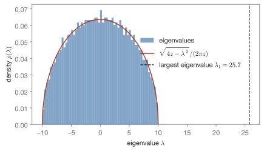

# Networks {#sec-networks}

In physics it is often unnecessary to say who interacts with whom: every mass attracts every other. In complex systems interactions are specific: people talk to some people and not
to others, proteins bind to particular partners, airports are joined by particular routes. Networks are the bookkeeping system for these specific interactions, recording who interacts
with whom, how strongly and in what way [@thurnerIntroductionTheoryComplex2018, Sec. 4.2]. Their statistics carry information that individual nodes do not: a disease spreads through a
population according to the degrees of its contact network, a few weak ties make the world small, and hubs make a network robust to failures and fragile to attacks
[@thurnerIntroductionTheoryComplex2018, Sec. 4.3; @grosComplexAdaptiveDynamical2015, Sec. 1.1.1].

This chapter develops the static theory of networks: the measures that describe them, the random graphs that serve as null models, the mechanisms that produce small worlds and
scale-free degree distributions, the communities that organise them at intermediate scales, and the spectra that connect their structure to linear algebra. Two further sections, which
the coverage record lists as gaps of the chapter, treat networks built from correlations in data and the generalisations of networks to hypergraphs and multilayer networks. Processes on
networks, such as random walks, epidemics and cascades, are the subject of a later chapter of this tutorial.

The chapter follows @thurnerIntroductionTheoryComplex2018 [Secs. 4.2-4.7 and 4.9] for network basics, measures, random networks, complex networks, communities, correlation networks
and generalised networks; @grosComplexAdaptiveDynamical2015 [Secs. 1.1-1.2 and 1.4-1.5] for graph spectra, the Laplacian, percolation in generalised random graphs with generating
functions, small-world models and preferential attachment; @jensenComplexityScienceStudy2023 [Secs. 8.1-8.4] for centralities, community detection and the giant cluster;
@downeyThinkComplexity2018 [Chs. 2-4] for random graphs, small worlds and scale-free networks with data; @charbonneauNaturalComplexityModeling2017 [Sec. 9.6] for small-world
transport networks; and @bertinStatisticalPhysicsComplex2021 [Sec. 6.1] for random graphs, small worlds and preferential attachment in the language of statistical physics. The branching
processes of @def-galton-watson and @thm-extinction-probability give the giant component, the power laws of @sec-heavy-tails and @prp-power-law-mle describe heavy-tailed degrees, and
the percolation of @sec-percolation is the lattice analogue of the random-graph transition. Eigenvalues are those of
[`def-eigenvalue`](../../fundamentals-of-mathematics-for-physicists/linear-algebra/index.qmd#def-eigenvalue) in the mathematics tutorial.

The chapter has eight sections. @sec-graph-measures defines networks and their measures and proves that powers of the adjacency matrix count walks. @sec-random-graphs defines random
graphs and proves the generating-function criterion for a giant component. @sec-small-worlds defines the Watts-Strogatz model and computes the clustering and the distances of the ring
lattice it starts from. @sec-scale-free defines scale-free networks and preferential attachment and derives the degree exponent $3$ and the friendship paradox. @sec-communities defines
modularity and proves its basic properties. @sec-spectra defines the Laplacian and proves that its spectrum counts components and bounds the largest adjacency eigenvalue. @sec-correlation-networks
defines correlation networks and their filtering, and @sec-generalised-networks defines hypergraphs and multilayer networks.

Following the conventions of the tutorial, a network has $N$ nodes and $L$ links, adjacency matrix $\mathbf A$, degrees $k_i$ and mean degree $\langle k\rangle$; $p_k$ is the degree distribution and
$G_0$, $G_1$ are generating functions. Every definition, proposition and theorem is followed by ten examples and ten exercises, each exercise with a hidden solution in two tabs: the
argument, then a computation with its recorded output. The computations use scikit-complexity 0.9.0, whose network systems build their graphs as NetworkX graphs: `RandomGraphEnsemblesSystem`
(Erdős-Rényi and Watts-Strogatz), `BarabasiAlbertSystem`, `HolmeKimSystem`, `ConfigurationModelSystem`, `NetworkSuperpositionSystem`, `KroneckerGraphSystem` and
`HypergraphRandomWalkSystem`; they are analysed with `network_measures` (summaries, degrees, centralities, assortativity and communities) and `motifs`. Spectra, shortest paths and graph
algorithms come from NetworkX and NumPy, as the coverage record foresees.

## Graphs and their measures {#sec-graph-measures}

A network is a set of nodes and a set of links between them, and almost everything that can be said about it is said through numbers attached to nodes, to links or to the whole:
degrees, distances, clustering and centralities [@thurnerIntroductionTheoryComplex2018, Secs. 4.2-4.3]. This section fixes the definitions and proves that the adjacency matrix encodes
walks, so that triangles and clustering are traces and entries of its powers.

For more on this topic, see @thurnerIntroductionTheoryComplex2018 [Secs. 4.2-4.3], @jensenComplexityScienceStudy2023 [Secs. 8.1-8.2], @grosComplexAdaptiveDynamical2015 [Secs. 1.1.1-1.1.2]
and @downeyThinkComplexity2018 [Chs. 2-3].

### Networks, degrees, paths and centralities

Thurner and coauthors define networks by nodes and links, represent them by adjacency matrices, and define the degree, walks and paths, components, geodesic distances, closeness and
betweenness centrality and the clustering coefficient [@thurnerIntroductionTheoryComplex2018, Secs. 4.2.2-4.3.5]; Jensen adds eigenvector centrality
[@jensenComplexityScienceStudy2023, Sec. 8.2.2]. The definition collects the notions used in the rest of the chapter for simple undirected networks.

:::: {.statement-box}
::: {#def-network}
#### Network, degree, distance, clustering and centrality

A **simple network** on the nodes $\{1, \dots, N\}$ is a symmetric matrix $\mathbf A \in \{0, 1\}^{N \times N}$ with zero diagonal, its **adjacency matrix**; $i$ and $j$ are **linked** if $A_{ij} = 1$, and $L = \frac12\sum_{ij}A_{ij}$
is the number of links. The **degree** of $i$ is $k_i = \sum_jA_{ij}$, the **mean degree** $\langle k\rangle = \frac1N\sum_ik_i$, and the **degree distribution** $p_k$ the fraction of nodes of degree $k$. A **walk** of
length $n$ is a sequence of nodes $i_0, i_1, \dots, i_n$ with $A_{i_{m-1}i_m} = 1$ for all $m$; a **path** is a walk with distinct nodes. The **distance** $\ell(i, j)$ is the length of a shortest path, $\infty$ if
there is none; the network is **connected** if all distances are finite, and its **components** are its maximal connected subnetworks. The **clustering coefficient** of a node with $k_i \geq 2$ is
$C_i = 2t_i/(k_i(k_i - 1))$, where $t_i$ is the number of links among its neighbours. The **closeness** of $i$ is $(N - 1)/\sum_{j \neq i}\ell(i, j)$, its **betweenness** is
$\sum_{s \neq i \neq t}\sigma_{st}(i)/\sigma_{st}$ over pairs $\{s, t\}$, with $\sigma_{st}$ the number of shortest paths from $s$ to $t$ and $\sigma_{st}(i)$ the number through $i$, and for a connected network its
**eigenvector centrality** is the positive eigenvector of $\mathbf A$ for its largest eigenvalue, normalised to sum $1$.
:::

::::

Directed networks have $A_{ij} \neq A_{ji}$ in general; Thurner's convention represents a link from $i$ to $j$ by $A_{ji} = 1$, so that in-degrees are row sums [@thurnerIntroductionTheoryComplex2018, Sec. 4.2.3.1].
The network systems of the package return NetworkX graphs: a trajectory of a growing network gives its last graph by `trajectory.get_network(-1).get_graph()`, and a static system holds its graph in
`system.prepare().system_.space.graph`.

:::: {.callout-note .examples-fold collapse="true" title="Examples"}
The first example is Thurner's undirected network of four nodes and five links. Its adjacency matrix is printed in his eq. (4.1) [@thurnerIntroductionTheoryComplex2018, Sec. 4.2.3].

::: {#exm-nm-thurner}
#### Four nodes, five links

The degrees are the row sums $2, 3, 2, 3$, they add up to $10 = 2L$, and the network is connected with diameter $2$.

```{.python .run}
import networkx as nx
import numpy as np
from skcomplex.core.analysis import network_measures
A = np.array([[0, 1, 0, 1], [1, 0, 1, 1], [0, 1, 0, 1], [1, 1, 1, 0]])
G = nx.from_numpy_array(A)
print("row sums", A.sum(axis=1).tolist(), "; package degrees", network_measures(G, kind="degrees").degrees[0].tolist())
summary = network_measures(G)
print("links", int(summary.edges[0]), "; diameter", int(summary.diameter[0]), "; component sizes", summary.components[0])
```

```{.text .run-output}
row sums [2, 3, 2, 3] ; package degrees [2, 3, 2, 3]
links 5 ; diameter 2 ; component sizes [4]
```
:::

Directed links come with two degrees. Thurner's directed example, eq. (4.2), uses his convention of storing a link from $i$ to $j$ in $A_{ji}$.

::: {#exm-nm-directed}
#### In- and out-degrees

For his matrix, the row sums are the in-degrees and the column sums the out-degrees: node $1$ receives two links and sends none, in the convention of the text, while the totals of in- and out-degrees both equal the
number of links, $5$.

```{.python .run}
import numpy as np
A = np.array([[0, 1, 0, 1], [0, 0, 1, 1], [0, 0, 0, 0], [0, 0, 1, 0]])
print("row sums (in)", A.sum(axis=1).tolist(), "; column sums (out)", A.sum(axis=0).tolist(), "; links", int(A.sum()))
```

```{.text .run-output}
row sums (in) [2, 2, 0, 1] ; column sums (out) [0, 1, 2, 2] ; links 5
```
:::

Bipartite networks link two kinds of node. Thurner writes their adjacency matrix in block form with the incidence matrix $\mathbf B$ off the diagonal, eq. (4.3) [@thurnerIntroductionTheoryComplex2018, Sec. 4.2.3.3].

::: {#exm-nm-bipartite}
#### Actors and films

With three films and four actors, $\mathbf B_{fa} = 1$ when actor $a$ is in film $f$. The projection $\mathbf B^{\mathsf T}\mathbf B$ counts shared films, and its off-diagonal pattern is the co-star network that Gros describes
[@grosComplexAdaptiveDynamical2015, Sec. 1.1.2, Fig. 1.1].

```{.python .run}
import numpy as np
B = np.array([[1, 1, 0, 0], [0, 1, 1, 0], [0, 1, 1, 1]])
A = np.block([[np.zeros((3, 3), int), B], [B.T, np.zeros((4, 4), int)]])
co = B.T @ B
print("block matrix symmetric:", bool((A == A.T).all()), "; shared films:\n", co)
```

```{.text .run-output}
block matrix symmetric: True ; shared films:
 [[1 1 0 0]
 [1 3 2 1]
 [0 2 2 1]
 [0 1 1 1]]
```
:::

A degree distribution can be read off a table. Jensen's example network of twelve nodes has one isolated node, eight of degree $1$ and three of degree $4$ [@jensenComplexityScienceStudy2023, Sec. 8.2.1, Table 8.1].

::: {#exm-nm-jensen}
#### A degree distribution

$p_0 = \frac1{12}$, $p_1 = \frac23$, $p_4 = \frac14$; the mean degree is $\frac{8 + 12}{12} = \frac53$, so by the handshake count of the proposition below the network has $L = 10$ links.
:::

The package's Barabási-Albert graphs are typical sparse networks. Their summary measures are computed by `network_measures`.

::: {#exm-nm-ba-summary}
#### A summary of measures

For a Barabási-Albert graph of $1000$ nodes with $m = 2$, the mean degree is close to $4$, the clustering is small, and the mean distance is short, a few steps, as in the small worlds of a later section.

```{.python .run}
from skcomplex.core.analysis import network_measures
from skcomplex.core.engine.runtime import simulate
from skcomplex.systems.mathematics.networks import BarabasiAlbertSystem
G = simulate(BarabasiAlbertSystem(1000, random_state=1), until=997, random_state=1).get_network(-1).get_graph()
r = network_measures(G, kind="summary")
print(f"nodes {int(r.nodes[0])}, links {int(r.edges[0])}, mean degree {r.mean_degree[0]:.3f}, clustering {r.clustering[0]:.4f}, path length {r.path_length[0]:.3f}, diameter {int(r.diameter[0])}")
```

```{.text .run-output}
nodes 1000, links 1997, mean degree 3.994, clustering 0.0181, path length 4.076, diameter 8
```
:::

Closeness and betweenness reward different positions. Thurner contrasts nodes close to many others with nodes through which many shortest paths run [@thurnerIntroductionTheoryComplex2018, Sec. 4.3.4.2, Fig. 4.6].

::: {#exm-nm-barbell}
#### Bridge and hub

In two cliques of five nodes joined through one middle node, the middle node of degree $2$ has the largest betweenness, $25$, since all $5 \times 5$ shortest paths between the cliques pass through it, and the two clique nodes
attached to it come close, with $24$; the other clique nodes, of degree $4$, carry no shortest paths at all. The closeness varies much less: from $0.40$ to $0.56$.

```{.python .run}
import networkx as nx
from skcomplex.core.analysis import network_measures
G = nx.barbell_graph(5, 1)
N = G.number_of_nodes()
bc = network_measures(G, kind="centrality", measure="betweenness").centrality[0]
cc = network_measures(G, kind="centrality", measure="closeness").centrality[0]
for v in (0, 4, 5):
    # The package normalises betweenness by the (N - 1)(N - 2)/2 pairs of other nodes.
    print(f"node {v}: degree {G.degree[v]}, betweenness {bc[v] * (N - 1) * (N - 2) / 2:.1f}, closeness {cc[v]:.3f}")
```

```{.text .run-output}
node 0: degree 4, betweenness 0.0, closeness 0.400
node 4: degree 5, betweenness 24.0, closeness 0.526
node 5: degree 2, betweenness 25.0, closeness 0.556
```
:::

Eigenvector centrality is computed by repeated multiplication. Jensen describes the iteration $\mathbf x \mapsto \mathbf A\mathbf x$, renormalised, which converges to the leading eigenvector
[@jensenComplexityScienceStudy2023, Sec. 8.2.2].

::: {#exm-nm-eigenvector}
#### Power iteration

On a connected non-bipartite graph the iteration converges; for the Barabási-Albert graph of the summary example the result agrees with the package's eigenvector centrality after renormalisation.

```{.python .run}
import numpy as np
import networkx as nx
from skcomplex.core.analysis import network_measures
from skcomplex.core.engine.runtime import simulate
from skcomplex.systems.mathematics.networks import BarabasiAlbertSystem
G = simulate(BarabasiAlbertSystem(1000, random_state=1), until=997, random_state=1).get_network(-1).get_graph()
A = nx.to_numpy_array(G, nodelist=sorted(G))
x = np.ones(len(A))
for _ in range(500):
    x = A @ x
    x /= x.sum()
package = network_measures(G, kind="centrality", measure="eigenvector").centrality[0]
p = np.array([package[v] for v in sorted(G)])
print("largest difference after normalising both to sum 1 is below 1e-9:", bool(np.abs(x - p / p.sum()).max() < 1e-9))
```

```{.text .run-output}
largest difference after normalising both to sum 1 is below 1e-9: True
```
:::

Two global clustering coefficients exist. The average of $C_i$ weights every node equally, the overall one weights every connected triple, and they differ when clustering depends on degree
[@thurnerIntroductionTheoryComplex2018, Sec. 4.3.5.3].

::: {#exm-nm-two-clusterings}
#### Average and overall clustering

A triangle with a star of ten leaves attached to one of its corners has average clustering about $0.155$, the two triangle nodes of degree $2$ contributing $1$ each and the hub $1/66$, but overall clustering only
$3/68 \approx 0.044$: the hub's $65$ open triples dominate the overall count, the low-degree triangle nodes the average. The package's summary reports the average; the overall one follows from the counts of triangles and
open triples of `motifs`.

```{.python .run}
import networkx as nx
from skcomplex.core.analysis import motifs, network_measures
G = nx.Graph([(0, 1), (1, 2), (2, 0)] + [(0, 10 + j) for j in range(10)])
c = motifs(G).counts[0]
print(f"average clustering {network_measures(G).clustering[0]:.4f}; triads {c}; overall {3 * c['triangle'] / (c['path'] + 3 * c['triangle']):.4f}")
```

```{.text .run-output}
average clustering 0.1550; triads {'path': 65, 'triangle': 1}; overall 0.0441
```
:::

Degree correlations are measured by the assortativity. Thurner defines it as a Pearson correlation of degrees across links [@thurnerIntroductionTheoryComplex2018, Sec. 4.3.1.3, eq. (4.10)].

::: {#exm-nm-assortativity}
#### Assortativity of a growing network

The Barabási-Albert graph is slightly disassortative, its hubs linking mostly to nodes of small degree, while the Holme-Kim graph with triad formation is close to neutral.

```{.python .run}
from skcomplex.core.analysis import network_measures
from skcomplex.core.engine.runtime import simulate
from skcomplex.systems.mathematics.networks import BarabasiAlbertSystem, HolmeKimSystem
for name, system, steps in (("Barabasi-Albert", BarabasiAlbertSystem(1000, random_state=1), 997), ("Holme-Kim", HolmeKimSystem(1000), 996)):
    G = simulate(system, until=steps, random_state=1).get_network(-1).get_graph()
    print(f"{name}: {G.number_of_nodes()} nodes, assortativity {network_measures(G, kind='assortativity').assortativity[0]:+.4f}")
```

```{.text .run-output}
Barabasi-Albert: 1000 nodes, assortativity -0.1055
Holme-Kim: 1000 nodes, assortativity -0.0353
```
:::

Charbonneau compares networks of twelve nodes by their average travel distance. His ring of nearest neighbours has $3.27$ links on average and his complete network $1$
[@charbonneauNaturalComplexityModeling2017, Sec. 9.6, Fig. 9.8].

::: {#exm-nm-charbonneau}
#### Travel distances

On a ring of $12$ nodes the distances from a node are $1, 1, 2, 2, \dots, 5, 5, 6$, summing to $36$, so the mean over the $11$ other nodes is $36/11 \approx 3.27$; in the complete graph every distance is $1$.

```{.python .run}
import networkx as nx
from skcomplex.core.analysis import network_measures
print(f"ring {network_measures(nx.cycle_graph(12)).path_length[0]:.4f}; complete {network_measures(nx.complete_graph(12)).path_length[0]:.4f}")
```

```{.text .run-output}
ring 3.2727; complete 1.0000
```
:::
::::

:::: {.callout-note .exercises-fold collapse="true" title="Exercises"}
The first exercise relates the adjacency matrix to the incidence matrix. Thurner's eq. (4.5) states the relation.

::: {#exr-nm-incidence}
#### Adjacency from incidence

For the $N \times L$ incidence matrix $\mathbf B$ of a simple network, with $B_{i\ell} = 1$ when node $i$ is an end of link $\ell$, show that $\mathbf B\mathbf B^{\mathsf T} = \mathbf D + \mathbf A$, with $\mathbf D$ the diagonal matrix of
degrees. Check it for Thurner's network of @exm-nm-thurner.
:::

::: {.callout-note .solution collapse="true" title="Solution"}
:::: {.panel-tabset .solution-tabs}
## Solution

$(\mathbf B\mathbf B^{\mathsf T})_{ij} = \sum_\ell B_{i\ell}B_{j\ell}$ counts links incident to both $i$ and $j$: for $i \neq j$ this is $A_{ij}$, since a simple network has at most one link between them, and for $i = j$ it counts the links at
$i$, the degree [@thurnerIntroductionTheoryComplex2018, Sec. 4.2.3.5, eq. (4.5)].

## Python

The incidence matrix from NetworkX and the identity.

```{.python .run}
import numpy as np
A = np.array([[0, 1, 0, 1], [1, 0, 1, 1], [0, 1, 0, 1], [1, 1, 1, 0]])
links = [(i, j) for i in range(4) for j in range(i + 1, 4) if A[i, j]]
B = np.zeros((4, len(links)), int)
for l, (i, j) in enumerate(links):
    B[i, l] = B[j, l] = 1
print("B B^T = D + A:", bool(np.allclose(B @ B.T, np.diag(A.sum(axis=1)) + A)))
```

```{.text .run-output}
B B^T = D + A: True
```
::::
:::

The second exercise computes connectances. Jensen and Thurner define the density of links as the fraction of possible links present [@jensenComplexityScienceStudy2023, Sec. 8.2, eq. (8.1)].

::: {#exr-nm-connectance}
#### Connectance

Show that the connectance $2L/(N(N - 1))$ of a network equals $\langle k\rangle/(N - 1)$. Compute it for Jensen's network of @exm-nm-jensen and for an Erdős-Rényi graph of the package with $N = 500$ and $\langle k\rangle = 3$.
:::

::: {.callout-note .solution collapse="true" title="Solution"}
:::: {.panel-tabset .solution-tabs}
## Solution

$\langle k\rangle = 2L/N$, so $2L/(N(N - 1)) = \langle k\rangle/(N - 1)$. Jensen's network: $L = 10$, $N = 12$, connectance $20/132 \approx 0.152$. The package's graph has connectance close to $3/499 \approx 0.006$: sparse networks have
vanishing connectance as $N$ grows.

## Python

Both values.

```{.python .run}
from skcomplex.core.engine.runtime import simulate
from skcomplex.systems.mathematics.networks import RandomGraphEnsemblesSystem
G = simulate(RandomGraphEnsemblesSystem(500, mean_degree=3.0, steps=20), until=20, random_state=3).get_network(-1).get_graph()
N, L = G.number_of_nodes(), G.number_of_edges()
print(f"Jensen: {20 / 132:.4f}; package ER: connectance {2 * L / (N * (N - 1)):.5f}, mean degree / (N - 1) {2 * L / N / (N - 1):.5f}")
```

```{.text .run-output}
Jensen: 0.1515; package ER: connectance 0.00602, mean degree / (N - 1) 0.00602
```
::::
:::

The third exercise implements breadth-first search. Downey introduces it as the tool for shortest path lengths [@downeyThinkComplexity2018, Ch. 3, "Breadth-First Search"].

::: {#exr-nm-bfs}
#### Breadth-first search

Implement breadth-first search from a node and show that the first time a node is reached is its distance. Average the distances over all pairs of the largest component of a random graph and compare with the path length of the
package's summary.
:::

::: {.callout-note .solution collapse="true" title="Solution"}
:::: {.panel-tabset .solution-tabs}
## Solution

The search visits nodes in order of the number of links from the source: all nodes at distance $d$ are put in the queue before any at distance $d + 1$, by induction on $d$, so the level at which a node is first reached is the
length of a shortest path to it.

## Python

A queue-based search on an Erdős-Rényi graph of the package with $200$ nodes and mean degree $6$.

```{.python .run}
import collections
import numpy as np
from skcomplex.core.analysis import clusters, network_measures
from skcomplex.core.engine.runtime import simulate
from skcomplex.systems.mathematics.networks import RandomGraphEnsemblesSystem
G = simulate(RandomGraphEnsemblesSystem(200, mean_degree=6.0, steps=20), until=20, random_state=1).get_network(-1).get_graph()
def bfs(G, s):
    dist, queue = {s: 0}, collections.deque([s])
    while queue:
        v = queue.popleft()
        for w in G[v]:
            if w not in dist:
                dist[w] = dist[v] + 1
                queue.append(w)
    return dist
giant = max((set(bfs(G, s)) for s in G), key=len)
mean = np.mean([d for s in giant for t, d in bfs(G, s).items() if t != s])
print(f"giant component {len(giant)} nodes (package: {clusters(G, kind='sizes').sizes[0]}); mean BFS distance {mean:.6f}; package path length {network_measures(G).path_length[0]:.6f}")
```

```{.text .run-output}
giant component 200 nodes (package: 200); mean BFS distance 3.103970; package path length 3.103970
```
::::
:::

The fourth exercise finds components. A breadth-first search from every unvisited node splits the network into its components.

::: {#exr-nm-components}
#### Components

Show that "being connected by a path" is an equivalence relation whose classes are the components. Count the components of an Erdős-Rényi graph with $\langle k\rangle = 0.8$ and of one with $\langle k\rangle = 3$, $N = 1000$, with the package's `clusters`.
:::

::: {.callout-note .solution collapse="true" title="Solution"}
:::: {.panel-tabset .solution-tabs}
## Solution

A path of length $0$ joins a node to itself, reversing a path joins $j$ to $i$, and concatenating paths joins $i$ to $k$ through $j$ after removing repeated nodes; the classes are connected and maximal, the components. Below
$\langle k\rangle = 1$ there are many small components; above it one large component and many tiny ones, the transition of the next section.

## Python

Component counts and the largest component.

```{.python .run}
from skcomplex.core.analysis import clusters
from skcomplex.core.engine.runtime import simulate
from skcomplex.systems.mathematics.networks import RandomGraphEnsemblesSystem
for z in (0.8, 3.0):
    G = simulate(RandomGraphEnsemblesSystem(1000, mean_degree=z, steps=20), until=20, random_state=2).get_network(-1).get_graph()
    sizes = clusters(G, kind="sizes").sizes
    print(f"<k> = {z}: {len(sizes)} components, largest {sizes[0]}")
```

```{.text .run-output}
<k> = 0.8: 610 components, largest 19
<k> = 3.0: 40 components, largest 958
```
::::
:::

The fifth exercise works out betweenness on a path. The middle of a chain carries the most shortest paths.

::: {#exr-nm-path-betweenness}
#### Betweenness on a path

On the path $0 - 1 - \dots - (N - 1)$, show that node $i$ has betweenness $i(N - 1 - i)$, and check for $N = 9$.
:::

::: {.callout-note .solution collapse="true" title="Solution"}
:::: {.panel-tabset .solution-tabs}
## Solution

Each pair has one shortest path, which passes through $i$ iff one end is left of $i$ and the other right of it: $i$ choices on the left and $N - 1 - i$ on the right.

## Python

The package's betweenness, which is divided by the $(N - 1)(N - 2)/2$ pairs of other nodes, against the formula.

```{.python .run}
import networkx as nx
from skcomplex.core.analysis import network_measures
N = 9
bc = network_measures(nx.path_graph(N), kind="centrality", measure="betweenness").centrality[0]
print([round(bc[i] * (N - 1) * (N - 2) / 2) for i in range(N)], [i * (N - 1 - i) for i in range(N)])
```

```{.text .run-output}
[0, 7, 12, 15, 16, 15, 12, 7, 0] [0, 7, 12, 15, 16, 15, 12, 7, 0]
```
::::
:::

The sixth exercise computes closeness on a star. The hub is the closest node, as Charbonneau's single-hub airline network suggests.

::: {#exr-nm-star}
#### Closeness of a star

For a star with one hub and $N - 1$ leaves, show that the hub has closeness $1$ and every leaf closeness $(N - 1)/(2N - 3)$.
:::

::: {.callout-note .solution collapse="true" title="Solution"}
:::: {.panel-tabset .solution-tabs}
## Solution

The hub is at distance $1$ from all $N - 1$ nodes. A leaf is at distance $1$ from the hub and $2$ from the other $N - 2$ leaves, total $1 + 2(N - 2) = 2N - 3$, and closeness $(N - 1)/(2N - 3)$, close to $\frac12$ for large $N$.

## Python

The package's closeness on a star of $12$ nodes.

```{.python .run}
import networkx as nx
from skcomplex.core.analysis import network_measures
c = network_measures(nx.star_graph(11), kind="centrality", measure="closeness").centrality[0]
print(round(c[0], 4), round(c[1], 4), round(11 / 21, 4))
```

```{.text .run-output}
1.0 0.5238 0.5238
```
::::
:::

The seventh exercise measures how close a directed network is to an undirected one. Thurner defines the reciprocity from closed walks of length two [@thurnerIntroductionTheoryComplex2018, Sec. 4.3.5.4].

::: {#exr-nm-reciprocity}
#### Reciprocity

Show that $\operatorname{tr}(\mathbf A^2)$ counts each pair of opposite links twice, so that the reciprocity $R = \operatorname{tr}(\mathbf A^2)/L$ is the fraction of links whose reverse is present. Compute it for a random directed graph and its
symmetrisation.
:::

::: {.callout-note .solution collapse="true" title="Solution"}
:::: {.panel-tabset .solution-tabs}
## Solution

$(\mathbf A^2)_{ii} = \sum_jA_{ij}A_{ji}$ counts the $j$ with links both ways between $i$ and $j$; summing over $i$ counts every reciprocated link once from each end, that is once per directed link that has its reverse. Dividing by $L$ gives the
fraction. For a random directed graph with link probability $p$, $R \approx p$; after symmetrisation $R = 1$.

## Python

A random directed graph with $p = 0.1$, drawn as a matrix.

```{.python .run}
# Fallback to NumPy: the package has no directed random graph and no reciprocity (pending package issue).
import numpy as np
rng = np.random.default_rng(3)
A = (rng.random((300, 300)) < 0.1).astype(float)
np.fill_diagonal(A, 0)
S = np.maximum(A, A.T)
print(f"R = {np.trace(A @ A) / A.sum():.4f}; symmetrised {np.trace(S @ S) / S.sum():.1f}")
```

```{.text .run-output}
R = 0.0981; symmetrised 1.0
```
::::
:::

The eighth exercise counts motifs with the package. Triangles are the motif behind clustering.

::: {#exr-nm-motifs}
#### Triangles as motifs

Count the triangles and open triples of a Holme-Kim graph with `motifs` and check that the overall clustering equals $3 \times$ triangles $/$ (open triples $+ 3 \times$ triangles).
:::

::: {.callout-note .solution collapse="true" title="Solution"}
:::: {.panel-tabset .solution-tabs}
## Solution

A connected triple of nodes is either a path, open, or a triangle. The overall clustering is the fraction of connected triples centred at a node that are closed; each triangle contains three of them and each open triple one, so
$C = 3T/(P + 3T)$, with $P$ the number of open triples.

## Python

The package's motif counts, and NetworkX's transitivity as the check, since the package's summary reports only the average clustering.

```{.python .run}
import networkx as nx
from skcomplex.core.analysis import motifs
from skcomplex.core.engine.runtime import simulate
from skcomplex.systems.mathematics.networks import HolmeKimSystem
G = simulate(HolmeKimSystem(300), until=296, random_state=4).get_network(-1).get_graph()
c = motifs(G).counts[0]
# Fallback to NetworkX for the check: the package has no overall clustering (transitivity) (pending package issue).
print(c, "; 3T/(P + 3T) =", round(3 * c["triangle"] / (c["path"] + 3 * c["triangle"]), 5), "; transitivity", round(nx.transitivity(G), 5))
```

```{.text .run-output}
{'path': 8260, 'triangle': 584} ; 3T/(P + 3T) = 0.17499 ; transitivity 0.17499
```
::::
:::

The ninth exercise computes the clustering of a lattice. Regular lattices have high clustering, the starting point of the small-world model.

::: {#exr-nm-lattice-clustering}
#### Clustering of a ring

For the ring in which every node is linked to its two neighbours on each side, show that every node has clustering $\frac12$.
:::

::: {.callout-note .solution collapse="true" title="Solution"}
:::: {.panel-tabset .solution-tabs}
## Solution

The neighbours of $0$ are $-2, -1, 1, 2$, six pairs; the linked pairs are $\{-2, -1\}$, $\{-1, 1\}$, $\{1, 2\}$, three of them, since nodes at ring distance at most $2$ are linked. So $C_0 = 3/6 = \frac12$, the value $3(z - 2)/(4(z - 1))$
of a later section for $z = 4$.

## Python

The package's Watts-Strogatz ring without rewiring; every node is equivalent, so the average clustering of the summary is the clustering of each node.

```{.python .run}
from skcomplex.core.analysis import network_measures
from skcomplex.core.engine.runtime import simulate
from skcomplex.systems.mathematics.networks import RandomGraphEnsemblesSystem
G = simulate(RandomGraphEnsemblesSystem(30, ensemble="watts_strogatz", mean_degree=4, rewiring=0.0, steps=1), until=1, random_state=0).get_network(-1).get_graph()
print("degrees", set(dict(G.degree).values()), "; clustering", network_measures(G).clustering[0])
```

```{.text .run-output}
degrees {4} ; clustering 0.5
```
::::
:::

The last exercise compares centralities. They rank the same nodes differently, which is why several are in use.

::: {#exr-nm-rankings}
#### Comparing centralities

For a Barabási-Albert graph of $500$ nodes, compute the Spearman rank correlation between degree, betweenness, closeness and eigenvector centrality. Which pair agrees most?
:::

::: {.callout-note .solution collapse="true" title="Solution"}
:::: {.panel-tabset .solution-tabs}
## Solution

In a growing network the old nodes have high degree, many shortest paths through them and short distances to everything, so the centralities agree at the top. Over all nodes the agreement is weaker: with $m = 2$ about half the nodes
have the smallest degree $2$, a large tie that degree cannot break, while closeness and eigenvector centrality separate these nodes by whether they hang off a hub. The run gives degree and betweenness a rank correlation of
about $0.87$ and closeness and eigenvector centrality about $0.98$, the most similar pair, while degree correlates with closeness and eigenvector centrality only at about $0.45$.

## Python

The package's four centralities and SciPy's rank correlation.

```{.python .run}
import itertools
from scipy.stats import spearmanr
from skcomplex.core.analysis import network_measures
from skcomplex.core.engine.runtime import simulate
from skcomplex.systems.mathematics.networks import BarabasiAlbertSystem
G = simulate(BarabasiAlbertSystem(500, random_state=1), until=497, random_state=1).get_network(-1).get_graph()
nodes = sorted(G)
cent = {m: network_measures(G, kind="centrality", measure=m).centrality[0] for m in ("degree", "betweenness", "closeness", "eigenvector")}
for a, b in itertools.combinations(cent, 2):
    print(f"{a} - {b}: {spearmanr([cent[a][v] for v in nodes], [cent[b][v] for v in nodes]).statistic:.3f}")
```

```{.text .run-output}
degree - betweenness: 0.868
degree - closeness: 0.464
degree - eigenvector: 0.438
betweenness - closeness: 0.628
betweenness - eigenvector: 0.570
closeness - eigenvector: 0.978
```
::::
:::
::::

### Walks and powers of the adjacency matrix

The measures of the definition are mostly counts of walks. Thurner and coauthors write the clustering coefficient as $C_i = (\mathbf A^3)_{ii}/(k_i(k_i - 1))$, eq. (4.12), and the reciprocity as $\operatorname{tr}(\mathbf A^2)/L$
[@thurnerIntroductionTheoryComplex2018, Secs. 4.3.5.2 and 4.3.5.4], and Gros counts triangles as $\operatorname{tr}\mathbf A^3/6$ [@grosComplexAdaptiveDynamical2015, Sec. 1.1.3]. All of these follow from one fact.

:::: {.statement-box}
::: {#prp-walk-counting}
#### Walks are counted by powers of the adjacency matrix

For a simple network with adjacency matrix $\mathbf A$ and every $n \geq 1$, the entry $(\mathbf A^n)_{ij}$ is the number of walks of length $n$ from $i$ to $j$. Consequently:

1. $\sum_ik_i = \operatorname{tr}\mathbf A^2 = 2L$;
2. the number of triangles is $\operatorname{tr}\mathbf A^3/6$, and for $k_i \geq 2$ the clustering coefficient is $C_i = (\mathbf A^3)_{ii}/(k_i(k_i - 1))$;
3. for $i \neq j$ the distance is $\ell(i, j) = \min\{n \geq 1 : (\mathbf A^n)_{ij} > 0\}$, infinite when no power is positive.
:::

::::

::: {.proof}
For $n = 1$, $A_{ij}$ is $1$ exactly when $i, j$ is a walk of length $1$. Suppose the claim holds for $n$. A walk of length $n + 1$ from $i$ to $j$ is a walk of length $n$ from $i$ to some node $m$ followed by a link from $m$ to
$j$, so the number of them is $\sum_m(\mathbf A^n)_{im}A_{mj} = (\mathbf A^{n + 1})_{ij}$, which proves the claim by induction.

(1) A closed walk of length $2$ from $i$ goes to a neighbour and back, so $(\mathbf A^2)_{ii} = k_i$; summing, $\operatorname{tr}\mathbf A^2 = \sum_ik_i$, and $\sum_ik_i = \sum_{ij}A_{ij} = 2L$ because each link appears twice in the
symmetric matrix.

(2) A closed walk of length $3$ from $i$ visits two distinct neighbours $j, m$ of $i$ that are linked to each other, since a simple network has no loops, and every triangle through $i$ gives two such walks, one per direction. So
$(\mathbf A^3)_{ii} = 2t_i$, and $C_i = 2t_i/(k_i(k_i - 1)) = (\mathbf A^3)_{ii}/(k_i(k_i - 1))$. Summing over $i$ counts each triangle at its three corners in two directions, so $\operatorname{tr}\mathbf A^3 = 6T$.

(3) A walk of length $n$ from $i$ to $j$ contains a path from $i$ to $j$ of length at most $n$, obtained by cutting out the closed pieces between repeated nodes, and a path is a walk. Hence the shortest walk and the shortest path from
$i$ to $j$ have the same length, and this is the smallest $n$ with $(\mathbf A^n)_{ij} > 0$.
:::

The proposition turns graph questions into matrix algebra: triangles and clustering are traces and diagonals of $\mathbf A^3$, distances are the first positive entries of the powers, and counts of longer walks grow as the
largest eigenvalue of $\mathbf A$ to the power $n$, the subject of a later section. Directed networks satisfy the first statement with walks along the directions of links.

:::: {.callout-note .examples-fold collapse="true" title="Examples"}
The first example computes the powers of Thurner's adjacency matrix from @exm-nm-thurner. Its diagonals give the degrees and the triangles.

::: {#exm-wc-thurner}
#### Powers of a small matrix

The diagonal of $\mathbf A^2$ is $(2, 3, 2, 3)$, the degrees. The network has two triangles, $\{1, 2, 4\}$ and $\{2, 3, 4\}$, so the diagonal of $\mathbf A^3$ is $(2, 4, 2, 4)$, twice the number of triangles at each node, and
$\operatorname{tr}\mathbf A^3/6 = 2$.

```{.python .run}
import numpy as np
A = np.array([[0, 1, 0, 1], [1, 0, 1, 1], [0, 1, 0, 1], [1, 1, 1, 0]])
A2, A3 = A @ A, A @ A @ A
print("diag A^2", np.diag(A2).tolist(), "; diag A^3", np.diag(A3).tolist(), "; triangles", np.trace(A3) // 6)
```

```{.text .run-output}
diag A^2 [2, 3, 2, 3] ; diag A^3 [2, 4, 2, 4] ; triangles 2
```
:::

Triangle counts by the trace agree with the package's motif counts. The Holme-Kim graph closes triangles on purpose, so it has many.

::: {#exm-wc-triangles}
#### Triangles by the trace

For a Holme-Kim graph of $300$ nodes, $\operatorname{tr}\mathbf A^3/6$ equals the number of triangles that `motifs` counts.

```{.python .run}
import networkx as nx
import numpy as np
from skcomplex.core.analysis import motifs
from skcomplex.core.engine.runtime import simulate
from skcomplex.systems.mathematics.networks import HolmeKimSystem
G = simulate(HolmeKimSystem(300), until=296, random_state=4).get_network(-1).get_graph()
A = nx.to_numpy_array(G)
print("trace A^3 / 6 =", round(np.trace(A @ A @ A) / 6), "; package triangles", motifs(G).counts[0]["triangle"])
```

```{.text .run-output}
trace A^3 / 6 = 584 ; package triangles 584
```
:::

Clustering coefficients come from the diagonal of $\mathbf A^3$. Their average is the clustering of the package's summary.

::: {#exm-wc-clustering}
#### Clustering by the cube

For a Holme-Kim graph, the $C_i = (\mathbf A^3)_{ii}/(k_i(k_i - 1))$ of the nodes with $k_i \geq 2$, with $C_i = 0$ for the others, the package's convention, average to the clustering of the package. One node has degree $1$: in
the package's graph the newest node has received only its first link when the run stops, which is pending as a package issue.

```{.python .run}
import networkx as nx
import numpy as np
from skcomplex.core.analysis import network_measures
from skcomplex.core.engine.runtime import simulate
from skcomplex.systems.mathematics.networks import HolmeKimSystem
G = simulate(HolmeKimSystem(300), until=296, random_state=4).get_network(-1).get_graph()
A = nx.to_numpy_array(G)
k = A.sum(axis=1)
C = np.divide(np.diag(A @ A @ A), k * (k - 1), out=np.zeros(len(k)), where=k >= 2)
print(f"smallest degree {int(k.min())}; mean of (A^3)_ii / (k_i (k_i - 1)) = {C.mean():.6f}; package {network_measures(G).clustering[0]:.6f}")
```

```{.text .run-output}
smallest degree 1; mean of (A^3)_ii / (k_i (k_i - 1)) = 0.475241; package 0.475241
```
:::

The handshake identity holds for every network. Thurner states it as $\sum_ik_i = 2L$ [@thurnerIntroductionTheoryComplex2018, Sec. 4.3.1].

::: {#exm-wc-handshake}
#### The handshake identity

For a Barabási-Albert graph, the package's degrees add up to twice the number of links and to $\operatorname{tr}\mathbf A^2$.

```{.python .run}
import networkx as nx
import numpy as np
from skcomplex.core.analysis import network_measures
from skcomplex.core.engine.runtime import simulate
from skcomplex.systems.mathematics.networks import BarabasiAlbertSystem
G = simulate(BarabasiAlbertSystem(300, random_state=2), until=297, random_state=2).get_network(-1).get_graph()
A = nx.to_numpy_array(G)
k = network_measures(G, kind="degrees").degrees[0]
print("sum of degrees", int(k.sum()), "; 2L", 2 * G.number_of_edges(), "; trace A^2", int(np.trace(A @ A)))
```

```{.text .run-output}
sum of degrees 1194 ; 2L 1194 ; trace A^2 1194
```
:::

Distances are first positive entries. On Charbonneau's ring of twelve nodes from @exm-nm-charbonneau, the powers of $\mathbf A$ fill in one ring distance at a time.

::: {#exm-wc-distances}
#### Distances from powers

The first $n$ with $(\mathbf A^n)_{ij} > 0$ gives all distances, and their mean over pairs is the package's path length $36/11$.

```{.python .run}
import networkx as nx
import numpy as np
from skcomplex.core.analysis import network_measures
G = nx.cycle_graph(12)
A = nx.to_numpy_array(G)
N, P = len(A), np.eye(len(A))
dist = np.full((N, N), np.inf)
np.fill_diagonal(dist, 0)
for n in range(1, N):
    P = P @ A
    dist[(P > 0) & np.isinf(dist)] = n
print(f"mean distance {dist[~np.eye(N, dtype=bool)].mean():.6f}; package {network_measures(G).path_length[0]:.6f}")
```

```{.text .run-output}
mean distance 3.272727; package 3.272727
```
:::

Closed walks on a ring can be counted by hand. A closed walk of length $n$ on a cycle takes $n/2$ steps each way, so it exists only for even $n$.

::: {#exm-wc-ring}
#### Closed walks on a ring

On a cycle longer than $n$, $(\mathbf A^n)_{ii} = \binom{n}{n/2}$ for even $n$ and $0$ for odd $n$: a closed walk chooses which $n/2$ of its steps go clockwise.

```{.python .run}
import math
import networkx as nx
import numpy as np
A = nx.to_numpy_array(nx.cycle_graph(20))
print([int(np.linalg.matrix_power(A, n)[0, 0]) for n in range(1, 9)])
print([math.comb(n, n // 2) if n % 2 == 0 else 0 for n in range(1, 9)])
```

```{.text .run-output}
[0, 2, 0, 6, 0, 20, 0, 70]
[0, 2, 0, 6, 0, 20, 0, 70]
```
:::

Bipartite networks have no closed walks of odd length. Every step changes the side, so an odd number of steps cannot come back.

::: {#exm-wc-bipartite}
#### Odd traces vanish

The Kronecker graph of the package built from a path of four nodes and a single link is bipartite, so $\operatorname{tr}\mathbf A^3 = \operatorname{tr}\mathbf A^5 = 0$.

```{.python .run}
import networkx as nx
import numpy as np
from skcomplex.systems.mathematics.networks import KroneckerGraphSystem
G = KroneckerGraphSystem(nx.path_graph(4), nx.path_graph(2)).prepare().system_.space.graph
A = nx.to_numpy_array(G)
print("nodes", len(A), "; bipartite", nx.is_bipartite(G), "; traces of A^1..A^6", [int(np.trace(np.linalg.matrix_power(A, n))) for n in range(1, 7)])
```

```{.text .run-output}
nodes 8 ; bipartite True ; traces of A^1..A^6 [0, 12, 0, 28, 0, 72]
```
:::

The complete graph has a closed formula. Its adjacency matrix is $\mathbf J - \mathbf I$, with $\mathbf J$ the matrix of ones, and $\mathbf J^2 = N\mathbf J$.

::: {#exm-wc-complete}
#### Walks on the complete graph

$(\mathbf J - \mathbf I)^n = \frac{(N - 1)^n - (-1)^n}{N}\mathbf J + (-1)^n\mathbf I$, so between distinct nodes there are $((N - 1)^n - (-1)^n)/N$ walks of length $n$.

```{.python .run}
import networkx as nx
import numpy as np
N = 6
A = nx.to_numpy_array(nx.complete_graph(N))
print([int(np.linalg.matrix_power(A, n)[0, 1]) for n in range(1, 7)], [((N - 1) ** n - (-1) ** n) // N for n in range(1, 7)])
```

```{.text .run-output}
[1, 4, 21, 104, 521, 2604] [1, 4, 21, 104, 521, 2604]
```
:::

Random graphs have a predictable number of triangles. A triangle needs three links, each present with probability $p$, so an Erdős-Rényi graph has on average $\binom N3p^3$ triangles.

::: {#exm-wc-er-triangles}
#### Triangles of a random graph

For $N = 1000$ and $\langle k\rangle = 10$, $p = 10/999$ and the expected count is $\binom{1000}{3}p^3 \approx 167$; a graph of the package has a count of this size.

```{.python .run}
import math
from skcomplex.core.analysis import motifs
from skcomplex.core.engine.runtime import simulate
from skcomplex.systems.mathematics.networks import RandomGraphEnsemblesSystem
G = simulate(RandomGraphEnsemblesSystem(1000, mean_degree=10.0, steps=20), until=20, random_state=5).get_network(-1).get_graph()
p = 2 * G.number_of_edges() / (1000 * 999)
print(f"expected {math.comb(1000, 3) * p ** 3:.1f} (with the realised p); counted {motifs(G).counts[0]['triangle']}")
```

```{.text .run-output}
expected 168.4 (with the realised p); counted 158
```
:::

Walk counts lead to eigenvector centrality. Jensen motivates it as importance inherited from important neighbours, which the number of long walks starting at a node measures [@jensenComplexityScienceStudy2023, Sec. 8.2.2].

::: {#exm-wc-eigenvector}
#### Long walks rank nodes

The vector $\mathbf A^n\mathbf 1$ counts the walks of length $n$ from every node; normalised, it approaches the eigenvector centrality as $n$ grows, here on a Holme-Kim graph.

```{.python .run}
import networkx as nx
import numpy as np
from skcomplex.core.analysis import network_measures
from skcomplex.core.engine.runtime import simulate
from skcomplex.systems.mathematics.networks import HolmeKimSystem
G = simulate(HolmeKimSystem(300), until=296, random_state=4).get_network(-1).get_graph()
nodes = sorted(G)
A = nx.to_numpy_array(G, nodelist=nodes)
ev = network_measures(G, kind="centrality", measure="eigenvector").centrality[0]
ev = np.array([ev[v] for v in nodes])
ev /= ev.sum()
w = np.ones(len(A))
for n in range(1, 41):
    w = A @ w / (A @ w).sum()
    if n in (1, 5, 10, 40):
        print(f"n = {n}: largest difference to the eigenvector centrality {np.abs(w - ev).max():.2e}")
```

```{.text .run-output}
n = 1: largest difference to the eigenvector centrality 5.83e-03
n = 5: largest difference to the eigenvector centrality 6.82e-04
n = 10: largest difference to the eigenvector centrality 1.52e-04
n = 40: largest difference to the eigenvector centrality 3.04e-09
```
:::
::::

:::: {.callout-note .exercises-fold collapse="true" title="Exercises"}
The first exercise counts closed walks of length four. They include the four-cycles and walks that go back and forth.

::: {#exr-wc-four}
#### Closed walks of length four

Show that $\operatorname{tr}\mathbf A^4 = 2\sum_ik_i^2 - 2L + 8C_4$, with $C_4$ the number of four-cycles. Check it on a Holme-Kim graph with the four-node motif counts of the package, in which a four-cycle appears as an induced cycle,
inside a diamond or three times inside a clique of four nodes.
:::

::: {.callout-note .solution collapse="true" title="Solution"}
:::: {.panel-tabset .solution-tabs}
## Solution

A closed walk of length $4$ from $i$ is one of three kinds. It goes to a neighbour $j$, back, to a neighbour $j'$ and back: $k_i^2$ walks. It goes to $j$, on to a neighbour $m \neq i$ of $j$, and back the same way: $\sum_{j \sim i}(k_j - 1)$
walks. Or it goes around a four-cycle through $i$: two walks per cycle. Summing over $i$, the second kind gives $\sum_jk_j(k_j - 1)$ and the third $8C_4$, since each cycle has four corners; so
$\operatorname{tr}\mathbf A^4 = \sum_ik_i^2 + \sum_ik_i^2 - \sum_ik_i + 8C_4 = 2\sum_ik_i^2 - 2L + 8C_4$.

## Python

The package's four-node motifs give $C_4$.

```{.python .run}
import networkx as nx
import numpy as np
from skcomplex.core.analysis import motifs
from skcomplex.core.engine.runtime import simulate
from skcomplex.systems.mathematics.networks import HolmeKimSystem
G = simulate(HolmeKimSystem(200), until=196, random_state=4).get_network(-1).get_graph()
c = motifs(G, size=4).counts[0]
C4 = c.get("cycle", 0) + c.get("diamond", 0) + 3 * c.get("clique", 0)
A = nx.to_numpy_array(G)
k, L = A.sum(axis=1), G.number_of_edges()
print("motifs", dict(sorted(c.items())))
print("trace A^4", int(np.trace(np.linalg.matrix_power(A, 4))), "; formula", int(2 * (k ** 2).sum() - 2 * L + 8 * C4))
```

```{.text .run-output}
motifs {'clique': 54, 'cycle': 184, 'diamond': 735, 'path': 26773, 'star': 24699, 'tailed_triangle': 9319}
trace A^4 33348 ; formula 33348
```
::::
:::

The second exercise reads distances off the powers of a small matrix. Thurner's network is connected with diameter $2$.

::: {#exr-wc-thurner-distances}
#### Distances in Thurner's network

For the network of @exm-nm-thurner, find all distances from $\mathbf A$ and $\mathbf A^2$, and its mean distance.
:::

::: {.callout-note .solution collapse="true" title="Solution"}
:::: {.panel-tabset .solution-tabs}
## Solution

Five of the six pairs are linked; the pair $\{1, 3\}$ (nodes counted from $1$) is not, but $(\mathbf A^2)_{13} = 2$, through nodes $2$ and $4$, so $\ell(1, 3) = 2$. The mean distance is $(5 \cdot 1 + 2)/6 = 7/6$.

## Python

The powers, and the package's path length.

```{.python .run}
import networkx as nx
import numpy as np
from skcomplex.core.analysis import network_measures
A = np.array([[0, 1, 0, 1], [1, 0, 1, 1], [0, 1, 0, 1], [1, 1, 1, 0]])
print("A^2 =\n", A @ A)
print(f"package path length {network_measures(nx.from_numpy_array(A)).path_length[0]:.6f}; 7/6 = {7 / 6:.6f}")
```

```{.text .run-output}
A^2 =
 [[2 1 2 1]
 [1 3 1 2]
 [2 1 2 1]
 [1 2 1 3]]
package path length 1.166667; 7/6 = 1.166667
```
::::
:::

The third exercise counts walks on a star. All walks alternate between the hub and the leaves.

::: {#exr-wc-star}
#### Walks on a star

For a star with $N - 1$ leaves, show that $(\mathbf A^n)_{hh} = (N - 1)^{n/2}$ for even $n$ and $0$ for odd $n$, with $h$ the hub.
:::

::: {.callout-note .solution collapse="true" title="Solution"}
:::: {.panel-tabset .solution-tabs}
## Solution

A closed walk from the hub alternates hub and leaf, so its length is even, and it chooses a leaf at each of its $n/2$ visits to the leaves: $(N - 1)^{n/2}$ walks.

## Python

A star of $8$ nodes.

```{.python .run}
import networkx as nx
import numpy as np
A = nx.to_numpy_array(nx.star_graph(7))
print([int(np.linalg.matrix_power(A, n)[0, 0]) for n in range(1, 9)], [7 ** (n // 2) if n % 2 == 0 else 0 for n in range(1, 9)])
```

```{.text .run-output}
[0, 7, 0, 49, 0, 343, 0, 2401] [0, 7, 0, 49, 0, 343, 0, 2401]
```
::::
:::

The fourth exercise proves one direction of a classical characterisation. Bipartite networks have only even closed walks.

::: {#exr-wc-odd-cycles}
#### Odd cycles and bipartiteness

Show that a network is bipartite if and only if it has no cycle of odd length, and conclude that $\operatorname{tr}\mathbf A^n = 0$ for all odd $n$ in a bipartite network. Check on a ring of $7$ nodes and one of $8$ nodes.
:::

::: {.callout-note .solution collapse="true" title="Solution"}
:::: {.panel-tabset .solution-tabs}
## Solution

If the network is bipartite, every step changes side, so closed walks and cycles have even length. Conversely, with no odd cycle, colour every node of each component by the parity of its distance to a fixed root. A link between two
nodes of equal parity would close, with the two shortest paths to the root, a closed walk of odd length, and a closed walk of odd length contains a cycle of odd length; so every link joins the two colours. Odd traces count odd
closed walks and vanish. The ring of $7$ nodes has $\operatorname{tr}\mathbf A^7 = 14$, the one cycle of length seven traversed in two directions from each of its seven nodes, while the ring of $8$ has none.

## Python

The odd traces of the two rings.

```{.python .run}
import networkx as nx
import numpy as np
for N in (7, 8):
    A = nx.to_numpy_array(nx.cycle_graph(N))
    print(N, [int(np.trace(np.linalg.matrix_power(A, n))) for n in (1, 3, 5, 7)])
```

```{.text .run-output}
7 [0, 0, 0, 14]
8 [0, 0, 0, 0]
```
::::
:::

The fifth exercise counts triangles of a complete graph. The trace formula recovers a binomial coefficient.

::: {#exr-wc-complete-triangles}
#### Triangles of a complete graph

Use @exm-wc-complete to show that the complete graph on $N$ nodes has $\operatorname{tr}\mathbf A^3/6 = \binom N3$ triangles, and that its clustering is $1$.
:::

::: {.callout-note .solution collapse="true" title="Solution"}
:::: {.panel-tabset .solution-tabs}
## Solution

From the formula, $(\mathbf A^3)_{ii} = ((N - 1)^3 + 1)/N - 1 = (N - 1)(N - 2)$. So $\operatorname{tr}\mathbf A^3/6 = N(N - 1)(N - 2)/6 = \binom N3$, and $C_i = (N - 1)(N - 2)/((N - 1)(N - 2)) = 1$.

## Python

The package's counts for $N = 8$.

```{.python .run}
import math
import networkx as nx
from skcomplex.core.analysis import motifs, network_measures
G = nx.complete_graph(8)
print("triangles", motifs(G).counts[0], "; C(8, 3) =", math.comb(8, 3), "; clustering", network_measures(G).clustering[0])
```

```{.text .run-output}
triangles {'path': 0, 'triangle': 56} ; C(8, 3) = 56 ; clustering 1.0
```
::::
:::

The sixth exercise links walks of length two to the degrees of neighbours. The package's neighbour degree measures the same quantity.

::: {#exr-wc-two-walks}
#### Walks of length two

Show that the number of walks of length $2$ from $i$ is $(\mathbf A^2\mathbf 1)_i = \sum_{j \sim i}k_j = k_ik_{nn, i}$, with $k_{nn, i}$ the mean degree of the neighbours of $i$. Check on a Barabási-Albert graph that the package's mean
neighbour degree for nodes of degree $2$ agrees.
:::

::: {.callout-note .solution collapse="true" title="Solution"}
:::: {.panel-tabset .solution-tabs}
## Solution

$(\mathbf A^2\mathbf 1)_i = \sum_{j, m}A_{ij}A_{jm} = \sum_jA_{ij}k_j$, the sum of the degrees of the neighbours, which is $k_i$ times their mean.

## Python

Averaging $(\mathbf A^2\mathbf 1)_i/k_i$ over the nodes of degree $2$.

```{.python .run}
import networkx as nx
import numpy as np
from skcomplex.core.analysis import network_measures
from skcomplex.core.engine.runtime import simulate
from skcomplex.systems.mathematics.networks import BarabasiAlbertSystem
G = simulate(BarabasiAlbertSystem(300, random_state=2), until=297, random_state=2).get_network(-1).get_graph()
A = nx.to_numpy_array(G)
k = A.sum(axis=1)
r = network_measures(G, kind="neighbor-degree")
pkg = dict(zip(r.distinct_degrees[0].tolist(), r.neighbor_degree[0].tolist()))
print(f"from A^2: {((A @ A).sum(axis=1)[k == 2] / 2).mean():.6f}; package: {pkg[2]:.6f}")
```

```{.text .run-output}
from A^2: 15.141892; package: 15.141892
```
::::
:::

The seventh exercise derives the clustering of a random graph. Thurner states that the clustering of an Erdős-Rényi graph is $p$, eq. (4.25) [@thurnerIntroductionTheoryComplex2018, Sec. 4.4.2.4].

::: {#exr-wc-er-clustering}
#### Clustering of a random graph

Show that, in an Erdős-Rényi graph, the expected number of links among the $k$ neighbours of a node is $p\binom k2$, so that $\langle C_i\rangle = p$. Check with the package for $N = 2000$, $\langle k\rangle = 8$.
:::

::: {.callout-note .solution collapse="true" title="Solution"}
:::: {.panel-tabset .solution-tabs}
## Solution

Links between the neighbours of $i$ are independent of the links at $i$, each present with probability $p$; there are $\binom k2$ pairs, so $\mathbb E[t_i \mid k_i = k] = p\binom k2$ and $\mathbb E[C_i] = p$. With $p = 8/1999 \approx 0.004$, the
measured clustering is of that size, as small as $\langle k\rangle/N$.

## Python

The package's average clustering.

```{.python .run}
from skcomplex.core.analysis import network_measures
from skcomplex.core.engine.runtime import simulate
from skcomplex.systems.mathematics.networks import RandomGraphEnsemblesSystem
G = simulate(RandomGraphEnsemblesSystem(2000, mean_degree=8.0, steps=20), until=20, random_state=6).get_network(-1).get_graph()
p = 2 * G.number_of_edges() / (2000 * 1999)
print(f"p = {p:.5f}; average clustering {network_measures(G).clustering[0]:.5f}")
```

```{.text .run-output}
p = 0.00394; average clustering 0.00345
```
::::
:::

The eighth exercise asks which longer walks exist once a node is reached. A detour to a neighbour and back adds two steps.

::: {#exr-wc-monotone}
#### Reaching and staying reached

Show that if $(\mathbf A^n)_{ij} > 0$ then $(\mathbf A^{n + 2})_{ij} > 0$. Is it true that $(\mathbf A^{n + 1})_{ij} > 0$?
:::

::: {.callout-note .solution collapse="true" title="Solution"}
:::: {.panel-tabset .solution-tabs}
## Solution

Append a step to a neighbour of $j$ and back to a walk of length $n$ ending at $j$, which has a neighbour since a walk reaches it. The shift by one fails in bipartite networks: on a path $0 - 1 - 2$, $(\mathbf A^2)_{02} = 1$ but
$(\mathbf A^3)_{02} = 0$, since walks between nodes of the same side have even length.

## Python

The powers of the path's matrix.

```{.python .run}
import networkx as nx
import numpy as np
A = nx.to_numpy_array(nx.path_graph(3))
print([int(np.linalg.matrix_power(A, n)[0, 2]) for n in range(1, 7)])
```

```{.text .run-output}
[0, 1, 0, 2, 0, 4]
```
::::
:::

The ninth exercise counts the paths of length two that clustering compares with triangles. They are the triples centred at a node.

::: {#exr-wc-triples}
#### Connected triples

Show that the number of connected triples centred at the nodes, open or closed, is $\sum_i\binom{k_i}2 = \frac12(\mathbf 1^{\mathsf T}\mathbf A^2\mathbf 1 - \operatorname{tr}\mathbf A^2)$, and that it equals the package's counts of open paths plus three
times the triangles.
:::

::: {.callout-note .solution collapse="true" title="Solution"}
:::: {.panel-tabset .solution-tabs}
## Solution

$\mathbf 1^{\mathsf T}\mathbf A^2\mathbf 1 = \sum_ik_i^2$ and $\operatorname{tr}\mathbf A^2 = \sum_ik_i$, so the right side is $\sum_ik_i(k_i - 1)/2$, the number of pairs of neighbours of every node. Each such pair is a triple centred
at the node; it is either open, a path, or closed, and a triangle contains three of them.

## Python

On a Holme-Kim graph.

```{.python .run}
import networkx as nx
import numpy as np
from skcomplex.core.analysis import motifs
from skcomplex.core.engine.runtime import simulate
from skcomplex.systems.mathematics.networks import HolmeKimSystem
G = simulate(HolmeKimSystem(300), until=296, random_state=4).get_network(-1).get_graph()
A = nx.to_numpy_array(G)
c = motifs(G).counts[0]
print(int((A @ A).sum() - np.trace(A @ A)) // 2, c["path"] + 3 * c["triangle"])
```

```{.text .run-output}
10012 10012
```
::::
:::

The last exercise asks for the number of walks between two nodes of a ring. The answer is again binomial.

::: {#exr-wc-ring-walks}
#### Walks between nodes of a ring

On a ring longer than $n + d$, show that the number of walks of length $n$ between nodes at ring distance $d$ is $\binom{n}{(n + d)/2}$ when $n + d$ is even and $0$ otherwise.
:::

::: {.callout-note .solution collapse="true" title="Solution"}
:::: {.panel-tabset .solution-tabs}
## Solution

A walk of length $n$ with $a$ clockwise and $n - a$ counterclockwise steps moves by $2a - n$; on a long ring it ends at distance $d$ clockwise exactly when $2a - n = d$, that is $a = (n + d)/2$, and the walks choose which steps are clockwise.

## Python

A ring of $40$ nodes and $n = 8$.

```{.python .run}
import math
import networkx as nx
import numpy as np
P = np.linalg.matrix_power(nx.to_numpy_array(nx.cycle_graph(40)), 8)
print([int(P[0, d]) for d in range(0, 7)], [math.comb(8, (8 + d) // 2) if (8 + d) % 2 == 0 else 0 for d in range(0, 7)])
```

```{.text .run-output}
[70, 0, 56, 0, 28, 0, 8] [70, 0, 56, 0, 28, 0, 8]
```
::::
:::
::::

## Random graphs and the giant component {#sec-random-graphs}

To say that a real network is clustered, or has a broad degree distribution, one has to say compared with what. Random graphs are the reference: the Erdős-Rényi graph fixes only the density of links, the configuration model
fixes the degrees, and both are null models against which measured statistics are tested [@thurnerIntroductionTheoryComplex2018, Secs. 4.4-4.5.1]. Their most important property is a phase transition: as the mean degree passes
a threshold, a giant component that contains a finite fraction of all nodes appears, exactly like the percolation transition of @sec-percolation.

For more on this topic, see @thurnerIntroductionTheoryComplex2018 [Secs. 4.4-4.5.1], @grosComplexAdaptiveDynamical2015 [Secs. 1.1.2 and 1.2], @jensenComplexityScienceStudy2023 [Sec. 8.4], @downeyThinkComplexity2018
[Ch. 2] and @bertinStatisticalPhysicsComplex2021 [Sec. 6.1].

### Random graphs and generating functions

Thurner and coauthors define the two Erdős-Rényi ensembles and derive their binomial and Poisson degree distributions, eqs. (4.15)-(4.18) [@thurnerIntroductionTheoryComplex2018, Secs. 4.4.2.1-4.4.2.2]. Gros builds networks
with arbitrary degree distributions by joining stubs at random and describes them by the generating functions $G_0$ and $G_1$, eqs. (1.21) and (1.30)-(1.32) [@grosComplexAdaptiveDynamical2015, Secs. 1.2.1-1.2.2]; Jensen
uses the same generators, which he writes $g_0$ and $g_1$ [@jensenComplexityScienceStudy2023, Sec. 8.4].

:::: {.statement-box}
::: {#def-er-graph}
#### Erdős-Rényi graph, configuration model and generating functions

The **Erdős-Rényi graph** $G(N, p)$ is the random simple network on $N$ nodes in which each of the $\binom N2$ pairs is linked independently with probability $p$; the ensemble $G(N, L)$ draws uniformly among the networks with exactly
$L$ links. The **configuration model** with degree sequence $k_1, \dots, k_N$ of even sum gives node $i$ exactly $k_i$ stubs and joins the stubs in pairs chosen uniformly at random. For a degree distribution $p_k$ with mean
$z = \langle k\rangle$, the **excess degree distribution** $q_k = (k + 1)p_{k + 1}/z$ is the distribution of the number of further links of a node reached along a link, and the **generating functions** are
$$
G_0(x) = \sum_{k \geq 0}p_kx^k, \qquad G_1(x) = \sum_{k \geq 0}q_kx^k = \frac{G_0'(x)}{G_0'(1)}.
$$
:::

::::

In $G(N, p)$ the degree of a node is binomial, $p_k = \binom{N - 1}kp^k(1 - p)^{N - 1 - k}$, and for $N \to \infty$ at fixed mean degree $z = (N - 1)p$ it becomes Poisson, $p_k = e^{-z}z^k/k!$; then $G_0(x) = G_1(x) = e^{z(x - 1)}$
[@grosComplexAdaptiveDynamical2015, Sec. 1.2.2, eqs. (1.36)-(1.37)]. The package's `RandomGraphEnsemblesSystem` builds an Erdős-Rényi graph of given mean degree in `steps` steps of random links, whose degrees have the same
Poisson limit, and `ConfigurationModelSystem` pairs stubs and then rewires away self-loops and multiple links, keeping every degree, as Thurner describes [@thurnerIntroductionTheoryComplex2018, Sec. 4.5.1].

:::: {.callout-note .examples-fold collapse="true" title="Examples"}
The first example compares the degrees of the package's Erdős-Rényi graph with the Poisson law. The two agree to within sampling error.

::: {#exm-er-poisson}
#### Poisson degrees

For $N = 5000$ and $z = 4$, the share of nodes of each degree is close to $e^{-4}4^k/k!$, and mean and variance are both close to $4$.

```{.python .run}
import math
import numpy as np
from skcomplex.core.analysis import network_measures
from skcomplex.core.engine.runtime import simulate
from skcomplex.systems.mathematics.networks import RandomGraphEnsemblesSystem
G = simulate(RandomGraphEnsemblesSystem(5000, mean_degree=4.0, steps=20), until=20, random_state=1).get_network(-1).get_graph()
k = network_measures(G, kind="degrees").degrees[0]
print(f"mean {k.mean():.3f}, variance {k.var():.3f}")
for d in range(0, 9, 2):
    print(f"k = {d}: share {np.mean(k == d):.4f}, Poisson {math.exp(-4) * 4 ** d / math.factorial(d):.4f}")
```

```{.text .run-output}
mean 4.069, variance 3.875
k = 0: share 0.0150, Poisson 0.0183
k = 2: share 0.1426, Poisson 0.1465
k = 4: share 0.1944, Poisson 0.1954
k = 6: share 0.1096, Poisson 0.1042
k = 8: share 0.0306, Poisson 0.0298
```
:::

Moments of the degree distribution follow from the Poisson law. Thurner derives $\langle k\rangle = (N - 1)p$ and $\langle k^2\rangle = \langle k\rangle^2 + \langle k\rangle$ in the limit, eqs. (4.19)-(4.23)
[@thurnerIntroductionTheoryComplex2018, Sec. 4.4.2.3].

::: {#exm-er-moments}
#### The second moment

The package's degree moments of an Erdős-Rényi graph with $z = 6$ give $\langle k^2\rangle$ close to $z^2 + z = 42$.

```{.python .run}
from skcomplex.core.analysis import network_measures
from skcomplex.core.engine.runtime import simulate
from skcomplex.systems.mathematics.networks import RandomGraphEnsemblesSystem
G = simulate(RandomGraphEnsemblesSystem(3000, mean_degree=6.0, steps=20), until=20, random_state=2).get_network(-1).get_graph()
m1, m2 = network_measures(G, kind="degrees", orders=(1, 2)).moments[0]
print(f"<k> = {m1:.3f}; <k^2> = {m2:.3f}; <k>^2 + <k> = {m1 ** 2 + m1:.3f}")
```

```{.text .run-output}
<k> = 6.093; <k^2> = 42.780; <k>^2 + <k> = 43.222
```
:::

The configuration model takes any degree sequence with an even sum. The smallest example of the package's documentation has five nodes.

::: {#exm-er-configuration}
#### A small configuration model

For the degrees $3, 3, 2, 2, 2$ the package returns a simple network with exactly these degrees, after rewiring away any self-loop or double link that the pairing produced.

```{.python .run}
from skcomplex.core.analysis import network_measures
from skcomplex.systems.mathematics.networks import ConfigurationModelSystem
G = ConfigurationModelSystem([3, 3, 2, 2, 2], random_state=0).prepare().system_.space.graph
print("links", sorted(G.edges()), "; degrees", network_measures(G, kind="degrees").degrees[0].tolist())
```

```{.text .run-output}
links [(0, 1), (0, 2), (0, 3), (1, 2), (1, 4), (3, 4)] ; degrees [3, 3, 2, 2, 2]
```
:::

An odd degree sum cannot be paired. The package refuses such a sequence.

::: {#exm-er-odd}
#### An odd sum

Every link uses two stubs, so the number of stubs must be even; the degrees $3, 2, 2$ cannot form a network.

```{.python .run}
from skcomplex.systems.mathematics.networks import ConfigurationModelSystem
try:
    ConfigurationModelSystem([3, 2, 2], random_state=0).prepare()
except Exception as error:
    print(type(error).__name__, ":", str(error)[:90])
```

```{.text .run-output}
ValidationError : The degrees sum to 7. Give a degree sequence with an even sum.
```
:::

The excess degree distribution is biased towards large degrees. A link leads to a node of degree $k$ with probability proportional to $kp_k$, because such a node has $k$ links to be reached through
[@grosComplexAdaptiveDynamical2015, Sec. 1.2.1, Fig. 1.7].

::: {#exm-er-excess}
#### The degree of a neighbour

For the package's power-law configuration model with exponent $2.5$, the mean degree of the node at the end of a random link is $\langle k^2\rangle/\langle k\rangle$, far above $\langle k\rangle$.

```{.python .run}
import numpy as np
from skcomplex.core.analysis import network_measures
from skcomplex.systems.mathematics.networks import ConfigurationModelSystem
G = ConfigurationModelSystem(n_nodes=5000, exponent=2.5, random_state=3).prepare().system_.space.graph
m1, m2 = network_measures(G, kind="degrees").moments[0]
ends = np.array([G.degree[v] for edge in G.edges() for v in edge])
print(f"<k> = {m1:.3f}; mean degree at the end of a link {ends.mean():.3f}; <k^2>/<k> = {m2 / m1:.3f}")
```

```{.text .run-output}
<k> = 4.040; mean degree at the end of a link 10.194; <k^2>/<k> = 10.194
```
:::

The Poisson generating functions are exponentials. Gros evaluates the sum $\sum_ke^{-z}z^kx^k/k!$ in eq. (1.36).

::: {#exm-er-generating}
#### Generating functions of a Poisson law

$G_0(x) = e^{-z}\sum_k(zx)^k/k! = e^{z(x - 1)}$, and $G_1 = G_0'/z = G_0$: the node reached along a link has a Poisson number of further links with the same mean. The empirical generating function of a package graph,
$\frac1N\sum_ix^{k_i}$, follows the exponential.

```{.python .run}
import numpy as np
from skcomplex.core.analysis import network_measures
from skcomplex.core.engine.runtime import simulate
from skcomplex.systems.mathematics.networks import RandomGraphEnsemblesSystem
G = simulate(RandomGraphEnsemblesSystem(5000, mean_degree=3.0, steps=20), until=20, random_state=4).get_network(-1).get_graph()
k = network_measures(G, kind="degrees").degrees[0]
for x in (0.0, 0.25, 0.5, 0.75):
    print(f"x = {x}: empirical {np.mean(x ** k):.4f}, exp(z(x - 1)) {np.exp(k.mean() * (x - 1)):.4f}")
```

```{.text .run-output}
x = 0.0: empirical 0.0478, exp(z(x - 1)) 0.0494
x = 0.25: empirical 0.1034, exp(z(x - 1)) 0.1047
x = 0.5: empirical 0.2211, exp(z(x - 1)) 0.2222
x = 0.75: empirical 0.4707, exp(z(x - 1)) 0.4713
```
:::

Second neighbours are counted by the excess degree. Gros shows that a node has on average $z_2 = \langle k^2\rangle - \langle k\rangle$ second neighbours, eq. (1.23) [@grosComplexAdaptiveDynamical2015, Sec. 1.2.1].

::: {#exm-er-second}
#### Second neighbours

In an Erdős-Rényi graph $z_2 = z^2$; for $z = 4$ the mean number of nodes at distance exactly $2$ is close to $16$.

```{.python .run}
import numpy as np
from skcomplex.core.analysis import network_measures
from skcomplex.core.engine.runtime import simulate
from skcomplex.systems.mathematics.networks import RandomGraphEnsemblesSystem
G = simulate(RandomGraphEnsemblesSystem(5000, mean_degree=4.0, steps=20), until=20, random_state=1).get_network(-1).get_graph()
m1, m2 = network_measures(G, kind="degrees").moments[0]
second = [len(set().union(*(set(G[j]) for j in G[i])) - set(G[i]) - {i}) if G[i] else 0 for i in G]
print(f"mean second neighbours {np.mean(second):.3f}; <k^2> - <k> = {m2 - m1:.3f}; z^2 = {m1 ** 2:.3f}")
```

```{.text .run-output}
mean second neighbours 16.324; <k^2> - <k> = 16.362; z^2 = 16.555
```
:::

Thresholds in $p(N)$ describe when properties appear. Downey finds by simulation that ten-node random graphs become connected near $p = \ln n/n \approx 0.23$ [@downeyThinkComplexity2018, Ch. 2, "Probability of
Connectivity"], and Thurner lists $\log N/N$ as the threshold of connectedness [@thurnerIntroductionTheoryComplex2018, Sec. 4.4.3.3].

::: {#exm-er-connected}
#### Becoming connected

In terms of the mean degree, the threshold is $z = \ln N$, about $6.2$ for $N = 500$: the share of connected graphs among the package's samples rises from near $0$ to near $1$ across it.

```{.python .run}
from skcomplex.core.analysis import clusters
from skcomplex.core.engine.runtime import simulate
from skcomplex.systems.mathematics.networks import RandomGraphEnsemblesSystem
for z in (4.0, 6.2, 9.0):
    connected = sum(len(clusters(simulate(RandomGraphEnsemblesSystem(500, mean_degree=z, steps=10), until=10, random_state=s).get_network(-1).get_graph(), kind="sizes").sizes) == 1 for s in range(10))
    print(f"z = {z}: {connected} of 10 graphs connected")
```

```{.text .run-output}
z = 4.0: 0 of 10 graphs connected
z = 6.2: 6 of 10 graphs connected
z = 9.0: 10 of 10 graphs connected
```
:::

Mixtures of random graphs have broader degrees. The network superposition model of Thurner and coauthors mixes Erdős-Rényi graphs whose link probabilities are drawn from a distribution $Q(p)$, so that the degree distribution is the mixture
$\int dp\,P(k \mid Np)Q(p)$ of Poisson laws, eq. (4.34) [@thurnerIntroductionTheoryComplex2018, Sec. 4.5.2].

::: {#exm-er-superposition}
#### Superposed random graphs

The package draws one probability for each of $20$ subgraphs of $1000$ nodes from $Q(p) \sim p^{-2}$ on $[0.005, 0.1]$ and places the subgraphs side by side, so the network has $20\,000$ nodes. Its degree variance is far
above the mean, unlike the Poisson law of a single Erdős-Rényi graph.

```{.python .run}
from skcomplex.core.analysis import network_measures
from skcomplex.systems.mathematics.networks import NetworkSuperpositionSystem
G = NetworkSuperpositionSystem(1000, n_subgraphs=20, random_state=5).prepare().system_.space.graph
k = network_measures(G, kind="degrees").degrees[0]
print(f"nodes {G.number_of_nodes()}; mean degree {k.mean():.2f}; variance {k.var():.2f}; largest {k.max()}")
```

```{.text .run-output}
nodes 20000; mean degree 18.99; variance 540.60; largest 130
```
:::

Random graphs are null models. The package's `motifs` compares a motif count with degree-preserving switches of the links, a rewired configuration model of the same degrees, and reports a $z$-score
[@thurnerIntroductionTheoryComplex2018, Sec. 4.5.1].

::: {#exm-er-null}
#### Triangles against a null model

The Holme-Kim graph has far more triangles than its rewired versions, a $z$-score of many standard deviations, while the Barabási-Albert graph, which closes no triangles on purpose, is close to its null model.

```{.python .run}
from skcomplex.core.analysis import motifs
from skcomplex.core.engine.runtime import simulate
from skcomplex.systems.mathematics.networks import BarabasiAlbertSystem, HolmeKimSystem
for name, system, steps in (("Barabasi-Albert", BarabasiAlbertSystem(300, random_state=6), 297), ("Holme-Kim", HolmeKimSystem(300), 296)):
    G = simulate(system, until=steps, random_state=6).get_network(-1).get_graph()
    r = motifs(G, kind="z-scores", samples=20, random_state=6)
    print(name, {key: round(float(value), 2) for key, value in sorted(r.z_scores[0].items())})
```

```{.text .run-output}
Barabasi-Albert {'path': 1.64, 'triangle': -1.64}
Holme-Kim {'path': -24.57, 'triangle': 24.57}
```
:::
::::

:::: {.callout-note .exercises-fold collapse="true" title="Exercises"}
The first exercise derives the degree distribution of $G(N, p)$. Thurner's eqs. (4.17)-(4.18) give it [@thurnerIntroductionTheoryComplex2018, Sec. 4.4.2.2].

::: {#exr-er-binomial}
#### Binomial and Poisson degrees

Show that the degree of a node of $G(N, p)$ is binomial with parameters $N - 1$ and $p$, and that for $N \to \infty$ with $(N - 1)p = z$ fixed it tends to the Poisson law of mean $z$. Compare both laws at $N = 50$, $z = 4$.
:::

::: {.callout-note .solution collapse="true" title="Solution"}
:::: {.panel-tabset .solution-tabs}
## Solution

The $N - 1$ possible links of a node are independent, each present with probability $p$, so the degree is binomial. With $p = z/(N - 1)$, $\binom{N - 1}k p^k = \frac{z^k}{k!}\prod_{j < k}\frac{N - 1 - j}{N - 1} \to z^k/k!$ and
$(1 - p)^{N - 1 - k} \to e^{-z}$. At $N = 50$ the two laws already differ by less than $0.01$.

## Python

The two laws from SciPy.

```{.python .run}
from scipy.stats import binom, poisson
for k in range(0, 9, 2):
    print(k, round(float(binom.pmf(k, 49, 4 / 49)), 4), round(float(poisson.pmf(k, 4)), 4))
```

```{.text .run-output}
0 0.0154 0.0183
2 0.1432 0.1465
4 0.2038 0.1954
6 0.1063 0.1042
8 0.0271 0.0298
```
::::
:::

The second exercise computes the variance of the degree. It equals the mean in the Poisson limit.

::: {#exr-er-variance}
#### Variance of the degree

Show that the degree of $G(N, p)$ has variance $(N - 1)p(1 - p)$ and that $\langle k^2\rangle = (N - 1)(N - 2)p^2 + (N - 1)p$, Thurner's eq. (4.23).
:::

::: {.callout-note .solution collapse="true" title="Solution"}
:::: {.panel-tabset .solution-tabs}
## Solution

The degree is a sum of $N - 1$ independent Bernoulli variables, so its variance is $(N - 1)p(1 - p)$. Then $\langle k^2\rangle = (N - 1)p(1 - p) + (N - 1)^2p^2 = (N - 1)(N - 2)p^2 + (N - 1)p$.

## Python

A symbolic check with SymPy.

```{.python .run}
import sympy as sp
N, p = sp.symbols("N p", positive=True)
print(sp.simplify((N - 1) * p * (1 - p) + (N - 1) ** 2 * p ** 2 - ((N - 1) * (N - 2) * p ** 2 + (N - 1) * p)))
```

```{.text .run-output}
0
```
::::
:::

The third exercise finds the connectivity threshold from isolated nodes. The last obstacle to connectedness is an isolated node.

::: {#exr-er-isolated}
#### Isolated nodes

Show that the expected number of isolated nodes of $G(N, p)$ is $N(1 - p)^{N - 1} \approx Ne^{-z}$, which is $1$ at $z = \ln N$. Count isolated nodes in package graphs of $N = 2000$ at $z = \ln N \pm 1$.
:::

::: {.callout-note .solution collapse="true" title="Solution"}
:::: {.panel-tabset .solution-tabs}
## Solution

A node is isolated when none of its $N - 1$ links is present, with probability $(1 - p)^{N - 1} \approx e^{-z}$. The expected count $Ne^{-z}$ is $e$ at $z = \ln N - 1$, $1$ at $z = \ln N$ and $1/e$ at $z = \ln N + 1$: below the
threshold isolated nodes remain, above it they disappear, and with them, it turns out, every obstacle to connectedness.

## Python

The package's degrees, averaged over five graphs.

```{.python .run}
import math
import numpy as np
from skcomplex.core.analysis import network_measures
from skcomplex.core.engine.runtime import simulate
from skcomplex.systems.mathematics.networks import RandomGraphEnsemblesSystem
N = 2000
for z in (math.log(N) - 1, math.log(N) + 1):
    counts = [int(np.sum(network_measures(simulate(RandomGraphEnsemblesSystem(N, mean_degree=z, steps=10), until=10, random_state=s).get_network(-1).get_graph(), kind="degrees").degrees[0] == 0)) for s in range(5)]
    print(f"z = {z:.2f}: isolated nodes {counts}; N exp(-z) = {N * math.exp(-z):.2f}")
```

```{.text .run-output}
z = 6.60: isolated nodes [2, 1, 2, 2, 0]; N exp(-z) = 2.72
z = 8.60: isolated nodes [0, 0, 0, 0, 0]; N exp(-z) = 0.37
```
::::
:::

The fourth exercise derives a threshold Thurner lists. His text prints the exponent of the threshold for components of three nodes as $-2/3$ [@thurnerIntroductionTheoryComplex2018, Sec. 4.4.3.3].

::: {#exr-er-three}
#### Components of three nodes

Show that the expected number of paths of two links in $G(N, p)$ is $3\binom N3p^2(1 - p) \sim N^3p^2/2$, so that such components appear when $p$ passes $N^{-3/2}$. Which exponent is consistent with this, $-3/2$ or $-2/3$?
:::

::: {.callout-note .solution collapse="true" title="Solution"}
:::: {.panel-tabset .solution-tabs}
## Solution

Three nodes form a path in $3$ ways, by choosing the middle one, each with probability $p^2(1 - p)$. The expected number $\sim N^3p^2/2$ tends to $0$ if $p \ll N^{-3/2}$ and to $\infty$ if $p \gg N^{-3/2}$, so the threshold is
$N^{-3/2}$; the printed $N^{-2/3}$ would be far above the threshold $N^{-1}$ of the giant component, which needs such paths, so it must be read as $N^{-3/2}$. A threshold check with the package: at $N = 1000$, $p = N^{-3/2}$ means
about $16$ links.

## Python

The expected number of paths at $p = N^{-3/2}$ for several $N$ is constant, $\approx 1/2$.

```{.python .run}
import math
for N in (100, 1000, 10000):
    p = N ** -1.5
    print(N, round(3 * math.comb(N, 3) * p ** 2 * (1 - p), 4), "; expected links", round(math.comb(N, 2) * p, 1))
```

```{.text .run-output}
100 0.4846 ; expected links 5.0
1000 0.4985 ; expected links 15.8
10000 0.4998 ; expected links 50.0
```
::::
:::

The fifth exercise proves the basic properties of generating functions. They turn moments into derivatives.

::: {#exr-er-gf-moments}
#### Moments from generating functions

Show that $G_0(1) = 1$, $G_0'(1) = \langle k\rangle$, $G_0''(1) = \langle k^2\rangle - \langle k\rangle$ and $G_1'(1) = (\langle k^2\rangle - \langle k\rangle)/\langle k\rangle$. Check on the degrees of a package configuration model.
:::

::: {.callout-note .solution collapse="true" title="Solution"}
:::: {.panel-tabset .solution-tabs}
## Solution

Differentiate $\sum_kp_kx^k$ term by term and set $x = 1$: $\sum_kp_k = 1$, $\sum_kkp_k$, $\sum_kk(k - 1)p_k$. Then $G_1'(1) = G_0''(1)/G_0'(1)$. This is Gros's eq. (1.48) [@grosComplexAdaptiveDynamical2015, Sec. 1.2.3].

## Python

Numerical derivatives of the empirical $G_0$.

```{.python .run}
import numpy as np
from skcomplex.core.analysis import network_measures
from skcomplex.systems.mathematics.networks import ConfigurationModelSystem
G = ConfigurationModelSystem(n_nodes=3000, exponent=3.0, random_state=7).prepare().system_.space.graph
k = network_measures(G, kind="degrees").degrees[0].astype(float)
m1, m2 = network_measures(G, kind="degrees").moments[0]
G0 = lambda x: np.mean(x ** k)
h = 1e-4
d1, d2 = (G0(1) - G0(1 - h)) / h, (G0(1) - 2 * G0(1 - h) + G0(1 - 2 * h)) / h ** 2
print(f"G0'(1) {d1:.3f} vs <k> {m1:.3f}; G0''(1) {d2:.2f} vs <k^2> - <k> {m2 - m1:.2f}; G1'(1) {d2 / d1:.3f}")
```

```{.text .run-output}
G0'(1) 3.103 vs <k> 3.103; G0''(1) 13.79 vs <k^2> - <k> 13.81; G1'(1) 4.445
```
::::
:::

The sixth exercise computes the generating functions of an exponential law. Jensen and Gros use it as their second example [@jensenComplexityScienceStudy2023, Sec. 8.4, eqs. (8.59)-(8.61)].

::: {#exr-er-exponential}
#### An exponential degree distribution

For $p_k = (1 - e^{-\lambda})e^{-\lambda k}$, $k \geq 0$, show that $G_0(x) = (e^\lambda - 1)/(e^\lambda - x)$, $\langle k\rangle = 1/(e^\lambda - 1)$ and $G_1(x) = ((e^\lambda - 1)/(e^\lambda - x))^2$.
:::

::: {.callout-note .solution collapse="true" title="Solution"}
:::: {.panel-tabset .solution-tabs}
## Solution

The geometric series gives $G_0(x) = (1 - e^{-\lambda})/(1 - xe^{-\lambda}) = (e^\lambda - 1)/(e^\lambda - x)$. Then $G_0'(x) = (e^\lambda - 1)/(e^\lambda - x)^2$, so $\langle k\rangle = G_0'(1) = 1/(e^\lambda - 1)$ and
$G_1 = G_0'/G_0'(1) = (e^\lambda - 1)^2/(e^\lambda - x)^2$.

## Python

The series summed to $400$ terms at $\lambda = 0.8$, $x = 0.6$, against the closed forms.

```{.python .run}
import numpy as np
lam, x, k = 0.8, 0.6, np.arange(400)
p = (1 - np.exp(-lam)) * np.exp(-lam * k)
q = (k + 1) * np.append(p[1:], 0) / (k * p).sum()
e = np.exp(lam)
print(f"G0 {np.sum(p * x ** k):.10f} vs {(e - 1) / (e - x):.10f}; <k> {(k * p).sum():.10f} vs {1 / (e - 1):.10f}; G1 {np.sum(q * x ** k):.10f} vs {((e - 1) / (e - x)) ** 2:.10f}")
```

```{.text .run-output}
G0 0.7539280660 vs 0.7539280660; <k> 0.8159662209 vs 0.8159662209; G1 0.5684075288 vs 0.5684075288
```
::::
:::

The seventh exercise derives the clustering of the configuration model. Gros's eq. (1.29) gives it [@grosComplexAdaptiveDynamical2015, Sec. 1.2.1].

::: {#exr-er-cm-clustering}
#### Clustering of the configuration model

Argue that two neighbours of a node, with excess degrees drawn from $q_k$, are linked with probability about $(\text{product of excess degrees})/(Nz)$, so that $C \approx (\langle k^2\rangle - \langle k\rangle)^2/(Nz^3)$. Compare with the
package's configuration model of exponent $2.5$.
:::

::: {.callout-note .solution collapse="true" title="Solution"}
:::: {.panel-tabset .solution-tabs}
## Solution

The $Nz$ stubs are paired at random, so two given stubs are joined with probability about $1/(Nz)$, and two neighbours with $a$ and $b$ further stubs are linked with probability $ab/(Nz)$. Averaging over the independent excess degrees
gives $\langle k\rangle_q^2/(Nz)$ with $\langle k\rangle_q = (\langle k^2\rangle - \langle k\rangle)/z$. The formula vanishes as $N \to \infty$ but has a large prefactor for broad degrees; the package's network, whose degrees are cut at
$\sqrt N$ and whose double links are rewired away, comes out somewhat below it.

## Python

The overall clustering from the package's motif counts, and the formula. The summary of `network_measures` would also give the average clustering, but it computes all distances of the $5000$ nodes as well, which takes minutes.

```{.python .run}
from skcomplex.core.analysis import motifs, network_measures
from skcomplex.systems.mathematics.networks import ConfigurationModelSystem
G = ConfigurationModelSystem(n_nodes=5000, exponent=2.5, random_state=3).prepare().system_.space.graph
m1, m2 = network_measures(G, kind="degrees").moments[0]
c = motifs(G).counts[0]
print(f"overall clustering {3 * c['triangle'] / (c['path'] + 3 * c['triangle']):.5f}; formula {(m2 - m1) ** 2 / (5000 * m1 ** 3):.5f}")
```

```{.text .run-output}
overall clustering 0.00388; formula 0.00419
```
::::
:::

The eighth exercise checks the formula for distances in random graphs. Gros estimates $\ell \approx \log N/\log z$ from $z^\ell \approx N$, eqs. (1.2) and (1.28) [@grosComplexAdaptiveDynamical2015, Secs. 1.1.1 and 1.2.1].

::: {#exr-er-distance}
#### Distances grow like a logarithm

Explain the estimate $\ell \approx \ln N/\ln z$ and compare with the package's mean path length for $z = 5$ and $N = 250, 500, 1000$.
:::

::: {.callout-note .solution collapse="true" title="Solution"}
:::: {.panel-tabset .solution-tabs}
## Solution

A node has about $z^m$ nodes at distance $m$ while these are a small part of the network, so all $N$ are reached when $z^\ell \approx N$. The estimate captures the growth $\Delta\ell \approx \ln 2/\ln 5 \approx 0.43$ per doubling of
$N$; it underestimates the mean slightly, because the last shells are not full.

## Python

The package's path length of the largest component.

```{.python .run}
import math
from skcomplex.core.analysis import network_measures
from skcomplex.core.engine.runtime import simulate
from skcomplex.systems.mathematics.networks import RandomGraphEnsemblesSystem
for N in (250, 500, 1000):
    G = simulate(RandomGraphEnsemblesSystem(N, mean_degree=5.0, steps=10), until=10, random_state=8).get_network(-1).get_graph()
    print(N, f"path length {network_measures(G).path_length[0]:.3f}; ln N / ln z = {math.log(N) / math.log(5):.3f}")
```

```{.text .run-output}
250 path length 3.456; ln N / ln z = 3.431
500 path length 3.999; ln N / ln z = 3.861
1000 path length 4.360; ln N / ln z = 4.292
```
::::
:::

The ninth exercise looks at the degrees of a Kronecker graph. The package's documentation attributes the construction to an exercise of Gros.

::: {#exr-er-kronecker}
#### Degrees of a Kronecker graph

Show that in the Kronecker product of two networks, whose adjacency matrix is $\mathbf A_1 \otimes \mathbf A_2$, the node $(i, j)$ has degree $k_ik_j$, and that the mean degree is the product of the mean degrees.
:::

::: {.callout-note .solution collapse="true" title="Solution"}
:::: {.panel-tabset .solution-tabs}
## Solution

$(\mathbf A_1 \otimes \mathbf A_2)\mathbf 1 = (\mathbf A_1\mathbf 1) \otimes (\mathbf A_2\mathbf 1)$, so the degree of $(i, j)$ is $k_ik_j$; averaging over the independent indices gives the product of the means.

## Python

The package's Kronecker graph of two Barabási-Albert graphs of $30$ and $20$ nodes.

```{.python .run}
from skcomplex.core.analysis import network_measures
from skcomplex.core.engine.runtime import simulate
from skcomplex.systems.mathematics.networks import BarabasiAlbertSystem, KroneckerGraphSystem
first = simulate(BarabasiAlbertSystem(30, edges=2, random_state=9), until=27, random_state=9).get_network(-1).get_graph()
second = simulate(BarabasiAlbertSystem(20, edges=1, seed_nodes=2, random_state=9), until=18, random_state=9).get_network(-1).get_graph()
G = KroneckerGraphSystem(first, second, random_state=9).prepare().system_.space.graph
k1, k2, k = (network_measures(H, kind="degrees").degrees[0] for H in (first, second, G))
print(f"nodes {G.number_of_nodes()} = {first.number_of_nodes()} x {second.number_of_nodes()}; mean degree {k.mean():.4f} = {k1.mean():.4f} x {k2.mean():.4f} = {k1.mean() * k2.mean():.4f}")
```

```{.text .run-output}
nodes 600 = 30 x 20; mean degree 7.2200 = 3.8000 x 1.9000 = 7.2200
```
::::
:::

The last exercise derives the friendship-like bias of the excess degree. It is the reason why neighbours have more neighbours.

::: {#exr-er-excess-mean}
#### Mean excess degree

Show that $\sum_kkq_k = (\langle k^2\rangle - \langle k\rangle)/\langle k\rangle$, Gros's eq. (1.22), which equals $z$ for the Poisson law, and that it exceeds $\langle k\rangle - 1$ whenever the degrees vary.
:::

::: {.callout-note .solution collapse="true" title="Solution"}
:::: {.panel-tabset .solution-tabs}
## Solution

$\sum_kkq_k = \sum_kk(k + 1)p_{k + 1}/z = \sum_k(k - 1)kp_k/z = (\langle k^2\rangle - \langle k\rangle)/z$. For Poisson degrees, $\langle k^2\rangle = z^2 + z$ gives $z$. Since $\langle k^2\rangle \geq \langle k\rangle^2$, with equality only
for constant degrees, the mean excess degree is at least $\langle k\rangle - 1$, the value of a regular network.

## Python

Both sides for an Erdős-Rényi graph and a power-law configuration model.

```{.python .run}
from skcomplex.core.analysis import network_measures
from skcomplex.core.engine.runtime import simulate
from skcomplex.systems.mathematics.networks import ConfigurationModelSystem, RandomGraphEnsemblesSystem
er = simulate(RandomGraphEnsemblesSystem(3000, mean_degree=4.0, steps=10), until=10, random_state=10).get_network(-1).get_graph()
cm = ConfigurationModelSystem(n_nodes=3000, exponent=2.5, random_state=10).prepare().system_.space.graph
for name, G in (("Erdos-Renyi", er), ("configuration", cm)):
    m1, m2 = network_measures(G, kind="degrees").moments[0]
    print(f"{name}: <k> - 1 = {m1 - 1:.3f}; mean excess degree {(m2 - m1) / m1:.3f}")
```

```{.text .run-output}
Erdos-Renyi: <k> - 1 = 3.040; mean excess degree 3.945
configuration: <k> - 1 = 3.005; mean excess degree 8.593
```
::::
:::
::::

### The giant component

Gros explores a random network from a node: each neighbour leads to a subtree whose size is generated by $H_1(x) = xG_1(H_1(x))$, the cluster of the node by $H_0(x) = xG_0(H_1(x))$, and the giant component is what these
finite clusters miss, $1 - S = G_0(u)$ with $u = G_1(u)$, eqs. (1.43)-(1.50) [@grosComplexAdaptiveDynamical2015, Sec. 1.2.3]. Jensen derives the same equations, (8.55)-(8.58) [@jensenComplexityScienceStudy2023, Sec. 8.4],
and Thurner's fixed point $q = 1 - e^{-(N - 1)pq}$, eq. (4.29), is the Erdős-Rényi case [@thurnerIntroductionTheoryComplex2018, Sec. 4.4.3.4]. Both texts note that the derivation treats finite components as trees, which holds
for random networks as $N \to \infty$. The exploration is the branching process of @def-galton-watson with offspring law $q_k$, and @thm-extinction-probability gives the size of the giant component.

:::: {.statement-box}
::: {#prp-giant-component}
#### The giant component of a random network

Consider a random network with degree distribution $p_k$, mean $z = G_0'(1) \in (0, \infty)$ and generating functions $G_0$ and $G_1$, explored from a node as a branching process: the node has $k$ links with probability $p_k$, and every
node reached along a link has $k$ further links with probability $q_k$, independently. Let $u$ be the smallest root of $u = G_1(u)$ in $[0, 1]$. Then the probability that the exploration never ends, the fraction $S$ of nodes in the
giant component, is
$$
S = 1 - G_0(u),
$$
and $S > 0$ if and only if $G_1'(1) > 1$, that is
$$
\sum_kk(k - 2)p_k > 0 \quad\Longleftrightarrow\quad \langle k^2\rangle > 2\langle k\rangle.
$$
For Poisson degrees of mean $z$, $S$ is the largest solution of $S = 1 - e^{-zS}$, and $S > 0$ if and only if $z > 1$.
:::

::::

::: {.proof}
The subtree reached along a link is a Galton-Watson process whose offspring law is $q_k$, with generating function $G_1$. By @thm-extinction-probability its extinction probability $u$ is the smallest root of $u = G_1(u)$ in
$[0, 1]$, and $u < 1$ if and only if the mean offspring $G_1'(1)$ exceeds $1$, the case $q_1 = 1$ being excluded because then $G_1'(1) = 1$. The cluster of the starting node is finite exactly when all its $k$ subtrees die out, which
for independent subtrees has probability $u^k$; averaging over $k$ gives $\sum_kp_ku^k = G_0(u)$, so $S = 1 - G_0(u)$.

If $G_1'(1) \leq 1$, then $u = 1$ and $S = 1 - G_0(1) = 0$. If $G_1'(1) > 1$, then $u < 1$, and $G_0(u) < 1$ because $z > 0$ means some $p_k$ with $k \geq 1$ is positive; so $S > 0$. Finally
$G_1'(1) = G_0''(1)/G_0'(1) = (\langle k^2\rangle - \langle k\rangle)/\langle k\rangle$, which exceeds $1$ exactly when $\langle k^2\rangle - 2\langle k\rangle = \sum_kk(k - 2)p_k > 0$.

For Poisson degrees, $G_0 = G_1 = e^{z(x - 1)}$, so $u = e^{z(u - 1)}$ and $1 - S = G_0(u) = u$; hence $S = 1 - e^{-zS}$, with the smallest $u$ giving the largest $S$, and $G_1'(1) = z$.
:::

The criterion is Gros's eq. (1.27) [@grosComplexAdaptiveDynamical2015, Sec. 1.2.1]. Nodes of degree $0$ and $2$ do not enter it, and a heavy tail with $\langle k^2\rangle = \infty$ gives a giant component at any mean degree. The
proposition is a statement about the branching process; that it describes the largest component of a finite random network up to corrections that vanish as $N \to \infty$ is a theorem of the literature for the Erdős-Rényi graph and
the configuration model, which the examples check numerically.

@fig-giant-component shows the transition in graphs grown one random link at a time, and in graphs grown by the product rule of the last example below.

{#fig-giant-component width=80%}

:::: {.callout-note .examples-fold collapse="true" title="Examples"}
The first example compares the Poisson formula with package graphs. The largest component of an Erdős-Rényi graph follows $S = 1 - e^{-zS}$.

::: {#exm-gc-poisson}
#### The Poisson giant component

For $N = 5000$ and $z = 0.5, 1.5, 2, 3$, the share of nodes in the largest component, from `clusters`, is close to the largest root of $S = 1 - e^{-zS}$, and far below $1$ only near the threshold.

```{.python .run}
from scipy.optimize import brentq
import numpy as np
from skcomplex.core.analysis import clusters
from skcomplex.core.engine.runtime import simulate
from skcomplex.systems.mathematics.networks import RandomGraphEnsemblesSystem
for z in (0.5, 1.5, 2.0, 3.0):
    G = simulate(RandomGraphEnsemblesSystem(5000, mean_degree=z, steps=10), until=10, random_state=1).get_network(-1).get_graph()
    zr = 2 * G.number_of_edges() / 5000
    S = brentq(lambda s: s - 1 + np.exp(-zr * s), 1e-9, 1) if zr > 1 else 0.0
    print(f"z = {z} (realised {zr:.3f}): largest component {clusters(G, kind='sizes').sizes[0] / 5000:.4f}; theory at the realised z {S:.4f}")
```

```{.text .run-output}
z = 0.5 (realised 0.494): largest component 0.0028; theory at the realised z 0.0000
z = 1.5 (realised 1.486): largest component 0.5690; theory at the realised z 0.5739
z = 2.0 (realised 1.996): largest component 0.8052; theory at the realised z 0.7958
z = 3.0 (realised 2.999): largest component 0.9530; theory at the realised z 0.9404
```
:::

The transition can be followed in one run. The package's explosive percolation system with a single candidate adds uniformly random links one at a time, an Erdős-Rényi graph at every stage, with $t$ links per node and mean
degree $z = 2t$.

::: {#exm-gc-growth}
#### Growing through the threshold

The largest component stays small until $t = \frac12$, where $z = 1$, and then grows continuously, following the Poisson formula.

```{.python .run}
from scipy.optimize import brentq
import numpy as np
from skcomplex.core.analysis import clusters
from skcomplex.core.engine.runtime import simulate
from skcomplex.systems.mathematics.networks import ExplosivePercolationSystem
N = 4000
trajectory = simulate(ExplosivePercolationSystem(N, candidates=1), until=N, random_state=2)
for t in (0.25, 0.5, 0.75, 1.0):
    z = 2 * t
    S = brentq(lambda s: s - 1 + np.exp(-z * s), 1e-9, 1) if z > 1 else 0.0
    print(f"t = {t}: largest component {clusters(trajectory.get_network(int(t * N)).get_graph(), kind='sizes').sizes[0] / N:.4f}; theory {S:.4f}")
```

```{.text .run-output}
t = 0.25: largest component 0.0030; theory 0.0000
t = 0.5: largest component 0.0945; theory 0.0000
t = 0.75: largest component 0.6010; theory 0.5828
t = 1.0: largest component 0.7973; theory 0.7968
```
:::

Below the threshold the clusters are finite and their mean size is finite. Gros's eq. (1.49) gives the mean size of the cluster of a random node, $\langle s\rangle = 1 + z_1^2/(z_1 - z_2)$ [@grosComplexAdaptiveDynamical2015, Sec. 1.2.3].

::: {#exm-gc-mean-size}
#### Mean cluster size

For Poisson degrees, $z_2 = z^2$ and $\langle s\rangle = 1 + z/(1 - z) = 1/(1 - z)$: at $z = 0.5$ the cluster of a random node has on average two nodes. The cluster of a random node has size $s$ with probability $sn_s/N$, so
$\langle s\rangle = \sum_ss^2n_s/N$ over the package's cluster sizes.

```{.python .run}
import numpy as np
from skcomplex.core.analysis import clusters
from skcomplex.core.engine.runtime import simulate
from skcomplex.systems.mathematics.networks import RandomGraphEnsemblesSystem
for z in (0.3, 0.5, 0.7):
    sizes = clusters(simulate(RandomGraphEnsemblesSystem(10000, mean_degree=z, steps=10), until=10, random_state=3).get_network(-1).get_graph(), kind="sizes").sizes
    print(f"z = {z}: mean cluster size of a random node {np.sum(sizes ** 2) / 10000:.3f}; 1/(1 - z) = {1 / (1 - z):.3f}")
```

```{.text .run-output}
z = 0.3: mean cluster size of a random node 1.416; 1/(1 - z) = 1.429
z = 0.5: mean cluster size of a random node 1.902; 1/(1 - z) = 2.000
z = 0.7: mean cluster size of a random node 3.045; 1/(1 - z) = 3.333
```
:::

The general formula needs the degree distribution only. For the package's configuration model, the empirical $p_k$ gives $u$ and $S$.

::: {#exm-gc-configuration}
#### A power-law configuration model

For exponent $2.5$ and smallest degree $2$, every term of $\sum_kk(k - 2)p_k$ is nonnegative and the criterion holds by far; with no nodes of degree $1$, no subtree can die out, $u = 0$, and the giant component holds every node.

```{.python .run}
import numpy as np
from skcomplex.core.analysis import clusters, network_measures
from skcomplex.systems.mathematics.networks import ConfigurationModelSystem
G = ConfigurationModelSystem(n_nodes=5000, exponent=2.5, random_state=4).prepare().system_.space.graph
k = network_measures(G, kind="degrees").degrees[0]
G0 = lambda x: np.mean(x ** k)
G1 = lambda x: np.mean(k * x ** np.maximum(k - 1, 0)) / k.mean()
u = 0.0
for _ in range(500):
    u = G1(u)
print(f"sum k(k - 2) p_k = {np.mean(k * (k - 2)):.2f}; u = {u:.4f}; S = {1 - G0(u):.4f}; largest component {clusters(G, kind='sizes').sizes[0] / 5000:.4f}")
```

```{.text .run-output}
sum k(k - 2) p_k = 31.80; u = 0.0000; S = 1.0000; largest component 1.0000
```
:::

Jensen's exponential degree distribution has a threshold at $\lambda = \ln 3$. His eq. (8.64) gives $S = \frac32 - \sqrt{e^\lambda - \frac34}$ below it [@jensenComplexityScienceStudy2023, Sec. 8.4, Fig. 8.8].

::: {#exm-gc-exponential}
#### Exponential degrees

Configuration models with degrees drawn from $p_k = (1 - e^{-\lambda})e^{-\lambda k}$ have a large component of the predicted size for small $\lambda$; near and above $\ln 3 \approx 1.10$ the largest component is a small fraction.

```{.python .run}
import numpy as np
from skcomplex.core.analysis import clusters
from skcomplex.systems.mathematics.networks import ConfigurationModelSystem
rng = np.random.default_rng(5)
for lam in (0.3, 0.6, 0.9, 1.3):
    degrees = rng.geometric(1 - np.exp(-lam), 20000) - 1
    degrees[0] += degrees.sum() % 2
    G = ConfigurationModelSystem(degrees.tolist(), random_state=5).prepare().system_.space.graph
    S = max(0.0, 1.5 - np.sqrt(np.exp(lam) - 0.75))
    print(f"lambda = {lam}: largest component {clusters(G, kind='sizes').sizes[0] / 20000:.4f}; eq. (8.64) {S:.4f}")
```

```{.text .run-output}
lambda = 0.3: largest component 0.7202; eq. (8.64) 0.7255
lambda = 0.6: largest component 0.4554; eq. (8.64) 0.4646
lambda = 0.9: largest component 0.1953; eq. (8.64) 0.1925
lambda = 1.3: largest component 0.0023; eq. (8.64) 0.0000
```
:::

A regular random network is connected. If every node has degree $3$, then $G_1(x) = x^2$, $u = 0$ and $S = 1$.

::: {#exm-gc-regular}
#### A cubic random network

The package's configuration model with all degrees $3$ has one component of all nodes.

```{.python .run}
from skcomplex.core.analysis import clusters
from skcomplex.systems.mathematics.networks import ConfigurationModelSystem
G = ConfigurationModelSystem([3] * 2000, random_state=6).prepare().system_.space.graph
print("component sizes", clusters(G, kind="sizes").sizes.tolist())
```

```{.text .run-output}
component sizes [2000]
```
:::

Degree-two nodes do not matter for the criterion. Gros notes that they only lengthen links [@grosComplexAdaptiveDynamical2015, Sec. 1.2.1].

::: {#exm-gc-degree-two}
#### Adding chains

A network of nodes of degrees $1$ and $3$ in equal numbers has $\sum_kk(k - 2)p_k = \frac12(-1 + 3) = 1 > 0$. Adding as many nodes of degree $2$ again leaves the criterion positive, though the giant component, now containing the
chains, changes its share.

```{.python .run}
import numpy as np
from skcomplex.core.analysis import clusters
from skcomplex.systems.mathematics.networks import ConfigurationModelSystem
for degrees in ([1] * 3000 + [3] * 3000, [1] * 3000 + [3] * 3000 + [2] * 6000):
    k = np.array(degrees)
    G = ConfigurationModelSystem(degrees, random_state=7).prepare().system_.space.graph
    print(f"N = {len(k)}: sum k(k - 2) p_k = {np.mean(k * (k - 2)):.3f}; largest component {clusters(G, kind='sizes').sizes[0] / len(k):.4f}")
```

```{.text .run-output}
N = 6000: sum k(k - 2) p_k = 1.000; largest component 0.8323
N = 12000: sum k(k - 2) p_k = 0.500; largest component 0.8618
```
:::

The extinction probability of the branching process is visible directly. A node reached along a link fails to reach the giant component with probability $u$.

::: {#exm-gc-u}
#### Ends of links outside the giant component

For Poisson degrees $G_0 = G_1$, so the probability $G_0(u)$ that a node is outside the giant component equals the probability $u$ that a link leads to a dead subtree: $u = 1 - S \approx 0.203$ at $z = 2$. The run compares it
with the share of nodes outside the largest component of a package graph.

```{.python .run}
import numpy as np
from scipy.optimize import brentq
from skcomplex.core.analysis import clusters
from skcomplex.core.engine.runtime import simulate
from skcomplex.systems.mathematics.networks import RandomGraphEnsemblesSystem
G = simulate(RandomGraphEnsemblesSystem(10000, mean_degree=2.0, steps=10), until=10, random_state=8).get_network(-1).get_graph()
zr = 2 * G.number_of_edges() / 10000
S = brentq(lambda s: s - 1 + np.exp(-zr * s), 1e-9, 1)
print(f"realised z = {zr:.4f}; u = 1 - S = {1 - S:.4f}; share of nodes outside the largest component {1 - clusters(G, kind='sizes').sizes[0] / 10000:.4f}")
```

```{.text .run-output}
realised z = 2.0280; u = 1 - S = 0.1957; share of nodes outside the largest component 0.1854
```
:::

Random failures remove nodes. A Poisson network keeps a giant component while the surviving mean degree, $z$ times the surviving share, exceeds $1$; the package's attack system shows the robustness of a scale-free network instead.

::: {#exm-gc-failures}
#### Failures and attacks

On the package's Barabási-Albert network of $1000$ nodes, random failures at rate $0.01$ per step leave a largest component that is most of the survivors, while removing the largest hubs breaks it up quickly.

```{.python .run}
from skcomplex.core.analysis import clusters
from skcomplex.core.engine.runtime import simulate
from skcomplex.systems.mathematics.networks import NetworkAttackSystem
for strategy in ("random", "targeted"):
    trajectory = simulate(NetworkAttackSystem(1000, strategy=strategy, random_state=9), until=30, random_state=9)
    rows = []
    for frame in (0, 10, 30):
        G = trajectory.get_network(frame).get_graph()
        rows.append(f"frame {frame}: {G.number_of_nodes()} nodes, largest {clusters(G, kind='sizes').sizes[0]}")
    print(strategy, "; ".join(rows))
```

```{.text .run-output}
random frame 0: 1000 nodes, largest 1000; frame 10: 896 nodes, largest 891; frame 30: 712 nodes, largest 683
targeted frame 0: 1000 nodes, largest 1000; frame 10: 989 nodes, largest 963; frame 30: 666 nodes, largest 2
```
:::

The product rule of Achlioptas delays the transition. With two candidate links, the package's explosive percolation system adds the one joining smaller components.

::: {#exm-gc-explosive}
#### A delayed giant component

The two-candidate rule leaves no giant component at $t = 0.75$, where the uniform rule already has one, and then catches up abruptly near $t \approx 0.89$; the proposition does not apply, since the links are no longer independent.

```{.python .run}
from skcomplex.core.analysis import clusters
from skcomplex.core.engine.runtime import simulate
from skcomplex.systems.mathematics.networks import ExplosivePercolationSystem
N = 4000
for candidates in (1, 2):
    trajectory = simulate(ExplosivePercolationSystem(N, candidates=candidates), until=N, random_state=10)
    shares = [round(float(clusters(trajectory.get_network(int(t * N)).get_graph(), kind="sizes").sizes[0] / N), 3) for t in (0.5, 0.75, 0.85, 0.9, 1.0)]
    print(f"{candidates} candidate(s): largest component at t = 0.5, 0.75, 0.85, 0.9, 1.0: {shares}")
```

```{.text .run-output}
1 candidate(s): largest component at t = 0.5, 0.75, 0.85, 0.9, 1.0: [0.066, 0.563, 0.685, 0.717, 0.797]
2 candidate(s): largest component at t = 0.5, 0.75, 0.85, 0.9, 1.0: [0.003, 0.01, 0.046, 0.767, 0.917]
```
:::
::::

:::: {.callout-note .exercises-fold collapse="true" title="Exercises"}
The first exercise works out the Poisson case. It is Thurner's eq. (4.29) and Gros's eq. (1.51).

::: {#exr-gc-poisson}
#### The Poisson equation

Show that $f(S) = 1 - e^{-zS} - S$ has a root in $(0, 1)$ if and only if $z > 1$, and that it is unique.
:::

::: {.callout-note .solution collapse="true" title="Solution"}
:::: {.panel-tabset .solution-tabs}
## Solution

$f(0) = 0$, $f(1) = -e^{-z} < 0$, $f'(0) = z - 1$ and $f'' = -z^2e^{-zS} < 0$. A concave function with $f(0) = 0$ has at most one further root; if $z > 1$ it starts upward and must cross back down before $1$, and if $z \leq 1$ it
decreases from $0$ and stays negative.

## Python

The root for several $z$ by bracketing.

```{.python .run}
import numpy as np
from scipy.optimize import brentq
for z in (1.01, 1.5, 2.0, 4.0):
    print(z, round(brentq(lambda s: 1 - np.exp(-z * s) - s, 1e-9, 1), 5))
```

```{.text .run-output}
1.01 0.01974
1.5 0.58281
2.0 0.79681
4.0 0.98017
```
::::
:::

The second exercise finds how the giant component starts. Gros states that it vanishes linearly at the threshold [@grosComplexAdaptiveDynamical2015, Sec. 1.2.3, Fig. 1.9].

::: {#exr-gc-linear}
#### The onset

Expand $S = 1 - e^{-zS}$ for small $S$ to show $S \approx 2(z - 1)$ for $z \to 1^+$.
:::

::: {.callout-note .solution collapse="true" title="Solution"}
:::: {.panel-tabset .solution-tabs}
## Solution

$1 - e^{-zS} = zS - z^2S^2/2 + O(S^3)$, so $S = zS - z^2S^2/2$ gives $S = 2(z - 1)/z^2 \approx 2(z - 1)$.

## Python

The ratio $S/(z - 1)$ tends to $2$.

```{.python .run}
import numpy as np
from scipy.optimize import brentq
for z in (1.1, 1.01, 1.001):
    S = brentq(lambda s: 1 - np.exp(-z * s) - s, 1e-12, 1)
    print(z, round(S / (z - 1), 5))
```

```{.text .run-output}
1.1 1.76134
1.01 1.97364
1.001 1.99734
```
::::
:::

The third exercise derives the mean cluster size below the threshold. It is Gros's eqs. (1.45)-(1.49).

::: {#exr-gc-mean-size}
#### Mean cluster size

Differentiate $H_1(x) = xG_1(H_1(x))$ and $H_0(x) = xG_0(H_1(x))$ at $x = 1$ below the threshold to show $\langle s\rangle = H_0'(1) = 1 + G_0'(1)/(1 - G_1'(1)) = 1 + z_1^2/(z_1 - z_2)$.
:::

::: {.callout-note .solution collapse="true" title="Solution"}
:::: {.panel-tabset .solution-tabs}
## Solution

Below the threshold $H_1(1) = H_0(1) = 1$. Then $H_1'(1) = 1 + G_1'(1)H_1'(1)$ gives $H_1'(1) = 1/(1 - G_1'(1))$, and $H_0'(1) = 1 + G_0'(1)H_1'(1)$. With $G_0'(1) = z_1$ and $G_1'(1) = z_2/z_1$,
$\langle s\rangle = 1 + z_1/(1 - z_2/z_1) = 1 + z_1^2/(z_1 - z_2)$.

## Python

The formula against the cluster sizes of a configuration model of degrees $0$, $1$ and $2$, below the threshold.

```{.python .run}
import numpy as np
from skcomplex.core.analysis import clusters
from skcomplex.systems.mathematics.networks import ConfigurationModelSystem
degrees = [0] * 2000 + [1] * 6000 + [2] * 2000 + [3] * 1000
k = np.array(degrees)
z1, z2 = k.mean(), np.mean(k ** 2) - k.mean()
sizes = clusters(ConfigurationModelSystem(degrees, random_state=11).prepare().system_.space.graph, kind="sizes").sizes
print(f"z1 = {z1:.4f}, z2 = {z2:.4f}; formula {1 + z1 ** 2 / (z1 - z2):.4f}; measured {np.sum(sizes ** 2) / len(k):.4f}")
```

```{.text .run-output}
z1 = 1.1818, z2 = 0.9091; formula 6.1212; measured 5.9327
```
::::
:::

The fourth exercise derives Jensen's threshold. The exponential law has $G_1(x) = ((e^\lambda - 1)/(e^\lambda - x))^2$.

::: {#exr-gc-ln3}
#### Why $\ln 3$

Show that for the exponential law the criterion $G_1'(1) > 1$ reads $\lambda < \ln 3$, that is $\langle k\rangle > \frac12$, and derive $S = \frac32 - \sqrt{e^\lambda - \frac34}$.
:::

::: {.callout-note .solution collapse="true" title="Solution"}
:::: {.panel-tabset .solution-tabs}
## Solution

$G_1'(1) = 2/(e^\lambda - 1)$, which exceeds $1$ iff $e^\lambda < 3$; then $\langle k\rangle = 1/(e^\lambda - 1) > \frac12$. The fixed point $x = (e^\lambda - 1)^2/(e^\lambda - x)^2$ without the root $x = 1$ is
$x^2 - (2e^\lambda - 1)x + (e^\lambda - 1)^2 = 0$, Jensen's eq. (8.63), whose smaller root is $u = e^\lambda - \frac12 - \sqrt{e^\lambda - \frac34}$. Then $1 - S = G_0(u) = (e^\lambda - 1)/(e^\lambda - u) = (e^\lambda - 1)/(\frac12 + \sqrt{e^\lambda - \frac34})$,
and multiplying numerator and denominator by $\sqrt{e^\lambda - \frac34} - \frac12$ gives $1 - S = \sqrt{e^\lambda - \frac34} - \frac12$.

## Python

The iteration $u \mapsto G_1(u)$ against the closed form.

```{.python .run}
import numpy as np
for lam in (0.3, 0.7, 1.0):
    e, u = np.exp(lam), 0.0
    for _ in range(20000):
        u = ((e - 1) / (e - u)) ** 2
    print(lam, round(1 - (e - 1) / (e - u), 5), round(1.5 - np.sqrt(e - 0.75), 5))
```

```{.text .run-output}
0.3 0.72549 0.72549
0.7 0.37583 0.37583
1.0 0.09705 0.09705
```
::::
:::

The fifth exercise treats degrees $1$ and $3$. Gros's third example of generating functions has degrees up to $3$ [@grosComplexAdaptiveDynamical2015, Sec. 1.2.2, eqs. (1.40)-(1.41)].

::: {#exr-gc-one-three}
#### Degrees one and three

With $p_1 = 1 - a$, $p_3 = a$, find the threshold value of $a$ and the giant component for $a = \frac12$.
:::

::: {.callout-note .solution collapse="true" title="Solution"}
:::: {.panel-tabset .solution-tabs}
## Solution

$\sum_kk(k - 2)p_k = -(1 - a) + 3a = 4a - 1$, so $a_c = \frac14$. For $a = \frac12$, $z = 2$, $q_0 = \frac14$, $q_2 = \frac34$, so $u = \frac14 + \frac34u^2$ with smaller root $u = \frac13$, and
$S = 1 - \frac12(\frac13 + \frac1{27}) = \frac{22}{27} \approx 0.815$.

## Python

The configuration model of @exm-gc-degree-two with these degrees.

```{.python .run}
from skcomplex.core.analysis import clusters
from skcomplex.systems.mathematics.networks import ConfigurationModelSystem
for a in (0.2, 0.3, 0.5):
    n3 = int(20000 * a)
    G = ConfigurationModelSystem([1] * (20000 - n3) + [3] * n3, random_state=12).prepare().system_.space.graph
    print(f"a = {a}: largest component {clusters(G, kind='sizes').sizes[0] / 20000:.4f}")
print("22/27 =", round(22 / 27, 4))
```

```{.text .run-output}
a = 0.2: largest component 0.0108
a = 0.3: largest component 0.3040
a = 0.5: largest component 0.8187
22/27 = 0.8148
```
::::
:::

The sixth exercise shows that heavy tails always percolate. Gros remarks on the dominance of $\langle k^2\rangle$ for broad distributions [@grosComplexAdaptiveDynamical2015, Sec. 1.2.1].

::: {#exr-gc-heavy}
#### Infinite variance

Show that if $p_k \sim k^{-\gamma}$ with $2 < \gamma \leq 3$, then $\langle k^2\rangle = \infty$ and the criterion holds for every mean degree. What does this mean for random failures, which leave a configuration model with the same tail?
:::

::: {.callout-note .solution collapse="true" title="Solution"}
:::: {.panel-tabset .solution-tabs}
## Solution

$\sum_kk^2k^{-\gamma}$ diverges for $\gamma \leq 3$, while $\langle k\rangle$ is finite for $\gamma > 2$, so $\langle k^2\rangle > 2\langle k\rangle$. Removing nodes at random thins every degree binomially, which keeps a power-law tail with
the same exponent, so a giant component survives the removal of any fraction below $1$ in the limit $N \to \infty$; finite networks, whose degrees are cut off, break up only near complete removal.

## Python

The empirical $\langle k^2\rangle$ of package configuration models with $\gamma = 2.5$ grows with $N$, since the cutoff $\sqrt N$ grows.

```{.python .run}
from skcomplex.core.analysis import network_measures
from skcomplex.systems.mathematics.networks import ConfigurationModelSystem
for N in (1000, 10000, 100000):
    m1, m2 = network_measures(ConfigurationModelSystem(n_nodes=N, exponent=2.5, random_state=13).prepare().system_.space.graph, kind="degrees").moments[0]
    print(f"N = {N}: <k> = {m1:.3f}, <k^2> = {m2:.2f}")
```

```{.text .run-output}
N = 1000: <k> = 3.526, <k^2> = 22.60
N = 10000: <k> = 4.078, <k^2> = 48.01
N = 100000: <k> = 4.393, <k^2> = 96.09
```
::::
:::

The seventh exercise removes nodes from a Poisson network. The surviving network is again an Erdős-Rényi graph.

::: {#exr-gc-removal}
#### Random removal

Show that keeping each node of $G(N, z/(N - 1))$ with probability $\phi$ leaves an Erdős-Rényi graph of mean degree $z\phi$, so that the giant component disappears at $\phi_c = 1/z$. Check for $z = 4$ by removing nodes from a
package graph.
:::

::: {.callout-note .solution collapse="true" title="Solution"}
:::: {.panel-tabset .solution-tabs}
## Solution

Among the about $\phi N$ survivors, each pair is still linked independently with probability $z/(N - 1)$, so the mean degree is $\phi Nz/(N - 1) \approx z\phi$. The giant component exists iff $z\phi > 1$, so $\phi_c = \frac14$ for
$z = 4$.

## Python

The subgraph of a random share of the nodes.

```{.python .run}
import numpy as np
from skcomplex.core.analysis import clusters
from skcomplex.core.engine.runtime import simulate
from skcomplex.systems.mathematics.networks import RandomGraphEnsemblesSystem
G = simulate(RandomGraphEnsemblesSystem(10000, mean_degree=4.0, steps=10), until=10, random_state=14).get_network(-1).get_graph()
rng = np.random.default_rng(14)
for phi in (0.15, 0.25, 0.5):
    H = G.subgraph([v for v in G if rng.random() < phi])
    print(f"phi = {phi}: largest component {clusters(H, kind='sizes').sizes[0] / H.number_of_nodes():.4f} of the survivors")
```

```{.text .run-output}
phi = 0.15: largest component 0.0137 of the survivors
phi = 0.25: largest component 0.1148 of the survivors
phi = 0.5: largest component 0.8145 of the survivors
```
::::
:::

The eighth exercise computes a giant component exactly. At $z = 2$ the Poisson equation has a numerical solution.

::: {#exr-gc-z2}
#### Mean degree two

Solve $S = 1 - e^{-2S}$ by fixed-point iteration from $S = 1$ and explain why the iteration converges.
:::

::: {.callout-note .solution collapse="true" title="Solution"}
:::: {.panel-tabset .solution-tabs}
## Solution

$g(S) = 1 - e^{-2S}$ is increasing and concave with $g(1) < 1$, so the iterates from $1$ decrease monotonically to the largest fixed point, and $|g'(S^*)| = 2e^{-2S^*} = 2(1 - S^*) \approx 0.41 < 1$ makes it attracting.
$S^* \approx 0.7968$.

## Python

Twenty iterations.

```{.python .run}
import math
S = 1.0
for n in range(20):
    S = 1 - math.exp(-2 * S)
print(round(S, 6), round(2 * (1 - S), 4))
```

```{.text .run-output}
0.796812 0.4064
```
::::
:::

The ninth exercise relates the giant component to the probability that two random nodes are connected. It is the quantity that makes the transition a percolation transition.

::: {#exr-gc-pairs}
#### Connected pairs

Show that for $N \to \infty$ the probability that two random nodes are joined by a path tends to $S^2$, and compare for the package's Erdős-Rényi graph at $z = 1.5$.
:::

::: {.callout-note .solution collapse="true" title="Solution"}
:::: {.panel-tabset .solution-tabs}
## Solution

Two random nodes are connected if both lie in the giant component, probability about $S^2$, or in the same finite cluster, probability $\sum_sn_ss^2/N^2 = \langle s\rangle_{\text{finite}}/N \to 0$.

## Python

The share of connected pairs from the cluster sizes, $\sum_ss(s - 1)/(N(N - 1))$ over clusters.

```{.python .run}
import numpy as np
from scipy.optimize import brentq
from skcomplex.core.analysis import clusters
from skcomplex.core.engine.runtime import simulate
from skcomplex.systems.mathematics.networks import RandomGraphEnsemblesSystem
N = 10000
sizes = clusters(simulate(RandomGraphEnsemblesSystem(N, mean_degree=1.5, steps=10), until=10, random_state=15).get_network(-1).get_graph(), kind="sizes").sizes.astype(float)
S = brentq(lambda s: s - 1 + np.exp(-1.5 * s), 1e-9, 1)
print(f"connected pairs {np.sum(sizes * (sizes - 1)) / (N * (N - 1)):.4f}; S^2 = {S ** 2:.4f}")
```

```{.text .run-output}
connected pairs 0.3346; S^2 = 0.3397
```
::::
:::

The last exercise looks at the onset for a configuration model with degrees $0$ and $k$. Only one degree class contributes to the criterion.

::: {#exr-gc-two-class}
#### Degrees zero and three

A share $a$ of the nodes has degree $3$ and the rest degree $0$. Show that a giant component exists for every $a > 0$, find $S$, and explain why the isolated nodes do not matter.
:::

::: {.callout-note .solution collapse="true" title="Solution"}
:::: {.panel-tabset .solution-tabs}
## Solution

$\sum_kk(k - 2)p_k = 3a > 0$. Every link ends at a degree-$3$ node, so $q_2 = 1$, $G_1(x) = x^2$, $u = 0$ and $S = 1 - G_0(0) = 1 - p_0 = a$: all nodes of degree $3$ form one giant component, the cubic network of
@exm-gc-regular, while the isolated nodes are neither counted in nor relevant for its existence.

## Python

$a = 0.3$ with $10\,000$ nodes.

```{.python .run}
from skcomplex.core.analysis import clusters
from skcomplex.systems.mathematics.networks import ConfigurationModelSystem
G = ConfigurationModelSystem([3] * 3000 + [0] * 7000, random_state=16).prepare().system_.space.graph
print("largest component share", clusters(G, kind="sizes").sizes[0] / 10000)
```

```{.text .run-output}
largest component share 0.3
```
::::
:::
::::

## Small worlds {#sec-small-worlds}

Milgram's letters reached their targets in five to twelve steps, and later studies of e-mail chains and instant messaging found average path lengths of about six [@thurnerIntroductionTheoryComplex2018, Sec. 4.5.3.1]. Random graphs have
such short paths, as the estimate $\ell \approx \ln N/\ln z$ of the previous section shows, but no clustering; regular lattices have clustering but long paths. Real social, neural and technical networks have both, and Watts and
Strogatz showed that a few random links added to a lattice are enough [@thurnerIntroductionTheoryComplex2018, Secs. 4.5.3.2-4.5.3.3; @grosComplexAdaptiveDynamical2015, Sec. 1.4].

For more on this topic, see @thurnerIntroductionTheoryComplex2018 [Sec. 4.5.3], @grosComplexAdaptiveDynamical2015 [Secs. 1.1.1 and 1.4], @downeyThinkComplexity2018 [Chs. 3-4], @charbonneauNaturalComplexityModeling2017
[Sec. 9.6] and @bertinStatisticalPhysicsComplex2021 [Sec. 6.1].

### The Watts-Strogatz model

Thurner and coauthors start from nodes on a ring, each joined to its nearest neighbours, and cut each link with probability $\epsilon$, attaching its open end to another node [@thurnerIntroductionTheoryComplex2018, Sec. 4.5.3.3, Fig.
4.11]; Gros moves one end of every link with probability $p$ and describes the variant of Newman and Watts, which adds shortcuts without removing links [@grosComplexAdaptiveDynamical2015, Sec. 1.4, Fig. 1.12]; Downey builds the
same model from a ring lattice [@downeyThinkComplexity2018, Ch. 3, "Ring Lattice" and "WS Graphs"].

:::: {.statement-box}
::: {#def-watts-strogatz}
#### Ring lattice, Watts-Strogatz model and small world

For $N$ nodes on a ring and an even $z = 2m$ with $N > z$, the **ring lattice** links every node $i$ to the $m$ nodes $i \pm 1, \dots, i \pm m$ (indices modulo $N$). The **Watts-Strogatz model** with rewiring probability
$\epsilon \in [0, 1]$ visits every link $\{i, i + a\}$, $1 \leq a \leq m$, of the ring lattice once and, with probability $\epsilon$, replaces it by $\{i, j\}$ with $j$ drawn uniformly among the nodes that are neither $i$ nor
linked to $i$. The **Newman-Watts model** keeps all links of the ring lattice and adds each of the $\binom N2$ possible shortcuts with a small probability. A family of networks is a **small world** if its mean distance grows
at most like $\ln N$ while its clustering stays bounded away from zero as $N \to \infty$.
:::

::::

The rewiring keeps the number of links $L = Nm = Nz/2$ and the mean degree $z$, and since the end at $i$ stays, every node keeps at least the $m$ links it was visited for, so no node is isolated. The package's
`RandomGraphEnsemblesSystem` with `ensemble='watts_strogatz'` starts from the ring lattice of degree `mean_degree` and moves one end of links at a rate that rewires the share `rewiring` of them after `steps` steps; with `steps=1`, used throughout, every link is visited once, as in
the definition.

@fig-small-world shows the two measures as the rewiring probability grows.

{#fig-small-world width=80%}

:::: {.callout-note .examples-fold collapse="true" title="Examples"}
The first example reproduces the main figure of Watts and Strogatz, which Thurner and Gros show [@thurnerIntroductionTheoryComplex2018, Fig. 4.11; @grosComplexAdaptiveDynamical2015, Fig. 1.13]. Path length and clustering
are measured relative to the ring lattice.

::: {#exm-ws-curve}
#### Clustering and distance against rewiring

For $N = 500$ and $z = 10$, a rewiring probability of $0.01$ already shortens the mean distance to about a third, while the clustering hardly changes; only near $\epsilon = 1$ does the clustering fall to the random value $z/N$.

```{.python .run}
from skcomplex.core.analysis import network_measures
from skcomplex.core.engine.runtime import simulate
from skcomplex.systems.mathematics.networks import RandomGraphEnsemblesSystem
rows = {}
for eps in (0.0, 0.001, 0.01, 0.1, 1.0):
    G = simulate(RandomGraphEnsemblesSystem(500, ensemble="watts_strogatz", mean_degree=10, rewiring=eps, steps=1), until=1, random_state=1).get_network(-1).get_graph()
    r = network_measures(G)
    rows[eps] = (r.clustering[0], r.path_length[0])
C0, l0 = rows[0.0]
for eps, (C, l) in rows.items():
    print(f"eps = {eps}: C = {C:.4f} (C/C0 = {C / C0:.3f}), l = {l:.3f} (l/l0 = {l / l0:.3f})")
```

```{.text .run-output}
eps = 0.0: C = 0.6667 (C/C0 = 1.000), l = 25.451 (l/l0 = 1.000)
eps = 0.001: C = 0.6657 (C/C0 = 0.999), l = 21.478 (l/l0 = 0.844)
eps = 0.01: C = 0.6515 (C/C0 = 0.977), l = 8.575 (l/l0 = 0.337)
eps = 0.1: C = 0.4895 (C/C0 = 0.734), l = 3.943 (l/l0 = 0.155)
eps = 1.0: C = 0.0212 (C/C0 = 0.032), l = 2.937 (l/l0 = 0.115)
```
:::

A random graph has clustering $z/N$. Gros's Table 1.1 compares measured clustering with this value for three networks, literature values that he quotes [@grosComplexAdaptiveDynamical2015, Sec. 1.1.1, Table 1.1].

::: {#exm-ws-table}
#### Real networks against random graphs

For the film actors ($N = 225\,226$, $C = 0.79$), the neural network of the worm *C. elegans* ($N = 282$, $C = 0.28$) and the power grid of the western United States ($N = 4941$, $C = 0.08$), the measured clustering exceeds
$C_{\text{rand}} = z/N$ by factors of about $2800$, $5.6$ and $160$, with the coordination numbers $z = 61$, $14$ and $2.67$ that Table 1.1 also lists. The path lengths $3.65$, $2.65$ and $18.7$ are short for the first two networks;
the power grid, nearly planar, is the exception.

```{.python .run}
for name, N, z, C in (("actors", 225226, 61, 0.79), ("C. elegans", 282, 14, 0.28), ("power grid", 4941, 2.67, 0.08)):
    print(f"{name}: C_rand = z/N = {z / N:.2e}; C / C_rand = {C / (z / N):.0f}")
```

```{.text .run-output}
actors: C_rand = z/N = 2.71e-04; C / C_rand = 2917
C. elegans: C_rand = z/N = 4.96e-02; C / C_rand = 6
power grid: C_rand = z/N = 5.40e-04; C / C_rand = 148
```
:::

One bridge suffices to make distances finite and short. Thurner's example joins two cliques by a single link, after which no distance exceeds three [@thurnerIntroductionTheoryComplex2018, Sec. 4.5.3.3].

::: {#exm-ws-bridge}
#### Two cliques and a bridge

Two cliques of $20$ nodes with one link between them have diameter $3$ and mean distance slightly above $2$, though the bridge is $1$ of $381$ links.

```{.python .run}
import networkx as nx
from skcomplex.core.analysis import network_measures
G = nx.disjoint_union(nx.complete_graph(20), nx.complete_graph(20))
print("without bridge: component sizes", network_measures(G).components[0])
G.add_edge(0, 20)
r = network_measures(G)
print(f"with bridge: links {int(r.edges[0])}, diameter {int(r.diameter[0])}, mean distance {r.path_length[0]:.4f}")
```

```{.text .run-output}
without bridge: component sizes [20, 20]
with bridge: links 381, diameter 3, mean distance 1.9744
```
:::

The Newman-Watts variant adds shortcuts. The package has no Newman-Watts model, so the shortcuts are added to its ring lattice by hand.

::: {#exm-ws-newman-watts}
#### Adding shortcuts

Adding $25$ random shortcuts to a ring lattice of $500$ nodes and $z = 10$, $1\%$ of its links, more than halves the mean distance and leaves the clustering almost unchanged.

```{.python .run}
# Fallback for the shortcuts: the package has no Newman-Watts model (pending package issue).
import numpy as np
from skcomplex.core.analysis import network_measures
from skcomplex.core.engine.runtime import simulate
from skcomplex.systems.mathematics.networks import RandomGraphEnsemblesSystem
G = simulate(RandomGraphEnsemblesSystem(500, ensemble="watts_strogatz", mean_degree=10, rewiring=0.0, steps=1), until=1, random_state=2).get_network(-1).get_graph()
before = network_measures(G)
rng = np.random.default_rng(2)
while G.number_of_edges() < 2525:
    i, j = rng.integers(500, size=2)
    if i != j:
        G.add_edge(int(i), int(j))
after = network_measures(G)
print(f"ring: C = {before.clustering[0]:.4f}, l = {before.path_length[0]:.3f}; with 25 shortcuts: C = {after.clustering[0]:.4f}, l = {after.path_length[0]:.3f}")
```

```{.text .run-output}
ring: C = 0.6667, l = 25.451; with 25 shortcuts: C = 0.6555, l = 7.422
```
:::

The rewiring probability is the share of links that move. The package's ring has links between nodes at ring distance at most $m$; a rewired link usually joins distant nodes.

::: {#exm-ws-share}
#### Counting rewired links

With `rewiring` $= 0.2$, about a fifth of the links of the package's graph no longer join nodes at ring distance at most $5$.

```{.python .run}
from skcomplex.core.engine.runtime import simulate
from skcomplex.systems.mathematics.networks import RandomGraphEnsemblesSystem
N = 1000
G = simulate(RandomGraphEnsemblesSystem(N, ensemble="watts_strogatz", mean_degree=10, rewiring=0.2, steps=1), until=1, random_state=3).get_network(-1).get_graph()
far = sum(min(abs(i - j), N - abs(i - j)) > 5 for i, j in G.edges())
print(f"links {G.number_of_edges()}; share no longer local {far / G.number_of_edges():.4f}")
```

```{.text .run-output}
links 5000; share no longer local 0.1960
```
:::

The degrees of a Watts-Strogatz graph stay narrow. Gros notes that the mean degree is still $z$ while single degrees vary [@grosComplexAdaptiveDynamical2015, Sec. 1.4].

::: {#exm-ws-degrees}
#### Narrow degrees

Even at $\epsilon = 1$ the degree distribution of the package's graph is concentrated near $z = 10$, with a variance below $z$, unlike the heavy tails of the next section.

```{.python .run}
from collections import Counter
from skcomplex.core.analysis import network_measures
from skcomplex.core.engine.runtime import simulate
from skcomplex.systems.mathematics.networks import RandomGraphEnsemblesSystem
G = simulate(RandomGraphEnsemblesSystem(2000, ensemble="watts_strogatz", mean_degree=10, rewiring=1.0, steps=1), until=1, random_state=4).get_network(-1).get_graph()
k = network_measures(G, kind="degrees").degrees[0]
print(f"mean {k.mean():.3f}, variance {k.var():.3f}, range {k.min()}-{k.max()}")
print(sorted(Counter(k.tolist()).items()))
```

```{.text .run-output}
mean 10.000, variance 5.252, range 4-19
[(4, 1), (5, 17), (6, 70), (7, 163), (8, 289), (9, 351), (10, 349), (11, 284), (12, 205), (13, 122), (14, 73), (15, 40), (16, 19), (17, 14), (18, 2), (19, 1)]
```
:::

Downey compares the Watts-Strogatz model with a network of Facebook friendships of $4039$ users. He reports, as literature values, a clustering of $0.61$ in the data, and finds that a Watts-Strogatz graph with $k = 44$ and
$p = 0.05$ matches it, with a clustering of $0.63$ and a path length of $3.2$ against $3.7$ in the data [@downeyThinkComplexity2018, Ch. 4, "WS Model" and Table 4-1].

::: {#exm-ws-downey}
#### A model of friendships

The clustering of his model follows from the ring value $3(z - 2)/(4(z - 1))$ of the proposition below at $z = 44$, $0.733$, times about $(1 - p)^3 \approx 0.857$, the probability that the three links of a lattice triangle all stay, a
literature estimate; this gives $0.63$. A package graph with the same parameters but $N = 1000$ nodes has the same clustering, since clustering does not depend on $N$.

```{.python .run}
from skcomplex.core.analysis import motifs
from skcomplex.core.engine.runtime import simulate
from skcomplex.systems.mathematics.networks import RandomGraphEnsemblesSystem
z, p = 44, 0.05
G = simulate(RandomGraphEnsemblesSystem(1000, ensemble="watts_strogatz", mean_degree=z, rewiring=p, steps=1), until=1, random_state=5).get_network(-1).get_graph()
c = motifs(G).counts[0]
print(f"estimate {3 * (z - 2) / (4 * (z - 1)) * (1 - p) ** 3:.4f}; package overall clustering {3 * c['triangle'] / (c['path'] + 3 * c['triangle']):.4f}")
```

```{.text .run-output}
estimate 0.6281; package overall clustering 0.6314
```
:::

Lattices in $d$ dimensions have distances that grow like $N^{1/d}$. Gros contrasts this with the logarithmic distances of small worlds [@grosComplexAdaptiveDynamical2015, Sec. 1.4].

::: {#exm-ws-square}
#### A square lattice

On a periodic square lattice of side $n$, $N = n^2$, the mean distance is about $n/2 = \sqrt N/2$: quadrupling $N$ doubles it.

```{.python .run}
import networkx as nx
from skcomplex.core.analysis import network_measures
for n in (10, 20, 40):
    r = network_measures(nx.grid_2d_graph(n, n, periodic=True))
    print(f"N = {n * n}: mean distance {r.path_length[0]:.3f}; sqrt(N)/2 = {n / 2}")
```

```{.text .run-output}
N = 100: mean distance 5.051; sqrt(N)/2 = 5.0
N = 400: mean distance 10.025; sqrt(N)/2 = 10.0
N = 1600: mean distance 20.013; sqrt(N)/2 = 20.0
```
:::

Charbonneau compares four ways of linking twelve airports: nearest neighbours on a ring, all pairs, a single hub, and a scale-free pattern he calls a small world [@charbonneauNaturalComplexityModeling2017, Sec. 9.6, Fig. 9.8]. He
reports that removing one link of the ring raises its average travel distance from $3.27$ to $4.33$.

::: {#exm-ws-charbonneau}
#### Breaking a ring

Cutting one link of a ring of $12$ nodes leaves a path, whose mean distance over pairs is $(N + 1)/3 = 13/3 \approx 4.33$; a second cut splits the network.

```{.python .run}
import networkx as nx
from skcomplex.core.analysis import network_measures
G = nx.cycle_graph(12)
G.remove_edge(0, 11)
r = network_measures(G)
print(f"one cut: mean distance {r.path_length[0]:.4f}; 13/3 = {13 / 3:.4f}")
G.remove_edge(5, 6)
print("two cuts: component sizes", network_measures(G).components[0])
```

```{.text .run-output}
one cut: mean distance 4.3333; 13/3 = 4.3333
two cuts: component sizes [6, 6]
```
:::

The full rewiring gives an essentially random graph. Thurner notes that $\epsilon = 1$ yields an Erdős-Rényi network [@thurnerIntroductionTheoryComplex2018, Sec. 4.5.3.3].

::: {#exm-ws-random-end}
#### The random end

At $\epsilon = 1$ the package's clustering is close to $z/N$ and the mean distance close to the Erdős-Rényi value of the same $N$ and $z$.

```{.python .run}
from skcomplex.core.analysis import network_measures
from skcomplex.core.engine.runtime import simulate
from skcomplex.systems.mathematics.networks import RandomGraphEnsemblesSystem
ws = network_measures(simulate(RandomGraphEnsemblesSystem(500, ensemble="watts_strogatz", mean_degree=10, rewiring=1.0, steps=1), until=1, random_state=6).get_network(-1).get_graph())
er = network_measures(simulate(RandomGraphEnsemblesSystem(500, mean_degree=10.0, steps=10), until=10, random_state=6).get_network(-1).get_graph())
print(f"WS at eps = 1: C = {ws.clustering[0]:.4f}, l = {ws.path_length[0]:.3f}; ER: C = {er.clustering[0]:.4f}, l = {er.path_length[0]:.3f}; z/N = {10 / 500}")
```

```{.text .run-output}
WS at eps = 1: C = 0.0195, l = 2.941; ER: C = 0.0208, l = 2.931; z/N = 0.02
```
:::
::::

:::: {.callout-note .exercises-fold collapse="true" title="Exercises"}
The first exercise counts what the rewiring keeps. It fixes the number of links.

::: {#exr-ws-links}
#### What rewiring keeps

Show that the Watts-Strogatz model has exactly $Nz/2$ links, mean degree $z$, and minimum degree at least $z/2$. Check on a package graph with $\epsilon = 1$.
:::

::: {.callout-note .solution collapse="true" title="Solution"}
:::: {.panel-tabset .solution-tabs}
## Solution

Each of the $Nm$ links is replaced by one link, never by a duplicate, since $j$ is not yet linked to $i$; so $L = Nm = Nz/2$ and $\langle k\rangle = 2L/N = z$. Node $i$ is the kept end of its $m$ links $\{i, i + a\}$, so
$k_i \geq m$. The package's graph has the right number of links and mean degree, but a minimum degree below $m = 4$: its rewiring does not always keep the end of the visited node, a deviation from the definition that is pending as
a package issue.

## Python

The package's graph at full rewiring.

```{.python .run}
from skcomplex.core.analysis import network_measures
from skcomplex.core.engine.runtime import simulate
from skcomplex.systems.mathematics.networks import RandomGraphEnsemblesSystem
G = simulate(RandomGraphEnsemblesSystem(1000, ensemble="watts_strogatz", mean_degree=8, rewiring=1.0, steps=1), until=1, random_state=7).get_network(-1).get_graph()
k = network_measures(G, kind="degrees").degrees[0]
print("links", G.number_of_edges(), "; mean degree", k.mean(), "; minimum degree", k.min())
```

```{.text .run-output}
links 4000 ; mean degree 8.0 ; minimum degree 2
```
::::
:::

The second exercise estimates the clustering under rewiring. A lattice triangle survives if none of its three links moves.

::: {#exr-ws-clustering}
#### Clustering under rewiring

Argue that $C(\epsilon) \approx C(0)(1 - \epsilon)^3$ for $N \to \infty$, a literature result, and compare with the package for $z = 10$ and $\epsilon = 0.1, 0.3, 0.5$.
:::

::: {.callout-note .solution collapse="true" title="Solution"}
:::: {.panel-tabset .solution-tabs}
## Solution

A triangle of the lattice survives with probability $(1 - \epsilon)^3$, rewired links almost never form new triangles for large $N$, and the number of connected triples, set by the degrees, changes little. The ratio of triangles to
triples, the overall clustering, is thus multiplied by about $(1 - \epsilon)^3$. The estimate is good for small $\epsilon$ and drifts as triples change.

## Python

The package's overall clustering from its motif counts.

```{.python .run}
from skcomplex.core.analysis import motifs
from skcomplex.core.engine.runtime import simulate
from skcomplex.systems.mathematics.networks import RandomGraphEnsemblesSystem
C0 = 3 * 8 / (4 * 9)
for eps in (0.1, 0.3, 0.5):
    c = motifs(simulate(RandomGraphEnsemblesSystem(2000, ensemble="watts_strogatz", mean_degree=10, rewiring=eps, steps=1), until=1, random_state=8).get_network(-1).get_graph()).counts[0]
    print(f"eps = {eps}: package {3 * c['triangle'] / (c['path'] + 3 * c['triangle']):.4f}; C(0)(1 - eps)^3 = {C0 * (1 - eps) ** 3:.4f}")
```

```{.text .run-output}
eps = 0.1: package 0.4705; C(0)(1 - eps)^3 = 0.4860
eps = 0.3: package 0.2171; C(0)(1 - eps)^3 = 0.2287
eps = 0.5: package 0.0812; C(0)(1 - eps)^3 = 0.0833
```
::::
:::

The third exercise compares with a random graph of the same size. The ratio of clustering to path length relative to the random values measures the small world.

::: {#exr-ws-sigma}
#### A small-world coefficient

For the package's Watts-Strogatz graph with $N = 500$, $z = 10$ and $\epsilon = 0.05$, compute $\sigma = (C/C_{\text{rand}})/(\ell/\ell_{\text{rand}})$ with $C_{\text{rand}} = z/N$ and $\ell_{\text{rand}} = \ln N/\ln z$. Is it larger than $1$?
:::

::: {.callout-note .solution collapse="true" title="Solution"}
:::: {.panel-tabset .solution-tabs}
## Solution

The clustering is close to the lattice value, about $28$ times $C_{\text{rand}} = 0.02$, while $\ell$ is only somewhat above $\ell_{\text{rand}} = \ln 500/\ln 10 \approx 2.7$, so $\sigma$ is far above $1$: a small world. A ring lattice
has an even larger ratio of clusterings but a path length $N/(2z)$ that grows with $N$.

## Python

The package's summary.

```{.python .run}
import math
from skcomplex.core.analysis import network_measures
from skcomplex.core.engine.runtime import simulate
from skcomplex.systems.mathematics.networks import RandomGraphEnsemblesSystem
r = network_measures(simulate(RandomGraphEnsemblesSystem(500, ensemble="watts_strogatz", mean_degree=10, rewiring=0.05, steps=1), until=1, random_state=9).get_network(-1).get_graph())
C, l = r.clustering[0], r.path_length[0]
print(f"C = {C:.4f}, l = {l:.3f}; sigma = {(C / 0.02) / (l / (math.log(500) / math.log(10))):.2f}")
```

```{.text .run-output}
C = 0.5725, l = 4.538; sigma = 17.03
```
::::
:::

The fourth exercise uses Gros's numbers for the power grid. A nearly planar network is not a small world.

::: {#exr-ws-grid}
#### The power grid

From Gros's Table 1.1 ($N = 4941$, $z = 2.67$, $\ell = 18.7$), compute $\ln N/\ln z$ and compare with $\ell$. What does the comparison suggest?
:::

::: {.callout-note .solution collapse="true" title="Solution"}
:::: {.panel-tabset .solution-tabs}
## Solution

$\ln 4941/\ln 2.67 \approx 8.7$, about half the measured $18.7$: distances in the grid are longer than in a random graph of the same size, as expected of a network embedded in the plane, whose links are mostly local; it sits between a
lattice and a random graph.

## Python

The arithmetic.

```{.python .run}
import math
print(round(math.log(4941) / math.log(2.67), 3), round(18.7 / (math.log(4941) / math.log(2.67)), 3))
```

```{.text .run-output}
8.661 2.159
```
::::
:::

The fifth exercise finds how fast the distance falls. The first shortcuts matter most.

::: {#exr-ws-first-shortcuts}
#### The first shortcuts

For $N = 1000$ and $z = 10$, estimate the share of rewired links at which the package's mean distance has fallen to half its lattice value, $N/(2z) \approx 25$. How many links is that?
:::

::: {.callout-note .solution collapse="true" title="Solution"}
:::: {.panel-tabset .solution-tabs}
## Solution

A shortcut is effective when it saves more than the typical distance it spans; with $\epsilon Nz/2$ shortcuts the typical distance between their ends along the ring is $1/(\epsilon z)$ lattice spacings, and the mean distance halves once
this is comparable to $N$, that is at $\epsilon Nz \sim$ a few. The run shows the halving already at $\epsilon = 0.001$, six shortcuts among $5000$ links.

## Python

The package's summary for small rewiring.

```{.python .run}
from skcomplex.core.analysis import network_measures
from skcomplex.core.engine.runtime import simulate
from skcomplex.systems.mathematics.networks import RandomGraphEnsemblesSystem
for eps in (0.0, 0.001, 0.003):
    G = simulate(RandomGraphEnsemblesSystem(1000, ensemble="watts_strogatz", mean_degree=10, rewiring=eps, steps=1), until=1, random_state=10).get_network(-1).get_graph()
    far = sum(min(abs(i - j), 1000 - abs(i - j)) > 5 for i, j in G.edges())
    print(f"eps = {eps}: {far} shortcuts, mean distance {network_measures(G).path_length[0]:.3f}")
```

```{.text .run-output}
eps = 0.0: 0 shortcuts, mean distance 50.450
eps = 0.001: 6 shortcuts, mean distance 23.011
eps = 0.003: 12 shortcuts, mean distance 16.646
```
::::
:::

The sixth exercise looks at the ring with nearest neighbours only. It is the case $z = 2$ of the definition.

::: {#exr-ws-cycle}
#### The cycle

Show that the ring lattice with $z = 2$ has clustering $0$ and, for odd $N$, mean distance $(N + 1)/4$.
:::

::: {.callout-note .solution collapse="true" title="Solution"}
:::: {.panel-tabset .solution-tabs}
## Solution

The two neighbours of a node are at ring distance $2$, not linked, for $N > 3$. For $N = 2n + 1$ the distances from a node are $1, 1, \dots, n, n$, with sum $n(n + 1)$ over $2n$ nodes, mean $(n + 1)/2 = (N + 1)/4$.

## Python

The package's summary for $N = 21$.

```{.python .run}
import networkx as nx
from skcomplex.core.analysis import network_measures
r = network_measures(nx.cycle_graph(21))
print(r.clustering[0], round(r.path_length[0], 4), 22 / 4)
```

```{.text .run-output}
0.0 5.5 5.5
```
::::
:::

The seventh exercise checks Gros's formula for clustering in $d$ dimensions on the square lattice. With nearest neighbours only, $z = 2d$.

::: {#exr-ws-d-dim}
#### Square lattices

Gros's eq. (1.65) gives $C = 3(z - 2d)/(4(z - d))$ for $d$-dimensional lattices [@grosComplexAdaptiveDynamical2015, Sec. 1.4]. Evaluate it for the square lattice with $z = 4$ and check with the package.
:::

::: {.callout-note .solution collapse="true" title="Solution"}
:::: {.panel-tabset .solution-tabs}
## Solution

$z = 2d = 4$ gives $C = 0$: the four neighbours of a site are never neighbours of each other, since the square lattice has no triangles. Clustering in a lattice needs links beyond the nearest neighbours.

## Python

The periodic square lattice.

```{.python .run}
import networkx as nx
from skcomplex.core.analysis import motifs
print(motifs(nx.grid_2d_graph(10, 10, periodic=True)).counts[0])
```

```{.text .run-output}
{'path': 600, 'triangle': 0}
```
::::
:::

The eighth exercise asks why the rewired graph rarely disconnects. A rewired node keeps the links it was visited for.

::: {#exr-ws-connected}
#### Staying connected

Show that the Watts-Strogatz graph with $z \geq 2$ is connected for small enough $\epsilon$ and $N$ fixed, and that it can disconnect only when some node loses every link to its ring neighbours. Is the package's graph with $z = 4$ at
$\epsilon = 1$ connected?
:::

::: {.callout-note .solution collapse="true" title="Solution"}
:::: {.panel-tabset .solution-tabs}
## Solution

At $\epsilon = 0$ the ring is connected, and the probability of any rewiring at all is $1 - (1 - \epsilon)^{Nm} \to 0$ as $\epsilon \to 0$. Every node keeps its $m \geq 1$ own links, so it is never isolated; but components can still
form at large $\epsilon$, for instance a pair of nodes linked only to each other. With $z = 4$ and full rewiring each node of the model has at least two links, and the package's graphs of $1000$ nodes are connected in all three runs.

## Python

The package's component sizes.

```{.python .run}
from skcomplex.core.analysis import clusters
from skcomplex.core.engine.runtime import simulate
from skcomplex.systems.mathematics.networks import RandomGraphEnsemblesSystem
for seed in (11, 12, 13):
    G = simulate(RandomGraphEnsemblesSystem(1000, ensemble="watts_strogatz", mean_degree=4, rewiring=1.0, steps=1), until=1, random_state=seed).get_network(-1).get_graph()
    print(seed, clusters(G, kind="sizes").sizes.tolist()[:5])
```

```{.text .run-output}
11 [1000]
12 [1000]
13 [1000]
```
::::
:::

The ninth exercise asks how fast acquaintances multiply. Thurner gives the snowball estimate of $10\,000$ friends of friends for $100$ friends [@thurnerIntroductionTheoryComplex2018, Sec. 4.5.3.2].

::: {#exr-ws-snowball}
#### Friends of friends

With $z$ acquaintances each and no overlap, how many steps reach the $8 \times 10^9$ people of the world for $z = 100$? How does clustering change the estimate?
:::

::: {.callout-note .solution collapse="true" title="Solution"}
:::: {.panel-tabset .solution-tabs}
## Solution

$z^\ell = N$ gives $\ell = \ln(8 \times 10^9)/\ln 100 \approx 4.95$. Clustering makes many friends of friends coincide, so each step reaches fewer new people and the number of steps grows; the six degrees of separation leave room
for this overlap.

## Python

The arithmetic.

```{.python .run}
import math
print(round(math.log(8e9) / math.log(100), 3))
```

```{.text .run-output}
4.952
```
::::
:::

The last exercise asks whether the Watts-Strogatz model is a small world in the sense of the definition. The answer depends on how $\epsilon$ scales with $N$.

::: {#exr-ws-scaling}
#### A small world as $N$ grows

For fixed $\epsilon = 0.1$ and $z = 10$, measure the package's mean distance and clustering for $N = 250, 500, 1000$. Does $\ell$ grow like $\ln N$, and does $C$ stay put?
:::

::: {.callout-note .solution collapse="true" title="Solution"}
:::: {.panel-tabset .solution-tabs}
## Solution

With fixed $\epsilon$ the number of shortcuts grows like $N$, and $\ell$ grows by a roughly constant amount per doubling of $N$, a logarithmic growth, while $C \approx C(0)(1 - \epsilon)^3$ does not depend on $N$. So the family is a
small world.

## Python

The package's summary.

```{.python .run}
from skcomplex.core.analysis import network_measures
from skcomplex.core.engine.runtime import simulate
from skcomplex.systems.mathematics.networks import RandomGraphEnsemblesSystem
for N in (250, 500, 1000):
    r = network_measures(simulate(RandomGraphEnsemblesSystem(N, ensemble="watts_strogatz", mean_degree=10, rewiring=0.1, steps=1), until=1, random_state=14).get_network(-1).get_graph())
    print(f"N = {N}: C = {r.clustering[0]:.4f}, l = {r.path_length[0]:.3f}")
```

```{.text .run-output}
N = 250: C = 0.4764, l = 3.363
N = 500: C = 0.4855, l = 3.905
N = 1000: C = 0.4956, l = 4.469
```
::::
:::
::::

### Clustering and distances of the ring lattice

The Watts-Strogatz model starts from a lattice whose clustering is high and whose distances are long. Gros gives its clustering, eq. (1.64), and the growth $\ell \sim N^{1/d}$ of lattice distances [@grosComplexAdaptiveDynamical2015,
Sec. 1.4]; Downey checks the value $\frac12$ for $z = 4$ [@downeyThinkComplexity2018, Ch. 3, "Clustering"]. Both follow from counting.

:::: {.statement-box}
::: {#prp-ring-lattice}
#### Clustering and distances of the ring lattice

Let $z = 2m \geq 2$ and $N > 3m$. In the ring lattice of @def-watts-strogatz every node has clustering coefficient
$$
C = \frac{3(z - 2)}{4(z - 1)},
$$
the distance between nodes at ring offset $d$, $0 < d \leq N/2$, is $\lceil d/m\rceil$, and the mean distance satisfies
$$
\ell = \frac1{N - 1}\sum_{j = 1}^{N - 1}\Big\lceil\frac{\min(j, N - j)}m\Big\rceil, \qquad \frac{\ell}N \to \frac1{2z} \quad (N \to \infty).
$$
:::

::::

::: {.proof}
By symmetry it suffices to look at node $0$, whose neighbours are $\pm1, \dots, \pm m$; two of them, $a$ and $b$, are linked iff their ring distance is at most $m$. Because $N > 3m$, two neighbours differ by at most $2m < N - m$ as
integers, so their ring distance is $|a - b|$. Two neighbours on the same side differ by less than $m$ and are always linked: $2\binom m2 = m(m - 1)$ pairs. A pair $a > 0 > -b$ is linked iff $a + b \leq m$, which has
$\binom m2 = m(m - 1)/2$ solutions with $a, b \geq 1$. So $t_0 = \frac32m(m - 1)$ and
$$
C_0 = \frac{2t_0}{z(z - 1)} = \frac{3m(m - 1)}{2m(2m - 1)} = \frac{3(z - 2)}{4(z - 1)}.
$$
A step changes the ring position by at most $m$, so reaching offset $d$ needs at least $\lceil d/m\rceil$ steps, and steps of $m$ followed by one shorter step achieve it; going the other way round is longer for $d \leq N/2$. The mean is
over the $N - 1$ other nodes. For large $N$, $\lceil d/m\rceil = d/m + O(1)$ and the offsets $\min(j, N - j)$ average to $N/4 + O(1)$, so $\ell = N/(4m) + O(1) = N/(2z) + O(1)$.
:::

The clustering tends to $\frac34$ for large $z$ and does not depend on $N$; the distance grows linearly in $N$. A small world keeps the first property and replaces the second by logarithmic growth.

:::: {.callout-note .examples-fold collapse="true" title="Examples"}
The first example compares the formula with the package for several degrees. The package's Watts-Strogatz system without rewiring is the ring lattice.

::: {#exm-rl-clustering}
#### Clustering for several degrees

For $z = 2, 4, 6, 10, 20$ the clustering is $0, \frac12, 0.6, \frac23, 0.711$, approaching $\frac34$.

```{.python .run}
from skcomplex.core.analysis import network_measures
from skcomplex.core.engine.runtime import simulate
from skcomplex.systems.mathematics.networks import RandomGraphEnsemblesSystem
for z in (2, 4, 6, 10, 20):
    G = simulate(RandomGraphEnsemblesSystem(100, ensemble="watts_strogatz", mean_degree=z, rewiring=0.0, steps=1), until=1, random_state=0).get_network(-1).get_graph()
    print(f"z = {z}: package {network_measures(G).clustering[0]:.4f}; formula {3 * (z - 2) / (4 * (z - 1)):.4f}")
```

```{.text .run-output}
z = 2: package 0.0000; formula 0.0000
z = 4: package 0.5000; formula 0.5000
z = 6: package 0.6000; formula 0.6000
z = 10: package 0.6667; formula 0.6667
z = 20: package 0.7105; formula 0.7105
```
:::

The mean distance has an exact sum. It is easy to evaluate and to compare with the package.

::: {#exm-rl-distance}
#### The exact mean distance

For $N = 101$ and $z = 4$ the offsets $1, \dots, 50$ each appear twice, with distances $\lceil d/2\rceil$, which sum to $2(1 + \dots + 25) = 650$ on each side; the mean is $1300/100 = 13$, slightly above the asymptotic
$N/(2z) \approx 12.6$.

```{.python .run}
import math
from skcomplex.core.analysis import network_measures
from skcomplex.core.engine.runtime import simulate
from skcomplex.systems.mathematics.networks import RandomGraphEnsemblesSystem
N, m = 101, 2
G = simulate(RandomGraphEnsemblesSystem(N, ensemble="watts_strogatz", mean_degree=2 * m, rewiring=0.0, steps=1), until=1, random_state=0).get_network(-1).get_graph()
exact = sum(math.ceil(min(j, N - j) / m) for j in range(1, N)) / (N - 1)
print(f"sum formula {exact:.4f}; package {network_measures(G).path_length[0]:.4f}; N/(2z) = {N / (4 * m):.4f}")
```

```{.text .run-output}
sum formula 13.0000; package 13.0000; N/(2z) = 12.6250
```
:::

Distances grow linearly. The ratio $\ell/N$ approaches $1/(2z)$.

::: {#exm-rl-linear}
#### Linear growth

For $z = 6$ the ratio $\ell/N$ is $0.0833$ in the limit; it is approached from above, by the $O(1)$ correction of the proof.

```{.python .run}
import math
for N in (100, 1000, 10000, 100000):
    l = sum(math.ceil(min(j, N - j) / 3) for j in range(1, N)) / (N - 1)
    print(f"N = {N}: l = {l:.3f}; l/N = {l / N:.5f}")
print("1/(2z) =", round(1 / 12, 5))
```

```{.text .run-output}
N = 100: l = 8.758; l/N = 0.08758
N = 1000: l = 83.751; l/N = 0.08375
N = 10000: l = 833.750; l/N = 0.08338
N = 100000: l = 8333.750; l/N = 0.08334
1/(2z) = 0.08333
```
:::

The diameter is the largest distance. It is the distance to the opposite node.

::: {#exm-rl-diameter}
#### The diameter

The diameter is $\lceil\lfloor N/2\rfloor/m\rceil$: for $N = 100$ and $z = 10$ it is $10$.

```{.python .run}
from skcomplex.core.analysis import network_measures
from skcomplex.core.engine.runtime import simulate
from skcomplex.systems.mathematics.networks import RandomGraphEnsemblesSystem
G = simulate(RandomGraphEnsemblesSystem(100, ensemble="watts_strogatz", mean_degree=10, rewiring=0.0, steps=1), until=1, random_state=0).get_network(-1).get_graph()
print("package diameter", int(network_measures(G).diameter[0]))
```

```{.text .run-output}
package diameter 10
```
:::

The condition $N > 3m$ matters. For smaller rings, neighbours on opposite sides become linked around the ring.

::: {#exm-rl-small}
#### A ring too small

For $N = 8$ and $z = 6$ ($m = 3$, $3m = 9 > N$) the neighbours $\pm1, \pm2, \pm3$ of node $0$ include $3$ and $-3 \equiv 5$, which are at ring distance $2$, linked; the clustering is $0.8$ instead of the formula's $0.6$.

```{.python .run}
from skcomplex.core.analysis import network_measures
from skcomplex.core.engine.runtime import simulate
from skcomplex.systems.mathematics.networks import RandomGraphEnsemblesSystem
G = simulate(RandomGraphEnsemblesSystem(8, ensemble="watts_strogatz", mean_degree=6, rewiring=0.0, steps=1), until=1, random_state=0).get_network(-1).get_graph()
print(f"package {network_measures(G).clustering[0]:.4f}; formula {3 * 4 / (4 * 5):.4f}")
```

```{.text .run-output}
package 0.8000; formula 0.6000
```
:::

Triangle counts follow from the proof. A node is in $t_0 = \frac32m(m - 1)$ triangles, and each triangle has three corners.

::: {#exm-rl-triangles}
#### Counting triangles

The ring lattice has $Nm(m - 1)/2$ triangles: for $N = 200$, $z = 8$, that is $1200$.

```{.python .run}
from skcomplex.core.analysis import motifs
from skcomplex.core.engine.runtime import simulate
from skcomplex.systems.mathematics.networks import RandomGraphEnsemblesSystem
G = simulate(RandomGraphEnsemblesSystem(200, ensemble="watts_strogatz", mean_degree=8, rewiring=0.0, steps=1), until=1, random_state=0).get_network(-1).get_graph()
print(motifs(G).counts[0], "; N m (m - 1)/2 =", 200 * 4 * 3 // 2)
```

```{.text .run-output}
{'path': 2000, 'triangle': 1200} ; N m (m - 1)/2 = 1200
```
:::

The lattice is the high-clustering, long-distance end of the Watts-Strogatz family. Its distances are what the shortcuts remove.

::: {#exm-rl-compare}
#### Lattice and random graph

At $N = 1000$, $z = 10$ the lattice has $\ell \approx 50$ and $C = \frac23$; an Erdős-Rényi graph of the same size has $\ell \approx 3$ and $C \approx 0.01$.

```{.python .run}
from skcomplex.core.analysis import network_measures
from skcomplex.core.engine.runtime import simulate
from skcomplex.systems.mathematics.networks import RandomGraphEnsemblesSystem
for name, system, steps in (("lattice", RandomGraphEnsemblesSystem(1000, ensemble="watts_strogatz", mean_degree=10, rewiring=0.0, steps=1), 1), ("Erdos-Renyi", RandomGraphEnsemblesSystem(1000, mean_degree=10.0, steps=10), 10)):
    r = network_measures(simulate(system, until=steps, random_state=1).get_network(-1).get_graph())
    print(f"{name}: C = {r.clustering[0]:.4f}, l = {r.path_length[0]:.3f}")
```

```{.text .run-output}
lattice: C = 0.6667, l = 50.450
Erdos-Renyi: C = 0.0112, l = 3.247
```
:::

Lattices in higher dimensions also have distances that grow as a power of $N$. The square lattice of the previous examples has $\ell \sim N^{1/2}$.

::: {#exm-rl-powers}
#### Power-law distances

The mean distance of the ring grows like $N^1$, of the square lattice like $N^{1/2}$; a log-log fit of the package's path lengths gives the exponents.

```{.python .run}
import networkx as nx
import numpy as np
from skcomplex.core.analysis import network_measures
Ns, ring, square = [], [], []
for n in (8, 12, 16, 24):
    Ns.append(n * n)
    ring.append(network_measures(nx.cycle_graph(n * n)).path_length[0])
    square.append(network_measures(nx.grid_2d_graph(n, n, periodic=True)).path_length[0])
print(f"ring exponent {np.polyfit(np.log(Ns), np.log(ring), 1)[0]:.3f}; square exponent {np.polyfit(np.log(Ns), np.log(square), 1)[0]:.3f}")
```

```{.text .run-output}
ring exponent 0.994; square exponent 0.494
```
:::

Downey's value is the case $z = 4$. He argues from his Figure 3-1 that every node of a ring lattice with $k = 4$ has clustering $0.5$ [@downeyThinkComplexity2018, Ch. 3, "Clustering"].

::: {#exm-rl-downey}
#### The case $z = 4$

$m = 2$: the four neighbours $\pm1, \pm2$ form six pairs, of which $\{1, 2\}$, $\{-1, -2\}$ and $\{-1, 1\}$ are linked, so $C = \frac36 = \frac12 = 3 \cdot 2/(4 \cdot 3)$.
:::

The proposition also gives the clustering of each node, not only the average. In the lattice they coincide.

::: {#exm-rl-every-node}
#### Every node alike

The package reports the average clustering only, but the triangle count per node, $(\mathbf A^3)_{ii}/2$ by @prp-walk-counting, is $\frac32m(m - 1) = 18$ for every node when $z = 8$, so every node has the same clustering.

```{.python .run}
import networkx as nx
import numpy as np
from skcomplex.core.engine.runtime import simulate
from skcomplex.systems.mathematics.networks import RandomGraphEnsemblesSystem
G = simulate(RandomGraphEnsemblesSystem(60, ensemble="watts_strogatz", mean_degree=8, rewiring=0.0, steps=1), until=1, random_state=0).get_network(-1).get_graph()
A = nx.to_numpy_array(G)
print(sorted(set((np.diag(A @ A @ A) / 2).astype(int).tolist())))
```

```{.text .run-output}
[18]
```
:::
::::

:::: {.callout-note .exercises-fold collapse="true" title="Exercises"}
The first exercise checks the formula by hand for $z = 6$. The neighbours are $\pm1, \pm2, \pm3$.

::: {#exr-rl-six}
#### The case $z = 6$

List the linked pairs among the neighbours of node $0$ for $z = 6$ and confirm $C = 0.6$.
:::

::: {.callout-note .solution collapse="true" title="Solution"}
:::: {.panel-tabset .solution-tabs}
## Solution

Same side: $\{1, 2\}, \{1, 3\}, \{2, 3\}$ and their mirror images, $6$ pairs. Across: $\{1, -1\}, \{1, -2\}, \{2, -1\}$, $3$ pairs. So $t_0 = 9$ of $\binom62 = 15$ pairs, $C = 0.6 = 3 \cdot 4/(4 \cdot 5)$.

## Python

The count of linked pairs among the neighbours.

```{.python .run}
import itertools
m = 3
nbrs = [a for a in range(-m, m + 1) if a]
linked = [(a, b) for a, b in itertools.combinations(nbrs, 2) if abs(a - b) <= m]
print(len(linked), len(linked) / 15)
```

```{.text .run-output}
9 0.6
```
::::
:::

The second exercise takes the limit of large degree. It has a geometric meaning.

::: {#exr-rl-limit}
#### Large degree

Show that $C \to \frac34$ as $z \to \infty$ and explain the limit: for large $m$, what share of pairs of neighbours are within range of each other?
:::

::: {.callout-note .solution collapse="true" title="Solution"}
:::: {.panel-tabset .solution-tabs}
## Solution

$3(z - 2)/(4(z - 1)) \to \frac34$. Scaled by $m$, the neighbours are uniform on $[-1, 1]$, and two independent uniform points are within distance $1$ with probability $1 - \frac14 = \frac34$: the unlinked pairs are those at distance
above $1$, a triangle of area $\frac12$ in each corner of the square $[-1, 1]^2$ of area $4$.

## Python

A Monte Carlo check of the probability.

```{.python .run}
import numpy as np
rng = np.random.default_rng(0)
a, b = rng.uniform(-1, 1, (2, 10 ** 6))
print(round(float(np.mean(np.abs(a - b) <= 1)), 4))
```

```{.text .run-output}
0.7494
```
::::
:::

The third exercise asks for the mean distance of a ring with $z = 2m$ when $N - 1$ is a multiple of $2m$. The sum then has a closed form.

::: {#exr-rl-closed}
#### A closed form

Let $N = 2mn + 1$. Show that $\ell = (n + 1)/2$, and check against the package for $m = 3$, $n = 10$.
:::

::: {.callout-note .solution collapse="true" title="Solution"}
:::: {.panel-tabset .solution-tabs}
## Solution

The offsets $1, \dots, mn$ appear twice each, and the offsets $(r - 1)m + 1, \dots, rm$ have distance $r$, for $r = 1, \dots, n$. So $\sum_j\ell = 2m\sum_{r = 1}^nr = mn(n + 1)$ over $N - 1 = 2mn$ nodes: $\ell = (n + 1)/2$.
For large $n$ this is $N/(4m)$.

## Python

$N = 61$ and $z = 6$.

```{.python .run}
from skcomplex.core.analysis import network_measures
from skcomplex.core.engine.runtime import simulate
from skcomplex.systems.mathematics.networks import RandomGraphEnsemblesSystem
G = simulate(RandomGraphEnsemblesSystem(61, ensemble="watts_strogatz", mean_degree=6, rewiring=0.0, steps=1), until=1, random_state=0).get_network(-1).get_graph()
print(network_measures(G).path_length[0], (10 + 1) / 2)
```

```{.text .run-output}
5.5 5.5
```
::::
:::

The fourth exercise computes the degree-independent clustering of a lattice. Unlike the triangle-and-star network of @exm-nm-two-clusterings, the ring's two global clusterings agree.

::: {#exr-rl-two}
#### Average equals overall

Show that in any network in which all nodes have the same degree and the same clustering, the average and overall clustering coincide, and confirm for the ring lattice with $z = 10$.
:::

::: {.callout-note .solution collapse="true" title="Solution"}
:::: {.panel-tabset .solution-tabs}
## Solution

The overall clustering is $\sum_it_i/\sum_i\binom{k_i}2$, the average $\frac1N\sum_it_i/\binom{k_i}2$. With all $k_i$ and $t_i$ equal, both are $t/\binom k2$.

## Python

The package's average and the motif count.

```{.python .run}
from skcomplex.core.analysis import motifs, network_measures
from skcomplex.core.engine.runtime import simulate
from skcomplex.systems.mathematics.networks import RandomGraphEnsemblesSystem
G = simulate(RandomGraphEnsemblesSystem(200, ensemble="watts_strogatz", mean_degree=10, rewiring=0.0, steps=1), until=1, random_state=0).get_network(-1).get_graph()
c = motifs(G).counts[0]
print(round(network_measures(G).clustering[0], 6), round(3 * c["triangle"] / (c["path"] + 3 * c["triangle"]), 6))
```

```{.text .run-output}
0.666667 0.666667
```
::::
:::

The fifth exercise counts the links of the lattice. It is a regular network.

::: {#exr-rl-links}
#### Links and connectance

Show that the ring lattice has $L = Nm$ links and connectance $z/(N - 1)$, and that the connectance tends to $0$ at fixed $z$ while $C$ stays fixed.
:::

::: {.callout-note .solution collapse="true" title="Solution"}
:::: {.panel-tabset .solution-tabs}
## Solution

Every node has degree $2m$, so $2L = 2mN$. The connectance $2L/(N(N - 1)) = z/(N - 1) \to 0$, while $C$ depends on $z$ only: clustering is a local property and density a global one, which is why the clustering of real networks
is compared with $C_{\text{rand}} = z/N$, the connectance.

## Python

The package's links for $N = 300$, $z = 8$.

```{.python .run}
from skcomplex.core.engine.runtime import simulate
from skcomplex.systems.mathematics.networks import RandomGraphEnsemblesSystem
G = simulate(RandomGraphEnsemblesSystem(300, ensemble="watts_strogatz", mean_degree=8, rewiring=0.0, steps=1), until=1, random_state=0).get_network(-1).get_graph()
print(G.number_of_edges(), 300 * 4, round(2 * G.number_of_edges() / (300 * 299), 5), round(8 / 299, 5))
```

```{.text .run-output}
1200 1200 0.02676 0.02676
```
::::
:::

The sixth exercise checks the diameter formula of @exm-rl-diameter. It follows from the distance formula of the proposition.

::: {#exr-rl-diameter}
#### Diameter

Prove that the diameter is $\lceil\lfloor N/2\rfloor/m\rceil$ and evaluate it for $N = 1000$, $z = 10$.
:::

::: {.callout-note .solution collapse="true" title="Solution"}
:::: {.panel-tabset .solution-tabs}
## Solution

The largest ring offset is $\lfloor N/2\rfloor$ and $d \mapsto \lceil d/m\rceil$ is nondecreasing, so the diameter is $\lceil 500/5\rceil = 100$.

## Python

The package's diameter.

```{.python .run}
from skcomplex.core.analysis import network_measures
from skcomplex.core.engine.runtime import simulate
from skcomplex.systems.mathematics.networks import RandomGraphEnsemblesSystem
G = simulate(RandomGraphEnsemblesSystem(1000, ensemble="watts_strogatz", mean_degree=10, rewiring=0.0, steps=1), until=1, random_state=0).get_network(-1).get_graph()
print(int(network_measures(G).diameter[0]))
```

```{.text .run-output}
100
```
::::
:::

The seventh exercise looks at the opposite extreme of clustering. A ring with $z = N - 1$ is a complete graph.

::: {#exr-rl-complete}
#### When the ring is complete

For odd $N$ and $z = N - 1$ the ring lattice is the complete graph, with $C = 1$. Why does the formula give less?
:::

::: {.callout-note .solution collapse="true" title="Solution"}
:::: {.panel-tabset .solution-tabs}
## Solution

Then $m = (N - 1)/2$ and $N < 3m$ for $N > 3$, so the proposition does not apply: neighbours on opposite sides are linked around the ring, which the count across the two sides misses. The formula gives
$3(N - 3)/(4(N - 2)) < 1$.

## Python

The package's ring with $N = 11$, $z = 10$.

```{.python .run}
from skcomplex.core.analysis import network_measures
from skcomplex.core.engine.runtime import simulate
from skcomplex.systems.mathematics.networks import RandomGraphEnsemblesSystem
G = simulate(RandomGraphEnsemblesSystem(11, ensemble="watts_strogatz", mean_degree=10, rewiring=0.0, steps=1), until=1, random_state=0).get_network(-1).get_graph()
print(G.number_of_edges(), network_measures(G).clustering[0], round(3 * 8 / (4 * 9), 4))
```

```{.text .run-output}
55 1.0 0.6667
```
::::
:::

The eighth exercise computes how much a single shortcut saves on a ring. It quantifies the bridge mechanism.

::: {#exr-rl-one-shortcut}
#### One shortcut

On a ring of $N = 2n$ nodes with $z = 2$, add a link between opposite nodes $0$ and $n$. Show that the diameter stays $n$ for even $n$ while the mean distance falls, and compute both with the package for $n = 50$.
:::

::: {.callout-note .solution collapse="true" title="Solution"}
:::: {.panel-tabset .solution-tabs}
## Solution

The ring becomes two cycles of length $n + 1$ sharing the chord. The midpoints $n/2$ and $3n/2$ of the two halves are $n/2$ from both ends of the chord, so the path through the chord has length $n/2 + 1 + n/2 = n + 1$, longer
than the ring distance $n$: the diameter stays $n$. Pairs near the chord gain much, and the mean distance falls by about a quarter, from $n/2 \approx 25$ to about $19$: one shortcut helps on average, not in the worst case.

## Python

The package's summary before and after.

```{.python .run}
import networkx as nx
from skcomplex.core.analysis import network_measures
G = nx.cycle_graph(100)
before = network_measures(G)
G.add_edge(0, 50)
after = network_measures(G)
print(f"diameter {int(before.diameter[0])} -> {int(after.diameter[0])}; mean distance {before.path_length[0]:.3f} -> {after.path_length[0]:.3f}")
```

```{.text .run-output}
diameter 50 -> 50; mean distance 25.253 -> 19.303
```
::::
:::

The ninth exercise asks how many shortcuts the lattice needs to have distances of order $\ln N$. It is a scaling argument.

::: {#exr-rl-how-many}
#### How many shortcuts

Suppose $s$ shortcuts with random ends are added to a ring lattice. Argue that distances become of order $\ln N$ once the typical lattice distance between shortcut ends, $N/s$ nodes, is of order one, but already shrink from linear
when $s \geq 1$. What does this imply for the Watts-Strogatz model with fixed $\epsilon$?
:::

::: {.callout-note .solution collapse="true" title="Solution"}
:::: {.panel-tabset .solution-tabs}
## Solution

Between shortcut ends one travels along the lattice, about $N/(sz)$ steps per stretch, and the shortcuts form a random graph among their ends, of logarithmic diameter in $s$. So $\ell \approx (N/(sz))\ln s$ roughly, which is linear for
$s$ fixed and logarithmic once $s \propto N$. With fixed $\epsilon$, $s = \epsilon Nz/2 \propto N$, the small-world regime of @exr-ws-scaling.

## Python

The package's mean distance for $N = 1000$, $z = 4$ and growing shares of shortcuts.

```{.python .run}
from skcomplex.core.analysis import network_measures
from skcomplex.core.engine.runtime import simulate
from skcomplex.systems.mathematics.networks import RandomGraphEnsemblesSystem
for eps in (0.0, 0.005, 0.02, 0.1):
    G = simulate(RandomGraphEnsemblesSystem(1000, ensemble="watts_strogatz", mean_degree=4, rewiring=eps, steps=1), until=1, random_state=3).get_network(-1).get_graph()
    print(f"eps = {eps}: shortcuts about {eps * 2000:.0f}, mean distance {network_measures(G).path_length[0]:.2f}")
```

```{.text .run-output}
eps = 0.0: shortcuts about 0, mean distance 125.38
eps = 0.005: shortcuts about 10, mean distance 44.99
eps = 0.02: shortcuts about 40, mean distance 20.57
eps = 0.1: shortcuts about 200, mean distance 8.98
```
::::
:::

The last exercise derives the number of nodes within distance $r$ of a node. Lattices grow polynomially, trees exponentially.

::: {#exr-rl-balls}
#### Balls in a lattice

Show that in the ring lattice the number of nodes within distance $r$ of a node is $2mr$ for $2mr < N$, and compare with the $z^r$ of a random graph. How does this explain the two regimes of distance?
:::

::: {.callout-note .solution collapse="true" title="Solution"}
:::: {.panel-tabset .solution-tabs}
## Solution

By the distance formula, the nodes at distance at most $r$ are those at offsets $1, \dots, rm$ on both sides: $2mr$ of them. The ball grows linearly in $r$, so it reaches $N$ only at $r \sim N/(2m)$, while a tree-like random graph's
ball $\sim z^r$ reaches $N$ at $r \sim \ln N/\ln z$.

## Python

Ball sizes in the package's ring by breadth-first layers.

```{.python .run}
import networkx as nx
import numpy as np
from skcomplex.core.engine.runtime import simulate
from skcomplex.systems.mathematics.networks import RandomGraphEnsemblesSystem
G = simulate(RandomGraphEnsemblesSystem(500, ensemble="watts_strogatz", mean_degree=6, rewiring=0.0, steps=1), until=1, random_state=0).get_network(-1).get_graph()
A = nx.to_numpy_array(G)
reach = np.eye(500)[0]
for r in range(1, 6):
    reach = np.minimum(1, reach + A @ reach)
    print(r, int(reach.sum()) - 1, 6 * r)
```

```{.text .run-output}
1 6 6
2 12 12
3 18 18
4 24 24
5 30 30
```
::::
:::
::::

## Scale-free networks and preferential attachment {#sec-scale-free}

The degrees of many real networks vary over orders of magnitude: a few hubs hold a large share of the links, as airports like Frankfurt or Dubai do in air transport [@thurnerIntroductionTheoryComplex2018, Sec. 4.5.4]. Downey
finds this in a network of Facebook friendships, whose degrees have a standard deviation of $52.4$ around a mean of $43.7$, where the Watts-Strogatz model gives $1.5$ [@downeyThinkComplexity2018, Ch. 4, "Degree"], literature
values. Neither random graphs nor small-world models produce such tails. Barabási and Albert proposed that growth with preferential attachment does, and the heavy tails of @sec-heavy-tails appear here as degree distributions.

For more on this topic, see @thurnerIntroductionTheoryComplex2018 [Secs. 4.5.1.3 and 4.5.4], @grosComplexAdaptiveDynamical2015 [Secs. 1.3 and 1.5], @downeyThinkComplexity2018 [Ch. 4], @jensenComplexityScienceStudy2023 [Sec. 8.4] and
@bertinStatisticalPhysicsComplex2021 [Sec. 6.1].

### Scale-free networks and the Barabási-Albert model

Thurner and coauthors call a network scale-free when its degree distribution follows a power law, eq. (4.35), whose ratios do not change when degrees are rescaled, eq. (4.36), and define the Barabási-Albert model by growth with
attachment probability proportional to degree, eqs. (4.37)-(4.38) [@thurnerIntroductionTheoryComplex2018, Secs. 4.5.4.1-4.5.4.3]. Gros adds an offset $C$ to the attachment probability, eq. (1.66) [@grosComplexAdaptiveDynamical2015,
Sec. 1.5].

:::: {.statement-box}
::: {#def-scale-free}
#### Scale-free network and preferential attachment

A family of networks is **scale-free** with exponent $\gamma > 1$ if its degree distribution satisfies $p_k \sim c\,k^{-\gamma}$ as $k \to \infty$, in the limit of large networks. In the **Barabási-Albert model** with $m \geq 1$, a network
starts from a small connected seed and grows by one node per step; the new node attaches $m$ links to distinct existing nodes, choosing node $j$ with probability
$$
\Pi_j = \frac{k_j}{\sum_lk_l},
$$
the **preferential attachment** rule. With an offset $C > -m$, the rule $\Pi_j \propto k_j + C$ generalises it.
:::

::::

Each step adds $m$ links, so after $t$ steps $\sum_lk_l = 2mt$ up to the seed. The package's `BarabasiAlbertSystem(n_nodes, edges=m, seed_nodes=...)` starts from a complete seed and adds one node per step; it must be run for
`n_nodes - seed_nodes` steps to reach `n_nodes` nodes, since its default run stops earlier (a pending package issue). `HolmeKimSystem` adds triangle closure and `DavidsenEbelBornholdtSystem` produces hubs without growth.

@fig-degree-tails compares the degree tails of three models of the same mean degree.

{#fig-degree-tails width=80%}

:::: {.callout-note .examples-fold collapse="true" title="Examples"}
The first example looks at the tail of the package's Barabási-Albert degrees. The complementary cumulative distribution of a power law $p_k \sim k^{-\gamma}$ falls like $k^{-(\gamma - 1)}$.

::: {#exm-sf-ccdf}
#### A straight line on log-log axes

For $N = 3000$ and $m = 2$, the share of nodes with degree at least $k$, from `distribution(kind='ccdf')`, falls by about a factor $4$ per doubling of $k$, a slope near $-2$. The shares lie above the continuum law $(2/k)^2$ by a roughly constant factor, which the exact law of the next proposition explains.

```{.python .run}
import numpy as np
from skcomplex.core.analysis import distribution, network_measures
from skcomplex.core.engine.runtime import simulate
from skcomplex.systems.mathematics.networks import BarabasiAlbertSystem
G = simulate(BarabasiAlbertSystem(3000, random_state=1), until=2997, random_state=1).get_network(-1).get_graph()
k = network_measures(G, kind="degrees").degrees[0].astype(float)
d = distribution(k, kind="ccdf")
survival = dict(zip(d.support.tolist(), d.survival.tolist()))
for kk in (2, 4, 8, 16, 32):
    print(f"P(K >= {kk}) = {survival[kk]:.4f}; (2/k)^2 = {(2 / kk) ** 2:.4f}")
```

```{.text .run-output}
P(K >= 2) = 1.0000; (2/k)^2 = 1.0000
P(K >= 4) = 0.2987; (2/k)^2 = 0.2500
P(K >= 8) = 0.0830; (2/k)^2 = 0.0625
P(K >= 16) = 0.0220; (2/k)^2 = 0.0156
P(K >= 32) = 0.0080; (2/k)^2 = 0.0039
```
:::

The exponent is fitted by maximum likelihood. The package's `fit_law` uses the method of @prp-power-law-mle with the discrete likelihood and chooses the lower cutoff.

::: {#exm-sf-fit}
#### Fitting the exponent

The fitted exponent of the same network is below $3$, about $2.7$: finite networks have a curved tail, a known bias of Barabási-Albert graphs of a few thousand nodes.

```{.python .run}
from skcomplex.core.analysis import fit_law, network_measures
from skcomplex.core.engine.runtime import simulate
from skcomplex.systems.mathematics.networks import BarabasiAlbertSystem
G = simulate(BarabasiAlbertSystem(3000, random_state=1), until=2997, random_state=1).get_network(-1).get_graph()
k = network_measures(G, kind="degrees").degrees[0].astype(float)
r = fit_law(k, law="power", discrete=True, bootstrap=0)
print(f"exponent {r.exponent:.3f}, lower cutoff {r.minimum:.0f}; network_measures exponent {network_measures(G, kind='degrees').exponent[0]:.3f}")
```

```{.text .run-output}
exponent 2.718, lower cutoff 4; network_measures exponent 2.734
```
:::

Scale invariance is a property of ratios. Thurner's eq. (4.36) says that $p(\lambda k_1)/p(\lambda k_2) = p(k_1)/p(k_2)$ for all $\lambda$, which holds only for power laws.

::: {#exm-sf-ratios}
#### Ratios under rescaling

For $p_k \propto k^{-3}$ the ratio $p(2k)/p(4k)$ is $8$ at every scale; for the exponential law $e^{-k/4}$ it depends on $k$.

```{.python .run}
import numpy as np
for k in (2, 10, 50):
    print(f"k = {k}: power law {(2 * k) ** -3 / (4 * k) ** -3:.2f}; exponential {np.exp(-2 * k / 4) / np.exp(-4 * k / 4):.2f}")
```

```{.text .run-output}
k = 2: power law 8.00; exponential 2.72
k = 10: power law 8.00; exponential 148.41
k = 50: power law 8.00; exponential 72004899337.39
```
:::

Power laws, exponentials and Poisson laws differ most in the tail. Thurner's Fig. 4.12 shows the three on log-log axes [@thurnerIntroductionTheoryComplex2018, Sec. 4.5.4].

::: {#exm-sf-tails}
#### How likely is a hub

With mean degree $4$, the probability of a node of degree $50$ is about $10^{-36}$ for the Poisson law, about $10^{-6}$ for the exponential law and about $10^{-4}$ for the Barabási-Albert law $2m^2/k^3$ with $m = 2$.

```{.python .run}
import math
k = 50
print(f"Poisson {math.exp(-4) * 4 ** k / math.factorial(k):.1e}; exponential {(1 - math.exp(-1 / 4)) * math.exp(-k / 4):.1e}; BA {2 * 4 / k ** 3:.1e}")
```

```{.text .run-output}
Poisson 7.6e-37; exponential 8.2e-07; BA 6.4e-05
```
:::

The Holme-Kim model adds clustering to preferential attachment. Each new node closes triangles with probability `triad`.

::: {#exm-sf-holme-kim}
#### Scale-free and clustered

With `triad` $= 0.8$, the package's Holme-Kim graph has a clustering more than ten times that of a Barabási-Albert graph of the same size and mean degree, while its degrees remain heavy-tailed.

```{.python .run}
from skcomplex.core.analysis import motifs, network_measures
from skcomplex.core.engine.runtime import simulate
from skcomplex.systems.mathematics.networks import BarabasiAlbertSystem, HolmeKimSystem
for name, system, steps in (("Barabasi-Albert", BarabasiAlbertSystem(1000, edges=3, seed_nodes=4, random_state=2), 996), ("Holme-Kim", HolmeKimSystem(1000), 996)):
    G = simulate(system, until=steps, random_state=2).get_network(-1).get_graph()
    c = motifs(G).counts[0]
    k = network_measures(G, kind="degrees").degrees[0]
    print(f"{name}: mean degree {k.mean():.2f}, largest {k.max()}, overall clustering {3 * c['triangle'] / (c['path'] + 3 * c['triangle']):.4f}")
```

```{.text .run-output}
Barabasi-Albert: mean degree 5.99, largest 132, overall clustering 0.0196
Holme-Kim: mean degree 5.98, largest 85, overall clustering 0.1329
```
:::

Hubs also appear without growth. In the Davidsen-Ebel-Bornholdt model, triangle closure is an indirect preferential attachment, and node turnover at rate $\gamma$ gives the mean degree $1 + 1/\gamma$
[@thurnerIntroductionTheoryComplex2018, Sec. 4.5.4.6, Fig. 4.14].

::: {#exm-sf-deb}
#### Triadic closure and turnover

With turnover $0.1$, the mean degree of the package's network fluctuates around a value near $11$, averaged here over the second half of the run, with a largest degree several times the mean.

```{.python .run}
import numpy as np
from skcomplex.core.analysis import network_measures
from skcomplex.core.engine.runtime import simulate
from skcomplex.systems.mathematics.networks import DavidsenEbelBornholdtSystem
trajectory = simulate(DavidsenEbelBornholdtSystem(500, turnover=0.1, random_state=3), until=20000, random_state=3)
means = [network_measures(trajectory.get_network(f).get_graph(), kind="degrees").degrees[0].mean() for f in range(10000, 20001, 1000)]
k = network_measures(trajectory.get_network(-1).get_graph(), kind="degrees").degrees[0]
print(f"time-averaged mean degree {np.mean(means):.3f}; 1 + 1/0.1 = 11; largest degree at the end {k.max()}")
```

```{.text .run-output}
time-averaged mean degree 11.208; 1 + 1/0.1 = 11; largest degree at the end 81
```
:::

The configuration model produces any exponent. The package draws power-law degrees and cuts them at $\sqrt N$.

::: {#exm-sf-configuration}
#### A prescribed exponent

For exponent $2.5$ and $N = 20\,000$, the fit recovers an exponent near $2.5$, and the largest degree stays below $\sqrt N \approx 141$.

```{.python .run}
from skcomplex.core.analysis import fit_law, network_measures
from skcomplex.systems.mathematics.networks import ConfigurationModelSystem
G = ConfigurationModelSystem(n_nodes=20000, exponent=2.5, random_state=4).prepare().system_.space.graph
k = network_measures(G, kind="degrees").degrees[0].astype(float)
r = fit_law(k, law="power", discrete=True, bootstrap=0)
print(f"fitted exponent {r.exponent:.3f} above {r.minimum:.0f}; largest degree {k.max():.0f}")
```

```{.text .run-output}
fitted exponent 2.515 above 2; largest degree 140
```
:::

Downey's comparison of the Facebook degrees with the two models is about variability. A Barabási-Albert graph matches the mean degree and has a broad spread; a Watts-Strogatz graph does not.

::: {#exm-sf-spread}
#### Spread of the degrees

At mean degree about $10$ and $N = 2000$, the standard deviation of the degrees is about $11$ for the Barabási-Albert graph and about $2$ for the Watts-Strogatz graph with $\epsilon = 0.2$.

```{.python .run}
from skcomplex.core.analysis import network_measures
from skcomplex.core.engine.runtime import simulate
from skcomplex.systems.mathematics.networks import BarabasiAlbertSystem, RandomGraphEnsemblesSystem
ba = simulate(BarabasiAlbertSystem(2000, edges=5, seed_nodes=6, random_state=5), until=1994, random_state=5).get_network(-1).get_graph()
ws = simulate(RandomGraphEnsemblesSystem(2000, ensemble="watts_strogatz", mean_degree=10, rewiring=0.2, steps=1), until=1, random_state=5).get_network(-1).get_graph()
for name, G in (("Barabasi-Albert", ba), ("Watts-Strogatz", ws)):
    k = network_measures(G, kind="degrees").degrees[0]
    print(f"{name}: mean {k.mean():.2f}, standard deviation {k.std():.2f}, largest {k.max()}")
```

```{.text .run-output}
Barabasi-Albert: mean 9.98, standard deviation 11.16, largest 214
Watts-Strogatz: mean 10.00, standard deviation 1.34, largest 16
```
:::

Hubs shorten paths. Thurner quotes, as literature results, a diameter of order $\ln N/\ln\ln N$ for Barabási-Albert networks with $m \geq 2$, against $\ln N$ for Erdős-Rényi networks [@thurnerIntroductionTheoryComplex2018, Sec. 4.5.4.5].

::: {#exm-sf-distances}
#### Shorter paths through hubs

At the same $N = 1000$ and mean degree $4$, the mean distance of the package's Barabási-Albert graph is below that of its Erdős-Rényi graph.

```{.python .run}
from skcomplex.core.analysis import network_measures
from skcomplex.core.engine.runtime import simulate
from skcomplex.systems.mathematics.networks import BarabasiAlbertSystem, RandomGraphEnsemblesSystem
ba = simulate(BarabasiAlbertSystem(1000, random_state=6), until=997, random_state=6).get_network(-1).get_graph()
er = simulate(RandomGraphEnsemblesSystem(1000, mean_degree=4.0, steps=10), until=10, random_state=6).get_network(-1).get_graph()
for name, G in (("Barabasi-Albert", ba), ("Erdos-Renyi", er)):
    r = network_measures(G)
    print(f"{name}: mean distance {r.path_length[0]:.3f}, diameter {int(r.diameter[0])}")
```

```{.text .run-output}
Barabasi-Albert: mean distance 4.169, diameter 8
Erdos-Renyi: mean distance 5.255, diameter 11
```
:::

Hubs make networks fragile to attack. Gros computes that removing a few percent of the highest-degree nodes destroys the giant component of a scale-free network, literature results of Newman that he reproduces in Fig. 1.10
[@grosComplexAdaptiveDynamical2015, Sec. 1.3].

::: {#exm-sf-attack}
#### Attacking the hubs

In the package's attack system on a Barabási-Albert network, the largest component after the removal of a given number of nodes is much smaller when the hubs go first.

```{.python .run}
from skcomplex.core.analysis import clusters
from skcomplex.core.engine.runtime import simulate
from skcomplex.systems.mathematics.networks import NetworkAttackSystem
for strategy in ("random", "targeted"):
    trajectory = simulate(NetworkAttackSystem(2000, strategy=strategy, rate=0.01, random_state=7), until=40, random_state=7)
    for frame in (5, 20, 40):
        G = trajectory.get_network(frame).get_graph()
        print(f"{strategy}, frame {frame}: removed {2000 - G.number_of_nodes()}, largest component {clusters(G, kind='sizes').sizes[0]}")
```

```{.text .run-output}
random, frame 5: removed 98, largest component 1899
random, frame 20: removed 390, largest component 1582
random, frame 40: removed 669, largest component 1254
targeted, frame 5: removed 5, largest component 1993
targeted, frame 20: removed 26, largest component 1931
targeted, frame 40: removed 712, largest component 2
```
:::
::::

:::: {.callout-note .exercises-fold collapse="true" title="Exercises"}
The first exercise proves that only power laws are scale invariant. It is the claim after Thurner's eq. (4.36).

::: {#exr-sf-invariance}
#### Only power laws

Let $f > 0$ be continuous on $(0, \infty)$ with $f(\lambda k) = g(\lambda)f(k)$ for all $\lambda, k > 0$. Show that $f(k) = f(1)k^{-\gamma}$ for some $\gamma$.
:::

::: {.callout-note .solution collapse="true" title="Solution"}
:::: {.panel-tabset .solution-tabs}
## Solution

Setting $k = 1$ gives $g(\lambda) = f(\lambda)/f(1)$, so $h(x) = \ln(f(e^x)/f(1))$ satisfies $h(x + y) = h(x) + h(y)$. A continuous solution of Cauchy's equation is linear, $h(x) = -\gamma x$, so $f(k) = f(1)k^{-\gamma}$.

## Python

A numerical check that the ratio test fails for a lognormal and holds for a power law.

```{.python .run}
import numpy as np
lognormal = lambda k: np.exp(-np.log(k) ** 2 / 2) / k
power = lambda k: k ** -2.5
for lam in (2, 10):
    print(lam, round(power(lam * 3) / power(lam * 7) / (power(3) / power(7)), 6), round(lognormal(lam * 3) / lognormal(lam * 7) / (lognormal(3) / lognormal(7)), 6))
```

```{.text .run-output}
2 1.0 1.799128
10 1.0 7.035547
```
::::
:::

The second exercise finds which moments of a power law exist. They decide the friendship paradox and the giant component.

::: {#exr-sf-moments}
#### Moments of a power law

For $p_k = k^{-\gamma}/\zeta(\gamma)$, $k \geq 1$, show that $\langle k\rangle < \infty$ iff $\gamma > 2$ and $\langle k^2\rangle < \infty$ iff $\gamma > 3$. Compute $\langle k\rangle$ for $\gamma = 2.5$ and $3$.
:::

::: {.callout-note .solution collapse="true" title="Solution"}
:::: {.panel-tabset .solution-tabs}
## Solution

$\sum_kk^nk^{-\gamma}$ converges iff $\gamma - n > 1$. Then $\langle k\rangle = \zeta(\gamma - 1)/\zeta(\gamma)$: $\zeta(1.5)/\zeta(2.5) \approx 1.947$ and $\zeta(2)/\zeta(3) \approx 1.368$.

## Python

SciPy's zeta function.

```{.python .run}
from scipy.special import zeta
for g in (2.5, 3.0):
    print(g, round(float(zeta(g - 1) / zeta(g)), 4))
```

```{.text .run-output}
2.5 1.9474
3.0 1.3684
```
::::
:::

The third exercise fits the exponent by hand. The continuous approximation of the maximum-likelihood estimator of @prp-power-law-mle is $\hat\gamma = 1 + n/\sum_i\ln(k_i/(k_{\min} - \frac12))$ for discrete data, a literature
approximation.

::: {#exr-sf-mle}
#### The estimator by hand

Apply the approximation to the degrees $k \geq 8$ of a package Barabási-Albert graph of $3000$ nodes and compare with `fit_law` at the same lower cutoff.
:::

::: {.callout-note .solution collapse="true" title="Solution"}
:::: {.panel-tabset .solution-tabs}
## Solution

The tail above $k_{\min}$ has $n$ samples; treating them as continuous above $k_{\min} - \frac12$ gives the estimator of @prp-power-law-mle. The two estimates agree to a few hundredths, the difference being the discreteness correction of the
exact likelihood.

## Python

The approximation and the package's discrete fit with `minimum=8`.

```{.python .run}
import numpy as np
from skcomplex.core.analysis import fit_law, network_measures
from skcomplex.core.engine.runtime import simulate
from skcomplex.systems.mathematics.networks import BarabasiAlbertSystem
G = simulate(BarabasiAlbertSystem(3000, random_state=1), until=2997, random_state=1).get_network(-1).get_graph()
k = network_measures(G, kind="degrees").degrees[0].astype(float)
tail = k[k >= 8]
print(f"n = {len(tail)}; approximation {1 + len(tail) / np.sum(np.log(tail / 7.5)):.3f}; package {fit_law(k, law='power', discrete=True, minimum=8, bootstrap=0).exponent:.3f}")
```

```{.text .run-output}
n = 249; approximation 2.751; package 2.761
```
::::
:::

The fourth exercise derives the mean degree of the Davidsen-Ebel-Bornholdt model. It is a balance of links.

::: {#exr-sf-deb}
#### Balance of links

Show, as Thurner does, that in the steady state $1 = \gamma(\langle k\rangle - 1)$, so $\langle k\rangle = 1 + 1/\gamma$. Check for $\gamma = 0.2$.
:::

::: {.callout-note .solution collapse="true" title="Solution"}
:::: {.panel-tabset .solution-tabs}
## Solution

Each step adds one link by closure; with probability $\gamma$ a node with $\langle k\rangle$ links on average leaves and a new one arrives with one link, removing $\langle k\rangle - 1$ links net. Balance gives $1 = \gamma(\langle k\rangle - 1)$, so
$\langle k\rangle = 6$ for $\gamma = 0.2$. The balance holds on average; the mean degree of a network of $500$ nodes fluctuates by about ten percent, and its time average comes out a little below $6$, since the leaving node is drawn
uniformly and its degree fluctuates with the network.

## Python

The package's network, averaged over frames $2000$ to $10\,000$.

```{.python .run}
import numpy as np
from skcomplex.core.analysis import network_measures
from skcomplex.core.engine.runtime import simulate
from skcomplex.systems.mathematics.networks import DavidsenEbelBornholdtSystem
trajectory = simulate(DavidsenEbelBornholdtSystem(500, turnover=0.2, random_state=8), until=10000, random_state=8)
means = [network_measures(trajectory.get_network(f).get_graph(), kind="degrees").degrees[0].mean() for f in range(2000, 10001, 1000)]
print([round(float(x), 2) for x in means], round(float(np.mean(means)), 3))
```

```{.text .run-output}
[5.02, 5.15, 5.56, 6.04, 6.13, 6.0, 5.82, 5.62, 5.6] 5.66
```
::::
:::

The fifth exercise varies the triad probability of the Holme-Kim model. Without triads it is preferential attachment.

::: {#exr-sf-triad}
#### Tuning the clustering

Compute the overall clustering of package Holme-Kim graphs of $1000$ nodes for `triad` $= 0, 0.4, 0.8$, and explain the trend.
:::

::: {.callout-note .solution collapse="true" title="Solution"}
:::: {.panel-tabset .solution-tabs}
## Solution

Each triad step closes a triangle with the first contact and one of its neighbours, so the number of triangles grows roughly in proportion to `triad`, while the number of connected triples, set by the degrees, changes little; the
clustering rises roughly linearly. With `triad` $= 0$ the model is Barabási-Albert growth, whose clustering is about $0.02$ at this size, as in @exm-sf-holme-kim. The package's graphs do not follow this: their clustering is about $0.1$ even
at `triad` $= 0$, a deviation that is pending as a package issue; NetworkX's Holme-Kim generator, printed as the check, shows the expected trend.

## Python

The package's motif counts, and NetworkX's generator.

```{.python .run}
from skcomplex.core.analysis import motifs
from skcomplex.core.engine.runtime import simulate
from skcomplex.systems.mathematics.networks import HolmeKimSystem
# Check with NetworkX: the package's triad parameter barely changes the clustering (pending package issue).
import networkx as nx
for triad in (0.0, 0.4, 0.8):
    c = motifs(simulate(HolmeKimSystem(1000, triad=triad), until=996, random_state=9).get_network(-1).get_graph()).counts[0]
    print(triad, "package", round(3 * c["triangle"] / (c["path"] + 3 * c["triangle"]), 4), "; NetworkX", round(nx.transitivity(nx.powerlaw_cluster_graph(1000, 3, triad, seed=9)), 4))
```

```{.text .run-output}
0.0 package 0.1044 ; NetworkX 0.0199
0.4 package 0.0997 ; NetworkX 0.0628
0.8 package 0.1277 ; NetworkX 0.1218
```
::::
:::

The sixth exercise asks how large the largest degree of a power-law sample is. It sets the natural cutoff of finite networks.

::: {#exr-sf-cutoff}
#### The largest degree

For $N$ independent degrees with $P(K \geq k) = (k/k_{\min})^{-(\gamma - 1)}$, show that the largest is of order $k_{\min}N^{1/(\gamma - 1)}$. Evaluate for $\gamma = 2.5$, $k_{\min} = 2$ and $N = 20\,000$, and compare with the package's
cutoff $\sqrt N$.
:::

::: {.callout-note .solution collapse="true" title="Solution"}
:::: {.panel-tabset .solution-tabs}
## Solution

The largest of $N$ samples is near the $k$ with $NP(K \geq k) = 1$, $k = k_{\min}N^{1/(\gamma - 1)}$: $2 \cdot 20\,000^{2/3} \approx 1474$, ten times the package's cutoff $\sqrt N \approx 141$, which is the structural cutoff that keeps
a simple network free of forced multiple links between hubs.

## Python

Samples from the continuous law.

```{.python .run}
import numpy as np
rng = np.random.default_rng(10)
maxima = [float((2 * rng.uniform(size=20000) ** (-1 / 1.5)).max()) for _ in range(20)]
print(f"median largest {np.median(maxima):.0f}; k_min N^(1/(gamma - 1)) = {2 * 20000 ** (2 / 3):.0f}; sqrt(N) = {20000 ** 0.5:.0f}")
```

```{.text .run-output}
median largest 1834; k_min N^(1/(gamma - 1)) = 1474; sqrt(N) = 141
```
::::
:::

The seventh exercise normalises the attachment rule. Thurner's eq. (4.38) divides by the sum of all degrees.

::: {#exr-sf-normalisation}
#### Normalising the rule

Show that after $t$ steps of the Barabási-Albert model from a seed with $L_0$ links, $\sum_lk_l = 2(L_0 + mt)$, and that with the offset $C$ the normaliser is $2(L_0 + mt) + C(N_0 + t)$, Gros's $a(t)$ of eq. (1.66).
:::

::: {.callout-note .solution collapse="true" title="Solution"}
:::: {.panel-tabset .solution-tabs}
## Solution

Each step adds $m$ links, each counted at both ends. With the offset, each of the $N_0 + t$ nodes adds $C$. Gros starts from $N_0$ unconnected nodes, $L_0 = 0$, and writes $2m(t - 1)$, counting the links before the current step.

## Python

The package's degree sum.

```{.python .run}
from skcomplex.core.engine.runtime import simulate
from skcomplex.systems.mathematics.networks import BarabasiAlbertSystem
G = simulate(BarabasiAlbertSystem(500, edges=3, seed_nodes=4, random_state=11), until=496, random_state=11).get_network(-1).get_graph()
print(sum(dict(G.degree).values()), 2 * (6 + 3 * 496))
```

```{.text .run-output}
2988 2988
```
::::
:::

The eighth exercise compares random failures in Poisson and scale-free networks. The criterion of @prp-giant-component decides.

::: {#exr-sf-failures}
#### Random failures

Use @exr-gc-removal and @exr-gc-heavy to explain why random failures hardly harm the package's Barabási-Albert network, and compare the largest components of a Barabási-Albert and an Erdős-Rényi graph of mean degree $4$ after removing
the same random $60\%$ of nodes.
:::

::: {.callout-note .solution collapse="true" title="Solution"}
:::: {.panel-tabset .solution-tabs}
## Solution

Removing nodes at random keeps a share $\phi$; the Poisson network keeps a giant component iff $4\phi > 1$, here $1.6 > 1$, while the Barabási-Albert network has $\langle k^2\rangle/\langle k\rangle$ large and stays well above the
criterion. Both keep a giant component at $\phi = 0.4$, the scale-free one a larger one.

## Python

The same surviving nodes in both graphs.

```{.python .run}
import numpy as np
from skcomplex.core.analysis import clusters
from skcomplex.core.engine.runtime import simulate
from skcomplex.systems.mathematics.networks import BarabasiAlbertSystem, RandomGraphEnsemblesSystem
ba = simulate(BarabasiAlbertSystem(2000, random_state=12), until=1997, random_state=12).get_network(-1).get_graph()
er = simulate(RandomGraphEnsemblesSystem(2000, mean_degree=4.0, steps=10), until=10, random_state=12).get_network(-1).get_graph()
keep = np.random.default_rng(12).random(2000) < 0.4
for name, G in (("Barabasi-Albert", ba), ("Erdos-Renyi", er)):
    H = G.subgraph([v for v in G if keep[v]])
    print(f"{name}: {H.number_of_nodes()} survivors, largest component {clusters(H, kind='sizes').sizes[0]}")
```

```{.text .run-output}
Barabasi-Albert: 795 survivors, largest component 570
Erdos-Renyi: 795 survivors, largest component 525
```
::::
:::

The ninth exercise looks at the excess degree of a scale-free network. It grows with $N$.

::: {#exr-sf-excess}
#### Diverging excess degree

For $p_k = 2m^2/k^3$, $k \geq m$, cut at $k_{\max}$, show that $\langle k^2\rangle \approx 2m^2\ln(k_{\max}/m)$. With $k_{\max} \approx m\sqrt N$, this is $m^2\ln N$. The exact law of the discrete model, a literature result
stated in the next subsection, has the tail $2m(m + 1)/k^3$ and gives $m(m + 1)\ln N$. Check how $\langle k^2\rangle$ grows for package graphs of $N = 500, 2000$.
:::

::: {.callout-note .solution collapse="true" title="Solution"}
:::: {.panel-tabset .solution-tabs}
## Solution

$\int_m^{k_{\max}}k^2 \cdot 2m^2k^{-3}dk = 2m^2\ln(k_{\max}/m)$, and $k_{\max} = m\sqrt N$ gives $m^2\ln N$. Quadrupling $N$ adds $m^2\ln 4 \approx 5.5$ for $m = 2$, or $m(m + 1)\ln 4 \approx 8.3$ with the exact tail. The measured
second moments fluctuate strongly between runs, since they are dominated by the few largest hubs; their averages over three runs grow by about $8.7$, as the exact tail predicts.

## Python

The package's second moments.

```{.python .run}
from skcomplex.core.analysis import network_measures
from skcomplex.core.engine.runtime import simulate
from skcomplex.systems.mathematics.networks import BarabasiAlbertSystem
for N in (500, 2000):
    m2 = []
    for seed in (13, 14, 15):
        G = simulate(BarabasiAlbertSystem(N, random_state=seed), until=N - 3, random_state=seed).get_network(-1).get_graph()
        m2.append(network_measures(G, kind="degrees").moments[0][1])
    print(N, [round(float(x), 2) for x in m2])
```

```{.text .run-output}
500 [51.52, 41.73, 35.88]
2000 [58.48, 49.22, 47.27]
```
::::
:::

The last exercise attacks a network by hand. The package removes the hub of largest degree at every step; the effect can be reproduced on its graph.

::: {#exr-sf-attack-share}
#### What share of hubs

Remove the $2\%$, $5\%$ and $10\%$ of nodes of largest degree from a package Barabási-Albert graph of $2000$ nodes with $m = 2$ and report the largest component. How does the result compare with Gros's statement that a few percent suffice?
:::

::: {.callout-note .solution collapse="true" title="Solution"}
:::: {.panel-tabset .solution-tabs}
## Solution

The hubs hold a large share of the links: removing the top $5\%$ removes far more than $5\%$ of the links, and the remaining network, with small degrees and $\langle k^2\rangle \approx 2\langle k\rangle$, approaches the criterion of
@prp-giant-component. For $m = 2$ the largest component shrinks steadily and collapses between $10\%$ and $15\%$ removed; Gros's few percent refer to the limit $N \to \infty$ and to power laws with $k_{\min} = 1$.

## Python

Removal by degree in the original network.

```{.python .run}
from skcomplex.core.analysis import clusters, network_measures
from skcomplex.core.engine.runtime import simulate
from skcomplex.systems.mathematics.networks import BarabasiAlbertSystem
G = simulate(BarabasiAlbertSystem(2000, random_state=16), until=1997, random_state=16).get_network(-1).get_graph()
order = sorted(G, key=G.degree, reverse=True)
for share in (0.02, 0.05, 0.1, 0.15):
    H = G.subgraph(order[int(share * 2000):])
    print(f"removed {share:.0%}: links left {H.number_of_edges() / G.number_of_edges():.3f}, largest component {clusters(H, kind='sizes').sizes[0] / H.number_of_nodes():.3f}")
```

```{.text .run-output}
removed 2%: links left 0.677, largest component 0.967
removed 5%: links left 0.515, largest component 0.884
removed 10%: links left 0.361, largest component 0.660
removed 15%: links left 0.263, largest component 0.121
```
::::
:::
::::

### The degree exponent of preferential attachment and the friendship paradox

Gros solves the Barabási-Albert model in a continuum approximation: degrees grow like $\sqrt{t/t_i}$, adding times are uniform, and the degree distribution is $p_k = 2m^2/k^3$, eqs. (1.68)-(1.75) [@grosComplexAdaptiveDynamical2015,
Sec. 1.5]; Thurner and coauthors state the exponent $3$, eq. (4.39) [@thurnerIntroductionTheoryComplex2018, Sec. 4.5.4.4]. The heavy tail has a consequence for any network that Thurner and coauthors call the friendship paradox,
eqs. (4.31)-(4.33) [@thurnerIntroductionTheoryComplex2018, Sec. 4.5.1.3].

:::: {.statement-box}
::: {#prp-ba-degree}
#### Degree exponent of preferential attachment and the friendship paradox

1. In the continuum approximation of the Barabási-Albert model with $m$ links per node, in which the degree $k_i$ of the node added at time $t_i$ grows deterministically at rate $\partial_tk_i = m\,k_i/(2mt)$ with $k_i(t_i) = m$, and the
adding times are uniform on $(0, t]$,
$$
k_i(t) = m\sqrt{t/t_i}, \qquad P(k_i(t) \geq k) = \frac{m^2}{k^2}\ (k \geq m), \qquad p_k = \frac{2m^2}{k^3},
$$
so the network is scale-free with exponent $\gamma = 3$ for every $m$.
2. In any network with $L \geq 1$ links, the degree of the node at the end of a uniformly random link, followed from a random end, has mean
$$
\frac{\langle k^2\rangle}{\langle k\rangle} = \langle k\rangle + \frac{\sigma_k^2}{\langle k\rangle} \geq \langle k\rangle,
$$
with $\sigma_k^2$ the variance of the degrees, and equality if and only if all nodes of positive degree have the same degree.
:::

::::

::: {.proof}
(1) The equation $\partial_tk_i = k_i/(2t)$ separates: $\ln k_i = \frac12\ln t + c$, and $k_i(t_i) = m$ gives $k_i = m\sqrt{t/t_i}$. Then $k_i(t) \geq k$ iff $t_i \leq tm^2/k^2$, whose probability for $t_i$ uniform on $(0, t]$ is
$m^2/k^2$ for $k \geq m$. Differentiating the distribution function $1 - m^2/k^2$ gives the density $p_k = 2m^2/k^3$.

(2) Choosing a link and one of its ends at random picks each of the $2L$ link ends with equal probability, and node $j$ owns $k_j$ of them, so it is reached with probability $k_j/(2L)$. The mean degree reached is
$\sum_jk_j^2/(2L) = N\langle k^2\rangle/(N\langle k\rangle) = \langle k^2\rangle/\langle k\rangle$, and $\langle k^2\rangle = \langle k\rangle^2 + \sigma_k^2$ gives the second form. The variance vanishes iff all degrees are equal; nodes of degree
$0$ own no link ends, and the same argument restricted to nodes of positive degree gives the equality case.
:::

The continuum approximation treats degrees as deterministic and continuous; the exact solution of the discrete model, a literature result, is $p_k = 2m(m + 1)/(k(k + 1)(k + 2))$ for $k \geq m$, with the same tail. The friendship
paradox is the reason why neighbours of a random node, and nodes reached by following links, are biased towards hubs, as the excess degree of @def-er-graph already showed.

:::: {.callout-note .examples-fold collapse="true" title="Examples"}
The first example follows the degrees of early nodes through the package's run. Its trajectory holds the network at every step.

::: {#exm-ba-growth}
#### Square-root growth

For $m = 2$, the degree of the node added at step $t_i$ grows roughly as $2\sqrt{t/t_i}$; the noise is large for single nodes but the averages over nodes added at similar times follow the law.

```{.python .run}
import numpy as np
from skcomplex.core.engine.runtime import simulate
from skcomplex.systems.mathematics.networks import BarabasiAlbertSystem
trajectory = simulate(BarabasiAlbertSystem(3000, random_state=1), until=2997, random_state=1)
for t in (300, 1200, 2997):
    G = trajectory.get_network(t).get_graph()
    mean = np.mean([G.degree[v] for v in range(50, 60)])
    print(f"t = {t}: mean degree of nodes 50-59 {mean:.2f}; 2 sqrt(t / 52) = {2 * np.sqrt(t / 52):.2f}")
```

```{.text .run-output}
t = 300: mean degree of nodes 50-59 4.20; 2 sqrt(t / 52) = 4.80
t = 1200: mean degree of nodes 50-59 8.90; 2 sqrt(t / 52) = 9.61
t = 2997: mean degree of nodes 50-59 14.90; 2 sqrt(t / 52) = 15.18
```
:::

The cumulative law $m^2/k^2$ can be compared with the exact discrete solution. The exact law's survival function is $m(m + 1)/(k(k + 1))$.

::: {#exm-ba-exact}
#### Continuum and exact laws

For $m = 2$, the package's share of nodes with degree at least $k$ matches the exact $6/(k(k + 1))$ to within sampling error, while the continuum law $4/k^2$ stays below it by the factor $(m + 1)/m = \frac32$ even in the tail.

```{.python .run}
import numpy as np
from skcomplex.core.analysis import distribution, network_measures
from skcomplex.core.engine.runtime import simulate
from skcomplex.systems.mathematics.networks import BarabasiAlbertSystem
G = simulate(BarabasiAlbertSystem(3000, random_state=1), until=2997, random_state=1).get_network(-1).get_graph()
d = distribution(network_measures(G, kind="degrees").degrees[0].astype(float), kind="ccdf")
survival = dict(zip(d.support.tolist(), d.survival.tolist()))
for k in (3, 4, 8, 16):
    print(f"k = {k}: package {survival[k]:.4f}; exact 6/(k(k + 1)) = {6 / (k * (k + 1)):.4f}; continuum 4/k^2 = {4 / k ** 2:.4f}")
```

```{.text .run-output}
k = 3: package 0.4937; exact 6/(k(k + 1)) = 0.5000; continuum 4/k^2 = 0.4444
k = 4: package 0.2987; exact 6/(k(k + 1)) = 0.3000; continuum 4/k^2 = 0.2500
k = 8: package 0.0830; exact 6/(k(k + 1)) = 0.0833; continuum 4/k^2 = 0.0625
k = 16: package 0.0220; exact 6/(k(k + 1)) = 0.0221; continuum 4/k^2 = 0.0156
```
:::

The exponent does not depend on $m$. The prefactor $2m^2$ does.

::: {#exm-ba-m}
#### Several values of $m$

For $m = 1, 2, 4$, the package's fitted exponents lie between $2.5$ and $2.9$, below $3$ for the finite-size reason of @exm-sf-fit, and the share of nodes with degree at least $4m$ is close to the exact
$m(m + 1)/(4m(4m + 1))$, that is $0.1$, $0.083$ and $0.074$, all near the continuum value $1/16$.

```{.python .run}
import numpy as np
from skcomplex.core.analysis import fit_law, network_measures
from skcomplex.core.engine.runtime import simulate
from skcomplex.systems.mathematics.networks import BarabasiAlbertSystem
for m in (1, 2, 4):
    G = simulate(BarabasiAlbertSystem(3000, edges=m, seed_nodes=m + 1, random_state=2), until=2999 - m, random_state=2).get_network(-1).get_graph()
    k = network_measures(G, kind="degrees").degrees[0].astype(float)
    print(f"m = {m}: exponent {fit_law(k, law='power', discrete=True, bootstrap=0).exponent:.3f}; P(K >= 4m) = {np.mean(k >= 4 * m):.4f}")
```

```{.text .run-output}
m = 1: exponent 2.558; P(K >= 4m) = 0.0983
m = 2: exponent 2.723; P(K >= 4m) = 0.0813
m = 4: exponent 2.820; P(K >= 4m) = 0.0750
```
:::

The largest degree is that of the oldest nodes. By the first statement it grows like $m\sqrt{t}$.

::: {#exm-ba-hubs}
#### Growth of the largest hub

Quadrupling the number of nodes roughly doubles the largest degree of the package's network.

```{.python .run}
from skcomplex.core.engine.runtime import simulate
from skcomplex.systems.mathematics.networks import BarabasiAlbertSystem
trajectory = simulate(BarabasiAlbertSystem(3200, random_state=3), until=3197, random_state=3)
for t in (197, 797, 3197):
    G = trajectory.get_network(t).get_graph()
    print(f"N = {G.number_of_nodes()}: largest degree {max(dict(G.degree).values())}")
```

```{.text .run-output}
N = 200: largest degree 29
N = 800: largest degree 59
N = 3200: largest degree 114
```
:::

Old nodes are rich. The degree of a node is strongly correlated with its age.

::: {#exm-ba-age}
#### Rich get richer

The Spearman correlation between the arrival index of a node and its final degree is strongly negative in the package's network.

```{.python .run}
from scipy.stats import spearmanr
from skcomplex.core.engine.runtime import simulate
from skcomplex.systems.mathematics.networks import BarabasiAlbertSystem
G = simulate(BarabasiAlbertSystem(2000, random_state=4), until=1997, random_state=4).get_network(-1).get_graph()
nodes = sorted(G)
print(f"Spearman correlation of arrival index and degree: {spearmanr(nodes, [G.degree[v] for v in nodes]).statistic:.3f}")
```

```{.text .run-output}
Spearman correlation of arrival index and degree: -0.677
```
:::

The friendship paradox holds in every network. In the package's Barabási-Albert network the effect is large.

::: {#exm-ba-paradox}
#### Your friends have more friends

The mean degree is $4$; the mean degree reached along a random link is $\langle k^2\rangle/\langle k\rangle$, several times larger, and the package's mean neighbour degree by degree class shows that nodes of degree $2$ have neighbours of much
higher degree on average.

```{.python .run}
import numpy as np
from skcomplex.core.analysis import network_measures
from skcomplex.core.engine.runtime import simulate
from skcomplex.systems.mathematics.networks import BarabasiAlbertSystem
G = simulate(BarabasiAlbertSystem(2000, random_state=4), until=1997, random_state=4).get_network(-1).get_graph()
m1, m2 = network_measures(G, kind="degrees").moments[0]
r = network_measures(G, kind="neighbor-degree")
knn = dict(zip(r.distinct_degrees[0].tolist(), r.neighbor_degree[0].tolist()))
print(f"<k> = {m1:.3f}; <k^2>/<k> = {m2 / m1:.3f}; mean neighbour degree of nodes of degree 2: {knn[2]:.3f}")
```

```{.text .run-output}
<k> = 3.997; <k^2>/<k> = 12.071; mean neighbour degree of nodes of degree 2: 15.518
```
:::

For Poisson degrees the paradox is mild. The variance equals the mean, so $\langle k^2\rangle/\langle k\rangle = z + 1$.

::: {#exm-ba-paradox-er}
#### The paradox in a random graph

In an Erdős-Rényi graph of mean degree $5$, the degree reached along a link averages about $6$.

```{.python .run}
from skcomplex.core.analysis import network_measures
from skcomplex.core.engine.runtime import simulate
from skcomplex.systems.mathematics.networks import RandomGraphEnsemblesSystem
G = simulate(RandomGraphEnsemblesSystem(5000, mean_degree=5.0, steps=10), until=10, random_state=5).get_network(-1).get_graph()
m1, m2 = network_measures(G, kind="degrees").moments[0]
print(f"<k> = {m1:.3f}; <k^2>/<k> = {m2 / m1:.3f}; <k> + 1 = {m1 + 1:.3f}")
```

```{.text .run-output}
<k> = 4.968; <k^2>/<k> = 5.856; <k> + 1 = 5.968
```
:::

The exact law also gives the share of nodes that never gain a link. By the exact law of the remark above, a share $p_m = 2/(m + 2)$ of the nodes keeps its initial degree $m$.

::: {#exm-ba-smallest}
#### Nodes that stay small

For $m = 2$ half the nodes keep degree $2$, and for $m = 4$ a third keep degree $4$; the continuum law, which puts no mass at a single degree, cannot say this.

```{.python .run}
import numpy as np
from skcomplex.core.analysis import network_measures
from skcomplex.core.engine.runtime import simulate
from skcomplex.systems.mathematics.networks import BarabasiAlbertSystem
for m in (2, 4):
    G = simulate(BarabasiAlbertSystem(2000, edges=m, seed_nodes=m + 1, random_state=5), until=1999 - m, random_state=5).get_network(-1).get_graph()
    k = network_measures(G, kind="degrees").degrees[0]
    print(f"m = {m}: share of degree m {np.mean(k == m):.4f}; 2/(m + 2) = {2 / (m + 2):.4f}")
```

```{.text .run-output}
m = 2: share of degree m 0.5070; 2/(m + 2) = 0.5000
m = 4: share of degree m 0.3295; 2/(m + 2) = 0.3333
```
:::

An offset in the attachment rule changes the exponent. Gros derives $\gamma = 3 + C/m$ from $k_i + C \propto t^{m/(2m + C)}$, eq. (1.70); the package has no offset, so the growth is written out here, and the package's model gives the
check at $C = 0$.

::: {#exm-ba-offset}
#### Attachment with an offset

The algorithm keeps a list in which node $j$ appears $k_j$ times, so that a uniform draw from it is a draw proportional to $k_j$; with probability $NC/(NC + 2L)$ the draw is instead uniform over nodes, which gives the weights $k_j + C$.
For $m = 2$ and $C = 2$ the fitted exponent rises above that of $C = 0$, though not to $4$: networks of a few thousand nodes have tails too short for the asymptotic exponent, the bias of @exm-sf-fit, which the package's own
network at $C = 0$ shares.

```{.python .run}
# Fallback for C > 0: the package's Barabasi-Albert model has no attachment offset (pending package issue).
import numpy as np
from skcomplex.core.analysis import fit_law
from skcomplex.core.engine.runtime import simulate
from skcomplex.systems.mathematics.networks import BarabasiAlbertSystem
def grow(N, m, C, rng):
    ends, degree = [], np.zeros(N, int)
    for j in range(m + 1):
        for i in range(j):
            ends += [i, j]
            degree[[i, j]] += 1
    for new in range(m + 1, N):
        chosen = set()
        while len(chosen) < m:
            if rng.random() < new * C / (new * C + len(ends)):
                chosen.add(int(rng.integers(new)))
            else:
                chosen.add(ends[int(rng.integers(len(ends)))])
        for j in chosen:
            ends += [new, j]
            degree[[new, j]] += 1
    return degree
rng = np.random.default_rng(6)
for C in (0, 2):
    print(f"C = {C}: fitted exponent {fit_law(grow(6000, 2, C, rng).astype(float), law='power', discrete=True, bootstrap=0).exponent:.3f}; 3 + C/m = {3 + C / 2}")
k = np.array(list(dict(simulate(BarabasiAlbertSystem(6000, random_state=6), until=5997, random_state=6).get_network(-1).get_graph().degree).values()), float)
print(f"package, C = 0: fitted exponent {fit_law(k, law='power', discrete=True, bootstrap=0).exponent:.3f}")
```

```{.text .run-output}
C = 0: fitted exponent 2.719; 3 + C/m = 3.0
C = 2: fitted exponent 3.000; 3 + C/m = 4.0
package, C = 0: fitted exponent 2.732
```
:::

Fitness lets late nodes overtake. In the Bianconi-Barabási variant of the package, attachment is proportional to $\eta_jk_j$ with a random fitness $\eta_j$.

::: {#exm-ba-fitness}
#### Fitness against age

With fitness, the degree correlates with the fitness as well as with the age; without it, only age matters.

```{.python .run}
import numpy as np
from scipy.stats import spearmanr
from skcomplex.core.engine.runtime import simulate
from skcomplex.systems.mathematics.networks import BarabasiAlbertSystem
trajectory = simulate(BarabasiAlbertSystem(2000, fitness=True, random_state=7), until=1997, random_state=7)
G = trajectory.get_network(-1).get_graph()
fitness = np.asarray(trajectory.get_values("nodes.fitness")[-1]).ravel()
nodes = sorted(G)
degree = [G.degree[v] for v in nodes]
print(f"correlation with fitness {spearmanr(fitness[:len(nodes)], degree).statistic:.3f}; with arrival index {spearmanr(nodes, degree).statistic:.3f}")
```

```{.text .run-output}
correlation with fitness 0.355; with arrival index -0.526
```
:::
::::

:::: {.callout-note .exercises-fold collapse="true" title="Exercises"}
The first exercise checks the normalisation of the continuum law. It integrates to one and has the right mean.

::: {#exr-ba-normalisation}
#### Normalisation and mean

Show that $\int_m^\infty 2m^2k^{-3}\,dk = 1$ and that the mean is $2m$, the mean degree of a network with $m$ links per node.
:::

::: {.callout-note .solution collapse="true" title="Solution"}
:::: {.panel-tabset .solution-tabs}
## Solution

$\int_m^\infty 2m^2k^{-3}dk = m^2/m^2 = 1$ and $\int_m^\infty 2m^2k^{-2}dk = 2m$. Each node brings $m$ links and each link two ends, so the mean degree is $2m$.

## Python

SymPy's integrals.

```{.python .run}
import sympy as sp
k, m = sp.symbols("k m", positive=True)
print(sp.integrate(2 * m ** 2 / k ** 3, (k, m, sp.oo)), sp.integrate(2 * m ** 2 / k ** 2, (k, m, sp.oo)))
```

```{.text .run-output}
1 2*m
```
::::
:::

The second exercise derives the exponent with an offset. It follows Gros's eqs. (1.69)-(1.70).

::: {#exr-ba-offset}
#### The offset exponent

With $\Pi_j \propto k_j + C$, the continuum equation is $\partial_tk_i = m(k_i + C)/((2m + C)t)$. Solve it and show that $\gamma = 3 + C/m$.
:::

::: {.callout-note .solution collapse="true" title="Solution"}
:::: {.panel-tabset .solution-tabs}
## Solution

$k_i + C = (m + C)(t/t_i)^\beta$ with $\beta = m/(2m + C)$. Then $P(k_i \geq k) = P(t_i \leq t((m + C)/(k + C))^{1/\beta}) \sim k^{-1/\beta}$, so $\gamma = 1 + 1/\beta = 1 + (2m + C)/m = 3 + C/m$.

## Python

SymPy solves the equation.

```{.python .run}
import sympy as sp
t, ti, m, C = sp.symbols("t t_i m C", positive=True)
k = sp.Function("k")
sol = sp.dsolve(sp.Eq(k(t).diff(t), m * (k(t) + C) / ((2 * m + C) * t)), k(t), ics={k(ti): m})
beta = m / (2 * m + C)
print(sp.simplify(sol.rhs - ((m + C) * (t / ti) ** beta - C)), sp.simplify(1 + 1 / beta))
```

```{.text .run-output}
0 C/m + 3
```
::::
:::

The third exercise shows that growth alone is not enough. Gros solves growth with uniformly random attachment, eqs. (1.76)-(1.79).

::: {#exr-ba-random}
#### Random attachment

If each new node attaches its $m$ links to uniformly chosen nodes, show that $k_i(t) = m(1 + \ln(t/t_i))$ in the continuum approximation and that $p_k \propto e^{-k/m}$. Simulate it.
:::

::: {.callout-note .solution collapse="true" title="Solution"}
:::: {.panel-tabset .solution-tabs}
## Solution

$\partial_tk_i = m/t$ gives $k_i = m(1 + \ln(t/t_i))$. Then $k_i \geq k$ iff $t_i \leq te^{1 - k/m}$, probability $e^{1 - k/m}$, an exponential tail with scale $m$: no hubs. The simulated tail is exponential too but decays more slowly,
by the factor $(m/(m + 1))^2 = \frac49$ per two degrees instead of $e^{-1}$: the exact law of the discrete model, a literature result, is geometric, $P(K \geq k) = (m/(m + 1))^{k - m}$, and the continuum approximation misses
the discreteness at small $m$.

## Python

The algorithm is the lesson, since the package has no random-attachment growth (pending package issue). The run prints the measured survival function, the continuum law and the geometric law.

```{.python .run}
# Fallback: the package has no growth model with uniform attachment (pending package issue).
import numpy as np
from skcomplex.core.analysis import distribution
rng = np.random.default_rng(8)
m, N = 2, 20000
degree = np.zeros(N, int)
degree[: m + 1] = m
for new in range(m + 1, N):
    targets = rng.choice(new, size=m, replace=False)
    degree[targets] += 1
    degree[new] = m
d = distribution(degree.astype(float), kind="ccdf")
survival = dict(zip(d.support.tolist(), d.survival.tolist()))
print([round(survival[k], 4) for k in (4, 6, 8, 10)], [round(float(np.exp(1 - k / m)), 4) for k in (4, 6, 8, 10)], [round((m / (m + 1)) ** (k - m), 4) for k in (4, 6, 8, 10)])
```

```{.text .run-output}
[0.4447, 0.1979, 0.0883, 0.0401] [0.3679, 0.1353, 0.0498, 0.0183] [0.4444, 0.1975, 0.0878, 0.039]
```
::::
:::

The fourth exercise proves the variance identity behind the paradox. It is Thurner's eq. (4.33).

::: {#exr-ba-variance}
#### The variance form

Show that $\langle k^2\rangle/\langle k\rangle - \langle k\rangle = \sigma_k^2/\langle k\rangle$, and evaluate it for a star with $N - 1$ leaves.
:::

::: {.callout-note .solution collapse="true" title="Solution"}
:::: {.panel-tabset .solution-tabs}
## Solution

Divide $\langle k^2\rangle - \langle k\rangle^2 = \sigma_k^2$ by $\langle k\rangle$. For the star, $\langle k\rangle = 2(N - 1)/N$ and $\langle k^2\rangle = ((N - 1)^2 + N - 1)/N = (N - 1)$, so the mean degree at the end of a link is $N/2$: half of the
link ends are at the hub.

## Python

The package's moments of a star of $21$ nodes.

```{.python .run}
import networkx as nx
from skcomplex.core.analysis import network_measures
m1, m2 = network_measures(nx.star_graph(20), kind="degrees").moments[0]
print(round(m2 / m1, 4), 21 / 2)
```

```{.text .run-output}
10.5 10.5
```
::::
:::

The fifth exercise asks how fast the friendship bias grows in a Barabási-Albert network. It diverges with the size.

::: {#exr-ba-bias-growth}
#### A growing bias

Using @exr-sf-excess, show that $\langle k^2\rangle/\langle k\rangle \approx \frac{m + 1}2\ln N$ for large $N$, and compare the growth with package networks of $N = 500$ and $8000$.
:::

::: {.callout-note .solution collapse="true" title="Solution"}
:::: {.panel-tabset .solution-tabs}
## Solution

$\langle k^2\rangle \approx m(m + 1)\ln N$ and $\langle k\rangle = 2m$ give $\frac{m + 1}2\ln N$, plus a constant from the small degrees. Multiplying $N$ by $16$ adds $\frac32\ln 16 \approx 4.2$ for $m = 2$; a single run
fluctuates by about as much, since the hubs dominate the second moment.

## Python

The package's ratio at two sizes.

```{.python .run}
from skcomplex.core.analysis import network_measures
from skcomplex.core.engine.runtime import simulate
from skcomplex.systems.mathematics.networks import BarabasiAlbertSystem
for N in (500, 8000):
    G = simulate(BarabasiAlbertSystem(N, random_state=9), until=N - 3, random_state=9).get_network(-1).get_graph()
    m1, m2 = network_measures(G, kind="degrees").moments[0]
    print(N, round(m2 / m1, 3))
```

```{.text .run-output}
500 11.662
8000 16.982
```
::::
:::

The sixth exercise counts link ends. The paradox concerns the ends, not the nodes.

::: {#exr-ba-two-ways}
#### Two kinds of neighbour averages

Compare the mean, over nodes $i$, of the mean degree of the neighbours of $i$, with $\langle k^2\rangle/\langle k\rangle$. Are both above $\langle k\rangle$ in a Barabási-Albert network? Which is larger?
:::

::: {.callout-note .solution collapse="true" title="Solution"}
:::: {.panel-tabset .solution-tabs}
## Solution

$\langle k^2\rangle/\langle k\rangle$ weights each node $i$ by its degree; the node average gives every node weight one, and in a disassortative network the many nodes of small degree have neighbours of large degree, so the node average can be larger
still. Both exceed $\langle k\rangle$ here; that the node average does in every network is a theorem of the literature, proved with the inequality $k_i/k_j + k_j/k_i \geq 2$ over links.

## Python

Averages from the graph and the package's moments.

```{.python .run}
import numpy as np
from skcomplex.core.analysis import network_measures
from skcomplex.core.engine.runtime import simulate
from skcomplex.systems.mathematics.networks import BarabasiAlbertSystem
G = simulate(BarabasiAlbertSystem(2000, random_state=4), until=1997, random_state=4).get_network(-1).get_graph()
m1, m2 = network_measures(G, kind="degrees").moments[0]
node_average = np.mean([np.mean([G.degree[j] for j in G[i]]) for i in G])
print(f"<k> = {m1:.3f}; <k^2>/<k> = {m2 / m1:.3f}; node average of neighbour degrees {node_average:.3f}")
```

```{.text .run-output}
<k> = 3.997; <k^2>/<k> = 12.071; node average of neighbour degrees 13.848
```
::::
:::

The seventh exercise solves the paradox for a regular network. Equality holds only there.

::: {#exr-ba-regular}
#### When there is no paradox

Which networks have $\langle k^2\rangle/\langle k\rangle = \langle k\rangle$? Check with the package's cubic configuration model.
:::

::: {.callout-note .solution collapse="true" title="Solution"}
:::: {.panel-tabset .solution-tabs}
## Solution

By the proposition, those in which all nodes of positive degree have the same degree; isolated nodes aside, the regular networks. A cubic network gives $9/3 = 3$.

## Python

The package's moments.

```{.python .run}
from skcomplex.core.analysis import network_measures
from skcomplex.systems.mathematics.networks import ConfigurationModelSystem
m1, m2 = network_measures(ConfigurationModelSystem([3] * 1000, random_state=10).prepare().system_.space.graph, kind="degrees").moments[0]
print(m1, m2 / m1)
```

```{.text .run-output}
3.0 3.0
```
::::
:::

The eighth exercise uses the paradox for immunisation. Vaccinating friends reaches hubs.

::: {#exr-ba-acquaintance}
#### Acquaintance immunisation

Choose $100$ random nodes of a package Barabási-Albert network and, for each, one random neighbour. Compare the mean degree of the two samples, and explain why immunising the neighbours protects better against spreading.
:::

::: {.callout-note .solution collapse="true" title="Solution"}
:::: {.panel-tabset .solution-tabs}
## Solution

A random neighbour of a random node is reached along a link, hence biased towards hubs by the proposition, and removing hubs fragments a scale-free network much faster than removing random nodes, as @exm-sf-attack showed. The strategy needs no
knowledge of the network beyond one's own friends.

## Python

The two samples.

```{.python .run}
import numpy as np
from skcomplex.core.engine.runtime import simulate
from skcomplex.systems.mathematics.networks import BarabasiAlbertSystem
G = simulate(BarabasiAlbertSystem(2000, random_state=11), until=1997, random_state=11).get_network(-1).get_graph()
rng = np.random.default_rng(11)
nodes = rng.choice(2000, size=100, replace=False)
friends = [list(G[int(v)])[int(rng.integers(G.degree[int(v)]))] for v in nodes]
print(f"random nodes: mean degree {np.mean([G.degree[int(v)] for v in nodes]):.2f}; their random friends: {np.mean([G.degree[v] for v in friends]):.2f}")
```

```{.text .run-output}
random nodes: mean degree 3.86; their random friends: 13.65
```
::::
:::

The ninth exercise compares the exact and continuum laws. They differ in the prefactor at small degrees.

::: {#exr-ba-exact}
#### The exact law

Show that $p_k = 2m(m + 1)/(k(k + 1)(k + 2))$ sums to $1$ over $k \geq m$, has survival function $m(m + 1)/(k(k + 1))$, and approaches $2m^2/k^3$ only up to the factor $(m + 1)/m$.
:::

::: {.callout-note .solution collapse="true" title="Solution"}
:::: {.panel-tabset .solution-tabs}
## Solution

$\frac2{k(k + 1)(k + 2)} = \frac1{k(k + 1)} - \frac1{(k + 1)(k + 2)}$ telescopes: $\sum_{j \geq k}p_j = m(m + 1)/(k(k + 1))$, which is $1$ at $k = m$. For large $k$, $p_k \approx 2m(m + 1)/k^3$, larger than the continuum law by $(m + 1)/m$,
because the continuum approximation misplaces the start of every degree.

## Python

Partial sums.

```{.python .run}
from fractions import Fraction
m = 2
p = lambda k: Fraction(2 * m * (m + 1), k * (k + 1) * (k + 2))
print(float(sum(p(k) for k in range(m, 5000))), sum(p(k) for k in range(5, 400)) + Fraction(m * (m + 1), 400 * 401) == Fraction(m * (m + 1), 5 * 6))
```

```{.text .run-output}
0.9999997600479904 True
```
::::
:::

The last exercise looks at assortativity. Thurner defines it by the correlation of degrees across links [@thurnerIntroductionTheoryComplex2018, Sec. 4.3.1.3].

::: {#exr-ba-assortativity}
#### Hubs avoid hubs

Explain why the Barabási-Albert model is slightly disassortative, and check how its assortativity changes with $N$.
:::

::: {.callout-note .solution collapse="true" title="Solution"}
:::: {.panel-tabset .solution-tabs}
## Solution

New nodes, of small degree, attach to hubs, and hubs are old, so they were linked to each other only while the network was small; most links join a young node to an old one. The negative assortativity shrinks in magnitude as $N$ grows, a
finite-size effect: the model is neutral in the limit, a literature result.

## Python

The package's assortativity at three sizes.

```{.python .run}
from skcomplex.core.analysis import network_measures
from skcomplex.core.engine.runtime import simulate
from skcomplex.systems.mathematics.networks import BarabasiAlbertSystem
for N in (500, 2000, 8000):
    G = simulate(BarabasiAlbertSystem(N, random_state=12), until=N - 3, random_state=12).get_network(-1).get_graph()
    print(N, round(float(network_measures(G, kind="assortativity").assortativity[0]), 4))
```

```{.text .run-output}
500 -0.1139
2000 -0.0652
8000 -0.0397
```
::::
:::
::::

## Communities {#sec-communities}

Between the single node and the whole network lies the mesoscopic scale of communities: groups of nodes more likely to be linked among themselves than to the rest, which Thurner and coauthors call noisy components
[@thurnerIntroductionTheoryComplex2018, Sec. 4.6]. Friends form circles, proteins form complexes, and web pages form topics. There are many methods to find communities, and Thurner and coauthors stress that community detection is
"rarely an exact business" [@thurnerIntroductionTheoryComplex2018, Secs. 4.6 and 4.6.4.5]; most of them optimise or are judged by one function, the modularity, which compares the links inside groups with a null model.

For more on this topic, see @thurnerIntroductionTheoryComplex2018 [Sec. 4.6] and @jensenComplexityScienceStudy2023 [Sec. 8.3].

### Modularity

Thurner and coauthors define the modularity of a partition against a null model with link probabilities $P_{ij}$, eq. (4.42), and choose the configuration model, $P_{ij} = k_ik_j/(2L)$, eq. (4.43)
[@thurnerIntroductionTheoryComplex2018, Sec. 4.6.4]. Jensen derives the same function, eq. (8.32), by counting the expected links inside a cluster, eq. (8.31) [@jensenComplexityScienceStudy2023, Sec. 8.3].

:::: {.statement-box}
::: {#def-modularity}
#### Modularity of a partition

Let a network with $L \geq 1$ links have adjacency matrix $\mathbf A$ and degrees $k_i$, and let a partition assign node $i$ to the community $c_i$. The **modularity** of the partition is
$$
Q = \frac1{2L}\sum_{i, j}\Big(A_{ij} - \frac{k_ik_j}{2L}\Big)\delta(c_i, c_j),
$$
with $\delta$ the Kronecker delta. For a community $c$, $L_c$ denotes the number of links with both ends in $c$ and $d_c = \sum_{i \in c}k_i$ its total degree. The **modularity matrix** is $M_{ij} = A_{ij} - k_ik_j/(2L)$.
:::

::::

The term $k_ik_j/(2L)$ is the expected number of links between $i$ and $j$ when the stubs of the configuration model are paired at random. The package's `network_measures(kind='communities')` maximises $Q$ approximately by the Louvain
method, which Thurner and coauthors and Jensen describe: move single nodes to the neighbouring community that raises $Q$ most, merge each community into a supernode, and repeat [@thurnerIntroductionTheoryComplex2018, Sec. 4.6.4.2;
@jensenComplexityScienceStudy2023, Sec. 8.3]. It also offers label propagation and reports the agreement with a reference partition. The package gives the modularity of the partitions it finds, not of a given one, so the examples
compute $Q$ of given partitions from the definition, which the package's Louvain value checks where the two partitions coincide (a pending package issue).

:::: {.callout-note .examples-fold collapse="true" title="Examples"}
The first example computes the modularity of an obvious split. Two cliques of five nodes joined by one link are two communities.

::: {#exm-mod-cliques}
#### Two cliques

Each clique has $L_c = 10$ links and $d_c = 21$, with $L = 21$. Summing the definition over the pairs inside each community gives $Q = \sum_c(L_c/L - (d_c/(2L))^2)$, so $Q = 2(10/21 - (21/42)^2) = 20/21 - 1/2 \approx 0.452$. The package's Louvain partition is this split.

```{.python .run}
import networkx as nx
import numpy as np
from skcomplex.core.analysis import network_measures
G = nx.barbell_graph(5, 0)
A = nx.to_numpy_array(G)
k, L = A.sum(axis=1), A.sum() / 2
c = np.array([0] * 5 + [1] * 5)
Q = ((A - np.outer(k, k) / (2 * L)) * (c[:, None] == c[None, :])).sum() / (2 * L)
r = network_measures(G, kind="communities", random_state=0)
print(f"Q of the split {Q:.4f}; 20/21 - 1/2 = {20 / 21 - 0.5:.4f}; package {r.modularity[0]:.4f} with labels {r.labels[0].tolist()}")
```

```{.text .run-output}
Q of the split 0.4524; 20/21 - 1/2 = 0.4524; package 0.4524 with labels [0, 0, 0, 0, 0, 1, 1, 1, 1, 1]
```
:::

Planted communities are found when they are clear. The package's default structure system is a stochastic block model of $4$ blocks of $100$ nodes with in-block mean degree $16$ and out-block mean degree $2$.

::: {#exm-mod-sbm}
#### A planted partition

Louvain recovers the blocks exactly, an agreement of $1$, with modularity near $0.63$; the planted partition has expected modularity about $\frac{16}{18} - \frac14 \approx 0.64$, since each block holds a quarter of the link ends.

```{.python .run}
from skcomplex.core.analysis import network_measures
from skcomplex.systems.mathematics.networks import NetworkStructureAnalysisSystem
G = NetworkStructureAnalysisSystem(random_state=1).prepare().system_.space.graph
r = network_measures(G, kind="communities", reference="block", random_state=1)
print(f"nodes {G.number_of_nodes()}, links {G.number_of_edges()}; modularity {r.modularity[0]:.4f}; communities {len(set(r.labels[0].tolist()))}; agreement {r.agreement[0]:.3f}")
```

```{.text .run-output}
nodes 400, links 3561; modularity 0.6345; communities 4; agreement 1.000
```
:::

Zachary's karate club split into two after a dispute, and the split is recorded as the node attribute `club`. It is the standard test of community detection. NetworkX stores the club with link weights, counts of shared
activities, and the package's community detection uses them; the examples of this chapter set every weight to $1$, so that the network is simple, as in @def-modularity.

::: {#exm-mod-karate}
#### The karate club

Louvain finds four communities of higher modularity than the two-club split, and its agreement with the split is partial: maximal modularity and the sociological split are different questions.

```{.python .run}
import networkx as nx
import numpy as np
from skcomplex.core.analysis import network_measures
G = nx.karate_club_graph()
nx.set_edge_attributes(G, 1, "weight")
A = nx.to_numpy_array(G)
k, L = A.sum(axis=1), A.sum() / 2
club = np.array([G.nodes[v]["club"] == "Officer" for v in G])
Q_club = ((A - np.outer(k, k) / (2 * L)) * (club[:, None] == club[None, :])).sum() / (2 * L)
r = network_measures(G, kind="communities", reference="club", random_state=0)
print(f"Q of the club split {Q_club:.4f}; Louvain {r.modularity[0]:.4f} with {len(set(r.labels[0].tolist()))} communities, agreement {r.agreement[0]:.3f}")
```

```{.text .run-output}
Q of the club split 0.3582; Louvain 0.4198 with 4 communities, agreement 0.588
```
:::

Random graphs have high-modularity partitions too. A large modularity does not prove that a network has communities.

::: {#exm-mod-random}
#### Modularity without communities

An Erdős-Rényi graph with $N = 1000$ and $z = 4$ and the Barabási-Albert graph of the same size, neither with planted structure, both have Louvain partitions with $Q$ near $0.5$.

```{.python .run}
from skcomplex.core.analysis import network_measures
from skcomplex.core.engine.runtime import simulate
from skcomplex.systems.mathematics.networks import BarabasiAlbertSystem, RandomGraphEnsemblesSystem
er = simulate(RandomGraphEnsemblesSystem(1000, mean_degree=4.0, steps=10), until=10, random_state=2).get_network(-1).get_graph()
ba = simulate(BarabasiAlbertSystem(1000, random_state=2), until=997, random_state=2).get_network(-1).get_graph()
for name, G in (("Erdos-Renyi", er), ("Barabasi-Albert", ba)):
    r = network_measures(G, kind="communities", random_state=2)
    print(f"{name}: Louvain modularity {r.modularity[0]:.4f}, communities {len(set(r.labels[0].tolist()))}")
```

```{.text .run-output}
Erdos-Renyi: Louvain modularity 0.5081, communities 38
Barabasi-Albert: Louvain modularity 0.5182, communities 20
```
:::

Lattices are cut into arcs. A ring lattice has no communities in any intuitive sense, but long arcs have few links leaving them.

::: {#exm-mod-ring}
#### Arcs of a ring

On a ring lattice of $600$ nodes with $z = 4$, Louvain finds arcs of a few dozen nodes with modularity above $0.8$.

```{.python .run}
import numpy as np
from skcomplex.core.analysis import network_measures
from skcomplex.core.engine.runtime import simulate
from skcomplex.systems.mathematics.networks import RandomGraphEnsemblesSystem
G = simulate(RandomGraphEnsemblesSystem(600, ensemble="watts_strogatz", mean_degree=4, rewiring=0.0, steps=1), until=1, random_state=0).get_network(-1).get_graph()
r = network_measures(G, kind="communities", random_state=3)
sizes = np.bincount(r.labels[0])
print(f"modularity {r.modularity[0]:.4f}; {len(sizes)} communities, sizes {sizes.min()}-{sizes.max()}")
```

```{.text .run-output}
modularity 0.8977; 21 communities, sizes 19-42
```
:::

Label propagation is a faster heuristic. Each node repeatedly adopts the most common label among its neighbours.

::: {#exm-mod-label}
#### Two methods

On the planted partition, label propagation comes close to the blocks, with an agreement below $1$; on the karate club it finds a partition of much lower modularity than Louvain.

```{.python .run}
import networkx as nx
from skcomplex.core.analysis import network_measures
from skcomplex.systems.mathematics.networks import NetworkStructureAnalysisSystem
sbm = NetworkStructureAnalysisSystem(random_state=1).prepare().system_.space.graph
karate = nx.karate_club_graph()
nx.set_edge_attributes(karate, 1, "weight")
for name, G, ref in (("blocks", sbm, "block"), ("karate", karate, "club")):
    for method in ("louvain", "label_propagation"):
        r = network_measures(G, kind="communities", method=method, reference=ref, random_state=4)
        print(f"{name}, {method}: modularity {r.modularity[0]:.4f}, agreement {r.agreement[0]:.3f}")
```

```{.text .run-output}
blocks, louvain: modularity 0.6345, agreement 1.000
blocks, label_propagation: modularity 0.5324, agreement 0.857
karate, louvain: modularity 0.4151, agreement 0.600
karate, label_propagation: modularity 0.3251, agreement 0.364
```
:::

The Girvan-Newman algorithm removes the link of largest edge betweenness, eq. (4.41), until the network falls apart [@thurnerIntroductionTheoryComplex2018, Sec. 4.6.3]. The package has no edge betweenness, so NetworkX supplies the
divisive steps, and the modularity of each level is computed from the definition.

::: {#exm-mod-girvan-newman}
#### Removing bridges

On the karate club, the levels of Girvan-Newman reach a modularity of about $0.40$ at five communities, below Louvain's $0.42$: the divisive method does not optimise $Q$, it only records it.

```{.python .run}
# Fallback to NetworkX for the divisive steps: the package has no edge betweenness or Girvan-Newman method (pending package issue).
import itertools
import networkx as nx
import numpy as np
from networkx.algorithms.community import girvan_newman
G = nx.karate_club_graph()
nx.set_edge_attributes(G, 1, "weight")
A = nx.to_numpy_array(G)
k, L = A.sum(axis=1), A.sum() / 2
M = A - np.outer(k, k) / (2 * L)
def Q(parts):
    c = np.zeros(len(A), int)
    for label, part in enumerate(parts):
        c[list(part)] = label
    return (M * (c[:, None] == c[None, :])).sum() / (2 * L)
for level, parts in enumerate(itertools.islice(girvan_newman(G), 5), start=2):
    print(f"{level} communities: Q = {Q(parts):.4f}")
```

```{.text .run-output}
2 communities: Q = 0.3600
3 communities: Q = 0.3488
4 communities: Q = 0.3632
5 communities: Q = 0.4013
6 communities: Q = 0.3925
```
:::

The modularity matrix gives a spectral bisection. Thurner writes $Q = \mathbf s^{\mathsf T}\mathbf M\mathbf s/(4L)$ for $s_i = \pm1$, eq. (4.44), so the leading eigenvector of $\mathbf M$, rounded to signs, is a good split
[@thurnerIntroductionTheoryComplex2018, Sec. 4.6.4.4].

::: {#exm-mod-spectral}
#### Splitting by the leading eigenvector

On a stochastic block model of two blocks, the signs of the leading eigenvector of $\mathbf M$ recover the blocks exactly, with a modularity slightly above that of the package's Louvain partition, which misplaces some nodes.

```{.python .run}
# Fallback to NumPy for the eigenvector: the package has no spectral community method (pending package issue).
import networkx as nx
import numpy as np
from skcomplex.core.analysis import network_measures
from skcomplex.systems.mathematics.networks import NetworkStructureAnalysisSystem
G = nx.stochastic_block_model([150, 150], [[0.08, 0.01], [0.01, 0.08]], seed=5)
nx.set_node_attributes(G, {v: int(v >= 150) for v in G}, "block")
A = nx.to_numpy_array(G)
k, L = A.sum(axis=1), A.sum() / 2
M = A - np.outer(k, k) / (2 * L)
s = np.sign(np.linalg.eigh(M)[1][:, -1])
r = network_measures(NetworkStructureAnalysisSystem(G, null_samples=0).prepare().system_.space.graph, kind="communities", reference="block", random_state=5)
print(f"spectral split: Q = {s @ M @ s / (4 * L):.4f}, agreement with the blocks {abs(np.mean(s[:150] > 0) - np.mean(s[150:] > 0)):.3f}; Louvain: Q = {r.modularity[0]:.4f}, {len(set(r.labels[0].tolist()))} communities, agreement {r.agreement[0]:.3f}")
```

```{.text .run-output}
spectral split: Q = 0.3905, agreement with the blocks 1.000; Louvain: Q = 0.3843, 2 communities, agreement 0.900
```
:::

The Louvain method depends on the order in which it visits nodes. Different seeds give partitions of similar but not identical modularity.

::: {#exm-mod-seeds}
#### Several runs

On the Barabási-Albert graph of @exm-mod-random, five seeds give modularities that differ in the second or third decimal, with different numbers of communities.

```{.python .run}
from skcomplex.core.analysis import network_measures
from skcomplex.core.engine.runtime import simulate
from skcomplex.systems.mathematics.networks import BarabasiAlbertSystem
G = simulate(BarabasiAlbertSystem(1000, random_state=2), until=997, random_state=2).get_network(-1).get_graph()
for seed in range(5):
    r = network_measures(G, kind="communities", random_state=seed)
    print(f"seed {seed}: modularity {r.modularity[0]:.4f}, communities {len(set(r.labels[0].tolist()))}")
```

```{.text .run-output}
seed 0: modularity 0.5226, communities 19
seed 1: modularity 0.5134, communities 20
seed 2: modularity 0.5182, communities 20
seed 3: modularity 0.5169, communities 21
seed 4: modularity 0.5193, communities 18
```
:::

Jensen's gravity model replaces the configuration null model by one that decays with distance, eq. (8.36), $P_{ij} = m_im_jf(d_{ij})$, for networks embedded in space such as mobility between cities [@jensenComplexityScienceStudy2023,
Sec. 8.3].

::: {#exm-mod-gravity}
#### A spatial null model

With nodes on a line and links that are local, the configuration null model rewards cutting the line into arcs, as in @exm-mod-ring; a null model in which $P_{ij}$ falls with $|i - j|$ expects these local links and rewards only groups denser than
distance alone explains. The choice of null model is part of the definition of a community, which is why the package's choice, the configuration model, is a modelling decision rather than a neutral one.
:::
::::

:::: {.callout-note .exercises-fold collapse="true" title="Exercises"}
The first exercise computes the modularity of two triangles joined by a link. It is the smallest case with a clear split.

::: {#exr-mod-triangles}
#### Two triangles

Compute $Q$ for the split of two triangles joined by one link into the two triangles, and compare with the package.
:::

::: {.callout-note .solution collapse="true" title="Solution"}
:::: {.panel-tabset .solution-tabs}
## Solution

$L = 7$, $L_c = 3$ and $d_c = 7$ for both triangles, so $Q = 2(3/7 - (7/14)^2) = 6/7 - 1/2 = 5/14 \approx 0.357$.

## Python

The package's Louvain partition finds this split.

```{.python .run}
import networkx as nx
from skcomplex.core.analysis import network_measures
G = nx.Graph([(0, 1), (1, 2), (2, 0), (3, 4), (4, 5), (5, 3), (2, 3)])
r = network_measures(G, kind="communities", random_state=0)
print(round(r.modularity[0], 4), round(5 / 14, 4), r.labels[0].tolist())
```

```{.text .run-output}
0.3571 0.3571 [0, 0, 0, 1, 1, 1]
```
::::
:::

The second exercise computes the modularity of the finest partition. Every node is its own community.

::: {#exr-mod-singletons}
#### Singletons

Show that putting every node in its own community gives $Q = -\sum_ik_i^2/(2L)^2 < 0$, and evaluate it for a star of $10$ leaves.
:::

::: {.callout-note .solution collapse="true" title="Solution"}
:::: {.panel-tabset .solution-tabs}
## Solution

Only the diagonal terms $i = j$ remain, $A_{ii} = 0$, so $Q = -\sum_ik_i^2/(2L)^2$. For the star, $L = 10$, $\sum k_i^2 = 100 + 10 = 110$, $Q = -110/400 = -0.275$.

## Python

From the definition.

```{.python .run}
import networkx as nx
import numpy as np
A = nx.to_numpy_array(nx.star_graph(10))
k, L = A.sum(axis=1), A.sum() / 2
print(np.trace(A - np.outer(k, k) / (2 * L)) / (2 * L))
```

```{.text .run-output}
-0.27499999999999997
```
::::
:::

The third exercise derives the null model. Jensen's eq. (8.31) is the expected number of links inside a cluster.

::: {#exr-mod-null}
#### Expected links

In the configuration model, show that the expected number of links between $i$ and $j \neq i$ is about $k_ik_j/(2L)$, and that the expected number of links inside a community is about $d_c^2/(4L)$. Check the second statement
for the officer's club of the karate club.
:::

::: {.callout-note .solution collapse="true" title="Solution"}
:::: {.panel-tabset .solution-tabs}
## Solution

Each of the $k_i$ stubs of $i$ is paired with a stub of $j$ with probability $k_j/(2L - 1) \approx k_j/(2L)$. Summing $k_ik_j/(2L)$ over ordered pairs in $c$ and halving gives $d_c^2/(4L)$, counting the small diagonal terms, which
Jensen shows do not change comparisons between partitions.

## Python

A Monte Carlo check with the package's configuration model on the degrees of the karate club, rewired to simple networks with the same degrees: the mean number of links inside the officer's club over $100$ samples.

```{.python .run}
import networkx as nx
import numpy as np
from skcomplex.systems.mathematics.networks import ConfigurationModelSystem
K = nx.karate_club_graph()
nx.set_edge_attributes(K, 1, "weight")
degrees = [K.degree[v] for v in K]
club = np.array([K.nodes[v]["club"] == "Officer" for v in K])
inside = [sum(1 for u, v in ConfigurationModelSystem(degrees, random_state=s).prepare().system_.space.graph.edges() if club[u] and club[v]) for s in range(100)]
print(f"mean links inside {np.mean(inside):.3f}; d_c^2 / 4L = {np.array(degrees)[club].sum() ** 2 / (4 * 78):.3f}")
```

```{.text .run-output}
mean links inside 18.020; d_c^2 / 4L = 18.029
```
::::
:::

The fourth exercise derives the gain of a Louvain move. It is the elementary step of the method.

::: {#exr-mod-move}
#### Moving one node

Let node $i$, currently alone, join community $c$, to which it has $k_{i, c}$ links. Show that $Q$ changes by $\Delta Q = k_{i, c}/L - k_id_c/(2L^2)$.
:::

::: {.callout-note .solution collapse="true" title="Solution"}
:::: {.panel-tabset .solution-tabs}
## Solution

By the community form $Q = \sum_c(L_c/L - (d_c/(2L))^2)$ of @exm-mod-cliques, the new community has $L_c + k_{i, c}$ links and degree $d_c + k_i$. The change is $k_{i, c}/L - ((d_c + k_i)^2 - d_c^2 - k_i^2)/(4L^2) = k_{i, c}/L - 2d_ck_i/(4L^2)$.

## Python

The formula against a direct computation on the karate club.

```{.python .run}
import networkx as nx
import numpy as np
G = nx.karate_club_graph()
nx.set_edge_attributes(G, 1, "weight")
A = nx.to_numpy_array(G)
k, L = A.sum(axis=1), A.sum() / 2
M = A - np.outer(k, k) / (2 * L)
Q = lambda c: (M * (c[:, None] == c[None, :])).sum() / (2 * L)
c = np.array([0] * 17 + [1] * 17)
c[0] = 2
before = Q(c)
c[0] = 1
members = (c == 1) & (np.arange(34) != 0)
print(round(Q(c) - before, 6), round(A[0, members].sum() / L - k[0] * k[members].sum() / (2 * L ** 2), 6))
```

```{.text .run-output}
-0.048652 -0.048652
```
::::
:::

The fifth exercise computes the modularity of disjoint cliques. It approaches $1$ with many communities.

::: {#exr-mod-disjoint}
#### Disconnected cliques

For $n$ disjoint copies of the same connected network, show that the partition into copies has $Q = 1 - 1/n$.
:::

::: {.callout-note .solution collapse="true" title="Solution"}
:::: {.panel-tabset .solution-tabs}
## Solution

Each copy has $L_c = L/n$ and $d_c = 2L/n$, so $Q = n(1/n - 1/n^2) = 1 - 1/n$.

## Python

The package's Louvain value for $5$ disjoint cliques of $6$ nodes.

```{.python .run}
import networkx as nx
from skcomplex.core.analysis import network_measures
G = nx.disjoint_union_all([nx.complete_graph(6)] * 5)
print(round(network_measures(G, kind="communities", random_state=0).modularity[0], 4), 1 - 1 / 5)
```

```{.text .run-output}
0.8 0.8
```
::::
:::

The sixth exercise shows a limit of modularity. A ring of cliques is the standard example of the resolution limit, a literature result.

::: {#exr-mod-resolution}
#### Resolution limit

Take $30$ cliques of $5$ nodes in a ring, each joined to the next by one link. Compute $Q$ for the partition into cliques and for the partition into pairs of neighbouring cliques. Which is larger, and what does the package find?
:::

::: {.callout-note .solution collapse="true" title="Solution"}
:::: {.panel-tabset .solution-tabs}
## Solution

$L = 30 \cdot 10 + 30 = 330$. Single cliques: $L_c = 10$, $d_c = 22$, $Q = 30(10/330 - (22/660)^2) \approx 0.876$. Pairs: $L_c = 21$, $d_c = 44$, $Q = 15(21/330 - (44/660)^2) \approx 0.888$. Merging pairs raises $Q$ although the
cliques are the natural communities: modularity cannot resolve communities smaller than about $\sqrt{2L}$ links, which is the resolution limit of the literature. The package's Louvain partition merges some neighbouring cliques
into pairs, communities of $5$ and $10$ nodes, and reaches a modularity between the two values.

## Python

The two values from the community form, and the package's partition.

```{.python .run}
import networkx as nx
import numpy as np
from skcomplex.core.analysis import network_measures
G = nx.ring_of_cliques(30, 5)
L = G.number_of_edges()
print("cliques", round(30 * (10 / L - (22 / (2 * L)) ** 2), 4), "; pairs", round(15 * (21 / L - (44 / (2 * L)) ** 2), 4))
r = network_measures(G, kind="communities", random_state=0)
print(f"package: modularity {r.modularity[0]:.4f}, community sizes {sorted(set(np.bincount(r.labels[0]).tolist()))}")
```

```{.text .run-output}
cliques 0.8758 ; pairs 0.8879
package: modularity 0.8855, community sizes [5, 10]
```
::::
:::

The seventh exercise looks at the agreement of partitions. The package compares its partition with a reference.

::: {#exr-mod-agreement}
#### Blurring the blocks

Build two-block stochastic block models of $300$ nodes with in-block link probability $0.06$ and out-block probability $q = 0.005, 0.02, 0.04$, and report the package's agreement with the blocks. Explain the trend.
:::

::: {.callout-note .solution collapse="true" title="Solution"}
:::: {.panel-tabset .solution-tabs}
## Solution

As $q$ approaches the in-block probability the blocks become indistinguishable from a random graph, and Louvain finds other partitions of comparable modularity; the agreement falls. For the two-block model, detection by any method becomes impossible
below a sharp threshold, a literature result.

## Python

The package's agreement, with the blocks stored as a node attribute of NetworkX's block model.

```{.python .run}
import networkx as nx
from skcomplex.core.analysis import network_measures
for q in (0.005, 0.02, 0.04):
    G = nx.stochastic_block_model([150, 150], [[0.06, q], [q, 0.06]], seed=6)
    nx.set_node_attributes(G, {v: int(v >= 150) for v in G}, "block")
    r = network_measures(G, kind="communities", reference="block", random_state=6)
    print(f"q = {q}: modularity {r.modularity[0]:.4f}, communities {len(set(r.labels[0].tolist()))}, agreement {r.agreement[0]:.3f}")
```

```{.text .run-output}
q = 0.005: modularity 0.4214, communities 2, agreement 0.971
q = 0.02: modularity 0.2897, communities 8, agreement 0.291
q = 0.04: modularity 0.2323, communities 9, agreement 0.032
```
::::
:::

The eighth exercise proves the spectral form. It is Thurner's eq. (4.44).

::: {#exr-mod-spectral-form}
#### The quadratic form

For two communities labelled by $s_i = \pm1$, show that $\delta(c_i, c_j) = (s_is_j + 1)/2$ and $Q = \mathbf s^{\mathsf T}\mathbf M\mathbf s/(4L)$, using that the rows of $\mathbf M$ sum to zero.
:::

::: {.callout-note .solution collapse="true" title="Solution"}
:::: {.panel-tabset .solution-tabs}
## Solution

$s_is_j = 1$ if $i, j$ are in the same community and $-1$ otherwise, which gives the delta. Then $Q = \frac1{4L}\sum_{ij}M_{ij}(s_is_j + 1)$, and $\sum_{ij}M_{ij} = 2L - (2L)^2/(2L) = 0$.

## Python

Both forms for the club split of the karate club.

```{.python .run}
import networkx as nx
import numpy as np
G = nx.karate_club_graph()
nx.set_edge_attributes(G, 1, "weight")
A = nx.to_numpy_array(G)
k, L = A.sum(axis=1), A.sum() / 2
M = A - np.outer(k, k) / (2 * L)
s = np.array([1 if G.nodes[v]["club"] == "Officer" else -1 for v in G])
print(round(s @ M @ s / (4 * L), 6), round((M * ((s[:, None] * s[None, :] + 1) / 2)).sum() / (2 * L), 6), round(abs(M.sum()), 10))
```

```{.text .run-output}
0.358235 0.358235 0.0
```
::::
:::

The ninth exercise relates modularity to the triangle motif. Communities are dense in triangles.

::: {#exr-mod-motif}
#### Triangles and communities

Use the package's structure system on the planted partition to report the triangle $z$-score against degree-preserving switches, and explain why it is large.
:::

::: {.callout-note .solution collapse="true" title="Solution"}
:::: {.panel-tabset .solution-tabs}
## Solution

Inside a block the link density is $16/99 \approx 0.16$, eight times the overall density, so triangles inside blocks are far more common than in a switched network, which spreads the links of each node over all blocks. The $z$-score is many
standard deviations.

## Python

The package's motif $z$-scores on the graph of the system.

```{.python .run}
from skcomplex.core.analysis import motifs
from skcomplex.systems.mathematics.networks import NetworkStructureAnalysisSystem
G = NetworkStructureAnalysisSystem(random_state=1).prepare().system_.space.graph
r = motifs(G, kind="z-scores", samples=10, random_state=7)
print({key: round(float(value), 2) for key, value in sorted(r.z_scores[0].items())})
```

```{.text .run-output}
{'path': -76.05, 'triangle': 76.05}
```
::::
:::

The last exercise asks what modularity maximisation costs. Thurner and coauthors cite its NP-hardness [@thurnerIntroductionTheoryComplex2018, Sec. 4.6.4].

::: {#exr-mod-count}
#### How many partitions

The number of partitions of $N$ nodes is the Bell number $B_N$. Compute $B_{10}$, $B_{34}$ and explain why exhaustive search is hopeless for the karate club.
:::

::: {.callout-note .solution collapse="true" title="Solution"}
:::: {.panel-tabset .solution-tabs}
## Solution

$B_{10} = 115\,975$ is feasible, but $B_{34} \approx 2.1 \times 10^{28}$: at $10^9$ evaluations per second, a search would take about $10^{12}$ years. Heuristics such as Louvain find good partitions in milliseconds without a guarantee.

## Python

SymPy's Bell numbers.

```{.python .run}
import sympy as sp
print(sp.bell(10), f"{float(sp.bell(34)):.3e}")
```

```{.text .run-output}
115975 2.120e+28
```
::::
:::
::::

### Properties of modularity

Jensen rewrites the modularity as a sum over communities of the share of links inside minus the squared share of link ends, eq. (8.34), and concludes that good partitions have dense communities of small total degree
[@jensenComplexityScienceStudy2023, Sec. 8.3]. This form gives the range of $Q$ and tells what merging and splitting do.

:::: {.statement-box}
::: {#prp-modularity-properties}
#### Properties of modularity

For every partition of a network with $L \geq 1$ links into communities $c$:

1. $Q = \sum_c\big(L_c/L - (d_c/(2L))^2\big)$;
2. $-\frac12 \leq Q < 1$, and the partition into a single community has $Q = 0$;
3. merging two communities $a \neq b$ joined by $L_{ab}$ links changes $Q$ by $\Delta Q = L_{ab}/L - 2\,\frac{d_a}{2L}\frac{d_b}{2L}$; in particular a partition of maximal modularity has no community whose members fall into two groups
with no link between them, unless a group has total degree $0$;
4. for two communities labelled by $s_i = \pm1$, $Q = \mathbf s^{\mathsf T}\mathbf M\mathbf s/(4L)$, and $\mathbf M\mathbf 1 = \mathbf 0$.
:::

::::

::: {.proof}
(1) $\sum_{i, j \in c}A_{ij} = 2L_c$ and $\sum_{i, j \in c}k_ik_j = d_c^2$, so the terms of $c$ contribute $\frac1{2L}(2L_c - d_c^2/(2L))$.

(2) Write $a_c = L_c/L$, $x_c = d_c/(2L)$ and $b = \sum_ca_c \leq 1$. The link ends in $c$ are the $2L_c$ ends of its internal links and $e_c$ ends of links leaving it, so $x_c = a_c + e_c/(2L)$, and $\sum_ce_c = 2L(1 - b)$. A link
leaving $c$ has its other end in another community, so $e_c \leq \sum_{c' \neq c}e_{c'}$, hence $e_c \leq L(1 - b)$ and $x_c \leq a_c + (1 - b)/2$. With $\sum_cx_c = 1$ and $x_c \leq 1$,
$$
\sum_cx_c^2 \leq \sum_cx_c\Big(a_c + \frac{1 - b}2\Big) \leq b + \frac{1 - b}2,
$$
so $Q = b - \sum_cx_c^2 \geq -(1 - b)/2 \geq -\frac12$. Also $Q \leq b - \sum_cx_c^2 < b \leq 1$, since $\sum_cx_c = 1$ forces $\sum_cx_c^2 > 0$. A single community has $L_c = L$ and $d_c = 2L$, so $Q = 1 - 1 = 0$.

(3) The merged community has $L_a + L_b + L_{ab}$ links and degree $d_a + d_b$; by (1) the change is $L_{ab}/L - ((d_a + d_b)^2 - d_a^2 - d_b^2)/(2L)^2 = L_{ab}/L - 2d_ad_b/(2L)^2$. If a community consists of two groups with no link between
them and both of positive total degree, splitting it is the reverse of a merge with $L_{ab} = 0$ and raises $Q$ by $2d_ad_b/(2L)^2 > 0$, so the partition was not maximal.

(4) This is @exr-mod-spectral-form: $\delta(c_i, c_j) = (1 + s_is_j)/2$, and the row sums of $\mathbf M$ are $k_i - k_i(2L)/(2L) = 0$.
:::

The lower bound $-\frac12$ is attained in the limit by bipartite networks split into their two sides; the upper bound is approached by many disconnected components, as @exr-mod-disjoint showed. Statement (3) is the step that the Louvain
method and Girvan and Newman's agglomerative algorithm evaluate [@thurnerIntroductionTheoryComplex2018, Secs. 4.6.4.1-4.6.4.2].

:::: {.callout-note .examples-fold collapse="true" title="Examples"}
The first example checks the community form against the definition. Both give the same number for any partition.

::: {#exm-mp-forms}
#### Two forms of the modularity

For a random partition of the karate club into three groups, the double sum of @def-modularity and the community form agree.

```{.python .run}
import networkx as nx
import numpy as np
G = nx.karate_club_graph()
nx.set_edge_attributes(G, 1, "weight")
A = nx.to_numpy_array(G)
k, L = A.sum(axis=1), A.sum() / 2
c = np.random.default_rng(0).integers(3, size=34)
double = ((A - np.outer(k, k) / (2 * L)) * (c[:, None] == c[None, :])).sum() / (2 * L)
community = sum(A[np.ix_(c == g, c == g)].sum() / 2 / L - (k[c == g].sum() / (2 * L)) ** 2 for g in range(3))
print(round(double, 10), round(community, 10))
```

```{.text .run-output}
-0.0480769231 -0.0480769231
```
:::

A random partition has modularity near zero. Its communities hold about the share of links that the null model predicts.

::: {#exm-mp-random-partition}
#### Random labels

Random partitions of the planted block model into four groups have $Q$ within about $0.01$ of $0$, of either sign, while the planted partition has $Q \approx 0.63$.

```{.python .run}
import networkx as nx
import numpy as np
from skcomplex.systems.mathematics.networks import NetworkStructureAnalysisSystem
G = NetworkStructureAnalysisSystem(random_state=1).prepare().system_.space.graph
A = nx.to_numpy_array(G)
k, L = A.sum(axis=1), A.sum() / 2
M = A - np.outer(k, k) / (2 * L)
Q = lambda c: (M * (c[:, None] == c[None, :])).sum() / (2 * L)
rng = np.random.default_rng(1)
print("random:", [round(float(Q(rng.integers(4, size=400))), 4) for _ in range(4)], "; planted:", round(Q(np.array([G.nodes[v]["block"] for v in G])), 4))
```

```{.text .run-output}
random: [0.0, 0.0081, -0.0058, 0.0084] ; planted: 0.6345
```
:::

The lower bound is approached by bipartite networks. Splitting a complete bipartite network into its two sides puts no link inside any community.

::: {#exm-mp-bipartite}
#### The most negative modularity

For a complete bipartite network split into its sides, $L_c = 0$ and $d_c = L$ for both sides, so $Q = -2 \cdot \frac14 = -\frac12$ exactly.

```{.python .run}
import networkx as nx
import numpy as np
A = nx.to_numpy_array(nx.complete_bipartite_graph(4, 6))
k, L = A.sum(axis=1), A.sum() / 2
c = np.array([0] * 4 + [1] * 6)
print(((A - np.outer(k, k) / (2 * L)) * (c[:, None] == c[None, :])).sum() / (2 * L))
```

```{.text .run-output}
-0.49999999999999994
```
:::

Merging changes $Q$ by a simple formula. It decides the agglomerative steps.

::: {#exm-mp-merge}
#### A merge step

In the two cliques of @exm-mod-cliques, merging the two cliques, joined by $L_{ab} = 1$ link with $d_a = d_b = 21$, changes $Q$ by $1/21 - 2/4 \approx -0.452$, back to $0$.

```{.python .run}
L, da, db = 21, 21, 21
print(round(1 / L - 2 * (da / (2 * L)) * (db / (2 * L)), 4), round(-(20 / 21 - 0.5), 4))
```

```{.text .run-output}
-0.4524 -0.4524
```
:::

Disconnected communities are never optimal. Splitting them raises the modularity.

::: {#exm-mp-split}
#### Splitting a disconnected community

Put two disjoint triangles of a network of three disjoint triangles into one community: splitting it raises $Q$ by $2 \cdot \frac13 \cdot \frac13 = \frac29$.

```{.python .run}
import networkx as nx
import numpy as np
G = nx.disjoint_union_all([nx.complete_graph(3)] * 3)
A = nx.to_numpy_array(G)
k, L = A.sum(axis=1), A.sum() / 2
M = A - np.outer(k, k) / (2 * L)
Q = lambda c: (M * (c[:, None] == c[None, :])).sum() / (2 * L)
print(round(Q(np.array([0] * 6 + [1] * 3)), 4), round(Q(np.array([0] * 3 + [1] * 3 + [2] * 3)), 4), round(2 / 9, 4))
```

```{.text .run-output}
0.4444 0.6667 0.2222
```
:::

The package's Louvain communities are connected in practice. By statement (3) a disconnected community could be split to raise $Q$, but Louvain does not check this, and Jensen notes that its communities can contain disconnected parts
[@jensenComplexityScienceStudy2023, Sec. 8.3].

::: {#exm-mp-connected}
#### Are the communities connected

For the Barabási-Albert graph of @exm-mod-random, every Louvain community of the package induces a connected subnetwork in this run.

```{.python .run}
import numpy as np
from skcomplex.core.analysis import clusters, network_measures
from skcomplex.core.engine.runtime import simulate
from skcomplex.systems.mathematics.networks import BarabasiAlbertSystem
G = simulate(BarabasiAlbertSystem(1000, random_state=2), until=997, random_state=2).get_network(-1).get_graph()
labels = network_measures(G, kind="communities", random_state=2).labels[0]
nodes = sorted(G)
pieces = [len(clusters(G.subgraph([v for v, l in zip(nodes, labels) if l == g]), kind="sizes").sizes) for g in set(labels.tolist())]
print(f"{len(pieces)} communities; components per community: {sorted(set(pieces))}")
```

```{.text .run-output}
20 communities; components per community: [1]
```
:::

The spectral form's eigenvector condition is easy to check. The all-ones vector is in the kernel of $\mathbf M$, as it is for the Laplacian of the next section.

::: {#exm-mp-kernel}
#### The kernel of the modularity matrix

$\mathbf M\mathbf 1 = \mathbf 0$ for every network; the eigenvalues of $\mathbf M$ include $0$ and, if the network has communities, some clearly positive ones.

```{.python .run}
import networkx as nx
import numpy as np
from skcomplex.systems.mathematics.networks import NetworkStructureAnalysisSystem
G = NetworkStructureAnalysisSystem(random_state=1).prepare().system_.space.graph
A = nx.to_numpy_array(G)
k, L = A.sum(axis=1), A.sum() / 2
M = A - np.outer(k, k) / (2 * L)
w = np.linalg.eigvalsh(M)
print(f"|M 1| = {np.abs(M.sum(axis=1)).max():.1e}; largest eigenvalues {np.round(w[-5:], 2).tolist()}")
```

```{.text .run-output}
|M 1| = 7.1e-15; largest eigenvalues [7.4, 7.7, 15.91, 16.26, 16.3]
```
:::

The leading eigenvalues count the planted blocks. Four blocks give three large positive eigenvalues of $\mathbf M$, since the all-ones direction is removed.

::: {#exm-mp-count}
#### How many communities

In the output of the previous example, three eigenvalues stand far above the rest, matching the four blocks of the package's planted partition, which Louvain recovers.
:::

Thurner and coauthors stop subdividing when a split no longer increases $Q$ [@thurnerIntroductionTheoryComplex2018, Sec. 4.6.4.4]. Statement (3) shows that this is a local test.

::: {#exm-mp-stop}
#### When to stop splitting

On the two-clique network, splitting a clique into two halves of sizes $2$ and $3$ changes $Q$ by $-(L_{ab}/L - 2x_ax_b)$ with $L_{ab} = 6$; it lowers $Q$, so the bisection stops at the two cliques.

```{.python .run}
import networkx as nx
G = nx.barbell_graph(5, 0)
L = G.number_of_edges()
da, db = sum(G.degree[v] for v in (0, 1)), sum(G.degree[v] for v in (2, 3, 4))
Lab = sum(1 for u in (0, 1) for v in (2, 3, 4) if G.has_edge(u, v))
print(Lab, da, db, round(-(Lab / L - 2 * da * db / (2 * L) ** 2), 4))
```

```{.text .run-output}
6 8 13 -0.1678
```
:::

The bound $Q < 1$ is not reached by connected networks of a few communities. The best partitions of real networks typically have $Q$ between $0.3$ and $0.7$, a literature range.

::: {#exm-mp-range}
#### Typical values

The package's Louvain values in this section lie in this range: about $0.42$ for the karate club, $0.63$ for the planted partition and about $0.5$ for random graphs, which is why $Q$ alone does not prove community structure.
:::
::::

:::: {.callout-note .exercises-fold collapse="true" title="Exercises"}
The first exercise checks the community form for one community. It reduces to a known value.

::: {#exr-mp-one}
#### One community

Show from statement (1) that the partition into one community has $Q = 0$, and that removing one node of degree $k$ into its own community changes $Q$ by $-k/L + k(2L - k)/(2L^2)$.
:::

::: {.callout-note .solution collapse="true" title="Solution"}
:::: {.panel-tabset .solution-tabs}
## Solution

One community: $L/L - 1 = 0$. Splitting off node $i$ is the reverse of merging $a = \{i\}$ with the rest, with $L_{ab} = k$, $d_a = k$, $d_b = 2L - k$: $\Delta Q = -(k/L - 2k(2L - k)/(2L)^2) = -k/L + k(2L - k)/(2L^2)$, which is
$-k^2/(2L^2) < 0$.

## Python

Direct check on the karate club for node $0$.

```{.python .run}
import networkx as nx
import numpy as np
G = nx.karate_club_graph()
nx.set_edge_attributes(G, 1, "weight")
A = nx.to_numpy_array(G)
k, L = A.sum(axis=1), A.sum() / 2
M = A - np.outer(k, k) / (2 * L)
c = np.zeros(34, int)
c[0] = 1
print(round((M * (c[:, None] == c[None, :])).sum() / (2 * L), 6), round(-k[0] ** 2 / (2 * L ** 2), 6))
```

```{.text .run-output}
-0.021039 -0.021039
```
::::
:::

The second exercise computes the maximal modularity of a ring. Arcs of the right length win.

::: {#exr-mp-ring}
#### Cutting a cycle

Cut a cycle of $N$ nodes into $n$ equal arcs. Show that $Q = 1 - n/N - 1/n$, maximal near $n = \sqrt N$, and compare with the package for $N = 400$.
:::

::: {.callout-note .solution collapse="true" title="Solution"}
:::: {.panel-tabset .solution-tabs}
## Solution

$L = N$; an arc of $N/n$ nodes has $N/n - 1$ internal links and degree $2N/n$, so $Q = n((N/n - 1)/N - 1/n^2) = 1 - n/N - 1/n$, maximal at $n = \sqrt N$ with $Q = 1 - 2/\sqrt N$; for $N = 400$, $n = 20$ and $Q = 0.9$.

## Python

The package's Louvain value.

```{.python .run}
import networkx as nx
import numpy as np
from skcomplex.core.analysis import network_measures
r = network_measures(nx.cycle_graph(400), kind="communities", random_state=0)
print(round(r.modularity[0], 4), len(set(r.labels[0].tolist())), 1 - 2 / 20)
```

```{.text .run-output}
0.8973 19 0.9
```
::::
:::

The third exercise proves the bound $Q \leq 1 - 1/n$ for $n$ communities. It explains why many communities are needed for $Q$ near $1$.

::: {#exr-mp-bound}
#### An upper bound for $n$ communities

Show that a partition into $n$ communities has $Q \leq 1 - 1/n$, with equality for $n$ disjoint copies of a network.
:::

::: {.callout-note .solution collapse="true" title="Solution"}
:::: {.panel-tabset .solution-tabs}
## Solution

$\sum_cL_c/L \leq 1$ and, by the Cauchy-Schwarz inequality, $\sum_cx_c^2 \geq (\sum_cx_c)^2/n = 1/n$. Equality needs all links inside communities and equal degree sums, as in @exr-mod-disjoint.

## Python

The bound for the package's Louvain partitions of the karate club and the block model.

```{.python .run}
import networkx as nx
from skcomplex.core.analysis import network_measures
from skcomplex.systems.mathematics.networks import NetworkStructureAnalysisSystem
karate = nx.karate_club_graph()
nx.set_edge_attributes(karate, 1, "weight")
for name, G in (("karate", karate), ("blocks", NetworkStructureAnalysisSystem(random_state=1).prepare().system_.space.graph)):
    r = network_measures(G, kind="communities", random_state=0)
    n = len(set(r.labels[0].tolist()))
    print(f"{name}: Q = {r.modularity[0]:.4f} <= 1 - 1/{n} = {1 - 1 / n:.4f}")
```

```{.text .run-output}
karate: Q = 0.4198 <= 1 - 1/4 = 0.7500
blocks: Q = 0.6345 <= 1 - 1/4 = 0.7500
```
::::
:::

The fourth exercise computes the modularity of a planted partition in expectation. It explains the value $0.63$ of @exm-mod-sbm.

::: {#exr-mp-planted}
#### Expected modularity of planted blocks

In a block model with $n$ equal blocks, in-block mean degree $a$ and out-block mean degree $b$, show that the planted partition has $Q \approx a/(a + b) - 1/n$. Evaluate for $n = 4$, $a = 16$, $b = 2$.
:::

::: {.callout-note .solution collapse="true" title="Solution"}
:::: {.panel-tabset .solution-tabs}
## Solution

Each node has about $a$ links inside its block and $b$ outside, so the share of links inside blocks is $a/(a + b)$, and each block has a share $1/n$ of the link ends: $Q \approx a/(a + b) - n \cdot 1/n^2$. Here $16/18 - 1/4 \approx 0.639$.

## Python

The planted partition of the package's system, from the community form.

```{.python .run}
import networkx as nx
import numpy as np
from skcomplex.systems.mathematics.networks import NetworkStructureAnalysisSystem
G = NetworkStructureAnalysisSystem(random_state=1).prepare().system_.space.graph
block = np.array([G.nodes[v]["block"] for v in G])
A = nx.to_numpy_array(G)
k, L = A.sum(axis=1), A.sum() / 2
print(round(sum(A[np.ix_(block == g, block == g)].sum() / 2 / L - (k[block == g].sum() / (2 * L)) ** 2 for g in range(4)), 4), round(16 / 18 - 0.25, 4))
```

```{.text .run-output}
0.6345 0.6389
```
::::
:::

The fifth exercise asks which bipartite networks reach the lower bound. Statement (2) gives the bound.

::: {#exr-mp-lower}
#### When is $Q = -\frac12$

Show that a partition has $Q = -\frac12$ only if it has two communities with no internal links and equal total degree, so that the network is bipartite with sides of equal total degree.
:::

::: {.callout-note .solution collapse="true" title="Solution"}
:::: {.panel-tabset .solution-tabs}
## Solution

Equality in the proof needs $b = 0$, no internal links, and $\sum_cx_c^2 = \frac12$ with every $x_c \leq \frac12$ (since $e_c \leq L$). With $\sum x_c = 1$ this forces exactly two communities with $x_c = \frac12$. All links run between
them: a bipartite network whose two sides carry $L$ link ends each, which is automatic for a bipartite split.

## Python

A path, which is bipartite, split into its two colour classes.

```{.python .run}
import networkx as nx
import numpy as np
A = nx.to_numpy_array(nx.path_graph(7))
k, L = A.sum(axis=1), A.sum() / 2
c = np.arange(7) % 2
print(((A - np.outer(k, k) / (2 * L)) * (c[:, None] == c[None, :])).sum() / (2 * L))
```

```{.text .run-output}
-0.49999999999999994
```
::::
:::

The sixth exercise implements one sweep of the Louvain method. The algorithm is the lesson; the package's result is printed as the check.

::: {#exr-mp-louvain}
#### One Louvain sweep

Starting from singletons, visit the nodes of the karate club in order and move each to the neighbouring community with the largest gain $\Delta Q$ of @exr-mod-move, if positive. Repeat sweeps until nothing moves and compare $Q$ with the package.
:::

::: {.callout-note .solution collapse="true" title="Solution"}
:::: {.panel-tabset .solution-tabs}
## Solution

Removing $i$ from its community and inserting it into $c$ changes $Q$ by $k_{i, c}/L - k_id_c/(2L^2)$ minus the same quantity for its old community without $i$. The local moves alone reach a modularity close to, but usually below, the full
method, which then merges communities into supernodes and repeats.

## Python

The local-moving phase, then the package.

```{.python .run}
import networkx as nx
import numpy as np
from skcomplex.core.analysis import network_measures
G = nx.karate_club_graph()
nx.set_edge_attributes(G, 1, "weight")
A = nx.to_numpy_array(G)
k, L = A.sum(axis=1), A.sum() / 2
c = np.arange(34)
moved = True
while moved:
    moved = False
    for i in range(34):
        old = c[i]
        c[i] = -1
        gain = lambda g: A[i, c == g].sum() / L - k[i] * k[c == g].sum() / (2 * L ** 2)
        candidates = set(c[A[i] > 0].tolist()) | {old}
        best = max(candidates, key=gain)
        c[i] = best if gain(best) > gain(old) + 1e-12 else old
        moved |= c[i] != old
M = A - np.outer(k, k) / (2 * L)
print(f"local moves: Q = {(M * (c[:, None] == c[None, :])).sum() / (2 * L):.4f}, {len(set(c.tolist()))} communities; package Louvain: {network_measures(G, kind='communities', random_state=0).modularity[0]:.4f}")
```

```{.text .run-output}
local moves: Q = 0.3614, 6 communities; package Louvain: 0.4198
```
::::
:::

The seventh exercise compares merging gains in the resolution-limit example. It explains @exr-mod-resolution by statement (3).

::: {#exr-mp-resolution}
#### Why pairs of cliques merge

In the ring of $30$ cliques of $5$, two neighbouring cliques are joined by $L_{ab} = 1$ link, with $d_a = d_b = 22$ and $L = 330$. Show that merging them raises $Q$, and find the number of cliques in the ring above which this happens in general.
:::

::: {.callout-note .solution collapse="true" title="Solution"}
:::: {.panel-tabset .solution-tabs}
## Solution

$\Delta Q = 1/330 - 2 \cdot 22^2/660^2 \approx 0.00303 - 0.00222 > 0$. With $n$ cliques of $10$ internal links each, $L = 11n$ and $d = 22$, so
$\Delta Q = 1/(11n) - 2 \cdot 22^2/(22n)^2 = 1/(11n) - 2/n^2$, which is positive iff $n > 22$.

## Python

The gain for several ring sizes.

```{.python .run}
for n in (10, 22, 23, 30):
    print(n, round(1 / (11 * n) - 2 / n ** 2, 6))
```

```{.text .run-output}
10 -0.010909
22 0.0
23 0.000172
30 0.000808
```
::::
:::

The eighth exercise checks that the spectral bisection is optimal among sign vectors on a small network. Exhaustive search is feasible for $N = 12$.

::: {#exr-mp-exhaustive}
#### Best bisection by exhaustion

For two cliques of $6$ nodes joined by two links, enumerate all $2^{11}$ sign vectors with $s_0 = 1$ and compare the best $Q$ with the sign vector of the leading eigenvector of $\mathbf M$.
:::

::: {.callout-note .solution collapse="true" title="Solution"}
:::: {.panel-tabset .solution-tabs}
## Solution

The leading eigenvector maximises $\mathbf s^{\mathsf T}\mathbf M\mathbf s$ over real vectors of fixed length; rounding to signs is a heuristic, exact here because the two cliques are clearly separated. Both give the split into cliques.

## Python

Exhaustive search against the eigenvector.

```{.python .run}
import itertools
import networkx as nx
import numpy as np
G = nx.disjoint_union(nx.complete_graph(6), nx.complete_graph(6))
G.add_edges_from([(0, 6), (1, 7)])
A = nx.to_numpy_array(G)
k, L = A.sum(axis=1), A.sum() / 2
M = A - np.outer(k, k) / (2 * L)
best = max((np.array((1,) + bits) @ M @ np.array((1,) + bits) / (4 * L), bits) for bits in itertools.product((1, -1), repeat=11))
s = np.sign(np.linalg.eigh(M)[1][:, -1])
print(round(best[0], 4), round(s @ M @ s / (4 * L), 4))
```

```{.text .run-output}
0.4375 0.4375
```
::::
:::

The ninth exercise looks at isolated nodes. They do not affect the modularity.

::: {#exr-mp-isolated}
#### Isolated nodes

Show that adding isolated nodes to a network, in any community, does not change $Q$.
:::

::: {.callout-note .solution collapse="true" title="Solution"}
:::: {.panel-tabset .solution-tabs}
## Solution

An isolated node has $k_i = 0$ and $A_{ij} = 0$, so all terms of the double sum involving it vanish, and $L$ is unchanged.

## Python

The karate club with $5$ isolated nodes added to community $0$.

```{.python .run}
import networkx as nx
import numpy as np
G = nx.karate_club_graph()
nx.set_edge_attributes(G, 1, "weight")
c = np.array([G.nodes[v]["club"] == "Officer" for v in G], int)
def Q(A, c):
    k, L = A.sum(axis=1), A.sum() / 2
    return ((A - np.outer(k, k) / (2 * L)) * (c[:, None] == c[None, :])).sum() / (2 * L)
A = nx.to_numpy_array(G)
B = np.zeros((39, 39))
B[:34, :34] = A
print(round(Q(A, c), 6), round(Q(B, np.concatenate([c, np.zeros(5, int)])), 6))
```

```{.text .run-output}
0.358235 0.358235
```
::::
:::

The last exercise relates the modularity to the configuration model. Under degree-preserving switches the expected modularity of a fixed partition is near $0$.

::: {#exr-mp-null}
#### A fixed partition in random networks

Keep the planted partition of @exm-mod-sbm fixed and rewire the network with the package's configuration model of the same degrees. What is the modularity of the planted labels on the rewired network, and why?
:::

::: {.callout-note .solution collapse="true" title="Solution"}
:::: {.panel-tabset .solution-tabs}
## Solution

The rewired network is a sample of the null model itself, in which the expected number of links inside a community is $d_c^2/(4L)$; so $\mathbb E[L_c/L] \approx (d_c/(2L))^2$ and $Q \approx 0$, up to fluctuations of order $1/\sqrt L$.

## Python

The planted labels on a configuration model of the same degrees.

```{.python .run}
import networkx as nx
import numpy as np
from skcomplex.systems.mathematics.networks import ConfigurationModelSystem, NetworkStructureAnalysisSystem
G = NetworkStructureAnalysisSystem(random_state=1).prepare().system_.space.graph
block = np.array([G.nodes[v]["block"] for v in G])
H = ConfigurationModelSystem([G.degree[v] for v in G], random_state=8).prepare().system_.space.graph
A = nx.to_numpy_array(H, nodelist=sorted(H))
k, L = A.sum(axis=1), A.sum() / 2
print(round(((A - np.outer(k, k) / (2 * L)) * (block[:, None] == block[None, :])).sum() / (2 * L), 4))
```

```{.text .run-output}
-0.0016
```
::::
:::
::::

## Spectra and the Laplacian {#sec-spectra}

A network is a matrix, and the eigenvalues of that matrix summarise its structure. The traces of powers of $\mathbf A$ count closed walks, as @prp-walk-counting showed, so the spectrum of $\mathbf A$ carries the counts of
triangles and longer cycles; the Laplacian, a discrete version of the Laplace operator, counts components, measures how well connected a network is, and finds its bottlenecks [@grosComplexAdaptiveDynamical2015, Secs. 1.1.3-1.1.4;
@thurnerIntroductionTheoryComplex2018, Secs. 4.4.4 and 4.6.1]. Eigenvalues are those of [`def-eigenvalue`](../../fundamentals-of-mathematics-for-physicists/linear-algebra/index.qmd#def-eigenvalue) in the mathematics tutorial;
since $\mathbf A$ and the Laplacians are symmetric, all their eigenvalues are real.

For more on this topic, see @grosComplexAdaptiveDynamical2015 [Secs. 1.1.3-1.1.4], @thurnerIntroductionTheoryComplex2018 [Secs. 4.2.3.5, 4.4.4 and 4.6.1] and @jensenComplexityScienceStudy2023 [Sec. 8.2.2].

### The Laplacian of a network

Thurner and coauthors define the Laplacian $\mathbf D - \mathbf A$, eq. (4.40), and note that it equals $\mathbf O\mathbf O^{\mathsf T}$ for an oriented incidence matrix $\mathbf O$ [@thurnerIntroductionTheoryComplex2018, Secs. 4.2.3.5 and
4.6.1]; Gros defines the same matrix, eq. (1.17), and the normalised Laplacian, eq. (1.18) [@grosComplexAdaptiveDynamical2015, Sec. 1.1.4]. Gros also defines the spectrum of a network as the eigenvalues of $\mathbf A$ and its
spectral density, eq. (1.9) [@grosComplexAdaptiveDynamical2015, Sec. 1.1.3].

:::: {.statement-box}
::: {#def-laplacian}
#### Spectrum, Laplacian and algebraic connectivity

The **spectrum** of a simple network is the list $\lambda_1 \geq \dots \geq \lambda_N$ of eigenvalues of $\mathbf A$, and its **spectral density** is $\rho(\lambda) = \frac1N\sum_j\delta(\lambda - \lambda_j)$. The **Laplacian** is
$\mathbf L = \mathbf D - \mathbf A$, with $\mathbf D$ the diagonal matrix of degrees, with eigenvalues $0 \leq \mu_1 \leq \dots \leq \mu_N$. If no node is isolated, the **normalised Laplacian** is
$\mathcal L = \mathbf I - \mathbf D^{-1/2}\mathbf A\mathbf D^{-1/2}$. The **algebraic connectivity** is $\mu_2$, and an eigenvector of $\mathbf L$ for $\mu_2$ is a **Fiedler vector**.
:::

::::

The sign of the Laplacian makes it positive semidefinite, as the proposition below shows; Gros notes that, up to this sign, $(\mathbf Lf)_i = \sum_jA_{ij}(f_i - f_j)$ is a discrete Laplace operator, which governs diffusion on the network
[@grosComplexAdaptiveDynamical2015, Sec. 1.1.4]. The package has no graph spectra (a pending package issue): `network_measures` has no spectral kind, and `spectrum` computes power spectra of series. The eigenvalues in this
section come from NumPy, and the graphs and every other measure from the package.

@fig-semicircle shows the spectrum of a sparse random graph.

{#fig-semicircle width=80%}

:::: {.callout-note .examples-fold collapse="true" title="Examples"}
The first example writes out the Laplacian of Thurner's network of @exm-nm-thurner. Its rows sum to zero.

::: {#exm-lap-thurner}
#### A small Laplacian

The Laplacian has the degrees $2, 3, 2, 3$ on the diagonal and $-1$ for every link; its eigenvalues are $0, 2, 4, 4$.

```{.python .run}
# Fallback to NumPy for the eigenvalues: the package has no graph spectra (pending package issue).
import numpy as np
A = np.array([[0, 1, 0, 1], [1, 0, 1, 1], [0, 1, 0, 1], [1, 1, 1, 0]])
L = np.diag(A.sum(axis=1)) - A
print(L, "\nrow sums", L.sum(axis=1).tolist(), "; eigenvalues", np.round(np.linalg.eigvalsh(L), 6).tolist())
```

```{.text .run-output}
[[ 2 -1  0 -1]
 [-1  3 -1 -1]
 [ 0 -1  2 -1]
 [-1 -1 -1  3]] 
row sums [0, 0, 0, 0] ; eigenvalues [-0.0, 2.0, 4.0, 4.0]
```
:::

The Laplacian factorises through an oriented incidence matrix. Thurner and coauthors orient each link arbitrarily, with $-1$ at its source and $+1$ at its target [@thurnerIntroductionTheoryComplex2018, Sec. 4.2.3.5].

::: {#exm-lap-incidence}
#### An oriented factorisation

For any orientation of the links of Thurner's network, $\mathbf O\mathbf O^{\mathsf T} = \mathbf L$.

```{.python .run}
import numpy as np
A = np.array([[0, 1, 0, 1], [1, 0, 1, 1], [0, 1, 0, 1], [1, 1, 1, 0]])
links = [(i, j) for i in range(4) for j in range(i + 1, 4) if A[i, j]]
O = np.zeros((4, len(links)))
for l, (i, j) in enumerate(links):
    O[i, l], O[j, l] = -1, 1
print(bool(np.allclose(O @ O.T, np.diag(A.sum(axis=1)) - A)))
```

```{.text .run-output}
True
```
:::

The spectrum of a dense random graph has one large eigenvalue and a semicircular bulk. Thurner's Fig. 4.9 shows it for $N = 1000$, $p = 0.1$: the Perron-Frobenius eigenvalue near $p(N - 1)$ and a bulk centred near $-p$
[@thurnerIntroductionTheoryComplex2018, Sec. 4.4.4.4].

::: {#exm-lap-er-spectrum}
#### Wigner's semicircle

For the package's Erdős-Rényi graph with $N = 500$ and $z = 50$, the largest eigenvalue is close to $p(N - 1)$, here about half a unit above it, and the others lie in $[-2\sqrt{Np(1 - p)}, 2\sqrt{Np(1 - p)}]$, the support
of the semicircle law (4.30) with $m_2 = p(1 - p)$.

```{.python .run}
# Fallback to NumPy for the eigenvalues: the package has no graph spectra (pending package issue).
import networkx as nx
import numpy as np
from skcomplex.core.engine.runtime import simulate
from skcomplex.systems.mathematics.networks import RandomGraphEnsemblesSystem
G = simulate(RandomGraphEnsemblesSystem(500, mean_degree=50.0, steps=30), until=30, random_state=1).get_network(-1).get_graph()
w = np.linalg.eigvalsh(nx.to_numpy_array(G))
p = 2 * G.number_of_edges() / (500 * 499)
r = 2 * np.sqrt(500 * p * (1 - p))
print(f"largest {w[-1]:.2f}; p(N - 1) = {p * 499:.2f}; bulk from {w[0]:.2f} to {w[-2]:.2f}; semicircle radius {r:.2f}; bulk mean {w[:-1].mean():.3f}")
```

```{.text .run-output}
largest 50.81; p(N - 1) = 50.24; bulk from -13.29 to 13.22; semicircle radius 13.46; bulk mean -0.102
```
:::

Sparse random graphs follow Gros's form of the semicircle law. His eq. (1.15) gives $\rho(\lambda) = \sqrt{4z - \lambda^2}/(2\pi z)$ for $\lambda^2 < 4z$ [@grosComplexAdaptiveDynamical2015, Sec. 1.1.3, Fig. 1.5].

::: {#exm-lap-gros}
#### The semicircle for $z = 25$

For $N = 1000$ and $z = 25$, the share of eigenvalues in $[-5, 5]$ is close to the integral of the semicircle density over this interval, about $0.61$.

```{.python .run}
# Fallback to NumPy for the eigenvalues: the package has no graph spectra (pending package issue).
import networkx as nx
import numpy as np
from scipy.integrate import quad
from skcomplex.core.engine.runtime import simulate
from skcomplex.systems.mathematics.networks import RandomGraphEnsemblesSystem
G = simulate(RandomGraphEnsemblesSystem(1000, mean_degree=25.0, steps=20), until=20, random_state=2).get_network(-1).get_graph()
w = np.linalg.eigvalsh(nx.to_numpy_array(G))
z = 2 * G.number_of_edges() / 1000
share = quad(lambda x: np.sqrt(4 * z - x ** 2) / (2 * np.pi * z), -5, 5)[0]
print(f"z = {z:.2f}; share of eigenvalues in [-5, 5]: {np.mean(np.abs(w) <= 5):.4f}; semicircle {share:.4f}")
```

```{.text .run-output}
z = 25.24; share of eigenvalues in [-5, 5]: 0.6160; semicircle 0.6063
```
:::

Gros lists the normalised Laplacian spectra of complete and complete bipartite graphs [@grosComplexAdaptiveDynamical2015, Sec. 1.1.4]. They show the two ends of the interval $[0, 2]$.

::: {#exm-lap-complete}
#### Complete and complete bipartite graphs

The complete graph on $6$ nodes has eigenvalues $0$ and $6/5$ five times; the complete bipartite graph $K_{2, 4}$ has $0$, $1$ four times, and $2$.

```{.python .run}
# Fallback to NumPy for the eigenvalues: the package has no graph spectra (pending package issue).
import networkx as nx
import numpy as np
def normalised(G):
    A = nx.to_numpy_array(G)
    d = 1 / np.sqrt(A.sum(axis=1))
    return np.eye(len(A)) - d[:, None] * A * d[None, :]
for G in (nx.complete_graph(6), nx.complete_bipartite_graph(2, 4)):
    print(np.round(np.linalg.eigvalsh(normalised(G)), 6).tolist())
```

```{.text .run-output}
[0.0, 1.2, 1.2, 1.2, 1.2, 1.2]
[0.0, 1.0, 1.0, 1.0, 1.0, 2.0]
```
:::

A Fiedler vector splits a network at its bottleneck. Thurner and coauthors describe spectral bisection by the signs of the eigenvector of the second smallest Laplacian eigenvalue [@thurnerIntroductionTheoryComplex2018, Sec. 4.6.1].

::: {#exm-lap-fiedler}
#### Spectral bisection

On a two-block network of $300$ nodes, the signs of the Fiedler vector recover the blocks up to a single node, as the package's Louvain partition nearly does.

```{.python .run}
# Fallback to NumPy for the Fiedler vector: the package has no graph spectra (pending package issue).
import networkx as nx
import numpy as np
from skcomplex.core.analysis import network_measures
G = nx.stochastic_block_model([150, 150], [[0.08, 0.01], [0.01, 0.08]], seed=3)
nx.set_node_attributes(G, {v: int(v >= 150) for v in G}, "block")
A = nx.to_numpy_array(G)
mu, V = np.linalg.eigh(np.diag(A.sum(axis=1)) - A)
side = V[:, 1] > 0
r = network_measures(G, kind="communities", reference="block", random_state=3)
print(f"mu_2 = {mu[1]:.3f}; Fiedler split: {side[:150].sum()} and {side[150:].sum()} of each block on the positive side; Louvain agreement {r.agreement[0]:.3f}")
```

```{.text .run-output}
mu_2 = 2.390; Fiedler split: 0 and 149 of each block on the positive side; Louvain agreement 0.971
```
:::

The algebraic connectivity measures how well a network holds together. It is small when a network nearly falls apart.

::: {#exm-lap-connectivity}
#### Rings, paths and complete graphs

For $N = 20$, $\mu_2$ is $N = 20$ for the complete graph, $2 - 2\cos(2\pi/N) \approx 0.098$ for the ring and $2 - 2\cos(\pi/N) \approx 0.025$ for the path.

```{.python .run}
# Fallback to NumPy for the eigenvalues: the package has no graph spectra (pending package issue).
import networkx as nx
import numpy as np
for name, G in (("complete", nx.complete_graph(20)), ("ring", nx.cycle_graph(20)), ("path", nx.path_graph(20))):
    A = nx.to_numpy_array(G)
    print(name, round(float(np.linalg.eigvalsh(np.diag(A.sum(axis=1)) - A)[1]), 4))
print(round(2 - 2 * np.cos(2 * np.pi / 20), 4), round(2 - 2 * np.cos(np.pi / 20), 4))
```

```{.text .run-output}
complete 20.0
ring 0.0979
path 0.0246
0.0979 0.0246
```
:::

The Laplacian of a ring is a discrete second derivative. Its eigenvectors are Fourier modes, as for the Laplace operator on a periodic interval.

::: {#exm-lap-ring}
#### Fourier modes on a ring

On a ring of $N$ nodes, $(\mathbf Lf)_j = 2f_j - f_{j - 1} - f_{j + 1}$, and $f_j = e^{2\pi\mathrm iqj/N}$ has eigenvalue $2 - 2\cos(2\pi q/N)$; for small $q/N$ this is $(2\pi q/N)^2$, the eigenvalue of $-\partial_x^2$ with unit spacing.

```{.python .run}
# Fallback to NumPy for the eigenvalues: the package has no graph spectra (pending package issue).
import networkx as nx
import numpy as np
N = 12
A = nx.to_numpy_array(nx.cycle_graph(N))
print(np.round(np.linalg.eigvalsh(np.diag(A.sum(axis=1)) - A), 6).tolist())
print(sorted(np.round(2 - 2 * np.cos(2 * np.pi * np.arange(N) / N), 6).tolist()))
```

```{.text .run-output}
[0.0, 0.267949, 0.267949, 1.0, 1.0, 2.0, 2.0, 3.0, 3.0, 3.732051, 3.732051, 4.0]
[0.0, 0.267949, 0.267949, 1.0, 1.0, 2.0, 2.0, 3.0, 3.0, 3.732051, 3.732051, 4.0]
```
:::

Moments of the spectral density count closed walks. Gros's eq. (1.16) is @prp-walk-counting in spectral form [@grosComplexAdaptiveDynamical2015, Sec. 1.1.3].

::: {#exm-lap-moments}
#### Moments and walks

For the package's Holme-Kim graph, $\frac1N\sum_j\lambda_j^3 = \operatorname{tr}\mathbf A^3/N = 6T/N$, with $T$ the triangle count of `motifs`.

```{.python .run}
# Fallback to NumPy for the eigenvalues: the package has no graph spectra (pending package issue).
import networkx as nx
import numpy as np
from skcomplex.core.analysis import motifs
from skcomplex.core.engine.runtime import simulate
from skcomplex.systems.mathematics.networks import HolmeKimSystem
G = simulate(HolmeKimSystem(300), until=296, random_state=4).get_network(-1).get_graph()
w = np.linalg.eigvalsh(nx.to_numpy_array(G))
print(f"third moment {np.mean(w ** 3):.4f}; 6T/N = {6 * motifs(G).counts[0]['triangle'] / 300:.4f}; second moment {np.mean(w ** 2):.4f} = <k> = {2 * G.number_of_edges() / 300:.4f}")
```

```{.text .run-output}
third moment 11.6800; 6T/N = 11.6800; second moment 5.9467 = <k> = 5.9467
```
:::

Directed random graphs have complex eigenvalues. Thurner and coauthors state Girko's circular law for the bulk [@thurnerIntroductionTheoryComplex2018, Sec. 4.4.4.3].

::: {#exm-lap-girko}
#### Girko's circle

For a random directed graph with $N = 500$ and $p = 0.05$, all eigenvalues but the Perron-Frobenius one near $Np$ lie in a disk of radius about $\sqrt{Np(1 - p)} \approx 4.9$.

```{.python .run}
# Fallback to NumPy: the package has no directed random graph and no graph spectra (pending package issues).
import numpy as np
rng = np.random.default_rng(5)
A = (rng.random((500, 500)) < 0.05).astype(float)
np.fill_diagonal(A, 0)
w = np.linalg.eigvals(A)
w = w[np.argsort(-np.abs(w))]
print(f"Perron-Frobenius {w[0].real:.2f}; next largest modulus {abs(w[1]):.2f}; radius sqrt(Np(1 - p)) = {np.sqrt(500 * 0.05 * 0.95):.2f}")
```

```{.text .run-output}
Perron-Frobenius 25.01; next largest modulus 4.96; radius sqrt(Np(1 - p)) = 4.87
```
:::
::::

:::: {.callout-note .exercises-fold collapse="true" title="Exercises"}
The first exercise computes the Laplacian spectrum of a complete graph. It is $\mathbf L = N\mathbf I - \mathbf J$.

::: {#exr-lap-complete}
#### The complete graph

Show that the Laplacian of the complete graph has eigenvalues $0$ once and $N$ with multiplicity $N - 1$.
:::

::: {.callout-note .solution collapse="true" title="Solution"}
:::: {.panel-tabset .solution-tabs}
## Solution

$\mathbf L = (N - 1)\mathbf I - (\mathbf J - \mathbf I) = N\mathbf I - \mathbf J$. $\mathbf J$ has eigenvalue $N$ on $\mathbf 1$ and $0$ on its orthogonal complement, so $\mathbf L$ has $0$ on $\mathbf 1$ and $N$ on the complement.

## Python

$N = 7$.

```{.python .run}
# Fallback to NumPy for the eigenvalues: the package has no graph spectra (pending package issue).
import numpy as np
print(np.round(np.linalg.eigvalsh(7 * np.eye(7) - np.ones((7, 7))), 6).tolist())
```

```{.text .run-output}
[0.0, 7.0, 7.0, 7.0, 7.0, 7.0, 7.0]
```
::::
:::

The second exercise computes the spectrum of a star. Its hub couples to all leaves.

::: {#exr-lap-star}
#### The star

Show that the Laplacian of a star with $N - 1$ leaves has eigenvalues $0$, $1$ with multiplicity $N - 2$, and $N$, and that its adjacency matrix has eigenvalues $\pm\sqrt{N - 1}$ and $0$.
:::

::: {.callout-note .solution collapse="true" title="Solution"}
:::: {.panel-tabset .solution-tabs}
## Solution

A vector that is $0$ on the hub and sums to $0$ on the leaves satisfies $\mathbf Lf = f$: $N - 2$ dimensions. The vector $(N - 1, -1, \dots, -1)$, hub first, gives $\mathbf Lf = Nf$. For $\mathbf A$, $f = (\pm\sqrt{N - 1}, 1, \dots, 1)$
gives $\mathbf Af = \pm\sqrt{N - 1}f$, and the vectors vanishing on the hub with zero leaf sum give $0$.

## Python

A star of $8$ nodes.

```{.python .run}
# Fallback to NumPy for the eigenvalues: the package has no graph spectra (pending package issue).
import networkx as nx
import numpy as np
A = nx.to_numpy_array(nx.star_graph(7))
print(np.round(np.linalg.eigvalsh(np.diag(A.sum(axis=1)) - A), 6).tolist(), np.round(np.linalg.eigvalsh(A), 6).tolist())
```

```{.text .run-output}
[-0.0, 1.0, 1.0, 1.0, 1.0, 1.0, 1.0, 8.0] [-2.645751, 0.0, 0.0, 0.0, 0.0, 0.0, 0.0, 2.645751]
```
::::
:::

The third exercise uses traces. The normalised Laplacian has a fixed trace.

::: {#exr-lap-trace}
#### Sums of eigenvalues

Show that $\sum_j\mu_j = 2L$ for the Laplacian and that the eigenvalues of the normalised Laplacian sum to $N$, Gros's equality for connected graphs [@grosComplexAdaptiveDynamical2015, Sec. 1.1.4].
:::

::: {.callout-note .solution collapse="true" title="Solution"}
:::: {.panel-tabset .solution-tabs}
## Solution

The sum of eigenvalues is the trace: $\operatorname{tr}\mathbf L = \sum_ik_i = 2L$, and $\operatorname{tr}\mathcal L = N$ since its diagonal is $1$. Gros states the inequality $\le N$ in general because isolated nodes, which have to be removed
before $\mathcal L$ is defined, do not count.

## Python

A Barabási-Albert graph of the package.

```{.python .run}
# Fallback to NumPy for the eigenvalues: the package has no graph spectra (pending package issue).
import networkx as nx
import numpy as np
from skcomplex.core.engine.runtime import simulate
from skcomplex.systems.mathematics.networks import BarabasiAlbertSystem
G = simulate(BarabasiAlbertSystem(300, random_state=6), until=297, random_state=6).get_network(-1).get_graph()
A = nx.to_numpy_array(G)
k = A.sum(axis=1)
d = 1 / np.sqrt(k)
print(round(float(np.linalg.eigvalsh(np.diag(k) - A).sum()), 6), 2 * G.number_of_edges(), round(float(np.linalg.eigvalsh(np.eye(300) - d[:, None] * A * d[None, :]).sum()), 6))
```

```{.text .run-output}
1194.0 1194 300.0
```
::::
:::

The fourth exercise relates the second moment of the spectrum to the mean degree. It is the variance of the semicircle.

::: {#exr-lap-second}
#### The width of the bulk

Show that $\frac1N\sum_j\lambda_j^2 = \langle k\rangle$ for every network, and deduce that the semicircle of Gros's eq. (1.15), with radius $2\sqrt z$, has variance $z$.
:::

::: {.callout-note .solution collapse="true" title="Solution"}
:::: {.panel-tabset .solution-tabs}
## Solution

$\sum_j\lambda_j^2 = \operatorname{tr}\mathbf A^2 = \sum_ik_i$ by @prp-walk-counting. A semicircle density of radius $R$ has variance $R^2/4$, here $z$; for sparse random graphs the single Perron-Frobenius eigenvalue contributes only $O(1/N)$.

## Python

The semicircle's variance by integration.

```{.python .run}
import numpy as np
from scipy.integrate import quad
z = 25
print(round(quad(lambda x: x ** 2 * np.sqrt(4 * z - x ** 2) / (2 * np.pi * z), -2 * np.sqrt(z), 2 * np.sqrt(z))[0], 6))
```

```{.text .run-output}
25.0
```
::::
:::

The fifth exercise asks how diffusion relaxes. The package's network diffusion system integrates $\dot u = -D\mathbf Lu$.

::: {#exr-lap-diffusion}
#### Relaxation time of diffusion

Show that the solution of $\dot{\mathbf u} = -D\mathbf L\mathbf u$ on a connected network conserves $\sum_iu_i$ and approaches the uniform state with the slowest rate $D\mu_2$. Compare with the package on a ring of $20$ nodes.
:::

::: {.callout-note .solution collapse="true" title="Solution"}
:::: {.panel-tabset .solution-tabs}
## Solution

$\mathbf 1^{\mathsf T}\mathbf L = 0$ conserves the sum. Expanding $\mathbf u$ in eigenvectors, the component along $\mathbf 1$ stays and the others decay as $e^{-D\mu_jt}$, the slowest at $\mu_2 = 2 - 2\cos(2\pi/20) \approx 0.098$.

## Python

The package's diffusion from one node, and the decay rate of the deviation from $1/20$ at late times.

```{.python .run}
import networkx as nx
import numpy as np
from skcomplex.core.engine.runtime import simulate
from skcomplex.systems.mathematics.networks import NetworkDiffusionSystem
trajectory = simulate(NetworkDiffusionSystem(nx.cycle_graph(20)), until=60.0)
u = np.asarray(trajectory.get_values("nodes.u"))
times = np.asarray(trajectory.times)
dev = np.abs(u - 1 / 20).max(axis=1)
late = (times > 20) & (times < 60)
rate = -np.polyfit(times[late], np.log(dev[late]), 1)[0]
print(f"total at the end {u[-1].sum():.6f}; decay rate {rate:.4f}; mu_2 = {2 - 2 * np.cos(2 * np.pi / 20):.4f}")
```

```{.text .run-output}
total at the end 1.000000; decay rate 0.0979; mu_2 = 0.0979
```
::::
:::

The sixth exercise finds the Fiedler vector of a path. It splits the path in the middle.

::: {#exr-lap-path}
#### Splitting a path

Show that $f_j = \cos(\pi(j + \frac12)/N)$, $j = 0, \dots, N - 1$, is an eigenvector of the path's Laplacian with eigenvalue $2 - 2\cos(\pi/N)$, and that its sign splits the path into halves.
:::

::: {.callout-note .solution collapse="true" title="Solution"}
:::: {.panel-tabset .solution-tabs}
## Solution

Inside, $2f_j - f_{j - 1} - f_{j + 1} = (2 - 2\cos(\pi/N))f_j$ by the cosine addition formula. At the end $j = 0$, $(\mathbf Lf)_0 = f_0 - f_1$, and the extension $f_{-1} = f_0$ of the formula holds because the cosine is symmetric about $j = -\frac12$;
likewise at the other end. $f_j$ is positive for $j < (N - 1)/2$ and negative beyond.

## Python

$N = 9$.

```{.python .run}
# Fallback to NumPy: the package has no graph spectra (pending package issue).
import networkx as nx
import numpy as np
N = 9
A = nx.to_numpy_array(nx.path_graph(N))
L = np.diag(A.sum(axis=1)) - A
f = np.cos(np.pi * (np.arange(N) + 0.5) / N)
print(bool(np.allclose(L @ f, (2 - 2 * np.cos(np.pi / N)) * f)), np.sign(np.round(f, 12)).astype(int).tolist())
```

```{.text .run-output}
True [1, 1, 1, 1, 0, -1, -1, -1, -1]
```
::::
:::

The seventh exercise uses the package's Kronecker graph. Kronecker products multiply eigenvalues.

::: {#exr-lap-kronecker}
#### Spectra of Kronecker products

Show that the eigenvalues of $\mathbf A_1 \otimes \mathbf A_2$ are the products $\lambda_i\nu_j$ of the eigenvalues of the factors, and check on the package's Kronecker graph of a triangle and a path of three nodes.
:::

::: {.callout-note .solution collapse="true" title="Solution"}
:::: {.panel-tabset .solution-tabs}
## Solution

$(\mathbf A_1 \otimes \mathbf A_2)(\mathbf x \otimes \mathbf y) = (\mathbf A_1\mathbf x) \otimes (\mathbf A_2\mathbf y) = \lambda\nu\,\mathbf x \otimes \mathbf y$, and the products of two orthonormal eigenbases form one.

## Python

The package's graph against the products.

```{.python .run}
# Fallback to NumPy for the eigenvalues: the package has no graph spectra (pending package issue).
import networkx as nx
import numpy as np
from skcomplex.systems.mathematics.networks import KroneckerGraphSystem
G = KroneckerGraphSystem(nx.complete_graph(3), nx.path_graph(3)).prepare().system_.space.graph
w = np.sort(np.linalg.eigvalsh(nx.to_numpy_array(G)))
products = np.sort(np.outer(np.linalg.eigvalsh(nx.to_numpy_array(nx.complete_graph(3))), np.linalg.eigvalsh(nx.to_numpy_array(nx.path_graph(3)))).ravel())
print(bool(np.allclose(w, products)), np.round(w, 4).tolist())
```

```{.text .run-output}
True [-2.8284, -1.4142, -1.4142, -0.0, -0.0, 0.0, 1.4142, 1.4142, 2.8284]
```
::::
:::

The eighth exercise links the leading eigenvector to eigenvector centrality. The Perron-Frobenius theorem guarantees a positive eigenvector for connected networks [@thurnerIntroductionTheoryComplex2018, Sec. 4.4.4.1].

::: {#exr-lap-centrality}
#### The Perron-Frobenius vector

For the karate club, check that the eigenvector of the largest eigenvalue of $\mathbf A$ has entries of one sign, and that it agrees with the package's eigenvector centrality.
:::

::: {.callout-note .solution collapse="true" title="Solution"}
:::: {.panel-tabset .solution-tabs}
## Solution

The karate club is connected, so $\mathbf A$ is irreducible and its leading eigenvector can be chosen positive; normalised to sum $1$ it is the eigenvector centrality of @def-network.

## Python

NumPy's eigenvector and the package's centrality.

```{.python .run}
# Fallback to NumPy for the eigenvector: the package has no graph spectra (pending package issue).
import networkx as nx
import numpy as np
from skcomplex.core.analysis import network_measures
G = nx.karate_club_graph()
nx.set_edge_attributes(G, 1, "weight")
v = np.linalg.eigh(nx.to_numpy_array(G))[1][:, -1]
v = v / v.sum()
c = network_measures(G, kind="centrality", measure="eigenvector").centrality[0]
c = np.array([c[i] for i in G])
print(bool((v > 0).all()), "agrees to 1e-9:", bool(np.abs(v - c / c.sum()).max() < 1e-9))
```

```{.text .run-output}
True agrees to 1e-9: True
```
::::
:::

The ninth exercise counts spanning trees from the Laplacian. Kirchhoff's matrix-tree theorem, a literature result, says that their number is $\frac1N\prod_{j \geq 2}\mu_j$.

::: {#exr-lap-trees}
#### Spanning trees

Use the theorem to count the spanning trees of a ring of $N$ nodes and of the complete graph on $N$ nodes, and compare with the direct counts $N$ and $N^{N - 2}$.
:::

::: {.callout-note .solution collapse="true" title="Solution"}
:::: {.panel-tabset .solution-tabs}
## Solution

A spanning tree of a ring omits exactly one of its $N$ links. For the complete graph, $\frac1NN^{N - 1} = N^{N - 2}$ by @exr-lap-complete, Cayley's formula.

## Python

The products for $N = 8$.

```{.python .run}
# Fallback to NumPy for the eigenvalues: the package has no graph spectra (pending package issue).
import networkx as nx
import numpy as np
for name, G, direct in (("ring", nx.cycle_graph(8), 8), ("complete", nx.complete_graph(8), 8 ** 6)):
    A = nx.to_numpy_array(G)
    mu = np.linalg.eigvalsh(np.diag(A.sum(axis=1)) - A)
    print(name, round(float(np.prod(mu[1:]) / 8)), direct)
```

```{.text .run-output}
ring 8 8
complete 262144 262144
```
::::
:::

The last exercise shows that bipartite spectra are symmetric. Gros notes the eigenvalue $2$ of the normalised Laplacian for bipartite networks.

::: {#exr-lap-bipartite}
#### Symmetric spectra

Show that the adjacency spectrum of a bipartite network is symmetric about $0$, and that its normalised Laplacian has the eigenvalue $2$. Check on the package's Kronecker graph of @exm-wc-bipartite.
:::

::: {.callout-note .solution collapse="true" title="Solution"}
:::: {.panel-tabset .solution-tabs}
## Solution

Flipping the sign of an eigenvector on one side maps $\mathbf Ax = \lambda x$ to $\mathbf Ax' = -\lambda x'$. Since $\mathcal L = \mathbf I - \mathbf D^{-1/2}\mathbf A\mathbf D^{-1/2}$ and the normalised adjacency matrix has the largest eigenvalue $1$, with
eigenvector $\mathbf D^{1/2}\mathbf 1$, its symmetric partner $-1$ gives $\mathcal L$ the eigenvalue $2$.

## Python

The Kronecker product of a path of four nodes and a link.

```{.python .run}
# Fallback to NumPy for the eigenvalues: the package has no graph spectra (pending package issue).
import networkx as nx
import numpy as np
from skcomplex.systems.mathematics.networks import KroneckerGraphSystem
G = KroneckerGraphSystem(nx.path_graph(4), nx.path_graph(2)).prepare().system_.space.graph
A = nx.to_numpy_array(G)
d = 1 / np.sqrt(A.sum(axis=1))
print(np.round(np.linalg.eigvalsh(A), 4).tolist(), round(float(np.linalg.eigvalsh(np.eye(len(A)) - d[:, None] * A * d[None, :]).max()), 6))
```

```{.text .run-output}
[-1.618, -1.618, -0.618, -0.618, 0.618, 0.618, 1.618, 1.618] 2.0
```
::::
:::
::::

### What the spectrum counts and bounds

Thurner and coauthors show that the Laplacian's eigenvalues are nonnegative because $\mathbf L = \mathbf O\mathbf O^{\mathsf T}$, and that a network of two components has a twofold eigenvalue $0$ [@thurnerIntroductionTheoryComplex2018, Sec. 4.6.1];
Gros states that the normalised Laplacian has eigenvalues in $[0, 2]$ and that the multiplicity of $0$ is the number of components [@grosComplexAdaptiveDynamical2015, Sec. 1.1.4]. The proposition collects these facts and adds bounds on
the largest adjacency eigenvalue, the Perron-Frobenius eigenvalue of Thurner and coauthors [@thurnerIntroductionTheoryComplex2018, Sec. 4.4.4.1].

:::: {.statement-box}
::: {#prp-laplacian-spectrum}
#### The Laplacian spectrum and the largest adjacency eigenvalue

For a simple network with $N$ nodes:

1. $\mathbf x^{\mathsf T}\mathbf L\mathbf x = \sum_{\{i, j\}\text{ linked}}(x_i - x_j)^2$ for every $\mathbf x \in \mathbb R^N$, so $\mathbf L$ is positive semidefinite, and $\mathbf L\mathbf 1 = \mathbf 0$;
2. the multiplicity of the eigenvalue $0$ of $\mathbf L$ is the number of components, so $\mu_2 > 0$ if and only if the network is connected;
3. if no node is isolated, the eigenvalues of $\mathcal L$ lie in $[0, 2]$;
4. the largest eigenvalue of $\mathbf A$ satisfies $\max(\langle k\rangle, \sqrt{k_{\max}}) \leq \lambda_1 \leq k_{\max}$.
:::

::::

::: {.proof}
(1) Expanding, $\sum_{\{i, j\}}(x_i - x_j)^2 = \sum_{\{i, j\}}(x_i^2 + x_j^2) - 2\sum_{\{i, j\}}x_ix_j = \sum_ik_ix_i^2 - \sum_{i, j}A_{ij}x_ix_j = \mathbf x^{\mathsf T}(\mathbf D - \mathbf A)\mathbf x$, the sums over links. This is nonnegative, so all
eigenvalues are $\geq 0$; the rows of $\mathbf L$ sum to $k_i - k_i = 0$.

(2) Since $\mathbf L$ is positive semidefinite, $\mathbf L\mathbf x = \mathbf 0$ iff $\mathbf x^{\mathsf T}\mathbf L\mathbf x = 0$, iff $x_i = x_j$ for every link, iff $\mathbf x$ is constant on every component. These vectors form a space whose
dimension is the number of components, spanned by their indicator vectors.

(3) For $\mathbf y = \mathbf D^{1/2}\mathbf x$, $\mathbf x^{\mathsf T}\mathcal L\mathbf x/\mathbf x^{\mathsf T}\mathbf x = \mathbf y^{\mathsf T}\mathbf L\mathbf y/\mathbf y^{\mathsf T}\mathbf D\mathbf y$, and $(y_i - y_j)^2 \leq 2(y_i^2 + y_j^2)$ gives
$\mathbf y^{\mathsf T}\mathbf L\mathbf y \leq 2\sum_{\{i, j\}}(y_i^2 + y_j^2) = 2\sum_ik_iy_i^2 = 2\mathbf y^{\mathsf T}\mathbf D\mathbf y$. So the Rayleigh quotients of $\mathcal L$, and with them its eigenvalues, lie in $[0, 2]$.

(4) By the Rayleigh principle, $\lambda_1 = \max_{\mathbf x \neq 0}\mathbf x^{\mathsf T}\mathbf A\mathbf x/\mathbf x^{\mathsf T}\mathbf x$. With $\mathbf x = \mathbf 1$ this gives $\lambda_1 \geq \sum_{ij}A_{ij}/N = \langle k\rangle$. With $x_h = \sqrt{k_{\max}}$ on a node $h$ of
largest degree, $x_j = 1$ on its neighbours and $0$ elsewhere, $\mathbf x^{\mathsf T}\mathbf A\mathbf x \geq 2k_{\max}\sqrt{k_{\max}}$ and $\mathbf x^{\mathsf T}\mathbf x = 2k_{\max}$, so $\lambda_1 \geq \sqrt{k_{\max}}$. For the upper bound, let
$\mathbf A\mathbf v = \lambda_1\mathbf v$ and let $i$ maximise $|v_i|$; then $\lambda_1|v_i| = |\sum_jA_{ij}v_j| \leq k_i|v_i| \leq k_{\max}|v_i|$.
:::

The two lower bounds compete: in homogeneous networks $\langle k\rangle$ wins, in heavy-tailed ones $\sqrt{k_{\max}}$ does, which is why the largest eigenvalue of a scale-free network grows with $N$. Statement (2) is the algebraic form
of counting components, and the smallness of $\mu_2$ measures how close a connected network is to falling apart, the principle of spectral bisection.

:::: {.callout-note .examples-fold collapse="true" title="Examples"}
The first example checks the quadratic form. It holds for every vector.

::: {#exm-ls-quadratic}
#### Sums over links

For a random vector on the karate club, $\mathbf x^{\mathsf T}\mathbf L\mathbf x$ equals the sum of squared differences over its $78$ links.

```{.python .run}
# Fallback to NumPy for the Laplacian: the package has no graph spectra (pending package issue).
import networkx as nx
import numpy as np
G = nx.karate_club_graph()
nx.set_edge_attributes(G, 1, "weight")
A = nx.to_numpy_array(G)
x = np.random.default_rng(0).normal(size=34)
print(round(float(x @ (np.diag(A.sum(axis=1)) - A) @ x), 8), round(sum((x[i] - x[j]) ** 2 for i, j in G.edges()), 8))
```

```{.text .run-output}
78.63822731 78.63822731
```
:::

Zero eigenvalues count components. Below the giant-component threshold, a random graph has hundreds of them.

::: {#exm-ls-components}
#### Counting components spectrally

For the package's Erdős-Rényi graph with $N = 500$ and $z = 0.8$, the number of Laplacian eigenvalues below $10^{-9}$ equals the number of components that `clusters` reports.

```{.python .run}
# Fallback to NumPy for the eigenvalues: the package has no graph spectra (pending package issue).
import networkx as nx
import numpy as np
from skcomplex.core.analysis import clusters
from skcomplex.core.engine.runtime import simulate
from skcomplex.systems.mathematics.networks import RandomGraphEnsemblesSystem
G = simulate(RandomGraphEnsemblesSystem(500, mean_degree=0.8, steps=10), until=10, random_state=1).get_network(-1).get_graph()
A = nx.to_numpy_array(G)
mu = np.linalg.eigvalsh(np.diag(A.sum(axis=1)) - A)
print("zero eigenvalues", int(np.sum(mu < 1e-9)), "; components", len(clusters(G, kind="sizes").sizes))
```

```{.text .run-output}
zero eigenvalues 301 ; components 301
```
:::

The bounds on $\lambda_1$ are close in regular networks and far apart in heavy-tailed ones. A cubic network has $\lambda_1 = 3$ exactly.

::: {#exm-ls-bounds}
#### Bounds for three networks

For a cubic configuration model all three numbers are $3$; for an Erdős-Rényi graph $\lambda_1$ is near $\langle k\rangle + 1$; for a Barabási-Albert graph it is near $\sqrt{k_{\max}}$ times a modest factor, far above $\langle k\rangle$.

```{.python .run}
# Fallback to NumPy for the eigenvalues: the package has no graph spectra (pending package issue).
import networkx as nx
import numpy as np
from skcomplex.core.engine.runtime import simulate
from skcomplex.systems.mathematics.networks import BarabasiAlbertSystem, ConfigurationModelSystem, RandomGraphEnsemblesSystem
graphs = {
    "cubic": ConfigurationModelSystem([3] * 1000, random_state=2).prepare().system_.space.graph,
    "Erdos-Renyi": simulate(RandomGraphEnsemblesSystem(1000, mean_degree=4.0, steps=10), until=10, random_state=2).get_network(-1).get_graph(),
    "Barabasi-Albert": simulate(BarabasiAlbertSystem(1000, random_state=2), until=997, random_state=2).get_network(-1).get_graph(),
}
for name, G in graphs.items():
    A = nx.to_numpy_array(G)
    k = A.sum(axis=1)
    print(f"{name}: <k> = {k.mean():.3f}, sqrt(k_max) = {np.sqrt(k.max()):.3f}, lambda_1 = {np.linalg.eigvalsh(A)[-1]:.3f}, k_max = {int(k.max())}")
```

```{.text .run-output}
cubic: <k> = 3.000, sqrt(k_max) = 1.732, lambda_1 = 3.000, k_max = 3
Erdos-Renyi: <k> = 4.116, sqrt(k_max) = 3.162, lambda_1 = 5.200, k_max = 10
Barabasi-Albert: <k> = 3.994, sqrt(k_max) = 10.296, lambda_1 = 11.638, k_max = 106
```
:::

The normalised Laplacian reaches $2$ only for bipartite components. Gros states this, and the degeneracy of $2$ as the number of bipartite components [@grosComplexAdaptiveDynamical2015, Sec. 1.1.4].

::: {#exm-ls-two}
#### The upper end

The ring of $10$ nodes, bipartite, has largest normalised eigenvalue $2$; the ring of $11$ nodes, with an odd cycle, has $1 + \cos(\pi/11) \approx 1.959$.

```{.python .run}
# Fallback to NumPy for the eigenvalues: the package has no graph spectra (pending package issue).
import networkx as nx
import numpy as np
for N in (10, 11):
    A = nx.to_numpy_array(nx.cycle_graph(N))
    d = 1 / np.sqrt(A.sum(axis=1))
    print(N, round(float(np.linalg.eigvalsh(np.eye(N) - d[:, None] * A * d[None, :]).max()), 6))
print(round(1 + np.cos(np.pi / 11), 6))
```

```{.text .run-output}
10 2.0
11 1.959493
1.959493
```
:::

A weak bridge gives a small algebraic connectivity. The network is connected, but barely.

::: {#exm-ls-bridge}
#### A bottleneck

Two cliques of $10$ nodes joined by one link have $\mu_2 \approx 0.17$, while the same nodes as one clique have $\mu_2 = 20$; adding links between the cliques raises $\mu_2$.

```{.python .run}
# Fallback to NumPy for the eigenvalues: the package has no graph spectra (pending package issue).
import networkx as nx
import numpy as np
G = nx.disjoint_union(nx.complete_graph(10), nx.complete_graph(10))
for bridges in (1, 3, 10):
    H = G.copy()
    H.add_edges_from((i, 10 + i) for i in range(bridges))
    A = nx.to_numpy_array(H)
    print(bridges, round(float(np.linalg.eigvalsh(np.diag(A.sum(axis=1)) - A)[1]), 4))
```

```{.text .run-output}
1 0.169
3 0.5228
10 2.0
```
:::

Shortcuts raise the algebraic connectivity. The ring lattice mixes slowly, its Watts-Strogatz relatives quickly.

::: {#exm-ls-small-world}
#### Small worlds mix fast

For $N = 500$ and $z = 10$, $\mu_2$ grows by a factor of about $60$ from the ring lattice to rewiring $0.1$, as the mean distance falls.

```{.python .run}
# Fallback to NumPy for the eigenvalues: the package has no graph spectra (pending package issue).
import networkx as nx
import numpy as np
from skcomplex.core.engine.runtime import simulate
from skcomplex.systems.mathematics.networks import RandomGraphEnsemblesSystem
for eps in (0.0, 0.01, 0.1):
    G = simulate(RandomGraphEnsemblesSystem(500, ensemble="watts_strogatz", mean_degree=10, rewiring=eps, steps=1), until=1, random_state=3).get_network(-1).get_graph()
    A = nx.to_numpy_array(G)
    print(eps, round(float(np.linalg.eigvalsh(np.diag(A.sum(axis=1)) - A)[1]), 5))
```

```{.text .run-output}
0.0 0.00868
0.01 0.02822
0.1 0.54891
```
:::

The largest eigenvalue of a scale-free network grows with its size. The bound $\sqrt{k_{\max}}$ grows like $N^{1/4}$ for the Barabási-Albert model, by @prp-ba-degree.

::: {#exm-ls-growth}
#### A growing leading eigenvalue

Along one package run, $\lambda_1$ increases as the network grows from $250$ to $4000$ nodes, staying above $\sqrt{k_{\max}}$.

```{.python .run}
# Fallback to NumPy for the eigenvalues: the package has no graph spectra (pending package issue).
import networkx as nx
import numpy as np
import scipy.sparse.linalg as sla
from skcomplex.core.engine.runtime import simulate
from skcomplex.systems.mathematics.networks import BarabasiAlbertSystem
trajectory = simulate(BarabasiAlbertSystem(4000, random_state=4), until=3997, random_state=4)
for t in (247, 997, 3997):
    G = trajectory.get_network(t).get_graph()
    A = nx.to_scipy_sparse_array(G, dtype=float)
    lam = sla.eigsh(A, k=1, which="LA")[0][0]
    print(f"N = {G.number_of_nodes()}: lambda_1 = {lam:.3f}, sqrt(k_max) = {np.sqrt(max(dict(G.degree).values())):.3f}")
```

```{.text .run-output}
N = 250: lambda_1 = 8.462, sqrt(k_max) = 6.633
N = 1000: lambda_1 = 11.271, sqrt(k_max) = 9.747
N = 4000: lambda_1 = 14.717, sqrt(k_max) = 13.454
```
:::

The leading eigenvector of a regular network is constant. Then the upper and lower bounds coincide.

::: {#exm-ls-regular}
#### Regular networks

For a $k$-regular network, $\mathbf A\mathbf 1 = k\mathbf 1$, so $\lambda_1 = k = \langle k\rangle = k_{\max}$ and the eigenvector centrality is uniform; the ring lattice of @prp-ring-lattice with $z = 6$ is an example.

```{.python .run}
# Fallback to NumPy for the eigenvalues: the package has no graph spectra (pending package issue).
import networkx as nx
import numpy as np
from skcomplex.core.analysis import network_measures
from skcomplex.core.engine.runtime import simulate
from skcomplex.systems.mathematics.networks import RandomGraphEnsemblesSystem
G = simulate(RandomGraphEnsemblesSystem(60, ensemble="watts_strogatz", mean_degree=6, rewiring=0.0, steps=1), until=1, random_state=0).get_network(-1).get_graph()
c = network_measures(G, kind="centrality", measure="eigenvector").centrality[0]
print(round(float(np.linalg.eigvalsh(nx.to_numpy_array(G))[-1]), 6), round(min(c.values()), 6), round(max(c.values()), 6))
```

```{.text .run-output}
6.0 0.129099 0.129099
```
:::

The Fiedler vector of a network with a bottleneck separates the two sides. Statement (1) explains why: it minimises $\sum(x_i - x_j)^2$ over links among vectors orthogonal to $\mathbf 1$, which puts few links between nodes of
opposite signs.

::: {#exm-ls-fiedler-cut}
#### Few links across

For the two cliques with three bridges of @exm-ls-bridge, the Fiedler vector has one sign on each clique, so the cut by signs crosses only the three bridges.

```{.python .run}
# Fallback to NumPy for the Fiedler vector: the package has no graph spectra (pending package issue).
import networkx as nx
import numpy as np
G = nx.disjoint_union(nx.complete_graph(10), nx.complete_graph(10))
G.add_edges_from((i, 10 + i) for i in range(3))
A = nx.to_numpy_array(G)
v = np.linalg.eigh(np.diag(A.sum(axis=1)) - A)[1][:, 1]
s = v > 0
print(s.astype(int).tolist(), "; links across", sum(1 for i, j in G.edges() if s[i] != s[j]))
```

```{.text .run-output}
[0, 0, 0, 0, 0, 0, 0, 0, 0, 0, 1, 1, 1, 1, 1, 1, 1, 1, 1, 1] ; links across 3
```
:::

The bounds also hold for the semicircle networks of @exm-lap-er-spectrum. There $\lambda_1$ is close to the lower bound $\langle k\rangle$.

::: {#exm-ls-dense}
#### A dense random graph

For $N = 500$ and $z = 50$, $\langle k\rangle \leq \lambda_1 \leq k_{\max}$, with $\lambda_1$ less than one unit above $\langle k\rangle$ and far below $k_{\max}$: in a dense homogeneous network the lower bound is nearly sharp.

```{.python .run}
# Fallback to NumPy for the eigenvalues: the package has no graph spectra (pending package issue).
import networkx as nx
import numpy as np
from skcomplex.core.engine.runtime import simulate
from skcomplex.systems.mathematics.networks import RandomGraphEnsemblesSystem
G = simulate(RandomGraphEnsemblesSystem(500, mean_degree=50.0, steps=30), until=30, random_state=1).get_network(-1).get_graph()
A = nx.to_numpy_array(G)
k = A.sum(axis=1)
print(f"<k> = {k.mean():.3f}; lambda_1 = {np.linalg.eigvalsh(A)[-1]:.3f}; k_max = {int(k.max())}")
```

```{.text .run-output}
<k> = 50.240; lambda_1 = 50.805; k_max = 64
```
:::
::::

:::: {.callout-note .exercises-fold collapse="true" title="Exercises"}
The first exercise shows that adding a link cannot disconnect a network further. In spectral terms it cannot lower any Laplacian eigenvalue.

::: {#exr-ls-monotone}
#### Adding a link

Show that adding a link $\{a, b\}$ adds the positive semidefinite matrix $(\mathbf e_a - \mathbf e_b)(\mathbf e_a - \mathbf e_b)^{\mathsf T}$ to $\mathbf L$, so that no eigenvalue decreases. Check on a package ring lattice.
:::

::: {.callout-note .solution collapse="true" title="Solution"}
:::: {.panel-tabset .solution-tabs}
## Solution

The new link adds $1$ to $L_{aa}$ and $L_{bb}$ and $-1$ to $L_{ab}$ and $L_{ba}$, which is the stated rank-one matrix. By the Courant-Fischer min-max principle, adding a positive semidefinite matrix does not lower any ordered eigenvalue.

## Python

Every eigenvalue before and after one added link.

```{.python .run}
# Fallback to NumPy for the eigenvalues: the package has no graph spectra (pending package issue).
import networkx as nx
import numpy as np
from skcomplex.core.engine.runtime import simulate
from skcomplex.systems.mathematics.networks import RandomGraphEnsemblesSystem
G = simulate(RandomGraphEnsemblesSystem(40, ensemble="watts_strogatz", mean_degree=4, rewiring=0.0, steps=1), until=1, random_state=0).get_network(-1).get_graph()
laplacian = lambda H: np.diag(nx.to_numpy_array(H).sum(axis=1)) - nx.to_numpy_array(H)
before = np.linalg.eigvalsh(laplacian(G))
G.add_edge(0, 20)
after = np.linalg.eigvalsh(laplacian(G))
print(bool((after >= before - 1e-12).all()), round(before[1], 5), round(after[1], 5))
```

```{.text .run-output}
True 0.12251 0.12251
```
::::
:::

The second exercise proves statement (2) with block matrices. Thurner and coauthors argue this way for two components.

::: {#exr-ls-blocks}
#### Block form

Order the nodes by components and show that $\mathbf L$ is block diagonal, each block the Laplacian of a connected component with a simple eigenvalue $0$. Conclude statement (2).
:::

::: {.callout-note .solution collapse="true" title="Solution"}
:::: {.panel-tabset .solution-tabs}
## Solution

There are no links between components, so the off-diagonal blocks vanish. A connected block has kernel spanned by its all-ones vector, by statement (1), so its eigenvalue $0$ is simple; the spectrum of a block-diagonal matrix is the union
of the block spectra, so $0$ appears once per component.

## Python

Two disjoint networks of the package.

```{.python .run}
# Fallback to NumPy for the eigenvalues: the package has no graph spectra (pending package issue).
import networkx as nx
import numpy as np
from skcomplex.systems.mathematics.networks import ConfigurationModelSystem
G = nx.disjoint_union(ConfigurationModelSystem([3] * 20, random_state=5).prepare().system_.space.graph, nx.karate_club_graph())
A = nx.to_numpy_array(G)
mu = np.linalg.eigvalsh(np.diag(A.sum(axis=1)) - A)
print(int(np.sum(mu < 1e-9)), nx.number_connected_components(G))
```

```{.text .run-output}
2 2
```
::::
:::

The third exercise asks for the star's leading eigenvalue. It attains the lower bound $\sqrt{k_{\max}}$.

::: {#exr-ls-star}
#### Equality in the lower bound

Show that the star attains $\lambda_1 = \sqrt{k_{\max}}$, and that $\lambda_1 = k_{\max}$ holds for a connected network iff it is regular.
:::

::: {.callout-note .solution collapse="true" title="Solution"}
:::: {.panel-tabset .solution-tabs}
## Solution

By @exr-lap-star, the star's largest eigenvalue is $\sqrt{N - 1} = \sqrt{k_{\max}}$. If $\lambda_1 = k_{\max}$ with a positive eigenvector $\mathbf v$ (Perron-Frobenius), equality in the proof at the maximising node $i$ forces $k_i = k_{\max}$ and
$v_j = v_i$ for its neighbours; spreading through the connected network, $\mathbf v$ is constant and every degree is $k_{\max}$. A regular network has $\mathbf A\mathbf 1 = k\mathbf 1$.

## Python

The star of $26$ nodes.

```{.python .run}
# Fallback to NumPy for the eigenvalues: the package has no graph spectra (pending package issue).
import networkx as nx
import numpy as np
print(round(float(np.linalg.eigvalsh(nx.to_numpy_array(nx.star_graph(25)))[-1]), 6))
```

```{.text .run-output}
5.0
```
::::
:::

The fourth exercise proves that a lower bound in terms of the second moment holds too. It is sharper than $\langle k\rangle$.

::: {#exr-ls-second-moment}
#### A sharper bound

Use $\mathbf x = (\sqrt{k_i})_i$ in the Rayleigh quotient to show $\lambda_1 \geq \sum_{\{i, j\}}2\sqrt{k_ik_j}/(2L)$, and the vector $\mathbf A\mathbf 1$ to show $\lambda_1 \geq \sqrt{\langle k^2\rangle}$. Compare with the package's Barabási-Albert graph.
:::

::: {.callout-note .solution collapse="true" title="Solution"}
:::: {.panel-tabset .solution-tabs}
## Solution

The first follows from $\mathbf x^{\mathsf T}\mathbf A\mathbf x = 2\sum_{\{i, j\}}\sqrt{k_ik_j}$ and $\mathbf x^{\mathsf T}\mathbf x = 2L$. For the second, $\lambda_1^2$ is the largest eigenvalue of $\mathbf A^2$, so
$\lambda_1^2 \geq \mathbf 1^{\mathsf T}\mathbf A^2\mathbf 1/N = \sum_ik_i^2/N = \langle k^2\rangle$. For heavy tails $\sqrt{\langle k^2\rangle}$ is far above $\langle k\rangle$.

## Python

The bounds and $\lambda_1$, with the package's moments.

```{.python .run}
# Fallback to NumPy for the eigenvalues: the package has no graph spectra (pending package issue).
import networkx as nx
import numpy as np
from skcomplex.core.analysis import network_measures
from skcomplex.core.engine.runtime import simulate
from skcomplex.systems.mathematics.networks import BarabasiAlbertSystem
G = simulate(BarabasiAlbertSystem(1000, random_state=2), until=997, random_state=2).get_network(-1).get_graph()
m1, m2 = network_measures(G, kind="degrees").moments[0]
first = sum(2 * np.sqrt(G.degree[i] * G.degree[j]) for i, j in G.edges()) / (2 * G.number_of_edges())
print(f"<k> = {m1:.3f}; sqrt-degree bound {first:.3f}; sqrt(<k^2>) = {np.sqrt(m2):.3f}; lambda_1 = {np.linalg.eigvalsh(nx.to_numpy_array(G))[-1]:.3f}")
```

```{.text .run-output}
<k> = 3.994; sqrt-degree bound 7.406; sqrt(<k^2>) = 6.750; lambda_1 = 11.638
```
::::
:::

The fifth exercise asks when the normalised Laplacian has eigenvalue exactly $2$. It needs a bipartite component.

::: {#exr-ls-bipartite}
#### The eigenvalue $2$

Show that $\mathcal L$ has the eigenvalue $2$ iff some component is bipartite, by examining when $(y_i - y_j)^2 = 2(y_i^2 + y_j^2)$ holds for every link.
:::

::: {.callout-note .solution collapse="true" title="Solution"}
:::: {.panel-tabset .solution-tabs}
## Solution

The inequality is an equality iff $y_i = -y_j$. An eigenvector for $2$ needs this on every link of the components where it is nonzero, so $|y|$ is constant there and its sign alternates along links: such a component is bipartite.
Conversely a bipartite component gives $y = \pm\sqrt{k_i}$ by side, Gros's eq. (1.20).

## Python

A path and a triangle, then the path alone.

```{.python .run}
# Fallback to NumPy for the eigenvalues: the package has no graph spectra (pending package issue).
import networkx as nx
import numpy as np
def top(G):
    A = nx.to_numpy_array(G)
    d = 1 / np.sqrt(A.sum(axis=1))
    return round(float(np.linalg.eigvalsh(np.eye(len(A)) - d[:, None] * A * d[None, :]).max()), 6)
print(top(nx.disjoint_union(nx.path_graph(4), nx.complete_graph(3))), top(nx.complete_graph(3)))
```

```{.text .run-output}
2.0 1.5
```
::::
:::

The sixth exercise bounds the algebraic connectivity by the minimum degree. It is a literature result of Fiedler, $\mu_2 \leq \frac N{N - 1}k_{\min}$.

::: {#exr-ls-fiedler-bound}
#### An upper bound on $\mu_2$

Prove the weaker bound $\mu_2 \leq \frac N{N - 1}k_i$ for every node $i$, using $\mathbf x = \mathbf e_i - \mathbf 1/N$ in the Rayleigh quotient on the complement of $\mathbf 1$, and check on a package Barabási-Albert graph.
:::

::: {.callout-note .solution collapse="true" title="Solution"}
:::: {.panel-tabset .solution-tabs}
## Solution

$\mathbf x \perp \mathbf 1$, $\mathbf x^{\mathsf T}\mathbf L\mathbf x = \mathbf e_i^{\mathsf T}\mathbf L\mathbf e_i = k_i$ since $\mathbf L\mathbf 1 = \mathbf 0$, and $\mathbf x^{\mathsf T}\mathbf x = 1 - 1/N$. So $\mu_2 \leq k_i N/(N - 1)$ for every $i$, and the minimum over
$i$ is Fiedler's bound. A Barabási-Albert graph with $m = 2$ has $\mu_2 \leq 2N/(N - 1)$.

## Python

The package's graph.

```{.python .run}
# Fallback to NumPy for the eigenvalues: the package has no graph spectra (pending package issue).
import networkx as nx
import numpy as np
from skcomplex.core.engine.runtime import simulate
from skcomplex.systems.mathematics.networks import BarabasiAlbertSystem
G = simulate(BarabasiAlbertSystem(500, random_state=6), until=497, random_state=6).get_network(-1).get_graph()
A = nx.to_numpy_array(G)
k = A.sum(axis=1)
print(round(float(np.linalg.eigvalsh(np.diag(k) - A)[1]), 4), round(500 / 499 * k.min(), 4))
```

```{.text .run-output}
0.5796 2.004
```
::::
:::

The seventh exercise shows how the bulk of a sparse random spectrum relates to the mean degree. The semicircle has radius $2\sqrt z$.

::: {#exr-ls-radius}
#### Where the bulk ends

For package Erdős-Rényi graphs with $N = 1000$ and $z = 10, 20, 40$, compare the second largest eigenvalue with $2\sqrt z$.
:::

::: {.callout-note .solution collapse="true" title="Solution"}
:::: {.panel-tabset .solution-tabs}
## Solution

The bulk of Gros's semicircle ends at $2\sqrt z$, so the second largest eigenvalue, the edge of the bulk, is close to it, within a few percent on either side for $N = 1000$, while $\lambda_1 \approx z + 1$ stands apart once $z + 1 > 2\sqrt z$, which holds for every $z \neq 1$.

## Python

The two largest eigenvalues.

```{.python .run}
# Fallback to NumPy for the eigenvalues: the package has no graph spectra (pending package issue).
import networkx as nx
import numpy as np
from skcomplex.core.engine.runtime import simulate
from skcomplex.systems.mathematics.networks import RandomGraphEnsemblesSystem
for z in (10.0, 20.0, 40.0):
    G = simulate(RandomGraphEnsemblesSystem(1000, mean_degree=z, steps=30), until=30, random_state=7).get_network(-1).get_graph()
    w = np.linalg.eigvalsh(nx.to_numpy_array(G))
    print(f"z = {z}: lambda_1 = {w[-1]:.2f}, lambda_2 = {w[-2]:.2f}, 2 sqrt(z) = {2 * np.sqrt(z):.2f}")
```

```{.text .run-output}
z = 10.0: lambda_1 = 11.09, lambda_2 = 6.48, 2 sqrt(z) = 6.32
z = 20.0: lambda_1 = 20.88, lambda_2 = 8.91, 2 sqrt(z) = 8.94
z = 40.0: lambda_1 = 40.50, lambda_2 = 12.17, 2 sqrt(z) = 12.65
```
::::
:::

The eighth exercise uses the bound $\lambda_1 \leq k_{\max}$ for a dynamical question. In many models of spreading on networks, an infection grows when the ratio of infection to recovery rates exceeds $1/\lambda_1$, a literature result
that a later chapter treats.

::: {#exr-ls-epidemic}
#### An epidemic threshold

Assuming the threshold $1/\lambda_1$, compare it for the package's Erdős-Rényi and Barabási-Albert graphs of the same size and mean degree. Which network is easier to infect?
:::

::: {.callout-note .solution collapse="true" title="Solution"}
:::: {.panel-tabset .solution-tabs}
## Solution

The Barabási-Albert graph has the larger $\lambda_1$, growing like $\sqrt{k_{\max}}$ by statement (4), so its threshold is lower: hubs make heavy-tailed networks easier to infect, and the threshold vanishes as $N \to \infty$.

## Python

The thresholds from the leading eigenvalues.

```{.python .run}
# Fallback to NumPy for the eigenvalues: the package has no graph spectra (pending package issue).
import networkx as nx
import numpy as np
from skcomplex.core.engine.runtime import simulate
from skcomplex.systems.mathematics.networks import BarabasiAlbertSystem, RandomGraphEnsemblesSystem
er = simulate(RandomGraphEnsemblesSystem(2000, mean_degree=4.0, steps=10), until=10, random_state=8).get_network(-1).get_graph()
ba = simulate(BarabasiAlbertSystem(2000, random_state=8), until=1997, random_state=8).get_network(-1).get_graph()
for name, G in (("Erdos-Renyi", er), ("Barabasi-Albert", ba)):
    print(name, round(1 / float(np.linalg.eigvalsh(nx.to_numpy_array(G))[-1]), 4))
```

```{.text .run-output}
Erdos-Renyi 0.1906
Barabasi-Albert 0.0733
```
::::
:::

The ninth exercise computes the Laplacian spectrum of the Kronecker product of two complete graphs. It needs the eigenvalues of both factors.

::: {#exr-ls-product}
#### A product network

For the Kronecker graph of $K_3$ and $K_4$ built by the package, use @exr-lap-kronecker to find its adjacency eigenvalues and its degree, and deduce its Laplacian eigenvalues, since the network is regular.
:::

::: {.callout-note .solution collapse="true" title="Solution"}
:::: {.panel-tabset .solution-tabs}
## Solution

$K_3$ has eigenvalues $2, -1, -1$ and $K_4$ has $3, -1, -1, -1$; their products are $6$ once, $-2$ three times, $-3$ twice and $1$ six times. The network is $6$-regular, so $\mathbf L = 6\mathbf I - \mathbf A$ has eigenvalues $0$, $8$ (three
times), $9$ (twice) and $5$ (six times).

## Python

The package's graph.

```{.python .run}
# Fallback to NumPy for the eigenvalues: the package has no graph spectra (pending package issue).
import networkx as nx
import numpy as np
from skcomplex.systems.mathematics.networks import KroneckerGraphSystem
G = KroneckerGraphSystem(nx.complete_graph(3), nx.complete_graph(4)).prepare().system_.space.graph
A = nx.to_numpy_array(G)
print(sorted(set(dict(G.degree).values())), np.round(np.linalg.eigvalsh(np.diag(A.sum(axis=1)) - A), 6).tolist())
```

```{.text .run-output}
[6] [-0.0, 5.0, 5.0, 5.0, 5.0, 5.0, 5.0, 8.0, 8.0, 8.0, 9.0, 9.0]
```
::::
:::

The last exercise connects the Laplacian with the incidence matrix of the first section. Statement (1) is a factorisation.

::: {#exr-ls-factor}
#### Unoriented and oriented

Compare $\mathbf B\mathbf B^{\mathsf T} = \mathbf D + \mathbf A$ of @exr-nm-incidence with $\mathbf O\mathbf O^{\mathsf T} = \mathbf D - \mathbf A$. Show that $\mathbf D + \mathbf A$, the signless Laplacian, is positive semidefinite too, with a zero eigenvalue
for each bipartite component.
:::

::: {.callout-note .solution collapse="true" title="Solution"}
:::: {.panel-tabset .solution-tabs}
## Solution

$\mathbf x^{\mathsf T}(\mathbf D + \mathbf A)\mathbf x = \sum_{\{i, j\}}(x_i + x_j)^2 \geq 0$, which vanishes iff $x_i = -x_j$ on every link, possible with $\mathbf x \neq 0$ exactly on bipartite components, by signs alternating between the sides.

## Python

The smallest signless eigenvalues of an even and an odd ring.

```{.python .run}
# Fallback to NumPy for the eigenvalues: the package has no graph spectra (pending package issue).
import networkx as nx
import numpy as np
for N in (10, 11):
    A = nx.to_numpy_array(nx.cycle_graph(N))
    print(N, round(float(np.linalg.eigvalsh(np.diag(A.sum(axis=1)) + A)[0]), 6))
```

```{.text .run-output}
10 -0.0
11 0.081014
```
::::
:::
::::

## Correlation networks {#sec-correlation-networks}

Many networks are not observed but inferred. When $N$ variables, such as stock prices, gene expression levels or brain regions, are measured $T$ times, the links of a functional network join the variables whose observations are
correlated [@thurnerIntroductionTheoryComplex2018, Sec. 4.7]. Building such a network is a problem of statistics: every one of the $N(N - 1)/2$ pairs is a hypothesis test, and without a correction for multiple testing the network is
dominated by chance correlations. And a link means only that some process affects both variables, not that one acts on the other [@thurnerIntroductionTheoryComplex2018, Sec. 4.7]. The coverage record lists this topic as a gap of
the chapter, treated in one section.

For more on this topic, see @thurnerIntroductionTheoryComplex2018 [Sec. 4.7].

### Correlation networks and their filtering

Thurner and coauthors measure the correlation of continuous variables by Pearson's coefficient, eq. (4.47), test it with the statistic of eq. (4.48), and filter the resulting network by global thresholds, by the Bonferroni and
Benjamini-Hochberg corrections, by the maximum spanning tree and by the disparity filter [@thurnerIntroductionTheoryComplex2018, Secs. 4.7.1.2 and 4.7.2].

:::: {.statement-box}
::: {#def-correlation-network}
#### Correlation network, multiple-testing filters and backbones

Let $x_i(t)$, $i = 1, \dots, N$, $t = 1, \dots, T$, be observations of $N$ variables, with $T > 2$. The **correlation** of $i$ and $j$ is Pearson's sample coefficient
$$
\rho_{ij} = \frac{\sum_t(x_i(t) - \bar x_i)(x_j(t) - \bar x_j)}{\sqrt{\sum_t(x_i(t) - \bar x_i)^2\sum_t(x_j(t) - \bar x_j)^2}},
$$
and its **$p$-value** $p_{ij}$ is the two-sided tail probability of $t_{ij} = \rho_{ij}\sqrt{(T - 2)/(1 - \rho_{ij}^2)}$ under Student's $t$ distribution with $T - 2$ degrees of freedom. For a level $a$, the **correlation network** links
$i$ and $j$ iff $p_{ij} \leq a$. With $m = N(N - 1)/2$ tests, the **Bonferroni** filter uses $a = \alpha/m$; the **Benjamini-Hochberg** filter at rate $Q$ sorts the $p$-values, $p_{(1)} \leq \dots \leq p_{(m)}$, finds the largest $r$
with $p_{(r)} \leq rQ/m$, and links the $r$ pairs of smallest $p$-value. The **maximum spanning tree** is a spanning tree of the complete network with weights $\rho_{ij}$ of largest total weight. For a network with nonnegative weights
$w_{ij}$, strengths $s_i = \sum_jw_{ij}$ and degrees $k_i$, the **disparity filter** at level $\alpha$ keeps a link if $(1 - w_{ij}/s_i)^{k_i - 1} < \alpha$ for $i$ or for $j$.
:::

::::

Under the null hypothesis that the observations of $i$ and $j$ are independent samples of a bivariate normal distribution, $t_{ij}$ follows Student's $t$ distribution with $T - 2$ degrees of freedom [@thurnerIntroductionTheoryComplex2018,
Sec. 4.7.1.2], a classical result that the examples check by simulation. The Bonferroni filter controls the probability of any false link, the family-wise error rate, and the Benjamini-Hochberg filter the expected share of false
links among the links kept, the false discovery rate [@thurnerIntroductionTheoryComplex2018, Sec. 4.7.2.2]. The package simulates the data and analyses the networks, but has no correlation matrices, multiple-testing filters, spanning
trees or backbones (a pending package issue), so these come from NumPy, SciPy and NetworkX.

:::: {.callout-note .examples-fold collapse="true" title="Examples"}
The first example builds data with a known structure from the package's random walks. Each of $60$ variables is the sum of the walk of its group and a walk of its own, so variables of the same group are correlated.

::: {#exm-cn-groups}
#### Three groups from random walks

With group walks of rate $1$ and individual walks of rate $4$, the increments of two variables of the same group have correlation $1/(1 + 4) = 0.2$, and of different groups $0$. The Bonferroni network at $\alpha = 0.05$ keeps most
within-group pairs and almost no others, and the package's Louvain communities of this network are the three groups.

```{.python .run}
# Fallback for the correlation matrix and p-values: the package has no correlation networks (pending package issue).
import networkx as nx
import numpy as np
from scipy import stats
from skcomplex.core.analysis import network_measures
from skcomplex.core.engine.runtime import simulate
from skcomplex.systems.mathematics.stochastic_processes import RandomWalkSystem
T, N = 500, 60
common = np.diff(np.asarray(simulate(RandomWalkSystem(3, rate=1.0), until=T, dt=1.0, random_state=1).get_values("walkers.x")), axis=0)
own = np.diff(np.asarray(simulate(RandomWalkSystem(N, rate=4.0), until=T, dt=1.0, random_state=2).get_values("walkers.x")), axis=0)
group = np.repeat([0, 1, 2], 20)
x = common[:, group] + own
rho = np.corrcoef(x.T)
t = rho * np.sqrt((T - 2) / (1 - np.minimum(rho ** 2, 1 - 1e-12)))
p = 2 * stats.t.sf(np.abs(t), T - 2)
iu = np.triu_indices(N, 1)
keep = p[iu] <= 0.05 / len(iu[0])
same = group[iu[0]] == group[iu[1]]
G = nx.Graph()
G.add_nodes_from(range(N))
G.add_edges_from(zip(iu[0][keep], iu[1][keep]))
nx.set_node_attributes(G, dict(enumerate(group.tolist())), "group")
r = network_measures(G, kind="communities", reference="group", random_state=3)
print(f"mean correlation within groups {rho[iu][same].mean():.3f}, between {rho[iu][~same].mean():.3f}")
print(f"links kept: {keep[same].sum()} of {same.sum()} within, {keep[~same].sum()} of {(~same).sum()} between; Louvain agreement {r.agreement[0]:.3f}")
```

```{.text .run-output}
mean correlation within groups 0.198, between 0.003
links kept: 347 of 570 within, 0 of 1200 between; Louvain agreement 1.000
```
:::

The $p$-values follow from Student's $t$ distribution. SciPy's `pearsonr` computes the same test.

::: {#exm-cn-t-test}
#### The $t$ statistic

For two of the variables of the previous example, eq. (4.48) and SciPy give the same $p$-value.

```{.python .run}
import numpy as np
from scipy import stats
from skcomplex.core.engine.runtime import simulate
from skcomplex.systems.mathematics.stochastic_processes import RandomWalkSystem
T = 500
common = np.diff(np.asarray(simulate(RandomWalkSystem(3, rate=1.0), until=T, dt=1.0, random_state=1).get_values("walkers.x")), axis=0)
own = np.diff(np.asarray(simulate(RandomWalkSystem(60, rate=4.0), until=T, dt=1.0, random_state=2).get_values("walkers.x")), axis=0)
a, b = common[:, 0] + own[:, 0], common[:, 0] + own[:, 1]
rho = np.corrcoef(a, b)[0, 1]
t = rho * np.sqrt((T - 2) / (1 - rho ** 2))
print(f"rho = {rho:.4f}; t = {t:.3f}; p = {2 * stats.t.sf(abs(t), T - 2):.3e}; SciPy p = {stats.pearsonr(a, b).pvalue:.3e}")
```

```{.text .run-output}
rho = 0.2155; t = 4.924; p = 1.157e-06; SciPy p = 1.157e-06
```
:::

Independent data produce false links. Thurner and coauthors count $pN(N - 1)/2$ expected false positives at level $p$ [@thurnerIntroductionTheoryComplex2018, Sec. 4.7.2].

::: {#exm-cn-false}
#### Chance correlations

For $100$ independent random walks of the package, $T = 500$, about $0.05 \times 4950 \approx 248$ pairs pass the uncorrected level $0.05$, and essentially none pass the Bonferroni level.

```{.python .run}
# Fallback for the correlation matrix and p-values: the package has no correlation networks (pending package issue).
import numpy as np
from scipy import stats
from skcomplex.core.engine.runtime import simulate
from skcomplex.systems.mathematics.stochastic_processes import RandomWalkSystem
T, N = 500, 100
x = np.diff(np.asarray(simulate(RandomWalkSystem(N, rate=4.0), until=T, dt=1.0, random_state=4).get_values("walkers.x")), axis=0)
rho = np.corrcoef(x.T)[np.triu_indices(N, 1)]
p = 2 * stats.t.sf(np.abs(rho * np.sqrt((T - 2) / (1 - rho ** 2))), T - 2)
print(f"pairs {len(p)}; p <= 0.05: {np.sum(p <= 0.05)} (expected {0.05 * len(p):.1f}); Bonferroni: {np.sum(p <= 0.05 / len(p))}")
```

```{.text .run-output}
pairs 4950; p <= 0.05: 233 (expected 247.5); Bonferroni: 0
```
:::

The Benjamini-Hochberg filter keeps more true links than Bonferroni at a controlled share of false ones. Thurner and coauthors describe the procedure step by step [@thurnerIntroductionTheoryComplex2018, Sec. 4.7.2.2].

::: {#exm-cn-bh}
#### False discovery rate

On the grouped data of @exm-cn-groups, Benjamini-Hochberg at $Q = 0.05$ keeps more of the within-group pairs than Bonferroni, and the share of between-group links among those kept stays below $Q$.

```{.python .run}
# Fallback for the correlations and the filter: the package has no correlation networks (pending package issue).
import numpy as np
from scipy import stats
from skcomplex.core.engine.runtime import simulate
from skcomplex.systems.mathematics.stochastic_processes import RandomWalkSystem
T, N = 500, 60
common = np.diff(np.asarray(simulate(RandomWalkSystem(3, rate=1.0), until=T, dt=1.0, random_state=1).get_values("walkers.x")), axis=0)
own = np.diff(np.asarray(simulate(RandomWalkSystem(N, rate=4.0), until=T, dt=1.0, random_state=2).get_values("walkers.x")), axis=0)
group = np.repeat([0, 1, 2], 20)
iu = np.triu_indices(N, 1)
rho = np.corrcoef((common[:, group] + own).T)[iu]
p = 2 * stats.t.sf(np.abs(rho * np.sqrt((T - 2) / (1 - rho ** 2))), T - 2)
same = group[iu[0]] == group[iu[1]]
m = len(p)
order = np.argsort(p)
passed = np.nonzero(p[order] <= np.arange(1, m + 1) * 0.05 / m)[0]
bh = np.zeros(m, bool)
bh[order[: passed[-1] + 1]] = True
bonf = p <= 0.05 / m
for name, kept in (("Bonferroni", bonf), ("Benjamini-Hochberg", bh)):
    print(f"{name}: {kept.sum()} links, {kept[same].sum()} within groups, share between groups {kept[~same].sum() / kept.sum():.4f}")
```

```{.text .run-output}
Bonferroni: 347 links, 347 within groups, share between groups 0.0000
Benjamini-Hochberg: 580 links, 560 within groups, share between groups 0.0345
```
:::

The maximum spanning tree keeps the strongest correlations that connect everything. Thurner and coauthors construct it by Kruskal's algorithm [@thurnerIntroductionTheoryComplex2018, Sec. 4.7.2.3]; the algorithm is the lesson here, and
NetworkX's spanning tree is printed as the check.

::: {#exm-cn-mst}
#### Kruskal's algorithm

Kruskal's algorithm sorts the pairs by correlation and adds a pair whenever it joins two pieces of the growing forest. On the grouped data the tree has $59$ links, almost all within groups, and its total weight equals NetworkX's.

```{.python .run}
# Fallback to NetworkX for the check: the package has no spanning trees (pending package issue).
import networkx as nx
import numpy as np
from skcomplex.core.engine.runtime import simulate
from skcomplex.systems.mathematics.stochastic_processes import RandomWalkSystem
T, N = 500, 60
common = np.diff(np.asarray(simulate(RandomWalkSystem(3, rate=1.0), until=T, dt=1.0, random_state=1).get_values("walkers.x")), axis=0)
own = np.diff(np.asarray(simulate(RandomWalkSystem(N, rate=4.0), until=T, dt=1.0, random_state=2).get_values("walkers.x")), axis=0)
group = np.repeat([0, 1, 2], 20)
rho = np.corrcoef((common[:, group] + own).T)
root = list(range(N))
def find(i):
    while root[i] != i:
        root[i] = root[root[i]]
        i = root[i]
    return i
tree = []
for i, j in sorted(((i, j) for i in range(N) for j in range(i + 1, N)), key=lambda e: -rho[e]):
    a, b = find(i), find(j)
    if a != b:
        root[a] = b
        tree.append((i, j))
W = nx.from_numpy_array(rho - np.eye(N))
print(f"links {len(tree)}; within groups {sum(group[i] == group[j] for i, j in tree)}; weight {sum(rho[e] for e in tree):.6f}; NetworkX {nx.maximum_spanning_tree(W).size(weight='weight'):.6f}")
```

```{.text .run-output}
links 59; within groups 57; weight 15.285835; NetworkX 15.285835
```
:::

The disparity filter judges each link against the other links of its node. Thurner and coauthors give the $p$-value $(1 - w_{ij})^{k_i - 1}$ for the normalised weight $w_{ij}$ [@thurnerIntroductionTheoryComplex2018, Sec. 4.7.2.4].

::: {#exm-cn-disparity}
#### A backbone

For a node with ten links, one of weight $5$ and nine of weight $1$, the strong link has normalised weight $5/14$ and $p = (9/14)^9 \approx 0.019$, significant at $0.05$, while each weak link has $p = (13/14)^9 \approx 0.51$.

```{.python .run}
w = [5] + [1] * 9
s, k = sum(w), len(w)
print([round((1 - wi / s) ** (k - 1), 4) for wi in (5, 1)])
```

```{.text .run-output}
[0.0188, 0.5133]
```
:::

Rank correlations resist outliers. Thurner and coauthors recommend Spearman's coefficient as a check on Pearson's [@thurnerIntroductionTheoryComplex2018, Sec. 4.7.1.2].

::: {#exm-cn-outlier}
#### One outlier

Two independent walks of the package become strongly Pearson-correlated when one observation of both is replaced by a large value, while Spearman's coefficient stays near $0$.

```{.python .run}
import numpy as np
from scipy import stats
from skcomplex.core.engine.runtime import simulate
from skcomplex.systems.mathematics.stochastic_processes import RandomWalkSystem
x = np.diff(np.asarray(simulate(RandomWalkSystem(2, rate=4.0), until=500, dt=1.0, random_state=5).get_values("walkers.x")), axis=0).astype(float)
print(f"before: Pearson {stats.pearsonr(x[:, 0], x[:, 1]).statistic:.3f}, Spearman {stats.spearmanr(x[:, 0], x[:, 1]).statistic:.3f}")
x[0] = 60
print(f"after: Pearson {stats.pearsonr(x[:, 0], x[:, 1]).statistic:.3f}, Spearman {stats.spearmanr(x[:, 0], x[:, 1]).statistic:.3f}")
```

```{.text .run-output}
before: Pearson 0.008, Spearman 0.000
after: Pearson 0.656, Spearman 0.006
```
:::

Binary data are tested with a contingency table. Thurner and coauthors define the $\chi^2$ statistic of eq. (4.45) with the expected counts $n(x = a)n(y = b)/T$ and one degree of freedom, eq. (4.46) [@thurnerIntroductionTheoryComplex2018, Sec. 4.7.1.1].

::: {#exm-cn-binary}
#### Two binary variables

Turning the steps of two correlated walks into up-or-down observations, the $\chi^2$ statistic by hand equals SciPy's without continuity correction.

```{.python .run}
import numpy as np
from scipy import stats
from skcomplex.core.engine.runtime import simulate
from skcomplex.systems.mathematics.stochastic_processes import RandomWalkSystem
common = np.diff(np.asarray(simulate(RandomWalkSystem(1, rate=2.0), until=500, dt=1.0, random_state=6).get_values("walkers.x")), axis=0)[:, 0]
own = np.diff(np.asarray(simulate(RandomWalkSystem(2, rate=2.0), until=500, dt=1.0, random_state=7).get_values("walkers.x")), axis=0)
a, b = (common + own[:, 0] > 0).astype(int), (common + own[:, 1] > 0).astype(int)
n = np.array([[np.sum((a == u) & (b == v)) for v in (0, 1)] for u in (0, 1)])
expected = np.outer(n.sum(axis=1), n.sum(axis=0)) / n.sum()
chi2 = ((n - expected) ** 2 / expected).sum()
print(n.tolist(), f"chi2 = {chi2:.3f}, p = {stats.chi2.sf(chi2, 1):.2e}; SciPy {stats.chi2_contingency(n, correction=False)[0]:.3f}")
```

```{.text .run-output}
[[217, 73], [93, 117]] chi2 = 48.224, p = 3.80e-12; SciPy 48.224
```
:::

A correlation is not a causal link. The package's correlated geometric Brownian motions share a Wiener process, so their log returns are correlated although neither price acts on the other.

::: {#exm-cn-common}
#### A common driver

With correlation $0.7$ between the driving processes, the log returns of the two assets over steps of $0.001$ have correlation close to $0.7$.

```{.python .run}
import numpy as np
from skcomplex.core.engine.runtime import simulate
from skcomplex.systems.economics.finance import CorrelatedGeometricBrownianMotionSystem
trajectory = simulate(CorrelatedGeometricBrownianMotionSystem(rho=0.7), until=2.0, dt=0.001, random_state=8)
r1, r2 = (np.diff(np.log(np.asarray(trajectory.get_values(name)).ravel())) for name in ("first.price", "second.price"))
print(f"correlation of log returns {np.corrcoef(r1, r2)[0, 1]:.4f}")
```

```{.text .run-output}
correlation of log returns 0.6880
```
:::

A global threshold is often chosen for visibility. Thurner and coauthors mention the criterion that the mean degree should not be much larger than one [@thurnerIntroductionTheoryComplex2018, Sec. 4.7.2.1].

::: {#exm-cn-threshold}
#### Thresholds and mean degree

On the grouped data, raising the threshold $\rho_c$ lowers the mean degree. At $\rho_c = 0.2$, the true within-group correlation, the three groups appear as the components; at $\rho_c = 0.3$ the mean degree has fallen far below $1$ and
almost no links remain. The criterion of a mean degree near $1$ would put the threshold between the two, where the groups are already falling apart.

```{.python .run}
import networkx as nx
import numpy as np
from skcomplex.core.analysis import clusters
from skcomplex.core.engine.runtime import simulate
from skcomplex.systems.mathematics.stochastic_processes import RandomWalkSystem
T, N = 500, 60
common = np.diff(np.asarray(simulate(RandomWalkSystem(3, rate=1.0), until=T, dt=1.0, random_state=1).get_values("walkers.x")), axis=0)
own = np.diff(np.asarray(simulate(RandomWalkSystem(N, rate=4.0), until=T, dt=1.0, random_state=2).get_values("walkers.x")), axis=0)
rho = np.corrcoef((common[:, np.repeat([0, 1, 2], 20)] + own).T)
for rc in (0.1, 0.2, 0.3):
    G = nx.from_numpy_array((np.abs(rho) >= rc) & ~np.eye(N, dtype=bool))
    print(f"rho_c = {rc}: mean degree {2 * G.number_of_edges() / N:.2f}, component sizes {clusters(G, kind='sizes').sizes[:5].tolist()}")
```

```{.text .run-output}
rho_c = 0.1: mean degree 19.83, component sizes [60]
rho_c = 0.2: mean degree 9.43, component sizes [20, 20, 20]
rho_c = 0.3: mean degree 0.07, component sizes [2, 2, 1, 1, 1]
```
:::
::::

:::: {.callout-note .exercises-fold collapse="true" title="Exercises"}
The first exercise reads the correlation as an angle. Thurner and coauthors write $\rho = \cos\theta$ in eq. (4.47).

::: {#exr-cn-angle}
#### Correlation as a cosine

Show that $\rho_{ij}$ is the cosine of the angle between the centred vectors $\mathbf x_i - \bar x_i\mathbf 1$ and $\mathbf x_j - \bar x_j\mathbf 1$ of $\mathbb R^T$, and conclude $|\rho_{ij}| \leq 1$.
:::

::: {.callout-note .solution collapse="true" title="Solution"}
:::: {.panel-tabset .solution-tabs}
## Solution

The numerator is the scalar product of the centred vectors and the denominator the product of their lengths, which is the cosine of the angle between them; the Cauchy-Schwarz inequality bounds it by $1$ in absolute value.

## Python

The cosine by hand against NumPy.

```{.python .run}
import numpy as np
rng = np.random.default_rng(0)
a, b = rng.normal(size=(2, 50))
u, v = a - a.mean(), b - b.mean()
print(round(u @ v / np.linalg.norm(u) / np.linalg.norm(v), 10), round(np.corrcoef(a, b)[0, 1], 10))
```

```{.text .run-output}
-0.1078184234 -0.1078184234
```
::::
:::

The second exercise checks the null distribution of the test statistic by simulation. The data are the package's independent walks.

::: {#exr-cn-null}
#### The null distribution

For $500$ pairs of independent package walks with $T = 50$ steps, compare the distribution of $t = \rho\sqrt{(T - 2)/(1 - \rho^2)}$ with Student's $t$ distribution with $48$ degrees of freedom by a Kolmogorov-Smirnov test.
:::

::: {.callout-note .solution collapse="true" title="Solution"}
:::: {.panel-tabset .solution-tabs}
## Solution

The increments of independent walks are independent, and over a unit time with rate $16$ nearly normal, so $t$ should follow the Student law; the Kolmogorov-Smirnov test finds no significant deviation. With rate $4$ and more pairs the
test does detect a small deviation, caused by the discreteness of the increments: the Student law is exact only for normal data.

## Python

$1000$ walks in one run of the package, paired.

```{.python .run}
import numpy as np
from scipy import stats
from skcomplex.core.engine.runtime import simulate
from skcomplex.systems.mathematics.stochastic_processes import RandomWalkSystem
T = 50
x = np.diff(np.asarray(simulate(RandomWalkSystem(1000, rate=16.0), until=T, dt=1.0, random_state=9).get_values("walkers.x")), axis=0).astype(float)
a, b = x[:, 0::2], x[:, 1::2]
a, b = a - a.mean(axis=0), b - b.mean(axis=0)
rho = (a * b).sum(axis=0) / np.sqrt((a ** 2).sum(axis=0) * (b ** 2).sum(axis=0))
t = rho * np.sqrt((T - 2) / (1 - rho ** 2))
print(f"KS statistic {stats.kstest(t, stats.t(T - 2).cdf).statistic:.4f}, p = {stats.kstest(t, stats.t(T - 2).cdf).pvalue:.3f}")
```

```{.text .run-output}
KS statistic 0.0376, p = 0.468
```
::::
:::

The third exercise recomputes Thurner's example. It uses the count of tests.

::: {#exr-cn-thurner}
#### Twenty-five thousand false links

For $N = 1000$ and $p = 0.05$, compute the expected number of false links and the Bonferroni level at $\alpha = 0.05$.
:::

::: {.callout-note .solution collapse="true" title="Solution"}
:::: {.panel-tabset .solution-tabs}
## Solution

$m = 499\,500$ tests give $0.05m = 24\,975$ expected false links, Thurner's $25\,000$, and the Bonferroni level $0.05/m \approx 10^{-7}$, the significance of a correlation of about $5.3$ standard errors.

## Python

The level and the corresponding normal quantile.

```{.python .run}
from scipy import stats
m = 1000 * 999 // 2
print(m, 0.05 * m, f"{0.05 / m:.2e}", round(float(stats.norm.isf(0.05 / m / 2)), 2))
```

```{.text .run-output}
499500 24975.0 1.00e-07 5.33
```
::::
:::

The fourth exercise proves that Bonferroni controls the family-wise error rate. It is a union bound.

::: {#exr-cn-bonferroni}
#### The union bound

Show that if each of $m$ true null hypotheses is rejected with probability at most $\alpha/m$, the probability of rejecting at least one is at most $\alpha$, whatever the dependence between the tests. Check on the package's independent walks.
:::

::: {.callout-note .solution collapse="true" title="Solution"}
:::: {.panel-tabset .solution-tabs}
## Solution

$P(\bigcup_kA_k) \leq \sum_kP(A_k) \leq m \cdot \alpha/m = \alpha$. For the walks of @exm-cn-false, the share of datasets with at least one Bonferroni link should be at most $0.05$; with few repetitions the run shows only that false links are rare.

## Python

Ten datasets of $40$ walks.

```{.python .run}
import numpy as np
from scipy import stats
from skcomplex.core.engine.runtime import simulate
from skcomplex.systems.mathematics.stochastic_processes import RandomWalkSystem
T, N = 200, 40
x = np.diff(np.asarray(simulate(RandomWalkSystem(10 * N, rate=4.0), until=T, dt=1.0, random_state=10).get_values("walkers.x")), axis=0)
iu = np.triu_indices(N, 1)
hits = []
for d in range(10):
    rho = np.corrcoef(x[:, d * N:(d + 1) * N].T)[iu]
    p = 2 * stats.t.sf(np.abs(rho * np.sqrt((T - 2) / (1 - rho ** 2))), T - 2)
    hits.append(int(np.sum(p <= 0.05 / len(p))))
print("Bonferroni links per dataset", hits)
```

```{.text .run-output}
Bonferroni links per dataset [0, 0, 0, 0, 0, 0, 0, 0, 0, 0]
```
::::
:::

The fifth exercise runs the Benjamini-Hochberg procedure by hand. A short list of $p$-values suffices.

::: {#exr-cn-bh}
#### By hand

For the $m = 8$ $p$-values $0.001, 0.008, 0.012, 0.03, 0.04, 0.2, 0.5, 0.9$ and $Q = 0.05$, which hypotheses does Benjamini-Hochberg reject, and which does Bonferroni at $\alpha = 0.05$?
:::

::: {.callout-note .solution collapse="true" title="Solution"}
:::: {.panel-tabset .solution-tabs}
## Solution

The thresholds $rQ/m$ are $0.00625, 0.0125, 0.01875, 0.025, 0.03125, \dots$; $p_{(3)} = 0.012 \leq 0.01875$, but $p_{(4)} = 0.03 > 0.025$ and $p_{(5)} = 0.04 > 0.03125$, and the later ones fail too, so $r = 3$: the three smallest
are rejected. Bonferroni's level $0.05/8 = 0.00625$ rejects only the first.

## Python

SciPy's implementation as the check.

```{.python .run}
import numpy as np
from scipy import stats
p = np.array([0.001, 0.008, 0.012, 0.03, 0.04, 0.2, 0.5, 0.9])
print((stats.false_discovery_control(p) <= 0.05).astype(int).tolist(), (p <= 0.05 / 8).astype(int).tolist())
```

```{.text .run-output}
[1, 1, 1, 0, 0, 0, 0, 0] [1, 0, 0, 0, 0, 0, 0, 0]
```
::::
:::

The sixth exercise checks a formula of the rank-sum test. Thurner and coauthors define $U_g$ from the rank sum $R_g$, eq. (4.50), and state $U_1 + U_2 = n_1n_2$ [@thurnerIntroductionTheoryComplex2018, Sec. 4.7.1.3].

::: {#exr-cn-u}
#### The rank-sum identity

Show that $U_g = R_g - n_g(n_g + 1)/2$ satisfies $U_1 + U_2 = n_1n_2$. Which offset does the identity require, given that the text prints $n_g(n_g - 1)/2$?
:::

::: {.callout-note .solution collapse="true" title="Solution"}
:::: {.panel-tabset .solution-tabs}
## Solution

$R_1 + R_2 = T(T + 1)/2$ with $T = n_1 + n_2$, and $T(T + 1)/2 - n_1(n_1 + 1)/2 - n_2(n_2 + 1)/2 = n_1n_2$. With the offset $n_g(n_g - 1)/2$ the sum would be $n_1n_2 + n_1 + n_2$, so the identity, and the mean $n_1n_2/2$, require
$n_g(n_g + 1)/2$, the usual Mann-Whitney statistic; the printed offset is read as a misprint.

## Python

SciPy's statistic against the formula.

```{.python .run}
import numpy as np
from scipy import stats
rng = np.random.default_rng(11)
x, y = rng.normal(size=12), rng.normal(0.5, 1, size=9)
ranks = stats.rankdata(np.concatenate([x, y]))
U1 = ranks[:12].sum() - 12 * 13 / 2
U2 = ranks[12:].sum() - 9 * 10 / 2
print(U1, U2, U1 + U2, 12 * 9, stats.mannwhitneyu(x, y).statistic)
```

```{.text .run-output}
40.0 68.0 108.0 108 40.0
```
::::
:::

The seventh exercise applies the Jarque-Bera test. Thurner and coauthors use it to decide between the $t$ test and the rank-sum test, eq. (4.51).

::: {#exr-cn-jb}
#### Testing normality

Compute $JB = \frac T6(\beta^2 + \frac14(K - 3)^2)$ for the increments of a package walk with rate $4$ and for squared increments, and compare with SciPy. Which sample is normal?
:::

::: {.callout-note .solution collapse="true" title="Solution"}
:::: {.panel-tabset .solution-tabs}
## Solution

The increments of a walk with rate $4$ per unit time are a difference of Poisson variables, close to normal, with small skewness and kurtosis near $3$; the squared increments are skewed, and their $JB$ is huge.

## Python

Skewness and kurtosis from SciPy's moments.

```{.python .run}
import numpy as np
from scipy import stats
from skcomplex.core.engine.runtime import simulate
from skcomplex.systems.mathematics.stochastic_processes import RandomWalkSystem
x = np.diff(np.asarray(simulate(RandomWalkSystem(1, rate=4.0), until=2000, dt=1.0, random_state=12).get_values("walkers.x")), axis=0)[:, 0].astype(float)
for name, v in (("increments", x), ("squares", x ** 2)):
    beta, K = stats.skew(v), stats.kurtosis(v, fisher=False)
    print(f"{name}: JB = {len(v) / 6 * (beta ** 2 + (K - 3) ** 2 / 4):.2f}; SciPy {stats.jarque_bera(v).statistic:.2f}, p = {stats.jarque_bera(v).pvalue:.3g}")
```

```{.text .run-output}
increments: JB = 0.98; SciPy 0.98, p = 0.612
squares: JB = 19093.41; SciPy 19093.41, p = 0
```
::::
:::

The eighth exercise derives the null model of the disparity filter. It is a statement about random points on an interval.

::: {#exr-cn-disparity}
#### Broken sticks

Drop $k - 1$ uniform points on $[0, 1]$. Show that the probability that a given one of the $k$ pieces, the first, has length at least $w$ is $(1 - w)^{k - 1}$, and check by simulation for $k = 10$, $w = 0.3$.
:::

::: {.callout-note .solution collapse="true" title="Solution"}
:::: {.panel-tabset .solution-tabs}
## Solution

The first piece is $[0, \min_iU_i]$, longer than $w$ iff all $k - 1$ points exceed $w$, with probability $(1 - w)^{k - 1}$; by symmetry of the uniform spacings, every piece has the same law. Thurner and coauthors phrase it as all points
falling in an interval of length $1 - w$; for a specific piece this is the exact $p$-value of the filter.

## Python

$4 \times 10^5$ draws.

```{.python .run}
import numpy as np
rng = np.random.default_rng(13)
u = np.sort(rng.uniform(size=(400000, 9)), axis=1)
pieces = np.diff(np.concatenate([np.zeros((400000, 1)), u, np.ones((400000, 1))], axis=1), axis=1)
print(round(float(np.mean(pieces[:, 4] >= 0.3)), 4), round(0.7 ** 9, 4))
```

```{.text .run-output}
0.0401 0.0404
```
::::
:::

The ninth exercise proves that Kruskal's algorithm finds a maximum spanning tree. It rests on the cut property.

::: {#exr-cn-kruskal}
#### Why Kruskal is right

Show that for every partition of the nodes into two sets, a heaviest link across the partition belongs to some maximum spanning tree, and conclude that Kruskal's algorithm is correct. How many links does the tree have?
:::

::: {.callout-note .solution collapse="true" title="Solution"}
:::: {.panel-tabset .solution-tabs}
## Solution

If a maximum tree avoids a heaviest crossing link $e$, adding $e$ closes a cycle that crosses the partition again through a link $f$ of weight at most that of $e$; swapping $f$ for $e$ gives a spanning tree at least as heavy. Kruskal adds each
link that joins two pieces of its forest, and that link is the heaviest crossing the partition between one of these pieces and the rest, since heavier crossing links were considered earlier and rejected only if they lay within a piece.
A spanning tree of $N$ nodes has $N - 1$ links.

## Python

A brute-force check over all spanning trees of a small complete network with random weights.

```{.python .run}
import itertools
import networkx as nx
import numpy as np
rng = np.random.default_rng(14)
W = rng.uniform(size=(6, 6))
W = (W + W.T) / 2
edges = list(itertools.combinations(range(6), 2))
best = max(sum(W[e] for e in tree) for tree in itertools.combinations(edges, 5) if nx.is_tree(nx.Graph(list(tree))))
print(round(best, 6), round(nx.maximum_spanning_tree(nx.from_numpy_array(W - np.diag(np.diag(W)))).size(weight="weight"), 6))
```

```{.text .run-output}
3.779868 3.779868
```
::::
:::

The last exercise asks how the strength of correlations limits detection. The standard error of $\rho$ under the null is about $1/\sqrt T$.

::: {#exr-cn-power}
#### How long must the series be

For a true correlation of $0.2$ among $m = 1770$ pairs, estimate the $T$ at which a typical within-group correlation passes the Bonferroni level $0.05/m$.
:::

::: {.callout-note .solution collapse="true" title="Solution"}
:::: {.panel-tabset .solution-tabs}
## Solution

The Bonferroni level corresponds to $|t| \approx z = 4.2$ standard errors, and $t \approx 0.2\sqrt{T}$, so $T \approx (4.2/0.2)^2 \approx 440$: the $500$ observations of @exm-cn-groups are just enough for a typical pair, and the pairs whose
sample correlation falls below $0.2$ by chance are missed, which is why only about $60\%$ of the within-group pairs are kept there.

## Python

The quantile and the length.

```{.python .run}
from scipy import stats
z = float(stats.norm.isf(0.05 / 1770 / 2))
print(round(z, 3), round((z / 0.2) ** 2))
```

```{.text .run-output}
4.187 438
```
::::
:::
::::

## Hypergraphs and multilayer networks {#sec-generalised-networks}

A link joins two nodes and has one kind. Real interactions are often neither: a chemical reaction joins several molecules at once, a scientific paper joins all its authors, and two people can be colleagues, relatives and neighbours at
the same time [@thurnerIntroductionTheoryComplex2018, Sec. 4.9]. Hypergraphs allow links of any size, multiplex networks allow several kinds of link between the same nodes, and multilayer networks combine both and couple layers to
each other. The coverage record lists these generalisations as a gap of the chapter, treated in one section.

For more on this topic, see @thurnerIntroductionTheoryComplex2018 [Sec. 4.9].

### Hypergraphs, multiplex and multilayer networks

Thurner and coauthors define hypergraphs by hyperedges drawn from the power set of the nodes, with an incidence matrix whose columns are hyperedges; multiplex networks by links labelled with a layer, described by an adjacency tensor
$M_{ij}^\alpha$ and degree vectors; and multilayer networks by links between nodes on any two layers, with the special cases node-aligned, layer-disjoint, diagonal, layer-coupled and categorical [@thurnerIntroductionTheoryComplex2018,
Secs. 4.9.1, 4.9.3 and 4.9.4].

:::: {.statement-box}
::: {#def-hypergraph-multilayer}
#### Hypergraph, multiplex network and multilayer network

A **hypergraph** on the nodes $\{1, \dots, N\}$ is a set of **hyperedges**, subsets $e$ of the nodes with $|e| \geq 2$; its **incidence matrix** $\mathbf B$ has $B_{ie} = 1$ if $i \in e$ and $0$ otherwise, and its **projection** is the
simple network that links $i \neq j$ whenever some hyperedge contains both. A **multiplex network** with layers $\alpha = 1, \dots, M$ is a family of simple networks $\mathbf A^{(\alpha)}$ on the same nodes, its **adjacency tensor**
$M_{ij}^\alpha = A_{ij}^{(\alpha)}$; node $i$ has the **degree vector** $\mathbf k_i = (k_i^{(1)}, \dots, k_i^{(M)})$. A **multilayer network** has node-layer pairs $(i, \alpha)$, with node $i$ present on a set of layers, and links
$M_{ij}^{\alpha\beta}$ between $(i, \alpha)$ and $(j, \beta)$. It is **node-aligned** if every node is present on every layer, **layer-disjoint** if every node is present on at most one layer, **diagonal** if every link between different
layers joins $(i, \alpha)$ to $(i, \beta)$, **layer-coupled** if it is diagonal and the couplings between two layers are the same for all nodes, and **categorical** if every node is coupled to all its copies on the other layers.
:::

::::

A multiplex network is a node-aligned, layer-coupled multilayer network, and a time-dependent network is a multiplex network with one layer per time [@thurnerIntroductionTheoryComplex2018, Secs. 4.9.3-4.9.4]. The package represents
hypergraphs with the XGI library: `HypergraphRandomWalkSystem` runs a random walk on a hypergraph and `GrowingSimplicialComplexSystem` grows a network of triangles, whose network snapshots hold `hyperedges`; and its
`InterdependentNetworkCascadeSystem` is a multiplex network of two Erdős-Rényi layers whose node copies depend on each other, with the second layer stored in the `layers` of its network space.

:::: {.callout-note .examples-fold collapse="true" title="Examples"}
The first example counts the possible hyperedges. Thurner and coauthors count all $2^N$ subsets of the power set, including the empty set and single nodes [@thurnerIntroductionTheoryComplex2018, Sec. 4.9.1].

::: {#exm-hg-count}
#### How many hyperedges

For $N = 3$ the power set has $8$ elements, of which $4$, the three pairs and the triple, are hyperedges in the sense of the definition; in general there are $2^N - N - 1$, against $\binom N2$ possible links.

```{.python .run}
import itertools
import math
N = 3
subsets = [set(s) for r in range(N + 1) for s in itertools.combinations(range(N), r)]
print(len(subsets), sum(len(s) >= 2 for s in subsets), [2 ** n - n - 1 for n in (3, 10, 20)], [math.comb(n, 2) for n in (3, 10, 20)])
```

```{.text .run-output}
8 4 [4, 1013, 1048555] [3, 45, 190]
```
:::

The incidence matrix of a hypergraph has one column per hyperedge. Its column sums are the sizes of the hyperedges, its row sums the numbers of hyperedges of each node.

::: {#exm-hg-incidence}
#### An incidence matrix

For the hyperedges $\{0, 1, 2\}$, $\{2, 3\}$ and $\{1, 3, 4, 5\}$, the column sums are $3, 2, 4$ and $\mathbf B\mathbf B^{\mathsf T}$ counts the hyperedges shared by two nodes, as for simple networks in @exr-nm-incidence.

```{.python .run}
import numpy as np
import xgi
H = xgi.Hypergraph([[0, 1, 2], [2, 3], [1, 3, 4, 5]])
B = xgi.incidence_matrix(H, sparse=False)
print(B, "\ncolumn sums", B.sum(axis=0).tolist(), "; row sums", B.sum(axis=1).tolist())
print(B @ B.T)
```

```{.text .run-output}
[[1 0 0]
 [1 0 1]
 [1 1 0]
 [0 1 1]
 [0 0 1]
 [0 0 1]] 
column sums [3, 2, 4] ; row sums [1, 2, 2, 2, 1, 1]
[[1 1 1 0 0 0]
 [1 2 1 1 1 1]
 [1 1 2 1 0 0]
 [0 1 1 2 1 1]
 [0 1 0 1 1 1]
 [0 1 0 1 1 1]]
```
:::

A projection loses the sizes of hyperedges. A triangle of three pairwise links and one hyperedge of three nodes have the same projection.

::: {#exm-hg-projection}
#### Group or pairs

The hypergraphs $\{\{0, 1, 2\}\}$ and $\{\{0, 1\}, \{1, 2\}, \{0, 2\}\}$ project to the same triangle, but the package's hypergraph random walk weights them differently: the node weights $D_i = \sum_e(|e| - 1)^2B_{ie}$ are $4$ for the triple and
$2$ for the pairs.

```{.python .run}
import xgi
from skcomplex.systems.mathematics.networks import HypergraphRandomWalkSystem
for edges in ([[0, 1, 2]], [[0, 1], [1, 2], [0, 2]]):
    D = HypergraphRandomWalkSystem(xgi.Hypergraph(edges)).prepare().system_.elements[0].values["D"]
    print(edges, "projection links", sorted({tuple(sorted((a, b))) for e in edges for a in e for b in e if a < b}), "; D =", D.tolist())
```

```{.text .run-output}
[[0, 1, 2]] projection links [(0, 1), (0, 2), (1, 2)] ; D = [4.0, 4.0, 4.0]
[[0, 1], [1, 2], [0, 2]] projection links [(0, 1), (0, 2), (1, 2)] ; D = [2.0, 2.0, 2.0]
```
:::

The package's hypergraph walk settles on a stationary distribution. Its documentation gives $p_i = D_i/\sum_lD_l$.

::: {#exm-hg-walk}
#### A walk on groups

On a hypergraph of $30$ nodes with hyperedges of sizes $2$ to $5$, the walk started at node $0$ approaches the stationary distribution, and nodes in large hyperedges carry more of it.

```{.python .run}
import numpy as np
from skcomplex.core.engine.runtime import simulate
from skcomplex.systems.mathematics.networks import HypergraphRandomWalkSystem
trajectory = simulate(HypergraphRandomWalkSystem(seed=1), until=50.0)
p, D = (np.asarray(trajectory.get_values(name)) for name in ("nodes.p", "nodes.D"))
print(f"largest |p - D/sum D| at t = 0: {np.abs(p[0] - D[0] / D[0].sum()).max():.3f}; at t = 50: {np.abs(p[-1] - D[-1] / D[-1].sum()).max():.1e}; total {p[-1].sum():.6f}")
```

```{.text .run-output}
largest |p - D/sum D| at t = 0: 0.973; at t = 50: 4.7e-11; total 1.000000
```
:::

Simplicial complexes are hypergraphs closed under subsets. The package grows one by gluing triangles along edges.

::: {#exm-hg-simplicial}
#### Growing by triangles

After $3000$ steps the complex has $3001$ triangles and $3003$ nodes, every link lies in at least one triangle, and the degrees follow a power law with exponent near $3$, as preferential attachment in @prp-ba-degree.

```{.python .run}
from skcomplex.core.analysis import fit_law, network_measures
from skcomplex.core.engine.runtime import simulate
from skcomplex.systems.mathematics.networks import GrowingSimplicialComplexSystem
network = simulate(GrowingSimplicialComplexSystem(3003), until=3000, random_state=1).get_network(-1)
G = network.get_graph()
k = network_measures(G, kind="degrees").degrees[0].astype(float)
print(f"triangles {network.hyperedges.shape[0]}, nodes {G.number_of_nodes()}, links {G.number_of_edges()}; fitted exponent {fit_law(k, law='power', discrete=True, bootstrap=0).exponent:.3f}")
```

```{.text .run-output}
triangles 3001, nodes 3003, links 6003; fitted exponent 2.737
```
:::

A multiplex network has a degree vector for every node. The package's interdependent system has two independent Erdős-Rényi layers on the same nodes.

::: {#exm-hg-multiplex}
#### Degree vectors

Each layer has mean degree near $4$; the degrees of a node in the two layers are uncorrelated, and the aggregated network, the union of the layers, has mean degree near $8$ because the layers share almost no links.

```{.python .run}
import networkx as nx
import numpy as np
from skcomplex.systems.mathematics.networks import InterdependentNetworkCascadeSystem
space = InterdependentNetworkCascadeSystem(2000, random_state=1).prepare().system_.elements[0].space
first, second = space.graph, space.layers[0].graph
k1 = np.array([first.degree[v] for v in first])
k2 = np.array([second.degree[v] for v in first])
union = nx.compose(first, second)
print(f"mean degrees {k1.mean():.3f}, {k2.mean():.3f}; correlation {np.corrcoef(k1, k2)[0, 1]:.3f}; shared links {len(set(first.edges()) & set(second.edges()))}; union mean degree {2 * union.number_of_edges() / 2000:.3f}")
```

```{.text .run-output}
mean degrees 4.088, 3.941; correlation 0.009; shared links 5; union mean degree 8.024
```
:::

Interdependence makes networks fragile. In the cascade of Buldyrev and coauthors, which the package's documentation states, a node functions only if it is in the giant component of the functional nodes of both layers, and the surviving share
solves $S = p(1 - e^{-kS})^2$.

::: {#exm-hg-cascade}
#### A cascade between layers

With $k = 4$ and an attack that leaves $p = 0.8$ of the nodes, the cascade alternates between the layers and stops near the predicted share.

```{.python .run}
import numpy as np
from scipy.optimize import brentq
from skcomplex.core.engine.runtime import simulate
from skcomplex.systems.mathematics.networks import InterdependentNetworkCascadeSystem
active = np.asarray(simulate(InterdependentNetworkCascadeSystem(2000, p=0.8, random_state=1), until=30, random_state=1).get_values("nodes.active"))
S = brentq(lambda s: s - 0.8 * (1 - np.exp(-4 * s)) ** 2, 0.3, 1)
print("functional share at steps 0, 1, 2, 5, 30:", [round(float(active[f].mean()), 4) for f in (0, 1, 2, 5, 30)], f"; S = {S:.4f}")
```

```{.text .run-output}
functional share at steps 0, 1, 2, 5, 30: [0.797, 0.7575, 0.709, 0.6975, 0.697] ; S = 0.7088
```
:::

The transition of interdependent networks is abrupt. The documentation puts it at $p_c = 2.4554/k$, where the mutual giant component jumps from a finite share to $0$.

::: {#exm-hg-abrupt}
#### A jump at the threshold

For $k = 4$, $p_c \approx 0.614$: just above it a large share survives, just below it almost nothing, on networks of $4000$ nodes.

```{.python .run}
import numpy as np
from skcomplex.core.engine.runtime import simulate
from skcomplex.systems.mathematics.networks import InterdependentNetworkCascadeSystem
for p in (0.58, 0.60, 0.64, 0.68):
    active = np.asarray(simulate(InterdependentNetworkCascadeSystem(4000, p=p, random_state=2), until=60, random_state=2).get_values("nodes.active"))
    print(f"p = {p}: surviving share {active[-1].mean():.4f}")
```

```{.text .run-output}
p = 0.58: surviving share 0.0000
p = 0.6: surviving share 0.0000
p = 0.64: surviving share 0.4395
p = 0.68: surviving share 0.5125
```
:::

A hypergraph is a bipartite network. Thurner and coauthors relate the incidence matrix to a bipartite network of nodes and hyperedges, and represent power graphs, such as chemical reactions, as directed bipartite networks
[@thurnerIntroductionTheoryComplex2018, Secs. 4.9.1 and 4.9.2.1].

::: {#exm-hg-reaction}
#### A reaction as a bipartite network

The reaction $2\mathrm H_2 + \mathrm O_2 \to 2\mathrm H_2\mathrm O$ becomes a reaction node with links from $\mathrm H_2$ and $\mathrm O_2$ and a link to $\mathrm H_2\mathrm O$; the bipartite network of the hypergraph of @exm-hg-incidence has the adjacency
matrix of eq. (4.3) with $\mathbf B$ off the diagonal.

```{.python .run}
import networkx as nx
import numpy as np
import xgi
R = nx.DiGraph([("H2", "r"), ("O2", "r"), ("r", "H2O")])
print("reactants", sorted(R.predecessors("r")), "; products", sorted(R.successors("r")))
B = xgi.incidence_matrix(xgi.Hypergraph([[0, 1, 2], [2, 3], [1, 3, 4, 5]]), sparse=False)
A = np.block([[np.zeros((6, 6)), B], [B.T, np.zeros((3, 3))]])
print("bipartite links", int(A.sum() / 2), "= total hyperedge size", int(B.sum()))
```

```{.text .run-output}
reactants ['H2', 'O2'] ; products ['H2O']
bipartite links 9 = total hyperedge size 9
```
:::

A time-dependent network is a multiplex network with one layer per time. The package's growing networks provide one layer per frame.

::: {#exm-hg-time}
#### Frames as layers

Taking the frames of a Barabási-Albert run at five times as layers on the final node set gives a node-aligned multiplex network whose degree vectors are nondecreasing in the layer index, since the network only grows.

```{.python .run}
import numpy as np
from skcomplex.core.engine.runtime import simulate
from skcomplex.systems.mathematics.networks import BarabasiAlbertSystem
trajectory = simulate(BarabasiAlbertSystem(500, random_state=3), until=497, random_state=3)
layers = [trajectory.get_network(t).get_graph() for t in (97, 197, 297, 397, 497)]
vectors = np.array([[G.degree[v] if v in G else 0 for G in layers] for v in range(500)])
print("degree vectors of nodes 0, 1, 250:", vectors[[0, 1, 250]].tolist(), "; nondecreasing:", bool((np.diff(vectors, axis=1) >= 0).all()))
```

```{.text .run-output}
degree vectors of nodes 0, 1, 250: [[4, 5, 5, 6, 7], [21, 29, 37, 40, 45], [0, 0, 2, 2, 2]] ; nondecreasing: True
```
:::
::::

:::: {.callout-note .exercises-fold collapse="true" title="Exercises"}
The first exercise counts hyperedges by size. It generalises the count of links.

::: {#exr-hg-sizes}
#### Hyperedges of a given size

Show that there are $\binom Ns$ possible hyperedges of size $s$ and $2^N - N - 1$ of size at least $2$. For a random hypergraph that contains each possible hyperedge of size $s$ with probability $q_s$, what is the expected number of
hyperedges containing a given node?
:::

::: {.callout-note .solution collapse="true" title="Solution"}
:::: {.panel-tabset .solution-tabs}
## Solution

A hyperedge of size $s$ is a subset of size $s$, and $\sum_{s \geq 2}\binom Ns = 2^N - \binom N0 - \binom N1$. A given node lies in $\binom{N - 1}{s - 1}$ subsets of size $s$, so it has $\sum_sq_s\binom{N - 1}{s - 1}$ hyperedges on average.

## Python

A random hypergraph drawn subset by subset, with the package's hypergraph walk system reading it; the mean number of hyperedges per node is the mean row sum of the incidence matrix.

```{.python .run}
import itertools
import math
import numpy as np
import xgi
from skcomplex.systems.mathematics.networks import HypergraphRandomWalkSystem
N, q = 40, {2: 0.05, 3: 0.002}
rng = np.random.default_rng(4)
edges = [list(e) for s, qs in q.items() for e in itertools.combinations(range(N), s) if rng.random() < qs]
H = xgi.Hypergraph(edges)
H.add_nodes_from(range(N))
HypergraphRandomWalkSystem(H).prepare()
B = xgi.incidence_matrix(H, sparse=False)
print(len(edges), "hyperedges;", round(float(B.sum(axis=1).mean()), 3), round(q[2] * math.comb(N - 1, 1) + q[3] * math.comb(N - 1, 2), 3))
```

```{.text .run-output}
51 hyperedges; 3.025 3.432
```
::::
:::

The second exercise derives the stationary distribution of the package's hypergraph walk. It is a detailed-balance argument.

::: {#exr-hg-stationary}
#### Detailed balance on a hypergraph

With $k_{ij} = \sum_e(|e| - 1)B_{ie}B_{je}$ for $i \neq j$ and rates $T_{ij} = k_{ij}/\sum_lk_{il}$, show that $\sum_lk_{il} = D_i$ and that $p_i = D_i/\sum_lD_l$ satisfies $p_iT_{ij} = p_jT_{ji}$, hence is stationary.
:::

::: {.callout-note .solution collapse="true" title="Solution"}
:::: {.panel-tabset .solution-tabs}
## Solution

$\sum_{l \neq i}k_{il} = \sum_e(|e| - 1)B_{ie}\sum_{l \neq i}B_{le} = \sum_e(|e| - 1)^2B_{ie} = D_i$. Then $p_iT_{ij} = k_{ij}/\sum_lD_l$ is symmetric in $i, j$, which is detailed balance, and summing over $i$ gives
$\sum_ip_iT_{ij} = p_j\sum_iT_{ji} = p_j$.

## Python

The rate matrix of @exm-hg-incidence's hypergraph.

```{.python .run}
import numpy as np
import xgi
B = xgi.incidence_matrix(xgi.Hypergraph([[0, 1, 2], [2, 3], [1, 3, 4, 5]]), sparse=False).astype(float)
size = B.sum(axis=0)
K = (B * (size - 1)) @ B.T
np.fill_diagonal(K, 0)
D = ((size - 1) ** 2 * B).sum(axis=1)
T = K / K.sum(axis=1, keepdims=True)
p = D / D.sum()
print(bool(np.allclose(K.sum(axis=1), D)), bool(np.allclose(p @ T, p)), D.tolist())
```

```{.text .run-output}
True True [4.0, 13.0, 5.0, 10.0, 9.0, 9.0]
```
::::
:::

The third exercise compares the hypergraph walk with the walk on the projection. On a simple network a random walk visits nodes in proportion to their degrees.

::: {#exr-hg-projection-walk}
#### Two walks

For the hypergraph of @exm-hg-incidence, compare $D_i/\sum D_l$ with the degrees of the projection divided by their sum. Which nodes gain from counting group sizes?
:::

::: {.callout-note .solution collapse="true" title="Solution"}
:::: {.panel-tabset .solution-tabs}
## Solution

The projection degrees count distinct neighbours, $D_i$ weights each hyperedge by $(|e| - 1)^2$. Nodes $4$ and $5$, which lie only in the large hyperedge $\{1, 3, 4, 5\}$, gain, and nodes $0$ and $2$, whose hyperedges are small,
lose. The walk on the hypergraph stays longer in large groups.

## Python

Both distributions.

```{.python .run}
import numpy as np
import xgi
B = xgi.incidence_matrix(xgi.Hypergraph([[0, 1, 2], [2, 3], [1, 3, 4, 5]]), sparse=False).astype(float)
size = B.sum(axis=0)
D = ((size - 1) ** 2 * B).sum(axis=1)
P = (B @ B.T > 0).astype(float)
np.fill_diagonal(P, 0)
print(np.round(D / D.sum(), 3).tolist(), np.round(P.sum(axis=1) / P.sum(), 3).tolist())
```

```{.text .run-output}
[0.08, 0.26, 0.1, 0.2, 0.18, 0.18] [0.1, 0.25, 0.15, 0.2, 0.15, 0.15]
```
::::
:::

The fourth exercise finds the threshold of the interdependent cascade. It is the smallest $p$ with a positive solution.

::: {#exr-hg-threshold}
#### The constant $2.4554$

Write $S = p(1 - e^{-kS})^2$ as $p = S/(1 - e^{-kS})^2$, set $x = kS$, and show that a positive solution exists iff $pk \geq \min_{x > 0}x/(1 - e^{-x})^2$. Compute the minimum.
:::

::: {.callout-note .solution collapse="true" title="Solution"}
:::: {.panel-tabset .solution-tabs}
## Solution

$pk = x/(1 - e^{-x})^2 =: f(x)$, which tends to $\infty$ as $x \to 0$ (like $1/x$) and as $x \to \infty$, so a positive solution exists iff $pk \geq \min f$. The minimum is at $x \approx 1.2564$, $f \approx 2.4554$, where $S$ jumps from
$x/k$ to $0$, the discontinuous transition.

## Python

A numerical minimisation.

```{.python .run}
import numpy as np
from scipy.optimize import minimize_scalar
r = minimize_scalar(lambda x: x / (1 - np.exp(-x)) ** 2, bounds=(0.1, 5), method="bounded")
print(round(r.x, 4), round(r.fun, 4))
```

```{.text .run-output}
1.2564 2.4554
```
::::
:::

The fifth exercise compares with a single network. For one layer, the attack leaves a Poisson network whose giant component follows @prp-giant-component.

::: {#exr-hg-single}
#### One layer against two

Show that for a single Erdős-Rényi layer the surviving share after the attack solves $S = p(1 - e^{-kS})$, with a continuous transition at $pk = 1$. Compare the two thresholds for $k = 4$.
:::

::: {.callout-note .solution collapse="true" title="Solution"}
:::: {.panel-tabset .solution-tabs}
## Solution

The surviving nodes form an Erdős-Rényi graph of mean degree $pk$, whose giant component has share $s = 1 - e^{-pks}$ of the survivors, by @prp-giant-component; the share of all nodes is $S = ps$, giving $S = p(1 - e^{-kS})$, positive iff
$pk > 1$. For $k = 4$ the single layer survives down to $p = 0.25$, the interdependent pair only to $p \approx 0.614$.

## Python

The two thresholds and shares at $p = 0.7$.

```{.python .run}
import numpy as np
from scipy.optimize import brentq
k, p = 4, 0.7
print(1 / k, round(2.4554 / k, 4), round(brentq(lambda s: s - p * (1 - np.exp(-k * s)), 1e-6, 1), 4), round(brentq(lambda s: s - p * (1 - np.exp(-k * s)) ** 2, 0.2, 1), 4))
```

```{.text .run-output}
0.25 0.6139 0.6475 0.5576
```
::::
:::

The sixth exercise shows what identical layers do. Dependence between identical layers adds nothing.

::: {#exr-hg-identical}
#### Identical layers

If both layers of an interdependent pair are the same network, show that the cascade stops after one step at the giant component of the surviving nodes of one layer.
:::

::: {.callout-note .solution collapse="true" title="Solution"}
:::: {.panel-tabset .solution-tabs}
## Solution

After the first step only the giant component $C$ of the functional nodes in the first layer remains. In the second layer, the same nodes induce the same network, which is connected, so no further node fails: the result is the single-layer
giant component of @exr-hg-single.

## Python

The cascade rule applied by hand on two copies of one package layer, with NetworkX for the members of the giant component, since the package's `clusters` reports only the sizes of the components of a graph (a pending package issue).

```{.python .run}
# Fallback to NetworkX for the component members (pending package issue).
import networkx as nx
import numpy as np
from skcomplex.core.analysis import clusters
from skcomplex.systems.mathematics.networks import InterdependentNetworkCascadeSystem
G = InterdependentNetworkCascadeSystem(2000, random_state=5).prepare().system_.elements[0].space.graph
alive = set(np.nonzero(np.random.default_rng(5).random(2000) < 0.7)[0].tolist())
for step in range(3):
    H = G.subgraph(alive)
    giant = max(nx.connected_components(H), key=len)
    print(f"step {step}: functional {len(alive)}, giant {len(giant)} (package: {clusters(H, kind='sizes').sizes[0]})")
    alive = set(giant)
```

```{.text .run-output}
step 0: functional 1422, giant 1309 (package: 1309)
step 1: functional 1309, giant 1309 (package: 1309)
step 2: functional 1309, giant 1309 (package: 1309)
```
::::
:::

The seventh exercise classifies examples. The definitions of Thurner and coauthors are combinatorial.

::: {#exr-hg-classify}
#### Which kind of multilayer network

Classify: (a) the frames of a growing network on the final node set, as in @exm-hg-time; (b) a transport network with a bus layer and a train layer, where a stop exists only in the layers that serve it and transfers join the copies of a
stop; (c) a hypergraph with one layer per hyperedge, a clique in each layer, as Thurner and coauthors describe.
:::

::: {.callout-note .solution collapse="true" title="Solution"}
:::: {.panel-tabset .solution-tabs}
## Solution

(a) Node-aligned, a multiplex network without couplings, or with categorical couplings of each node to its copies. (b) Not node-aligned; diagonal, since transfers join copies of the same stop, and not layer-coupled if transfer times differ
between stops. (c) Categorical couplings: each node is joined to its copies in all the layers of its hyperedges [@thurnerIntroductionTheoryComplex2018, Sec. 4.9.4].

## Python

The node sets of the layers of (a) are those of the final frame by construction; the check counts the nodes present in each frame.

```{.python .run}
from skcomplex.core.engine.runtime import simulate
from skcomplex.systems.mathematics.networks import BarabasiAlbertSystem
trajectory = simulate(BarabasiAlbertSystem(300, random_state=3), until=297, random_state=3)
print([trajectory.get_network(t).get_graph().number_of_nodes() for t in (0, 100, 200, 297)])
```

```{.text .run-output}
[3, 103, 203, 300]
```
::::
:::

The eighth exercise contracts the adjacency tensor. Sums over layers give the aggregated network.

::: {#exr-hg-aggregate}
#### Aggregating layers

Show that $\sum_\alpha k_i^{(\alpha)}$ is the degree of $i$ in the aggregated multigraph $\sum_\alpha\mathbf A^{(\alpha)}$, and that it exceeds the degree in the union of the layers by the number of links that $i$ has in more than one layer, counted
with multiplicity.
:::

::: {.callout-note .solution collapse="true" title="Solution"}
:::: {.panel-tabset .solution-tabs}
## Solution

$\sum_\alpha\sum_jA_{ij}^{(\alpha)} = \sum_j(\sum_\alpha A_{ij}^{(\alpha)})$, the row sum of the aggregated matrix. The union keeps each neighbour once, so a neighbour linked in $r$ layers is counted $r - 1$ times extra.

## Python

The package's two layers.

```{.python .run}
import networkx as nx
import numpy as np
from skcomplex.systems.mathematics.networks import InterdependentNetworkCascadeSystem
space = InterdependentNetworkCascadeSystem(2000, random_state=1).prepare().system_.elements[0].space
first, second = space.graph, space.layers[0].graph
A = nx.to_numpy_array(first, nodelist=range(2000)) + nx.to_numpy_array(second, nodelist=range(2000))
union = (A > 0).sum()
print(int(A.sum()), int(union), int(A.sum() - union), 2 * len(set(map(frozenset, first.edges())) & set(map(frozenset, second.edges()))))
```

```{.text .run-output}
16058 16048 10 10
```
::::
:::

The ninth exercise counts the simplices of the package's complex. Each step adds one node, two links and one triangle.

::: {#exr-hg-euler}
#### Counting simplices

Show that after $t$ steps the complex has $N = t + 3$ nodes, $L = 2t + 3$ links and $F = t + 1$ triangles, and that $N - L + F = 1$, the Euler characteristic of a disc.
:::

::: {.callout-note .solution collapse="true" title="Solution"}
:::: {.panel-tabset .solution-tabs}
## Solution

The start is one triangle, $3, 3, 1$, and each step adds $1, 2, 1$. Then $N - L + F = (t + 3) - (2t + 3) + (t + 1) = 1$. Each glued triangle is attached along one edge, so the complex stays contractible when edges are used at most twice;
when an edge is shared by more triangles, the count still holds but the geometric picture of a disc does not.

## Python

The counts of the package's snapshot after $300$ steps.

```{.python .run}
from skcomplex.core.engine.runtime import simulate
from skcomplex.systems.mathematics.networks import GrowingSimplicialComplexSystem
network = simulate(GrowingSimplicialComplexSystem(303), until=300, random_state=1).get_network(-1)
G = network.get_graph()
N, L, F = G.number_of_nodes(), G.number_of_edges(), network.hyperedges.shape[0]
print(N, L, F, N - L + F)
```

```{.text .run-output}
303 603 301 1
```
::::
:::

The last exercise asks what a hypergraph adds to a network of pairs for spreading. The answer is in the group sizes.

::: {#exr-hg-groups}
#### Groups and pairs

Two hypergraphs on the same nodes have the same projection: one with a single hyperedge of $6$ nodes, the other with the $15$ pairs. Compute $D_i$ for both and the second-largest eigenvalue modulus of the walk's transition matrix. Which
walk mixes faster?
:::

::: {.callout-note .solution collapse="true" title="Solution"}
:::: {.panel-tabset .solution-tabs}
## Solution

For the single hyperedge $D_i = 25$, for the pairs $D_i = 5$; in both cases $k_{ij}$ is constant over pairs, $5$ or $1$, so $T_{ij} = 1/5$ for all $j \neq i$ and the two walks are the same: the projection and the walk coincide when one hyperedge
covers the nodes uniformly. Differences appear only when nodes sit in groups of different sizes, as in @exr-hg-projection-walk.

## Python

The package's weights and the transition matrices.

```{.python .run}
import itertools
import numpy as np
import xgi
from skcomplex.systems.mathematics.networks import HypergraphRandomWalkSystem
for edges in ([list(range(6))], [list(p) for p in itertools.combinations(range(6), 2)]):
    B = xgi.incidence_matrix(xgi.Hypergraph(edges), sparse=False).astype(float)
    size = B.sum(axis=0)
    K = (B * (size - 1)) @ B.T
    np.fill_diagonal(K, 0)
    T = K / K.sum(axis=1, keepdims=True)
    D = HypergraphRandomWalkSystem(xgi.Hypergraph(edges)).prepare().system_.elements[0].values["D"]
    print(len(edges), "hyperedges; D", sorted(set(np.asarray(D).tolist())), "; second eigenvalue modulus", round(sorted(np.abs(np.linalg.eigvals(T)))[-2], 4))
```

```{.text .run-output}
1 hyperedges; D [25.0] ; second eigenvalue modulus 0.2
15 hyperedges; D [5.0] ; second eigenvalue modulus 0.2
```
::::
:::
::::

## Exercises {#sec-networks-exercises}

:::: {.callout-note .exercises-fold collapse="true" title="Exercises"}
The three integrative exercises below combine the sections. The first compares the three models of the chapter on the measures that distinguish them.

::: {#exr-networks-int-1}
#### Three models side by side

(a) Use @prp-walk-counting, @prp-ring-lattice and @prp-ba-degree to predict, for $N = 1000$ and mean degree near $6$, the order of magnitude of the clustering, the mean distance and the largest degree of an Erdős-Rényi graph, a Watts-Strogatz graph
with $\epsilon = 0.05$ and a Barabási-Albert graph. (b) Measure them with the package. (c) Which model reproduces Downey's Facebook network, with clustering $0.61$, path length $3.7$ and degree standard deviation $52.4$, and which
property does each miss?
:::

::: {.callout-note .solution collapse="true" title="Solution"}
:::: {.panel-tabset .solution-tabs}
## Solution

(a) Erdős-Rényi: $C \approx z/N = 0.006$, $\ell \approx \ln N/\ln z \approx 3.9$, largest degree near $15$, a Poisson tail. Watts-Strogatz: $C \approx \frac{3 \cdot 4}{4 \cdot 5}(0.95)^3 \approx 0.51$, $\ell$ near $\ln N \approx 7$, degrees within a few
of $6$. Barabási-Albert with $m = 3$: $C$ of order $0.01$, $\ell$ below the Erdős-Rényi value, largest degree of order $m\sqrt N \approx 95$. (b) The run confirms the orders of magnitude. (c) None: the Watts-Strogatz graph has the
clustering and the short paths but no hubs, and the Barabási-Albert graph has hubs and short paths but no clustering; the Holme-Kim model of @exm-sf-holme-kim combines two of the three properties by design.

## Python

The three package graphs.

```{.python .run}
from skcomplex.core.analysis import motifs, network_measures
from skcomplex.core.engine.runtime import simulate
from skcomplex.systems.mathematics.networks import BarabasiAlbertSystem, RandomGraphEnsemblesSystem
graphs = {
    "Erdos-Renyi": simulate(RandomGraphEnsemblesSystem(1000, mean_degree=6.0, steps=10), until=10, random_state=1).get_network(-1).get_graph(),
    "Watts-Strogatz": simulate(RandomGraphEnsemblesSystem(1000, ensemble="watts_strogatz", mean_degree=6, rewiring=0.05, steps=1), until=1, random_state=1).get_network(-1).get_graph(),
    "Barabasi-Albert": simulate(BarabasiAlbertSystem(1000, edges=3, seed_nodes=4, random_state=1), until=996, random_state=1).get_network(-1).get_graph(),
}
for name, G in graphs.items():
    r = network_measures(G)
    k = network_measures(G, kind="degrees").degrees[0]
    c = motifs(G).counts[0]
    print(f"{name}: C = {3 * c['triangle'] / (c['path'] + 3 * c['triangle']):.4f}, l = {r.path_length[0]:.3f}, largest degree {k.max()}, degree sd {k.std():.2f}")
```

```{.text .run-output}
Erdos-Renyi: C = 0.0057, l = 4.007, largest degree 15, degree sd 2.26
Watts-Strogatz: C = 0.5111, l = 7.717, largest degree 8, degree sd 0.53
Barabasi-Albert: C = 0.0174, l = 3.445, largest degree 103, degree sd 7.35
```
::::
:::

The second exercise connects the giant component, the spectrum and communities. A network of two random halves joined by few links has all three structures.

::: {#exr-networks-int-2}
#### Two halves

Take two Erdős-Rényi graphs of $500$ nodes each with $z = 3$ from the package and join them by $s$ random links. (a) By @prp-giant-component, what share of the nodes lies in the giant component of each half? (b) By
@prp-laplacian-spectrum, how does $\mu_2$ behave as $s$ grows from $1$ to $50$, and what does the Fiedler vector show? (c) By @prp-modularity-properties, estimate the modularity of the split into the two halves, and compare with the
package's Louvain partition.
:::

::: {.callout-note .solution collapse="true" title="Solution"}
:::: {.panel-tabset .solution-tabs}
## Solution

(a) $S = 1 - e^{-3S}$ gives $S \approx 0.94$. (b) Each added link raises every Laplacian eigenvalue or leaves it, by @exr-ls-monotone; $\mu_2$ is small for few bridges and grows roughly in proportion to $s$ while the bridges are the
bottleneck, and the signs of the Fiedler vector separate the halves. (c) With $L \approx 1500 + s$ and two halves of equal total degree, $Q \approx (1500/(1500 + s)) - \frac12$, close to $\frac12$; Louvain splits each half further, since
a random graph of mean degree $3$ already has partitions of modularity above $0.5$, as @exm-mod-random showed, so its value exceeds that of the halves.

## Python

The package's graphs, NumPy's Laplacian and the package's communities.

```{.python .run}
# Fallback to NumPy for the Laplacian: the package has no graph spectra (pending package issue).
import networkx as nx
import numpy as np
from skcomplex.core.analysis import clusters, network_measures
from skcomplex.core.engine.runtime import simulate
from skcomplex.systems.mathematics.networks import RandomGraphEnsemblesSystem
halves = [simulate(RandomGraphEnsemblesSystem(500, mean_degree=3.0, steps=10), until=10, random_state=s).get_network(-1).get_graph() for s in (2, 3)]
print("giant components of the halves", [int(clusters(H, kind="sizes").sizes[0]) for H in halves])
rng = np.random.default_rng(4)
for s in (1, 10, 50):
    G = nx.disjoint_union(*halves)
    G.add_edges_from((int(rng.integers(500)), 500 + int(rng.integers(500))) for _ in range(s))
    giant = G.subgraph(max(nx.connected_components(G), key=len))
    A = nx.to_numpy_array(giant)
    mu, V = np.linalg.eigh(np.diag(A.sum(axis=1)) - A)
    side = np.array([v < 500 for v in giant])
    agree = max(np.mean((V[:, 1] > 0) == side), np.mean((V[:, 1] > 0) != side))
    k = A.sum(axis=1)
    L = A.sum() / 2
    Q = sum(A[np.ix_(side == h, side == h)].sum() / 2 / L - (k[side == h].sum() / (2 * L)) ** 2 for h in (True, False))
    r = network_measures(G, kind="communities", random_state=4)
    print(f"s = {s}: mu_2 = {mu[1]:.4f}, Fiedler agreement {agree:.3f}, Q(halves) = {Q:.4f}, Louvain {r.modularity[0]:.4f}")
```

```{.text .run-output}
giant components of the halves [477, 474]
s = 1: mu_2 = 0.0023, Fiedler agreement 1.000, Q(halves) = 0.4992, Louvain 0.6707
s = 10: mu_2 = 0.0149, Fiedler agreement 0.996, Q(halves) = 0.4932, Louvain 0.6660
s = 50: mu_2 = 0.0615, Fiedler agreement 0.969, Q(halves) = 0.4677, Louvain 0.6517
```
::::
:::

The third exercise is a small study of a correlation network. It uses the filters of @sec-correlation-networks and the measures of the earlier sections.

::: {#exr-networks-int-3}
#### A functional network

Generate the grouped data of @exm-cn-groups with four groups of $15$ variables and $T = 1000$. (a) Build the Benjamini-Hochberg network at $Q = 0.05$ and report its mean degree, clustering and components. (b) Compare its
clustering with that of an Erdős-Rényi graph of the same size and density. (c) Find its communities with the package and their agreement with the groups. (d) Why does the network have high clustering, although no variable interacts
with another?
:::

::: {.callout-note .solution collapse="true" title="Solution"}
:::: {.panel-tabset .solution-tabs}
## Solution

(a) With $T = 1000$ nearly all within-group pairs pass, so the network is close to four cliques of $15$ nodes: mean degree near $14$ and clustering near $1$. A few between-group pairs pass as false discoveries, about the share $Q$ of the links, and they join the cliques into one component. (b) A random graph of the same density has
clustering equal to its density, about $0.24$. (c) Louvain recovers the groups. (d) Correlation is transitive in a factor model: two variables that share a common driver with a third share it with each other, so triangles are the rule;
high clustering of a correlation network says nothing about direct interactions, as Thurner and coauthors warn [@thurnerIntroductionTheoryComplex2018, Sec. 4.7].

## Python

The data from the package's random walks, the filter from SciPy, the measures from the package.

```{.python .run}
# Fallback for the correlation matrix and filter: the package has no correlation networks (pending package issue).
import networkx as nx
import numpy as np
from scipy import stats
from skcomplex.core.analysis import clusters, motifs, network_measures
from skcomplex.core.engine.runtime import simulate
from skcomplex.systems.mathematics.stochastic_processes import RandomWalkSystem
T, N = 1000, 60
group = np.repeat(np.arange(4), 15)
common = np.diff(np.asarray(simulate(RandomWalkSystem(4, rate=1.0), until=T, dt=1.0, random_state=5).get_values("walkers.x")), axis=0)
own = np.diff(np.asarray(simulate(RandomWalkSystem(N, rate=4.0), until=T, dt=1.0, random_state=6).get_values("walkers.x")), axis=0)
iu = np.triu_indices(N, 1)
rho = np.corrcoef((common[:, group] + own).T)[iu]
p = 2 * stats.t.sf(np.abs(rho * np.sqrt((T - 2) / (1 - rho ** 2))), T - 2)
keep = stats.false_discovery_control(p) <= 0.05
G = nx.Graph()
G.add_nodes_from(range(N))
G.add_edges_from(zip(iu[0][keep], iu[1][keep]))
nx.set_node_attributes(G, dict(enumerate(group.tolist())), "group")
c = motifs(G).counts[0]
density = G.number_of_edges() / len(p)
r = network_measures(G, kind="communities", reference="group", random_state=7)
print(f"links {G.number_of_edges()}, mean degree {2 * G.number_of_edges() / N:.2f}, clustering {3 * c['triangle'] / (c['path'] + 3 * c['triangle']):.3f}, components {clusters(G, kind='sizes').sizes.tolist()}")
print(f"density (random clustering) {density:.3f}; Louvain agreement {r.agreement[0]:.3f}")
```

```{.text .run-output}
links 436, mean degree 14.53, clustering 0.926, components [60]
density (random clustering) 0.246; Louvain agreement 1.000
```
::::
:::
::::

## References {#sec-networks-references}

The chapter cites the following works, with the parts it uses.

- @thurnerIntroductionTheoryComplex2018 [Secs. 4.2-4.7 and 4.9]: networks, adjacency matrices of undirected, directed and bipartite networks, incidence matrices and $\mathbf A = \mathbf B\mathbf B^{\mathsf T} - \mathbf D$; degrees,
  degree distributions, assortativity, connectancy, walks, paths, components, distances, closeness and betweenness, individual, average and overall clustering and reciprocity; the Erdős-Rényi ensembles, their degree distributions,
  moments and clustering, threshold functions and the giant component; the Perron-Frobenius theorem, Wigner's semicircle law and Girko's circular law with the spectrum of Fig. 4.9; the configuration model, rewiring, the friendship
  paradox and network superposition; Milgram's experiment, the Watts-Strogatz model and the bridge mechanism; scale-free distributions, preferential attachment, the Barabási-Albert model and its exponent and diameter, the
  Davidsen-Ebel-Bornholdt model; minimum cuts, the Laplacian and spectral bisection, hierarchical clustering, Girvan-Newman, modularity, Louvain and the spectral method; correlation networks, tests for binary and continuous
  variables, the $t$ statistic, the rank-sum and Jarque-Bera tests, thresholds, Bonferroni and Benjamini-Hochberg, the maximum spanning tree and the disparity filter; hypergraphs, power graphs, multiplex and multilayer networks. The
  main source of the chapter.
- @grosComplexAdaptiveDynamical2015 [Secs. 1.1-1.5]: the small-world effect and Table 1.1, basic graph concepts and bipartite networks, the Poisson degree distribution, graph spectra, the semicircle law and the moments of the spectral
  density, the graph Laplacian and the normalised Laplacian with its spectra; graphs with arbitrary degree distributions, the excess degree, second neighbours, the percolation criterion, distances and clustering of generalised random
  graphs, generating functions, the distribution of component sizes, the mean cluster size and the giant component; robustness to attacks; the clustering and distances of lattices, the Watts-Strogatz and Newman-Watts models; the
  Barabási-Albert model with offset, its continuum solution and growth with random attachment.
- @jensenComplexityScienceStudy2023 [Secs. 8.1-8.4]: connectance, the example network of Table 8.1, eigenvector centrality by repeated multiplication, modularity, its community form and the treatment of self-loops, the Louvain
  algorithm, the gravity null model, generating functions of the degree and excess degree, the giant cluster and the exponential degree distribution with its threshold $\ln 3$.
- @downeyThinkComplexity2018 [Chs. 2-4]: random graphs and the probability of connectivity, the ring lattice and Watts-Strogatz graphs, clustering, path lengths and breadth-first search, the Facebook network and its comparison with
  the Watts-Strogatz and Barabási-Albert models, heavy-tailed degree distributions.
- @charbonneauNaturalComplexityModeling2017 [Sec. 9.6]: four networks of twelve nodes, average travel distances, and the effect of broken links.
- @bertinStatisticalPhysicsComplex2021 [Sec. 6.1]: random graphs, small worlds and preferential attachment in the language of statistical physics, for further reading.

