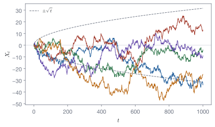
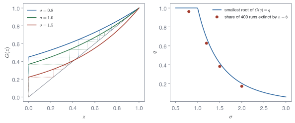
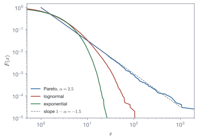
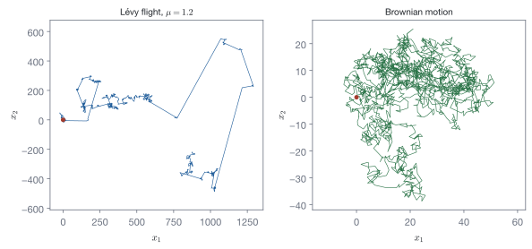

# Random processes and heavy tails {#sec-random-processes}

Randomness enters complex systems in two ways. It is part of the rules, when elements act at random times, meet random
partners or reproduce with random numbers of offspring; and it is what an observer sees, when a system with many hidden
degrees of freedom is described by a few variables that fluctuate. This chapter collects the random processes that the
later models of the tutorial are built from, and the distributions they produce. Two themes run through it. The first is
memory: a Markov process remembers only its present state, while path-dependent processes, typical of complex systems,
remember their history. The second is heavy tails: return times, outbreak sizes, jump lengths and the sizes of growing
firms have distributions that decay like a power, with large values frequent enough to dominate sums and averages.

The chapter follows the probability chapter of @thurnerIntroductionTheoryComplex2018 [Ch. 2, with Secs. 3.3.3-3.3.4
and 6.6.1], the chapters on branching processes and stochastic dynamics of @jensenComplexityScienceStudy2023 [Chs. 5
and 10], @grosComplexAdaptiveDynamical2015 [Secs. 3.2 and 6.5] and @bertinStatisticalPhysicsComplex2021 [Chs. 2-3 and
Sec. 8.1], with the problem book @gusakTheoryStochasticProcesses2010 [Chs. 7 and 10] for Markov chains and
birth-death processes, @clauset2009power for the statistics of power laws, @argunSimulationComplexSystems2021 [Ch. 6] for
anomalous diffusion and @charbonneauNaturalComplexityModeling2017 [App. C] for random walks and the sampling of random
numbers. Probability itself is taught in the mathematics tutorial and is linked rather than restated: random variables
and characteristic functions
([Probability](../../fundamentals-of-mathematics-for-physicists/probability/index.qmd#sec-random-variables)), the laws of
large numbers, the central limit theorem, random walks and their diffusion limit
([Limit theorems](../../fundamentals-of-mathematics-for-physicists/probability/index.qmd#sec-limit-theorems)), and the
Markov property
([`def-markov-property`](../../fundamentals-of-mathematics-for-machine-learning/mathematical-and-statistical-foundations/index.qmd#def-markov-property)).
The Langevin and Fokker-Planck equations are the subject of the physics tutorial's chapter on fluctuations and
non-equilibrium statistical mechanics
([`sec-nonequilibrium-statistical-mechanics`](../../fundamentals-of-theoretical-physics/nonequilibrium-statistical-mechanics/index.qmd#sec-nonequilibrium-statistical-mechanics)),
and this chapter does not repeat them.

The chapter has seven sections. @sec-random-walks-first-passage computes the distribution of the first return time of a
random walk, which is certain to return and yet takes infinitely long on average. @sec-markov-chains defines Markov
chains and proves that an irreducible aperiodic chain on a finite set converges to a unique stationary distribution.
@sec-master-equation passes to continuous time with rates and the master equation, and solves the stationary state and
the absorption probabilities of birth-death processes. @sec-branching-processes defines the Galton-Watson process and
proves that its extinction probability is the smallest fixed point of the offspring generating function, and that at
the critical point its lineages have sizes with a power-law tail of exponent $\frac32$. @sec-heavy-tails defines
power-law tails and stable laws and states the generalised central limit theorem. @sec-levy-flights applies it to random
walks with heavy-tailed jumps. @sec-path-dependent proves the beta limit of the Pólya urn, the simplest
path-dependent process, and shows how a floor turns a multiplicative process into a power law.

Following the conventions of the tutorial, the exponent of a power-law density $p(x) \propto x^{-\alpha}$ is $\alpha$, and
the index of a stable law is written $\alpha_s$ and its skewness $\beta_s$; the mean number of offspring of a branching
process is the branching ratio $\sigma$, and its extinction probability is $q$, so that the probability of a down-step of
a walk is written $1 - p$. Every definition, proposition and theorem is followed by ten examples and ten exercises, each
exercise with a hidden solution in two tabs: the argument, then a computation with its recorded output. The computations
use scikit-complexity 0.9.0. The processes come from its catalogue: `RandomWalkSystem`, `MarkovSourceSystem`,
`EhrenfestUrnSystem`, `DiscreteMasterEquationSystem`, `PoissonProcessSystem`, `BirthDeathQueueSystem`,
`AbsorbingBirthDeathSystem`, `MoranProcessSystem`, `GaltonWatsonSystem`, `LevyFlightSystem`, `LevyWalkSystem`,
`ContinuousTimeRandomWalkSystem`, `BrownianMotionSystem`, `PolyaUrnSystem`, `GibratProcessSystem`, `KestenProcessSystem`,
`MultiplicativeProcessSystem` and `SimonYuleSystem`. They are run by `simulate` and analysed with `passage`, `markov`,
`events`, `distribution`, `fit_law` (which uses the `powerlaw` package for power laws) and `displacement`. NumPy and SciPy
are used for closed formulas, exact enumerations and a few samples drawn directly from a law, and SymPy for series
expansions.

## Random walks and first passage {#sec-random-walks-first-passage}

The random walk is the simplest stochastic process with memory of its position: a sum of independent steps. The
mathematics tutorial defines it
([`def-random-walk`](../../fundamentals-of-mathematics-for-physicists/probability/index.qmd#def-random-walk)), proves
that its position spreads like $\sqrt n$ and that, with small steps taken often, it obeys the diffusion equation
([`prp-rw-diffusion-limit`](../../fundamentals-of-mathematics-for-physicists/probability/index.qmd#prp-rw-diffusion-limit)),
and the central limit theorem behind both
([`thm-central-limit-theorem`](../../fundamentals-of-mathematics-for-physicists/probability/index.qmd#thm-central-limit-theorem)).
Those results are linked and not repeated here. What matters for complex systems is a different question: not where the
walker is at a fixed time, but *when* it first comes back, or first reaches a level. These times have a power-law
distribution with an infinite mean, the first heavy tail of the chapter, and the same exponent $\frac32$ returns in the
sizes of branching avalanches below and in the laminar phases of intermittent signals
[@jensenComplexityScienceStudy2023, Sec. 10.2; @bertinStatisticalPhysicsComplex2021, Sec. 2.5].

For more on this topic, see @jensenComplexityScienceStudy2023 [Secs. 10.1-10.2], @bertinStatisticalPhysicsComplex2021
[Secs. 2.1.3 and 2.5.1], @grosComplexAdaptiveDynamical2015 [Sec. 3.2.1] and
@charbonneauNaturalComplexityModeling2017 [App. C.5].

### First return to the origin

A gambler who bets one unit at even odds sees a fortune that performs the symmetric walk; the time until the fortune is
back where it started is a first return time [@jensenComplexityScienceStudy2023, Sec. 10.2]. The proposition computes
the whole distribution of this time with generating functions, following the method of
@bertinStatisticalPhysicsComplex2021 [Sec. 2.5.1]. It keeps only the step rule of the walk and forgets everything
about what the walker is; the result is that return is certain, yet takes infinitely long on average.

:::: {.statement-box}
::: {#prp-first-return}
#### First return of the symmetric random walk

Let $X_n = s_1 + \dots + s_n$, $X_0 = 0$, be the symmetric random walk on $\mathbb Z$ (steps $s_i = \pm1$ with
probability $\frac12$ each), and let $T = \min\{n \geq 1 : X_n = 0\}$ be its **first return time** ($T = \infty$ if
the walk never returns). Write $u_n = \mathbb P(X_n = 0)$, $f_n = \mathbb P(T = n)$, and $U(z) = \sum_{n \geq
0}u_nz^n$, $F(z) = \sum_{n \geq 1}f_nz^n$ for $\lvert z\rvert < 1$.

1. (**renewal**) $u_n = \sum_{k = 1}^nf_ku_{n - k}$ for $n \geq 1$, and $U(z) = 1/(1 - F(z))$.
2. $U(z) = (1 - z^2)^{-1/2}$ and $F(z) = 1 - \sqrt{1 - z^2}$.
3. (**recurrence**) $\mathbb P(T < \infty) = 1$, but $\mathbb E[T] = \infty$.
4. $f_{2n} = \binom{2n}n\frac1{(2n - 1)4^n}$ and $\mathbb P(T > 2n) = u_{2n} = \binom{2n}n4^{-n}$; as $n \to \infty$,
   $f_{2n} \sim \frac1{2\sqrt\pi}n^{-3/2}$ and $\mathbb P(T > 2n) \sim (\pi n)^{-1/2}$.
:::

::::

*Proof.* (1) The event $\{X_n = 0\}$ is the disjoint union over $k = 1, \dots, n$ of $\{T = k, X_n = 0\}$. The event
$\{T = k\}$ depends on $s_1, \dots, s_k$ only, and on it $X_n = s_{k + 1} + \dots + s_n$, a sum of $n - k$ steps
independent of the first $k$ and distributed like $X_{n - k}$. Hence $\mathbb P(T = k, X_n = 0) = f_ku_{n - k}$, and
summing over $k$ gives the renewal equation. Multiplying it by $z^n$ and summing over $n \geq 1$ gives $U(z) - 1 =
F(z)U(z)$; all series converge for $\lvert z\rvert < 1$ because their coefficients lie in $[0, 1]$, and $\lvert
F(z)\rvert \leq \sum_kf_k\lvert z\rvert^k < 1$, so $U = 1/(1 - F)$.

(2) The walk is at $0$ after $2n$ steps exactly if $n$ of them go up, so $u_{2n} = \binom{2n}n4^{-n}$, and $u_n = 0$ for
odd $n$. The binomial series gives $(1 - x)^{-1/2} = \sum_{n \geq 0}\binom{-1/2}n(-x)^n$ with $\binom{-1/2}n(-1)^n =
\frac{1 \cdot 3 \cdots (2n - 1)}{2^nn!} = \binom{2n}n4^{-n}$, so $U(z) = (1 - z^2)^{-1/2}$ and, by (1), $F(z) = 1 -
1/U(z) = 1 - \sqrt{1 - z^2}$.

(3) The coefficients $f_n$ are nonnegative, so by monotone convergence $\mathbb P(T < \infty) = \sum_nf_n = \lim_{z
\uparrow 1}F(z) = 1$ and $\mathbb E[T] = \sum_nnf_n = \lim_{z \uparrow 1}F'(z) = \lim_{z \uparrow 1}z/\sqrt{1 - z^2} =
\infty$.

(4) Write $w = z^2$, so $F = 1 - \sqrt{1 - w}$ and $f_{2n}$ is minus the coefficient $a_n$ of $w^n$ in $\sqrt{1 - w}$.
Differentiating, $\sum_nna_nw^{n - 1} = -\frac12(1 - w)^{-1/2}$, so $na_n = -\frac12\binom{2n - 2}{n - 1}4^{1 - n}$.
Since $\binom{2n}n = \binom{2n - 2}{n - 1}\frac{2n(2n - 1)}{n^2}$, this is $a_n = -\binom{2n}n\frac1{(2n - 1)4^n}$. The
walk returns only at even times, so $\mathbb P(T > 2n) = 1 - \sum_{k \leq n}f_{2k}$, whose generating function is
$\sum_{n \geq 0}\mathbb P(T > 2n)w^n = \frac{1 - \sum_kf_{2k}w^k}{1 - w} = \frac{\sqrt{1 - w}}{1 - w} = (1 -
w)^{-1/2} = \sum_nu_{2n}w^n$, and comparing coefficients gives $\mathbb P(T > 2n) = u_{2n}$. Stirling's formula
([`exr-pbr-stirling`](../../fundamentals-of-mathematics-for-physicists/probability/index.qmd#exr-pbr-stirling))
gives $\binom{2n}n \sim 4^n/\sqrt{\pi n}$, hence both asymptotic forms. $\square$

:::: {.callout-note .examples-fold collapse="true" title="Examples"}
The first values of the two sequences can be read off the generating functions and checked against the renewal
equation by hand. They already show that half of all walks return at the first possible moment.

::: {#exm-firstret-small}
#### The first few returns

$F(z) = 1 - \sqrt{1 - z^2} = \frac12z^2 + \frac18z^4 + \frac1{16}z^6 + \frac5{128}z^8 + \cdots$, so $f_2 = \frac12$,
$f_4 = \frac18$, $f_6 = \frac1{16}$, $f_8 = \frac5{128}$. With $u_2 = \frac12$ and $u_4 = \frac38$ the renewal equation
reads $u_4 = f_2u_2 + f_4u_0 = \frac14 + \frac18$, as it should: a walk at $0$ at time $4$ either came back at time $2$
and again at $4$, or for the first time at $4$.
:::

Paths of the walk make the two statements of part (3) visible. Most paths cross the axis often, but now and then one
wanders off on a long excursion that dominates the mean of $T$.

::: {#exm-firstret-paths}
#### Paths and excursions

The figure shows walks with independent steps at rate $1$, the continuous-time walk of `RandomWalkSystem`, whose
variance after time $t$ is $t$ [@jensenComplexityScienceStudy2023, Sec. 10.1]. The curves $\pm\sqrt t$ mark the
diffusive spread, while the times between crossings of $0$ range from a few steps to the whole window.

{#fig-random-walk-paths width=70%}
:::

Part (4) says how slowly the probability of not yet having returned decays. A hundred steps are far from enough for
every walk to come back.

::: {#exm-firstret-hundred}
#### Not back after a hundred steps

$\mathbb P(T > 100) = u_{100} = \binom{100}{50}2^{-100}$, about one walk in thirteen, while the asymptotic form
$(50\pi)^{-1/2}$ is already within a quarter of a per cent of it.

```{.python .run}
from math import comb, pi, sqrt
exact = comb(100, 50) / 2**100
print(f"P(T > 100) = {exact:.5f}, asymptotic {1 / sqrt(50 * pi):.5f}")
```

```{.text .run-output}
P(T > 100) = 0.07959, asymptotic 0.07979
```
:::

The renewal argument of part (1) says that the walk starts afresh at every return. Hence the times between successive
returns of one long walk are independent copies of $T$, and `passage` reads them off a single path.

::: {#exm-firstret-renewal-sample}
#### Return times of one long walk

One walk of $10^6$ steps returns a few hundred times, $533$ in this run. The shares of gaps equal to $2$ and $4$ are close
to $f_2 = 0.5$ and $f_4 = 0.125$, and the longest gap alone fills a fifth of the run.

```{.python .run}
import numpy as np
from skcomplex.core.analysis import passage
rng = np.random.default_rng(1)
walk = np.concatenate([[0], np.cumsum(rng.choice([-1, 1], size=10**6))])
gaps = passage(walk, kind="return-times", level=0).return_times
print(f"{gaps.size} returns; share of gaps 2 and 4: {np.mean(gaps == 2):.3f}, {np.mean(gaps == 4):.3f}; longest gap {gaps.max():.0f}")
```

```{.text .run-output}
533 returns; share of gaps 2 and 4: 0.492, 0.124; longest gap 209154
```
:::

Reaching a level is the same problem as returning, shifted by one step. A walk that starts at $1$ and is absorbed at $0$
is the gambler of the introduction with one unit of cash [@bertinStatisticalPhysicsComplex2021, Sec. 2.5.1].

::: {#exm-firstret-passage-level}
#### First passage to a neighbouring site

Let $T_1$ be the first time the walk started at $0$ reaches $1$. Conditioning on the first step, $T = 1 + T_1'$ where
$T_1'$ is distributed like $T_1$ (a first step down must be undone by a passage up), so $F(z) = zF_1(z)$ and $F_1(z) =
(1 - \sqrt{1 - z^2})/z$. Thus $\mathbb P(T_1 = 2n - 1) = f_{2n}$, Bertin's eq. (2.134), with the same tail
$n^{-3/2}$.
:::

The continuum limit of the walk is Brownian motion, and its first-passage time has a density with the same exponent.
Jensen obtains it from the diffusion equation with an absorbing wall by the method of images.

::: {#exm-firstret-continuum}
#### The continuum first-passage density

For diffusion with coefficient $D$ started at $x_0 > 0$ and absorbed at $0$, the flux into the wall gives the density
of the first-passage time,
$$
\rho(t) = \frac{x_0}{\sqrt{4\pi Dt^3}}e^{-x_0^2/4Dt} \sim t^{-3/2},\qquad t \gg x_0^2/4D,
$$
[@jensenComplexityScienceStudy2023, Sec. 10.2, eq. (10.60)]; the equation there is printed with $(Dt)^{3/2}$, which
integrates to $1/D$ instead of $1$, so the power of $D$ is fixed here by normalisation. It is the Lévy distribution of
@thurnerIntroductionTheoryComplex2018 [Sec. 2.3.2.4], one of the three stable laws with a closed form met later in this
chapter.
:::

A bias changes the picture completely. The generating function keeps its form, with a factor $4p(1 - p) < 1$ under the
square root, and the walk may escape for ever.

::: {#exm-firstret-biased}
#### A biased walk is transient

For steps $+1$ with probability $p$ and $-1$ with probability $1 - p$, $u_{2n} = \binom{2n}n(p(1 - p))^n$, so $U(z) =
(1 - 4p(1 - p)z^2)^{-1/2}$ and $F(z) = 1 - \sqrt{1 - 4p(1 - p)z^2}$. Then $\mathbb P(T < \infty) = F(1) = 1 - \sqrt{(2p -
1)^2} = 1 - \lvert 2p - 1\rvert$, less than $1$ for $p \neq \frac12$ [@bertinStatisticalPhysicsComplex2021, Sec. 2.5.1]. The sixth
exercise derives this.
:::

In higher dimensions the probability of being back at the origin decays faster, and recurrence depends on the
dimension. This is Pólya's theorem, of which the criterion of Gusak et al. is a general form.

::: {#exm-firstret-dimensions}
#### Two and three dimensions

On the square lattice $u_{2n} = \bigl(\binom{2n}n4^{-n}\bigr)^2 \sim 1/(\pi n)$, whose sum diverges, so the walk is
recurrent: $\mathbb P(T < \infty) = 1 - 1/U(1) = 1$. On the cubic lattice $u_{2n} \sim cn^{-3/2}$, the sum converges,
and the walk returns only with probability about $0.34$. A state is recurrent exactly when $\sum_nu_n = \infty$
[@gusakTheoryStochasticProcesses2010, Ch. 10, Theorems 10.1-10.2 and Problem 10.30].
:::

The survival of a gambler with one unit of cash decays like $n^{-1/2}$. This slow decay is why ruin is certain and yet
some gamblers stay in the game for a very long time.

::: {#exm-firstret-gambler}
#### Survival of a gambler

A gambler starting with one unit is still playing after $n$ rounds with probability $\mathbb P(T_1 > n)$, which by
@exm-firstret-passage-level equals $\mathbb P(T > n + 1)$, which is $u_n \sim \sqrt{2/(\pi n)}$ for even $n$. After
$10^4$ rounds about eight in a thousand gamblers are left; 5000 simulated gamblers agree within sampling error.

```{.python .run}
import numpy as np
from math import comb
from skcomplex.core.analysis import passage
rng = np.random.default_rng(2)
steps = 2 * rng.integers(0, 2, size=(5000, 10**4), dtype=np.int8) - 1
paths = np.concatenate([np.ones((5000, 1), dtype=np.int16), 1 + np.cumsum(steps, axis=1, dtype=np.int16)], axis=1)
times = passage(paths, kind="first-passage", threshold=0, direction="down").passage_times
exact = comb(10**4, 5000) / 2**10**4
print(f"still playing after 10^4 rounds: simulated {np.mean(np.isnan(times)):.4f}, exact {exact:.4f}")
```

```{.text .run-output}
still playing after 10^4 rounds: simulated 0.0076, exact 0.0080
```
:::

The last example counts returns rather than timing one. Summing $u_{2k}$ shows that a walk of $2n$ steps returns only
about $2\sqrt{n/\pi}$ times: returns become rarer as the walk ages.

::: {#exm-firstret-number-of-returns}
#### How many returns

The expected number of returns up to time $2n$ is $\sum_{k = 1}^nu_{2k} \sim \sum_k(\pi k)^{-1/2} \sim
2\sqrt{n/\pi}$. For $2n = 10^4$ this is about $80$; the exact sum and an ensemble of walks agree.

```{.python .run}
import numpy as np
from math import comb
rng = np.random.default_rng(3)
walks = np.cumsum(rng.choice([-1, 1], size=(2000, 10**4)), axis=1)
exact = sum(comb(2 * k, k) / 4**k for k in range(1, 5001))
print(f"mean number of returns: simulated {np.mean((walks == 0).sum(axis=1)):.1f}, exact {exact:.1f}, asymptotic {2 * np.sqrt(5000 / np.pi):.1f}")
```

```{.text .run-output}
mean number of returns: simulated 78.8, exact 78.8, asymptotic 79.8
```
:::
::::

:::: {.callout-note .exercises-fold collapse="true" title="Exercises"}
The first exercise reads the first coefficients of $F$ and checks the renewal equation term by term. It is the direct
check of parts (1) and (2).

::: {#exr-firstret-coefficients}
#### Coefficients and renewal

Compute $f_2, \dots, f_{10}$ and $u_0, \dots, u_{10}$, and verify $u_{10} = \sum_{k}f_ku_{10 - k}$.
:::

::: {.callout-note .solution collapse="true" title="Solution"}
:::: {.panel-tabset .solution-tabs}
## Solution

By part (4), $f_{2n} = \binom{2n}n/((2n - 1)4^n)$: $\frac12, \frac18, \frac1{16}, \frac5{128}, \frac7{256}$, and
$u_{2n} = \binom{2n}n4^{-n}$: $1, \frac12, \frac38, \frac5{16}, \frac{35}{128}, \frac{63}{256}$. Then $\sum_kf_{2k}u_{10
- 2k} = \frac12\cdot\frac{35}{128} + \frac18\cdot\frac5{16} + \frac1{16}\cdot\frac38 + \frac5{128}\cdot\frac12 +
\frac7{256} = \frac{63}{256}$.

## Python

Exact fractions for both sequences and the renewal sum.

```{.python .run}
from fractions import Fraction
from math import comb
u = {2 * n: Fraction(comb(2 * n, n), 4**n) for n in range(6)}
f = {2 * n: Fraction(comb(2 * n, n), (2 * n - 1) * 4**n) for n in range(1, 6)}
print([str(f[k]) for k in sorted(f)], [str(u[k]) for k in sorted(u)])
print("renewal sum:", sum(f[k] * u[10 - k] for k in f), "= u_10:", u[10])
```

```{.text .run-output}
['1/2', '1/8', '1/16', '5/128', '7/256'] ['1', '1/2', '3/8', '5/16', '35/128', '63/256']
renewal sum: 63/256 = u_10: 63/256
```
::::
:::

The identity $\mathbb P(T > 2n) = u_{2n}$ says that "not yet back" and "back now" are equally likely. The second
exercise proves it for small $n$ by counting paths, a proof independent of generating functions.

::: {#exr-firstret-count-paths}
#### Counting paths

Show by listing paths that $\mathbb P(T > 4) = u_4$, and check $\mathbb P(T > 2n) = u_{2n}$ for $n \leq 6$ by
enumerating all $4^n$ paths of length $2n$.
:::

::: {.callout-note .solution collapse="true" title="Solution"}
:::: {.panel-tabset .solution-tabs}
## Proof

Of the $16$ paths of length $4$, those that avoid $0$ at times $2$ and $4$ start with two equal steps ($4$ paths:
$++$ or $--$) and then do not undo both of them: from $\pm2$ the next two steps must not both point back, which leaves
$3$ of $4$ continuations. So $6$ of $16$ paths avoid $0$, $\mathbb P(T > 4) = \frac38$. The paths that end at $0$ have
two up-steps among four, $\binom42 = 6$ of them, so $u_4 = \frac38$ as well.

## Python

Check on all paths of length $2n$, $n \leq 6$: the two counts agree.

```{.python .run}
import numpy as np
from itertools import product
for n in range(1, 7):
    paths = np.cumsum(np.array(list(product([-1, 1], repeat=2 * n))), axis=1)
    print(n, int(((paths == 0).sum(axis=1) == 0).sum()), int((paths[:, -1] == 0).sum()))
```

```{.text .run-output}
1 2 2
2 6 6
3 20 20
4 70 70
5 252 252
6 924 924
```
::::
:::

The tail identity gives the first-return probabilities as differences. The third exercise derives this formula and
checks that it agrees with part (4).

::: {#exr-firstret-difference}
#### Returns as differences

Show that $f_{2n} = u_{2n - 2} - u_{2n}$ for $n \geq 1$.
:::

::: {.callout-note .solution collapse="true" title="Solution"}
:::: {.panel-tabset .solution-tabs}
## Proof

$f_{2n} = \mathbb P(T > 2n - 2) - \mathbb P(T > 2n)$, since $T$ takes only even values, and part (4) gives
$\mathbb P(T > 2m) = u_{2m}$. Directly: $u_{2n - 2} - u_{2n} = \binom{2n - 2}{n - 1}4^{1 - n}\bigl(1 -
\frac{2n(2n - 1)}{4n^2}\bigr) = \binom{2n - 2}{n - 1}4^{1 - n}\frac1{2n}$, which is the coefficient found in the proof.

## Python

Check of the identity for $n \leq 8$ in exact arithmetic.

```{.python .run}
from fractions import Fraction
from math import comb
u = lambda m: Fraction(comb(2 * m, m), 4**m)
print(all(u(n - 1) - u(n) == Fraction(comb(2 * n, n), (2 * n - 1) * 4**n) for n in range(1, 9)))
```

```{.text .run-output}
True
```
::::
:::

The asymptotic form of part (4) is what makes the tail a power law. The fourth exercise measures how fast the exact
probabilities approach it.

::: {#exr-firstret-asymptotic}
#### How good is the power law?

Compute the ratio of $f_{2n}$ to $\frac1{2\sqrt\pi}n^{-3/2}$ for $n = 10, 100, 1000$, and show that it is $1 +
\frac3{8n} + O(n^{-2})$.
:::

::: {.callout-note .solution collapse="true" title="Solution"}
:::: {.panel-tabset .solution-tabs}
## Solution

With $\binom{2n}n4^{-n} = (\pi n)^{-1/2}(1 - \frac1{8n} + O(n^{-2}))$ (Stirling's series) and $\frac1{2n - 1} =
\frac1{2n}(1 + \frac1{2n} + O(n^{-2}))$, $f_{2n} = \frac1{2\sqrt\pi}n^{-3/2}(1 + \frac3{8n} + O(n^{-2}))$. The ratios are
about $1.038$, $1.0038$ and $1.00038$.

## Python

The ratios and $n(\text{ratio} - 1)$, which tends to $\frac38$.

```{.python .run}
from math import lgamma, exp, log, pi, sqrt
for n in (10, 100, 1000):
    f = exp(lgamma(2 * n + 1) - 2 * lgamma(n + 1) - n * log(4)) / (2 * n - 1)
    ratio = f / (n**-1.5 / (2 * sqrt(pi)))
    print(n, round(ratio, 6), round(n * (ratio - 1), 4))
```

```{.text .run-output}
10 1.039561 0.3956
100 1.00377 0.377
1000 1.000375 0.3752
```
::::
:::

An infinite mean is compatible with a short median. The fifth exercise computes quantiles of $T$ to show how wide the
distribution is.

::: {#exr-firstret-quantiles}
#### Quantiles of the return time

Find the median of $T$ and the smallest $2n$ with $\mathbb P(T > 2n) \leq 0.1$ and $\leq 0.01$.
:::

::: {.callout-note .solution collapse="true" title="Solution"}
:::: {.panel-tabset .solution-tabs}
## Solution

$\mathbb P(T > 2) = u_2 = \frac12$, so the median is $2$. For the others solve $u_{2n} \leq 0.1$ and $\leq 0.01$, with
$u_{2n} \approx (\pi n)^{-1/2}$: $n \approx 32$ and $n \approx 3183$, so $2n \approx 64$ and $2n \approx 6366$. Each
factor $10$ in probability costs a factor $100$ in time, the signature of a tail $\mathbb P(T > t) \propto t^{-1/2}$.

## Python

The exact thresholds, searched with log-gamma to avoid huge integers.

```{.python .run}
from math import lgamma, exp, log
u = lambda n: exp(lgamma(2 * n + 1) - 2 * lgamma(n + 1) - n * log(4))
for level in (0.5, 0.1, 0.01):
    n = 1
    while u(n) > level:
        n += 1
    print(f"P(T > 2n) <= {level} from 2n = {2 * n}")
```

```{.text .run-output}
P(T > 2n) <= 0.5 from 2n = 2
P(T > 2n) <= 0.1 from 2n = 64
P(T > 2n) <= 0.01 from 2n = 6366
```
::::
:::

A bias makes the walk transient. The sixth exercise derives the return probability of @exm-firstret-biased and
compares it with simulated walks.

::: {#exr-firstret-biased}
#### Return probability of a biased walk

For steps $+1$ with probability $p$, show that $\mathbb P(T < \infty) = 1 - \lvert 2p - 1\rvert$, and check for $p =
0.6$.
:::

::: {.callout-note .solution collapse="true" title="Solution"}
:::: {.panel-tabset .solution-tabs}
## Proof

Part (1) of the proposition uses only the independence of the steps, so $U = 1/(1 - F)$ still holds. Now $u_{2n} =
\binom{2n}n(p(1 - p))^n$, so $U(z) = (1 - 4p(1 - p)z^2)^{-1/2}$ by the binomial series, and $F(z) = 1 - \sqrt{1 - 4p(1 -
p)z^2}$. Letting $z \uparrow 1$, $\mathbb P(T < \infty) = 1 - \sqrt{1 - 4p(1 - p)} = 1 - \sqrt{(2p - 1)^2} = 1 - \lvert
2p - 1\rvert$. For
$p = 0.6$ this is $0.8$.

## Python

Check on $p = 0.6$: the share of 20000 walks back at $0$ within 2000 steps (the walks that escape drift away at speed
$0.2$, so later returns are negligible).

```{.python .run}
import numpy as np
from skcomplex.core.analysis import passage
rng = np.random.default_rng(4)
steps = np.where(rng.random((20000, 2000)) < 0.6, 1, -1)
paths = np.cumsum(steps, axis=1)
times = passage(np.where(paths == 0, 1, 0), kind="first-passage", threshold=1).passage_times
print(f"returned: {np.mean(~np.isnan(times)):.4f}, 1 - |2p - 1| = {1 - abs(2 * 0.6 - 1):.4f}")
```

```{.text .run-output}
returned: 0.7971, 1 - |2p - 1| = 0.8000
```
::::
:::

The number of visits to the origin is the sum of the indicators of $\{X_n = 0\}$. The seventh exercise computes its
mean for the biased walk from $U(1)$.

::: {#exr-firstret-visits}
#### Visits of a transient walk

Show that the expected number of returns of the biased walk is $1/\lvert 2p - 1\rvert - 1$, and that the number of
returns is geometric.
:::

::: {.callout-note .solution collapse="true" title="Solution"}
:::: {.panel-tabset .solution-tabs}
## Proof

$\mathbb E\sum_{n \geq 1}\mathbb 1_{X_n = 0} = \sum_{n \geq 1}u_n = U(1) - 1 = (1 - 4p(1 - p))^{-1/2} - 1 = 1/\lvert 2p -
1\rvert - 1$. By the renewal argument the walk starts afresh at each return, so it returns at least $k$ times with
probability $F(1)^k$: the number of returns is geometric with mean $F(1)/(1 - F(1)) = (1 - \lvert 2p - 1\rvert)/\lvert
2p - 1\rvert$, the same value.

## Python

Check on $p = 0.6$: the mean is $4$ and the share of walks with no return is $0.2$.

```{.python .run}
import numpy as np
rng = np.random.default_rng(5)
paths = np.cumsum(np.where(rng.random((20000, 2000)) < 0.6, 1, -1), axis=1)
visits = (paths == 0).sum(axis=1)
print(f"mean returns {visits.mean():.3f} (exact 4); no return {np.mean(visits == 0):.4f} (exact 0.2)")
```

```{.text .run-output}
mean returns 3.963 (exact 4); no return 0.1993 (exact 0.2)
```
::::
:::

The two-dimensional walk can be reduced to two independent one-dimensional walks by turning the lattice by
$45^\circ$. The eighth exercise uses this to prove recurrence in the plane [@gusakTheoryStochasticProcesses2010,
Problem 10.30].

::: {#exr-firstret-plane}
#### Recurrence in the plane

For the symmetric walk on $\mathbb Z^2$, show that $u_{2n} = \bigl(\binom{2n}n4^{-n}\bigr)^2$, and conclude that it
returns to the origin with probability $1$.
:::

::: {.callout-note .solution collapse="true" title="Solution"}
:::: {.panel-tabset .solution-tabs}
## Proof

Let $A_n = X_n + Y_n$ and $B_n = X_n - Y_n$. Each of the four steps $(\pm1, 0)$, $(0, \pm1)$ changes $(A, B)$ by one of
$(\pm1, \pm1)$, all four combinations with probability $\frac14$, so $A$ and $B$ are independent symmetric walks on
$\mathbb Z$. The walk is at the origin exactly when $A_{2n} = B_{2n} = 0$, so $u_{2n} = (\binom{2n}n4^{-n})^2 \sim
1/(\pi n)$. The renewal equation holds as in part (1), so $\mathbb P(T < \infty) = \lim_{z \uparrow 1}(1 - 1/U(z)) = 1$
because $U(1) = \sum_nu_n = \infty$.

## Python

Check of the formula by counting the walks of $2n \leq 8$ steps that end at the origin.

```{.python .run}
import numpy as np
from itertools import product
from math import comb
moves = np.array([(1, 0), (-1, 0), (0, 1), (0, -1)])
for n in range(1, 5):
    ends = moves[np.array(list(product(range(4), repeat=2 * n)))].sum(axis=1)
    print(2 * n, np.mean((ends == 0).all(axis=1)), (comb(2 * n, n) / 4**n) ** 2)
```

```{.text .run-output}
2 0.25 0.25
4 0.140625 0.140625
6 0.09765625 0.09765625
8 0.07476806640625 0.07476806640625
```
::::
:::

Passage to a distant level is a sum of passages to neighbouring levels. The ninth exercise turns this into a formula for
the generating function and reads off the tail.

::: {#exr-firstret-level-k}
#### Passage to level $k$

Let $T_k$ be the first time the walk reaches $k \geq 1$. Show that $\mathbb E[z^{T_k}] = F_1(z)^k$ with $F_1$ from
@exm-firstret-passage-level, that $T_k < \infty$ with probability $1$, and that $\mathbb P(T_k = n)$ falls like
$n^{-3/2}$.
:::

::: {.callout-note .solution collapse="true" title="Solution"}
:::: {.panel-tabset .solution-tabs}
## Proof

To reach $k$ the walk must first reach $1$, then $2$, and so on. After $T_1$ the walk starts afresh from $1$ (its
later steps are independent of the first $T_1$), so $T_k$ is the sum of $k$ independent copies of $T_1$, and the
generating function of a sum of independent variables is the product. Then $\mathbb P(T_k < \infty) = F_1(1)^k = 1$.
Near $z = 1$, $F_1(z)^k = 1 - k\sqrt{2(1 - z)} + O(1 - z)$, the same square-root singularity as $F$, which is what
produces coefficients of order $n^{-3/2}$ (for $n$ of the parity of $k$); this is the discrete form of the Lévy density
of @exm-firstret-continuum with $x_0 = k$.

## Python

Check on $k = 3$: the coefficients of $F_1^3$ against the first-passage times of $10^5$ walks.

```{.python .run}
import numpy as np
from numpy.polynomial import polynomial as poly
from skcomplex.core.analysis import passage
from math import comb
f1 = np.zeros(42)
for n in range(1, 21):
    f1[2 * n - 1] = comb(2 * n, n) / ((2 * n - 1) * 4**n)
cubed = poly.polymul(poly.polymul(f1, f1), f1)[:42]
rng = np.random.default_rng(6)
paths = np.concatenate([np.zeros((10**5, 1)), np.cumsum(rng.choice([-1, 1], size=(10**5, 41)), axis=1)], axis=1)
t3 = passage(paths, kind="first-passage", threshold=3).passage_times
print([(n, round(float(cubed[n]), 4), round(float(np.mean(t3 == n)), 4)) for n in (3, 5, 7, 9)])
```

```{.text .run-output}
[(3, 0.125, 0.1257), (5, 0.0938, 0.0949), (7, 0.0703, 0.0716), (9, 0.0547, 0.0546)]
```
::::
:::

The last exercise connects the lattice and the continuum. The discrete first-passage probabilities, read per unit of
time, should approach the density of @exm-firstret-continuum.

::: {#exr-firstret-continuum-limit}
#### From lattice to continuum

For the walk with unit steps per unit time, $D = \frac12$. Show that $\frac12\mathbb P(T_1 = 2n - 1)$ approaches the
density $\rho(t)$ of @exm-firstret-continuum with $x_0 = 1$ at $t = 2n$, and that $\int_0^\infty\rho = 1$ while
$\int_0^\infty t\rho(t)\,dt = \infty$.
:::

::: {.callout-note .solution collapse="true" title="Solution"}
:::: {.panel-tabset .solution-tabs}
## Proof

$T_1$ takes only odd values, two units apart, so the probability per unit time is $\frac12\mathbb P(T_1 = 2n - 1) =
\frac12f_{2n} \sim \frac1{4\sqrt\pi}n^{-3/2} = \frac1{\sqrt{2\pi}}t^{-3/2}$ at $t = 2n$, and $\rho(t) =
\frac1{\sqrt{2\pi t^3}}e^{-1/2t} \sim \frac1{\sqrt{2\pi}}t^{-3/2}$ as well. With $u = x_0/\sqrt{4Dt}$, $\int_0^\infty\rho\,dt =
\frac2{\sqrt\pi}\int_0^\infty e^{-u^2}du = 1$, while $t\rho(t) \sim ct^{-1/2}$ is not integrable at infinity.

## Python

The ratio of the discrete probability per unit time to the density, and the integral of the density.

```{.python .run}
from math import comb, exp, pi, sqrt
from scipy.integrate import quad
rho = lambda t: exp(-1 / (2 * t)) / sqrt(2 * pi * t**3)
print([round(comb(2 * n, n) / ((2 * n - 1) * 4**n) / 2 / rho(2 * n), 4) for n in (10, 100, 1000)])
print(round(quad(rho, 0, float("inf"))[0], 6))
```

```{.text .run-output}
[1.0659, 1.0063, 1.0006]
1.0
```
::::
:::
::::

## Markov chains {#sec-markov-chains}

A Markov chain is a random process that remembers only its present state. The random walk is one, and so are the
models of later chapters in which a configuration of many elements is updated at random: an urn, a population under
drift, a lattice of spins, a surfer clicking through the web. The Markov property itself is defined in the
machine-learning tutorial
([`def-markov-property`](../../fundamentals-of-mathematics-for-machine-learning/mathematical-and-statistical-foundations/index.qmd#def-markov-property)).
This section states what that property gives on a finite state space: a transition matrix, a master equation for the
probabilities, and the theorem that an irreducible aperiodic chain forgets its initial state and settles into a unique
stationary distribution [@thurnerIntroductionTheoryComplex2018, Sec. 2.5.1.5; @grosComplexAdaptiveDynamical2015, Sec.
3.2.2].

For more on this topic, see @grosComplexAdaptiveDynamical2015 [Sec. 3.2.2], @bertinStatisticalPhysicsComplex2021 [Secs.
2.1.1-2.1.2], @thurnerIntroductionTheoryComplex2018 [Secs. 2.5.1.5 and 2.5.2] and
@gusakTheoryStochasticProcesses2010 [Ch. 10].

### Transition matrices

The chain is fixed by one matrix: the probability of every jump from one state to another in one step. The definition
collects the vocabulary of the rest of the section, and keeps only the states and these probabilities, forgetting what
the states describe.

:::: {.statement-box}
::: {#def-markov-chain}
#### Markov chain, stationary distribution, irreducible and aperiodic chains

Let $S = \{1, \dots, N\}$. A **transition matrix** is an $N \times N$ matrix $\mathbf P$ with $P_{ij} \geq 0$ and
$\sum_jP_{ij} = 1$ for every $i$. A **Markov chain** with transition matrix $\mathbf P$ is a sequence of random
variables $X_0, X_1, \dots$ with values in $S$ such that
$$
\mathbb P(X_{n + 1} = j \mid X_n = i, X_{n - 1} = i_{n - 1}, \dots, X_0 = i_0) = P_{ij}
$$
whenever the condition has positive probability. Its distribution at time $n$ is the row vector $\mathbf p_n$ with
entries $(\mathbf p_n)_j = \mathbb P(X_n = j)$. A row vector $\boldsymbol\pi$ with $\pi_j \geq 0$, $\sum_j\pi_j = 1$
and $\boldsymbol\pi\mathbf P = \boldsymbol\pi$ is a **stationary distribution**. The chain is **irreducible** if for
all $i, j$ there is $n \geq 1$ with $(\mathbf P^n)_{ij} > 0$. The **period** of a state $i$ is the greatest common
divisor of $\{n \geq 1 : (\mathbf P^n)_{ii} > 0\}$, and the chain is **aperiodic** if every state has period $1$.
:::

::::

Summing over the state at time $n$ gives $(\mathbf p_{n + 1})_j = \sum_i(\mathbf p_n)_iP_{ij}$, the discrete master
equation $\mathbf p_{n + 1} = \mathbf p_n\mathbf P$ of @grosComplexAdaptiveDynamical2015 [eq. (3.37)], so $\mathbf p_n =
\mathbf p_0\mathbf P^n$; the second exercise proves it with the Chapman-Kolmogorov equations
[@gusakTheoryStochasticProcesses2010, Proposition 10.1].

:::: {.callout-note .examples-fold collapse="true" title="Examples"}
The smallest chain has two states. Gros writes its transition matrix with the two probabilities of staying, and finds
the stationary distribution as a left eigenvector.

::: {#exm-mchain-two-state}
#### Two states

For $\mathbf P = \begin{pmatrix}\alpha_1 & 1 - \alpha_1\\ 1 - \alpha_2 & \alpha_2\end{pmatrix}$, the equation
$\boldsymbol\pi\mathbf P = \boldsymbol\pi$ gives $\pi_1(1 - \alpha_1) = \pi_2(1 - \alpha_2)$, so $\boldsymbol\pi =
(1 - \alpha_2, 1 - \alpha_1)/(2 - \alpha_1 - \alpha_2)$; the other eigenvalue is $\alpha_1 + \alpha_2 - 1$
[@grosComplexAdaptiveDynamical2015, eqs. (3.38)-(3.39)]. For $\alpha_1 = 0.9$, $\alpha_2 = 0.6$, `markov` returns
$(0.8, 0.2)$.

```{.python .run}
from skcomplex.core.analysis import markov
P = [[0.9, 0.1], [0.4, 0.6]]
print(markov(P, kind="stationary", matrix="transition").stationary.round(4))
```

```{.text .run-output}
[0.8 0.2]
```
:::

The random walk of the previous section is a Markov chain on an infinite set. On a ring of $N$ sites it becomes a
finite chain, and its period depends on the parity of $N$.

::: {#exm-mchain-ring}
#### A walk on a ring

On $\mathbb Z/N\mathbb Z$ with $P_{i, i \pm 1} = \frac12$ the uniform vector is stationary, since every column also sums
to $1$. The chain is irreducible; for even $N$ it has period $2$ (a return takes an even number of steps), for odd $N$
also the loop around the ring, of length $N$, returns, so the period is $\gcd(2, N) = 1$
[@thurnerIntroductionTheoryComplex2018, Sec. 2.5.1.5].
:::

A long path visits each state a fraction of the time. `MarkovSourceSystem` runs the chain of @exm-mchain-two-state,
and the share of time spent in state $2$ (the symbol $1$ of the package) is close to $\pi_2 = 0.2$.

::: {#exm-mchain-time-share}
#### Time spent in a state

```{.python .run}
import numpy as np
from skcomplex.core.engine.runtime import simulate
from skcomplex.systems.mathematics.stochastic_processes import MarkovSourceSystem
symbols = simulate(MarkovSourceSystem(((0.9, 0.1), (0.4, 0.6))), until=20000, dt=1, random_state=1).get_values("source.symbol")
print(f"share of time in the second state: {np.mean(symbols == 1):.4f}")
```

```{.text .run-output}
share of time in the second state: 0.2002
```
:::

The Ehrenfest urn is the classic chain of statistical physics. A ball drawn at random changes box, so the count in the
first box moves by one step at a time [@gusakTheoryStochasticProcesses2010, Problem 10.42].

::: {#exm-mchain-ehrenfest}
#### The Ehrenfest urn

With $N$ balls and $n$ in the first box, $P_{n, n - 1} = n/N$ and $P_{n, n + 1} = 1 - n/N$. The binomial vector $\pi_n
= \binom Nn2^{-N}$ is stationary (the fourth exercise), the chain is irreducible, and its period is $2$, because the
parity of $n$ alternates. `EhrenfestUrnSystem` starts with all balls in one box and drifts towards $N/2$.

```{.python .run}
import numpy as np
from skcomplex.core.engine.runtime import simulate
from skcomplex.systems.physics.statistical_mechanics import EhrenfestUrnSystem
n = simulate(EhrenfestUrnSystem(40), until=4000, dt=1, random_state=2).get_values("urn.n")
print(f"start {n[0]:.0f}, after 100 steps {n[100]:.0f}, time average after step 200: {n[200:].mean():.2f}")
```

```{.text .run-output}
start 40, after 100 steps 20, time average after step 200: 19.70
```
:::

A state that cannot be left is absorbing. A chain with absorbing states is not irreducible, and it has as many
stationary distributions as it has absorbing states, and mixtures of them [@grosComplexAdaptiveDynamical2015, eq.
(3.36)].

::: {#exm-mchain-absorbing}
#### Gambler's ruin

The fortune of a gambler between $0$ and $K$, moving $\pm1$ with probability $\frac12$ and absorbed at $0$ and $K$, has
the stationary distributions $\boldsymbol\pi = (1 - \theta)\mathbf e_0 + \theta\mathbf e_K$ for every $\theta \in [0,
1]$. Which one the chain ends in depends on where it starts, as in the game of Gusak et al., in which a player with $3$
dollars against $1$ is ruined with probability $\frac14$ [@gusakTheoryStochasticProcesses2010, Problem 10.11].
:::

The distribution after one step is the initial row vector times the matrix. Gusak et al. start with this computation
for a two-state chain.

::: {#exm-mchain-gusak-two}
#### One step of a two-state chain

For $\mathbf P = \begin{pmatrix}0.2 & 0.8\\ 0.4 & 0.6\end{pmatrix}$ and $\mathbf p_0 = (0.3, 0.7)$, $\mathbf p_1 =
(0.3 \cdot 0.2 + 0.7 \cdot 0.4, 0.3 \cdot 0.8 + 0.7 \cdot 0.6) = (0.34, 0.66)$ and $\mathbf p_2 = (0.332, 0.668)$, close
to the stationary $(\frac13, \frac23)$ [@gusakTheoryStochasticProcesses2010, Problem 10.7].
:::

The random surfer of Gros is a chain on the pages of the web. With probability $c$ the surfer jumps to a random page,
and otherwise follows one of the links of the current page.

::: {#exm-mchain-pagerank}
#### The random surfer

With adjacency $A_{ij} = 1$ for a link from page $i$ to page $j$ and out-degrees $k_i$, $P_{ij} = c/N + (1 -
c)A_{ij}/k_i$, every entry is at least $c/N > 0$, so the chain is irreducible and aperiodic, and its stationary
distribution is the PageRank [@grosComplexAdaptiveDynamical2015, eq. (3.40)]. For four pages with links $1 \to 2, 3$;
$2 \to 3$; $3 \to 1$; $4 \to 3$ and $c = 0.15$, page $3$ ranks first.

```{.python .run}
import numpy as np
from skcomplex.core.analysis import markov
A = np.array([[0, 1, 1, 0], [0, 0, 1, 0], [1, 0, 0, 0], [0, 0, 1, 0]])
c = 0.15
P = c / 4 + (1 - c) * A / A.sum(axis=1, keepdims=True)
print(markov(P, kind="stationary", matrix="transition").stationary.round(4))
```

```{.text .run-output}
[0.3725 0.1958 0.3941 0.0375]
```
:::

Periodicity is not a technicality. A chain that swaps two states at every step has a stationary distribution, but the
distribution at time $n$ never approaches it.

::: {#exm-mchain-swap}
#### A periodic chain

For $\mathbf P = \begin{pmatrix}0 & 1\\ 1 & 0\end{pmatrix}$, $\boldsymbol\pi = (\frac12, \frac12)$ is stationary, but
from $\mathbf p_0 = (1, 0)$ the distribution alternates between $(1, 0)$ and $(0, 1)$. Both states have period $2$.
:::

Irreducibility is needed for uniqueness. A chain made of two closed classes has one stationary distribution on each,
and every mixture of them is stationary too [@gusakTheoryStochasticProcesses2010, Problem 10.39].

::: {#exm-mchain-two-classes}
#### Two closed classes

For the block matrix $\mathbf P = \operatorname{diag}(\mathbf P_1, \mathbf P_2)$ with $\mathbf P_1 = \begin{pmatrix}0.3
& 0.7\\ 0.5 & 0.5\end{pmatrix}$ and $\mathbf P_2 = \begin{pmatrix}0.6 & 0.4\\ 0.4 & 0.6\end{pmatrix}$, the vectors
$(\frac5{12}, \frac7{12}, 0, 0)$ and $(0, 0, \frac12, \frac12)$ are both stationary, and the eigenvalue $1$ of
$\mathbf P$ is double.
:::

In practice the matrix is often unknown and is estimated from observed paths. `markov` counts the transitions of a path
and normalises them by row, the maximum-likelihood estimate of $\mathbf P$.

::: {#exm-mchain-estimate}
#### Estimating a chain from a path

A path of $20000$ steps of the chain of @exm-mchain-two-state gives back its matrix to about two decimals.

```{.python .run}
from skcomplex.core.analysis import markov
from skcomplex.core.engine.runtime import simulate
from skcomplex.systems.mathematics.stochastic_processes import MarkovSourceSystem
run = simulate(MarkovSourceSystem(((0.9, 0.1), (0.4, 0.6))), until=20000, dt=1, random_state=3)
print(markov(run, kind="transition-matrix").transition_matrix.round(3))
```

```{.text .run-output}
[[0. 1.]
 [1. 0.]]
```
:::
::::

:::: {.callout-note .exercises-fold collapse="true" title="Exercises"}
The first exercise derives the stationary distribution of the two-state chain. It also asks when this distribution is
unique.

::: {#exr-mchain-two-state}
#### The two-state chain

Solve $\boldsymbol\pi\mathbf P = \boldsymbol\pi$ for the chain of @exm-mchain-two-state, and show that the solution is
unique unless $\alpha_1 = \alpha_2 = 1$.
:::

::: {.callout-note .solution collapse="true" title="Solution"}
:::: {.panel-tabset .solution-tabs}
## Solution

The first column gives $\pi_1\alpha_1 + \pi_2(1 - \alpha_2) = \pi_1$, i.e. $\pi_1(1 - \alpha_1) = \pi_2(1 -
\alpha_2)$, and the second column gives the same equation. With $\pi_1 + \pi_2 = 1$ the solution is $\boldsymbol\pi =
(1 - \alpha_2, 1 - \alpha_1)/(2 - \alpha_1 - \alpha_2)$, unique when the denominator is positive. If $\alpha_1 = \alpha_2
= 1$ then $\mathbf P = \mathbf I$ and every distribution is stationary.

## Python

The formula against `markov` for three pairs $(\alpha_1, \alpha_2)$.

```{.python .run}
from skcomplex.core.analysis import markov
for a1, a2 in ((0.9, 0.6), (0.5, 0.5), (0.2, 0.95)):
    pi = markov([[a1, 1 - a1], [1 - a2, a2]], kind="stationary", matrix="transition").stationary
    print((a1, a2), pi.round(4), [round((1 - a2) / (2 - a1 - a2), 4), round((1 - a1) / (2 - a1 - a2), 4)])
```

```{.text .run-output}
(0.9, 0.6) [0.8 0.2] [0.8, 0.2]
(0.5, 0.5) [0.5 0.5] [0.5, 0.5]
(0.2, 0.95) [0.0588 0.9412] [0.0588, 0.9412]
```
::::
:::

The master equation $\mathbf p_n = \mathbf p_0\mathbf P^n$ rests on the Chapman-Kolmogorov equations. The second
exercise proves both, and checks them on the three-state chain of @gusakTheoryStochasticProcesses2010 [Problem 10.8].

::: {#exr-mchain-chapman-kolmogorov}
#### Chapman-Kolmogorov

Show that $\mathbb P(X_{n + m} = j \mid X_0 = i) = (\mathbf P^{n + m})_{ij} = \sum_k(\mathbf P^n)_{ik}(\mathbf
P^m)_{kj}$ and $\mathbf p_n = \mathbf p_0\mathbf P^n$. Compute $\mathbf p_1$ and $\mathbb P(X_2 = 1)$ for $\mathbf P =
\begin{pmatrix}0.1 & 0.2 & 0.7\\ 0.3 & 0.4 & 0.3\\ 0.5 & 0.4 & 0.1\end{pmatrix}$ and $\mathbf p_0 = (0.6, 0.3, 0.1)$.
:::

::: {.callout-note .solution collapse="true" title="Solution"}
:::: {.panel-tabset .solution-tabs}
## Proof

By induction on $n$: $\mathbb P(X_{n + 1} = j \mid X_0 = i) = \sum_k\mathbb P(X_n = k \mid X_0 = i)\mathbb P(X_{n + 1}
= j \mid X_n = k, X_0 = i)$, and by the Markov property the last factor is $P_{kj}$, so the $n$-step probabilities are
the entries of $\mathbf P^n$; $\mathbf P^{n + m} = \mathbf P^n\mathbf P^m$ is matrix multiplication. Averaging over
$X_0$ gives $\mathbf p_n = \mathbf p_0\mathbf P^n$. Here $\mathbf p_1 = (0.2, 0.28, 0.52)$ and $(\mathbf p_2)_1 = 0.2
\cdot 0.1 + 0.28 \cdot 0.3 + 0.52 \cdot 0.5 = 0.364$.

## Python

The two distributions and a check of $\mathbf P^5 = \mathbf P^2\mathbf P^3$.

```{.python .run}
import numpy as np
P = np.array([[0.1, 0.2, 0.7], [0.3, 0.4, 0.3], [0.5, 0.4, 0.1]])
p0 = np.array([0.6, 0.3, 0.1])
mp = np.linalg.matrix_power
print((p0 @ P).round(4), (p0 @ mp(P, 2)).round(4), np.allclose(mp(P, 5), mp(P, 2) @ mp(P, 3)))
```

```{.text .run-output}
[0.2  0.28 0.52] [0.364 0.36  0.276] True
```
::::
:::

Probabilities of whole paths are products of matrix entries. The third exercise computes several of them for the chain
of @exm-mchain-gusak-two [@gusakTheoryStochasticProcesses2010, Problem 10.7].

::: {#exr-mchain-path-probabilities}
#### Probabilities of paths

For the chain of @exm-mchain-gusak-two, compute $\mathbb P(X_0 = 1, X_1 = 2, X_2 = 2)$, $\mathbb P(X_1 = 2, X_2 = 2
\mid X_0 = 1)$ and $\mathbb P(X_1 = 1, X_3 = 2)$.
:::

::: {.callout-note .solution collapse="true" title="Solution"}
:::: {.panel-tabset .solution-tabs}
## Solution

By the Markov property, $\mathbb P(X_0 = 1, X_1 = 2, X_2 = 2) = 0.3 \cdot 0.8 \cdot 0.6 = 0.144$ and the conditional
probability is $0.8 \cdot 0.6 = 0.48$. For the last, $\mathbb P(X_1 = 1) = 0.34$ and $(\mathbf P^2)_{12} = 0.2 \cdot
0.8 + 0.8 \cdot 0.6 = 0.64$, so the answer is $0.34 \cdot 0.64 = 0.2176$.

## Python

The same products, and a Monte Carlo check of the last one on $1000$ runs of `MarkovSourceSystem` started in both
states, which should land within two standard errors (about $0.026$) of $0.2176$.

```{.python .run}
import numpy as np
from skcomplex.core.engine.runtime import simulate
from skcomplex.systems.mathematics.stochastic_processes import MarkovSourceSystem
P = np.array([[0.2, 0.8], [0.4, 0.6]])
print(round(0.3 * P[0, 1] * P[1, 1], 4), round(P[0, 1] * P[1, 1], 4), round(0.34 * (P @ P)[0, 1], 4))
hits = 0
for seed in range(1000):
    start = 0 if seed % 10 < 3 else 1
    s = simulate(MarkovSourceSystem(((0.2, 0.8), (0.4, 0.6)), symbol=start), until=3, dt=1, random_state=seed).get_values("source.symbol")
    hits += (s[1] == 0) and (s[3] == 1)
print(f"simulated: {hits / 1000:.3f}")
```

```{.text .run-output}
0.144 0.48 0.2176
simulated: 0.201
```
::::
:::

The Ehrenfest chain of @exm-mchain-ehrenfest has an explicit stationary distribution. The fourth exercise verifies it
and finds that the urn satisfies detailed balance.

::: {#exr-mchain-ehrenfest-binomial}
#### The binomial distribution of the urn

Show that $\pi_n = \binom Nn2^{-N}$ is stationary for the Ehrenfest chain, by checking $\pi_nP_{n, n + 1} = \pi_{n +
1}P_{n + 1, n}$.
:::

::: {.callout-note .solution collapse="true" title="Solution"}
:::: {.panel-tabset .solution-tabs}
## Proof

$\pi_nP_{n, n + 1} = \binom Nn\frac{N - n}N2^{-N}$ and $\pi_{n + 1}P_{n + 1, n} = \binom N{n + 1}\frac{n + 1}N2^{-N}$,
equal because $\binom Nn(N - n) = \binom N{n + 1}(n + 1)$. Then $(\boldsymbol\pi\mathbf P)_n = \pi_{n - 1}P_{n - 1, n}
+ \pi_{n + 1}P_{n + 1, n} = \pi_nP_{n, n - 1} + \pi_nP_{n, n + 1} = \pi_n$.

## Python

Check on $N = 10$: the binomial vector against the stationary vector of the matrix.

```{.python .run}
import numpy as np
from math import comb
from skcomplex.core.analysis import markov
N = 10
P = np.zeros((N + 1, N + 1))
for n in range(N + 1):
    if n > 0: P[n, n - 1] = n / N
    if n < N: P[n, n + 1] = 1 - n / N
binomial = np.array([comb(N, n) / 2**N for n in range(N + 1)])
print(np.abs(markov(P, kind="stationary", matrix="transition").stationary - binomial).max() < 1e-10)
```

```{.text .run-output}
True
```
::::
:::

The period of the ring walk depends on the parity of the ring. The fifth exercise proves the claim of
@exm-mchain-ring.

::: {#exr-mchain-ring-period}
#### Period on a ring

Show that the walk on a ring of $N$ sites has period $2$ for even $N$ and $1$ for odd $N$.
:::

::: {.callout-note .solution collapse="true" title="Solution"}
:::: {.panel-tabset .solution-tabs}
## Proof

A path of $n$ steps with $u$ steps up and $n - u$ down returns to its start exactly when $2u - n \equiv 0 \pmod N$. For
even $N$ this forces $n$ even, and $n = 2$ is possible, so the period is $2$. For odd $N$, $n = 2$ ($u = 1$) and $n = N$
($u = N$) are both return times, and $\gcd(2, N) = 1$.

## Python

The gcd of the return times $n \leq 40$ read from the matrix powers, for $N = 4, \dots, 9$.

```{.python .run}
import numpy as np
from math import gcd
from functools import reduce
for N in range(4, 10):
    P = np.zeros((N, N))
    for i in range(N):
        P[i, (i + 1) % N] = P[i, (i - 1) % N] = 0.5
    returns = [n for n in range(1, 41) if np.linalg.matrix_power(P, n)[0, 0] > 1e-12]
    print(N, reduce(gcd, returns))
```

```{.text .run-output}
4 2
5 1
6 2
7 1
8 2
9 1
```
::::
:::

A stationary distribution of an irreducible chain gives weight to every state. The sixth exercise proves it from the
stationarity of all powers of $\mathbf P$.

::: {#exr-mchain-positive}
#### Stationary weights are positive

Let $\mathbf P$ be irreducible and $\boldsymbol\pi$ stationary. Show that $\pi_j > 0$ for every $j$.
:::

::: {.callout-note .solution collapse="true" title="Solution"}
:::: {.panel-tabset .solution-tabs}
## Proof

$\boldsymbol\pi = \boldsymbol\pi\mathbf P^n$ for every $n$. Some $\pi_i > 0$, since the entries sum to $1$. For any $j$
choose $n$ with $(\mathbf P^n)_{ij} > 0$; then $\pi_j = \sum_k\pi_k(\mathbf P^n)_{kj} \geq \pi_i(\mathbf P^n)_{ij} >
0$.

## Python

Check on the random surfer of @exm-mchain-pagerank with $c = 0$, which is still irreducible: all weights are
positive.

```{.python .run}
import numpy as np
from skcomplex.core.analysis import markov
A = np.array([[0, 1, 1, 0], [0, 0, 1, 0], [1, 0, 0, 1], [0, 0, 1, 0]])
pi = markov(A / A.sum(axis=1, keepdims=True), kind="stationary", matrix="transition").stationary
print(pi.round(4), bool((pi > 0).all()))
```

```{.text .run-output}
[0.2222 0.1111 0.4444 0.2222] True
```
::::
:::

If also the columns of $\mathbf P$ sum to one, no state is favoured. The seventh exercise shows that such doubly
stochastic chains have the uniform stationary distribution.

::: {#exr-mchain-doubly-stochastic}
#### Doubly stochastic chains

Show that if $\sum_iP_{ij} = 1$ for every $j$, the uniform vector is stationary, and check on a random doubly
stochastic matrix, built as a mixture of permutation matrices.
:::

::: {.callout-note .solution collapse="true" title="Solution"}
:::: {.panel-tabset .solution-tabs}
## Proof

With $\pi_i = 1/N$, $(\boldsymbol\pi\mathbf P)_j = \frac1N\sum_iP_{ij} = \frac1N$. A convex combination of permutation
matrices has all row and column sums equal to $1$.

## Python

Check on a mixture of five random permutations of six states.

```{.python .run}
import numpy as np
from skcomplex.core.analysis import markov
rng = np.random.default_rng(7)
weights = rng.dirichlet(np.ones(5))
P = sum(w * np.eye(6)[rng.permutation(6)] for w in weights)
print(markov(P, kind="stationary", matrix="transition").stationary.round(4))
```

```{.text .run-output}
[0.1667 0.1667 0.1667 0.1667 0.1667 0.1667]
```
::::
:::

Many chains of physics and network science satisfy a stronger condition than stationarity. The eighth exercise shows
that detailed balance implies stationarity, and applies it to the random walk on a graph
[@bertinStatisticalPhysicsComplex2021, Sec. 2.1.2].

::: {#exr-mchain-detailed-balance}
#### Detailed balance and walks on graphs

Show that if $\pi_iP_{ij} = \pi_jP_{ji}$ for all $i, j$ then $\boldsymbol\pi$ is stationary. Deduce that the walk on a
connected undirected graph, $P_{ij} = A_{ij}/k_i$, has $\pi_i = k_i/\sum_lk_l$.
:::

::: {.callout-note .solution collapse="true" title="Solution"}
:::: {.panel-tabset .solution-tabs}
## Proof

$(\boldsymbol\pi\mathbf P)_j = \sum_i\pi_iP_{ij} = \sum_i\pi_jP_{ji} = \pi_j$. For the graph, $\pi_iP_{ij} =
A_{ij}/\sum_lk_l$, which is symmetric in $i, j$ because $A$ is.

## Python

Check on a path graph with a triangle attached, degrees $(1, 2, 3, 2, 2)$.

```{.python .run}
import numpy as np
from skcomplex.core.analysis import markov
A = np.array([[0, 1, 0, 0, 0], [1, 0, 1, 0, 0], [0, 1, 0, 1, 1], [0, 0, 1, 0, 1], [0, 0, 1, 1, 0]])
k = A.sum(axis=1)
pi = markov(A / k[:, None], kind="stationary", matrix="transition").stationary
print(pi.round(4), (k / k.sum()).round(4))
```

```{.text .run-output}
[0.1 0.2 0.3 0.2 0.2] [0.1 0.2 0.3 0.2 0.2]
```
::::
:::

The distribution at time $n$ approaches the stationary one for the chains that the next theorem covers. The ninth
exercise computes the limit for the chain of @exr-mchain-chapman-kolmogorov [@gusakTheoryStochasticProcesses2010,
Problem 10.16].

::: {#exr-mchain-limit}
#### The limit distribution

For the three-state chain of @exr-mchain-chapman-kolmogorov started in state $1$, find $\lim_n\mathbb P(X_n = i)$.
:::

::: {.callout-note .solution collapse="true" title="Solution"}
:::: {.panel-tabset .solution-tabs}
## Solution

All entries of $\mathbf P$ are positive, so the chain is irreducible and aperiodic, and the limit is the stationary
distribution, the solution of $\boldsymbol\pi\mathbf P = \boldsymbol\pi$, $\sum\pi_i = 1$: $\boldsymbol\pi =
(\frac{21}{68}, \frac{23}{68}, \frac{24}{68})$, independent of the start.

## Python

The stationary vector and the row of $\mathbf P^{50}$.

```{.python .run}
import numpy as np
from skcomplex.core.analysis import markov
P = np.array([[0.1, 0.2, 0.7], [0.3, 0.4, 0.3], [0.5, 0.4, 0.1]])
print(markov(P, kind="stationary", matrix="transition").stationary.round(5), np.linalg.matrix_power(P, 50)[0].round(5), np.round(np.array([21, 23, 24]) / 68, 5))
```

```{.text .run-output}
[0.30882 0.33824 0.35294] [0.30882 0.33824 0.35294] [0.30882 0.33824 0.35294]
```
::::
:::

The two-state chain relaxes geometrically, with the second eigenvalue as the rate. The tenth exercise computes the
whole relaxation and the relaxation time that `markov` reports.

::: {#exr-mchain-relaxation}
#### Relaxation of two states

Show that $\mathbf p_n - \boldsymbol\pi = (\alpha_1 + \alpha_2 - 1)^n(\mathbf p_0 - \boldsymbol\pi)$ for the chain of
@exm-mchain-two-state, and deduce the relaxation time $-1/\ln\lvert\alpha_1 + \alpha_2 - 1\rvert$.
:::

::: {.callout-note .solution collapse="true" title="Solution"}
:::: {.panel-tabset .solution-tabs}
## Proof

$\mathbf d_n = \mathbf p_n - \boldsymbol\pi$ satisfies $\mathbf d_{n + 1} = \mathbf d_n\mathbf P$ and has entries
$(d, -d)$. Then $(\mathbf d\mathbf P)_1 = d\alpha_1 - d(1 - \alpha_2) = (\alpha_1 + \alpha_2 - 1)d$, so $\mathbf d_n =
(\alpha_1 + \alpha_2 - 1)^n\mathbf d_0$, a decay $e^{-n/\tau}$ with $\tau = -1/\ln\lvert\alpha_1 + \alpha_2 - 1\rvert$.
For $(0.9, 0.6)$, $\tau = 1/\ln2 = 1.4427$.

## Python

The relaxation time from the spectral gap, and the ratio $\mathbf d_{n + 1}/\mathbf d_n$.

```{.python .run}
import numpy as np
from skcomplex.core.analysis import markov
P = np.array([[0.9, 0.1], [0.4, 0.6]])
print(markov(P, kind="spectral-gap", matrix="transition").relaxation_times.round(4))
d = [np.array([1.0, 0.0]) @ np.linalg.matrix_power(P, n) - [0.8, 0.2] for n in range(5)]
print([round(float(d[n + 1][0] / d[n][0]), 4) for n in range(4)])
```

```{.text .run-output}
[1.4427]
[0.5, 0.5, 0.5, 0.5]
```
::::
:::
::::

### Convergence to the stationary distribution

The examples show three ways a chain can fail to settle down: it may be trapped in a class (absorbing states, closed
classes) or oscillate (a period). The theorem says that these are the only obstructions on a finite state space: an
irreducible aperiodic chain has one stationary distribution and approaches it geometrically from any start. The
countable case, with $\pi_j = 1/\mathbb E[\text{return time to } j]$, is the ergodic theorem of
@gusakTheoryStochasticProcesses2010 [Theorems 10.3-10.4]; the proof below, by Doeblin's contraction argument, uses the
contraction mapping theorem of the mathematics tutorial
([`thm-contraction-mapping`](../../fundamentals-of-mathematics-for-physicists/sets-relations-topology/index.qmd#thm-contraction-mapping)).

:::: {.statement-box}
::: {#thm-markov-convergence}
#### Convergence of finite Markov chains

Let $\mathbf P$ be the transition matrix of an irreducible aperiodic chain on $S = \{1, \dots, N\}$, and write
$\lVert\mathbf v\rVert_1 = \sum_j\lvert v_j\rvert$.

1. There is $m \geq 1$ with $(\mathbf P^m)_{ij} > 0$ for all $i, j$.
2. The chain has exactly one stationary distribution $\boldsymbol\pi$, and $\pi_j > 0$ for every $j$.
3. With $\eta = \min_{i, j}(\mathbf P^m)_{ij}$, for every initial distribution $\mathbf p_0$ and every $n$,
   $\lVert\mathbf p_0\mathbf P^n - \boldsymbol\pi\rVert_1 \leq 2(1 - N\eta)^{\lfloor n/m\rfloor}$.
:::

::::

*Proof.* (1) Fix $i$ and let $A_i = \{n \geq 1 : (\mathbf P^n)_{ii} > 0\}$. Since $(\mathbf P^{a + b})_{ii} \geq
(\mathbf P^a)_{ii}(\mathbf P^b)_{ii}$, $A_i$ is closed under addition, and its greatest common divisor is $1$. The
divisors of finite subsets of $A_i$ decrease to $1$ as the subsets grow, so some finite subset $\{a_1, \dots, a_r\}$ has
greatest common divisor $1$, and by Bézout's identity $1 = \sum_kc_ka_k$ with integers $c_k$. Let $M_1 = \sum_{c_k >
0}c_ka_k$ and $M_2 = \sum_{c_k < 0}\lvert c_k\rvert a_k$; both are sums of elements of $A_i$ (or $0$), and $M_1 - M_2 =
1$. If $M_2 = 0$ then $1 \in A_i$ and $A_i = \{1, 2, \dots\}$. Otherwise, for $n \geq M_2^2$ write $n = jM_2 + r$ with
$0 \leq r < M_2 \leq j$; then $n = rM_1 + (j - r)M_2 \in A_i$. So $A_i$ contains every $n \geq n_i$ for some $n_i$. For
$i, j$ choose $t_{ij}$ with $(\mathbf P^{t_{ij}})_{ij} > 0$; for $n \geq n_i + t_{ij}$, $(\mathbf P^n)_{ij} \geq
(\mathbf P^{n - t_{ij}})_{ii}(\mathbf P^{t_{ij}})_{ij} > 0$. Take $m = \max_{i, j}(n_i + t_{ij})$.

(2)-(3) Let $\mathbf Q = \mathbf P^m$, $\eta = \min_{ij}Q_{ij} > 0$; each row of $\mathbf Q$ has $N$ entries at least
$\eta$ and sum $1$, so $N\eta \leq 1$. For a row vector $\mathbf d$ with $\sum_id_i = 0$,
$(\mathbf d\mathbf Q)_j = \sum_id_i(Q_{ij} - \eta)$, and since $Q_{ij} - \eta \geq 0$,
$$
\lVert\mathbf d\mathbf Q\rVert_1 \leq \sum_i\lvert d_i\rvert\sum_j(Q_{ij} - \eta) = (1 - N\eta)\lVert\mathbf
d\rVert_1 .
$$
For any $\mathbf d$, $\lVert\mathbf d\mathbf P\rVert_1 \leq \sum_i\lvert d_i\rvert\sum_jP_{ij} = \lVert\mathbf
d\rVert_1$. The set $\Delta$ of distributions is closed in $\mathbb R^N$, hence complete for $\lVert\cdot\rVert_1$, and
$\boldsymbol\mu \mapsto \boldsymbol\mu\mathbf Q$ maps it into itself with Lipschitz constant $1 - N\eta < 1$ (applied
to $\mathbf d = \boldsymbol\mu - \boldsymbol\nu$; if $N\eta = 1$ the map is constant). By the contraction mapping
theorem it has exactly one fixed point $\boldsymbol\pi \in \Delta$. Now $\boldsymbol\pi\mathbf P \in \Delta$ and
$(\boldsymbol\pi\mathbf P)\mathbf Q = (\boldsymbol\pi\mathbf Q)\mathbf P = \boldsymbol\pi\mathbf P$, so
$\boldsymbol\pi\mathbf P = \boldsymbol\pi$; any stationary distribution of $\mathbf P$ is fixed by $\mathbf Q$, hence
equals $\boldsymbol\pi$. Positivity: $\pi_j = \sum_i\pi_iQ_{ij} \geq \eta$. Finally, for $n = km + r$ with $0 \leq r <
m$, $\mathbf p_0\mathbf P^n - \boldsymbol\pi = (\mathbf p_0 - \boldsymbol\pi)\mathbf P^r\mathbf Q^k$, where $(\mathbf p_0
- \boldsymbol\pi)\mathbf P^r$ has entries summing to $0$ and norm at most $\lVert\mathbf p_0 - \boldsymbol\pi\rVert_1
\leq 2$; applying the contraction $k$ times gives the bound. $\square$

:::: {.callout-note .examples-fold collapse="true" title="Examples"}
For two states the convergence can be computed exactly, as in @exr-mchain-relaxation. The bound of the theorem is weaker
than the exact rate, but of the same geometric kind.

::: {#exm-mconv-two-state}
#### Exact rate and bound for two states

For $\alpha_1 = 0.9$, $\alpha_2 = 0.6$, $m = 1$ and $\eta = 0.1$, so the theorem gives $\lVert\mathbf p_n -
\boldsymbol\pi\rVert_1 \leq 2 \cdot 0.8^n$, while the exact distance from $\mathbf p_0 = (1, 0)$ is $0.4 \cdot 0.5^n$.
:::

All entries of the three-state chain of @exr-mchain-chapman-kolmogorov are positive. Then $m = 1$ and the bound applies
from the first step.

::: {#exm-mconv-three-state}
#### A positive matrix

For that chain $\eta = 0.1$ and $N\eta = 0.3$, so the distance shrinks at least by $0.7$ per step. The actual factor
is the second largest modulus of an eigenvalue, about $0.48$.

```{.python .run}
import numpy as np
P = np.array([[0.1, 0.2, 0.7], [0.3, 0.4, 0.3], [0.5, 0.4, 0.1]])
print(np.sort(np.abs(np.linalg.eigvals(P)))[::-1].round(4))
```

```{.text .run-output}
[1.     0.4828 0.0828]
```
:::

The Ehrenfest urn has period $2$, so its distribution does not converge. Its mean count still relaxes, as the
documentation of `EhrenfestUrnSystem` states: $\mathbb E[n_t] - \frac N2 = (n_0 - \frac N2)(1 - \frac2N)^t$.

::: {#exm-mconv-ehrenfest-mean}
#### The mean of the Ehrenfest urn

An ensemble of urns with $N = 20$ balls, all started full, follows the predicted mean; at $t = 10$ it is $10 + 10 \cdot
0.9^{10} = 13.49$.

```{.python .run}
import numpy as np
from skcomplex.core.engine.runtime import simulate
from skcomplex.systems.physics.statistical_mechanics import EhrenfestUrnSystem
counts = np.array([simulate(EhrenfestUrnSystem(20), until=10, dt=1, random_state=s).get_values("urn.n") for s in range(2000)])
print(f"mean at t = 10: {counts[:, 10].mean():.2f} (predicted {10 + 10 * 0.9**10:.2f}); share of even counts at t = 10: {np.mean(counts[:, 10] % 2 == 0):.2f}")
```

```{.text .run-output}
mean at t = 10: 13.49 (predicted 13.49); share of even counts at t = 10: 1.00
```
:::

A ring of odd length is aperiodic. The theorem then gives convergence to the uniform distribution, and the smallest $m$
is of the order of the ring's length.

::: {#exm-mconv-ring}
#### An odd ring

For $N = 5$ the matrix $\mathbf P^m$ becomes positive at $m = 4$: four steps reach every site, including the start (two
steps forth and two back) and the sites at odd distance (via the other way round the ring). The second exercise asks
for the general $m$.
:::

The discrete master equation of `DiscreteMasterEquationSystem` moves probability between neighbouring states of a ring
with Glauber probabilities, the transition rule of @jensenComplexityScienceStudy2023 [eq. (10.115)]. The chain is
irreducible and aperiodic (it may stay put), so it relaxes to its stationary distribution, the Boltzmann weights
$e^{-\beta U_i}/Z$ of Jensen's eq. (10.116).

::: {#exm-mconv-glauber}
#### Relaxation to Boltzmann weights

The probability vector starts on the state of highest potential and approaches the Boltzmann weights.

```{.python .run}
import numpy as np
from skcomplex.core.engine.runtime import simulate
from skcomplex.systems.physics.statistical_mechanics import DiscreteMasterEquationSystem
run = simulate(DiscreteMasterEquationSystem(20, beta=1.0, depth=2.0), until=400, dt=100, random_state=0)
P, U = run.get_values("states.P"), run.get_values("states.U")[0]
boltzmann = np.exp(-U) / np.exp(-U).sum()
print([round(float(np.abs(p - boltzmann).sum()), 6) for p in P])
```

```{.text .run-output}
[1.994063, 0.065173, 0.001184, 2.1e-05, 0.0]
```
:::

For the random surfer, $\mathbf P \geq c/N$ entrywise. The theorem with $m = 1$ and $N\eta \geq c$ shows that power
iteration converges at least like $(1 - c)^n$, the reason Gros notes fast convergence for not too small $c$.

::: {#exm-mconv-pagerank-rate}
#### Speed of PageRank

For the four pages of @exm-mchain-pagerank and $c = 0.15$, the distance after $n$ steps from the uniform start stays
below $2 \cdot 0.85^n$ [@grosComplexAdaptiveDynamical2015, Sec. 3.2.2].

```{.python .run}
import numpy as np
from skcomplex.core.analysis import markov
A = np.array([[0, 1, 1, 0], [0, 0, 1, 0], [1, 0, 0, 0], [0, 0, 1, 0]])
P = 0.15 / 4 + 0.85 * A / A.sum(axis=1, keepdims=True)
pi = markov(P, kind="stationary", matrix="transition").stationary
print([(n, round(float(np.abs(np.full(4, 0.25) @ np.linalg.matrix_power(P, n) - pi).sum()), 5), round(2 * 0.85**n, 5)) for n in (1, 5, 10, 20)])
```

```{.text .run-output}
[(1, 0.3492, 1.7), (5, 0.04557, 0.88741), (10, 0.00506, 0.39375), (20, 2e-05, 0.07752)]
```
:::

Time averages along one path converge to $\boldsymbol\pi$ as well, and the mean time between visits to a state is
$1/\pi_j$, the form of the limit in the ergodic theorem of @gusakTheoryStochasticProcesses2010 [Theorem 10.3]. The
returns of one long path of the two-state chain show it.

::: {#exm-mconv-return-time}
#### Mean return time

In the chain of @exm-mchain-two-state the second state has $\pi_2 = 0.2$, so a path returns to it every $5$ steps on
average.

```{.python .run}
import numpy as np
from skcomplex.core.analysis import passage
from skcomplex.core.engine.runtime import simulate
from skcomplex.systems.mathematics.stochastic_processes import MarkovSourceSystem
s = simulate(MarkovSourceSystem(((0.9, 0.1), (0.4, 0.6))), until=50000, dt=1, random_state=4).get_values("source.symbol")
print(f"mean return time to the second state: {passage(s, kind='return-times', level=1).return_times.mean():.3f}")
```

```{.text .run-output}
mean return time to the second state: 5.041
```
:::

The Moran process of population genetics is a chain that the theorem does not cover. It has two absorbing states, all
of one type or all of the other, and the neutral process ends in one of them, the mutant type fixing with probability
equal to its initial share.

::: {#exm-mconv-moran}
#### Fixation in a neutral population

With $N = 20$ individuals of which $5$ are mutants, the mutants take over in about a quarter of $200$ runs of
`MoranProcessSystem`, in line with $5/20$ given in its documentation up to the standard error of about $0.03$.

```{.python .run}
import numpy as np
from skcomplex.core.engine.runtime import simulate
from skcomplex.systems.biology.evolution import MoranProcessSystem
fixed = []
for seed in range(200):
    run = simulate(MoranProcessSystem(20, mutants=5), until=100, dt=100, random_state=seed)
    fixed.append(run.get_agents("population", -1).values["trait"].mean())
print(f"share of runs where the mutants fixed: {np.mean(np.array(fixed) == 1):.3f}; runs not yet absorbed: {np.mean((np.array(fixed) > 0) & (np.array(fixed) < 1)):.3f}")
```

```{.text .run-output}
share of runs where the mutants fixed: 0.285; runs not yet absorbed: 0.000
```
:::

The bound of the theorem is often far from the true rate, which is set by the second eigenvalue. `markov` reports the
spectral gap $1 - \lvert\lambda_2\rvert$ directly.

::: {#exm-mconv-gap}
#### Spectral gap against the bound

For the three-state chain of @exm-mconv-three-state, the gap is about $0.52$, while the bound guarantees a contraction
factor of only $0.7$ per step, a gap of $0.3$.

```{.python .run}
import numpy as np
from skcomplex.core.analysis import markov
P = np.array([[0.1, 0.2, 0.7], [0.3, 0.4, 0.3], [0.5, 0.4, 0.1]])
print(round(markov(P, kind="spectral-gap", matrix="transition").spectral_gap, 4), round(3 * P.min(), 4))
```

```{.text .run-output}
0.5172 0.3
```
:::

Markov chain Monte Carlo turns the theorem around: it builds a chain whose stationary distribution is a given one. The
Glauber probabilities of Jensen satisfy detailed balance with the Boltzmann weights, so they do this for any
potential.

::: {#exm-mconv-metropolis}
#### Sampling Boltzmann weights

On five states with potential $U = (0, 1, 3, 1, 2)$ and $\beta = 1$, propose a neighbour on the ring with probability
$\frac12$ each and accept with probability $1/(1 + e^{\beta\Delta U})$
[@jensenComplexityScienceStudy2023, eqs. (10.115)-(10.117)]. The chain may stay put, so it is aperiodic, and its
stationary vector equals $e^{-\beta U}/Z$.

```{.python .run}
import numpy as np
from skcomplex.core.analysis import markov
U = np.array([0.0, 1.0, 3.0, 1.0, 2.0])
P = np.zeros((5, 5))
for i in range(5):
    for j in ((i + 1) % 5, (i - 1) % 5):
        P[i, j] = 0.5 / (1 + np.exp(U[j] - U[i]))
    P[i, i] = 1 - P[i].sum()
print(markov(P, kind="stationary", matrix="transition").stationary.round(4), (np.exp(-U) / np.exp(-U).sum()).round(4))
```

```{.text .run-output}
[0.5206 0.1915 0.0259 0.1915 0.0705] [0.5206 0.1915 0.0259 0.1915 0.0705]
```
:::
::::

:::: {.callout-note .exercises-fold collapse="true" title="Exercises"}
The first exercise compares the bound of part (3) with the exact distance. It uses the two-state chain, for which both
are explicit.

::: {#exr-mconv-two-state-bound}
#### Bound and exact distance

For $\alpha_1 = 0.9$, $\alpha_2 = 0.6$ and $\mathbf p_0 = (1, 0)$, compute $\lVert\mathbf p_n -
\boldsymbol\pi\rVert_1$ and compare it with $2(1 - N\eta)^n$.
:::

::: {.callout-note .solution collapse="true" title="Solution"}
:::: {.panel-tabset .solution-tabs}
## Solution

By @exr-mchain-relaxation, $\mathbf p_n - \boldsymbol\pi = 0.5^n(0.2, -0.2)$, so the distance is $0.4 \cdot 0.5^n$.
Here $\eta = 0.1$, $N = 2$, and the bound is $2 \cdot 0.8^n$, larger for every $n$.

## Python

Both quantities for $n = 0, 2, 4, 8$.

```{.python .run}
import numpy as np
P = np.array([[0.9, 0.1], [0.4, 0.6]])
for n in (0, 2, 4, 8):
    d = np.abs(np.array([1.0, 0.0]) @ np.linalg.matrix_power(P, n) - [0.8, 0.2]).sum()
    print(n, round(d, 6), round(2 * 0.8**n, 6))
```

```{.text .run-output}
0 0.4 2.0
2 0.1 1.28
4 0.025 0.8192
8 0.001563 0.335544
```
::::
:::

The power $m$ of part (1) can be found by hand for a ring. The second exercise computes it for odd rings.

::: {#exr-mconv-ring-m}
#### When does $\mathbf P^m$ become positive?

For the walk on a ring of odd length $N$, find the smallest $m$ with $\mathbf P^m > 0$.
:::

::: {.callout-note .solution collapse="true" title="Solution"}
:::: {.panel-tabset .solution-tabs}
## Solution

In $m$ steps with $u$ steps forward the walk moves by $2u - m$, so it can reach exactly the sites $i + 2u - m \bmod N$,
$0 \leq u \leq m$: at most $m + 1$ residues. All $N$ sites need $m + 1 \geq N$. For $m = N - 1$ the $N$ displacements
$2u - m$ differ pairwise by $2k$ with $0 < 2k \leq 2N - 2$, which is never a multiple of the odd $N$ (the only
multiple of $N$ in that range is $N$ itself, and it is odd), so they are distinct modulo $N$ and reach every site. The
smallest $m$ is $N - 1$.

## Python

The smallest $m$ for $N = 3, 5, 7, 9, 11$.

```{.python .run}
import numpy as np
for N in (3, 5, 7, 9, 11):
    P = np.zeros((N, N))
    for i in range(N):
        P[i, (i + 1) % N] = P[i, (i - 1) % N] = 0.5
    m = next(m for m in range(1, 3 * N) if (np.linalg.matrix_power(P, m) > 0).all())
    print(N, m)
```

```{.text .run-output}
3 2
5 4
7 6
9 8
11 10
```
::::
:::

A single state that can stay put makes an irreducible chain aperiodic. The third exercise proves this simple
sufficient condition, which covers the Glauber chain of @exm-mconv-glauber.

::: {#exr-mconv-loop}
#### One loop suffices

Show that an irreducible chain with $P_{ii} > 0$ for some $i$ is aperiodic.
:::

::: {.callout-note .solution collapse="true" title="Solution"}
:::: {.panel-tabset .solution-tabs}
## Proof

$1 \in A_i$, so state $i$ has period $1$. For another state $j$ choose $a, b$ with $(\mathbf P^a)_{ji} > 0$ and
$(\mathbf P^b)_{ij} > 0$. Then $a + b$ and $a + b + 1$ are both in $A_j$ (go to $i$, possibly wait one step, come
back), so the period of $j$ divides two consecutive integers and is $1$.

## Python

Check on a ring of six sites, periodic, made aperiodic by one loop of probability $0.1$ at site $0$.

```{.python .run}
import numpy as np
from math import gcd
from functools import reduce
P = np.zeros((6, 6))
for i in range(6):
    P[i, (i + 1) % 6] = P[i, (i - 1) % 6] = 0.5
P[0] = 0.9 * P[0]
P[0, 0] = 0.1
print([reduce(gcd, [n for n in range(1, 30) if np.linalg.matrix_power(P, n)[j, j] > 1e-12]) for j in range(6)])
```

```{.text .run-output}
[1, 1, 1, 1, 1, 1]
```
::::
:::

Any chain can be made aperiodic without changing its stationary distribution. The fourth exercise shows how, and
applies it to the Ehrenfest urn.

::: {#exr-mconv-lazy}
#### The lazy chain

Show that $\mathbf P' = \frac12(\mathbf I + \mathbf P)$ has the same stationary distributions as $\mathbf P$, is
aperiodic, and is irreducible if $\mathbf P$ is. Check that the lazy Ehrenfest chain converges.
:::

::: {.callout-note .solution collapse="true" title="Solution"}
:::: {.panel-tabset .solution-tabs}
## Proof

$\boldsymbol\pi\mathbf P' = \frac12(\boldsymbol\pi + \boldsymbol\pi\mathbf P)$ equals $\boldsymbol\pi$ exactly when
$\boldsymbol\pi\mathbf P = \boldsymbol\pi$. Every $P'_{ii} \geq \frac12$, and $(\mathbf P'^n)_{ij} \geq
2^{-n}(\mathbf P^n)_{ij}$, so irreducibility carries over and @exr-mconv-loop gives aperiodicity.

## Python

Check on the Ehrenfest chain with $N = 6$: the plain chain oscillates, the lazy one converges to the binomial law.

```{.python .run}
import numpy as np
N = 6
P = np.zeros((N + 1, N + 1))
for n in range(N + 1):
    if n > 0: P[n, n - 1] = n / N
    if n < N: P[n, n + 1] = 1 - n / N
lazy = (np.eye(N + 1) + P) / 2
mp = np.linalg.matrix_power
print(mp(P, 200)[0].round(3), mp(P, 201)[0].round(3), mp(lazy, 200)[0].round(4), sep="\n")
```

```{.text .run-output}
[0.031 0.    0.469 0.    0.469 0.    0.031]
[0.    0.188 0.    0.625 0.    0.188 0.   ]
[0.0156 0.0938 0.2344 0.3125 0.2344 0.0938 0.0156]
```
::::
:::

The limit of the distribution does not depend on the start. The fifth exercise checks this for the chain of
@gusakTheoryStochasticProcesses2010 [Problem 10.8] from all three starting states.

::: {#exr-mconv-independent-start}
#### Forgetting the start

Show that every row of $\mathbf P^n$ converges to $\boldsymbol\pi$ for the three-state chain of
@exr-mchain-chapman-kolmogorov, and estimate how many steps make all rows agree to six decimals.
:::

::: {.callout-note .solution collapse="true" title="Solution"}
:::: {.panel-tabset .solution-tabs}
## Solution

Row $i$ of $\mathbf P^n$ is $\mathbf e_i\mathbf P^n$, the distribution started in $i$, which converges to
$\boldsymbol\pi$ by part (3). The second eigenvalue has modulus about $0.48$ (@exm-mconv-three-state), so the rows
differ by a multiple of $0.48^n$, which falls below $10^{-6}$ near $n = 20$; at $n = 14$ they still differ by about
$5 \cdot 10^{-5}$.

## Python

The largest difference between rows of $\mathbf P^n$.

```{.python .run}
import numpy as np
P = np.array([[0.1, 0.2, 0.7], [0.3, 0.4, 0.3], [0.5, 0.4, 0.1]])
for n in (2, 6, 10, 14):
    Pn = np.linalg.matrix_power(P, n)
    print(n, f"{(Pn.max(axis=0) - Pn.min(axis=0)).max():.2e}")
```

```{.text .run-output}
2 2.80e-01
6 1.53e-02
10 8.31e-04
14 4.52e-05
```
::::
:::

The mean return time of @exm-mconv-return-time is $1/\pi_j$, Kac's formula. The sixth exercise proves it for the
two-state chain by conditioning on the first step [@gusakTheoryStochasticProcesses2010, Problem 10.15].

::: {#exr-mconv-kac}
#### Kac's formula for two states

For the two-state chain, show that the mean return time to state $2$ is $1/\pi_2$.
:::

::: {.callout-note .solution collapse="true" title="Solution"}
:::: {.panel-tabset .solution-tabs}
## Proof

From state $1$ the chain waits a geometric time with mean $1/(1 - \alpha_1)$ before jumping to $2$. Starting in $2$,
the first step stays with probability $\alpha_2$ (return time $1$) or goes to $1$ (return time $1 + 1/(1 - \alpha_1)$ on
average). So the mean is $1 + (1 - \alpha_2)/(1 - \alpha_1) = (2 - \alpha_1 - \alpha_2)/(1 - \alpha_1) = 1/\pi_2$.

## Python

Check on $(\alpha_1, \alpha_2) = (0.7, 0.2)$: the formula against the mean first-passage time from `passage`, computed
from the matrix.

```{.python .run}
import numpy as np
from skcomplex.core.analysis import passage
P = np.array([[0.7, 0.3], [0.8, 0.2]])
pi2 = 0.3 / 1.1
mfpt = passage(P, kind="mean-first-passage", origin=[0], target=[1]).mean_first_passage_time
print(round(1 / pi2, 4), round(1 + 0.8 * float(mfpt), 4))
```

```{.text .run-output}
3.6667 3.6667
```
::::
:::

A periodic chain does not converge, but its averages over time still do. The seventh exercise shows this for the swap
chain of @exm-mchain-swap.

::: {#exr-mconv-cesaro}
#### Averages of a periodic chain

For $\mathbf P = \begin{pmatrix}0 & 1\\ 1 & 0\end{pmatrix}$, show that $\frac1n\sum_{k = 0}^{n - 1}\mathbf p_0\mathbf
P^k \to (\frac12, \frac12)$ for every $\mathbf p_0$, although $\mathbf p_0\mathbf P^k$ does not converge unless
$\mathbf p_0 = (\frac12, \frac12)$.
:::

::: {.callout-note .solution collapse="true" title="Solution"}
:::: {.panel-tabset .solution-tabs}
## Proof

$\mathbf P^2 = \mathbf I$, so $\mathbf p_k$ alternates between $\mathbf p_0 = (a, 1 - a)$ and $(1 - a, a)$, which differ
unless $a = \frac12$. The average of $n$ terms is $(\frac12, \frac12)$ for even $n$ and differs from it by at most
$\frac1n$ for odd $n$.

## Python

The averages for $n = 10, 11, 1001$ from $\mathbf p_0 = (1, 0)$.

```{.python .run}
import numpy as np
P = np.array([[0.0, 1.0], [1.0, 0.0]])
for n in (10, 11, 1001):
    print(n, (sum(np.array([1.0, 0.0]) @ np.linalg.matrix_power(P, k) for k in range(n)) / n).round(4))
```

```{.text .run-output}
10 [0.5 0.5]
11 [0.5455 0.4545]
1001 [0.5005 0.4995]
```
::::
:::

The eigenvalues of the Ehrenfest chain are known exactly. The eighth exercise uses them to find the relaxation rate of
the lazy urn of @exr-mconv-lazy.

::: {#exr-mconv-ehrenfest-spectrum}
#### Spectrum of the Ehrenfest urn

Assume that the Ehrenfest chain with $N$ balls has the eigenvalues $1 - 2k/N$, $k = 0, \dots, N$. Find the eigenvalues
of the lazy chain, its spectral gap, and the number of steps after which the distance to the binomial law has fallen by
$e^{-1}$.
:::

::: {.callout-note .solution collapse="true" title="Solution"}
:::: {.panel-tabset .solution-tabs}
## Solution

$\frac12(\mathbf I + \mathbf P)$ has eigenvalues $\frac12(1 + 1 - 2k/N) = 1 - k/N$, so the second largest modulus is
$1 - 1/N$, the gap is $1/N$, and the relaxation time is $-1/\ln(1 - 1/N) \approx N$ steps. The plain chain has the
eigenvalue $-1$ ($k = N$), its period-2 oscillation.

## Python

The eigenvalues for $N = 6$ and the gap and relaxation time reported by `markov`.

```{.python .run}
import numpy as np
from skcomplex.core.analysis import markov
N = 6
P = np.zeros((N + 1, N + 1))
for n in range(N + 1):
    if n > 0: P[n, n - 1] = n / N
    if n < N: P[n, n + 1] = 1 - n / N
lazy = (np.eye(N + 1) + P) / 2
result = markov(lazy, kind="spectral-gap", matrix="transition")
print(np.sort(np.linalg.eigvals(P).real).round(4), round(result.spectral_gap, 4), result.relaxation_times.round(3)[:1])
```

```{.text .run-output}
[-1.     -0.6667 -0.3333  0.      0.3333  0.6667  1.    ] 0.1667 [5.485]
```
::::
:::

Irreducibility cannot be dropped from the theorem. The ninth exercise shows that a chain with two closed classes has a
whole segment of stationary distributions [@gusakTheoryStochasticProcesses2010, Problem 10.39].

::: {#exr-mconv-reducible}
#### Many stationary distributions

For the block chain of @exm-mchain-two-classes, show that $\theta\boldsymbol\pi^{(1)} + (1 - \theta)\boldsymbol
\pi^{(2)}$ is stationary for every $\theta \in [0, 1]$, and that $\lim_n\mathbf P^n$ exists but has rows that depend on
the starting class.
:::

::: {.callout-note .solution collapse="true" title="Solution"}
:::: {.panel-tabset .solution-tabs}
## Proof

Each block is a positive transition matrix, so by the theorem $\mathbf P_k^n \to \mathbf 1\boldsymbol\pi^{(k)}$ and
$\boldsymbol\pi^{(k)}\mathbf P_k = \boldsymbol\pi^{(k)}$; padded with zeros, both are stationary for $\mathbf P$, and
stationarity is preserved by convex combinations. $\mathbf P^n = \operatorname{diag}(\mathbf P_1^n, \mathbf P_2^n)$
converges, and rows $1, 2$ of the limit are $(\frac5{12}, \frac7{12}, 0, 0)$, rows $3, 4$ are $(0, 0, \frac12,
\frac12)$.

## Python

The limit matrix.

```{.python .run}
import numpy as np
P = np.zeros((4, 4))
P[:2, :2] = [[0.3, 0.7], [0.5, 0.5]]
P[2:, 2:] = [[0.6, 0.4], [0.4, 0.6]]
print(np.linalg.matrix_power(P, 100).round(4))
```

```{.text .run-output}
[[0.4167 0.5833 0.     0.    ]
 [0.4167 0.5833 0.     0.    ]
 [0.     0.     0.5    0.5   ]
 [0.     0.     0.5    0.5   ]]
```
::::
:::

The last exercise derives the convergence rate of PageRank from the theorem. It shows the role of the teleportation
probability $c$.

::: {#exr-mconv-pagerank-bound}
#### The rate of the random surfer

For $P_{ij} = c/N + (1 - c)M_{ij}$ with any transition matrix $\mathbf M$, show that $\lVert\mathbf p_n -
\boldsymbol\pi\rVert_1 \leq 2(1 - c)^n$, and that the rate $1 - c$ is attained when $\mathbf M$ has an eigenvalue $-1$
or two closed classes.
:::

::: {.callout-note .solution collapse="true" title="Solution"}
:::: {.panel-tabset .solution-tabs}
## Proof

All entries are at least $\eta = c/N$, so part (3) with $m = 1$ gives the factor $1 - N\eta = 1 - c$. Every
eigenvector $\mathbf v$ of $\mathbf M$ (as a left eigenvector) with $\sum_iv_i = 0$ satisfies $\mathbf v\mathbf P = (1 -
c)\mathbf v\mathbf M$, because $\mathbf v\mathbf 1 = 0$ kills the uniform part. So the eigenvalues of $\mathbf P$ other
than $1$ are $(1 - c)$ times those of $\mathbf M$; an eigenvalue $-1$, or a second eigenvalue $1$ from two closed
classes, gives modulus exactly $1 - c$.

## Python

Check on $\mathbf M$ with two closed classes (two swapped pairs) and $c = 0.15$: the second eigenvalue modulus is $0.85$.

```{.python .run}
import numpy as np
M = np.array([[0, 1, 0, 0], [1, 0, 0, 0], [0, 0, 0, 1], [0, 0, 1, 0]], dtype=float)
P = 0.15 / 4 + 0.85 * M
print(np.sort(np.abs(np.linalg.eigvals(P)))[::-1].round(4))
```

```{.text .run-output}
[1.   0.85 0.85 0.85]
```
::::
:::
::::

## The master equation and birth-death processes {#sec-master-equation}

Most models of interacting populations, molecules, opinions or queues change state at random instants rather than at
the ticks of a clock. In continuous time the transition probabilities become rates, and the probabilities of the states
obey a linear system of differential equations, the master equation [@bertinStatisticalPhysicsComplex2021, Sec. 2.1.2].
The section defines it and then solves it for the most common case of complex-systems modelling, a population that
changes by one individual at a time. The Langevin and Fokker-Planck descriptions that approximate such equations for
large populations belong to the physics tutorial's chapter on fluctuations and non-equilibrium statistical mechanics
([`sec-nonequilibrium-statistical-mechanics`](../../fundamentals-of-theoretical-physics/nonequilibrium-statistical-mechanics/index.qmd#sec-nonequilibrium-statistical-mechanics)),
and are not restated here.

For more on this topic, see @bertinStatisticalPhysicsComplex2021 [Secs. 2.1.1-2.1.2], @jensenComplexityScienceStudy2023
[Sec. 10.7], @thurnerIntroductionTheoryComplex2018 [Sec. 2.5.1.4] and @gusakTheoryStochasticProcesses2010 [Ch. 10,
Theorems 10.6-10.9 and Problems 10.44-10.46].

### Rates and the master equation

A continuous-time chain is the limit of a discrete one whose time step $dt$ shrinks while the probability of a jump in
one step is proportional to $dt$ [@bertinStatisticalPhysicsComplex2021, eq. (2.4)]. The constants of proportionality are
the rates. The definition keeps only them and forgets the discrete steps.

:::: {.statement-box}
::: {#def-master-equation}
#### Rate matrix, master equation and detailed balance

Let $S$ be a finite or countable set. A **rate matrix** on $S$ is a matrix $\mathbf Q$ with $Q_{ij} \geq 0$ for $i \neq
j$, $\sum_{j \neq i}Q_{ij} < \infty$ and $Q_{ii} = -\sum_{j \neq i}Q_{ij}$. A **continuous-time Markov chain** with
rates $\mathbf Q$ is a process $X(t)$, $t \geq 0$, with values in $S$ such that, given $X(t) = i$ and the whole past,
$$
\mathbb P(X(t + dt) = j \mid X(t) = i) = Q_{ij}\,dt + o(dt)\quad(j \neq i) .
$$
Its distribution $p_j(t) = \mathbb P(X(t) = j)$ obeys the **master equation**
$$
\frac{dp_j}{dt} = \sum_{i \neq j}\bigl(p_iQ_{ij} - p_jQ_{ji}\bigr),\qquad\text{that is}\quad \dot{\mathbf p} =
\mathbf p\mathbf Q ,
$$
a gain term from every other state and a loss term to every other state. A distribution $\boldsymbol\pi$ with
$\boldsymbol\pi\mathbf Q = \mathbf 0$ is **stationary**, and it satisfies **detailed balance** if $\pi_iQ_{ij} =
\pi_jQ_{ji}$ for all $i, j$.
:::

::::

The master equation follows from the definition by summing over the state at time $t$: $p_j(t + dt) = \sum_{i \neq
j}p_i(t)Q_{ij}dt + p_j(t)(1 - \sum_{i \neq j}Q_{ji}dt) + o(dt)$, then letting $dt \to 0$
[@bertinStatisticalPhysicsComplex2021, eqs. (2.7)-(2.9)]; the fifth exercise writes it out. For finite $S$ its solution
is $\mathbf p(t) = \mathbf p(0)e^{t\mathbf Q}$, the forward Kolmogorov equations of
@gusakTheoryStochasticProcesses2010 [Theorem 10.9].

:::: {.callout-note .examples-fold collapse="true" title="Examples"}
The simplest continuous-time chain counts events. Thurner derives the Poisson process as the limit of Bernoulli trials
in ever finer time slots; in the language of rates it jumps from $n$ to $n + 1$ at a constant rate $\nu$.

::: {#exm-master-poisson}
#### The Poisson process

With $Q_{n, n + 1} = \nu$, the master equation is $\dot p_n = \nu p_{n - 1} - \nu p_n$, solved by the Poisson law
$p_n(t) = e^{-\nu t}(\nu t)^n/n!$ of mean and variance $\nu t$ [@thurnerIntroductionTheoryComplex2018, Sec. 2.5.1.4,
eq. (2.72)]. Two thousand counters of `PoissonProcessSystem` at rate $2$ give mean and variance close to $10$ at $t = 5$.

```{.python .run}
from skcomplex.core.engine.runtime import simulate
from skcomplex.systems.mathematics.stochastic_processes import PoissonProcessSystem
counts = simulate(PoissonProcessSystem(2000, rate=2.0), until=5, dt=5, random_state=1).get_values("counters.count")[-1]
print(f"mean {counts.mean():.3f}, variance {counts.var():.3f}")
```

```{.text .run-output}
mean 9.976, variance 10.274
```
:::

A two-valued signal that switches at random is the second simplest chain. Jensen uses it as a model of a telegraph
signal with switching rate $\nu$; with two different rates $a$ (from $1$ to $2$) and $b$ (back) the stationary
distribution is $(b, a)/(a + b)$.

::: {#exm-master-two-state}
#### A random telegraph

For $\mathbf Q = \begin{pmatrix}-a & a\\ b & -b\end{pmatrix}$, $\dot p_1 = -ap_1 + bp_2 = -(a + b)p_1 + b$, so $p_1(t) =
\frac b{a + b} + (p_1(0) - \frac b{a + b})e^{-(a + b)t}$: the relaxation rate is $a + b$
[@jensenComplexityScienceStudy2023, Sec. 10.9, Exercise 4]. For $a = 1$, $b = 3$, `markov` gives $\boldsymbol\pi =
(0.75, 0.25)$ and the gap $4$.

```{.python .run}
from skcomplex.core.analysis import markov
Q = [[-1.0, 1.0], [3.0, -3.0]]
print(markov(Q, kind="stationary", matrix="rate").stationary, markov(Q, kind="spectral-gap", matrix="rate").spectral_gap)
```

```{.text .run-output}
[0.75 0.25] 4.0
```
:::

A chain with rates stays in a state for an exponential time and then jumps. This gives the standard simulation method,
the algorithm of Gillespie described in @bertinStatisticalPhysicsComplex2021 [App. B.2].

::: {#exm-master-gillespie}
#### Holding times and simulation

In state $i$ the chain waits an exponential time of rate $q_i = -Q_{ii}$ (the sixth exercise), then jumps to $j$ with
probability $Q_{ij}/q_i$. Drawing the waiting time as $-\ln(r)/q_i$ with $r$ uniform, as in
@charbonneauNaturalComplexityModeling2017 [App. C.4, eq. (C.4)], and then the target, simulates the chain exactly,
event by event.
:::

On the integers with rate $\frac r2$ for each neighbour, the chain is the continuous-time random walk of
`RandomWalkSystem`. Its master equation $\dot p_n = \frac r2(p_{n - 1} + p_{n + 1} - 2p_n)$ is a discrete diffusion
equation [@bertinStatisticalPhysicsComplex2021, Sec. 2.1.3].

::: {#exm-master-random-walk}
#### The continuous-time random walk

The variance grows as $rt$; for $r = 1$ and $t = 50$ the variance over $4000$ walkers is close to $50$.

```{.python .run}
from skcomplex.core.engine.runtime import simulate
from skcomplex.systems.mathematics.stochastic_processes import RandomWalkSystem
x = simulate(RandomWalkSystem(4000, rate=1.0), until=50, dt=50, random_state=2).get_values("walkers.x")[-1]
print(f"mean {x.mean():.3f}, variance {x.var():.2f}")
```

```{.text .run-output}
mean -0.004, variance 49.60
```
:::

Detailed balance is the stochastic form of microscopic reversibility. Bertin explains that it is the natural
assumption for a model of a physical system at equilibrium, and Jensen's Glauber rates satisfy it with the Boltzmann
weights.

::: {#exm-master-glauber}
#### Glauber rates

For energies $U_i$ and rates $Q_{ij} = \nu/(1 + e^{\beta(U_j - U_i)})$ between neighbouring states,
$Q_{ij}/Q_{ji} = e^{-\beta(U_j - U_i)}$, so $\pi_i \propto e^{-\beta U_i}$ satisfies detailed balance
[@jensenComplexityScienceStudy2023, eqs. (10.115)-(10.119); @bertinStatisticalPhysicsComplex2021, eq. (2.12)].
:::

Many models of complex systems are driven out of equilibrium and violate detailed balance. The simplest example is a
cycle of three states traversed faster in one direction than in the other.

::: {#exm-master-cycle}
#### A current in the steady state

For three states on a cycle with rates $2$ clockwise and $1$ anticlockwise, every column of $\mathbf Q$ sums to $0$, so
$\boldsymbol\pi$ is uniform. But $\pi_1Q_{12} - \pi_2Q_{21} = \frac13$: in the steady state probability circulates
around the cycle, a non-equilibrium steady state.
:::

Whether detailed balance can hold can be read off the rates alone. Kolmogorov's criterion compares the products of the
rates around every cycle in the two directions.

::: {#exm-master-kolmogorov}
#### Kolmogorov's criterion

A chain with positive rates on a cycle $1 \to 2 \to 3 \to 1$ has a detailed-balance stationary distribution only if
$Q_{12}Q_{23}Q_{31} = Q_{13}Q_{32}Q_{21}$: multiplying $\pi_1Q_{12} = \pi_2Q_{21}$, $\pi_2Q_{23} = \pi_3Q_{32}$, $\pi_3
Q_{31} = \pi_1Q_{13}$ and cancelling the $\pi_i$ gives the identity. The cycle of @exm-master-cycle has $8 \neq 1$. The
tenth exercise proves the converse.
:::

A continuous-time chain can be turned into a discrete one with the same stationary distribution. Choosing $q \geq
\max_iq_i$, $\mathbf P = \mathbf I + \mathbf Q/q$ is a transition matrix, the chain observed at the ticks of a Poisson
clock of rate $q$.

::: {#exm-master-uniformisation}
#### Uniformisation

For the telegraph with $a = 1$, $b = 3$ and $q = 3$, $\mathbf P = \begin{pmatrix}\frac23 & \frac13\\ 1 & 0
\end{pmatrix}$, whose stationary vector is again $(0.75, 0.25)$, and the theorem of @thm-markov-convergence applies
once $P_{11} > 0$ makes it aperiodic.

```{.python .run}
import numpy as np
from skcomplex.core.analysis import markov
Q = np.array([[-1.0, 1.0], [3.0, -3.0]])
print(markov(np.eye(2) + Q / 3, kind="stationary", matrix="transition").stationary)
```

```{.text .run-output}
[0.75 0.25]
```
:::

The relaxation of the master equation is set by the eigenvalues of $\mathbf Q$, whose real parts are negative except
for the eigenvalue $0$. The gap between $0$ and the next one is the slowest relaxation rate.

::: {#exm-master-gap}
#### The spectral gap of a rate matrix

For the Glauber chain of five states with energies $(0, 1, 3, 1, 2)$ on a ring, $\nu = 1$, $\beta = 1$, the gap is the
rate at which the slowest deviation from the Boltzmann weights decays.

```{.python .run}
import numpy as np
from skcomplex.core.analysis import markov
U = np.array([0.0, 1.0, 3.0, 1.0, 2.0])
Q = np.zeros((5, 5))
for i in range(5):
    for j in ((i + 1) % 5, (i - 1) % 5):
        Q[i, j] = 1 / (1 + np.exp(U[j] - U[i]))
    Q[i, i] = -Q[i].sum()
result = markov(Q, kind="spectral-gap", matrix="rate")
print(round(result.spectral_gap, 4), np.sort(np.linalg.eigvals(Q).real).round(4))
```

```{.text .run-output}
0.2512 [-1.9603 -1.8114 -0.9771 -0.2512  0.    ]
```
:::

A population whose individuals reproduce and compete is a master equation on the number of individuals. Bertin's
branching and annihilation process has an absorbing empty state, and below or near its transition it dies out within
the time of a run.

::: {#exm-master-absorbing}
#### A population that can die out

`AbsorbingBirthDeathSystem` has branching rate $\kappa = 2$, decay rate $1$ and annihilation, with mean-field density
$1$ in a volume $V$ [@bertinStatisticalPhysicsComplex2021, Sec. 3.2.3, eqs. (3.35)-(3.39)]. In a small volume, fluctuations reach the empty
state quickly; in a larger one the active state survives far longer, as the lifetime grows exponentially with $V$.

```{.python .run}
import numpy as np
from skcomplex.core.engine.runtime import simulate
from skcomplex.systems.physics.statistical_mechanics import AbsorbingBirthDeathSystem
for V in (5.0, 10.0, 20.0):
    final = [simulate(AbsorbingBirthDeathSystem(volume=V), until=50, dt=50, random_state=s).get_values("particles.n")[-1] for s in range(60)]
    print(f"V = {V:.0f}: share extinct by t = 50: {np.mean(np.array(final) == 0):.2f}")
```

```{.text .run-output}
V = 5: share extinct by t = 50: 0.98
V = 10: share extinct by t = 50: 0.85
V = 20: share extinct by t = 50: 0.07
```
:::
::::

:::: {.callout-note .exercises-fold collapse="true" title="Exercises"}
The first exercise solves the master equation of the Poisson process. The solution is the law that Thurner obtains by
a limit of Bernoulli trials.

::: {#exr-master-poisson}
#### Solving the Poisson master equation

Show that $p_n(t) = e^{-\nu t}(\nu t)^n/n!$ solves $\dot p_n = \nu(p_{n - 1} - p_n)$ with $p_n(0) = \mathbb 1_{n = 0}$,
and check the law of the counts at $t = 1$, $\nu = 3$.
:::

::: {.callout-note .solution collapse="true" title="Solution"}
:::: {.panel-tabset .solution-tabs}
## Proof

$\dot p_n = -\nu p_n + e^{-\nu t}\nu n(\nu t)^{n - 1}/n! = -\nu p_n + \nu p_{n - 1}$, and $p_0 = e^{-\nu t}$ solves
$\dot p_0 = -\nu p_0$. The initial values are right, and the solution of a linear system with given initial values is
unique (it is triangular: $p_0$ is fixed, then $p_1$, and so on).

## Python

Check at $t = 1$, $\nu = 3$: the shares of $0, \dots, 4$ events over $5000$ counters against the Poisson weights.

```{.python .run}
import numpy as np
from math import exp, factorial
from skcomplex.core.engine.runtime import simulate
from skcomplex.systems.mathematics.stochastic_processes import PoissonProcessSystem
counts = simulate(PoissonProcessSystem(5000, rate=3.0), until=1, dt=1, random_state=3).get_values("counters.count")[-1]
print([round(float(np.mean(counts == n)), 3) for n in range(5)], [round(exp(-3) * 3**n / factorial(n), 3) for n in range(5)])
```

```{.text .run-output}
[0.047, 0.155, 0.23, 0.219, 0.175] [0.05, 0.149, 0.224, 0.224, 0.168]
```
::::
:::

The two-state chain can be solved in closed form. The second exercise also identifies its correlation time.

::: {#exr-master-telegraph}
#### The telegraph signal

For the chain of @exm-master-two-state with $a = b = \nu$, find $p_1(t)$ from $p_1(0) = 1$, and show that the
autocorrelation of the signal $\pm1$ in the stationary state is $e^{-2\nu t}$ [@jensenComplexityScienceStudy2023, Sec.
10.9, Exercise 4].
:::

::: {.callout-note .solution collapse="true" title="Solution"}
:::: {.panel-tabset .solution-tabs}
## Solution

$p_1(t) = \frac12 + \frac12e^{-2\nu t}$. In the stationary state $\mathbb E[f(0)] = 0$, and $\mathbb E[f(0)f(t)] =
\mathbb P(\text{same}) - \mathbb P(\text{different}) = (\frac12 + \frac12e^{-2\nu t}) - (\frac12 - \frac12e^{-2\nu t}) =
e^{-2\nu t}$.

## Python

The matrix exponential at $\nu = 1$, $t = 0.5$ against the formula.

```{.python .run}
import numpy as np
from scipy.linalg import expm
Q = np.array([[-1.0, 1.0], [1.0, -1.0]])
p = np.array([1.0, 0.0]) @ expm(0.5 * Q)
print(p.round(6), round(0.5 + 0.5 * np.exp(-1.0), 6), round(p[0] - p[1], 6), round(np.exp(-1.0), 6))
```

```{.text .run-output}
[0.68394 0.31606] 0.68394 0.367879 0.367879
```
::::
:::

The master equation moves probability around without creating or destroying it. The third exercise proves that the
total probability is conserved.

::: {#exr-master-conservation}
#### Conservation of probability

Show that $\frac d{dt}\sum_jp_j = 0$ for a finite rate matrix, and that the rows of $e^{t\mathbf Q}$ are distributions.
:::

::: {.callout-note .solution collapse="true" title="Solution"}
:::: {.panel-tabset .solution-tabs}
## Proof

$\sum_j\dot p_j = \sum_j\sum_ip_iQ_{ij} = \sum_ip_i\sum_jQ_{ij} = 0$, since every row of $\mathbf Q$ sums to $0$. For
nonnegativity, let $q \geq \max_iq_i$; then $\mathbf Q + q\mathbf I \geq 0$ entrywise, so $e^{t\mathbf Q} =
e^{-qt}e^{t(\mathbf Q + q\mathbf I)}$ is a power series with nonnegative coefficients, and its rows sum to $1$
because $e^{t\mathbf Q}\mathbf 1 = \mathbf 1$.

## Python

Check on a random $5 \times 5$ rate matrix at $t = 0.7$.

```{.python .run}
import numpy as np
from scipy.linalg import expm
rng = np.random.default_rng(8)
Q = rng.random((5, 5))
np.fill_diagonal(Q, 0)
np.fill_diagonal(Q, -Q.sum(axis=1))
E = expm(0.7 * Q)
print(E.sum(axis=1).round(10), bool((E >= 0).all()))
```

```{.text .run-output}
[1. 1. 1. 1. 1.] True
```
::::
:::

Detailed balance is a pairwise condition, stationarity a global one. The fourth exercise shows that the first implies
the second.

::: {#exr-master-detailed-balance}
#### Detailed balance implies stationarity

Show that $\pi_iQ_{ij} = \pi_jQ_{ji}$ for all $i, j$ implies $\boldsymbol\pi\mathbf Q = \mathbf 0$, and check it for the
Glauber rates of @exm-master-gap.
:::

::: {.callout-note .solution collapse="true" title="Solution"}
:::: {.panel-tabset .solution-tabs}
## Proof

$(\boldsymbol\pi\mathbf Q)_j = \sum_{i \neq j}(\pi_iQ_{ij} - \pi_jQ_{ji}) = 0$ term by term.

## Python

Check: $\pi_iQ_{ij}$ is a symmetric matrix and $\boldsymbol\pi\mathbf Q$ vanishes.

```{.python .run}
import numpy as np
U = np.array([0.0, 1.0, 3.0, 1.0, 2.0])
Q = np.zeros((5, 5))
for i in range(5):
    for j in ((i + 1) % 5, (i - 1) % 5):
        Q[i, j] = 1 / (1 + np.exp(U[j] - U[i]))
    Q[i, i] = -Q[i].sum()
pi = np.exp(-U) / np.exp(-U).sum()
flux = pi[:, None] * Q
print(np.allclose(flux - np.diag(np.diag(flux)), (flux - np.diag(np.diag(flux))).T), np.abs(pi @ Q).max() < 1e-12)
```

```{.text .run-output}
True True
```
::::
:::

The master equation is the limit of the discrete one as the time step shrinks. The fifth exercise carries out the limit
of @bertinStatisticalPhysicsComplex2021 [eqs. (2.4)-(2.9)].

::: {#exr-master-limit}
#### From small steps to rates

Let $\mathbf P_{dt} = \mathbf I + \mathbf Q\,dt$. Show that the discrete master equation $\mathbf p_{n + 1} = \mathbf
p_n\mathbf P_{dt}$ tends to $\dot{\mathbf p} = \mathbf p\mathbf Q$, in the sense that $\mathbf p_0\mathbf
P_{dt}^{\lfloor t/dt\rfloor} \to \mathbf p_0e^{t\mathbf Q}$ for a finite state space.
:::

::: {.callout-note .solution collapse="true" title="Solution"}
:::: {.panel-tabset .solution-tabs}
## Proof

$(\mathbf p_{n + 1} - \mathbf p_n)/dt = \mathbf p_n\mathbf Q$ is the Euler scheme of the linear equation. With $n =
\lfloor t/dt\rfloor$, $(\mathbf I + \mathbf Q\,dt)^n = \exp(n\ln(\mathbf I + \mathbf Q\,dt))$ for small $dt$, and $n\ln(
\mathbf I + \mathbf Q\,dt) = n\,dt\,\mathbf Q + O(n\,dt^2) \to t\mathbf Q$; the exponential is continuous.

## Python

The distance between $\mathbf P_{dt}^{t/dt}$ and $e^{t\mathbf Q}$ for the telegraph, shrinking like $dt$.

```{.python .run}
import numpy as np
from scipy.linalg import expm
Q = np.array([[-1.0, 1.0], [3.0, -3.0]])
for dt in (0.1, 0.01, 0.001):
    print(dt, f"{np.abs(np.linalg.matrix_power(np.eye(2) + Q * dt, int(round(1 / dt))) - expm(Q)).max():.2e}")
```

```{.text .run-output}
0.1 9.20e-03
0.01 1.08e-03
0.001 1.10e-04
```
::::
:::

The time a chain spends in a state before leaving it is exponential. The sixth exercise proves this from the definition
and checks it on counters that have not yet fired.

::: {#exr-master-holding}
#### Exponential holding times

Let $H$ be the time the chain stays in $i$ after arriving there. Show that $\mathbb P(H > t) = e^{-q_it}$.
:::

::: {.callout-note .solution collapse="true" title="Solution"}
:::: {.panel-tabset .solution-tabs}
## Proof

Let $g(t) = \mathbb P(H > t)$. By the Markov property, $g(t + dt) = g(t)\mathbb P(\text{no jump in } dt \mid X(t) = i)
= g(t)(1 - q_idt + o(dt))$, so $g' = -q_ig$ with $g(0) = 1$, and $g(t) = e^{-q_it}$.

## Python

Check on the Poisson process, for which $q = \nu$: the share of $5000$ counters with no event by $t = 0.5$ at $\nu = 2$,
against $e^{-1}$.

```{.python .run}
import numpy as np
from skcomplex.core.engine.runtime import simulate
from skcomplex.systems.mathematics.stochastic_processes import PoissonProcessSystem
counts = simulate(PoissonProcessSystem(5000, rate=2.0), until=0.5, dt=0.5, random_state=4).get_values("counters.count")[-1]
print(round(float(np.mean(counts == 0)), 4), round(float(np.exp(-1.0)), 4))
```

```{.text .run-output}
0.3688 0.3679
```
::::
:::

The circulating current of @exm-master-cycle can be computed for any rates. The seventh exercise finds the steady
state of a cycle with general rates.

::: {#exr-master-cycle-current}
#### The current around a cycle

For three states on a cycle with rate $k_+$ clockwise and $k_-$ anticlockwise, find $\boldsymbol\pi$ and the steady
current $J = \pi_1k_+ - \pi_2k_-$.
:::

::: {.callout-note .solution collapse="true" title="Solution"}
:::: {.panel-tabset .solution-tabs}
## Solution

Every state has inflow $k_+\pi_{i - 1} + k_-\pi_{i + 1}$ and outflow $(k_+ + k_-)\pi_i$; the uniform vector balances
them, and it is the only stationary distribution because the chain is irreducible. So $J = (k_+ - k_-)/3$, which
vanishes only when the rates are equal, the case of detailed balance.

## Python

The stationary vector and the current for $k_+ = 2$, $k_- = 1$.

```{.python .run}
import numpy as np
from skcomplex.core.analysis import markov
Q = np.zeros((3, 3))
for i in range(3):
    Q[i, (i + 1) % 3], Q[i, (i - 1) % 3] = 2.0, 1.0
    Q[i, i] = -3.0
pi = markov(Q, kind="stationary", matrix="rate").stationary
print(pi.round(4), round(pi[0] * 2 - pi[1] * 1, 4))
```

```{.text .run-output}
[0.3333 0.3333 0.3333] 0.3333
```
::::
:::

Uniformisation turns a rate matrix into a transition matrix. The eighth exercise proves that it keeps the stationary
distributions.

::: {#exr-master-uniformisation}
#### Uniformisation keeps the stationary law

For $q \geq \max_iq_i$, show that $\mathbf P = \mathbf I + \mathbf Q/q$ is a transition matrix and that
$\boldsymbol\pi\mathbf P = \boldsymbol\pi$ if and only if $\boldsymbol\pi\mathbf Q = \mathbf 0$.
:::

::: {.callout-note .solution collapse="true" title="Solution"}
:::: {.panel-tabset .solution-tabs}
## Proof

Off the diagonal $P_{ij} = Q_{ij}/q \geq 0$, on it $P_{ii} = 1 - q_i/q \geq 0$, and the rows sum to $1 + 0$. Then
$\boldsymbol\pi\mathbf P - \boldsymbol\pi = \boldsymbol\pi\mathbf Q/q$.

## Python

Check on the cycle of @exr-master-cycle-current with $q = 3$ and $q = 10$.

```{.python .run}
import numpy as np
from skcomplex.core.analysis import markov
Q = np.zeros((3, 3))
for i in range(3):
    Q[i, (i + 1) % 3], Q[i, (i - 1) % 3] = 2.0, 1.0
    Q[i, i] = -3.0
print([markov(np.eye(3) + Q / q, kind="stationary", matrix="transition").stationary.round(4) for q in (3.0, 10.0)])
```

```{.text .run-output}
[array([0.3333, 0.3333, 0.3333]), array([0.3333, 0.3333, 0.3333])]
```
::::
:::

The continuous-time walk of @exm-master-random-walk can be biased. The ninth exercise computes its mean and variance
from the master equation, as the documentation of `RandomWalkSystem` states them.

::: {#exr-master-walk-moments}
#### Moments of the continuous-time walk

For rates $rb$ up and $r(1 - b)$ down, show that $\frac d{dt}\mathbb E[X] = r(2b - 1)$ and $\operatorname{Var}(X(t)) =
4rb(1 - b)t$.
:::

::: {.callout-note .solution collapse="true" title="Solution"}
:::: {.panel-tabset .solution-tabs}
## Proof

Multiply the master equation $\dot p_n = rbp_{n - 1} + r(1 - b)p_{n + 1} - rp_n$ by $n$ and $n^2$ and sum, shifting
indices: $\frac d{dt}\mathbb E[X] = rb - r(1 - b)$ and $\frac d{dt}\mathbb E[X^2] = 2\mathbb E[X](2b - 1)r + r$. With $m(t)
= r(2b - 1)t$, $\frac d{dt}(\mathbb E[X^2] - m^2) = r - r(2b - 1)^2 = 4rb(1 - b)$.

## Python

Check on $4000$ walkers with $r = 2$, $b = 0.7$ at $t = 25$: mean $20$, variance $42$.

```{.python .run}
from skcomplex.core.engine.runtime import simulate
from skcomplex.systems.mathematics.stochastic_processes import RandomWalkSystem
x = simulate(RandomWalkSystem(4000, rate=2.0, bias=0.7), until=25, dt=25, random_state=5).get_values("walkers.x")[-1]
print(f"mean {x.mean():.2f}, variance {x.var():.2f}")
```

```{.text .run-output}
mean 20.14, variance 50.32
```
::::
:::

Kolmogorov's criterion is also sufficient. The last exercise proves the converse of @exm-master-kolmogorov on a cycle
of three states, and builds the detailed-balance distribution.

::: {#exr-master-kolmogorov}
#### The converse of Kolmogorov's criterion

For positive rates on the three-cycle with $Q_{12}Q_{23}Q_{31} = Q_{13}Q_{32}Q_{21}$, show that $\pi_1 \propto 1$, $\pi_2
\propto Q_{12}/Q_{21}$, $\pi_3 \propto Q_{12}Q_{23}/(Q_{21}Q_{32})$ satisfies detailed balance.
:::

::: {.callout-note .solution collapse="true" title="Solution"}
:::: {.panel-tabset .solution-tabs}
## Proof

The pairs $(1, 2)$ and $(2, 3)$ balance by construction. For $(3, 1)$: $\pi_3Q_{31} = \frac{Q_{12}Q_{23}Q_{31}}
{Q_{21}Q_{32}}\pi_1 = \frac{Q_{13}Q_{32}Q_{21}}{Q_{21}Q_{32}}\pi_1 = \pi_1Q_{13}$, by the criterion.

## Python

Check on rates chosen to satisfy the criterion ($Q_{31}$ is solved from it).

```{.python .run}
import numpy as np
Q12, Q21, Q23, Q32, Q13 = 1.0, 2.0, 0.5, 3.0, 4.0
Q31 = Q13 * Q32 * Q21 / (Q12 * Q23)
pi = np.array([1.0, Q12 / Q21, Q12 * Q23 / (Q21 * Q32)])
pi /= pi.sum()
print(np.isclose(pi[0] * Q12, pi[1] * Q21), np.isclose(pi[1] * Q23, pi[2] * Q32), np.isclose(pi[2] * Q31, pi[0] * Q13))
```

```{.text .run-output}
True True True
```
::::
:::
::::

### Birth-death processes

When the state is a number of individuals that changes by one at a time, the rate matrix has only two off-diagonal
diagonals: a birth rate $b_n$ from $n$ to $n + 1$ and a death rate $d_n$ from $n$ to $n - 1$
[@bertinStatisticalPhysicsComplex2021, Sec. 3.2.1, eqs. (3.20)-(3.21)]. Queues, epidemics, chemical reactions,
populations and the Moran model of evolution are of this kind. The proposition solves the stationary master equation of
every such process and the probability that a population with an absorbing empty state dies out before it grows large,
the two quantities that later models of extinction and survival are built on.

:::: {.statement-box}
::: {#prp-birth-death}
#### Birth-death processes

Let $X(t)$ be a continuous-time chain on $\{0, 1, 2, \dots\}$ whose only rates are $Q_{n, n + 1} = b_n$ and $Q_{n, n -
1} = d_n$ ($n \geq 1$), a **birth-death process**.

1. (**stationary law**) Suppose $b_n > 0$ and $d_{n + 1} > 0$ for all $n \geq 0$, and let $\mathcal Z = \sum_{n \geq
   0}\prod_{k = 1}^n\frac{b_{k - 1}}{d_k}$ (the empty product is $1$). Every stationary solution of the master equation
   satisfies detailed balance, $\pi_nb_n = \pi_{n + 1}d_{n + 1}$. A stationary distribution exists if and only if
   $\mathcal Z < \infty$, and it is then unique:
   $$
   \pi_n = \frac1\mathcal Z\prod_{k = 1}^n\frac{b_{k - 1}}{d_k} .
   $$
2. (**absorption**) Suppose $b_0 = 0$, so that $0$ is absorbing, and $b_n, d_n > 0$ for $1 \leq n < K$. Let $\rho_0 = 1$,
   $\rho_k = \prod_{j = 1}^k d_j/b_j$. The probability $h_n$ that the process started at $n$ reaches $0$ before $K$ is
   $$
   h_n = \frac{\sum_{k = n}^{K - 1}\rho_k}{\sum_{k = 0}^{K - 1}\rho_k},\qquad 0 \leq n \leq K .
   $$
:::

::::

*Proof.* (1) For the rates of a birth-death process the stationary master equation reads $0 = d_1\pi_1 - b_0\pi_0$ and
$0 = b_{n - 1}\pi_{n - 1} + d_{n + 1}\pi_{n + 1} - (b_n + d_n)\pi_n$ for $n \geq 1$ [@bertinStatisticalPhysicsComplex2021,
eqs. (3.20)-(3.21)]. Let $J_n = \pi_nb_n - \pi_{n + 1}d_{n + 1}$, the net flow of probability from $n$ to $n + 1$. The
first equation is $J_0 = 0$ and the others are $J_{n - 1} - J_n = 0$, so $J_n = 0$ for every $n$: detailed balance.
Hence $\pi_{n + 1} = \pi_nb_n/d_{n + 1}$ and $\pi_n = \pi_0\prod_{k = 1}^n b_{k - 1}/d_k$. Conversely, such a vector has
all $J_n = 0$ and is stationary. It is a probability distribution exactly when $\pi_0\mathcal Z = 1$, which is possible if
and only if $\mathcal Z < \infty$, and then $\pi_0 = 1/\mathcal Z$ is forced.

(2) The values $h_0 = 1$ and $h_K = 0$ are clear. For $0 < n < K$ the first jump goes to $n + 1$ with probability
$b_n/(b_n + d_n)$ and to $n - 1$ with probability $d_n/(b_n + d_n)$ (@exm-master-gillespie), and by the Markov property
the process then starts afresh, so $(b_n + d_n)h_n = b_nh_{n + 1} + d_nh_{n - 1}$, that is $b_n(h_{n + 1} - h_n) =
d_n(h_n - h_{n - 1})$. With $\Delta_n = h_{n + 1} - h_n$ this gives $\Delta_n = \rho_n\Delta_0$ by induction. Summing,
$-1 = h_K - h_0 = \Delta_0\sum_{k = 0}^{K - 1}\rho_k$, which fixes $\Delta_0$, and $h_n = h_K - \sum_{k = n}^{K -
1}\Delta_k = -\Delta_0\sum_{k = n}^{K - 1}\rho_k$. $\square$

:::: {.callout-note .examples-fold collapse="true" title="Examples"}
The queue at a desk is the standard birth-death process with constant rates. Customers arrive at rate $b$ and are
served at rate $d$, and with $\theta = b/d$ the proposition gives a geometric law [@bertinStatisticalPhysicsComplex2021,
eqs. (3.26)-(3.27)].

::: {#exm-bdeath-queue}
#### The single-server queue

With $b_n = b$, $d_n = d$, $\mathcal Z = \sum_n\theta^n = 1/(1 - \theta)$ for $\theta < 1$ and $\pi_n = (1 - \theta)
\theta^n$, of mean $\theta/(1 - \theta)$. For $\theta = \frac12$ the mean queue is $1$, and $1000$ queues of
`BirthDeathQueueSystem` agree after a long run.

```{.python .run}
from skcomplex.core.engine.runtime import simulate
from skcomplex.systems.mathematics.stochastic_processes import BirthDeathQueueSystem
n = simulate(BirthDeathQueueSystem(1000, arrival_rate=0.5, service_rate=1.0), until=200, dt=200, random_state=1).get_values("queues.n")[-1]
print(f"mean {n.mean():.3f}, share of empty queues {(n == 0).mean():.3f}")
```

```{.text .run-output}
mean 1.014, share of empty queues 0.514
```
:::

The Ehrenfest urn has a continuous-time version in which every ball changes box at rate $\nu$. Its birth and death rates
are proportional to the numbers of balls in the two boxes.

::: {#exm-bdeath-ehrenfest}
#### The urn in continuous time

With $b_n = (N - n)\nu$ and $d_n = n\nu$, $\prod_{k = 1}^n\frac{(N - k + 1)\nu}{k\nu} = \binom Nn$, so $\mathcal Z = 2^N$ and
$\pi_n = \binom Nn2^{-N}$, the law of @exm-mchain-ehrenfest, now without the period.
:::

A population whose members each reproduce at rate $b$ and die at rate $d$ is the linear birth-death process. Its empty
state is absorbing, and part (2) gives its probability of extinction.

::: {#exm-bdeath-linear}
#### Linear birth and death

With $b_n = bn$, $d_n = dn$, $\rho_k = (d/b)^k$. Letting $K \to \infty$ in part (2), $h_n \to (d/b)^n$ if $b > d$, and
$h_n \to 1$ if $b \leq d$, because then $\sum_k\rho_k$ diverges (the tenth exercise). A population of one dies out with
probability $d/b$; each individual's line of descent is an independent copy, hence the power $n$.
:::

The immigration-death process models a population fed from outside, such as molecules produced at a constant rate and
degraded independently. Its stationary law is Poisson.

::: {#exm-bdeath-immigration}
#### Immigration and death

With $b_n = b$ and $d_n = nd$, $\prod_{k = 1}^n\frac b{kd} = \frac{(b/d)^n}{n!}$, $\mathcal Z = e^{b/d}$, and $\pi_n =
e^{-b/d}(b/d)^n/n!$: the Poisson law of mean $b/d$.
:::

Gambler's ruin is the discrete-time birth-death chain with constant probabilities. Gusak et al. ask for the ruin
probability of a player who starts with $3$ dollars against an opponent with $1$.

::: {#exm-bdeath-gambler}
#### Ruin of a gambler

Part (2) uses only the ratios $d_n/b_n$, which are the same for the jump chain of a discrete-time walk. For a fair coin
$\rho_k = 1$, so $h_n = (K - n)/K$: with $n = 3$ of $K = 4$ dollars the player is ruined with probability $\frac14$
[@gusakTheoryStochasticProcesses2010, Problem 10.11].
:::

The neutral Moran process changes the number of mutants by one at each event, with equal probabilities of gain and
loss. Part (2) gives its fixation probability.

::: {#exm-bdeath-moran}
#### Fixation in the Moran process

In a neutral population of $N$, a mutant count $n$ moves up or down with the same rate, so $\rho_k = 1$ and the
mutants are lost with probability $h_n = (N - n)/N$ and fix with probability $n/N$, as @exm-mconv-moran found by
simulation. With relative fitness $r$, $\rho_k = r^{-k}$ and the fixation probability becomes $(1 - r^{-n})/(1 - r^{-N})$,
the formula of the documentation of `MoranProcessSystem`.
:::

A biased walk between two absorbing walls is the gambler of @gusakTheoryStochasticProcesses2010 [Problem 10.12] who
wins each game with probability $p$. The ratios are constant, $\rho_k = ((1 - p)/p)^k$.

::: {#exm-bdeath-biased-gambler}
#### An unfair game

With $(1 - p)/p = 1.5$ (a $40\%$ chance of winning each game), $n = 10$ and $K = 20$, $h_{10} = \frac{\sum_{k = 10}^{19}1.5^k}
{\sum_{k = 0}^{19}1.5^k} = \frac{1.5^{20} - 1.5^{10}}{1.5^{20} - 1} \approx 0.983$: a small bias makes ruin almost
certain.
:::

When $\mathcal Z = \infty$ there is no stationary distribution, and the population drifts away. For a queue with $b > d$
the mean length grows linearly, at the speed $b - d$.

::: {#exm-bdeath-unstable-queue}
#### An overloaded queue

For $b = 1.2$, $d = 1$, the mean length of $1000$ queues grows by about $0.2$ per unit time.

```{.python .run}
from skcomplex.core.engine.runtime import simulate
from skcomplex.systems.mathematics.stochastic_processes import BirthDeathQueueSystem
n = simulate(BirthDeathQueueSystem(1000, arrival_rate=1.2, service_rate=1.0), until=400, dt=100, random_state=2).get_values("queues.n")
print([round(float(m), 1) for m in n.mean(axis=1)])
```

```{.text .run-output}
[0.0, 24.2, 44.7, 64.3, 83.8]
```
:::

Detailed balance lets every birth-death stationary law be written as a Boltzmann weight. Jensen calls the corresponding
function of the coarse-grained state a free energy, whatever the system is.

::: {#exm-bdeath-potential}
#### An effective potential

Write $\pi_n = e^{-\Phi_n}/\mathcal Z$ with $\Phi_n = -\sum_{k = 1}^n\ln(b_{k - 1}/d_k)$. The process drifts down the
potential where $b_n > d_n$ and up it where $b_n < d_n$, and the most probable states are the minima of $\Phi$
[@jensenComplexityScienceStudy2023, Sec. 10.7]. For the logistic rates of the ninth exercise the minimum sits near the
deterministic fixed point.
:::

The last example compares part (1) with a simulation of a process without an absorbing state, in which births saturate.
A population of `AbsorbingBirthDeathSystem` with a small rate $\epsilon$ of spontaneous appearance in the empty state
has a stationary law, because the empty state is no longer absorbing.

::: {#exm-bdeath-revived}
#### A population that can restart

With rates $b_0 = \epsilon$, $b_n = \kappa n$, $d_n = \nu n + \lambda n(n - 1)/V$ for $n \geq 1$ (Bertin's eqs.
(3.35)-(3.36) with the restart rate of his Exercise 3.3), the formula of part (1) gives the stationary mean, and a long
run of the package's model with $V = 5$ and $\epsilon = 1$ has nearly the same time average.

```{.python .run}
import numpy as np
from skcomplex.core.engine.runtime import simulate
from skcomplex.systems.physics.statistical_mechanics import AbsorbingBirthDeathSystem
V, kappa, nu, lam, eps = 5.0, 2.0, 1.0, 1.0, 1.0
weights = [1.0]
for n in range(1, 80):
    birth = eps if n == 1 else kappa * (n - 1)
    weights.append(weights[-1] * birth / (nu * n + lam * n * (n - 1) / V))
pi = np.array(weights) / sum(weights)
run = simulate(AbsorbingBirthDeathSystem(kappa=kappa, nu=nu, lam=lam, volume=V, epsilon=eps), until=20000, dt=1.0, random_state=3)
print(f"stationary mean {np.arange(80) @ pi:.3f}, time average {run.get_values('particles.n')[1000:].mean():.3f}")
```

```{.text .run-output}
stationary mean 3.740, time average 3.750
```
:::
::::

:::: {.callout-note .exercises-fold collapse="true" title="Exercises"}
The first exercise checks the geometric law of the queue directly in the master equation. It is the special case of
part (1) with constant rates.

::: {#exr-bdeath-geometric}
#### The geometric law solves the master equation

Show that $\pi_n = (1 - \theta)\theta^n$ makes the right-hand side of the master equation of the queue vanish for $n =
0$ and $n \geq 1$.
:::

::: {.callout-note .solution collapse="true" title="Solution"}
:::: {.panel-tabset .solution-tabs}
## Solution

At $n = 0$: $d\pi_1 - b\pi_0 = (1 - \theta)(d\theta - b) = 0$. At $n \geq 1$: $b\pi_{n - 1} + d\pi_{n + 1} - (b +
d)\pi_n = (1 - \theta)\theta^{n - 1}(b + d\theta^2 - (b + d)\theta)$, and $b + d\theta^2 - (b + d)\theta = (b -
d\theta)(1 - \theta) = 0$.

## Python

The residual of the master equation on the first $50$ states, for $b = 0.5$, $d = 1$.

```{.python .run}
import numpy as np
b, d, theta = 0.5, 1.0, 0.5
pi = (1 - theta) * theta ** np.arange(52)
residual = [d * pi[1] - b * pi[0]] + [b * pi[n - 1] + d * pi[n + 1] - (b + d) * pi[n] for n in range(1, 50)]
print(f"{np.abs(residual).max():.1e}")
```

```{.text .run-output}
0.0e+00
```
::::
:::

The mean and variance of the queue length follow from the geometric law. The second exercise computes them and
compares them with an ensemble of queues [@bertinStatisticalPhysicsComplex2021, eq. (3.27)].

::: {#exr-bdeath-queue-moments}
#### Mean and variance of the queue

Show that the stationary queue length has mean $\theta/(1 - \theta)$ and variance $\theta/(1 - \theta)^2$, and check for
$\theta = 0.8$.
:::

::: {.callout-note .solution collapse="true" title="Solution"}
:::: {.panel-tabset .solution-tabs}
## Solution

The generating function is $\sum_n(1 - \theta)\theta^nz^n = (1 - \theta)/(1 - \theta z)$. Its first derivative at $1$
is $\theta/(1 - \theta)$ and its second is $2\theta^2/(1 - \theta)^2$, so the variance is $2\theta^2/(1 - \theta)^2 +
\theta/(1 - \theta) - \theta^2/(1 - \theta)^2 = \theta/(1 - \theta)^2$. For $\theta = 0.8$: mean $4$, variance $20$.

## Python

An ensemble of $1000$ queues after a run of length $400$, more than four times the relaxation time $1/(\sqrt d -
\sqrt b)^2 \approx 90$ of the queue.

```{.python .run}
from skcomplex.core.engine.runtime import simulate
from skcomplex.systems.mathematics.stochastic_processes import BirthDeathQueueSystem
n = simulate(BirthDeathQueueSystem(1000, arrival_rate=0.8, service_rate=1.0), until=400, dt=400, random_state=4).get_values("queues.n")[-1]
print(f"mean {n.mean():.2f}, variance {n.var():.2f}")
```

```{.text .run-output}
mean 3.87, variance 19.03
```
::::
:::

The immigration-death process of @exm-bdeath-immigration has a Poisson stationary law. The third exercise checks the
detailed-balance relation behind it.

::: {#exr-bdeath-poisson}
#### The Poisson law of immigration and death

Verify $\pi_nb = \pi_{n + 1}(n + 1)d$ for $\pi_n = e^{-b/d}(b/d)^n/n!$, and compute the stationary law numerically from
the truncated rate matrix for $b = 3$, $d = 1$.
:::

::: {.callout-note .solution collapse="true" title="Solution"}
:::: {.panel-tabset .solution-tabs}
## Proof

$\pi_{n + 1}(n + 1)d = e^{-b/d}\frac{(b/d)^{n + 1}}{(n + 1)!}(n + 1)d = e^{-b/d}\frac{(b/d)^n}{n!}b = \pi_nb$.

## Python

Check: the stationary vector of the rate matrix truncated at $40$ individuals against the Poisson weights.

```{.python .run}
import numpy as np
from math import exp, factorial
from skcomplex.core.analysis import markov
M = 40
Q = np.zeros((M, M))
for n in range(M):
    if n + 1 < M: Q[n, n + 1] = 3.0
    if n > 0: Q[n, n - 1] = 1.0 * n
pi = markov(Q, kind="stationary", matrix="rate").stationary
print(pi[:5].round(4), np.round([exp(-3) * 3**n / factorial(n) for n in range(5)], 4))
```

```{.text .run-output}
[0.0498 0.1494 0.224  0.224  0.168 ] [0.0498 0.1494 0.224  0.224  0.168 ]
```
::::
:::

The continuous-time urn of @exm-bdeath-ehrenfest gives the binomial law. The fourth exercise derives the product formula
for it in detail.

::: {#exr-bdeath-ehrenfest}
#### The binomial law from the product formula

Show that $\prod_{k = 1}^n\frac{N - k + 1}k = \binom Nn$, and conclude that the urn of @exm-bdeath-ehrenfest has
$\pi_n = \binom Nn2^{-N}$.
:::

::: {.callout-note .solution collapse="true" title="Solution"}
:::: {.panel-tabset .solution-tabs}
## Proof

The numerator is $N(N - 1)\cdots(N - n + 1) = N!/(N - n)!$ and the denominator $n!$. Then $\mathcal Z = \sum_{n =
0}^N\binom Nn = 2^N$, a finite sum, as the state space is $\{0, \dots, N\}$ ($b_N = 0$).

## Python

Check: the product against the binomial coefficients for $N = 12$.

```{.python .run}
from math import comb, prod
from fractions import Fraction
N = 12
print(all(prod(Fraction(N - k + 1, k) for k in range(1, n + 1)) == comb(N, n) for n in range(N + 1)))
```

```{.text .run-output}
True
```
::::
:::

Gusak et al. also ask what happens when the stake changes. The fifth exercise answers it with part (2).

::: {#exr-bdeath-stake}
#### Halving the stake

In the game of @exm-bdeath-gambler, the bet is changed to $50$ cents. Find the ruin probability, and the expected number
of games, which for a fair game started at $n$ of $K$ is $n(K - n)$ [@gusakTheoryStochasticProcesses2010, Problem
10.11].
:::

::: {.callout-note .solution collapse="true" title="Solution"}
:::: {.panel-tabset .solution-tabs}
## Solution

In units of $50$ cents, $n = 6$ and $K = 8$, so the ruin probability is $(8 - 6)/8 = \frac14$, unchanged. The expected
number of games grows from $3 \cdot 1 = 3$ to $6 \cdot 2 = 12$.

## Python

A simulation of $20000$ fair games in both currencies.

```{.python .run}
import numpy as np
rng = np.random.default_rng(9)
for n, K in ((3, 4), (6, 8)):
    ruined, games = 0, 0
    for _ in range(20000):
        x = n
        while 0 < x < K:
            x += 1 if rng.random() < 0.5 else -1
            games += 1
        ruined += x == 0
    print(n, K, round(ruined / 20000, 3), round(games / 20000, 2))
```

```{.text .run-output}
3 4 0.248 2.98
6 8 0.248 11.86
```
::::
:::

With an unfair coin the ruin probability is no longer linear in the starting fortune. The sixth exercise derives the
formula of @gusakTheoryStochasticProcesses2010 [Problem 10.12].

::: {#exr-bdeath-unfair}
#### Ruin with an unfair coin

For a game won with probability $p \neq \frac12$ per round, show that the ruin probability from $n$ of $K$ is $h_n =
\frac{r^n - r^K}{1 - r^K}$ with $r = (1 - p)/p$, and check the value of @exm-bdeath-biased-gambler.
:::

::: {.callout-note .solution collapse="true" title="Solution"}
:::: {.panel-tabset .solution-tabs}
## Proof

With $\rho_k = r^k$, part (2) gives $h_n = \frac{r^n + \dots + r^{K - 1}}{1 + \dots + r^{K - 1}} = \frac{r^n -
r^K}{1 - r^K}$ by the geometric sum. For $r = 1.5$, $n = 10$, $K = 20$ this is $0.9830$.

## Python

Check: the formula against `passage` hitting probabilities of $20000$ simulated games.

```{.python .run}
import numpy as np
from skcomplex.core.analysis import passage
r = 1.5
print(round((r**10 - r**20) / (1 - r**20), 4))
rng = np.random.default_rng(10)
paths = 10 + np.cumsum(np.where(rng.random((20000, 3000)) < 0.4, 1, -1), axis=1)
first_low = np.where((paths <= 0).any(axis=1), (paths <= 0).argmax(axis=1), 10**9)
first_high = np.where((paths >= 20).any(axis=1), (paths >= 20).argmax(axis=1), 10**9)
print(round(float(np.mean(first_low < first_high)), 4))
```

```{.text .run-output}
0.983
0.9832
```
::::
:::

The product formula fails exactly when $\mathcal Z$ diverges. The seventh exercise shows that a queue at the critical load
has no stationary distribution.

::: {#exr-bdeath-critical-queue}
#### The critical queue

Show that the queue with $b = d$ has no stationary distribution, and that its stationary master equation has the
solutions $\pi_n = c$ only.
:::

::: {.callout-note .solution collapse="true" title="Solution"}
:::: {.panel-tabset .solution-tabs}
## Proof

By part (1) any stationary solution satisfies $\pi_{n + 1} = \pi_nb/d = \pi_n$, so it is constant, and $\sum_n\pi_n$ is
$0$ or infinite: there is no probability distribution. Equivalently $\mathcal Z = \sum_n1 = \infty$.

## Python

The mean length of $1000$ critical queues keeps growing, like $\sqrt t$ for a reflected symmetric walk.

```{.python .run}
from skcomplex.core.engine.runtime import simulate
from skcomplex.systems.mathematics.stochastic_processes import BirthDeathQueueSystem
n = simulate(BirthDeathQueueSystem(1000, arrival_rate=1.0, service_rate=1.0), until=1600, dt=400, random_state=5).get_values("queues.n")
print([round(float(m), 1) for m in n.mean(axis=1)])
```

```{.text .run-output}
[0.0, 22.1, 30.9, 38.8, 44.3]
```
::::
:::

The linear process of @exm-bdeath-linear is a continuous-time branching process. The eighth exercise checks its
extinction probability by simulating the jump chain.

::: {#exr-bdeath-linear-extinction}
#### Extinction of a linear population

For $b = 2$, $d = 1$, show that a population of $n$ dies out with probability $2^{-n}$, and check for $n = 1, 2, 3$ by
simulating the jump chain until the population is $0$ or exceeds $200$.
:::

::: {.callout-note .solution collapse="true" title="Solution"}
:::: {.panel-tabset .solution-tabs}
## Solution

$\rho_k = 2^{-k}$, so $h_n = \sum_{k = n}^{K - 1}2^{-k}/\sum_{k = 0}^{K - 1}2^{-k} \to 2^{-n + 1}/2 = 2^{-n}$ as $K \to
\infty$. Stopping at $200$ changes the answer by less than $2^{-200}$.

## Python

The jump chain moves up with probability $b/(b + d) = \frac23$ at every event.

```{.python .run}
import numpy as np
rng = np.random.default_rng(11)
for n in (1, 2, 3):
    dead = 0
    for _ in range(20000):
        x = n
        while 0 < x < 200:
            x += 1 if rng.random() < 2 / 3 else -1
        dead += x == 0
    print(n, round(dead / 20000, 4), 2.0**-n)
```

```{.text .run-output}
1 0.4995 0.5
2 0.2497 0.25
3 0.1246 0.125
```
::::
:::

A logistic population has births that saturate at a carrying capacity. The ninth exercise locates the most probable
size with the effective potential of @exm-bdeath-potential.

::: {#exr-bdeath-logistic}
#### The most probable population

For $b_n = bn(1 - n/K)$ and $d_n = dn$ with $b > d$, restricted to $n \geq 1$ by a reflecting rule at $n = 1$, show that
$\pi_n$ increases while $b_{n - 1} > d_n$ and find its maximum for $b = 2$, $d = 1$, $K = 100$.
:::

::: {.callout-note .solution collapse="true" title="Solution"}
:::: {.panel-tabset .solution-tabs}
## Solution

$\pi_n/\pi_{n - 1} = b_{n - 1}/d_n = \frac{b(n - 1)(1 - (n - 1)/K)}{dn}$, larger than $1$ while $n$ is below about
$K(1 - d/b)$, the fixed point of the mean-field equation $\dot n = bn(1 - n/K) - dn$. For $b = 2$, $d = 1$, $K = 100$
the maximum is at $n = 49$, just below the fixed point $50$, because of the factor $(n - 1)/n$.

## Python

The product formula on $\{1, \dots, 99\}$ and its maximum.

```{.python .run}
import numpy as np
b, d, K = 2.0, 1.0, 100
w = [1.0]
for n in range(2, K):
    w.append(w[-1] * b * (n - 1) * (1 - (n - 1) / K) / (d * n))
pi = np.array(w) / sum(w)
print(int(np.argmax(pi)) + 1, round(float(pi.max()), 4))
```

```{.text .run-output}
49 0.0551
```
::::
:::

The last exercise lets the upper wall go to infinity. The answer decides whether a population with an absorbing empty
state can survive at all.

::: {#exr-bdeath-certain-extinction}
#### When is extinction certain?

Show that with the hypotheses of part (2) for every $K$, the probability that the process started at $n$ ever reaches
$0$ is $1$ if $\sum_k\rho_k = \infty$ and $\sum_{k \geq n}\rho_k/\sum_{k \geq 0}\rho_k < 1$ otherwise. Apply it to the
linear process.
:::

::: {.callout-note .solution collapse="true" title="Solution"}
:::: {.panel-tabset .solution-tabs}
## Proof

The events "reach $0$ before $K$" increase with $K$ (a path that reaches $0$ before $K$ does so before $K + 1$), and
their union is "reach $0$ before reaching any level", which, up to the event of escaping to infinity without
returning, is "ever reach $0$"; the limit of $h_n$ as $K \to \infty$ is therefore the probability of ever reaching $0$
(paths that reach $0$ do so before some finite level). If $\sum\rho_k = \infty$ the ratio tends to $1$; otherwise to
$\sum_{k \geq n}\rho_k/\sum_{k \geq 0}\rho_k < 1$. For the linear process, $\rho_k = (d/b)^k$: certain extinction for
$b \leq d$, and probability $(d/b)^n$ for $b > d$.

## Python

The limit of $h_1$ as $K$ grows for $b/d = 0.8, 1, 1.25$: the first two creep to $1$, the last approaches $0.8$.

```{.python .run}
import numpy as np
for ratio in (0.8, 1.0, 1.25):
    rho = (1 / ratio) ** np.arange(400)
    print(ratio, [round(float(rho[1:K].sum() / rho[:K].sum()), 4) for K in (10, 100, 400)])
```

```{.text .run-output}
0.8 [0.9699, 1.0, 1.0]
1.0 [0.9, 0.99, 0.9975]
1.25 [0.7759, 0.8, 0.8]
```
::::
:::
::::

## Branching processes {#sec-branching-processes}

A branching process follows a population in which every individual, independently of the others, leaves a random
number of offspring. It describes the spread of an infection in its early phase, a chain reaction of nuclear fissions,
the survival of a family name, the cascade of a rumour, and the avalanches of models of self-organised criticality, in
which one event triggers others [@jensenComplexityScienceStudy2023, Ch. 5; @grosComplexAdaptiveDynamical2015, Sec.
6.5]. Everything depends on one number, the mean number of offspring: below $1$ the population dies out quickly, above
$1$ it may grow for ever, and at exactly $1$ it dies out with certainty but leaves behind clusters whose sizes follow a
power law. The tool throughout is the probability generating function, and the section proves the main results with
it.

For more on this topic, see @jensenComplexityScienceStudy2023 [Ch. 5, Secs. 5.1-5.2], @grosComplexAdaptiveDynamical2015
[Secs. 6.5.1-6.5.2] and @gusakTheoryStochasticProcesses2010 [Problem 7.54].

### The Galton-Watson process

The model forgets everything about the individuals except how many offspring they have, and assumes that these numbers
are independent and identically distributed, the same at all times and for all individuals. Jensen points out that
this makes the tree self-similar: every individual starts a copy of the whole process
[@jensenComplexityScienceStudy2023, Ch. 5, Fig. 5.2]. The notation follows the tutorial: the mean number of offspring is
the branching ratio $\sigma$ of the complex-systems table, called $\mu$ by Jensen, $W$ by Gros and $R_0$ in epidemiology.

:::: {.statement-box}
::: {#def-galton-watson}
#### Galton-Watson process

Let $(p_k)_{k \geq 0}$ be a probability distribution on $\{0, 1, 2, \dots\}$, the **offspring distribution**, and let
$\xi_{n, i}$, $n \geq 0$, $i \geq 1$, be independent random variables with this distribution. The **Galton-Watson
process** is $Z_0 = 1$ and
$$
Z_{n + 1} = \sum_{i = 1}^{Z_n}\xi_{n, i}\qquad(n \geq 0),
$$
the size of generation $n + 1$ (an empty sum is $0$). Its **offspring generating function** is $G(z) = \sum_kp_kz^k$
for $\lvert z\rvert \leq 1$, and its **branching ratio** is the mean number of offspring $\sigma = \sum_kkp_k = G'(1)$,
possibly infinite. The process is **subcritical**, **critical** or **supercritical** if $\sigma < 1$, $\sigma = 1$ or
$\sigma > 1$. Its **extinction probability** is $q = \mathbb P(Z_n = 0 \text{ for some } n)$, and its **total
progeny** is $Y = \sum_{n \geq 0}Z_n \in \{1, 2, \dots\} \cup \{\infty\}$.
:::

::::

:::: {.callout-note .examples-fold collapse="true" title="Examples"}
The simplest offspring law is binary: an individual dies without offspring or splits into two. Gros uses it for the
reproduction of bacteria and for the branching theory of avalanches.

::: {#exm-gw-binary}
#### Binary fission

With $p_0 = 1 - W/2$ and $p_2 = W/2$ for $0 \leq W \leq 2$, $G(z) = 1 - \frac W2 + \frac W2z^2$ and $\sigma = G'(1) = W$
[@grosComplexAdaptiveDynamical2015, Sec. 6.5.2]. The process is critical for $W = 1$, when splitting and dying are
equally likely.
:::

In an epidemic each infected person meets many others and infects each with a small probability. The number of
infections caused is then nearly Poisson, the offspring law of `GaltonWatsonSystem`.

::: {#exm-gw-poisson}
#### Poisson offspring

With $p_k = e^{-\sigma}\sigma^k/k!$, $G(z) = e^{\sigma(z - 1)}$, and the branching ratio is the basic reproduction
number $R_0 = \sigma$ [@jensenComplexityScienceStudy2023, Ch. 5, eq. (5.2)]. A run from one individual with $\sigma =
1.2$ lists the generation sizes of a lineage that survives; most lineages with this $\sigma$ die out early.

```{.python .run}
from skcomplex.core.engine.runtime import simulate
from skcomplex.systems.mathematics.stochastic_processes import GaltonWatsonSystem
print(simulate(GaltonWatsonSystem(1, m=1.2), until=12, random_state=6).get_values("population.count").astype(int).tolist())
```

```{.text .run-output}
[1, 3, 3, 6, 10, 18, 21, 23, 27, 35, 41, 43, 50]
```
:::

A geometric offspring law is the one case in which every generation size has a closed-form distribution. Jensen sets
it as an exercise with the parameter $p$.

::: {#exm-gw-geometric}
#### Geometric offspring

With $p_k = (1 - p)p^k$, $G(z) = (1 - p)/(1 - pz)$ and $\sigma = p/(1 - p)$, so the process is critical for $p = \frac12$
[@jensenComplexityScienceStudy2023, Sec. 5.4, Exercise 3].
:::

Galton's original question was whether family names die out. A name passes from father to son, so the generation size
counts the men bearing it [@grosComplexAdaptiveDynamical2015, Sec. 6.5.2].

::: {#exm-gw-names}
#### Family names

If a man has on average $\sigma$ sons who survive to have children, a name is a Galton-Watson process with branching
ratio $\sigma$. Gros notes that in countries with millennia of continuity names have become very concentrated, as in
China, where three names are shared by about $22\%$ of the population: most lineages have died out, and the surviving
ones have grown.
:::

Starting from $N$ individuals instead of one gives $N$ independent copies of the process, one per ancestor. Their
generation sizes add up, which is how `GaltonWatsonSystem` with `n_individuals = N` runs.

::: {#exm-gw-many-ancestors}
#### Several ancestors

The process started from $N$ ancestors has generation sizes $Z_n^{(1)} + \dots + Z_n^{(N)}$, and it dies out exactly
when all the copies do. Started from $1000$ individuals with $\sigma = 0.8$, the sizes fall roughly by the factor $0.8$
per generation.

```{.python .run}
from skcomplex.core.engine.runtime import simulate
from skcomplex.systems.mathematics.stochastic_processes import GaltonWatsonSystem
z = simulate(GaltonWatsonSystem(1000, m=0.8), until=6, random_state=6).get_values("population.count")
print(z.astype(int).tolist(), [round(float(z[n + 1] / z[n]), 3) for n in range(6)])
```

```{.text .run-output}
[1000, 745, 629, 499, 412, 373, 282] [0.745, 0.844, 0.793, 0.826, 0.905, 0.756]
```
:::

An offspring law with at most one child gives a process that is a single line of descent. The affine generating
function of Jensen's Exercise 2 is this case.

::: {#exm-gw-affine}
#### At most one child

With $G(z) = \alpha + \beta z$, $\alpha + \beta = 1$, every individual has one child with probability $\beta$, so $Z_n
\in \{0, 1\}$ and $\mathbb P(Z_n = 1) = \beta^n$ [@jensenComplexityScienceStudy2023, Sec. 5.4, Exercise 2(c)-(d)]. It
is always subcritical when $\beta < 1$, and dies out after a geometric number of generations.
:::

A nuclear chain reaction is a branching process of neutrons. Each fission releases neutrons that cause further
fissions with some probability, and the mean number of new fissions per fission is the multiplication factor.

::: {#exm-gw-reactor}
#### A chain reaction

A reactor is run exactly at the critical point $\sigma = 1$, while a bomb needs $\sigma > 1$
[@jensenComplexityScienceStudy2023, Ch. 5]. Below $1$, every chain started by a stray neutron dies out after a number
of fissions of mean $1/(1 - \sigma)$, which the last unit of this section proves.
:::

The size of each generation of a branching process is a Markov chain on $\{0, 1, 2, \dots\}$. The state $0$ is
absorbing, the absorbing state of @exm-mchain-absorbing.

::: {#exm-gw-markov}
#### A Markov chain on population sizes

Given $Z_n = i$, $Z_{n + 1}$ is a sum of $i$ independent offspring numbers, whose generating function is $G(z)^i$.
So $P_{ij} = [z^j]G(z)^i$, the coefficient of $z^j$; for binary fission with $W = 1$, $P_{1j} = (\frac12, 0,
\frac12)$ and $P_{2j} = (\frac14, 0, \frac12, 0, \frac14)$.
:::

Spreading on a large sparse network is a branching process in its early phase. An infected node with $k$ neighbours
infects each with probability $T$, and its offspring number is binomial, close to Poisson for many neighbours.

::: {#exm-gw-network}
#### Spreading on a network

If every node has $k$ neighbours, after the first infection a node can infect at most $k - 1$ new ones, so the
offspring law is $\operatorname{Bin}(k - 1, T)$ and $\sigma = (k - 1)T$. The outbreak can become large only if $(k -
1)T > 1$, the epidemic threshold [@jensenComplexityScienceStudy2023, Sec. 2.1 and Ch. 5].
:::

The branching ratio can be estimated from a recorded activity series without seeing the individual lines of descent.
The `events` analysis does so with the multistep regression estimator, which compares activity $k$ steps apart.

::: {#exm-gw-estimate}
#### Estimating the branching ratio

From a run of $3000$ ancestors with $\sigma = 0.95$, both the ratio of successive totals and the regression estimator
recover $\sigma$ to within a few per cent.

```{.python .run}
import contextlib, io, warnings
from skcomplex.core.analysis import events
from skcomplex.core.engine.runtime import simulate
from skcomplex.systems.mathematics.stochastic_processes import GaltonWatsonSystem
z = simulate(GaltonWatsonSystem(3000, m=0.95), until=40, random_state=7).get_values("population.count")
with warnings.catch_warnings(), contextlib.redirect_stdout(io.StringIO()):
    warnings.simplefilter("ignore")
    regression = events(z, kind="branching").branching_ratio
print(f"ratio of totals {z[1:].sum() / z[:-1].sum():.3f}, regression {regression:.3f}")
```

```{.text .run-output}
ratio of totals 0.944, regression 0.940
```
:::
::::

:::: {.callout-note .exercises-fold collapse="true" title="Exercises"}
The first exercise computes the basic quantities of binary fission. It checks them against a sample of offspring
numbers.

::: {#exr-gw-binary-moments}
#### Moments of binary fission

For the binary law of @exm-gw-binary, find $\sigma$ and $\operatorname{Var}(\xi)$ from $G$, and check for $W = 1.5$ with
$10^5$ samples.
:::

::: {.callout-note .solution collapse="true" title="Solution"}
:::: {.panel-tabset .solution-tabs}
## Solution

$G'(1) = W$ and $G''(1) = W$, so $\mathbb E[\xi(\xi - 1)] = W$, $\mathbb E[\xi^2] = 2W$ and $\operatorname{Var}(\xi) =
2W - W^2 = W(2 - W)$. For $W = 1.5$: mean $1.5$, variance $0.75$.

## Python

Samples of $2$ with probability $0.75$ and $0$ otherwise.

```{.python .run}
import numpy as np
xi = 2 * (np.random.default_rng(12).random(10**5) < 0.75)
print(round(xi.mean(), 3), round(xi.var(), 3))
```

```{.text .run-output}
1.5 0.75
```
::::
:::

The generating function packs all moments into derivatives at $1$. The second exercise proves the three identities that
the section uses [@jensenComplexityScienceStudy2023, Box 5.1, eq. (5.5)].

::: {#exr-gw-generating-moments}
#### Moments from the generating function

Show that $G(1) = 1$, $G'(1) = \mathbb E[\xi]$ and $G''(1) = \mathbb E[\xi(\xi - 1)]$, the derivatives at $1$ taken from
the left and allowed to be infinite.
:::

::: {.callout-note .solution collapse="true" title="Solution"}
:::: {.panel-tabset .solution-tabs}
## Proof

$G(1) = \sum p_k = 1$. For $0 \leq z < 1$ the power series may be differentiated term by term, $G'(z) =
\sum_kkp_kz^{k - 1}$, and as $z \uparrow 1$ this increases to $\sum_kkp_k$ by monotone convergence; since $G'$ is
increasing, the left derivative at $1$ is this limit (by the mean value theorem). The same argument applies to $G''(z) =
\sum k(k - 1)p_kz^{k - 2}$.

## Python

Check on the Poisson law with $\sigma = 1.7$: symbolic derivatives give $\sigma$ and $\sigma^2$.

```{.python .run}
import sympy as sp
z, s = sp.symbols("z sigma", positive=True)
G = sp.exp(s * (z - 1))
print(sp.simplify(G.subs(z, 1)), sp.diff(G, z).subs(z, 1), sp.diff(G, z, 2).subs(z, 1))
```

```{.text .run-output}
1 sigma sigma**2
```
::::
:::

The geometric law of @exm-gw-geometric has a simple generating function. The third exercise answers the first three
parts of Jensen's Exercise 3.

::: {#exr-gw-geometric}
#### The geometric offspring law

For $G(z) = (1 - p)/(1 - pz)$, find $p_k$, the branching ratio, and the value of $p$ for which the process is critical
[@jensenComplexityScienceStudy2023, Sec. 5.4, Exercise 3(a)-(c)].
:::

::: {.callout-note .solution collapse="true" title="Solution"}
:::: {.panel-tabset .solution-tabs}
## Solution

Expanding the geometric series, $G(z) = (1 - p)\sum_kp^kz^k$, so $p_k = (1 - p)p^k$. $G'(z) = p(1 - p)/(1 - pz)^2$, so
$\sigma = p/(1 - p)$, which equals $1$ for $p = \frac12$.

## Python

The series coefficients and the derivative at $1$.

```{.python .run}
import sympy as sp
z, p = sp.symbols("z p", positive=True)
G = (1 - p) / (1 - p * z)
print(sp.series(G, z, 0, 4).removeO().as_poly(z).all_coeffs()[::-1], sp.simplify(sp.diff(G, z).subs(z, 1)), sp.solve(sp.Eq(p / (1 - p), 1), p))
```

```{.text .run-output}
[1 - p, -p**2 + p, -p**3 + p**2, -p**4 + p**3] -p/(p - 1) [1/2]
```
::::
:::

The convexity of the generating function is what the extinction theorem rests on. The fourth exercise proves it.

::: {#exr-gw-convex}
#### The shape of $G$

Show that $G$ is nondecreasing and convex on $[0, 1]$, with $G(0) = p_0$, and strictly convex on $(0, 1)$ unless $p_0
+ p_1 = 1$.
:::

::: {.callout-note .solution collapse="true" title="Solution"}
:::: {.panel-tabset .solution-tabs}
## Proof

On $[0, 1)$, $G'(z) = \sum_kkp_kz^{k - 1} \geq 0$ and $G''(z) = \sum_kk(k - 1)p_kz^{k - 2} \geq 0$, with equality in the
second for some (equivalently every) $z \in (0, 1)$ exactly when $p_k = 0$ for all $k \geq 2$. $G$ is continuous on $[0,
1]$ because the series converges uniformly there ($\sum p_k < \infty$), so the properties extend to the closed interval.

## Python

Check on the binary law with $W = 1.5$ and on $G(z) = 0.3 + 0.7z$: second differences on a grid.

```{.python .run}
import numpy as np
zs = np.linspace(0, 1, 101)
for G in (lambda z: 0.25 + 0.75 * z**2, lambda z: 0.3 + 0.7 * z):
    print(round(float(G(0.0)), 3), bool((np.diff(G(zs)) >= 0).all()), round(float(np.diff(G(zs), 2).min()), 6) + 0.0)
```

```{.text .run-output}
0.25 True 0.00015
0.3 True 0.0
```
::::
:::

The next generation is a sum of a random number of independent terms. The fifth exercise proves Jensen's composition
formula for such sums, the step behind all results of the section.

::: {#exr-gw-compound}
#### Random sums

Let $N$ be independent of the independent identically distributed $X_1, X_2, \dots$, all with values in $\{0, 1, \dots\}$.
Show that $S_N = X_1 + \dots + X_N$ has generating function $G_{S_N}(z) = G_N(G_X(z))$ [@jensenComplexityScienceStudy2023,
Box 5.1, eqs. (5.8)-(5.17)].
:::

::: {.callout-note .solution collapse="true" title="Solution"}
:::: {.panel-tabset .solution-tabs}
## Proof

Conditioning on $N$: $\mathbb E[z^{S_N}] = \sum_n\mathbb P(N = n)\mathbb E[z^{X_1 + \dots + X_n}] = \sum_n\mathbb P(N =
n)G_X(z)^n = G_N(G_X(z))$, using independence of $N$ and the $X_i$ and the product rule for independent variables.

## Python

Check: a Poisson number of mean $2$ of Bernoulli$(0.3)$ variables is Poisson of mean $0.6$, since $e^{2(1 - 0.3 + 0.3z -
1)} = e^{0.6(z - 1)}$.

```{.python .run}
import numpy as np
rng = np.random.default_rng(13)
S = rng.binomial(rng.poisson(2.0, 10**5), 0.3)
print([round(float(np.mean(S == k)), 4) for k in range(4)], [round(float(np.exp(-0.6) * 0.6**k / np.prod(range(1, k + 1))), 4) for k in range(4)])
```

```{.text .run-output}
[0.55, 0.3298, 0.0968, 0.0199] [0.5488, 0.3293, 0.0988, 0.0198]
```
::::
:::

Starting from several individuals multiplies generating functions. The sixth exercise uses this to compute the
distribution of the first generation of a population of five.

::: {#exr-gw-five-ancestors}
#### Five ancestors

For Poisson offspring with $\sigma = 1.5$ and $Z_0 = 5$, show that $Z_1$ is Poisson with mean $7.5$, and check with
`GaltonWatsonSystem`.
:::

::: {.callout-note .solution collapse="true" title="Solution"}
:::: {.panel-tabset .solution-tabs}
## Solution

$Z_1$ is a sum of $5$ independent Poisson$(1.5)$ variables, with generating function $G(z)^5 = e^{7.5(z - 1)}$, the
Poisson law of mean $7.5$; its variance is also $7.5$.

## Python

The first generation of $2000$ runs.

```{.python .run}
import numpy as np
from skcomplex.core.engine.runtime import simulate
from skcomplex.systems.mathematics.stochastic_processes import GaltonWatsonSystem
z1 = np.array([simulate(GaltonWatsonSystem(5, m=1.5), until=1, random_state=s).get_values("population.count")[1] for s in range(2000)])
print(round(z1.mean(), 3), round(z1.var(), 3))
```

```{.text .run-output}
7.37 7.351
```
::::
:::

The branching ratio can be estimated from observed generations. The seventh exercise derives the estimator of
@exm-gw-estimate as a maximum likelihood estimate for Poisson offspring.

::: {#exr-gw-mle}
#### Estimating $\sigma$ from generation sizes

For Poisson offspring, show that the likelihood of observed sizes $z_0, \dots, z_n$ is maximised by $\hat\sigma = (z_1 +
\dots + z_n)/(z_0 + \dots + z_{n - 1})$.
:::

::: {.callout-note .solution collapse="true" title="Solution"}
:::: {.panel-tabset .solution-tabs}
## Solution

Given $Z_k = z_k$, $Z_{k + 1}$ is Poisson of mean $\sigma z_k$, so the log-likelihood is $\ell(\sigma) = \sum_k(z_{k +
1}\ln(\sigma z_k) - \sigma z_k) + \text{const}$. Setting $\ell'(\sigma) = \sum_k(z_{k + 1}/\sigma - z_k) = 0$ gives
$\hat\sigma$, a maximum because $\ell'' < 0$
([`def-maximum-likelihood`](../../fundamentals-of-mathematics-for-physicists/probability/index.qmd#def-maximum-likelihood)).

## Python

The estimate over $20$ runs of $500$ ancestors each, for $\sigma = 1.1$ and $8$ generations.

```{.python .run}
import numpy as np
from skcomplex.core.engine.runtime import simulate
from skcomplex.systems.mathematics.stochastic_processes import GaltonWatsonSystem
est = [(lambda z: z[1:].sum() / z[:-1].sum())(simulate(GaltonWatsonSystem(500, m=1.1), until=8, random_state=s).get_values("population.count")) for s in range(20)]
print(round(float(np.mean(est)), 4), round(float(np.std(est)), 4))
```

```{.text .run-output}
1.0987 0.0143
```
::::
:::

The affine case of @exm-gw-affine has explicit generating functions for every generation. The eighth exercise computes
them, as Jensen asks.

::: {#exr-gw-affine}
#### The affine generating function

For $G(z) = \alpha + \beta z$, compute $G_n = G \circ \dots \circ G$ ($n$ times) and $\mathbb P(Z_n = k)$
[@jensenComplexityScienceStudy2023, Sec. 5.4, Exercise 2(c)-(d)].
:::

::: {.callout-note .solution collapse="true" title="Solution"}
:::: {.panel-tabset .solution-tabs}
## Solution

By induction $G_n(z) = 1 - \beta^n + \beta^nz$: $G(G_n(z)) = \alpha + \beta(1 - \beta^n + \beta^nz) = 1 - \beta^{n + 1} +
\beta^{n + 1}z$, using $\alpha = 1 - \beta$. So $\mathbb P(Z_n = 1) = \beta^n$, $\mathbb P(Z_n = 0) = 1 - \beta^n$.

## Python

The composition for $n = 4$ symbolically.

```{.python .run}
import sympy as sp
z, b = sp.symbols("z beta")
G = lambda w: (1 - b) + b * w
w = z
for _ in range(4):
    w = G(w)
print(sp.expand(w))
```

```{.text .run-output}
beta**4*z - beta**4 + 1
```
::::
:::

The generation sizes form a Markov chain, as @exm-gw-markov noted. The ninth exercise proves the form of its transition
matrix and checks a row.

::: {#exr-gw-transition}
#### The transition matrix of the sizes

Show that $(Z_n)$ is a Markov chain with $P_{ij} = [z^j]G(z)^i$, and compute $P_{2j}$ for Poisson offspring with
$\sigma = 1$.
:::

::: {.callout-note .solution collapse="true" title="Solution"}
:::: {.panel-tabset .solution-tabs}
## Proof

$Z_{n + 1}$ is a function of $Z_n$ and of the offspring numbers $\xi_{n, i}$ of generation $n$, which are independent
of $Z_0, \dots, Z_n$ (these depend only on earlier generations). So the conditional law of $Z_{n + 1}$ given the past
depends on $Z_n$ only, and given $Z_n = i$ its generating function is $G(z)^i$. For $\sigma = 1$, $G(z)^2 = e^{2(z -
1)}$, so $P_{2j} = e^{-2}2^j/j!$.

## Python

Check: the first values of row $2$ against $1000$ runs with two ancestors.

```{.python .run}
import numpy as np
from math import exp, factorial
from skcomplex.core.engine.runtime import simulate
from skcomplex.systems.mathematics.stochastic_processes import GaltonWatsonSystem
z1 = np.array([simulate(GaltonWatsonSystem(2, m=1.0), until=1, random_state=s).get_values("population.count")[1] for s in range(1000)])
print([round(float(np.mean(z1 == j)), 3) for j in range(4)], [round(exp(-2) * 2**j / factorial(j), 3) for j in range(4)])
```

```{.text .run-output}
[0.137, 0.275, 0.26, 0.172] [0.135, 0.271, 0.271, 0.18]
```
::::
:::

Dividing the generation size by its expected growth gives a quantity that does not drift. The last exercise proves the
martingale property of @gusakTheoryStochasticProcesses2010 [Problem 7.54].

::: {#exr-gw-martingale}
#### The normalised population

Show that $\mathbb E[Z_{n + 1} \mid Z_n] = \sigma Z_n$, so that $M_n = Z_n/\sigma^n$ has $\mathbb E[M_{n + 1} \mid Z_0,
\dots, Z_n] = M_n$ and $\mathbb E[M_n] = 1$.
:::

::: {.callout-note .solution collapse="true" title="Solution"}
:::: {.panel-tabset .solution-tabs}
## Proof

Given $Z_n = i$ (and the earlier sizes), $Z_{n + 1}$ is a sum of $i$ independent offspring numbers, of mean $i\sigma$.
Dividing by $\sigma^{n + 1}$ gives the martingale property, and taking expectations repeatedly $\mathbb E[M_n] =
\mathbb E[M_0] = 1$.

## Python

Check on $\sigma = 1.3$: the mean of $M_8$ over $1000$ runs from one ancestor is close to $1$.

```{.python .run}
import numpy as np
from skcomplex.core.engine.runtime import simulate
from skcomplex.systems.mathematics.stochastic_processes import GaltonWatsonSystem
M = [simulate(GaltonWatsonSystem(1, m=1.3), until=8, random_state=s).get_values("population.count")[8] / 1.3**8 for s in range(1000)]
print(round(float(np.mean(M)), 3))
```

```{.text .run-output}
0.964
```
::::
:::
::::

### Extinction

Will a lineage survive? The examples suggest that the answer depends on the branching ratio, and Jensen reads it off
the graph of $G$: the extinction probability is where $G$ crosses the diagonal [@jensenComplexityScienceStudy2023, Sec.
5.1, Fig. 5.3]. The theorem makes this precise and proves it, with the iteration $q_n = G(q_{n - 1})$ of Gros
[@grosComplexAdaptiveDynamical2015, eqs. (6.31)-(6.32)]. The trivial case $p_1 = 1$, in which every individual has
exactly one child and nothing ever happens, is excluded.

:::: {.statement-box}
::: {#thm-extinction-probability}
#### Extinction probability of a branching process

Let $Z_n$ be a Galton-Watson process with offspring generating function $G$, branching ratio $\sigma$, and $p_1 < 1$.

1. The generating function of $Z_n$ is $G_n = G \circ G \circ \dots \circ G$ ($n$ times), and $\mathbb E[Z_n] =
   \sigma^n$.
2. $q_n = \mathbb P(Z_n = 0)$ satisfies $q_0 = 0$, $q_n = G(q_{n - 1})$, and increases to the extinction probability
   $q$, which is the smallest root of $G(z) = z$ in $[0, 1]$.
3. $q = 1$ if $\sigma \leq 1$, and $q < 1$ if $\sigma > 1$.
:::

::::

*Proof.* (1) Given $Z_n = k$, $Z_{n + 1}$ is a sum of $k$ offspring numbers independent of $Z_n$, so by
@exr-gw-compound $\mathbb E[z^{Z_{n + 1}}] = G_n(G(z))$, where $G_n$ is the generating function of $Z_n$. With $G_1 =
G$, induction gives $G_{n + 1} = G_n \circ G = G^{\circ(n + 1)}$. By the chain rule for left derivatives at $1$, where
$G(1) = 1$, $G_{n + 1}'(1) = G_n'(1)G'(1)$ (in $[0, \infty]$), and @exr-gw-generating-moments gives $\mathbb E[Z_n] =
G_n'(1) = \sigma^n$.

(2) $q_n = G_n(0)$, and $G_n = G \circ G_{n - 1}$ gives $q_n = G(q_{n - 1})$, $q_0 = 0$. If $Z_n = 0$ then $Z_{n + 1} =
0$, so the events $\{Z_n = 0\}$ increase, their union is the extinction event, and $q_n \uparrow q$ by continuity of
probability. $G$ is continuous on $[0, 1]$ (@exr-gw-convex), so $q = \lim G(q_{n - 1}) = G(q)$. If $r \in [0, 1]$ is
any root, then $q_0 = 0 \leq r$, and if $q_{n - 1} \leq r$ then $q_n = G(q_{n - 1}) \leq G(r) = r$, since $G$ is
nondecreasing; hence $q \leq r$.

(3) If $p_0 + p_1 = 1$, then $G(z) = p_0 + p_1z$ with $p_1 < 1$, $\sigma = p_1 < 1$, and the only root of $p_0 + p_1z = z$
is $z = 1$; so $q = 1$. Otherwise $G$ is strictly convex on $(0, 1)$ (@exr-gw-convex), so $G'$ is strictly increasing
there and $G'(z) < \sigma$ for $z < 1$. Let $\varphi(z) = G(z) - z$, with $\varphi(1) = 0$. If $\sigma \leq 1$, then
$\varphi' < 0$ on $(0, 1)$, so $\varphi(z) > \varphi(1) = 0$ for $z < 1$: there is no root below $1$ and $q = 1$. If
$\sigma > 1$ (possibly infinite), then $G'(z) \to \sigma > 1$ as $z \uparrow 1$, so $\varphi' > 0$ on some $(z_0, 1)$
and $\varphi(z_0) < \varphi(1) = 0$; since $\varphi(0) = p_0 \geq 0$, the intermediate value theorem gives a root in
$[0, z_0)$, and $q < 1$. $\square$

:::: {.callout-note .examples-fold collapse="true" title="Examples"}
For binary fission the fixed-point equation is quadratic. Gros solves it and keeps the smaller root.

::: {#exm-extinct-binary}
#### Binary fission

$1 - \frac W2 + \frac W2q^2 = q$ has the roots $1$ and $(2 - W)/W$. For $1 < W \leq 2$ the second is the smaller, so $q
= (2 - W)/W$, which falls from $1$ at $W = 1$ to $0$ at $W = 2$, when every individual splits
[@grosComplexAdaptiveDynamical2015, eq. (6.33)]. For $W = 1.5$, $q = \frac13$.
:::

For Poisson offspring the equation $q = e^{\sigma(q - 1)}$ has no closed-form solution, but the iteration of part (2)
converges quickly. Runs of `GaltonWatsonSystem` stopped after $12$ generations estimate $q_{12}$, slightly below $q$.

::: {#exm-extinct-poisson}
#### Poisson offspring

For $\sigma = 1.5$ the iteration gives $q_{12}$ and $q \approx 0.417$; $2000$ runs agree with $q_{12}$.

```{.python .run}
import numpy as np
from skcomplex.core.engine.runtime import simulate
from skcomplex.systems.mathematics.stochastic_processes import GaltonWatsonSystem
q = [0.0]
for n in range(200):
    q.append(np.exp(1.5 * (q[-1] - 1)))
extinct = np.mean([simulate(GaltonWatsonSystem(1, m=1.5), until=12, random_state=s).get_values("population.count")[-1] == 0 for s in range(2000)])
print(f"q_12 = {q[12]:.4f}, q = {q[-1]:.4f}, simulated share extinct by generation 12: {extinct:.4f}")
```

```{.text .run-output}
q_12 = 0.4164, q = 0.4172, simulated share extinct by generation 12: 0.4190
```
:::

The geometric offspring law gives a quadratic equation as well. Its smaller root is a simple ratio of the parameters.

::: {#exm-extinct-geometric}
#### Geometric offspring

$(1 - p)/(1 - pq) = q$ is $pq^2 - q + (1 - p) = 0$, with roots $1$ and $(1 - p)/p$. For $p = 0.6$, $\sigma = 1.5$ and $q
= \frac23$: the same branching ratio as in the two previous examples, but a different extinction probability, because
the geometric law gives more weight to zero offspring.
:::

The figure shows the theorem at work. On the left the iteration $q_n = G(q_{n - 1})$ climbs to the first crossing of
$G$ with the diagonal; on the right the extinction probability is plotted against $\sigma$.

::: {#exm-extinct-figure}
#### The fixed point and the threshold

Below $\sigma = 1$ the graph of $G$ stays above the diagonal and the iteration climbs to $1$; above it the graph
crosses the diagonal below $1$ [@jensenComplexityScienceStudy2023, Fig. 5.3; @grosComplexAdaptiveDynamical2015, Fig.
6.12]. The simulated shares of extinct runs follow the curve.

{#fig-branching-extinction width=95%}
:::

At the critical point extinction is certain but slow. Jensen shows that the probability of surviving $n$ generations
decays only like $1/n$, with a constant set by the variance of the offspring law.

::: {#exm-extinct-critical}
#### Slow death at criticality

For $\sigma = 1$, $1 - q_n \sim 2/(nG''(1))$ [@jensenComplexityScienceStudy2023, Sec. 5.1.2, eqs. (5.38)-(5.41)]. For
Poisson offspring $G''(1) = 1$, so after $100$ generations about one lineage in $50$ survives; the fifth exercise proves
the rate.

```{.python .run}
import numpy as np
q = 0.0
for n in range(1, 1001):
    q = np.exp(q - 1)
    if n in (10, 100, 1000):
        print(n, round(1 - q, 5), round(2 / n, 5))
```

```{.text .run-output}
10 0.15824 0.2
100 0.01935 0.02
1000 0.00199 0.002
```
:::

Below the critical point survival decays geometrically. Part (1) gives a simple bound, since a population that is
still alive has at least one member.

::: {#exm-extinct-subcritical}
#### Fast death below criticality

$\mathbb P(Z_n > 0) \leq \mathbb E[Z_n] = \sigma^n$, and in fact $1 - q_n \sim c\sigma^n$
[@jensenComplexityScienceStudy2023, eq. (5.39)]. For Poisson offspring with $\sigma = 0.8$ the ratio $(1 - q_n)/0.8^n$
settles to a constant below $1$.

```{.python .run}
import numpy as np
q, out = 0.0, []
for n in range(1, 41):
    q = np.exp(0.8 * (q - 1))
    if n % 10 == 0:
        out.append(round(float((1 - q) / 0.8**n), 4))
print(out)
```

```{.text .run-output}
[0.346, 0.3245, 0.3223, 0.3221]
```
:::

A supercritical population that survives grows like its mean. Conditioned on survival, the expected size is
$\sigma^n/(1 - q_n)$, larger than $\sigma^n$ because the extinct lineages contribute zeros to the mean.

::: {#exm-extinct-conditioned}
#### Growth of the survivors

For Poisson offspring with $\sigma = 1.5$, the surviving runs after $10$ generations have a mean size close to
$1.5^{10}/(1 - q_{10}) \approx 99$.

```{.python .run}
import numpy as np
from skcomplex.core.engine.runtime import simulate
from skcomplex.systems.mathematics.stochastic_processes import GaltonWatsonSystem
sizes = np.array([simulate(GaltonWatsonSystem(1, m=1.5), until=10, random_state=s).get_values("population.count")[-1] for s in range(2000)])
q = 0.0
for n in range(10):
    q = np.exp(1.5 * (q - 1))
print(f"mean of survivors {sizes[sizes > 0].mean():.1f}, predicted {1.5**10 / (1 - q):.1f}")
```

```{.text .run-output}
mean of survivors 94.7, predicted 98.6
```
:::

In epidemiology $1 - q$ is the probability that one infected person starts a major outbreak. For Poisson offspring it
solves $1 - q = 1 - e^{-R_0(1 - q)}$, the same equation as the final size of a large epidemic in the mean-field SIR model.

::: {#exm-extinct-epidemic}
#### Probability of a major outbreak

For $R_0 = 2.5$, a single case starts a large outbreak with probability $1 - q \approx 0.89$; for $R_0 = 1.2$, only with
probability about $0.31$.

```{.python .run}
import numpy as np
from scipy.optimize import brentq
for R0 in (1.2, 1.5, 2.5):
    q = brentq(lambda z: np.exp(R0 * (z - 1)) - z, 0, 1 - 1e-9)
    print(R0, round(1 - q, 4))
```

```{.text .run-output}
1.2 0.3137
1.5 0.5828
2.5 0.8926
```
:::

With several ancestors the lineages die out independently. The population dies out only if all of them do, which
happens with probability $q^N$.

::: {#exm-extinct-ancestors}
#### Extinction from several ancestors

For $\sigma = 1.5$ and $N = 5$, $q^5 \approx 0.0126$, while $q_{10}^5 \approx 0.0123$ is the share of runs extinct by
generation $10$.

```{.python .run}
import numpy as np
from skcomplex.core.engine.runtime import simulate
from skcomplex.systems.mathematics.stochastic_processes import GaltonWatsonSystem
extinct = np.mean([simulate(GaltonWatsonSystem(5, m=1.5), until=10, random_state=s).get_values("population.count")[-1] == 0 for s in range(1000)])
print(f"simulated {extinct:.4f}, q^5 = {0.41718**5:.4f}")
```

```{.text .run-output}
simulated 0.0130, q^5 = 0.0126
```
:::

The theorem allows an infinite branching ratio. A heavy-tailed offspring law, with a tail like a Zipf law, gives a
process that can still die out, but with a probability fixed by $G$ alone.

::: {#exm-extinct-heavy-offspring}
#### Offspring without a mean

Let $p_0 = \frac12$ and $p_k = \frac1{2k(k + 1)}$ for $k \geq 1$. Then $\sigma = \sum_k\frac1{2(k + 1)} = \infty$, so
$q < 1$ by part (3), and $G(z) = \frac12 + \frac12\bigl(1 + \frac{(1 - z)\ln(1 - z)}z\bigr)$. The iteration converges
to $q \approx 0.797$.

```{.python .run}
import numpy as np
G = lambda z: 0.5 + 0.5 * (1 + (1 - z) * np.log(1 - z) / z) if z > 0 else 0.5
q = 0.0
for _ in range(200):
    q = G(q)
print(round(q, 5), round(G(q) - q, 8))
```

```{.text .run-output}
0.79681 0.0
```
:::
::::

:::: {.callout-note .exercises-fold collapse="true" title="Exercises"}
The first exercise computes the extinction probability of binary fission in two ways. One is the root of the quadratic,
the other the iteration of part (2).

::: {#exr-extinct-binary}
#### Two routes to $q$

For $W = 1.5$, find $q$ as a root and as the limit of $q_n$, and say how many iterations give six correct digits.
:::

::: {.callout-note .solution collapse="true" title="Solution"}
:::: {.panel-tabset .solution-tabs}
## Solution

The root is $(2 - W)/W = \frac13$. The iteration converges geometrically with ratio $G'(q) = Wq = \frac12$ (the tenth
exercise), so about $20$ steps give six digits.

## Python

The iteration and the step at which it is within $10^{-6}$ of $\frac13$.

```{.python .run}
q, n = 0.0, 0
while abs(q - 1 / 3) > 1e-6:
    q, n = 0.25 + 0.75 * q * q, n + 1
print(n, round(q, 7))
```

```{.text .run-output}
17 0.3333323
```
::::
:::

The mean of $Z_n$ also follows from conditioning, without generating functions. The second exercise gives this proof and
checks it in the subcritical case.

::: {#exr-extinct-mean}
#### The mean generation size

Show $\mathbb E[Z_n] = \sigma^n$ from $\mathbb E[Z_{n + 1} \mid Z_n] = \sigma Z_n$ (@exr-gw-martingale), and check for
$\sigma = 0.9$, $n = 10$.
:::

::: {.callout-note .solution collapse="true" title="Solution"}
:::: {.panel-tabset .solution-tabs}
## Proof

$\mathbb E[Z_{n + 1}] = \mathbb E[\mathbb E[Z_{n + 1} \mid Z_n]] = \sigma\mathbb E[Z_n]$, and $\mathbb E[Z_0] = 1$. For
$\sigma = 0.9$, $\mathbb E[Z_{10}] = 0.349$.

## Python

Check: $Z_{10}$ from $1000$ ancestors, divided by $1000$, averaged over $20$ runs.

```{.python .run}
import numpy as np
from skcomplex.core.engine.runtime import simulate
from skcomplex.systems.mathematics.stochastic_processes import GaltonWatsonSystem
m = np.mean([simulate(GaltonWatsonSystem(1000, m=0.9), until=10, random_state=s).get_values("population.count")[-1] / 1000 for s in range(20)])
print(round(float(m), 4), round(0.9**10, 4))
```

```{.text .run-output}
0.3373 0.3487
```
::::
:::

The variance of the generation size grows much faster than the mean in the supercritical case. The third exercise
derives it from the generating functions.

::: {#exr-extinct-variance}
#### The variance of $Z_n$

With $v = \operatorname{Var}(\xi) < \infty$, show that $\operatorname{Var}(Z_n) = v\sigma^{n - 1}\frac{\sigma^n -
1}{\sigma - 1}$ for $\sigma \neq 1$ and $nv$ for $\sigma = 1$.
:::

::: {.callout-note .solution collapse="true" title="Solution"}
:::: {.panel-tabset .solution-tabs}
## Proof

By the law of total variance, $\operatorname{Var}(Z_{n + 1}) = \mathbb E[\operatorname{Var}(Z_{n + 1} \mid Z_n)] +
\operatorname{Var}(\mathbb E[Z_{n + 1} \mid Z_n]) = v\sigma^n + \sigma^2\operatorname{Var}(Z_n)$, with
$\operatorname{Var}(Z_0) = 0$. The stated formula satisfies this recursion: $v\sigma^n + \sigma^2v\sigma^{n -
1}\frac{\sigma^n - 1}{\sigma - 1} = v\sigma^n\frac{\sigma - 1 + \sigma^{n + 1} - \sigma}{\sigma - 1}$, which is the
formula at $n + 1$. For $\sigma = 1$ the recursion is $V_{n + 1} = v + V_n$.

## Python

Check on Poisson offspring with $\sigma = 1$ ($v = 1$): the variance of $Z_6$ over $3000$ runs is close to $6$.

```{.python .run}
import numpy as np
from skcomplex.core.engine.runtime import simulate
from skcomplex.systems.mathematics.stochastic_processes import GaltonWatsonSystem
z6 = np.array([simulate(GaltonWatsonSystem(1, m=1.0), until=6, random_state=s).get_values("population.count")[-1] for s in range(3000)])
print(round(z6.mean(), 3), round(z6.var(), 3))
```

```{.text .run-output}
0.992 5.92
```
::::
:::

The bound of @exm-extinct-subcritical is a direct consequence of part (1). The fourth exercise proves it with Markov's
inequality.

::: {#exr-extinct-markov-bound}
#### Survival below criticality

Show that $\mathbb P(Z_n > 0) \leq \sigma^n$, and deduce that a subcritical process dies out before generation $n$ with
probability at least $1 - \sigma^n$.
:::

::: {.callout-note .solution collapse="true" title="Solution"}
:::: {.panel-tabset .solution-tabs}
## Proof

$Z_n$ is a nonnegative integer, so $\mathbb 1_{Z_n > 0} \leq Z_n$ and $\mathbb P(Z_n > 0) \leq \mathbb E[Z_n] =
\sigma^n$. Then $q_n = 1 - \mathbb P(Z_n > 0) \geq 1 - \sigma^n$.

## Python

Check on binary fission with $W = 0.8$: the exact $1 - q_n$ from the iteration against $0.8^n$.

```{.python .run}
q = 0.0
for n in range(1, 21):
    q = 0.6 + 0.4 * q * q
    if n % 5 == 0:
        print(n, round(1 - q, 6), round(0.8**n, 6))
```

```{.text .run-output}
5 0.097317 0.32768
10 0.02727 0.107374
15 0.00854 0.035184
20 0.002759 0.011529
```
::::
:::

The rate $2/(nG''(1))$ of @exm-extinct-critical comes from a second-order expansion of $G$ at $1$. The fifth exercise
turns Jensen's heuristic into a proof.

::: {#exr-extinct-critical-rate}
#### The critical survival rate

For $\sigma = 1$ and $b = G''(1)/2$ with $0 < b < \infty$ and $G'''$ bounded on $[0, 1]$, let $x_n = 1 - q_n$. Show
that $x_{n + 1} = x_n - bx_n^2 + O(x_n^3)$, that $1/x_{n + 1} - 1/x_n \to b$, and hence $nx_n \to 1/b$.
:::

::: {.callout-note .solution collapse="true" title="Solution"}
:::: {.panel-tabset .solution-tabs}
## Proof

By Taylor's theorem at $1$, $G(1 - x) = 1 - x + bx^2 + O(x^3)$, so $x_{n + 1} = 1 - G(1 - x_n) = x_n - bx_n^2 +
O(x_n^3)$, and $x_n \to 0$ by part (3). Then $\frac1{x_{n + 1}} - \frac1{x_n} = \frac{x_n - x_{n + 1}}{x_nx_{n + 1}} =
\frac{bx_n^2 + O(x_n^3)}{x_n^2(1 - bx_n + O(x_n^2))} \to b$. The averages of a convergent sequence converge to its limit
(Cesàro), so $\frac1n\bigl(\frac1{x_n} - \frac1{x_0}\bigr) \to b$, i.e. $nx_n \to 1/b$ [@jensenComplexityScienceStudy2023,
eqs. (5.40)-(5.41)].

## Python

Check on critical binary fission, $G''(1) = 1$: $nx_n$ approaches $2$.

```{.python .run}
q = 0.0
for n in range(1, 100001):
    q = 0.5 + 0.5 * q * q
    if n in (10, 1000, 100000):
        print(n, round(n * (1 - q), 4))
```

```{.text .run-output}
10 1.389
1000 1.9828
100000 1.9997
```
::::
:::

The geometric offspring law gives the extinction probability for every $p$. The sixth exercise completes Jensen's
Exercise 3 with it.

::: {#exr-extinct-geometric}
#### Extinction with geometric offspring

Show that for $G(z) = (1 - p)/(1 - pz)$, $q = \min(1, (1 - p)/p)$.
:::

::: {.callout-note .solution collapse="true" title="Solution"}
:::: {.panel-tabset .solution-tabs}
## Solution

The roots of $G(z) = z$ are $1$ and $(1 - p)/p$ (@exm-extinct-geometric). For $p \leq \frac12$ the second is at least
$1$, so the smallest root in $[0, 1]$ is $1$; for $p > \frac12$ it is $(1 - p)/p < 1$. This agrees with part (3), since
$\sigma = p/(1 - p) > 1$ exactly when $p > \frac12$.

## Python

The limit of the iteration for four values of $p$.

```{.python .run}
for p in (0.3, 0.5, 0.6, 0.8):
    q = 0.0
    for _ in range(20000):
        q = (1 - p) / (1 - p * q)
    print(p, round(q, 4), round(min(1, (1 - p) / p), 4))
```

```{.text .run-output}
0.3 1.0 1
0.5 1.0 1
0.6 0.6667 0.6667
0.8 0.25 0.25
```
::::
:::

A supercritical population either dies out or grows without bound; it does not hover at a finite size. The seventh
exercise proves this for an offspring law with $p_0 > 0$.

::: {#exr-extinct-explode}
#### Extinction or explosion

Let $p_0 > 0$. Show that for every $k \geq 1$, $\mathbb P(Z_n = k \text{ for infinitely many } n) = 0$, and hence
that, with probability $1$, either $Z_n \to 0$ or $Z_n \to \infty$.
:::

::: {.callout-note .solution collapse="true" title="Solution"}
:::: {.panel-tabset .solution-tabs}
## Proof

From any state $j \leq k$, $j \geq 1$, the next generation is empty with probability $p_0^j \geq p_0^k > 0$. So each
visit to $\{1, \dots, k\}$ is followed by extinction with probability at least $p_0^k$, independently of the past by the
Markov property, and the probability of $m$ visits without extinction is at most $(1 - p_0^k)^m \to 0$. Hence the
process visits $\{1, \dots, k\}$ only finitely often, for every $k$, which is the claim.

## Python

Check on $\sigma = 1.5$: among $1000$ runs, generation $15$ is either empty or large.

```{.python .run}
import numpy as np
from skcomplex.core.engine.runtime import simulate
from skcomplex.systems.mathematics.stochastic_processes import GaltonWatsonSystem
z = np.array([simulate(GaltonWatsonSystem(1, m=1.5), until=15, random_state=s).get_values("population.count")[-1] for s in range(1000)])
print(f"empty {np.mean(z == 0):.3f}; between 1 and 20 {np.mean((z > 0) & (z <= 20)):.3f}; smallest nonzero size {z[z > 0].min():.0f}")
```

```{.text .run-output}
empty 0.429; between 1 and 20 0.005; smallest nonzero size 2
```
::::
:::

Near the threshold the probability of a major outbreak is small and linear in the excess of $R_0$ over $1$. The eighth
exercise derives the slope.

::: {#exr-extinct-near-threshold}
#### Survival just above the threshold

For Poisson offspring, show that the survival probability $s = 1 - q$ satisfies $s \sim 2(\sigma - 1)$ as $\sigma
\downarrow 1$; more generally $s \sim 2(\sigma - 1)/G''(1)$.
:::

::: {.callout-note .solution collapse="true" title="Solution"}
:::: {.panel-tabset .solution-tabs}
## Solution

$s = 1 - G(1 - s)$, and $G(1 - s) = 1 - \sigma s + \frac12G''(1)s^2 + O(s^3)$, so $s = \sigma s - \frac12G''(1)s^2 +
O(s^3)$. Dividing by $s > 0$: $\sigma - 1 = \frac12G''(1)s + O(s^2)$. For Poisson offspring $G''(1) = \sigma^2 \to 1$.

## Python

The ratio $s/(2(\sigma - 1))$ for $\sigma$ approaching $1$.

```{.python .run}
import numpy as np
from scipy.optimize import brentq
for sigma in (1.1, 1.01, 1.001):
    s = 1 - brentq(lambda z: np.exp(sigma * (z - 1)) - z, 0, 1 - 1e-12)
    print(sigma, round(s / (2 * (sigma - 1)), 4))
```

```{.text .run-output}
1.1 0.8807
1.01 0.9868
1.001 0.9987
```
::::
:::

The time to extinction is a random variable with distribution $q_n - q_{n - 1}$. The ninth exercise compares it with
simulated lineages.

::: {#exr-extinct-time}
#### The time to extinction

For Poisson offspring with $\sigma = 0.8$, compute $\mathbb P(\tau = n) = q_n - q_{n - 1}$ for $n = 1, 2, 3$, where
$\tau$ is the generation of extinction, and the mean $\mathbb E[\tau] = \sum_n(1 - q_n)$.
:::

::: {.callout-note .solution collapse="true" title="Solution"}
:::: {.panel-tabset .solution-tabs}
## Solution

$\{\tau \leq n\} = \{Z_n = 0\}$, so $\mathbb P(\tau = n) = q_n - q_{n - 1}$, and $\mathbb E[\tau] = \sum_{n \geq
0}\mathbb P(\tau > n) = \sum_{n \geq 0}(1 - q_n)$. The iteration gives $q_1 = e^{-0.8} = 0.449$, and the values below.

## Python

The exact values against $3000$ runs of `GaltonWatsonSystem`.

```{.python .run}
import numpy as np
from skcomplex.core.engine.runtime import simulate
from skcomplex.systems.mathematics.stochastic_processes import GaltonWatsonSystem
q = [0.0]
for n in range(200):
    q.append(np.exp(0.8 * (q[-1] - 1)))
runs = np.array([simulate(GaltonWatsonSystem(1, m=0.8), until=30, random_state=s).get_values("population.count") for s in range(3000)])
tau = (runs > 0).sum(axis=1)
print([round(float(q[n] - q[n - 1]), 4) for n in (1, 2, 3)], [round(float(np.mean(tau == n)), 4) for n in (1, 2, 3)])
print(round(sum(1 - x for x in q), 4), round(float(tau.mean()), 4))
```

```{.text .run-output}
[0.4493, 0.1944, 0.1083] [0.4313, 0.2027, 0.122]
2.9368 2.9133
```
::::
:::

The iteration of part (2) converges fast in the supercritical case. The last exercise finds the rate, which the first
exercise used.

::: {#exr-extinct-rate}
#### How fast $q_n$ converges

For $\sigma > 1$ and $p_0 > 0$, show that $0 < G'(q) < 1$ and $q - q_n \sim cG'(q)^n$.
:::

::: {.callout-note .solution collapse="true" title="Solution"}
:::: {.panel-tabset .solution-tabs}
## Proof

$G$ is strictly convex, with $G(q) = q$ and $G(1) = 1$, so the slope of the chord, $1$, exceeds $G'(q)$ by the mean
value theorem and the monotonicity of $G'$; and $G'(q) > 0$ since $q > 0$ when $p_0 > 0$. Then $q - q_{n + 1} = G(q) -
G(q_n) = G'(\zeta_n)(q - q_n)$ with $\zeta_n \in (q_n, q)$, and $G'(\zeta_n) \to G'(q)$, so the ratio of successive errors
tends to $G'(q)$, a linear convergence; with $G''$ bounded, $\prod G'(\zeta_k)/G'(q)$ converges and the error is
asymptotic to $cG'(q)^n$.

## Python

Check on Poisson offspring with $\sigma = 1.5$: $G'(q) = \sigma q$ and the ratios of successive errors.

```{.python .run}
import numpy as np
q = [0.0]
for n in range(300):
    q.append(np.exp(1.5 * (q[-1] - 1)))
qs = q[-1]
print(round(float(1.5 * qs), 5), [round(float((qs - q[n + 1]) / (qs - q[n])), 5) for n in (5, 10, 20)])
```

```{.text .run-output}
0.62578 [0.61547, 0.62482, 0.62577]
```
::::
:::
::::

### The size of a lineage

A lineage that dies out has a finite total size, the number of individuals it ever contained: the size of an outbreak,
of a cascade, or of an avalanche. Jensen derives its mean with generating functions and states, without proof, that
near criticality its distribution is a power law with exponent $\frac32$ times an exponential cut-off
[@jensenComplexityScienceStudy2023, Sec. 5.1.1, eq. (5.28)]. For Poisson offspring the distribution is known exactly,
the Borel law, which the proposition derives with Lagrange's inversion formula: if $H(z) = z\varphi(H(z))$ with
$\varphi$ analytic near $0$ and $\varphi(0) \neq 0$, then the coefficients of the unique power series solution with
$H(0) = 0$ are $[z^k]H = \frac1k[w^{k - 1}]\varphi(w)^k$, a classical result of complex analysis used here without proof.

:::: {.statement-box}
::: {#prp-total-progeny}
#### Total progeny of a branching process

Let $Y$ be the total progeny of a Galton-Watson process with offspring generating function $G$ and branching ratio
$\sigma$.

1. If $\sigma < 1$, then $\mathbb E[Y] = 1/(1 - \sigma)$.
2. $H(z) = \mathbb E[z^Y\mathbb 1_{Y < \infty}] = \sum_{k \geq 1}\mathbb P(Y = k)z^k$ satisfies $H(z) = zG(H(z))$ for
   $\lvert z\rvert < 1$, and $H(1^-) = q$.
3. For Poisson offspring with mean $\sigma > 0$, $Y$ has the **Borel law**
   $$
   \mathbb P(Y = k) = \frac{e^{-\sigma k}(\sigma k)^{k - 1}}{k!},\qquad k \geq 1 ,
   $$
   and at the critical point $\sigma = 1$, $\mathbb P(Y = k) \sim \frac1{\sqrt{2\pi}}k^{-3/2}$.
:::

::::

*Proof.* (1) By monotone convergence and part (1) of @thm-extinction-probability, $\mathbb E[Y] = \sum_n\mathbb E[Z_n]
= \sum_n\sigma^n = 1/(1 - \sigma)$.

(2) Split the tree at the first generation, as in @jensenComplexityScienceStudy2023 [eq. (5.29)]: given $Z_1 = k$, $Y =
1 + Y^{(1)} + \dots + Y^{(k)}$, where $Y^{(i)}$ is the total progeny of the $i$-th child, and the $Y^{(i)}$ are
independent copies of $Y$ independent of $Z_1$, because each child starts its own Galton-Watson process. $Y$ is finite
exactly when all the $Y^{(i)}$ are. Hence $\mathbb E[z^Y\mathbb 1_{Y < \infty} \mid Z_1 = k] = zH(z)^k$, and averaging
over $Z_1$ gives $H(z) = zG(H(z))$. As $z \uparrow 1$, $H(z) \to \sum_k\mathbb P(Y = k) = \mathbb P(Y < \infty) = q$ by
monotone convergence.

(3) The equation $H = zG(H)$ determines the coefficients of $H$ one by one (the coefficient of $z^k$ on the right
involves only those of order below $k$), so $H$ is the unique power series solution with $H(0) = 0$, and Lagrange's
formula applies with $\varphi = G$: $[z^k]H = \frac1k[w^{k - 1}]e^{-\sigma k}e^{\sigma kw} = \frac1ke^{-\sigma
k}\frac{(\sigma k)^{k - 1}}{(k - 1)!}$. At $\sigma = 1$, Stirling's formula $k! \sim \sqrt{2\pi k}\,k^ke^{-k}$ gives
$\mathbb P(Y = k) \sim e^{-k}k^{k - 1}/(\sqrt{2\pi k}\,k^ke^{-k}) = k^{-3/2}/\sqrt{2\pi}$. $\square$

:::: {.callout-note .examples-fold collapse="true" title="Examples"}
The mean size of a subcritical outbreak follows directly from part (1). It diverges as the branching ratio approaches
$1$, the precursor of the power law at the critical point.

::: {#exm-progeny-mean}
#### Mean outbreak size

For $\sigma = 0.5$ a chain contains $2$ individuals on average, for $\sigma = 0.9$ ten, for $\sigma = 0.99$ a hundred
[@jensenComplexityScienceStudy2023, eq. (5.36)]. Four thousand runs of `GaltonWatsonSystem` with $\sigma = 0.5$ give a
mean total close to $2$; near the critical point the sample mean is much less reliable, because the variance of $Y$
grows like $(1 - \sigma)^{-3}$.

```{.python .run}
import numpy as np
from skcomplex.core.engine.runtime import simulate
from skcomplex.systems.mathematics.stochastic_processes import GaltonWatsonSystem
Y = [simulate(GaltonWatsonSystem(1, m=0.5), until=60, random_state=s).get_values("population.count").sum() for s in range(4000)]
print(f"mean total progeny {np.mean(Y):.3f}, predicted {1 / (1 - 0.5):.0f}")
```

```{.text .run-output}
mean total progeny 1.981, predicted 2
```
:::

For critical binary fission the equation of part (2) is quadratic. Its solution has the Catalan numbers as
coefficients, which count binary trees.

::: {#exm-progeny-catalan}
#### Binary trees

With $G(z) = \frac12(1 + z^2)$, $H = \frac z2(1 + H^2)$ gives $H(z) = (1 - \sqrt{1 - z^2})/z$, and $\mathbb P(Y = 2m + 1)
= C_m2^{-(2m + 1)}$, with $C_m = \binom{2m}m/(m + 1)$ the number of binary trees with $m$ internal nodes. This is the
generating function $F_1$ of @exm-firstret-passage-level: the size of a critical binary tree has the law of the
first-passage time of the symmetric walk, and its tail is $k^{-3/2}$ [@grosComplexAdaptiveDynamical2015, eqs.
(6.24)-(6.28)].
:::

The first values of the Borel law can be checked by listing trees. A total of $1$ means the ancestor has no children; a
total of $2$ means one child, which has none.

::: {#exm-progeny-borel-small}
#### Small trees

$\mathbb P(Y = 1) = e^{-\sigma}$ and $\mathbb P(Y = 2) = \sigma e^{-\sigma}\cdot e^{-\sigma} = \sigma e^{-2\sigma}$,
both as part (3) says. For $Y = 3$ either the ancestor has two childless children, probability $\frac{\sigma^2}2e^{-\sigma}
e^{-2\sigma}$, or a chain of three, probability $\sigma^2e^{-3\sigma}$; together $\frac32\sigma^2e^{-3\sigma} =
e^{-3\sigma}(3\sigma)^2/3!$.
:::

At the critical point the sizes of the lineages are spread over many orders of magnitude. A sample of critical
lineages from `GaltonWatsonSystem` reproduces the Borel probabilities.

::: {#exm-progeny-critical-sample}
#### Critical lineages

For $\sigma = 1$ the Borel law gives $\mathbb P(Y = 1) = e^{-1} = 0.368$, $\mathbb P(Y = 2) = e^{-2} = 0.135$ and
$\mathbb P(Y \geq 100) \approx 0.08$.

```{.python .run}
import numpy as np
from math import exp, lgamma, log
from skcomplex.core.engine.runtime import simulate
from skcomplex.systems.mathematics.stochastic_processes import GaltonWatsonSystem
Y = np.array([simulate(GaltonWatsonSystem(1, m=1.0), until=400, random_state=s).get_values("population.count").sum() for s in range(1000)])
borel = lambda k: exp(-k + (k - 1) * log(k) - lgamma(k + 1))
print([round(float(np.mean(Y == k)), 3) for k in (1, 2, 3)], [round(borel(k), 3) for k in (1, 2, 3)])
print(round(float(np.mean(Y >= 100)), 3), round(1 - sum(borel(k) for k in range(1, 100)), 3))
```

```{.text .run-output}
[0.348, 0.146, 0.071] [0.368, 0.135, 0.075]
0.058 0.08
```
:::

Below the critical point the Borel law has an exponential cut-off. Its scale diverges like $(1 - \sigma)^{-2}$, the
scale $k_0(\mu)$ that Jensen gives without derivation.

::: {#exm-progeny-cutoff}
#### The cut-off scale

$\frac{e^{-\sigma k}(\sigma k)^{k - 1}}{k!} = \sigma^{-1}(\sigma e^{1 - \sigma})^k\frac{e^{-k}k^{k - 1}}{k!} \sim
\frac{\sigma^{-1}}{\sqrt{2\pi}}k^{-3/2}e^{-k/k_0}$ with $k_0 = -1/\ln(\sigma e^{1 - \sigma})$. Since $\ln(\sigma e^{1 -
\sigma}) = -\frac12(1 - \sigma)^2 + O((1 - \sigma)^3)$, $k_0 \approx 2/(1 - \sigma)^2$
[@jensenComplexityScienceStudy2023, eq. (5.28)]: about $200$ for $\sigma = 0.9$.

```{.python .run}
import numpy as np
for sigma in (0.5, 0.9, 0.99):
    print(sigma, round(-1 / np.log(sigma * np.exp(1 - sigma)), 1), round(2 / (1 - sigma) ** 2, 1))
```

```{.text .run-output}
0.5 5.2 8.0
0.9 186.5 200.0
0.99 19866.6 20000.0
```
:::

Jensen maps the tree to a walk: visit the individuals one by one, and let the walk rise by the number of children found
minus one. The walk reaches $0$ exactly when the tree has been explored, so the total progeny is a first-passage time.

::: {#exm-progeny-walk}
#### The tree as a random walk

With increments $\xi_i - 1$ and $x_1 = 1$, the walk $x_{i + 1} = x_i + \xi_i - 1$ hits $0$ for the first time at $i =
Y + 1$ [@jensenComplexityScienceStudy2023, Sec. 5.2, eq. (5.43)]. Its increments have mean $\sigma - 1$, zero at the
critical point, which explains why the exponent $\frac32$ of first passage (@prp-first-return) and of critical
branching agree. The hitting-time theorem makes this exact: $\mathbb P(Y = k) = \frac1k\mathbb P(\xi_1 + \dots + \xi_k =
k - 1)$, which for Poisson offspring is again the Borel law.
:::

A size distribution with tail $k^{-3/2}$ has an infinite mean. The probability of a lineage of at least $k$ individuals
falls only like $k^{-1/2}$.

::: {#exm-progeny-tail}
#### The tail of critical lineages

Summing the asymptotic form, $\mathbb P(Y \geq k) \sim \frac1{\sqrt{2\pi}}\int_k^\infty x^{-3/2}dx = \sqrt{2/(\pi k)}$:
one critical lineage in about $40$ reaches a thousand individuals, one in $400$ a hundred thousand, and $\mathbb E[Y] =
\infty$, the $\sigma \to 1$ limit of part (1).
:::

The exponent of such a tail can be estimated from a sample by maximum likelihood, the method of
@clauset2009power [Sec. 3]. `fit_law` applies it to the sizes of critical lineages, treating them as integers.

::: {#exm-progeny-fit}
#### Fitting the exponent

A discrete power-law fit to $1000$ critical lineage sizes above a fitted cut-off gives an exponent near $1.5$.

```{.python .run}
import numpy as np
from skcomplex.core.analysis import fit_law
from skcomplex.core.engine.runtime import simulate
from skcomplex.systems.mathematics.stochastic_processes import GaltonWatsonSystem
Y = np.array([simulate(GaltonWatsonSystem(1, m=1.0), until=400, random_state=10**4 + s).get_values("population.count").sum() for s in range(1000)])
fit = fit_law(Y, law="power", discrete=True, bootstrap=20, random_state=0)
print(f"exponent {fit.exponent:.2f} above size {fit.minimum:.0f}")
```

```{.text .run-output}
exponent 1.49 above size 1
```
:::

Above the critical point some lineages are infinite. The Borel probabilities then add up to the extinction probability
rather than to $1$, as part (2) says.

::: {#exm-progeny-supercritical}
#### Finite lineages above the threshold

For $\sigma = 2$, $\sum_k\mathbb P(Y = k) = q$, the root of $q = e^{2(q - 1)}$, about $0.2032$.

```{.python .run}
import numpy as np
from math import lgamma, log
from scipy.optimize import brentq
terms = [np.exp(-2 * k + (k - 1) * log(2 * k) - lgamma(k + 1)) for k in range(1, 400)]
print(round(sum(terms), 4), round(brentq(lambda z: np.exp(2 * (z - 1)) - z, 0, 0.9), 4))
```

```{.text .run-output}
0.2032 0.2032
```
:::

Critical branching is the mean-field picture of an avalanche. If every toppling or firing triggers on average one
more, the sizes of the cascades have the exponent $\frac32$, the value that Gros derives for the branching theory of
self-organised criticality.

::: {#exm-progeny-avalanches}
#### Avalanches

In the branching model of avalanches of Gros, an active site topples with probability $p$ and then creates two new
active sites, binary fission with $W = 2p$; the avalanche sizes have the generating function of @exm-progeny-catalan,
the characteristic size $s_c = -2/\ln(4p(1 - p))$ diverges at $p = \frac12$, and there $P(s) \propto s^{-\tau}$ with $\tau =
\frac32$ [@grosComplexAdaptiveDynamical2015, Sec. 6.5.1, eqs. (6.24)-(6.28)]. The same exponent is reported for
neuronal avalanches, where the branching ratio is estimated as in @exm-gw-estimate.
:::
::::

:::: {.callout-note .exercises-fold collapse="true" title="Exercises"}
The first exercise derives the mean of part (1) from the generating function instead. It is Jensen's route.

::: {#exr-progeny-mean}
#### The mean from $H$

Differentiate $H = zG(H)$ to show $H'(1) = 1/(1 - \sigma)$ when $\sigma < 1$ [@jensenComplexityScienceStudy2023, eqs.
(5.35)-(5.36)].
:::

::: {.callout-note .solution collapse="true" title="Solution"}
:::: {.panel-tabset .solution-tabs}
## Proof

$H' = G(H) + zG'(H)H'$, so $H' = G(H)/(1 - zG'(H))$. For $\sigma < 1$, $q = 1$ and $H(1^-) = 1$, so $H'(1^-) = G(1)/(1 -
G'(1)) = 1/(1 - \sigma)$; the derivative at $1$ is $\mathbb E[Y]$ by @exr-gw-generating-moments.

## Python

Check on the Borel law at $\sigma = 0.6$: $\sum_kk\mathbb P(Y = k) = 2.5$.

```{.python .run}
import numpy as np
from math import lgamma, log
s = 0.6
print(round(sum(k * np.exp(-s * k + (k - 1) * log(s * k) - lgamma(k + 1)) for k in range(1, 2000)), 6))
```

```{.text .run-output}
2.5
```
::::
:::

The Borel probabilities must add up to the extinction probability. The second exercise checks this numerically on both
sides of the critical point.

::: {#exr-progeny-normalisation}
#### Normalisation of the Borel law

Sum $\mathbb P(Y = k)$ numerically for $\sigma = 0.5, 0.9, 1.3$ and compare with $q$.
:::

::: {.callout-note .solution collapse="true" title="Solution"}
:::: {.panel-tabset .solution-tabs}
## Solution

By part (2) the sum is $q$: $1$ for $\sigma \leq 1$ and the root of $q = e^{\sigma(q - 1)}$ below $1$ for $\sigma > 1$
($q \approx 0.577$ for $\sigma = 1.3$). Near $\sigma = 1$ the terms decay slowly and many are needed.

## Python

Sums of $10^5$ terms with log-gamma.

```{.python .run}
import numpy as np
from scipy.special import gammaln
from scipy.optimize import brentq
k = np.arange(1, 10**5 + 1)
for s in (0.5, 0.9, 1.3):
    total = np.exp(-s * k + (k - 1) * np.log(s * k) - gammaln(k + 1)).sum()
    q = 1.0 if s <= 1 else brentq(lambda z: np.exp(s * (z - 1)) - z, 0, 0.99)
    print(s, round(float(total), 5), round(q, 5))
```

```{.text .run-output}
0.5 1.0 1.0
0.9 1.0 1.0
1.3 0.57703 0.57703
```
::::
:::

Binary trees give the critical total progeny in terms of Catalan numbers. The third exercise proves the formula of
@exm-progeny-catalan.

::: {#exr-progeny-catalan}
#### Catalan numbers

For $G(z) = \frac12(1 + z^2)$, solve $H = zG(H)$ and show $\mathbb P(Y = 2m + 1) = \binom{2m}m\frac1{(m + 1)2^{2m + 1}}$.
:::

::: {.callout-note .solution collapse="true" title="Solution"}
:::: {.panel-tabset .solution-tabs}
## Proof

$zH^2 - 2H + z = 0$, and the root with $H(0) = 0$ is $H = (1 - \sqrt{1 - z^2})/z$. By @prp-first-return (4),
$1 - \sqrt{1 - z^2} = \sum_{n \geq 1}\binom{2n}n\frac{z^{2n}}{(2n - 1)4^n}$, so the coefficient of $z^{2m + 1}$ in $H$ is
the case $n = m + 1$: $\binom{2m + 2}{m + 1}\frac1{(2m + 1)4^{m + 1}} = \binom{2m}m\frac{(2m + 2)(2m + 1)}{(m +
1)^2(2m + 1)4^{m + 1}} = \binom{2m}m\frac1{(m + 1)2^{2m + 1}}$.

## Python

Check: the series of $H$ against Catalan numbers times $2^{-(2m + 1)}$.

```{.python .run}
import sympy as sp
z = sp.symbols("z")
H = (1 - sp.sqrt(1 - z**2)) / z
coefficients = sp.Poly(sp.series(H, z, 0, 12).removeO(), z).all_coeffs()[::-1]
print([coefficients[2 * m + 1] for m in range(5)], [sp.catalan(m) / 2 ** (2 * m + 1) for m in range(5)])
```

```{.text .run-output}
[1/2, 1/8, 1/16, 5/128, 7/256] [1/2, 1/8, 1/16, 5/128, 7/256]
```
::::
:::

The power law of part (3) is an asymptotic statement. The fourth exercise measures how close the Borel law is to it at
moderate sizes.

::: {#exr-progeny-asymptotic}
#### Approach to the power law

Show that $\mathbb P(Y = k)\sqrt{2\pi}k^{3/2} \to 1$ at $\sigma = 1$, with relative error about $\frac1{12k}$.
:::

::: {.callout-note .solution collapse="true" title="Solution"}
:::: {.panel-tabset .solution-tabs}
## Proof

Stirling's series $k! = \sqrt{2\pi k}\,k^ke^{-k}(1 + \frac1{12k} + O(k^{-2}))$ gives $\mathbb P(Y = k)\sqrt{2\pi}k^{3/2}
= (1 + \frac1{12k} + O(k^{-2}))^{-1} = 1 - \frac1{12k} + O(k^{-2})$.

## Python

Check: $k$ times the relative error approaches $-\frac1{12} = -0.0833$.

```{.python .run}
from math import lgamma, log, exp, pi, sqrt
for k in (10, 100, 1000):
    ratio = exp(-k + (k - 1) * log(k) - lgamma(k + 1)) * sqrt(2 * pi) * k**1.5
    print(k, round(ratio, 6), round(k * (ratio - 1), 4))
```

```{.text .run-output}
10 0.991704 -0.083
100 0.999167 -0.0833
1000 0.999917 -0.0833
```
::::
:::

The variance of the total progeny diverges faster than its mean at the critical point. The fifth exercise computes it
from the equation of part (2).

::: {#exr-progeny-variance}
#### The variance of $Y$

For $\sigma < 1$ and $v = \operatorname{Var}(\xi) < \infty$, show $\operatorname{Var}(Y) = v/(1 - \sigma)^3$; for Poisson
offspring this is $\sigma/(1 - \sigma)^3$.
:::

::: {.callout-note .solution collapse="true" title="Solution"}
:::: {.panel-tabset .solution-tabs}
## Proof

Given $Z_1$, $Y = 1 + \sum_{i \leq Z_1}Y^{(i)}$, a random sum. With $m = \mathbb E[Y] = 1/(1 - \sigma)$ and $V =
\operatorname{Var}(Y)$, the law of total variance gives $V = \mathbb E[Z_1]V + \operatorname{Var}(Z_1)m^2 = \sigma V +
vm^2$, so $V = v/((1 - \sigma)(1 - \sigma)^2)$.

## Python

Check on the Borel law at $\sigma = 0.5$: $\operatorname{Var}(Y) = 0.5/0.125 = 4$.

```{.python .run}
import numpy as np
from scipy.special import gammaln
k = np.arange(1, 5000)
p = np.exp(-0.5 * k + (k - 1) * np.log(0.5 * k) - gammaln(k + 1))
print(round(float((k**2 * p).sum() - (k * p).sum() ** 2), 5))
```

```{.text .run-output}
4.0
```
::::
:::

Part (2) says that the finite lineages carry the probability $q$. The sixth exercise proves $H(1^-) = q$ from the
equation for $H$ alone, without the probabilistic argument.

::: {#exr-progeny-fixed-point}
#### $H(1)$ is the extinction probability

Show that $h = H(1^-)$ satisfies $h = G(h)$, and that $h$ is the smallest root in $[0, 1]$.
:::

::: {.callout-note .solution collapse="true" title="Solution"}
:::: {.panel-tabset .solution-tabs}
## Proof

$H$ is a power series with nonnegative coefficients, so $H(1^-)$ exists in $[0, 1]$, and letting $z \uparrow 1$ in $H =
zG(H)$ gives $h = G(h)$ by continuity of $G$. For $z < 1$ and a root $r$ of $G(r) = r$, $H(z) \leq r$: the iteration
$H_0 = 0$, $H_{j + 1} = zG(H_j)$ increases to $H(z)$ (it is the generating function of trees of depth at most $j$) and
stays below $r$ by induction, as $zG(H_j) \leq G(r) = r$. So $h \leq r$.

## Python

Check on Poisson offspring with $\sigma = 1.5$: $H(z)$ by iteration at $z$ close to $1$ approaches $q = 0.4172$.

```{.python .run}
import numpy as np
for z in (0.9, 0.99, 0.9999):
    H = 0.0
    for _ in range(5000):
        H = z * np.exp(1.5 * (H - 1))
    print(z, round(H, 4))
```

```{.text .run-output}
0.9 0.3289
0.99 0.4064
0.9999 0.4171
```
::::
:::

The geometric offspring law also gives a closed form for the total progeny. The seventh exercise solves the critical
case.

::: {#exr-progeny-geometric}
#### Geometric offspring at criticality

For $G(z) = 1/(2 - z)$ (geometric with $p = \frac12$), show that $H(z) = (1 - \sqrt{1 - z})$ and $\mathbb P(Y = k) =
\binom{2k - 2}{k - 1}\frac1{k4^{k - 1}}\cdot\frac12 \sim \frac1{2\sqrt\pi}k^{-3/2}$.
:::

::: {.callout-note .solution collapse="true" title="Solution"}
:::: {.panel-tabset .solution-tabs}
## Solution

$H(2 - H) = z$, i.e. $H^2 - 2H + z = 0$, so $H = 1 - \sqrt{1 - z}$. By the coefficients found in the proof of
@prp-first-return (4), $[z^k](1 - \sqrt{1 - z}) = \binom{2k}k\frac1{(2k - 1)4^k} = \binom{2k - 2}{k - 1}\frac1{2k4^{k -
1}}$, and $\binom{2k - 2}{k - 1} \sim 4^{k - 1}/\sqrt{\pi k}$ gives the tail $\frac1{2\sqrt\pi}k^{-3/2}$, the same
exponent with a different constant.

## Python

The series coefficients against the formula, and the ratio to the asymptotic form at $k = 1000$.

```{.python .run}
import sympy as sp
from math import comb, pi, sqrt
z = sp.symbols("z")
c = sp.Poly(sp.series(1 - sp.sqrt(1 - z), z, 0, 7).removeO(), z).all_coeffs()[::-1]
print(c[1:], [sp.Rational(comb(2 * k - 2, k - 1), 2 * k * 4 ** (k - 1)) for k in range(1, 7)])
k = 1000
print(round(comb(2 * k - 2, k - 1) / (2 * k * 4 ** (k - 1)) / (k**-1.5 / (2 * sqrt(pi))), 5))
```

```{.text .run-output}
[1/2, 1/8, 1/16, 5/128, 7/256, 21/1024] [1/2, 1/8, 1/16, 5/128, 7/256, 21/1024]
1.00038
```
::::
:::

Below the critical point the cut-off competes with the power law. The eighth exercise asks whether a fit can tell them
apart, with the likelihood-ratio tests of @clauset2009power [Sec. 5].

::: {#exr-progeny-cutoff-fit}
#### Power law or cut-off?

Simulate $1000$ lineages with $\sigma = 0.9$, fit a power law, and compare it with a power law with exponential
cut-off. Which model does the test favour, and why?
:::

::: {.callout-note .solution collapse="true" title="Solution"}
:::: {.panel-tabset .solution-tabs}
## Solution

By @exm-progeny-cutoff the sizes follow $k^{-3/2}e^{-k/k_0}$ with $k_0 \approx 200$, so the truncated power law is the
true model. With few lineages above $k_0$ the test may not be decisive; a negative log-likelihood ratio (power law
against truncated power law) favours the cut-off.

## Python

`fit_law` reports the likelihood ratio and its $p$-value against each alternative.

```{.python .run}
import numpy as np
from skcomplex.core.analysis import fit_law
from skcomplex.core.engine.runtime import simulate
from skcomplex.systems.mathematics.stochastic_processes import GaltonWatsonSystem
Y = np.array([simulate(GaltonWatsonSystem(1, m=0.9), until=300, random_state=2 * 10**4 + s).get_values("population.count").sum() for s in range(1000)])
fit = fit_law(Y, law="power", discrete=True, bootstrap=20, compare_with=("truncated_power_law",), random_state=0)
ratio, p = fit.comparisons["truncated_power_law"]
print(f"exponent {fit.exponent:.2f} above {fit.minimum:.0f}; log-likelihood ratio {ratio:.2f}, p = {p:.3f}")
```

```{.text .run-output}
exponent 1.61 above 1; log-likelihood ratio -24.83, p = 0.000
```
::::
:::

The hitting-time theorem of @exm-progeny-walk can be checked exactly for Poisson offspring. The ninth exercise does
so.

::: {#exr-progeny-hitting}
#### The hitting-time identity

Show that $\frac1k\mathbb P(\xi_1 + \dots + \xi_k = k - 1)$ equals the Borel probability when the $\xi_i$ are
Poisson($\sigma$).
:::

::: {.callout-note .solution collapse="true" title="Solution"}
:::: {.panel-tabset .solution-tabs}
## Solution

The sum is Poisson($\sigma k$), so $\frac1k\mathbb P(\text{sum} = k - 1) = \frac1ke^{-\sigma k}\frac{(\sigma k)^{k -
1}}{(k - 1)!} = \frac{e^{-\sigma k}(\sigma k)^{k - 1}}{k!}$.

## Python

The two expressions for $\sigma = 0.7$ and $k = 1, \dots, 6$.

```{.python .run}
from scipy.stats import poisson
from math import exp, factorial
s = 0.7
print([round(float(poisson.pmf(k - 1, s * k) / k), 6) for k in range(1, 7)])
print([round(exp(-s * k) * (s * k) ** (k - 1) / factorial(k), 6) for k in range(1, 7)])
```

```{.text .run-output}
[0.496585, 0.172618, 0.090005, 0.055621, 0.037762, 0.027219]
[0.496585, 0.172618, 0.090005, 0.055621, 0.037762, 0.027219]
```
::::
:::

A supercritical lineage that happens to die out behaves like a subcritical one. The last exercise identifies its
offspring law for Poisson offspring.

::: {#exr-progeny-dual}
#### Conditioning on extinction

Show that, conditioned on extinction, a Galton-Watson process is again a Galton-Watson process with offspring generating
function $G(qz)/q$. For Poisson($\sigma$) offspring this is Poisson($\sigma q$), with $\sigma q < 1$.
:::

::: {.callout-note .solution collapse="true" title="Solution"}
:::: {.panel-tabset .solution-tabs}
## Proof

The process dies out exactly when the lines of all $k$ children of the ancestor die out, which given $Z_1 = k$ has
probability $q^k$. So $\mathbb P(Z_1 = k \mid \text{extinction}) = p_kq^k/q$, with generating function $\sum_kp_kq^kz^k/q
= G(qz)/q$; given $Z_1$ and extinction, the children's lines are independent and each conditioned on extinction, so
the conditioned process branches with this law. For Poisson offspring, $e^{\sigma(qz - 1)}/q = e^{\sigma q(z - 1)}e^{
\sigma(q - 1)}/q = e^{\sigma q(z - 1)}$, using $q = e^{\sigma(q - 1)}$; and $\sigma q = G'(q) < 1$ by the last exercise
of the previous unit.

## Python

Check on $\sigma = 2$: the mean of $Z_1$ over runs that die out by generation $6$ is close to $\sigma q = 0.406$.

```{.python .run}
import numpy as np
from scipy.optimize import brentq
from skcomplex.core.engine.runtime import simulate
from skcomplex.systems.mathematics.stochastic_processes import GaltonWatsonSystem
q = brentq(lambda z: np.exp(2 * (z - 1)) - z, 0, 0.9)
firsts = []
for s in range(4000):
    z = simulate(GaltonWatsonSystem(1, m=2.0), until=6, random_state=s).get_values("population.count")
    if z[-1] == 0:
        firsts.append(z[1])
print(round(2 * q, 4), round(float(np.mean(firsts)), 4), len(firsts))
```

```{.text .run-output}
0.4064 0.4093 755
```
::::
:::
::::

## Heavy tails and stable laws {#sec-heavy-tails}

The return times of a walk and the sizes of critical lineages have distributions that decay like a power. Such
distributions are everywhere in the data of complex systems: the sizes of cities, firms, earthquakes, blackouts and
avalanches, the frequencies of words, the degrees of networks [@clauset2009power, Sec. 1;
@thurnerIntroductionTheoryComplex2018, Sec. 2.4]. Their large values are not rare enough for the mean and the variance
to describe them, and sums of them obey a different limit theorem from the central limit theorem of the mathematics
tutorial
([`thm-central-limit-theorem`](../../fundamentals-of-mathematics-for-physicists/probability/index.qmd#thm-central-limit-theorem)),
with the stable laws as limits. The section defines power-law tails and stable laws and states the generalised central
limit theorem. Of the statistics of power laws in data it uses only what the examples need: the estimator of the
exponent, its error, and the choice of the cut-off above which the tail is a power law.

For more on this topic, see @thurnerIntroductionTheoryComplex2018 [Secs. 2.3.2 and 2.4.1],
@bertinStatisticalPhysicsComplex2021 [Secs. 2.4.1 and 8.1.2], @clauset2009power [Secs. 2-3] and
@charbonneauNaturalComplexityModeling2017 [App. C.4].

### Power-law tails

A tail is the behaviour of $\mathbb P(X > x)$ for large $x$. The definition separates two notions that are often
confused, as Thurner warns: a power-law tail, and the wider class of heavy tails, which also contains distributions
such as the lognormal that only look like power laws over a few decades [@thurnerIntroductionTheoryComplex2018, Sec.
2.3.2.4]. The exponent is that of the density, as in @clauset2009power [eq. (1.1)]; Thurner and Bertin write the
Pareto density as $x^{-(1 + \alpha)}$, so their $\alpha$ is the $\alpha - 1$ of this tutorial.

:::: {.statement-box}
::: {#def-heavy-tail}
#### Power-law tail, Pareto distribution and heavy tail

A random variable $X$ has a **power-law tail** with exponent $\alpha > 1$ if its complementary distribution function
satisfies
$$
\bar F(x) = \mathbb P(X > x) \sim cx^{1 - \alpha}\qquad(x \to \infty)
$$
for some $c > 0$; then a density, where it exists and is eventually monotone, behaves like $p(x) \sim c(\alpha -
1)x^{-\alpha}$. The **Pareto distribution** with exponent $\alpha > 1$ and lower cut-off $x_{\min} > 0$ is the law with
density
$$
p(x) = \frac{\alpha - 1}{x_{\min}}\Bigl(\frac x{x_{\min}}\Bigr)^{-\alpha},\qquad x \geq x_{\min},
$$
and $\bar F(x) = (x/x_{\min})^{1 - \alpha}$. A random variable $X \geq 0$ is **heavy-tailed** if $\mathbb E[e^{sX}] =
\infty$ for every $s > 0$.
:::

::::

A power-law tail is heavy, since $e^{sx}$ grows faster than any power; the converse fails. The moments $\mathbb
E[X^m]$ of a variable with a power-law tail with exponent $\alpha$ are finite exactly for $m < \alpha - 1$, as the second
exercise proves: the mean needs $\alpha > 2$ and the variance $\alpha > 3$ [@thurnerIntroductionTheoryComplex2018, Sec.
2.4.1.1].

:::: {.callout-note .examples-fold collapse="true" title="Examples"}
The Pareto distribution is the pure power law. Its moments show the thresholds at once, and most empirical exponents
lie between $2$ and $3$, where the mean exists and the variance does not [@clauset2009power, Sec. 1].

::: {#exm-heavy-pareto}
#### Pareto moments

For $\alpha > 2$, $\mathbb E[X] = x_{\min}(\alpha - 1)/(\alpha - 2)$, and for $\alpha > 3$, $\operatorname{Var}(X) =
x_{\min}^2\frac{\alpha - 1}{(\alpha - 3)(\alpha - 2)^2}$. For $\alpha = 2.5$ and $x_{\min} = 1$ the mean is $3$ and the
variance is infinite.
:::

Counts such as the number of citations or the frequency of a word take integer values. The discrete power law is
normalised by the Hurwitz zeta function [@clauset2009power, eqs. (2.4)-(2.5); @thurnerIntroductionTheoryComplex2018,
Sec. 2.4.1.2].

::: {#exm-heavy-zipf}
#### The discrete power law

$p(k) = k^{-\alpha}/\zeta(\alpha, k_{\min})$ for integers $k \geq k_{\min}$, where $\zeta(\alpha, k_{\min}) = \sum_{n
\geq 0}(n + k_{\min})^{-\alpha}$. Its tail $\bar F(k) = \zeta(\alpha, k + 1)/\zeta(\alpha, k_{\min}) \sim
k^{1 - \alpha}/((\alpha - 1)\zeta(\alpha, k_{\min}))$ is a power-law tail in the sense of the definition. Zipf's law for
word frequencies is the case of an exponent close to $2$ for the frequencies, a rank-frequency exponent close to $1$.
:::

The Cauchy distribution is the ratio of two independent standard Gaussians, and the law of the position where a randomly
aimed ray hits a line. Thurner lists it among the distributions with power-law tails.

::: {#exm-heavy-cauchy}
#### The Cauchy distribution

The density $\frac1\pi\frac1{1 + x^2}$ gives $\mathbb P(\lvert X\rvert > x) \sim \frac2{\pi x}$, so $\lvert X\rvert$
has a power-law tail with $\alpha = 2$: no mean, and the same exponent $p \sim x^{-2}$ as in
@thurnerIntroductionTheoryComplex2018 [eq. (2.43)].
:::

Student's distribution interpolates between the Cauchy law and the Gaussian. Its tail exponent grows with the number
of degrees of freedom [@thurnerIntroductionTheoryComplex2018, Sec. 2.4.1.5].

::: {#exm-heavy-student}
#### Student's distribution

With $\nu$ degrees of freedom the density is proportional to $(1 + x^2/\nu)^{-(\nu + 1)/2} \sim \nu^{(\nu + 1)/2}\lvert
x\rvert^{-(\nu + 1)}$, a power-law tail with $\alpha = \nu + 1$; $\nu = 1$ is Cauchy, and $\nu \to \infty$ gives the
Gaussian.
:::

The lognormal distribution is the classic impostor. A product of many positive random factors is lognormal by the
central limit theorem applied to logarithms, and over a limited range its density is nearly straight on log-log axes
[@thurnerIntroductionTheoryComplex2018, Sec. 3.3.3, eq. (3.10)].

::: {#exm-heavy-lognormal}
#### Heavy but not a power law

If $\ln X \sim \mathcal N(0, s^2)$, all moments $\mathbb E[X^m] = e^{m^2s^2/2}$ are finite, so $X$ has no
power-law tail; but $\mathbb E[e^{tX}] = \infty$ for every $t > 0$, so it is heavy-tailed (the sixth exercise).
:::

The exponential and Gaussian distributions are the reference light tails. Their moment generating functions are finite
near $0$, and every moment exists.

::: {#exm-heavy-light}
#### Light tails

For $X \sim$ exponential of rate $1$, $\mathbb E[e^{sX}] = 1/(1 - s)$ for $s < 1$; for $X \sim \mathcal N(0, v)$, $\mathbb E[e^{sX}] = e^{s^2v/2}$ for
all $s$. Neither is heavy-tailed: the probability of a value ten times the mean is
$e^{-10} \approx 4.5 \cdot 10^{-5}$ for the exponential, against $10^{-1.5} \approx 0.03$ for a Pareto law with $\alpha
= 2.5$ and the same scale.
:::

On log-log axes a power-law tail is a straight line of slope $1 - \alpha$. The complementary distribution function is
the right thing to plot, because it needs no binning, as @clauset2009power [Sec. 2, eq. (2.6)] recommend.

::: {#exm-heavy-ccdf-figure}
#### Tails on log-log axes

The figure shows the empirical $\bar F$ of $10^5$ samples from a Pareto law with $\alpha = 2.5$, a lognormal and an
exponential of the same median, computed with `distribution(kind="ccdf")`. Only the Pareto tail stays straight.

{#fig-heavy-tail-ccdf width=65%}
:::

Power-law samples are drawn by inverting the distribution function. With a uniform $r \in (0, 1]$, $X = x_{\min}
r^{1/(1 - \alpha)}$ has $\mathbb P(X > x) = \mathbb P(r < (x/x_{\min})^{1 - \alpha}) = (x/x_{\min})^{1 - \alpha}$, the
transformation of @charbonneauNaturalComplexityModeling2017 [App. C.4, eq. (C.5)].

::: {#exm-heavy-sampling}
#### Sampling and the Hill estimate

The Hill estimate of `distribution(kind="tail-index")` reads the exponent $\alpha - 1$ of $\bar F$ from the largest
samples; for $\alpha = 2.5$ it should be close to $1.5$.

```{.python .run}
import numpy as np
from skcomplex.core.analysis import distribution
rng = np.random.default_rng(14)
x = (1 - rng.random(10**5)) ** (1 / (1 - 2.5))
print(f"min {x.min():.3f}, median {np.median(x):.3f} (exact {2 ** (1 / 1.5):.3f}), tail index {distribution(x, kind='tail-index', tail=2000).tail_index:.3f}")
```

```{.text .run-output}
min 1.000, median 1.588 (exact 1.587), tail index 1.518
```
:::

The largest of $N$ samples grows like a power of $N$. Bertin shows that its typical value is $N^{1/(\alpha - 1)}$ in
the convention of this tutorial, which is why a single observation can dominate a sum [@bertinStatisticalPhysicsComplex2021,
Sec. 2.4.1, eqs. (2.108)-(2.113)].

::: {#exm-heavy-maximum}
#### The largest value

For $\alpha = 2.5$ the median of the maximum of $N$ samples is $(1 - 2^{-1/N})^{-1/1.5} \approx (N/\ln2)^{2/3}$; it
grows tenfold for every factor $10^{1.5} \approx 32$ in $N$.

```{.python .run}
import numpy as np
rng = np.random.default_rng(15)
for N in (100, 10**4):
    maxima = ((1 - rng.random((500, N))) ** (-1 / 1.5)).max(axis=1)
    print(N, round(float(np.median(maxima)), 1), round((1 - 2 ** (-1 / N)) ** (-1 / 1.5), 1))
```

```{.text .run-output}
100 30.8 27.6
10000 601.6 592.6
```
:::

A sample mean of a variable with finite mean but infinite variance still converges, by the law of large numbers, but
slowly and erratically. The sample variance never settles.

::: {#exm-heavy-running}
#### Running averages

For $\alpha = 2.5$ the running mean of $10^6$ samples approaches $3$ with jumps whenever a large value arrives, while the
running variance keeps growing like the square of the largest value over the sample size, $N^{4/3}/N = N^{1/3}$.

```{.python .run}
import numpy as np
rng = np.random.default_rng(16)
x = (1 - rng.random(10**6)) ** (-1 / 1.5)
for N in (10**2, 10**4, 10**6):
    print(N, round(float(x[:N].mean()), 3), round(float(x[:N].var()), 1))
```

```{.text .run-output}
100 2.999 15.9
10000 2.881 54.2
1000000 2.994 522.4
```
:::
::::

:::: {.callout-note .exercises-fold collapse="true" title="Exercises"}
The first exercise normalises the Pareto density and computes its tail. It is the first part of Jensen's exercise on
power laws.

::: {#exr-heavy-normalise}
#### Normalisation

Show that $Cx^{-\alpha}$ on $[x_{\min}, \infty)$ is normalisable exactly for $\alpha > 1$, with $C = (\alpha -
1)x_{\min}^{\alpha - 1}$, and that $\bar F(x) = (x/x_{\min})^{1 - \alpha}$ [@jensenComplexityScienceStudy2023, Sec. 5.4,
Exercise 1(b); @clauset2009power, eqs. (2.2) and (2.6)].
:::

::: {.callout-note .solution collapse="true" title="Solution"}
:::: {.panel-tabset .solution-tabs}
## Solution

$\int_{x_{\min}}^Xx^{-\alpha}dx = \frac{x_{\min}^{1 - \alpha} - X^{1 - \alpha}}{\alpha - 1}$ has a finite limit as $X \to
\infty$ exactly when $\alpha > 1$ (for $\alpha = 1$ it is $\ln(X/x_{\min})$). Then $C = (\alpha - 1)x_{\min}^{\alpha -
1}$ and $\bar F(x) = C\frac{x^{1 - \alpha}}{\alpha - 1} = (x/x_{\min})^{1 - \alpha}$.

## Python

Numerical integrals for $\alpha = 2.5$, $x_{\min} = 2$.

```{.python .run}
from scipy.integrate import quad
a, xm = 2.5, 2.0
p = lambda x: (a - 1) / xm * (x / xm) ** -a
print(round(quad(p, xm, float("inf"))[0], 8), round(quad(p, 5.0, float("inf"))[0], 8), round((5.0 / xm) ** (1 - a), 8))
```

```{.text .run-output}
1.0 0.25298221 0.25298221
```
::::
:::

The moments of a power law exist only up to an order fixed by the exponent. The second exercise proves the criterion
stated after the definition, which Jensen also asks for.

::: {#exr-heavy-moments}
#### Which moments exist

Show that if $\bar F(x) \sim cx^{1 - \alpha}$ and $X \geq 0$, then $\mathbb E[X^m] < \infty$ for $0 < m < \alpha - 1$ and
$\mathbb E[X^m] = \infty$ for $m \geq \alpha - 1$. For the Pareto law, $\mathbb E[X^m] = x_{\min}^m\frac{\alpha -
1}{\alpha - 1 - m}$ [@jensenComplexityScienceStudy2023, Sec. 5.4, Exercise 1(c)].
:::

::: {.callout-note .solution collapse="true" title="Solution"}
:::: {.panel-tabset .solution-tabs}
## Proof

For $X \geq 0$, $\mathbb E[X^m] = \int_0^\infty mx^{m - 1}\bar F(x)\,dx$ (Fubini). For large $x$ the integrand is between
$\frac c2mx^{m - \alpha}$ and $2cmx^{m - \alpha}$, integrable at infinity exactly when $m - \alpha < -1$; near $0$ it is
bounded by $mx^{m - 1}$, integrable. For Pareto, $\int_{x_{\min}}^\infty x^m\frac{\alpha - 1}{x_{\min}}(x/x_{\min})^{-
\alpha}dx = x_{\min}^m\frac{\alpha - 1}{\alpha - 1 - m}$.

## Python

Check on $\alpha = 2.5$: the formula for $m = 0.5, 1, 1.4$ against numerical integrals.

```{.python .run}
from scipy.integrate import quad
a = 2.5
for m in (0.5, 1.0, 1.4):
    print(m, round(quad(lambda x: x**m * (a - 1) * x**-a, 1, float("inf"), limit=500)[0], 4), round((a - 1) / (a - 1 - m), 4))
```

```{.text .run-output}
0.5 1.5 1.5
1.0 3.0 3.0
1.4 15.0 15.0
```
::::
:::

Power laws are the only densities without a scale. The third exercise proves this property, the reason they are called
scale-free [@jensenComplexityScienceStudy2023, Sec. 5.4, Exercise 1(a)].

::: {#exr-heavy-scale-free}
#### Scale invariance

Show that a continuous positive function $f$ on $(0, \infty)$ with $f(bx) = g(b)f(x)$ for all $b, x > 0$ is a power,
$f(x) = f(1)x^{-\alpha}$.
:::

::: {.callout-note .solution collapse="true" title="Solution"}
:::: {.panel-tabset .solution-tabs}
## Proof

With $x = 1$, $g(b) = f(b)/f(1)$, so $f(bx)f(1) = f(b)f(x)$. Then $h(u) = \ln(f(e^u)/f(1))$ is continuous and additive,
$h(u + v) = h(u) + h(v)$, so $h(u) = -\alpha u$ for some $\alpha$ (additive and continuous functions are linear: $h$ is
linear on the rationals by additivity and on the reals by continuity). Hence $f(x) = f(1)x^{-\alpha}$.

## Python

Check: the ratio $f(bx)/f(x)$ is independent of $x$ for a power, and not for a lognormal density.

```{.python .run}
import numpy as np
x = np.array([1.0, 10.0, 100.0])
power = lambda x: x**-2.5
lognormal = lambda x: np.exp(-np.log(x) ** 2 / 2) / x
print((power(2 * x) / power(x)).round(4), (lognormal(2 * x) / lognormal(x)).round(4))
```

```{.text .run-output}
[0.1768 0.1768 0.1768] [0.3932 0.0797 0.0162]
```
::::
:::

The exponent is estimated by maximum likelihood, not by a straight-line fit. The fourth exercise derives the estimator
of @clauset2009power [eq. (3.1)], the Hill estimator.

::: {#exr-heavy-mle}
#### The maximum-likelihood exponent

For a sample $x_1, \dots, x_n \geq x_{\min}$ from the Pareto law, show that the likelihood is maximised by $\hat\alpha =
1 + n\bigl(\sum_i\ln(x_i/x_{\min})\bigr)^{-1}$, and compare with `fit_law` with the cut-off fixed.
:::

::: {.callout-note .solution collapse="true" title="Solution"}
:::: {.panel-tabset .solution-tabs}
## Solution

$\ell(\alpha) = n\ln(\alpha - 1) - n\ln x_{\min} - \alpha\sum_i\ln(x_i/x_{\min})$, so $\ell'(\alpha) = \frac n{\alpha
- 1} - \sum_i\ln(x_i/x_{\min}) = 0$ gives $\hat\alpha$, and $\ell'' = -n/(\alpha - 1)^2 < 0$
([`def-maximum-likelihood`](../../fundamentals-of-mathematics-for-physicists/probability/index.qmd#def-maximum-likelihood)).

## Python

The formula against `fit_law` on $5000$ samples with $\alpha = 2.5$.

```{.python .run}
import numpy as np
from skcomplex.core.analysis import fit_law
x = (1 - np.random.default_rng(17).random(5000)) ** (-1 / 1.5)
print(round(1 + x.size / np.log(x).sum(), 4), round(fit_law(x, law="power", minimum=1.0, bootstrap=10, random_state=0).exponent, 4))
```

```{.text .run-output}
2.5192 2.5192
```
::::
:::

The estimate has a sampling error that shrinks like $n^{-1/2}$. The fifth exercise checks the formula $(\hat\alpha -
1)/\sqrt n$ of @clauset2009power [eq. (3.2)] on repeated samples.

::: {#exr-heavy-standard-error}
#### The standard error

Draw $1000$ samples of size $n = 400$ with $\alpha = 2.5$ and compare the spread of $\hat\alpha$ with $(\alpha -
1)/\sqrt n$.
:::

::: {.callout-note .solution collapse="true" title="Solution"}
:::: {.panel-tabset .solution-tabs}
## Solution

$\ln(X/x_{\min})$ is exponential with rate $\alpha - 1$, so $\hat\alpha - 1 = n/\sum_i\ln(x_i/x_{\min})$ is $(\alpha - 1)$
times $n$ over a Gamma$(n, 1)$ variable, with standard deviation about $(\alpha - 1)/\sqrt n = 0.075$.

## Python

The spread of the estimates.

```{.python .run}
import numpy as np
rng = np.random.default_rng(18)
x = (1 - rng.random((1000, 400))) ** (-1 / 1.5)
est = 1 + 400 / np.log(x).sum(axis=1)
print(round(float(est.mean()), 4), round(float(est.std()), 4), round(1.5 / np.sqrt(400), 4))
```

```{.text .run-output}
2.5053 0.0754 0.075
```
::::
:::

The lognormal law has all its moments, yet its moment generating function is infinite. The sixth exercise proves that
it is heavy-tailed.

::: {#exr-heavy-lognormal}
#### The lognormal is heavy-tailed

Show that $\mathbb E[e^{tX}] = \infty$ for every $t > 0$ when $\ln X \sim \mathcal N(0, 1)$.
:::

::: {.callout-note .solution collapse="true" title="Solution"}
:::: {.panel-tabset .solution-tabs}
## Proof

$\mathbb E[e^{tX}] = \int\exp(te^u - u^2/2)\frac{du}{\sqrt{2\pi}}$, and $te^u - u^2/2 \to \infty$ as $u \to \infty$,
since the exponential beats the square; the integrand is not even bounded.

## Python

Check: the logarithm of the integrand at $t = 0.1$ for growing $u$.

```{.python .run}
import numpy as np
u = np.array([5.0, 8.0, 10.0, 12.0])
print((0.1 * np.exp(u) - u**2 / 2).round(1))
```

```{.text .run-output}
[2.30000e+00 2.66100e+02 2.15260e+03 1.62035e+04]
```
::::
:::

The maximum of many samples has a limit law after rescaling by $N^{1/(\alpha - 1)}$. The seventh exercise derives it,
the Fréchet law of extreme values, following Bertin.

::: {#exr-heavy-frechet}
#### The law of the maximum

For Pareto samples with $x_{\min} = 1$, show that $\mathbb P(\max_{i \leq N}X_i \leq zN^{1/(\alpha - 1)}) \to
\exp(-z^{1 - \alpha})$ [@bertinStatisticalPhysicsComplex2021, eqs. (2.109)-(2.113)].
:::

::: {.callout-note .solution collapse="true" title="Solution"}
:::: {.panel-tabset .solution-tabs}
## Proof

By independence the probability is $(1 - \bar F(zN^{1/(\alpha - 1)}))^N = (1 - z^{1 - \alpha}/N)^N$ once $zN^{1/(\alpha
- 1)} \geq 1$, which tends to $\exp(-z^{1 - \alpha})$.

## Python

Check on $\alpha = 2.5$, $N = 1000$: the empirical law of the rescaled maximum at $z = 1, 2$ over $4000$ repetitions.

```{.python .run}
import numpy as np
rng = np.random.default_rng(19)
m = ((1 - rng.random((4000, 1000))) ** (-1 / 1.5)).max(axis=1) / 1000 ** (1 / 1.5)
print([round(float(np.mean(m <= z)), 3) for z in (1, 2)], [round(float(np.exp(-z**-1.5)), 3) for z in (1, 2)])
```

```{.text .run-output}
[0.363, 0.696] [0.368, 0.702]
```
::::
:::

A straight-line fit to a histogram on log-log axes is the method that Clauset, Shalizi and Newman warn against. The
eighth exercise compares it with the maximum-likelihood estimate on the same data.

::: {#exr-heavy-least-squares}
#### Least squares against maximum likelihood

Fit the exponent of $2000$ Pareto samples with $\alpha = 2.5$ by least squares on a histogram with linear bins and on
the log-log plot of $\bar F$, and by maximum likelihood. Which estimates are biased?
:::

::: {.callout-note .solution collapse="true" title="Solution"}
:::: {.panel-tabset .solution-tabs}
## Solution

Linear bins put few samples in the tail bins, whose logarithms are noisy and biased, and empty bins must be dropped;
the fit of $\ln\bar F$ treats strongly correlated points as independent. Both give exponents that can be far off, with no
error bar, while the likelihood estimate is consistent with a known error [@clauset2009power, Sec. 3 and App. A].

## Python

The three estimates (the slope of $\bar F$ is $1 - \alpha$).

```{.python .run}
import numpy as np
from skcomplex.core.analysis import distribution
x = (1 - np.random.default_rng(20).random(2000)) ** (-1 / 1.5)
counts, edges = np.histogram(x, bins=50)
centres, keep = (edges[1:] + edges[:-1]) / 2, counts > 0
hist_slope = np.polyfit(np.log(centres[keep]), np.log(counts[keep]), 1)[0]
ccdf = distribution(x, kind="ccdf")
ccdf_slope = np.polyfit(np.log(ccdf.support), np.log(ccdf.survival), 1)[0]
print(f"histogram {-hist_slope:.3f}, ccdf {1 - ccdf_slope:.3f}, likelihood {1 + x.size / np.log(x).sum():.3f}")
```

```{.text .run-output}
histogram 1.508, ccdf 2.394, likelihood 2.475
```
::::
:::

Data rarely follow a power law everywhere; usually only the tail does. The ninth exercise lets `fit_law` find the
cut-off $x_{\min}$ by minimising the Kolmogorov-Smirnov distance between the data above it and the fitted law, the
method of @clauset2009power [Sec. 3.3, eq. (3.9)].

::: {#exr-heavy-xmin}
#### Finding where the tail begins

Mix $8000$ exponential samples on $[0, 5)$ with a Pareto tail above $x_{\min} = 5$ of $\alpha = 2.5$ ($2000$ samples).
Fit a power law with free cut-off, and compare it with a fit that forces $x_{\min} = 0.5$.
:::

::: {.callout-note .solution collapse="true" title="Solution"}
:::: {.panel-tabset .solution-tabs}
## Solution

Above the true cut-off the data are Pareto, and the Kolmogorov-Smirnov distance is smallest near $x_{\min} = 5$, where
the estimate of $\alpha$ is close to $2.5$. A cut-off of $0.5$ includes the exponential body, which is flatter than any
power law on log-log axes near its start, and gives a badly biased exponent [@clauset2009power, Fig. 3.3].

## Python

The free fit and the forced one.

```{.python .run}
import numpy as np
from skcomplex.core.analysis import fit_law
rng = np.random.default_rng(21)
body = rng.exponential(1.5, 20000)
x = np.concatenate([body[body < 5][:8000], 5 * (1 - rng.random(2000)) ** (-1 / 1.5)])
free = fit_law(x, law="power", bootstrap=10, random_state=0)
forced = fit_law(x, law="power", minimum=0.5, bootstrap=10, random_state=0)
print(f"free: alpha {free.exponent:.3f}, x_min {free.minimum:.2f}; forced: alpha {forced.exponent:.3f}")
```

```{.text .run-output}
free: alpha 2.585, x_min 6.27; forced: alpha 1.638
```
::::
:::

The last exercise fits the tail of the absolute value of Cauchy samples. It tests whether the fit recovers $\alpha = 2$
and whether a lognormal fits the tail equally well.

::: {#exr-heavy-cauchy-fit}
#### The tail of a Cauchy sample

Fit a power law to $\lvert X\rvert$ for $5000$ standard Cauchy samples and read the likelihood ratio against a
lognormal.
:::

::: {.callout-note .solution collapse="true" title="Solution"}
:::: {.panel-tabset .solution-tabs}
## Solution

By @exm-heavy-cauchy, $\mathbb P(\lvert X\rvert > x) \sim \frac2\pi x^{-1}$, so the fitted exponent should be close to
$2$. A lognormal can mimic a power law over the range of the data; a positive log-likelihood ratio favours the power
law, and a large $p$-value means that the test cannot decide [@clauset2009power, Sec. 5].

## Python

The fit and the comparison.

```{.python .run}
import numpy as np
from skcomplex.core.analysis import fit_law
x = np.abs(np.random.default_rng(22).standard_cauchy(5000))
fit = fit_law(x, law="power", bootstrap=10, compare_with=("lognormal",), random_state=0)
ratio, p = fit.comparisons["lognormal"]
print(f"alpha {fit.exponent:.3f} above {fit.minimum:.2f}; ratio against lognormal {ratio:.2f}, p = {p:.3f}")
```

```{.text .run-output}
alpha 2.017 above 2.56; ratio against lognormal -0.16, p = 0.761
```
::::
:::
::::

### Stable laws

A sum of independent Gaussians is Gaussian again, up to a shift and a change of scale. Thurner calls the laws with this
property stable: they are "type-invariant" under summation, and they are exactly the possible limits of rescaled sums of
independent variables [@thurnerIntroductionTheoryComplex2018, Sec. 2.3.2, eqs. (2.37) and (2.40)]. Only three have
densities in closed form, so they are defined through their characteristic functions
([`def-characteristic-function`](../../fundamentals-of-mathematics-for-physicists/probability/index.qmd#def-characteristic-function)),
as in @bertinStatisticalPhysicsComplex2021 [eq. (8.6)]. The parameterisation is the one called $S1$ in SciPy and in
`fit_law`. The index is written $\alpha_s$, to keep it apart from the exponent $\alpha$ of a power-law density.

:::: {.statement-box}
::: {#def-stable-law}
#### Stable law

Let $0 < \alpha_s \leq 2$, $-1 \leq \beta_s \leq 1$, $\gamma > 0$ and $\delta \in \mathbb R$. A random variable $X$ has
the **stable law** $S(\alpha_s, \beta_s, \gamma, \delta)$ if its characteristic function is
$$
\varphi_X(t) = \exp\Bigl(i\delta t - \lvert\gamma t\rvert^{\alpha_s}\bigl(1 - i\beta_s\operatorname{sgn}(t)\,\omega(t)
\bigr)\Bigr),\qquad \omega(t) = \begin{cases}\tan\frac{\pi\alpha_s}2 & \alpha_s \neq 1,\\ -\frac2\pi\ln\lvert
t\rvert & \alpha_s = 1.\end{cases}
$$
$\alpha_s$ is the **index** (or characteristic exponent), $\beta_s$ the **skewness**, $\gamma$ the **scale** and $\delta$
the **location**.
:::

::::

:::: {.callout-note .examples-fold collapse="true" title="Examples"}
The index $2$ gives the Gaussian, whatever the skewness, since $\tan\pi = 0$. It is the only stable law with a
variance.

::: {#exm-stable-gaussian}
#### The Gaussian

$S(2, \beta_s, \gamma, \delta)$ has $\varphi(t) = e^{i\delta t - \gamma^2t^2}$, the characteristic function of
$\mathcal N(\delta, 2\gamma^2)$ [@thurnerIntroductionTheoryComplex2018, Sec. 2.3.2.2].
:::

The index $1$ with no skewness is the Cauchy law. Its characteristic function $e^{-\gamma\lvert t\rvert}$ has a kink at
$0$, the sign that the mean does not exist.

::: {#exm-stable-cauchy}
#### The Cauchy law

$S(1, 0, \gamma, \delta)$ has density $\frac1\pi\frac\gamma{(x - \delta)^2 + \gamma^2}$, the law of
@exm-heavy-cauchy with scale $\gamma$ [@thurnerIntroductionTheoryComplex2018, eq. (2.43)]. SciPy's stable density agrees
with it.

```{.python .run}
import numpy as np
from scipy.stats import levy_stable, cauchy
x = np.array([0.0, 1.0, 5.0])
print(levy_stable.pdf(x, 1.0, 0.0).round(6), cauchy.pdf(x).round(6))
```

```{.text .run-output}
[0.31831  0.159155 0.012243] [0.31831  0.159155 0.012243]
```
:::

The index $\frac12$ with full skewness is the Lévy law. It is the first-passage law of Brownian motion found in
@exm-firstret-continuum, a stable law living on the positive axis.

::: {#exm-stable-levy}
#### The Lévy law

$S(\frac12, 1, \gamma, \delta)$ has density $\sqrt{\frac\gamma{2\pi}}(x - \delta)^{-3/2}e^{-\gamma/2(x - \delta)}$ for $x
> \delta$ [@thurnerIntroductionTheoryComplex2018, eq. (2.44)], with tail $\propto x^{-3/2}$: in the notation of this
tutorial a power-law tail with $\alpha = \frac32 = \alpha_s + 1$. With $\gamma = x_0^2/2D$ it is the density $\rho$ of
@exm-firstret-continuum.
:::

The defining property is stability. Summing $n$ independent copies multiplies the exponent of $\varphi$ by $n$, which
for $\delta = 0$ and $\alpha_s \neq 1$ is the same as rescaling by $n^{1/\alpha_s}$ [@thurnerIntroductionTheoryComplex2018,
eq. (2.40)].

::: {#exm-stable-scaling}
#### Sums scale like $n^{1/\alpha_s}$

$\varphi_X(t)^n = \exp(-n\lvert\gamma t\rvert^{\alpha_s}(\dots)) = \varphi_X(n^{1/\alpha_s}t)$, so $X_1 + \dots + X_n$
has the law of $n^{1/\alpha_s}X$: the scale $\gamma$ becomes $n^{1/\alpha_s}\gamma$. For the Gaussian this is the
familiar $\sqrt n$; for the Cauchy law it is $n$, so the mean of $n$ Cauchy variables has the same law as one of them.
:::

The mean of Cauchy samples does not settle down, however many are averaged. The spread of sample means of size $1000$
is the same as that of single samples.

::: {#exm-stable-cauchy-mean}
#### Averaging does not help

The interquartile range of the standard Cauchy law is $2$, and so is that of means of $1000$ samples.

```{.python .run}
import numpy as np
rng = np.random.default_rng(23)
means = rng.standard_cauchy((2000, 1000)).mean(axis=1)
q1, q3 = np.percentile(means, [25, 75])
print(round(float(q3 - q1), 3))
```

```{.text .run-output}
2.015
```
:::

For $\alpha_s < 2$ every stable law has power-law tails. Bertin notes that the density decays like $\lvert
x\rvert^{-1 - \alpha_s}$, with the skewness setting the weight of each side [@bertinStatisticalPhysicsComplex2021, Sec.
8.1.2, Fig. 8.1].

::: {#exm-stable-tails}
#### Tails of stable laws

For $\alpha_s = 1.5$, $\beta_s = 0$, the density times $\lvert x\rvert^{2.5}$ settles to a constant: a power-law tail with
$\alpha = 2.5$, infinite variance and finite mean. The constant is $\frac{\Gamma(\alpha_s + 1)}\pi\sin\frac{\pi\alpha_s}2
\approx 0.299$, the value that the generalised central limit theorem relates to the tails of the summands. With @exr-heavy-moments it follows that $\mathbb E\lvert X\rvert^p < \infty$ exactly
for $p < \alpha_s$ when $\alpha_s < 2$: only the Gaussian has a variance, and the mean exists exactly for $\alpha_s > 1$.

```{.python .run}
from scipy.stats import levy_stable
for x in (20.0, 100.0, 500.0):
    print(x, round(float(levy_stable.pdf(x, 1.5, 0.0) * x**2.5), 4))
```

```{.text .run-output}
20.0 0.3101
100.0 0.3002
500.0 0.2993
```
:::

With $\alpha_s < 1$ and $\beta_s = 1$ the law lives on $[\delta, \infty)$. Such one-sided laws describe sums of positive
heavy-tailed variables, such as waiting times with infinite mean.

::: {#exm-stable-one-sided}
#### One-sided laws

$S(\alpha_s, 1, \gamma, 0)$ with $\alpha_s < 1$ is the law of a positive variable; its Laplace transform is $\mathbb
E[e^{-uX}] = \exp(-\gamma^{\alpha_s}u^{\alpha_s}/\cos\frac{\pi\alpha_s}2)$. The Lévy law is the case $\alpha_s =
\frac12$.
:::

Outside the three closed forms the density is an integral, Bertin's eq. (8.8), evaluated numerically. SciPy does this,
and the results are smooth bell shapes that become more peaked and heavier-tailed as $\alpha_s$ decreases.

::: {#exm-stable-numerical}
#### Densities by numerical inversion

The density at $0$ of $S(\alpha_s, 0, 1, 0)$ is $\Gamma(1 + 1/\alpha_s)/\pi$, which the numerical inversion reproduces.

```{.python .run}
from math import gamma, pi
from scipy.stats import levy_stable
for a in (0.8, 1.5, 2.0):
    print(a, round(float(levy_stable.pdf(0.0, a, 0.0)), 5), round(gamma(1 + 1 / a) / pi, 5))
```

```{.text .run-output}
0.8 0.36065 0.36065
1.5 0.28735 0.28735
2.0 0.28209 0.28209
```
:::

The parameters of a stable law can be estimated from a sample by matching quantiles, McCulloch's method, which `fit_law`
uses. It works where moments fail, because quantiles always exist.

::: {#exm-stable-fit}
#### Fitting a stable law

A sample of $5000$ draws of $S(1.5, 0.5, 1, 0)$ gives back the index, skewness and scale to about two decimals.

```{.python .run}
from scipy.stats import levy_stable
from skcomplex.core.analysis import fit_law
x = levy_stable.rvs(1.5, 0.5, size=5000, random_state=24)
fit = fit_law(x, law="stable")
print(round(fit.index, 3), round(fit.skewness, 3), round(fit.scale, 3), round(fit.location, 3))
```

```{.text .run-output}
1.522 0.526 1.02 -0.023
```
:::

The last example returns to the first-passage times of the first section. The time to reach a level $a$ is a sum of
independent times to reach the intermediate levels, which is why its law is stable, with index $\frac12$.

::: {#exm-stable-hitting}
#### Hitting times are stable

For Brownian motion with $D$, the time $T_a$ to reach $a > 0$ has the Lévy law with $\gamma = a^2/2D$
(@exm-stable-levy). Since $T_{2a}$ is the sum of two independent copies of $T_a$ (@exr-firstret-level-k), stability
with index $\frac12$ requires $T_{2a} \overset d= 2^{1/\alpha_s}T_a = 4T_a$, and indeed $\gamma$ is multiplied by $4$
when $a$ is doubled.
:::
::::

:::: {.callout-note .exercises-fold collapse="true" title="Exercises"}
The first exercise identifies the Gaussian among the stable laws. It fixes the relation between the scale $\gamma$ and
the standard deviation.

::: {#exr-stable-gaussian}
#### Scale and standard deviation

Show that $S(2, 0, \gamma, 0)$ is $\mathcal N(0, 2\gamma^2)$, and check with samples of SciPy's stable law.
:::

::: {.callout-note .solution collapse="true" title="Solution"}
:::: {.panel-tabset .solution-tabs}
## Solution

$\varphi(t) = e^{-\gamma^2t^2}$ is the characteristic function $e^{-\sigma^2t^2/2}$ of $\mathcal N(0, \sigma^2)$ with
$\sigma^2 = 2\gamma^2$. For $\gamma = 1$ the standard deviation is $\sqrt2 = 1.414$.

## Python

The sample standard deviation of $10^5$ draws.

```{.python .run}
from scipy.stats import levy_stable
print(round(float(levy_stable.rvs(2.0, 0.0, size=10**5, random_state=25).std()), 3))
```

```{.text .run-output}
1.412
```
::::
:::

The stability property of @exm-stable-scaling can be proved for every skewness when $\alpha_s \neq 1$. The second
exercise does so and checks the scaling with quantiles.

::: {#exr-stable-sum}
#### The law of a sum

Show that the sum of $n$ independent $S(\alpha_s, \beta_s, \gamma, 0)$ variables, $\alpha_s \neq 1$, is $S(\alpha_s,
\beta_s, n^{1/\alpha_s}\gamma, 0)$, and check the quartiles of sums of $10$ draws of $S(1.5, 0.5, 1, 0)$.
:::

::: {.callout-note .solution collapse="true" title="Solution"}
:::: {.panel-tabset .solution-tabs}
## Proof

The characteristic function of the sum is $\varphi^n = \exp(-n\lvert\gamma t\rvert^{\alpha_s}(1 - i\beta_s\operatorname{sgn}
(t)\tan\frac{\pi\alpha_s}2))$, and $n\lvert\gamma t\rvert^{\alpha_s} = \lvert n^{1/\alpha_s}\gamma t\rvert^{\alpha_s}$.
A characteristic function determines the law.

## Python

Check: the quartiles of the sums divided by $10^{2/3}$ against those of single draws.

```{.python .run}
import numpy as np
from scipy.stats import levy_stable
single = levy_stable.rvs(1.5, 0.5, size=20000, random_state=26)
sums = levy_stable.rvs(1.5, 0.5, size=(20000, 10), random_state=27).sum(axis=1) / 10 ** (1 / 1.5)
print(np.percentile(single, [25, 50, 75]).round(2), np.percentile(sums, [25, 50, 75]).round(2))
```

```{.text .run-output}
[-1.29 -0.36  0.71] [-1.28 -0.36  0.71]
```
::::
:::

The Cauchy density and its characteristic function form a Fourier pair. The third exercise verifies it by computing
the transform of the density.

::: {#exr-stable-cauchy-transform}
#### The Cauchy characteristic function

Show that $\int\frac1\pi\frac{e^{itx}}{1 + x^2}dx = e^{-\lvert t\rvert}$.
:::

::: {.callout-note .solution collapse="true" title="Solution"}
:::: {.panel-tabset .solution-tabs}
## Proof

The Fourier transform of $\frac12e^{-\lvert x\rvert}$ is $\int\frac12e^{-\lvert x\rvert}e^{itx}dx = \frac12(\frac1{1 -
it} + \frac1{1 + it}) = \frac1{1 + t^2}$. By the inversion formula, $\frac1{2\pi}\int\frac{e^{-itx}}{1 + t^2}dt =
\frac12e^{-\lvert x\rvert}$, which after exchanging the names of $x$ and $t$ (the integrand is even) is the claim.

## Python

Numerical cosine transforms at $t = 0.5, 1, 2$.

```{.python .run}
import numpy as np
from scipy.integrate import quad
for t in (0.5, 1.0, 2.0):
    value = quad(lambda x: 1 / (np.pi * (1 + x**2)), 0, np.inf, weight="cos", wvar=t)[0] * 2
    print(t, round(value, 6), round(np.exp(-t), 6))
```

```{.text .run-output}
0.5 0.606531 0.606531
1.0 0.367879 0.367879
2.0 0.135335 0.135335
```
::::
:::

The law of large numbers needs a finite mean. The fourth exercise shows that the sample mean of Cauchy variables
fluctuates as much as a single variable, at any sample size.

::: {#exr-stable-no-lln}
#### No law of large numbers

Show that $\bar X_n$ is standard Cauchy for standard Cauchy samples, so $\mathbb P(\lvert\bar X_n\rvert > 1) = \frac12$
for every $n$.
:::

::: {.callout-note .solution collapse="true" title="Solution"}
:::: {.panel-tabset .solution-tabs}
## Proof

$\varphi_{\bar X_n}(t) = \varphi(t/n)^n = e^{-n\lvert t\rvert/n} = e^{-\lvert t\rvert}$. For the standard Cauchy law,
$\mathbb P(\lvert X\rvert > 1) = 1 - \frac2\pi\arctan1 = \frac12$.

## Python

Check: the share of sample means beyond $\pm1$ for $n = 10, 100, 1000$.

```{.python .run}
import numpy as np
rng = np.random.default_rng(28)
print([round(float(np.mean(np.abs(rng.standard_cauchy((4000, n)).mean(axis=1)) > 1)), 3) for n in (10, 100, 1000)])
```

```{.text .run-output}
[0.495, 0.504, 0.51]
```
::::
:::

The Lévy law has an explicit density, which can be checked directly. The fifth exercise verifies its normalisation and
its infinite mean.

::: {#exr-stable-levy}
#### The Lévy density

For $\gamma = 1$, $\delta = 0$, show that the density of @exm-stable-levy integrates to $1$, that its mean is infinite,
and that $\mathbb P(X > x) \sim \sqrt{2/(\pi x)}$.
:::

::: {.callout-note .solution collapse="true" title="Solution"}
:::: {.panel-tabset .solution-tabs}
## Solution

With $x = 1/u^2$, $\int_0^\infty\frac1{\sqrt{2\pi}}x^{-3/2}e^{-1/2x}dx = \frac2{\sqrt{2\pi}}\int_0^\infty e^{-u^2/2}du =
1$. The tail is $\int_x^\infty\frac1{\sqrt{2\pi}}y^{-3/2}(1 + o(1))dy = \sqrt{2/(\pi x)}(1 + o(1))$, so $\mathbb E[X] =
\int_0^\infty\mathbb P(X > x)dx = \infty$.

## Python

The integral, the tail at $x = 10^4$ times $\sqrt{\pi x/2}$, and SciPy's stable law with $\alpha_s = \frac12$, $\beta_s = 1$.

```{.python .run}
import numpy as np
from scipy.integrate import quad
from scipy.stats import levy_stable
p = lambda x: x**-1.5 * np.exp(-1 / (2 * x)) / np.sqrt(2 * np.pi)
tail = quad(p, 1e4, np.inf)[0]
print(round(quad(p, 0, 1)[0] + quad(p, 1, np.inf)[0], 6), round(tail * np.sqrt(np.pi * 1e4 / 2), 4), round(float(levy_stable.pdf(2.0, 0.5, 1.0)), 6), round(float(p(2.0)), 6))
```

```{.text .run-output}
1.0 1.0 0.109848 0.109848
```
::::
:::

Stable laws are closed under affine maps. The sixth exercise works out how the parameters change.

::: {#exr-stable-affine}
#### Affine maps

For $X \sim S(\alpha_s, \beta_s, \gamma, \delta)$ with $\alpha_s \neq 1$ and $a \neq 0$, show that $aX + b \sim S(\alpha_s,
\operatorname{sgn}(a)\beta_s, \lvert a\rvert\gamma, a\delta + b)$.
:::

::: {.callout-note .solution collapse="true" title="Solution"}
:::: {.panel-tabset .solution-tabs}
## Proof

$\varphi_{aX + b}(t) = e^{ibt}\varphi_X(at) = \exp(i(a\delta + b)t - \lvert a\gamma t\rvert^{\alpha_s}(1 -
i\beta_s\operatorname{sgn}(at)\tan\frac{\pi\alpha_s}2))$, and $\operatorname{sgn}(at) = \operatorname{sgn}(a)\operatorname{sgn}(t)$.

## Python

Check with SciPy's distribution functions: $-2X + 1$ for $X \sim S(1.5, 0.5, 1, 0)$ against $S(1.5, -0.5, 2, 1)$.

```{.python .run}
import numpy as np
from scipy.stats import levy_stable
x = np.array([-3.0, 0.0, 2.0])
lhs = 1 - levy_stable.cdf((1 - x) / 2, 1.5, 0.5)
rhs = levy_stable.cdf(x, 1.5, -0.5, loc=1.0, scale=2.0)
print(lhs.round(4), rhs.round(4))
```

```{.text .run-output}
[0.1051 0.2879 0.5378] [0.1051 0.2879 0.5378]
```
::::
:::

Two independent stable variables with the same index add up to a stable variable. The seventh exercise finds its scale
and skewness.

::: {#exr-stable-two-sum}
#### Adding two stable variables

For independent $X_j \sim S(\alpha_s, \beta_j, \gamma_j, 0)$, $\alpha_s \neq 1$, show that $X_1 + X_2 \sim S(\alpha_s,
\beta_s, \gamma, 0)$ with $\gamma^{\alpha_s} = \gamma_1^{\alpha_s} + \gamma_2^{\alpha_s}$ and $\beta_s =
(\beta_1\gamma_1^{\alpha_s} + \beta_2\gamma_2^{\alpha_s})/\gamma^{\alpha_s}$.
:::

::: {.callout-note .solution collapse="true" title="Solution"}
:::: {.panel-tabset .solution-tabs}
## Proof

The exponent of $\varphi_1\varphi_2$ is $-\lvert t\rvert^{\alpha_s}\bigl(\gamma_1^{\alpha_s} + \gamma_2^{\alpha_s} -
i\operatorname{sgn}(t)\tan\frac{\pi\alpha_s}2(\beta_1\gamma_1^{\alpha_s} + \beta_2\gamma_2^{\alpha_s})\bigr)$, which is
the exponent of $S(\alpha_s, \beta_s, \gamma, 0)$ with the stated parameters.

## Python

Check: $S(1.5, 1, 1, 0) + S(1.5, -1, 1, 0)$ is symmetric with $\gamma = 2^{2/3} = 1.587$, fitted from $20000$ sums.

```{.python .run}
from scipy.stats import levy_stable
from skcomplex.core.analysis import fit_law
s = levy_stable.rvs(1.5, 1.0, size=20000, random_state=29) + levy_stable.rvs(1.5, -1.0, size=20000, random_state=30)
fit = fit_law(s, law="stable")
print(round(fit.index, 3), round(fit.skewness, 3), round(fit.scale, 3))
```

```{.text .run-output}
1.526 0.039 1.588
```
::::
:::

The location parameter of the $S1$ parameterisation behaves badly near $\alpha_s = 1$. The eighth exercise shows why,
and how the shifted location of the $S0$ parameterisation avoids it.

::: {#exr-stable-location}
#### The location near index $1$

Show that for $\alpha_s \neq 1$ the variable $X - \beta_s\gamma\tan\frac{\pi\alpha_s}2$, with $X \sim S(\alpha_s, \beta_s,
\gamma, \delta)$, has a law that depends continuously on $\alpha_s$ across $1$ (the $S0$ location is $\delta_0 = \delta +
\beta_s\gamma\tan\frac{\pi\alpha_s}2$), while $\delta$ itself must jump. Fit samples of $S(0.98, 0.5, 1, 0)$ and
$S(1.02, 0.5, 1, 0)$, and compare the fitted locations with the true ones in both parameterisations.
:::

::: {.callout-note .solution collapse="true" title="Solution"}
:::: {.panel-tabset .solution-tabs}
## Solution

The exponent contains $i\beta_s\lvert\gamma t\rvert^{\alpha_s}\operatorname{sgn}(t)\tan\frac{\pi\alpha_s}2$, which diverges
as $\alpha_s \to 1$. Writing $\lvert\gamma t\rvert^{\alpha_s}\operatorname{sgn}(t) = \gamma t\lvert\gamma
t\rvert^{\alpha_s - 1}$ and subtracting $i\beta_s\gamma t\tan\frac{\pi\alpha_s}2$, a shift of the location, leaves
$i\beta_s\gamma t(\lvert\gamma t\rvert^{\alpha_s - 1} - 1)\tan\frac{\pi\alpha_s}2$, which tends to $-i\beta_s\gamma
t\frac2\pi\ln\lvert\gamma t\rvert$, finite. So laws close in shape have $S1$ locations differing by about
$\beta_s\gamma\tan\frac{\pi\alpha_s}2$, here $\pm16$. Both samples have the true $S1$ location $0$, hence the true $S0$
locations $\pm15.91$: the two laws are far apart. A small error in the fitted index moves the fitted $S1$ location a
lot, so the fitted values, about $-11$ and $-6$, are far from $0$, while the $S0$ locations computed from the fits agree
with $\pm15.91$ to two decimals. Near $\alpha_s = 1$ the $S0$ location should be reported.

## Python

The $S1$ location fitted by `fit_law` and the $S0$ location computed from it.

```{.python .run}
import numpy as np
from scipy.stats import levy_stable
from skcomplex.core.analysis import fit_law
for a in (0.98, 1.02):
    fit = fit_law(levy_stable.rvs(a, 0.5, size=20000, random_state=31), law="stable")
    s0 = fit.location + fit.skewness * fit.scale * np.tan(np.pi * fit.index / 2)
    print(a, round(fit.index, 3), round(fit.location, 2), round(s0, 2), round(0.5 * np.tan(np.pi * a / 2), 2))
```

```{.text .run-output}
0.98 0.988 -10.6 15.93 15.91
1.02 1.031 -5.64 -15.89 -15.91
```
::::
:::

The moments of a symmetric stable law exist below the index. The ninth exercise checks the criterion of
@exm-stable-tails numerically.

::: {#exr-stable-fractional-moments}
#### Fractional moments

For $S(1.5, 0, 1, 0)$, show that $\mathbb E\lvert X\rvert^p$ is finite for $p = 1$ and infinite for $p = 1.5$, and
compare running sample averages of $\lvert X\rvert^p$.
:::

::: {.callout-note .solution collapse="true" title="Solution"}
:::: {.panel-tabset .solution-tabs}
## Solution

The density decays like $c\lvert x\rvert^{-2.5}$ (@exm-stable-tails), so $\lvert x\rvert^p$ times it is integrable at
infinity exactly for $p - 2.5 < -1$, i.e. $p < 1.5$. The running average of $\lvert X\rvert$ settles, that of $\lvert
X\rvert^{1.5}$ keeps creeping up, like $\ln n$.

## Python

The running averages at $n = 10^3, 10^4, 10^5$.

```{.python .run}
import numpy as np
from scipy.stats import levy_stable
x = np.abs(levy_stable.rvs(1.5, 0.0, size=10**5, random_state=32))
for p in (1.0, 1.5):
    print(p, [round(float((x[:n] ** p).mean()), 3) for n in (10**3, 10**4, 10**5)])
```

```{.text .run-output}
1.0 [1.625, 1.655, 1.655]
1.5 [3.969, 4.176, 5.031]
```
::::
:::

The last exercise proves the stability of first-passage times claimed in @exm-stable-hitting on the lattice. It uses the
generating function of the time to reach a level.

::: {#exr-stable-lattice-hitting}
#### Hitting times on the lattice

For the symmetric walk, show that $T_k/k^2$ converges in distribution to the Lévy law with $\gamma = 1$, the passage
time of Brownian motion with $D = \frac12$ to the level $1$.
:::

::: {.callout-note .solution collapse="true" title="Solution"}
:::: {.panel-tabset .solution-tabs}
## Proof

By @exr-firstret-level-k, $\mathbb E[e^{-uT_k}] = F_1(e^{-u})^k$. Near $z = 1$, $F_1(z) = (1 - \sqrt{1 - z^2})/z = 1 -
\sqrt{2(1 - z)} + O(1 - z)$, so with $u$ replaced by $u/k^2$, $F_1(e^{-u/k^2})^k = (1 - \sqrt{2u}/k + O(k^{-2}))^k \to
e^{-\sqrt{2u}}$, the Laplace transform of the Lévy law with $\gamma = 1$ (@exm-stable-one-sided with $\alpha_s =
\frac12$: $\exp(-u^{1/2}/\cos\frac\pi4) = e^{-\sqrt{2u}}$). Convergence of Laplace transforms of positive variables
gives convergence in distribution.

## Python

Check: the lower quartile and the median of $T_{10}/100$ from $3000$ walks against those of the Lévy law (SciPy's `levy`,
the same law); walks that have not arrived within $20000$ steps count as late.

```{.python .run}
import numpy as np
from scipy.stats import levy
from skcomplex.core.analysis import passage
rng = np.random.default_rng(33)
steps = 2 * rng.integers(0, 2, size=(3000, 20000), dtype=np.int8) - 1
paths = np.cumsum(steps, axis=1, dtype=np.int16)
t = (passage(paths, kind="first-passage", threshold=10).passage_times + 1) / 100
t = np.where(np.isnan(t), np.inf, t)
print(np.percentile(t, [25, 50]).round(3), levy.ppf([0.25, 0.5]).round(3))
```

```{.text .run-output}
[0.74 2.12] [0.756 2.198]
```
::::
:::
::::

### The generalised central limit theorem

The central limit theorem needs a finite variance. When the summands have power-law tails with infinite variance, sums
still converge after rescaling, but by a power of $n$ other than $\frac12$ and to a stable law other than the Gaussian.
The theorem is stated here without proof, in the form of @bertinStatisticalPhysicsComplex2021 [Sec. 8.1.2, eqs.
(8.9)-(8.14)] and @thurnerIntroductionTheoryComplex2018 [Sec. 2.3.2, eq. (2.41)], with the tails of the summands written
as in @def-heavy-tail. Its proof expands the characteristic function of the summands near $t = 0$: a tail $cx^{-\alpha_s}$
makes $1 - \varphi_X(t)$ behave like $\lvert t\rvert^{\alpha_s}$ rather than $t^2$, and $\varphi_X(t/n^{1/\alpha_s})^n$
then converges to the characteristic function of a stable law.

:::: {.statement-box}
::: {#thm-generalised-clt}
#### Generalised central limit theorem

Let $X_1, X_2, \dots$ be independent with the law of $X$, $S_n = X_1 + \dots + X_n$, and suppose that for some $0 <
\alpha_s < 2$ and $c_+, c_- \geq 0$ with $c_+ + c_- > 0$,
$$
\mathbb P(X > x) \sim c_+x^{-\alpha_s},\qquad \mathbb P(X < -x) \sim c_-x^{-\alpha_s}\qquad(x \to \infty).
$$
Let $a_n = n\mathbb E[X]$ if $1 < \alpha_s < 2$ and $a_n = 0$ if $0 < \alpha_s < 1$. Then $(S_n - a_n)/n^{1/\alpha_s}$
converges in distribution to the stable law $S(\alpha_s, \beta_s, \gamma, 0)$ with
$$
\beta_s = \frac{c_+ - c_-}{c_+ + c_-},\qquad \gamma^{\alpha_s} = (c_+ + c_-)\,\Gamma(1 - \alpha_s)\cos\frac{\pi\alpha_s}2 .
$$
For $\alpha_s = 1$ the same holds with a centring $a_n$ that grows like $n\ln n$ when $c_+ \neq c_-$. If instead
$\operatorname{Var}(X) < \infty$, the central limit theorem gives the Gaussian limit with the scale $\sqrt n$.
:::

::::

In the notation of @def-heavy-tail, a density with $p(x) \propto x^{-\alpha}$ has $\alpha_s = \alpha - 1$: exponents
$1 < \alpha < 3$ lead to stable limits, and $\alpha > 3$ to the Gaussian. Bertin calls the set of laws whose sums
converge to a given stable law its domain of attraction; the condition on the tails is also necessary, up to slowly
varying factors.

:::: {.callout-note .examples-fold collapse="true" title="Examples"}
The standard example is a sum of Pareto variables with a finite mean and an infinite variance. The theorem predicts a
totally skewed stable limit with index $\alpha_s = \alpha - 1$.

::: {#exm-gclt-pareto}
#### Sums of Pareto variables

For $\alpha = 2.5$, $x_{\min} = 1$: $\alpha_s = 1.5$, $c_+ = 1$, $c_- = 0$, so $\beta_s = 1$, $a_n = 3n$, and
$\gamma^{1.5} = \Gamma(-0.5)\cos(0.75\pi) = 2.507$, $\gamma = 1.846$. A stable fit to $5000$ rescaled sums of $1000$
terms recovers the index and the skewness; the fitted scale, about $1.66$, is still below its limit, a slow approach
typical of sums of power-law variables.

```{.python .run}
import numpy as np
from skcomplex.core.analysis import fit_law
rng = np.random.default_rng(34)
z = (((1 - rng.random((5000, 1000))) ** (-1 / 1.5)).sum(axis=1) - 3000) / 1000 ** (1 / 1.5)
fit = fit_law(z, law="stable")
print(round(fit.index, 3), round(fit.skewness, 3), round(fit.scale, 3))
```

```{.text .run-output}
1.51 1.0 1.66
```
:::

With $\alpha_s < 1$ the mean is infinite and no centring is needed. Bertin shows that the sum is then of the order of
its largest term [@bertinStatisticalPhysicsComplex2021, Sec. 2.4.1, eq. (2.114)].

::: {#exm-gclt-largest-term}
#### The largest term dominates

For $\alpha = 1.5$ ($\alpha_s = 0.5$) the sum of $n$ terms grows like $n^2$, and the ratio of the largest term to the
sum stays of order one; for $\alpha = 3.5$ (finite variance) it vanishes like $n^{-0.6}$.

```{.python .run}
import numpy as np
rng = np.random.default_rng(35)
for a in (1.5, 3.5):
    x = (1 - rng.random((400, 10**4))) ** (-1 / (a - 1))
    print(a, round(float(np.median(x.max(axis=1) / x.sum(axis=1))), 4))
```

```{.text .run-output}
1.5 0.6031
3.5 0.0029
```
:::

Above $\alpha = 3$ the variance is finite and the ordinary central limit theorem applies. The power-law tail then only
slows the convergence.

::: {#exm-gclt-finite-variance}
#### Back to the Gaussian

For $\alpha = 4$ the summands have variance $\frac{3 \cdot 1}{1 \cdot 4} = \frac34$ and standardised sums converge to
$\mathcal N(0, 1)$. The skewness of the sum decays like $n^{-1/2}$ once the third moment exists, which needs $\alpha > 4$;
at $\alpha = 4$ the convergence is slower.
:::

A symmetric law needs no skewness. Student's distribution with $\nu = 1.5$ degrees of freedom has tails $\propto\lvert
x\rvert^{-2.5}$ on both sides, so its sums converge to a symmetric stable law with index $1.5$.

::: {#exm-gclt-student}
#### Symmetric summands

With equal tail weights $c_+ = c_-$, $\beta_s = 0$; the mean is $0$, so $a_n = 0$, and $S_n/n^{2/3}$ approaches $S(1.5, 0,
\gamma, 0)$ (the seventh exercise).
:::

Unequal tails give an intermediate skewness. A mixture that draws a positive Pareto variable with probability $\frac34$
and a negative one with probability $\frac14$ has $c_+ = 3c_-$.

::: {#exm-gclt-skewness}
#### Two tails

Then $\beta_s = (3 - 1)/(3 + 1) = \frac12$ [@bertinStatisticalPhysicsComplex2021, eq. (8.14)]. Only the heaviest tail
matters: if the two exponents differ, the lighter tail drops out of the limit and $\beta_s = \pm1$.
:::

The typical size of a sum grows like $n^{1/\alpha_s}$, faster than $\sqrt n$. Its interquartile range, unlike its
standard deviation, is finite and shows the scaling.

::: {#exm-gclt-spread}
#### The spread of sums

For $\alpha_s = 1.5$ the interquartile range of $S_n$ should grow by $10^{2/3} \approx 4.64$ when $n$ grows tenfold, against
$\sqrt{10} \approx 3.16$ for finite variance; from $n = 100$ to $1000$ the measured factor, about $5.4$, is still above
the limit, but far from the Gaussian value.

```{.python .run}
import numpy as np
rng = np.random.default_rng(36)
iqr = []
for n in (100, 1000):
    s = ((1 - rng.random((4000, n))) ** (-1 / 1.5)).sum(axis=1)
    iqr.append(np.subtract(*np.percentile(s, [75, 25])))
print(round(float(iqr[1] / iqr[0]), 3))
```

```{.text .run-output}
5.41
```
:::

The Cauchy law is its own limit, with index $1$ and no skewness. It is the borderline between the regimes with and
without a mean.

::: {#exm-gclt-cauchy}
#### Index one

Standard Cauchy summands have $c_+ = c_- = \frac1\pi$ and $\alpha_s = 1$; by @exr-stable-no-lln, $S_n/n$ is again standard
Cauchy, the theorem with $a_n = 0$ and no logarithmic correction, because $c_+ = c_-$.
:::

The tail of a sum is the tail of its largest term. For large $x$, a sum exceeds $x$ almost only when one of its terms
does, the single-big-jump principle that the eighth exercise proves for two terms.

::: {#exm-gclt-big-jump}
#### One big jump

For $n$ Pareto terms with $\alpha = 2.5$, $\mathbb P(S_n > x) \approx n\mathbb P(X > x)$ for $x$ far above the typical
size of $S_n$: for $n = 10$ and $x = 1000$ the ratio is close to $1$.

```{.python .run}
import numpy as np
rng = np.random.default_rng(37)
s = ((1 - rng.random((10**6, 10))) ** (-1 / 1.5)).sum(axis=1)
print(round(float(np.mean(s > 1000) / (10 * 1000**-1.5)), 3))
```

```{.text .run-output}
1.078
```
:::

The theorem explains why Lévy flights spread faster than diffusion. A walk with steps in the domain of attraction of a
stable law has position of order $n^{1/\alpha_s}$, the subject of the next section.

::: {#exm-gclt-walk}
#### Walks with heavy-tailed steps

For symmetric steps with $\mathbb P(\lvert s\rvert > x) \sim cx^{-\alpha_s}$, the position after $n$ steps divided by
$n^{1/\alpha_s}$ converges to a symmetric stable law [@bertinStatisticalPhysicsComplex2021, Sec. 2.4.2]. For
$\alpha_s < 2$ the walk is superdiffusive.
:::

Lognormal summands are heavy-tailed but have all moments. Their sums obey the ordinary theorem, though for a large
log-variance the convergence is extremely slow.

::: {#exm-gclt-lognormal}
#### Lognormal sums

For $\ln X \sim \mathcal N(0, s^2)$ the skewness of $X$ is $(e^{s^2} + 2)\sqrt{e^{s^2} - 1}$, about $414$ for $s = 2$,
and the skewness of a sum of $n$ terms is this divided by $\sqrt n$: a million terms are needed to bring it below $1$.
:::
::::

:::: {.callout-note .exercises-fold collapse="true" title="Exercises"}
The first exercise reads off the parameters of the limit for a Pareto law. It applies the formulas of the theorem
directly.

::: {#exr-gclt-parameters}
#### The limit of Pareto sums

For a Pareto law with $\alpha = 2.2$ and $x_{\min} = 1$, find $\alpha_s$, $\beta_s$, $\gamma$ and the centring $a_n$.
:::

::: {.callout-note .solution collapse="true" title="Solution"}
:::: {.panel-tabset .solution-tabs}
## Solution

$\bar F(x) = x^{-1.2}$, so $\alpha_s = 1.2$, $c_+ = 1$, $c_- = 0$, $\beta_s = 1$. The mean is $\frac{1.2}{0.2} = 6$, so
$a_n = 6n$, and $\gamma^{1.2} = \Gamma(-0.2)\cos(0.6\pi)$.

## Python

The value of $\gamma$.

```{.python .run}
from math import gamma, cos, pi
g = (gamma(1 - 1.2) * cos(pi * 1.2 / 2)) ** (1 / 1.2)
print(round(g, 4))
```

```{.text .run-output}
1.6311
```
::::
:::

Without a mean, the sum outgrows any multiple of $n$. The second exercise proves this from the size of the largest term,
following Bertin's scaling argument.

::: {#exr-gclt-no-mean}
#### Sums without a mean

For a Pareto law with $1 < \alpha < 2$, show that $S_n/n \to \infty$ in probability.
:::

::: {.callout-note .solution collapse="true" title="Solution"}
:::: {.panel-tabset .solution-tabs}
## Proof

$S_n \geq \max_iX_i$ since the terms are positive, and by @exr-heavy-frechet $\max_iX_i/n^{1/(\alpha - 1)}$ converges in
distribution to a law on $(0, \infty)$. Since $1/(\alpha - 1) > 1$, for every $K$, $\mathbb P(S_n/n < K) \leq \mathbb
P(\max_iX_i/n^{1/(\alpha - 1)} < Kn^{1 - 1/(\alpha - 1)}) \to 0$, because the bound on the right tends to $0$.

## Python

Check on $\alpha = 1.5$: the median of $S_n/n$ grows like $n$.

```{.python .run}
import numpy as np
rng = np.random.default_rng(38)
print([round(float(np.median(((1 - rng.random((500, n))) ** -2.0).sum(axis=1) / n)), 1) for n in (10, 100, 1000)])
```

```{.text .run-output}
[36.1, 346.4, 3574.3]
```
::::
:::

The constant $\gamma$ of the theorem can be checked through the characteristic function. The third exercise compares
the empirical characteristic function of rescaled sums with the stable one.

::: {#exr-gclt-characteristic}
#### The scale constant

For a Pareto law with $\alpha = 1.5$ ($\alpha_s = \frac12$), compute the predicted $\gamma$ and compare
$\mathbb E[e^{itZ}]$ for $Z = S_n/n^2$ with the stable characteristic function at $t = 1$.
:::

::: {.callout-note .solution collapse="true" title="Solution"}
:::: {.panel-tabset .solution-tabs}
## Solution

$\gamma^{1/2} = \Gamma(\frac12)\cos\frac\pi4 = \sqrt{\pi/2}$, so $\gamma = \pi/2$, and $\varphi(1) = \exp(-\sqrt{\pi/2}(1 -
i\tan\frac\pi4)) = e^{-1.2533(1 - i)}$, of modulus $0.2856$ and phase $1.2533$.

## Python

The empirical characteristic function of $20000$ sums of $1000$ terms.

```{.python .run}
import numpy as np
rng = np.random.default_rng(39)
z = ((1 - rng.random((20000, 1000))) ** -2.0).sum(axis=1) / 1000**2
emp = np.mean(np.exp(1j * z))
print(round(abs(emp), 4), round(float(np.angle(emp)), 4), round(float(np.exp(-np.sqrt(np.pi / 2))), 4), round(float(np.sqrt(np.pi / 2)), 4))
```

```{.text .run-output}
0.2843 1.2532 0.2856 1.2533
```
::::
:::

The scale $n^{1/\alpha_s}$ is the size of the largest term. The fourth exercise derives the law of the largest term on
that scale, as Bertin does for the typical maximum.

::: {#exr-gclt-max-scale}
#### The largest term on the stable scale

With $\mathbb P(X > x) \sim cx^{-\alpha_s}$, show that $\mathbb P(\max_{i \leq n}X_i \leq zn^{1/\alpha_s}) \to
\exp(-cz^{-\alpha_s})$ for $z > 0$.
:::

::: {.callout-note .solution collapse="true" title="Solution"}
:::: {.panel-tabset .solution-tabs}
## Proof

The probability is $(1 - \mathbb P(X > zn^{1/\alpha_s}))^n = (1 - cz^{-\alpha_s}n^{-1}(1 + o(1)))^n \to
\exp(-cz^{-\alpha_s})$ [@bertinStatisticalPhysicsComplex2021, eq. (2.112)].

## Python

Check on the Cauchy law ($c = \frac1\pi$, $\alpha_s = 1$) at $z = 1$: the limit is $e^{-1/\pi} = 0.7274$.

```{.python .run}
import numpy as np
m = np.random.default_rng(40).standard_cauchy((5000, 2000)).max(axis=1) / 2000
print(round(float(np.mean(m <= 1)), 4), round(float(np.exp(-1 / np.pi)), 4))
```

```{.text .run-output}
0.7276 0.7274
```
::::
:::

Unequal tails produce a skewed limit. The fifth exercise fits the mixture of @exm-gclt-skewness.

::: {#exr-gclt-mixture}
#### A skewed limit

Sum $1000$ terms of the mixture of @exm-gclt-skewness with $\alpha = 2.5$ and fit a stable law to the centred and
rescaled sums. Is the skewness close to $\frac12$?
:::

::: {.callout-note .solution collapse="true" title="Solution"}
:::: {.panel-tabset .solution-tabs}
## Solution

The mean of a term is $\frac34 \cdot 3 - \frac14 \cdot 3 = 1.5$, so $a_n = 1500$, and the theorem predicts $\beta_s =
\frac12$, $\alpha_s = 1.5$, $\gamma^{1.5} = \Gamma(-0.5)\cos(0.75\pi)$ (as $c_+ + c_- = 1$), $\gamma = 1.846$; as in @exm-gclt-pareto the fitted scale approaches it slowly.

## Python

The fit of $5000$ rescaled sums.

```{.python .run}
import numpy as np
from skcomplex.core.analysis import fit_law
rng = np.random.default_rng(41)
x = (1 - rng.random((5000, 1000))) ** (-1 / 1.5) * np.where(rng.random((5000, 1000)) < 0.75, 1, -1)
fit = fit_law((x.sum(axis=1) - 1500) / 1000 ** (1 / 1.5), law="stable")
print(round(fit.index, 3), round(fit.skewness, 3), round(fit.scale, 3))
```

```{.text .run-output}
1.445 0.49 1.766
```
::::
:::

The theorem has a boundary case $\alpha_s = 2$, where the variance is infinite but only logarithmically. The sixth
exercise shows that the limit is still Gaussian, with a scale $\sqrt{n\ln n}$.

::: {#exr-gclt-boundary}
#### The boundary case

For symmetric $X$ with $\mathbb P(\lvert X\rvert > x) = x^{-2}$ for $x \geq 1$, show that the truncated variance
$\mathbb E[X^2\mathbb 1_{\lvert X\rvert \leq L}]$ grows like $2\ln L$, and use the truncation $L = \sqrt n$ to explain
the scale $\sqrt{n\ln n}$.
:::

::: {.callout-note .solution collapse="true" title="Solution"}
:::: {.panel-tabset .solution-tabs}
## Solution

$\mathbb E[X^2\mathbb 1_{\lvert X\rvert \leq L}] = \int_1^Lx^2\cdot2x^{-3}dx = 2\ln L$. Among $n$ terms, values above
$\sqrt n$ occur with probability $n \cdot n^{-1} = O(1)$ and do not change the order of the sum, while the terms below
$\sqrt n$ have variance $\ln n$ each; the sum of $n$ of them has standard deviation $\sqrt{n\ln n}$ and is Gaussian by
the central limit theorem for triangular arrays.

## Python

The interquartile range of $S_n/\sqrt{n\ln n}$ changes much less than that of $S_n/\sqrt n$, which keeps growing; the
remaining drift is a slower logarithmic correction.

```{.python .run}
import numpy as np
rng = np.random.default_rng(42)
for n in (100, 10**4):
    s = ((1 - rng.random((2000, n))) ** -0.5 * np.where(rng.random((2000, n)) < 0.5, 1, -1)).sum(axis=1)
    iqr = np.subtract(*np.percentile(s, [75, 25]))
    print(n, round(float(iqr / np.sqrt(n * np.log(n))), 3), round(float(iqr / np.sqrt(n)), 3))
```

```{.text .run-output}
100 1.754 3.763
10000 1.538 4.667
```
::::
:::

Student's law gives a symmetric limit. The seventh exercise checks @exm-gclt-student with a stable fit.

::: {#exr-gclt-student}
#### Sums of Student variables

Fit a stable law to $5000$ sums of $1000$ Student variables with $\nu = 1.5$, rescaled by $1000^{2/3}$.
:::

::: {.callout-note .solution collapse="true" title="Solution"}
:::: {.panel-tabset .solution-tabs}
## Solution

The tails are $\propto\lvert x\rvert^{-2.5}$ on both sides with equal weights, so the limit has $\alpha_s = 1.5$ and
$\beta_s = 0$; the scale follows from the constant of the Student tail.

## Python

The fit.

```{.python .run}
import numpy as np
from skcomplex.core.analysis import fit_law
z = np.random.default_rng(43).standard_t(1.5, (5000, 1000)).sum(axis=1) / 1000 ** (1 / 1.5)
fit = fit_law(z, law="stable")
print(round(fit.index, 3), round(fit.skewness, 3))
```

```{.text .run-output}
1.508 0.106
```
::::
:::

The single-big-jump principle of @exm-gclt-big-jump can be proved for two terms with elementary bounds. The eighth
exercise does so.

::: {#exr-gclt-two-terms}
#### The tail of a sum of two

For independent $X_1, X_2 \geq 0$ with $\bar F(x) \sim cx^{-\alpha_s}$, show that $\mathbb P(X_1 + X_2 > x) \sim
2\bar F(x)$.
:::

::: {.callout-note .solution collapse="true" title="Solution"}
:::: {.panel-tabset .solution-tabs}
## Proof

Lower bound: $\{X_1 + X_2 > x\} \supseteq \{\max(X_1, X_2) > x\}$, of probability $1 - (1 - \bar F(x))^2 = 2\bar F(x) -
\bar F(x)^2$. Upper bound, for $0 < \varepsilon < \frac12$: if $X_1 + X_2 > x$ then $X_1 > (1 - \varepsilon)x$, or $X_2 >
(1 - \varepsilon)x$, or both exceed $\varepsilon x$. So the probability is at most $2\bar F((1 - \varepsilon)x) + \bar
F(\varepsilon x)^2 \sim 2(1 - \varepsilon)^{-\alpha_s}\bar F(x) + O(x^{-2\alpha_s})$. Dividing by $\bar F(x)$ and
letting $x \to \infty$, then $\varepsilon \to 0$, gives the limit $2$.

## Python

Check on Pareto terms with $\alpha_s = 1.5$: the ratio $\mathbb P(X_1 + X_2 > x)/2\bar F(x)$ for growing $x$.

```{.python .run}
import numpy as np
x = ((1 - np.random.default_rng(44).random((4 * 10**6, 2))) ** (-1 / 1.5)).sum(axis=1)
print([round(float(np.mean(x > t) / (2 * t**-1.5)), 3) for t in (10, 100, 1000)])
```

```{.text .run-output}
[1.393, 1.043, 1.04]
```
::::
:::

With $1 < \alpha_s < 2$ the law of large numbers still holds, but its error is larger than usual. The ninth exercise
compares the rate of convergence of $S_n/n$ with the familiar $n^{-1/2}$.

::: {#exr-gclt-lln-rate}
#### A slow law of large numbers

For Pareto terms with $\alpha = 2.5$, show that $S_n/n - 3$ is of order $n^{-1/3}$, and check the interquartile range for
$n = 10^2$ and $10^4$.
:::

::: {.callout-note .solution collapse="true" title="Solution"}
:::: {.panel-tabset .solution-tabs}
## Solution

By the theorem $S_n - 3n = n^{2/3}Z_n$ with $Z_n$ converging in law, so $S_n/n - 3 = n^{-1/3}Z_n$: the spread falls by
$100^{1/3} = 4.64$ from $n = 10^2$ to $10^4$ in the limit, against $10$ for a finite variance; at these sizes the
measured factor is about $4$.

## Python

The ratio of interquartile ranges.

```{.python .run}
import numpy as np
rng = np.random.default_rng(45)
iqr = [np.subtract(*np.percentile(((1 - rng.random((2000, n))) ** (-1 / 1.5)).mean(axis=1), [75, 25])) for n in (100, 10**4)]
print(round(float(iqr[0] / iqr[1]), 3))
```

```{.text .run-output}
3.929
```
::::
:::

The last exercise looks at the sum of the absolute values of Cauchy variables, a positive heavy-tailed sum with index
$1$. It shows the logarithmic centring of the boundary case.

::: {#exr-gclt-index-one}
#### Index one with one tail

For $\lvert X\rvert$ with $X$ standard Cauchy, $\mathbb P(\lvert X\rvert > x) \sim \frac2\pi x^{-1}$. Show that the median
of $S_n/n$ grows like $\frac2\pi\ln n$.
:::

::: {.callout-note .solution collapse="true" title="Solution"}
:::: {.panel-tabset .solution-tabs}
## Solution

Truncate at $L = n$: the terms below $n$ have mean $\int_0^nx\frac2\pi\frac1{1 + x^2}dx = \frac1\pi\ln(1 + n^2) \approx
\frac2\pi\ln n$, and the terms above $n$ number $O(1)$ and contribute $O(n)$ with a stable law of index $1$. So $S_n/n =
\frac2\pi\ln n + O(1)$: the centring $a_n \approx \frac2\pi n\ln n$ of the theorem's case $\alpha_s = 1$, $\beta_s = 1$.

## Python

The median of $S_n/n$ minus $\frac2\pi\ln n$ settles to a constant.

```{.python .run}
import numpy as np
rng = np.random.default_rng(46)
for n in (100, 1000, 10**4):
    s = np.abs(rng.standard_cauchy((2000, n))).sum(axis=1) / n
    print(n, round(float(np.median(s) - 2 / np.pi * np.log(n)), 3))
```

```{.text .run-output}
100 0.909
1000 0.814
10000 0.825
```
::::
:::
::::

## Lévy flights {#sec-levy-flights}

A random walk whose step lengths have a power-law tail with infinite variance is a Lévy flight, a name due to
Mandelbrot [@thurnerIntroductionTheoryComplex2018, Sec. 2.3.2.5]. Its long jumps make it spread faster than diffusion,
and they dominate its path: clusters of short steps joined by rare long jumps. Lévy flights and their variants are used
to model the search paths of foraging animals and the travels of people, light in disordered media, and the transport
of particles in turbulent flows [@grosComplexAdaptiveDynamical2015, Sec. 3.2.1; @argunSimulationComplexSystems2021, Ch.
6]. The section defines them and works out their scaling from the generalised central limit theorem, and compares them
with the Lévy walk, whose jumps take time, and with the continuous-time random walk, whose waiting times are heavy-tailed.

For more on this topic, see @grosComplexAdaptiveDynamical2015 [Sec. 3.2.1, eq. (3.34) and Table 3.1],
@bertinStatisticalPhysicsComplex2021 [Secs. 2.4.2-2.4.3], @thurnerIntroductionTheoryComplex2018 [Sec. 2.3.2.5] and
@argunSimulationComplexSystems2021 [Secs. 6.1 and 6.3].

### Flights with heavy-tailed jumps

The definition takes jump lengths from a Pareto law and directions uniformly at random, the model of `LevyFlightSystem`.
Thurner stresses that the jumps need not have a stable law; any power-law tail with $\mu < 2$ gives the same large-scale
behaviour, because of the generalised central limit theorem [@thurnerIntroductionTheoryComplex2018, Sec. 2.3.2.5].

:::: {.statement-box}
::: {#def-levy-flight}
#### Lévy flight

Let $0 < \mu < 2$ and $\ell_0 > 0$. A **Lévy flight** in $\mathbb R^d$ with **tail exponent** $\mu$ is the random walk
$\mathbf X_n = \mathbf X_0 + \sum_{i = 1}^n\ell_i\mathbf u_i$, where the lengths $\ell_i$ and the directions $\mathbf u_i$
are independent, the $\mathbf u_i$ are uniformly distributed on the unit sphere, and the $\ell_i$ have the Pareto law
$\mathbb P(\ell_i > l) = (l/\ell_0)^{-\mu}$ for $l \geq \ell_0$. A walk of the same form with $\mu > 2$ has steps of
finite variance.
:::

::::

The lengths have the density exponent $\alpha = \mu + 1$ of @def-heavy-tail, so $\mu$ plays the role of the index
$\alpha_s$ of the generalised central limit theorem; Gros writes the jump density as $\propto(\Delta x)^{-1 - \beta}$
[@grosComplexAdaptiveDynamical2015, eq. (3.34)]; his exponent $\beta$ is the $\mu$ of this tutorial.

:::: {.callout-note .examples-fold collapse="true" title="Examples"}
In one dimension a direction is a random sign. The position is then a sum of symmetric variables with tails
$\frac12(x/\ell_0)^{-\mu}$ on each side, and the generalised central limit theorem applies.

::: {#exm-levy-one-dimension}
#### The one-dimensional flight

$c_+ = c_- = \frac12\ell_0^\mu$, so $\beta_s = 0$ and $X_n/n^{1/\mu}$ converges to the symmetric stable law with index $\mu$
and $\gamma^\mu = \ell_0^\mu\Gamma(1 - \mu)\cos\frac{\pi\mu}2$ (@thm-generalised-clt). The typical distance from the
start grows like $n^{1/\mu}$, faster than $\sqrt n$.
:::

The difference from Brownian motion is visible at a glance. The figure shows a Lévy flight next to a walk with
Gaussian steps of comparable typical length.

::: {#exm-levy-figure}
#### Flight and diffusion

The Lévy flight explores in clusters joined by long jumps, the Brownian path fills its region evenly; this is Gros's
Fig. 3.9 and Thurner's Fig. 2.10, recomputed with `LevyFlightSystem` and `BrownianMotionSystem`.

{#fig-levy-vs-brownian width=90%}
:::

The scaling $n^{1/\mu}$ can be measured on an ensemble of flights. The median distance from the start is a robust
measure, since the mean square distance is infinite.

::: {#exm-levy-scaling}
#### The typical distance

For $\mu = 1.2$ the median distance should grow by $10^{1/1.2} = 6.81$ when the number of steps grows tenfold, against
$3.16$ for diffusion [@bertinStatisticalPhysicsComplex2021, Sec. 2.4.2; @grosComplexAdaptiveDynamical2015, Table 3.1].

```{.python .run}
import numpy as np
from skcomplex.core.engine.runtime import simulate
from skcomplex.systems.physics.soft_matter import LevyFlightSystem
x = simulate(LevyFlightSystem(4000, mu=1.2, n_dim=2), until=1000, dt=1, random_state=1).get_values("walkers.x")
r = np.linalg.norm(x, axis=2)
print(round(float(np.median(r[1000]) / np.median(r[100])), 3), round(float(np.median(r[100]) / np.median(r[10])), 3))
```

```{.text .run-output}
7.023 6.815
```
:::

The mean square displacement of a Lévy flight is infinite, so any estimate of it from a finite run is dominated by the
largest jump. A time average along one path, as `displacement` computes, even grows only linearly in the lag.

::: {#exm-levy-msd}
#### A misleading mean square displacement

The time-averaged mean square displacement of a flight at lag $k$ is close to $k$ times the average squared jump of
that path, a finite number that depends on the largest jump; so it grows linearly with exponent near $1$, although the
typical distance grows like $k^{1/\mu}$. The exponent fitted by `displacement` is near $1$ for $\mu = 1.2$, while its
diffusion coefficient is huge and changes from run to run.

```{.python .run}
from skcomplex.core.analysis import displacement
from skcomplex.core.engine.runtime import simulate
from skcomplex.systems.physics.soft_matter import LevyFlightSystem
for seed in (1, 2):
    run = simulate(LevyFlightSystem(500, mu=1.2, n_dim=1), until=1000, dt=1, random_state=seed)
    result = displacement(run)
    print(seed, round(result.exponent, 2), f"{result.diffusion:.3g}")
```

```{.text .run-output}
1 1.04 2.17e+04
2 1.03 1.07e+04
```
:::

The largest jump is of the order of the whole displacement. Bertin's Fig. 2.2 shows a path in which one jump carries
the walker as far as all the others together.

::: {#exm-levy-largest-jump}
#### One jump carries the walk

For $\mu = 0.8$ the largest of $1000$ jumps is typically a large fraction of the sum of their lengths, for $\mu = 1.8$ a
small one, since by @exm-heavy-maximum the largest of $n$ lengths grows like $n^{1/\mu}$ while the sum grows like
$n^{\max(1, 1/\mu)}$ [@bertinStatisticalPhysicsComplex2021, Sec. 2.4.1].

```{.python .run}
import numpy as np
rng = np.random.default_rng(47)
for mu in (0.8, 1.8):
    l = (1 - rng.random((2000, 1000))) ** (-1 / mu)
    print(mu, round(float(np.median(l.max(axis=1) / l.sum(axis=1))), 3))
```

```{.text .run-output}
0.8 0.305
1.8 0.026
```
:::

A Lévy walk spends time on each jump, moving at constant speed. Its flights have durations with the tail
$\tau^{-1 - \mu}$, and the mean square displacement is finite at every time and grows like $t^{3 - \mu}$ for $1 < \mu <
2$ [@argunSimulationComplexSystems2021, Sec. 6.3].

::: {#exm-levy-walk}
#### The Lévy walk

`LevyWalkSystem` with $\mu = 1.5$ (its parameter `sigma`) gives an exponent of the ensemble mean square displacement near
$3 - 1.5 = 1.5$: superdiffusive, but slower than ballistic motion.

```{.python .run}
import numpy as np
from skcomplex.core.engine.runtime import simulate
from skcomplex.systems.physics.soft_matter import LevyWalkSystem
x = simulate(LevyWalkSystem(3000, sigma=1.5, n_dim=1, random_state=2), until=1000, dt=1, random_state=2).get_values("walkers.x")[:, :, 0]
msd = (x**2).mean(axis=1)
print(round(float(np.log(msd[1000] / msd[100]) / np.log(10)), 3))
```

```{.text .run-output}
1.51
```
:::

The flights of foraging animals have motivated much of the interest in Lévy statistics. Gros mentions the wandering
albatross and human travel, Argun et al. foraging cranes.

::: {#exm-levy-foraging}
#### Foraging

A searcher that does not know where food is may do better with occasional long relocations than with diffusion, which
revisits the same places: a two-dimensional walk is recurrent (@exr-firstret-plane), and its time is wasted on returns.
Human travel seems to follow a generalised Lévy flight with both exponents near $0.6$
[@grosComplexAdaptiveDynamical2015, Sec. 3.2.1; @argunSimulationComplexSystems2021, Ch. 6, Fig. 6.1].
:::

Heavy-tailed waiting times have the opposite effect. A walker that jumps normally but waits a time with infinite mean
between jumps is subdiffusive, the continuous-time random walk [@bertinStatisticalPhysicsComplex2021, Sec. 2.4.3].

::: {#exm-levy-ctrw}
#### Subdiffusion

With waiting times of tail exponent $\alpha_w = 0.5$, the number of jumps up to time $t$ grows like $t^{0.5}$ and so does
the mean square displacement (@grosComplexAdaptiveDynamical2015 [Table 3.1]; the exponent is called $\alpha$ there and
in `ContinuousTimeRandomWalkSystem`).

```{.python .run}
import numpy as np
from skcomplex.core.engine.runtime import simulate
from skcomplex.systems.physics.soft_matter import ContinuousTimeRandomWalkSystem
x = simulate(ContinuousTimeRandomWalkSystem(4000, alpha=0.5, n_dim=1), until=10000, dt=10, random_state=3).get_values("walkers.x")[:, :, 0]
msd = (x**2).mean(axis=1)
print(round(float(np.log(msd[1000] / msd[10]) / np.log(100)), 3))
```

```{.text .run-output}
0.538
```
:::

Anomalous walks often break ergodicity: the time average along one path differs from the ensemble average. Argun et al.
show it for the continuous-time random walk, whose time-averaged mean square displacement is linear in the lag even
though the ensemble one is not.

::: {#exm-levy-ergodicity}
#### Time and ensemble averages

For the walk of @exm-levy-ctrw the exponent of the time-averaged mean square displacement from `displacement` is near
$1$, against $0.5$ for the ensemble [@argunSimulationComplexSystems2021, Sec. 6.1, eqs. (6.2)-(6.3) and Fig. 6.5].

```{.python .run}
from skcomplex.core.analysis import displacement
from skcomplex.core.engine.runtime import simulate
from skcomplex.systems.physics.soft_matter import ContinuousTimeRandomWalkSystem
run = simulate(ContinuousTimeRandomWalkSystem(500, alpha=0.5, n_dim=1), until=10000, dt=10, random_state=4)
print(round(displacement(run, dt=10).exponent, 2))
```

```{.text .run-output}
0.97
```
:::

Whether a flight returns to its starting region depends on the tail exponent. The criterion of Gusak et al. for walks on
the lattice $\mathbb Z$ compares the characteristic function of a step with $1$ near $u = 0$.

::: {#exm-levy-recurrence}
#### Recurrence of flights

A walk on $\mathbb Z$ with symmetric steps is recurrent exactly when $\int_{-\pi}^\pi\frac{du}{1 - \varphi(u)} = \infty$
[@gusakTheoryStochasticProcesses2010, Theorem 10.2]. For steps with tail exponent $\mu < 2$, $1 - \varphi(u) \sim
c\lvert u\rvert^\mu$, so the integral diverges exactly for $\mu \geq 1$: flights with $\mu < 1$ escape, those with $1
\leq \mu < 2$ return (the ninth exercise).
:::
::::

:::: {.callout-note .exercises-fold collapse="true" title="Exercises"}
The first exercise samples jump lengths by inversion and checks their tail. It is the first step of any simulation of
a flight.

::: {#exr-levy-sampling}
#### Sampling jump lengths

Show that $\ell = \ell_0r^{-1/\mu}$ with $r$ uniform on $(0, 1]$ has the Pareto law of the definition, and estimate $\mu$
from $10^5$ samples with $\mu = 1.2$.
:::

::: {.callout-note .solution collapse="true" title="Solution"}
:::: {.panel-tabset .solution-tabs}
## Solution

$\mathbb P(\ell > l) = \mathbb P(r < (l/\ell_0)^{-\mu}) = (l/\ell_0)^{-\mu}$ for $l \geq \ell_0$
[@charbonneauNaturalComplexityModeling2017, eq. (C.5)]. The Hill estimate reads the exponent $\mu$ of $\bar F$
directly.

## Python

The tail index of `distribution` on the samples.

```{.python .run}
import numpy as np
from skcomplex.core.analysis import distribution
l = (1 - np.random.default_rng(48).random(10**5)) ** (-1 / 1.2)
print(round(distribution(l, kind="tail-index", tail=5000).tail_index, 3))
```

```{.text .run-output}
1.197
```
::::
:::

The moments of the jump length fix the regime of the walk. The second exercise lists them.

::: {#exr-levy-moments}
#### Moments of the jumps

Show that $\mathbb E[\ell^2] = \infty$ for $\mu \leq 2$ and $\mathbb E[\ell] = \infty$ for $\mu \leq 1$, and give $\mathbb
E[\ell]$ for $1 < \mu$.
:::

::: {.callout-note .solution collapse="true" title="Solution"}
:::: {.panel-tabset .solution-tabs}
## Proof

By @exr-heavy-moments with $\alpha = \mu + 1$, $\mathbb E[\ell^m] < \infty$ exactly for $m < \mu$. For $\mu > 1$,
$\mathbb E[\ell] = \int_0^\infty\mathbb P(\ell > l)dl = \ell_0 + \int_{\ell_0}^\infty(l/\ell_0)^{-\mu}dl = \ell_0\frac\mu{\mu
- 1}$.

## Python

Check on $\mu = 1.5$: the sample mean of $10^6$ lengths against $3\ell_0$.

```{.python .run}
import numpy as np
l = (1 - np.random.default_rng(49).random(10**6)) ** (-1 / 1.5)
print(round(float(l.mean()), 3))
```

```{.text .run-output}
2.982
```
::::
:::

The scaling exponent $1/\mu$ of @exm-levy-scaling follows from the generalised central limit theorem. The third
exercise proves it and checks it in one dimension.

::: {#exr-levy-scaling}
#### Why $n^{1/\mu}$

Show that for the one-dimensional flight, $\mathbb P(\lvert X_n\rvert > xn^{1/\mu})$ converges for every $x > 0$ to a limit
in $(0, 1)$, so the median of $\lvert X_n\rvert$ grows like $n^{1/\mu}$.
:::

::: {.callout-note .solution collapse="true" title="Solution"}
:::: {.panel-tabset .solution-tabs}
## Proof

By @exm-levy-one-dimension, $X_n/n^{1/\mu}$ converges in law to a symmetric stable $Z$ with a continuous positive
density, so $\mathbb P(\lvert X_n\rvert > xn^{1/\mu}) \to \mathbb P(\lvert Z\rvert > x) \in (0, 1)$, and the median of
$\lvert X_n\rvert/n^{1/\mu}$ converges to that of $\lvert Z\rvert$.

## Python

Check on $\mu = 1.5$: the median of $\lvert X_n\rvert/n^{2/3}$ for $n = 100, 1000, 10000$ steps of `LevyFlightSystem`.

```{.python .run}
import numpy as np
from skcomplex.core.engine.runtime import simulate
from skcomplex.systems.physics.soft_matter import LevyFlightSystem
x = simulate(LevyFlightSystem(3000, mu=1.5, n_dim=1), until=10000, dt=1, random_state=5).get_values("walkers.x")[:, :, 0]
print([round(float(np.median(np.abs(x[n])) / n ** (2 / 3)), 3) for n in (100, 1000, 10000)])
```

```{.text .run-output}
[1.721, 1.788, 1.725]
```
::::
:::

Gros classifies generalised walks with heavy-tailed jumps and waiting times into four regimes. The fourth exercise
derives the scaling of each from the results of this chapter.

::: {#exr-levy-regimes}
#### Four regimes

For jumps with tail exponent $\mu$ and waiting times with tail exponent $\alpha_w$, explain the typical displacement
$\bar x \sim t^{1/2}$, $t^{1/\mu}$, $t^{\alpha_w/2}$ and $t^{\alpha_w/\mu}$ of @grosComplexAdaptiveDynamical2015 [Table
3.1].
:::

::: {.callout-note .solution collapse="true" title="Solution"}
:::: {.panel-tabset .solution-tabs}
## Solution

With $\alpha_w > 1$ the mean waiting time is finite, so the number of jumps by time $t$ is of order $t$; with $\alpha_w <
1$ it is of order $t^{\alpha_w}$, because the sum of $n$ waiting times grows like $n^{1/\alpha_w}$ (@thm-generalised-clt
with a one-sided law). The displacement after $n$ jumps is of order $n^{1/2}$ for $\mu > 2$ and $n^{1/\mu}$ for $\mu < 2$.
Composing the two gives the four exponents.

## Python

The table for $\mu \in \{3, 1.2\}$ and $\alpha_w \in \{2, 0.5\}$.

```{.python .run}
for aw in (2.0, 0.5):
    for mu in (3.0, 1.2):
        jumps = 1.0 if aw > 1 else aw
        spread = 0.5 if mu > 2 else 1 / mu
        print(f"alpha_w = {aw}, mu = {mu}: exponent {jumps * spread:.3f}")
```

```{.text .run-output}
alpha_w = 2.0, mu = 3.0: exponent 0.500
alpha_w = 2.0, mu = 1.2: exponent 0.833
alpha_w = 0.5, mu = 3.0: exponent 0.250
alpha_w = 0.5, mu = 1.2: exponent 0.417
```
::::
:::

In two dimensions each coordinate of a flight is itself heavy-tailed. The fifth exercise computes the tail of the
projection of a jump on an axis.

::: {#exr-levy-projection}
#### The projected jump

For a jump of length $\ell$ in a uniform direction in the plane, show that $\mathbb P(\lvert\ell\cos\theta\rvert > x) \sim
(x/\ell_0)^{-\mu}\,\mathbb E\lvert\cos\theta\rvert^\mu$.
:::

::: {.callout-note .solution collapse="true" title="Solution"}
:::: {.panel-tabset .solution-tabs}
## Proof

Conditioning on $\theta$, $\mathbb P(\ell\lvert\cos\theta\rvert > x \mid \theta) = (x/(\ell_0\lvert\cos\theta\rvert))^{-\mu}$
once $x \geq \ell_0\lvert\cos\theta\rvert$, which holds for every $\theta$ when $x \geq \ell_0$. Averaging over $\theta$
gives exactly $(x/\ell_0)^{-\mu}\mathbb E\lvert\cos\theta\rvert^\mu$ for $x \geq \ell_0$.

## Python

Check on $\mu = 1.2$: the tail of the $x$ steps of `LevyFlightSystem` against the formula, with $\mathbb E\lvert\cos
\theta\rvert^{1.2}$ computed by quadrature.

```{.python .run}
import numpy as np
from scipy.integrate import quad
from skcomplex.core.engine.runtime import simulate
from skcomplex.systems.physics.soft_matter import LevyFlightSystem
x = simulate(LevyFlightSystem(2000, mu=1.2, n_dim=2), until=200, dt=1, random_state=6).get_values("walkers.x")
dx = np.abs(np.diff(x[:, :, 0], axis=0)).ravel()
c = quad(lambda t: abs(np.cos(t)) ** 1.2, 0, 2 * np.pi)[0] / (2 * np.pi)
print([(t, round(float(np.mean(dx > t)), 5), round(c * t**-1.2, 5)) for t in (2.0, 10.0, 50.0)])
```

```{.text .run-output}
[(2.0, 0.26177, 0.26147), (10.0, 0.03807, 0.0379), (50.0, 0.00564, 0.00549)]
```
::::
:::

Real flights cannot jump arbitrarily far. The sixth exercise shows that a maximal jump length restores diffusion at
long times, with a diffusion coefficient set by the cut-off.

::: {#exr-levy-truncated}
#### A truncated flight

If the jump lengths are cut off at $L \gg \ell_0$, show that $\mathbb E[\ell^2] \approx \frac\mu{2 - \mu}\ell_0^\mu
L^{2 - \mu}$ for $\mu < 2$, so the flight becomes diffusive on long times with a coefficient growing like $L^{2 - \mu}$.
:::

::: {.callout-note .solution collapse="true" title="Solution"}
:::: {.panel-tabset .solution-tabs}
## Solution

$\mathbb E[\ell^2\mathbb 1_{\ell \leq L}] = \int_{\ell_0}^Ll^2\mu\ell_0^\mu l^{-\mu - 1}dl = \frac{\mu\ell_0^\mu}{2 -
\mu}(L^{2 - \mu} - \ell_0^{2 - \mu})$. With a finite second moment the central limit theorem applies, after a number of
steps large enough that the cut-off has been reached many times.

## Python

The truncated second moment against the formula for $\mu = 1.2$, $\ell_0 = 1$, $L = 10^3$.

```{.python .run}
import numpy as np
l = (1 - np.random.default_rng(50).random(10**7)) ** (-1 / 1.2)
l = l[l <= 1000]
print(round(float((l**2).mean() * l.size / 10**7), 1), round(1.2 / 0.8 * (1000**0.8 - 1), 1))
```

```{.text .run-output}
380.1 375.3
```
::::
:::

The share of the displacement due to the largest jump distinguishes the regimes of @exm-levy-largest-jump. The seventh
exercise computes its limit for $\mu < 1$.

::: {#exr-levy-largest-share}
#### The largest jump for $\mu < 1$

For $\mu < 1$, show that the ratio of the largest of $n$ lengths to their sum has a limit law on $(0, 1)$ that does not
depend on $n$, while for $\mu > 1$ it tends to $0$.
:::

::: {.callout-note .solution collapse="true" title="Solution"}
:::: {.panel-tabset .solution-tabs}
## Solution

For $\mu < 1$, both the maximum and the sum are of order $n^{1/\mu}$: the maximum by @exr-gclt-max-scale and the sum by
@thm-generalised-clt with $a_n = 0$, jointly in law, so their ratio converges in law to a variable in $(0, 1)$. For $\mu
> 1$ the sum is of order $n$ and the maximum of order $n^{1/\mu} \ll n$.

## Python

The median ratio for $\mu = 0.5$ at three sample sizes.

```{.python .run}
import numpy as np
rng = np.random.default_rng(51)
for n in (100, 1000, 10000):
    l = (1 - rng.random((1000, n))) ** -2.0
    print(n, round(float(np.median(l.max(axis=1) / l.sum(axis=1))), 3))
```

```{.text .run-output}
100 0.608
1000 0.585
10000 0.645
```
::::
:::

The exponent $3 - \mu$ of the Lévy walk can be derived from a scaling argument. The eighth exercise gives it.

::: {#exr-levy-walk-exponent}
#### The Lévy walk exponent

For a Lévy walk with speed $v$ and flight durations of tail exponent $1 < \mu < 2$, argue that the mean square
displacement grows like $t^{3 - \mu}$.
:::

::: {.callout-note .solution collapse="true" title="Solution"}
:::: {.panel-tabset .solution-tabs}
## Solution

Up to time $t$ no flight lasts longer than $t$, so the displacement is finite. Group the flights by duration: about
$t\tau^{-\mu}/\mathbb E[\tau]$ flights with durations between $\tau$ and $2\tau$ start before $t$, and each moves the walker
by about $v\tau$ in a random direction, contributing $v^2\tau^2$ to the mean square displacement. Summing over the scales
$\tau = 2^j \leq t$ gives $\propto t\sum_j\tau^{2 - \mu}$, dominated by the largest scale because $2 - \mu > 0$: $t \cdot
t^{2 - \mu} = t^{3 - \mu}$. The mean flight time is finite because $\mu > 1$ [@argunSimulationComplexSystems2021, Sec.
6.3].

## Python

The exponent from `LevyWalkSystem` for $\mu = 1.3$ and $1.7$, against $1.7$ and $1.3$.

```{.python .run}
import numpy as np
from skcomplex.core.engine.runtime import simulate
from skcomplex.systems.physics.soft_matter import LevyWalkSystem
for mu in (1.3, 1.7):
    x = simulate(LevyWalkSystem(3000, sigma=mu, n_dim=1, random_state=7), until=1000, dt=1, random_state=7).get_values("walkers.x")[:, :, 0]
    msd = (x**2).mean(axis=1)
    print(mu, round(float(np.log(msd[1000] / msd[100]) / np.log(10)), 3), 3 - mu)
```

```{.text .run-output}
1.3 1.587 1.7
1.7 1.39 1.3
```
::::
:::

The recurrence criterion of @exm-levy-recurrence can be evaluated explicitly. The ninth exercise proves the claim of that
example.

::: {#exr-levy-recurrence}
#### When does a flight return?

Assume $1 - \varphi(u) \sim c\lvert u\rvert^\mu$ as $u \to 0$, with $\varphi(u) < 1$ for $0 < \lvert u\rvert \leq \pi$.
Show that $\int_{-\pi}^\pi\frac{du}{1 - \varphi(u)}$ is infinite exactly when $\mu \geq 1$.
:::

::: {.callout-note .solution collapse="true" title="Solution"}
:::: {.panel-tabset .solution-tabs}
## Proof

Away from $0$ the integrand is continuous and bounded, so only a neighbourhood of $0$ matters, where it is between
$\frac1{2c}\lvert u\rvert^{-\mu}$ and $\frac2c\lvert u\rvert^{-\mu}$; $\int_0^\varepsilon u^{-\mu}du$ is infinite exactly
for $\mu \geq 1$. The simple symmetric walk has $1 - \varphi(u) = 1 - \cos u \sim \frac{u^2}2$, the case $\mu = 2$:
recurrent, as @prp-first-return showed.

## Python

The integral cut off at $\varepsilon$, for $\mu = 0.8$ and $1.2$ with $1 - \varphi = \lvert u\rvert^\mu$: it converges
for $\mu < 1$ and blows up as $\varepsilon \to 0$ for $\mu > 1$.

```{.python .run}
from scipy.integrate import quad
for mu in (0.8, 1.2):
    print(mu, [round(2 * quad(lambda u: u**-mu, eps, 3.14159)[0], 2) for eps in (1e-2, 1e-4, 1e-6)])
```

```{.text .run-output}
0.8 [8.59, 10.99, 11.94]
1.2 [17.17, 55.14, 150.54]
```
::::
:::

The last exercise compares the time-averaged and the ensemble-averaged mean square displacement of a Brownian particle,
the ergodic reference case of @argunSimulationComplexSystems2021 [Sec. 6.1, Exercise 6.1]. It is the counterpart of the
non-ergodic walks of @exm-levy-ergodicity.

::: {#exr-levy-brownian-ergodic}
#### An ergodic reference

For overdamped Brownian particles with $k_BT = \gamma = 1$, show that both averages of the mean square displacement are
$2t$ in one dimension, and check with `BrownianMotionSystem`.
:::

::: {.callout-note .solution collapse="true" title="Solution"}
:::: {.panel-tabset .solution-tabs}
## Solution

The increments over a lag $t$ are Gaussian with variance $2Dt$, $D = k_BT/\gamma = 1$, independent of the starting time,
so the time average over one long path and the ensemble average both converge to $2t$; the process has stationary
increments and is ergodic for them.

## Python

The ensemble mean square displacement at $t = 10$ and the time-averaged exponent and diffusion coefficient.

```{.python .run}
from skcomplex.core.analysis import displacement
from skcomplex.core.engine.runtime import simulate
from skcomplex.systems.physics.soft_matter import BrownianMotionSystem
run = simulate(BrownianMotionSystem(500, inertial=False, n_dim=1, random_state=8), until=100, dt=0.1, random_state=8)
x = run.get_values("beads.x")[:, :, 0]
result = displacement(run, dt=0.1)
print(round(float(((x[100] - x[0]) ** 2).mean()), 2), round(result.exponent, 3), round(result.diffusion, 3))
```

```{.text .run-output}
19.22 0.993 0.955
```
::::
:::
::::

## Path-dependent and multiplicative processes {#sec-path-dependent}

In the processes of the previous sections the future depends on the present state only, through fixed probabilities.
Thurner stresses that most complex systems are path-dependent instead: what happened early on changes the chances of
everything that follows, and averages over time and over an ensemble no longer agree
[@thurnerIntroductionTheoryComplex2018, Sec. 2.5.2]. This last section studies the two simplest mechanisms of this
kind. Reinforcement, in which a drawn outcome becomes more likely, is captured by the Pólya urn; and growth by random
factors, in which an outcome changes in proportion to its size, by the multiplicative process. The second also gives the
first mechanism of the chapter that produces power laws from simple rules, once a floor or a constraint is added
[@thurnerIntroductionTheoryComplex2018, Sec. 3.3.3].

For more on this topic, see @thurnerIntroductionTheoryComplex2018 [Secs. 2.1.1, 2.5.2-2.5.3, 3.3.3-3.3.4 and 6.6.1.1]
and @argunSimulationComplexSystems2021 [Ch. 7].

### The Pólya urn

An urn holds red and blue balls. A ball is drawn, its colour recorded, and it is put back together with $c$ more balls of
the same colour: every draw makes its colour more likely in the future [@thurnerIntroductionTheoryComplex2018, Sec.
6.6.1.1, eq. (6.107)]. The proposition shows that the share of red balls is a fair game that nevertheless converges to a
random limit, so that two urns started alike end up in different states, and identifies the law of the limit.

:::: {.statement-box}
::: {#prp-polya-urn}
#### The Pólya urn

An urn starts with $a > 0$ red and $b > 0$ blue balls; after each draw the ball is returned with $c > 0$ balls of its
colour. Let $K_n$ be the number of red draws among the first $n$, $X_n = (a + cK_n)/(a + b + cn)$ the share of red balls
after them, and $A = a/c$, $B = b/c$.

1. (**fair game**) $\mathbb E[X_{n + 1} \mid \text{first } n \text{ draws}] = X_n$, so $\mathbb E[X_n] = a/(a + b)$.
2. (**exchangeability**) Every sequence of $n$ draws with $k$ red ones has probability
   $$
   \frac{\prod_{j = 0}^{k - 1}(a + jc)\prod_{j = 0}^{n - k - 1}(b + jc)}{\prod_{j = 0}^{n - 1}(a + b + jc)} .
   $$
3. (**limit**) $\mathbb P(K_n = k) = \binom nk\frac{\mathrm B(A + k, B + n - k)}{\mathrm B(A, B)} = \int_0^1\binom
   nkx^k(1 - x)^{n - k}f(x)\,dx$, where $\mathrm B$ is Euler's beta function and $f$ the density of the beta law
   $\operatorname{Beta}(A, B)$; and $K_n/n$ converges in distribution to $\operatorname{Beta}(A, B)$.
:::

::::

*Proof.* (1) Let $T_n = a + b + cn$ be the number of balls after $n$ draws and $R_n = a + cK_n$ the number of red ones.
The next draw is red with probability $X_n$, and then $X_{n + 1} = (R_n + c)/(T_n + c)$; otherwise $X_{n + 1} =
R_n/(T_n + c)$. So $\mathbb E[X_{n + 1} \mid \dots] = (X_n(R_n + c) + (1 - X_n)R_n)/(T_n + c) = (R_n + cX_n)/(T_n + c) =
X_n(T_n + c)/(T_n + c) = X_n$, using $R_n = X_nT_n$. Taking expectations, $\mathbb E[X_n] = X_0$.

(2) The probability of a sequence is the product of the conditional probabilities of its draws. At the $m$-th draw
($m = 0, 1, \dots$) the urn holds $a + b + mc$ balls whatever happened before; if the draw is the $(j + 1)$-th red one,
$a + jc$ of them are red, and if it is the $(j + 1)$-th blue one, $b + jc$ are blue. So the numerators are the factors
$a + jc$, $j < k$, and $b + jc$, $j < n - k$, in some order, and the product does not depend on the order.

(3) There are $\binom nk$ sequences with $k$ red draws. With $\prod_{j < k}(a + jc) = c^k\Gamma(A + k)/\Gamma(A)$ and
the same for the other products, (2) gives $\mathbb P(K_n = k) = \binom nk\frac{\Gamma(A + k)\Gamma(B + n - k)\Gamma(A +
B)}{\Gamma(A)\Gamma(B)\Gamma(A + B + n)} = \binom nk\frac{\mathrm B(A + k, B + n - k)}{\mathrm B(A, B)}$, and
$\int_0^1x^{A + k - 1}(1 - x)^{B + n - k - 1}dx = \mathrm B(A + k, B + n - k)$
([`def-beta-function`](../../fundamentals-of-mathematics-for-physicists/complex-analysis/index.qmd#def-beta-function)) gives
the integral form. So $K_n$ has the law of $\operatorname{Bin}(n, \Theta)$ given $\Theta = x$, with $\Theta \sim
\operatorname{Beta}(A, B)$. For a bounded continuous $g$, $\mathbb E[g(K_n/n)] = \int_0^1\mathbb E[g(\operatorname{Bin}(n,
x)/n)]f(x)\,dx$. By the weak law of large numbers
([`thm-weak-law-large-numbers`](../../fundamentals-of-mathematics-for-physicists/probability/index.qmd#thm-weak-law-large-numbers))
$\operatorname{Bin}(n, x)/n \to x$ in probability, so the inner expectation tends to $g(x)$; it is bounded by
$\sup\lvert g\rvert$, and dominated convergence gives $\mathbb E[g(K_n/n)] \to \int_0^1g(x)f(x)\,dx$. $\square$

:::: {.callout-note .examples-fold collapse="true" title="Examples"}
The simplest urn has one ball of each colour and adds one ball per draw. The limit law $\operatorname{Beta}(1, 1)$ is
uniform: every final share of red is equally likely.

::: {#exm-polya-uniform}
#### One ball of each colour

With $a = b = c = 1$, part (3) gives $\mathbb P(K_n = k) = \binom nk\frac{k!(n - k)!}{(n + 1)!} = \frac1{n + 1}$ for every
$k$. A thousand urns of `PolyaUrnSystem`, which draws at the times of a Poisson process of rate $1$, have red shares spread
evenly over $[0, 1]$ after about $500$ draws, as its documentation states.

```{.python .run}
import numpy as np
from skcomplex.core.engine.runtime import simulate
from skcomplex.systems.mathematics.stochastic_processes import PolyaUrnSystem
run = simulate(PolyaUrnSystem(1000), until=500, dt=500, random_state=1)
share = run.get_values("urns.red")[-1] / (run.get_values("urns.red")[-1] + run.get_values("urns.blue")[-1])
print(np.histogram(share, bins=5, range=(0, 1))[0])
```

```{.text .run-output}
[178 193 213 196 220]
```
:::

A single urn settles down, but to its own value. Its time average and the ensemble average are different things, the
non-ergodicity that Thurner emphasises for path-dependent processes.

::: {#exm-polya-nonergodic}
#### Time and ensemble averages

The ensemble mean of $X_n$ stays $\frac12$ by part (1), while each urn's share converges to a value of its own. The last
$100$ shares of three urns show three different limits.

```{.python .run}
from skcomplex.core.engine.runtime import simulate
from skcomplex.systems.mathematics.stochastic_processes import PolyaUrnSystem
run = simulate(PolyaUrnSystem(3), until=2000, dt=1, random_state=2)
share = run.get_values("urns.red") / (run.get_values("urns.red") + run.get_values("urns.blue"))
print(share[-100:].mean(axis=0).round(3), share[-100:].std(axis=0).round(4))
```

```{.text .run-output}
[0.568 0.743 0.131] [0.0009 0.001  0.0005]
```
:::

Strong reinforcement, many balls added per draw, makes the first draws decisive. The limit law $\operatorname{Beta}(A,
B)$ with small $A$, $B$ piles up near $0$ and $1$: the winner takes all [@thurnerIntroductionTheoryComplex2018, Sec.
6.6.1.1].

::: {#exm-polya-strong}
#### Winner takes all

With $a = b = 1$ and $c = 10$, the limit is $\operatorname{Beta}(0.1, 0.1)$, which puts about $80\%$ of its mass within
$0.1$ of $0$ or $1$.

```{.python .run}
from scipy.stats import beta
print(round(float(beta.cdf(0.1, 0.1, 0.1) + beta.sf(0.9, 0.1, 0.1)), 3))
```

```{.text .run-output}
0.813
```
:::

An unequal start tilts the limit law without making it certain. With two red balls against one blue, red ends with
the larger share in most urns, but not in all.

::: {#exm-polya-unequal}
#### An unequal start

With $a = 2$, $b = 1$, $c = 1$, the limit is $\operatorname{Beta}(2, 1)$, of density $2x$ and mean $\frac23$, so red ends
with less than half of the urn with probability $\frac14$. A thousand urns of `PolyaUrnSystem` after about $1000$ draws agree.

```{.python .run}
import numpy as np
from skcomplex.core.engine.runtime import simulate
from skcomplex.systems.mathematics.stochastic_processes import PolyaUrnSystem
run = simulate(PolyaUrnSystem(1000, red=2, blue=1), until=1000, dt=1000, random_state=20)
red, blue = run.get_values("urns.red")[-1], run.get_values("urns.blue")[-1]
share = red / (red + blue)
print(round(float(share.mean()), 3), round(float(np.mean(share < 0.5)), 3))
```

```{.text .run-output}
0.662 0.251
```
:::

Weak reinforcement has the opposite effect. With many initial balls, the added balls barely change the urn, and the
process is close to drawing with replacement, a Bernoulli process.

::: {#exm-polya-weak}
#### Nearly a Bernoulli process

With $a = b = 50$ and $c = 1$, the limit $\operatorname{Beta}(50, 50)$ has standard deviation $\sqrt{\frac{50 \cdot 50}{100^2
\cdot 101}} \approx 0.05$, so the urn ends close to its initial share.
:::

The draws of an urn are exchangeable but not independent. A red draw makes the next red draw more likely, which is
exactly the reinforcement.

::: {#exm-polya-dependence}
#### Exchangeable but dependent

With $a = b = c = 1$, $\mathbb P(\text{red}, \text{red}) = \frac12\cdot\frac23 = \frac13$, more than $\frac14$, while
$\mathbb P(\text{red}, \text{blue}) = \mathbb P(\text{blue}, \text{red}) = \frac12\cdot\frac13 = \frac16$, as part (2)
requires.
:::

After $N_1$ draws an urn can be seen as a new urn with modified contents. Thurner measures reinforcement by the
ratio of added balls to the balls in the urn and shows that the effective reinforcement of the new urn decreases with time.

::: {#exm-polya-effective}
#### Reinforcement fades

After $N_1$ draws the urn holds $a + b + cN_1$ balls, so the reinforcement of the new urn, $c$ over its number of balls,
is $c/(a + b + cN_1)$, which is Thurner's $\gamma/(1 + N_1\gamma)$ with his $\gamma = c/(a + b)$
[@thurnerIntroductionTheoryComplex2018, eq. (6.108)]. Early draws move the share a lot, late ones hardly at
all, which is why the limit is decided early.
:::

Path dependence explains lock-in to one of several equivalent options. Economists use urns for competing technologies
whose value grows with the number of users, where an early random lead becomes permanent.

::: {#exm-polya-lock-in}
#### Lock-in

Two technologies of equal quality, adopted by newcomers in proportion to their current numbers of users, form a Pólya
urn. The final market shares are random, and with strong reinforcement one technology takes nearly all; Thurner lists
institutional development and the resistance to reform among the applications of the urn
[@thurnerIntroductionTheoryComplex2018, Secs. 2.5.3 and 6.6.1.1].
:::

With more than two colours, the same argument gives a Dirichlet limit. Each colour's share alone still has a beta limit.

::: {#exm-polya-colours}
#### Many colours

With $a_1, \dots, a_W$ initial balls and $c$ added, the shares converge to a Dirichlet law with parameters $a_i/c$, and
the share of colour $i$ alone to $\operatorname{Beta}(a_i/c, (a - a_i)/c)$ with $a = \sum_ia_i$
[@thurnerIntroductionTheoryComplex2018, eq. (6.107)]. The ninth exercise checks this for three colours.
:::

Simon's model of a growing text is an urn in which new colours keep appearing. Each new word is a new colour with
probability $\rho$; otherwise an earlier word is repeated with probability proportional to its count, a preferential
process [@thurnerIntroductionTheoryComplex2018, Sec. 3.3.4].

::: {#exm-polya-simon}
#### Simon's model

The counts of the words of `SimonYuleSystem` follow a power law. The share of words used $k$ times decays like
$k^{-1 - 1/(1 - \rho)}$, so their counts have a power-law tail with exponent $\alpha = 1 + 1/(1 - \rho)$, and the
rank-frequency plot has slope $-(1 - \rho)$: Zipf's law as $\rho \to 0$ (the last exercise of the next unit derives
the exponent).

```{.python .run}
import numpy as np
from skcomplex.core.analysis import fit_law
from skcomplex.core.engine.runtime import simulate
from skcomplex.systems.social.spreading import SimonYuleSystem
run = simulate(SimonYuleSystem(innovation=0.1, words_per_step=100), until=500, random_state=3)
counts = run.get_agents("words", -1).values["count"]
fit = fit_law(counts, law="power", discrete=True, bootstrap=10, random_state=0)
print(f"{counts.size} words, exponent {fit.exponent:.3f} above {fit.minimum:.0f}, predicted {1 + 1 / 0.9:.3f}")
```

```{.text .run-output}
4985 words, exponent 2.021 above 4, predicted 2.111
```
:::
::::

:::: {.callout-note .exercises-fold collapse="true" title="Exercises"}
The first exercise computes the probability of a short sequence of draws. It is the direct check of part (2).

::: {#exr-polya-two-reds}
#### Two reds in a row

For $a = b = c = 1$, find the probability that the first two draws are red, and check it on $5000$ urns.
:::

::: {.callout-note .solution collapse="true" title="Solution"}
:::: {.panel-tabset .solution-tabs}
## Solution

$\frac{a(a + c)}{(a + b)(a + b + c)} = \frac{1 \cdot 2}{2 \cdot 3} = \frac13$.

## Python

`PolyaUrnSystem` draws at random times, so the urns that hold four balls at time $2$ are those that made exactly two
draws; the share of them with three red balls.

```{.python .run}
import numpy as np
from skcomplex.core.engine.runtime import simulate
from skcomplex.systems.mathematics.stochastic_processes import PolyaUrnSystem
run = simulate(PolyaUrnSystem(20000), until=2, dt=2, random_state=4)
red, blue = run.get_values("urns.red")[-1], run.get_values("urns.blue")[-1]
two_draws = red + blue == 4
print(round(float(np.mean(red[two_draws] == 3)), 4), int(two_draws.sum()))
```

```{.text .run-output}
0.3403 5471
```
::::
:::

The limit is random, and its spread measures the strength of path dependence. The second exercise computes the
variance of the limit share.

::: {#exr-polya-variance}
#### The spread of the limit

Show that $\operatorname{Var}(\operatorname{Beta}(A, B)) = \frac{AB}{(A + B)^2(A + B + 1)}$, and evaluate it for $a = b
= 1$ and $c = 1, 10$.
:::

::: {.callout-note .solution collapse="true" title="Solution"}
:::: {.panel-tabset .solution-tabs}
## Solution

$\mathbb E[\Theta] = \frac{\mathrm B(A + 1, B)}{\mathrm B(A, B)} = \frac A{A + B}$ and $\mathbb E[\Theta^2] = \frac{A(A +
1)}{(A + B)(A + B + 1)}$, whose difference with the square of the mean is the formula. For $c = 1$: $\frac1{12} =
0.0833$; for $c = 10$: $A = B = 0.1$, $\frac{0.01}{0.04 \cdot 1.2} = 0.2083$, close to the maximum $\frac14$.

## Python

The variance of the shares of $1000$ urns after about $500$ draws.

```{.python .run}
import numpy as np
from skcomplex.core.engine.runtime import simulate
from skcomplex.systems.mathematics.stochastic_processes import PolyaUrnSystem
for c in (1, 10):
    run = simulate(PolyaUrnSystem(1000, added=c), until=500, dt=500, random_state=5)
    red, blue = run.get_values("urns.red")[-1], run.get_values("urns.blue")[-1]
    print(c, round(float((red / (red + blue)).var()), 4))
```

```{.text .run-output}
1 0.0836
10 0.209
```
::::
:::

The uniform law of @exm-polya-uniform holds at every $n$, not only in the limit. The third exercise proves it from part
(2) without beta functions.

::: {#exr-polya-uniform}
#### Uniform at every step

For $a = b = c = 1$, show from part (2) that every sequence with $k$ red draws among $n$ has probability $\frac{k!(n -
k)!}{(n + 1)!}$, and hence $\mathbb P(K_n = k) = \frac1{n + 1}$.
:::

::: {.callout-note .solution collapse="true" title="Solution"}
:::: {.panel-tabset .solution-tabs}
## Proof

The numerators are $1 \cdot 2 \cdots k$ and $1 \cdot 2 \cdots (n - k)$, the denominator $2 \cdot 3 \cdots (n + 1) =
(n + 1)!$. There are $\binom nk$ such sequences, and $\binom nk\frac{k!(n - k)!}{(n + 1)!} = \frac1{n + 1}$.

## Python

Check: exact probabilities from part (2) for $n = 6$, summed over all $2^6$ sequences, grouped by $k$.

```{.python .run}
from fractions import Fraction
from itertools import product
totals = [Fraction(0)] * 7
for seq in product([0, 1], repeat=6):
    p, red, blue = Fraction(1), 1, 1
    for draw in seq:
        p *= Fraction(red if draw else blue, red + blue)
        red, blue = (red + 1, blue) if draw else (red, blue + 1)
    totals[sum(seq)] += p
print([str(t) for t in totals])
```

```{.text .run-output}
['1/7', '1/7', '1/7', '1/7', '1/7', '1/7', '1/7']
```
::::
:::

Exchangeability means that the order of the draws does not matter. The fourth exercise checks it for general
parameters.

::: {#exr-polya-order}
#### The order does not matter

For $a = 2$, $b = 3$, $c = 2$, compute the probabilities of the sequences red-red-blue, red-blue-red and blue-red-red.
:::

::: {.callout-note .solution collapse="true" title="Solution"}
:::: {.panel-tabset .solution-tabs}
## Solution

All three equal $\frac{2 \cdot 4 \cdot 3}{5 \cdot 7 \cdot 9} = \frac{24}{315} = \frac8{105}$: the red factors $2, 4$ and
the blue factor $3$ appear in every order, over the same denominators.

## Python

The three products.

```{.python .run}
from fractions import Fraction
def prob(seq, red=2, blue=3, c=2):
    p = Fraction(1)
    for draw in seq:
        p *= Fraction(red if draw == "r" else blue, red + blue)
        red, blue = (red + c, blue) if draw == "r" else (red, blue + c)
    return p
print([str(prob(s)) for s in ("rrb", "rbr", "brr")])
```

```{.text .run-output}
['8/105', '8/105', '8/105']
```
::::
:::

The fifth exercise quantifies the winner-takes-all regime of @exm-polya-strong. It compares the limit law with urns run
for many draws.

::: {#exr-polya-strong}
#### How often does one colour dominate?

For $a = b = 1$, $c = 10$, estimate from $1000$ urns the share of urns with a red share below $0.1$ or above $0.9$ after
$1000$ draws, and compare with the beta law.
:::

::: {.callout-note .solution collapse="true" title="Solution"}
:::: {.panel-tabset .solution-tabs}
## Solution

By part (3) the limit is $\operatorname{Beta}(0.1, 0.1)$, which gives about $0.8$ (@exm-polya-strong); after $1000$
draws the shares are already close to their limits, since the effective reinforcement has fallen to $c/(a + b +
1000c) = 10/10002$ (@exm-polya-effective).

## Python

The share of dominated urns.

```{.python .run}
import numpy as np
from skcomplex.core.engine.runtime import simulate
from skcomplex.systems.mathematics.stochastic_processes import PolyaUrnSystem
run = simulate(PolyaUrnSystem(1000, added=10), until=1000, dt=1000, random_state=6)
red, blue = run.get_values("urns.red")[-1], run.get_values("urns.blue")[-1]
share = red / (red + blue)
print(round(float(np.mean((share < 0.1) | (share > 0.9))), 3))
```

```{.text .run-output}
0.814
```
::::
:::

The share of red is a fair game, but the probability that it ends high is fixed at the start. The sixth exercise
computes such a probability exactly.

::: {#exr-polya-high}
#### Ending with a large majority

For $a = b = c = 1$, show that the probability that the limit share of red exceeds $0.9$ is $0.1$, and that for $a = 2$,
$b = 1$, $c = 1$ it is $1 - 0.9^2 = 0.19$.
:::

::: {.callout-note .solution collapse="true" title="Solution"}
:::: {.panel-tabset .solution-tabs}
## Solution

The limit is $\operatorname{Beta}(1, 1)$, uniform, in the first case, and $\operatorname{Beta}(2, 1)$, with density $2x$,
in the second: $\int_{0.9}^12x\,dx = 1 - 0.81 = 0.19$.

## Python

The beta tails, and the second case on $1000$ urns after $1000$ draws.

```{.python .run}
import numpy as np
from scipy.stats import beta
from skcomplex.core.engine.runtime import simulate
from skcomplex.systems.mathematics.stochastic_processes import PolyaUrnSystem
print(round(float(beta.sf(0.9, 1, 1)), 3), round(float(beta.sf(0.9, 2, 1)), 3))
run = simulate(PolyaUrnSystem(1000, red=2, blue=1), until=1000, dt=1000, random_state=7)
red, blue = run.get_values("urns.red")[-1], run.get_values("urns.blue")[-1]
print(round(float(np.mean(red / (red + blue) > 0.9)), 3))
```

```{.text .run-output}
0.1 0.19
0.171
```
::::
:::

The number of red draws has the beta-binomial law. The seventh exercise computes its mean and variance and shows that
the variance grows like $n^2$, not like $n$ as for independent draws.

::: {#exr-polya-beta-binomial}
#### Mean and variance of $K_n$

Show that $\mathbb E[K_n] = n\frac A{A + B}$ and $\operatorname{Var}(K_n) = n\frac{AB(A + B + n)}{(A + B)^2(A + B + 1)}$.
:::

::: {.callout-note .solution collapse="true" title="Solution"}
:::: {.panel-tabset .solution-tabs}
## Proof

Given $\Theta$, $K_n$ is $\operatorname{Bin}(n, \Theta)$ (part (3)). So $\mathbb E[K_n] = n\mathbb E[\Theta]$ and, by the
law of total variance, $\operatorname{Var}(K_n) = \mathbb E[n\Theta(1 - \Theta)] + n^2\operatorname{Var}(\Theta)$. With
$m = \frac A{A + B}$ and $v = \frac{AB}{(A + B)^2(A + B + 1)}$ (@exr-polya-variance), $\mathbb E[\Theta(1 - \Theta)] = m
- m^2 - v = (A + B + 1)v - v = (A + B)v$, so $\operatorname{Var}(K_n) = n(A + B)v + n^2v = nv(A + B + n)$.

## Python

Check: the exact law of part (3) for $a = 2$, $b = 3$, $c = 1$, $n = 20$.

```{.python .run}
import numpy as np
from scipy.special import betaln, comb
A, B, n = 2.0, 3.0, 20
k = np.arange(n + 1)
p = comb(n, k) * np.exp(betaln(A + k, B + n - k) - betaln(A, B))
mean, var = (k * p).sum(), (k**2 * p).sum() - (k * p).sum() ** 2
print(round(float(p.sum()), 6), round(float(mean), 4), round(float(var), 4), round(n * A * B * (A + B + n) / ((A + B) ** 2 * (A + B + 1)), 4))
```

```{.text .run-output}
1.0 8.0 20.0 20.0
```
::::
:::

The Ehrenfest urn of @exm-mchain-ehrenfest has the opposite feedback: drawing a colour makes it less likely. The eighth
exercise compares the two urns.

::: {#exr-polya-ehrenfest}
#### Positive and negative feedback

Compare the spread of the share of the first box in the Ehrenfest urn with $N = 100$ balls (after a long time) with the
spread of the red share of a Pólya urn with $a = b = c = 1$ after about $100$ draws.
:::

::: {.callout-note .solution collapse="true" title="Solution"}
:::: {.panel-tabset .solution-tabs}
## Solution

The Ehrenfest count is binomial with $N = 100$ and $p = \frac12$, so the share has standard deviation $\frac1{2\sqrt{100}}
= 0.05$: negative feedback concentrates. The Pólya share is close to uniform, with standard deviation near
$\sqrt{1/12} = 0.29$: positive feedback spreads. The draws of the Pólya urn are positively correlated, and their sum
does not obey the law of large numbers.

## Python

Both spreads from simulations.

```{.python .run}
import numpy as np
from skcomplex.core.engine.runtime import simulate
from skcomplex.systems.mathematics.stochastic_processes import PolyaUrnSystem
from skcomplex.systems.physics.statistical_mechanics import EhrenfestUrnSystem
n = simulate(EhrenfestUrnSystem(100), until=20000, dt=1, random_state=8).get_values("urn.n")[1000::20]
run = simulate(PolyaUrnSystem(2000), until=100, dt=100, random_state=9)
red, blue = run.get_values("urns.red")[-1], run.get_values("urns.blue")[-1]
print(round(float((n / 100).std()), 4), round(float((red / (red + blue)).std()), 4))
```

```{.text .run-output}
0.05 0.2912
```
::::
:::

An urn with three colours has a Dirichlet limit. The ninth exercise checks the beta law of one colour's share, simulating
the urn directly since the package's urn has two colours.

::: {#exr-polya-three-colours}
#### Three colours

For an urn with $1$, $1$ and $2$ balls of three colours and $c = 1$, the share of the third colour should converge to
$\operatorname{Beta}(2, 2)$. Check its mean $\frac12$ and variance $\frac1{20}$.
:::

::: {.callout-note .solution collapse="true" title="Solution"}
:::: {.panel-tabset .solution-tabs}
## Solution

Merging the first two colours gives a two-colour urn with $a = 2$ (third colour) and $b = 2$, because the merged
colours are reinforced together; by part (3) the limit is $\operatorname{Beta}(2, 2)$, of mean $\frac12$ and variance
$\frac{4}{16 \cdot 5} = \frac1{20}$.

## Python

A direct simulation of $3000$ urns for $1000$ draws.

```{.python .run}
import numpy as np
rng = np.random.default_rng(10)
counts = np.tile([1.0, 1.0, 2.0], (3000, 1))
for _ in range(1000):
    u = rng.random(3000) * counts.sum(axis=1)
    colour = (u[:, None] > np.cumsum(counts, axis=1)).sum(axis=1)
    counts[np.arange(3000), colour] += 1
share = counts[:, 2] / counts.sum(axis=1)
print(round(float(share.mean()), 3), round(float(share.var()), 4))
```

```{.text .run-output}
0.498 0.0512
```
::::
:::

The beta limit appears already in the law of the very first draws. The last exercise uses part (3) to compute the
probability that the next draw is red, given the past, and identifies it as Laplace's rule of succession.

::: {#exr-polya-succession}
#### The rule of succession

For $a = b = c = 1$, show that $\mathbb P(\text{draw } n + 1 \text{ red} \mid K_n = k) = \frac{k + 1}{n + 2}$, and
interpret it as the posterior mean of $\Theta$ given $k$ successes in $n$ Bernoulli trials with a uniform prior.
:::

::: {.callout-note .solution collapse="true" title="Solution"}
:::: {.panel-tabset .solution-tabs}
## Solution

After $n$ draws with $k$ red the urn holds $k + 1$ red balls among $n + 2$. By part (3) the urn is a Bernoulli process
with a random success probability $\Theta$ of uniform prior; the posterior of $\Theta$ given $k$ successes is
$\operatorname{Beta}(k + 1, n - k + 1)$, whose mean is $\frac{k + 1}{n + 2}$.

## Python

Check on $12000$ urns observed at short intervals, so that each frame holds at most one draw: among the urns with
$K_{10} = 7$, the share whose eleventh draw is red.

```{.python .run}
import numpy as np
from skcomplex.core.engine.runtime import simulate
from skcomplex.systems.mathematics.stochastic_processes import PolyaUrnSystem
run = simulate(PolyaUrnSystem(12000), until=20, dt=0.05, random_state=11)
red, total = run.get_values("urns.red"), run.get_values("urns.red") + run.get_values("urns.blue")
urns = np.arange(12000)
at10, at11 = (total >= 12).argmax(axis=0), (total >= 13).argmax(axis=0)
done = (total[-1] >= 13) & (red[at10, urns] - 1 == 7)
print(round(float(np.mean(red[at11, urns][done] - red[at10, urns][done] == 1)), 3), round(8 / 12, 3), int(done.sum()))
```

```{.text .run-output}
0.652 0.667 1070
```
::::
:::
::::

### Multiplicative processes

A firm, a city or a fortune changes by amounts roughly proportional to its size: it is multiplied at each step by a
random factor. Products of many independent factors are lognormal by the central limit theorem applied to logarithms,
Gibrat's law of proportionate effect [@thurnerIntroductionTheoryComplex2018, Sec. 3.3.3, eq. (3.9)]. A lognormal law has
no power-law tail, but Thurner notes that exact power laws appear once the process is constrained, for instance by a
lower bound that it cannot cross. The proposition proves both statements, the second for a factor with two values, where
the floor turns the logarithm of the size into the birth-death chain of @prp-birth-death.

:::: {.statement-box}
::: {#prp-multiplicative-process}
#### Multiplicative processes

Let $\Lambda_1, \Lambda_2, \dots$ be independent positive random factors with the law of $\Lambda$, and $Y_0 > 0$.

1. (**Gibrat**) If $Y_{n + 1} = \Lambda_{n + 1}Y_n$ and $\ln\Lambda$ has mean $m$ and variance $s^2 \in (0, \infty)$, then
   $\frac{\ln Y_n - \ln Y_0 - nm}{s\sqrt n}$ converges in distribution to $\mathcal N(0, 1)$: $Y_n$ is asymptotically
   lognormal.
2. (**a floor**) Let $\Lambda = e^\Delta $ with probability $p$ and $e^{-\Delta }$ with probability $1 - p$, where $\Delta > 0$ and $0 < p
   < \frac12$, and let $Y_{n + 1} = \max(y_0, \Lambda_{n + 1}Y_n)$ with $Y_0 = y_0e^{\Delta J_0}$, $J_0 \in \{0, 1, \dots\}$.
   Then $Y_n = y_0e^{\Delta J_n}$ for a Markov chain $J_n$ on $\{0, 1, 2, \dots\}$ with the stationary distribution $\pi_k = (1 -
   r)r^k$, $r = p/(1 - p)$. In the stationary state
   $$
   \mathbb P(Y \geq y) = (y/y_0)^{-\kappa}\quad\text{for } y = y_0e^{\Delta k},\qquad \kappa = \frac1\Delta \ln\frac{1 - p}p ,
   $$
   and $\kappa$ is the unique positive solution of $\mathbb E[\Lambda^\kappa] = 1$.
:::

::::

*Proof.* (1) $\ln Y_n = \ln Y_0 + \sum_{i \leq n}\ln\Lambda_i$ is a sum of independent variables with mean $m$ and
variance $s^2$, and the central limit theorem
([`thm-central-limit-theorem`](../../fundamentals-of-mathematics-for-physicists/probability/index.qmd#thm-central-limit-theorem))
gives the claim.

(2) By induction $Y_n = y_0e^{\Delta J_n}$: from $J_n = k \geq 1$ the next value is $k + 1$ with probability $p$ and $k - 1$
with probability $1 - p$, and from $0$ it is $1$ with probability $p$ and $0$ (the floor) otherwise. This is a
discrete-time birth-death chain, and as in @prp-birth-death the flows between neighbours balance, $\pi_kp = \pi_{k +
1}(1 - p)$, for $\pi_k = (1 - r)r^k$. Balance implies stationarity: for $k \geq 1$, $(\boldsymbol\pi\mathbf P)_k =
\pi_{k - 1}p + \pi_{k + 1}(1 - p) = \pi_k(1 - p) + \pi_kp = \pi_k$, and at $0$, $(\boldsymbol\pi\mathbf P)_0 = \pi_0(1 -
p) + \pi_1(1 - p) = \pi_0(1 - p) + \pi_0p = \pi_0$. The weights sum to $1$ because $r < 1$. Then $\mathbb P(J \geq k) =
r^k = e^{-\Delta k\kappa} = (y/y_0)^{-\kappa}$ for $y = y_0e^{\Delta k}$. Finally $\mathbb E[\Lambda^\kappa] = pe^{\Delta\kappa} + (1 -
p)e^{-\Delta\kappa} = p\frac{1 - p}p + (1 - p)\frac p{1 - p} = 1$; the function $g(t) = \mathbb E[\Lambda^t]$ is strictly
convex with $g(0) = 1$ and $g'(0) = \mathbb E[\ln\Lambda] = (2p - 1)\Delta < 0$, and $g(t) \to \infty$, so it takes the value
$1$ at exactly one $t > 0$. $\square$

Part (2) is the simplest case of a theorem of Kesten, used here without proof: for $Y_{n + 1} = \Lambda_{n + 1}Y_n + B_{n
+ 1}$ with positive random $B$, $\mathbb E[\ln\Lambda] < 0$ and $\mathbb E[\Lambda^\kappa] = 1$ (under mild conditions),
the stationary law has $\mathbb P(Y > y) \sim cy^{-\kappa}$. The additive term plays the role of the floor: it keeps
the process away from $0$ when the factors shrink it on average.

:::: {.callout-note .examples-fold collapse="true" title="Examples"}
Gibrat's law describes firms whose growth rate does not depend on their size. `GibratProcessSystem` multiplies every
size by a factor of mean $1.02$ and standard deviation $0.05$.

::: {#exm-mult-gibrat}
#### Gibrat's firms

After $200$ steps from size $100$, the logarithms of the sizes have mean close to $\ln100 + 200\,\mathbb E[\ln\Lambda]
\approx 8.32$ and variance close to $200\operatorname{Var}(\ln\Lambda) \approx 0.48$, with $\mathbb E[\ln\Lambda]
\approx \ln1.02 - \frac{0.05^2}{2 \cdot 1.02^2}$ by a second-order expansion.

```{.python .run}
import numpy as np
from skcomplex.core.engine.runtime import simulate
from skcomplex.systems.economics.finance import GibratProcessSystem
x = simulate(GibratProcessSystem(3000), until=200, random_state=1).get_agents("firms", -1).values["x"]
print(round(float(np.log(x).mean()), 3), round(float(np.log(x).var()), 3), round(float(np.log(100) + 200 * (np.log(1.02) - 0.05**2 / (2 * 1.02**2))), 3))
```

```{.text .run-output}
8.322 0.482 8.325
```
:::

The mean of a multiplicative process and its typical value grow at different rates. The mean grows like $(\mathbb
E\Lambda)^n$, the median like $e^{nm}$, and $m = \mathbb E[\ln\Lambda] < \ln\mathbb E[\Lambda]$ by Jensen's inequality.

::: {#exm-mult-gamble}
#### A gamble that loses almost surely

A fortune multiplied by $1.5$ or $0.6$ with equal probability has $\mathbb E[\Lambda] = 1.05$, so its mean grows by
$5\%$ per round, while $m = \frac12\ln0.9 \approx -0.053$, so almost every individual fortune shrinks to $0$: after
$100$ rounds the median fortune is $0.9^{50} \approx 0.005$ of the start. Even the sample mean of $10^5$ fortunes is
unreliable: it is dominated by a few lucky paths and can be far from the true mean $1.05^{100} \approx 131.5$. This is the gap between ensemble and time
averages that Thurner identifies with non-ergodicity [@thurnerIntroductionTheoryComplex2018, Sec. 2.5.2].

```{.python .run}
import numpy as np
rng = np.random.default_rng(12)
y = np.prod(np.where(rng.random((100000, 100)) < 0.5, 1.5, 0.6), axis=1)
print(f"mean {y.mean():.1f} (1.05^100 = {1.05**100:.1f}), median {np.median(y):.4f}, share above 1: {np.mean(y > 1):.3f}")
```

```{.text .run-output}
mean 520.7 (1.05^100 = 131.5), median 0.0052, share above 1: 0.135
```
:::

On log-log axes a lognormal looks almost like a power law over a range of scales, which is why the two are often
confused [@thurnerIntroductionTheoryComplex2018, Fig. 3.4]. The likelihood-ratio test of @clauset2009power [Sec. 5]
tells them apart when there are enough data.

::: {#exm-mult-lognormal-test}
#### Lognormal or power law?

For the firm sizes of @exm-mult-gibrat, a power-law fit to the tail is compared with a lognormal: a negative ratio
favours the lognormal.

```{.python .run}
from skcomplex.core.analysis import fit_law
from skcomplex.core.engine.runtime import simulate
from skcomplex.systems.economics.finance import GibratProcessSystem
x = simulate(GibratProcessSystem(3000), until=200, random_state=1).get_agents("firms", -1).values["x"]
fit = fit_law(x, law="power", bootstrap=10, compare_with=("lognormal",), random_state=0)
ratio, p = fit.comparisons["lognormal"]
print(f"power-law exponent {fit.exponent:.2f}; ratio against lognormal {ratio:.2f}, p = {p:.3f}")
```

```{.text .run-output}
power-law exponent 3.00; ratio against lognormal -45.11, p = 0.000
```
:::

The exponent $\kappa$ of part (2) depends on the bias of the factor. The closer $p$ is to $\frac12$, the weaker the drift
towards the floor and the heavier the tail.

::: {#exm-mult-kappa}
#### The exponent and the bias

For $\Lambda = 2^{\pm1}$, $\kappa = \log_2\frac{1 - p}p$: $3.17$ for $p = 0.1$, $1.22$ for $p = 0.3$ and $0.29$ for $p =
0.45$, when not even the mean of the stationary state is finite.

```{.python .run}
import numpy as np
print([round(float(np.log2((1 - p) / p)), 2) for p in (0.1, 0.3, 0.45)])
```

```{.text .run-output}
[3.17, 1.22, 0.29]
```
:::

Part (2) can be simulated directly. A multiplicative walk with $\Delta = \ln2$ and $p = 0.3$, held above $1$, should have
the tail exponent $\kappa = \ln(0.7/0.3)/\ln2 \approx 1.22$, a density exponent of $2.22$.

::: {#exm-mult-floor}
#### A floor makes a power law

The stationary shares $\mathbb P(Y \geq 2^k)$ of $5000$ walks after $3000$ steps follow $(3/7)^k$.

```{.python .run}
import numpy as np
rng = np.random.default_rng(13)
k = np.zeros(5000, dtype=int)
for _ in range(3000):
    k = np.maximum(0, k + np.where(rng.random(5000) < 0.3, 1, -1))
print([round(float(np.mean(k >= j)), 4) for j in range(1, 6)], [round((3 / 7) ** j, 4) for j in range(1, 6)])
```

```{.text .run-output}
[0.4232, 0.1884, 0.08, 0.0356, 0.0158] [0.4286, 0.1837, 0.0787, 0.0337, 0.0145]
```
:::

Thurner's model of city sizes constrains a multiplicative process by keeping the total population fixed. The limit
distribution of sizes then has the Zipf tail $\mathbb P(C > x) \propto x^{-1}$.

::: {#exm-mult-cities}
#### Zipf's law for cities

If each city grows by an independent factor $X$ and the total is conserved, $\mathbb E[X] = 1$, and a stationary
distribution $G(C) = \mathbb P(C > x)$ must satisfy $G(x) = \int G(x/X)p(X)\,dX$, solved by $G(x) = a/x$
[@thurnerIntroductionTheoryComplex2018, eqs. (3.11)-(3.12)]: the eighth exercise checks it. In the language of part
(2), $\kappa = 1$ solves $\mathbb E[\Lambda^\kappa] = 1$ exactly because $\mathbb E[\Lambda] = 1$.
:::

Kesten's process adds a random positive amount after the multiplication. `KestenProcessSystem` draws the factor from
$[0.48, 1.48]$ and the added amount from $[0, 1]$, so the factor shrinks sizes on average, $\mathbb E[\ln\Lambda] < 0$.

::: {#exm-mult-kesten}
#### Kesten's process

$\mathbb E[\Lambda^\kappa] = \frac{1.48^{\kappa + 1} - 0.48^{\kappa + 1}}{\kappa + 1} = 1$ gives $\kappa \approx 1.47$, a
density exponent of about $2.47$. A fit to the stationary sizes of the package's firms gives a value in this region; the
estimate is rough because the tail is reached only by a small share of the firms.

```{.python .run}
from scipy.optimize import brentq
from skcomplex.core.analysis import fit_law
from skcomplex.core.engine.runtime import simulate
from skcomplex.systems.economics.finance import KestenProcessSystem
kappa = brentq(lambda k: (1.48 ** (k + 1) - 0.48 ** (k + 1)) / (k + 1) - 1, 0.1, 10)
x = simulate(KestenProcessSystem(4000), until=300, random_state=2).get_agents("firms", -1).values["x"]
fit = fit_law(x, law="power", bootstrap=10, random_state=0)
print(f"kappa {kappa:.3f}; fitted density exponent {fit.exponent:.2f} above {fit.minimum:.1f}")
```

```{.text .run-output}
kappa 1.467; fitted density exponent 2.34 above 27.3
```
:::

The floor can also be a fraction of the mean, as in the model of Levy and Solomon. `MultiplicativeProcessSystem` raises
every size below a fraction $c$ of the previous mean to that level, and its sizes develop a power-law tail where Gibrat's
process gives a lognormal.

::: {#exm-mult-levy-solomon}
#### A floor at a fraction of the mean

With $c = 0.5$, the sizes relative to their mean have a tail that a power-law fit describes with an exponent between
$2.5$ and $3$.

```{.python .run}
from skcomplex.core.analysis import fit_law
from skcomplex.core.engine.runtime import simulate
from skcomplex.systems.economics.finance import MultiplicativeProcessSystem
x = simulate(MultiplicativeProcessSystem(2000, c=0.5), until=400, random_state=3).get_agents("firms", -1).values["x"]
fit = fit_law(x / x.mean(), law="power", bootstrap=10, random_state=0)
print(f"exponent {fit.exponent:.2f} above {fit.minimum:.2f} times the mean")
```

```{.text .run-output}
exponent 2.77 above 0.49 times the mean
```
:::

Preferential attachment is a multiplicative process for the degrees of a growing network. A node's degree grows at a
rate proportional to the degree itself, and the degree distribution becomes a power law with exponent $3$
[@thurnerIntroductionTheoryComplex2018, Sec. 3.3.4, eqs. (3.13)-(3.16)].

::: {#exm-mult-preferential}
#### Rich get richer

With one link per new node, $\frac{dk_i}{dt} = \frac{k_i}{2t}$, so $k_i(t) = (t/t_i)^{1/2}$ for a node born at $t_i$:
growth by a factor that depends on age only, the same for all nodes born together. Since birth times are uniform, $\mathbb
P(k_i < k) = 1 - t/(k^2(t + m_0))$, and the density is $P(k) \sim 2k^{-3}$ (the ninth exercise).
:::

The process $\ln Y_n$ of part (2) is a random walk with drift towards a reflecting wall. Its stationary law is the
discrete analogue of the exponential distribution of a diffusion with constant drift in front of a wall, and this is
the mechanism that turns multiplicative noise into power laws in many models.

::: {#exm-mult-reflected-walk}
#### A walk against a wall

The logarithm of the size is a walk that drifts down at speed $(1 - 2p)\Delta $ and is reflected at $\ln y_0$. Its stationary
law is geometric, $\mathbb P(J \geq k) = r^k$, which becomes a power law in $Y = y_0e^{\Delta J}$. A drift up, $p > \frac12$,
has no stationary law at all: $\mathcal Z = \infty$ in @prp-birth-death.
:::
::::

:::: {.callout-note .exercises-fold collapse="true" title="Exercises"}
The first exercise computes the drift and spread of a lognormal process. It is the direct check of part (1).

::: {#exr-mult-moments}
#### The lognormal parameters

For $\Lambda = e^{\pm0.1}$ with equal probability and $Y_0 = 1$, find the law of $\ln Y_{100}$ approximately, and check the
mean and standard deviation of $\ln Y_{100}$ on $20000$ paths.
:::

::: {.callout-note .solution collapse="true" title="Solution"}
:::: {.panel-tabset .solution-tabs}
## Solution

$m = 0$, $s = 0.1$, so $\ln Y_{100}$ is approximately $\mathcal N(0, 1)$: $Y_{100}$ is lognormal with median $1$, while
$\mathbb E[Y_{100}] = \cosh(0.1)^{100} = 1.65$.

## Python

The sample moments.

```{.python .run}
import numpy as np
log_y = np.where(np.random.default_rng(14).random((20000, 100)) < 0.5, 0.1, -0.1).sum(axis=1)
print(round(float(log_y.mean()), 3), round(float(log_y.std()), 3), round(float(np.exp(log_y).mean()), 3), round(float(np.cosh(0.1) ** 100), 3))
```

```{.text .run-output}
-0.006 1.001 1.631 1.647
```
::::
:::

Whether the stationary state of part (2) has a mean depends on $\kappa$. The second exercise finds the condition.

::: {#exr-mult-mean}
#### When is the mean finite?

In the stationary state of part (2), show that $\mathbb E[Y] < \infty$ exactly when $\kappa > 1$, i.e. $pe^\Delta < (1 - p)$,
and compute it.
:::

::: {.callout-note .solution collapse="true" title="Solution"}
:::: {.panel-tabset .solution-tabs}
## Proof

$\mathbb E[Y] = y_0(1 - r)\sum_kr^ke^{\Delta k}$, a geometric series with ratio $re^\Delta $, finite exactly when $re^\Delta < 1$, i.e.
$e^{\Delta\kappa} = 1/r > e^\Delta $, i.e. $\kappa > 1$; then $\mathbb E[Y] = y_0\frac{1 - r}{1 - re^\Delta }$.

## Python

Check on $\Delta = \ln2$, $p = 0.3$ ($\kappa = 1.22$): the formula $y_0\frac{4/7}{1 - 6/7} = 4y_0$ against the series.

```{.python .run}
r, factor = 0.3 / 0.7, 2.0
print(round((1 - r) * sum((r * factor) ** k for k in range(2000)), 6), round((1 - r) / (1 - r * factor), 6))
```

```{.text .run-output}
4.0 4.0
```
::::
:::

For a two-valued factor the equation $\mathbb E[\Lambda^\kappa] = 1$ has a closed form. The third exercise solves it in
general.

::: {#exr-mult-two-point}
#### Two values

For $\Lambda = u > 1$ with probability $p$ and $d < 1$ otherwise, with $\mathbb E[\ln\Lambda] < 0$, find the equation for
$\kappa$ and solve it for $u = 2$, $d = \frac12$, $p = 0.3$, and for $u = 1.5$, $d = 0.8$, $p = 0.3$.
:::

::: {.callout-note .solution collapse="true" title="Solution"}
:::: {.panel-tabset .solution-tabs}
## Solution

$pu^\kappa + (1 - p)d^\kappa = 1$. For $u = 1/d = 2$ it is the case of part (2), $\kappa = \ln(7/3)/\ln2 = 1.222$; the
second case has no closed form and is solved numerically.

## Python

The roots by bracketing.

```{.python .run}
from scipy.optimize import brentq
for u, d in ((2.0, 0.5), (1.5, 0.8)):
    print(u, d, round(brentq(lambda k: 0.3 * u**k + 0.7 * d**k - 1, 1e-6, 50), 4))
```

```{.text .run-output}
2.0 0.5 1.2224
1.5 0.8 0.7863
```
::::
:::

The equation $\mathbb E[\Lambda^\kappa] = 1$ has a positive root only under two conditions. The fourth exercise proves
that they are also sufficient.

::: {#exr-mult-root}
#### Existence of $\kappa$

Let $g(t) = \mathbb E[\Lambda^t]$ be finite for all $t \geq 0$. Show that $g(t) = 1$ has a unique root $t > 0$ if
$\mathbb E[\ln\Lambda] < 0$ and $\mathbb P(\Lambda > 1) > 0$, and none if $\mathbb E[\ln\Lambda] \geq 0$ and $\Lambda$ is
not constant.
:::

::: {.callout-note .solution collapse="true" title="Solution"}
:::: {.panel-tabset .solution-tabs}
## Proof

$g(t) = \mathbb E[e^{t\ln\Lambda}]$ is strictly convex when $\ln\Lambda$ is not constant, with $g(0) = 1$ and $g'(0) =
\mathbb E[\ln\Lambda]$. If $g'(0) < 0$, $g$ dips below $1$; if $\mathbb P(\Lambda > 1) > 0$ then $g(t) \geq
\mathbb E[\Lambda^t\mathbb 1_{\Lambda > 1 + \varepsilon}] \to \infty$ for a suitable $\varepsilon$, so $g$ crosses $1$
again, once by convexity. If $g'(0) \geq 0$, convexity gives $g(t) > 1$ for all $t > 0$.

## Python

Check: $g$ on a grid for the factor of @exm-mult-gamble, which has $\mathbb E[\ln\Lambda] < 0$ and a root between $0$ and
$1$.

```{.python .run}
import numpy as np
from scipy.optimize import brentq
g = lambda t: 0.5 * 1.5**t + 0.5 * 0.6**t
print([round(g(t), 4) for t in (0.0, 0.25, 0.5, 1.0)], round(brentq(lambda t: g(t) - 1, 0.01, 1.0), 4))
```

```{.text .run-output}
[1.0, 0.9934, 0.9997, 1.05] 0.5064
```
::::
:::

The fifth exercise computes the Kesten exponent of the package's model. It needs the distribution of the factor only,
not that of the added term.

::: {#exr-mult-kesten-exponent}
#### The exponent of `KestenProcessSystem`

Derive the equation of @exm-mult-kesten for $\Lambda$ uniform on $[0.48, 1.48]$, check that $\mathbb E[\ln\Lambda] < 0$,
and find $\kappa$ when the factor is uniform on $[0.5, 1.5]$ instead.
:::

::: {.callout-note .solution collapse="true" title="Solution"}
:::: {.panel-tabset .solution-tabs}
## Solution

$\mathbb E[\Lambda^\kappa] = \int_{0.48}^{1.48}\lambda^\kappa d\lambda = \frac{1.48^{\kappa + 1} - 0.48^{\kappa + 1}}{\kappa
+ 1}$. $\mathbb E[\ln\Lambda] = [\lambda\ln\lambda - \lambda]_{0.48}^{1.48} < 0$. For $[0.5, 1.5]$, $\mathbb E[\Lambda] = 1$,
so $\kappa = 1$ exactly: the Zipf case of @exm-mult-cities.

## Python

The mean logarithm and both exponents.

```{.python .run}
import numpy as np
from scipy.optimize import brentq
F = lambda lo, k: ((lo + 1) ** (k + 1) - lo ** (k + 1)) / (k + 1) - 1
print(round(float((1.48 * np.log(1.48) - 1.48) - (0.48 * np.log(0.48) - 0.48)), 4), round(brentq(lambda k: F(0.48, k), 0.1, 10), 4), round(brentq(lambda k: F(0.5, k), 0.1, 10), 4))
```

```{.text .run-output}
-0.0675 1.4674 1.0
```
::::
:::

A single path of a multiplicative process grows at the rate $\mathbb E[\ln\Lambda]$, whatever the mean does. The sixth
exercise proves this with the strong law of large numbers.

::: {#exr-mult-time-average}
#### The growth rate of one path

Show that $\frac1n\ln Y_n \to \mathbb E[\ln\Lambda]$ with probability $1$ when $\mathbb E\lvert\ln\Lambda\rvert < \infty$,
and compare with $\frac1n\ln\mathbb E[Y_n] = \ln\mathbb E[\Lambda]$ for the gamble of @exm-mult-gamble.
:::

::: {.callout-note .solution collapse="true" title="Solution"}
:::: {.panel-tabset .solution-tabs}
## Proof

$\frac1n\ln Y_n = \frac1n\ln Y_0 + \frac1n\sum_{i \leq n}\ln\Lambda_i$, and the strong law of large numbers
([`thm-strong-law-large-numbers`](../../fundamentals-of-mathematics-for-physicists/probability/index.qmd#thm-strong-law-large-numbers))
gives the limit. For the gamble, $\mathbb E[\ln\Lambda] = -0.0527$ while $\ln\mathbb E[\Lambda] = 0.0488$.

## Python

The growth rate of one path of $10^6$ rounds.

```{.python .run}
import numpy as np
log_factors = np.log(np.where(np.random.default_rng(15).random(10**6) < 0.5, 1.5, 0.6))
print(round(float(log_factors.mean()), 4), round(0.5 * np.log(0.9), 4), round(float(np.log(1.05)), 4))
```

```{.text .run-output}
-0.0522 -0.0527 0.0488
```
::::
:::

Thurner's city model leads to a functional equation for the stationary distribution. The seventh exercise verifies its
solution.

::: {#exr-mult-cities}
#### The Zipf solution

Show that $G(C) = a/C$ solves $G(C) = \int_0^\infty G(C/X)p(X)\,dX$ when $\mathbb E[X] = 1$
[@thurnerIntroductionTheoryComplex2018, eq. (3.12)].
:::

::: {.callout-note .solution collapse="true" title="Solution"}
:::: {.panel-tabset .solution-tabs}
## Proof

$\int_0^\infty\frac a{C/X}p(X)\,dX = \frac aC\int_0^\infty Xp(X)\,dX = \frac aC\mathbb E[X] = \frac aC$.

## Python

Check: a Monte Carlo average of $G(C/X)$ at $C = 10$ for $X$ uniform on $[0.5, 1.5]$.

```{.python .run}
import numpy as np
X = np.random.default_rng(16).uniform(0.5, 1.5, 10**6)
print(round(float(np.mean(1 / (10 / X))), 4), 0.1)
```

```{.text .run-output}
0.1001 0.1
```
::::
:::

Preferential attachment yields a degree distribution with exponent $3$. The eighth exercise carries out the derivation
of @exm-mult-preferential.

::: {#exr-mult-preferential}
#### The exponent of preferential attachment

From $k_i(t) = (t/t_i)^{1/2}$ and birth times uniform on $[0, t]$, show that $\mathbb P(k_i < k) = 1 - k^{-2}$ in the
limit of large $t$, so $P(k) = 2k^{-3}$ for $k \geq 1$ [@thurnerIntroductionTheoryComplex2018, eqs. (3.14)-(3.16)].
:::

::: {.callout-note .solution collapse="true" title="Solution"}
:::: {.panel-tabset .solution-tabs}
## Proof

$k_i(t) < k$ exactly when $t_i > t/k^2$, which for a uniform birth time on $[0, t]$ has probability $1 - k^{-2}$.
Differentiating, $P(k) = 2k^{-3}$; in the notation of @def-heavy-tail it is a Pareto law with $\alpha = 3$ and
$x_{\min} = 1$.

## Python

Check: degrees $k = (t/t_i)^{1/2}$ of $10^5$ nodes with uniform birth times, and the exponent fitted by maximum likelihood.

```{.python .run}
import numpy as np
k = np.random.default_rng(17).random(10**5) ** -0.5
print(round(float(np.mean(k < 2)), 4), 0.75, round(1 + k.size / np.log(k).sum(), 3))
```

```{.text .run-output}
0.75 0.75 2.992
```
::::
:::

The floor of part (2) can sit at any level. The ninth exercise shows that moving it only rescales the stationary law.

::: {#exr-mult-floor-level}
#### Moving the floor

Show that with the floor at $y_0' = \lambda y_0$ the stationary law of $Y$ is that of $\lambda Y$, so the exponent
$\kappa$ does not change, and check on simulated walks.
:::

::: {.callout-note .solution collapse="true" title="Solution"}
:::: {.panel-tabset .solution-tabs}
## Proof

$Y_n = y_0e^{\Delta J_n}$ with the same chain $J_n$, whatever $y_0$ is, so $Y$ scales with $y_0$ and $\mathbb P(Y \geq y) =
(y/y_0)^{-\kappa}$ keeps its exponent.

## Python

Check: the fitted exponent of the stationary sizes for $y_0 = 1$ and $y_0 = 10$ ($\Delta = \ln2$, $p = 0.3$). The two
fits agree, as the scaling requires; both lie above the density exponent $\kappa + 1 = 2.22$, because the sizes are
discrete powers of $2$ and the continuous estimator is biased for them (the last closing exercise removes the bias by spreading the sizes within each octave).

```{.python .run}
import numpy as np
from skcomplex.core.analysis import fit_law
rng = np.random.default_rng(18)
k = np.zeros(20000, dtype=int)
for _ in range(2000):
    k = np.maximum(0, k + np.where(rng.random(20000) < 0.3, 1, -1))
for y0 in (1.0, 10.0):
    print(y0, round(fit_law(y0 * 2.0**k, law="power", minimum=y0, bootstrap=5, random_state=0).exponent, 3))
```

```{.text .run-output}
1.0 2.895
10.0 2.895
```
::::
:::

Simon's model gives a power law through a preferential rule for counts. The last exercise derives its exponent from a
rate equation, the argument behind @exm-polya-simon.

::: {#exr-mult-simon}
#### The exponent of Simon's model

Let $f_k$ be the share of distinct words that occur $k$ times in a long text in which each new word is new with
probability $\rho$ and otherwise repeats an earlier word with probability proportional to its count. Show that in the
stationary regime $f_k/f_{k - 1} = \frac{k - 1}{k + 1/(1 - \rho)}$, so $f_k \sim ck^{-1 - 1/(1 - \rho)}$.
:::

::: {.callout-note .solution collapse="true" title="Solution"}
:::: {.panel-tabset .solution-tabs}
## Proof

After $t$ words there are about $\rho t$ distinct words, $N_k = \rho tf_k$ of them with count $k$. A repeat chooses a
word with count $k$ with probability $kN_k/t$, so in one step $N_k$ gains $(1 - \rho)(k - 1)N_{k - 1}/t$ and loses $(1 -
\rho)kN_k/t$. Stationarity of the shares, $N_k(t + 1) - N_k(t) = \rho f_k$, gives $\rho f_k = (1 - \rho)\rho((k - 1)f_{k -
1} - kf_k)$, i.e. $f_k(1 + (1 - \rho)k) = (1 - \rho)(k - 1)f_{k - 1}$, the stated ratio; for $k = 1$ the new words add
$\rho$ per step, which gives $f_1 = 1/(2 - \rho)$. Then $\ln f_k =
\sum_j\ln\frac{j - 1}{j + 1/(1 - \rho)} + c = -(1 + 1/(1 - \rho))\ln k + O(1)$. So the counts have a power-law tail
with $\alpha = 1 + 1/(1 - \rho)$ [@thurnerIntroductionTheoryComplex2018, Sec. 3.3.4].

## Python

Check: the recursion against its power-law form, and against the shares of words used $k$ times in a run of
`SimonYuleSystem` with $\rho = 0.2$.

```{.python .run}
import numpy as np
from skcomplex.core.engine.runtime import simulate
from skcomplex.systems.social.spreading import SimonYuleSystem
rho = 0.2
f = [1 / (2 - rho)]
for k in range(2, 6):
    f.append(f[-1] * (k - 1) / (k + 1 / (1 - rho)))
counts = simulate(SimonYuleSystem(innovation=rho, words_per_step=100), until=500, random_state=19).get_agents("words", -1).values["count"]
print(np.round(f, 4), [round(float(np.mean(counts == k)), 4) for k in range(1, 6)])
```

```{.text .run-output}
[0.5556 0.1709 0.0804 0.046  0.0294] [0.5581, 0.1697, 0.0785, 0.0474, 0.031]
```
::::
:::
::::

## Exercises {#sec-random-processes-exercises}

:::: {.callout-note .exercises-fold collapse="true" title="Exercises"}
The three integrative exercises below combine the sections of the chapter. The first follows the exponent $\frac32$ from
the returns of a walk through critical branching to the stable law of index $\frac12$.

::: {#exr-random-processes-int-1}
#### Returns, avalanches and the Lévy law

(a) From @prp-first-return, show that the first return time $T$ of the symmetric walk has $\mathbb P(T > t) \sim
\sqrt{2/(\pi t)}$. (b) Using @thm-generalised-clt, show that the time $\tau_N$ of the $N$-th return, a sum of $N$
independent copies of $T$, satisfies $\tau_N/N^2 \to S(\frac12, 1, 1, 0)$, the Lévy law with $\gamma = 1$. (c) Using
@exm-progeny-catalan and @prp-total-progeny, explain why the total size of $N$ independent critical avalanches of binary
fission has the same scaling, and check (b) numerically.
:::

::: {.callout-note .solution collapse="true" title="Solution"}
:::: {.panel-tabset .solution-tabs}
## Solution

(a) $\mathbb P(T > 2n) = u_{2n} \sim (\pi n)^{-1/2} = \sqrt{2/(\pi\cdot2n)}$, and $T$ is even, so $\mathbb P(T > t) \sim
\sqrt{2/(\pi t)}$.

(b) By the renewal argument of @prp-first-return (1), the gaps between returns are independent copies of $T$. The tail
of (a) has $\alpha_s = \frac12$, $c_+ = \sqrt{2/\pi}$, $c_- = 0$, so $\beta_s = 1$, $a_N = 0$ and $\gamma^{1/2} =
\sqrt{2/\pi}\,\Gamma(\frac12)\cos\frac\pi4 = \sqrt{2/\pi}\sqrt\pi\frac1{\sqrt2} = 1$. The $N$-th return thus comes after
about $N^2$ steps, and the number of returns by time $t$ grows like $\sqrt t$, as in @exm-firstret-number-of-returns.

(c) For critical binary fission the total progeny $Y$ has the law of the first-passage time $T_1 = T - 1$
(@exm-progeny-catalan), with the same tail; the sum of $N$ sizes therefore also grows like $N^2$, with the same Lévy
limit after division by $N^2$.

## Python

Samples of $T$ from its exact law, by inverting $\mathbb P(T > 2n) = u_{2n}$, and the quartiles of $\tau_{100}/100^2$
against the Lévy law.

```{.python .run}
import numpy as np
from scipy.stats import levy
n = np.arange(1, 10**6 + 1)
u = np.cumprod((2 * n - 1) / (2 * n))
rng = np.random.default_rng(1)
U = rng.random((4000, 100))
count = np.where(U > u[-1], np.searchsorted(-u, -U), np.floor(1 / (np.pi * U**2)))
T = 2 * (count + 1)
tau = T.sum(axis=1) / 100**2
print(np.percentile(tau, [25, 50, 75]).round(3), levy.ppf([0.25, 0.5, 0.75]).round(3))
```

```{.text .run-output}
[0.783 2.13  9.649] [0.756 2.198 9.849]
```
::::
:::

The second exercise connects the queue of @sec-master-equation with the convergence theorem of @sec-markov-chains and the
multiplicative process with a floor of @sec-path-dependent. Three descriptions turn out to be one chain.

::: {#exr-random-processes-int-2}
#### One chain, three descriptions

Consider the queue with arrival rate $b = \frac12$ and service rate $d = 1$, truncated at $K = 30$ customers. (a) Uniformise
it with $q = b + d$ and show, with @thm-markov-convergence, that the resulting chain converges to a unique stationary
distribution, which by @prp-birth-death is the truncated geometric law. (b) Show that the uniformised chain is the chain
$J_n$ of @prp-multiplicative-process (2) with $p = \frac13$, so that $\Delta^{J}$ (any $\Delta > 1$) has a power-law tail
with exponent $\kappa = \ln 2/\ln\Delta$. (c) Compute the spectral gap of the rate matrix and compare it with the value
$(\sqrt d - \sqrt b)^2$ of the untruncated queue.
:::

::: {.callout-note .solution collapse="true" title="Solution"}
:::: {.panel-tabset .solution-tabs}
## Solution

(a) $\mathbf P = \mathbf I + \mathbf Q/q$ moves up with probability $b/q = \frac13$, down with $\frac23$, and stays at $0$
with $\frac23$ and at $K$ with $\frac13$. It is irreducible, and aperiodic because $P_{00} > 0$ (@exr-mconv-loop), so
@thm-markov-convergence applies; by @exr-master-uniformisation and @prp-birth-death its stationary law is $\pi_n \propto
(b/d)^n = 2^{-n}$, $n \leq K$.

(b) Away from the truncation the chain is exactly $J_n$ with $p = \frac13$, $r = p/(1 - p) = \frac12$, and $\mathbb P(J
\geq k) = 2^{-k}$, so $\mathbb P(\Delta^J \geq \Delta^k) = (\Delta^k)^{-\ln2/\ln\Delta}$.

(c) For the infinite queue the gap of the generator is $(\sqrt d - \sqrt b)^2 = 0.0858$; the truncation at $30$ changes
it only slightly, as the stationary law hardly reaches the boundary.

## Python

The stationary vector of the truncated queue against $2^{-n}$, and the spectral gap.

```{.python .run}
import numpy as np
from skcomplex.core.analysis import markov
K, b, d = 30, 0.5, 1.0
Q = np.zeros((K + 1, K + 1))
for n in range(K + 1):
    if n < K: Q[n, n + 1] = b
    if n > 0: Q[n, n - 1] = d
    Q[n, n] = -Q[n].sum()
pi = markov(Q, kind="stationary", matrix="rate").stationary
geometric = 0.5 ** np.arange(K + 1) / (0.5 ** np.arange(K + 1)).sum()
print(np.abs(pi - geometric).max() < 1e-10, round(markov(Q, kind="spectral-gap", matrix="rate").spectral_gap, 4), round((1 - np.sqrt(0.5)) ** 2, 4))
```

```{.text .run-output}
True 0.093 0.0858
```
::::
:::

The last exercise follows an innovation from its first adopters to its market share and the size distribution of the
firms that exploit it. It combines @sec-branching-processes, @sec-path-dependent and the estimation of exponents of
@sec-heavy-tails.

::: {#exr-random-processes-int-3}
#### The life of an innovation

(a) Each early adopter of an innovation recruits a Poisson number of new adopters with mean $1.3$. With
@thm-extinction-probability, find the probability that the innovation spreads beyond its first adopter. (b) Once
established, it competes with an equivalent product; newcomers choose in proportion to current users, starting from $2$
users against $1$. With @prp-polya-urn, find the probability that it ends with more than half of the market. (c) The
firms using it grow by random factors $2$ or $\frac12$ with probabilities $0.3$ and $0.7$ above a minimal size. With
@prp-multiplicative-process and @def-heavy-tail, give the exponent of the density of firm sizes and estimate it from
simulated firms.
:::

::: {.callout-note .solution collapse="true" title="Solution"}
:::: {.panel-tabset .solution-tabs}
## Solution

(a) $1 - q$ with $q = e^{1.3(q - 1)}$: about $0.42$ (@exm-extinct-epidemic).

(b) The limit share is $\operatorname{Beta}(2, 1)$, with $\mathbb P(\Theta > \frac12) = 1 - \frac14 = 0.75$
(@exr-polya-high).

(c) $\kappa = \ln(0.7/0.3)/\ln2 = 1.222$, so $\bar F(y) \propto y^{-1.222}$ and the density exponent is $\alpha = \kappa +
1 = 2.222$. The simulated sizes $2^J$ are spread uniformly within each octave, $2^{J + U}$, to make them continuous; the
maximum-likelihood estimate of @exr-heavy-mle is then close to $2.22$, slightly biased by the discreteness of $J$.

## Python

The three numbers.

```{.python .run}
import numpy as np
from scipy.optimize import brentq
from scipy.stats import beta
q = brentq(lambda z: np.exp(1.3 * (z - 1)) - z, 0, 0.99)
rng = np.random.default_rng(2)
j = np.zeros(20000, dtype=int)
for _ in range(2000):
    j = np.maximum(0, j + np.where(rng.random(20000) < 0.3, 1, -1))
sizes = 2.0 ** (j + rng.random(20000))
print(round(1 - q, 4), round(float(beta.sf(0.5, 2, 1)), 4), round(1 + np.log(7 / 3) / np.log(2), 3), round(1 + sizes.size / np.log(sizes).sum(), 3))
```

```{.text .run-output}
0.423 0.75 2.222 2.157
```
::::
:::
::::

## References {#sec-random-processes-references}

The chapter cites the following works, with the parts it uses.

- @thurnerIntroductionTheoryComplex2018 [Secs. 2.1.1, 2.3.2, 2.4.1, 2.5.1-2.5.3, 3.3.3-3.3.4 and 6.6.1.1]: stable
  laws and Lévy flights, power-law distributions, Poisson and Markov processes, path dependence and non-ergodicity,
  reinforcement and the Pólya urn, multiplicative processes with constraints, preferential attachment and Simon's model.
- @jensenComplexityScienceStudy2023 [Ch. 5 and Secs. 10.1-10.2, 10.7 and 10.9]: branching processes with generating
  functions, the mean progeny, the time to extinction and the tree as a random walk; first passage and first return of
  diffusion; the master equation, Glauber rates and detailed balance. Eq. (10.60) is printed with $(Dt)^{3/2}$ where
  normalisation requires $D^{1/2}t^{3/2}$.
- @grosComplexAdaptiveDynamical2015 [Secs. 3.2.1-3.2.2 and 6.5.1-6.5.2]: diffusion and Lévy flights with the table of
  anomalous regimes, Markov chains, absorbing states and the random surfer; the Galton-Watson process, binary fission
  and the branching theory of avalanches.
- @bertinStatisticalPhysicsComplex2021 [Secs. 2.1, 2.4, 2.5.1, 3.2.1-3.2.3, 8.1.2 and App. B.2]: Markov processes, the
  master equation and detailed balance, anomalous diffusion and the role of the largest events, first return times,
  birth-death processes and queues, the fully connected absorbing process, and the generalised central limit theorem.
- @gusakTheoryStochasticProcesses2010 [Ch. 10, Theorems 10.1-10.9 and Problems 10.7-10.12, 10.15-10.16, 10.30, 10.39,
  10.42 and 10.46; Problem 7.54]: Markov chains in discrete and continuous time, recurrence and the ergodic theorem,
  gambler's ruin, birth-death processes, the Galton-Watson martingale.
- @clauset2009power [Secs. 1-3 and 5, App. A]: the definition of power-law distributions, their maximum-likelihood
  estimation and its error, the choice of the lower cut-off, and the comparison with alternative distributions.
- @argunSimulationComplexSystems2021 [Secs. 6.1 and 6.3]: anomalous diffusion, ergodicity of mean square displacements,
  the Lévy walk.
- @charbonneauNaturalComplexityModeling2017 [App. C.4-C.5]: sampling from exponential and power-law distributions, and
  the classical random walk.
