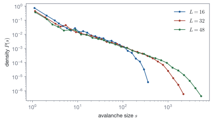

# Self-organized criticality {#sec-self-organized-criticality}

A critical point is normally a single point in parameter space: water at its critical temperature and pressure, a lattice at its percolation threshold. Yet power laws, fractals and $1/f$ spectra are found throughout nature, in earthquakes,
forest fires, solar flares, extinctions and brain activity, where nobody tunes a parameter. Bak, Tang and Wiesenfeld proposed that slowly driven systems with a threshold and fast relaxation organise themselves into a critical state: the
drive loads the system until avalanches of all sizes carry the load away [@thurnerIntroductionTheoryComplex2018, Sec. 3.3.2; @jensenComplexityScienceStudy2023, Sec. 12.1]. Thurner and coauthors describe such systems as driven and
dissipative, with a source that charges them and a sink that discharges them [@thurnerIntroductionTheoryComplex2018, Sec. 2.5.4].

This chapter has seven sections. @sec-sandpile defines the Bak-Tang-Wiesenfeld sandpile and proves its abelian property and Dhar's formula for the mean avalanche. @sec-avalanche-statistics defines the statistics of avalanches and
proves how finite-size scaling fixes the moments. @sec-branching-soc treats the mean-field theory of avalanches as branching processes and proves that the self-organised branching process finds its critical point. @sec-soc-in-nature
defines the forest-fire, earthquake and traffic models and proves the balance laws that set their stationary states. @sec-one-over-f defines power spectra and proves that a broad distribution of relaxation times gives $1/f$ noise.
@sec-bak-sneppen solves the random-neighbour Bak-Sneppen model of evolution. @sec-record-dynamics, which the coverage record lists as a gap of the chapter, treats the statistics of records.

The chapter follows @charbonneauNaturalComplexityModeling2017 [Chs. 5-8] for sandpiles, forest fires, traffic jams and earthquakes; @downeyThinkComplexity2018 [Ch. 8] for the sandpile, its fractals and pink noise;
@jensenComplexityScienceStudy2023 [Secs. 12.1-12.2] for sandpiles, their mean-field analysis, the forest fire and record dynamics; @grosComplexAdaptiveDynamical2015 [Secs. 6.2-6.6] for $1/f$ noise, the forest fire, the sandpile,
branching theory and the Bak-Sneppen model; @thurnerIntroductionTheoryComplex2018 [Secs. 2.5.4, 3.3.2 and 5.4.4] for driven dissipative systems and the Bak-Sneppen model; and @bertinStatisticalPhysicsComplex2021 [Sec. 8.2.3] for the
statistics of records. It uses the branching processes of @def-galton-watson, @thm-extinction-probability and @prp-total-progeny, the heavy tails of @def-heavy-tail and the power-law fits of @prp-power-law-mle.

Following the conventions of the tutorial, $L$ is the side of a lattice and $N$ its number of sites; $s$ is an avalanche size and $P(s) \propto s^{-\tau}$ its distribution. Every definition and proposition is followed by ten examples and ten
exercises, each exercise with a hidden solution in two tabs: the argument, then a computation with its recorded output. The computations use scikit-complexity 0.9.0: `SandpileSystem`, `MannaSandpileSystem` and `ZhangSandpileSystem`
for sandpiles, `SelfOrganizedBranchingSystem` for the branching theory, `ForestFireSystem`, `EarthquakesSystem` and `NagelSchreckenbergSystem` for the models of nature, `BakSneppenSystem` for evolution and
`RecordDynamicsEpidemicSystem` for records, analysed with `fit_law`, `events`, `spectrum`, `distribution` and `crackling_noise`. Where the package lacks a feature, the code says so and names the package issue.

## The sandpile {#sec-sandpile}

Gros defines the sandpile of Bak, Tang and Wiesenfeld on an $L \times L$ lattice: every cell holds a number of grains, a cell with more than $K = 3$ grains topples and sends one grain to each of its four neighbours, and grains that leave the
lattice are lost [@grosComplexAdaptiveDynamical2015, Sec. 6.4, eq. (6.20)]. Grains are added one at a time and every avalanche is completed before the next grain falls, the separation of time scales that Jensen calls macro and micro
dynamics [@jensenComplexityScienceStudy2023, Sec. 12.1.1]. Charbonneau's sandpile is a one-dimensional relative with a continuous height and a threshold on the slope [@charbonneauNaturalComplexityModeling2017, Sec. 5.1].

For more on this topic, see @grosComplexAdaptiveDynamical2015 [Sec. 6.4], @jensenComplexityScienceStudy2023 [Sec. 12.1.1], @charbonneauNaturalComplexityModeling2017 [Ch. 5] and @downeyThinkComplexity2018 [Ch. 8].

### The Bak-Tang-Wiesenfeld sandpile

Gros writes the toppling with the toppling matrix $\Delta_{ij}$, $4$ on the diagonal and $-1$ for nearest neighbours, eq. (6.20), and notes that it conserves the grains except at the boundary [@grosComplexAdaptiveDynamical2015, Sec. 6.4];
Downey implements the same rule and the drive [@downeyThinkComplexity2018, Ch. 8, "Sand Piles"].

:::: {.statement-box}
::: {#def-sandpile}
#### Sandpile, toppling and avalanche

Let $V$ be the $N = L^2$ sites of an $L \times L$ square lattice and $\Delta$ the $N \times N$ **toppling matrix**, $\Delta_{ii} = 4$ and $\Delta_{ij} = -1$ for nearest neighbours $i, j$, and $0$ otherwise. A **configuration** is a vector
$\mathbf z \in \mathbb Z_{\geq 0}^V$; it is **stable** if $z_i \leq 3$ for all $i$. A site with $z_i \geq 4$ is **unstable** and **topples**: $\mathbf z \leftarrow \mathbf z - \Delta\mathbf e_i$, so it loses $4$ grains and every neighbour in $V$
gains one, while the grains sent across the boundary are lost. **Stabilisation** topples unstable sites until none is left. The **drive** adds one grain at a site, $\mathbf z \leftarrow \mathbf z + \mathbf e_i$, and the **avalanche** it starts is
the stabilisation that follows; its **size** $s$ is the number of topplings, its **area** the number of distinct sites that topple, and its **duration** the number of parallel updates in which all unstable sites topple at once.
:::

::::

The grains move only at topplings, conserving their number inside the lattice; the boundary is the only sink. The package's `SandpileSystem(shape)` drops one grain at a random site per step, completes the avalanche within the step,
and records it as an event with its size, duration and area; its heights are the state `pile.height`, which `initial_state` can set. In the examples, toppling by hand is written out where the algorithm is the lesson.

:::: {.callout-note .examples-fold collapse="true" title="Examples"}
The first example follows Gros's avalanche on a $5 \times 5$ lattice, Fig. 6.8, a grain added to a central site with three grains [@grosComplexAdaptiveDynamical2015, Sec. 6.4].

::: {#exm-sp-gros}
#### A small avalanche

The parallel update topples $1$, $2$ and $2$ sites in three steps, $5$ topplings in all, and touches $13$ sites, the size that Gros counts; the final heights are those of his last panel.

```{.python .run}
import numpy as np
def topple_parallel(z):
    z, size, steps, touched = z.copy(), 0, 0, np.zeros(z.shape, bool)
    while (z >= 4).any():
        u = (z >= 4).astype(int)
        size, steps = size + int(u.sum()), steps + 1
        gain = np.zeros_like(z)
        gain[1:, :] += u[:-1, :]
        gain[:-1, :] += u[1:, :]
        gain[:, 1:] += u[:, :-1]
        gain[:, :-1] += u[:, 1:]
        touched |= (u > 0) | (gain > 0)
        z = z - 4 * u + gain
    return z, size, steps, int(touched.sum())
z = np.array([[3, 0, 3, 2, 3], [1, 2, 3, 1, 0], [2, 3, 3, 1, 3], [3, 1, 0, 2, 0], [0, 2, 1, 3, 1]])
z[2, 2] += 1
final, size, steps, touched = topple_parallel(z)
print("topplings", size, "; duration", steps, "; sites touched", touched)
print(final)
```

```{.text .run-output}
topplings 5 ; duration 3 ; sites touched 13
[[3 2 0 3 3]
 [2 0 2 2 0]
 [3 1 2 2 3]
 [3 2 1 2 0]
 [0 2 1 3 1]]
```
:::

The driven pile settles in a stationary state. Its mean height stops growing once grains leave at the boundary as fast as they are added.

::: {#exm-sp-stationary}
#### The stationary height

On a $20 \times 20$ lattice the package's mean height levels off near $2.1$, close to the value $2.125$ known for large lattices, a literature result.

```{.python .run}
import numpy as np
from skcomplex.core.engine.runtime import simulate
from skcomplex.systems.physics.criticality import SandpileSystem
tr = simulate(SandpileSystem((20, 20), random_state=1), until=20000, random_state=1)
h = np.asarray(tr.get_values("pile.height"))
times = np.asarray(tr.times)
print([(int(times[f]), round(float(h[f].mean()), 3)) for f in (0, 10, 50, 100, 200)])
```

```{.text .run-output}
[(0, 1.587), (1000, 2.11), (5000, 2.067), (10000, 2.065), (20000, 2.062)]
```
:::

From an empty lattice the pile first only loads. Every grain stays until the first avalanche reaches the boundary.

::: {#exm-sp-loading}
#### Loading from empty

Started from an empty $20 \times 20$ lattice, the mean height grows by $1/400$ per drop at first, then the growth slows as avalanches start to reach the boundary.

```{.python .run}
import numpy as np
from skcomplex.core.engine.runtime import simulate
from skcomplex.systems.physics.criticality import SandpileSystem
tr = simulate(SandpileSystem((20, 20), random_state=2), until=2000, initial_state={"pile.height": np.zeros(400)}, random_state=2)
h = np.asarray(tr.get_values("pile.height"))
times = np.asarray(tr.times)
for f in (0, 1, 5, 10, 20):
    print(int(times[f]), round(float(h[f].mean()), 4), round(float(times[f] / 400), 4))
```

```{.text .run-output}
0 0.0 0.0
100 0.25 0.25
500 1.2425 1.25
1000 2.07 2.5
2000 2.045 5.0
```
:::

The grains are conserved except at the boundary. The change of the total between two frames is the number of drops minus the grains lost.

::: {#exm-sp-balance}
#### Grains in and out

In the stationary state the total number of grains fluctuates around a constant, so the grains lost equal the drops on average.

```{.python .run}
import numpy as np
from skcomplex.core.engine.runtime import simulate
from skcomplex.systems.physics.criticality import SandpileSystem
tr = simulate(SandpileSystem((20, 20), random_state=1), until=20000, random_state=1)
total = np.asarray(tr.get_values("pile.height")).sum(axis=1)
times = np.asarray(tr.times)
late = times >= 5000
lost = (times[late][-1] - times[late][0]) - (total[late][-1] - total[late][0])
print(f"drops {int(times[late][-1] - times[late][0])}, grains lost {int(lost)}, total grains {int(total[late].min())}-{int(total[late].max())}")
```

```{.text .run-output}
drops 15000, grains lost 15002, total grains 797-845
```
:::

Most drops cause no toppling, a few cause huge avalanches. The size distribution is heavy-tailed.

::: {#exm-sp-sizes}
#### Many small, few large

In the $15\,000$ drops after the transient on a $20 \times 20$ lattice, the package records about $6000$ avalanches, the other drops toppling nothing; half of the avalanches have at most about ten topplings, while the largest has several hundred.

```{.python .run}
import numpy as np
from skcomplex.core.engine.runtime import simulate
from skcomplex.systems.physics.criticality import SandpileSystem
tr = simulate(SandpileSystem((20, 20), random_state=1), until=20000, random_state=1)
s = np.array([e.size for e in tr.events if e.time > 5000])
print(f"avalanches {len(s)} in 15000 drops; median size {np.median(s):.0f}; mean {s.mean():.1f}; largest {s.max()}")
```

```{.text .run-output}
avalanches 6219 in 15000 drops; median size 11; mean 41.2; largest 704
```
:::

Downey starts a $20 \times 20$ pile at level $10$ everywhere and reports $332$ time steps and $53\,336$ topplings to equilibrium [@downeyThinkComplexity2018, Ch. 8, "Sand Piles"].

::: {#exm-sp-downey}
#### Relaxing a full pile

The parallel update needs $331$ toppling steps and $53\,336$ topplings; Downey's count of $332$ time steps includes the final step in which nothing topples.

```{.python .run}
import numpy as np
z = np.full((20, 20), 10)
size, steps = 0, 0
while (z >= 4).any():
    u = (z >= 4).astype(int)
    size, steps = size + int(u.sum()), steps + 1
    z -= 4 * u
    z[1:, :] += u[:-1, :]
    z[:-1, :] += u[1:, :]
    z[:, 1:] += u[:, :-1]
    z[:, :-1] += u[:, 1:]
print(steps, size, int(z.max()))
```

```{.text .run-output}
331 53336 3
```
:::

Size, area and duration are different measures of the same avalanche. A site can topple several times, so the size is at least the area.

::: {#exm-sp-measures}
#### Size, area and duration

For the package's avalanches, the area never exceeds the size, and large avalanches have sizes several times their areas.

```{.python .run}
import numpy as np
from skcomplex.core.engine.runtime import simulate
from skcomplex.systems.physics.criticality import SandpileSystem
ev = [e for e in simulate(SandpileSystem((20, 20), random_state=1), until=20000, random_state=1).events if e.time > 5000]
s, a, d = (np.array([getattr(e, k) for e in ev]) for k in ("size", "area", "duration"))
big = s > 500
print(bool((a <= s).all()), "; for sizes above 500: mean size/area", round(float((s[big] / a[big]).mean()), 2), "; mean duration", round(float(d[big].mean()), 1))
```

```{.text .run-output}
True ; for sizes above 500: mean size/area 1.97 ; mean duration 66.6
```
:::

The boundary is where the pile loses grains. A corner site sends two grains out of the lattice when it topples, an edge site one.

::: {#exm-sp-corner}
#### Losing grains at the corner

On a $3 \times 3$ lattice with all heights $3$, a grain at the corner starts an avalanche in which every site topples, and the grains lost equal the grains in minus the change of the total.

```{.python .run}
import numpy as np
z = np.full((3, 3), 3)
z[0, 0] += 1
before = int(z.sum())
counts = np.zeros((3, 3), int)
while (z >= 4).any():
    i, j = map(int, np.argwhere(z >= 4)[0])
    counts[i, j] += 1
    z[i, j] -= 4
    for a, b in ((i + 1, j), (i - 1, j), (i, j + 1), (i, j - 1)):
        if 0 <= a < 3 and 0 <= b < 3:
            z[a, b] += 1
print("topplings per site\n", counts, "\nfinal\n", z, "\ngrains lost", before - int(z.sum()))
```

```{.text .run-output}
topplings per site
 [[1 1 1]
 [1 1 1]
 [1 1 1]] 
final
 [[2 2 1]
 [2 3 2]
 [1 2 1]] 
grains lost 12
```
:::

The Zhang sandpile carries a continuous energy and redistributes all of it when a site exceeds the threshold. Jensen uses it to introduce the class of sandpile models [@jensenComplexityScienceStudy2023, Sec. 12.1.1, eqs. (12.1)-(12.2)].

::: {#exm-sp-zhang}
#### A continuous sandpile

The package's Zhang sandpile on a $20 \times 20$ lattice also produces avalanches of many sizes; the largest is many times the median.

```{.python .run}
import numpy as np
from skcomplex.core.engine.runtime import simulate
from skcomplex.systems.physics.criticality import ZhangSandpileSystem
tr = simulate(ZhangSandpileSystem((20, 20), random_state=3), until=20000, random_state=3)
s = np.array([e.size for e in tr.events if e.time > 5000])
print(f"avalanches {len(s)}; median {np.median(s):.0f}; largest {s.max()}")
```

```{.text .run-output}
avalanches 9044; median 14; largest 762
```
:::

The Manna sandpile topples at two grains and sends them to random neighbours. Its stochastic rule gives a different universality class, a literature result, but the same phenomenology.

::: {#exm-sp-manna}
#### A stochastic sandpile

The package's Manna sandpile on a $20 \times 20$ lattice records avalanches of sizes from one to thousands.

```{.python .run}
import numpy as np
from skcomplex.core.engine.runtime import simulate
from skcomplex.systems.physics.criticality import MannaSandpileSystem
tr = simulate(MannaSandpileSystem((20, 20), random_state=4), until=8000, random_state=4)
s = np.array([e.size for e in tr.events if e.time > 2000])
print(f"avalanches {len(s)}; median {np.median(s):.0f}; largest {s.max()}")
```

```{.text .run-output}
avalanches 4092; median 10; largest 1078
```
:::
::::

:::: {.callout-note .exercises-fold collapse="true" title="Exercises"}
The first exercise checks the conservation of grains. It is a property of the toppling matrix.

::: {#exr-sp-conservation}
#### Row sums of the toppling matrix

Show that $\sum_j\Delta_{ij} = 0$ for interior sites, $1$ for edge sites and $2$ for corners, and that a toppling at $i$ removes $\sum_j\Delta_{ij}$ grains from the lattice.
:::

::: {.callout-note .solution collapse="true" title="Solution"}
:::: {.panel-tabset .solution-tabs}
## Solution

$\Delta_{ii} = 4$ and there is one $-1$ per neighbour inside the lattice: four for interior sites, three for edges, two for corners. A toppling changes the total by $-\mathbf 1^{\mathsf T}\Delta\mathbf e_i = -\sum_j\Delta_{ji}$, and $\Delta$ is
symmetric.

## Python

The row sums for $L = 4$.

```{.python .run}
import numpy as np
L = 4
D = 4 * np.eye(L * L)
for i in range(L):
    for j in range(L):
        for a, b in ((i + 1, j), (i - 1, j), (i, j + 1), (i, j - 1)):
            if 0 <= a < L and 0 <= b < L:
                D[i * L + j, a * L + b] = -1
print(D.sum(axis=1).reshape(L, L).astype(int))
```

```{.text .run-output}
[[2 1 1 2]
 [1 0 0 1]
 [1 0 0 1]
 [2 1 1 2]]
```
::::
:::

The second exercise counts stable configurations. Every site has four possible heights.

::: {#exr-sp-count}
#### Stable configurations

How many stable configurations has an $L \times L$ lattice, and what is the largest number of grains a stable configuration can hold? What happens when a grain is added to the configuration with all heights $3$?
:::

::: {.callout-note .solution collapse="true" title="Solution"}
:::: {.panel-tabset .solution-tabs}
## Solution

$4^N$ configurations, at most $3N$ grains. Adding a grain to the full configuration makes every site topple at least once, since each site eventually receives a grain from a neighbour that toppled; on a $5 \times 5$ lattice the run counts the
topplings.

## Python

The full $5 \times 5$ configuration with a central grain.

```{.python .run}
import numpy as np
z = np.full((5, 5), 3)
z[2, 2] += 1
counts = np.zeros((5, 5), int)
while (z >= 4).any():
    u = (z >= 4).astype(int)
    counts += u
    z -= 4 * u
    z[1:, :] += u[:-1, :]
    z[:-1, :] += u[1:, :]
    z[:, 1:] += u[:, :-1]
    z[:, :-1] += u[:, 1:]
print(4 ** 25, 3 * 25, "; topplings\n", counts)
```

```{.text .run-output}
1125899906842624 75 ; topplings
 [[1 1 1 1 1]
 [1 2 2 2 1]
 [1 2 3 2 1]
 [1 2 2 2 1]
 [1 1 1 1 1]]
```
::::
:::

The third exercise asks why the threshold can be shifted. Gros notes that a shift of $K$ shifts all heights [@grosComplexAdaptiveDynamical2015, Sec. 6.4].

::: {#exr-sp-threshold}
#### Shifting the threshold

Show that the sandpile with threshold $K$ and heights $z_i$ behaves exactly like the one with threshold $3$ and heights $z_i - K + 3$, as long as the heights stay at least $K - 3$.
:::

::: {.callout-note .solution collapse="true" title="Solution"}
:::: {.panel-tabset .solution-tabs}
## Solution

The rule depends on $z_i$ only through the comparison $z_i > K$, and toppling subtracts the same matrix in both descriptions, so the map $z \mapsto z - K + 3$ intertwines the two dynamics; it keeps the heights nonnegative only if
$z_i \geq K - 3$, which the stable states after a long drive satisfy for $K \leq 3$ up to the initial transient.

## Python

The same avalanche with threshold $3$ and with threshold $5$ on shifted heights.

```{.python .run}
import numpy as np
def run(z, K):
    z, n = z.copy(), 0
    while (z > K).any():
        u = (z > K).astype(int)
        n += int(u.sum())
        z -= 4 * u
        z[1:, :] += u[:-1, :]
        z[:-1, :] += u[1:, :]
        z[:, 1:] += u[:, :-1]
        z[:, :-1] += u[:, 1:]
    return z, n
z = np.random.default_rng(1001).integers(0, 4, (6, 6))
z[3, 3] = 4
a, na = run(z, 3)
b, nb = run(z + 2, 5)
print(na, nb, bool((a + 2 == b).all()))
```

```{.text .run-output}
4 4 True
```
::::
:::

The fourth exercise relates the drive to the time scales. Jensen's macro time counts drops, his micro time parallel updates [@jensenComplexityScienceStudy2023, Sec. 12.1.1].

::: {#exr-sp-time-scales}
#### Two clocks

In the package's run of @exm-sp-sizes, compare the number of drops with the total number of parallel updates and of topplings. Why is it essential that an avalanche ends before the next grain falls?
:::

::: {.callout-note .solution collapse="true" title="Solution"}
:::: {.panel-tabset .solution-tabs}
## Solution

The topplings far outnumber the drops; if grains kept falling during an avalanche, the drive would feed it and large avalanches would merge into continuous activity, destroying the separation of drive and relaxation on which the critical
state rests.

## Python

The three counts.

```{.python .run}
import numpy as np
from skcomplex.core.engine.runtime import simulate
from skcomplex.systems.physics.criticality import SandpileSystem
ev = [e for e in simulate(SandpileSystem((20, 20), random_state=1), until=20000, random_state=1).events if e.time > 5000]
print("drops 15000; parallel updates", sum(e.duration for e in ev), "; topplings", sum(e.size for e in ev))
```

```{.text .run-output}
drops 15000; parallel updates 76816 ; topplings 256208
```
::::
:::

The fifth exercise shows a one-dimensional sandpile. It has no interesting avalanches.

::: {#exr-sp-one-d}
#### A sandpile on a line

On a line of $L$ sites with threshold $1$, a site with $2$ grains sends one to each neighbour. Run a drop on the all-ones state and describe the result. Why has the one-dimensional pile no heavy-tailed avalanches?
:::

::: {.callout-note .solution collapse="true" title="Solution"}
:::: {.panel-tabset .solution-tabs}
## Solution

A grain added to the all-ones state at site $i$ makes it topple; the neighbours become $2$ and topple in turn, and the activity spreads to both ends. The run ends with a single empty site and two grains lost. The stationary states of this
pile are the all-ones state and the states with one empty site, a literature result, and the avalanche from each is fixed by the drop site and the hole: the sizes are set by $L$, with no heavy tail.

## Python

The line of $10$ sites with a grain at site $3$.

```{.python .run}
import numpy as np
z = np.ones(10, int)
z[3] += 1
before, n = int(z.sum()), 0
while (z >= 2).any():
    i = int(np.nonzero(z >= 2)[0][0])
    z[i] -= 2
    n += 1
    if i > 0:
        z[i - 1] += 1
    if i < 9:
        z[i + 1] += 1
print(z.tolist(), "topplings", n, "grains lost", before - int(z.sum()))
```

```{.text .run-output}
[1, 1, 1, 1, 1, 1, 0, 1, 1, 1] topplings 28 grains lost 2
```
::::
:::

The sixth exercise computes the grains lost per toppling at the boundary. Large avalanches reach the boundary.

::: {#exr-sp-boundary-share}
#### Boundary topplings

In the stationary state, the mean number of grains lost per drop is $1$. Show that this equals the mean number of boundary topplings weighted by the grains each loses, and estimate the share of topplings that occur at the boundary
for a $20 \times 20$ lattice by the hand computation on $150$ stationary configurations of the package.
:::

::: {.callout-note .solution collapse="true" title="Solution"}
:::: {.panel-tabset .solution-tabs}
## Solution

Each toppling at an edge loses one grain and at a corner two; in the stationary state the losses balance the drops, one grain each on average, and the estimate from $150$ drops is close to $1$ given the heavy tail of the sizes. The boundary
share of topplings is small, a few percent: most topplings happen inside.

## Python

Topplings by site for drops on stationary configurations of the package.

```{.python .run}
import numpy as np
from skcomplex.core.engine.runtime import simulate
from skcomplex.systems.physics.criticality import SandpileSystem
L = 20
tr = simulate(SandpileSystem((L, L), random_state=5), until=20000, random_state=5)
configs = np.asarray(tr.get_values("pile.height"))[50:]
rng = np.random.default_rng(1005)
counts = np.zeros((L, L))
for z in configs:
    z = z.reshape(L, L).astype(int)
    z[rng.integers(L), rng.integers(L)] += 1
    while (z >= 4).any():
        u = (z >= 4).astype(int)
        counts += u
        z -= 4 * u
        z[1:, :] += u[:-1, :]
        z[:-1, :] += u[1:, :]
        z[:, 1:] += u[:, :-1]
        z[:, :-1] += u[:, 1:]
edge = np.zeros((L, L), bool)
edge[0, :] = edge[-1, :] = edge[:, 0] = edge[:, -1] = True
loss = np.ones((L, L))
loss[[0, 0, -1, -1], [0, -1, 0, -1]] = 2
print(f"boundary share of topplings {counts[edge].sum() / counts.sum():.3f}; grains lost per drop {(counts * loss)[edge].sum() / len(configs):.3f}")
```

```{.text .run-output}
boundary share of topplings 0.059; grains lost per drop 0.868
```
::::
:::

The seventh exercise looks at the transient length. The pile must fill before the first large avalanche.

::: {#exr-sp-transient}
#### How long to fill

Starting from an empty $L \times L$ lattice, estimate the number of drops before the stationary state, from the stationary mean height $\approx 2.1$, and compare with @exm-sp-loading for $L = 20$.
:::

::: {.callout-note .solution collapse="true" title="Solution"}
:::: {.panel-tabset .solution-tabs}
## Solution

The pile must accumulate about $2.1N$ grains, and until avalanches reach the boundary it keeps every grain; so at least about $2.1 \times 400 = 840$ drops, in practice somewhat more since losses begin before the plateau.

## Python

The first frame at which the mean height exceeds $2.05$.

```{.python .run}
import numpy as np
from skcomplex.core.engine.runtime import simulate
from skcomplex.systems.physics.criticality import SandpileSystem
tr = simulate(SandpileSystem((20, 20), random_state=2), until=4000, initial_state={"pile.height": np.zeros(400)}, random_state=2)
h = np.asarray(tr.get_values("pile.height")).mean(axis=1)
times = np.asarray(tr.times)
print(int(times[np.argmax(h > 2.05)]))
```

```{.text .run-output}
900
```
::::
:::

The eighth exercise asks for the largest possible avalanche from a stable configuration. It bounds the sizes.

::: {#exr-sp-bound}
#### A bound on sizes

Show that adding one grain to a stable configuration can make a site topple at most a bounded number of times, using the bound of the next proposition that the toppling vector satisfies $\mathbf n \leq \Delta^{-1}\mathbf z$ with $\mathbf z$ the configuration
after the drop.
:::

::: {.callout-note .solution collapse="true" title="Solution"}
:::: {.panel-tabset .solution-tabs}
## Solution

The heights after the drop are at most $3$ except one $4$, so $\mathbf n \leq \Delta^{-1}(3\cdot\mathbf 1 + \mathbf e_i)$ entrywise, a finite bound that grows with $L$. It is crude: for the full $5 \times 5$ configuration it allows $8$ topplings
at the centre, which topples $3$ times in @exr-sp-count.

## Python

The bound and the topplings of @exr-sp-count at the centre of a $5 \times 5$ lattice.

```{.python .run}
import numpy as np
L = 5
D = 4 * np.eye(L * L)
for i in range(L):
    for j in range(L):
        for a, b in ((i + 1, j), (i - 1, j), (i, j + 1), (i, j - 1)):
            if 0 <= a < L and 0 <= b < L:
                D[i * L + j, a * L + b] = -1
z = np.full(25, 3.0)
z[12] += 1
print(np.floor(np.linalg.solve(D, z)).reshape(5, 5).astype(int))
```

```{.text .run-output}
[[2 4 4 4 2]
 [4 6 7 6 4]
 [4 7 8 7 4]
 [4 6 7 6 4]
 [2 4 4 4 2]]
```
::::
:::

The ninth exercise relates the sandpile heights to a slope. Jensen derives the rule from the slope of a one-dimensional pile [@jensenComplexityScienceStudy2023, Sec. 12.1.1].

::: {#exr-sp-slope}
#### Heights as slopes

For a one-dimensional pile with heights $h(r)$ and slope $z(r) = h(r) - h(r + 1)$, show that moving one grain from $r$ to $r + 1$ changes the slopes by $+1$, $-2$, $+1$ at $r - 1$, $r$, $r + 1$, and that adding a grain at $r$ raises $z(r)$
by one.
:::

::: {.callout-note .solution collapse="true" title="Solution"}
:::: {.panel-tabset .solution-tabs}
## Solution

$h(r) \to h(r) - 1$ and $h(r + 1) \to h(r + 1) + 1$ change $z(r - 1) = h(r - 1) - h(r)$ by $+1$, $z(r) = h(r) - h(r + 1)$ by $-2$, and $z(r + 1) = h(r + 1) - h(r + 2)$ by $+1$, the one-dimensional toppling matrix. Adding to $h(r)$ raises
$z(r)$ by one and lowers $z(r - 1)$ by one, which the model ignores, a simplification Jensen points out.

## Python

The slope changes for a random pile.

```{.python .run}
import numpy as np
h = np.array([9, 8, 6, 5, 3, 1, 0])
z0 = h[:-1] - h[1:]
h2 = h.copy()
h2[3] -= 1
h2[4] += 1
print((h2[:-1] - h2[1:]) - z0)
```

```{.text .run-output}
[ 0  0  1 -2  1  0]
```
::::
:::

The last exercise compares sandpiles of different sizes. The mean height approaches its limit as the boundary matters less.

::: {#exr-sp-sizes-L}
#### Mean height and lattice size

Measure the package's stationary mean height for $L = 8$, $16$ and $32$, and explain why it approaches $2.125$ from below.
:::

::: {.callout-note .solution collapse="true" title="Solution"}
:::: {.panel-tabset .solution-tabs}
## Solution

Sites near the boundary lose grains and stay lower on average; the share of such sites falls like $1/L$, so the mean height rises towards the bulk value with $L$.

## Python

Time averages over the stationary part of each run.

```{.python .run}
import numpy as np
from skcomplex.core.engine.runtime import simulate
from skcomplex.systems.physics.criticality import SandpileSystem
for L, steps in ((8, 4000), (16, 12000), (32, 30000)):
    h = np.asarray(simulate(SandpileSystem((L, L), random_state=6), until=steps, random_state=6).get_values("pile.height"))
    print(L, round(float(h[len(h) // 2:].mean()), 4))
```

```{.text .run-output}
8 1.9978
16 2.0464
32 2.0831
```
::::
:::
::::

### The abelian property and the mean avalanche

Gros stresses that the sandpile is deterministic once a grain is added and that its avalanches are features of the critical state, not of hidden randomness [@grosComplexAdaptiveDynamical2015, Sec. 6.4]. The order in which unstable sites
topple does not even matter: the sandpile is abelian, a property discovered by Dhar, and its toppling matrix then gives the mean size of an avalanche exactly, literature results that the proposition proves.

:::: {.statement-box}
::: {#prp-abelian}
#### The abelian sandpile and Dhar's formula

For the sandpile of @def-sandpile on an $L \times L$ lattice with open boundary:

1. $\Delta$ is invertible and $\Delta^{-1}$ has nonnegative entries; stabilisation of any configuration $\mathbf z$ ends after finitely many topplings, and the vector $\mathbf n$ of toppling counts satisfies $\mathbf n \leq \Delta^{-1}\mathbf z$ entrywise;
2. the final stable configuration and the toppling counts $\mathbf n$ do not depend on the order in which unstable sites are toppled;
3. if the driven pile, with drops at uniformly random sites, is in a stationary state, the mean size of an avalanche per drop is
$$
\langle s\rangle = \frac1N\sum_{i, j}(\Delta^{-1})_{ij} .
$$
:::

::::

::: {.proof}
(1) $\Delta = 4\mathbf I - \mathbf A$ with $\mathbf A$ the adjacency matrix of the lattice. The largest eigenvalue of $\mathbf A$ is below $4$, since every row of $\mathbf A$ sums to at most $4$ and the rows of boundary sites to less, on a connected lattice,
by the argument of @prp-laplacian-spectrum. So $\Delta^{-1} = \frac14\sum_{m \geq 0}(\mathbf A/4)^m$ converges and has nonnegative entries. During stabilisation only unstable sites topple, so all heights stay nonnegative:
$\mathbf z - \Delta\mathbf n \geq \mathbf 0$ after any number of topplings. Multiplying by $\Delta^{-1} \geq 0$ gives $\mathbf n \leq \Delta^{-1}\mathbf z$, so the total number of topplings is bounded and stabilisation ends.

(2) Let $x_1, x_2, \dots, x_a$ and $y_1, \dots, y_b$ be two complete stabilising sequences of $\mathbf z$, with toppling vectors $\mathbf n_A$ and $\mathbf n_B$. We show by induction that the first $k$ topplings of $A$ are contained in $B$: let
$\mathbf n_A^{(k)}$ count the first $k$ topplings of $A$ and suppose $\mathbf n_A^{(k - 1)} \leq \mathbf n_B$. Site $x = x_k$ is unstable after the first $k - 1$ topplings of $A$. If $n_A^{(k - 1)}(x) = n_B(x)$, the height of $x$ at the end of $B$ is
$z_x - 4n_B(x) + \sum_{y \sim x}n_B(y) \geq z_x - 4n_A^{(k - 1)}(x) + \sum_{y \sim x}n_A^{(k - 1)}(y) \geq 4$, contradicting the stability of the end of $B$. So $n_A^{(k - 1)}(x) < n_B(x)$ and $\mathbf n_A^{(k)} \leq \mathbf n_B$. Hence
$\mathbf n_A \leq \mathbf n_B$, and by symmetry $\mathbf n_A = \mathbf n_B$; the final configuration $\mathbf z - \Delta\mathbf n$ is then the same.

(3) A drop at $i$ followed by stabilisation changes the configuration by $\mathbf e_i - \Delta\mathbf n$. In a stationary state the expected change is $\mathbf 0$, and the drop site is uniform and independent of the configuration, so
$\frac1N\mathbf 1 - \Delta\,\mathbb E[\mathbf n] = \mathbf 0$ and $\mathbb E[\mathbf n] = \frac1N\Delta^{-1}\mathbf 1$. The size is $s = \mathbf 1^{\mathsf T}\mathbf n$, so $\langle s\rangle = \frac1N\mathbf 1^{\mathsf T}\Delta^{-1}\mathbf 1$.
:::

Dhar proved more, a literature result: for a drop at a fixed site $i$, the expected number of topplings at $j$ is $(\Delta^{-1})_{ij}$, the Green function of the lattice. Since $(\Delta^{-1})_{ij}$ behaves like the electrostatic potential of a
charge at $i$ in a grounded square, $\langle s\rangle$ grows like $L^2$: large lattices have large avalanches on average, although most drops topple little.

:::: {.callout-note .examples-fold collapse="true" title="Examples"}
The first example checks Dhar's formula on the package. A $10 \times 10$ lattice is small enough to invert $\Delta$.

::: {#exm-ab-dhar}
#### The mean avalanche on $10 \times 10$

The package's mean number of topplings per drop after the transient is close to $\frac1N\sum_{ij}(\Delta^{-1})_{ij} \approx 5.01$.

```{.python .run}
# Fallback to NumPy for the inverse of the toppling matrix: the package has no lattice Green functions (new package issue).
import numpy as np
from skcomplex.core.engine.runtime import simulate
from skcomplex.systems.physics.criticality import SandpileSystem
def toppling_matrix(L):
    D = 4 * np.eye(L * L)
    for i in range(L):
        for j in range(L):
            for a, b in ((i + 1, j), (i - 1, j), (i, j + 1), (i, j - 1)):
                if 0 <= a < L and 0 <= b < L:
                    D[i * L + j, a * L + b] = -1
    return D
L = 10
ev = simulate(SandpileSystem((L, L), random_state=1), until=20000, random_state=1).events
s = sum(e.size for e in ev if e.time > 5000) / 15000
print(f"package {s:.3f}; Dhar {np.linalg.inv(toppling_matrix(L)).sum() / L ** 2:.3f}")
```

```{.text .run-output}
package 5.032; Dhar 5.010
```
:::

The order of topplings does not matter. Toppling the unstable sites one at a time in random order gives the same result as the parallel update.

::: {#exm-ab-order}
#### Three orders, one result

For Downey's pile of level $10$ on $20 \times 20$, sequential toppling in two random orders gives the same final configuration and the same $53\,336$ topplings as the parallel update of @exm-sp-downey.

```{.python .run}
import numpy as np
def sequential(z, rng):
    z, n = z.copy(), 0
    stack = [tuple(x) for x in np.argwhere(z >= 4)]
    while stack:
        k = int(rng.integers(len(stack)))
        stack[k], stack[-1] = stack[-1], stack[k]
        i, j = stack.pop()
        if z[i, j] < 4:
            continue
        z[i, j] -= 4
        n += 1
        if z[i, j] >= 4:
            stack.append((i, j))
        for a, b in ((i + 1, j), (i - 1, j), (i, j + 1), (i, j - 1)):
            if 0 <= a < z.shape[0] and 0 <= b < z.shape[1]:
                z[a, b] += 1
                if z[a, b] >= 4:
                    stack.append((a, b))
    return z, n
z0 = np.full((20, 20), 10)
results = [sequential(z0, np.random.default_rng(seed)) for seed in (1006, 1007)]
print([r[1] for r in results], bool((results[0][0] == results[1][0]).all()))
```

```{.text .run-output}
[53336, 53336] True
```
:::

Dhar's formula grows like $L^2$. The ratio $\langle s\rangle/L^2$ approaches a constant.

::: {#exm-ab-scaling}
#### Growth with the lattice

For $L = 8$ to $64$, $\langle s\rangle = \frac1N\sum_{ij}(\Delta^{-1})_{ij}$, the second column, divided by $L^2$, the third, decreases slowly towards a constant a little below $0.04$.

```{.python .run}
# Fallback to SciPy for the sparse solve: the package has no lattice Green functions (new package issue).
import numpy as np
import scipy.sparse as sp
import scipy.sparse.linalg as sla
for L in (8, 16, 32, 64):
    T = sp.diags([2 * np.ones(L), -np.ones(L - 1), -np.ones(L - 1)], [0, 1, -1])
    D = sp.kron(T, sp.eye(L)) + sp.kron(sp.eye(L), T)
    x = sla.spsolve(D.tocsc(), np.ones(L * L))
    print(L, round(float(x.sum() / L ** 2), 3), round(float(x.sum() / L ** 4), 4))
```

```{.text .run-output}
8 3.462 0.0541
16 11.338 0.0443
32 40.58 0.0396
64 153.043 0.0374
```
:::

The bound of statement (1) controls the toppling counts. For the full pile it is a large overestimate.

::: {#exm-ab-bound}
#### Bound and actual counts

For Downey's level-$10$ pile on $20 \times 20$, the bound $\Delta^{-1}\mathbf z$ allows at the centre about a quarter more topplings than actually happen: for this nearly uniform pile the bound is fairly tight.

```{.python .run}
import numpy as np
import scipy.sparse as sp
import scipy.sparse.linalg as sla
L = 20
T = sp.diags([2 * np.ones(L), -np.ones(L - 1), -np.ones(L - 1)], [0, 1, -1])
D = (sp.kron(T, sp.eye(L)) + sp.kron(sp.eye(L), T)).tocsc()
bound = sla.spsolve(D, np.full(L * L, 10.0)).reshape(L, L)
z, counts = np.full((L, L), 10), np.zeros((L, L), int)
while (z >= 4).any():
    u = (z >= 4).astype(int)
    counts += u
    z -= 4 * u
    z[1:, :] += u[:-1, :]
    z[:-1, :] += u[1:, :]
    z[:, 1:] += u[:, :-1]
    z[:, :-1] += u[:, 1:]
print(f"centre: bound {bound[10, 10]:.1f}, actual {counts[10, 10]}; total bound {bound.sum():.0f}, actual {counts.sum()}")
```

```{.text .run-output}
centre: bound 323.1, actual 253; total bound 67848, actual 53336
```
:::

Dhar's per-site formula can be checked on stationary configurations. Drops at a fixed site of configurations taken from a package run topple $j$ on average $(\Delta^{-1})_{ij}$ times.

::: {#exm-ab-green}
#### Topplings around a fixed drop

For drops at the centre of a $10 \times 10$ lattice on $190$ configurations of the package's stationary pile, the mean topplings at the centre and at a corner are close to $(\Delta^{-1})_{ii}$ and $(\Delta^{-1})_{ij}$.

```{.python .run}
import numpy as np
from skcomplex.core.engine.runtime import simulate
from skcomplex.systems.physics.criticality import SandpileSystem
L = 10
configs = np.asarray(simulate(SandpileSystem((L, L), random_state=7), until=20000, random_state=7).get_values("pile.height"))[11:]
D = 4 * np.eye(L * L)
for i in range(L):
    for j in range(L):
        for a, b in ((i + 1, j), (i - 1, j), (i, j + 1), (i, j - 1)):
            if 0 <= a < L and 0 <= b < L:
                D[i * L + j, a * L + b] = -1
G = np.linalg.inv(D)
counts = np.zeros((L, L))
for z in configs:
    z = z.reshape(L, L).astype(int)
    z[5, 5] += 1
    while (z >= 4).any():
        u = (z >= 4).astype(int)
        counts += u
        z -= 4 * u
        z[1:, :] += u[:-1, :]
        z[:-1, :] += u[1:, :]
        z[:, 1:] += u[:, :-1]
        z[:, :-1] += u[:, 1:]
counts /= len(configs)
print(f"centre: {counts[5, 5]:.3f} vs {G[55, 55]:.3f}; corner: {counts[0, 0]:.3f} vs {G[55, 0]:.3f}")
```

```{.text .run-output}
centre: 0.542 vs 0.538; corner: 0.000 vs 0.007
```
:::

The abelian property makes drops commute. Adding grains at two sites and stabilising gives the same result in either order.

::: {#exm-ab-commute}
#### Drops commute

For a stationary configuration of the package and two drop sites, adding at $a$ then $b$, each followed by stabilisation, equals adding at $b$ then $a$.

```{.python .run}
import numpy as np
from skcomplex.core.engine.runtime import simulate
from skcomplex.systems.physics.criticality import SandpileSystem
def stabilise(z):
    z = z.copy()
    while (z >= 4).any():
        u = (z >= 4).astype(int)
        z -= 4 * u
        z[1:, :] += u[:-1, :]
        z[:-1, :] += u[1:, :]
        z[:, 1:] += u[:, :-1]
        z[:, :-1] += u[:, 1:]
    return z
z = np.asarray(simulate(SandpileSystem((10, 10), random_state=8), until=5000, random_state=8).get_values("pile.height"))[-1].reshape(10, 10).astype(int)
def add(z, site):
    z = z.copy()
    z[site] += 1
    return stabilise(z)
print(bool((add(add(z, (2, 3)), (7, 7)) == add(add(z, (7, 7)), (2, 3))).all()))
```

```{.text .run-output}
True
```
:::

The mean size counts topplings, not area. Large avalanches revisit sites.

::: {#exm-ab-area}
#### Topplings and area

In the run of @exm-ab-dhar the mean area per drop is below the mean size of Dhar's formula, since sites inside large avalanches topple several times.

```{.python .run}
from skcomplex.core.engine.runtime import simulate
from skcomplex.systems.physics.criticality import SandpileSystem
ev = [e for e in simulate(SandpileSystem((10, 10), random_state=1), until=20000, random_state=1).events if e.time > 5000]
print(round(sum(e.size for e in ev) / 15000, 3), round(sum(e.area for e in ev) / 15000, 3))
```

```{.text .run-output}
5.032 4.767
```
:::

Drops at the boundary topple less. The Green function is small near the edge.

::: {#exm-ab-edge}
#### Where drops matter

The expected avalanche size of a drop at a site, $\sum_j(\Delta^{-1})_{ij}$, is largest at the centre of a $10 \times 10$ lattice and smallest at a corner.

```{.python .run}
import numpy as np
L = 10
D = 4 * np.eye(L * L)
for i in range(L):
    for j in range(L):
        for a, b in ((i + 1, j), (i - 1, j), (i, j + 1), (i, j - 1)):
            if 0 <= a < L and 0 <= b < L:
                D[i * L + j, a * L + b] = -1
row = np.linalg.inv(D).sum(axis=1).reshape(L, L)
print(round(float(row[4, 4]), 3), round(float(row[0, 0]), 3), round(float(row.mean()), 3))
```

```{.text .run-output}
8.733 1.342 5.01
```
:::

The formula holds for any connected lattice with an open boundary. A one-dimensional line is the simplest case.

::: {#exm-ab-line}
#### A line

On a line of $L$ sites with threshold $1$ and open ends, $\Delta$ is tridiagonal with $2$ on the diagonal, and $\frac1L\sum_{ij}(\Delta^{-1})_{ij} = (L + 1)(L + 2)/12$, which grows like $L^2$.

```{.python .run}
import numpy as np
for L in (5, 10, 20):
    D = 2 * np.eye(L) - np.eye(L, k=1) - np.eye(L, k=-1)
    print(L, round(float(np.linalg.inv(D).sum() / L), 4), (L + 1) * (L + 2) / 12)
```

```{.text .run-output}
5 3.5 3.5
10 11.0 11.0
20 38.5 38.5
```
:::

Downey's pile shows that a full pile relaxes in the same number of topplings however it is updated. This number, $53\,336$, is $\mathbf 1^{\mathsf T}\mathbf n$ for the unique toppling vector of statement (2).

::: {#exm-ab-downey}
#### A unique count

The parallel update of @exm-sp-downey and the random sequential orders of @exm-ab-order find the same count, as statement (2) requires: the count is a property of the initial configuration, not of the algorithm.
:::
::::

:::: {.callout-note .exercises-fold collapse="true" title="Exercises"}
The first exercise proves that $\Delta^{-1}$ is nonnegative directly. It is the Neumann series of the proof.

::: {#exr-ab-neumann}
#### The Neumann series

For $L = 4$, sum $\frac14\sum_{m < M}(\mathbf A/4)^m$ for $M = 50, 200$ and compare with $\Delta^{-1}$. Why does the series converge more slowly for large $L$?
:::

::: {.callout-note .solution collapse="true" title="Solution"}
:::: {.panel-tabset .solution-tabs}
## Solution

The error after $M$ terms is of order $(\lambda_1/4)^M$, with $\lambda_1$ the largest eigenvalue of $\mathbf A$, $4\cos(\pi/(L + 1))$ for the grounded square, which approaches $4$ as $L$ grows; the convergence becomes slow, as the random walk of
a grain needs of order $L^2$ steps to leave the lattice.

## Python

The partial sums for $L = 4$.

```{.python .run}
import numpy as np
L = 4
D = 4 * np.eye(L * L)
for i in range(L):
    for j in range(L):
        for a, b in ((i + 1, j), (i - 1, j), (i, j + 1), (i, j - 1)):
            if 0 <= a < L and 0 <= b < L:
                D[i * L + j, a * L + b] = -1
A = 4 * np.eye(L * L) - D
G = np.linalg.inv(D)
for M in (50, 200):
    S = sum(np.linalg.matrix_power(A / 4, m) for m in range(M)) / 4
    print(M, f"{np.abs(S - G).max():.1e}", bool((G >= 0).all()))
```

```{.text .run-output}
50 4.7e-06 True
200 3.9e-16 True
```
::::
:::

The second exercise computes the toppling vector from the final state. The relation $\mathbf z' = \mathbf z - \Delta\mathbf n$ inverts.

::: {#exr-ab-invert}
#### Recovering the topplings

Show that $\mathbf n = \Delta^{-1}(\mathbf z - \mathbf z')$ for an initial configuration $\mathbf z$ and its stabilisation $\mathbf z'$, and check on the avalanche of @exm-sp-gros.
:::

::: {.callout-note .solution collapse="true" title="Solution"}
:::: {.panel-tabset .solution-tabs}
## Solution

Every toppling at $i$ subtracts $\Delta\mathbf e_i$, so $\mathbf z' = \mathbf z - \Delta\mathbf n$, and $\Delta$ is invertible.

## Python

The topplings of Gros's avalanche.

```{.python .run}
import numpy as np
L = 5
D = 4 * np.eye(L * L)
for i in range(L):
    for j in range(L):
        for a, b in ((i + 1, j), (i - 1, j), (i, j + 1), (i, j - 1)):
            if 0 <= a < L and 0 <= b < L:
                D[i * L + j, a * L + b] = -1
z = np.array([[3, 0, 3, 2, 3], [1, 2, 3, 1, 0], [2, 3, 4, 1, 3], [3, 1, 0, 2, 0], [0, 2, 1, 3, 1]])
zf = np.array([[3, 2, 0, 3, 3], [2, 0, 2, 2, 0], [3, 1, 2, 2, 3], [3, 2, 1, 2, 0], [0, 2, 1, 3, 1]])
print(np.rint(np.linalg.solve(D, (z - zf).ravel())).astype(int).reshape(5, 5))
```

```{.text .run-output}
[[0 0 1 0 0]
 [0 1 1 0 0]
 [0 1 1 0 0]
 [0 0 0 0 0]
 [0 0 0 0 0]]
```
::::
:::

The third exercise derives the line formula of @exm-ab-line. The inverse of the one-dimensional Laplacian is explicit.

::: {#exr-ab-line-formula}
#### The line Green function

For the tridiagonal $\Delta$ of size $L$, show that $(\Delta^{-1})_{ij} = \min(i, j)(L + 1 - \max(i, j))/(L + 1)$ for $i, j = 1, \dots, L$, and deduce $\frac1L\sum_{ij}(\Delta^{-1})_{ij} = (L + 1)(L + 2)/12$.
:::

::: {.callout-note .solution collapse="true" title="Solution"}
:::: {.panel-tabset .solution-tabs}
## Solution

For fixed $j$ the function $g_i = \min(i, j)(L + 1 - \max(i, j))/(L + 1)$ is linear in $i$ on each side of $j$, vanishes at $i = 0$ and $L + 1$, and has a kink of $-1$ at $i = j$, so $2g_i - g_{i - 1} - g_{i + 1} = \delta_{ij}$. The row sums
$\sum_jg_{ij} = i(L + 1 - i)/2$ add up to $L(L + 1)(L + 2)/12$.

## Python

SymPy's sum.

```{.python .run}
import sympy as sp
i, L = sp.symbols("i L", positive=True, integer=True)
print(sp.factor(sp.summation(i * (L + 1 - i) / 2, (i, 1, L)) / L))
```

```{.text .run-output}
(L + 1)*(L + 2)/12
```
::::
:::

The fourth exercise counts the recurrent configurations of a small lattice. Dhar showed that their number is $\det\Delta$, a literature result.

::: {#exr-ab-recurrent}
#### Recurrent configurations

For the $2 \times 2$ lattice, compute $\det\Delta$, and count the stable configurations that the driven pile visits in a long package run recorded at every drop.
:::

::: {.callout-note .solution collapse="true" title="Solution"}
:::: {.panel-tabset .solution-tabs}
## Solution

For $2 \times 2$ every site has two neighbours, $\Delta = 4\mathbf I - \mathbf A$ with eigenvalues $4 - 2$, $4$, $4$, $4 + 2$, so $\det\Delta = 2 \cdot 4 \cdot 4 \cdot 6 = 192$ of the $256$ stable configurations are recurrent; the others, such as all
heights $0$, are visited only in the transient.

## Python

The configurations of the package's run, one per frame.

```{.python .run}
import numpy as np
from skcomplex.core.engine.runtime import simulate
from skcomplex.systems.physics.criticality import SandpileSystem
D = 4 * np.eye(4) - np.array([[0, 1, 1, 0], [1, 0, 0, 1], [1, 0, 0, 1], [0, 1, 1, 0]])
tr = simulate(SandpileSystem((2, 2), random_state=9), until=20000, dt=1.0, random_state=9)
seen = {tuple(h.astype(int)) for h in np.asarray(tr.get_values("pile.height"))[20:]}
print(round(float(np.linalg.det(D))), len(seen))
```

```{.text .run-output}
192 192
```
::::
:::

The fifth exercise shows that the abelian property fails without the threshold rule. A site that topples while stable could go negative.

::: {#exr-ab-necessary}
#### Why only unstable sites topple

Where in the proof of statement (2) is it used that only unstable sites topple? Give an example in which toppling a stable site changes the result.
:::

::: {.callout-note .solution collapse="true" title="Solution"}
:::: {.panel-tabset .solution-tabs}
## Solution

In the induction, the site $x_k$ is unstable when $A$ topples it, which bounds its height below by $4$. Toppling a site with $z < 4$ would make it negative, and the bound $\mathbf n \leq \Delta^{-1}\mathbf z$ of (1) would fail. For example,
toppling a stable site of a single-site lattice with $z = 1$ gives $z = -3$, which no sequence of legal topplings reaches.

## Python

The height after the illegal toppling of a single site with one grain.

```{.python .run}
print(1 - 4)
```

```{.text .run-output}
-3
```
::::
:::

The sixth exercise estimates the mean size for a $50 \times 50$ lattice. The formula avoids a long simulation.

::: {#exr-ab-fifty}
#### A large lattice

Compute $\langle s\rangle$ for $L = 50$ from Dhar's formula, and compare with the package's mean over drops after a long transient on a $50 \times 50$ lattice.
:::

::: {.callout-note .solution collapse="true" title="Solution"}
:::: {.panel-tabset .solution-tabs}
## Solution

The sparse solve gives $\langle s\rangle \approx 95$, about $0.04L^2$, as in @exm-ab-scaling. The package's mean over a finite run fluctuates around it, since the size distribution is broad and a few large avalanches dominate the mean.

## Python

The formula and the package.

```{.python .run}
import numpy as np
import scipy.sparse as sp
import scipy.sparse.linalg as sla
from skcomplex.core.engine.runtime import simulate
from skcomplex.systems.physics.criticality import SandpileSystem
L = 50
T = sp.diags([2 * np.ones(L), -np.ones(L - 1), -np.ones(L - 1)], [0, 1, -1])
x = sla.spsolve((sp.kron(T, sp.eye(L)) + sp.kron(sp.eye(L), T)).tocsc(), np.ones(L * L))
ev = simulate(SandpileSystem((L, L), random_state=10), until=40000, random_state=10).events
print(f"Dhar {x.sum() / L ** 2:.1f}; package {sum(e.size for e in ev if e.time > 15000) / 25000:.1f}")
```

```{.text .run-output}
Dhar 95.0; package 94.5
```
::::
:::

The seventh exercise interprets the Green function. A grain dropped at $i$ performs, in effect, a random walk until it leaves.

::: {#exr-ab-walk}
#### Grains as random walkers

Show that $4(\Delta^{-1})_{ij}$ is the expected number of visits to $j$ of a simple random walk started at $i$ that is killed when it steps off the lattice, and check by simulation on a $5 \times 5$ lattice.
:::

::: {.callout-note .solution collapse="true" title="Solution"}
:::: {.panel-tabset .solution-tabs}
## Solution

The walk moves to each of the four neighbours with probability $\frac14$, so its transition matrix on the lattice is $\mathbf A/4$, substochastic at the boundary, and the expected visits are $\sum_m(\mathbf A/4)^m = (\mathbf I - \mathbf A/4)^{-1} = 4\Delta^{-1}$.

## Python

Killed walks from the centre.

```{.python .run}
import numpy as np
L = 5
D = 4 * np.eye(L * L)
for i in range(L):
    for j in range(L):
        for a, b in ((i + 1, j), (i - 1, j), (i, j + 1), (i, j - 1)):
            if 0 <= a < L and 0 <= b < L:
                D[i * L + j, a * L + b] = -1
rng = np.random.default_rng(1011)
visits = np.zeros((L, L))
for _ in range(20000):
    x, y = 2, 2
    while 0 <= x < L and 0 <= y < L:
        visits[x, y] += 1
        dx, dy = ((1, 0), (-1, 0), (0, 1), (0, -1))[rng.integers(4)]
        x, y = x + dx, y + dy
print(round(float(visits[2, 2] / 20000), 3), round(float(4 * np.linalg.inv(D)[12, 12]), 3))
```

```{.text .run-output}
1.773 1.769
```
::::
:::

The eighth exercise shows that a configuration with a forbidden pattern is not recurrent. Two adjacent empty sites cannot occur in a recurrent configuration, a literature result.

::: {#exr-ab-forbidden}
#### A forbidden pattern

Check in a long package run on a $10 \times 10$ lattice that no stationary configuration has two neighbouring sites of height $0$.
:::

::: {.callout-note .solution collapse="true" title="Solution"}
:::: {.panel-tabset .solution-tabs}
## Solution

When a site topples, its neighbours receive grains; for two neighbours both at $0$, the later of the two last topplings would have given the other a grain after its own last toppling. Dhar's burning test makes this precise; the run checks it.

## Python

All frames after the transient.

```{.python .run}
import numpy as np
from skcomplex.core.engine.runtime import simulate
from skcomplex.systems.physics.criticality import SandpileSystem
h = np.asarray(simulate(SandpileSystem((10, 10), random_state=11), until=20000, random_state=11).get_values("pile.height"))[20:].reshape(-1, 10, 10)
pairs = ((h[:, 1:, :] == 0) & (h[:, :-1, :] == 0)).sum() + ((h[:, :, 1:] == 0) & (h[:, :, :-1] == 0)).sum()
print(len(h), int(pairs))
```

```{.text .run-output}
181 0
```
::::
:::

The ninth exercise asks for the variance of the stationary total. It shows that the pile fluctuates by many grains.

::: {#exr-ab-total}
#### Fluctuations of the total

From the package's frames of @exm-sp-balance, compute the standard deviation of the total number of grains in the stationary state, and compare with the mean avalanche size.
:::

::: {.callout-note .solution collapse="true" title="Solution"}
:::: {.panel-tabset .solution-tabs}
## Solution

The total rises by one per drop and falls in jumps when avalanches reach the boundary; its fluctuations are of the order of the large avalanches, which carry many grains out at once, far more than the mean loss of one grain per drop.

## Python

The standard deviation of the total.

```{.python .run}
import numpy as np
from skcomplex.core.engine.runtime import simulate
from skcomplex.systems.physics.criticality import SandpileSystem
total = np.asarray(simulate(SandpileSystem((20, 20), random_state=1), until=20000, random_state=1).get_values("pile.height")).sum(axis=1)[50:]
print(round(float(total.std()), 2), round(float(total.mean()), 1))
```

```{.text .run-output}
9.29 824.8
```
::::
:::

The last exercise proves statement (3) in the parallel form of the drive. It holds whichever drop rule has a stationary state.

::: {#exr-ab-other-drive}
#### Other drives

If grains are dropped with a site distribution $\boldsymbol\mu$ instead of uniformly, show that $\langle s\rangle = \mathbf 1^{\mathsf T}\Delta^{-1}\boldsymbol\mu$ in a stationary state, and evaluate it for drops always at the centre of a $10 \times 10$ lattice.
:::

::: {.callout-note .solution collapse="true" title="Solution"}
:::: {.panel-tabset .solution-tabs}
## Solution

The same balance gives $\boldsymbol\mu - \Delta\mathbb E[\mathbf n] = \mathbf 0$. For drops at the centre, $\langle s\rangle = \sum_j(\Delta^{-1})_{cj}$, the centre value of @exm-ab-edge.

## Python

The centre row sum.

```{.python .run}
import numpy as np
L = 10
D = 4 * np.eye(L * L)
for i in range(L):
    for j in range(L):
        for a, b in ((i + 1, j), (i - 1, j), (i, j + 1), (i, j - 1)):
            if 0 <= a < L and 0 <= b < L:
                D[i * L + j, a * L + b] = -1
print(round(float(np.linalg.inv(D)[55].sum()), 3))
```

```{.text .run-output}
8.733
```
::::
:::
::::

## Avalanche statistics {#sec-avalanche-statistics}

Self-organised criticality is diagnosed through the statistics of avalanches. Gros states that sizes and durations are scale-free, $D(s) \sim s^{-\alpha_s}$ and $D(t) \sim t^{-\alpha_t}$, eq. (6.21), with numerical values near $5/4$ and $3/4$ in two
dimensions [@grosComplexAdaptiveDynamical2015, Sec. 6.4], literature values; Charbonneau measures the energy, peak and duration of avalanches and finds power laws whose range grows with the lattice [@charbonneauNaturalComplexityModeling2017,
Sec. 5.4]; Downey reads slopes near $-1$ from log-log plots of the size and duration distributions [@downeyThinkComplexity2018, Ch. 8, "Heavy-Tailed Distributions"]. Jensen explains why a finite lattice cuts the power law off and how the cutoff must
move with the system size if the behaviour is critical [@jensenComplexityScienceStudy2023, Sec. 12.1.3, Fig. 12.3].

For more on this topic, see @jensenComplexityScienceStudy2023 [Sec. 12.1.3], @charbonneauNaturalComplexityModeling2017 [Secs. 5.4-5.5], @downeyThinkComplexity2018 [Ch. 8] and @grosComplexAdaptiveDynamical2015 [Sec. 6.4].

### Power laws with a cutoff

Jensen describes the finite-size scaling analysis: on lattices of increasing size the power-law part of $P(s)$ extends to cutoffs $S_i \propto L_i^D$, and $s^\tau P(s)$ is flat over the widest range for the right $\tau$
[@jensenComplexityScienceStudy2023, Sec. 12.1.3].

:::: {.statement-box}
::: {#def-avalanche-statistics}
#### Avalanche exponents and finite-size scaling

For a driven system on a lattice of side $L$, let $P(s; L)$ be the probability that an avalanche has size $s$. The sizes obey **finite-size scaling** with **avalanche exponent** $\tau$ and **cutoff exponent** $D$ if
$$
P(s; L) = s^{-\tau}\mathcal F\big(s/L^D\big) \qquad (s \geq s_0),
$$
for a **scaling function** $\mathcal F$ that tends to a positive constant at $0$ and decays faster than any power at infinity. The durations $T$ obey the analogous law with exponents $\tau_T$ and $z$, and the **crackling-noise exponent** $\gamma$
describes the mean size of avalanches of duration $T$, $\langle s\rangle(T) \propto T^\gamma$.
:::

::::

The cutoff $L^D$ is the size of the largest avalanches; $D$ is a fractal dimension of avalanches, and $\tau$ is the exponent that @prp-power-law-mle estimates once the fit is restricted to the scaling range. The package's sandpile records
sizes and durations, `fit_law(..., law='power', discrete=True)` fits $\tau$ with chosen bounds, and `crackling_noise` fits $\gamma$.

@fig-avalanche-sizes shows the distributions of avalanche sizes on three lattices.

{#fig-avalanche-sizes width=80%}

:::: {.callout-note .examples-fold collapse="true" title="Examples"}
The first example fits the size exponent of the package's sandpile. The fit is restricted to the scaling range below the cutoff.

::: {#exm-as-fit}
#### The size exponent

On a $32 \times 32$ lattice, the discrete maximum-likelihood fit between sizes $10$ and $300$ gives $\tau$ slightly above $1$, consistent with Downey's slope near $-1$; the asymptotic value for large lattices, near $1.2$-$1.3$ in the literature,
emerges only slowly because of strong corrections to scaling.

```{.python .run}
import numpy as np
from skcomplex.core.analysis import fit_law
from skcomplex.core.engine.runtime import simulate
from skcomplex.systems.physics.criticality import SandpileSystem
ev = [e for e in simulate(SandpileSystem((32, 32), random_state=1), until=30000, random_state=1).events if e.time > 8000]
s = np.array([e.size for e in ev], float)
for lo, hi in ((5, 200), (10, 300)):
    print(lo, hi, round(float(fit_law(s, law="power", discrete=True, minimum=lo, maximum=hi, bootstrap=0).exponent), 3))
```

```{.text .run-output}
5 200 1.033
10 300 1.072
```
:::

The cutoff moves with the lattice. The largest avalanches grow with $L$, the hallmark that Jensen asks for.

::: {#exm-as-cutoff}
#### A moving cutoff

The $99.9$th percentile and the largest avalanche grow about five-fold when $L$ doubles from $16$ to $32$, close to $2^D$ with $D \approx 2.4$: the cutoff is set by the lattice, as it must be in a critical state.

```{.python .run}
import numpy as np
from skcomplex.core.engine.runtime import simulate
from skcomplex.systems.physics.criticality import SandpileSystem
for L, steps, skip in ((16, 20000, 4000), (32, 30000, 8000)):
    s = np.array([e.size for e in simulate(SandpileSystem((L, L), random_state=2), until=steps, random_state=2).events if e.time > skip])
    print(L, int(np.quantile(s, 0.999)), int(s.max()))
```

```{.text .run-output}
16 296 433
32 1552 2175
```
:::

Moments of the sizes grow as powers of $L$. The ratio $\langle s^2\rangle/\langle s\rangle$ grows like the cutoff $L^D$ by the proposition below.

::: {#exm-as-moments}
#### A ratio of moments

From $L = 16$ to $L = 32$ the ratio $\langle s^2\rangle/\langle s\rangle$ grows by a factor $2^D$ with $D \approx 2.4$ here, below the literature value near $2.7$ for the sandpile, again a sign of corrections to scaling on small lattices.

```{.python .run}
import numpy as np
from skcomplex.core.engine.runtime import simulate
from skcomplex.systems.physics.criticality import SandpileSystem
r = {}
for L, steps, skip in ((16, 20000, 4000), (32, 30000, 8000)):
    s = np.array([e.size for e in simulate(SandpileSystem((L, L), random_state=3), until=steps, random_state=3).events if e.time > skip], float)
    r[L] = (s ** 2).mean() / s.mean()
print({L: round(float(v), 1) for L, v in r.items()}, "; estimate of D", round(float(np.log2(r[32] / r[16])), 3))
```

```{.text .run-output}
{16: 93.8, 32: 481.4} ; estimate of D 2.359
```
:::

Durations are heavy-tailed too. Gros quotes $\alpha_t \approx 3/4$ for the duration law in two dimensions, a literature value [@grosComplexAdaptiveDynamical2015, Sec. 6.4].

::: {#exm-as-durations}
#### The duration distribution

The package's durations on $32 \times 32$ have a fitted exponent near $1$ between $3$ and $60$ steps, with a long tail to over a hundred steps.

```{.python .run}
import numpy as np
from skcomplex.core.analysis import fit_law
from skcomplex.core.engine.runtime import simulate
from skcomplex.systems.physics.criticality import SandpileSystem
T = np.array([e.duration for e in simulate(SandpileSystem((32, 32), random_state=1), until=30000, random_state=1).events if e.time > 8000], float)
print(round(float(fit_law(T, law="power", discrete=True, minimum=3, maximum=60, bootstrap=0).exponent), 3), int(T.max()))
```

```{.text .run-output}
1.002 211
```
:::

Size and duration are related by a power. The package's `crackling_noise` fits $\langle s\rangle(T) \propto T^\gamma$.

::: {#exm-as-crackling}
#### Size against duration

For the sandpile on $32 \times 32$, $\gamma$ is about $1.5$: long avalanches are much bigger than short ones, but not as much as a solid two-dimensional spread, $\gamma = 2$, would make them.

```{.python .run}
from skcomplex.core.engine.runtime import simulate
from skcomplex.systems.physics.criticality import SandpileSystem, crackling_noise
ev = [e for e in simulate(SandpileSystem((32, 32), random_state=1), until=30000, random_state=1).events if e.time > 8000]
print(round(float(crackling_noise(ev).exponent), 3))
```

```{.text .run-output}
1.518
```
:::

Charbonneau's sandpile shows quantised families of avalanches. In one dimension, a front moving down the slope gives $E \propto T$ and a wedge spreading both ways gives $E \propto T^2$ [@charbonneauNaturalComplexityModeling2017, Sec. 5.4, Fig. 5.6].

::: {#exm-as-wedge}
#### Lines and wedges

Charbonneau's bounds $E \propto T$ and $E \propto T^2$ bracket all avalanches of his one-dimensional model, and a crackling exponent between $1$ and $2$ is what this picture predicts for avalanches between lines and wedges; the two-dimensional
$\gamma \approx 1.5$ of @exm-as-crackling lies in the same range.
:::

The compensated distribution $s^\tau P(s)$ is flat over the scaling range. Jensen uses it to read off $\tau$ [@jensenComplexityScienceStudy2023, Sec. 12.1.3, Fig. 12.3].

::: {#exm-as-compensated}
#### Compensating the power law

With $\tau = 1.05$, the binned $s^\tau P(s)$ of the $32 \times 32$ sandpile varies by less than a factor two between $s = 10$ and $300$, and falls beyond the cutoff.

```{.python .run}
import numpy as np
from skcomplex.core.analysis import distribution
from skcomplex.core.engine.runtime import simulate
from skcomplex.systems.physics.criticality import SandpileSystem
s = np.array([e.size for e in simulate(SandpileSystem((32, 32), random_state=1), until=30000, random_state=1).events if e.time > 8000], float)
d = distribution(s, kind="histogram", bins=20, log=True)
centres = np.sqrt(d.edges[:-1] * d.edges[1:])
comp = centres ** 1.05 * d.density
for c, v in zip(centres, comp):
    if c > 3 and v > 0:
        print(int(c), round(float(v), 4))
```

```{.text .run-output}
3 0.1054
5 0.2076
8 0.1382
12 0.1775
18 0.16
27 0.1881
41 0.169
61 0.1744
90 0.1755
134 0.1706
198 0.1494
293 0.1545
434 0.1381
642 0.0796
950 0.0461
1406 0.0132
2081 0.004
```
:::

Different sandpiles can share exponents. The stochastic Manna model belongs to a different class than the deterministic sandpile, a literature result, with $\tau \approx 1.27$ in two dimensions.

::: {#exm-as-manna}
#### The Manna exponent

The package's Manna sandpile on $32 \times 32$ gives a fitted exponent between $10$ and $300$ that is larger than the deterministic sandpile's.

```{.python .run}
import numpy as np
from skcomplex.core.analysis import fit_law
from skcomplex.core.engine.runtime import simulate
from skcomplex.systems.physics.criticality import MannaSandpileSystem
s = np.array([e.size for e in simulate(MannaSandpileSystem((32, 32), random_state=5), until=12000, random_state=5).events if e.time > 4000], float)
print(len(s), round(float(fit_law(s, law="power", discrete=True, minimum=10, maximum=300, bootstrap=0).exponent), 3))
```

```{.text .run-output}
5486 1.26
```
:::

A dissipative variant loses the power law. The package's earthquake model with $\alpha < 1/4$ passes on less than it receives.

::: {#exm-as-ofc}
#### Earthquakes with dissipation

For the Olami-Feder-Christensen model of the package at $\alpha = 0.2$ on $32 \times 32$, sizes still span two decades, which the package documents as a power law despite dissipation, a literature result that makes the model a candidate for non-conservative SOC.

```{.python .run}
import numpy as np
from skcomplex.core.engine.runtime import simulate
from skcomplex.systems.physics.seismology import EarthquakesSystem
s = np.array([e.size for e in simulate(EarthquakesSystem((32, 32), alpha=0.2, random_state=6), until=6000, random_state=6).events if e.time > 2000])
print(len(s), int(np.median(s)), int(np.quantile(s, 0.99)), int(s.max()))
```

```{.text .run-output}
4000 1 44 153
```
:::

The area of an avalanche scales with its size. In two dimensions large avalanches cover their area nearly once or twice.

::: {#exm-as-area}
#### Area against size

The package's areas grow almost in proportion to the sizes for small avalanches and more slowly for large ones, as large avalanches topple sites repeatedly.

```{.python .run}
import numpy as np
from skcomplex.core.engine.runtime import simulate
from skcomplex.systems.physics.criticality import SandpileSystem
ev = [e for e in simulate(SandpileSystem((32, 32), random_state=1), until=30000, random_state=1).events if e.time > 8000]
s, a = (np.array([getattr(e, k) for e in ev], float) for k in ("size", "area"))
for lo, hi in ((1, 10), (10, 100), (100, 1000), (1000, 10 ** 6)):
    m = (s >= lo) & (s < hi)
    print(lo, hi, round(float((s[m] / a[m]).mean()), 3) if m.any() else None)
```

```{.text .run-output}
1 10 1.001
10 100 1.037
100 1000 1.193
1000 1000000 2.058
```
:::
::::

:::: {.callout-note .exercises-fold collapse="true" title="Exercises"}
The first exercise relates the density and the tail of a power law. The tail falls with an exponent one less.

::: {#exr-as-tail}
#### Density and tail

Show that $P(s) \sim cs^{-\tau}$ with $\tau > 1$ implies $P(S \geq s) \sim \frac c{\tau - 1}s^{-(\tau - 1)}$, and check the slope of the package's survival function between $10$ and $300$ for the $32 \times 32$ sandpile.
:::

::: {.callout-note .solution collapse="true" title="Solution"}
:::: {.panel-tabset .solution-tabs}
## Solution

$\sum_{u \geq s}cu^{-\tau} \approx \int_s^\infty cu^{-\tau}du = cs^{1 - \tau}/(\tau - 1)$, for a power law without cutoff. On a finite lattice the survival function at $s$ also contains all the avalanches near the cutoff, which make it fall much faster than $s^{-(\tau - 1)}$ even well below the cutoff: the measured slope, about $-0.57$, is far steeper than $-(\tau - 1) \approx -0.07$. With $\tau$ near $1$, the survival function is a poor tool, and the density, or the bounded fit of @exm-as-fit, should be used.

## Python

The log-log slope of the package's survival function.

```{.python .run}
import numpy as np
from skcomplex.core.analysis import distribution
from skcomplex.core.engine.runtime import simulate
from skcomplex.systems.physics.criticality import SandpileSystem
s = np.array([e.size for e in simulate(SandpileSystem((32, 32), random_state=1), until=30000, random_state=1).events if e.time > 8000], float)
d = distribution(s, kind="ccdf")
m = (d.support >= 10) & (d.support <= 300)
print(round(float(np.polyfit(np.log(d.support[m]), np.log(d.survival[m]), 1)[0]), 3))
```

```{.text .run-output}
-0.572
```
::::
:::

The second exercise shows the danger of fitting through the cutoff. The automatic lower bound of the fit can land in the cutoff.

::: {#exr-as-auto}
#### Fitting the cutoff

Fit the $32 \times 32$ sizes with `fit_law` without bounds. Which lower cutoff does it choose, and why is the exponent it reports not $\tau$?
:::

::: {.callout-note .solution collapse="true" title="Solution"}
:::: {.panel-tabset .solution-tabs}
## Solution

The method of @prp-power-law-mle chooses the lower bound that minimises the Kolmogorov-Smirnov distance of the tail; the tail beyond a few hundred is the rapidly falling cutoff region, steeper than any power law of the bulk, and the fitted
exponent describes that fall, not the scaling range. The upper bound must be set below the cutoff.

## Python

The unbounded fit.

```{.python .run}
import numpy as np
from skcomplex.core.analysis import fit_law
from skcomplex.core.engine.runtime import simulate
from skcomplex.systems.physics.criticality import SandpileSystem
s = np.array([e.size for e in simulate(SandpileSystem((32, 32), random_state=1), until=30000, random_state=1).events if e.time > 8000], float)
r = fit_law(s, law="power", discrete=True, bootstrap=0)
print(round(float(r.exponent), 3), r.minimum)
```

```{.text .run-output}
3.0 385.0
```
::::
:::

The third exercise tests the finite-size scaling form by collapse. If it holds, curves of different $L$ fall on one.

::: {#exr-as-collapse}
#### A data collapse

Plotting $s^\tau P(s; L)$ against $s/L^D$ should give the same curve for all $L$. With $\tau = 1.05$ and $D = 2.4$, compare the compensated densities of $L = 16$ and $L = 32$ at the same values of $s/L^D$.
:::

::: {.callout-note .solution collapse="true" title="Solution"}
:::: {.panel-tabset .solution-tabs}
## Solution

By the definition, $s^\tau P(s; L) = \mathcal F(s/L^D)$ does not depend on $L$ at fixed $x = s/L^D$. The run interpolates both compensated densities at a few values of $x$; they agree within about a third over two decades of $x$, a rough collapse that would improve with larger lattices and better exponents.

## Python

Log-binned densities interpolated at common $x$.

```{.python .run}
import numpy as np
from skcomplex.core.analysis import distribution
from skcomplex.core.engine.runtime import simulate
from skcomplex.systems.physics.criticality import SandpileSystem
curves = {}
for L, steps, skip in ((16, 20000, 4000), (32, 30000, 8000)):
    s = np.array([e.size for e in simulate(SandpileSystem((L, L), random_state=2), until=steps, random_state=2).events if e.time > skip], float)
    d = distribution(s, kind="histogram", bins=25, log=True)
    c = np.sqrt(d.edges[:-1] * d.edges[1:])
    keep = d.density > 0
    curves[L] = (np.log(c[keep] / L ** 2.4), np.log(c[keep] ** 1.05 * d.density[keep]))
for x in (-3.0, -2.0, -1.0, 0.0):
    print(x, [round(float(np.exp(np.interp(x, *curves[L]))), 4) for L in (16, 32)])
```

```{.text .run-output}
-3.0 [0.226, 0.1634]
-2.0 [0.146, 0.1036]
-1.0 [0.0159, 0.0095]
0.0 [0.0017, 0.004]
```
::::
:::

The fourth exercise compares the share of drops without avalanche on two lattices. It depends on the share of sites with three grains.

::: {#exr-as-zero}
#### Drops that topple nothing

Show that the probability that a drop starts no avalanche equals the stationary share of sites with fewer than three grains, and compare for $L = 16$ and $32$.
:::

::: {.callout-note .solution collapse="true" title="Solution"}
:::: {.panel-tabset .solution-tabs}
## Solution

A drop at a site with $z < 3$ makes no site unstable; a drop at $z = 3$ topples it. The drop site is uniform and independent of the configuration, so the probability is the mean share of sites with $z < 3$, which the run compares with the share of
drops without a recorded avalanche.

## Python

Both shares.

```{.python .run}
import numpy as np
from skcomplex.core.engine.runtime import simulate
from skcomplex.systems.physics.criticality import SandpileSystem
for L, steps, skip in ((16, 20000, 4000), (32, 30000, 8000)):
    tr = simulate(SandpileSystem((L, L), random_state=4), until=steps, random_state=4)
    h = np.asarray(tr.get_values("pile.height"))[np.asarray(tr.times) > skip]
    drops = steps - skip
    n = sum(1 for e in tr.events if e.time > skip)
    print(L, round(float((h < 3).mean()), 4), round(1 - n / drops, 4))
```

```{.text .run-output}
16 0.5936 0.5897
32 0.5739 0.5763
```
::::
:::

The fifth exercise asks how the range of the fit changes the exponent. A robust estimate does not depend much on it.

::: {#exr-as-range}
#### Sensitivity to the range

Fit the $32 \times 32$ sizes for lower bounds $3$, $10$, $30$ and upper bound $300$. How stable is $\tau$?
:::

::: {.callout-note .solution collapse="true" title="Solution"}
:::: {.panel-tabset .solution-tabs}
## Solution

The estimates drift upward with the lower bound, since small avalanches are affected by the lattice structure and large ones approach the cutoff; the drift measures the corrections to scaling and is a better guide to the uncertainty than the
statistical error of any single fit.

## Python

Three fits.

```{.python .run}
import numpy as np
from skcomplex.core.analysis import fit_law
from skcomplex.core.engine.runtime import simulate
from skcomplex.systems.physics.criticality import SandpileSystem
s = np.array([e.size for e in simulate(SandpileSystem((32, 32), random_state=1), until=30000, random_state=1).events if e.time > 8000], float)
print([round(float(fit_law(s, law="power", discrete=True, minimum=lo, maximum=300, bootstrap=0).exponent), 3) for lo in (3, 10, 30)])
```

```{.text .run-output}
[1.041, 1.072, 1.104]
```
::::
:::

The sixth exercise relates Downey's slopes to $\tau$. Downey plots probability mass functions on log-log axes [@downeyThinkComplexity2018, Ch. 8, "Heavy-Tailed Distributions"].

::: {#exr-as-downey}
#### Downey's slope

Downey reports slopes near $-1$ for the size and duration mass functions of a $50 \times 50$ pile. Which exponent of the definition does that slope estimate, and is it consistent with @exm-as-fit?
:::

::: {.callout-note .solution collapse="true" title="Solution"}
:::: {.panel-tabset .solution-tabs}
## Solution

The log-log slope of a mass function is $-\tau$, so Downey's slope estimates $\tau \approx 1$, consistent with the fitted $1.03$-$1.07$ on small lattices; both lie below the asymptotic value, which needs much larger lattices.

## Python

The fitted exponent on a $50 \times 50$ lattice, as Downey's.

```{.python .run}
import numpy as np
from skcomplex.core.analysis import fit_law
from skcomplex.core.engine.runtime import simulate
from skcomplex.systems.physics.criticality import SandpileSystem
s = np.array([e.size for e in simulate(SandpileSystem((50, 50), random_state=12), until=40000, random_state=12).events if e.time > 15000], float)
print(round(float(fit_law(s, law="power", discrete=True, minimum=5, maximum=100, bootstrap=0).exponent), 3))
```

```{.text .run-output}
1.016
```
::::
:::

The seventh exercise checks the mean size against Dhar's formula on the same data. The mean of the sample is the first moment.

::: {#exr-as-mean}
#### The first moment

Compare the mean size per drop of the $32 \times 32$ run with Dhar's $\frac1N\sum_{ij}(\Delta^{-1})_{ij}$ from @prp-abelian.
:::

::: {.callout-note .solution collapse="true" title="Solution"}
:::: {.panel-tabset .solution-tabs}
## Solution

Per drop, including the drops without avalanche, the mean must be Dhar's value, about $40.6$ for $L = 32$ by @exm-ab-scaling; per avalanche it is larger by the inverse share of drops that topple.

## Python

The mean per drop.

```{.python .run}
from skcomplex.core.engine.runtime import simulate
from skcomplex.systems.physics.criticality import SandpileSystem
ev = [e for e in simulate(SandpileSystem((32, 32), random_state=1), until=30000, random_state=1).events if e.time > 8000]
print(round(sum(e.size for e in ev) / 22000, 2))
```

```{.text .run-output}
40.97
```
::::
:::

The eighth exercise asks why $\tau$ cannot exceed $2$ for the sandpile. Dhar's growth of the mean forbids it.

::: {#exr-as-tau-bound}
#### An upper bound on $\tau$

Using the finite-size scaling form, show that $\tau > 2$ would make $\langle s\rangle$ bounded as $L \to \infty$, contradicting $\langle s\rangle \propto L^2$.
:::

::: {.callout-note .solution collapse="true" title="Solution"}
:::: {.panel-tabset .solution-tabs}
## Solution

For $\tau > 2$, $\sum_ss \cdot s^{-\tau}\mathcal F(s/L^D) \leq \sup\mathcal F\sum_ss^{1 - \tau} < \infty$ uniformly in $L$. Since Dhar's formula grows like $L^2$, $\tau \leq 2$, and the proposition below sharpens this to $D(2 - \tau) = 2$. In the run, the mean for $\tau = 2.2$ approaches its finite limit $\zeta(1.2)/\zeta(2.2) \approx 3.75$ slowly, while the mean for $\tau = 1.5$ grows without bound.

## Python

The bounded sum for $\tau = 2.2$ and the growing one for $\tau = 1.5$, with $\mathcal F(x) = e^{-x}$ and $D = 2$.

```{.python .run}
import numpy as np
s = np.arange(1, 10 ** 6, dtype=float)
for tau in (2.2, 1.5):
    print(tau, [round(float((s ** (1 - tau) * np.exp(-s / L ** 2)).sum() / (s ** -tau * np.exp(-s / L ** 2)).sum()), 2) for L in (10, 30, 100)])
```

```{.text .run-output}
2.2 [2.26, 2.76, 3.13]
1.5 [7.16, 20.72, 68.21]
```
::::
:::

The ninth exercise computes the duration exponent of mean field. Branching processes give $\tau_T = 2$.

::: {#exr-as-duration-mf}
#### Durations of the branching process

Gros finds $D(t) \sim t^{-2}$ for the critical branching process, eq. (6.29) [@grosComplexAdaptiveDynamical2015, Sec. 6.5.1]. What survival function of durations does this give, and what crackling exponent follows with $\tau = 3/2$?
:::

::: {.callout-note .solution collapse="true" title="Solution"}
:::: {.panel-tabset .solution-tabs}
## Solution

$P(T \geq t) \sim 1/t$, and the relation $\gamma = (\tau_T - 1)/(\tau - 1)$ of the proposition below gives $\gamma = 1/(1/2) = 2$: in mean field the size of an avalanche of duration $T$ grows like $T^2$, as the number of active sites of a
critical branching process conditioned to survive to $T$ grows linearly in time.

## Python

The relation.

```{.python .run}
print((2 - 1) / (1.5 - 1))
```

```{.text .run-output}
2.0
```
::::
:::

The last exercise estimates the uncertainty of $\tau$ by resampling. The bootstrap of avalanches gives a statistical error.

::: {#exr-as-bootstrap}
#### A bootstrap error

Resample the $32 \times 32$ sizes with replacement $20$ times and refit between $10$ and $300$. Compare the spread of the estimates with the drift of @exr-as-range.
:::

::: {.callout-note .solution collapse="true" title="Solution"}
:::: {.panel-tabset .solution-tabs}
## Solution

The bootstrap spread is about $0.01$, several times smaller than the drift of about $0.06$ with the fitting range: the error of $\tau$ is dominated by systematic corrections, not by sampling.

## Python

Twenty refits.

```{.python .run}
import numpy as np
from skcomplex.core.analysis import fit_law
from skcomplex.core.engine.runtime import simulate
from skcomplex.systems.physics.criticality import SandpileSystem
s = np.array([e.size for e in simulate(SandpileSystem((32, 32), random_state=1), until=30000, random_state=1).events if e.time > 8000], float)
rng = np.random.default_rng(1013)
est = [fit_law(rng.choice(s, len(s)), law="power", discrete=True, minimum=10, maximum=300, bootstrap=0).exponent for _ in range(20)]
print(round(float(np.mean(est)), 4), round(float(np.std(est)), 4))
```

```{.text .run-output}
1.0687 0.0134
```
::::
:::
::::

### Moments and scaling relations

Finite-size scaling fixes how every moment of the sizes grows with the lattice, and combined with Dhar's formula it ties the two exponents together. Jensen describes the procedure of finding $\tau$ and $D$ from lattices of several sizes
[@jensenComplexityScienceStudy2023, Sec. 12.1.3]; the proposition makes the consequences precise.

:::: {.statement-box}
::: {#prp-fss-moments}
#### Moments under finite-size scaling

Let $P(s; L) = s^{-\tau}\mathcal F(s/L^D)$ for all $s \geq 1$, with $\tau > 1$, $D > 0$ and $\mathcal F$ bounded, continuous, positive at $0$ and decaying faster than any power at infinity.

1. For every $q > \tau - 1$, $\langle s^q\rangle = \sum_ss^qP(s; L)$ satisfies $\langle s^q\rangle \sim C_qL^{D(q + 1 - \tau)}$ as $L \to \infty$, with $C_q = \int_0^\infty x^{q - \tau}\mathcal F(x)\,dx$.
2. Consequently $\langle s^{q + 1}\rangle/\langle s^q\rangle \propto L^D$ for $q > \tau - 1$, and if $\langle s\rangle \propto L^2$, as Dhar's formula gives for the sandpile, then $\tau < 2$ and $D(2 - \tau) = 2$.
3. If every avalanche satisfies $s = cT^\gamma$ with $c, \gamma > 0$, and $P(S \geq s) \sim as^{-(\tau - 1)}$, then $P(T \geq t) \sim ac^{-(\tau - 1)}t^{-\gamma(\tau - 1)}$, so $\tau_T - 1 = \gamma(\tau - 1)$.
:::

::::

::: {.proof}
(1) With $x = s/L^D$, $\sum_ss^{q - \tau}\mathcal F(s/L^D) = L^{D(q - \tau)}\sum_sx^{q - \tau}\mathcal F(x)$, a sum over the points $x = s/L^D$ spaced by $L^{-D}$, so it equals $L^{D(q + 1 - \tau)}$ times a Riemann sum of $\int_0^\infty x^{q - \tau}\mathcal F(x)dx$.
The integral converges at $0$ because $q - \tau > -1$ and $\mathcal F$ is bounded, and at infinity because $\mathcal F$ decays faster than any power; the Riemann sums converge to it as the spacing $L^{-D}$ tends to $0$.

(2) The ratio of two moments of (1) is $(C_{q + 1}/C_q)L^D$. If $\tau > 2$, the mean stays bounded, as in @exr-as-tau-bound, and $\tau = 2$ gives at most logarithmic growth, so $\langle s\rangle \propto L^2$ needs $\tau < 2$; then (1) with $q = 1$ gives
$L^{D(2 - \tau)} \propto L^2$.

(3) $T \geq t$ iff $s \geq ct^\gamma$, so $P(T \geq t) = P(S \geq ct^\gamma) \sim a(ct^\gamma)^{-(\tau - 1)}$, and the density of $T$ then decays with exponent $\tau_T = 1 + \gamma(\tau - 1)$.
:::

Statement (3) is the crackling-noise relation $\gamma = (\tau_T - 1)/(\tau - 1)$, which the package's `crackling_noise` tests; real avalanches have random sizes at given duration, and the relation then holds for the mean size $\langle s\rangle(T)$
under further scaling assumptions, a literature result. In mean field, $\tau = 3/2$ and $\tau_T = 2$ give $\gamma = 2$, and $D(2 - \tau) = 2$ would require $D = 4$.

:::: {.callout-note .examples-fold collapse="true" title="Examples"}
The first example checks statement (1) on a synthetic distribution. Sampling from $s^{-\tau}e^{-s/L^D}$ gives moments with the predicted growth.

::: {#exm-fm-synthetic}
#### A test distribution

For $\tau = 1.3$ and $D = 2$, the exact moments $\langle s\rangle$ and $\langle s^2\rangle$ for $L = 10, 20, 40$ grow by factors that approach $2^{D(2 - \tau)} = 2.64$ and $2^{D(3 - \tau)} = 10.6$ per doubling of $L$, from below, as the lower end of the sum matters less.

```{.python .run}
import numpy as np
s = np.arange(1, 4 * 10 ** 6, dtype=float)
prev = None
for L in (10, 20, 40):
    w = s ** -1.3 * np.exp(-s / L ** 2)
    w /= w.sum()
    m = ((s * w).sum(), (s ** 2 * w).sum())
    if prev:
        print(L, round(m[0] / prev[0], 3), round(m[1] / prev[1], 3))
    prev = m
print(round(2 ** (2 * 0.7), 3), round(2 ** (2 * 1.7), 3))
```

```{.text .run-output}
20 2.383 9.365
40 2.47 9.817
2.639 10.556
```
:::

Moment ratios measure $D$. For the package's sandpile the ratio of the second to the first moment grows like $L^D$.

::: {#exm-fm-ratio}
#### $D$ from moments

The ratios $\langle s^2\rangle/\langle s\rangle$ and $\langle s^3\rangle/\langle s^2\rangle$ from $L = 16$ to $32$ give estimates of $D$ near $2.4$.

```{.python .run}
import numpy as np
from skcomplex.core.engine.runtime import simulate
from skcomplex.systems.physics.criticality import SandpileSystem
m = {}
for L, steps, skip in ((16, 20000, 4000), (32, 30000, 8000)):
    s = np.array([e.size for e in simulate(SandpileSystem((L, L), random_state=3), until=steps, random_state=3).events if e.time > skip], float)
    m[L] = [(s ** q).mean() for q in (1, 2, 3)]
for q in (1, 2):
    print(q, round(float(np.log2((m[32][q] / m[32][q - 1]) / (m[16][q] / m[16][q - 1]))), 3))
```

```{.text .run-output}
1 2.359
2 2.494
```
:::

Dhar's formula gives the first moment exactly. With statement (2) it gives $D$ from $\tau$.

::: {#exm-fm-relation}
#### $D$ from $\tau$

With the literature values $\tau \approx 1.2$-$1.29$, $D = 2/(2 - \tau)$ is $2.5$-$2.8$; with the small-lattice estimate $\tau \approx 1.05$, $D = 2.1$, below the moment estimate $2.4$ of @exm-fm-ratio. The disagreement is a measure of how far these lattices are from
the scaling regime.

```{.python .run}
for tau in (1.05, 1.2, 1.29):
    print(tau, round(2 / (2 - tau), 3))
```

```{.text .run-output}
1.05 2.105
1.2 2.5
1.29 2.817
```
:::

The growth of the mean per drop follows Dhar. From $L = 16$ to $32$ it grows by about $3.6$, close to $4$.

::: {#exm-fm-mean}
#### The mean grows like $L^2$

The package's mean size per drop and Dhar's formula both grow by a factor near $3.6$ from $L = 16$ to $32$, approaching $4$ for larger lattices as the boundary layer matters less.

```{.python .run}
import numpy as np
import scipy.sparse as sp
import scipy.sparse.linalg as sla
from skcomplex.core.engine.runtime import simulate
from skcomplex.systems.physics.criticality import SandpileSystem
# Fallback to SciPy for Dhar's formula: the package has no lattice Green functions (new package issue).
def dhar(L):
    T = sp.diags([2 * np.ones(L), -np.ones(L - 1), -np.ones(L - 1)], [0, 1, -1])
    return sla.spsolve((sp.kron(T, sp.eye(L)) + sp.kron(sp.eye(L), T)).tocsc(), np.ones(L * L)).sum() / L ** 2
pkg = {}
for L, steps, skip in ((16, 20000, 4000), (32, 30000, 8000)):
    ev = simulate(SandpileSystem((L, L), random_state=3), until=steps, random_state=3).events
    pkg[L] = sum(e.size for e in ev if e.time > skip) / (steps - skip)
print(round(pkg[32] / pkg[16], 3), round(dhar(32) / dhar(16), 3), round(dhar(128) / dhar(64), 3))
```

```{.text .run-output}
3.577 3.579 3.881
```
:::

The crackling relation can be checked with fitted exponents. On small lattices both sides carry large systematic errors.

::: {#exm-fm-crackling}
#### Testing the crackling relation

With the bounded fits of $\tau$ and $\tau_T$ from @exm-as-fit and @exm-as-durations, both near $1$, the prediction $(\tau_T - 1)/(\tau - 1)$ is a ratio of two small numbers and swings from $0.03$ to $1.4$ with small changes of the inputs, while the direct fit of @exm-as-crackling
gives $\gamma \approx 1.5$; the relation is not testable on these lattices.

```{.python .run}
for tau, tau_T in ((1.072, 1.002), (1.05, 1.07)):
    print(tau, tau_T, round((tau_T - 1) / (tau - 1), 3))
```

```{.text .run-output}
1.072 1.002 0.028
1.05 1.07 1.4
```
:::

Mean-field exponents satisfy the relation exactly. The critical branching process of @prp-total-progeny has $\tau = 3/2$, and its durations have $\tau_T = 2$, so $\gamma = 2$.

::: {#exm-fm-meanfield}
#### Mean field

For critical binary branching, the mean size of trees that survive to $T$ generations grows like $T^2$; simulated trees give a slope of about $1.8$ on log-log axes for $T$ up to $64$, approaching $2$ for longer trees.

```{.python .run}
# The branching trees are generated by hand; the package's self-organised branching process appears in the next section.
import numpy as np
rng = np.random.default_rng(1014)
sizes, durations = [], []
for _ in range(20000):
    active, size, t = 1, 1, 0
    while active and t < 2000:
        active = 2 * rng.binomial(active, 0.5)
        size += active
        t += 1
    sizes.append(size)
    durations.append(t)
sizes, durations = np.array(sizes, float), np.array(durations)
Ts = np.array([4, 8, 16, 32, 64])
means = [sizes[(durations >= T) & (durations < 1.5 * T)].mean() for T in Ts]
print(round(float(np.polyfit(np.log(Ts), np.log(means), 1)[0]), 3))
```

```{.text .run-output}
1.774
```
:::

The moments of order below $\tau - 1$ do not scale. They are dominated by small avalanches.

::: {#exm-fm-small-q}
#### Low moments

For the synthetic law of @exm-fm-synthetic, $\langle s^{0.2}\rangle$, with $0.2 < \tau - 1 = 0.3$, does not grow like a power of $L$ but converges to the finite limit $\zeta(1.1)/\zeta(1.3) \approx 2.69$, slowly, because the exponent $-1.1$ of the summand is close to $-1$.

```{.python .run}
import numpy as np
s = np.arange(1, 4 * 10 ** 6, dtype=float)
for L in (10, 20, 40):
    w = s ** -1.3 * np.exp(-s / L ** 2)
    w /= w.sum()
    print(L, round(float((s ** 0.2 * w).sum()), 4))
from scipy.special import zeta
print(round(float(zeta(1.1) / zeta(1.3)), 4))
```

```{.text .run-output}
10 1.3482
20 1.466
40 1.5826
2.6919
```
:::

The constant $C_q$ depends on the scaling function. For $\mathcal F(x) = e^{-x}$ it is a gamma function.

::: {#exm-fm-cq}
#### The prefactor

With $\mathcal F(x) = e^{-x}$, $C_q = \Gamma(q + 1 - \tau)$, and the unnormalised first moment of @exm-fm-synthetic divided by $L^{D(2 - \tau)}$ approaches $\Gamma(0.7) \approx 1.30$.

```{.python .run}
import numpy as np
from scipy.special import gamma
s = np.arange(1, 4 * 10 ** 6, dtype=float)
for L in (10, 40):
    print(L, round(float((s ** -0.3 * np.exp(-s / L ** 2)).sum() / L ** 1.4), 4))
print(round(float(gamma(0.7)), 4))
```

```{.text .run-output}
10 1.2621
40 1.2929
1.2981
```
:::

Area and size obey their own scaling. If the area scales as $L^{D_a}$ at the cutoff, $D_a \leq 2$ on a two-dimensional lattice.

::: {#exm-fm-area}
#### The area exponent

The ratio $\langle a^2\rangle/\langle a\rangle$ grows from $L = 16$ to $32$ by a factor close to $2^2$, consistent with avalanche areas that can fill the lattice, $D_a = 2$.

```{.python .run}
import numpy as np
from skcomplex.core.engine.runtime import simulate
from skcomplex.systems.physics.criticality import SandpileSystem
r = {}
for L, steps, skip in ((16, 20000, 4000), (32, 30000, 8000)):
    a = np.array([e.area for e in simulate(SandpileSystem((L, L), random_state=3), until=steps, random_state=3).events if e.time > skip], float)
    r[L] = (a ** 2).mean() / a.mean()
print(round(float(np.log2(r[32] / r[16])), 3))
```

```{.text .run-output}
2.042
```
:::

The duration's moments give the dynamic exponent. Durations of the largest avalanches grow like $L^z$.

::: {#exm-fm-durations}
#### The dynamic exponent

From $L = 16$ to $32$, $\langle T^2\rangle/\langle T\rangle$ grows by $2^z$ with $z \approx 1.35$.

```{.python .run}
import numpy as np
from skcomplex.core.engine.runtime import simulate
from skcomplex.systems.physics.criticality import SandpileSystem
r = {}
for L, steps, skip in ((16, 20000, 4000), (32, 30000, 8000)):
    T = np.array([e.duration for e in simulate(SandpileSystem((L, L), random_state=3), until=steps, random_state=3).events if e.time > skip], float)
    r[L] = (T ** 2).mean() / T.mean()
print(round(float(np.log2(r[32] / r[16])), 3))
```

```{.text .run-output}
1.352
```
:::
::::

:::: {.callout-note .exercises-fold collapse="true" title="Exercises"}
The first exercise computes the prefactor $C_q$ for a stretched cutoff. It changes only the constant, not the exponent.

::: {#exr-fm-stretched}
#### Another scaling function

For $\mathcal F(x) = e^{-x^2}$, compute $C_q$ and show that the growth exponent of $\langle s^q\rangle$ is the same as for $e^{-x}$.
:::

::: {.callout-note .solution collapse="true" title="Solution"}
:::: {.panel-tabset .solution-tabs}
## Solution

$C_q = \int_0^\infty x^{q - \tau}e^{-x^2}dx = \frac12\Gamma((q + 1 - \tau)/2)$, finite for $q > \tau - 1$; the exponent $D(q + 1 - \tau)$ comes from the change of variables and does not involve $\mathcal F$.

## Python

The growth factor for $\tau = 1.3$, $D = 2$, from $L = 20$ to $40$.

```{.python .run}
import numpy as np
s = np.arange(1, 4 * 10 ** 6, dtype=float)
m = [(s ** -0.3 * np.exp(-(s / L ** 2) ** 2)).sum() for L in (20, 40)]
print(round(m[1] / m[0], 3), round(2 ** 1.4, 3))
```

```{.text .run-output}
2.657 2.639
```
::::
:::

The second exercise solves the relation of statement (2) for mean-field exponents. It needs a high dimension.

::: {#exr-fm-mf-D}
#### Mean-field $D$

In mean field, $\tau = 3/2$. If the mean size grew like $L^2$ in any dimension, what would $D$ be, and why does mean field instead apply above an upper critical dimension, where $\langle s\rangle \propto L^2$ still holds but avalanches are tree-like?
:::

::: {.callout-note .solution collapse="true" title="Solution"}
:::: {.panel-tabset .solution-tabs}
## Solution

$D(2 - 3/2) = 2$ gives $D = 4$: the largest avalanches would be four-dimensional objects, possible only in dimensions $d \geq 4$, the upper critical dimension of the sandpile, a literature result; below it avalanches revisit sites and the
exponents change.

## Python

The relation.

```{.python .run}
print(2 / (2 - 1.5))
```

```{.text .run-output}
4.0
```
::::
:::

The third exercise derives statement (3) for random sizes. It averages over the conditional law.

::: {#exr-fm-random}
#### Random sizes at fixed duration

If $s = cT^\gamma\xi$ with $\xi$ an independent positive random factor with finite moments, show that the tail exponents still satisfy $\tau_T - 1 = \gamma(\tau - 1)$.
:::

::: {.callout-note .solution collapse="true" title="Solution"}
:::: {.panel-tabset .solution-tabs}
## Solution

$P(S \geq s) = \mathbb E[P(T \geq (s/(c\xi))^{1/\gamma} \mid \xi)] \sim \mathbb E[(c\xi)^{(\tau_T - 1)/\gamma}]\,b\,s^{-(\tau_T - 1)/\gamma}$ for $P(T \geq t) \sim bt^{-(\tau_T - 1)}$, so $\tau - 1 = (\tau_T - 1)/\gamma$; an independent finite
factor changes only the constant.

## Python

A sample with $\gamma = 2$, $\tau_T = 2$ and a lognormal factor gives $\tau \approx 1.5$.

```{.python .run}
import numpy as np
from skcomplex.core.analysis import fit_law
rng = np.random.default_rng(1015)
T = 1 / rng.uniform(size=200000)
s = T ** 2 * rng.lognormal(0, 0.5, size=200000)
print(round(float(fit_law(s, law="power", minimum=100, bootstrap=0).exponent), 3))
```

```{.text .run-output}
1.502
```
::::
:::

The fourth exercise uses statement (1) to estimate $\tau$ from moments. Two moments give two equations.

::: {#exr-fm-tau-moments}
#### $\tau$ from the mean

Combine the growth of $\langle s\rangle$, about $L^{1.85}$ between $L = 16$ and $32$ by @exm-fm-mean, with $D \approx 2.4$ from @exm-fm-ratio to estimate $\tau$.
:::

::: {.callout-note .solution collapse="true" title="Solution"}
:::: {.panel-tabset .solution-tabs}
## Solution

$D(2 - \tau) = 1.85$ gives $\tau = 2 - 1.85/2.4 \approx 1.23$, close to the literature range and far from the direct fit near $1.05$: the moments, dominated by large avalanches, see the asymptotic scaling better than the fit of the bulk.

## Python

The arithmetic.

```{.python .run}
import math
growth = math.log2(3.6)
print(round(growth, 3), round(2 - growth / 2.4, 3))
```

```{.text .run-output}
1.848 1.23
```
::::
:::

The fifth exercise checks statement (1) for $q = 2$ on the sandpile. The second moment grows faster than the first.

::: {#exr-fm-second}
#### The second moment

From the package's runs at $L = 16$ and $32$, estimate the growth exponent of $\langle s^2\rangle$ and compare with $D(3 - \tau)$ for $\tau \approx 1.23$ and $D \approx 2.4$.
:::

::: {.callout-note .solution collapse="true" title="Solution"}
:::: {.panel-tabset .solution-tabs}
## Solution

$D(3 - \tau) \approx 2.4 \times 1.77 \approx 4.2$. The measured exponent of the second moment, the sum of the first-moment growth and the ratio exponent of @exm-fm-ratio, comes out close to this, which is consistent by construction.

## Python

The second moment per avalanche.

```{.python .run}
import numpy as np
from skcomplex.core.engine.runtime import simulate
from skcomplex.systems.physics.criticality import SandpileSystem
m = {}
for L, steps, skip in ((16, 20000, 4000), (32, 30000, 8000)):
    s = np.array([e.size for e in simulate(SandpileSystem((L, L), random_state=3), until=steps, random_state=3).events if e.time > skip], float)
    m[L] = (s ** 2).mean()
print(round(float(np.log2(m[32] / m[16])), 3), round(2.4 * (3 - 1.23), 3))
```

```{.text .run-output}
4.146 4.248
```
::::
:::

The sixth exercise asks whether a pure exponential cutoff independent of $L$ is compatible with criticality. It is not.

::: {#exr-fm-fixed-cutoff}
#### A fixed cutoff

If $P(s; L) = s^{-\tau}e^{-s/s_0}$ with $s_0$ independent of $L$, show that all moments stay bounded as $L \to \infty$, so Dhar's growth of the mean rules it out for the sandpile.
:::

::: {.callout-note .solution collapse="true" title="Solution"}
:::: {.panel-tabset .solution-tabs}
## Solution

$\sum_ss^{q - \tau}e^{-s/s_0}$ converges to a value independent of $L$ for every $q$. Jensen uses exactly this test: a cutoff that does not move with $L$ signals a characteristic scale and no criticality [@jensenComplexityScienceStudy2023,
Sec. 12.1.3].

## Python

The moments for $s_0 = 100$ are the same for any $L$.

```{.python .run}
import numpy as np
s = np.arange(1, 10 ** 6, dtype=float)
w = s ** -1.2 * np.exp(-s / 100)
w /= w.sum()
print(round(float((s * w).sum()), 3), round(float((s ** 2 * w).sum()), 1))
```

```{.text .run-output}
13.901 1129.9
```
::::
:::

The seventh exercise works out the dynamic exponent from the crackling relation. Durations and sizes share the cutoff.

::: {#exr-fm-z}
#### Duration cutoff

If $s = cT^\gamma$ and the size cutoff is $L^D$, show that the duration cutoff is $L^z$ with $z = D/\gamma$, and evaluate with $D \approx 2.4$ and $\gamma \approx 1.5$.
:::

::: {.callout-note .solution collapse="true" title="Solution"}
:::: {.panel-tabset .solution-tabs}
## Solution

The largest durations are those of the largest avalanches, $T_{\max} = (L^D/c)^{1/\gamma} \propto L^{D/\gamma}$; $z = 2.4/1.5 = 1.6$, larger than the $1.35$ of @exm-fm-durations, another sign that these lattices are small and the exponents
uncertain.

## Python

The ratio.

```{.python .run}
print(round(2.4 / 1.5, 3))
```

```{.text .run-output}
1.6
```
::::
:::

The eighth exercise proves that the Riemann sums in (1) converge. The integrand may be singular at $0$.

::: {#exr-fm-riemann}
#### A singular integrand

For $f(x) = x^{-0.3}e^{-x}$, show that $h\sum_{k \geq 1}f(kh) \to \int_0^\infty f$ as $h \to 0$, although $f$ is unbounded near $0$.
:::

::: {.callout-note .solution collapse="true" title="Solution"}
:::: {.panel-tabset .solution-tabs}
## Solution

$f$ is decreasing, so $\int_h^\infty f \leq h\sum_{k \geq 1}f(kh) \leq \int_0^\infty f$, and the left side tends to the right as $h \to 0$ because $f$ is integrable at $0$.

## Python

The sums for decreasing $h$.

```{.python .run}
import numpy as np
from scipy.special import gamma
for h in (1e-2, 1e-4, 1e-6):
    k = np.arange(1, int(50 / h))
    print(h, round(float(h * (k * h) ** -0.3 @ np.exp(-k * h)), 4))
print(round(float(gamma(0.7)), 4))
```

```{.text .run-output}
0.01 1.2621
0.0001 1.2966
1e-06 1.298
1.2981
```
::::
:::

The ninth exercise compares the Manna and BTW sandpiles by moments. The moment method avoids the fitting range.

::: {#exr-fm-manna}
#### Manna by moments

Estimate $D$ for the package's Manna sandpile from $\langle s^2\rangle/\langle s\rangle$ at $L = 16$ and $32$, and $\tau$ from the growth of $\langle s\rangle$, using statement (2).
:::

::: {.callout-note .solution collapse="true" title="Solution"}
:::: {.panel-tabset .solution-tabs}
## Solution

The ratio gives $D$, the mean's growth exponent $\mu$ gives $\tau = 2 - \mu/D$; the literature values for the two-dimensional Manna class are $D \approx 2.75$ and $\tau \approx 1.27$.

## Python

Two package runs.

```{.python .run}
import numpy as np
from skcomplex.core.engine.runtime import simulate
from skcomplex.systems.physics.criticality import MannaSandpileSystem
m = {}
for L, steps, skip in ((16, 6000, 1500), (32, 12000, 4000)):
    ev = [e for e in simulate(MannaSandpileSystem((L, L), random_state=6), until=steps, random_state=6).events if e.time > skip]
    s = np.array([e.size for e in ev], float)
    m[L] = (s.sum() / (steps - skip), (s ** 2).mean() / s.mean())
D = np.log2(m[32][1] / m[16][1])
mu = np.log2(m[32][0] / m[16][0])
print(round(float(D), 3), round(float(mu), 3), round(float(2 - mu / D), 3))
```

```{.text .run-output}
2.554 1.904 1.254
```
::::
:::

The last exercise derives the scaling of the number of avalanches larger than the cutoff. It shrinks with $L$.

::: {#exr-fm-rare}
#### How rare are system-spanning avalanches

Show that the probability of an avalanche of size at least $xL^D$, for fixed $x$, scales like $L^{-D(\tau - 1)}$, and evaluate the exponent for $\tau = 1.23$, $D = 2.4$.
:::

::: {.callout-note .solution collapse="true" title="Solution"}
:::: {.panel-tabset .solution-tabs}
## Solution

$\sum_{s \geq xL^D}s^{-\tau}\mathcal F(s/L^D) = L^{D(1 - \tau)}\int_x^\infty u^{-\tau}\mathcal F(u)du$, so the probability falls like $L^{-D(\tau - 1)} = L^{-0.55}$: large lattices have system-spanning avalanches less often, but each is larger.

## Python

The exponent.

```{.python .run}
print(round(2.4 * 0.23, 3))
```

```{.text .run-output}
0.552
```
::::
:::
::::

## Mean-field theory and branching {#sec-branching-soc}

In high dimensions an avalanche rarely revisits a site, and its spreading becomes a branching process: every toppling creates new unstable sites independently of the others. Gros maps the sandpile in the limit $d \to \infty$ to binary
branching [@grosComplexAdaptiveDynamical2015, Sec. 6.5.1, pp. 199-201], and Jensen obtains the same mean-field statistics by sending the grains of a toppling site to randomly chosen sites [@jensenComplexityScienceStudy2023, Sec. 12.1.2,
pp. 361-364]. The branching processes of @def-galton-watson then give the exponents, and a feedback of the dissipation on the branching probability, due to Zapperi, Lauritsen and Stanley (a literature result), shows how the critical
point is found without tuning.

:::: {.statement-box}
::: {#def-branching-soc}
#### Branching avalanches and the self-organised branching process

Let $0 < p < 1$.

1. A **binary branching avalanche** with probability $p$ is the Galton-Watson process of @def-galton-watson whose offspring number is $2$ with probability $p$ and $0$ with probability $1 - p$: every active site topples with
   probability $p$ and creates two active sites in the next generation. Its branching ratio is $2p$. Its **size** $s$ is the total number of active sites, its total progeny, and its **duration** $T$ is the number of generations
   with an active site.
2. The **self-organised branching process** with $n \geq 1$ generations runs binary branching avalanches one after another on a binary tree with $N = 2^{n + 1} - 1$ sites, starting each from one active site at the root. The
   $Z_n$ active sites that reach generation $n$ leave the tree, the dissipation of the avalanche, and after each avalanche the probability is updated to $p + (1 - Z_n)/N$: one unit of energy entered at the root and $Z_n$ units
   left.
:::

::::

Gros's avalanche of size $s$ counts the sites of the tree it covers, which is odd because every toppling adds two [@grosComplexAdaptiveDynamical2015, p. 201]. The package's `SelfOrganizedBranchingSystem(p, generations=n)` runs the
process of (2) one generation per step, with the probability `tree.p`, the number of active sites `tree.z` and the generation `tree.g`; it records no avalanche events, so the code below cuts the series into avalanches at the frames
with `tree.g` equal to $0$ (new package issue: avalanche records for the self-organised branching process). With $n = 24$, $N$ is about $3.4 \times 10^7$ and $p$ moves by less than $10^{-3}$ over the runs below, so the process is
then a binary branching process at fixed $p$.

:::: {.callout-note .examples-fold collapse="true" title="Examples"}
The first example checks the probabilities of the smallest avalanches. Gros lists them by counting trees.

::: {#exm-br-small}
#### The smallest avalanches

Gros gives $P(1) = 1 - p$, $P(3) = p(1 - p)^2$ and $P(5) = 2p^2(1 - p)^3$ [@grosComplexAdaptiveDynamical2015, p. 201]. At $p = 0.3$ these are $0.7$, $0.147$ and $0.062$, and the package's frequencies agree.

```{.python .run}
import numpy as np
from skcomplex.core.engine.runtime import simulate
from skcomplex.systems.physics.criticality import SelfOrganizedBranchingSystem
p = 0.3
tr = simulate(SelfOrganizedBranchingSystem(p, generations=24), until=60000, random_state=11)
g, z = (np.asarray(tr.get_values(v)).ravel() for v in ("tree.g", "tree.z"))
starts = np.flatnonzero(g == 0)
sizes = np.add.reduceat(z, starts)[:-1]
for s, exact in ((1, 1 - p), (3, p * (1 - p) ** 2), (5, 2 * p ** 2 * (1 - p) ** 3)):
    print(s, round(float((sizes == s).mean()), 4), round(exact, 4))
```

```{.text .run-output}
1 0.6977 0.7
3 0.1484 0.147
5 0.0629 0.0617
```
:::

The mean size follows from @prp-total-progeny. A subcritical avalanche has mean size $1/(1 - 2p)$.

::: {#exm-br-mean}
#### The mean size

At $p = 0.3$ and $0.4$ the mean sizes are $2.5$ and $5$; the package's avalanches give the same within sampling error.

```{.python .run}
import numpy as np
from skcomplex.core.engine.runtime import simulate
from skcomplex.systems.physics.criticality import SelfOrganizedBranchingSystem
for p in (0.3, 0.4):
    tr = simulate(SelfOrganizedBranchingSystem(p, generations=24), until=60000, random_state=12)
    g, z = (np.asarray(tr.get_values(v)).ravel() for v in ("tree.g", "tree.z"))
    sizes = np.add.reduceat(z, np.flatnonzero(g == 0))[:-1]
    print(p, round(float(sizes.mean()), 3), round(1 / (1 - 2 * p), 3))
```

```{.text .run-output}
0.3 2.484 2.5
0.4 4.907 5.0
```
:::

The self-organised process drives $p$ to $1/2$. Starting from $p = 0.3$ on a tree with $n = 10$ generations, $p$ rises until large avalanches start to dissipate.

::: {#exm-br-drift}
#### Approach to the critical point

The probability rises from $0.3$ and settles near $1/2$, the critical point of binary branching, within about a thousand avalanches.

```{.python .run}
import numpy as np
from skcomplex.core.engine.runtime import simulate
from skcomplex.systems.physics.criticality import SelfOrganizedBranchingSystem
tr = simulate(SelfOrganizedBranchingSystem(0.3, generations=10), until=60000, random_state=13)
g, p = (np.asarray(tr.get_values(v)).ravel() for v in ("tree.g", "tree.p"))
pa = p[g == 0]
for k in (0, 1000, 2000, 4000, 8000, len(pa) - 1):
    print(k, round(float(pa[k]), 4))
```

```{.text .run-output}
0 0.3
1000 0.4974
2000 0.5052
4000 0.4778
8000 0.4905
13947 0.5184
```
:::

In the stationary state, energy in balances energy out. The mean dissipation per avalanche is $1$.

::: {#exm-br-dissipation}
#### Balance of energy

After the transient, the mean of $Z_n$ over avalanches is close to $1$, because $p$ stays bounded and each avalanche changes it by $(1 - Z_n)/N$.

```{.python .run}
import numpy as np
from skcomplex.core.engine.runtime import simulate
from skcomplex.systems.physics.criticality import SelfOrganizedBranchingSystem
n = 10
tr = simulate(SelfOrganizedBranchingSystem(0.5, generations=n), until=100000, random_state=14)
g, z = (np.asarray(tr.get_values(v)).ravel() for v in ("tree.g", "tree.z"))
print(round(float(z[g == n].sum() / (g == 0).sum()), 3))
```

```{.text .run-output}
1.0
```
:::

Jensen's random-neighbour sandpile is a branching process with branching ratio $\nu$. Its heights are uniform below the threshold, so a grain triggers a toppling with probability $1/E_{\max}$.

::: {#exm-br-jensen}
#### The random-neighbour sandpile

Jensen's rule R2-MF sends $q_{\max} = \nu E_{\max}$ grains from a toppling site to random sites; the stationary heights are uniform on $0, \dots, E_{\max} - 1$, so the branching ratio is $q_{\max}/E_{\max} = \nu$
[@jensenComplexityScienceStudy2023, eqs. 12.6 and 12.14]. With $q_{\max} = E_{\max}$ nothing leaves a random-neighbour lattice and avalanches never end, so the simulation uses $E_{\max} = 4$, $q_{\max} = 3$ and $2000$ sites: the heights are close to uniform and the measured branching ratio is close to $\nu = 3/4$.

```{.python .run}
# The package has no random-neighbour sandpile (new package issue), so the rule is written out.
import numpy as np
rng = np.random.default_rng(1015)
N, E, q = 2000, 4, 3
h = rng.integers(0, E, N)
born = children = 0
for drop in range(30000):
    i = rng.integers(N)
    h[i] += 1
    active = [i] if h[i] >= E else []
    while active:
        j = active.pop()
        h[j] -= E
        targets = rng.integers(N, size=q)
        np.add.at(h, targets, 1)
        new = [k for k in set(targets.tolist()) if h[k] >= E and k not in active]
        if drop > 10000:
            born += 1
            children += len(new)
        active.extend(new)
        if h[j] >= E:
            active.append(j)
print(np.bincount(h, minlength=E)[:E] / N, round(children / born, 3))
```

```{.text .run-output}
[0.2615 0.2525 0.2465 0.2395] 0.751
```
:::

The trees of order $2$ are few enough to list. Gros draws the three possible shapes of sizes $3$, $5$ and $7$.

::: {#exm-br-trees}
#### Trees of order two

On a tree with $n = 2$ generations the avalanches have sizes $1$, $3$, $5$ and $7$, with dissipation $0$, $0$, $2$ and $4$ [@grosComplexAdaptiveDynamical2015, Fig. 6.11]; their probabilities sum to $1$ for every $p$.

```{.python .run}
import sympy as sp
p = sp.symbols("p")
probs = {1: 1 - p, 3: p * (1 - p) ** 2, 5: 2 * p ** 2 * (1 - p), 7: p ** 3}
print({s: sp.factor(v) for s, v in probs.items()}, sp.simplify(sum(probs.values())))
```

```{.text .run-output}
{1: 1 - p, 3: p*(p - 1)**2, 5: -2*p**2*(p - 1), 7: p**3} 1
```
:::

The survival of critical avalanches decays like $2/t$. The duration has a heavy tail.

::: {#exm-br-durations}
#### Durations at criticality

At $p = 1/2$ the fraction of avalanches that last at least $t$ generations, times $t$, rises towards $2$, slowly, reaching $1.58$ at $t = 16$: the heavy tail of @def-heavy-tail with exponent $1$.

```{.python .run}
import numpy as np
from skcomplex.core.engine.runtime import simulate
from skcomplex.systems.physics.criticality import SelfOrganizedBranchingSystem
tr = simulate(SelfOrganizedBranchingSystem(0.5, generations=24), until=150000, random_state=17)
g, z = (np.asarray(tr.get_values(v)).ravel() for v in ("tree.g", "tree.z"))
T = np.add.reduceat((z > 0).astype(float), np.flatnonzero(g == 0))[:-1]
for t in (2, 4, 8, 16):
    print(t, round(float(t * (T >= t).mean()), 3))
```

```{.text .run-output}
2 0.991
4 1.194
8 1.405
16 1.582
```
:::

Subcritical avalanches have a characteristic size. Gros's correlation size $s_c(p) = -2/\ln[4p(1 - p)]$ sets the decay of the tail.

::: {#exm-br-cutoff}
#### The characteristic size

At $p = 0.4$, $s_c = 49$, and the ratio of the frequencies of sizes beyond $50$ and beyond $100$ is $6.8$, against $6.1$ from the integrals of the asymptotic form $s^{-3/2}e^{-s/s_c}$ beyond $50$ and $100$: the cutoff is right, and the remaining difference comes from sizes not yet in the asymptotic regime.

```{.python .run}
import numpy as np
from skcomplex.core.engine.runtime import simulate
from skcomplex.systems.physics.criticality import SelfOrganizedBranchingSystem
p = 0.4
sc = -2 / np.log(4 * p * (1 - p))
tr = simulate(SelfOrganizedBranchingSystem(p, generations=24), until=150000, random_state=18)
g, z = (np.asarray(tr.get_values(v)).ravel() for v in ("tree.g", "tree.z"))
sizes = np.add.reduceat(z, np.flatnonzero(g == 0))[:-1]
from scipy.integrate import quad
tail = lambda x: quad(lambda s: s ** -1.5 * np.exp(-s / sc), x, np.inf)[0]
print(round(float(sc), 2), round(float((sizes > 50).sum() / (sizes > 100).sum()), 2), round(tail(50) / tail(100), 2))
```

```{.text .run-output}
48.99 6.84 6.06
```
:::

The probability fluctuates around $1/2$ by an amount that shrinks with the tree. A larger tree feels each dissipation less.

::: {#exm-br-fluctuations}
#### Fluctuations of $p$

The standard deviation of $p$ in the stationary state falls from $n = 6$ to $n = 10$.

```{.python .run}
import numpy as np
from skcomplex.core.engine.runtime import simulate
from skcomplex.systems.physics.criticality import SelfOrganizedBranchingSystem
for n in (6, 10):
    tr = simulate(SelfOrganizedBranchingSystem(0.5, generations=n), until=80000, random_state=19)
    g, p = (np.asarray(tr.get_values(v)).ravel() for v in ("tree.g", "tree.p"))
    pa = p[g == 0][2000:]
    print(n, round(float(pa.mean()), 4), round(float(pa.std()), 4))
```

```{.text .run-output}
6 0.4873 0.0484
10 0.498 0.0116
```
:::

The mean-field size exponent is $3/2$. The two-dimensional sandpile of @sec-avalanche-statistics has a smaller exponent.

::: {#exm-br-compare}
#### Mean field and the lattice

The power-law fit of @prp-power-law-mle to critical avalanches of the branching process gives $\tau$ close to $3/2$, against $1.2$-$1.3$ for the two-dimensional sandpile in the literature: the lattice is not mean-field.

```{.python .run}
import numpy as np
from skcomplex.core.analysis import fit_law
from skcomplex.core.engine.runtime import simulate
from skcomplex.systems.physics.criticality import SelfOrganizedBranchingSystem
tr = simulate(SelfOrganizedBranchingSystem(0.5, generations=24), until=150000, random_state=20)
g, z = (np.asarray(tr.get_values(v)).ravel() for v in ("tree.g", "tree.z"))
sizes = np.add.reduceat(z, np.flatnonzero(g == 0))[:-1]
print(round(float(fit_law(sizes, law="power", discrete=True, minimum=5, maximum=1000, bootstrap=0).exponent), 3))
```

```{.text .run-output}
1.462
```
:::
::::

:::: {.callout-note .exercises-fold collapse="true" title="Exercises"}
The first exercise counts the trees of size $5$. There are two.

::: {#exr-br-five}
#### Avalanches of size five

Show that $P(5) = 2p^2(1 - p)^3$ on a tree with many generations.
:::

::: {.callout-note .solution collapse="true" title="Solution"}
:::: {.panel-tabset .solution-tabs}
## Solution

A size-$5$ avalanche has two topplings and three sites that do not topple: the root topples and exactly one of its two children topples, whose two children do not. The toppling child can be either one, which gives the factor
$2$, and the probability of each tree is $p^2(1 - p)^3$.

## Python

Counting all trees with two topplings.

```{.python .run}
import itertools
import sympy as sp
p = sp.symbols("p")
total = 0
for left, right in itertools.product((0, 1), repeat=2):
    if left + right == 1:
        total += p * p * (1 - p) ** 3
print(sp.factor(total))
```

```{.text .run-output}
-2*p**2*(p - 1)**3
```
::::
:::

The second exercise classifies binary branching. It uses @def-galton-watson.

::: {#exr-br-ratio}
#### Critical probability

Show that the binary branching avalanche is subcritical, critical or supercritical as $p < 1/2$, $p = 1/2$ or $p > 1/2$.
:::

::: {.callout-note .solution collapse="true" title="Solution"}
:::: {.panel-tabset .solution-tabs}
## Solution

The offspring generating function is $G(x) = 1 - p + px^2$, so the branching ratio is $G'(1) = 2p$, and the classes of @def-galton-watson are $2p < 1$, $= 1$, $> 1$.

## Python

The branching ratio.

```{.python .run}
import sympy as sp
p, x = sp.symbols("p x")
print(sp.diff(1 - p + p * x ** 2, x).subs(x, 1))
```

```{.text .run-output}
2*p
```
::::
:::

The third exercise computes the extinction probability above criticality. It uses @thm-extinction-probability.

::: {#exr-br-extinction}
#### Supercritical avalanches

For $p > 1/2$, show that the extinction probability is $(1 - p)/p$, and compare at $p = 0.6$ with the fraction of the package's avalanches that do not reach generation $24$.
:::

::: {.callout-note .solution collapse="true" title="Solution"}
:::: {.panel-tabset .solution-tabs}
## Solution

$1 - p + pq^2 = q$ has the roots $1$ and $(1 - p)/p$, and the smallest is $(1 - p)/p = 2/3$ at $p = 0.6$. An avalanche that has not died by generation $24$ almost surely survives, so the fraction that dies before is close to
$2/3$. The run is short because every surviving avalanche dissipates hundreds of units and lowers $p$.

## Python

The fraction of avalanches with no dissipation.

```{.python .run}
import numpy as np
from skcomplex.core.engine.runtime import simulate
from skcomplex.systems.physics.criticality import SelfOrganizedBranchingSystem
n = 24
tr = simulate(SelfOrganizedBranchingSystem(0.6, generations=n), until=20000, random_state=21)
g, z = (np.asarray(tr.get_values(v)).ravel() for v in ("tree.g", "tree.z"))
print(round(1 - float((g == n).sum() / (g == 0).sum()), 3), round(0.4 / 0.6, 3))
```

```{.text .run-output}
0.678 0.667
```
::::
:::

The fourth exercise explains why sizes are odd. Each toppling adds two sites.

::: {#exr-br-odd}
#### Odd sizes

Show that every avalanche size is odd, and that the number of topplings is $(s - 1)/2$.
:::

::: {.callout-note .solution collapse="true" title="Solution"}
:::: {.panel-tabset .solution-tabs}
## Solution

The root counts $1$, and each of the $k$ topplings adds $2$ sites, so $s = 1 + 2k$.

## Python

The package's sizes are all odd.

```{.python .run}
import numpy as np
from skcomplex.core.engine.runtime import simulate
from skcomplex.systems.physics.criticality import SelfOrganizedBranchingSystem
tr = simulate(SelfOrganizedBranchingSystem(0.45, generations=24), until=20000, random_state=22)
g, z = (np.asarray(tr.get_values(v)).ravel() for v in ("tree.g", "tree.z"))
sizes = np.add.reduceat(z, np.flatnonzero(g == 0))[:-1].astype(int)
print(bool(np.all(sizes % 2 == 1)), len(sizes))
```

```{.text .run-output}
True 4664
```
::::
:::

The fifth exercise counts the sites of the tree. The update divides by their number.

::: {#exr-br-sites}
#### Sites of the tree

Show that a binary tree with generations $0, \dots, n$ has $N = 2^{n + 1} - 1$ sites, and explain the update $(1 - Z_n)/N$ as a change of the mean energy per site.
:::

::: {.callout-note .solution collapse="true" title="Solution"}
:::: {.panel-tabset .solution-tabs}
## Solution

$\sum_{t = 0}^n2^t = 2^{n + 1} - 1$. If $p$ stands for the mean energy per site, which sets the chance that a site topples, adding one unit and removing $Z_n$ changes the total by $1 - Z_n$ and the mean by $(1 - Z_n)/N$.

## Python

The sum for $n = 10$.

```{.python .run}
print(sum(2 ** t for t in range(11)), 2 ** 11 - 1)
```

```{.text .run-output}
2047 2047
```
::::
:::

The sixth exercise starts the process above criticality. It falls to $1/2$.

::: {#exr-br-high}
#### Starting supercritical

Start the package's process at $p = 0.7$ with $n = 8$ and show that $p$ falls to about $1/2$.
:::

::: {.callout-note .solution collapse="true" title="Solution"}
:::: {.panel-tabset .solution-tabs}
## Solution

For $p > 1/2$ the mean dissipation $(2p)^n$ exceeds $1$, so $p$ falls on average until the dissipation balances the input.

## Python

The probability at the start of every thousandth avalanche.

```{.python .run}
import numpy as np
from skcomplex.core.engine.runtime import simulate
from skcomplex.systems.physics.criticality import SelfOrganizedBranchingSystem
tr = simulate(SelfOrganizedBranchingSystem(0.7, generations=8), until=30000, random_state=23)
g, p = (np.asarray(tr.get_values(v)).ravel() for v in ("tree.g", "tree.p"))
print(np.round(p[g == 0][::1000][:8], 4))
```

```{.text .run-output}
[0.7    0.4965 0.5043 0.4808 0.4965 0.4808 0.4965 0.4769]
```
::::
:::

The seventh exercise checks the bookkeeping of the update. It holds exactly.

::: {#exr-br-ledger}
#### The energy ledger

Show that $N(p_{\text{end}} - p_{\text{start}})$ equals the number of avalanches minus the total dissipation, and check it on a package run.
:::

::: {.callout-note .solution collapse="true" title="Solution"}
:::: {.panel-tabset .solution-tabs}
## Solution

The updates telescope: $p_{\text{end}} - p_{\text{start}} = \sum_k(1 - Z_n^{(k)})/N$ over the completed avalanches.

## Python

Both sides, counting the avalanches completed before the last start.

```{.python .run}
import numpy as np
from skcomplex.core.engine.runtime import simulate
from skcomplex.systems.physics.criticality import SelfOrganizedBranchingSystem
n = 6
N = 2 ** (n + 1) - 1
tr = simulate(SelfOrganizedBranchingSystem(0.3, generations=n), until=20000, random_state=24)
g, z, p = (np.asarray(tr.get_values(v)).ravel() for v in ("tree.g", "tree.z", "tree.p"))
starts = np.flatnonzero(g == 0)
last = starts[-1]
print(round(float(N * (p[last] - p[0])), 6), float(len(starts) - 1 - z[:last][g[:last] == n].sum()))
```

```{.text .run-output}
27.0 27.0
```
::::
:::

The eighth exercise relates the survival to the offspring variance. Criticality alone does not fix the constant.

::: {#exr-br-variance}
#### The constant in $2/t$

For a critical Galton-Watson process with offspring variance $v$, the survival probability decays like $2/(vt)$, a literature result. Compute $v$ for binary branching at $p = 1/2$ and confirm the constant $2$ from the
recursion $Q_{t + 1} = 1 - G(1 - Q_t)$.
:::

::: {.callout-note .solution collapse="true" title="Solution"}
:::: {.panel-tabset .solution-tabs}
## Solution

The offspring is $0$ or $2$ with probability $1/2$ each, so its mean is $1$ and its variance $4 \cdot \frac12 - 1 = 1$, which gives $2/t$.

## Python

The recursion for $t = 10^4$.

```{.python .run}
Q = 1.0
for t in range(10 ** 4):
    Q = 1 - (0.5 + 0.5 * (1 - Q) ** 2)
print(round(Q * 10 ** 4, 4))
```

```{.text .run-output}
1.9978
```
::::
:::

The ninth exercise computes the chance that an avalanche reaches the boundary. On a tree with $10$ generations it is about $1/6$.

::: {#exr-br-reach}
#### Reaching the boundary

At $p = 1/2$, compute the probability $Q_{10}$ that an avalanche is still active at generation $10$ from the recursion, and compare with the fraction of the package's avalanches that dissipate on a tree with $n = 10$.
:::

::: {.callout-note .solution collapse="true" title="Solution"}
:::: {.panel-tabset .solution-tabs}
## Solution

$Q_0 = 1$ and $Q_{t + 1} = Q_t - Q_t^2/2$ give $Q_{10} \approx 0.14$; the package's $p$ fluctuates around $1/2$, so its fraction is close.

## Python

The recursion and the package's fraction.

```{.python .run}
import numpy as np
from skcomplex.core.engine.runtime import simulate
from skcomplex.systems.physics.criticality import SelfOrganizedBranchingSystem
Q = 1.0
for t in range(10):
    Q -= Q * Q / 2
n = 10
tr = simulate(SelfOrganizedBranchingSystem(0.5, generations=n), until=100000, random_state=25)
g = np.asarray(tr.get_values("tree.g")).ravel()
print(round(Q, 4), round(float((g == n).sum() / (g == 0).sum()), 4))
```

```{.text .run-output}
0.1389 0.1475
```
::::
:::

The last exercise shows that the dissipation is rare but large. Its mean is $1$ and its typical value is $0$.

::: {#exr-br-rare}
#### Rare large dissipation

At $p = 1/2$ with $n = 10$, show that the mean dissipation of the avalanches that do dissipate is about $1/Q_{10}$.
:::

::: {.callout-note .solution collapse="true" title="Solution"}
:::: {.panel-tabset .solution-tabs}
## Solution

$\mathbb E[Z_n] = 1$ and $Z_n > 0$ with probability $Q_n$, so $\mathbb E[Z_n \mid Z_n > 0] = 1/Q_n \approx 7.2$; the package's value is a little lower because its $p$ fluctuates around $1/2$.

## Python

The conditional mean.

```{.python .run}
import numpy as np
from skcomplex.core.engine.runtime import simulate
from skcomplex.systems.physics.criticality import SelfOrganizedBranchingSystem
n = 10
tr = simulate(SelfOrganizedBranchingSystem(0.5, generations=n), until=100000, random_state=25)
g, z = (np.asarray(tr.get_values(v)).ravel() for v in ("tree.g", "tree.z"))
print(round(float(z[g == n].mean()), 3))
```

```{.text .run-output}
6.792
```
::::
:::
::::

### Mean-field exponents and self-organisation

The branching process gives the mean-field exponents in closed form, and the feedback of the dissipation gives a stable fixed point at the critical probability.

:::: {.statement-box}
::: {#prp-branching-soc}
#### Mean-field avalanches

Let $s$ and $T$ be the size and duration of a binary branching avalanche with probability $p$.

1. For $p < 1/2$, $\mathbb E[s] = 1/(1 - 2p)$, and $P(s) = \frac{1}{2p}\binom{1/2}{k}(-1)^{k + 1}[4p(1 - p)]^k$ for $s = 2k - 1$, $k \geq 1$, so that $P(s) \propto s^{-3/2}e^{-s/s_c(p)}$ for large $s$ with
   $s_c(p) = -2/\ln[4p(1 - p)]$, which diverges as $p \to 1/2$.
2. For $p = 1/2$, $P(s) \sim \sqrt{2/\pi}\,s^{-3/2}$ for odd $s$, and $Q_t = P(T > t)$ satisfies $Q_{t + 1} = Q_t - Q_t^2/2$, so $Q_t \sim 2/t$: $\tau = 3/2$ and $\tau_T = 2$.
3. In the self-organised branching process with $n$ generations, the mean change of $p$ in one avalanche is $\Delta(p) = (1 - (2p)^n)/N$. It is positive for $p < 1/2$ and negative for $p > 1/2$, and the mean-field
   dynamics $dp/dk = \Delta(p)$ over avalanches $k$ has the unique fixed point $p^* = 1/2$, which is stable with rate $2n/N$.
:::

::::

::: {.proof}
(1) The mean is @prp-total-progeny (1) with branching ratio $2p$. By @prp-total-progeny (2) the generating function $H(x) = \mathbb E[x^s]$ solves $H = x(1 - p + pH^2)$, whose root with $H(0) = 0$ is Gros's
$H(x) = (1 - \sqrt{1 - 4x^2p(1 - p)})/(2xp)$ [@grosComplexAdaptiveDynamical2015, eq. 6.26]. The binomial series $\sqrt{1 - y} = \sum_k\binom{1/2}{k}(-y)^k$ gives the coefficient of $x^{2k - 1}$ as stated. Since
$\binom{1/2}{k}(-1)^{k + 1} \sim k^{-3/2}/(2\sqrt\pi)$, $P(s) \propto k^{-3/2}a^k$ with $a = 4p(1 - p) < 1$, and $a^k = a^{(s + 1)/2} \propto e^{-s/s_c}$ with $s_c = -2/\ln a$
[@grosComplexAdaptiveDynamical2015, eq. 6.27, pp. 202-203].

(2) At $p = 1/2$, $a = 1$ and $1/(2p) = 1$, so $P(s) \sim k^{-3/2}/(2\sqrt\pi)$ with $k \sim s/2$, which is $2^{3/2}s^{-3/2}/(2\sqrt\pi) = \sqrt{2/\pi}\,s^{-3/2}$. By @thm-extinction-probability (2),
$1 - Q_{t + 1} = G(1 - Q_t) = \frac12 + \frac12(1 - Q_t)^2$, which is the stated recursion. Then $1/Q_{t + 1} = 1/Q_t + \frac12 + O(Q_t)$; summing, $1/Q_t = t/2 + O(\log t)$, so $Q_t \sim 2/t$ and $P(T = t) =
Q_{t - 1} - Q_t \sim 2/t^2$. Gros obtains the same exponents [@grosComplexAdaptiveDynamical2015, eqs. 6.28-6.29, pp. 203-204].

(3) Until generation $n$ the truncated avalanche is the Galton-Watson process, so @thm-extinction-probability (1) gives $\mathbb E[Z_n] = (2p)^n$, and the mean of $(1 - Z_n)/N$ is $\Delta(p)$. Since $(2p)^n$ is increasing,
$\Delta$ has the single zero $1/2$, and $\Delta'(1/2) = -2n(2p)^{n - 1}/N = -2n/N < 0$, which is linear stability by @prp-linearised-stability.
:::

Statement (3) is a mean-field statement about $p$; the actual $p$ fluctuates, by the dissipation of single avalanches, around $1/2$ by an amount that shrinks as $N$ grows, as @exm-br-fluctuations shows. Jensen's random-neighbour
sandpile, with branching ratio $\nu$, has the same law with cutoff $S_0(\nu) \propto (1 - \nu)^{-2}$ [@jensenComplexityScienceStudy2023, eq. 12.15], the expansion of $s_c$ near $p = 1/2$; with $\nu = 1$, the conserving rule, the
cutoff is set only by the size of the system.

@fig-sob-drift shows the self-organised branching process finding its critical point.

{#fig-sob-drift width=80%}

:::: {.callout-note .examples-fold collapse="true" title="Examples"}
The first example compares the exact distribution with its asymptotics. The approach is fast.

::: {#exm-bt-exact}
#### Exact critical sizes

At $p = 1/2$ the exact $P(s)$ times $s^{3/2}\sqrt{\pi/2}$ approaches $1$ as $s$ grows.

```{.python .run}
from scipy.special import binom
import math
for k in (1, 10, 100, 1000):
    s = 2 * k - 1
    P = binom(0.5, k) * (-1) ** (k + 1)
    print(s, round(float(P * s ** 1.5 * math.sqrt(math.pi / 2)), 4))
```

```{.text .run-output}
1 0.6267
19 0.9626
199 0.9963
1999 0.9996
```
:::

The exact law matches the package's frequencies. Small sizes carry most of the probability.

::: {#exm-bt-package}
#### Exact law and simulation

At $p = 1/2$ the package's frequencies of $s = 1, 3, 5, 7$ agree with the formula of statement (1), $0.5$, $0.125$, $0.0625$ and $0.039$.

```{.python .run}
import numpy as np
from scipy.special import binom
from skcomplex.core.engine.runtime import simulate
from skcomplex.systems.physics.criticality import SelfOrganizedBranchingSystem
tr = simulate(SelfOrganizedBranchingSystem(0.5, generations=24), until=150000, random_state=31)
g, z = (np.asarray(tr.get_values(v)).ravel() for v in ("tree.g", "tree.z"))
sizes = np.add.reduceat(z, np.flatnonzero(g == 0))[:-1]
for k in (1, 2, 3, 4):
    print(2 * k - 1, round(float((sizes == 2 * k - 1).mean()), 4), round(float(binom(0.5, k) * (-1) ** (k + 1)), 4))
```

```{.text .run-output}
1 0.5023 0.5
3 0.1272 0.125
5 0.0624 0.0625
7 0.0398 0.0391
```
:::

The fit of the size exponent uses the estimator of @prp-power-law-mle. With the sizes counted as $k = (s + 1)/2$, the law is a discrete power law in $k$.

::: {#exm-bt-fit}
#### Fitting $\tau$

The fit of $k = (s + 1)/2$ over $5 \leq k \leq 500$ gives an exponent close to $3/2$.

```{.python .run}
import numpy as np
from skcomplex.core.analysis import fit_law
from skcomplex.core.engine.runtime import simulate
from skcomplex.systems.physics.criticality import SelfOrganizedBranchingSystem
tr = simulate(SelfOrganizedBranchingSystem(0.5, generations=24), until=150000, random_state=31)
g, z = (np.asarray(tr.get_values(v)).ravel() for v in ("tree.g", "tree.z"))
k = (np.add.reduceat(z, np.flatnonzero(g == 0))[:-1] + 1) / 2
print(round(float(fit_law(k, law="power", discrete=True, minimum=5, maximum=500, bootstrap=0).exponent), 3))
```

```{.text .run-output}
1.445
```
:::

The survival recursion converges slowly to its asymptote. The correction is logarithmic.

::: {#exm-bt-survival}
#### The approach to $2/t$

$tQ_t$ from the recursion of statement (2) is $1.39$ at $t = 10$ and approaches $2$ only slowly, because of the $O(\log t)$ correction.

```{.python .run}
Q, out = 1.0, {}
for t in range(1, 10 ** 5 + 1):
    Q -= Q * Q / 2
    if t in (10, 100, 1000, 10 ** 5):
        out[t] = round(t * Q, 4)
print(out)
```

```{.text .run-output}
{10: 1.389, 100: 1.8792, 1000: 1.9828, 100000: 1.9997}
```
:::

The mean drift of $p$ can be measured. Binning the package's avalanches by $p$ reproduces $\Delta(p)$.

::: {#exm-bt-drift}
#### Measuring the drift

On a tree with $n = 6$ ($N = 127$), the mean of $N\Delta p$ over avalanches started near $p = 0.40$, $0.45$, $0.50$ and $0.55$ follows $1 - (2p)^6$.

```{.python .run}
import numpy as np
from skcomplex.core.engine.runtime import simulate
from skcomplex.systems.physics.criticality import SelfOrganizedBranchingSystem
n = 6
N = 2 ** (n + 1) - 1
tr = simulate(SelfOrganizedBranchingSystem(0.5, generations=n), until=200000, random_state=35)
g, p = (np.asarray(tr.get_values(v)).ravel() for v in ("tree.g", "tree.p"))
pa = p[g == 0]
dp = N * np.diff(pa)
for c in (0.40, 0.45, 0.50, 0.55):
    m = np.abs(pa[:-1] - c) < 0.01
    print(c, int(m.sum()), round(float(dp[m].mean()), 3), round(1 - (2 * c) ** n, 3))
```

```{.text .run-output}
0.4 1464 0.742 0.738
0.45 5000 0.492 0.469
0.5 10668 -0.039 0.0
0.55 2995 -0.801 -0.772
```
:::

The mean-field equation predicts the approach to the critical point. It agrees with the package's run from $p = 0.3$.

::: {#exm-bt-relax}
#### The mean-field approach

The solution of $dp/dk = (1 - (2p)^n)/N$ from $p = 0.3$ with $n = 10$ tracks the package's $p$ after $1000$, $2000$ and $3000$ avalanches.

```{.python .run}
import numpy as np
from scipy.integrate import solve_ivp
from skcomplex.core.engine.runtime import simulate
from skcomplex.systems.physics.criticality import SelfOrganizedBranchingSystem
n = 10
N = 2 ** (n + 1) - 1
tr = simulate(SelfOrganizedBranchingSystem(0.3, generations=n), until=30000, random_state=13)
g, p = (np.asarray(tr.get_values(v)).ravel() for v in ("tree.g", "tree.p"))
pa = p[g == 0]
ks = [1000, 2000, 3000]
sol = solve_ivp(lambda k, q: (1 - (2 * q) ** n) / N, (0, 3000), [0.3], t_eval=ks, rtol=1e-8)
print([round(float(pa[k]), 4) for k in ks], np.round(sol.y[0], 4))
```

```{.text .run-output}
[0.4974, 0.5052, 0.5062] [0.4999 0.5    0.5   ]
```
:::

The crackling relation holds in mean field with $\gamma = 2$. The package's `crackling_noise` reads the avalanches as excursions of the activity.

::: {#exm-bt-crackling}
#### Mean size against duration

Separating the avalanches by a zero and passing the activity to `crackling_noise` gives $\gamma \approx 1.64$, against the prediction $(\tau_T - 1)/(\tau - 1) = 1/(1/2) = 2$ of statement (2) and @prp-fss-moments: below $24$ generations the mean size has not reached its asymptotic growth, as the slope $1.8$ of @exm-fm-meanfield already showed.

```{.python .run}
import numpy as np
from skcomplex.core.engine.runtime import simulate
from skcomplex.systems.physics.criticality import SelfOrganizedBranchingSystem, crackling_noise
tr = simulate(SelfOrganizedBranchingSystem(0.5, generations=24), until=150000, random_state=31)
g, z = (np.asarray(tr.get_values(v)).ravel() for v in ("tree.g", "tree.z"))
activity = np.insert(z, np.flatnonzero(g == 0), 0.0)
result = crackling_noise(activity, min_count=50, min_duration=3, size_exponent=1.5, duration_exponent=2.0)
print(round(float(result.exponent), 3), round(float(result.predicted), 3))
```

```{.text .run-output}
1.639 2.0
```
:::

Near criticality, $s_c$ grows like $(1 - 2p)^{-2}$. This is Jensen's $S_0(\nu)$.

::: {#exm-bt-jensen}
#### Two forms of the cutoff

$s_c(p)(1 - 2p)^2$ tends to $2$ as $p \to 1/2$, since $4p(1 - p) = 1 - (1 - 2p)^2$; with $\nu = 2p$, $s_c \approx 2/(1 - \nu)^2$.

```{.python .run}
import math
for p in (0.4, 0.45, 0.49, 0.499):
    sc = -2 / math.log(4 * p * (1 - p))
    print(p, round(sc, 1), round(sc * (1 - 2 * p) ** 2, 4))
```

```{.text .run-output}
0.4 49.0 1.9597
0.45 199.0 1.99
0.49 4999.0 1.9996
0.499 499999.0 2.0
```
:::

The relaxation rate predicts how fast deviations of $p$ decay. With $n = 10$, $N/(2n) \approx 102$ avalanches.

::: {#exm-bt-rate}
#### Relaxation time

The autocorrelation of $p$ at the starts of avalanches in the stationary state, with $n = 10$, falls to about $e^{-1}$ after a lag of the order of $N/(2n) = 102$ avalanches.

```{.python .run}
import numpy as np
from skcomplex.core.engine.runtime import simulate
from skcomplex.systems.physics.criticality import SelfOrganizedBranchingSystem
n = 10
tr = simulate(SelfOrganizedBranchingSystem(0.5, generations=n), until=150000, random_state=38)
g, p = (np.asarray(tr.get_values(v)).ravel() for v in ("tree.g", "tree.p"))
x = p[g == 0][1000:]
x = x - x.mean()
for lag in (50, 100, 200):
    print(lag, round(float((x[:-lag] * x[lag:]).mean() / x.var()), 3))
```

```{.text .run-output}
50 0.645
100 0.462
200 0.179
```
:::

The truncated tree has a finite mean even at criticality. Each generation contributes $1$ on average.

::: {#exm-bt-truncated}
#### Finite mean on a finite tree

At $p = 1/2$ on a tree with $n$ generations, $\mathbb E[s] = \sum_{t = 0}^n1 = n + 1$, the mean of a critical process stopped at generation $n$; the package's mean on $n = 10$ is close to $11$.

```{.python .run}
import numpy as np
from skcomplex.core.engine.runtime import simulate
from skcomplex.systems.physics.criticality import SelfOrganizedBranchingSystem
tr = simulate(SelfOrganizedBranchingSystem(0.5, generations=10), until=100000, random_state=25)
g, z = (np.asarray(tr.get_values(v)).ravel() for v in ("tree.g", "tree.z"))
print(round(float(np.add.reduceat(z, np.flatnonzero(g == 0))[:-1][1000:].mean()), 3))
```

```{.text .run-output}
11.041
```
:::
::::

:::: {.callout-note .exercises-fold collapse="true" title="Exercises"}
The first exercise derives the subcritical mean without generating functions. The first generation decides.

::: {#exr-bt-mean}
#### The mean by first-step analysis

Show that $m = \mathbb E[s]$ satisfies $m = 1 + 2pm$, and solve for $p < 1/2$.
:::

::: {.callout-note .solution collapse="true" title="Solution"}
:::: {.panel-tabset .solution-tabs}
## Solution

The root counts $1$; with probability $p$ it creates two independent copies of the avalanche, each of mean $m$. So $m = 1 + p \cdot 2m$ and $m = 1/(1 - 2p)$, finite only for $p < 1/2$.

## Python

The solution.

```{.python .run}
import sympy as sp
m, p = sp.symbols("m p")
print(sp.solve(sp.Eq(m, 1 + 2 * p * m), m))
```

```{.text .run-output}
[-1/(2*p - 1)]
```
::::
:::

The second exercise derives the survival recursion. It is the extinction recursion of @thm-extinction-probability.

::: {#exr-bt-recursion}
#### The survival recursion

Derive $Q_{t + 1} = Q_t - Q_t^2/2$ at $p = 1/2$, and show that $Q_{t + 1} = 2pQ_t - pQ_t^2$ for general $p$.
:::

::: {.callout-note .solution collapse="true" title="Solution"}
:::: {.panel-tabset .solution-tabs}
## Solution

$1 - Q_{t + 1} = G(1 - Q_t) = 1 - p + p(1 - Q_t)^2 = 1 - 2pQ_t + pQ_t^2$, which gives the general form, and $p = 1/2$ gives the critical one.

## Python

The algebra.

```{.python .run}
import sympy as sp
p, Q = sp.symbols("p Q")
print(sp.expand(1 - (1 - p + p * (1 - Q) ** 2)))
```

```{.text .run-output}
-Q**2*p + 2*Q*p
```
::::
:::

The third exercise works out the duration in the subcritical case. It decays exponentially.

::: {#exr-bt-subcritical-T}
#### Subcritical durations

For $p < 1/2$, show that $Q_t$ decays like $c(2p)^t$, and check at $p = 0.4$ that $Q_{t + 1}/Q_t \to 0.8$.
:::

::: {.callout-note .solution collapse="true" title="Solution"}
:::: {.panel-tabset .solution-tabs}
## Solution

$Q_{t + 1} = 2pQ_t(1 - Q_t/2)$ and $Q_t \to 0$, so the ratio tends to $2p$, and $\sum_tQ_t < \infty$ makes $\prod(1 - Q_t/2)$ converge to a positive constant.

## Python

The ratio at $t = 40$.

```{.python .run}
Q = 1.0
for t in range(40):
    prev, Q = Q, 0.8 * Q - 0.4 * Q * Q
print(round(Q / prev, 6))
```

```{.text .run-output}
0.799984
```
::::
:::

The fourth exercise treats the supercritical generating function. Gros's normalisation fails there.

::: {#exr-bt-super}
#### Above criticality

Show that for $p > 1/2$ Gros's $H(1) = (1 - \lvert 1 - 2p\rvert)/(2p)$ equals $(1 - p)/p < 1$, the extinction probability of @exr-br-extinction, and interpret the missing mass.
:::

::: {.callout-note .solution collapse="true" title="Solution"}
:::: {.panel-tabset .solution-tabs}
## Solution

$\sqrt{(1 - 2p)^2} = 2p - 1$ for $p > 1/2$, so $H(1) = (2 - 2p)/(2p)$. By @prp-total-progeny (2), $H(1^-)$ is the probability of a finite avalanche; the rest, $(2p - 1)/p$, is the probability of an infinite one
[@grosComplexAdaptiveDynamical2015, p. 202].

## Python

At $p = 0.6$.

```{.python .run}
p = 0.6
print(round((1 - abs(1 - 2 * p)) / (2 * p), 4), round((1 - p) / p, 4))
```

```{.text .run-output}
0.6667 0.6667
```
::::
:::

The fifth exercise asks for the relaxation time. It sets how long the process takes to forget a perturbation.

::: {#exr-bt-time}
#### Number of avalanches to relax

Compute $N/(2n)$ for $n = 6$, $10$ and $20$, and explain why larger trees self-organise more slowly but fluctuate less.
:::

::: {.callout-note .solution collapse="true" title="Solution"}
:::: {.panel-tabset .solution-tabs}
## Solution

$N/(2n) = (2^{n + 1} - 1)/(2n)$ grows exponentially with $n$: each avalanche changes $p$ by $O(1/N)$, so the approach takes $O(N/n)$ avalanches, and the same small steps keep the stationary fluctuations small.

## Python

The times.

```{.python .run}
for n in (6, 10, 20):
    print(n, round((2 ** (n + 1) - 1) / (2 * n), 1))
```

```{.text .run-output}
6 10.6
10 102.3
20 52428.8
```
::::
:::

The sixth exercise fits the duration exponent. The fit needs long trees.

::: {#exr-bt-durations}
#### Fitting $\tau_T$

Fit a discrete power law to the durations of critical avalanches with $T \geq 3$ and $T \leq 20$ on a tree of $n = 24$ generations, and compare with $\tau_T = 2$.
:::

::: {.callout-note .solution collapse="true" title="Solution"}
:::: {.panel-tabset .solution-tabs}
## Solution

$P(T = t) = Q_{t - 1} - Q_t \sim 2/t^2$, so the fit approaches $2$ for long durations; at these small $t$ the logarithmic correction of @exm-bt-survival biases it to about $1.55$.

## Python

The fit.

```{.python .run}
import numpy as np
from skcomplex.core.analysis import fit_law
from skcomplex.core.engine.runtime import simulate
from skcomplex.systems.physics.criticality import SelfOrganizedBranchingSystem
tr = simulate(SelfOrganizedBranchingSystem(0.5, generations=24), until=150000, random_state=31)
g, z = (np.asarray(tr.get_values(v)).ravel() for v in ("tree.g", "tree.z"))
T = np.add.reduceat((z > 0).astype(float), np.flatnonzero(g == 0))[:-1]
print(round(float(fit_law(T, law="power", discrete=True, minimum=3, maximum=20, bootstrap=0).exponent), 3))
```

```{.text .run-output}
1.55
```
::::
:::

The seventh exercise computes the variance of the dissipation at criticality. It grows with the depth of the tree.

::: {#exr-bt-var}
#### Variance of the dissipation

For a critical Galton-Watson process with offspring variance $1$, $\operatorname{Var} Z_n = n$, a literature result that follows from the generating function. Check it against the package at $n = 10$.
:::

::: {.callout-note .solution collapse="true" title="Solution"}
:::: {.panel-tabset .solution-tabs}
## Solution

$G_n'' (1) = G''(1)\sum_{t < n}\sigma^{n - 1 + t}$, which with $\sigma = 1$ and $G''(1) = 2p \cdot 1 = 1$ is $n$, so $\operatorname{Var} Z_n = G_n''(1) + 1 - 1 = n$. The package's $p$ is close to, not exactly, $1/2$, so its variance is close
to $10$.

## Python

The variance over avalanches, zeros included.

```{.python .run}
import numpy as np
from skcomplex.core.engine.runtime import simulate
from skcomplex.systems.physics.criticality import SelfOrganizedBranchingSystem
n = 10
tr = simulate(SelfOrganizedBranchingSystem(0.5, generations=n), until=100000, random_state=25)
g, z = (np.asarray(tr.get_values(v)).ravel() for v in ("tree.g", "tree.z"))
starts = np.flatnonzero(g == 0)
Z = np.zeros(len(starts) - 1)
ends = np.flatnonzero(g == n)
Z[np.searchsorted(starts, ends, side="right")[np.searchsorted(starts, ends, side="right") <= len(Z)] - 1] = z[ends][np.searchsorted(starts, ends, side="right") <= len(Z)]
print(round(float(Z.mean()), 3), round(float(Z.var()), 2))
```

```{.text .run-output}
1.002 10.29
```
::::
:::

The eighth exercise shows that the exponent $3/2$ does not depend on the offspring law. Poisson offspring gives the Borel law.

::: {#exr-bt-borel}
#### Poisson offspring

Using the Borel law of @prp-total-progeny (3) at $\sigma = 1$, show that $P(Y = k) \sim k^{-3/2}/\sqrt{2\pi}$.
:::

::: {.callout-note .solution collapse="true" title="Solution"}
:::: {.panel-tabset .solution-tabs}
## Solution

$P(Y = k) = e^{-k}k^{k - 1}/k!$, and Stirling's formula $k! \sim \sqrt{2\pi k}k^ke^{-k}$ gives $k^{k - 1}/(\sqrt{2\pi k}k^k) = k^{-3/2}/\sqrt{2\pi}$: critical branching with any offspring law of finite variance has $\tau = 3/2$, the
universality of mean field.

## Python

The ratio to the asymptote.

```{.python .run}
import math
for k in (10, 100, 1000):
    P = math.exp(-k + (k - 1) * math.log(k) - math.lgamma(k + 1))
    print(k, round(P * k ** 1.5 * math.sqrt(2 * math.pi), 4))
```

```{.text .run-output}
10 0.9917
100 0.9992
1000 0.9999
```
::::
:::

The ninth exercise adds dissipation in the bulk. Then the fixed point is subcritical.

::: {#exr-bt-bulk}
#### Bulk dissipation

Suppose each active site also loses a unit with probability $\epsilon$, so that the mean change of $p$ per avalanche is $(1 - (2p)^n - \epsilon\,\mathbb E[s_n])/N$ with $\mathbb E[s_n] = \sum_{t = 0}^n(2p)^t$. Find the fixed point for
$n = 10$ and $\epsilon = 0.01$, and the corresponding $s_c$.
:::

::: {.callout-note .solution collapse="true" title="Solution"}
:::: {.panel-tabset .solution-tabs}
## Solution

The balance $(2p)^n + \epsilon\mathbb E[s_n] = 1$ has a root below $1/2$, where $s_c$ of statement (1) is finite: dissipation in the bulk detunes the process from criticality, as Jensen's $\nu < 1$ does.

## Python

The root and its cutoff.

```{.python .run}
import math
from scipy.optimize import brentq
n, eps = 10, 0.01
f = lambda p: (2 * p) ** n + eps * sum((2 * p) ** t for t in range(n + 1)) - 1
p = brentq(f, 0.3, 0.5)
print(round(p, 4), round(-2 / math.log(4 * p * (1 - p)), 1))
```

```{.text .run-output}
0.4945 16707.2
```
::::
:::

The last exercise compares the critical constants. Binary and Poisson offspring have the same tail constant.

::: {#exr-bt-constant}
#### The tail constant

Show that the tail $P(s) \sim \sqrt{2/\pi}\,s^{-3/2}$ on odd $s$ of statement (2) agrees with the constant $1/\sqrt{2\pi v}$ of the general critical law, with $v = 1$ the offspring variance, a literature result.
:::

::: {.callout-note .solution collapse="true" title="Solution"}
:::: {.panel-tabset .solution-tabs}
## Solution

For binary offspring the sizes are odd, so the probability sits on half the integers and is twice as large there: $\sqrt{2/\pi} = 2/\sqrt{2\pi}$. Averaged over consecutive integers it is $s^{-3/2}/\sqrt{2\pi}$, the general law with
$v = 1$.

## Python

The average of $P(s)s^{3/2}\sqrt{2\pi}$ over $s$ and $s + 1$, for odd $s$.

```{.python .run}
from scipy.special import binom
import math
k = 2000
s = 2 * k - 1
P = binom(0.5, k) * (-1) ** (k + 1)
print(round(float(P / 2 * s ** 1.5 * math.sqrt(2 * math.pi)), 4))
```

```{.text .run-output}
0.9998
```
::::
:::
::::

## Forest fires, earthquakes and traffic {#sec-soc-in-nature}

Sandpiles were proposed as caricatures of systems in nature, and three further caricatures have become standard: fires in a forest that regrows, a fault loaded by a moving plate, and cars on a ring road. Charbonneau devotes a chapter
to each [@charbonneauNaturalComplexityModeling2017, Chs. 6-8], Jensen discusses the forest fire as a model of rain and brain activity [@jensenComplexityScienceStudy2023, Sec. 12.1.4, pp. 367-370], and Gros notes that it is
critical only with lightning [@grosComplexAdaptiveDynamical2015, Sec. 6.3.2, pp. 194-195]. All three share the ingredients of @def-sandpile, a slow drive, a threshold and fast relaxation, and in two of them the relaxation
dissipates.

:::: {.statement-box}
::: {#def-soc-models}
#### Forest fire, earthquake and traffic models

1. The **Drossel-Schwabl forest fire** on an $L \times L$ lattice has sites that are empty, a tree or burning. In every step, simultaneously, a burning site becomes empty; a tree catches fire if a neighbour burns, or else with the
   lightning probability $f$; and an empty site grows a tree with probability $p_g$. The regime of interest is $f \ll p_g \ll 1$.
2. The **Olami-Feder-Christensen earthquake model** on an $L \times L$ lattice with open edges has forces $F_i \in [0, F_c)$. The drive raises all forces by the same amount until the largest reaches $F_c$; a site with
   $F_i \geq F_c$ then slips, setting $F_i$ to $0$ and adding $\alpha F_i$ to each of its four neighbours, with $0 \leq \alpha \leq 1/4$, until all sites are below $F_c$. An earthquake is this cascade, and its size $s$ is the
   number of slips.
3. The **Nagel-Schreckenberg model** has $n$ cars on a ring of $\ell$ cells, density $\rho = n/\ell$, with integer velocities $0 \leq v \leq v_{\max}$. In every step each car, with gap $d$ empty cells to the car ahead,
   sets $v \leftarrow \min(v + 1, v_{\max})$, then $v \leftarrow \min(v, d)$, then $v \leftarrow \max(v - 1, 0)$ with probability $p$, and all cars move $v$ cells. The flow is $J = \rho\langle v\rangle$, the mean number of
   cars passing a cell per step.
:::

::::

Charbonneau's forest-fire rules are those of (1) [@charbonneauNaturalComplexityModeling2017, Sec. 6.1, pp. 130-131], and his earthquake model is (2) with $F_c = 1$ and a fixed increment $\delta F$ per iteration
[@charbonneauNaturalComplexityModeling2017, Sec. 8.1, pp. 179-182]. His traffic model differs from (3): a car brakes by $3$ if closer than $5$ cells to the car ahead, accelerates by $1$ otherwise, has the limit $10$, and a
random car brakes now and then [@charbonneauNaturalComplexityModeling2017, Sec. 7.1, pp. 154-156]; (3) is the model of Nagel and Schreckenberg, a literature definition. Jensen's statement of rule R4 of the forest fire reads
"$T \to F$" where the text means an empty site growing a tree, $E \to T$ [@jensenComplexityScienceStudy2023, p. 368].

The package's `ForestFireSystem(shape, growth=p_g, lightning=f, density)` has the covers `forest.cover` ($0$ empty, $1$ tree, $2$ burning) on a periodic lattice, which its documentation does not state, and records no fire
events (new package issue); the code below finds fires from the covers. `EarthquakesSystem(shape, alpha)` runs (2) with $F_c = 1$, one earthquake per step, with `earthquake` events and the forces `fault.force`.
`NagelSchreckenbergSystem(length, density, slowdown=p, vmax)` runs (3), with the velocities `road.velocity`, $-1$ on empty cells.

:::: {.callout-note .examples-fold collapse="true" title="Examples"}
The first example shows the forest settling to a stationary density. The fraction of trees stops drifting after a few thousand steps.

::: {#exm-ff-density}
#### The stationary forest

On a $48 \times 48$ lattice with $p_g = 0.01$ and $f = 10^{-4}$, the tree fraction settles near $0.38$, below the half of the initial forest.

```{.python .run}
import numpy as np
from skcomplex.core.engine.runtime import simulate
from skcomplex.systems.physics.criticality import ForestFireSystem
tr = simulate(ForestFireSystem((48, 48), growth=0.01, lightning=1e-4, density=0.5, random_state=41), until=10000, random_state=41)
c = np.asarray(tr.get_values("forest.cover"))
trees = (c == 1).mean(axis=1)
print([round(float(trees[t - 500:t].mean()), 3) for t in (1000, 2500, 5000, 7500, 10000)])
```

```{.text .run-output}
[0.384, 0.398, 0.391, 0.383, 0.394]
```
:::

Fires are bursts of burning sites. The package's `events` cuts the number of burning sites into runs.

::: {#exm-ff-bursts}
#### Bursts of fire

The series of burning sites has runs of every length; because fires last many steps they overlap, and a run often holds several fires.

```{.python .run}
import numpy as np
from skcomplex.core.analysis import events
from skcomplex.core.engine.runtime import simulate
from skcomplex.systems.physics.criticality import ForestFireSystem
tr = simulate(ForestFireSystem((48, 48), growth=0.01, lightning=1e-4, random_state=41), until=10000, random_state=41)
burning = (np.asarray(tr.get_values("forest.cover"))[2500:] == 2).sum(axis=1).astype(float)
runs = events(burning)
print(len(runs.sizes), round(float(np.median(runs.durations)), 1), int(runs.durations.max()), int(runs.sizes.max()))
```

```{.text .run-output}
136 16.0 592 8510
```
:::

Charbonneau estimates the time between lightning strikes. It is $1/(\rho N f)$ for $N$ sites and tree fraction $\rho$.

::: {#exm-ff-strikes}
#### Time between strikes

With $N = 10^4$, $\rho \approx 0.2$ and $f = 10^{-5}$ a strike falls every $50$ iterations [@charbonneauNaturalComplexityModeling2017, pp. 136-137]; on the $48 \times 48$ forest above, with $\rho \approx 0.38$ and
$f = 10^{-4}$, every $11$ or so.

```{.python .run}
print(round(1 / (1e4 * 0.2 * 1e-5), 1), round(1 / (48 * 48 * 0.38 * 1e-4), 1))
```

```{.text .run-output}
50.0 11.4
```
:::

Individual fires are connected sets of burning sites in space and time. Labelling the space-time array separates fires that overlap in time but not in space.

::: {#exm-ff-sizes}
#### Fire sizes

Labelling burning sites connected in space-time, with each burning site linked to its burning neighbours one step later, gives fires from single trees to more than a thousand. The mean, about $67$, is well below the $155$ trees per strike of the balance proved in the next proposition, because the edges of the periodic lattice are not wrapped, which
splits every fire that crosses them, and simultaneous fires that touch are merged.

```{.python .run}
# The package records no fire events (new package issue), so the fires are labelled from the covers.
import numpy as np
from scipy import ndimage
from skcomplex.core.engine.runtime import simulate
from skcomplex.systems.physics.criticality import ForestFireSystem
tr = simulate(ForestFireSystem((48, 48), growth=0.01, lightning=1e-4, random_state=41), until=10000, random_state=41)
fire = np.asarray(tr.get_values("forest.cover"))[2500:].reshape(-1, 48, 48) == 2
structure = np.zeros((3, 3, 3), bool)
structure[0, 1, 1] = structure[2, 1, 1] = True
structure[0, 0, 1] = structure[0, 2, 1] = structure[0, 1, 0] = structure[0, 1, 2] = True
structure[2, 0, 1] = structure[2, 2, 1] = structure[2, 1, 0] = structure[2, 1, 2] = True
labels, count = ndimage.label(fire, structure=structure)
sizes = np.bincount(labels.ravel())[1:]
print(count, int(np.median(sizes)), int(sizes.max()), round(float(sizes.mean()), 1))
```

```{.text .run-output}
1581 6 1525 66.8
```
:::

The earthquake model has many small earthquakes. Most are single slips.

::: {#exm-ofc-sizes}
#### Earthquake sizes

On a $32 \times 32$ fault with $\alpha = 0.2$, after the transient, more than half of the earthquakes are single slips and the largest involve hundreds.

```{.python .run}
import numpy as np
from skcomplex.core.engine.runtime import simulate
from skcomplex.systems.physics.seismology import EarthquakesSystem
s = np.array([e.size for e in simulate(EarthquakesSystem((32, 32), alpha=0.2, random_state=42), until=30000, random_state=42).events][5000:])
print(round(float((s == 1).mean()), 3), round(float(s.mean()), 2), int(s.max()))
```

```{.text .run-output}
0.564 5.18 490
```
:::

Without coupling there are no cascades. Each site slips alone, once per cycle of the drive.

::: {#exm-ofc-zero}
#### No coupling

With $\alpha = 0$ every earthquake of the package has size $1$, as Charbonneau describes for the uncoupled lattice [@charbonneauNaturalComplexityModeling2017, Sec. 8.4, p. 190].

```{.python .run}
import numpy as np
from skcomplex.core.engine.runtime import simulate
from skcomplex.systems.physics.seismology import EarthquakesSystem
s = np.array([e.size for e in simulate(EarthquakesSystem((16, 16), alpha=0.0, random_state=43), until=3000, random_state=43).events])
print(set(s.tolist()))
```

```{.text .run-output}
{1}
```
:::

More coupling gives larger earthquakes. The mean size grows sharply as $\alpha$ approaches $1/4$.

::: {#exm-ofc-alpha}
#### The effect of $\alpha$

The mean size on a $32 \times 32$ fault rises from about $1$ at $\alpha = 0.05$ to about $5$ at $0.2$ and above $100$ at the conservative $0.25$.

```{.python .run}
import numpy as np
from skcomplex.core.engine.runtime import simulate
from skcomplex.systems.physics.seismology import EarthquakesSystem
for a in (0.05, 0.1, 0.2, 0.25):
    s = [e.size for e in simulate(EarthquakesSystem((32, 32), alpha=a, random_state=44), until=12000, random_state=44).events][4000:]
    print(a, round(float(np.mean(s)), 2))
```

```{.text .run-output}
0.05 1.05
0.1 1.14
0.2 5.22
0.25 122.51
```
:::

An isolated car on the ring reaches its free speed. Random braking costs it $p$ on average.

::: {#exm-ns-free}
#### Free flow

At density $0.01$ with $v_{\max} = 5$ and $p = 0.3$, the mean velocity is close to $4.7$.

```{.python .run}
import numpy as np
from skcomplex.core.engine.runtime import simulate
from skcomplex.systems.engineering.traffic import NagelSchreckenbergSystem
v = np.asarray(simulate(NagelSchreckenbergSystem(1000, density=0.01, slowdown=0.3, random_state=45), until=600, random_state=45).get_values("road.velocity"))[100:]
print(round(float(v[v >= 0].mean()), 3))
```

```{.text .run-output}
4.695
```
:::

Jams appear above a density. Below it, almost no car stands still.

::: {#exm-ns-stopped}
#### Stopped cars

The mean number of stopped cars on a ring of $1000$ cells is near $0$ up to density $0.1$ and grows quickly beyond.

```{.python .run}
import numpy as np
from skcomplex.core.engine.runtime import simulate
from skcomplex.systems.engineering.traffic import NagelSchreckenbergSystem
for rho in (0.05, 0.1, 0.15, 0.2):
    v = np.asarray(simulate(NagelSchreckenbergSystem(1000, density=rho, slowdown=0.3, random_state=46), until=1500, random_state=46).get_values("road.velocity"))[500:]
    print(rho, round(float((v == 0).sum(axis=1).mean()), 2))
```

```{.text .run-output}
0.05 0.0
0.1 0.03
0.15 29.35
0.2 58.11
```
:::

Jams are clusters of stopped cars in space-time. Charbonneau measures their sizes the same way.

::: {#exm-ns-jams}
#### Jam sizes

Labelling stopped cars connected in the space-time image, as Charbonneau does for his model [@charbonneauNaturalComplexityModeling2017, Sec. 7.5, pp. 164-168], gives jams from single cars to about a thousand car-steps at
density $0.12$, with a fitted power-law exponent near $1.8$ against his $1.58$.

```{.python .run}
# The package records no jam events, so the jams are labelled from the velocities.
import numpy as np
from scipy import ndimage
from skcomplex.core.analysis import fit_law
from skcomplex.core.engine.runtime import simulate
from skcomplex.systems.engineering.traffic import NagelSchreckenbergSystem
v = np.asarray(simulate(NagelSchreckenbergSystem(2000, density=0.12, slowdown=0.3, random_state=47), until=6000, random_state=47).get_values("road.velocity"))[1000:]
labels, count = ndimage.label(v == 0, structure=np.ones((3, 3)))
sizes = np.bincount(labels.ravel())[1:]
print(count, int(sizes.max()), round(float(fit_law(sizes, law="power", discrete=True, minimum=5, maximum=2000, bootstrap=0).exponent), 3))
```

```{.text .run-output}
8840 1244 1.778
```
:::
::::

:::: {.callout-note .exercises-fold collapse="true" title="Exercises"}
The first exercise removes lightning. Without it the forest never burns.

::: {#exr-ff-no-lightning}
#### No lightning

Show that with $f = 0$ and no burning site at the start, no tree ever burns, and check with the package.
:::

::: {.callout-note .solution collapse="true" title="Solution"}
:::: {.panel-tabset .solution-tabs}
## Solution

A tree catches fire only from a burning neighbour or from lightning; with neither, the set of burning sites stays empty by induction, and the forest fills up. Gros's version without lightning keeps fires going by tuning $p_g$
[@grosComplexAdaptiveDynamical2015, p. 194].

## Python

The number of burning sites ever seen, and the final tree fraction.

```{.python .run}
import numpy as np
from skcomplex.core.engine.runtime import simulate
from skcomplex.systems.physics.criticality import ForestFireSystem
c = np.asarray(simulate(ForestFireSystem((32, 32), growth=0.01, lightning=0.0, random_state=48), until=1000, random_state=48).get_values("forest.cover"))
print(int((c == 2).sum()), round(float((c[-1] == 1).mean()), 3))
```

```{.text .run-output}
0 1.0
```
::::
:::

The second exercise compares the stationary forest with percolation. Its mean density is below the threshold.

::: {#exr-ff-percolation}
#### Density and percolation

The site-percolation threshold of the square lattice with four neighbours is about $0.593$, a literature value. Compare with the stationary tree fraction of @exm-ff-density, and explain with Charbonneau's picture of domains of
different densities how large fires happen anyway.
:::

::: {.callout-note .solution collapse="true" title="Solution"}
:::: {.panel-tabset .solution-tabs}
## Solution

The mean $0.38$ is well below $0.593$. Charbonneau shows that the density varies between domains carved by earlier fires, each regrowing like a percolation lattice with rising occupation; a domain that passes the threshold before
lightning strikes burns in one fire [@charbonneauNaturalComplexityModeling2017, pp. 146-147]. He quotes $0.4072$, the threshold for eight neighbours, which does not apply to a fire that spreads to four.

## Python

The densest $8 \times 8$ blocks of the final forest.

```{.python .run}
import numpy as np
from skcomplex.core.engine.runtime import simulate
from skcomplex.systems.physics.criticality import ForestFireSystem
c = np.asarray(simulate(ForestFireSystem((48, 48), growth=0.01, lightning=1e-4, random_state=41), until=10000, random_state=41).get_values("forest.cover"))[-1].reshape(48, 48)
blocks = (c == 1).reshape(6, 8, 6, 8).mean(axis=(1, 3))
print(round(float(blocks.min()), 3), round(float(blocks.max()), 3))
```

```{.text .run-output}
0.0 0.344
```
::::
:::

The third exercise checks the speed of fire fronts. A fire spreads by one site per step.

::: {#exr-ff-speed}
#### Speed of a front

Show that a fire started at one site at step $0$ can reach only sites within lattice distance $t$ by step $t$, and use it to bound the duration of a fire that burns a straight row of $k$ trees.
:::

::: {.callout-note .solution collapse="true" title="Solution"}
:::: {.panel-tabset .solution-tabs}
## Solution

A tree ignites only from a neighbour that burned in the previous step, so by induction the burning sites at step $t$ are within distance $t$ of the start; a fire lit at the end of a row of $k$ trees lasts $k$ steps, one tree per
step, as Charbonneau notes for his fronts [@charbonneauNaturalComplexityModeling2017, p. 136].

## Python

A row of $10$ trees lit at one end, with no growth and no lightning after the start.

```{.python .run}
import numpy as np
from skcomplex.core.engine.runtime import simulate
from skcomplex.systems.physics.criticality import ForestFireSystem
cover = np.zeros((5, 20))
cover[2, 5:15] = 1
cover[2, 5] = 2
tr = simulate(ForestFireSystem((5, 20), growth=0.0, lightning=0.0, random_state=49), until=15, random_state=49, initial_state={"forest.cover": cover.ravel()})
burning = (np.asarray(tr.get_values("forest.cover")) == 2).sum(axis=1)
print(burning.tolist())
```

```{.text .run-output}
[1, 1, 1, 1, 1, 1, 1, 1, 1, 1, 0, 0, 0, 0, 0, 0]
```
::::
:::

The fourth exercise follows two neighbouring sites of the earthquake model. Slipping together brings them closer.

::: {#exr-ofc-sync}
#### Synchronisation

Charbonneau shows that two neighbours with forces $\bar F \pm \epsilon$ that slip together end with forces whose difference is $2\alpha\epsilon$ [@charbonneauNaturalComplexityModeling2017, eqs. 8.15-8.16]. Derive it, and compute how
many joint slips shrink a difference of $0.1$ below $10^{-6}$ at $\alpha = 0.2$.
:::

::: {.callout-note .solution collapse="true" title="Solution"}
:::: {.panel-tabset .solution-tabs}
## Solution

Each is reset to $0$ and receives $\alpha$ times the other's force, so they end at $\alpha(\bar F \mp \epsilon)$, a difference of $2\alpha\epsilon$; the difference is multiplied by $\alpha$ at every joint slip, and
$0.1 \times 0.2^k < 10^{-6}$ needs $k \geq 8$.

## Python

The count.

```{.python .run}
import math
print(math.ceil(math.log(1e-5) / math.log(0.2)))
```

```{.text .run-output}
8
```
::::
:::

The fifth exercise checks a figure of Charbonneau. His values of $\alpha$ contain a misprint.

::: {#exr-ofc-misprint}
#### Recurrence periods

Charbonneau reports recurrence periods of $6435$, $4002$ and $2165$ iterations "at $\alpha = 1.0$, $1.5$, $0.2$" [@charbonneauNaturalComplexityModeling2017, p. 190]. Explain why the first two values of $\alpha$ must be $0.10$ and
$0.15$.
:::

::: {.callout-note .solution collapse="true" title="Solution"}
:::: {.panel-tabset .solution-tabs}
## Solution

His model requires $0 \leq \alpha \leq 0.25$ [@charbonneauNaturalComplexityModeling2017, eq. 8.13], and the periods decrease with $\alpha$, so the sequence is $0.10$, $0.15$, $0.20$.

## Python

The admissible values.

```{.python .run}
print([a for a in (1.0, 1.5, 0.2, 0.10, 0.15) if 0 <= a <= 0.25])
```

```{.text .run-output}
[0.2, 0.1, 0.15]
```
::::
:::

The sixth exercise measures the slips of the earthquake model on its edges. Edge sites lose more force.

::: {#exr-ofc-edges}
#### Dissipation at the edges

Show that a slip of force $F$ dissipates $(1 - 4\alpha)F$ in the interior, $(1 - 3\alpha)F$ on an edge and $(1 - 2\alpha)F$ at a corner, and evaluate at $\alpha = 0.2$.
:::

::: {.callout-note .solution collapse="true" title="Solution"}
:::: {.panel-tabset .solution-tabs}
## Solution

The site loses $F$ and passes $\alpha F$ to each neighbour that exists: four, three or two. At $\alpha = 0.2$ the losses are $0.2F$, $0.4F$ and $0.6F$.

## Python

The three fractions.

```{.python .run}
a = 0.2
print([round(1 - k * a, 2) for k in (4, 3, 2)])
```

```{.text .run-output}
[0.2, 0.4, 0.6]
```
::::
:::

The seventh exercise checks that the traffic rules avoid collisions. Braking to the gap is enough.

::: {#exr-ns-collisions}
#### No collisions

Show that after the second rule no car moves past the car ahead, whatever the velocities, and that the number of cars is conserved in the package.
:::

::: {.callout-note .solution collapse="true" title="Solution"}
:::: {.panel-tabset .solution-tabs}
## Solution

A car moves at most its gap $d$, and the car ahead moves at least $0$, so the new gap is at least $0$: the cars keep their order and never share a cell; random braking only lowers $v$.

## Python

The number of occupied cells in every frame.

```{.python .run}
import numpy as np
from skcomplex.core.engine.runtime import simulate
from skcomplex.systems.engineering.traffic import NagelSchreckenbergSystem
v = np.asarray(simulate(NagelSchreckenbergSystem(500, density=0.3, slowdown=0.3, random_state=50), until=300, random_state=50).get_values("road.velocity"))
print(set((v >= 0).sum(axis=1).tolist()))
```

```{.text .run-output}
{150}
```
::::
:::

The eighth exercise removes random braking. The deterministic model has no spontaneous jams at low density.

::: {#exr-ns-deterministic}
#### Without random braking

With $p = 0$, measure the flow at densities $0.1$ and $0.3$, and compare with $\rho v_{\max}$ and $1 - \rho$.
:::

::: {.callout-note .solution collapse="true" title="Solution"}
:::: {.panel-tabset .solution-tabs}
## Solution

At $\rho = 0.1$ the cars spread out to gaps of at least $v_{\max}$ and all move at $5$, a flow of $0.5$; at $\rho = 0.3$ the flow reaches $1 - \rho = 0.7$, each car moving its whole gap, the bound proved in the next
proposition.

## Python

The flows after a transient.

```{.python .run}
import numpy as np
from skcomplex.core.engine.runtime import simulate
from skcomplex.systems.engineering.traffic import NagelSchreckenbergSystem
for rho in (0.1, 0.3):
    v = np.asarray(simulate(NagelSchreckenbergSystem(1000, density=rho, slowdown=0.0, random_state=51), until=1500, random_state=51).get_values("road.velocity"))[1000:]
    print(rho, round(float(rho * v[v >= 0].mean()), 4), round(5 * rho, 2), round(1 - rho, 2))
```

```{.text .run-output}
0.1 0.5 0.5 0.9
0.3 0.7 1.5 0.7
```
::::
:::

The ninth exercise fits the earthquake sizes. The exponent depends on $\alpha$.

::: {#exr-ofc-fit}
#### Fitting earthquake sizes

Fit a discrete power law to the earthquake sizes at $\alpha = 0.2$ and $0.25$ between $2$ and $200$ on a $32 \times 32$ fault.
:::

::: {.callout-note .solution collapse="true" title="Solution"}
:::: {.panel-tabset .solution-tabs}
## Solution

The fits differ: the dissipative model has a steeper law than the conservative one, whose exponent is close to that of the sandpile of @sec-avalanche-statistics. Exponents that vary with $\alpha$ are a literature result for this
model and mark it off from a single universality class.

## Python

The two fits.

```{.python .run}
import numpy as np
from skcomplex.core.analysis import fit_law
from skcomplex.core.engine.runtime import simulate
from skcomplex.systems.physics.seismology import EarthquakesSystem
for a in (0.2, 0.25):
    s = np.array([e.size for e in simulate(EarthquakesSystem((32, 32), alpha=a, random_state=44), until=12000, random_state=44).events][4000:], float)
    print(a, round(float(fit_law(s, law="power", discrete=True, minimum=2, maximum=200, bootstrap=0).exponent), 3))
```

```{.text .run-output}
0.2 1.793
0.25 1.208
```
::::
:::

The last exercise computes how often lightning strikes in a larger forest. Strikes grow with the number of trees.

::: {#exr-ff-rate}
#### Strikes on a large lattice

Charbonneau's $1024 \times 1024$ run uses $p_g = 10^{-4}$ and $f = 10^{-7}$ [@charbonneauNaturalComplexityModeling2017, Fig. 6.8]. With a tree fraction of $0.4$, how many steps pass between strikes, and how many trees grow
in that time?
:::

::: {.callout-note .solution collapse="true" title="Solution"}
:::: {.panel-tabset .solution-tabs}
## Solution

$1/(0.4 \times 2^{20} \times 10^{-7}) \approx 24$ steps, during which $p_g \times 0.6 \times 2^{20} \times 24 \approx 1500$ trees grow: on average each fire must burn that many trees, which anticipates the balance proved next.

## Python

The arithmetic.

```{.python .run}
N = 1024 ** 2
dt = 1 / (0.4 * N * 1e-7)
print(round(dt, 1), round(1e-4 * 0.6 * N * dt))
```

```{.text .run-output}
23.8 1500
```
::::
:::
::::

### Balance laws

In a stationary state, what the drive puts in must come out, and this alone fixes the mean size of the events.

:::: {.statement-box}
::: {#prp-soc-balance}
#### Balance in the stationary state

Assume the time averages below exist.

1. In the forest fire, let $\rho_E$, $\rho_T$ and $\rho_F$ be the mean fractions of empty, tree and burning sites. Then $\rho_F = p_g\rho_E$, and the mean number of trees burned per lightning strike on a tree is
   $\langle s\rangle = p_g\rho_E/(f\rho_T)$.
2. In the earthquake model, each slip of force $F$ dissipates at least $(1 - 4\alpha)F \geq (1 - 4\alpha)F_c$. Hence, if the mean force added by the drive per earthquake is $\langle I\rangle$, the mean size satisfies
   $\langle s\rangle \leq \langle I\rangle/((1 - 4\alpha)F_c)$ for $\alpha < 1/4$.
3. In the Nagel-Schreckenberg model, $J \leq \min(\rho v_{\max}, 1 - \rho)$, and a car whose gap is always at least $v_{\max}$ has mean velocity $v_{\max} - p$ after its first step.
:::

::::

::: {.proof}
(1) Over $T$ steps the number of trees changes by the number grown minus the number burned, and it is bounded by $N$. Each tree that catches fire burns for exactly one step, so the number burned is $\sum_tN_F(t)$, and the number
grown has mean $\sum_tp_gN_E(t)$, since each empty site grows a tree with probability $p_g$. Dividing by $NT$ and letting $T \to \infty$ gives $\rho_F = p_g\rho_E$. Each tree is struck with probability $f$ per step, so the
strikes per step have mean $fN\rho_T$, and the trees burned per strike are $N\rho_F/(fN\rho_T) = p_g\rho_E/(f\rho_T)$.

(2) A slipping site loses $F$ and passes $\alpha F$ to each of at most four neighbours, so at least $(1 - 4\alpha)F$ leaves the lattice, and $F \geq F_c$. The total force is bounded, so over many earthquakes the force put in
equals the force dissipated, which is at least $(1 - 4\alpha)F_c$ times the number of slips; divide by the number of earthquakes.

(3) A car moves at most its gap, and the gaps of the $n$ cars sum to $\ell - n$, so the cars move at most $\ell - n$ cells per step and $J = \sum_kv_k/\ell \leq 1 - \rho$; also $v_k \leq v_{\max}$ gives $J \leq \rho v_{\max}$.
For the isolated car, the gap never limits it, so after the first step it accelerates to $v_{\max}$ and then brakes to $v_{\max} - 1$ with probability $p$, independently every step: its velocity is $v_{\max} - 1$ with probability
$p$ and $v_{\max}$ otherwise.
:::

Statement (1) explains the separation of time scales that Jensen and Charbonneau require: with $\rho_T$ and $\rho_E$ of order one, the mean fire grows like $p_g/f$, Jensen's $\theta$ [@jensenComplexityScienceStudy2023, p. 368],
so the double limit $f \ll p_g \ll 1$ of Charbonneau's eq. 6.4 [@charbonneauNaturalComplexityModeling2017, p. 147] gives fires of unbounded mean size. Statement (2) shows why dissipation limits the earthquakes: at $\alpha < 1/4$
the mean size stays bounded for a bounded input per earthquake, and only the conservative $\alpha = 1/4$ lets it grow with the lattice, as in the sandpile. Statement (3) bounds the flow by the free-flow line and the jam line,
which meet at $\rho = 1/(v_{\max} + 1)$; Charbonneau reports the conjecture that the stationary state of traffic maximises the flow in the presence of random braking [@charbonneauNaturalComplexityModeling2017, Sec. 7.6, p. 169].

@fig-fundamental-diagram compares the flow of the traffic model with the bound of statement (3).

{#fig-fundamental-diagram width=80%}

:::: {.callout-note .examples-fold collapse="true" title="Examples"}
The first example checks the balance of trees. Trees grown and trees burned per step agree.

::: {#exm-bal-trees}
#### Trees in and out

On the $48 \times 48$ forest, the mean number of trees grown per step, $p_gN\rho_E$, and the mean number burning, $N\rho_F$, agree.

```{.python .run}
import numpy as np
from skcomplex.core.engine.runtime import simulate
from skcomplex.systems.physics.criticality import ForestFireSystem
c = np.asarray(simulate(ForestFireSystem((48, 48), growth=0.01, lightning=1e-4, random_state=41), until=10000, random_state=41).get_values("forest.cover"))[2500:]
print(round(float(0.01 * (c == 0).sum(axis=1).mean()), 3), round(float((c == 2).sum(axis=1).mean()), 3))
```

```{.text .run-output}
14.029 14.09
```
:::

The mean fire size follows from the densities. Counting ignitions directly gives the same value.

::: {#exm-bal-size}
#### Mean fire size

The formula $p_g\rho_E/(f\rho_T)$ and the number of burned trees divided by the number of new fires, trees that ignite with no burning neighbour, agree within a few per cent; the difference is the strikes on trees already next to a
fire.

```{.python .run}
# New fires are found from the covers (new package issue: fire events).
import numpy as np
from skcomplex.core.engine.runtime import simulate
from skcomplex.systems.physics.criticality import ForestFireSystem
c = np.asarray(simulate(ForestFireSystem((48, 48), growth=0.01, lightning=1e-4, random_state=41), until=10000, random_state=41).get_values("forest.cover")).reshape(-1, 48, 48)[2500:]
fire = c == 2
near = np.roll(fire, 1, 1) | np.roll(fire, -1, 1) | np.roll(fire, 1, 2) | np.roll(fire, -1, 2)
new = fire[1:] & (c[:-1] == 1) & ~near[:-1]
rhoE, rhoT = (c == 0).mean(), (c == 1).mean()
print(round(float(fire[1:].sum() / new.sum()), 1), round(float(0.01 * rhoE / (1e-4 * rhoT)), 1))
```

```{.text .run-output}
153.8 158.2
```
:::

Larger $p_g/f$ gives larger fires. The densities change little, so the mean size follows the ratio.

::: {#exm-bal-theta}
#### Separation of time scales

At $p_g = 0.01$, lowering $f$ from $4 \times 10^{-4}$ to $10^{-4}$ and $2.5 \times 10^{-5}$ multiplies $\langle s\rangle$ by about $3.3$ each time, less than $4$ because $\rho_T$ rises.

```{.python .run}
import numpy as np
from skcomplex.core.engine.runtime import simulate
from skcomplex.systems.physics.criticality import ForestFireSystem
for f in (4e-4, 1e-4, 2.5e-5):
    c = np.asarray(simulate(ForestFireSystem((48, 48), growth=0.01, lightning=f, random_state=52), until=10000, random_state=52).get_values("forest.cover"))[2500:]
    rhoE, rhoT = (c == 0).mean(), (c == 1).mean()
    print(f, round(float(rhoT), 3), round(float(0.01 * rhoE / (f * rhoT)), 1))
```

```{.text .run-output}
0.0004 0.353 45.3
0.0001 0.389 155.4
2.5e-05 0.442 500.0
```
:::

The bound on earthquakes can be tested. Recording every step gives the input of the drive.

::: {#exm-bal-ofc}
#### Slips per unit of force

With a frame after every earthquake, the input of the drive before earthquake $t + 1$ is $N(F_c - \max_iF_i(t))$. The slips per unit of input are $1.63$ at $\alpha = 0.1$ and $4.22$ at $0.2$, below the bounds $1/(1 - 4\alpha) =
1.67$ and $5$.

```{.python .run}
import numpy as np
from skcomplex.core.engine.runtime import simulate
from skcomplex.systems.physics.seismology import EarthquakesSystem
for a in (0.1, 0.2):
    tr = simulate(EarthquakesSystem((32, 32), alpha=a, random_state=1), until=20000, random_state=1, dt=1.0)
    F = np.asarray(tr.get_values("fault.force"))
    s = np.array([e.size for e in tr.events], float)
    inputs = F.shape[1] * (1 - F[:-1].max(axis=1))
    print(a, round(float(s[5000:].sum() / inputs[5000:].sum()), 3), round(1 / (1 - 4 * a), 3))
```

```{.text .run-output}
0.1 1.629 1.667
0.2 4.224 5.0
```
:::

The dissipation per slip can be measured from the change of the total force. It exceeds $1 - 4\alpha$.

::: {#exm-bal-ofc-loss}
#### Dissipation per slip

The force put in minus the change of the total force is the force dissipated; per slip it is $0.62$ at $\alpha = 0.1$ and $0.24$ at $0.2$, above $1 - 4\alpha = 0.6$ and $0.2$ because slipping forces exceed $F_c$ and edge sites
lose more.

```{.python .run}
import numpy as np
from skcomplex.core.engine.runtime import simulate
from skcomplex.systems.physics.seismology import EarthquakesSystem
for a in (0.1, 0.2):
    tr = simulate(EarthquakesSystem((32, 32), alpha=a, random_state=1), until=20000, random_state=1, dt=1.0)
    F = np.asarray(tr.get_values("fault.force"))
    s = np.array([e.size for e in tr.events], float)
    inputs = F.shape[1] * (1 - F[:-1].max(axis=1))
    lost = inputs - np.diff(F.sum(axis=1))
    print(a, round(float(lost[5000:].sum() / s[5000:].sum()), 3), round(1 - 4 * a, 2))
```

```{.text .run-output}
0.1 0.615 0.6
0.2 0.236 0.2
```
:::

The conservative fault dissipates only at its edges. Its earthquakes are much larger.

::: {#exm-bal-conservative}
#### The conservative fault

At $\alpha = 1/4$ the dissipation per slip falls below $0.01$, and the mean size exceeds $100$ on a $32 \times 32$ fault: with the bound of statement (2) gone, the mean is set by the size of the lattice, as Dhar's formula sets it
for the sandpile.

```{.python .run}
import numpy as np
from skcomplex.core.engine.runtime import simulate
from skcomplex.systems.physics.seismology import EarthquakesSystem
tr = simulate(EarthquakesSystem((32, 32), alpha=0.25, random_state=1), until=12000, random_state=1, dt=1.0)
F = np.asarray(tr.get_values("fault.force"))
s = np.array([e.size for e in tr.events], float)
inputs = F.shape[1] * (1 - F[:-1].max(axis=1))
lost = inputs - np.diff(F.sum(axis=1))
print(round(float(lost[4000:].sum() / s[4000:].sum()), 4), round(float(s[4000:].mean()), 1))
```

```{.text .run-output}
0.0077 124.8
```
:::

The free-flow velocity of statement (3) holds for any braking probability. It is linear in $p$.

::: {#exm-bal-free}
#### Free flow and braking

At density $0.01$ the mean velocity is close to $5 - p$ for $p = 0.1$, $0.3$ and $0.5$.

```{.python .run}
import numpy as np
from skcomplex.core.engine.runtime import simulate
from skcomplex.systems.engineering.traffic import NagelSchreckenbergSystem
for p in (0.1, 0.3, 0.5):
    v = np.asarray(simulate(NagelSchreckenbergSystem(1000, density=0.01, slowdown=p, random_state=53), until=600, random_state=53).get_values("road.velocity"))[100:]
    print(p, round(float(v[v >= 0].mean()), 3))
```

```{.text .run-output}
0.1 4.904
0.3 4.688
0.5 4.488
```
:::

The flow obeys the bound at every density. With random braking it stays well below it near the peak.

::: {#exm-bal-diagram}
#### The fundamental diagram

At $p = 0.3$ the flow rises along $\rho(v_{\max} - p)$, peaks near $0.46$ around densities $0.1$-$0.15$, and falls below $1 - \rho$; the bound peaks at $5/6$ at $\rho = 1/6$.

```{.python .run}
import numpy as np
from skcomplex.core.engine.runtime import simulate
from skcomplex.systems.engineering.traffic import NagelSchreckenbergSystem
for rho in (0.05, 0.1, 0.15, 0.2, 0.4, 0.7):
    v = np.asarray(simulate(NagelSchreckenbergSystem(1000, density=rho, slowdown=0.3, random_state=54), until=1500, random_state=54).get_values("road.velocity"))[500:]
    print(rho, round(float(rho * v[v >= 0].mean()), 3), round(min(5 * rho, 1 - rho), 3))
```

```{.text .run-output}
0.05 0.234 0.25
0.1 0.462 0.5
0.15 0.454 0.75
0.2 0.44 0.8
0.4 0.349 0.6
0.7 0.188 0.3
```
:::

The bound $1 - \rho$ is reached without random braking. Then every car moves its whole gap.

::: {#exm-bal-jam-line}
#### On the jam line

With $p = 0$ and $\rho = 0.5$, every car moves its whole gap once the transient is over, and the flow equals $1 - \rho = 0.5$.

```{.python .run}
import numpy as np
from skcomplex.core.engine.runtime import simulate
from skcomplex.systems.engineering.traffic import NagelSchreckenbergSystem
v = np.asarray(simulate(NagelSchreckenbergSystem(1000, density=0.5, slowdown=0.0, random_state=55), until=1500, random_state=55).get_values("road.velocity"))[1000:]
print(round(float(0.5 * v[v >= 0].mean()), 4))
```

```{.text .run-output}
0.5
```
:::

The burning fraction is small. Statement (1) makes it the growth probability times the empty fraction.

::: {#exm-bal-burning}
#### Few burning sites

With $p_g = 0.01$ and $\rho_E \approx 0.6$, the burning fraction is about $0.006$: at any moment only a handful of the $2304$ sites burn.

```{.python .run}
import numpy as np
from skcomplex.core.engine.runtime import simulate
from skcomplex.systems.physics.criticality import ForestFireSystem
c = np.asarray(simulate(ForestFireSystem((48, 48), growth=0.01, lightning=1e-4, random_state=41), until=10000, random_state=41).get_values("forest.cover"))[2500:]
print(round(float((c == 0).mean()), 3), round(float((c == 2).mean()), 5), round(float(0.01 * (c == 0).mean()), 5))
```

```{.text .run-output}
0.609 0.00612 0.00609
```
:::
::::

:::: {.callout-note .exercises-fold collapse="true" title="Exercises"}
The first exercise works out the time scales of statement (1). The mean fire grows with the ratio $p_g/f$.

::: {#exr-bal-theta}
#### Fires in the double limit

With $\rho_T = 0.4$ and $\rho_E = 0.6$, compute $\langle s\rangle$ for $p_g/f = 10^2$, $10^3$ and $10^4$, and the smallest lattice that can hold such a fire.
:::

::: {.callout-note .solution collapse="true" title="Solution"}
:::: {.panel-tabset .solution-tabs}
## Solution

$\langle s\rangle = 1.5\,p_g/f$, that is $150$, $1500$ and $15000$ trees. A fire cannot burn more trees than the lattice holds, so the lattice must have at least $\langle s\rangle/\rho_T$ sites, and in practice many times more.

## Python

The mean sizes and the side of a lattice with $\langle s\rangle/0.4$ sites.

```{.python .run}
import math
for theta in (1e2, 1e3, 1e4):
    s = 0.6 / 0.4 * theta
    print(int(theta), s, math.ceil(math.sqrt(s / 0.4)))
```

```{.text .run-output}
100 149.99999999999997 20
1000 1499.9999999999998 62
10000 14999.999999999998 194
```
::::
:::

The second exercise checks the burning fraction in a second forest. The balance holds for any parameters.

::: {#exr-bal-check}
#### Another forest

Check $\rho_F = p_g\rho_E$ on a $40 \times 40$ forest with $p_g = 0.02$ and $f = 10^{-3}$.
:::

::: {.callout-note .solution collapse="true" title="Solution"}
:::: {.panel-tabset .solution-tabs}
## Solution

The proof of statement (1) uses only that the number of trees is bounded and that fires last one step per tree, so the balance holds for any $p_g$ and $f$.

## Python

Both sides.

```{.python .run}
import numpy as np
from skcomplex.core.engine.runtime import simulate
from skcomplex.systems.physics.criticality import ForestFireSystem
c = np.asarray(simulate(ForestFireSystem((40, 40), growth=0.02, lightning=1e-3, random_state=56), until=6000, random_state=56).get_values("forest.cover"))[1000:]
print(round(float((c == 2).mean()), 5), round(float(0.02 * (c == 0).mean()), 5))
```

```{.text .run-output}
0.01278 0.01273
```
::::
:::

The third exercise proves the identity for the gaps. It underlies the jam line.

::: {#exr-bal-gaps}
#### Sum of the gaps

Show that the gaps of $n$ cars on a ring of $\ell$ cells sum to $\ell - n$, and check on a package frame.
:::

::: {.callout-note .solution collapse="true" title="Solution"}
:::: {.panel-tabset .solution-tabs}
## Solution

Going once around the ring, every cell is either a car or an empty cell in exactly one gap, so $n + \sum_kd_k = \ell$.

## Python

The gaps from the positions of the cars.

```{.python .run}
import numpy as np
from skcomplex.core.engine.runtime import simulate
from skcomplex.systems.engineering.traffic import NagelSchreckenbergSystem
v = np.asarray(simulate(NagelSchreckenbergSystem(500, density=0.3, slowdown=0.3, random_state=57), until=100, random_state=57).get_values("road.velocity"))[-1]
x = np.flatnonzero(v >= 0)
gaps = (np.roll(x, -1) - x - 1) % 500
print(len(x), int(gaps.sum()), 500 - len(x))
```

```{.text .run-output}
150 350 350
```
::::
:::

The fourth exercise finds the capacity of the road. The two lines of the bound meet there.

::: {#exr-bal-capacity}
#### Capacity

Show that $\min(\rho v_{\max}, 1 - \rho)$ is largest at $\rho = 1/(v_{\max} + 1)$, with value $v_{\max}/(v_{\max} + 1)$, and compare with the measured peak of @exm-bal-diagram.
:::

::: {.callout-note .solution collapse="true" title="Solution"}
:::: {.panel-tabset .solution-tabs}
## Solution

The first line rises and the second falls, so the minimum is largest where they cross, $\rho v_{\max} = 1 - \rho$. For $v_{\max} = 5$ this is $5/6 \approx 0.83$ at $\rho = 1/6$; with $p = 0.3$ the measured peak, $0.46$, is little more
than half of it.

## Python

The crossing.

```{.python .run}
for vmax in (1, 3, 5):
    print(vmax, round(1 / (vmax + 1), 4), round(vmax / (vmax + 1), 4))
```

```{.text .run-output}
1 0.5 0.5
3 0.25 0.75
5 0.1667 0.8333
```
::::
:::

The fifth exercise computes the variance of the free velocity. It is a Bernoulli variance.

::: {#exr-bal-variance}
#### Fluctuations of a free car

Show that the velocity of an isolated car has variance $p(1 - p)$ and check at $p = 0.3$.
:::

::: {.callout-note .solution collapse="true" title="Solution"}
:::: {.panel-tabset .solution-tabs}
## Solution

The velocity is $v_{\max}$ minus a Bernoulli variable with mean $p$, so its variance is $p(1 - p) = 0.21$.

## Python

The variance over cars and steps at density $0.01$.

```{.python .run}
import numpy as np
from skcomplex.core.engine.runtime import simulate
from skcomplex.systems.engineering.traffic import NagelSchreckenbergSystem
v = np.asarray(simulate(NagelSchreckenbergSystem(1000, density=0.01, slowdown=0.3, random_state=45), until=600, random_state=45).get_values("road.velocity"))[100:]
print(round(float(v[v >= 0].var()), 3))
```

```{.text .run-output}
0.218
```
::::
:::

The sixth exercise evaluates the earthquake bound near conservation. It diverges.

::: {#exr-bal-near}
#### Near conservation

Evaluate $1/(1 - 4\alpha)$ for $\alpha = 0.2$, $0.24$ and $0.249$, and explain what replaces the bound at $\alpha = 1/4$.
:::

::: {.callout-note .solution collapse="true" title="Solution"}
:::: {.panel-tabset .solution-tabs}
## Solution

The bound is $5$, $25$ and $250$ slips per unit of input. At $\alpha = 1/4$ only the edges dissipate, and as for the sandpile the number of slips per unit of input grows with the lattice, since force must travel to the edges to
leave.

## Python

The values.

```{.python .run}
for a in (0.2, 0.24, 0.249):
    print(a, round(1 / (1 - 4 * a), 1))
```

```{.text .run-output}
0.2 5.0
0.24 25.0
0.249 250.0
```
::::
:::

The seventh exercise links the input per earthquake to the gap below the threshold. The drive closes it.

::: {#exr-bal-input}
#### Input per earthquake

Show that the force put in before an earthquake is $N(F_c - \max_iF_i)$, and compute its mean in the package at $\alpha = 0.2$.
:::

::: {.callout-note .solution collapse="true" title="Solution"}
:::: {.panel-tabset .solution-tabs}
## Solution

All $N$ forces rise by the same amount until the largest reaches $F_c$, which takes $F_c - \max_iF_i$; with the mean input known, statement (2) bounds the mean size.

## Python

The mean input, the bound and the mean size.

```{.python .run}
import numpy as np
from skcomplex.core.engine.runtime import simulate
from skcomplex.systems.physics.seismology import EarthquakesSystem
tr = simulate(EarthquakesSystem((32, 32), alpha=0.2, random_state=1), until=20000, random_state=1, dt=1.0)
F = np.asarray(tr.get_values("fault.force"))
s = np.array([e.size for e in tr.events], float)
I = (F.shape[1] * (1 - F[:-1].max(axis=1)))[5000:]
print(round(float(I.mean()), 3), round(float(I.mean() / 0.2), 3), round(float(s[5000:].mean()), 3))
```

```{.text .run-output}
1.269 6.346 5.361
```
::::
:::

The eighth exercise asks how the mean fire depends on the lattice. In the balance it does not.

::: {#exr-bal-lattice}
#### Lattice size

Statement (1) does not involve $L$. Check that $\langle s\rangle$ from the formula is similar on $32 \times 32$ and $64 \times 64$ forests with the same $p_g$ and $f$, and explain when the lattice must matter.
:::

::: {.callout-note .solution collapse="true" title="Solution"}
:::: {.panel-tabset .solution-tabs}
## Solution

The densities depend little on $L$ once the lattice is much larger than the largest fires, so $\langle s\rangle$ is set by $p_g/f$; when $p_g/f$ approaches the number of sites, fires span the lattice, and the densities, hence the
mean, change with $L$.

## Python

The formula on two lattices.

```{.python .run}
import numpy as np
from skcomplex.core.engine.runtime import simulate
from skcomplex.systems.physics.criticality import ForestFireSystem
for L in (32, 64):
    c = np.asarray(simulate(ForestFireSystem((L, L), growth=0.01, lightning=4e-4, random_state=58), until=5000, random_state=58).get_values("forest.cover"))[1500:]
    print(L, round(float(0.01 * (c == 0).mean() / (4e-4 * (c == 1).mean())), 1))
```

```{.text .run-output}
32 44.7
64 45.2
```
::::
:::

The ninth exercise counts the slips at $\alpha = 0$. Then the bound is exact.

::: {#exr-bal-zero}
#### The uncoupled fault

At $\alpha = 0$, show that the bound of statement (2) is an equality, $\langle s\rangle = \langle I\rangle/F_c$, and check with the package.
:::

::: {.callout-note .solution collapse="true" title="Solution"}
:::: {.panel-tabset .solution-tabs}
## Solution

Each slip removes its whole force and passes nothing on, so the dissipation is $\sum F$ over slips; every earthquake is one slip with $F = F_c$ exactly, the site just reached by the drive, so the input equals $F_c$ times the
number of slips.

## Python

Slips per unit of input.

```{.python .run}
import numpy as np
from skcomplex.core.engine.runtime import simulate
from skcomplex.systems.physics.seismology import EarthquakesSystem
tr = simulate(EarthquakesSystem((16, 16), alpha=0.0, random_state=43), until=3000, random_state=43, dt=1.0)
F = np.asarray(tr.get_values("fault.force"))
s = np.array([e.size for e in tr.events], float)
print(round(float(s.sum() / (F.shape[1] * (1 - F[:-1].max(axis=1))).sum()), 4))
```

```{.text .run-output}
1.0016
```
::::
:::

The last exercise finds the density at which jams set in for the deterministic model. Above it, gaps can no longer all reach $v_{\max}$.

::: {#exr-bal-onset}
#### Onset of jams

With $p = 0$, show that all cars can move at $v_{\max}$ only if $\rho \leq 1/(v_{\max} + 1)$, and check that stopped cars appear in the package just above this density.
:::

::: {.callout-note .solution collapse="true" title="Solution"}
:::: {.panel-tabset .solution-tabs}
## Solution

All cars moving at $v_{\max}$ needs every gap at least $v_{\max}$, so $\ell - n \geq nv_{\max}$, that is $\rho \leq 1/(v_{\max} + 1) = 1/6$; above it some car has a smaller gap and moves less, and the flow follows $1 - \rho$.

## Python

The mean velocity just below and above $1/6$.

```{.python .run}
import numpy as np
from skcomplex.core.engine.runtime import simulate
from skcomplex.systems.engineering.traffic import NagelSchreckenbergSystem
for rho in (0.15, 0.18):
    v = np.asarray(simulate(NagelSchreckenbergSystem(1200, density=rho, slowdown=0.0, random_state=59), until=2000, random_state=59).get_values("road.velocity"))[1500:]
    print(rho, round(float(v[v >= 0].mean()), 3), round(min(5.0, (1 - rho) / rho), 3))
```

```{.text .run-output}
0.15 5.0 5.0
0.18 4.556 4.556
```
::::
:::
::::

## $1/f$ noise {#sec-one-over-f}

The paper that introduced the sandpile was titled as an explanation of $1/f$ noise, the fluctuations whose power falls inversely with frequency in heartbeats, electronic devices and weather records
[@grosComplexAdaptiveDynamical2015, Sec. 6.2.1, p. 190; @downeyThinkComplexity2018, Ch. 8]. Gros shows how a broad distribution of relaxation times produces it, and Downey measures the spectrum of his sandpile. Jensen records that
the spectrum originally reported for the sandpile turned out to be $1/f^2$, because the square root of the power spectrum had been plotted [@jensenComplexityScienceStudy2023, p. 357].

:::: {.statement-box}
::: {#def-power-spectrum}
#### Power spectrum and coloured noise

Let $X(t)$ be a stationary process with mean $0$ and autocovariance $C(t) = \mathbb E[X(s)X(s + t)]$, integrable over $\mathbb R$.

1. Its **power spectrum** is $S(\omega) = \int_{-\infty}^\infty C(t)e^{-i\omega t}\,dt$, at angular frequency $\omega = 2\pi f$; for a sampled series it is estimated by averaging the squared Fourier transforms of segments, Welch's
   method.
2. A process with $S \propto f^{-\beta}$ over a range of frequencies is **white** noise for $\beta = 0$, **$1/f$** noise for $\beta = 1$ and **red** or **brown** noise for $\beta = 2$; Downey calls any $0 < \beta < 2$
   **pink** [@downeyThinkComplexity2018, Ch. 8].
3. A process with a single relaxation time $\tau$, $C(t) = e^{-\lvert t\rvert/\tau}$, has the **Lorentzian** spectrum $S(\omega; \tau) = 2\tau/(1 + \omega^2\tau^2)$.
:::

::::

Gros writes the Lorentzian of a damped oscillator with eigenfrequency $\omega_0$ as $\tau/(1 + \tau^2(\omega - \omega_0)^2)$ and drops $\omega_0$ for large frequencies [@grosComplexAdaptiveDynamical2015, p. 190]; the factor $2$ in (3) comes
from integrating over negative times as well. The package's `spectrum(series)` returns the one-sided Welch density `power` at the `frequencies` $f$ from $0$ to $1/2$, in segments of $1024$ samples, so white noise of variance $1$
has density $2$.

:::: {.callout-note .examples-fold collapse="true" title="Examples"}
The first example measures white noise. Its spectrum is flat.

::: {#exm-ps-white}
#### White noise

Independent normal samples of variance $1$ have a density close to $2$ at every frequency, and a fitted log-log slope close to $0$.

```{.python .run}
import numpy as np
from skcomplex.core.analysis import spectrum
x = np.random.default_rng(1061).normal(size=2 ** 16)
r = spectrum(x)
f, S = r.frequencies[1:], r.power[0][1:]
print(round(float(S.mean()), 3), round(float(np.polyfit(np.log(f), np.log(S), 1)[0]), 3))
```

```{.text .run-output}
2.017 0.006
```
:::

A random walk is brown noise. Summing white noise multiplies its spectrum by $1/\omega^2$ at low frequencies.

::: {#exm-ps-brown}
#### Brown noise

The spectrum of the cumulative sum of white noise has slope close to $-2$ below $f = 0.05$.

```{.python .run}
import numpy as np
from skcomplex.core.analysis import spectrum
x = np.cumsum(np.random.default_rng(1062).normal(size=2 ** 16))
r = spectrum(x)
m = (r.frequencies > 0.002) & (r.frequencies < 0.05)
print(round(float(np.polyfit(np.log(r.frequencies[m]), np.log(r.power[0][m]), 1)[0]), 3))
```

```{.text .run-output}
-2.048
```
:::

One relaxation time gives a Lorentzian. An autoregressive series $X_{t + 1} = aX_t + \xi_t$ has $C(t) \propto a^{\lvert t\rvert}$, so $\tau = -1/\ln a$.

::: {#exm-ps-lorentzian}
#### A single relaxation time

For $a = 0.99$, $\tau \approx 99.5$; the spectrum is flat below the corner frequency $1/(2\pi\tau) \approx 0.0016$ and falls with slope close to $-2$ above it.

```{.python .run}
# The autoregressive series is generated with SciPy's filter; the spectrum is the package's.
import numpy as np
from scipy.signal import lfilter
from skcomplex.core.analysis import spectrum
a = 0.99
x = lfilter([1.0], [1.0, -a], np.random.default_rng(1063).normal(size=2 ** 17))
r = spectrum(x)
f, S = r.frequencies, r.power[0]
m = (f > 0.01) & (f < 0.1)
print(round(-1 / np.log(a), 1), round(1 / (2 * np.pi * -1 / np.log(a)), 4), round(float(np.polyfit(np.log(f[m]), np.log(S[m]), 1)[0]), 3))
```

```{.text .run-output}
99.5 0.0016 -1.975
```
:::

The sandpile's avalanche sizes per drop are nearly independent. In the slow time of drops their spectrum is close to white.

::: {#exm-ps-sandpile-drops}
#### The sandpile in slow time

The topplings per drop of the package's $32 \times 32$ sandpile have a spectrum with slope near $0$: the noise Downey measures is in the fast time of the topplings within avalanches, which the package does not record (new package issue:
activity of an avalanche in fast time).

```{.python .run}
import numpy as np
from skcomplex.core.analysis import spectrum
from skcomplex.core.engine.runtime import simulate
from skcomplex.systems.physics.criticality import SandpileSystem
ev = simulate(SandpileSystem((32, 32), random_state=3), until=40000, random_state=3).events
s = np.zeros(40001)
for e in ev:
    s[int(e.time)] += e.size
r = spectrum(s[8000:])
f, S = r.frequencies[1:], r.power[0][1:]
print(round(float(np.polyfit(np.log(f), np.log(S), 1)[0]), 3))
```

```{.text .run-output}
0.082
```
:::

The self-organised branching process runs in fast time. Its activity, the active sites per generation, has a spectrum that falls with frequency.

::: {#exm-ps-branching}
#### Activity in fast time

The activity of the critical branching process on a tree of $n = 10$ generations has a log-log slope between $-1$ and $-2$ at intermediate frequencies, a pink spectrum.

```{.python .run}
import numpy as np
from skcomplex.core.analysis import spectrum
from skcomplex.core.engine.runtime import simulate
from skcomplex.systems.physics.criticality import SelfOrganizedBranchingSystem
tr = simulate(SelfOrganizedBranchingSystem(0.5, generations=10), until=100000, random_state=25)
r = spectrum(np.asarray(tr.get_values("tree.z")).ravel())
m = (r.frequencies > 0.01) & (r.frequencies < 0.2)
print(round(float(np.polyfit(np.log(r.frequencies[m]), np.log(r.power[0][m]), 1)[0]), 3))
```

```{.text .run-output}
-1.137
```
:::

Plotting the square root of a spectrum halves its slope. This is the slip that Jensen records.

::: {#exm-ps-sqrt}
#### Square root of a spectrum

For brown noise, the square root of the spectrum has slope near $-1$, so it looks like $1/f$ noise.

```{.python .run}
import numpy as np
from skcomplex.core.analysis import spectrum
r = spectrum(np.cumsum(np.random.default_rng(1062).normal(size=2 ** 16)))
m = (r.frequencies > 0.002) & (r.frequencies < 0.05)
print(round(float(np.polyfit(np.log(r.frequencies[m]), 0.5 * np.log(r.power[0][m]), 1)[0]), 3))
```

```{.text .run-output}
-1.024
```
:::

Spectra add over frequency to the variance. The area under the one-sided density is the variance of the series.

::: {#exm-ps-parseval}
#### Area and variance

For the autoregressive series of @exm-ps-lorentzian, the integral of the package's density over $f$, about $42$, falls short of the sample variance, about $55$, and of the variance $1/(1 - a^2) \approx 50$ of the process: Welch's method removes the mean of every segment of $1024$ samples, which discards the slowest fluctuations of a series with $\tau \approx 100$.

```{.python .run}
import numpy as np
from scipy.signal import lfilter
from skcomplex.core.analysis import spectrum
x = lfilter([1.0], [1.0, -0.99], np.random.default_rng(1063).normal(size=2 ** 17))
r = spectrum(x)
print(round(float(np.trapezoid(r.power[0], r.frequencies)), 2), round(float(x.var()), 2), round(1 / (1 - 0.99 ** 2), 2))
```

```{.text .run-output}
42.36 54.65 50.25
```
:::

Noise of any colour can be made by shaping white noise. Multiplying its Fourier transform by $f^{-\beta/2}$ gives $S \propto f^{-\beta}$.

::: {#exm-ps-shaped}
#### Pink noise by shaping

Shaping white noise with $\beta = 1$ gives a spectrum whose fitted slope is close to $-1$.

```{.python .run}
import numpy as np
from skcomplex.core.analysis import spectrum
n = 2 ** 16
X = np.fft.rfft(np.random.default_rng(1064).normal(size=n))
f = np.fft.rfftfreq(n)
X[1:] *= f[1:] ** -0.5
X[0] = 0
r = spectrum(np.fft.irfft(X, n))
m = (r.frequencies > 0.002) & (r.frequencies < 0.2)
print(round(float(np.polyfit(np.log(r.frequencies[m]), np.log(r.power[0][m]), 1)[0]), 3))
```

```{.text .run-output}
-1.006
```
:::

The forest fire also produces fluctuating activity. Its burning sites per step have a spectrum that falls at low frequencies.

::: {#exm-ps-forest}
#### The sound of fire

The number of burning sites per step on the $48 \times 48$ forest of @exm-ff-density has a log-log slope below $-1$ between $f = 0.005$ and $0.05$.

```{.python .run}
import numpy as np
from skcomplex.core.analysis import spectrum
from skcomplex.core.engine.runtime import simulate
from skcomplex.systems.physics.criticality import ForestFireSystem
tr = simulate(ForestFireSystem((48, 48), growth=0.01, lightning=1e-4, random_state=41), until=10000, random_state=41)
burning = (np.asarray(tr.get_values("forest.cover"))[2500:] == 2).sum(axis=1).astype(float)
r = spectrum(burning)
m = (r.frequencies > 0.005) & (r.frequencies < 0.05)
print(round(float(np.polyfit(np.log(r.frequencies[m]), np.log(r.power[0][m]), 1)[0]), 3))
```

```{.text .run-output}
-1.847
```
:::

The branching probability of the self-organised process relaxes with one time scale. Its spectrum is close to a Lorentzian.

::: {#exm-ps-sob-p}
#### Fluctuations of $p$

The probability $p$ at the starts of avalanches, with $n = 10$, relaxes in about $N/(2n) \approx 102$ avalanches by @prp-branching-soc; its spectrum is nearly flat at low frequencies, with slope $0.25$, and has a slope near $-2$ above $f \approx 0.02$.

```{.python .run}
import numpy as np
from skcomplex.core.analysis import spectrum
from skcomplex.core.engine.runtime import simulate
from skcomplex.systems.physics.criticality import SelfOrganizedBranchingSystem
tr = simulate(SelfOrganizedBranchingSystem(0.5, generations=10), until=150000, random_state=38)
g, p = (np.asarray(tr.get_values(v)).ravel() for v in ("tree.g", "tree.p"))
r = spectrum(p[g == 0][1000:])
f, S = r.frequencies, r.power[0]
lo, hi = (f > 0) & (f < 0.0015), (f > 0.02) & (f < 0.2)
print(round(float(np.polyfit(np.log(f[lo]), np.log(S[lo]), 1)[0]), 2), round(float(np.polyfit(np.log(f[hi]), np.log(S[hi]), 1)[0]), 2))
```

```{.text .run-output}
0.25 -1.92
```
:::
::::

:::: {.callout-note .exercises-fold collapse="true" title="Exercises"}
The first exercise derives the Lorentzian. It is a two-line integral.

::: {#exr-ps-lorentzian}
#### The Lorentzian

Compute $\int_{-\infty}^\infty e^{-\lvert t\rvert/\tau}e^{-i\omega t}dt$.
:::

::: {.callout-note .solution collapse="true" title="Solution"}
:::: {.panel-tabset .solution-tabs}
## Solution

The two half-lines give $1/(1/\tau + i\omega) + 1/(1/\tau - i\omega) = 2(1/\tau)/(1/\tau^2 + \omega^2) = 2\tau/(1 + \omega^2\tau^2)$.

## Python

The integral.

```{.python .run}
import sympy as sp
t, tau, w = sp.symbols("t tau omega", positive=True)
half = sp.integrate(sp.exp(-t / tau - sp.I * w * t), (t, 0, sp.oo), conds="none")
print(sp.simplify(half + sp.conjugate(half)))
```

```{.text .run-output}
2*tau/(omega**2*tau**2 + 1)
```
::::
:::

The second exercise computes the spectrum of discrete white noise. It is constant.

::: {#exr-ps-white}
#### Discrete white noise

For independent samples of variance $\sigma^2$, show that the two-sided density is $\sigma^2$ and the one-sided density $2\sigma^2$, and check the package at $\sigma = 3$.
:::

::: {.callout-note .solution collapse="true" title="Solution"}
:::: {.panel-tabset .solution-tabs}
## Solution

$C(t) = \sigma^2$ at lag $0$ and $0$ otherwise, so $S = \sigma^2$ at every frequency; folding the negative frequencies onto the positive ones doubles it.

## Python

The mean density.

```{.python .run}
import numpy as np
from skcomplex.core.analysis import spectrum
r = spectrum(3 * np.random.default_rng(1065).normal(size=2 ** 16))
print(round(float(r.power[0][1:-1].mean()), 2))
```

```{.text .run-output}
17.99
```
::::
:::

The third exercise derives the brown spectrum. Differencing undoes the walk.

::: {#exr-ps-walk}
#### The random walk

If $X_{t + 1} = X_t + \xi_t$ with white $\xi$, the differenced series is white. Show that, formally, $S_X(\omega) = S_\xi/\lvert1 - e^{-i\omega}\rvert^2 = S_\xi/(2 - 2\cos\omega)$, which behaves like $S_\xi/\omega^2$ for small $\omega$.
:::

::: {.callout-note .solution collapse="true" title="Solution"}
:::: {.panel-tabset .solution-tabs}
## Solution

Differencing multiplies the Fourier transform by $1 - e^{-i\omega}$, hence the spectrum by $\lvert1 - e^{-i\omega}\rvert^2 = 2 - 2\cos\omega \approx \omega^2$. The walk is not stationary, so the formula describes the spectrum
estimated on finite segments.

## Python

The ratio $(2 - 2\cos\omega)/\omega^2$ at small $\omega$.

```{.python .run}
import math
for w in (0.3, 0.03, 0.003):
    print(w, round((2 - 2 * math.cos(w)) / w ** 2, 6))
```

```{.text .run-output}
0.3 0.992522
0.03 0.999925
0.003 0.999999
```
::::
:::

The fourth exercise computes the corner of a Lorentzian. It marks the relaxation time.

::: {#exr-ps-corner}
#### The corner frequency

Show that $S(\omega; \tau)$ falls to half its value at $\omega = 0$ at $\omega = 1/\tau$, and give $f$ for $\tau = 10$, $100$ and $1000$ steps.
:::

::: {.callout-note .solution collapse="true" title="Solution"}
:::: {.panel-tabset .solution-tabs}
## Solution

$1 + \omega^2\tau^2 = 2$ at $\omega = 1/\tau$, that is $f = 1/(2\pi\tau)$: $0.016$, $0.0016$ and $0.00016$.

## Python

The three corners.

```{.python .run}
import math
print([round(1 / (2 * math.pi * tau), 5) for tau in (10, 100, 1000)])
```

```{.text .run-output}
[0.01592, 0.00159, 0.00016]
```
::::
:::

The fifth exercise explains why the drops of the sandpile give white noise. Successive avalanches are nearly uncorrelated.

::: {#exr-ps-drops}
#### Correlation of successive avalanches

Measure the correlation between the sizes of successive avalanches of the $32 \times 32$ sandpile, and relate it to the flat spectrum of @exm-ps-sandpile-drops.
:::

::: {.callout-note .solution collapse="true" title="Solution"}
:::: {.panel-tabset .solution-tabs}
## Solution

A flat spectrum is equivalent to an autocovariance concentrated at lag $0$; the measured correlation at lag $1$ is close to $0$, so in slow time the avalanches are close to independent draws from $P(s)$.

## Python

Lag-one correlation of the topplings per drop.

```{.python .run}
import numpy as np
from skcomplex.core.engine.runtime import simulate
from skcomplex.systems.physics.criticality import SandpileSystem
ev = simulate(SandpileSystem((32, 32), random_state=3), until=40000, random_state=3).events
s = np.zeros(40001)
for e in ev:
    s[int(e.time)] += e.size
s = s[8000:]
print(round(float(np.corrcoef(s[:-1], s[1:])[0, 1]), 4))
```

```{.text .run-output}
-0.0142
```
::::
:::

The sixth exercise uses Downey's choice of segment length. It trades resolution for noise.

::: {#exr-ps-segments}
#### Segment length

Downey uses segments of $2048$ samples [@downeyThinkComplexity2018, Ch. 8]. Give the frequency spacing for segments of $1024$ and $2048$ samples, and the number of segments that a series of $2^{16}$ samples provides.
:::

::: {.callout-note .solution collapse="true" title="Solution"}
:::: {.panel-tabset .solution-tabs}
## Solution

The spacing is $1/n_{\text{seg}}$ in cycles per sample, $0.00098$ and $0.00049$; without overlap $2^{16}$ samples give $64$ and $32$ segments, and Welch's default half overlap almost doubles these. Longer segments resolve lower
frequencies with fewer averages, so noisier estimates.

## Python

The package's spacing.

```{.python .run}
import numpy as np
from skcomplex.core.analysis import spectrum
r = spectrum(np.zeros(2 ** 16) + np.random.default_rng(1).normal(size=2 ** 16))
print(float(r.frequencies[1]), 1 / 1024, 2 ** 16 // 1024, 2 ** 16 // 2048)
```

```{.text .run-output}
0.0009765625 0.0009765625 64 32
```
::::
:::

The seventh exercise shows that $1/f$ noise has equal power per octave. That is its scale invariance.

::: {#exr-ps-octave}
#### Power per octave

Show that $\int_f^{2f}S(f')df'$ is independent of $f$ exactly when $\beta = 1$.
:::

::: {.callout-note .solution collapse="true" title="Solution"}
:::: {.panel-tabset .solution-tabs}
## Solution

$\int_f^{2f}f'^{-\beta}df' = f^{1 - \beta}(2^{1 - \beta} - 1)/(1 - \beta)$ for $\beta \neq 1$, which depends on $f$, and $\ln 2$ for $\beta = 1$.

## Python

The octave powers for $\beta = 0.5$, $1$ and $1.5$.

```{.python .run}
from scipy.integrate import quad
for beta in (0.5, 1.0, 1.5):
    print(beta, [round(quad(lambda x: x ** -beta, f, 2 * f)[0], 4) for f in (0.01, 0.1)])
```

```{.text .run-output}
0.5 [0.0828, 0.262]
1.0 [0.6931, 0.6931]
1.5 [5.8579, 1.8524]
```
::::
:::

The eighth exercise adds white noise to brown noise. The sum has no single slope.

::: {#exr-ps-crossover}
#### A crossover is not a power law

For $S(\omega) = 1 + 10^{-4}/\omega^2$, compute the local slope $d\ln S/d\ln\omega$ at $\omega = 10^{-3}$, $10^{-2}$ and $10^{-1}$, and explain why a straight fit over this range would suggest pink noise.
:::

::: {.callout-note .solution collapse="true" title="Solution"}
:::: {.panel-tabset .solution-tabs}
## Solution

The local slope is $-2\cdot10^{-4}\omega^{-2}/S$: near $-2$ at $10^{-3}$, $-1$ at $10^{-2}$ and near $0$ at $10^{-1}$. A single fit over the range averages these to an intermediate exponent, though no frequency range has it.

## Python

The local slopes.

```{.python .run}
for w in (1e-3, 1e-2, 1e-1):
    S = 1 + 1e-4 / w ** 2
    print(w, round(-2e-4 / w ** 2 / S, 3))
```

```{.text .run-output}
0.001 -1.98
0.01 -1.0
0.1 -0.02
```
::::
:::

The ninth exercise reads off $\beta$ from two points. It is the slope on log-log axes.

::: {#exr-ps-two-points}
#### Slope from two points

A spectrum has density $40$ at $f = 0.01$ and $1.0$ at $f = 0.1$. What is $\beta$, and is the noise pink?
:::

::: {.callout-note .solution collapse="true" title="Solution"}
:::: {.panel-tabset .solution-tabs}
## Solution

$\beta = \log(40/1)/\log(10) \approx 1.60$, between $0$ and $2$, so pink in Downey's sense, close to his $1.58$ for the sandpile [@downeyThinkComplexity2018, Ch. 8].

## Python

The slope.

```{.python .run}
import math
print(round(math.log10(40), 3))
```

```{.text .run-output}
1.602
```
::::
:::

The last exercise finds the highest frequency of a sampled series. Higher ones fold back.

::: {#exr-ps-nyquist}
#### The Nyquist frequency

Show that a series sampled once per step cannot distinguish the frequencies $f$ and $1 - f$, so that spectra stop at $f = 1/2$.
:::

::: {.callout-note .solution collapse="true" title="Solution"}
:::: {.panel-tabset .solution-tabs}
## Solution

$\cos(2\pi(1 - f)t) = \cos(2\pi t - 2\pi ft) = \cos(2\pi ft)$ for integer $t$, so $f$ and $1 - f$ give the same samples, and every frequency folds into $[0, 1/2]$.

## Python

The largest frequency of the package and the equality at integer times.

```{.python .run}
import numpy as np
from skcomplex.core.analysis import spectrum
t = np.arange(20)
print(float(spectrum(np.random.default_rng(2).normal(size=4096)).frequencies[-1]), bool(np.allclose(np.cos(2 * np.pi * 0.3 * t), np.cos(2 * np.pi * 0.7 * t))))
```

```{.text .run-output}
0.5 True
```
::::
:::
::::

### Superposed relaxations

A single relaxation time gives white noise below its corner and $1/f^2$ above. A power-law distribution of relaxation times spreads the corners over many decades and gives a power law in between.

:::: {.statement-box}
::: {#prp-lorentzian}
#### A distribution of relaxation times

Let $0 < \alpha < 2$, $0 < \tau_1 < \tau_2$, and $S(\omega) = \int_{\tau_1}^{\tau_2}\tau^{-\alpha}\,\frac{2\tau}{1 + \omega^2\tau^2}\,d\tau$, the spectrum of independent relaxations with density of relaxation times $D(\tau) \propto
\tau^{-\alpha}$.

1. As $\tau_1 \to 0$ and $\tau_2 \to \infty$, $S(\omega) \to C_\alpha\omega^{\alpha - 2}$ for every $\omega > 0$, with $C_\alpha = \pi/\sin(\pi\alpha/2)$.
2. For fixed $\omega$, $S(\omega)\omega^{2 - \alpha} \to C_\alpha$ as $\omega\tau_1 \to 0$ and $\omega\tau_2 \to \infty$; $S(\omega) \to S(0)$ as $\omega\tau_2 \to 0$, and $S(\omega)\omega^2 \to 2\int_{\tau_1}^{\tau_2}\tau^{-\alpha - 1}d\tau$
   as $\omega\tau_1 \to \infty$.
3. In particular, $\alpha = 1$, relaxation times whose logarithms are uniformly distributed, gives $S(\omega) \approx \pi/\omega$, $1/f$ noise, between $1/\tau_2$ and $1/\tau_1$.
:::

::::

::: {.proof}
(1, 2) With $x = \omega\tau$, $S(\omega) = 2\omega^{\alpha - 2}\int_{\omega\tau_1}^{\omega\tau_2}\frac{x^{1 - \alpha}}{1 + x^2}dx$. The integrand behaves like $x^{1 - \alpha}$ at $0$ and $x^{-1 - \alpha}$ at infinity, both integrable for
$0 < \alpha < 2$, so the integral converges to $\int_0^\infty x^{1 - \alpha}/(1 + x^2)dx$ as the limits go to $0$ and $\infty$. This is $\frac{\pi}{2\sin(\pi(2 - \alpha)/2)} = \frac{\pi}{2\sin(\pi\alpha/2)}$, by the
standard integral $\int_0^\infty x^{s - 1}/(1 + x^2)dx = \pi/(2\sin(\pi s/2))$ for $0 < s < 2$; this gives $C_\alpha$, Gros's eq. 6.18 [@grosComplexAdaptiveDynamical2015, p. 191] with the constant. For $\omega\tau_2 \to 0$,
the Lorentzians tend to $2\tau$ uniformly on $[\tau_1, \tau_2]$, and for $\omega\tau_1 \to \infty$, $\omega^2 \cdot 2\tau/(1 + \omega^2\tau^2) \to 2/\tau$ uniformly.

(3) $D(\tau) \propto 1/\tau$ is the density of $\tau = e^u$ with $u$ uniform, and $C_1 = \pi$.
:::

Gros concludes that $1/f$ noise needs scale-invariant relaxation times, which a self-organised critical state would supply [@grosComplexAdaptiveDynamical2015, p. 191]. Downey's slope $1.58$ for the sandpile corresponds to $\alpha
= 0.42$ in this picture [@downeyThinkComplexity2018, Ch. 8]; Jensen's remark shows how fragile such estimates are [@jensenComplexityScienceStudy2023, p. 357].

@fig-relaxation-spectra compares one relaxation with many.

![Power spectra of a single relaxation with $\tau = 100$ and of forty relaxations with relaxation times spread log-uniformly over $[1, 1000]$. The single relaxation is flat below its corner and falls with slope $-2$ above it, while the superposition follows the slope $-1$, dashed, between the corners of its fastest and slowest relaxations.](figures/relaxation_spectra.svg){#fig-relaxation-spectra width=80%}

:::: {.callout-note .examples-fold collapse="true" title="Examples"}
The first example evaluates the limit of statement (1). A numerical integral agrees with $C_\alpha\omega^{\alpha - 2}$.

::: {#exm-lz-limit}
#### The limiting spectrum

For $\alpha = 1$ and $\omega = 0.1$ the integral over $\tau \in [10^{-6}, 10^6]$ is close to $\pi/0.1 = 31.4$, and for $\alpha = 0.5$ close to $C_{0.5}\,0.1^{-1.5} = 140.5$.

```{.python .run}
import math
from scipy.integrate import quad
w = 0.1
for alpha in (1.0, 0.5):
    f = lambda u: math.exp(u) ** (1 - alpha) * 2 * math.exp(u) / (1 + (w * math.exp(u)) ** 2)
    val = quad(f, math.log(1e-6), math.log(1e6), limit=200)[0]
    print(alpha, round(val, 2), round(math.pi / math.sin(math.pi * alpha / 2) * w ** (alpha - 2), 2))
```

```{.text .run-output}
1.0 31.42 31.42
0.5 140.1 140.5
```
:::

Superposing autoregressive series with log-uniform relaxation times gives $1/f$ noise. The package's spectrum shows the slope.

::: {#exm-lz-superposed}
#### $1/f$ noise from relaxations

Forty autoregressive series of unit variance with relaxation times spread log-uniformly over $[1, 1000]$ add up to a series with log-log slope close to $-1$ between $f = 0.002$ and $0.1$.

```{.python .run}
# The relaxing series are generated with SciPy's filter; the spectrum is the package's.
import numpy as np
from scipy.signal import lfilter
from skcomplex.core.analysis import spectrum
rng = np.random.default_rng(1066)
n = 2 ** 17
x = np.zeros(n)
for tau in np.exp(np.linspace(0, np.log(1000), 40)):
    a = np.exp(-1 / tau)
    x += lfilter([np.sqrt(1 - a * a)], [1.0, -a], rng.normal(size=n))
r = spectrum(x)
m = (r.frequencies > 0.002) & (r.frequencies < 0.1)
print(round(float(np.polyfit(np.log(r.frequencies[m]), np.log(r.power[0][m]), 1)[0]), 3))
```

```{.text .run-output}
-1.123
```
:::

Another $\alpha$ gives another colour. With $\alpha = 0.5$ the slope is $-1.5$.

::: {#exm-lz-alpha}
#### Choosing the colour

Weighting the same relaxations by $\tau^{1 - \alpha}$, which turns the log-uniform density into $\tau^{-\alpha}$, with $\alpha = 0.5$ gives a slope close to $-1.5$.

```{.python .run}
import numpy as np
from scipy.signal import lfilter
from skcomplex.core.analysis import spectrum
rng = np.random.default_rng(1067)
n = 2 ** 17
x = np.zeros(n)
for tau in np.exp(np.linspace(0, np.log(1000), 40)):
    a = np.exp(-1 / tau)
    x += np.sqrt(tau ** 0.5) * lfilter([np.sqrt(1 - a * a)], [1.0, -a], rng.normal(size=n))
r = spectrum(x)
m = (r.frequencies > 0.002) & (r.frequencies < 0.1)
print(round(float(np.polyfit(np.log(r.frequencies[m]), np.log(r.power[0][m]), 1)[0]), 3))
```

```{.text .run-output}
-1.487
```
:::

Outside the range of relaxation times the power law ends. Below $1/\tau_2$ the spectrum is flat, above $1/\tau_1$ it falls like $\omega^{-2}$.

::: {#exm-lz-ends}
#### The ends of the power law

For $\alpha = 1$ and $\tau \in [1, 1000]$, the local slope of $S$ is near $0$ at $\omega = 10^{-5}$, near $-1$ at $\omega = 0.03$ and near $-2$ at $\omega = 100$.

```{.python .run}
import math
from scipy.integrate import quad
def S(w):
    return quad(lambda u: 2 * math.exp(u) / (1 + (w * math.exp(u)) ** 2), 0, math.log(1000), limit=200)[0]
for w in (1e-5, 0.03, 100):
    print(w, round((math.log(S(1.01 * w)) - math.log(S(w))) / math.log(1.01), 3))
```

```{.text .run-output}
1e-05 -0.0
0.03 -0.998
100 -2.0
```
:::

Downey's exponent translates into a distribution of relaxation times. The relation is $\beta = 2 - \alpha$.

::: {#exm-lz-downey}
#### Downey's slope

$\beta = 1.58$ needs $\alpha = 0.42$, and Jensen's corrected $\beta = 2$ would need $\alpha = 0$, the edge of statement (1), where $C_\alpha$ diverges.

```{.python .run}
import math
for beta in (1.58, 1.99):
    alpha = 2 - beta
    print(beta, round(alpha, 2), round(math.pi / math.sin(math.pi * alpha / 2), 1))
```

```{.text .run-output}
1.58 0.42 5.1
1.99 0.01 200.0
```
:::

The constant $C_\alpha$ is smallest at $\alpha = 1$. It diverges at both ends of the range.

::: {#exm-lz-constant}
#### The constant

$C_\alpha$ is $\pi$ at $\alpha = 1$ and grows without bound as $\alpha \to 0$ or $2$.

```{.python .run}
import math
print([round(math.pi / math.sin(math.pi * a / 2), 3) for a in (0.1, 0.5, 1.0, 1.5, 1.9)])
```

```{.text .run-output}
[20.082, 4.443, 3.142, 4.443, 20.082]
```
:::

The width of the $1/f$ range is set by the range of relaxation times. Two decades of $\tau$ give little more than a decade of $1/f$.

::: {#exm-lz-width}
#### How wide is the $1/f$ range

For $\alpha = 1$ and $\tau \in [1, 100]$, the local slope is within $0.1$ of $-1$ only between $\omega \approx 0.06$ and $0.16$, less than half a decade.

```{.python .run}
import math
import numpy as np
from scipy.integrate import quad
def S(w):
    return quad(lambda u: 2 * math.exp(u) / (1 + (w * math.exp(u)) ** 2), 0, math.log(100), limit=200)[0]
ws = np.logspace(-3, 1, 41)
slopes = np.array([(math.log(S(1.01 * w)) - math.log(S(w))) / math.log(1.01) for w in ws])
ok = ws[np.abs(slopes + 1) < 0.1]
print(round(float(ok.min()), 4), round(float(ok.max()), 4))
```

```{.text .run-output}
0.0631 0.1585
```
:::

Discrete relaxations differ from continuous ones at high frequency. The autoregressive spectrum is flatter than the Lorentzian near the Nyquist frequency.

::: {#exm-lz-discrete}
#### Discrete and continuous

For $a = 0.9$, the ratio of the package's density to $2 \times$ the Lorentzian of $\tau = -1/\ln a$, scaled to unit variance, is close to $1$ at low $f$ and departs from it near $f = 1/2$.

```{.python .run}
import numpy as np
from scipy.signal import lfilter
from skcomplex.core.analysis import spectrum
a = 0.9
tau = -1 / np.log(a)
x = lfilter([np.sqrt(1 - a * a)], [1.0, -a], np.random.default_rng(1068).normal(size=2 ** 17))
r = spectrum(x)
for f in (0.005, 0.05, 0.45):
    i = int(np.argmin(np.abs(r.frequencies - f)))
    w = 2 * np.pi * r.frequencies[i]
    print(f, round(float(r.power[0][i] / (2 * 2 * tau / (1 + w * w * tau * tau))), 3))
```

```{.text .run-output}
0.005 0.98
0.05 1.02
0.45 1.902
```
:::

The variance of a superposition is the sum of the variances. Independent relaxations add.

::: {#exm-lz-variance}
#### Variance of the sum

The superposition of @exm-lz-superposed has variance close to $40$, the number of series of unit variance; the slowest series converge slowly, so the sample variance fluctuates by a few units.

```{.python .run}
import numpy as np
from scipy.signal import lfilter
rng = np.random.default_rng(1066)
n = 2 ** 17
x = np.zeros(n)
for tau in np.exp(np.linspace(0, np.log(1000), 40)):
    a = np.exp(-1 / tau)
    x += lfilter([np.sqrt(1 - a * a)], [1.0, -a], rng.normal(size=n))
print(round(float(x.var()), 2))
```

```{.text .run-output}
39.42
```
:::

A sandpile in fast time can be mimicked by its avalanches. Each avalanche relaxes over its duration, and the durations are heavy-tailed.

::: {#exm-lz-avalanches}
#### Avalanches as relaxations

With the mean-field durations $P(T) \propto T^{-2}$ of @prp-branching-soc and each avalanche contributing in proportion to its size $T^2$, the weight of relaxation time $T$ is $T^{-2}\cdot T^2 = T^0$, $\alpha = 0$ in statement
(1), which predicts a spectrum close to $1/f^2$. The slope $-1.14$ of @exm-ps-branching on a tree of $10$ generations is far from it: an avalanche is not a single exponential relaxation, and the heuristic is only a rough guide. With durations from $1$ to $10$ the heuristic's own local slopes, printed below, are steeper than $-1$ already at $\omega = 0.3$.

```{.python .run}
import math
from scipy.integrate import quad
S = lambda w: quad(lambda T: 2 * T / (1 + (w * T) ** 2), 1, 10)[0]
print([round((math.log(S(1.01 * w)) - math.log(S(w))) / math.log(1.01), 2) for w in (0.1, 0.3, 1.0)])
```

```{.text .run-output}
[-0.57, -1.26, -1.75]
```
:::
::::

:::: {.callout-note .exercises-fold collapse="true" title="Exercises"}
The first exercise checks the substitution in the proof. It moves the frequency out of the integral.

::: {#exr-lz-substitution}
#### The substitution

Verify that $\int_{\tau_1}^{\tau_2}\tau^{1 - \alpha}\frac{2}{1 + \omega^2\tau^2}d\tau = 2\omega^{\alpha - 2}\int_{\omega\tau_1}^{\omega\tau_2}\frac{x^{1 - \alpha}}{1 + x^2}dx$ numerically for $\alpha = 0.7$, $\omega = 0.3$,
$[\tau_1, \tau_2] = [1, 50]$.
:::

::: {.callout-note .solution collapse="true" title="Solution"}
:::: {.panel-tabset .solution-tabs}
## Solution

$\tau = x/\omega$ gives $d\tau = dx/\omega$ and $\tau^{1 - \alpha} = x^{1 - \alpha}\omega^{\alpha - 1}$, so the factor is $\omega^{\alpha - 2}$.

## Python

Both sides.

```{.python .run}
from scipy.integrate import quad
a, w = 0.7, 0.3
lhs = quad(lambda t: t ** (1 - a) * 2 / (1 + (w * t) ** 2), 1, 50)[0]
rhs = 2 * w ** (a - 2) * quad(lambda x: x ** (1 - a) / (1 + x * x), w, 50 * w)[0]
print(round(lhs, 6), round(rhs, 6))
```

```{.text .run-output}
13.328443 13.328443
```
::::
:::

The second exercise checks the standard integral at $s = 1$. It is an arctangent.

::: {#exr-lz-arctan}
#### The case $\alpha = 1$

Show that $\int_0^\infty dx/(1 + x^2) = \pi/2$, which gives $C_1 = \pi$.
:::

::: {.callout-note .solution collapse="true" title="Solution"}
:::: {.panel-tabset .solution-tabs}
## Solution

The antiderivative is $\arctan x$, which goes from $0$ to $\pi/2$.

## Python

The integral.

```{.python .run}
import sympy as sp
x = sp.symbols("x")
print(sp.integrate(1 / (1 + x ** 2), (x, 0, sp.oo)))
```

```{.text .run-output}
pi/2
```
::::
:::

The third exercise shows why $\alpha$ must lie in $(0, 2)$. Outside, one end of the integral diverges.

::: {#exr-lz-range}
#### The range of $\alpha$

Show that for $\alpha \geq 2$ the limit of statement (1) is infinite because of short relaxation times, and for $\alpha \leq 0$ because of long ones.
:::

::: {.callout-note .solution collapse="true" title="Solution"}
:::: {.panel-tabset .solution-tabs}
## Solution

Near $x = 0$ the integrand is $x^{1 - \alpha}$, not integrable for $\alpha \geq 2$; near infinity it is $x^{-1 - \alpha}$, not integrable for $\alpha \leq 0$. Short times correspond to small $x$ at fixed $\omega$.

## Python

The integral up to growing limits for $\alpha = 0$.

```{.python .run}
from scipy.integrate import quad
for X in (1e2, 1e4, 1e6):
    print(X, round(quad(lambda x: x / (1 + x * x), 0, X, limit=200)[0], 3))
```

```{.text .run-output}
100.0 4.605
10000.0 9.21
1000000.0 13.816
```
::::
:::

The fourth exercise relates log-uniform relaxation times to $\alpha = 1$. It is a change of variables.

::: {#exr-lz-loguniform}
#### Log-uniform times

If $\ln\tau$ is uniform on $[\ln\tau_1, \ln\tau_2]$, show that $\tau$ has density $1/(\tau\ln(\tau_2/\tau_1))$, and check by sampling.
:::

::: {.callout-note .solution collapse="true" title="Solution"}
:::: {.panel-tabset .solution-tabs}
## Solution

$P(\tau \leq t) = \ln(t/\tau_1)/\ln(\tau_2/\tau_1)$, whose derivative is $1/(t\ln(\tau_2/\tau_1))$, so $D(\tau) \propto \tau^{-1}$.

## Python

The fraction of samples in $[10, 20]$ against $\ln 2/\ln 1000$.

```{.python .run}
import numpy as np
tau = np.exp(np.random.default_rng(1069).uniform(0, np.log(1000), 10 ** 6))
print(round(float(((tau >= 10) & (tau <= 20)).mean()), 4), round(float(np.log(2) / np.log(1000)), 4))
```

```{.text .run-output}
0.1003 0.1003
```
::::
:::

The fifth exercise finds the range of $1/f$ for a given set of relaxations. It runs between the corners.

::: {#exr-lz-corners}
#### The corners of the range

For $\tau \in [1, 1000]$, give the frequencies $f$ between which statement (2) predicts $1/f$ behaviour.
:::

::: {.callout-note .solution collapse="true" title="Solution"}
:::: {.panel-tabset .solution-tabs}
## Solution

$1/\tau_2 \ll \omega \ll 1/\tau_1$, so $1.6 \times 10^{-4} \ll f \ll 0.16$; @exm-lz-superposed fits inside, from $0.002$ to $0.1$, where the edges have little effect.

## Python

The corners in $f$.

```{.python .run}
import math
print(round(1 / (2 * math.pi * 1000), 6), round(1 / (2 * math.pi), 4))
```

```{.text .run-output}
0.000159 0.1592
```
::::
:::

The sixth exercise inverts the relation for a given colour. It needs $\beta$ between $0$ and $2$.

::: {#exr-lz-invert}
#### From $\beta$ to $\alpha$

For $\beta = 0.8$, $1$ and $1.8$, give $\alpha$ and $C_\alpha$.
:::

::: {.callout-note .solution collapse="true" title="Solution"}
:::: {.panel-tabset .solution-tabs}
## Solution

$\alpha = 2 - \beta$: $1.2$, $1$ and $0.2$, with $C_\alpha = \pi/\sin(\pi\alpha/2)$.

## Python

The values.

```{.python .run}
import math
for beta in (0.8, 1.0, 1.8):
    a = 2 - beta
    print(beta, round(a, 2), round(math.pi / math.sin(math.pi * a / 2), 3))
```

```{.text .run-output}
0.8 1.2 3.303
1.0 1.0 3.142
1.8 0.2 10.166
```
::::
:::

The seventh exercise puts back the eigenfrequency. The Lorentzian then peaks away from zero.

::: {#exr-lz-peak}
#### A damped oscillator

Gros's Lorentzian with eigenfrequency $\omega_0$ is $\tau/(1 + \tau^2(\omega - \omega_0)^2)$ [@grosComplexAdaptiveDynamical2015, p. 190]. Find its maximum and width, and explain why $\omega_0$ can be dropped for $\omega \gg \omega_0$.
:::

::: {.callout-note .solution collapse="true" title="Solution"}
:::: {.panel-tabset .solution-tabs}
## Solution

The maximum $\tau$ is at $\omega = \omega_0$, and it halves at $\omega = \omega_0 \pm 1/\tau$. For $\omega \gg \omega_0$, $\omega - \omega_0 \approx \omega$, and the tail is $1/(\tau\omega^2)$ either way.

## Python

The ratio of the two forms at large $\omega$.

```{.python .run}
tau, w0 = 10.0, 0.5
for w in (5.0, 50.0, 500.0):
    print(w, round((1 + tau ** 2 * w ** 2) / (1 + tau ** 2 * (w - w0) ** 2), 4))
```

```{.text .run-output}
5.0 1.2345
50.0 1.0203
500.0 1.002
```
::::
:::

The eighth exercise estimates $\beta$ over different ranges. The estimate depends on the range.

::: {#exr-lz-ranges}
#### Fitting ranges

Fit the slope of the superposition of @exm-lz-superposed over $f \in [0.0005, 0.005]$, $[0.005, 0.05]$ and $[0.05, 0.5]$, and explain the differences.
:::

::: {.callout-note .solution collapse="true" title="Solution"}
:::: {.panel-tabset .solution-tabs}
## Solution

The middle range lies within the corners and gives a slope near $-1$; the lowest reaches the flat end below $1/(2\pi \cdot 1000)$ and the highest the $\omega^{-2}$ end above $1/(2\pi)$, with the discrete flattening of
@exm-lz-discrete near $f = 1/2$.

## Python

The three fits.

```{.python .run}
import numpy as np
from scipy.signal import lfilter
from skcomplex.core.analysis import spectrum
rng = np.random.default_rng(1066)
n = 2 ** 17
x = np.zeros(n)
for tau in np.exp(np.linspace(0, np.log(1000), 40)):
    a = np.exp(-1 / tau)
    x += lfilter([np.sqrt(1 - a * a)], [1.0, -a], rng.normal(size=n))
r = spectrum(x)
for lo, hi in ((0.0005, 0.005), (0.005, 0.05), (0.05, 0.5)):
    m = (r.frequencies >= lo) & (r.frequencies <= hi)
    print(lo, hi, round(float(np.polyfit(np.log(r.frequencies[m]), np.log(r.power[0][m]), 1)[0]), 3))
```

```{.text .run-output}
0.0005 0.005 -0.682
0.005 0.05 -1.061
0.05 0.5 -1.262
```
::::
:::

The ninth exercise uses few relaxation times. A handful of Lorentzians already looks like a power law.

::: {#exr-lz-few}
#### Five relaxations

Superpose five relaxations with $\tau = 1, 10, 100, 1000, 10^4$ and equal weight, and compute the local slope of the exact spectrum at $\omega = 10^{-3}$, $3 \times 10^{-3}$, $10^{-2}$, $3 \times 10^{-2}$ and $0.1$.
:::

::: {.callout-note .solution collapse="true" title="Solution"}
:::: {.panel-tabset .solution-tabs}
## Solution

One relaxation per decade is a coarse log-uniform density, yet the local slope stays within a few hundredths of $-1$ between the corners: a spectrum close to $1/f$ needs only about one relaxation time per decade.

## Python

The local slopes of $\sum_k2\tau_k/(1 + \omega^2\tau_k^2)$.

```{.python .run}
import numpy as np
taus = 10.0 ** np.arange(5)
S = lambda w: float(np.sum(2 * taus / (1 + (w * taus) ** 2)))
for w in (1e-3, 3e-3, 1e-2, 3e-2, 0.1):
    print(w, round((np.log(S(1.01 * w)) - np.log(S(w))) / np.log(1.01), 3))
```

```{.text .run-output}
0.001 -0.987
0.003 -1.014
0.01 -1.002
0.03 -1.024
0.1 -1.018
```
::::
:::

The last exercise computes the low-frequency limit. It is the integral of $2\tau D(\tau)$.

::: {#exr-lz-zero}
#### The plateau

For $\alpha = 1$ and $\tau \in [1, 1000]$, compute $S(0)$ and compare with the integral at $\omega = 10^{-6}$.
:::

::: {.callout-note .solution collapse="true" title="Solution"}
:::: {.panel-tabset .solution-tabs}
## Solution

$S(0) = \int_1^{1000}2\,d\tau = 1998$, and at $\omega = 10^{-6}$ the Lorentzians differ from $2\tau$ by a factor $1/(1 + 10^{-6})$ at most.

## Python

The two values.

```{.python .run}
from scipy.integrate import quad
print(round(quad(lambda t: 2 / (1 + (1e-6 * t) ** 2), 1, 1000)[0], 3), 1998)
```

```{.text .run-output}
1997.999 1998
```
::::
:::
::::

## The Bak-Sneppen model {#sec-bak-sneppen}

Bak and Sneppen carried self-organised criticality into evolution. Species sit on fitness peaks separated from better ones by barriers, the species with the lowest barrier mutates first, and its mutation changes the landscape of the
species it interacts with. Gros derives the mean-field solution [@grosComplexAdaptiveDynamical2015, Sec. 6.6, pp. 206-213], and Thurner and coauthors present the model as a "model of models" for co-evolving fitness landscapes that
produces punctuated equilibria [@thurnerIntroductionTheoryComplex2018, Sec. 5.4.4, pp. 261-263].

:::: {.statement-box}
::: {#def-bak-sneppen}
#### The Bak-Sneppen model

Let $N \geq 2$ species carry barriers, or fitnesses, $B_i \in [0, 1]$, drawn independently and uniformly at the start, and let $K \geq 2$.

1. In every update the species with the lowest barrier, together with $K - 1$ other species, receives new barriers drawn independently and uniformly from $[0, 1]$.
2. On a graph, the other species are the neighbours of the lowest one; on a ring, $K = 3$ and they are its two neighbours. In the **random-neighbour model** they are $K - 1$ species drawn uniformly at random, afresh at every update.
3. The **minimum** at update $u$ is $m_u = \min_iB_i$ before the update, and the **gap** $G_u = \max_{v \leq u}m_v$ is its running maximum.
:::

::::

Gros's species mutates together with $K - 1$ neighbours [@grosComplexAdaptiveDynamical2015, p. 208]; Thurner's is coupled to $S$ species, $S = 2$ on the ring [@thurnerIntroductionTheoryComplex2018, p. 262], so $K = S + 1$. Thurner
motivates the rule by the time to mutation $T_i \sim e^{B_i/\lambda}$ for a mutation rate $\lambda$, eq. 5.29, which makes the lowest barrier exponentially more likely to be crossed first. The package's
`BakSneppenSystem(size, graph=None, updates=None)` runs (1) on a ring, or on a graph, with `size` updates per step by default, the fitnesses `species.fitness` recorded every $10$ steps and an `extinction` event with the site and the
minimum of every update. It has no random-neighbour model, in which the neighbours change at every update (new package issue), so that model is written out below.

@fig-bak-sneppen-barriers shows the barriers of a ring before and after self-organisation.

![The barriers of $200$ species on a ring at the start, uniform on $[0, 1]$, and after $2000$ updates per species. In the stationary state almost all barriers lie above a threshold near $2/3$, dashed, and the few below it belong to the current avalanche.](figures/bak_sneppen_barriers.svg){#fig-bak-sneppen-barriers width=80%}

:::: {.callout-note .examples-fold collapse="true" title="Examples"}
The first example finds the threshold on the ring. The minima settle below about $2/3$.

::: {#exm-bs-threshold}
#### The threshold on a ring

After a transient, the largest minimum over $10^5$ updates of $200$ species on a ring is close to $2/3$, the value Thurner quotes from simulations [@thurnerIntroductionTheoryComplex2018, p. 262], and almost all fitnesses lie above it.

```{.python .run}
import numpy as np
from skcomplex.core.engine.runtime import simulate
from skcomplex.systems.biology.evolution import BakSneppenSystem
tr = simulate(BakSneppenSystem(200, random_state=61), until=2000, random_state=61)
m = np.array([e.value for e in tr.events])
x = np.asarray(tr.get_values("species.fitness"))[-1]
print(round(float(m[-100000:].max()), 4), round(float((x < 0.66).mean()), 3))
```

```{.text .run-output}
0.6655 0.045
```
:::

The gap rises in steps. Each new record of the minimum starts a period in which the minimum stays below it.

::: {#exm-bs-gap}
#### The gap

The gap $G_u$ climbs quickly at first and then ever more slowly towards the threshold, as in Gros's snapshots after $50$, $200$ and $1600$ updates of $100$ species [@grosComplexAdaptiveDynamical2015, Fig. 6.14].

```{.python .run}
import numpy as np
from skcomplex.core.engine.runtime import simulate
from skcomplex.systems.biology.evolution import BakSneppenSystem
tr = simulate(BakSneppenSystem(100, random_state=62), until=3000, random_state=62)
G = np.maximum.accumulate(np.array([e.value for e in tr.events]))
print([round(float(G[u]), 3) for u in (50, 200, 1600, 10000, 100000, 299999)])
```

```{.text .run-output}
[0.267, 0.443, 0.594, 0.637, 0.66, 0.666]
```
:::

The mean fitness rises with the gap. The stationary distribution is flat above the threshold.

::: {#exm-bs-mean}
#### Mean fitness

The mean fitness on the ring rises from $1/2$ to about $0.81$, a little below the midpoint $0.83$ of $[2/3, 1]$ because a few barriers lie below the threshold at any time.

```{.python .run}
import numpy as np
from skcomplex.core.engine.runtime import simulate
from skcomplex.systems.biology.evolution import BakSneppenSystem
x = np.asarray(simulate(BakSneppenSystem(200, random_state=61), until=2000, random_state=61).get_values("species.fitness"))
print(round(float(x[0].mean()), 3), round(float(x[-50:].mean()), 3))
```

```{.text .run-output}
0.507 0.812
```
:::

Avalanches are runs of minima below a level. Below the threshold the runs are short; close to it they have all lengths.

::: {#exm-bs-avalanches}
#### Avalanches below a level

The runs of consecutive minima below $\lambda$, found with the package's `events`, have a mean length that grows steeply as $\lambda$ approaches the threshold.

```{.python .run}
import numpy as np
from skcomplex.core.analysis import events
from skcomplex.core.engine.runtime import simulate
from skcomplex.systems.biology.evolution import BakSneppenSystem
m = np.array([e.value for e in simulate(BakSneppenSystem(200, random_state=61), until=2000, random_state=61).events])[50000:]
for lam in (0.5, 0.6, 0.65):
    runs = events(lam - m, threshold=0.0)
    print(lam, len(runs.durations), round(float(runs.durations.mean()), 1))
```

```{.text .run-output}
0.5 15143 22.0
0.6 1760 197.8
0.65 58 6033.4
```
:::

Mutations are local in space. On the ring the next lowest species is usually near the last one.

::: {#exm-bs-locality}
#### Local activity

The distance on the ring between successive sites of the minimum is $1$ in a large fraction of the updates, and its median is small.

```{.python .run}
import numpy as np
from skcomplex.core.engine.runtime import simulate
from skcomplex.systems.biology.evolution import BakSneppenSystem
site = np.array([e.site for e in simulate(BakSneppenSystem(200, random_state=61), until=2000, random_state=61).events])[50000:]
d = np.abs(np.diff(site))
d = np.minimum(d, 200 - d)
print(round(float((d == 1).mean()), 3), int(np.median(d)))
```

```{.text .run-output}
0.531 1
```
:::

The random-neighbour model has a lower threshold. Gros's mean-field value is $1/K$.

::: {#exm-bs-random}
#### Random neighbours

With $N = 100$ and $K = 3$, the random-neighbour model has almost all fitnesses above $1/3$ and is roughly uniform above it.

```{.python .run}
# The package has no random-neighbour model (new package issue), so the updates are written out.
import numpy as np
rng = np.random.default_rng(1071)
N, K = 100, 3
B = rng.random(N)
for u in range(100000):
    i = B.argmin()
    j = rng.choice(N - 1, K - 1, replace=False)
    j += j >= i
    B[i] = rng.random()
    B[j] = rng.random(K - 1)
print(round(float((B < 1 / 3).mean()), 3), np.histogram(B, bins=[1 / 3, 0.5, 2 / 3, 5 / 6, 1])[0])
```

```{.text .run-output}
0.01 [21 25 28 25]
```
:::

A random graph gives a third behaviour. Its neighbours are fixed, as on the ring, but there is no geometry.

::: {#exm-bs-graph}
#### A random regular graph

On a random regular graph of degree $2$, a union of rings, and of degree $4$, the thresholds are near $2/3$ and near $0.32$: more neighbours renew more species per update and lower the threshold.

```{.python .run}
import networkx as nx
import numpy as np
from skcomplex.core.engine.runtime import simulate
from skcomplex.systems.biology.evolution import BakSneppenSystem
for k in (2, 4):
    g = nx.random_regular_graph(k, 200, seed=63)
    m = np.array([e.value for e in simulate(BakSneppenSystem(graph=g, random_state=63), until=1000, random_state=63).events])
    print(k, round(float(m[-50000:].max()), 3))
```

```{.text .run-output}
2 0.653
4 0.329
```
:::

The first minimum is small. It is the smallest of $N$ uniforms.

::: {#exm-bs-first}
#### The first update

The first recorded minimum of $200$ species is close to $1/(N + 1) \approx 0.005$ on average; over $20$ runs its mean is of that order.

```{.python .run}
import numpy as np
from skcomplex.core.engine.runtime import simulate
from skcomplex.systems.biology.evolution import BakSneppenSystem
first = [simulate(BakSneppenSystem(200, updates=1, random_state=s), until=1, random_state=s).events[0].value for s in range(64, 84)]
print(round(float(np.mean(first)), 4), round(1 / 201, 4))
```

```{.text .run-output}
0.0044 0.005
```
:::

Thurner's time scale turns updates into punctuated time. Low barriers are crossed fast, high ones slowly.

::: {#exm-bs-punctuated}
#### Punctuated equilibrium

With $T \propto e^{B/\lambda}$ and $\lambda = 0.05$, the waiting time at the threshold $B = 0.66$ is $e^{10}$ times longer than at $B = 0.16$: avalanches of low minima pass in a moment, and the system then waits at the threshold.

```{.python .run}
import math
print(round(math.exp((0.66 - 0.16) / 0.05), 1))
```

```{.text .run-output}
22026.5
```
:::

The number of updates per step is a parameter. The default renews each species once per step on average.

::: {#exm-bs-updates}
#### Updates per step

With `updates=1` the package records one extinction event per step; by default it records `size` events per step.

```{.python .run}
from skcomplex.core.engine.runtime import simulate
from skcomplex.systems.biology.evolution import BakSneppenSystem
print(len(simulate(BakSneppenSystem(50, updates=1, random_state=65), until=40, random_state=65).events), len(simulate(BakSneppenSystem(50, random_state=65), until=40, random_state=65).events))
```

```{.text .run-output}
40 2000
```
:::
::::

:::: {.callout-note .exercises-fold collapse="true" title="Exercises"}
The first exercise computes the mean of the first minimum. It is a beta mean.

::: {#exr-bs-min}
#### The smallest of $N$ uniforms

Show that the minimum of $N$ independent uniforms has mean $1/(N + 1)$.
:::

::: {.callout-note .solution collapse="true" title="Solution"}
:::: {.panel-tabset .solution-tabs}
## Solution

$P(\min > x) = (1 - x)^N$, so the mean is $\int_0^1(1 - x)^Ndx = 1/(N + 1)$.

## Python

The integral.

```{.python .run}
import sympy as sp
x, N = sp.symbols("x N", positive=True)
print(sp.simplify(sp.integrate((1 - x) ** N, (x, 0, 1))))
```

```{.text .run-output}
1/(N + 1)
```
::::
:::

The second exercise explains why the fitness rises at first. Replacing the minimum raises the mean.

::: {#exr-bs-rise}
#### The initial rise

Show that the first update raises the expected sum of barriers by about $K/2 - (K - 1)/2 - 1/(N + 1) = 1/2 - 1/(N + 1)$ for $N \gg K$, and give it for $N = 200$.
:::

::: {.callout-note .solution collapse="true" title="Solution"}
:::: {.panel-tabset .solution-tabs}
## Solution

The $K$ new barriers have mean $K/2$; the removed ones are the minimum, mean $1/(N + 1)$, and $K - 1$ others, mean close to $1/2$ each when $N \gg K$. The difference is about $0.495$.

## Python

The value.

```{.python .run}
print(round(0.5 - 1 / 201, 4))
```

```{.text .run-output}
0.495
```
::::
:::

The third exercise checks the number of species changed per update on the ring. It is three.

::: {#exr-bs-three}
#### Three species per update

Show from the package's fitnesses with `updates=1` that one update changes exactly three neighbouring fitnesses on a ring.
:::

::: {.callout-note .solution collapse="true" title="Solution"}
:::: {.panel-tabset .solution-tabs}
## Solution

The minimum and its two neighbours receive new values and the others keep theirs; with frames every $10$ steps, ten updates change at most $30$ values.

## Python

The number of changed fitnesses between the first two frames, ten updates apart.

```{.python .run}
import numpy as np
from skcomplex.core.engine.runtime import simulate
from skcomplex.systems.biology.evolution import BakSneppenSystem
x = np.asarray(simulate(BakSneppenSystem(50, updates=1, random_state=66), until=10, random_state=66).get_values("species.fitness"))
print(x.shape[0], int((x[1] != x[0]).sum()))
```

```{.text .run-output}
2 23
```
::::
:::

The fourth exercise compares the mean-field threshold with the ring. Mean field misses it.

::: {#exr-bs-meanfield-ring}
#### Mean field on a ring

Compare the mean-field threshold $1/K$ for $K = 3$ with the ring threshold $2/3$ of @exm-bs-threshold, and say which assumption of mean field fails.
:::

::: {.callout-note .solution collapse="true" title="Solution"}
:::: {.panel-tabset .solution-tabs}
## Solution

$1/3$ against $2/3$. Mean field treats the renewed species as independent of the minimum, but on a ring the neighbours of a low species were renewed recently themselves and tend to be low: activity stays local, as @exm-bs-locality
showed, and low barriers cluster. Gros notes that the mean-field solution does not predict the ring's threshold [@grosComplexAdaptiveDynamical2015, p. 211].

## Python

The two thresholds.

```{.python .run}
print(round(1 / 3, 4), round(2 / 3, 4))
```

```{.text .run-output}
0.3333 0.6667
```
::::
:::

The fifth exercise fits the avalanche lengths near the threshold. They are heavy-tailed.

::: {#exr-bs-fit}
#### Fitting avalanche lengths

Fit a discrete power law to the lengths of the runs below $\lambda = 0.62$ on the ring, between $2$ and $1000$ updates.
:::

::: {.callout-note .solution collapse="true" title="Solution"}
:::: {.panel-tabset .solution-tabs}
## Solution

Close to the threshold the runs have lengths over several decades. The fitted exponent sits at $1$, the lower end of the range the estimator allows: the lengths spread so evenly over the decades that a few hundred runs cannot resolve an exponent near the literature value $1.07$ for the one-dimensional model. Closer to the threshold there are too few runs to fit.

## Python

The fit.

```{.python .run}
import numpy as np
from skcomplex.core.analysis import events, fit_law
from skcomplex.core.engine.runtime import simulate
from skcomplex.systems.biology.evolution import BakSneppenSystem
m = np.array([e.value for e in simulate(BakSneppenSystem(200, random_state=61), until=2000, random_state=61).events])[50000:]
runs = events(0.62 - m, threshold=0.0)
print(len(runs.durations), round(float(fit_law(runs.durations, law="power", discrete=True, minimum=2, maximum=1000, bootstrap=0).exponent), 3))
```

```{.text .run-output}
724 1.0
```
::::
:::

The sixth exercise computes waiting times for several barriers. They span many decades.

::: {#exr-bs-waiting}
#### Waiting times

With $T \propto e^{B/\lambda}$, compute the ratio of waiting times at $B = 0.66$ and $B = 0.2$ for $\lambda = 0.1$, $0.05$ and $0.02$.
:::

::: {.callout-note .solution collapse="true" title="Solution"}
:::: {.panel-tabset .solution-tabs}
## Solution

The ratio is $e^{0.46/\lambda}$: about $100$, $10^4$ and $10^{10}$. The smaller the mutation rate, the more the dynamics looks like long stasis broken by bursts.

## Python

The ratios.

```{.python .run}
import math
print([f"{math.exp(0.46 / lam):.3g}" for lam in (0.1, 0.05, 0.02)])
```

```{.text .run-output}
['99.5', '9.9e+03', '9.74e+09']
```
::::
:::

The seventh exercise shows that the gap never decreases. That is its definition.

::: {#exr-bs-gap-monotone}
#### The gap is non-decreasing

Explain why $G_u$ is non-decreasing, and show that every value of $m$ above the current gap starts a new avalanche of the gap; count the gap's increases in the package run.
:::

::: {.callout-note .solution collapse="true" title="Solution"}
:::: {.panel-tabset .solution-tabs}
## Solution

$G_{u + 1} = \max(G_u, m_{u + 1}) \geq G_u$. It increases exactly when the minimum exceeds all earlier minima, a record, and the updates between two increases form an avalanche in which the minimum stays below the old gap.
The increases are records of the sequence $m_u$, the topic of the next section.

## Python

The number of increases of the gap in $4 \times 10^5$ updates.

```{.python .run}
import numpy as np
from skcomplex.core.engine.runtime import simulate
from skcomplex.systems.biology.evolution import BakSneppenSystem
m = np.array([e.value for e in simulate(BakSneppenSystem(200, random_state=61), until=2000, random_state=61).events])
G = np.maximum.accumulate(m)
print(len(m), int((np.diff(G) > 0).sum()))
```

```{.text .run-output}
400000 234
```
::::
:::

The eighth exercise renews only the minimum. Then nothing stops the barriers from rising to $1$.

::: {#exr-bs-k1}
#### No interaction

If only the lowest species is renewed, $K = 1$, show that all barriers except the most recently renewed one pile up near $1$, and check with the random-neighbour code at $K = 1$.
:::

::: {.callout-note .solution collapse="true" title="Solution"}
:::: {.panel-tabset .solution-tabs}
## Solution

For a level $x < 1$, while some barrier lies below $x$ each update removes one such barrier and adds one with probability $x$, so their number falls by $1 - x$ on average, and afterwards only the newest barrier can lie below $x$, until it is renewed itself. The bulk rises towards $1$, the mean-field threshold $1/K = 1$, while the minimum stays a fresh uniform draw.

## Python

The second smallest barrier and the median after $2 \times 10^4$ updates of $50$ species.

```{.python .run}
import numpy as np
rng = np.random.default_rng(1072)
B = rng.random(50)
for u in range(20000):
    B[B.argmin()] = rng.random()
print(round(float(np.sort(B)[1]), 4), round(float(np.median(B)), 4))
```

```{.text .run-output}
0.9982 0.9992
```
::::
:::

The ninth exercise compares two ring sizes. The threshold barely depends on $N$.

::: {#exr-bs-size}
#### Ring size

Compare the largest minimum after the transient for rings of $100$ and $300$ species.
:::

::: {.callout-note .solution collapse="true" title="Solution"}
:::: {.panel-tabset .solution-tabs}
## Solution

Both are close to $0.66$: the threshold is a property of the dynamics, not of the size, as in self-organised criticality generally.

## Python

The two thresholds over the last $10^5$ updates.

```{.python .run}
import numpy as np
from skcomplex.core.engine.runtime import simulate
from skcomplex.systems.biology.evolution import BakSneppenSystem
for n in (100, 300):
    m = np.array([e.value for e in simulate(BakSneppenSystem(n, random_state=67), until=300000 // n * 3, random_state=67).events])
    print(n, round(float(m[-100000:].max()), 4))
```

```{.text .run-output}
100 0.6581
300 0.6574
```
::::
:::

The last exercise relates the model to the sandpile. Thurner draws the analogy.

::: {#exr-bs-sandpile}
#### Slope and barrier

Thurner identifies the slope of the sandpile with the lowest barrier of the Bak-Sneppen model [@thurnerIntroductionTheoryComplex2018, p. 263]. Name the analogue in each model of the slow drive, the threshold and the avalanche.
:::

::: {.callout-note .solution collapse="true" title="Solution"}
:::: {.panel-tabset .solution-tabs}
## Solution

The drive is the grain added, or the renewal of the minimum; the threshold is the critical height, or the threshold barrier near $2/3$; an avalanche is a cascade of topplings, or a run of minima below a level. Both quantities rise
during the transient and then fluctuate in a critical stationary state.

## Python

The mean height of the sandpile and the gap of the Bak-Sneppen model, both rising then saturating.

```{.python .run}
import numpy as np
from skcomplex.core.engine.runtime import simulate
from skcomplex.systems.biology.evolution import BakSneppenSystem
from skcomplex.systems.physics.criticality import SandpileSystem
h = np.asarray(simulate(SandpileSystem((16, 16), random_state=68), until=6000, random_state=68, initial_state={"pile.height": np.zeros(256)}).get_values("pile.height")).mean(axis=1)
G = np.maximum.accumulate(np.array([e.value for e in simulate(BakSneppenSystem(100, random_state=68), until=1000, random_state=68).events]))
print(np.round(h[::15], 2), [round(float(G[u]), 3) for u in (100, 1000, 10000, 99999)])
```

```{.text .run-output}
[0.   2.1  2.04 2.01 2.07] [0.338, 0.577, 0.659, 0.664]
```
::::
:::
::::

### The random-neighbour solution

In the random-neighbour model the barriers that are renewed carry no memory of the minimum, and Gros's mean-field recursion for the distribution of barriers becomes exact in the limit of many species.

:::: {.statement-box}
::: {#prp-bak-sneppen-meanfield}
#### Mean-field Bak-Sneppen

Let $p(x, t)$ be a probability density on $[0, 1]$, $Q(x) = \int_x^1p$, and $p_1(x) = Np(x)Q^{N - 1}(x)$, and consider Gros's recursion
$$
p(x, t + 1) = p(x, t) - \frac1Np_1(x, t) - \frac{K - 1}{N - 1}\Big(p(x, t) - \frac1Np_1(x, t)\Big) + \frac KN .
$$

1. $p_1$ is a probability density, and the recursion preserves normalisation.
2. A stationary solution satisfies $(N - K)Q^N(x) + (K - 1)NQ(x) + K(N - 1)(x - 1) = 0$.
3. As $N \to \infty$ with $K$ fixed, the solutions of (2) converge to $Q(x) = 1$ for $x \leq 1/K$ and $Q(x) = \frac{K}{K - 1}(1 - x)$ for $x \geq 1/K$: the barriers are uniform on $[1/K, 1]$ with density $K/(K - 1)$, the threshold is
   $x_c = 1/K$, and the minimum is uniform on $[0, 1/K]$.
:::

::::

::: {.proof}
(1) $\int_0^1Np\,Q^{N - 1}dx = \int_0^1-\frac{d}{dx}Q^N\,dx = Q^N(0) - Q^N(1) = 1$. Integrating the recursion gives $1 - \frac1N - \frac{K - 1}{N - 1}(1 - \frac1N) + \frac KN = 1$
[@grosComplexAdaptiveDynamical2015, eq. 6.37, p. 210].

(2) Setting $p(x, t + 1) = p(x, t)$ and multiplying by $N(N - 1)$ gives $0 = Np\,Q^{N - 1}(K - N) - p(K - 1)N + K(N - 1)$. With $p = -Q'$ this is $\frac{d}{dx}[(N - K)Q^N + (K - 1)NQ + K(N - 1)x] = 0$, and the
boundary condition $Q(1) = 0$ fixes the constant [@grosComplexAdaptiveDynamical2015, eq. 6.38].

(3) For each $x$, let $q_N(x) \in [0, 1]$ solve (2). Dividing by $N$, $(1 - K/N)q_N^N + (K - 1)q_N + K(1 - 1/N)(x - 1) = 0$. If $q_N(x) \leq c < 1$ along a subsequence, $q_N^N \to 0$ and $q_N \to \frac{K}{K - 1}(1 - x)$, which must
then be at most $1$, that is $x \geq 1/K$. If $x < 1/K$, the term $q_N^N$ must stay of order one to balance $(K - 1)q_N - K(1 - x) < 0$, which forces $q_N \to 1$. This is Gros's limit, eqs. 6.39-6.42 [@grosComplexAdaptiveDynamical2015,
p. 211]; the minimum, whose density is $p_1 = -\frac{d}{dx}Q^N$, then has $Q^N \to 1$ below $1/K$ and $\to 0$ above, and its density is $K$ on $[0, 1/K]$ by Gros's eq. 6.44.
:::

Gros's $1/N$ correction, a density $K/N$ below the threshold, eq. 6.43, means that to leading order about one barrier lies below $1/K$ at any time, the current minimum [@grosComplexAdaptiveDynamical2015, p. 211]. The threshold $1/K$ is the mean-field
value; on the ring the correlations between neighbours raise it to about $2/3$ for $K = 3$.

:::: {.callout-note .examples-fold collapse="true" title="Examples"}
The first example iterates the recursion on a grid. It converges to the step of statement (3).

::: {#exm-bm-iterate}
#### Iterating the recursion

With $N = 100$, $K = 3$ and $p$ on a grid of $1000$ points, $5000$ iterations from the uniform density give a density close to $0$ below $1/3$ and close to $1.5$ above.

```{.python .run}
import numpy as np
N, K = 100, 3
x = (np.arange(1000) + 0.5) / 1000
dx = 1 / 1000
p = np.ones(1000)
for t in range(5000):
    Q = np.clip(1 - np.cumsum(p) * dx + p * dx / 2, 0, 1)
    p1 = N * p * Q ** (N - 1)
    p = p - p1 / N - (K - 1) / (N - 1) * (p - p1 / N) + K / N
print(round(float(p[x < 0.3].mean()), 3), round(float(p[x > 0.4].mean()), 3), round(float(p.sum() * dx), 4))
```

```{.text .run-output}
0.069 1.485 1.0
```
:::

The polynomial of statement (2) can be solved at each $x$. Its root approaches the limit as $N$ grows.

::: {#exm-bm-polynomial}
#### Solving for $Q$

At $x = 0.2$ and $x = 0.5$, with $K = 3$, the root $Q$ in $[0, 1]$ of the polynomial tends to $1$ and to $\frac32 \cdot 0.5 = 0.75$ as $N$ goes from $10$ to $1000$.

```{.python .run}
from scipy.optimize import brentq
K = 3
for N in (10, 100, 1000):
    f = lambda Q, x: (N - K) * Q ** N + (K - 1) * N * Q + K * (N - 1) * (x - 1)
    print(N, [round(brentq(f, 0, 1, args=(x,)), 4) for x in (0.2, 0.5)])
```

```{.text .run-output}
10 [0.923, 0.6687]
100 [0.991, 0.7425]
1000 [0.9991, 0.7493]
```
:::

The random-neighbour simulation follows the solution. Its barriers are uniform above the threshold.

::: {#exm-bm-simulation}
#### Simulation and theory

The density of barriers above $1/3$ in the random-neighbour simulation, averaged over snapshots, is close to $K/(K - 1) = 1.5$.

```{.python .run}
import numpy as np
rng = np.random.default_rng(1073)
N, K = 100, 3
B = rng.random(N)
counts = np.zeros(6)
for u in range(60000):
    i = B.argmin()
    j = rng.choice(N - 1, K - 1, replace=False)
    j += j >= i
    B[i] = rng.random()
    B[j] = rng.random(K - 1)
    if u > 10000 and u % 50 == 0:
        counts += np.histogram(B, bins=np.linspace(0, 1, 7))[0]
print(np.round(counts / counts.sum() * 6, 3))
```

```{.text .run-output}
[0.039 0.201 1.309 1.507 1.487 1.458]
```
:::

The mean barrier follows from the uniform law. It is the midpoint of $[1/K, 1]$.

::: {#exm-bm-mean}
#### Mean barrier

For $K = 3$ the stationary mean barrier is $(1 + 1/3)/2 = 2/3$; the simulation gives a value close to it.

```{.python .run}
import numpy as np
rng = np.random.default_rng(1074)
N, K = 100, 3
B = rng.random(N)
means = []
for u in range(60000):
    i = B.argmin()
    j = rng.choice(N - 1, K - 1, replace=False)
    j += j >= i
    B[i] = rng.random()
    B[j] = rng.random(K - 1)
    if u > 10000:
        means.append(B.mean())
print(round(float(np.mean(means)), 4), round(2 / 3, 4))
```

```{.text .run-output}
0.6605 0.6667
```
:::

The minimum is uniform below the threshold. Its mean is $1/(2K)$.

::: {#exm-bm-minimum}
#### The minimum

The minima of the random-neighbour simulation have mean close to $1/6$, and $94$ per cent lie below $1/3$.

```{.python .run}
import numpy as np
rng = np.random.default_rng(1075)
N, K = 100, 3
B = rng.random(N)
mins = []
for u in range(60000):
    i = B.argmin()
    mins.append(B[i])
    j = rng.choice(N - 1, K - 1, replace=False)
    j += j >= i
    B[i] = rng.random()
    B[j] = rng.random(K - 1)
mins = np.array(mins[10000:])
print(round(float(mins.mean()), 4), round(float((mins < 1 / 3).mean()), 4))
```

```{.text .run-output}
0.1708 0.9409
```
:::

Other values of $K$ move the threshold. With $K = 2$ it is $1/2$.

::: {#exm-bm-k2}
#### Two species per update

For $K = 2$ the density above $1/2$ is $2$; the recursion gives it.

```{.python .run}
import numpy as np
N, K = 100, 2
x = (np.arange(1000) + 0.5) / 1000
dx = 1 / 1000
p = np.ones(1000)
for t in range(5000):
    Q = np.clip(1 - np.cumsum(p) * dx + p * dx / 2, 0, 1)
    p1 = N * p * Q ** (N - 1)
    p = p - p1 / N - (K - 1) / (N - 1) * (p - p1 / N) + K / N
print(round(float(p[x < 0.45].mean()), 3), round(float(p[x > 0.55].mean()), 3))
```

```{.text .run-output}
0.048 1.98
```
:::

About one barrier lies below the threshold. This is Gros's $1/N$ correction.

::: {#exm-bm-below}
#### One barrier below

In the random-neighbour simulation the mean number of barriers below $1/3$, counted after each update, is about $3.9$, more than the $1$ of Gros's leading correction, a density $K/N$ over an interval of length $1/K$ times $N$: at $N = 100$ the corner of statement (3) is rounded, as the density $0.07$ below the threshold in @exm-bm-iterate shows, and the count includes the barriers just renewed.

```{.python .run}
import numpy as np
rng = np.random.default_rng(1076)
N, K = 100, 3
B = rng.random(N)
below = []
for u in range(60000):
    i = B.argmin()
    j = rng.choice(N - 1, K - 1, replace=False)
    j += j >= i
    B[i] = rng.random()
    B[j] = rng.random(K - 1)
    if u > 10000:
        below.append((B < 1 / 3).sum())
print(round(float(np.mean(below)), 3))
```

```{.text .run-output}
3.894
```
:::

The recursion preserves normalisation at every step. Statement (1) can be checked numerically.

::: {#exm-bm-normalisation}
#### Normalisation

Starting from an arbitrary density, the discretised recursion keeps its integral at $1$ to rounding error over $100$ iterations.

```{.python .run}
import numpy as np
N, K = 50, 3
dx = 1 / 2000
x = (np.arange(2000) + 0.5) * dx
p = 2 * x
for t in range(100):
    Q = np.clip(1 - np.cumsum(p) * dx + p * dx / 2, 0, 1)
    p1 = N * p * Q ** (N - 1)
    p = p - p1 / N - (K - 1) / (N - 1) * (p - p1 / N) + K / N
print(round(float(p.sum() * dx), 3), round(float(p1.sum() * dx), 3))
```

```{.text .run-output}
1.0 1.0
```
:::

The cumulative $Q$ of the simulation matches statement (3). It is a broken line.

::: {#exm-bm-Q}
#### The broken line

The fraction of barriers above $x$ in the random-neighbour simulation is close to $1$ at $x = 0.2$ and close to $1.5(1 - x)$ at $x = 0.5$ and $0.8$.

```{.python .run}
import numpy as np
rng = np.random.default_rng(1077)
N, K = 200, 3
B = rng.random(N)
snaps = []
for u in range(60000):
    i = B.argmin()
    j = rng.choice(N - 1, K - 1, replace=False)
    j += j >= i
    B[i] = rng.random()
    B[j] = rng.random(K - 1)
    if u > 20000 and u % 100 == 0:
        snaps.append(B.copy())
S = np.concatenate(snaps)
print([(x, round(float((S > x).mean()), 3), round(min(1, 1.5 * (1 - x)), 3)) for x in (0.2, 0.5, 0.8)])
```

```{.text .run-output}
[(0.2, 0.996, 1), (0.5, 0.748, 0.75), (0.8, 0.297, 0.3)]
```
:::

The quenched random graph differs from the random-neighbour model. Fixed neighbours carry correlations.

::: {#exm-bm-quenched}
#### Fixed and fresh neighbours

On a random regular graph of degree $2$, $K = 3$ as in the random-neighbour model, the package's threshold is near $0.66$, twice the mean-field $1/3$, because a graph of degree $2$ is a set of rings.

```{.python .run}
import networkx as nx
import numpy as np
from skcomplex.core.engine.runtime import simulate
from skcomplex.systems.biology.evolution import BakSneppenSystem
g = nx.random_regular_graph(2, 200, seed=69)
m = np.array([e.value for e in simulate(BakSneppenSystem(graph=g, random_state=69), until=1000, random_state=69).events])
print(nx.number_connected_components(g), round(float(m[-50000:].max()), 3))
```

```{.text .run-output}
2 0.664
```
:::
::::

:::: {.callout-note .exercises-fold collapse="true" title="Exercises"}
The first exercise derives the limit above the threshold. The power $Q^N$ vanishes.

::: {#exr-bm-above}
#### Above the threshold

Show that if $Q^N(x) \to 0$, the polynomial of statement (2) divided by $N$ gives $Q(x) = \frac{K}{K - 1}(1 - x)$, and that this is at most $1$ exactly when $x \geq 1/K$.
:::

::: {.callout-note .solution collapse="true" title="Solution"}
:::: {.panel-tabset .solution-tabs}
## Solution

The remaining terms are $(K - 1)Q + K(x - 1) = 0$; and $\frac{K}{K - 1}(1 - x) \leq 1$ iff $1 - x \leq (K - 1)/K$ iff $x \geq 1/K$ [@grosComplexAdaptiveDynamical2015, eq. 6.40].

## Python

The solution.

```{.python .run}
import sympy as sp
Q, K, x = sp.symbols("Q K x", positive=True)
print(sp.solve((K - 1) * Q + K * (x - 1), Q), sp.solve(sp.Eq(K / (K - 1) * (1 - x), 1), x))
```

```{.text .run-output}
[K*(1 - x)/(K - 1)] [1/K]
```
::::
:::

The second exercise derives the density of the minimum. It is the derivative of $Q^N$.

::: {#exr-bm-p1}
#### Density of the minimum

Show that $p_1 = Np\,Q^{N - 1}$ is the density of the smallest of $N$ independent barriers with density $p$.
:::

::: {.callout-note .solution collapse="true" title="Solution"}
:::: {.panel-tabset .solution-tabs}
## Solution

$P(\min > x) = Q(x)^N$, so the density is $-\frac{d}{dx}Q^N = NQ^{N - 1}p$ [@grosComplexAdaptiveDynamical2015, eq. 6.36].

## Python

The derivative.

```{.python .run}
import sympy as sp
x, N = sp.symbols("x N", positive=True)
Q = sp.Function("Q")
print(sp.simplify(-sp.diff(Q(x) ** N, x)))
```

```{.text .run-output}
-N*Q(x)**(N - 1)*Derivative(Q(x), x)
```
::::
:::

The third exercise computes the number of barriers below the threshold. Gros's correction gives one.

::: {#exr-bm-one}
#### One below the threshold

With the density $K/N$ below $1/K$ of Gros's eq. 6.43, compute the expected number of barriers below $1/K$.
:::

::: {.callout-note .solution collapse="true" title="Solution"}
:::: {.panel-tabset .solution-tabs}
## Solution

$N \times \frac KN \times \frac1K = 1$. @exm-bm-below finds about $4$ at $N = 100$; the correction is only the leading term.

## Python

The product for several $N$ and $K$.

```{.python .run}
print([N * (K / N) * (1 / K) for N in (50, 500) for K in (2, 3, 5)])
```

```{.text .run-output}
[1.0, 1.0, 1.0, 1.0, 1.0, 1.0]
```
::::
:::

The fourth exercise computes the variance of the stationary barriers. It is that of a uniform law.

::: {#exr-bm-variance}
#### Variance of the barriers

Compute the stationary mean and variance of a barrier for $K = 3$ in the limit of statement (3).
:::

::: {.callout-note .solution collapse="true" title="Solution"}
:::: {.panel-tabset .solution-tabs}
## Solution

Uniform on $[1/3, 1]$: mean $2/3$, variance $(2/3)^2/12 = 1/27 \approx 0.037$.

## Python

The values.

```{.python .run}
print(round(2 / 3, 4), round((2 / 3) ** 2 / 12, 4))
```

```{.text .run-output}
0.6667 0.037
```
::::
:::

The fifth exercise asks what happens when $K$ grows with $N$. The limit then changes.

::: {#exr-bm-large-k}
#### Many neighbours

The limit of statement (3) assumes $K/N \to 0$. With $K = N/2$, solve the polynomial at $x = 0.5$ for $N = 100$, and compare with the formula $\frac{K}{K - 1}(1 - x)$.
:::

::: {.callout-note .solution collapse="true" title="Solution"}
:::: {.panel-tabset .solution-tabs}
## Solution

The formula gives $0.510$ for $K = 50$ and the root is $0.505$, while the threshold $1/K = 0.02$ is near $0$: when half the species are renewed at every update, barriers hardly accumulate, and the distribution stays close to uniform, $Q(0.5) \approx 0.5$.

## Python

The root of the polynomial.

```{.python .run}
from scipy.optimize import brentq
N, K, x = 100, 50, 0.5
print(round(brentq(lambda Q: (N - K) * Q ** N + (K - 1) * N * Q + K * (N - 1) * (x - 1), 0, 1), 4), round(K / (K - 1) * (1 - x), 4))
```

```{.text .run-output}
0.5051 0.5102
```
::::
:::

The sixth exercise checks the stationary condition of the recursion. The limit solution satisfies it up to small terms.

::: {#exr-bm-check}
#### The limit is stationary

Show that the step density of statement (3), with the minimum density $p_1 = K$ on $[0, 1/K]$, makes the right side of the recursion equal to $p$ up to terms of order $1/N$.
:::

::: {.callout-note .solution collapse="true" title="Solution"}
:::: {.panel-tabset .solution-tabs}
## Solution

Above $1/K$: $p_1 = 0$ and $p - \frac{K - 1}{N - 1}p + \frac KN = p + \frac1N(K - (K - 1)\frac{K}{K - 1}) + O(N^{-2}) = p + O(N^{-2})$. Below: $p = 0$, $p_1 = K$, and $-\frac KN + \frac{K - 1}{N - 1}\frac KN + \frac KN = O(N^{-2})$.

## Python

The change per step at $N = 1000$, $K = 3$, above and below the threshold.

```{.python .run}
N, K = 1000, 3
above = -(K - 1) / (N - 1) * (K / (K - 1)) + K / N
below = -K / N + (K - 1) / (N - 1) * K / N + K / N
print(f"{above:.2e} {below:.2e}")
```

```{.text .run-output}
-3.00e-06 6.01e-06
```
::::
:::

The seventh exercise estimates how long the transient lasts. It scales with $N$.

::: {#exr-bm-transient}
#### Length of the transient

In the random-neighbour simulation with $K = 3$, measure the number of updates until the mean barrier first exceeds $0.65$ for $N = 50$ and $N = 200$, and explain the scaling.
:::

::: {.callout-note .solution collapse="true" title="Solution"}
:::: {.panel-tabset .solution-tabs}
## Solution

Every barrier below $1/3$ must be replaced, and each update renews only $K$ of $N$ barriers, so the transient takes at least of order $N$ updates; here the four-fold larger system takes nine times longer, and single runs fluctuate strongly.

## Python

The first passage of the mean above $0.65$.

```{.python .run}
import numpy as np
for N in (50, 200):
    rng = np.random.default_rng(1078)
    B = rng.random(N)
    u = 0
    while B.mean() < 0.65:
        i = B.argmin()
        j = rng.choice(N - 1, 2, replace=False)
        j += j >= i
        B[i] = rng.random()
        B[j] = rng.random(2)
        u += 1
    print(N, u)
```

```{.text .run-output}
50 23
200 212
```
::::
:::

The eighth exercise derives the minimum's density from statement (3). It is uniform.

::: {#exr-bm-uniform-min}
#### The minimum is uniform

From $Q^N \to 1$ below $1/K$ and $Q^N \to 0$ above, explain why the minimum does not concentrate at $1/K$, and why Gros needs eq. 6.44 rather than the limit of $Q^N$.
:::

::: {.callout-note .solution collapse="true" title="Solution"}
:::: {.panel-tabset .solution-tabs}
## Solution

The limit of $Q^N$ is a step, whose derivative would put the whole minimum at $1/K$; but at finite $N$ the minimum is the one barrier below the threshold, renewed uniformly at each update, so its law is the uniform law on $[0, 1/K]$ that
Gros's eq. 6.44 states, the $1/N$ correction of $p$ carrying it. @exm-bm-minimum confirms a mean near $1/(2K)$.

## Python

The quantiles of the minimum in a short simulation against those of the uniform law on $[0, 1/3]$.

```{.python .run}
import numpy as np
rng = np.random.default_rng(1079)
N, K = 100, 3
B = rng.random(N)
mins = []
for u in range(30000):
    i = B.argmin()
    mins.append(B[i])
    j = rng.choice(N - 1, K - 1, replace=False)
    j += j >= i
    B[i] = rng.random()
    B[j] = rng.random(K - 1)
print(np.round(np.quantile(mins[10000:], [0.25, 0.5, 0.75]), 3), np.round(np.array([0.25, 0.5, 0.75]) / 3, 3))
```

```{.text .run-output}
[0.085 0.169 0.255] [0.083 0.167 0.25 ]
```
::::
:::

The ninth exercise solves the recursion's polynomial for a small system. Finite $N$ rounds the corner.

::: {#exr-bm-small}
#### A small system

Solve the polynomial of statement (2) for $N = 20$, $K = 3$ at $x = 0.25$, $1/3$ and $0.4$, and compare with the limit.
:::

::: {.callout-note .solution collapse="true" title="Solution"}
:::: {.panel-tabset .solution-tabs}
## Solution

The limit is $1$, $1$ and $0.9$; at $N = 20$ the root lies below the limit at all three points, $0.94$, $0.90$ and $0.84$: a small system rounds the corner at $1/K$ and keeps more barriers below it.

## Python

The roots.

```{.python .run}
from scipy.optimize import brentq
N, K = 20, 3
f = lambda Q, x: (N - K) * Q ** N + (K - 1) * N * Q + K * (N - 1) * (x - 1)
print([(x, round(brentq(f, 0, 1, args=(x,)), 4), round(min(1, 1.5 * (1 - x)), 4)) for x in (0.25, 1 / 3, 0.4)])
```

```{.text .run-output}
[(0.25, 0.9415, 1), (0.3333333333333333, 0.8992, 1), (0.4, 0.8415, 0.9)]
```
::::
:::

The last exercise compares the random-neighbour and ring thresholds for $K = 3$ in the package-run and hand-written models. The geometry doubles the threshold.

::: {#exr-bm-compare}
#### Geometry matters

From @exm-bs-threshold and @exm-bm-Q, state the thresholds of the ring and of the random-neighbour model with $K = 3$, and the fraction of barriers above $1/2$ in each.
:::

::: {.callout-note .solution collapse="true" title="Solution"}
:::: {.panel-tabset .solution-tabs}
## Solution

About $0.667$ on the ring and $1/3$ with random neighbours; above $1/2$ lie almost all ring barriers, uniform on $[2/3, 1]$, against $1.5 \times 0.5 = 0.75$ of the random-neighbour ones.

## Python

The two fractions.

```{.python .run}
import numpy as np
from skcomplex.core.engine.runtime import simulate
from skcomplex.systems.biology.evolution import BakSneppenSystem
x = np.asarray(simulate(BakSneppenSystem(200, random_state=61), until=2000, random_state=61).get_values("species.fitness"))[-50:]
print(round(float((x > 0.5).mean()), 3), 0.75)
```

```{.text .run-output}
0.988 0.75
```
::::
:::
::::

## Record dynamics {#sec-record-dynamics}

Self-organised criticality describes stationary states. Jensen describes a second route to intermittency, in which a system changes only when an internal fluctuation exceeds every earlier one, a record, and the events then thin out in
time like $1/t$ [@jensenComplexityScienceStudy2023, Sec. 12.2, pp. 370-375]. Bertin derives the basic statistics of records [@bertinStatisticalPhysicsComplex2021, Sec. 8.2.3, pp. 250-252]. The gap of the Bak-Sneppen model
in the previous section rises by such records.

:::: {.statement-box}
::: {#def-record}
#### Records

Let $X_1, X_2, \dots$ be a sequence of real random variables. $X_n$ is an **(upper) record** if $n = 1$ or $X_n > \max_{k < n}X_k$. The **record times** are $1 = n_1 < n_2 < \dots$, the **record values** are $r_k = X_{n_k}$, the
**record indicators** are $I_n = \mathbb 1\{X_n \text{ is a record}\}$, and $N_n = \sum_{k \leq n}I_k$ is the number of records up to $n$.
:::

::::

Bertin defines the $k$th record recursively as the first variable exceeding the previous record, and separates the statistics of the record times from those of the record values [@bertinStatisticalPhysicsComplex2021, p. 251]. Jensen
counts time from $0$, so his $P(t) = 1/(t + 1)$ is the $1/n$ below with $n = t + 1$ [@jensenComplexityScienceStudy2023, eq. 12.23]. The package's `RecordDynamicsEpidemicSystem(n, seed)` has residents with resistances
`residents.R`, uniform on $[0, 1]$, and a yearly strain of strength `pathogen.eta`; a strain infects the residents with smaller resistance, who become immune, so outbreaks happen in the years of record strains.

:::: {.callout-note .examples-fold collapse="true" title="Examples"}
The first example finds the records of a random sequence. They become rare.

::: {#exm-rec-sequence}
#### Records of uniform numbers

In $10^4$ uniform numbers the records occur at a handful of times, ever further apart.

```{.python .run}
import numpy as np
x = np.random.default_rng(1081).random(10 ** 4)
rec = np.flatnonzero(x >= np.maximum.accumulate(x))
print(len(rec), (rec + 1).tolist())
```

```{.text .run-output}
12 [1, 2, 9, 31, 33, 79, 83, 155, 554, 866, 1383, 3847]
```
:::

Record values approach the upper end of the distribution. For uniform numbers they approach $1$.

::: {#exm-rec-values}
#### Record values

The record values of @exm-rec-sequence increase towards $1$, and $1 - r_k$ shrinks, on average by half per record, as each new record is uniform above the last.

```{.python .run}
import numpy as np
x = np.random.default_rng(1081).random(10 ** 4)
r = x[x >= np.maximum.accumulate(x)]
print(np.round(1 - r, 5).tolist())
```

```{.text .run-output}
[0.55468, 0.0699, 0.04947, 0.01598, 0.00725, 0.00503, 0.00382, 0.00265, 0.00176, 0.0014, 0.00027, 0.00018]
```
:::

Outbreaks in the package follow the records of the strains. Each record strain infects the residents between the old and the new record.

::: {#exm-rec-epidemic}
#### Outbreaks are records

In $1000$ years of the package's system with $2000$ residents, every year with infections follows a record strain. The converse fails for the last record, which beat the previous one by too little for any of the $2000$ resistances to lie between them.

```{.python .run}
import numpy as np
from skcomplex.core.engine.runtime import simulate
from skcomplex.systems.biology.epidemiology import RecordDynamicsEpidemicSystem
tr = simulate(RecordDynamicsEpidemicSystem(2000, seed=82), until=1000, random_state=82)
infected = np.asarray(tr.get_values("residents.infected")).sum(axis=1)
eta = np.asarray(tr.get_values("pathogen.eta"))[1:-1]
records = np.flatnonzero(eta >= np.maximum.accumulate(eta)) + 2
print(np.flatnonzero(infected > 0).tolist(), records.tolist())
```

```{.text .run-output}
[2, 3, 44] [2, 3, 44, 116]
```
:::

Outbreak sizes shrink. Each outbreak infects the residents between two record strengths.

::: {#exm-rec-sizes}
#### Outbreak sizes

The infected numbers in the outbreaks of @exm-rec-epidemic are irregular: each is the number of residents between two record strengths, and a new record is uniform above the last, so the sizes shrink only on average.

```{.python .run}
import numpy as np
from skcomplex.core.engine.runtime import simulate
from skcomplex.systems.biology.epidemiology import RecordDynamicsEpidemicSystem
tr = simulate(RecordDynamicsEpidemicSystem(2000, seed=82), until=1000, random_state=82)
infected = np.asarray(tr.get_values("residents.infected")).sum(axis=1)
print(infected[infected > 0].tolist())
```

```{.text .run-output}
[948, 1049, 2]
```
:::

The Bak-Sneppen gap rises by records of the minimum. Its increases thin out in time.

::: {#exm-rec-gap}
#### Records of the minimum

The number of increases of the gap of the package's Bak-Sneppen ring in successive decades of updates grows far more slowly than the number of updates, which is ten times larger in each decade.

```{.python .run}
import numpy as np
from skcomplex.core.engine.runtime import simulate
from skcomplex.systems.biology.evolution import BakSneppenSystem
m = np.array([e.value for e in simulate(BakSneppenSystem(100, random_state=83), until=1000, random_state=83).events])
up = np.flatnonzero(m >= np.maximum.accumulate(m)) + 1
print([int(((up >= 10 ** k) & (up < 10 ** (k + 1))).sum()) for k in range(5)])
```

```{.text .run-output}
[9, 35, 39, 17, 12]
```
:::

Lower records are defined symmetrically. The minima of a sequence are the records of its negative.

::: {#exm-rec-lower}
#### Lower records

The lower records of the sequence of @exm-rec-sequence are the upper records of $-X$, and their number is again small.

```{.python .run}
import numpy as np
x = np.random.default_rng(1081).random(10 ** 4)
print(int((x <= np.minimum.accumulate(x)).sum()), int((-x >= np.maximum.accumulate(-x)).sum()))
```

```{.text .run-output}
14 14
```
:::

Records do not depend on the distribution. Any increasing transform keeps the record times.

::: {#exm-rec-invariance}
#### Invariance

Exponential, Pareto and uniform numbers obtained from the same uniforms by increasing transforms have identical record times.

```{.python .run}
import numpy as np
u = np.random.default_rng(1084).random(10 ** 5)
def times(x):
    return np.flatnonzero(x >= np.maximum.accumulate(x)).tolist()
print(times(u) == times(-np.log(1 - u)) == times((1 - u) ** -0.5), len(times(u)))
```

```{.text .run-output}
True 12
```
:::

Ties break the theory. A discrete variable with finitely many values eventually stops producing records.

::: {#exm-rec-discrete}
#### Finitely many values

With a fair die, once a $6$ is thrown there are no further strict records, so $N_n$ stays bounded; Jensen requires that the variable take infinitely many values [@jensenComplexityScienceStudy2023, p. 372].

```{.python .run}
import numpy as np
x = np.random.default_rng(1085).integers(1, 7, 10 ** 4)
rec = [0]
for n in range(1, len(x)):
    if x[n] > x[:n].max():
        rec.append(n)
print([n + 1 for n in rec], x[rec].tolist())
```

```{.text .run-output}
[1, 2] [4, 6]
```
:::

A trend changes everything. Records of an increasing sequence occur at every step.

::: {#exm-rec-trend}
#### A drifting sequence

Adding the drift $0.001n$ to uniform numbers gives hundreds of records in $10^4$ steps instead of about ten: the $1/n$ law needs identically distributed variables.

```{.python .run}
import numpy as np
x = np.random.default_rng(1086).random(10 ** 4) + 0.001 * np.arange(10 ** 4)
print(int((x >= np.maximum.accumulate(x)).sum()))
```

```{.text .run-output}
382
```
:::

Records in logarithmic time look regular. The logarithms of the record times are roughly evenly spaced.

::: {#exm-rec-logtime}
#### Logarithmic time

The differences $\ln n_{k + 1} - \ln n_k$ for record times beyond $10$ have mean about $0.87$, approaching $1$ for later records.

```{.python .run}
import numpy as np
rng = np.random.default_rng(1087)
gaps = []
for run in range(200):
    x = rng.random(10 ** 5)
    t = np.flatnonzero(x >= np.maximum.accumulate(x)) + 1
    gaps.extend(np.diff(np.log(t[t >= 10])).tolist())
print(len(gaps), round(float(np.mean(gaps)), 3))
```

```{.text .run-output}
1718 0.871
```
:::
::::

:::: {.callout-note .exercises-fold collapse="true" title="Exercises"}
The first exercise counts the records of a short sequence by hand. Every first element is a record.

::: {#exr-rec-count}
#### Counting records

Find the records of $3, 1, 4, 1, 5, 9, 2, 6$, and their times.
:::

::: {.callout-note .solution collapse="true" title="Solution"}
:::: {.panel-tabset .solution-tabs}
## Solution

$3$ at time $1$, $4$ at $3$, $5$ at $5$, $9$ at $6$: four records.

## Python

The records.

```{.python .run}
import numpy as np
x = np.array([3, 1, 4, 1, 5, 9, 2, 6])
rec = [0] + [n for n in range(1, len(x)) if x[n] > x[:n].max()]
print([n + 1 for n in rec], x[rec].tolist())
```

```{.text .run-output}
[1, 3, 5, 6] [3, 4, 5, 9]
```
::::
:::

The second exercise checks the probability that the second variable is a record. It is a symmetry argument.

::: {#exr-rec-second}
#### The second variable

Show that $P(X_2 > X_1) = 1/2$ for independent continuous variables with the same law, and check by sampling.
:::

::: {.callout-note .solution collapse="true" title="Solution"}
:::: {.panel-tabset .solution-tabs}
## Solution

By exchangeability $P(X_2 > X_1) = P(X_1 > X_2)$, and ties have probability $0$.

## Python

The frequency for normal variables.

```{.python .run}
import numpy as np
x = np.random.default_rng(1088).normal(size=(10 ** 6, 2))
print(round(float((x[:, 1] > x[:, 0]).mean()), 4))
```

```{.text .run-output}
0.5004
```
::::
:::

The third exercise relates the gap of the Bak-Sneppen model to records. The minima are not independent.

::: {#exr-rec-bs}
#### Are the Bak-Sneppen records independent?

Explain why the theory of records of independent variables does not apply directly to the minima of the Bak-Sneppen model, and compare the number of gap increases in $10^5$ updates with $H_{10^5} \approx 12.1$.
:::

::: {.callout-note .solution collapse="true" title="Solution"}
:::: {.panel-tabset .solution-tabs}
## Solution

Successive minima are correlated, since most barriers survive an update, and their law drifts during the transient, as in @exm-rec-trend; the gap increases far more often than $H_n$ in the early updates, while the minimum climbs.

## Python

The count.

```{.python .run}
import numpy as np
from skcomplex.core.engine.runtime import simulate
from skcomplex.systems.biology.evolution import BakSneppenSystem
m = np.array([e.value for e in simulate(BakSneppenSystem(100, random_state=83), until=1000, random_state=83).events])
print(int((m >= np.maximum.accumulate(m)).sum()), round(float(np.sum(1 / np.arange(1, 10 ** 5 + 1))), 2))
```

```{.text .run-output}
112 12.09
```
::::
:::

The fourth exercise finds the record value of uniform numbers. The next record is uniform above the last.

::: {#exr-rec-next}
#### The next record value

Given a record $r$ of uniform variables, show that the next record is uniform on $(r, 1)$, so that $\mathbb E[1 - r_{k + 1} \mid r_k] = (1 - r_k)/2$.
:::

::: {.callout-note .solution collapse="true" title="Solution"}
:::: {.panel-tabset .solution-tabs}
## Solution

The next record is the first later variable above $r$, and conditioned on exceeding $r$ a uniform is uniform on $(r, 1)$. Hence $\mathbb E[1 - r_k] = 2^{-k}$, the halving seen in @exm-rec-values.

## Python

The mean of $1 - r_k$ over many sequences for $k = 1, \dots, 5$.

```{.python .run}
import numpy as np
rng = np.random.default_rng(1089)
vals = []
for run in range(4000):
    x = rng.random(10 ** 4)
    r = x[x >= np.maximum.accumulate(x)]
    if len(r) >= 5:
        vals.append(1 - r[:5])
print(np.round(np.mean(vals, axis=0), 4), [round(2.0 ** -k, 4) for k in range(1, 6)])
```

```{.text .run-output}
[0.5044 0.2558 0.1283 0.0634 0.0323] [0.5, 0.25, 0.125, 0.0625, 0.0312]
```
::::
:::

The fifth exercise counts the residents infected in an outbreak. It is the population between two records.

::: {#exr-rec-outbreak}
#### Size of an outbreak

Show that an outbreak with record strength $\eta$ following the record $\eta'$ infects about $n(\eta - \eta')$ residents, and check with the first outbreaks of @exm-rec-sizes.
:::

::: {.callout-note .solution collapse="true" title="Solution"}
:::: {.panel-tabset .solution-tabs}
## Solution

The residents with resistance below $\eta'$ are already immune, with resistance $1$; those with resistance in $(\eta', \eta)$, about $n(\eta - \eta')$ of them, are infected.

## Python

The infected numbers against $n$ times the increments of the record strengths.

```{.python .run}
import numpy as np
from skcomplex.core.engine.runtime import simulate
from skcomplex.systems.biology.epidemiology import RecordDynamicsEpidemicSystem
tr = simulate(RecordDynamicsEpidemicSystem(2000, seed=82), until=1000, random_state=82)
infected = np.asarray(tr.get_values("residents.infected")).sum(axis=1)
eta = np.asarray(tr.get_values("pathogen.eta"))[1:-1]
r = eta[eta >= np.maximum.accumulate(eta)]
print(infected[infected > 0][:5].tolist(), np.round(2000 * np.diff(np.r_[0, r])[:5]).astype(int).tolist())
```

```{.text .run-output}
[948, 1049, 2] [950, 1047, 1, 1]
```
::::
:::

The sixth exercise computes the mean waiting time to the second record. It is infinite.

::: {#exr-rec-wait}
#### Waiting for the second record

Show that $P(n_2 > n) = 1/n$, so that $\mathbb E[n_2] = \infty$, although $n_2 = 2$ half of the time.
:::

::: {.callout-note .solution collapse="true" title="Solution"}
:::: {.panel-tabset .solution-tabs}
## Solution

$n_2 > n$ iff $X_1$ is the largest of $X_1, \dots, X_n$, probability $1/n$; then $\mathbb E[n_2] = \sum_{n \geq 0}P(n_2 > n) = 1 + \sum_{n \geq 1}1/n = \infty$, a heavy tail of @def-heavy-tail.

## Python

The empirical $P(n_2 > n)$ for $n = 2, 10, 100$.

```{.python .run}
import numpy as np
x = np.random.default_rng(1090).random((10 ** 5, 100))
first = x[:, 0][:, None]
for n in (2, 10, 100):
    print(n, round(float((x[:, 1:n] < first).all(axis=1).mean()), 4), 1 / n)
```

```{.text .run-output}
2 0.5021 0.5
10 0.1 0.1
100 0.0102 0.01
```
::::
:::

The seventh exercise compares upper and lower records of the same sequence. Their numbers have the same law.

::: {#exr-rec-updown}
#### Upper and lower

Show that the numbers of upper and lower records in $n$ steps have the same distribution, and compare their means over many sequences of length $1000$.
:::

::: {.callout-note .solution collapse="true" title="Solution"}
:::: {.panel-tabset .solution-tabs}
## Solution

$-X_1, -X_2, \dots$ is again independent and identically distributed, and its upper records are the lower records of $X$.

## Python

The two means.

```{.python .run}
import numpy as np
x = np.random.default_rng(1091).random((5000, 1000))
up = (x >= np.maximum.accumulate(x, axis=1)).sum(axis=1)
down = (x <= np.minimum.accumulate(x, axis=1)).sum(axis=1)
print(round(float(up.mean()), 3), round(float(down.mean()), 3))
```

```{.text .run-output}
7.492 7.508
```
::::
:::

The eighth exercise checks the effect of a slow trend. Records then grow linearly.

::: {#exr-rec-linear}
#### Records with a trend

For $X_n = U_n + cn$ with uniform $U_n$, explain why the number of records grows linearly in $n$ for $n \gg 1/c$, and estimate the rate for $c = 0.001$ from simulation.
:::

::: {.callout-note .solution collapse="true" title="Solution"}
:::: {.panel-tabset .solution-tabs}
## Solution

Once $cn$ exceeds $1$, the running maximum is near $cn + 1 - O(\sqrt c)$, and a new value beats it whenever its uniform part is within the trend accumulated since the last record; the record times then form a renewal process with
a finite mean gap, of order $c^{-1/2}$, so the number of records grows linearly.

## Python

The records per step over the second half of $2 \times 10^4$ steps.

```{.python .run}
import numpy as np
x = np.random.default_rng(1092).random(2 * 10 ** 4) + 0.001 * np.arange(2 * 10 ** 4)
rec = x >= np.maximum.accumulate(x)
print(round(float(rec[10 ** 4:].mean()), 4), round(0.001 ** 0.5, 4))
```

```{.text .run-output}
0.0379 0.0316
```
::::
:::

The ninth exercise counts records of a random walk. They are not independent.

::: {#exr-rec-walk}
#### Records of a random walk

The records of a symmetric random walk, as opposed to independent steps, grow like $\sqrt n$, a literature result. Compare the mean number of records of a Gaussian walk of $10^4$ steps with $\sqrt{4n/\pi}$ and with $H_n$.
:::

::: {.callout-note .solution collapse="true" title="Solution"}
:::: {.panel-tabset .solution-tabs}
## Solution

The walk's values are strongly correlated, so a new maximum is likely soon after the last: about $\sqrt{4n/\pi} \approx 113$ records, the literature asymptote for continuous symmetric jumps, against $H_n \approx 9.8$ for independent
values.

## Python

The mean over $1000$ walks.

```{.python .run}
import numpy as np
w = np.cumsum(np.random.default_rng(1093).normal(size=(1000, 10 ** 4)), axis=1)
print(round(float((w >= np.maximum.accumulate(w, axis=1)).sum(axis=1).mean()), 1), round(float(np.sqrt(4 * 10 ** 4 / np.pi)), 1), round(float(np.sum(1 / np.arange(1, 10 ** 4 + 1))), 2))
```

```{.text .run-output}
118.0 112.8 9.79
```
::::
:::

The last exercise notes a misprint in Jensen's derivation. The upper index of the maximum is wrong.

::: {#exr-rec-jensen}
#### A misprint

Jensen writes the probability that $x_t$ is a record as $\int\text{Prob}\{\max\{x_0, \dots, x_{N - 1}\} < x\}P_X(x)dx$ [@jensenComplexityScienceStudy2023, eq. 12.18]. What should $N - 1$ be, and what does the next equation use?
:::

::: {.callout-note .solution collapse="true" title="Solution"}
:::: {.panel-tabset .solution-tabs}
## Solution

The maximum is over the earlier draws $x_0, \dots, x_{t - 1}$, as eq. 12.19 then uses, giving $[F(x)]^t$.

## Python

$\int_0^1z^tdz = 1/(t + 1)$ for $t = 9$.

```{.python .run}
import sympy as sp
z = sp.symbols("z")
print(sp.integrate(z ** 9, (z, 0, 1)))
```

```{.text .run-output}
1/10
```
::::
:::
::::

### The statistics of record times

The times of records of independent identically distributed variables have a law that does not depend on the distribution, and in logarithmic time they are close to a Poisson process.

:::: {.statement-box}
::: {#prp-records}
#### Record times

Let $X_1, X_2, \dots$ be independent with a common continuous distribution function $F$.

1. $P(I_n = 1) = 1/n$ for every $n$, whatever $F$.
2. The indicators $I_1, I_2, \dots$ are independent. Hence $\mathbb E[N_n] = H_n = \sum_{k = 1}^n1/k = \ln n + \gamma_E + o(1)$, with $\gamma_E \approx 0.577$, and $\operatorname{Var}N_n = \sum_{k = 1}^n(1/k - 1/k^2)$.
3. The probability that the records up to $n$ occur exactly at the times $1 = t_1 < t_2 < \dots < t_m \leq n$ is $\frac1n\prod_{j = 2}^m\frac1{t_j - 1}$.
4. $(N_n - \ln n)/\sqrt{\ln n}$ converges in distribution to a standard normal; $N_n - 1$ is approximately Poisson with mean $\ln n$, Jensen's log-Poisson approximation.
:::

::::

::: {.proof}
(1) Conditioned on $X_n = x$, $X_n$ is a record with probability $F(x)^{n - 1}$, so $P(I_n = 1) = \int F(x)^{n - 1}dF(x) = \int_0^1z^{n - 1}dz = 1/n$, by the substitution $z = F(x)$, which needs $F$ continuous
[@bertinStatisticalPhysicsComplex2021, eqs. 8.42-8.43; @jensenComplexityScienceStudy2023, eqs. 12.20-12.23]. Equivalently, the largest of $n$ exchangeable values with no ties is equally likely to be any of them.

(2) The relative order of $X_1, \dots, X_n$ is a uniformly random permutation. $I_n$ depends only on the rank of $X_n$ among the first $n$, which is uniform on $\{1, \dots, n\}$ and independent of the relative order of $X_1, \dots,
X_{n - 1}$, which determines $I_1, \dots, I_{n - 1}$; by induction the indicators are independent. Then $\mathbb E[N_n] = \sum1/k$ and $\operatorname{Var}N_n = \sum\frac1k(1 - \frac1k)$, and $H_n - \ln n \to \gamma_E$
[@bertinStatisticalPhysicsComplex2021, eqs. 8.44-8.45].

(3) By independence, the probability is $\prod_{j \geq 2}\frac1{t_j}\prod_{k \notin \{t_j\}, 2 \leq k \leq n}\frac{k - 1}k$. Since $\prod_{k = 2}^n\frac{k - 1}k = \frac1n$, this is $\frac1n\prod_j\frac{1/t_j}{(t_j - 1)/t_j}$,
which is the stated product; it is Jensen's eq. 12.25 with times counted from $0$ [@jensenComplexityScienceStudy2023, p. 373].

(4) $N_n$ is a sum of independent indicators with variance $\sim \ln n \to \infty$ and bounded summands, so the Lindeberg central limit theorem applies; the mean and variance are both $\ln n + O(1)$, as for a Poisson variable of mean
$\ln n$.
:::

Jensen states the Poisson form, $P_n(t) \approx \frac1t\frac{(\ln t)^{n - 1}}{(n - 1)!}$ for $1 \ll n \ll t$, citing the literature [@jensenComplexityScienceStudy2023, eq. 12.27]. Two of his formulas carry misprints: the Poisson law
of eq. 12.28 should read $\lambda^ke^{-\lambda}/k!$, and the probability that no record falls in a logarithmic interval $\Delta\tau$, eq. 12.32, is $P(\tau_k - \tau_{k - 1} > \Delta\tau) = e^{-\Delta\tau}$, not "$<$". The
package's epidemic records its documented mean number of outbreaks, close to $H_t$.

:::: {.callout-note .examples-fold collapse="true" title="Examples"}
The first example checks statement (1) by sampling. The record frequency at step $n$ is $1/n$.

::: {#exm-rt-frequency}
#### Record frequencies

Over $2 \times 10^4$ sequences of exponential variables, the frequency of a record at $n = 2, 10, 100$ is close to $1/n$.

```{.python .run}
import numpy as np
x = np.random.default_rng(1094).exponential(size=(2 * 10 ** 4, 100))
rec = x >= np.maximum.accumulate(x, axis=1)
print([(n, round(float(rec[:, n - 1].mean()), 4), round(1 / n, 4)) for n in (2, 10, 100)])
```

```{.text .run-output}
[(2, 0.4975, 0.5), (10, 0.1016, 0.1), (100, 0.01, 0.01)]
```
:::

The mean number of records is the harmonic number. After $10^4$ steps it is about $9.8$.

::: {#exm-rt-harmonic}
#### Harmonic growth

The mean of $N_{10^4}$ over $2000$ sequences is close to $H_{10^4} = 9.79$ and to $\ln 10^4 + \gamma_E = 9.79$.

```{.python .run}
import numpy as np
x = np.random.default_rng(1095).random((2000, 10 ** 4))
N = (x >= np.maximum.accumulate(x, axis=1)).sum(axis=1)
print(round(float(N.mean()), 3), round(float(np.sum(1 / np.arange(1, 10 ** 4 + 1))), 3), round(float(np.log(10 ** 4) + np.euler_gamma), 3))
```

```{.text .run-output}
9.758 9.788 9.788
```
:::

The variance is also known. It is close to $\ln n$ minus a constant.

::: {#exm-rt-variance}
#### The variance

The sample variance of $N_{10^4}$ in @exm-rt-harmonic is close to $\sum(1/k - 1/k^2) = H_n - \pi^2/6 + o(1) \approx 8.15$.

```{.python .run}
import numpy as np
x = np.random.default_rng(1095).random((2000, 10 ** 4))
N = (x >= np.maximum.accumulate(x, axis=1)).sum(axis=1)
k = np.arange(1, 10 ** 4 + 1)
print(round(float(N.var()), 3), round(float(np.sum(1 / k - 1 / k ** 2)), 3))
```

```{.text .run-output}
8.207 8.143
```
:::

The package's outbreaks follow the harmonic law. Its documentation states it.

::: {#exm-rt-epidemic}
#### Mean number of outbreaks

Over $40$ runs of $1000$ years with $2000$ residents, the mean number of outbreaks is close to $H_{1000} \approx 7.49$.

```{.python .run}
import numpy as np
from skcomplex.core.engine.runtime import simulate
from skcomplex.systems.biology.epidemiology import RecordDynamicsEpidemicSystem
counts = []
for s in range(40):
    tr = simulate(RecordDynamicsEpidemicSystem(2000, seed=100 + s), until=1000, random_state=100 + s)
    counts.append(int((np.asarray(tr.get_values("residents.infected")).sum(axis=1) > 0).sum()))
print(round(float(np.mean(counts)), 3), round(float(np.sum(1 / np.arange(1, 1001))), 3))
```

```{.text .run-output}
7.35 7.485
```
:::

Independence of the indicators can be tested. The joint frequency of records at two times is the product.

::: {#exm-rt-independence}
#### Independent indicators

The frequency of records at both $n = 3$ and $n = 5$ is close to $\frac13 \cdot \frac15 = 0.0667$.

```{.python .run}
import numpy as np
x = np.random.default_rng(1096).random((10 ** 6, 5))
rec = x >= np.maximum.accumulate(x, axis=1)
print(round(float((rec[:, 2] & rec[:, 4]).mean()), 4), round(1 / 15, 4))
```

```{.text .run-output}
0.0667 0.0667
```
:::

Statement (3) gives the probability of a whole pattern. With $n = 5$, records at $1$, $3$ and $4$ only have probability $\frac15 \cdot \frac12 \cdot \frac13$.

::: {#exm-rt-pattern}
#### A pattern of records

The frequency of exactly the records $\{1, 3, 4\}$ in five uniforms is close to $1/30$.

```{.python .run}
import numpy as np
x = np.random.default_rng(1096).random((10 ** 6, 5))
rec = x >= np.maximum.accumulate(x, axis=1)
pattern = np.array([True, False, True, True, False])
print(round(float((rec == pattern).all(axis=1).mean()), 4), round(1 / 30, 4))
```

```{.text .run-output}
0.0337 0.0333
```
:::

The distribution of $N_n$ is close to the shifted Poisson law. Jensen's approximation is good at moderate $n$.

::: {#exm-rt-poisson}
#### The log-Poisson law

The frequencies of $N_{1000} = 5, \dots, 9$ over $2 \times 10^4$ sequences are close to the Poisson probabilities of $N - 1$ with mean $\ln 1000 \approx 6.9$, and closer still with mean $H_{1000} - 1 \approx 6.5$.

```{.python .run}
import numpy as np
from scipy.stats import poisson
x = np.random.default_rng(1097).random((2 * 10 ** 4, 1000))
N = (x >= np.maximum.accumulate(x, axis=1)).sum(axis=1)
H = float(np.sum(1 / np.arange(1, 1001)))
for k in range(5, 10):
    print(k, round(float((N == k).mean()), 4), round(float(poisson.pmf(k - 1, np.log(1000))), 4), round(float(poisson.pmf(k - 1, H - 1)), 4))
```

```{.text .run-output}
5 0.1119 0.0949 0.1124
6 0.1444 0.1311 0.1459
7 0.1646 0.1509 0.1577
8 0.1563 0.1489 0.1461
9 0.1238 0.1286 0.1184
```
:::

In logarithmic time the gaps between records are close to exponential. Their survival function is $e^{-s}$.

::: {#exm-rt-gaps}
#### Gaps in logarithmic time

For record times beyond $100$, the fraction of gaps $\ln(n_{k + 1}/n_k)$ above $s = 0.5, 1, 2$ falls below $e^{-s}$, the corrected form of Jensen's eq. 12.33: $0.31$ against $0.37$ at $s = 1$. The Poisson process in logarithmic time is an approximation, and at these times the gaps are shorter than exponential, as the mean $0.87$ of @exm-rec-logtime also showed.

```{.python .run}
import numpy as np
rng = np.random.default_rng(1098)
gaps = []
for run in range(400):
    x = rng.random(10 ** 5)
    t = np.flatnonzero(x >= np.maximum.accumulate(x)) + 1
    t = t[t >= 100]
    gaps.extend(np.diff(np.log(t)).tolist())
gaps = np.array(gaps)
print(len(gaps), [(s, round(float((gaps > s).mean()), 3), round(float(np.exp(-s)), 3)) for s in (0.5, 1, 2)])
```

```{.text .run-output}
2309 [(0.5, 0.558, 0.607), (1, 0.314, 0.368), (2, 0.092, 0.135)]
```
:::

The rate of records falls like $1/t$. Counting records per decade gives a constant.

::: {#exm-rt-decades}
#### Records per decade

The mean number of records in $[10^k, 10^{k + 1})$ is close to $\ln 10 \approx 2.30$ for every $k$.

```{.python .run}
import numpy as np
x = np.random.default_rng(1099).random((500, 10 ** 5))
t = np.argwhere(x >= np.maximum.accumulate(x, axis=1))[:, 1] + 1
print([round(float(((t >= 10 ** k) & (t < 10 ** (k + 1))).sum() / 500), 3) for k in range(1, 5)], round(float(np.log(10)), 3))
```

```{.text .run-output}
[2.38, 2.338, 2.306, 2.394] 2.303
```
:::

The epidemic's outbreaks in logarithmic time are equally spaced on average. Their number per decade of years is constant.

::: {#exm-rt-epidemic-decades}
#### Outbreaks per decade

Over the $40$ runs of @exm-rt-epidemic, the mean numbers of outbreaks in the years $[10, 100)$ and $[100, 1000)$ are both close to $\ln 10$.

```{.python .run}
import numpy as np
from skcomplex.core.engine.runtime import simulate
from skcomplex.systems.biology.epidemiology import RecordDynamicsEpidemicSystem
per = np.zeros(2)
for s in range(40):
    tr = simulate(RecordDynamicsEpidemicSystem(2000, seed=100 + s), until=1000, random_state=100 + s)
    years = np.flatnonzero(np.asarray(tr.get_values("residents.infected")).sum(axis=1) > 0) - 1
    per += [((years >= 10) & (years < 100)).sum(), ((years >= 100) & (years < 1000)).sum()]
print(np.round(per / 40, 3), round(float(np.log(10)), 3))
```

```{.text .run-output}
[2.475 2.175] 2.303
```
:::
::::

:::: {.callout-note .exercises-fold collapse="true" title="Exercises"}
The first exercise derives statement (1) by symmetry. No integral is needed.

::: {#exr-rt-symmetry}
#### By symmetry

Show that $P(I_n = 1) = 1/n$ by considering the position of the largest of $X_1, \dots, X_n$.
:::

::: {.callout-note .solution collapse="true" title="Solution"}
:::: {.panel-tabset .solution-tabs}
## Solution

The variables are exchangeable and ties have probability $0$, so the maximum is at each of the $n$ positions with probability $1/n$, and $X_n$ is a record exactly when the maximum is at position $n$
[@jensenComplexityScienceStudy2023, p. 372].

## Python

The position of the maximum of $5$ normals.

```{.python .run}
import numpy as np
x = np.random.default_rng(1100).normal(size=(10 ** 6, 5))
print(np.round(np.bincount(x.argmax(axis=1)) / 10 ** 6, 4))
```

```{.text .run-output}
[0.2002 0.2004 0.1996 0.2    0.1998]
```
::::
:::

The second exercise evaluates the harmonic numbers. Their asymptote converges slowly.

::: {#exr-rt-harmonic}
#### Euler's constant

Compute $H_n - \ln n$ for $n = 10, 100, 10^4$ and show that it approaches $\gamma_E$ like $1/(2n)$.
:::

::: {.callout-note .solution collapse="true" title="Solution"}
:::: {.panel-tabset .solution-tabs}
## Solution

$H_n = \ln n + \gamma_E + \frac1{2n} + O(n^{-2})$, a standard expansion, so $(H_n - \ln n - \gamma_E) \cdot 2n \to 1$.

## Python

The differences.

```{.python .run}
import numpy as np
for n in (10, 100, 10 ** 4):
    H = float(np.sum(1 / np.arange(1, n + 1)))
    print(n, round(H - np.log(n), 6), round((H - np.log(n) - np.euler_gamma) * 2 * n, 4))
```

```{.text .run-output}
10 0.626383 0.9833
100 0.582207 0.9983
10000 0.577266 1.0
```
::::
:::

The third exercise sums the pattern probabilities of statement (3). They must add to $1$.

::: {#exr-rt-sum}
#### All patterns

Show that the probabilities of statement (3) summed over all patterns with $n = 6$ give $1$, and that summing over patterns with $m$ records gives the law of $N_6$.
:::

::: {.callout-note .solution collapse="true" title="Solution"}
:::: {.panel-tabset .solution-tabs}
## Solution

The events of distinct patterns are disjoint and cover all outcomes; summing by the number of records gives $P(N_6 = m)$, which is also the coefficient of $z^m$ in $\prod_{k = 1}^6(1 - \frac1k + \frac zk)$ by independence.

## Python

Both computations, exactly.

```{.python .run}
import itertools
from fractions import Fraction
import sympy as sp
law = {}
for later in itertools.product((0, 1), repeat=5):
    times = [1] + [k + 2 for k, b in enumerate(later) if b]
    P = Fraction(1, 6)
    for t in times[1:]:
        P *= Fraction(1, t - 1)
    law[len(times)] = law.get(len(times), 0) + P
z = sp.symbols("z")
poly = sp.Poly(sp.expand(sp.prod([1 - sp.Rational(1, k) + z / k for k in range(1, 7)])), z)
print(sum(law.values()), [str(law[m]) for m in sorted(law)], [str(c) for c in reversed(poly.all_coeffs()[:-1])])
```

```{.text .run-output}
1 ['1/6', '137/360', '5/16', '17/144', '1/48', '1/720'] ['1/6', '137/360', '5/16', '17/144', '1/48', '1/720']
```
::::
:::

The fourth exercise computes the probability of no record after the first. It is $1/n$.

::: {#exr-rt-none}
#### Only the first

Show that $P(N_n = 1) = 1/n$ from statement (3) and from independence.
:::

::: {.callout-note .solution collapse="true" title="Solution"}
:::: {.panel-tabset .solution-tabs}
## Solution

With $m = 1$ the product is empty and the probability is $1/n$; by independence it is $\prod_{k = 2}^n(1 - 1/k) = 1/n$. It is the probability that $X_1$ is the largest.

## Python

The product for $n = 50$.

```{.python .run}
from fractions import Fraction
P = Fraction(1)
for k in range(2, 51):
    P *= 1 - Fraction(1, k)
print(P)
```

```{.text .run-output}
1/50
```
::::
:::

The fifth exercise estimates the time to the tenth record. It grows exponentially in the number of records.

::: {#exr-rt-tenth}
#### The tenth record

Using $\mathbb E[N_n] \approx \ln n + \gamma_E$, estimate the typical time of the $k$th record, and evaluate for $k = 10$ and $20$.
:::

::: {.callout-note .solution collapse="true" title="Solution"}
:::: {.panel-tabset .solution-tabs}
## Solution

Solving $\ln n + \gamma_E = k$ gives $n \approx e^{k - \gamma_E}$: about $1.2 \times 10^4$ and $2.7 \times 10^8$. Each further record takes about $e$ times longer than the previous one.

## Python

The estimates.

```{.python .run}
import numpy as np
print([f"{np.exp(k - np.euler_gamma):.3g}" for k in (10, 20)])
```

```{.text .run-output}
['1.24e+04', '2.72e+08']
```
::::
:::

The sixth exercise derives the variance in statement (2). It uses independence.

::: {#exr-rt-var}
#### The variance

Show that $\operatorname{Var}N_n = H_n - H_n^{(2)}$, with $H_n^{(2)} = \sum_{k \leq n}1/k^2$, and that it is $\ln n + \gamma_E - \pi^2/6 + o(1)$.
:::

::: {.callout-note .solution collapse="true" title="Solution"}
:::: {.panel-tabset .solution-tabs}
## Solution

The variance of a sum of independent indicators is $\sum p_k(1 - p_k)$ with $p_k = 1/k$; $H_n^{(2)} \to \pi^2/6$.

## Python

The two forms at $n = 10^4$.

```{.python .run}
import numpy as np
k = np.arange(1, 10 ** 4 + 1)
print(round(float(np.sum(1 / k) - np.sum(1 / k ** 2)), 4), round(float(np.log(10 ** 4) + np.euler_gamma - np.pi ** 2 / 6), 4))
```

```{.text .run-output}
8.1428 8.1426
```
::::
:::

The seventh exercise evaluates the normal approximation of statement (4). It is coarse at moderate $n$.

::: {#exr-rt-normal}
#### Normal approximation

For $n = 1000$, compare $P(N_n \leq 5)$ from the shifted Poisson law with mean $\ln n$ with the normal approximation of statement (4).
:::

::: {.callout-note .solution collapse="true" title="Solution"}
:::: {.panel-tabset .solution-tabs}
## Solution

The Poisson value uses $P(N - 1 \leq 4)$ with mean $6.91$, and the normal one $\Phi((5.5 - 6.91)/\sqrt{6.91})$ with a continuity correction; they differ greatly, $0.18$ against $0.30$, since $\ln n$ is small and the law is skewed.

## Python

The two values.

```{.python .run}
import numpy as np
from scipy.stats import norm, poisson
mu = np.log(1000)
print(round(float(poisson.cdf(4, mu)), 4), round(float(norm.cdf((5.5 - mu) / np.sqrt(mu))), 4))
```

```{.text .run-output}
0.1816 0.2961
```
::::
:::

The eighth exercise asks for the probability that two consecutive steps are both records. It is small.

::: {#exr-rt-consecutive}
#### Two records in a row

Show that $P(I_n = I_{n + 1} = 1) = \frac1{n(n + 1)}$, and that the expected number of pairs of consecutive records is finite, equal to $1$ when the pair $(1, 2)$ is included.
:::

::: {.callout-note .solution collapse="true" title="Solution"}
:::: {.panel-tabset .solution-tabs}
## Solution

By independence the probability is $\frac1n\frac1{n + 1}$, and $\sum_{n \geq 1}\frac1{n(n + 1)} = 1$ by telescoping.

## Python

The partial sum.

```{.python .run}
import numpy as np
n = np.arange(1, 10 ** 6 + 1, dtype=float)
print(round(float(np.sum(1 / (n * (n + 1)))), 6))
```

```{.text .run-output}
0.999999
```
::::
:::

The ninth exercise relates records to the epidemic's slowing activity. The rate is $1/t$.

::: {#exr-rt-rate}
#### Rate of outbreaks

Show that the expected number of outbreaks between years $t$ and $2t$ of the package's epidemic tends to $\ln 2$, and compare with $40$ runs between $250$ and $500$.
:::

::: {.callout-note .solution collapse="true" title="Solution"}
:::: {.panel-tabset .solution-tabs}
## Solution

Outbreaks are records, so the expected number is $\sum_{k = t + 1}^{2t}1/k \to \ln 2 \approx 0.69$; the rate falls like $1/t$, Jensen's gradual decay of activity, eq. 12.30.

## Python

The mean over runs.

```{.python .run}
import numpy as np
from skcomplex.core.engine.runtime import simulate
from skcomplex.systems.biology.epidemiology import RecordDynamicsEpidemicSystem
c = []
for s in range(40):
    tr = simulate(RecordDynamicsEpidemicSystem(2000, seed=100 + s), until=600, random_state=100 + s)
    years = np.flatnonzero(np.asarray(tr.get_values("residents.infected")).sum(axis=1) > 0) - 1
    c.append(((years > 250) & (years <= 500)).sum())
print(round(float(np.mean(c)), 3), round(float(np.sum(1 / np.arange(251, 501))), 3))
```

```{.text .run-output}
0.625 0.692
```
::::
:::

The last exercise corrects Jensen's eq. 12.32. Survival, not distribution.

::: {#exr-rt-jensen}
#### Survival of a gap

Show that, in the Poisson approximation in logarithmic time, $P(\tau_k - \tau_{k - 1} > \Delta\tau) = e^{-\Delta\tau}$, so the inequality "$<$" in Jensen's eq. 12.32 must be "$>$".
:::

::: {.callout-note .solution collapse="true" title="Solution"}
:::: {.panel-tabset .solution-tabs}
## Solution

The probability of no event in an interval $\Delta\tau$ of a Poisson process of rate $1$ is $e^{-\Delta\tau}$, Jensen's eq. 12.31 with $\nu = 1$, and no event means the next record comes after the interval. With "$<$" the probability would
tend to $1$, not $0$, as $\Delta\tau$ grows.

## Python

The two candidate probabilities from the gaps of @exm-rt-gaps at $\Delta\tau = 1$.

```{.python .run}
import numpy as np
rng = np.random.default_rng(1098)
gaps = []
for run in range(400):
    x = rng.random(10 ** 5)
    t = np.flatnonzero(x >= np.maximum.accumulate(x)) + 1
    t = t[t >= 100]
    gaps.extend(np.diff(np.log(t)).tolist())
gaps = np.array(gaps)
print(round(float((gaps > 1).mean()), 3), round(float((gaps < 1).mean()), 3), round(float(np.exp(-1)), 3))
```

```{.text .run-output}
0.314 0.686 0.368
```
::::
:::
::::

## Exercises {#sec-self-organized-criticality-exercises}

:::: {.callout-note .exercises-fold collapse="true" title="Exercises"}
The three integrative exercises below combine the sections. The first compares the lattice sandpile with mean field.

::: {#exr-self-organized-criticality-int-1}
#### Lattice and mean field

(a) Estimate $\tau$ for the package's two-dimensional sandpile from the growth of $\langle s\rangle$ and the ratio $\langle s^2\rangle/\langle s\rangle$ between $L = 16$ and $32$, using @prp-fss-moments. (b) Compare with the mean-field
$\tau = 3/2$ of @prp-branching-soc and with the $D = 4$ that $D(2 - \tau) = 2$ would then need. (c) Explain with @prp-abelian why the lattice cannot be mean-field.
:::

::: {.callout-note .solution collapse="true" title="Solution"}
:::: {.panel-tabset .solution-tabs}
## Solution

(a) The mean grows like $L^{\mu}$ with $\mu$ near $1.85$ and the ratio like $L^D$ with $D$ near $2.4$, so $\tau = 2 - \mu/D \approx 1.22$. (b) Mean field has $\tau = 3/2$, and with $\langle s\rangle \propto L^2$ it would need
$D = 4$, larger than the dimension $2$ of the lattice raised by the multiple topplings of a site; the lattice's $D$ near $2.4$ allows only $\tau = 2 - 2/D \approx 1.15$ in the limit. (c) Dhar's formula of @prp-abelian fixes
$\langle s\rangle \propto L^2$ through the lattice Green function, a sum over returns of a random walk to the sites it has visited; mean field neglects exactly these returns.

## Python

The two exponents from the package's sandpile.

```{.python .run}
import numpy as np
from skcomplex.core.engine.runtime import simulate
from skcomplex.systems.physics.criticality import SandpileSystem
m = {}
for L, steps, skip in ((16, 20000, 4000), (32, 30000, 8000)):
    s = np.array([e.size for e in simulate(SandpileSystem((L, L), random_state=3), until=steps, random_state=3).events if e.time > skip], float)
    m[L] = (s.sum() / (steps - skip), (s ** 2).mean() / s.mean())
mu, D = (float(np.log2(m[32][i] / m[16][i])) for i in (0, 1))
print(round(mu, 3), round(D, 3), round(2 - mu / D, 3), round(2 - 2 / D, 3))
```

```{.text .run-output}
1.839 2.359 1.221 1.152
```
::::
:::

The second exercise follows a forest through its balance and its spectrum. It uses three sections.

::: {#exr-self-organized-criticality-int-2}
#### The forest as a critical system

For the package's $48 \times 48$ forest with $p_g = 0.01$: (a) check the balance of @prp-soc-balance at $f = 10^{-4}$ and $2.5 \times 10^{-5}$; (b) measure the log-log slope of the spectrum of the burning sites between $f = 0.005$ and
$0.05$ for both, with @def-power-spectrum; (c) interpret the slope with @prp-lorentzian, treating fires as relaxations with a broad distribution of durations.
:::

::: {.callout-note .solution collapse="true" title="Solution"}
:::: {.panel-tabset .solution-tabs}
## Solution

(a) $\rho_F = p_g\rho_E$ holds in both runs, and $\langle s\rangle = p_g\rho_E/(f\rho_T)$ grows as $f$ falls. (b) Both spectra fall steeply, with slopes below $-1$. (c) In @prp-lorentzian a slope $\alpha - 2$ needs relaxation times with
density $\tau^{-\alpha}$; slopes near $-2$ mean $\alpha$ near $0$, a distribution of fire durations weighted towards long fires, as the balance predicts when fires grow with $p_g/f$; the forest is not a source of $1/f$ noise.

## Python

The balance and the slope for the two lightning rates.

```{.python .run}
import numpy as np
from skcomplex.core.analysis import spectrum
from skcomplex.core.engine.runtime import simulate
from skcomplex.systems.physics.criticality import ForestFireSystem
for f in (1e-4, 2.5e-5):
    c = np.asarray(simulate(ForestFireSystem((48, 48), growth=0.01, lightning=f, random_state=52), until=10000, random_state=52).get_values("forest.cover"))[2500:]
    r = spectrum((c == 2).sum(axis=1).astype(float))
    m = (r.frequencies > 0.005) & (r.frequencies < 0.05)
    slope = np.polyfit(np.log(r.frequencies[m]), np.log(r.power[0][m]), 1)[0]
    print(f, round(float((c == 2).mean()), 5), round(float(0.01 * (c == 0).mean()), 5), round(float(0.01 * (c == 0).mean() / (f * (c == 1).mean())), 1), round(float(slope), 3))
```

```{.text .run-output}
0.0001 0.00605 0.00605 155.4 -2.009
2.5e-05 0.00553 0.00553 500.0 -2.562
```
::::
:::

The third exercise compares the records of the Bak-Sneppen gap with those of independent numbers. It joins the last two sections.

::: {#exr-self-organized-criticality-int-3}
#### Records of a self-organising system

On a ring of $100$ species: (a) count the increases of the gap $G_u$ of @def-bak-sneppen in the updates $[10^k, 10^{k + 1})$ for $k = 0, \dots, 4$, and compare with the $\ln 10 \approx 2.3$ per decade of @prp-records; (b) do the same for
the random-neighbour model with $K = 3$; (c) explain the difference with @prp-bak-sneppen-meanfield.
:::

::: {.callout-note .solution collapse="true" title="Solution"}
:::: {.panel-tabset .solution-tabs}
## Solution

(a) The ring's gap increases many times per decade while the minimum climbs, far more than $2.3$, because successive minima are correlated and their law drifts upwards. (b) In the random-neighbour model the gap also climbs during a transient of order $N$ updates, then stops near $1/K$ and increases only a few times per decade, with $3$ increases in the last decade against $12$ on the ring. (c) Statement (3) of @prp-bak-sneppen-meanfield puts the stationary minimum uniformly on $[0, 1/K]$, so once the gap is close to $1/K$ a new record needs a minimum in
the small interval above it; the records of independent numbers of @prp-records require a fixed law, which neither model has during its transient.

## Python

Increases of the gap per decade in both models.

```{.python .run}
import numpy as np
from skcomplex.core.engine.runtime import simulate
from skcomplex.systems.biology.evolution import BakSneppenSystem
def per_decade(m):
    up = np.flatnonzero(np.diff(np.maximum.accumulate(m)) > 0) + 1
    return [int(((up >= 10 ** k) & (up < 10 ** (k + 1))).sum()) for k in range(5)]
ring = np.array([e.value for e in simulate(BakSneppenSystem(100, random_state=83), until=1000, random_state=83).events])
rng = np.random.default_rng(1101)
B = rng.random(100)
mins = []
for u in range(10 ** 5):
    i = B.argmin()
    mins.append(B[i])
    j = rng.choice(99, 2, replace=False)
    j += j >= i
    B[i] = rng.random()
    B[j] = rng.random(2)
print(per_decade(ring), per_decade(np.array(mins)), round(float(np.log(10)), 2))
```

```{.text .run-output}
[9, 35, 38, 17, 12] [6, 35, 13, 12, 3] 2.3
```
::::
:::
::::

## References {#sec-self-organized-criticality-references}

The chapter cites the following works, with the parts it uses.

- @grosComplexAdaptiveDynamical2015 [Secs. 6.2-6.6]: $1/f$ noise and the Lorentzian spectrum of a damped oscillator, the superposition of relaxation times, eqs. (6.17)-(6.18); the forest-fire automaton and its need for lightning;
  the sandpile model; the branching theory of self-organised criticality, binary branching, the generating function, the subcritical solution and its correlation size, the critical exponents $3/2$ and $2$, eqs. (6.22)-(6.29); and the
  Bak-Sneppen model, its random-neighbour mean-field theory and the threshold $1/K$, eqs. (6.35)-(6.44). The main source for the branching theory, the spectra and the Bak-Sneppen model.
- @jensenComplexityScienceStudy2023 [Secs. 12.1-12.2]: the original sandpile and the $1/f^2$ spectrum behind its reported $1/f$; sandpile models, their mean-field analysis as branching processes with the cutoff $S_0(\nu) \propto
  (1 - \nu)^{-2}$, eqs. (12.4)-(12.15); the lessons of finite-size scaling; the forest-fire model and its time scales; and record dynamics, the record probability $1/(t + 1)$, the probability of a pattern of records and the log-Poisson
  approximation, eqs. (12.16)-(12.33). The main source for the mean-field sandpile and record dynamics.
- @charbonneauNaturalComplexityModeling2017 [Chs. 5-8]: the sandpile and its avalanches; the forest-fire model, its time scales, its domains and its self-organised criticality in the double limit, eq. (6.4); the traffic model and its
  jams as avalanches with the exponent $1.58$; and the Olami-Feder-Christensen earthquake model, its conservation parameter, its synchronisation and its recurrence periods, eqs. (8.10)-(8.16).
- @downeyThinkComplexity2018 [Ch. 8]: the sandpile as a cellular automaton, its heavy-tailed avalanches and fractal geometry, and pink noise, the spectrum of the toppled cells with slope $-1.58$ measured by Welch's method.
- @thurnerIntroductionTheoryComplex2018 [Secs. 2.5.4, 3.3.2 and 5.4.4]: driven dissipative systems and self-organised criticality; the sandpile model; and the Bak-Sneppen model of co-evolving fitness landscapes, the time to
  mutation of eq. (5.29), its threshold near $2/3$ and punctuated equilibria.
- @bertinStatisticalPhysicsComplex2021 [Sec. 8.2.3]: the statistics of records, the record probability $1/n$, the harmonic mean number of records and its logarithmic growth, eqs. (8.42)-(8.45), and the limit laws of record values.
