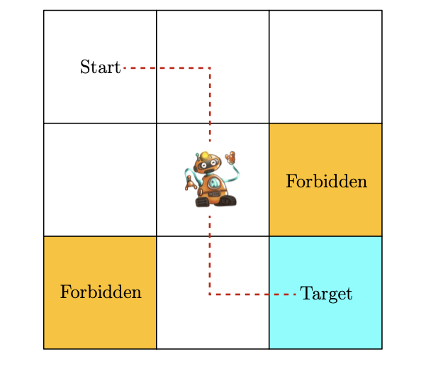
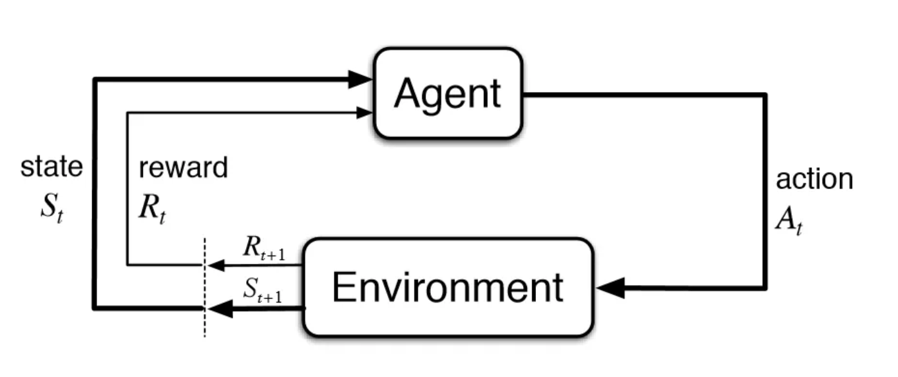
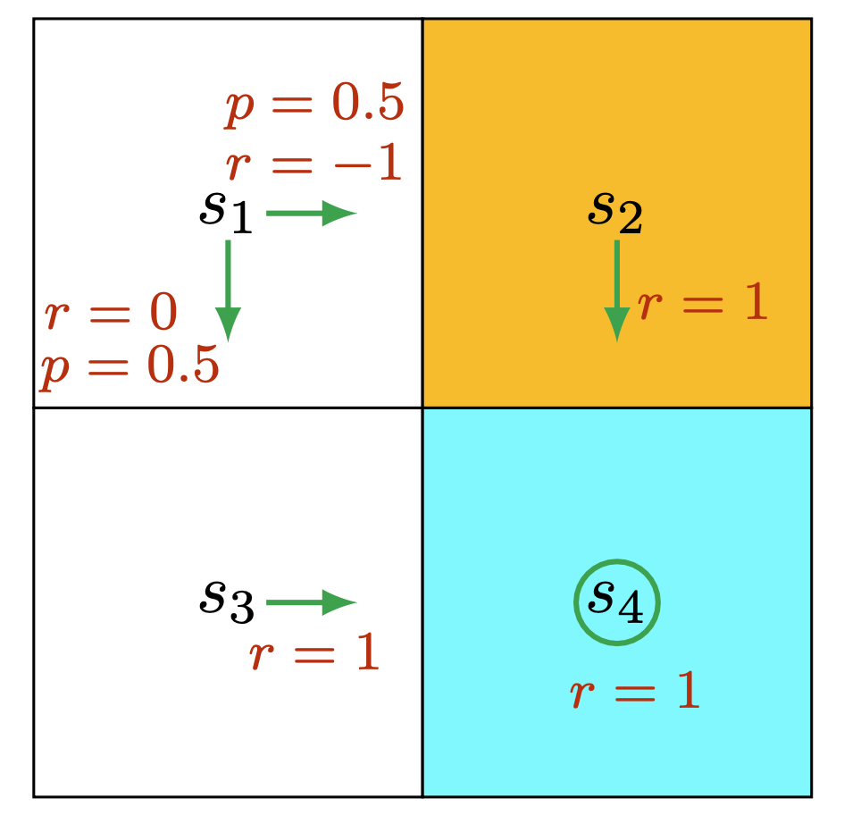
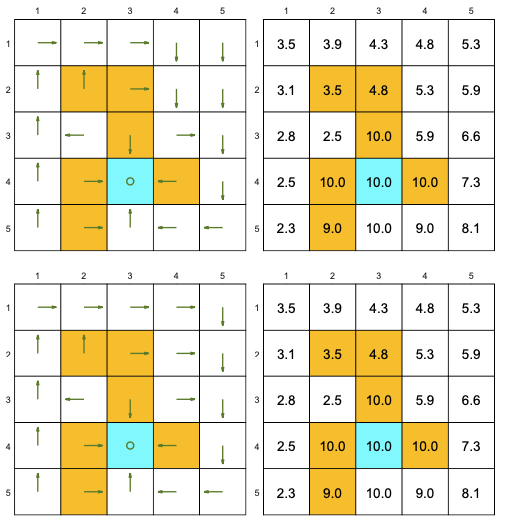
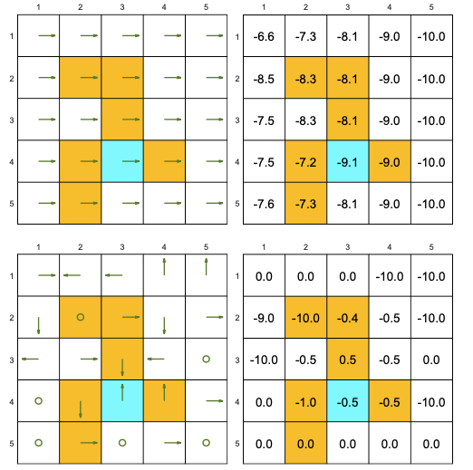

# Reinforcement Learning {#sec-reinforcement-learning}

Reinforcement learning (RL) represents a fundamentally different paradigm from supervised and unsupervised learning. While
supervised learning (@sec-supervised-learning) learns from labeled examples and unsupervised learning (@sec-unsupervised-learning)
discovers structure in unlabeled data, RL addresses the challenge of learning through interaction. An RL agent must discover which
actions yield the highest rewards by trying them out, learning from the consequences of its choices.

This trial-and-error learning mirrors how humans and animals learn: a child learns to walk by attempting steps and adjusting based
on success or failure, not by being shown the "correct" muscle activations. Similarly, an RL agent learns to play chess by playing
games and observing which moves lead to victory, not by being told the optimal move in each position.

The mathematical framework for RL, introduced in @sec-math-stat-foundations, is the Markov Decision Process (MDP). This chapter
develops the theory and algorithms for solving MDPs, from foundational concepts like value functions and Bellman equations to
modern deep reinforcement learning methods. The connections to optimization (@sec-optimization) and probability theory
(@sec-probability-statistics, which also reviews probability spaces, random variables and expectations with worked examples)
will be essential throughout.

The chapter follows @zhao2025rl and @theodoridis2025ml, with @bishop2024deeplearning for the deep-learning methods. Foundations
of RL defines Markov decision processes, policies and returns. Value functions and Bellman equations defines state and action
values and proves the recursive equations they satisfy. Dynamic programming, Monte Carlo methods and temporal-difference learning
are the three classical families of tabular algorithms. Advanced RL scales them up with function approximation and deep
Q-networks, policy gradient methods optimize the policy directly, and actor-critic methods combine the two. The last sections
survey model-based and multi-agent RL, offline RL, and imitation learning together with LLM-enhanced RL. Every statement is
followed by examples and exercises with hidden solutions, and the chapter closes with integrative exercises.

## Foundations of RL {#sec-rl-foundations}

Reinforcement learning addresses the fundamental problem of learning to make sequential decisions through interaction with an
environment. Unlike supervised learning, where correct actions are explicitly provided, RL agents must discover effective
behaviors through trial and error, balancing **exploration** (trying new actions to discover their effects) with **exploitation**
(using known good actions to maximize reward).



Reinforcement learning can be described as an agent-environment interaction process. The agent is a decision-maker that can sense
its state, maintain policies, and execute actions. Everything outside of the agent is regarded as the environment
[@zhao2025rl].

For more on this topic, see @bishop2024deeplearning [Ch. 19].

This exploration-exploitation dilemma is central to RL and has no simple solution. Explore too much, and the agent wastes time on
suboptimal actions; exploit too much, and the agent may never discover better strategies. This trade-off, absent in supervised
learning, makes RL both challenging and fascinating.

### Markov Decision Processes

The Markov Decision Process (MDP) provides the mathematical foundation for modeling sequential decision-making problems.
Introduced in @sec-probability-statistics, MDPs formalize the interaction between an agent and its environment, capturing the
essential elements needed to reason about optimal behavior. The framework is remarkably general, encompassing problems from robot
control to game playing to resource allocation.

A Markov Decision Process describes decision-making in situations where outcomes are partly random and partly controlled by an
agent. At each time step, the agent:

- Observes the current state of the environment
- Takes an action, which may lead to a transition to a new state
- Receives a reward based on the action taken and the resulting state

The goal of the agent is to maximize the cumulative reward over time by choosing the best possible actions based on the current
state.



The formal definition below collects these ingredients into a single tuple. Each component is explained together with the range
of forms it takes in practice, from finite boards to continuous joint angles.

:::: {.statement-box}
::: {#def-rl-markov-decision-process}
#### Markov decision process

An MDP is defined by the tuple $(\mathcal{S}, \mathcal{A}, P, R, \gamma)$ where:

- $\mathcal{S}$: The **state space**, representing all possible configurations of the environment. States can be discrete (e.g.,
board positions in chess, with approximately $10^{43}$ possible states) or continuous (e.g., robot joint angles in
$\mathbb{R}^n$). The state should capture all information relevant for decision-making.

- $\mathcal{A}$: The **action space**, representing all possible actions the agent can take. Actions can be discrete (e.g., {up,
down, left, right} for grid navigation) or continuous (e.g., motor torques in $\mathbb{R}^m$ for robot control). In some problems,
available actions depend on the current state, denoted $\mathcal{A}(s)$.

- $P: \mathcal{S} \times \mathcal{A} \times \mathcal{S} \to [0,1]$: The **state transition probability function**, where
$P(s'|s,a)$ gives the probability of transitioning to state $s'$ when taking action $a$ in state $s$. This function must satisfy
$\sum_{s' \in \mathcal{S}} P(s'|s,a) = 1$ for all $s, a$. Deterministic environments have $P(s'|s,a) \in \{0,1\}$, while
stochastic environments have probabilistic transitions.

- $R: \mathcal{S} \times \mathcal{A} \times \mathcal{S} \to \mathbb{R}$: The **reward function**, where $R(s,a,s')$ specifies the
immediate reward received when transitioning from state $s$ to state $s'$ via action $a$. Rewards encode the task objective:
positive rewards for desirable outcomes, negative rewards (penalties) for undesirable ones. In some formulations, the reward
depends only on $(s,a)$ or only on $s$.

- $\gamma \in [0,1]$: The **discount factor**, which determines the present value of future rewards. A reward received $k$ steps
in the future is worth $\gamma^k$ times its nominal value. This captures the intuition that immediate rewards are more valuable
than distant ones, either due to uncertainty about the future or opportunity cost.
:::

::::

The same elements can be written with the reward and the policy as probability distributions [@zhao2025rl]:

- Sets
    - State space: $\mathcal{S}=\left\{s_1, s_2, \ldots \right\}$
    - Action space: $\mathcal{A}(s)=\left\{a_1, a_2, \ldots \right\}$
    - Reward space: $\mathcal{R}(s, a)=\left\{r_1, r_2, \ldots \right\}$
- Model
    - State transition probability: $p(s' \mid s, a)$
    - Reward probability: $p(r \mid s, a)$
- Policy
    - $\pi(a \mid s) = p(a \mid s)$
- Markov property
    - $p\left(s_{t+1} \mid s_t, a_t, s_{t-1}, a_{t-1}, \ldots, s_0, a_0\right)=p\left(s_{t+1} \mid s_t, a_t\right)$
    - $p\left(r_{t+1} \mid s_t, a_t, s_{t-1}, a_{t-1}, \ldots, s_0, a_0\right)=p\left(r_{t+1} \mid s_t, a_t\right)$

Both descriptions are used below, and the examples that follow show how concrete problems are cast into them. They range from a
small grid to driving and medical treatment, and end with the four-state grid world that runs through the rest of the
foundations.

:::: {.callout-note .examples-fold collapse="true" title="Examples"}
The first example is the textbook grid world, with every element of the tuple written out. Its slippery floor shows how a
stochastic transition function models uncertainty in the outcome of an action.

::: {#exm-rl-mdp-grid-world}
#### Grid world navigation

Consider a robot navigating a $5 \times 5$ grid to reach a goal while avoiding obstacles: -
**States:** $\mathcal{S} = \{(i,j): 1 \leq i,j \leq 5\} \setminus \{\text{obstacles}\}$ (24 states after removing obstacle) -
**Actions:** $\mathcal{A} = \{\text{up, down, left, right}\}$
- **Transitions:** Deterministic movement, except at walls (stay in
place) and with 10% probability of moving perpendicular to intended direction (modeling slippery floor) - **Rewards:** $R = +10$
for reaching goal, $R = -1$ for each step (encourages efficiency), $R = -5$ for hitting obstacle - **Discount:** $\gamma = 0.9$
(values immediate rewards but considers future)

This simple example illustrates how MDPs model real-world problems. The stochastic transitions capture uncertainty, the reward
structure encodes the task objective, and the discount factor balances short-term and long-term considerations.
:::

The next two examples leave the grid and describe applications in the distributional notation. Their states are tuples of
measured quantities rather than cells, and their models are known only approximately.

::: {#exm-rl-mdp-autonomous-driving}
#### Autonomous driving

- State space: $\mathcal{S} = \left\{ (\text{position}, \text{speed}, \text{lane}, \text{proximity to vehicles},
  \text{traffic signals})_1, \dots \right\}$
- Action space: $\mathcal{A} = \{ \text{accelerate}, \text{brake}, \text{left}, \text{right}, \text{stay} \}$
- Reward space: $\mathcal{R} = \{ \text{+1 for safe driving}, \text{-10 for collision}, \text{+5 for reaching the goal} \}$
- Model: The dynamics describe the effects of the vehicle's actions on its next state, such as how acceleration changes speed and
  position.
:::

Medical treatment planning has the same structure, with health states in place of traffic situations. Here the transitions are
genuinely probabilistic, since patients respond differently to the same treatment.

::: {#exm-rl-mdp-healthcare}
#### Healthcare treatment planning

- State space: $\mathcal{S} = \left\{ \big(\text{disease state}, \text{treatment response}, \text{vital signs},
  \text{age} \big)_1, \dots \right\}$
- Action space: $\mathcal{A} = \{ \text{drug A}, \text{drug B}, \text{surgery}, \text{no treatment} \}$
- Reward space: $\mathcal{R} = \{ \text{+10 for recovery}, \text{-5 for side effects}, \text{-10 for relapse} \}$
- Model: The dynamics describe how treatments affect the patient's health, with probabilistic transitions between health states
  based on treatment and health conditions.
:::

The last example is small enough to be solved completely by hand. This small example follows @zhao2025rl and runs through the rest
of the foundations, where its values, Bellman equations and matrices are computed.

::: {#exm-rl-mdp-four-state-grid}
#### A four-state grid world

{width="170"}

- Sets
    - State space: $\mathcal{S} = \{ s_1, s_2, s_3, s_4 \}$
    - Action space: $\mathcal{A} = \{ \uparrow, \downarrow, \leftarrow, \rightarrow, \bigcirc \}$
    - Reward space: $\mathcal{R} = \{ -1, +1, 0 \}$
- Model
    - State transition: $p(s' \mid s, a) = 0 \text{ or } 1$
    - Reward: $p(r \mid s, a) = 0 \text{ or } 1$
- Policy
    - $\pi(a \mid s) = 0 \text{ or } 1$
- Markov property
    - $p\left(s_{t+1} \mid s_t, a_t, s_{t-1}, \ldots \right)=p\left(s_{t+1} \mid s_t, a_t\right)$
    - $p\left(r_{t+1} \mid s_t, a_t, s_{t-1}, \ldots \right)=p\left(r_{t+1} \mid s_t, a_t\right)$
:::
::::

The exercise asks the reader to build an MDP from a verbal description. It checks the normalization condition on $P$ and the
reading of the reward function.

:::: {.callout-note .exercises-fold collapse="true" title="Exercises"}
A machine is either working or broken, and each day its operator decides whether to run it or to repair it. Writing this down as
a tuple and checking that every row of the transition function sums to one is the first test of @def-rl-markov-decision-process.

::: {#exr-rl-mdp-machine-repair}
#### A machine-repair MDP

Running a working machine earns $+1$ and leaves it working with probability $0.9$ and broken with probability $0.1$; running a
broken machine earns $0$ and leaves it broken; repairing costs $2$ (reward $-2$) and makes the machine work on the next day.
Write down $(\mathcal{S}, \mathcal{A}, P, R, \gamma)$ with $\gamma = 0.95$, check $\sum_{s'} P(s' \mid s, a) = 1$, and compute the
expected immediate reward of running a working machine.
:::

::: {.callout-note .solution collapse="true" title="Solution"}
$\mathcal{S} = \{\text{W}, \text{B}\}$ and $\mathcal{A} = \{\text{run}, \text{repair}\}$. The transitions are
$P(\text{W} \mid \text{W}, \text{run}) = 0.9$, $P(\text{B} \mid \text{W}, \text{run}) = 0.1$, $P(\text{B} \mid \text{B},
\text{run}) = 1$, $P(\text{W} \mid \text{W}, \text{repair}) = P(\text{W} \mid \text{B}, \text{repair}) = 1$, all others zero, so
each of the four rows sums to $0.9 + 0.1 = 1$ or to $1$. The rewards are $R(\text{W}, \text{run}, s') = 1$ for both $s'$,
$R(\text{B}, \text{run}, \text{B}) = 0$ and $R(s, \text{repair}, \text{W}) = -2$, with $\gamma = 0.95$. The expected immediate
reward of running a working machine is $\sum_{s'} P(s' \mid \text{W}, \text{run}) R(\text{W}, \text{run}, s') = 0.9 \cdot 1 + 0.1
\cdot 1 = 1$.
:::
::::

The definition of an MDP builds in one assumption that deserves its own statement: the next state depends on the history only
through the present state and action. This is what makes the tuple $(\mathcal{S}, \mathcal{A}, P, R, \gamma)$ a complete
description of the dynamics.

:::: {.statement-box}
::: {#def-rl-markov-property}
#### Markov property

The defining characteristic of an MDP is the Markov property, discussed in @sec-probability-statistics, which states that the
future is independent of the past given the present:

$$P(S_{t+1}=s'|S_t=s, A_t=a, S_{t-1}, A_{t-1}, \ldots, S_0, A_0) = P(S_{t+1}=s'|S_t=s, A_t=a)$$
:::

::::

This "memoryless" property means that the current state contains all information necessary to make optimal decisions—the state is
a **sufficient statistic** for the history. In practice, constructing states that satisfy the Markov property often requires
careful feature engineering. For example, in Atari games, a single frame doesn't capture ball velocity, so the state typically
consists of the last 4 frames.

:::: {.callout-note .examples-fold collapse="true" title="Examples"}
The example contrasts a process that is Markov in its natural state with one that is not. It shows the standard repair: enlarge
the state until it carries the missing information, exactly as stacking Atari frames does.

::: {#exm-rl-markov-pendulum}
#### A random walk and a pendulum

A random walk on the integers, $S_{t+1} = S_t \pm 1$ with probabilities $p$ and $1 - p$, is Markov: the law of $S_{t+1}$ is fixed
by $S_t$ alone. A pendulum observed only through its angle $\theta_t$ is not: two visits to the same angle, one swinging left and
one swinging right, have different futures, so $\theta_{t+1}$ depends on $\theta_{t-1}$ as well. The pair $(\theta_t,
\dot\theta_t)$, or approximately the pair $(\theta_t, \theta_{t-1})$, is a Markov state.
:::
::::

The exercise turns the pendulum repair into a general construction. It shows that a process with a memory of two steps becomes
Markov on pairs of consecutive states.

:::: {.callout-note .exercises-fold collapse="true" title="Exercises"}
A second-order process is one in which the next value depends on the last two. The reader shows that pairing consecutive values
restores the Markov property of @def-rl-markov-property.

::: {#exr-rl-markov-second-order}
#### Second-order processes

Let $X_{t+1}$ depend on the past only through $(X_t, X_{t-1})$, i.e. $P(X_{t+1} \mid X_t, \ldots, X_0) = P(X_{t+1} \mid X_t,
X_{t-1})$. Show that $Y_t = (X_t, X_{t-1})$ is a Markov process.
:::

::: {.callout-note .solution collapse="true" title="Solution"}
$Y_{t+1} = (X_{t+1}, X_t)$, and its second component is already a function of $Y_t$. Hence $P(Y_{t+1} = (x', x) \mid Y_t, \ldots,
Y_1) = \mathbb{1}[x = X_t] \, P(X_{t+1} = x' \mid X_t, \ldots, X_0) = \mathbb{1}[x = X_t] \, P(X_{t+1} = x' \mid X_t, X_{t-1})$,
which depends on the history only through $Y_t = (X_t, X_{t-1})$. The history $Y_t, \ldots, Y_1$ determines $X_t, \ldots, X_0$,
so conditioning on it is the same as conditioning on the past of $X$.
:::
::::

### Policies, trajectories and returns

An MDP describes the environment; the agent enters through its policy, the rule by which it chooses actions. In the
distributional notation above the policy is a conditional distribution, and this is the form used throughout the chapter.

:::: {.statement-box}
::: {#def-rl-policy}
#### Policy

A **policy** $\pi$ assigns to each state $s$ a probability distribution $\pi(\cdot \mid s)$ on $\mathcal{A}(s)$, with
$\pi(a \mid s) = p(a \mid s)$ the probability of taking action $a$ in state $s$. It is **deterministic** if every $\pi(\cdot \mid
s)$ puts all its mass on one action, which is then written $\pi(s)$.
:::

::::

A policy together with an MDP determines a stochastic process of states, actions and rewards. The examples and exercises below
work with the policy of the four-state grid world.

:::: {.callout-note .examples-fold collapse="true" title="Examples"}
The four-state grid world comes with a policy that is deterministic in three states and randomizes in one. Writing its
probabilities out fixes the policy that all the later value computations use.

::: {#exm-rl-policy-four-state}
#### The policy of the four-state grid world

In the grid world of @exm-rl-mdp-four-state-grid the policy is $\pi(\rightarrow \mid s_1) = \pi(\downarrow \mid s_1) = 0.5$,
$\pi(\downarrow \mid s_2) = 1$, $\pi(\rightarrow \mid s_3) = 1$ and $\pi(\bigcirc \mid s_4) = 1$. It is stochastic in $s_1$ and
deterministic elsewhere; the matrix `Pi` in the NumPy computation below stores exactly these numbers, one column per state.
:::
::::

Counting policies shows how fast the search space grows. The exercise counts the deterministic policies of the four-state grid
world and the dimension of its set of stochastic policies.

:::: {.callout-note .exercises-fold collapse="true" title="Exercises"}
Deterministic policies form a finite set and stochastic policies a product of simplices. The reader counts both for the
four-state grid world.

::: {#exr-rl-policy-count}
#### Counting policies

How many deterministic policies does the four-state grid world have, with five actions available in every state? What is the
dimension of the set of its stochastic policies?
:::

::: {.callout-note .solution collapse="true" title="Solution"}
A deterministic policy picks one of $5$ actions in each of $4$ states independently, so there are $5^4 = 625$ of them. A stochastic
policy picks a point of the probability simplex $\{p \in \mathbb{R}^5 : p_i \geq 0, \sum_i p_i = 1\}$, of dimension $4$, in each
state, so the set of stochastic policies is a product of four such simplices, of dimension $4 \cdot 4 = 16$.
:::
::::

Running a policy in an MDP produces a trajectory, and the agent's objective is a single number computed from it. The definition
below names that number, the discounted return, and distinguishes tasks that end from tasks that go on forever.

:::: {.statement-box}
::: {#def-rl-discounted-return}
#### Trajectory, return and terminal state

The state-action-reward trajectory is the sequence

$$\ldots S_t, R_{t} \overset{A_t} \rightarrow S_{t+1}, R_{t+1} \overset{A_{t+1}} \rightarrow S_{t+2}, R_{t+2} \overset{A_{t+2}}
\rightarrow S_{t+3}, R_{t+3} \ldots$$

The discounted return is

$$G_t = R_{t+1} + \gamma \cdot R_{t+2} + \gamma^2 \cdot R_{t+3} + \cdots$$

A terminal state $s_T$ is a state with the property that any action from it resets the next state to a starting state. If there
are terminal states, the task is episodic. Otherwise it is continuing.
:::

::::

The return satisfies the recursion $G_t = R_{t+1} + \gamma G_{t+1}$, which is the seed of every Bellman equation in the next
section. The example computes a return in closed form on the four-state grid world.

:::: {.callout-note .examples-fold collapse="true" title="Examples"}
Following the policy from $s_1$ along the downward branch gives a trajectory that ends in the target $s_4$ and stays there.
Its return is a geometric series, the simplest case of a discounted sum.

::: {#exm-rl-return-four-state}
#### A trajectory of the four-state grid world

A trajectory: $\ldots s_1, 0 \overset{\downarrow} \rightarrow s_3, 0 \overset{\rightarrow} \rightarrow s_4, 1
\overset{\bigcirc} \rightarrow s_4, 1 \overset{\bigcirc} \rightarrow \ldots$

Its discounted return: $G_t = 0 + \gamma \cdot 1 + \gamma^2 \cdot 1 + \cdots = \frac{\gamma}{1-\gamma}$
:::
::::

The exercise treats an episode of fixed length. It contrasts the finite sum with its limit and checks the recursion for the
return.

:::: {.callout-note .exercises-fold collapse="true" title="Exercises"}
A reward of one at every step of an episode of length $T$ gives a truncated geometric series. The reader sums it and verifies the
recursion $G_t = R_{t+1} + \gamma G_{t+1}$ of @def-rl-discounted-return.

::: {#exr-rl-return-finite-episode}
#### Return of a finite episode

An episode ends after $T$ steps and every reward is $R_{t+1} = 1$. Compute $G_0$, its limit as $T \to \infty$ for $\gamma < 1$,
and check that $G_0 = 1 + \gamma G_1$.
:::

::: {.callout-note .solution collapse="true" title="Solution"}
$G_0 = \sum_{k=0}^{T-1} \gamma^k = \frac{1 - \gamma^T}{1 - \gamma}$ (and $G_0 = T$ for $\gamma = 1$), which tends to
$\frac{1}{1-\gamma}$ as $T \to \infty$. The return from time $1$ sums $T - 1$ rewards, $G_1 = \frac{1-\gamma^{T-1}}{1-\gamma}$, and
$1 + \gamma G_1 = \frac{1 - \gamma + \gamma - \gamma^T}{1-\gamma} = G_0$.
:::
::::

## Value functions and Bellman equations {#sec-rl-value-functions-bellman}

Value functions turn the return, a random variable, into numbers attached to states and actions, and the Bellman equations are
the recursive relations those numbers satisfy. This section defines the values of a policy and the optimal values, proves the
Bellman expectation and optimality equations, and solves them on the four-state grid world; everything later in the chapter is
an algorithm for solving these equations exactly or approximately.

### Value Functions

Value functions are central to reinforcement learning, providing a way to evaluate the quality of states and actions. They enable
the agent to compare different courses of action and select those that lead to higher cumulative rewards.

**State-Value Function:** The state-value function $v_\pi(s)$ represents the expected return when starting from state $s$ and
following policy $\pi$ thereafter:

:::: {.statement-box}
::: {#def-state-value-function}
#### State-Value Function

$$v_\pi(s) = \mathbb{E}_\pi[G_t | S_t = s] = \mathbb{E}_\pi\left[\sum_{k=0}^\infty \gamma^k R_{t+k+1} \bigg| S_t = s\right]$$
:::

::::

The expectation is taken over the randomness in the policy $\pi$, the transition dynamics $P$, and potentially the reward
function. The state-value function answers the question: "How good is it to be in this state?" It aggregates information about all
possible future trajectories from that state under the given policy.

:::: {.callout-note .examples-fold collapse="true" title="Examples"}
The four-state grid world with the policy of @exm-rl-policy-four-state has state values that can be read off from its
trajectories. Three states lead straight to the target, and the first one averages a penalized and an unpenalized route.

::: {#exm-rl-state-values-four-state}
#### State values in the four-state grid world

State values:

- $v_\pi(s_1) = -0.5 + \frac{\gamma}{1-\gamma}$
- $v_\pi(s_2) = \frac{1}{1-\gamma}$
- $v_\pi(s_3) = \frac{1}{1-\gamma}$
- $v_\pi(s_4) = \frac{1}{1-\gamma}$
:::
::::

The simplest MDP has one state and one action, and its value is a single geometric series. The exercise computes it, which is
the building block of every value in the grid world.

:::: {.callout-note .exercises-fold collapse="true" title="Exercises"}
A single absorbing state that pays a fixed reward forever is the elementary case of @def-state-value-function. The reader
computes its value and evaluates it numerically.

::: {#exr-rl-state-value-absorbing}
#### Value of an absorbing state

An MDP has one state $s$, one action, and reward $r$ at every step. Compute $v_\pi(s)$, and evaluate it for $r = 1$ and $\gamma =
0.9$.
:::

::: {.callout-note .solution collapse="true" title="Solution"}
Every trajectory has $R_{t+k+1} = r$, so $v_\pi(s) = \sum_{k=0}^\infty \gamma^k r = \frac{r}{1-\gamma}$. For $r = 1$ and $\gamma =
0.9$ this is $10$, which is $v_\pi(s_4)$ of the four-state grid world at $\gamma = 0.9$.
:::
::::

The state value averages over the first action as well as over everything after it. Fixing the first action gives a finer
function, which is the one an agent needs in order to compare actions.

**Action-Value Function (Q-function):** The action-value function $q_\pi(s,a)$ represents the expected return when starting from
state $s$, taking action $a$, and following policy $\pi$ thereafter:

:::: {.statement-box}
::: {#def-rl-action-value-function}
#### Action-value function

$$q_\pi(s,a) = \mathbb{E}_\pi[G_t | S_t = s, A_t = a] = \mathbb{E}_\pi\left[\sum_{k=0}^\infty \gamma^k R_{t+k+1} \bigg| S_t = s,
A_t = a\right]$$
:::

::::

The Q-function is particularly useful because it allows action selection without requiring a model of the environment: the agent
can simply choose $\arg\max_a q_\pi(s,a)$ without needing to know the transition probabilities. The example lists all action
values of the four-state grid world, which is what such a choice would be based on.

:::: {.callout-note .examples-fold collapse="true" title="Examples"}
The four-state grid world has twenty state-action pairs, and each has an action value. The list below gives all of them in terms
of $\gamma$, including the actions the policy never takes.

::: {#exm-rl-action-values-four-state}
#### Action values in the four-state grid world

Action values:

- $q_\pi(s_1, \rightarrow) = -1 + \gamma \frac{1}{1-\gamma}$
- $q_\pi(s_1, \downarrow) = \gamma \frac{1}{1-\gamma}$
- $q_\pi(s_1, \leftarrow) = -1 + \gamma (-0.5 + \frac{\gamma}{1-\gamma})$
- $q_\pi(s_1, \uparrow) = -1 + \gamma (-0.5 + \frac{\gamma}{1-\gamma})$
- $q_\pi(s_1, \bigcirc) = \gamma (-0.5 + \frac{\gamma}{1-\gamma})$
- $q_\pi(s_2, \rightarrow) = -1 + \gamma \frac{1}{1-\gamma}$
- $q_\pi(s_2, \downarrow) = 1 + \gamma \frac{1}{1-\gamma}$
- $q_\pi(s_2, \leftarrow) = \gamma (-0.5 + \frac{\gamma}{1-\gamma})$
- $q_\pi(s_2, \uparrow) = -1 + \gamma \frac{1}{1-\gamma}$
- $q_\pi(s_2, \bigcirc) = -1 + \gamma \frac{1}{1-\gamma}$
- $q_\pi(s_3, \rightarrow) = 1 + \gamma \frac{1}{1-\gamma}$
- $q_\pi(s_3, \downarrow) = -1 + \gamma \frac{1}{1-\gamma}$
- $q_\pi(s_3, \leftarrow) = -1 + \gamma \frac{1}{1-\gamma}$
- $q_\pi(s_3, \uparrow) = 1 + \gamma (-0.5 + \frac{\gamma}{1-\gamma})$
- $q_\pi(s_3, \bigcirc) = \gamma \frac{1}{1-\gamma}$
- $q_\pi(s_4, \rightarrow) = -1 + \gamma \frac{1}{1-\gamma}$
- $q_\pi(s_4, \downarrow) = -1 + \gamma \frac{1}{1-\gamma}$
- $q_\pi(s_4, \leftarrow) = \gamma \frac{1}{1-\gamma}$
- $q_\pi(s_4, \uparrow) = -1 + \gamma \frac{1}{1-\gamma}$
- $q_\pi(s_4, \bigcirc) = 1 + \gamma \frac{1}{1-\gamma}$
:::
::::

The exercise evaluates the two action values that the policy actually uses in $s_1$. Averaging them with the policy weights
recovers the state value, which anticipates the proposition that follows.

:::: {.callout-note .exercises-fold collapse="true" title="Exercises"}
With $\gamma = 0.9$ the action values of @def-rl-action-value-function become plain numbers. The reader computes the two that
matter in $s_1$ and compares their average with $v_\pi(s_1)$.

::: {#exr-rl-action-values-numeric}
#### Action values at $\gamma = 0.9$

In the four-state grid world with $\gamma = 0.9$, compute $q_\pi(s_1, \downarrow)$, $q_\pi(s_1, \rightarrow)$ and $v_\pi(s_1)$,
and check that $v_\pi(s_1) = 0.5\, q_\pi(s_1, \downarrow) + 0.5\, q_\pi(s_1, \rightarrow)$.
:::

::: {.callout-note .solution collapse="true" title="Solution"}
$\frac{1}{1-\gamma} = 10$, so $q_\pi(s_1, \downarrow) = 0.9 \cdot 10 = 9$ and $q_\pi(s_1, \rightarrow) = -1 + 9 = 8$, while
$v_\pi(s_1) = -0.5 + \frac{0.9}{0.1} = 8.5$. Indeed $0.5 \cdot 9 + 0.5 \cdot 8 = 8.5$.
:::
::::

**Relationship Between Value Functions:** The state-value and action-value functions are intimately related. The two relations
below express each in terms of the other.

:::: {.statement-box}
::: {#prp-rl-value-relations}
#### Relations between state and action values

The value of a state is the expected value of the actions taken from that state:

$$v_\pi(s) = \sum_{a \in \mathcal{A}} \pi(a|s) q_\pi(s,a) = \mathbb{E}_{a \sim \pi(\cdot|s)}[q_\pi(s,a)]$$

Conversely, the Q-function can be expressed in terms of the state-value function:

$$q_\pi(s,a) = \sum_{s' \in \mathcal{S}} P(s'|s,a)[R(s,a,s') + \gamma v_\pi(s')]$$
:::

::::

The first relation is the law of total expectation, conditioning $G_t$ on $A_t$. The second conditions on $S_{t+1}$ and uses
$G_t = R_{t+1} + \gamma G_{t+1}$ together with the Markov property, which gives $\mathbb{E}_\pi[G_{t+1} \mid S_t = s, A_t = a,
S_{t+1} = s'] = v_\pi(s')$.

The first equation shows that $v_\pi(s)$ is a weighted average of the Q-values, where the weights are given by the policy. The
second decomposes the Q-value into the immediate reward plus the discounted value of the next state. It shows that the
value of taking an action is the expected immediate reward plus the expected discounted value of where that action leads.

With the reward written as a distribution, the second relation reads

$$q_\pi(s, a)=\sum_{r \in \mathcal{R}} p(r \mid s, a) r+\gamma \sum_{s^{\prime} \in \mathcal{S}} p\left(s^{\prime} \mid s,
a\right) v_\pi\left(s^{\prime}\right)$$

The examples below check both relations numerically before they are combined into the Bellman equation. They use the action
values of the four-state grid world computed above.

:::: {.callout-note .examples-fold collapse="true" title="Examples"}
Both relations can be checked on the four-state grid world, one in each direction. The computation goes from the action values of
$s_1$ to its state value, and from the state value of $s_2$ to an action value of $s_1$.

::: {#exm-rl-value-relations-four-state}
#### Converting values in the four-state grid world

From action value to state value: $v_\pi(s_1) = 0.5\, q_\pi(s_1, \rightarrow) + 0.5\, q_\pi(s_1, \downarrow) = 0.5 \left(-1 + \frac{\gamma}{1-\gamma}\right) + 0.5 \frac{\gamma}{1-\gamma} = -0.5 + \frac{\gamma}{1-\gamma}$

From state value to action value: $q_\pi(s_1, \rightarrow) = 1(-1) + \gamma v_\pi(s_2) = -1 + \gamma \frac{1}{1-\gamma}$
:::
::::

For a deterministic policy the first relation collapses to a single term. The exercise makes this precise.

:::: {.callout-note .exercises-fold collapse="true" title="Exercises"}
The relations of @prp-rl-value-relations simplify when the policy puts all its weight on one action. The reader derives the
simplified form.

::: {#exr-rl-value-relations-deterministic}
#### Deterministic policies

Show that for a deterministic policy $v_\pi(s) = q_\pi(s, \pi(s))$, and that $v_\pi(s) = \sum_{s'} P(s' \mid s,
\pi(s))[R(s, \pi(s), s') + \gamma v_\pi(s')]$.
:::

::: {.callout-note .solution collapse="true" title="Solution"}
For a deterministic policy $\pi(a \mid s) = 1$ if $a = \pi(s)$ and $0$ otherwise, so the sum $\sum_a \pi(a \mid s) q_\pi(s, a)$
has the single term $q_\pi(s, \pi(s))$. Substituting the second relation of @prp-rl-value-relations with $a = \pi(s)$ gives the
second formula.
:::
::::

### Optimal values and advantages

The values of a fixed policy rank states; to rank policies one compares their values state by state. The optimal value
functions are the pointwise best values over all policies.

**Optimal Value Functions:** The goal of reinforcement learning is often to find an optimal policy that maximizes the expected
return.

:::: {.statement-box}
::: {#def-rl-optimal-value-functions}
#### Optimal value functions

The optimal state-value function is defined as:

$$v_*(s) = \max_\pi v_\pi(s) = \max_\pi \mathbb{E}_\pi[G_t | S_t = s]$$

Similarly, the optimal action-value function is:

$$q_*(s,a) = \max_\pi q_\pi(s,a) = \max_\pi \mathbb{E}_\pi[G_t | S_t = s, A_t = a]$$
:::

::::

These optimal value functions represent the best possible performance achievable from each state or state-action pair. A key
result is that there always exists at least one deterministic optimal policy that achieves these optimal values
(@thm-rl-optimal-policy-existence).

:::: {.callout-note .examples-fold collapse="true" title="Examples"}
Optimal values do not single out an optimal policy. The figures show several different policies that reach the same, best state
values, and others that fall short.

::: {#exm-rl-optimal-good-bad-policies}
#### Good and bad policies

**Policies and state values:** Different policies can have the same state values. The following "good" policies are different but
they have the same state values:

{width="400"}

The following "bad" policies have lower state values:

{width="400"}
:::
::::

The exercise computes an optimal value directly from the definition in a one-state problem. Only two deterministic policies
exist, so the maximum over policies can be taken by hand.

:::: {.callout-note .exercises-fold collapse="true" title="Exercises"}
A single state with two self-loop actions paying different rewards is the smallest problem in which @def-rl-optimal-value-functions
has content. The reader finds $v_*$ and $q_*$.

::: {#exr-rl-optimal-one-state}
#### Two actions in one state

A single state $s$ has actions $a_1$ and $a_2$, both returning to $s$, with rewards $1$ and $2$. Find $v_*(s)$, $q_*(s, a_1)$ and
$q_*(s, a_2)$ for $\gamma = 0.9$.
:::

::: {.callout-note .solution collapse="true" title="Solution"}
A policy choosing $a_2$ with probability $p$ in every step earns $1 + p$ per step in expectation, so $v_\pi(s) = \frac{1 +
p}{1-\gamma}$, which is largest for $p = 1$: $v_*(s) = \frac{2}{0.1} = 20$. Starting with $a_1$ and then acting optimally gives
$q_*(s, a_1) = 1 + 0.9 \cdot 20 = 19$, and $q_*(s, a_2) = 2 + 0.9 \cdot 20 = 20 = v_*(s)$.
:::
::::

Policy-gradient methods, later in the chapter, need to know how much better one action is than the policy's average. The
advantage function measures exactly that difference.

**Advantage Function:** The advantage function measures how much better an action is compared to the average action under the
current policy:

:::: {.statement-box}
::: {#def-rl-advantage-function}
#### Advantage function

$$A_\pi(s,a) = q_\pi(s,a) - v_\pi(s)$$
:::

::::

The advantage function is zero on average: $\mathbb{E}_{a \sim \pi}[A_\pi(s,a)] = 0$. Positive advantages indicate actions that
are better than average, while negative advantages indicate worse-than-average actions. The advantage function is particularly
useful in policy gradient methods, where it can reduce variance in gradient estimates.

:::: {.callout-note .examples-fold collapse="true" title="Examples"}
The numbers of @exr-rl-action-values-numeric give the advantages in $s_1$ directly. They show one action above and one below the
average, with policy-weighted mean zero.

::: {#exm-rl-advantage-four-state}
#### Advantages in the four-state grid world

With $\gamma = 0.9$, $q_\pi(s_1, \downarrow) = 9$, $q_\pi(s_1, \rightarrow) = 8$ and $v_\pi(s_1) = 8.5$, so $A_\pi(s_1,
\downarrow) = 0.5$ and $A_\pi(s_1, \rightarrow) = -0.5$. Their average under $\pi(\cdot \mid s_1) = (0.5, 0.5)$ is $0$. Moving
down is better than the policy's average in $s_1$, since it avoids the forbidden cell.
:::
::::

The exercise proves the zero-mean property stated after the definition. It also identifies the advantage of the action a
deterministic policy takes.

:::: {.callout-note .exercises-fold collapse="true" title="Exercises"}
The zero-mean property of @def-rl-advantage-function follows from the relation between state and action values. The reader proves
it and specializes it to deterministic policies.

::: {#exr-rl-advantage-zero-mean}
#### The advantage has mean zero

Prove $\mathbb{E}_{a \sim \pi(\cdot \mid s)}[A_\pi(s, a)] = 0$, and show that $A_\pi(s, \pi(s)) = 0$ for a deterministic policy.
:::

::: {.callout-note .solution collapse="true" title="Solution"}
By @prp-rl-value-relations, $\sum_a \pi(a \mid s) A_\pi(s, a) = \sum_a \pi(a \mid s) q_\pi(s, a) - v_\pi(s) \sum_a \pi(a \mid s)
= v_\pi(s) - v_\pi(s) = 0$. For a deterministic policy $v_\pi(s) = q_\pi(s, \pi(s))$ (@exr-rl-value-relations-deterministic), so
$A_\pi(s, \pi(s)) = 0$.
:::
::::

### Bellman Equations

The Bellman equations are fundamental recursive relationships that express the value of a state (or state-action pair) in terms of
the values of successor states. These equations form the basis for most reinforcement learning algorithms and provide both a
characterization of optimal policies and a computational framework for finding them.

**Bellman Expectation Equation:** For a given policy $\pi$, the Bellman expectation equation expresses the value function
recursively, and likewise for the action-value function.

:::: {.statement-box}
::: {#thm-rl-bellman-expectation-equation}
#### Bellman expectation equation

For every policy $\pi$,

$$v_\pi(s) = \sum_{a \in \mathcal{A}} \pi(a|s) \sum_{s' \in \mathcal{S}} P(s'|s,a)[R(s,a,s') + \gamma v_\pi(s')]$$

and

$$q_\pi(s,a) = \sum_{s' \in \mathcal{S}} P(s'|s,a)[R(s,a,s') + \gamma \sum_{a' \in \mathcal{A}} \pi(a'|s') q_\pi(s',a')]$$
:::

::::

This equation has an intuitive interpretation: the value of state $s$ under policy $\pi$ equals the expected immediate reward plus
the expected discounted value of the next state, where both expectations are taken over the actions selected by $\pi$ and the
stochastic transitions of the environment.

**Derivation:** Starting from the definition of the value function:

\begin{align*} v_\pi(s) &= \mathbb{E}_\pi[G_t | S_t = s] \\ &= \mathbb{E}_\pi[R_{t+1} + \gamma G_{t+1} | S_t = s] \\ &=
\mathbb{E}_\pi[R_{t+1} | S_t = s] + \gamma \mathbb{E}_\pi[G_{t+1} | S_t = s] \\ &= \sum_a \pi(a|s) \sum_{s'} P(s'|s,a) R(s,a,s') +
\gamma \sum_a \pi(a|s) \sum_{s'} P(s'|s,a) v_\pi(s') \\ &= \sum_a \pi(a|s) \sum_{s'} P(s'|s,a)[R(s,a,s') + \gamma v_\pi(s')]
\end{align*}

The key insight is that the return $G_t$ can be decomposed into the immediate reward $R_{t+1}$ plus the discounted future return
$\gamma G_{t+1}$, and by the Markov property, $\mathbb{E}[G_{t+1}|S_t=s, A_t=a, S_{t+1}=s'] = v_\pi(s')$.

The second equation expresses the Q-value as the expected immediate reward plus the expected discounted Q-value of the next
state-action pair. It follows by substituting the first relation of @prp-rl-value-relations for $v_\pi(s')$ in the second.

**Forms with reward distributions:** With the reward written as a distribution $p(r \mid s, a)$, the Bellman equation of the
state values is [@zhao2025rl]

$$v_\pi(s) = \sum_{a \in \mathcal{A}} \pi(a \mid s)\left[\sum_{r \in \mathcal{R}} p(r \mid s, a) r+\gamma \sum_{s^{\prime}
\in \mathcal{S}} p\left(s^{\prime} \mid s, a\right) v_\pi\left(s^{\prime}\right)\right]$$

An equivalent form uses the joint distribution of the next state and the reward:

$$v_\pi(s)=\sum_{a \in \mathcal{A}} \pi(a \mid s) \sum_{s^{\prime} \in \mathcal{S}} \sum_{r \in \mathcal{R}}
p\left(s^{\prime}, r \mid s, a\right)\left[r+\gamma v_\pi\left(s^{\prime}\right)\right]$$

If the reward depends only on the next state, the Bellman equation can be written as

$$v_\pi(s)=\sum_{a \in \mathcal{A}} \pi(a \mid s) \sum_{s^{\prime} \in \mathcal{S}} p\left(s^{\prime} \mid s,
a\right)\left[r\left(s^{\prime}\right)+\gamma v_\pi\left(s^{\prime}\right)\right]$$

The Bellman equation of the action values is

$$q_\pi(s, a)=\sum_{r \in \mathcal{R}} p(r \mid s, a) r+\gamma \sum_{s^{\prime} \in \mathcal{S}} p\left(s^{\prime} \mid s,
a\right) \sum_{a^{\prime} \in \mathcal{A}\left(s^{\prime}\right)} \pi\left(a^{\prime} \mid s^{\prime}\right)
q_\pi\left(s^{\prime}, a^{\prime}\right)$$

All these forms say the same thing in different bookkeeping. The example writes them out for the four-state grid world, where
every transition and reward is deterministic.

:::: {.callout-note .examples-fold collapse="true" title="Examples"}
Written out for the four-state grid world, the Bellman equations become a small linear system in four state values and twenty
action values. Each equation links a state to the states its policy actions lead to.

::: {#exm-rl-bellman-four-state}
#### Bellman equations in the four-state grid world

State values:

- $v_\pi(s_1) = -0.5 + 0.5 \gamma (v_\pi(s_2) + v_\pi(s_3))$
- $v_\pi(s_2) = 1 + \gamma v_\pi(s_4)$
- $v_\pi(s_3) = 1 + \gamma v_\pi(s_4)$
- $v_\pi(s_4) = 1 + \gamma v_\pi(s_4)$

Action values:

- $q_\pi(s_1, \rightarrow) = -1 + \gamma q_\pi(s_2, \downarrow)$
- $q_\pi(s_1, \downarrow) = \gamma q_\pi(s_3, \rightarrow)$
- $q_\pi(s_1, \leftarrow) = -1 + \gamma (q_\pi(s_1, \rightarrow) + q_\pi(s_1, \downarrow))$
- $q_\pi(s_1, \uparrow) = -1 + \gamma (q_\pi(s_1, \rightarrow) + q_\pi(s_1, \downarrow))$
- $q_\pi(s_1, \bigcirc) = \gamma (q_\pi(s_1, \rightarrow) + q_\pi(s_1, \downarrow))$
- $q_\pi(s_2, \rightarrow) = -1 + \gamma q_\pi(s_2, \downarrow)$
- $q_\pi(s_2, \downarrow) = 1 + \gamma q_\pi(s_4, \bigcirc)$
- $q_\pi(s_2, \leftarrow) = \gamma (q_\pi(s_1, \rightarrow) + q_\pi(s_4, \downarrow))$
- $q_\pi(s_2, \uparrow) = -1 + \gamma q_\pi(s_2, \downarrow)$
- $q_\pi(s_2, \bigcirc) = -1 + \gamma q_\pi(s_2, \downarrow)$
- $q_\pi(s_3, \rightarrow) = 1 + \gamma q_\pi(s_4, \bigcirc)$
- $q_\pi(s_3, \downarrow) = -1 + \gamma q_\pi(s_3, \rightarrow)$
- $q_\pi(s_3, \leftarrow) = -1 + \gamma q_\pi(s_3, \rightarrow)$
- $q_\pi(s_3, \uparrow) = 1 + \gamma (q_\pi(s_1, \rightarrow) + q_\pi(s_1, \downarrow))$
- $q_\pi(s_3, \bigcirc) = \gamma q_\pi(s_3, \rightarrow)$
- $q_\pi(s_4, \rightarrow) = -1 + \gamma q_\pi(s_4, \bigcirc)$
- $q_\pi(s_4, \downarrow) = -1 + \gamma q_\pi(s_4, \bigcirc)$
- $q_\pi(s_4, \leftarrow) = \gamma q_\pi(s_3, \rightarrow)$
- $q_\pi(s_4, \uparrow) = -1 + \gamma q_\pi(s_2, \downarrow)$
- $q_\pi(s_4, \bigcirc) = 1 + \gamma q_\pi(s_4, \bigcirc)$
:::
::::

The state-value equations of the example are triangular: the last involves only $v_\pi(s_4)$. The exercise solves them by back
substitution and compares the result with @exm-rl-state-values-four-state.

:::: {.callout-note .exercises-fold collapse="true" title="Exercises"}
Solving the Bellman equations of @thm-rl-bellman-expectation-equation by hand is possible whenever the system is triangular. The
reader does it for the four-state grid world.

::: {#exr-rl-bellman-solve-four-state}
#### Solving the four-state Bellman equations

Solve the four state-value equations of @exm-rl-bellman-four-state for general $\gamma < 1$.
:::

::: {.callout-note .solution collapse="true" title="Solution"}
The last equation gives $(1 - \gamma) v_\pi(s_4) = 1$, so $v_\pi(s_4) = \frac{1}{1-\gamma}$. Then $v_\pi(s_2) = v_\pi(s_3) = 1 +
\frac{\gamma}{1-\gamma} = \frac{1}{1-\gamma}$, and $v_\pi(s_1) = -0.5 + 0.5 \gamma \cdot \frac{2}{1-\gamma} = -0.5 +
\frac{\gamma}{1-\gamma}$. These are the values listed in @exm-rl-state-values-four-state.
:::
::::

For a finite state space the Bellman expectation equation is a linear system, and writing it with vectors and matrices makes its
solution explicit. The proposition below states the matrix form and its unique solution.

**Matrix-Vector Form:** For finite state spaces, the Bellman expectation equation can be written in matrix-vector form.

:::: {.statement-box}
::: {#prp-rl-bellman-matrix-form}
#### Matrix-vector form of the Bellman equation

$$\mathbf{v}_\pi = \mathbf{r}_\pi + \gamma \mathbf{P}_\pi \mathbf{v}_\pi$$

where $\mathbf{v}_\pi \in \mathbb{R}^{|\mathcal{S}|}$ is the vector of state values, $\mathbf{r}_\pi \in
\mathbb{R}^{|\mathcal{S}|}$ is the vector of expected immediate rewards under $\pi$, and $\mathbf{P}_\pi \in
\mathbb{R}^{|\mathcal{S}| \times |\mathcal{S}|}$ is the state transition matrix under $\pi$. This linear system has a unique
solution:

$$\mathbf{v}_\pi = (\mathbf{I} - \gamma \mathbf{P}_\pi)^{-1} \mathbf{r}_\pi$$

provided $\gamma < 1$ or the MDP is episodic.
:::

::::

The matrix $(\mathbf{I} - \gamma \mathbf{P}_\pi)$ is invertible because $\gamma < 1$
ensures that the spectral radius of $\gamma \mathbf{P}_\pi$ is less than 1.

With reward distributions, the entries of $\mathbf{r}_\pi$ and $\mathbf{P}_\pi$ are

$$\left[r_\pi\right]_s \doteq \sum_{a \in \mathcal{A}} \pi(a \mid s) \sum_{r \in \mathcal{R}} p(r \mid s, a) r$$

$$\left[P_\pi\right]_{s s^{\prime}} \doteq \sum_{a \in \mathcal{A}} \pi(a \mid s) p\left(s^{\prime} \mid s, a\right)$$

The state transition matrix has the following properties:

$$P_\pi \geq 0$$

$$P_\pi \mathbf{1}=\mathbf{1}$$

$$\exists (I-\gamma P_\pi)^{-1}$$

$$\left(I-\gamma P_\pi\right)^{-1} \geq I$$

$$\left(I-\gamma P_\pi\right)^{-1} r \geq 0, \quad r \geq 0$$

$$\left(I-\gamma P_\pi\right)^{-1} r_1 \geq\left(I-\gamma P_\pi\right)^{-1} r_2, \quad r_1 \geq r_2$$

Instead of inverting the matrix, the state values can also be found iteratively:

$$v_{k+1}=r_\pi+\gamma P_\pi v_k, \quad k=0,1,2, \ldots$$

The action values satisfy the matrix-vector form

$$q_\pi=\tilde{r}+\gamma P \Pi q_\pi$$

where

$$\left[q_\pi\right]_{(s, a)}=q_\pi(s, a)$$

$$[\tilde{r}]_{(s, a)}=\sum_{r \in \mathcal{R}} p(r \mid s, a) r$$

$$[P]_{(s, a), s^{\prime}}=p\left(s^{\prime} \mid s, a\right)$$

$$\Pi_{s^{\prime},\left(s^{\prime}, a^{\prime}\right)}=\pi\left(a^{\prime} \mid s^{\prime}\right)$$

The matrices are easiest to understand on an example small enough to print in full. The four-state grid world provides one, with
twenty state-action pairs and four states.

:::: {.callout-note .examples-fold collapse="true" title="Examples"}
The four-state grid world gives concrete instances of every vector and matrix just defined. The row of $\mathbf{r}_\pi$ for $s_1$
averages the two actions of the stochastic policy, and the rows of $\mathbf{P}_\pi$ are probability vectors.

::: {#exm-rl-matrix-form-four-state}
#### Matrix-vector form in the four-state grid world

- $r_\pi = \left[\begin{array}{c}0.5(0)+0.5(-1) \\ 1 \\ 1 \\ 1\end{array}\right]$
- $P_\pi = \left[\begin{array}{cccc}0 & 0.5 & 0.5 & 0 \\ 0 & 0 & 0 & 1 \\ 0 & 0 & 0 & 1 \\ 0 & 0 & 0 & 1\end{array}\right]$
- $\tilde{r} = \left[\begin{array}{c} -1 \\ 0 \\ -1 \\ -1 \\ 0 \\ \vdots\end{array}\right]$
- $P = \left[\begin{array}{cccc}1 & 0 & 0 & 0 \\ 0 & 0 & 1 & 0 \\ 1 & 0 & 0 & 0 \\ 0 & 1 & 0 & 0 \\ 1 & 0 & 0 & 0 \\ \vdots &
  \vdots & \vdots & \vdots \end{array}\right]$
- $\Pi = \left[\begin{array}{cccc}0 & 0.5 & 0 & 0.5 & 0 & 0 & 0 & 0 & 0 & 0 &\dots \\ 0 & 0 & 0 & 0 & 0 & 0 & 1 & 0 & 0 & 0
  &\dots \\ 0 & 0 & 0 & 0 & 0 & 0 & 0 & 0 & 0 & 0 & \dots \\ 0 & 0 & 0 & 0 & 0 & 0 & 0 & 0 & 0 & 0 & \dots \end{array}\right]$
:::
::::

The exercise solves the matrix equation of the example with $\gamma = 0.9$ by hand. Its answer is the vector that the NumPy
computation in the next unit prints.

:::: {.callout-note .exercises-fold collapse="true" title="Exercises"}
The system $\mathbf{v}_\pi = \mathbf{r}_\pi + \gamma \mathbf{P}_\pi \mathbf{v}_\pi$ of @prp-rl-bellman-matrix-form can be solved
row by row when $\mathbf{P}_\pi$ is as sparse as here. The reader computes $\mathbf{v}_\pi$ for $\gamma = 0.9$.

::: {#exr-rl-matrix-form-solve}
#### Solving the matrix equation

With $r_\pi = (-0.5, 1, 1, 1)$ and $P_\pi$ as in @exm-rl-matrix-form-four-state, solve $\mathbf{v}_\pi = \mathbf{r}_\pi + 0.9
\mathbf{P}_\pi \mathbf{v}_\pi$.
:::

::: {.callout-note .solution collapse="true" title="Solution"}
The fourth row reads $v_4 = 1 + 0.9 v_4$, so $v_4 = 10$. Rows two and three give $v_2 = v_3 = 1 + 0.9 \cdot 10 = 10$. The first row
gives $v_1 = -0.5 + 0.9(0.5 \cdot 10 + 0.5 \cdot 10) = 8.5$. Hence $\mathbf{v}_\pi = (8.5, 10, 10, 10)$, in agreement with
$v_\pi(s_1) = -0.5 + \frac{0.9}{0.1}$.
:::
::::

### Computing state values in the four-state grid world

The closed-form and iterative solutions of @prp-rl-bellman-matrix-form are a few lines of NumPy each. This unit builds the model
matrices of the four-state grid world and computes its state values both ways.

:::: {.callout-note .examples-fold collapse="true" title="Examples"}
The computation follows @zhao2025rl and stores the model with one row per state-action pair. It ends with the two solutions,
which agree with the hand computation of @exr-rl-matrix-form-solve.

::: {#exm-rl-software-four-state-values}
#### State values with NumPy

The state values of the example can be computed with both solutions. The state transition probabilities are stacked into a matrix
with one row per state-action pair:

$$[P]_{(s, a), s^{\prime}}=p\left(s^{\prime} \mid s, a\right)$$

```{python}
import numpy as np
P = np.array(
    [
        [1., 0., 0., 0.],
        [0., 0., 1., 0.],
        [1., 0., 0., 0.],
        [0., 1., 0., 0.],
        [1., 0., 0., 0.],
        [0., 1., 0., 0.],
        [0., 0., 0., 1.],
        [1., 0., 0., 0.],
        [0., 1., 0., 0.],
        [0., 1., 0., 0.],
        [1., 0., 0., 0.],
        [0., 0., 1., 0.],
        [0., 0., 1., 0.],
        [0., 0., 0., 1.],
        [0., 0., 1., 0.],
        [0., 1., 0., 0.],
        [0., 0., 0., 1.],
        [0., 0., 1., 0.],
        [0., 0., 0., 1.],
        [0., 0., 0., 1.]
    ]
)
```

The reward probabilities, over the reward space $\{-1, 1, 0\}$:

$$[R]_{(s, a), r}=p\left(r \mid s, a\right)$$

```{python}
R = np.array(
    [
        [1., 0., 0.],
        [0., 0., 1.],
        [1., 0., 0.],
        [1., 0., 0.],
        [0., 0., 1.],
        [1., 0., 0.],
        [0., 1., 0.],
        [0., 0., 1.],
        [1., 0., 0.],
        [1., 0., 0.],
        [0., 0., 1.],
        [1., 0., 0.],
        [1., 0., 0.],
        [0., 1., 0.],
        [0., 0., 1.],
        [1., 0., 0.],
        [1., 0., 0.],
        [0., 0., 1.],
        [1., 0., 0.],
        [0., 1., 0.]
    ]
)
```

The policy probabilities:

$$[\Pi]_{a, s} = p(a \mid s)$$

```{python}
Pi = np.array([
    [0.0, 0.0, 0.0, 0.0],
    [0.5, 1.0, 0.0, 0.0],
    [0.0, 0.0, 0.0, 0.0],
    [0.5, 0.0, 1.0, 0.0],
    [0.0, 0.0, 0.0, 1.0]
])
```

The expected reward under the policy:

$$\left[r_\pi\right]_s = \sum_{a \in \mathcal{A}} \pi(a \mid s) \sum_{r \in \mathcal{R}} p(r \mid s, a) r$$

$$\left[r_\pi\right]_s = \sum_{a \in \mathcal{A}} \big( R \cdot \left[\begin{array}{c}-1 & 1 & 0 \end{array}\right]^T
\big)_{s, a} \cdot [\Pi]_{a, s}$$

```{python}
r_space = np.array([-1, 1, 0])
r_p = np.diagonal(
    np.matmul(
        np.dot(R, r_space).reshape(4, 5),
        Pi
    )
)
r_p
```

The state transition probabilities under the policy:

$$\left[P_\pi\right]_{s s^{\prime}} = \sum_{a \in \mathcal{A}} \pi(a \mid s) p\left(s^{\prime} \mid s, a\right)$$

$$\left[P_\pi\right]_{s s^{\prime}} = \sum_{a \in \mathcal{A}} [\Pi^T]_{s, a} [P]_{(s, a), s^{\prime}}$$

```{python}
P_p = np.diagonal(
    np.matmul(
        P.T.reshape(4,4,5),
        Pi
    ).T
).T
P_p
```

The closed-form solution $v_\pi=\left(I-\gamma P_\pi\right)^{-1} r_\pi$:

```{python}
gamma = 0.9
I = np.identity(r_p.size)
v_cfs = np.dot(np.linalg.inv(I - gamma * P_p), r_p)
v_cfs
```

The iterative solution $v_{k+1}=r_\pi+\gamma P_\pi v_k$, stopped once no state value changes by more than the tolerance:

```{python}
tol = 1e-5
v_is = np.zeros_like(r_p)
while True:
    v_is_current = v_is
    v_is = r_p + gamma * np.dot(P_p, v_is)
    diff = np.abs(v_is - v_is_current)
    if np.all(diff < tol):
        break
v_is
```
:::
::::

### Bellman optimality

The Bellman expectation equation evaluates a given policy. Replacing the average over the policy's actions by a maximum gives the
equation satisfied by the optimal values, whose solution yields an optimal policy.

**Bellman Optimality Equation:** The Bellman optimality equation characterizes the optimal value functions:

:::: {.statement-box}
::: {#thm-rl-bellman-optimality-equation}
#### Bellman optimality equation

$$v_*(s) = \max_{a \in \mathcal{A}} \sum_{s' \in \mathcal{S}} P(s'|s,a)[R(s,a,s') + \gamma v_*(s')]$$

For the optimal action-value function:

$$q_*(s,a) = \sum_{s' \in \mathcal{S}} P(s'|s,a)[R(s,a,s') + \gamma \max_{a' \in \mathcal{A}} q_*(s',a')]$$
:::

::::

This equation states that the optimal value of a state is the maximum over all actions of the expected immediate reward plus the
discounted optimal value of the next state. The max operator replaces the expectation over actions in the Bellman expectation
equation, reflecting that the optimal policy chooses the best action rather than following a fixed distribution.

The Bellman optimality equation is a system of nonlinear equations (due to the max operator) with $|\mathcal{S}|$ equations and
$|\mathcal{S}|$ unknowns. Unlike the Bellman expectation equation, it cannot be solved by simple linear algebra.

:::: {.callout-note .examples-fold collapse="true" title="Examples"}
A two-state problem shows the max at work: one action pays at once, the other pays more later. The optimality equation is solved
by guessing the optimal action and checking that the guess is consistent.

::: {#exm-rl-optimality-two-state}
#### Stay or go

State $A$ has actions "stay" (reward $1$, back to $A$) and "go" (reward $0$, to $B$); state $B$ has one action "stay" (reward $2$,
back to $B$); $\gamma = 0.9$. The equation for $B$ is $v_*(B) = 2 + 0.9 v_*(B)$, so $v_*(B) = 20$. For $A$, $v_*(A) = \max(1 + 0.9
v_*(A), 0 + 0.9 \cdot 20)$. Trying "go": $v_*(A) = 18$, and then $1 + 0.9 \cdot 18 = 17.2 < 18$, so the maximum is indeed attained
by "go" and $v_*(A) = 18$. Trying "stay" would give $v_*(A) = 10 < 18$, which violates the equation.
:::
::::

The exercise computes the optimal action values of the same example. It checks the second equation of the theorem and the link
$v_* = \max_a q_*$.

:::: {.callout-note .exercises-fold collapse="true" title="Exercises"}
The action-value form of @thm-rl-bellman-optimality-equation is checked on the stay-or-go example. The reader computes all three
optimal action values.

::: {#exr-rl-optimality-q-two-state}
#### Optimal action values for stay or go

In @exm-rl-optimality-two-state, compute $q_*(A, \text{stay})$, $q_*(A, \text{go})$ and $q_*(B, \text{stay})$, and verify the
action-value optimality equation and $v_*(s) = \max_a q_*(s, a)$.
:::

::: {.callout-note .solution collapse="true" title="Solution"}
$q_*(B, \text{stay}) = 2 + 0.9 \cdot 20 = 20$, $q_*(A, \text{go}) = 0 + 0.9 \cdot \max_a q_*(B, a) = 18$ and $q_*(A,
\text{stay}) = 1 + 0.9 \max(q_*(A, \text{stay}), q_*(A, \text{go})) = 1 + 0.9 \cdot 18 = 17.2$. Each equals reward plus $0.9$
times the best action value of the next state, and $\max(17.2, 18) = 18 = v_*(A)$, $\max(20) = 20 = v_*(B)$.
:::
::::

**Optimal Policy Extraction:** Once we have the optimal value functions, we can extract an optimal policy:

$$\pi_*(s) = \arg\max_{a \in \mathcal{A}} q_*(s,a) = \arg\max_{a \in \mathcal{A}} \sum_{s'} P(s'|s,a)[R(s,a,s') + \gamma
v_*(s')]$$

This policy is greedy with respect to the optimal value function. A fundamental result in MDP theory is that there always exists
at least one deterministic optimal policy, and any policy that is greedy with respect to $v_*$ is optimal.

:::: {.statement-box}
::: {#thm-rl-optimal-policy-existence}
#### Existence and uniqueness of optimal values

For any MDP: 1. There exists an optimal policy $\pi_*$ that is better than or equal to all other
policies: $v_{\pi_*}(s) \geq v_\pi(s)$ for all $s$ and all $\pi$
2. All optimal policies share the same optimal value function
$v_*$ and optimal action-value function $q_*$
3. The optimal value functions $v_*$ and $q_*$ are the unique solutions to the
Bellman optimality equations 4. There always exists at least one deterministic optimal policy
:::

::::

The uniqueness in item 3 is a consequence of the contraction property proved below (@thm-rl-bellman-contraction), and the greedy
policy of the extraction formula is the deterministic optimal policy of item 4. The examples and exercises apply these facts to the
stay-or-go problem and to problems with ties.

:::: {.callout-note .examples-fold collapse="true" title="Examples"}
In the stay-or-go problem the greedy policy can be read off the optimal action values. It is deterministic and achieves $v_*$, as
the theorem promises.

::: {#exm-rl-greedy-two-state}
#### The greedy policy of stay or go

From @exr-rl-optimality-q-two-state, $\arg\max_a q_*(A, a) = \text{go}$ and $\pi_*(B) = \text{stay}$. Evaluating this deterministic
policy gives $v_{\pi_*}(B) = 20$ and $v_{\pi_*}(A) = 0 + 0.9 \cdot 20 = 18$, which are the optimal values.
:::
::::

Optimal policies need not be unique even though $v_*$ is, as the good policies of @exm-rl-optimal-good-bad-policies already show.
The exercise constructs the simplest instance.

:::: {.callout-note .exercises-fold collapse="true" title="Exercises"}
Item 2 of @thm-rl-optimal-policy-existence says that all optimal policies share $v_*$, not that there is only one. The reader
exhibits infinitely many optimal policies in a one-state MDP.

::: {#exr-rl-optimal-policy-ties}
#### Many optimal policies

A single state has two actions, both with reward $1$ and both returning to the state. Find $v_*$, and show that every policy,
deterministic or stochastic, is optimal.
:::

::: {.callout-note .solution collapse="true" title="Solution"}
Every policy earns reward $1$ at every step whatever it chooses, so $v_\pi = \frac{1}{1-\gamma}$ for all $\pi$, and $v_* =
\frac{1}{1-\gamma}$. Hence the two deterministic policies and all their mixtures are optimal; they share $v_*$ and $q_*(s, a_1) =
q_*(s, a_2) = \frac{1}{1-\gamma}$, as item 2 requires.
:::
::::

Both Bellman equations can be read as fixed-point equations $v = T v$ for an operator on value functions. The theorem below shows
that these operators contract distances, which gives existence, uniqueness and convergence of iteration in one stroke.

**Contraction Mapping:** The Bellman expectation operator $T^\pi$ is defined by:

$$(T^\pi v)(s) = \sum_a \pi(a|s) \sum_{s'} P(s'|s,a)[R(s,a,s') + \gamma v(s')]$$

Similarly, the Bellman optimality operator $T^*$ is defined by:

$$(T^* v)(s) = \max_a \sum_{s'} P(s'|s,a)[R(s,a,s') + \gamma v(s')]$$

:::: {.statement-box}
::: {#thm-rl-bellman-contraction}
#### Bellman operators are contractions

$T^\pi$ is a $\gamma$-contraction in the max-norm: $\|T^\pi v - T^\pi u\|_\infty \leq \gamma \|v - u\|_\infty$. By the Banach
fixed-point theorem, $T^\pi$ has a unique fixed point, which is $v_\pi$. $T^*$ is also a $\gamma$-contraction with unique fixed
point $v_*$.
:::

::::

For $T^\pi$, the rewards cancel in the difference, and $|(T^\pi v - T^\pi u)(s)| = \gamma \left|\sum_a \pi(a|s) \sum_{s'}
P(s'|s,a)(v(s') - u(s'))\right| \leq \gamma \|v - u\|_\infty$, since the weights $\pi(a|s) P(s'|s,a)$ are non-negative and sum to
one. For $T^*$, the same bound holds for each action, and $|\max_a f(a) - \max_a g(a)| \leq \max_a |f(a) - g(a)|$ carries it
through the maximum.

The contraction property guarantees convergence of iterative methods like policy evaluation. For $T^*$ it underlies the
convergence of value iteration and Q-learning.

:::: {.callout-note .examples-fold collapse="true" title="Examples"}
Applying $T^*$ twice to the zero function in the stay-or-go problem shows the contraction numerically. The distance between
iterates shrinks by at least the factor $\gamma$.

::: {#exm-rl-contraction-two-state}
#### Two steps of $T^*$

In @exm-rl-optimality-two-state, start from $v_0 = (0, 0)$ for $(A, B)$. Then $v_1 = T^* v_0 = (\max(1, 0), 2) = (1, 2)$ and $v_2
= T^* v_1 = (\max(1 + 0.9, 0 + 1.8), 2 + 1.8) = (1.9, 3.8)$. Thus $\|v_1 - v_0\|_\infty = 2$ and $\|v_2 - v_1\|_\infty = 1.8 =
0.9 \cdot 2$, the bound of @thm-rl-bellman-contraction with equality.
:::
::::

The hypothesis $\gamma < 1$ cannot be dropped in continuing tasks. The exercise gives a counterexample.

:::: {.callout-note .exercises-fold collapse="true" title="Exercises"}
Without discounting the Bellman operator of a continuing task can fail to have a fixed point at all. The reader checks this on
the smallest example, which shows why @thm-rl-bellman-contraction needs $\gamma < 1$.

::: {#exr-rl-contraction-no-discount}
#### No contraction without discounting

A single state pays reward $1$ forever. Write $T^\pi$ for $\gamma = 1$, show that it is not a contraction, and that it has no
fixed point.
:::

::: {.callout-note .solution collapse="true" title="Solution"}
$(T^\pi v)(s) = 1 + v(s)$, so $|T^\pi v - T^\pi u| = |v - u|$: the Lipschitz constant is $1$, not less than $1$. A fixed point
would satisfy $v = 1 + v$, which is impossible; correspondingly the return $\sum_k 1$ diverges.
:::
::::

## Dynamic Programming {#sec-rl-dynamic-programming}

Dynamic programming (DP) methods solve MDPs by exploiting the recursive structure of the Bellman equations. DP requires complete
knowledge of the MDP (model-based approach) and is computationally feasible only for problems with relatively small state and
action spaces. Despite these limitations, DP provides the foundation for understanding many reinforcement learning algorithms.

### Policy evaluation

**Policy Evaluation (Prediction):** Given a policy $\pi$, policy evaluation computes the state-value function $v_\pi$ by
iteratively applying the Bellman expectation operator:

$$v_{k+1}(s) = \sum_{a \in \mathcal{A}} \pi(a|s) \sum_{s' \in \mathcal{S}} P(s'|s,a)[R(s,a,s') + \gamma v_k(s')]$$

**Algorithm (Iterative Policy Evaluation):** ``` Input: Policy π, discount factor γ, threshold θ Initialize: v(s) = 0 for all s ∈
S Repeat: Δ ← 0 For each s ∈ S: v_old ← v(s) v(s) ← Σ_a π(a|s) Σ_s' P(s'|s,a)[R(s,a,s') + γv(s')] Δ ← max(Δ, |v_old - v(s)|) Until
Δ < θ Return: v ≈ v_π ```

The proposition below says that this iteration converges, and how fast. It is a direct consequence of the contraction property of
@thm-rl-bellman-contraction.

:::: {.statement-box}
::: {#prp-rl-policy-evaluation-convergence}
#### Convergence of policy evaluation

Starting from an arbitrary initial value function $v_0$ (often initialized to zero), this iteration is guaranteed to converge to
$v_\pi$ as $k \to \infty$. **Convergence Rate:** The error after $k$ iterations is bounded by:

$$\|v_k - v_\pi\|_\infty \leq \gamma^k \|v_0 - v_\pi\|_\infty$$
:::

::::

The convergence follows from the contraction mapping property of the Bellman expectation operator: $v_k = T^\pi v_{k-1}$ and $v_\pi
= T^\pi v_\pi$, so $\|v_k - v_\pi\|_\infty \leq \gamma \|v_{k-1} - v_\pi\|_\infty$, and induction on $k$ gives the bound.

This shows exponential convergence with rate $\gamma$. For $\gamma$ close to 1, convergence can be slow, requiring many
iterations.

**Computational Complexity:** Each iteration requires $O(|\mathcal{S}|^2 |\mathcal{A}|)$ operations, as we must sum over all
possible next states for each state-action pair. For large state spaces, this becomes computationally prohibitive.

:::: {.callout-note .examples-fold collapse="true" title="Examples"}
The one-state MDP of @exr-rl-state-value-absorbing can be iterated in closed form. The error after $k$ sweeps equals the bound of
the proposition exactly, so the bound cannot be improved in general.

::: {#exm-rl-policy-evaluation-one-state}
#### Policy evaluation on one state

With reward $1$, $\gamma = 0.9$ and $v_0 = 0$, the iteration $v_{k+1} = 1 + 0.9 v_k$ gives $v_k = \frac{1 - 0.9^k}{0.1} = 10(1 -
0.9^k)$. The error is $|v_k - 10| = 10 \cdot 0.9^k = 0.9^k |v_0 - v_\pi|$.
:::
::::

The bound of the proposition tells in advance how many sweeps are needed for a given accuracy. The exercise computes that number.

:::: {.callout-note .exercises-fold collapse="true" title="Exercises"}
Turning the bound of @prp-rl-policy-evaluation-convergence into an iteration count requires a logarithm. The reader does it for a
typical discount factor.

::: {#exr-rl-policy-evaluation-iterations}
#### How many sweeps?

With $\gamma = 0.9$ and $\|v_0 - v_\pi\|_\infty \leq 10$, how many sweeps guarantee $\|v_k - v_\pi\|_\infty \leq 0.01$?
:::

::: {.callout-note .solution collapse="true" title="Solution"}
It suffices that $10 \cdot 0.9^k \leq 0.01$, i.e. $0.9^k \leq 10^{-3}$, i.e. $k \geq \frac{\ln 1000}{\ln(1/0.9)} = \frac{6.908}{0.1054}
\approx 65.6$. So $k = 66$ sweeps suffice.
:::
::::

### Policy improvement and policy iteration

Evaluating a policy is only half the job: the values must also be used to find a better policy. Acting greedily with respect to
the current values does that, and the policy improvement theorem guarantees that the result is never worse.

**Policy Improvement:** Given the value function $v_\pi$ for a policy $\pi$, we can construct an improved policy $\pi'$ by acting
greedily with respect to $v_\pi$:

$$\pi'(s) = \arg\max_{a \in \mathcal{A}} \sum_{s' \in \mathcal{S}} P(s'|s,a)[R(s,a,s') + \gamma v_\pi(s')] = \arg\max_{a \in
\mathcal{A}} q_\pi(s,a)$$

:::: {.statement-box}
::: {#thm-rl-policy-improvement}
#### Policy Improvement Theorem

Let $\pi$ and $\pi'$ be any pair of deterministic policies such that $q_\pi(s, \pi'(s)) \geq
v_\pi(s)$ for all $s \in \mathcal{S}$. Then $v_{\pi'}(s) \geq v_\pi(s)$ for all $s \in \mathcal{S}$. If the inequality is strict
for at least one state, then $v_{\pi'}(s) > v_\pi(s)$ for at least one state.
:::

::::

**Proof Sketch:** By repeatedly applying the Bellman equation and using the greedy improvement condition, we can show:

\begin{align*} v_\pi(s) &\leq q_\pi(s, \pi'(s)) \\ &= \mathbb{E}[R_{t+1} + \gamma v_\pi(S_{t+1}) | S_t=s, A_t=\pi'(s)] \\ &\leq
\mathbb{E}[R_{t+1} + \gamma q_\pi(S_{t+1}, \pi'(S_{t+1})) | S_t=s, A_t=\pi'(s)] \\ &= \mathbb{E}[R_{t+1} + \gamma R_{t+2} +
\gamma^2 v_\pi(S_{t+2}) | S_t=s, \pi'] \\ &\leq \cdots \\ &\leq v_{\pi'}(s) \end{align*}

This theorem guarantees that greedy policy improvement never makes the policy worse and will strictly improve it unless it is
already optimal. The example applies one greedy step to a deliberately short-sighted policy.

:::: {.callout-note .examples-fold collapse="true" title="Examples"}
The stay-or-go problem of @exm-rl-optimality-two-state starts naturally from the myopic policy that always stays. One greedy step
switches the action in $A$ and raises its value.

::: {#exm-rl-policy-improvement-two-state}
#### Improving the myopic policy

Let $\pi$ stay in both states. Then $v_\pi(A) = \frac{1}{0.1} = 10$ and $v_\pi(B) = 20$. In $A$, $q_\pi(A, \text{go}) = 0 + 0.9
\cdot 20 = 18 > 10 = v_\pi(A)$, so the greedy policy $\pi'$ goes. Its values are $v_{\pi'}(B) = 20$ and $v_{\pi'}(A) = 18 \geq 10$,
strictly larger in $A$ as the theorem predicts.
:::
::::

The theorem is stated for any $\pi'$ satisfying its hypothesis, and the greedy policy is the main instance. The exercise checks
that the greedy policy satisfies the hypothesis.

:::: {.callout-note .exercises-fold collapse="true" title="Exercises"}
The hypothesis $q_\pi(s, \pi'(s)) \geq v_\pi(s)$ of @thm-rl-policy-improvement holds automatically for the greedy policy. The
reader proves this from the relation between state and action values.

::: {#exr-rl-greedy-satisfies-hypothesis}
#### Greedy policies satisfy the hypothesis

Let $\pi'(s) = \arg\max_a q_\pi(s, a)$. Show that $q_\pi(s, \pi'(s)) \geq v_\pi(s)$ for every $s$.
:::

::: {.callout-note .solution collapse="true" title="Solution"}
By @prp-rl-value-relations, $v_\pi(s) = \sum_a \pi(a \mid s) q_\pi(s, a)$ is an average of the numbers $q_\pi(s, a)$ with
non-negative weights summing to one, so it is at most their maximum, $\max_a q_\pi(s, a) = q_\pi(s, \pi'(s))$.
:::
::::

**Policy Iteration:** Policy iteration alternates between policy evaluation and policy improvement:

**Algorithm (Policy Iteration):** ``` Initialize: π(s) arbitrarily for all s ∈ S Repeat: 1. Policy Evaluation: Compute v_π using
iterative policy evaluation

    2. Policy Improvement: policy-stable ← true For each s ∈ S: old-action ← π(s) π(s) ← argmax_a Σ_s' P(s'|s,a)[R(s,a,s') +
       γv_π(s')] If old-action ≠ π(s): policy-stable ← false Until policy-stable Return: π ≈ π*, v ≈ v* ```

Policy iteration only ever moves to better policies, and there are finitely many deterministic ones. The proposition below draws
the conclusion.

:::: {.statement-box}
::: {#prp-rl-policy-iteration-convergence}
#### Convergence of policy iteration

Policy iteration converges to the optimal policy in a finite number of iterations for finite MDPs.
:::

::::

Since there are only finitely many deterministic policies and each iteration strictly improves the policy (unless already
optimal), convergence is guaranteed. In practice, policy iteration often converges in surprisingly few iterations (often less
than 10 for many problems).

:::: {.callout-note .examples-fold collapse="true" title="Examples"}
Continuing @exm-rl-policy-improvement-two-state for one more round shows how policy iteration stops. The second improvement step
changes nothing, which certifies optimality.

::: {#exm-rl-policy-iteration-two-state}
#### Policy iteration on stay or go

After the first round the policy goes in $A$, with $v(A) = 18$, $v(B) = 20$. The second improvement step compares $q(A,
\text{stay}) = 1 + 0.9 \cdot 18 = 17.2$ with $q(A, \text{go}) = 18$ and keeps "go", so the policy is stable after two rounds and
its values are the optimal ones of @exm-rl-optimality-two-state.
:::
::::

The finite-termination argument gives a crude bound on the number of rounds. The exercise evaluates it for the four-state grid
world.

:::: {.callout-note .exercises-fold collapse="true" title="Exercises"}
The proof of @prp-rl-policy-iteration-convergence counts policies. The reader turns the count into a bound and explains why no
policy can be visited twice.

::: {#exr-rl-policy-iteration-bound}
#### A bound on the number of rounds

Give an upper bound on the number of rounds of policy iteration in the four-state grid world, and explain why no deterministic
policy is visited twice.
:::

::: {.callout-note .solution collapse="true" title="Solution"}
Until it stops, each round produces a policy with $v_{\pi_{k+1}} \geq v_{\pi_k}$ and strict inequality in some state, by
@thm-rl-policy-improvement. The values therefore strictly increase in the partial order, so a policy cannot recur, and the
number of rounds is at most the number of deterministic policies, $5^4 = 625$ (@exr-rl-policy-count).
:::
::::

### Value iteration

Policy iteration runs a full evaluation before each improvement. Value iteration does the opposite extreme and improves after a
single sweep, which turns it into repeated application of the Bellman optimality operator.

**Value Iteration:** Value iteration combines policy evaluation and improvement into a single update:

$$v_{k+1}(s) = \max_{a \in \mathcal{A}} \sum_{s' \in \mathcal{S}} P(s'|s,a)[R(s,a,s') + \gamma v_k(s')]$$

This is equivalent to performing a single sweep of policy evaluation followed by policy improvement. Value iteration can be viewed
as applying the Bellman optimality operator.

**Algorithm (Value Iteration):** ``` Input: MDP (S, A, P, R, γ), threshold θ Initialize: v(s) = 0 for all s ∈ S Repeat: Δ ← 0 For
each s ∈ S: v_old ← v(s) v(s) ← max_a Σ_s' P(s'|s,a)[R(s,a,s') + γv(s')] Δ ← max(Δ, |v_old - v(s)|) Until Δ < θ Output policy:
π(s) = argmax_a Σ_s' P(s'|s,a)[R(s,a,s') + γv(s')] Return: π ≈ π*, v ≈ v* ```

:::: {.statement-box}
::: {#prp-rl-value-iteration-convergence}
#### Convergence of value iteration

Value iteration converges to $v_*$ as $k \to \infty$, with error bound:

$$\|v_k - v_*\|_\infty \leq \gamma^k \|v_0 - v_*\|_\infty$$

Once $v_k$ is sufficiently close to $v_*$, the greedy policy with respect to $v_k$ is optimal. A useful stopping criterion is:

$$\|v_{k+1} - v_k\|_\infty < \frac{\theta(1-\gamma)}{2\gamma}$$

which guarantees that the greedy policy is within $\theta$ of optimal.
:::

::::

The error bound follows from @thm-rl-bellman-contraction exactly as for policy evaluation, with $T^*$ in place of $T^\pi$. The
example runs value iteration on stay or go, and the exercise derives the error bound.

:::: {.callout-note .examples-fold collapse="true" title="Examples"}
The value of state $B$ in the stay-or-go problem converges like the one-state example, while the value of $A$ switches from the
myopic action to the far-sighted one along the way. The stopping threshold for a given accuracy is a simple number.

::: {#exm-rl-value-iteration-two-state}
#### Value iteration on stay or go

From $v_0 = 0$, the iterates are $v_1 = (1, 2)$, $v_2 = (1.9, 3.8)$ (@exm-rl-contraction-two-state), $v_3 = (\max(2.71, 3.42),
5.42) = (3.42, 5.42)$, so the maximum in $A$ is attained by "stay" for $v_1$ and $v_2$ but by "go" from $v_3$ on; $v_k(B) = 20(1 -
0.9^k)$ and $v_k(A) \to 18$. For accuracy $\theta = 0.1$ the stopping threshold is $\frac{0.1 \cdot 0.1}{2 \cdot 0.9} \approx
0.0056$.
:::
::::

The error bound of the proposition is the same contraction argument as for policy evaluation, now applied to the optimality
operator. The exercise asks the reader to write it out in full.

:::: {.callout-note .exercises-fold collapse="true" title="Exercises"}
The error bound of @prp-rl-value-iteration-convergence is the contraction argument applied to $T^*$. The reader writes it out.

::: {#exr-rl-value-iteration-bound}
#### The value-iteration error bound

Using @thm-rl-bellman-contraction, prove $\|v_k - v_*\|_\infty \leq \gamma^k \|v_0 - v_*\|_\infty$.
:::

::: {.callout-note .solution collapse="true" title="Solution"}
$v_*$ is the fixed point of $T^*$ and $v_{k} = T^* v_{k-1}$, so $\|v_k - v_*\|_\infty = \|T^* v_{k-1} - T^* v_*\|_\infty \leq
\gamma \|v_{k-1} - v_*\|_\infty$. Applying this $k$ times gives $\|v_k - v_*\|_\infty \leq \gamma^k \|v_0 - v_*\|_\infty$.
:::
::::

**Policy Iteration vs. Value Iteration:** - **Policy Iteration:** Each iteration requires solving a system of linear equations
(policy evaluation), which can be expensive. However, it often converges in fewer iterations. - **Value Iteration:** Each
iteration is cheaper (just a max operation), but may require more iterations to converge. - **Modified Policy Iteration:** A
hybrid approach that performs a fixed number of policy evaluation steps (rather than converging fully) before policy improvement.

**Asynchronous Dynamic Programming:** Standard DP methods update all states in each iteration (synchronous updates). Asynchronous
DP updates states in any order, potentially focusing computational effort on important states. Examples include: - **In-place
updates:** Update $v(s)$ immediately rather than maintaining separate old and new arrays - **Prioritized sweeping:** Update states
in order of their Bellman error - **Real-time dynamic programming:** Update only states visited by the agent

Asynchronous methods can converge faster in practice while maintaining theoretical convergence guarantees, provided all states
continue to be updated.

**Generalized Policy Iteration:** The general principle underlying both policy iteration and value iteration is **generalized
policy iteration (GPI)**, where policy evaluation and policy improvement processes interact. Almost all RL methods can be viewed
as GPI: maintaining approximate value functions and policies, and iteratively improving each based on the other. The evaluation
and improvement processes can be interleaved at various granularities, from single-state updates to complete convergence
[@zhao2025rl; @theodoridis2025ml].

## Monte Carlo Methods {#sec-rl-monte-carlo}

Monte Carlo (MC) methods learn value functions and optimal policies from experience in the form of sample episodes. Unlike dynamic
programming, MC methods do not require a model of the environment and can learn from actual or simulated interaction. MC methods
are particularly useful for episodic tasks where episodes naturally terminate.

### Monte Carlo prediction

**Key Principle:** MC methods estimate value functions by averaging sample returns. The law of large numbers guarantees that these
averages converge to the expected values as the number of samples increases.

**Monte Carlo Policy Evaluation:** To evaluate a policy $\pi$, we generate episodes following $\pi$ and average the returns
observed from each state:

$$v_\pi(s) = \mathbb{E}_\pi[G_t | S_t = s] \approx \frac{1}{N(s)} \sum_{i=1}^{N(s)} G_t^{(i)}$$

where $N(s)$ is the number of times state $s$ has been visited and $G_t^{(i)}$ is the return from the $i$-th visit.

A state can be visited several times in one episode, and the two standard estimators differ in which visits they count. The
definition below fixes both.

:::: {.statement-box}
::: {#def-rl-first-visit-monte-carlo}
#### First-visit and every-visit Monte Carlo

- **First-Visit MC:** Average returns only from the first time a state is visited in each episode. This is the most commonly used
variant.

- **Every-Visit MC:** Average returns from all visits to a state within episodes.
:::

::::

Both methods converge to $v_\pi(s)$ as the
number of visits approaches infinity, but first-visit MC has simpler theoretical properties.

**Algorithm (First-Visit MC Policy Evaluation):** ``` Input: Policy π to be evaluated Initialize: V(s) arbitrarily for all s ∈ S
Returns(s) ← empty list for all s ∈ S

Repeat forever: Generate an episode following π: S₀, A₀, R₁, S₁, A₁, R₂, ..., Sₜ G ← 0 For each step t = T-1, T-2, ..., 0: G ← γG
    + R_{t+1} If S_t does not appear in S₀, S₁, ..., S_{t-1}: Append G to Returns(S_t) V(S_t) ← average(Returns(S_t)) ```

**Incremental Implementation:** Instead of maintaining a list of all returns, we can update the value estimate incrementally:

$$V(S_t) \leftarrow V(S_t) + \alpha[G_t - V(S_t)]$$

where $\alpha$ is a step-size parameter. This is equivalent to an exponentially weighted moving average when $\alpha$ is constant,
giving more weight to recent returns. For $\alpha = 1/N(s)$, this reduces to the sample average.

:::: {.callout-note .examples-fold collapse="true" title="Examples"}
A single episode that revisits a state is enough to see the two estimators disagree. The returns are computed backwards, as in the
algorithm.

::: {#exm-rl-first-every-visit}
#### First visit versus every visit

With $\gamma = 1$, the episode $A, R_1 = 1, A, R_2 = 0, B, R_3 = 2$, terminal, has returns $G_0 = 3$, $G_1 = 2$, $G_2 = 2$. State
$A$ is visited at $t = 0$ and $t = 1$: first-visit MC records $3$, every-visit MC records $3$ and $2$, with average $2.5$. State
$B$ is visited once and both record $2$.
:::
::::

The exercise adds a second episode and checks that the incremental update reproduces the sample average. This is the form in which
MC estimates are implemented.

:::: {.callout-note .exercises-fold collapse="true" title="Exercises"}
The incremental implementation with $\alpha = 1/N(s)$ should agree with the sample average of
@def-rl-first-visit-monte-carlo. The reader verifies it on one update.

::: {#exr-rl-mc-incremental}
#### Incremental averaging

After the episode of @exm-rl-first-every-visit, a second episode $B, R_1 = 4$, terminal, is observed. Compute the first-visit
estimate of $v_\pi(B)$ as a sample average and with the incremental rule, $\alpha = 1/N(B)$.
:::

::: {.callout-note .solution collapse="true" title="Solution"}
The recorded returns for $B$ are $2$ and $4$, with average $3$. Incrementally, $V(B) = 2$ after the first episode, $N(B) = 2$ after
the second, and $V(B) \leftarrow 2 + \frac{1}{2}(4 - 2) = 3$.
:::
::::

### Exploration in Monte Carlo control

**Monte Carlo Estimation of Action Values:** For control (finding optimal policies), we need to estimate action values
$q_\pi(s,a)$ rather than state values. The process is similar:

$$q_\pi(s,a) \approx \frac{1}{N(s,a)} \sum_{i=1}^{N(s,a)} G_t^{(i)}$$

where $N(s,a)$ is the number of times action $a$ has been taken in state $s$.

**The Exploration Problem:** A fundamental challenge in MC control is ensuring that all state-action pairs are visited
sufficiently often. If the policy is deterministic, many state-action pairs may never be visited, preventing accurate value
estimation.

**Exploring Starts:** One solution is to specify that episodes start in a state-action pair, with every pair having non-zero
probability of being selected as the start. This ensures all pairs are visited infinitely often.

**Algorithm (MC Control with Exploring Starts):** ``` Initialize: Q(s,a) arbitrarily for all s ∈ S, a ∈ A π(s) arbitrarily for all
s ∈ S Returns(s,a) ← empty list for all s ∈ S, a ∈ A

Repeat forever: Choose S₀ ∈ S, A₀ ∈ A(S₀) randomly (exploring starts) Generate episode from S₀, A₀ following π G ← 0 For each step
    t = T-1, T-2, ..., 0: G ← γG + R_{t+1} If (S_t, A_t) does not appear in (S₀,A₀), ..., (S_{t-1},A_{t-1}): Append G to
    Returns(S_t, A_t) Q(S_t, A_t) ← average(Returns(S_t, A_t)) π(S_t) ← argmax_a Q(S_t, a) ```

**ε-Greedy Policies:** A more practical approach is to use $\epsilon$-greedy policies, which ensure continued exploration. The definition below gives the probability it assigns to each action.

:::: {.statement-box}
::: {#def-rl-epsilon-greedy-policy}
#### ε-greedy policy

$$\pi(a|s) = \begin{cases} 1-\epsilon+\epsilon/|\mathcal{A}(s)| & \text{if } a = \arg\max_{a'} Q(s,a') \\
\epsilon/|\mathcal{A}(s)| & \text{otherwise} \end{cases}$$
:::

::::

With probability $1-\epsilon$, the greedy action is selected; with probability $\epsilon$, a random action is chosen. This ensures
all actions are tried with non-zero probability.

:::: {.callout-note .examples-fold collapse="true" title="Examples"}
The usual choice $\epsilon = 0.1$ with four actions gives concrete probabilities. They show that the greedy action is also among
the random choices, which is why its probability exceeds $1 - \epsilon$.

::: {#exm-rl-epsilon-greedy-four-actions}
#### Four actions with ε = 0.1

With $|\mathcal{A}(s)| = 4$ and $\epsilon = 0.1$, the greedy action has probability $0.9 + 0.025 = 0.925$ and each of the three
others $0.025$; the total is $0.925 + 3 \cdot 0.025 = 1$.
:::
::::

The exercise checks that the definition gives a probability distribution in general. It also gives the lower bound on every
action's probability that makes the policy exploratory.

:::: {.callout-note .exercises-fold collapse="true" title="Exercises"}
The formula of @def-rl-epsilon-greedy-policy must define a probability distribution for every $\epsilon \in [0, 1]$. The reader
checks normalization and the lower bound $\epsilon / |\mathcal{A}(s)|$.

::: {#exr-rl-epsilon-greedy-normalization}
#### ε-greedy is a distribution

Show that the $\epsilon$-greedy probabilities sum to one and that every action has probability at least $\epsilon /
|\mathcal{A}(s)|$.
:::

::: {.callout-note .solution collapse="true" title="Solution"}
With $n = |\mathcal{A}(s)|$, the sum is $(1 - \epsilon + \epsilon/n) + (n - 1)\epsilon/n = 1 - \epsilon + \epsilon = 1$. Every
probability is $\epsilon/n$ plus a non-negative term ($1 - \epsilon \geq 0$ for the greedy action), so each is at least
$\epsilon/n$.
:::
::::

**On-Policy vs. Off-Policy:**

- **On-Policy Methods:** Learn the value of the policy being used to make decisions (e.g., learning the value of an
$\epsilon$-greedy policy while following it).

- **Off-Policy Methods:** Learn the value of one policy (target policy) while following another policy (behavior policy). This
allows learning about optimal policies while following exploratory policies.

**Algorithm (On-Policy First-Visit MC Control):** ``` Initialize: Q(s,a) arbitrarily for all s ∈ S, a ∈ A Returns(s,a) ← empty
list for all s ∈ S, a ∈ A π ← ε-greedy policy derived from Q

Repeat forever: Generate episode following π G ← 0 For each step t = T-1, T-2, ..., 0: G ← γG + R_{t+1} If (S_t, A_t) does not
    appear in (S₀,A₀), ..., (S_{t-1},A_{t-1}): Append G to Returns(S_t, A_t) Q(S_t, A_t) ← average(Returns(S_t, A_t)) π ← ε-greedy
    policy derived from Q ```

A fixed $\epsilon$ explores forever but never becomes greedy, so the policy it learns is only the best $\epsilon$-soft one. The
GLIE conditions say how $\epsilon$ must decay for convergence to an optimal policy.

:::: {.statement-box}
::: {#def-rl-glie}
#### GLIE (Greedy in the Limit with Infinite Exploration)

For convergence to the optimal policy, we need the exploration parameter
$\epsilon$ to decrease over time while ensuring infinite exploration:

1. All state-action pairs are visited infinitely often: $\lim_{k \to \infty} N_k(s,a) = \infty$
2. The policy converges to greedy:
$\lim_{k \to \infty} \epsilon_k = 0$
:::

::::

A common schedule is $\epsilon_k = 1/k$, which satisfies GLIE conditions. The example and exercise explain why, and which nearby
schedules fail.

:::: {.callout-note .examples-fold collapse="true" title="Examples"}
The schedule $\epsilon_k = 1/k$ is the standard GLIE example. Its two properties pull in opposite directions, and the harmonic
series balances them.

::: {#exm-rl-glie-harmonic}
#### The schedule ε_k = 1/k

With $\epsilon_k = 1/k$ in episode $k$, $\epsilon_k \to 0$, so condition 2 holds. The expected number of exploratory choices in a
given state, visited in every episode, is proportional to $\sum_k 1/k = \infty$, and since the choices are independent the second
Borel-Cantelli lemma gives infinitely many of them with probability one, which is what condition 1 needs.
:::
::::

Both conditions are needed, and schedules that tend to zero too quickly break the first. The exercise examines two schedules that
fail for opposite reasons.

:::: {.callout-note .exercises-fold collapse="true" title="Exercises"}
Not every schedule tending to zero satisfies @def-rl-glie. The reader examines a constant schedule and one that decays too fast.

::: {#exr-rl-glie-schedules}
#### Schedules that fail

Decide whether $\epsilon_k = 0.1$ and $\epsilon_k = 1/k^2$ satisfy the GLIE conditions.
:::

::: {.callout-note .solution collapse="true" title="Solution"}
$\epsilon_k = 0.1$ explores forever but does not tend to zero, so condition 2 fails. For $\epsilon_k = 1/k^2$, $\sum_k 1/k^2 <
\infty$, so by the first Borel-Cantelli lemma only finitely many exploratory choices occur with probability one; after the last
of them the policy is greedy, and pairs it never selects stop being visited, so condition 1 can fail.
:::
::::

### Off-policy Monte Carlo

**Off-Policy Monte Carlo:** Off-policy methods use importance sampling to estimate the value of the target policy $\pi$ from
episodes generated by a behavior policy $b$:

$$v_\pi(s) = \mathbb{E}_b\left[\frac{\pi(A_t|S_t)}{b(A_t|S_t)} \frac{\pi(A_{t+1}|S_{t+1})}{b(A_{t+1}|S_{t+1})} \cdots
\frac{\pi(A_T|S_T)}{b(A_T|S_T)} G_t \bigg| S_t = s\right]$$

The weights in this expectation correct for the different action probabilities of the two policies. The definition below names
them and the two estimators built from them.

:::: {.statement-box}
::: {#def-rl-importance-sampling-estimators}
#### Importance sampling estimators

The importance sampling ratio is:

$$\rho_{t:T-1} = \prod_{k=t}^{T-1} \frac{\pi(A_k|S_k)}{b(A_k|S_k)}$$

**Ordinary Importance Sampling:** Simply scales returns by the importance sampling ratio:

$$V(s) = \frac{\sum_{t \in \mathcal{T}(s)} \rho_{t:T(t)-1} G_t}{|\mathcal{T}(s)|}$$

**Weighted Importance Sampling:** Uses a weighted average:

$$V(s) = \frac{\sum_{t \in \mathcal{T}(s)} \rho_{t:T(t)-1} G_t}{\sum_{t \in \mathcal{T}(s)} \rho_{t:T(t)-1}}$$
:::

::::

The ordinary estimator is unbiased but can have high variance. The weighted estimator is biased (though the bias converges to
zero) but typically has lower variance and is preferred in practice.

:::: {.callout-note .examples-fold collapse="true" title="Examples"}
One-step episodes make the ratios easy to compute. The example evaluates a deterministic target policy from data of a uniform
behavior policy.

::: {#exm-rl-importance-sampling-one-step}
#### Two one-step episodes

The target policy always takes $a_1$; the behavior policy picks $a_1$ or $a_2$ with probability $\frac12$. Two episodes from $s$
give $(a_1, G = 1)$ and $(a_2, G = 0)$, with ratios $\rho = \frac{1}{1/2} = 2$ and $\rho = \frac{0}{1/2} = 0$. Ordinary
importance sampling gives $\frac{2 \cdot 1 + 0 \cdot 0}{2} = 1$, and weighted importance sampling $\frac{2 \cdot 1}{2 + 0} = 1$.
:::
::::

The exercise proves the unbiasedness claim in the one-step case and shows where the weighted estimator's bias comes from. Both
facts are visible with a single sample.

:::: {.callout-note .exercises-fold collapse="true" title="Exercises"}
The two estimators of @def-rl-importance-sampling-estimators behave differently with one sample. The reader computes the mean of
the ordinary one and the value of the weighted one.

::: {#exr-rl-importance-sampling-bias}
#### Bias of the two estimators

For one-step episodes from $s$, show that $\mathbb{E}_b[\rho G] = v_\pi(s)$ when $b(a \mid s) > 0$ wherever $\pi(a \mid s) > 0$,
and show that with a single sample of non-zero ratio the weighted estimator equals the observed return $G$.
:::

::: {.callout-note .solution collapse="true" title="Solution"}
$\mathbb{E}_b[\rho G] = \sum_a b(a \mid s) \frac{\pi(a \mid s)}{b(a \mid s)} \mathbb{E}[G \mid s, a] = \sum_a \pi(a \mid s)
\mathbb{E}[G \mid s, a] = v_\pi(s)$. With one sample, the weighted estimator is $\rho G / \rho = G$, whose mean under $b$ is
$v_b(s)$ rather than $v_\pi(s)$: this is its bias, which disappears as the number of samples grows.
:::
::::

**Advantages of Monte Carlo Methods:** 1. **Model-free:** No need for environment dynamics 2. **Unbiased estimates:** Returns are
actual outcomes, not bootstrapped estimates 3. **Focused updates:** Can focus on important states 4. **Simple implementation:**
Conceptually straightforward

**Disadvantages:** 1. **High variance:** Returns can vary significantly across episodes 2. **Episodic only:** Requires episodes to
terminate 3. **Delayed learning:** Must wait until episode ends to update 4. **Sample inefficiency:** Each return updates only
states in that episode

Monte Carlo methods provide a foundation for understanding reinforcement learning and are particularly useful when episodes are
short or when a model is unavailable [@zhao2025rl; @theodoridis2025ml].

## Temporal-Difference Learning {#sec-rl-temporal-difference}

Temporal-Difference (TD) learning is one of the central ideas in reinforcement learning, combining the sampling approach of Monte
Carlo methods with the bootstrapping approach of dynamic programming. TD methods can learn online from incomplete episodes and
update estimates based on other estimates, making them highly practical and efficient.

### TD prediction

**The TD Prediction Problem:** Given a policy $\pi$, estimate the value function $v_\pi$ from experience. Unlike Monte Carlo
methods that wait until the end of an episode, TD methods update value estimates immediately after each transition.

**TD(0) Algorithm:** The simplest TD method, TD(0), updates the value estimate for state $S_t$ using the observed reward and the
current estimate of the next state's value. The quantity that drives the update has its own name.

:::: {.statement-box}
::: {#def-rl-td-error}
#### TD(0) update and TD error

$$V(S_t) \leftarrow V(S_t) + \alpha[R_{t+1} + \gamma V(S_{t+1}) - V(S_t)]$$

The quantity in brackets is called the **TD error**:

$$\delta_t = R_{t+1} + \gamma V(S_{t+1}) - V(S_t)$$
:::

::::

The TD error measures the difference between the estimated value of $S_t$ and the better estimate $R_{t+1} + \gamma V(S_{t+1})$,
which is based on actual experience.

**Algorithm (Tabular TD(0) for Policy Evaluation):** ``` Input: Policy π to be evaluated Parameters: Step size α ∈ (0,1], discount
γ Initialize: V(s) arbitrarily for all s ∈ S (except V(terminal) = 0)

For each episode: Initialize S For each step of episode: A ← action given by π for S Take action A, observe R, S' V(S) ← V(S) +
    α[R + γV(S') - V(S)] S ← S' Until S is terminal ```

**TD vs. Monte Carlo:**

1. **Bias-Variance Tradeoff:** - **MC:** Unbiased estimate (uses actual returns) but high variance - **TD:** Biased estimate
   (bootstraps from current value estimates) but lower variance

2. **Online vs. Offline:** - **MC:** Must wait until episode ends - **TD:** Can learn online after each step

3. **Bootstrapping:** - **MC:** Does not bootstrap (uses complete returns) - **TD:** Bootstraps (uses estimated values)

4. **Markov Property:** - **MC:** Does not exploit Markov property - **TD:** Fully exploits Markov property

**Convergence Properties:** For TD(0) with appropriate step-size schedules (e.g., $\alpha_t = 1/N_t(s)$ where $N_t(s)$ is the
number of visits to state $s$), the value estimates converge to $v_\pi$ with probability 1. For constant step sizes, TD(0)
converges in the mean to a value close to $v_\pi$.

**Optimality of TD(0):** TD(0) converges to the maximum likelihood estimate of the Markov model. If we construct an empirical MDP
from the observed transitions and solve it exactly, we get the same answer as TD(0) in the limit.

:::: {.callout-note .examples-fold collapse="true" title="Examples"}
A single transition with concrete numbers shows the size and direction of a TD(0) update. The estimate moves a fraction $\alpha$
of the way toward the one-step target.

::: {#exm-rl-td-update-numeric}
#### One TD(0) update

Let $V(A) = 0.5$, $V(B) = 1$, $\gamma = 0.9$, $\alpha = 0.1$, and observe $A \to B$ with reward $0$. Then $\delta = 0 + 0.9 \cdot
1 - 0.5 = 0.4$ and $V(A) \leftarrow 0.5 + 0.1 \cdot 0.4 = 0.54$.
:::
::::

The exercise relates the TD error to the Bellman equation and to the Monte Carlo error. The second identity explains why TD and MC
updates agree when the value estimates do not change during an episode.

:::: {.callout-note .exercises-fold collapse="true" title="Exercises"}
Two facts about the TD error of @def-rl-td-error are proved here. It has mean zero at the true values, and the Monte Carlo error is
a discounted sum of TD errors.

::: {#exr-rl-td-error-properties}
#### Two properties of the TD error

(a) Show that if $V = v_\pi$ then $\mathbb{E}_\pi[\delta_t \mid S_t = s] = 0$. (b) For an episode ending at $T$ with $V$ held fixed
and $V(S_T) = 0$, show $G_t - V(S_t) = \sum_{k=t}^{T-1} \gamma^{k-t} \delta_k$.
:::

::: {.callout-note .solution collapse="true" title="Solution"}
(a) $\mathbb{E}_\pi[R_{t+1} + \gamma v_\pi(S_{t+1}) \mid S_t = s] = v_\pi(s)$ by @thm-rl-bellman-expectation-equation, so the
mean of $\delta_t$ is $v_\pi(s) - v_\pi(s) = 0$. (b) $G_t - V(S_t) = R_{t+1} + \gamma G_{t+1} - V(S_t) = \delta_t + \gamma(G_{t+1} -
V(S_{t+1}))$. Iterating down to $G_T - V(S_T) = 0$ gives the sum.
:::
::::

### SARSA and Q-learning

**SARSA: On-Policy TD Control:** SARSA (State-Action-Reward-State-Action) extends TD(0) to action values for control:

$$Q(S_t, A_t) \leftarrow Q(S_t, A_t) + \alpha[R_{t+1} + \gamma Q(S_{t+1}, A_{t+1}) - Q(S_t, A_t)]$$

The name SARSA comes from the quintuple $(S_t, A_t, R_{t+1}, S_{t+1}, A_{t+1})$ used in the update.

**Algorithm (SARSA):** ``` Parameters: Step size α, discount γ, exploration ε Initialize: Q(s,a) arbitrarily for all s ∈ S, a ∈ A
Q(terminal, ·) = 0

For each episode: Initialize S Choose A from S using policy derived from Q (e.g., ε-greedy) For each step of episode: Take action
    A, observe R, S' Choose A' from S' using policy derived from Q Q(S,A) ← Q(S,A) + α[R + γQ(S',A') - Q(S,A)] S ← S'; A ← A'
    Until S is terminal ```

SARSA is an **on-policy** method: it learns the value of the policy being followed (e.g., $\epsilon$-greedy). The convergence of
SARSA to the optimal policy requires that the policy becomes greedy in the limit (GLIE conditions).

**Q-Learning: Off-Policy TD Control:** Q-learning is one of the most important breakthroughs in reinforcement learning. It learns
the optimal action-value function $q_*$ directly, regardless of the policy being followed:

$$Q(S_t, A_t) \leftarrow Q(S_t, A_t) + \alpha[R_{t+1} + \gamma \max_{a} Q(S_{t+1}, a) - Q(S_t, A_t)]$$

The key difference from SARSA is the use of $\max_a Q(S_{t+1}, a)$ instead of $Q(S_{t+1}, A_{t+1})$. This makes Q-learning
**off-policy**: the learned action-value function directly approximates $q_*$, independent of the policy being followed.

**Algorithm (Q-Learning):** ``` Parameters: Step size α, discount γ, exploration ε Initialize: Q(s,a) arbitrarily for all s ∈ S, a
∈ A Q(terminal, ·) = 0

For each episode: Initialize S For each step of episode: Choose A from S using policy derived from Q (e.g., ε-greedy) Take action
    A, observe R, S' Q(S,A) ← Q(S,A) + α[R + γ max_a Q(S',a) - Q(S,A)] S ← S' Until S is terminal ```

The Q-learning target is a sample of the right-hand side of the Bellman optimality equation for $q_*$. The convergence theorem
below says that averaging these samples finds $q_*$.

:::: {.statement-box}
::: {#thm-rl-q-learning-convergence}
#### Convergence of Q-Learning

Under mild conditions (all state-action pairs visited infinitely often, appropriate step-size
schedule), Q-learning converges to $q_*$ with probability 1.
:::

::::

This holds even when following an exploratory policy, making Q-learning remarkably robust. The appropriate step-size schedules are
those with $\sum_t \alpha_t(s, a) = \infty$ and $\sum_t \alpha_t(s, a)^2 < \infty$ for every pair.

:::: {.callout-note .examples-fold collapse="true" title="Examples"}
The same transition can be fed to SARSA and to Q-learning. The two targets differ exactly when the next action is not greedy.

::: {#exm-rl-sarsa-vs-q-learning}
#### SARSA and Q-learning on one transition

Let $Q(s, a) = 1$, $Q(s', a_1) = 2$, $Q(s', a_2) = 5$, $\gamma = 0.9$, $\alpha = 0.5$, and observe $(s, a, r = 0, s')$, after which
the $\epsilon$-greedy behavior picks the exploratory action $a_1$. SARSA uses $Q(s', a_1)$: $Q(s, a) \leftarrow 1 + 0.5(0 + 1.8 - 1) =
1.4$. Q-learning uses $\max_a Q(s', a) = 5$: $Q(s, a) \leftarrow 1 + 0.5(0 + 4.5 - 1) = 2.75$.
:::
::::

The theorem's step-size conditions decide which schedules may be used in practice. The exercise tests the two most common ones.

:::: {.callout-note .exercises-fold collapse="true" title="Exercises"}
The step-size conditions behind @thm-rl-q-learning-convergence are the Robbins-Monro conditions. The reader checks them for the
two most common schedules.

::: {#exr-rl-step-size-schedules}
#### Robbins-Monro step sizes

Which of $\alpha_n = 1/n$ and $\alpha_n = 0.1$ (with $n$ the visit count of the pair) satisfy $\sum_n \alpha_n = \infty$ and
$\sum_n \alpha_n^2 < \infty$?
:::

::: {.callout-note .solution collapse="true" title="Solution"}
$\alpha_n = 1/n$ satisfies both: the harmonic series diverges and $\sum 1/n^2 = \pi^2/6$. The constant $0.1$ satisfies the first
but $\sum 0.01 = \infty$ violates the second, so the estimates keep fluctuating; this is why constant step sizes give convergence
only in the mean.
:::
::::

**Maximization Bias:** Both Q-learning and SARSA can suffer from maximization bias. The max operator in Q-learning uses the same
values to both select and evaluate actions, leading to overestimation. The inequality behind it is stated below.

:::: {.statement-box}
::: {#prp-rl-maximization-bias}
#### Maximization bias

For random variables $X_1, \ldots, X_n$ with finite means,

$$\mathbb{E}[\max(X_1, X_2)] \geq \max(\mathbb{E}[X_1], \mathbb{E}[X_2])$$

and in general $\mathbb{E}[\max_i X_i] \geq \max_i \mathbb{E}[X_i]$.
:::

::::

For each $j$, $\max_i X_i \geq X_j$, so $\mathbb{E}[\max_i X_i] \geq \mathbb{E}[X_j]$; taking the maximum over $j$ gives the
claim. When the $X_i$ are noisy estimates of equal true values, the left side exceeds the true maximum.

:::: {.callout-note .examples-fold collapse="true" title="Examples"}
Two unbiased estimates of the same value zero already show the bias. The expected maximum of two standard normals has a closed
form.

::: {#exm-rl-max-two-normals}
#### Two noisy estimates of zero

Let $X_1, X_2$ be independent $\mathcal{N}(0, 1)$, both unbiased estimates of the true action values $0$. Then $\max(X_1, X_2) =
\frac{X_1 + X_2}{2} + \frac{|X_1 - X_2|}{2}$ and $X_1 - X_2 \sim \mathcal{N}(0, 2)$, so $\mathbb{E}[\max(X_1, X_2)] = \frac12
\sqrt{2} \sqrt{2/\pi} = 1/\sqrt{\pi} \approx 0.564 > 0$.
:::
::::

**Double Q-Learning:** Addresses maximization bias by maintaining two independent Q-value estimates, $Q_1$ and $Q_2$:

- Use $Q_1$ to select the best action: $A^* = \arg\max_a Q_1(S_{t+1}, a)$
- Use $Q_2$ to evaluate that action: $Q_2(S_{t+1}, A^*)$

The update alternates between updating $Q_1$ and $Q_2$, each using the other for evaluation. The exercise computes the bias on a
discrete example and shows why the second, independent estimate removes it.

:::: {.callout-note .exercises-fold collapse="true" title="Exercises"}
The inequality of @prp-rl-maximization-bias is strict in simple discrete cases too. The reader computes one and analyzes the double
estimator.

::: {#exr-rl-maximization-bias-discrete}
#### Bias with coin flips

Let $X_1, X_2$ be independent and uniform on $\{-1, 1\}$. (a) Compute $\mathbb{E}[\max(X_1, X_2)]$. (b) Let $Y_1, Y_2$ be
independent copies used for evaluation, and $A^* = \arg\max_i X_i$. Show $\mathbb{E}[Y_{A^*}] = 0$.
:::

::: {.callout-note .solution collapse="true" title="Solution"}
(a) The maximum is $-1$ only when both are $-1$, with probability $\frac14$, so $\mathbb{E}[\max] = \frac34 - \frac14 = \frac12 > 0
= \max_i \mathbb{E}[X_i]$. (b) $A^*$ is a function of $(X_1, X_2)$, independent of $(Y_1, Y_2)$, so $\mathbb{E}[Y_{A^*}] = \sum_i
P(A^* = i) \mathbb{E}[Y_i] = 0$: the selection no longer correlates with the evaluation noise.
:::
::::

**Expected SARSA:** A variant that uses the expected value under the policy instead of sampling:

$$Q(S_t, A_t) \leftarrow Q(S_t, A_t) + \alpha[R_{t+1} + \gamma \sum_{a} \pi(a|S_{t+1})Q(S_{t+1}, a) - Q(S_t, A_t)]$$

Expected SARSA eliminates the variance due to random action selection and can perform better than SARSA. When $\pi$ is greedy,
Expected SARSA becomes Q-learning.

### Multi-step methods and eligibility traces

TD(0) looks one step ahead and Monte Carlo looks to the end of the episode. Multi-step methods interpolate, and the n-step return
below is the basic object.

**n-Step TD Methods:** Generalize TD(0) by looking $n$ steps into the future:

:::: {.statement-box}
::: {#def-rl-n-step-return}
#### n-step return

$$G_t^{(n)} = R_{t+1} + \gamma R_{t+2} + \cdots + \gamma^{n-1} R_{t+n} + \gamma^n V(S_{t+n})$$

The n-step TD update is:

$$V(S_t) \leftarrow V(S_t) + \alpha[G_t^{(n)} - V(S_t)]$$
:::

::::

For $n=1$, this is TD(0); for $n=\infty$, this is Monte Carlo. Intermediate values of $n$ can provide a good balance between bias
and variance.

:::: {.callout-note .examples-fold collapse="true" title="Examples"}
A two-step return mixes two observed rewards with one bootstrapped value. The numbers below make the mixture explicit.

::: {#exm-rl-two-step-return}
#### A two-step return

With rewards $R_{t+1} = 1$, $R_{t+2} = 0$, $V(S_{t+2}) = 4$ and $\gamma = 0.9$, $G_t^{(2)} = 1 + 0.9 \cdot 0 + 0.81 \cdot 4 =
4.24$, while the one-step target with $V(S_{t+1}) = 3$ would be $1 + 0.9 \cdot 3 = 3.7$.
:::
::::

The text after the definition claims that the n-step family runs from TD(0) to Monte Carlo. The exercise proves both ends of this
claim.

:::: {.callout-note .exercises-fold collapse="true" title="Exercises"}
The two limiting cases of @def-rl-n-step-return are stated in the text after it. The reader proves them for an episodic task.

::: {#exr-rl-n-step-limits}
#### The two ends of the n-step family

For an episode ending at $T$, with $V(\text{terminal}) = 0$ and rewards after $T$ equal to zero, show that $G_t^{(1)}$ is the
TD(0) target and that $G_t^{(n)} = G_t$ for $n \geq T - t$.
:::

::: {.callout-note .solution collapse="true" title="Solution"}
For $n = 1$, $G_t^{(1)} = R_{t+1} + \gamma V(S_{t+1})$, the TD(0) target. For $n \geq T - t$, the rewards $R_{t+1}, \ldots, R_T$
are all included, later rewards are zero, and $V(S_{t+n}) = V(\text{terminal}) = 0$, so $G_t^{(n)} = \sum_{k=0}^{T-t-1} \gamma^k
R_{t+k+1} = G_t$.
:::
::::

**TD($\lambda$): Eligibility Traces:** TD($\lambda$) provides a principled way to combine information from multiple time scales.
It uses **eligibility traces** to assign credit to states. The definition below gives the trace and the update that uses it.

:::: {.statement-box}
::: {#def-rl-eligibility-trace}
#### Eligibility trace and TD(λ)

$$e_t(s) = \begin{cases} \gamma\lambda e_{t-1}(s) + 1 & \text{if } s = S_t \\ \gamma\lambda e_{t-1}(s) & \text{otherwise}
\end{cases}$$

**TD($\lambda$) Update:**

$$\delta_t = R_{t+1} + \gamma V(S_{t+1}) - V(S_t)$$ $$V(s) \leftarrow V(s) + \alpha \delta_t e_t(s) \quad \text{for all } s$$
:::

::::

The eligibility trace tracks which states are eligible for credit assignment. States visited recently and frequently have higher
traces.

The parameter $\lambda \in [0,1]$ controls the decay rate: - $\lambda = 0$: TD(0), only current state updated - $\lambda = 1$:
Monte Carlo, all states in episode updated equally - $0 < \lambda < 1$: Intermediate, with exponentially decaying credit

**Forward vs. Backward View:**

- **Forward view:** TD($\lambda$) can be understood as averaging n-step returns with exponentially decaying weights: $$G_t^\lambda
  = (1-\lambda)\sum_{n=1}^\infty \lambda^{n-1} G_t^{(n)}$$

- **Backward view:** The eligibility trace formulation provides an efficient online implementation that looks backward at which
states should be updated.

These two views are equivalent in the offline case and nearly equivalent online.

:::: {.callout-note .examples-fold collapse="true" title="Examples"}
Following the trace of one state over a few steps shows how credit decays. The state is visited once and then never again.

::: {#exm-rl-trace-decay}
#### A decaying trace

With $\gamma\lambda = 0.5$ and state $s$ visited only at $t = 0$, $e_0(s) = 1$, $e_1(s) = 0.5$, $e_2(s) = 0.25$, and $e_t(s) =
0.5^t$. A TD error $\delta_2$ at time $2$ changes $V(s)$ by $0.25 \alpha \delta_2$, a quarter of the change it makes to the state
just visited.
:::
::::

The forward view averages n-step returns, and the average is only meaningful if the weights sum to one. The exercise checks it.

:::: {.callout-note .exercises-fold collapse="true" title="Exercises"}
The weights $(1 - \lambda)\lambda^{n-1}$ in the forward view of @def-rl-eligibility-trace form a probability distribution on $n$.
The reader proves it and finds its mean.

::: {#exr-rl-lambda-weights}
#### The λ-return weights

For $0 \leq \lambda < 1$, show $\sum_{n=1}^\infty (1 - \lambda)\lambda^{n-1} = 1$ and compute the mean $\sum_n n (1 - \lambda)
\lambda^{n-1}$.
:::

::: {.callout-note .solution collapse="true" title="Solution"}
$\sum_{n \geq 1} \lambda^{n-1} = \frac{1}{1 - \lambda}$, so the weights sum to $1$. They are the geometric distribution with
success probability $1 - \lambda$, whose mean is $\frac{1}{1 - \lambda}$; for $\lambda = 0$ this is $1$, the TD(0) case.
:::
::::

**SARSA($\lambda$):** Extends TD($\lambda$) to action values:

$$e_t(s,a) = \begin{cases} \gamma\lambda e_{t-1}(s,a) + 1 & \text{if } s = S_t, a = A_t \\ \gamma\lambda e_{t-1}(s,a) &
\text{otherwise} \end{cases}$$

$$Q(s,a) \leftarrow Q(s,a) + \alpha \delta_t e_t(s,a) \quad \text{for all } s,a$$

where $\delta_t = R_{t+1} + \gamma Q(S_{t+1}, A_{t+1}) - Q(S_t, A_t)$.

**Watkins's Q($\lambda$):** Extends Q-learning with eligibility traces, but cuts traces when a non-greedy action is taken to
maintain off-policy learning.

**Advantages of TD Learning:** 1. **Sample efficiency:** Can learn from each transition 2. **Online learning:** No need to wait
for episode termination 3. **Continuing tasks:** Works for non-episodic problems 4. **Lower variance:** Bootstrapping reduces
variance compared to MC 5. **Computational efficiency:** Simple updates, no model required

**Practical Considerations:** - **Step size:** Critical for convergence and learning speed. Common choices: $\alpha = 0.1$ or
decreasing schedules - **Exploration:** $\epsilon$-greedy with $\epsilon = 0.1$ is common; can decay over time -
**Initialization:** Optimistic initialization (high initial values) encourages exploration - **Function approximation:** Tabular
methods don't scale; need function approximation for large state spaces

Temporal-difference learning represents a fundamental advance in reinforcement learning, providing practical algorithms that
combine the best aspects of Monte Carlo and dynamic programming methods [@zhao2025rl; @theodoridis2025ml].

## Advanced RL {#sec-advanced-rl}

The tabular methods of the previous sections store one number per state or state-action pair, which is impossible for the state
spaces of games, robots and language. This section replaces the tables by parameterized functions, first linear ones and then the
deep networks of DQN, and records what survives of the convergence theory.

For more on this topic, see @bishop2024deeplearning [Ch. 19].

### Function Approximation

Tabular methods that maintain separate values for each state or state-action pair become impractical for large or continuous state
spaces. Function approximation addresses this by representing value functions with parameterized functions, enabling
generalization across similar states.

**The Function Approximation Problem:** Instead of maintaining a table $V(s)$ for each state, we approximate the value function
with a parameterized function:

$$\hat{v}(s, \mathbf{w}) \approx v_\pi(s)$$ $$\hat{q}(s, a, \mathbf{w}) \approx q_\pi(s,a)$$

where $\mathbf{w} \in \mathbb{R}^d$ is a weight vector with $d \ll |\mathcal{S}|$. The goal is to find weights that minimize the
error between the approximate and true value functions.

**Benefits of Function Approximation:** 1. **Generalization:** Updates to one state affect similar states 2. **Scalability:**
Handle large or continuous state spaces 3. **Memory efficiency:** Store $d$ parameters instead of $|\mathcal{S}|$ values 4.
**Feature engineering:** Incorporate domain knowledge through features

Since $d \ll |\mathcal{S}|$, the approximation cannot be exact everywhere, and one must say which states matter most. The mean
squared value error below weights the errors by a state distribution.

:::: {.statement-box}
::: {#def-rl-mean-squared-value-error}
#### Mean Squared Value Error

A natural objective is to minimize the mean squared error:

$$\overline{VE}(\mathbf{w}) = \sum_{s \in \mathcal{S}} \mu(s)[v_\pi(s) - \hat{v}(s, \mathbf{w})]^2$$

where $\mu(s)$ is a state distribution (often the on-policy distribution).
:::

::::

This objective is not always achievable, and different algorithms make different tradeoffs.

**Linear Function Approximation:** The simplest form uses a linear combination of features:

$$\hat{v}(s, \mathbf{w}) = \mathbf{w}^T\phi(s) = \sum_{i=1}^d w_i \phi_i(s)$$

where $\phi(s) = [\phi_1(s), \ldots, \phi_d(s)]^T$ is a feature vector. Common feature constructions include:

1. **Polynomial features:** $\phi(s) = [1, s, s^2, s^3, \ldots]^T$
2. **Fourier basis:** $\phi_i(s) = \cos(i \pi s)$
3. **Radial
basis functions:** $\phi_i(s) = \exp(-\|s - c_i\|^2 / (2\sigma^2))$
4. **Tile coding:** Binary features indicating which tiles
contain $s$
5. **Coarse coding:** Overlapping receptive fields

**Gradient Descent Methods:** To minimize $\overline{VE}$, we use stochastic gradient descent. The gradient of the squared error
for a single sample is:

$$\nabla_{\mathbf{w}} [v_\pi(S_t) - \hat{v}(S_t, \mathbf{w})]^2 = -2[v_\pi(S_t) - \hat{v}(S_t,
\mathbf{w})]\nabla_{\mathbf{w}}\hat{v}(S_t, \mathbf{w})$$

The gradient descent update is:

$$\mathbf{w}_{t+1} = \mathbf{w}_t + \alpha[v_\pi(S_t) - \hat{v}(S_t, \mathbf{w}_t)]\nabla_{\mathbf{w}}\hat{v}(S_t, \mathbf{w}_t)$$

For linear approximation, $\nabla_{\mathbf{w}}\hat{v}(s, \mathbf{w}) = \phi(s)$, giving:

$$\mathbf{w}_{t+1} = \mathbf{w}_t + \alpha[v_\pi(S_t) - \mathbf{w}_t^T\phi(S_t)]\phi(S_t)$$

A linear approximator with one weight and two states already shows the trade-off the objective makes. The example minimizes it
exactly.

:::: {.callout-note .examples-fold collapse="true" title="Examples"}
With a single scalar feature, the best approximation is a one-dimensional least-squares problem. The minimum is positive, because
no single weight fits both states.

::: {#exm-rl-ve-two-states}
#### One weight, two states

Let $\phi(A) = 1$, $\phi(B) = 2$, $\hat v(s, w) = w \phi(s)$, $v_\pi(A) = 1$, $v_\pi(B) = 3$ and $\mu$ uniform. Then
$\overline{VE}(w) = \frac12[(1 - w)^2 + (3 - 2w)^2]$, whose derivative $5w - 7$ vanishes at $w = 1.4$, with $\overline{VE}(1.4) =
\frac12(0.16 + 0.04) = 0.1$.
:::
::::

The exercise performs one stochastic-gradient step on the same problem, with a Monte Carlo return in place of the unknown
$v_\pi(S_t)$. It shows how a sample from one state moves the shared weight.

:::: {.callout-note .exercises-fold collapse="true" title="Exercises"}
Stochastic gradient descent on @def-rl-mean-squared-value-error uses one state at a time. The reader computes one update.

::: {#exr-rl-gradient-mc-step}
#### One gradient Monte Carlo step

In @exm-rl-ve-two-states, start from $w = 1$, observe $S_t = B$ with return $G_t = 3$, and apply $w \leftarrow w + \alpha[G_t -
\hat v(S_t, w)] \phi(S_t)$ with $\alpha = 0.1$. What happens to $\hat v(A, w)$?
:::

::: {.callout-note .solution collapse="true" title="Solution"}
$\hat v(B, 1) = 2$, so $w \leftarrow 1 + 0.1(3 - 2) \cdot 2 = 1.2$. The estimate of $A$ also changes, from $1$ to $1.2$, although
$A$ was not visited: this is the generalization that function approximation provides, here in the wrong direction for $A$.
:::
::::

**Semi-Gradient Methods:** In practice, we don't have access to the true value $v_\pi(S_t)$. We substitute a target based on
observed rewards:

**Semi-Gradient TD(0):**

$$\mathbf{w}_{t+1} = \mathbf{w}_t + \alpha[R_{t+1} + \gamma \hat{v}(S_{t+1}, \mathbf{w}_t) - \hat{v}(S_t,
\mathbf{w}_t)]\nabla_{\mathbf{w}}\hat{v}(S_t, \mathbf{w}_t)$$

This is called "semi-gradient" because the target $R_{t+1} + \gamma \hat{v}(S_{t+1}, \mathbf{w}_t)$ depends on $\mathbf{w}_t$, but
we don't differentiate through it. This is not true gradient descent, but it works well in practice.

**Convergence Properties:** Because semi-gradient TD is not gradient descent on $\overline{VE}$, it does not find the minimum, but
in the linear on-policy case it gets provably close. The bound is stated below.

:::: {.statement-box}
::: {#thm-rl-linear-td-bound}
#### Linear TD(0) bound

**Linear TD(0):** Converges to a point near the global minimum of $\overline{VE}$: $$\overline{VE}(\mathbf{w}_{TD}) \leq
   \frac{1}{1-\gamma} \min_{\mathbf{w}} \overline{VE}(\mathbf{w})$$
:::

::::

The remaining cases are less favorable:

2. **Linear Semi-Gradient SARSA:** Converges under similar conditions

3. **Nonlinear methods:** May diverge! The deadly triad of function approximation, bootstrapping, and off-policy learning can
cause instability.

The bound is therefore specific to the linear, on-policy case. The example puts numbers on its factor, which grows without limit
as $\gamma \to 1$.

:::: {.callout-note .examples-fold collapse="true" title="Examples"}
The factor $\frac{1}{1-\gamma}$ in the bound depends only on the discount. The example evaluates it for typical values.

::: {#exm-rl-td-bound-factor}
#### Size of the bound

For $\gamma = 0.9$ the TD fixed point may have up to $10$ times the smallest achievable error, for $\gamma = 0.99$ up to $100$
times. In @exm-rl-ve-two-states, with $\min \overline{VE} = 0.1$ and $\gamma = 0.9$, the bound guarantees $\overline{VE}(w_{TD})
\leq 1$.
:::
::::

When the discount vanishes, TD(0) stops bootstrapping, and the bound should become tight. The exercise checks this limiting case.

:::: {.callout-note .exercises-fold collapse="true" title="Exercises"}
At $\gamma = 0$ the factor in @thm-rl-linear-td-bound is $1$. The reader explains why TD then attains the minimum.

::: {#exr-rl-td-bound-gamma-zero}
#### No discount, no bootstrapping

Show that for $\gamma = 0$ semi-gradient TD(0) is stochastic gradient descent on $\overline{VE}$, so the bound with factor $1$ is
consistent with it.
:::

::: {.callout-note .solution collapse="true" title="Solution"}
For $\gamma = 0$, $v_\pi(s) = \mathbb{E}[R_{t+1} \mid S_t = s]$ and the TD target is $R_{t+1}$, an unbiased sample of
$v_\pi(S_t)$ that does not depend on $\mathbf{w}$. The update is then the gradient Monte Carlo update with an unbiased target, so
it is true stochastic gradient descent on $\overline{VE}$ and converges to its minimizer, for which $\overline{VE}(\mathbf{w}_{TD})
= \min_\mathbf{w} \overline{VE}(\mathbf{w})$.
:::
::::

**The Deadly Triad:** The combination of: 1. **Function approximation:** Using parameterized functions 2. **Bootstrapping:** Using
estimated values as targets (as in TD) 3. **Off-policy learning:** Learning about a different policy than the one being followed

can lead to divergence. Q-learning with function approximation is particularly susceptible.

**Example of Divergence (Baird's Counterexample):** A simple MDP with linear function approximation where off-policy TD diverges,
with parameters growing without bound.

**Solutions to Instability:**

1. **Gradient TD methods:** True gradient descent on the projected Bellman error - **TD(0) with gradient correction (TDC)** -
   **GTD2:** Gradient temporal-difference learning

2. **Emphatic TD:** Reweights updates to ensure convergence

3. **Experience replay:** Store and reuse transitions (used in DQN)

4. **Target networks:** Use separate, slowly updated network for targets

**Feature Construction:** The choice of features is critical:

**Tile Coding:** Partition state space into overlapping tilings: - Multiple tilings offset from each other - Each tiling provides
binary features - Provides good generalization and discrimination - Computational efficiency: sparse features

**Coarse Coding:** Similar to tile coding but with more flexible shapes: - Circular or elliptical receptive fields - Overlapping
regions provide generalization - Density of features controls resolution

**Radial Basis Functions (RBFs):** Gaussian-like features centered at prototypes:

$$\phi_i(s) = \exp\left(-\frac{\|s - c_i\|^2}{2\sigma_i^2}\right)$$

Provides smooth interpolation but can be expensive to compute.

**Nonlinear Function Approximation:** Neural networks provide powerful nonlinear approximation:

$$\hat{v}(s, \mathbf{w}) = f_{\mathbf{w}}(s)$$

where $f_{\mathbf{w}}$ is a neural network. Backpropagation computes gradients:

$$\nabla_{\mathbf{w}}\hat{v}(s, \mathbf{w}) = \nabla_{\mathbf{w}} f_{\mathbf{w}}(s)$$

**Batch Methods:** Instead of online updates, batch methods use the entire dataset:

**Least-Squares TD (LSTD):** Directly solves for the TD fixed point:

$$\mathbf{w}_{LSTD} = \mathbf{A}^{-1}\mathbf{b}$$

where: $$\mathbf{A} = \sum_{t=1}^T \phi(S_t)[\phi(S_t) - \gamma\phi(S_{t+1})]^T$$ $$\mathbf{b} = \sum_{t=1}^T R_{t+1}\phi(S_t)$$

LSTD finds the exact solution to the linear TD fixed point but requires $O(d^2)$ memory and $O(d^3)$ computation.

**Least-Squares Policy Iteration (LSPI):** Combines LSTD with policy iteration for control.

**Fitted Q-Iteration:** Batch Q-learning using supervised learning: 1. Collect dataset of transitions 2. Form targets: $y_i = R_i
+ \gamma \max_a \hat{q}(S_i', a, \mathbf{w})$
3. Train $\hat{q}$ to minimize $\sum_i (y_i - \hat{q}(S_i, A_i, \mathbf{w}))^2$
4.
Repeat

**Practical Considerations:**

1. **Feature scaling:** Normalize features to similar ranges 2. **Learning rate:** Critical for stability; often needs tuning 3.
**Feature selection:** More features aren't always better 4. **Regularization:** L2 regularization can improve stability 5.
**Initialization:** Can significantly affect learning

Function approximation is essential for scaling reinforcement learning to real-world problems, but requires careful attention to
stability and convergence [@zhao2025rl; @theodoridis2025ml].

### Deep Q-Networks (DQN)

Deep Q-Networks (DQN) represent a watershed moment in reinforcement learning. In 2013, DeepMind demonstrated that a single
algorithm could learn to play dozens of Atari games directly from pixels, achieving human-level or superhuman performance without
game-specific engineering. This breakthrough showed that the combination of deep learning (@sec-neural-networks) and reinforcement
learning could tackle problems previously thought intractable.

The key insight was not just using neural networks for function approximation—researchers had tried this before with limited
success. Rather, DQN introduced two critical innovations (experience replay and target networks) that stabilized training,
overcoming the instability that had plagued earlier attempts to combine Q-learning with neural networks.

**The Challenge:** Recall from @sec-rl-temporal-difference that Q-learning learns the optimal action-value function $q_*(s,a)$
through the Bellman optimality equation. For small state spaces, we can store Q-values in a table. But consider Atari games: -
State space: $84 \times 84 \times 4$ grayscale frames = 28,224 dimensions - Each pixel can take 256 values - Total states:
$256^{28,224}$ ≈ $10^{67,000}$ (more than atoms in the universe!)

Clearly, we cannot store a table. We need function approximation.

**The DQN Architecture:** DQN uses a deep convolutional neural network (see @sec-neural-networks for CNN details) to approximate
the action-value function:

$$Q(s,a;\boldsymbol{\theta}) \approx q_*(s,a)$$

where $\boldsymbol{\theta}$ represents all network parameters (weights and biases). The network takes raw pixels as input and
outputs Q-values for each possible action.

**Network Architecture (Atari DQN):** 1. **Input:** $84 \times 84 \times 4$ (4 stacked grayscale frames to capture motion) 2.
**Conv1:** 32 filters, $8 \times 8$ kernel, stride 4, ReLU → Output: $20 \times 20 \times 32$
3. **Conv2:** 64 filters, $4 \times
4$ kernel, stride 2, ReLU → Output: $9 \times 9 \times 64$
4. **Conv3:** 64 filters, $3 \times 3$ kernel, stride 1, ReLU → Output:
$7 \times 7 \times 64$
5. **Flatten:** $7 \times 7 \times 64 = 3,136$ units 6. **FC1:** 512 units, ReLU 7. **Output:**
$|\mathcal{A}|$ units (one Q-value per action, typically 4-18 for Atari)

**Why this architecture?** The convolutional layers extract hierarchical features: - **Conv1:** Detects edges, simple patterns
(large receptive field due to stride 4) - **Conv2:** Combines patterns into game objects (paddles, balls, enemies) - **Conv3:**
Recognizes spatial relationships between objects - **FC layers:** Integrate information across the entire screen to estimate
action values

Total parameters: approximately 1.7 million. Compare this to the $10^{67,000}$ states we're approximating!

**Key Innovation 1: Experience Replay**

Naive online Q-learning with neural networks fails because: 1. **Correlated samples:** Consecutive frames are highly similar,
leading to overfitting 2. **Non-stationary targets:** Q-values change as the policy changes, creating a moving target 3.
**Catastrophic forgetting:** Learning new experiences overwrites old knowledge

**Solution:** Store experiences in a replay buffer and learn from random mini-batches.

**Replay Buffer $\mathcal{D}$:** A circular buffer storing transitions $(s_t, a_t, r_t, s_{t+1}, \text{done}_t)$ with capacity $N$
(typically $N = 10^6$). When full, oldest transitions are discarded (FIFO).

**Training Process:** 1. Agent interacts with environment, storing transitions in $\mathcal{D}$
2. Sample random mini-batch of 32
transitions from $\mathcal{D}$
3. Compute loss and update network using backpropagation (@sec-neural-networks) 4. Repeat steps 2-3
multiple times per environment step

**Benefits:** - **Breaks correlations:** Random sampling decorrelates training samples, reducing variance - **Data efficiency:**
Each transition used multiple times (typically 8-10 times) - **Smooths learning:** Averages over many past behaviors, stabilizing
updates - **Enables mini-batch SGD:** Efficient GPU utilization (@sec-optimization)

**Key Innovation 2: Target Network**

Using the same network for both current Q-values and target values creates instability. Consider the Q-learning update:

$$Q(s,a) \leftarrow Q(s,a) + \alpha[r + \gamma \max_{a'} Q(s',a') - Q(s,a)]$$

If we use the same network for both $Q(s,a)$ and $\max_{a'} Q(s',a')$, updating one affects the other, creating a "chasing its own
tail" problem. The target keeps moving as we try to reach it!

**Solution:** Maintain two networks: - **Online network $\boldsymbol{\theta}$:** Updated every step, used for action selection -
**Target network $\boldsymbol{\theta}^-$:** Updated every $C$ steps (typically $C = 10,000$), used for computing targets

**Target Computation:** $$y_i = r_i + \gamma \max_{a'} Q(s_i', a'; \boldsymbol{\theta}^-)$$

The target network $\boldsymbol{\theta}^-$ is frozen for $C$ steps, providing a stable target. Every $C$ steps:
$$\boldsymbol{\theta}^- \leftarrow \boldsymbol{\theta}$$

**Intuition:** Imagine learning to shoot a basketball while the hoop keeps moving. Target networks "freeze" the hoop for a while,
letting you practice, then move it to a better position based on what you've learned.

The two innovations meet in the loss that DQN minimizes: replay supplies the distribution of transitions, and the target network
supplies the frozen target. The definition below writes it out.

:::: {.statement-box}
::: {#def-rl-dqn-loss}
#### DQN loss function

DQN minimizes the squared temporal difference error:

$$L(\boldsymbol{\theta}) = \mathbb{E}_{(s,a,r,s') \sim \mathcal{D}}\left[\left(r + \gamma \max_{a'} Q(s', a';
\boldsymbol{\theta}^-) - Q(s,a;\boldsymbol{\theta})\right)^2\right]$$
:::

::::

The gradient (computed via backpropagation, see @sec-neural-networks) is:

$$\nabla_{\boldsymbol{\theta}} L(\boldsymbol{\theta}) = \mathbb{E}\left[\left(r + \gamma \max_{a'} Q(s', a';
\boldsymbol{\theta}^-) - Q(s,a;\boldsymbol{\theta})\right) \nabla_{\boldsymbol{\theta}} Q(s,a;\boldsymbol{\theta})\right]$$

Note: We don't differentiate through the target $\max_{a'} Q(s', a'; \boldsymbol{\theta}^-)$, making this a semi-gradient method
(similar to TD learning).

**DQN Training Algorithm:** ``` Initialize replay buffer D with capacity N = 1,000,000 Initialize Q-network with random weights θ
Initialize target network θ⁻ = θ Set ε = 1.0 (exploration rate)

For episode = 1 to M: Observe initial state s (4 stacked frames) For t = 1 to T: With probability ε: select random action a
    (explore) Otherwise: select a = argmax_a Q(s,a;θ) (exploit) Execute action a in emulator Observe reward r and next state s'
    Store transition (s,a,r,s',done) in D

        If D has enough samples: Sample random mini-batch of 32 transitions from D For each transition i: If episode ended: y_i =
            r_i Else: y_i = r_i + γ max_{a'} Q(s'_i,a';θ⁻) Perform gradient descent on (y_i - Q(s_i,a_i;θ))²

        Every C = 10,000 steps: θ⁻ ← θ Decay ε linearly from 1.0 to 0.1 over 1M frames s ← s' ```

Training on the loss of @def-rl-dqn-loss is best understood on a concrete game. The examples below follow Breakout from the
contents of the replay buffer to the Q-values the network ends up with.

:::: {.callout-note .examples-fold collapse="true" title="Examples"}
Breakout is the standard illustration of DQN. The first example shows what the replay buffer holds during training, and therefore
which transitions the expectation in the loss averages over.

::: {#exm-rl-dqn-replay-breakout}
#### Experience replay in Breakout

In Breakout, the agent might: - Store 1M transitions (about 1 hour of gameplay at 60 fps) - Sample 32 random
transitions: some from early game (learning to hit ball), some from late game (breaking bricks) - Learn from this diverse batch,
rather than just the current situation
:::

The second example looks at the result of minimizing the loss. After training, the learned Q-values rank the actions in a way that
matches the game's logic.

::: {#exm-rl-dqn-breakout}
#### Concrete example - Breakout

- **State:** 4 frames showing paddle position, ball trajectory - **Actions:** {no-op, fire, left,
right} - **Rewards:** +1 for each brick destroyed - **Episode:** Ends when all lives lost

Initially, Q-values are random. After 1M frames: - $Q(\text{ball approaching}, \text{move left}) \approx 5.2$ (good - will hit
ball) - $Q(\text{ball approaching}, \text{move right}) \approx 0.3$ (bad - will miss) - $Q(\text{ball far away}, \text{move left})
\approx 2.1$ (neutral - doesn't matter much)

The network has learned that moving toward the ball is valuable!
:::
::::

The exercise computes the regression targets of the loss for one transition, with and without termination. It also computes the
Double DQN target defined below, to show how the two differ.

:::: {.callout-note .exercises-fold collapse="true" title="Exercises"}
The target in @def-rl-dqn-loss is computed from the target network and is cut off at episode ends. The reader computes it, and the
Double DQN variant, for a three-action problem.

::: {#exr-rl-dqn-targets}
#### Computing DQN targets

A transition has $r = 1$, $\gamma = 0.99$, target-network values $Q(s', \cdot; \boldsymbol\theta^-) = (2, 5, 3)$ and online values
$Q(s', \cdot; \boldsymbol\theta) = (4, 1, 6)$. Compute the DQN target if $s'$ is not terminal and if it is, and the Double DQN
target $r + \gamma Q(s', \arg\max_{a'} Q(s', a'; \boldsymbol\theta); \boldsymbol\theta^-)$.
:::

::: {.callout-note .solution collapse="true" title="Solution"}
Non-terminal: $y = 1 + 0.99 \cdot 5 = 5.95$. Terminal: $y = r = 1$. Double DQN: the online network selects the third action
(value $6$), and the target network evaluates it at $3$, so $y = 1 + 0.99 \cdot 3 = 3.97$, smaller than the DQN target, in line
with the reduced overestimation.
:::
::::

**Double DQN (DDQN):** Addresses overestimation bias in DQN by decoupling action selection and evaluation:

$$y_i = r_i + \gamma Q(s_i', \arg\max_{a'} Q(s_i', a'; \boldsymbol{\theta}); \boldsymbol{\theta}^-)$$

The online network $\boldsymbol{\theta}$ selects the action, while the target network $\boldsymbol{\theta}^-$ evaluates it. This
simple change significantly reduces overestimation and improves performance.

**Analysis of Overestimation:** Standard Q-learning overestimates values because (@prp-rl-maximization-bias):

$$\mathbb{E}[\max(X_1, X_2, \ldots, X_n)] \geq \max(\mathbb{E}[X_1], \mathbb{E}[X_2], \ldots, \mathbb{E}[X_n])$$

When Q-values have estimation errors, the max operator selects overestimated values more often, leading to systematic
overestimation that propagates through the Bellman updates.

**Dueling DQN:** Decomposes the Q-function into state value and advantage:

$$Q(s,a;\boldsymbol{\theta}) = V(s;\boldsymbol{\theta}_V) + A(s,a;\boldsymbol{\theta}_A)$$

However, this decomposition is not unique. To ensure identifiability, we force the advantage to have zero mean:

$$Q(s,a;\boldsymbol{\theta}) = V(s;\boldsymbol{\theta}_V) + \left(A(s,a;\boldsymbol{\theta}_A) - \frac{1}{|\mathcal{A}|}\sum_{a'}
A(s,a';\boldsymbol{\theta}_A)\right)$$

Alternatively, we can subtract the maximum advantage:

$$Q(s,a;\boldsymbol{\theta}) = V(s;\boldsymbol{\theta}_V) + \left(A(s,a;\boldsymbol{\theta}_A) - \max_{a'}
A(s,a';\boldsymbol{\theta}_A)\right)$$

**Architecture:** The network splits into two streams after the convolutional layers: - **Value stream:** Outputs scalar $V(s)$
-
**Advantage stream:** Outputs vector $A(s,a)$ for each action

These are combined using the formula above to produce Q-values.

**Intuition:** In many states, the choice of action doesn't matter much (e.g., in Atari, when no enemies are nearby). The dueling
architecture allows the value stream to learn state values without needing to learn the effect of each action, improving learning
efficiency.

**Rainbow DQN:** Combines six extensions to DQN: 1. **Double Q-learning:** Reduces overestimation 2. **Prioritized replay:**
Samples important transitions 3. **Dueling networks:** Separate value and advantage 4. **Multi-step learning:** Uses n-step
returns 5. **Distributional RL:** Models return distribution 6. **Noisy networks:** Learned exploration

Rainbow achieves state-of-the-art performance on Atari, demonstrating that these improvements are complementary.

**Distributional RL (C51):** Instead of estimating expected return, model the full distribution:

$$Z(s,a) = \text{distribution of } G_t | S_t=s, A_t=a$$

Represent the distribution using discrete atoms:

$$Z_{\boldsymbol{\theta}}(s,a) = \sum_{i=1}^{N} p_i(s,a) \delta_{z_i}$$

where $z_i$ are fixed support points and $p_i(s,a)$ are learned probabilities. The Bellman update becomes a distribution:

$$Z(s,a) \stackrel{D}{=} R(s,a) + \gamma Z(s',a')$$

C51 uses 51 atoms and minimizes the KL divergence between the projected Bellman distribution and the current distribution.

**Noisy Networks:** Replace $\epsilon$-greedy exploration with learned stochastic parameters:

$$\boldsymbol{\theta} = \boldsymbol{\mu} + \boldsymbol{\sigma} \odot \boldsymbol{\epsilon}$$

where $\boldsymbol{\mu}$ and $\boldsymbol{\sigma}$ are learned and $\boldsymbol{\epsilon} \sim \mathcal{N}(0,1)$ is noise. This
provides state-dependent exploration that improves over $\epsilon$-greedy.

**Limitations of DQN:** 1. **Sample inefficiency:** Requires millions of frames 2. **Discrete actions only:** Cannot handle
continuous action spaces 3. **Overestimation:** Even with Double DQN 4. **Instability:** Can diverge or forget 5. **Hyperparameter
sensitivity:** Performance varies with settings

**Practical Tips:** 1. **Reward clipping:** Clip rewards to [-1, 1] for stability 2. **Frame stacking:** Use 4 consecutive frames
for temporal information 3. **Frame skipping:** Repeat actions for 4 frames to reduce computation 4. **Gradient clipping:** Clip
gradients to prevent exploding gradients 5. **Huber loss:** More robust to outliers than squared error 6. **Warm-up period:** Fill
replay buffer before training

DQN demonstrated that deep reinforcement learning could achieve human-level performance on complex tasks, opening the door to
modern deep RL [@zhao2025rl; @theodoridis2025ml].

## Policy Gradient Methods {#sec-rl-policy-gradient}

Policy gradient methods directly parameterize and optimize the policy, rather than deriving it from a value function. This
approach has several advantages: it can handle continuous action spaces, learn stochastic policies, and provide better convergence
guarantees. Policy gradient methods form the foundation of modern deep reinforcement learning algorithms.

### The policy gradient theorem

**Policy Parameterization:** Represent the policy as a parameterized function:

$$\pi(a|s;\boldsymbol{\theta}): \mathcal{S} \times \mathcal{A} \to [0,1]$$

where $\boldsymbol{\theta} \in \mathbb{R}^d$ are the policy parameters. Common parameterizations include:

1. **Softmax for discrete actions:** $$\pi(a|s;\boldsymbol{\theta}) = \frac{\exp(\phi(s,a)^T\boldsymbol{\theta})}{\sum_{a'}
   \exp(\phi(s,a')^T\boldsymbol{\theta})}$$

2. **Gaussian for continuous actions:** $$\pi(a|s;\boldsymbol{\theta}) = \mathcal{N}(a | \mu_{\boldsymbol{\theta}}(s),
   \sigma_{\boldsymbol{\theta}}^2(s))$$ where both mean and variance can be parameterized by neural networks.

**Objective Function:** The goal is to maximize the expected return:

$$J(\boldsymbol{\theta}) = \mathbb{E}_{\tau \sim \pi_{\boldsymbol{\theta}}}[G_0] = \mathbb{E}_{\tau \sim
\pi_{\boldsymbol{\theta}}}\left[\sum_{t=0}^\infty \gamma^t R_{t+1}\right]$$

where $\tau = (S_0, A_0, R_1, S_1, A_1, \ldots)$ is a trajectory sampled by following policy $\pi_{\boldsymbol{\theta}}$.

For episodic tasks, we can write:

$$J(\boldsymbol{\theta}) = \mathbb{E}_{s_0}[v_{\pi_{\boldsymbol{\theta}}}(s_0)]$$

For continuing tasks with a stationary distribution $d_{\pi_{\boldsymbol{\theta}}}(s)$:

$$J(\boldsymbol{\theta}) = \sum_s d_{\pi_{\boldsymbol{\theta}}}(s) \sum_a \pi(a|s;\boldsymbol{\theta}) r(s,a)$$

**The Policy Gradient Theorem:** The fundamental result that enables policy gradient methods is the policy gradient theorem, which
provides a formula for the gradient of the objective.

:::: {.statement-box}
::: {#thm-rl-policy-gradient}
#### Policy gradient theorem

$$\nabla_{\boldsymbol{\theta}} J(\boldsymbol{\theta}) = \mathbb{E}_{\pi_{\boldsymbol{\theta}}}\left[\nabla_{\boldsymbol{\theta}}
\log \pi(a|s;\boldsymbol{\theta}) \, q_{\pi_{\boldsymbol{\theta}}}(s,a)\right]$$
:::

::::

This remarkable result shows that we can compute the gradient without differentiating through the environment dynamics or the
reward function.

**Proof Sketch:** For episodic tasks:

\begin{align*} \nabla_{\boldsymbol{\theta}} J(\boldsymbol{\theta}) &= \nabla_{\boldsymbol{\theta}} \mathbb{E}_{\tau \sim
\pi_{\boldsymbol{\theta}}}[G_0] \\ &= \nabla_{\boldsymbol{\theta}} \int P(\tau;\boldsymbol{\theta}) G(\tau) d\tau \\ &= \int
\nabla_{\boldsymbol{\theta}} P(\tau;\boldsymbol{\theta}) G(\tau) d\tau \\ &= \int P(\tau;\boldsymbol{\theta})
\nabla_{\boldsymbol{\theta}} \log P(\tau;\boldsymbol{\theta}) G(\tau) d\tau \\ &= \mathbb{E}_{\tau \sim
\pi_{\boldsymbol{\theta}}}[\nabla_{\boldsymbol{\theta}} \log P(\tau;\boldsymbol{\theta}) G(\tau)] \end{align*}

The trajectory probability is:

$$P(\tau;\boldsymbol{\theta}) = \mu(s_0) \prod_{t=0}^{T-1} \pi(a_t|s_t;\boldsymbol{\theta}) P(s_{t+1}|s_t,a_t)$$

Taking the log and gradient:

$$\nabla_{\boldsymbol{\theta}} \log P(\tau;\boldsymbol{\theta}) = \sum_{t=0}^{T-1} \nabla_{\boldsymbol{\theta}} \log
\pi(a_t|s_t;\boldsymbol{\theta})$$

Note that the environment dynamics cancel out! Substituting back and using the definition of Q-values yields the policy gradient
theorem.

:::: {.callout-note .examples-fold collapse="true" title="Examples"}
The theorem needs the score $\nabla_{\boldsymbol\theta} \log \pi$, and for the softmax parameterization it has a simple form. The
example computes it.

::: {#exm-rl-softmax-score}
#### Score of the softmax policy

For $\pi(a \mid s; \boldsymbol\theta) \propto \exp(\phi(s, a)^T \boldsymbol\theta)$, $\log \pi(a \mid s; \boldsymbol\theta) =
\phi(s, a)^T \boldsymbol\theta - \log \sum_{a'} \exp(\phi(s, a')^T \boldsymbol\theta)$, so $\nabla_{\boldsymbol\theta} \log \pi(a
\mid s; \boldsymbol\theta) = \phi(s, a) - \sum_{a'} \pi(a' \mid s; \boldsymbol\theta) \phi(s, a')$: the feature of the chosen
action minus its average under the policy.
:::
::::

A two-armed bandit is an MDP with one state and episodes of length one, so the theorem can be checked against a direct
derivative. The exercise does this.

:::: {.callout-note .exercises-fold collapse="true" title="Exercises"}
In a bandit, $q_\pi(s, a)$ is just the reward of the arm, and @thm-rl-policy-gradient can be compared with differentiating
$J(\theta)$ by hand. The reader carries out both computations.

::: {#exr-rl-policy-gradient-bandit}
#### Policy gradient for a two-armed bandit

Arm $1$ pays $r_1$ and arm $2$ pays $r_2$; the policy picks arm $1$ with probability $\sigma(\theta) = 1/(1 + e^{-\theta})$.
Compute $J'(\theta)$ directly and from the theorem.
:::

::: {.callout-note .solution collapse="true" title="Solution"}
$J(\theta) = \sigma r_1 + (1 - \sigma) r_2$ and $\sigma' = \sigma(1 - \sigma)$, so $J'(\theta) = \sigma(1-\sigma)(r_1 - r_2)$.
From the theorem, $\frac{d}{d\theta} \log \sigma = 1 - \sigma$ and $\frac{d}{d\theta} \log(1 - \sigma) = -\sigma$, so
$\mathbb{E}[\nabla \log \pi \, q] = \sigma(1 - \sigma) r_1 + (1 - \sigma)(-\sigma) r_2 = \sigma(1-\sigma)(r_1 - r_2)$.
:::
::::

**REINFORCE Algorithm:** The simplest policy gradient algorithm uses Monte Carlo sampling to estimate the gradient:

$$\nabla_{\boldsymbol{\theta}} J(\boldsymbol{\theta}) \approx \frac{1}{N}\sum_{i=1}^N \sum_{t=0}^{T-1}
\nabla_{\boldsymbol{\theta}} \log \pi(a_t^{(i)}|s_t^{(i)};\boldsymbol{\theta}) G_t^{(i)}$$

The update rule is:

$$\boldsymbol{\theta}_{t+1} = \boldsymbol{\theta}_t + \alpha \nabla_{\boldsymbol{\theta}} \log \pi(A_t|S_t;\boldsymbol{\theta}_t)
G_t$$

**Algorithm (REINFORCE):** ``` Input: Differentiable policy π(a|s;θ) Parameters: Step size α, discount γ Initialize: Policy
parameters θ arbitrarily

For each episode: Generate episode S₀,A₀,R₁,...,Sₜ following π(·|·;θ) For each step t = 0,1,...,T-1: G ← Σ_{k=t+1}^T γ^{k-t-1} R_k
    θ ← θ + αγ^t G ∇_θ log π(A_t|S_t;θ) ```

**Intuition:** REINFORCE increases the probability of actions that led to high returns and decreases the probability of actions
that led to low returns. The magnitude of the update is proportional to the return.

### Baselines and advantages

**Variance Problem:** REINFORCE has high variance because: 1. Returns $G_t$ can vary significantly across episodes 2. The gradient
estimate is noisy 3. Slow convergence and instability

**Baseline Reduction:** Subtract a baseline $b(s)$ from the return to reduce variance without introducing bias. The proposition
below states that the gradient is unchanged.

:::: {.statement-box}
::: {#prp-rl-baseline-unbiased}
#### Baselines do not bias the policy gradient

For any baseline $b(s)$ that does not depend on the action,

$$\nabla_{\boldsymbol{\theta}} J(\boldsymbol{\theta}) = \mathbb{E}_{\pi_{\boldsymbol{\theta}}}\left[\nabla_{\boldsymbol{\theta}}
\log \pi(a|s;\boldsymbol{\theta}) (q_{\pi_{\boldsymbol{\theta}}}(s,a) - b(s))\right]$$
:::

::::

**Proof of Unbiasedness:** The baseline doesn't introduce bias because:

\begin{align*} \mathbb{E}_{a \sim \pi}[\nabla_{\boldsymbol{\theta}} \log \pi(a|s;\boldsymbol{\theta}) b(s)] &= b(s) \sum_a
\pi(a|s;\boldsymbol{\theta}) \nabla_{\boldsymbol{\theta}} \log \pi(a|s;\boldsymbol{\theta}) \\ &= b(s) \sum_a
\nabla_{\boldsymbol{\theta}} \pi(a|s;\boldsymbol{\theta}) \\ &= b(s) \nabla_{\boldsymbol{\theta}} \sum_a
\pi(a|s;\boldsymbol{\theta}) \\ &= b(s) \nabla_{\boldsymbol{\theta}} 1 = 0 \end{align*}

**Optimal Baseline:** The baseline that minimizes variance is:

$$b^*(s) = \frac{\mathbb{E}[\|\nabla_{\boldsymbol{\theta}} \log \pi(a|s;\boldsymbol{\theta})\|^2
q_{\pi}(s,a)]}{\mathbb{E}[\|\nabla_{\boldsymbol{\theta}} \log \pi(a|s;\boldsymbol{\theta})\|^2]}$$

In practice, we use $b(s) = v_{\pi_{\boldsymbol{\theta}}}(s)$, which is close to optimal and easy to learn.

**Advantage Function:** Using the value function as baseline gives the advantage:

$$A_{\pi}(s,a) = q_{\pi}(s,a) - v_{\pi}(s)$$

The advantage measures how much better action $a$ is compared to the average action in state $s$. This significantly reduces
variance while maintaining the correct gradient direction.

:::: {.callout-note .examples-fold collapse="true" title="Examples"}
The two-armed bandit of @exr-rl-policy-gradient-bandit makes the variance reduction visible. With the value as baseline, the
single-sample gradient estimates become much less spread out.

::: {#exm-rl-baseline-bandit}
#### A baseline for the bandit

Take $\theta = 0$ ($\sigma = \frac12$), $r_1 = 11$, $r_2 = 9$. Without baseline, the single-sample estimate $\nabla \log \pi \cdot
r$ is $\frac12 \cdot 11 = 5.5$ or $-\frac12 \cdot 9 = -4.5$, each with probability $\frac12$: mean $0.5$, variance $25$. With $b =
v = 10$ it is $\frac12 \cdot 1 = 0.5$ or $-\frac12 \cdot (-1) = 0.5$: the same mean $0.5 = \sigma(1-\sigma)(r_1 - r_2)$ and
variance $0$.
:::
::::

The exercise verifies the unbiasedness of @prp-rl-baseline-unbiased by direct computation in the bandit. Any constant baseline
works.

:::: {.callout-note .exercises-fold collapse="true" title="Exercises"}
The proof of @prp-rl-baseline-unbiased is general; in the bandit it reduces to one line. The reader writes that line.

::: {#exr-rl-baseline-bandit-unbiased}
#### Constant baselines in the bandit

In the bandit of @exr-rl-policy-gradient-bandit, show that $\mathbb{E}[\nabla_\theta \log \pi(a; \theta) \, b] = 0$ for every
constant $b$.
:::

::: {.callout-note .solution collapse="true" title="Solution"}
$\mathbb{E}[\nabla_\theta \log \pi \, b] = \sigma(1 - \sigma) b + (1 - \sigma)(-\sigma) b = 0$.
:::
::::

**REINFORCE with Baseline:** ``` Initialize: Policy parameters θ, value function parameters w

For each episode: Generate episode following π(·|·;θ) For each step t: G ← Σ_{k=t+1}^T γ^{k-t-1} R_k δ ← G - V(S_t;w) w ← w + α_w
    δ ∇_w V(S_t;w) θ ← θ + α_θ γ^t δ ∇_θ log π(A_t|S_t;θ) ```

### Natural, compatible and deterministic gradients

The plain gradient depends on how the policy is parameterized, it needs the true action values, and it is defined only for
stochastic policies. The three statements of this unit address each of these points in turn.

**Natural Policy Gradient:** Standard gradient descent can be inefficient in the policy parameter space because the
parameterization affects the geometry. The natural gradient accounts for the curvature of the policy space:

:::: {.statement-box}
::: {#def-rl-natural-policy-gradient}
#### Natural policy gradient

$$\tilde{\nabla}_{\boldsymbol{\theta}} J(\boldsymbol{\theta}) = F(\boldsymbol{\theta})^{-1} \nabla_{\boldsymbol{\theta}}
J(\boldsymbol{\theta})$$

where $F(\boldsymbol{\theta})$ is the Fisher information matrix:

$$F(\boldsymbol{\theta}) = \mathbb{E}_{s \sim d_{\pi}, a \sim \pi}[\nabla_{\boldsymbol{\theta}} \log \pi(a|s;\boldsymbol{\theta})
\nabla_{\boldsymbol{\theta}} \log \pi(a|s;\boldsymbol{\theta})^T]$$
:::

::::

The natural gradient is invariant to reparameterization and often converges faster. Both effects are visible in the
two-armed bandit, where the Fisher information is a single number.

:::: {.callout-note .examples-fold collapse="true" title="Examples"}
For the sigmoid bandit policy the Fisher information is a number. Dividing by it removes the factor that makes the plain gradient
vanish when the policy is nearly deterministic.

::: {#exm-rl-natural-gradient-bandit}
#### Natural gradient for the bandit

In @exr-rl-policy-gradient-bandit the score is $1 - \sigma$ with probability $\sigma$ and $-\sigma$ with probability $1 - \sigma$,
so $F = \sigma(1-\sigma)^2 + (1-\sigma)\sigma^2 = \sigma(1 - \sigma)$. The natural gradient is $\frac{\sigma(1-\sigma)(r_1 -
r_2)}{\sigma(1-\sigma)} = r_1 - r_2$, which does not shrink as $\sigma \to 0$ or $1$, unlike the plain gradient.
:::
::::

The invariance claim can be checked on the simplest reparameterization, a rescaling of a single parameter. The exercise does so.

:::: {.callout-note .exercises-fold collapse="true" title="Exercises"}
The text after @def-rl-natural-policy-gradient asserts invariance under reparameterization. The reader proves it for a linear
rescaling $\theta = c\eta$.

::: {#exr-rl-natural-gradient-invariance}
#### Invariance under rescaling

Let $\theta = c\eta$ with $c \neq 0$ and a single parameter. Show that a natural-gradient step $\Delta \eta = \alpha
F_\eta^{-1} \partial_\eta J$ corresponds to the step $\Delta\theta = \alpha F_\theta^{-1} \partial_\theta J$, whereas the plain
gradient step does not.
:::

::: {.callout-note .solution collapse="true" title="Solution"}
$\partial_\eta J = c\, \partial_\theta J$ and $\partial_\eta \log \pi = c\, \partial_\theta \log \pi$, so $F_\eta = c^2 F_\theta$.
Then $\Delta\eta = \alpha \frac{c\, \partial_\theta J}{c^2 F_\theta}$ and $\Delta\theta = c \Delta \eta = \alpha F_\theta^{-1}
\partial_\theta J$. A plain step gives $\Delta\theta = c \cdot \alpha c\, \partial_\theta J = c^2 \alpha\, \partial_\theta J$,
which depends on $c$.
:::
::::

**Compatible Function Approximation:** In practice $q_{\pi}$ is replaced by a learned approximation $\hat{q}$. The theorem below
gives conditions under which this substitution is exact.

:::: {.statement-box}
::: {#thm-rl-compatible-function-approximation}
#### Compatible function approximation

For the policy gradient theorem to hold with function approximation, the value function
approximation must satisfy:

1. $\nabla_{\mathbf{w}} \hat{q}(s,a;\mathbf{w}) = \nabla_{\boldsymbol{\theta}} \log \pi(a|s;\boldsymbol{\theta})$
2. $\mathbf{w}$
minimizes the mean squared error
:::

::::

This ensures that using $\hat{q}$ instead of $q_{\pi}$ doesn't bias the gradient. Condition 1 is restrictive, and the
example shows what it means for the softmax policy.

:::: {.callout-note .examples-fold collapse="true" title="Examples"}
Condition 1 fixes the form of the approximator up to a function of the state. For the softmax policy it gives linear features of a
specific kind.

::: {#exm-rl-compatible-softmax}
#### Compatible features for the softmax policy

By @exm-rl-softmax-score, condition 1 holds for $\hat q(s, a; \mathbf{w}) = \mathbf{w}^T\left(\phi(s, a) - \sum_{a'} \pi(a' \mid
s) \phi(s, a')\right)$, a linear function of the centered features.
:::
::::

The compatible approximator has a structural property that explains why it is really an approximation of the advantage. The
exercise proves it.

:::: {.callout-note .exercises-fold collapse="true" title="Exercises"}
An approximator satisfying condition 1 of @thm-rl-compatible-function-approximation with $\hat q = \mathbf{w}^T
\nabla_{\boldsymbol\theta} \log \pi$ averages to zero over actions. The reader proves this.

::: {#exr-rl-compatible-zero-mean}
#### Compatible approximators have mean zero

Show that $\sum_a \pi(a \mid s; \boldsymbol\theta) \, \mathbf{w}^T \nabla_{\boldsymbol\theta} \log \pi(a \mid s;
\boldsymbol\theta) = 0$, and conclude that $\hat q$ approximates $A_\pi$ rather than $q_\pi$.
:::

::: {.callout-note .solution collapse="true" title="Solution"}
$\sum_a \pi \nabla \log \pi = \sum_a \nabla \pi = \nabla \sum_a \pi = 0$, as in the proof of @prp-rl-baseline-unbiased; multiply
by $\mathbf{w}^T$. A function with zero policy-average can fit $q_\pi$ only up to its policy-average $v_\pi$, so it approximates
$q_\pi - v_\pi = A_\pi$ (@def-rl-advantage-function).
:::
::::

**Deterministic Policy Gradient (DPG):** For continuous actions, we can use a deterministic policy $\mu_{\boldsymbol{\theta}}(s)$
and compute its gradient from the critic's action gradient. The theorem below gives the formula, which needs no integral over
actions.

:::: {.statement-box}
::: {#thm-rl-deterministic-policy-gradient}
#### Deterministic policy gradient

$$\nabla_{\boldsymbol{\theta}} J(\boldsymbol{\theta}) = \mathbb{E}_{s \sim d_{\mu}}[\nabla_{\boldsymbol{\theta}}
\mu_{\boldsymbol{\theta}}(s) \nabla_a Q^{\mu}(s,a)|_{a=\mu_{\boldsymbol{\theta}}(s)}]$$
:::

::::

This is the foundation for DDPG and TD3. The chain rule is visible in the formula: the critic says in which direction the action
should move, and the actor's Jacobian translates that into a direction for the parameters.

:::: {.callout-note .examples-fold collapse="true" title="Examples"}
A one-dimensional problem with a quadratic critic shows the formula at work. The gradient vanishes exactly at the policy that picks
the critic's best action.

::: {#exm-rl-dpg-quadratic}
#### A linear policy and a quadratic critic

Let $\mu_\theta(s) = \theta s$ and $Q(s, a) = -(a - 2s)^2$. Then $\nabla_a Q = -2(a - 2s)$, and $\nabla_\theta J = \mathbb{E}[s
\cdot (-2)(\theta s - 2s)] = -2(\theta - 2)\mathbb{E}[s^2]$, which is zero at $\theta = 2$, the policy $a = 2s$ that maximizes $Q$
in every state.
:::
::::

Following this gradient is how the actor of DDPG is trained. The exercise iterates the ascent on the example and finds where it
converges.

:::: {.callout-note .exercises-fold collapse="true" title="Exercises"}
The gradient of @thm-rl-deterministic-policy-gradient drives gradient ascent on $\theta$. The reader performs steps on the example
and finds their fixed point.

::: {#exr-rl-dpg-ascent}
#### Gradient ascent on the deterministic policy

In @exm-rl-dpg-quadratic with $\mathbb{E}[s^2] = 1$ and step size $\alpha = 0.25$, start at $\theta_0 = 0$ and compute $\theta_1$,
$\theta_2$, and the limit.
:::

::: {.callout-note .solution collapse="true" title="Solution"}
$\theta_{k+1} = \theta_k + 0.25 \cdot (-2)(\theta_k - 2) = \theta_k - 0.5(\theta_k - 2)$, so $\theta_{k+1} - 2 = 0.5(\theta_k -
2)$. Hence $\theta_1 = 1$, $\theta_2 = 1.5$, and $\theta_k = 2 - 2 \cdot 0.5^k \to 2$.
:::
::::

**Advantages of Policy Gradient Methods:** 1. **Continuous actions:** Natural handling of continuous action spaces 2. **Stochastic
policies:** Can learn inherently stochastic policies 3. **Convergence guarantees:** Guaranteed to converge to local optimum 4.
**Effective in high dimensions:** Works well with function approximation 5. **Direct optimization:** Optimizes the objective
directly

**Disadvantages:** 1. **High variance:** Gradient estimates can be very noisy 2. **Sample inefficiency:** Requires many samples 3.
**Local optima:** Can get stuck in local optima 4. **Sensitive to step size:** Requires careful tuning 5. **On-policy:** Standard
formulation requires on-policy samples

**Practical Tips:** 1. **Normalize advantages:** Standardize advantages to zero mean, unit variance 2. **Entropy regularization:**
Add entropy bonus to encourage exploration 3. **Gradient clipping:** Clip gradients to prevent large updates 4. **Learning rate
scheduling:** Decay learning rate over time 5. **Multiple epochs:** Reuse data for multiple gradient steps (with care)

Policy gradient methods provide a principled approach to policy optimization and form the basis for state-of-the-art algorithms
like PPO and SAC [@zhao2025rl; @theodoridis2025ml].

## Actor-Critic Methods {#sec-rl-actor-critic}

Actor-critic methods combine the policy gradients of the previous section with the learned value functions of the earlier ones.
This section introduces the basic architecture and the advantage estimates it relies on, and then the trust-region, deterministic
and maximum-entropy algorithms built on it.

### Actor-critic architecture

Actor-critic methods combine the strengths of policy gradient methods (which directly optimize the policy) and value-based methods
(which learn value functions). The "actor" updates the policy parameters, while the "critic" evaluates the policy by estimating
the value function. This architecture reduces variance compared to pure policy gradient methods while maintaining the ability to
handle continuous actions.

**Architecture Components:**

1. **Actor:** A parameterized policy $\pi(a|s;\boldsymbol{\theta})$ that selects actions 2. **Critic:** A value function
approximator that can be: - State-value function: $\hat{v}(s;\mathbf{w}) \approx v_{\pi}(s)$
- Action-value function:
   $\hat{q}(s,a;\mathbf{w}) \approx q_{\pi}(s,a)$
- Advantage function: $\hat{A}(s,a;\mathbf{w}) \approx A_{\pi}(s,a)$

**Basic Actor-Critic Algorithm:** The simplest form uses TD(0) for the critic:

**Critic Update (TD Error):**

$$\delta_t = R_{t+1} + \gamma \hat{v}(S_{t+1};\mathbf{w}) - \hat{v}(S_t;\mathbf{w})$$ $$\mathbf{w} \leftarrow \mathbf{w} +
\alpha_w \delta_t \nabla_{\mathbf{w}} \hat{v}(S_t;\mathbf{w})$$

The TD error serves as an estimate of the advantage: $\delta_t \approx A_{\pi}(S_t, A_t)$.

**Actor Update (Policy Gradient):**

$$\boldsymbol{\theta} \leftarrow \boldsymbol{\theta} + \alpha_{\theta} \delta_t \nabla_{\boldsymbol{\theta}} \log
\pi(A_t|S_t;\boldsymbol{\theta})$$

The TD error acts as a baseline-reduced return estimate, reducing variance compared to REINFORCE.

**Algorithm (One-Step Actor-Critic):** ``` Input: Differentiable policy π(a|s;θ), differentiable value function V(s;w) Parameters:
Step sizes α_θ, α_w, discount γ Initialize: θ, w arbitrarily

For each episode: Initialize S For each step: A ~ π(·|S;θ) Take action A, observe R, S' δ ← R + γV(S';w) - V(S;w) w ← w + α_w δ
    ∇_w V(S;w) θ ← θ + α_θ δ ∇_θ log π(A|S;θ) S ← S' Until S is terminal ```

**Bias-Variance Tradeoff:** Actor-critic methods trade off bias and variance: - **REINFORCE:** Unbiased but high variance (uses
full returns) - **Actor-Critic:** Biased (due to bootstrapping) but lower variance - The bias decreases as the value function
estimate improves

**n-Step Actor-Critic:** Generalize to n-step returns for better bias-variance tradeoff:

$$G_t^{(n)} = R_{t+1} + \gamma R_{t+2} + \cdots + \gamma^{n-1} R_{t+n} + \gamma^n \hat{v}(S_{t+n};\mathbf{w})$$

The actor update becomes:

$$\boldsymbol{\theta} \leftarrow \boldsymbol{\theta} + \alpha_{\theta} (G_t^{(n)} - \hat{v}(S_t;\mathbf{w}))
\nabla_{\boldsymbol{\theta}} \log \pi(A_t|S_t;\boldsymbol{\theta})$$

**Advantage Actor-Critic (A2C):** A2C is a synchronous version of A3C that uses the advantage function explicitly:

$$\nabla_{\boldsymbol{\theta}} J(\boldsymbol{\theta}) \approx \mathbb{E}[\nabla_{\boldsymbol{\theta}} \log
\pi(a|s;\boldsymbol{\theta}) \hat{A}(s,a;\mathbf{w})]$$

**Advantage Estimation:** Several methods to estimate advantages:

1. **One-step TD:** $\hat{A}(s,a) = r + \gamma V(s') - V(s)$
2. **n-step:** $\hat{A}(s,a) = G_t^{(n)} - V(s)$
3. **GAE
(Generalized Advantage Estimation):** Exponentially weighted average of n-step advantages, defined below.

The third estimator plays the same role for advantages that the $\lambda$-return of @def-rl-eligibility-trace plays for values.
It is the estimator used by most modern policy-gradient implementations.

:::: {.statement-box}
::: {#def-rl-generalized-advantage-estimation}
#### Generalized advantage estimation

$$\hat{A}_t^{GAE(\gamma,\lambda)} = \sum_{l=0}^\infty (\gamma\lambda)^l \delta_{t+l}$$

where $\delta_t = r_t + \gamma V(s_{t+1}) - V(s_t)$.
:::

::::

The parameter $\lambda \in [0,1]$ controls the bias-variance tradeoff: -
$\lambda = 0$: High bias, low variance (one-step TD) - $\lambda = 1$: Low bias, high variance (Monte Carlo) - $\lambda \in (0,1)$:
Intermediate tradeoff

GAE is widely used in modern algorithms like PPO and TRPO. The examples check the two ends of the $\lambda$ range.

:::: {.callout-note .examples-fold collapse="true" title="Examples"}
The two ends of the $\lambda$ range recover estimators already met. The example checks both, using the telescoping identity of
@exr-rl-td-error-properties.

::: {#exm-rl-gae-limits}
#### λ = 0 and λ = 1

For $\lambda = 0$ only the $l = 0$ term survives and $\hat A_t = \delta_t$, the one-step TD advantage. For $\lambda = 1$ and an
episode ending at $T$ with $V(s_T) = 0$, $\hat A_t = \sum_{l} \gamma^l \delta_{t+l} = G_t - V(s_t)$, the Monte Carlo advantage.
:::
::::

The exercise computes a GAE estimate on a short episode. It shows how future TD errors are discounted by $\gamma\lambda$ rather
than by $\gamma$ alone.

:::: {.callout-note .exercises-fold collapse="true" title="Exercises"}
@def-rl-generalized-advantage-estimation is a finite sum on a finite episode. The reader evaluates it.

::: {#exr-rl-gae-numeric}
#### A GAE computation

An episode has TD errors $\delta_0 = 1$, $\delta_1 = 0.5$, $\delta_2 = -0.2$ and then ends. Compute $\hat A_0$ for $\gamma = 0.9$
and $\lambda = 0.5$.
:::

::: {.callout-note .solution collapse="true" title="Solution"}
$\gamma\lambda = 0.45$, so $\hat A_0 = 1 + 0.45 \cdot 0.5 + 0.45^2 \cdot (-0.2) = 1 + 0.225 - 0.0405 = 1.1845$.
:::
::::

**A2C Algorithm:** ``` Initialize: Policy π(a|s;θ), value function V(s;w)

For each iteration: Collect trajectories using current policy For each timestep t in trajectories: Compute advantage: A_t = G_t -
    V(S_t;w) Compute value target: V_target = G_t

    Update critic: w ← w - α_w ∇_w Σ_t (V(S_t;w) - V_target)^2

    Update actor: θ ← θ + α_θ ∇_θ Σ_t log π(A_t|S_t;θ) A_t ```

**Asynchronous Advantage Actor-Critic (A3C):** A3C runs multiple agents in parallel, each interacting with its own copy of the
environment:

**Key Ideas:** 1. **Parallel actors:** Multiple workers collect experience simultaneously 2. **Asynchronous updates:** Workers
update shared parameters independently 3. **Decorrelated experience:** Different workers explore different parts of state space 4.
**No replay buffer:** Online learning from parallel streams

**Benefits:** - **Sample efficiency:** Parallel collection speeds up learning - **Stability:** Decorrelated updates reduce
correlation - **Simplicity:** No need for experience replay - **CPU-friendly:** Efficient on multi-core CPUs

**A3C Algorithm (per worker):** ``` Global shared parameters: θ, w Worker-specific parameters: θ', w'

Repeat: Synchronize: θ' = θ, w' = w Collect trajectory of length t_max using π(·|·;θ')

    Compute advantages using GAE

    Compute gradients: dθ = ∇_θ' Σ_t log π(a_t|s_t;θ') A_t dw = ∇_w' Σ_t (V(s_t;w') - V_target)^2

    Asynchronously update global parameters: θ ← θ + α_θ dθ w ← w - α_w dw ```

**Entropy Regularization:** Add entropy bonus to encourage exploration:

$$J(\boldsymbol{\theta}) = \mathbb{E}[\sum_t r_t + \beta H(\pi(\cdot|s_t;\boldsymbol{\theta}))]$$

where $H(\pi) = -\sum_a \pi(a|s) \log \pi(a|s)$ is the policy entropy. The gradient becomes:

$$\nabla_{\boldsymbol{\theta}} J \approx \mathbb{E}[\nabla_{\boldsymbol{\theta}} \log \pi(a|s;\boldsymbol{\theta}) A(s,a) + \beta
\nabla_{\boldsymbol{\theta}} H(\pi(\cdot|s;\boldsymbol{\theta}))]$$

Entropy regularization prevents premature convergence to deterministic policies.

**Shared vs. Separate Networks:** Two architectural choices:

1. **Separate networks:** Independent networks for actor and critic - More flexible - Can use different architectures - No
   interference between objectives

2. **Shared networks:** Common feature extraction layers, separate heads - More sample efficient - Shared representations - Faster
   training - Risk of conflicting gradients

**Typical Shared Architecture:** ``` Input (state) ↓ Shared layers (CNN/MLP) ↓ / \ /   \ Policy  Value head    head |      | a
V(s) ```

**Off-Policy Actor-Critic:** Standard actor-critic is on-policy, but we can make it off-policy using importance sampling:

$$\nabla_{\boldsymbol{\theta}} J \approx \mathbb{E}_{s,a \sim \beta}\left[\frac{\pi(a|s;\boldsymbol{\theta})}{\beta(a|s)}
\nabla_{\boldsymbol{\theta}} \log \pi(a|s;\boldsymbol{\theta}) A(s,a)\right]$$

where $\beta$ is the behavior policy. However, importance sampling can have high variance.

**Practical Considerations:**

1. **Value function fitting:** Use multiple epochs of gradient descent on collected data 2. **Advantage normalization:** Normalize
advantages to zero mean, unit variance 3. **Gradient clipping:** Clip gradients to prevent instability 4. **Learning rate
scheduling:** Decay learning rates over time 5. **Reward scaling:** Normalize rewards for stable learning 6. **Parallel
environments:** Use vectorized environments for efficiency

**Convergence Properties:** Under appropriate conditions: - The critic converges to the true value function - The actor converges
to a local optimum of the policy - Two-timescale analysis: critic updates faster than actor

**Advantages of Actor-Critic:** 1. **Lower variance:** Compared to REINFORCE 2. **Online learning:** Can learn from each
transition 3. **Continuous actions:** Natural handling 4. **Flexible:** Many variants and extensions 5. **Parallelizable:**
A3C-style parallelism

**Disadvantages:** 1. **Biased estimates:** Due to bootstrapping 2. **Two sets of parameters:** More hyperparameters to tune 3.
**Instability:** Can diverge if not careful 4. **Sample inefficiency:** Still requires many samples

Actor-critic methods form the foundation for many state-of-the-art algorithms including PPO, SAC, and TD3, combining the benefits
of policy optimization and value-based learning [@zhao2025rl; @theodoridis2025ml].

### Trust Region and Proximal Methods

A policy-gradient step that is too large can change the policy so much that the advantage estimates it was based on no longer
apply. Trust-region methods limit the size of the change, either by a hard constraint or by clipping.

**Trust Region Policy Optimization (TRPO):**

Maximize expected return subject to KL constraint:

$$\max_{\boldsymbol{\theta}} \mathbb{E}[\frac{\pi_{\boldsymbol{\theta}}(a|s)}{\pi_{\boldsymbol{\theta}_{\text{old}}}(a|s)}
A_{\boldsymbol{\theta}_{\text{old}}}(s,a)]$$ $$\text{s.t.} \quad
\mathbb{E}[D_{\text{KL}}(\pi_{\boldsymbol{\theta}_{\text{old}}}(\cdot|s) \| \pi_{\boldsymbol{\theta}}(\cdot|s))] \leq \delta$$

The constrained problem requires second-order machinery to solve. PPO replaces the constraint by a clipped objective, defined
below.

:::: {.statement-box}
::: {#def-rl-ppo-clipped-objective}
#### Proximal Policy Optimization (PPO)

Clipped surrogate objective:

$$L^{\text{CLIP}}(\boldsymbol{\theta}) = \mathbb{E}[\min(r_t(\boldsymbol{\theta})A_t, \text{clip}(r_t(\boldsymbol{\theta}),
1-\epsilon, 1+\epsilon)A_t)]$$

where $r_t(\boldsymbol{\theta}) = \frac{\pi_{\boldsymbol{\theta}}(a_t|s_t)}{\pi_{\boldsymbol{\theta}_{\text{old}}}(a_t|s_t)}$.
:::

::::

PPO is simpler than TRPO and often performs better in practice. The minimum makes the objective pessimistic: the clipped term
removes any incentive to move the ratio beyond $1 \pm \epsilon$ in the direction the advantage favors.

:::: {.callout-note .examples-fold collapse="true" title="Examples"}
For a positive advantage, the objective grows with the ratio only up to $1 + \epsilon$. The example evaluates it on both sides of
that point.

::: {#exm-rl-ppo-positive-advantage}
#### Clipping a positive advantage

With $\epsilon = 0.2$ and $A_t = 1$: for $r_t = 1.1$, $\min(1.1, 1.1) = 1.1$; for $r_t = 1.5$, $\min(1.5, 1.2) = 1.2$. Beyond
$r_t = 1.2$ the objective is flat, so its gradient with respect to $\boldsymbol\theta$ vanishes.
:::
::::

The case of a negative advantage is less obvious, because the minimum then selects the more negative of the two terms. The
exercise works it out.

:::: {.callout-note .exercises-fold collapse="true" title="Exercises"}
@def-rl-ppo-clipped-objective treats positive and negative advantages asymmetrically through the minimum. The reader evaluates the
negative case.

::: {#exr-rl-ppo-negative-advantage}
#### Clipping a negative advantage

With $\epsilon = 0.2$ and $A_t = -1$, evaluate $L^{\text{CLIP}}$ for $r_t = 0.5$ and $r_t = 1.5$, and say for which of the two
the gradient vanishes.
:::

::: {.callout-note .solution collapse="true" title="Solution"}
For $r_t = 0.5$: $\min(-0.5, -0.8) = -0.8$, the clipped term, which does not depend on $\boldsymbol\theta$, so the gradient
vanishes: there is no incentive to lower the probability of the bad action further. For $r_t = 1.5$: $\min(-1.5, -1.2) = -1.5$,
the unclipped term, so the gradient pushes the ratio back down.
:::
::::

### Deterministic Policy Gradient

**Deep Deterministic Policy Gradient (DDPG):**

For continuous action spaces, use deterministic policy $\mu(s;\boldsymbol{\theta})$:

$$\nabla_{\boldsymbol{\theta}} J \approx \mathbb{E}[\nabla_a Q(s,a;\mathbf{w})|_{a=\mu(s;\boldsymbol{\theta})}
\nabla_{\boldsymbol{\theta}} \mu(s;\boldsymbol{\theta})]$$

**Components:** - Actor: $\mu(s;\boldsymbol{\theta})$
- Critic: $Q(s,a;\mathbf{w})$
- Target networks for both - Experience replay
- Exploration noise: $a_t = \mu(s_t;\boldsymbol{\theta}) + \mathcal{N}_t$

**Twin Delayed DDPG (TD3):** Improvements over DDPG: 1. **Clipped Double Q-Learning:** Use minimum of two critics 2. **Delayed
Policy Updates:** Update policy less frequently than critic 3. **Target Policy Smoothing:** Add noise to target actions

### Soft Actor-Critic (SAC)

Entropy regularization appeared above as a bonus added to the policy-gradient objective. Soft actor-critic makes it part of the
objective itself, which changes the Bellman equations as well.

:::: {.statement-box}
::: {#def-rl-maximum-entropy-objective}
#### Maximum entropy objective

Maximum entropy RL framework:

$$J(\pi) = \sum_t \mathbb{E}_{(s_t,a_t) \sim \rho_\pi}[r(s_t,a_t) + \alpha \mathcal{H}(\pi(\cdot|s_t))]$$

where $\mathcal{H}(\pi(\cdot|s)) = -\mathbb{E}_{a \sim \pi}[\log \pi(a|s)]$ is the entropy.

**Soft Bellman Equation:**

$$Q(s,a) = r(s,a) + \gamma \mathbb{E}_{s'}[V(s')]$$ $$V(s) = \mathbb{E}_{a \sim \pi}[Q(s,a) - \alpha \log \pi(a|s)]$$
:::

::::

**Benefits:** - Improved exploration - Robustness to hyperparameters - Better sample efficiency

The temperature $\alpha$ sets the exchange rate between reward and entropy. The example computes the largest possible entropy
bonus, and the exercise finds the policy that the objective prefers in a single state.

:::: {.callout-note .examples-fold collapse="true" title="Examples"}
The entropy bonus is bounded, and its maximum is attained by the uniform policy. The example computes this bound.

::: {#exm-rl-entropy-uniform}
#### Entropy of the uniform policy

For $|\mathcal{A}| = n$ actions, the uniform policy has $\mathcal{H} = -\sum_a \frac1n \log \frac1n = \log n$, which is the
maximum entropy of a distribution on $n$ points. With $n = 4$ and $\alpha = 0.1$ the bonus per step is at most $0.1 \log 4
\approx 0.139$.
:::
::::

Maximizing reward plus entropy does not pick the best action outright but spreads probability according to the action values.
The exercise derives the resulting softmax policy.

:::: {.callout-note .exercises-fold collapse="true" title="Exercises"}
In a single state the objective of @def-rl-maximum-entropy-objective reduces to maximizing $\sum_a \pi(a) Q(a) + \alpha
\mathcal{H}(\pi)$. The reader finds the maximizer, which is the policy SAC moves toward.

::: {#exr-rl-soft-greedy-policy}
#### The soft-greedy policy

Maximize $\sum_a \pi(a) Q(a) - \alpha \sum_a \pi(a) \log \pi(a)$ over probability vectors $\pi$, and compute the maximum value.
:::

::: {.callout-note .solution collapse="true" title="Solution"}
With a multiplier $\nu$ for $\sum_a \pi(a) = 1$, stationarity gives $Q(a) - \alpha(\log \pi(a) + 1) - \nu = 0$, so $\pi(a) \propto
\exp(Q(a)/\alpha)$, i.e. $\pi(a) = \exp(Q(a)/\alpha) / Z$ with $Z = \sum_{a'} \exp(Q(a')/\alpha)$. Then $Q(a) - \alpha \log \pi(a)
= \alpha \log Z$ for every $a$, so the maximum is $\alpha \log \sum_a \exp(Q(a)/\alpha)$, which is the soft value $V(s)$ of the
soft Bellman equation. The objective is concave, so this stationary point is the maximum.
:::
::::

## Model-based and multi-agent RL {#sec-rl-model-based-multi-agent}

The methods so far learn values or policies directly from experience and treat the environment as a single black box. This
section sketches two departures: learning a model of the environment and planning with it, and environments that contain several
learning agents.

### Model-Based RL

Learn model of environment dynamics and use for planning.

**Dyna Architecture:** 1. **Direct RL:** Learn from real experience 2. **Model Learning:** Learn model $\hat{P}(s'|s,a)$ and
$\hat{R}(s,a)$
3. **Planning:** Generate simulated experience using model

**Model-Predictive Control (MPC):** 1. Learn dynamics model $f(s,a)$
2. At each step, optimize action sequence:

$$a_1^*, \ldots, a_H^* = \arg\max_{a_1, \ldots, a_H} \sum_{t=1}^H r(s_t, a_t)$$

3. Execute first action $a_1^*$, replan at next step

**World Models:** Learn compact latent representation of environment for planning.

### Multi-Agent RL

**Independent Q-Learning:** Each agent learns independently.

**Centralized Training, Decentralized Execution (CTDE):** - Training: Access to global information - Execution: Each agent uses
only local observations

**Multi-Agent DDPG (MADDPG):** - Centralized critic: $Q_i(\mathbf{s}, a_1, \ldots, a_N; \mathbf{w}_i)$
- Decentralized actor:
$\mu_i(s_i; \boldsymbol{\theta}_i)$

**Communication:** Agents learn to communicate via differentiable communication channels.

## Offline Reinforcement Learning {#sec-rl-offline}

Offline reinforcement learning (also called batch RL) represents a paradigm shift in how we think about RL. Traditional RL
algorithms like DQN (@sec-advanced-rl) and policy gradients require continuous interaction with the environment—millions of steps
for Atari games, potentially dangerous or expensive in real-world applications. Offline RL asks: can we learn optimal policies
from fixed datasets collected by previous policies, without any additional environment interaction?

### The offline problem

**Why Offline RL Matters:** Consider these scenarios:

1. **Healthcare:** We have years of patient treatment records (states: symptoms, actions: treatments, rewards: outcomes). We want
to learn better treatment policies, but we cannot experiment on patients.

2. **Autonomous Driving:** Companies have petabytes of driving data from human drivers and test vehicles. Training policies
through trial-and-error on real roads is dangerous and expensive.

3. **Robotics:** A robot has collected data through random exploration or human demonstrations. We want to extract an optimal
policy without risking damage to the robot or environment.

4. **Recommendation Systems:** We have logs of user interactions (states: user history, actions: recommendations, rewards:
clicks/purchases). We want to improve recommendations without A/B testing every policy.

In all these cases, we have data but cannot easily collect more. This is the offline RL setting.

:::: {.statement-box}
::: {#def-rl-offline-rl-problem}
#### Offline RL problem

**Problem Setting:** Given a fixed dataset $\mathcal{D} = \{(s_i, a_i, r_i, s_i')\}_{i=1}^N$ collected by one or more behavior
policies $\pi_\beta$, learn a policy $\pi$ that maximizes expected return:

$$J(\pi) = \mathbb{E}_{s_0, a_t \sim \pi, s_{t+1} \sim P}\left[\sum_{t=0}^\infty \gamma^t r_t\right]$$

without any additional environment interaction during training.
:::

::::

**The Fundamental Challenge: Distributional Shift**

The core difficulty in offline RL is distributional shift. The learned policy $\pi$ may visit states or take actions not
well-represented in $\mathcal{D}$. When we query the Q-function at these out-of-distribution (OOD) state-action pairs, we get
unreliable estimates.

:::: {.callout-note .examples-fold collapse="true" title="Examples"}
A dataset of cautious drivers is the running example of this section. It shows how a Q-function trained on the data has nothing
to say about actions the data never contains.

::: {#exm-rl-offline-yellow-light}
#### Concrete example: yellow lights

Suppose we're learning to drive from a dataset of cautious human drivers who always brake at yellow lights.
Our Q-function learns: - $Q(\text{yellow light, brake}) = 10$ (safe, observed many times) - $Q(\text{yellow light, accelerate}) =
???$ (never observed, Q-function guesses)

If the Q-function overestimates the value of accelerating (perhaps due to extrapolation error), the learned policy might
dangerously accelerate through yellow lights—a behavior never seen in the training data!
:::
::::

This is fundamentally different from supervised learning (@sec-supervised-learning) where we only evaluate the model on the
training distribution. In RL, the policy changes the distribution of states we visit, creating a feedback loop that can amplify
errors.

:::: {.callout-note .exercises-fold collapse="true" title="Exercises"}
The yellow-light example can be made precise with a regression fit. The reader shows that the data of @def-rl-offline-rl-problem
leave the value of an unseen action undetermined.

::: {#exr-rl-offline-unidentified}
#### Unseen actions are not identified

A dataset contains only transitions with action $a_1$ in state $s$. A tabular Q-function is fitted by minimizing $\sum_i (y_i -
Q(s_i, a_i))^2$ over all tables. Show that every value of $Q(s, a_2)$ gives the same loss, and explain the consequence for the
greedy policy.
:::

::: {.callout-note .solution collapse="true" title="Solution"}
The loss involves $Q$ only at pairs $(s_i, a_i)$ in the data, and $(s, a_2)$ is not among them, so $Q(s, a_2)$ does not appear in
it. Any value, including an arbitrarily large one left by initialization or by generalization in a function approximator,
minimizes the loss equally well, and a greedy policy $\arg\max_a Q(s, a)$ may then select $a_2$ on the strength of a number the
data never constrained.
:::
::::

**Three Key Challenges:**

1. **Distributional Shift:** Learned policy $\pi$ may visit states $s \sim d^\pi$ where $d^\pi(s) \neq d^{\pi_\beta}(s)$, leading
to extrapolation errors in value estimation.

2. **Overestimation Bias:** Q-learning's $\max_a Q(s,a)$ operator amplifies errors for OOD actions. If we overestimate some OOD
action, we'll select it, leading to poor performance.

3. **Limited Coverage:** Dataset may not cover all relevant state-action pairs. Unlike online RL where exploration fills gaps,
offline RL must work with what it has.

**Taxonomy of Offline RL Approaches:**

1. **Policy Constraint Methods:** Keep learned policy close to behavior policy 2. **Conservative Value Estimation:** Learn
pessimistic Q-functions that underestimate OOD actions 3. **Model-Based Methods:** Learn dynamics model, use uncertainty to avoid
OOD regions 4. **Hybrid Methods:** Combine multiple strategies

### Batch Constrained Q-Learning (BCQ)

BCQ, one of the first successful offline RL algorithms, takes a direct approach: only select actions that are likely under the
behavior policy.

**Core Idea:** If an action $a$ has low probability under $\pi_\beta(a|s)$, it's probably not in our dataset. Don't select it!

:::: {.statement-box}
::: {#def-rl-batch-constraint}
#### Batch constraint

Restrict learned policy to stay close to behavior policy:

$$\pi^* = \arg\max_{\pi} \mathbb{E}_{s \sim \mathcal{D}, a \sim \pi}[Q(s,a)] \quad \text{s.t.} \quad D(\pi, \pi_\beta) \leq
\epsilon$$

where $D$ measures policy divergence (e.g., KL divergence, maximum mean discrepancy).
:::

::::

**BCQ for Discrete Actions:** Learn a generative model $G_\omega(s,a)$ that estimates $\pi_\beta(a|s)$, then select actions with
high probability:

$$\pi(s) = \arg\max_{a: G_\omega(s,a) > \tau} Q_\theta(s,a)$$

where $\tau$ is a threshold (e.g., $\tau = 0.1$). This filters out actions unlikely to be in the dataset.

**BCQ for Continuous Actions:** Use a generative model (VAE) to sample actions similar to those in $\mathcal{D}$:

1. Train VAE to model behavior policy: $a \sim G_\omega(s)$
2. Sample $N$ actions from VAE: $\{a_i\}_{i=1}^N \sim G_\omega(s)$
3.
Apply small perturbations: $\tilde{a}_i = a_i + \xi_\phi(s, a_i)$ where $\xi_\phi$ is a learned perturbation network 4. Select
action with highest Q-value: $\pi(s) = \arg\max_i Q_\theta(s, \tilde{a}_i)$

**Intuition:** The VAE ensures we stay near the data distribution, while the perturbation network allows small improvements. It's
like saying "do something similar to what's in the dataset, but slightly better."

:::: {.callout-note .examples-fold collapse="true" title="Examples"}
The yellow-light dataset shows the constraint at work. BCQ never considers the action the data lacks, and improves only within
the range of observed behavior.

::: {#exm-rl-bcq-driving}
#### BCQ in the driving scenario

In the driving scenario, BCQ would: - Learn that "brake at yellow" is common in the dataset - Never consider
"accelerate at yellow" because it's OOD - Might learn to brake slightly earlier or smoother (small perturbation)
:::
::::

The discrete version of the constraint is a filter followed by a maximum. The exercise applies it to numbers in which the
unconstrained choice would be an OOD action.

:::: {.callout-note .exercises-fold collapse="true" title="Exercises"}
Discrete BCQ implements @def-rl-batch-constraint by thresholding the estimated behavior probabilities. The reader compares the
constrained and unconstrained choices.

::: {#exr-rl-bcq-discrete}
#### Discrete BCQ by hand

In a state $s$ with three actions, $G_\omega(s, \cdot) = (0.6, 0.35, 0.05)$ and $Q_\theta(s, \cdot) = (3, 5, 9)$. Which action does
BCQ select with $\tau = 0.1$, and which would the greedy policy select?
:::

::: {.callout-note .solution collapse="true" title="Solution"}
Only $a_1$ and $a_2$ pass the threshold $G_\omega > 0.1$, and among them $Q_\theta$ is largest for $a_2$, so BCQ selects $a_2$.
The greedy policy would select $a_3$, whose high value of $9$ rests on an action that appears in about $5\%$ of the data and may
well be an extrapolation error.
:::
::::

### Conservative Q-Learning (CQL)

CQL takes a different approach: instead of constraining the policy, learn a conservative Q-function that underestimates values for
OOD actions.

**Core Idea:** If we're uncertain about an action's value, assume it's bad. This pessimism prevents the policy from exploiting
overestimated OOD actions.

:::: {.statement-box}
::: {#def-rl-cql-objective}
#### CQL objective

Minimize Q-values for OOD actions while maintaining Bellman consistency on the dataset:

$$\min_Q \alpha \underbrace{\mathbb{E}_{s \sim \mathcal{D}}\left[\log \sum_a \exp(Q(s,a)) - \mathbb{E}_{a \sim
\pi_\beta}[Q(s,a)]\right]}_{\text{Conservatism penalty}} + \underbrace{\frac{1}{2}\mathbb{E}_{(s,a,s') \sim \mathcal{D}}[(Q(s,a) -
\mathcal{B}^\pi Q(s,a))^2]}_{\text{Bellman error}}$$
:::

::::

**Understanding the Terms:**

1. **First term:** Penalizes high Q-values for all actions (the $\log \sum_a \exp(Q(s,a))$ term) while encouraging high Q-values
for dataset actions (the $-\mathbb{E}_{a \sim \pi_\beta}[Q(s,a)]$ term). Net effect: push down Q-values for OOD actions.

2. **Second term:** Standard Bellman error ensuring Q-function is accurate on the dataset (see @sec-rl-value-functions-bellman for
Bellman equations).

**Continuous Action CQL:** For continuous actions, replace the sum with an expectation over the current policy:

$$\min_Q \alpha \left(\mathbb{E}_{s \sim \mathcal{D}, a \sim \pi(s)}[Q(s,a)] - \mathbb{E}_{s,a \sim \mathcal{D}}[Q(s,a)]\right) +
\frac{1}{2}\mathbb{E}_{\mathcal{D}}[(Q - \mathcal{B}^\pi Q)^2]$$

**Intuition:** CQL is like a pessimistic advisor. When you ask "should I try this new action?", it responds "probably not—stick
with what we know works." This conservatism prevents catastrophic failures from overestimated OOD actions.

:::: {.callout-note .examples-fold collapse="true" title="Examples"}
In the yellow-light scenario, CQL changes the numbers rather than the set of allowed actions. The OOD action keeps a value, but a
deliberately low one.

::: {#exm-rl-cql-driving}
#### CQL in the driving scenario

In driving: - $Q(\text{yellow, brake}) = 10$ (observed, accurate) - $Q(\text{yellow, accelerate}) = -5$ (OOD,
conservatively underestimated) - Policy chooses brake, avoiding the risky OOD action
:::
::::

**Comparison to BCQ:** - **BCQ:** Hard constraint—never select OOD actions - **CQL:** Soft constraint—OOD actions have low
Q-values, unlikely to be selected - **CQL advantage:** Can still select OOD actions if they're clearly better (e.g., if dataset is
very suboptimal)

How strongly the penalty pushes depends on the gap between the data action and the OOD action. The exercise computes the penalty
and its gradient in a two-action state.

:::: {.callout-note .exercises-fold collapse="true" title="Exercises"}
The conservatism penalty of @def-rl-cql-objective is a log-sum-exp minus a data average. The reader evaluates it and its gradient
in a two-action state.

::: {#exr-rl-cql-penalty}
#### The conservatism penalty

In a state with $Q(s, a_1) = 10$, $Q(s, a_2) = 2$ and data containing only $a_1$, compute the penalty $\log \sum_a e^{Q(s,a)} -
Q(s, a_1)$ and its partial derivatives with respect to $Q(s, a_1)$ and $Q(s, a_2)$.
:::

::: {.callout-note .solution collapse="true" title="Solution"}
The penalty is $\log(e^{10} + e^{2}) - 10 = \log(1 + e^{-8}) \approx 3.35 \times 10^{-4}$. Its derivative with respect to $Q(s,
a)$ is the softmax weight $p(a) = e^{Q(s,a)}/\sum_{a'} e^{Q(s,a')}$ minus the data frequency: $p(a_1) - 1 = -p(a_2) \approx
-3.35 \times 10^{-4}$ and $p(a_2) - 0 \approx 3.35 \times 10^{-4}$. Minimizing therefore raises the data action and lowers the
OOD action, and the push vanishes once the OOD value is far below the data value.
:::
::::

### Implicit Q-Learning (IQL)

IQL offers an elegant solution: avoid querying Q-values at OOD actions entirely during training.

**Core Idea:** Standard Q-learning requires $\max_a Q(s,a)$, which queries all actions including OOD ones. IQL learns the value
function $V(s)$ directly using expectile regression, avoiding the problematic max operator.

**Expectile Regression:** Instead of learning $V(s) = \max_a Q(s,a)$ (which requires OOD queries), learn:

$$V(s) \approx \mathbb{E}_{a \sim \pi_\beta}[Q(s,a)]$$

but weighted toward high-value actions using asymmetric loss:

:::: {.statement-box}
::: {#def-rl-expectile-loss}
#### Expectile loss

$$L_\tau(u) = |\tau - \mathbb{1}_{[u < 0]}|u^2$$

where $\tau \in (0.5, 1)$ (typically 0.7-0.9) controls the asymmetry.
:::

::::

This loss penalizes negative errors more when $\tau > 0.5$,
causing $V(s)$ to track upper quantiles of the Q-value distribution. Here the error is read as $V(s) - Q(s, a)$, so a negative
error is a value that falls below the Q-value.

:::: {.callout-note .examples-fold collapse="true" title="Examples"}
In IQL the loss is applied to $u = Q(s, a) - V(s)$. Evaluating it at two symmetric residuals shows the asymmetry that pulls $V$
upward.

::: {#exm-rl-expectile-asymmetry}
#### An asymmetric square

With $\tau = 0.9$: $L_\tau(1) = 0.9$ and $L_\tau(-1) = 0.1$. A value $V(s)$ one unit below $Q(s, a)$ costs nine times as much as
one unit above, so the minimizing $V(s)$ lies above the mean of the $Q$-values.
:::
::::

**Training:** 1. Learn Q-function: $Q_\theta(s,a) \approx r + \gamma V_\psi(s')$ (standard TD learning) 2. Learn value function:
$V_\psi(s)$ via expectile regression on $Q_\theta(s,a)$ for $(s,a) \in \mathcal{D}$
3. Extract policy: $\pi(a|s) \propto
\exp\left(\frac{Q(s,a) - V(s)}{\beta}\right)$

**Why This Works:** By only evaluating $Q(s,a)$ for $(s,a)$ pairs in the dataset, IQL never queries OOD actions during training.
The policy extraction step uses advantage weighting to prefer actions with $Q(s,a) > V(s)$.

:::: {.callout-note .exercises-fold collapse="true" title="Exercises"}
The minimizer of the expected loss of @def-rl-expectile-loss is the $\tau$-expectile. The reader computes it for a two-point
distribution and compares it with the mean.

::: {#exr-rl-expectile-two-points}
#### The 0.9-expectile of two values

Find the $v$ minimizing $\frac12 L_\tau(0 - v) + \frac12 L_\tau(1 - v)$ for $\tau = 0.9$.
:::

::: {.callout-note .solution collapse="true" title="Solution"}
For $v \in (0, 1)$, $0 - v < 0$ has weight $0.1$ and $1 - v > 0$ has weight $0.9$, so the objective is $\frac12[0.1 v^2 + 0.9(1 -
v)^2]$, with derivative $0.1 v - 0.9(1 - v)$, zero at $v = 0.9$. The minimizer is $0.9$, well above the mean $0.5$; as $\tau \to
1$ it tends to the maximum $1$.
:::
::::

**Intuition:** IQL is like learning from demonstrations. Instead of asking "what's the best possible action?" (which might be
OOD), it asks "among the actions in my dataset, which ones led to above-average outcomes?"

**Advantages:** - Simple and stable (no adversarial training or complex constraints) - Works well even with suboptimal datasets -
Computationally efficient

This approach connects to the bias-variance trade-off discussed in @sec-learning-theory: IQL accepts higher bias (not finding the
true optimal policy) to reduce variance (avoiding unreliable OOD estimates).

### Practical Considerations

**Dataset Quality:** - **Expert Data:** High-quality demonstrations enable strong performance - **Mixed Data:** Combination of
expert and suboptimal data - **Random Data:** Exploratory data with broad coverage

**Evaluation:** - **In-Distribution Performance:** Performance on states similar to $\mathcal{D}$
- **Out-of-Distribution
Robustness:** Generalization to novel states - **Safety:** Avoiding catastrophic failures during deployment

**Applications:** - Robotics with expensive real-world interaction - Healthcare with historical patient data - Autonomous driving
with logged trajectories - Recommendation systems with user interaction logs

## Imitation learning and LLM-enhanced RL {#sec-rl-imitation-llm}

When rewards are hard to specify, an agent can learn from an expert's behavior instead, and when the environment is described in
language, a large language model can supply knowledge the agent lacks. This section covers both.

### Inverse RL and Imitation Learning

**Inverse RL:** Infer reward function from expert demonstrations.

**Maximum Entropy IRL:**

$$\max_R \sum_{\tau \in \mathcal{D}} \log P(\tau|R) - \lambda \|R\|$$

The simplest alternative skips the reward altogether and treats imitation as supervised learning. The definition below states it.

:::: {.statement-box}
::: {#def-rl-behavioral-cloning}
#### Behavioral Cloning

Supervised learning from expert demonstrations:

$$\min_{\boldsymbol{\theta}} \sum_{(s,a) \in \mathcal{D}} \|\pi(s;\boldsymbol{\theta}) - a\|^2$$
:::

::::

Behavioral cloning inherits the distributional-shift problem of offline RL: small errors take the agent to states the expert never
visited. GAIL, below, avoids this by matching distributions of state-action pairs rather than individual actions.

:::: {.callout-note .examples-fold collapse="true" title="Examples"}
With a linear policy, behavioral cloning is ordinary least squares. The example fits a one-parameter policy to two demonstrations.

::: {#exm-rl-bc-linear}
#### Cloning a linear policy

With $\pi(s; \theta) = \theta s$ and demonstrations $(s, a) = (1, 2), (2, 3)$, the objective $(\theta - 2)^2 + (2\theta - 3)^2$
has derivative $2(\theta - 2) + 4(2\theta - 3) = 10\theta - 16$, so $\theta = 1.6$, and the cloned policy maps $s = 1$ to $1.6$
and $s = 2$ to $3.2$.
:::
::::

The closed form of the example extends to any number of scalar demonstrations. The exercise derives it.

:::: {.callout-note .exercises-fold collapse="true" title="Exercises"}
For a scalar linear policy, @def-rl-behavioral-cloning has an explicit minimizer. The reader derives it and checks it on
@exm-rl-bc-linear.

::: {#exr-rl-bc-closed-form}
#### Closed form for a linear policy

Show that $\sum_i (\theta s_i - a_i)^2$ is minimized by $\theta = \frac{\sum_i s_i a_i}{\sum_i s_i^2}$ (if some $s_i \neq 0$).
:::

::: {.callout-note .solution collapse="true" title="Solution"}
The derivative is $2 \sum_i s_i(\theta s_i - a_i)$, which vanishes at the stated $\theta$; the second derivative $2\sum_i s_i^2 >
0$ makes it a minimum. For the example, $\theta = \frac{1 \cdot 2 + 2 \cdot 3}{1 + 4} = \frac85 = 1.6$.
:::
::::

**Generative Adversarial Imitation Learning (GAIL):**

Match state-action distribution of expert:

$$\min_{\pi} \max_D \mathbb{E}_{\pi}[\log D(s,a)] + \mathbb{E}_{\pi_E}[\log(1-D(s,a))] - \lambda H(\pi)$$

where $\pi_E$ is the expert policy and $D$ is a discriminator [@zhao2025rl; @theodoridis2025ml].

### LLM-enhanced Reinforcement Learning {#sec-llm-enhanced-rl}


**Reinforcement learning:**

- An agent learns to optimize a specified target through trial and error interactions with the environment
- Traditional RL methods struggle with high-dimensional state spaces and complex environments
- Integration of deep learning techniques with RL has led to significant breakthroughs

**Large language models:**

- LLMs typically refer to the Transformer-based language models containing hundreds of billions of parameters
- They tend to exhibit emergent abilities that are not present in small models
    - In-context learning
        - Task-related texts are included in the prompts as context information
    - Instruction following
        - Diverse task-specific datasets formatted with natural language descriptions
    - Step-by-step reasoning
        - Chain of Thought
        - Tree of Thought
        - Graph of Thought

**LLM-enhanced reinforcement learning:**

- Methods that utilize the high-level cognitive capabilities of pre-trained LLM models to assist the RL paradigm
- Taxonomy
    - Information processor
        - Feature representations extraction
        - Information translation to DSL
    - Reward designer
        - Implicit
        - Explicit
    - Decision-maker
        - Action making
        - Action guiding
    - Generator
        - World model simulator
        - Policy interpreter

## Exercises {#sec-reinforcement-learning-exercises}

The integrative exercises below combine several sections of the chapter. The first one follows a small MDP from its definition
through policy evaluation to policy iteration, using the foundations, the Bellman equations and dynamic programming.

:::: {.callout-note .exercises-fold collapse="true" title="Exercises"}
The first exercise uses the stay-or-go problem of @exm-rl-optimality-two-state as a complete case study. Its three parts draw on
the definition of an MDP and its return, the matrix form of the Bellman equation, and policy iteration.

::: {#exr-reinforcement-learning-int-1}
#### Solving a two-state MDP end to end

State $A$ has actions "stay" (reward $1$, back to $A$) and "go" (reward $0$, to $B$); state $B$ has one action "stay" (reward $2$,
back to $B$); $\gamma = 0.9$. (a) Write the MDP as a tuple (@def-rl-markov-decision-process) and compute the return of the
trajectory that goes once and then stays forever (@def-rl-discounted-return). (b) For the policy $\pi_0$ that stays in $A$, write
$\mathbf{r}_{\pi_0}$ and $\mathbf{P}_{\pi_0}$ and solve the matrix Bellman equation (@prp-rl-bellman-matrix-form). (c) Run policy
iteration from $\pi_0$ until it stops, and give $v_*$.
:::

::: {.callout-note .solution collapse="true" title="Solution"}
(a) $\mathcal{S} = \{A, B\}$, $\mathcal{A}(A) = \{\text{stay}, \text{go}\}$, $\mathcal{A}(B) = \{\text{stay}\}$, $P(A \mid A,
\text{stay}) = P(B \mid A, \text{go}) = P(B \mid B, \text{stay}) = 1$, $R(A, \text{stay}, A) = 1$, $R(A, \text{go}, B) = 0$, $R(B,
\text{stay}, B) = 2$, $\gamma = 0.9$. The trajectory earns $0, 2, 2, \ldots$, so $G_0 = 0 + \sum_{k \geq 1} 0.9^k \cdot 2 = 0.9
\cdot \frac{2}{0.1} = 18$.

(b) $\mathbf{r}_{\pi_0} = (1, 2)$ and $\mathbf{P}_{\pi_0} = I$, so $(I - 0.9 I)\mathbf{v} = \mathbf{r}$ and $\mathbf{v}_{\pi_0} =
(10, 20)$.

(c) Improvement: $q_{\pi_0}(A, \text{go}) = 0.9 \cdot 20 = 18 > 10 = q_{\pi_0}(A, \text{stay})$, so $\pi_1$ goes in $A$
(@thm-rl-policy-improvement). Evaluation: $\mathbf{r}_{\pi_1} = (0, 2)$, $\mathbf{P}_{\pi_1} = \begin{pmatrix} 0 & 1 \\ 0 & 1
\end{pmatrix}$, giving $v_{\pi_1}(B) = 20$, $v_{\pi_1}(A) = 18$. Improvement: $q_{\pi_1}(A, \text{stay}) = 1 + 0.9 \cdot 18 = 17.2
< 18$, so $\pi_1$ is stable, and by @prp-rl-policy-iteration-convergence it is optimal with $v_* = (18, 20)$, as in
@exm-rl-optimality-two-state.
:::

The second exercise compares the three ways of learning values from one episode. It combines Monte Carlo estimation, TD(0) and
linear function approximation, and shows how an update at one state moves the estimate at another.

::: {#exr-reinforcement-learning-int-2}
#### Monte Carlo, TD and linear approximation on one episode

An episode visits $A$, then $B$, then terminates, with rewards $R_1 = 1$ and $R_2 = 2$; $\gamma = 0.9$ and $\alpha = 0.5$. (a)
Compute the returns $G_0$, $G_1$ and the constant-$\alpha$ Monte Carlo updates of $V(A)$ and $V(B)$ from $V = 0$
(@def-rl-first-visit-monte-carlo). (b) Compute the TD(0) updates from $V = 0$, processing the two transitions in order
(@def-rl-td-error). (c) With features $\phi(A) = (1, 0)$, $\phi(B) = (1, 1)$ and $\mathbf{w} = 0$, apply semi-gradient TD(0) to the
two transitions in order, and give the resulting $\hat v(A)$ and $\hat v(B)$ (@sec-advanced-rl).
:::

::: {.callout-note .solution collapse="true" title="Solution"}
(a) $G_1 = 2$ and $G_0 = 1 + 0.9 \cdot 2 = 2.8$. Monte Carlo: $V(A) = 0 + 0.5 \cdot 2.8 = 1.4$, $V(B) = 0 + 0.5 \cdot 2 = 1$.

(b) First transition: $\delta_0 = 1 + 0.9 \cdot 0 - 0 = 1$, $V(A) = 0.5$. Second: $\delta_1 = 2 + 0 - 0 = 2$ (terminal value $0$),
$V(B) = 1$. TD has not yet propagated $B$'s reward to $A$; Monte Carlo has.

(c) First transition: $\hat v(A) = \hat v(B) = 0$, $\delta_0 = 1$, $\mathbf{w} = 0 + 0.5 \cdot 1 \cdot (1, 0) = (0.5, 0)$. Second:
$\hat v(B) = 0.5$, $\delta_1 = 2 - 0.5 = 1.5$, $\mathbf{w} = (0.5, 0) + 0.5 \cdot 1.5 \cdot (1, 1) = (1.25, 0.75)$. Hence $\hat
v(A) = 1.25$ and $\hat v(B) = 2$: the update at $B$ also raised $A$ through the shared first feature.
:::

The third exercise follows one policy-gradient step from the exact gradient to its sampled actor-critic version and to the PPO
objective. It combines the policy gradient theorem, baselines and the clipped objective.

::: {#exr-reinforcement-learning-int-3}
#### From the policy gradient to PPO in a bandit

A two-armed bandit pays $r_1 = 1$ and $r_2 = 0$; the policy picks arm $1$ with probability $\sigma(\theta)$, and $\theta = 0$.
(a) Compute $J'(0)$ with @thm-rl-policy-gradient. (b) A one-step actor-critic uses the critic value $V = 0.5$ as baseline and
step size $1$. Compute the update of $\theta$ after sampling each arm, and check that its expectation equals $J'(0)$
(@prp-rl-baseline-unbiased). (c) After the update for arm $1$, compute the PPO ratio for arm $1$ and $L^{\text{CLIP}}$ with
$A = 0.5$ and $\epsilon = 0.2$ (@def-rl-ppo-clipped-objective); repeat for $\theta = 1$.
:::

::: {.callout-note .solution collapse="true" title="Solution"}
(a) $J'(\theta) = \sigma(1 - \sigma)(r_1 - r_2)$ (@exr-rl-policy-gradient-bandit), so $J'(0) = 0.25$.

(b) Arm $1$: $\delta = 1 - 0.5 = 0.5$, score $1 - \sigma = 0.5$, update $0.25$. Arm $2$: $\delta = 0 - 0.5 = -0.5$, score
$-\sigma = -0.5$, update $0.25$. The expectation is $0.5 \cdot 0.25 + 0.5 \cdot 0.25 = 0.25 = J'(0)$; here the baseline $V = J$
even makes the estimate exact.

(c) After the arm-$1$ update $\theta = 0.25$ and $\sigma(0.25) \approx 0.5622$, so $r = 0.5622/0.5 \approx 1.124 \in [0.8, 1.2]$
and $L^{\text{CLIP}} = \min(1.124 \cdot 0.5, 1.124 \cdot 0.5) \approx 0.562$. For $\theta = 1$, $\sigma(1) \approx 0.7311$, $r
\approx 1.462 > 1.2$, and $L^{\text{CLIP}} = \min(0.731, 1.2 \cdot 0.5) = 0.6$: the clip stops further gain.
:::
::::
