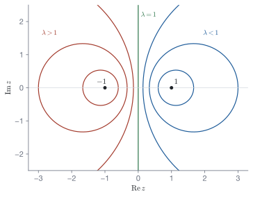
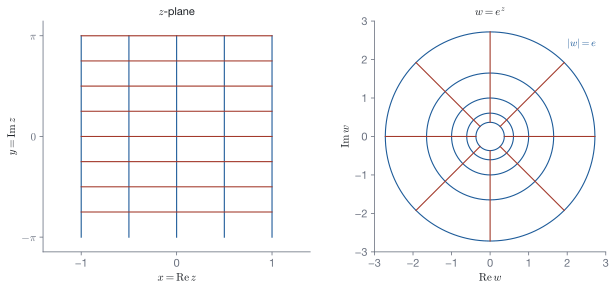
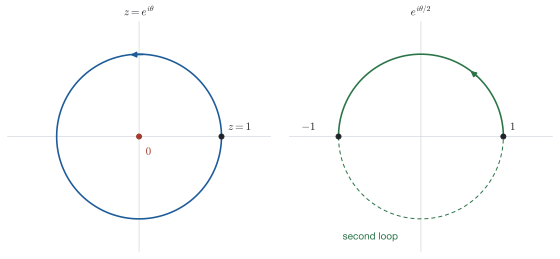
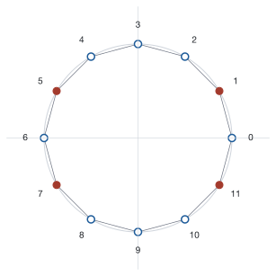
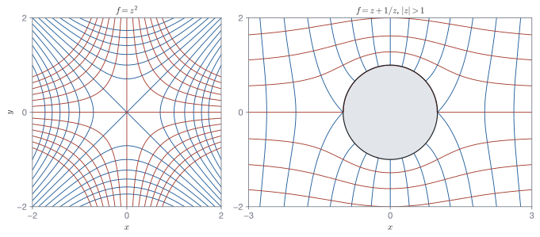
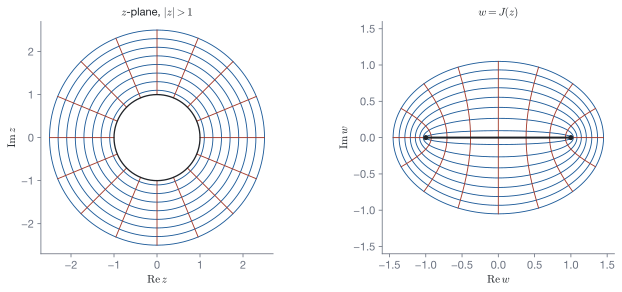
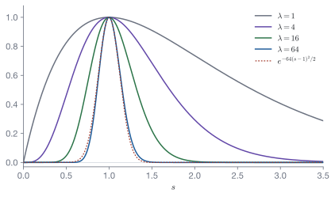
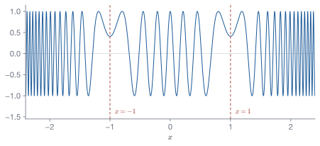

# Complex analysis {#sec-complex-analysis}

Complex analysis is the calculus of functions of a complex variable that are differentiable in the complex sense.
Such functions are far more rigid than differentiable functions of two real variables: once they are differentiable they
are infinitely differentiable, equal to their Taylor series, determined on a whole domain by their values on any small
piece of it, and their integrals around closed curves are computed by adding up a few numbers, the residues, attached to
the points where the function fails to be defined. The chapter develops that rigidity in six sections.

- @sec-complex-numbers sets up the field $\mathbb{C}$, modulus and argument, the exponential, the many-valued logarithm with its
  branches and branch cuts, and the roots of unity.
- @sec-holomorphic defines the complex derivative and derives the Cauchy-Riemann equations, with their consequences for
  harmonic functions and angle-preserving maps.
- @sec-contour-integration defines contours and contour integrals and proves Goursat's theorem, Cauchy's theorem, Cauchy's
  integral formula and Liouville's theorem. Cauchy's theorem is proved on star-shaped open sets, and on regions that can
  be cut into star-shaped pieces; its general form for arbitrary domains is not proved.
- @sec-residues treats Taylor and Laurent series, classifies isolated singularities and proves the residue theorem with
  winding numbers, again on star-shaped sets and on cut regions, and uses it to evaluate real integrals.
- @sec-analytic-continuation proves the identity theorem and the uniqueness of continuations, constructs the Gamma, Beta
  and zeta functions with their continuations, and explains Wick rotation as a deformation of a contour. Riemann's
  functional equation for the zeta function is not proved and not used.
- @sec-asymptotics defines asymptotic expansions and proves Watson's lemma, Laplace's method, the method of steepest
  descent through a simple saddle point and the method of stationary phase, with Stirling's formula and the Airy integral
  as applications.

Every definition and theorem is proved where it stands and is followed by ten examples and ten exercises, graded from
direct checks to problems that combine it with earlier results. Each exercise has a solution written out by hand and a
check of a concrete case in SageMath, and the chapter closes with exercises that draw on all six sections. The
conventions for the signature and for indices are fixed in @sec-conventions, and the real analysis assumed here
(limits, series, the Riemann integral, partial derivatives, Taylor's theorem and the inverse function theorem) is that of
@sec-sequences-limits, @sec-series, @sec-riemann-integral, @sec-calculus and @sec-inverse-implicit.

## Complex numbers and functions {#sec-complex-numbers}

The field $\mathbb{C}$, modulus and argument, the exponential and the logarithm, branches and branch cuts. The six
definitions of this section are the vocabulary of the chapter, and the proposition at its end, on the roots of unity,
uses all of them on explicit numbers. Everything here rests on the real analysis of the previous chapter: the plane
$\mathbb{R}^2$ with its Euclidean metric, absolutely convergent series, and the real functions $\exp$, $\sin$, $\cos$,
$\arctan$ and $\ln$.

For more on this topic, see @yu2022problems [Ch. 1-3] and @riley2006mathematical [Ch. 3, Secs. 24.4-24.5].

Textbook accounts are @karpfingerCalculusLinearAlgebra2022 [Chs. 7-8, Sec. 80.1], @fokas2023modern [Secs. 4.1-4.2, pp. 119-125], @stein2003complex [Sec. 1.1] and @ash2007complex [Sec. 1.1].

![Left: $z = 2 + i$, its conjugate $z^* = 2 - i$, its modulus $\sqrt 5$ and its argument $\theta$, with the six sixth roots of unity on the unit circle. Right: the principal argument $\operatorname{Arg} z \in (-\pi, \pi]$, which jumps by $2\pi$ across the negative real axis.](figures/complex_plane.svg){#fig-complex-plane width=90%}



### Complex numbers

The first definition builds the number system itself. It adds to the real numbers one symbol whose square is $-1$ and
checks that the familiar rules of arithmetic survive, so that $\mathbb{C}$ is again a field.

:::: {.statement-box}
::: {#def-complex-number}
#### Complex number

A **complex number** is a pair of real numbers written $z = x + iy$, with $x = \operatorname{Re} z$ the **real
part**, $y = \operatorname{Im} z$ the **imaginary part** and $i$ a symbol with $i^2 = -1$. Complex numbers are added
componentwise and multiplied by expanding and using $i^2 = -1$: $(x + iy)(u + iv) = (xu - yv) + i(xv + yu)$. With
these operations the set $\mathbb{C}$ of complex numbers is a field: every $z \neq 0$ has an inverse. The
**complex conjugate** of $z$ is $z^* = x - iy$; conjugation respects sums and products, $(z + w)^* = z^* + w^*$ and
$(zw)^* = z^* w^*$. As a real vector space (@sec-vector-spaces) $\mathbb{C}$ is $\mathbb{R}^2$ with basis $1, i$, and
$z$ is the point $(x, y)$ of the **complex plane** (@fig-complex-plane).
:::
::::

*Proof.* Addition is that of $\mathbb{R}^2$, so it is associative and commutative, with $0$ and $-z = -x - iy$. The
product formula is symmetric under exchanging $(x, y)$ with $(u, v)$, so multiplication is commutative, and it is
bilinear over $\mathbb{R}$, which gives distributivity. Associativity is a direct expansion: both $\bigl((x + iy)(u +
iv)\bigr)(s + it)$ and $(x + iy)\bigl((u + iv)(s + it)\bigr)$ equal $(xus - yvs - xvt - yut) + i(xut - yvt + xvs +
yus)$. The number $1 = 1 + 0i$ is the unit. For $z \neq 0$, $zz^* = (x + iy)(x - iy) = x^2 + y^2 > 0$ is real, so
$z^{-1} = z^*/(x^2 + y^2)$ satisfies $zz^{-1} = 1$. For conjugation, $(z + w)^* = z^* + w^*$ is immediate, and
$(zw)^* = (xu - yv) - i(xv + yu) = (x - iy)(u - iv)$. $\square$

The real numbers sit in $\mathbb{C}$ as the numbers $x + 0i$, and the operations restrict to those of $\mathbb{R}$. The
definition is that of @ash2007complex [Sec. 1.1] and @riley2006mathematical [Sec. 3.2].

:::: {.callout-note .examples-fold collapse="true" title="Examples"}
The definition is best absorbed by computing. The first example multiplies and divides two concrete numbers, and shows
the one trick that division needs: clearing the denominator with its conjugate.

::: {#exm-complex-arithmetic-basic}
#### A product and a quotient

$(2 + i)(3 - i) = 6 - 2i + 3i - i^2 = 7 + i$, and $\dfrac{1}{2 + i} = \dfrac{2 - i}{(2 + i)(2 - i)} = \dfrac{2 -
i}{5}$: to divide, multiply numerator and denominator by the conjugate of the denominator, which makes the
denominator real.
:::

Powers of $i$ are the next simplest computation. They repeat with period four, which reduces any integer power of $i$
to one of four values by a division with remainder.

::: {#exm-complex-powers-of-i}
#### Powers of $i$

$i^2 = -1$, $i^3 = -i$, $i^4 = 1$, so $i^{n + 4} = i^n$ and $i^n$ depends only on the remainder of $n$ modulo $4$:
$i^{2026} = i^2 = -1$, $i^{-1} = i^3 = -i$ (indeed $i \cdot (-i) = 1$). In particular $1 + i + i^2 + i^3 = 0$.
:::

The next example looks at what the new symbol $i$ buys. Negative numbers acquire square roots, and every complex number
turns out to have two of them, found by solving two real equations.

::: {#exm-complex-square-roots}
#### Square roots

$(\pm 2i)^2 = -4$, so $-4$ has the two square roots $\pm 2i$, and $x^2 + 1 = (x + i)(x - i)$ factorises over
$\mathbb{C}$ though not over $\mathbb{R}$. For a general $c = a + ib$, the equation $(u + iv)^2 = c$ is the real
system $u^2 - v^2 = a$, $2uv = b$. For $c = 3 + 4i$ it gives $uv = 2$ and $u^2 - 4/u^2 = 3$, so $u^2 = 4$ and the
square roots are $\pm(2 + i)$: indeed $(2 + i)^2 = 4 + 4i - 1 = 3 + 4i$ [@riley2006mathematical, Sec. 3.4.3].
:::

Quadratic equations with real coefficients and negative discriminant now have solutions. The quadratic formula holds
unchanged, because its derivation by completing the square uses only field operations.

::: {#exm-complex-quadratic}
#### A quadratic with negative discriminant

$z^2 + 2z + 5 = (z + 1)^2 + 4$ vanishes when $(z + 1)^2 = -4$, that is, $z = -1 \pm 2i$. The two roots are
conjugate, their sum $-2$ is minus the linear coefficient and their product $(-1)^2 + 2^2 = 5$ is the constant term.
:::

The picture of $\mathbb{C}$ as a plane gives the operations a geometric meaning. Addition and conjugation are the
simplest: one is the parallelogram rule for vectors, the other a mirror.

::: {#exm-complex-plane-geometry}
#### Addition and conjugation in the plane

The sum $z + w$ is the fourth vertex of the parallelogram on $0$, $z$, $w$, since it adds the coordinates. The
conjugate $z^*$ is the mirror image of $z$ in the real axis (@fig-complex-plane shows $2 \pm i$); the real numbers are
the fixed points of this reflection, $z = z^*$, and the purely imaginary numbers $iy$ are those with $z^* = -z$.
:::

Multiplication has a geometric meaning too, which the chapter will use repeatedly. A complex number acts on the plane
as a real $2 \times 2$ matrix of a very special shape.

::: {#exm-complex-matrices}
#### Complex numbers as $2 \times 2$ real matrices

Multiplication by $z = x + iy$ sends $u + iv$ to $(xu - yv) + i(yu + xv)$, a linear map of $\mathbb{R}^2$ with matrix
$\mathbf M_z = \begin{pmatrix} x & -y \\ y & x \end{pmatrix}$ in the basis $1, i$. The map $z \mapsto \mathbf M_z$
turns sums into sums and products into matrix products, $\mathbf M_{zw} = \mathbf M_z\mathbf M_w$, because
multiplying by $zw$ is multiplying by $w$ and then by $z$. Here $\mathbf M_i$ is the rotation by a right angle, whose
square is $-\mathbf I_2$, the determinant is $\det\mathbf M_z = x^2 + y^2 = zz^*$, and the transpose $\mathbf
M_z^{\mathsf T} = \mathbf M_{z^*}$ represents the conjugate. For $z \neq 0$, $\mathbf M_z = \sqrt{x^2 + y^2}\,\mathbf
R$ with $\mathbf R$ orthogonal of determinant $1$: multiplication by $z$ is a rotation combined with a scaling.
:::

Electrical engineering writes the response of a linear circuit to an alternating voltage of angular frequency
$\omega$ with complex numbers. A resistor, an inductor and a capacitor in series combine into one complex
**impedance**, whose real and imaginary parts have separate meanings.

::: {#exm-complex-impedance}
#### The impedance of a series circuit

A resistor $R$, an inductor $L$ and a capacitor $C$ in series have impedance $Z = R + i\omega L + \dfrac{1}{i\omega
C} = R + i\Bigl(\omega L - \dfrac{1}{\omega C}\Bigr)$, using $1/i = -i$. The real part is the resistance, which
dissipates energy, and the imaginary part, the reactance, vanishes exactly at $\omega^2 = 1/(LC)$: at the resonance the
circuit behaves as a pure resistor.
:::

Quantum mechanics uses complex matrices whose entries obey the same algebra. The matrices that rotate a spin
consist of $2 \times 2$ matrices built from two complex numbers, and its defining condition is a statement about
$zz^*$.

::: {#exm-complex-su2}
#### The spin-rotation matrices

For $a, b \in \mathbb{C}$ let $\mathbf U = \begin{pmatrix} a & -b^* \\ b & a^* \end{pmatrix}$. Then $\det\mathbf U =
aa^* + bb^*$, which is real and non-negative, and $\mathbf U^\dagger\mathbf U = (aa^* + bb^*)\mathbf I_2$. The
matrices with $aa^* + bb^* = 1$ are the spin-rotation matrices. With $b = 0$ and $a = x + iy$ the matrix is
$\operatorname{diag}(a, a^*)$, which multiplies like the number $a$.
:::

The harmonic oscillator is the other running system of physics, and complex numbers simplify its equations of motion.
With $m = \omega = 1$, combining position and momentum into one complex number turns two real equations into one.

::: {#exm-complex-oscillator}
#### The oscillator as one complex equation

Hamilton's equations for $H = \tfrac12(p^2 + x^2)$ are $\dot x = p$, $\dot p = -x$. For the complex-valued function
$z(t) = x(t) + ip(t)$, differentiated componentwise, they read $\dot z = p - ix = -i(x + ip) = -iz$. The energy is
$H = \tfrac12 zz^*$, and $\tfrac{d}{dt}(zz^*) = \dot z z^* + z\dot z^* = -izz^* + izz^* = 0$ proves its conservation
in one line.
:::

The rules of arithmetic carry over to $\mathbb{C}$, but some formulas for real numbers do not. The classic fallacy
below shows that the rule $\sqrt{ab} = \sqrt a\sqrt b$ for positive reals cannot survive in any form that picks one
square root of each number.

::: {#exm-complex-sqrt-fallacy}
#### A rule that fails

If $\sqrt{ab} = \sqrt a\sqrt b$ held for all $a, b$ with one fixed choice of square root of each number, then $1 =
\sqrt{1} = \sqrt{(-1)(-1)} = \sqrt{-1}\sqrt{-1} = (\pm i)^2 = -1$, a contradiction. Square roots of complex numbers
come in pairs $\pm w$, and no choice of one root per number makes the product rule hold for every pair $a$, $b$.
:::
::::

:::: {.callout-note .exercises-fold collapse="true" title="Exercises"}
The first exercise is pure practice with the arithmetic rules. It also introduces Sage's exact Gaussian rationals,
which will serve as the computational ground for most of the section.

::: {#exr-complex-arithmetic}
#### Products, quotients and conjugates

Compute $(2 + i)(3 - i)$, $(1 + i)/(1 - i)$ and $(1 + i)^8$, and check on these numbers that $(zw)^* = z^* w^*$.
:::

::: {.callout-note .solution collapse="true" title="Solution"}
:::: {.panel-tabset .solution-tabs}
## Proof

$(2 + i)(3 - i) = 6 - 2i + 3i + 1 = 7 + i$. Multiplying numerator and denominator by $1 + i$, $(1 + i)/(1 - i) = (1 +
i)^2/((1 - i)(1 + i)) = 2i/2 = i$. Since $(1 + i)^2 = 2i$, $(1 + i)^8 = (2i)^4 = 16 i^4 = 16$. For $z = 2 + i$ and $w
= 3 - i$, $(zw)^* = 7 - i$ and $z^*w^* = (2 - i)(3 + i) = 6 + 2i - 3i + 1 = 7 - i$.

## SageMath

Sage computes in the field $\mathbb{Q}(i)$ exactly.

```{.python .sage}
K.<i> = QuadraticField(-1)          # the field Q(i), exact arithmetic with i^2 = -1
z, w = 2 + i, 3 - i
print("(2 + i)(3 - i) =", z*w)
print("(1 + i)/(1 - i) =", (1 + i)/(1 - i))
print("(1 + i)^8 =", (1 + i)^8)
print("(z w)^* == z^* w^*:", (z*w).conjugate() == z.conjugate()*w.conjugate())
```

```{.text .sage-output}
(2 + i)(3 - i) = i + 7
(1 + i)/(1 - i) = i
(1 + i)^8 = 16
(z w)^* == z^* w^*: True
```
::::
:::

The second exercise derives the small identities that convert between the Cartesian description $(x, y)$ and the pair
$(z, z^*)$. They are used silently in every later computation with real and imaginary parts.

::: {#exr-complex-conjugate-identities}
#### Real and imaginary parts from the conjugate

Show that $\operatorname{Re} z = \tfrac12(z + z^*)$, $\operatorname{Im} z = \tfrac1{2i}(z - z^*)$, $z z^*
= x^2 + y^2$, $(z^*)^* = z$, and that $z$ is real exactly when $z = z^*$.
:::

::: {.callout-note .solution collapse="true" title="Solution"}
:::: {.panel-tabset .solution-tabs}
## Proof

With $z = x + iy$: $z + z^* = 2x$ and $z - z^* = 2iy$, which give the first two identities. Next $zz^* = (x + iy)(x -
iy) = x^2 - i^2 y^2 = x^2 + y^2$, and $(z^*)^* = (x - iy)^* = x + iy$. Finally $z = z^*$ means $2iy = 0$, that is,
$y = 0$. These identities translate any statement about $(x, y)$ into one about $(z, z^*)$ and back.

## SageMath

Check on a symbolic $z = x + iy$ with real $x$, $y$:

```{.python .sage}
x, y = var("x y", domain="real")
z = x + I*y
zc = z.conjugate()
print("(z + z^*)/2 =", ((z + zc)/2).simplify_full())
print("(z - z^*)/(2i) =", ((z - zc)/(2*I)).simplify_full())
print("z z^* =", (z*zc).expand())
print("(z^*)^* == z:", bool(zc.conjugate() == z))
```

```{.text .sage-output}
(z + z^*)/2 = x
(z - z^*)/(2i) = y
z z^* = x^2 + y^2
(z^*)^* == z: True
```
::::
:::

The third exercise is a direct computation with the numbers of @riley2006mathematical [Exercise 3.1]. It combines
sums, products, quotients and conjugates of the same two numbers.

::: {#exr-complex-riley-combinations}
#### Six combinations of two numbers

For $z = 3 + 4i$ and $w = 2 - i$, compute $z + w$, $w - z$, $wz$, $z/w$, $z^* w + w^* z$ and $w^2$, and explain why
$z^*w + w^*z$ is real.
:::

::: {.callout-note .solution collapse="true" title="Solution"}
:::: {.panel-tabset .solution-tabs}
## Proof

$z + w = 5 + 3i$, $w - z = -1 - 5i$, and $wz = (2 - i)(3 + 4i) = 6 + 8i - 3i + 4 = 10 + 5i$. For the quotient,
$z/w = (3 + 4i)(2 + i)/((2 - i)(2 + i)) = (6 + 3i + 8i - 4)/5 = \tfrac25 + \tfrac{11}5 i$. Next $z^*w = (3 - 4i)(2 -
i) = 6 - 3i - 8i - 4 = 2 - 11i$, and $w^*z = (z^*w)^*$ by @def-complex-number, so $z^*w + w^*z = 2\operatorname{Re}(z^*w)
= 4$; a number plus its conjugate is always real. Last, $w^2 = 4 - 4i - 1 = 3 - 4i$.

## SageMath

Sage evaluates the six expressions in $\mathbb{Q}(i)$.

```{.python .sage}
K.<i> = QuadraticField(-1)
z, w = 3 + 4*i, 2 - i
for name, val in [("z + w", z + w), ("w - z", w - z), ("w z", w*z), ("z / w", z/w),
                  ("z^* w + w^* z", z.conjugate()*w + w.conjugate()*z), ("w^2", w^2)]:
    print(name, "=", val)
```

```{.text .sage-output}
z + w = 3*i + 5
w - z = -5*i - 1
w z = 5*i + 10
z / w = 11/5*i + 2/5
z^* w + w^* z = 4
w^2 = -4*i + 3
```
::::
:::

Linear equations over $\mathbb{C}$ are solved exactly as over $\mathbb{R}$, since only field operations are involved.
The fourth exercise solves a $2 \times 2$ system by elimination and checks the answer with a determinant.

::: {#exr-complex-linear-system}
#### A linear system with complex coefficients

Solve $(1 + i)z + 2w = 3$, $z - iw = 1$ for $z, w \in \mathbb{C}$.
:::

::: {.callout-note .solution collapse="true" title="Solution"}
:::: {.panel-tabset .solution-tabs}
## Proof

The second equation gives $z = 1 + iw$. Substituting, $(1 + i)(1 + iw) + 2w = 3$, that is, $(1 + i) + (i - 1)w + 2w =
3$, so $(1 + i)w = 2 - i$ and $w = (2 - i)(1 - i)/2 = (2 - 2i - i - 1)/2 = \tfrac12 - \tfrac32 i$. Then $z = 1 + iw =
1 + \tfrac12 i + \tfrac32 = \tfrac52 + \tfrac12 i$. The coefficient matrix $\begin{pmatrix} 1 + i & 2 \\ 1 & -i
\end{pmatrix}$ has determinant $-i(1 + i) - 2 = -1 - i \neq 0$, so this is the only solution.

## SageMath

Sage solves the system over $\mathbb{Q}(i)$ and checks it.

```{.python .sage}
K.<i> = QuadraticField(-1)
A = matrix(K, [[1 + i, 2], [1, -i]])
b = vector(K, [3, 1])
sol = A.solve_right(b)
print("det A =", A.det())
print("(z, w) =", sol)
print("A (z, w) == b:", A*sol == b)
```

```{.text .sage-output}
det A = -i - 1
(z, w) = (1/2*i + 5/2, -3/2*i + 1/2)
A (z, w) == b: True
```
::::
:::

The square roots found by hand in @exm-complex-square-roots follow a general formula. The fifth exercise derives it
and applies it to two numbers.

::: {#exr-complex-square-root-formula}
#### A formula for square roots

Show that the square roots of $c = a + ib$ with $b \neq 0$ are $\pm(u + iv)$ with $u = \sqrt{\tfrac12(\rho + a)}$, $v
= \operatorname{sgn}(b)\sqrt{\tfrac12(\rho - a)}$ and $\rho = \sqrt{a^2 + b^2}$, and compute the square roots of $-5 +
12i$ and of $i$.
:::

::: {.callout-note .solution collapse="true" title="Solution"}
:::: {.panel-tabset .solution-tabs}
## Proof

$(u + iv)^2 = c$ means $u^2 - v^2 = a$ and $2uv = b$. Then $(u^2 + v^2)^2 = (u^2 - v^2)^2 + 4u^2v^2 = a^2 + b^2$, so
$u^2 + v^2 = \rho$. Adding and subtracting, $u^2 = \tfrac12(\rho + a)$ and $v^2 = \tfrac12(\rho - a)$, both
non-negative since $\rho \geq |a|$. The condition $2uv = b$ says that $uv$ has the sign of $b$, which fixes the sign
of $v$ once $u \geq 0$ is chosen. Conversely the numbers so defined satisfy $u^2 - v^2 = a$ and $2uv =
2\operatorname{sgn}(b)\sqrt{(\rho^2 - a^2)/4} = \operatorname{sgn}(b)|b| = b$. There are no other roots: if $w^2 = c =
w_0^2$ then $(w - w_0)(w + w_0) = 0$ and $w = \pm w_0$, as $\mathbb{C}$ is a field. For $-5 + 12i$, $\rho = 13$, $u^2 =
4$, $v^2 = 9$, so the roots are $\pm(2 + 3i)$. For $i$, $\rho = 1$, $u^2 = v^2 = \tfrac12$, so the roots are
$\pm\tfrac{1}{\sqrt2}(1 + i)$.

## SageMath

Sage applies the formula and squares the results.

```{.python .sage}
def roots(a, b):
    rho = sqrt(a^2 + b^2)
    u, v = sqrt((rho + a)/2), sign(b)*sqrt((rho - a)/2)
    return SR(u + I*v)
for a, b in [(-5, 12), (0, 1)]:
    r = roots(a, b)
    print("c =", SR(a + I*b), ": roots +-(", r, "),  square =", (r^2).expand())
```

```{.text .sage-output}
c = 12*I - 5 : roots +-( 3*I + 2 ),  square = 12*I - 5
c = I : roots +-( (I + 1)*sqrt(1/2) ),  square = I
```
::::
:::

The roots of @exm-complex-quadratic came as a conjugate pair, and this is no accident. The sixth exercise proves it
for every polynomial with real coefficients and uses it to solve a cubic from one known root.

::: {#exr-complex-conjugate-roots}
#### Conjugate pairs of roots

Show that if $p$ is a polynomial with real coefficients and $p(z) = 0$, then $p(z^*) = 0$. Given that $1 + i$ is a root
of $p(z) = z^3 - 4z^2 + 6z - 4$, find the other two roots.
:::

::: {.callout-note .solution collapse="true" title="Solution"}
:::: {.panel-tabset .solution-tabs}
## Proof

Conjugation respects sums and products (@def-complex-number) and fixes real numbers, so for $p(z) = \sum_k a_k z^k$
with real $a_k$, $p(z)^* = \sum_k a_k (z^*)^k = p(z^*)$. If $p(z) = 0$ then $p(z^*) = 0^* = 0$. Here $1 - i$ is
therefore a root too, and $(z - 1 - i)(z - 1 + i) = (z - 1)^2 + 1 = z^2 - 2z + 2$ divides $p$:
$z^3 - 4z^2 + 6z - 4 = (z^2 - 2z + 2)(z - 2)$, as expanding the right side confirms. The roots are $1 \pm i$ and $2$.

## SageMath

Sage factors $p$ over $\mathbb{Q}(i)$ and evaluates it at the three roots.

```{.python .sage}
K.<i> = QuadraticField(-1)
R.<z> = K[]
p = z^3 - 4*z^2 + 6*z - 4
print("p =", p.factor())
print("p(1 + i), p(1 - i), p(2):", p(1 + i), p(1 - i), p(2))
```

```{.text .sage-output}
p = (z - 2) * (z - i - 1) * (z + i - 1)
p(1 + i), p(1 - i), p(2): 0 0 0
```
::::
:::

The seventh exercise is structural rather than computational. It confirms that $\mathbb{C}$ is a field and explains
why inequalities between complex numbers never appear in this chapter [@stein2003complex, Exercise 1.4],
[@ash2007complex, Problem 1.9].

::: {#exr-complex-field-axioms}
#### The inverse and the impossibility of an order

Show that every $z \neq 0$ has an inverse, $z^{-1} = z^*/(z z^*)$, and that $\mathbb{C}$ cannot be given an
order $<$ compatible with its arithmetic in the way $\mathbb{R}$ is (positive numbers closed under sums and products,
every number positive, zero or negative).
:::

::: {.callout-note .solution collapse="true" title="Solution"}
:::: {.panel-tabset .solution-tabs}
## Proof

$z \cdot z^*/(z z^*) = 1$, and $zz^* = x^2 + y^2 > 0$ when $z \neq 0$, so the quotient makes sense. Suppose a set $P$
of positive numbers were closed under sums and products, with every number in exactly one of $P$, $\{0\}$, $-P$. A
non-zero square $a^2$ is then positive: either $a \in P$, or $-a \in P$ and $a^2 = (-a)^2$. Hence $1 = 1^2$ and $-1 =
i^2$ would both be positive, and so would their sum $0$, a contradiction. Inequalities in this chapter therefore always
concern real quantities.

## SageMath

Check on $z = 3 - 4i$: the formula for the inverse, and $i^2 = -1$, which rules out an order.

```{.python .sage}
K.<i> = QuadraticField(-1)
z = 3 - 4*i
inv = z.conjugate()/(z*z.conjugate())
print("z^* / (z z^*) =", inv, "; z times it =", z*inv)
print("i^2 + 1^2 =", i^2 + 1^2)
```

```{.text .sage-output}
z^* / (z z^*) = 4/25*i + 3/25 ; z times it = 1
i^2 + 1^2 = 0
```
::::
:::

The matrices of @exm-complex-matrices are more than an analogy. The eighth exercise proves that they form a copy of
the field $\mathbb{C}$ inside the real $2 \times 2$ matrices, and characterises them [@ash2007complex, Problem 1.8].

::: {#exr-complex-matrix-isomorphism}
#### The matrix model of $\mathbb{C}$

Show that $z \mapsto \mathbf M_z = \begin{pmatrix} x & -y \\ y & x \end{pmatrix}$ is injective, respects sums and
products, sends $1$ to $\mathbf I_2$, and that its image is the set of real matrices $\mathbf A$ with $\mathbf A\mathbf
J = \mathbf J\mathbf A$, where $\mathbf J = \mathbf M_i$.
:::

::: {.callout-note .solution collapse="true" title="Solution"}
:::: {.panel-tabset .solution-tabs}
## Proof

$\mathbf M_z = x\mathbf I_2 + y\mathbf J$ with $\mathbf J = \begin{pmatrix} 0 & -1 \\ 1 & 0 \end{pmatrix}$, so the map
is linear over $\mathbb{R}$, sends $1$ to $\mathbf I_2$, and is injective since $\mathbf I_2$ and $\mathbf J$ are
linearly independent. For products, $\mathbf J^2 = -\mathbf I_2$ gives $(x\mathbf I_2 + y\mathbf J)(u\mathbf I_2 +
v\mathbf J) = (xu - yv)\mathbf I_2 + (xv + yu)\mathbf J = \mathbf M_{zw}$. Every $\mathbf M_z$ commutes with $\mathbf
J$. Conversely, for $\mathbf A = \begin{pmatrix} a & b \\ c & d \end{pmatrix}$, $\mathbf A\mathbf J = \begin{pmatrix}
b & -a \\ d & -c \end{pmatrix}$ and $\mathbf J\mathbf A = \begin{pmatrix} -c & -d \\ a & b \end{pmatrix}$; equality
means $d = a$ and $c = -b$, so $\mathbf A = \mathbf M_{a - ib}$.

## SageMath

Check on $z = 2 + i$, $w = 3 - i$: the product rule, and the commutant of $\mathbf J$ computed by solving linear
equations.

```{.python .sage}
M = lambda x, y: matrix(QQ, [[x, -y], [y, x]])
print("M_z M_w == M_{zw}:", M(2, 1)*M(3, -1) == M(7, 1))
a, b, c, d = var("a b c d")
A = matrix(SR, [[a, b], [c, d]])
J = M(0, 1)
print("A J = J A means:", solve((A*J - J*A).list(), [a, b, c, d]))
```

```{.text .sage-output}
M_z M_w == M_{zw}: True
A J = J A means: [
[a == r1, b == -r2, c == r2, d == r1]
]
```
::::
:::

The ninth exercise is a proof that mixes the conjugate with the arithmetic. The condition it finds, $zz^* = 1$,
describes the points at unit distance from the origin, a set that returns throughout the section
[@ash2007complex, Problem 1.13].

::: {#exr-complex-z-plus-inverse}
#### When is $z + 1/z$ real?

Show that for $z \neq 0$, $z + 1/z$ is real if and only if $z$ is real or $zz^* = 1$.
:::

::: {.callout-note .solution collapse="true" title="Solution"}
:::: {.panel-tabset .solution-tabs}
## Proof

By @exr-complex-conjugate-identities, $z + 1/z$ is real exactly when it equals its conjugate $z^* + 1/z^*$. The
difference is $z - z^* + \frac{1}{z} - \frac{1}{z^*} = (z - z^*) - \frac{z - z^*}{zz^*} = (z - z^*)\Bigl(1 -
\frac{1}{zz^*}\Bigr)$. It vanishes exactly when $z = z^*$, that is, $z$ is real, or when $zz^* = 1$.

## SageMath

Check on $z = \tfrac35 + \tfrac45 i$ (with $zz^* = 1$), $z = 2$ and $z = 1 + i$:

```{.python .sage}
K.<i> = QuadraticField(-1)
for z in [3/5 + 4/5*i, K(2), 1 + i]:
    s = z + 1/z
    print("z =", z, " z z^* =", z*z.conjugate(), " z + 1/z =", s, " real:", s == s.conjugate())
```

```{.text .sage-output}
z = 4/5*i + 3/5  z z^* = 1  z + 1/z = 6/5  real: True
z = 2  z z^* = 4  z + 1/z = 5/2  real: True
z = i + 1  z z^* = 2  z + 1/z = 1/2*i + 3/2  real: False
```
::::
:::

The last exercise combines the multiplicativity of $zz^*$ with the matrix model. It recovers an identity of number
theory, that a product of two sums of two squares is again a sum of two squares.

::: {#exr-complex-two-squares}
#### Products of sums of two squares

Using $(zw)(zw)^* = (zz^*)(ww^*)$, prove $(a^2 + b^2)(c^2 + d^2) = (ac - bd)^2 + (ad + bc)^2$ for real $a, b, c, d$,
then obtain the same identity from $\det(\mathbf M_z\mathbf M_w) = \det\mathbf M_z\det\mathbf M_w$
(@thm-determinant-product). Write $65 = 5 \cdot 13$ as a sum of two squares in two ways.
:::

::: {.callout-note .solution collapse="true" title="Solution"}
:::: {.panel-tabset .solution-tabs}
## Proof

For $z = a + ib$, $w = c + id$, $zw = (ac - bd) + i(ad + bc)$ and $(zw)^* = z^*w^*$ by @def-complex-number, so
$(zw)(zw)^* = (zz^*)(ww^*)$. By @exr-complex-conjugate-identities the left side is $(ac - bd)^2 + (ad + bc)^2$ and the
right side is $(a^2 + b^2)(c^2 + d^2)$. In the matrix model, $\det\mathbf M_z = a^2 + b^2$ and $\mathbf M_z\mathbf
M_w = \mathbf M_{zw}$ (@exr-complex-matrix-isomorphism), so the product rule for determinants gives the same
identity. With $5 = 2^2 + 1^2$ and $13 = 3^2 + 2^2$: $(2 + i)(3 + 2i) = 4 + 7i$ gives $65 = 4^2 + 7^2$, and $(2 +
i)(3 - 2i) = 8 - i$ gives $65 = 8^2 + 1^2$.

## SageMath

Sage checks the identity symbolically and lists the representations of $65$.

```{.python .sage}
a, b, c, d = var("a b c d")
print("identity holds:", bool(((a^2 + b^2)*(c^2 + d^2) - (a*c - b*d)^2 - (a*d + b*c)^2).expand() == 0))
print("65 = p^2 + q^2 with 0 <= p <= q:", [(p, q) for p in range(9) for q in range(p, 9) if p^2 + q^2 == 65])
```

```{.text .sage-output}
identity holds: True
65 = p^2 + q^2 with 0 <= p <= q: [(1, 8), (4, 7)]
```
::::
:::
::::

### Modulus

Having the arithmetic, we need a notion of size. The modulus measures the distance of a point from the origin and turns
the complex plane into the metric space on which limits, continuity and open sets make sense.

:::: {.statement-box}
::: {#def-modulus}
#### Modulus

The **modulus** (or absolute value) of $z = x + iy$ is $|z| = \sqrt{x^2 + y^2} = \sqrt{z z^*}$, the Euclidean
length of the vector $(x, y)$. It is multiplicative, $|zw| = |z||w|$, and satisfies the **triangle inequality**
$|z + w| \leq |z| + |w|$; $|z - w|$ is the distance between the points $z$ and $w$, so $\mathbb{C}$ is a metric
space with the open discs $D(z_0, r) = \{z : |z - z_0| < r\}$ as basic open sets (the topology of
@sec-topology). A set is **open**, **closed**, **compact** or **connected** in $\mathbb{C}$ exactly when it is so
in $\mathbb{R}^2$; a **domain** is a non-empty open connected set.
:::
::::

*Proof.* $|zw|^2 = (zw)(zw)^* = zz^*\,ww^* = |z|^2|w|^2$ by @def-complex-number, and both sides of $|zw| = |z||w|$ are
non-negative. For the triangle inequality, $\operatorname{Re} u \leq |u|$ for every $u$, since $x \leq \sqrt{x^2 +
y^2}$. Hence
$$
|z + w|^2 = (z + w)(z^* + w^*) = |z|^2 + |w|^2 + 2\operatorname{Re}(zw^*) \leq |z|^2 + |w|^2 + 2|z||w| = (|z| + |w|)^2,
$$
using $zw^* + z^*w = 2\operatorname{Re}(zw^*)$ and $|zw^*| = |z||w|$. The distance $|z - w|$ is the Euclidean metric
$d_2$ of $\mathbb{R}^2$ under $z \leftrightarrow (x, y)$ (@exm-metric-space-euclidean), so $\mathbb{C}$ and
$\mathbb{R}^2$ are the same metric space, with the same open sets (@prp-metric-topology), and therefore the same closed,
compact and connected sets. $\square$

The disc $D(z_0, r)$ is the open ball $B_r(z_0)$ of the metric space $\mathbb{C}$. A sequence $z_n$ converges to $z$
when $|z_n - z| \to 0$ (@def-metric-convergence), and since $|\operatorname{Re} u|, |\operatorname{Im} u| \leq |u|
\leq |\operatorname{Re} u| + |\operatorname{Im} u|$, this happens exactly when the real and imaginary parts converge
[@ash2007complex, Sec. 1.1].

:::: {.callout-note .examples-fold collapse="true" title="Examples"}
A few numerical values make the definition concrete. The first example also shows multiplicativity at work on the
product computed in @exm-complex-arithmetic-basic.

::: {#exm-modulus-values}
#### Some moduli

$|3 + 4i| = 5$, $|i| = 1$, $|2 + i| = \sqrt 5$ (@fig-complex-plane), and $|(2 + i)(3 - i)| = |7 + i| = \sqrt{50} =
\sqrt 5 \cdot \sqrt{10}$, as multiplicativity requires.
:::

Several elementary rules follow from multiplicativity and from $|z|^2 = x^2 + y^2$. They bound the real and imaginary
parts by the modulus and the modulus by them, which is how estimates move between $\mathbb{C}$ and $\mathbb{R}^2$.

::: {#exm-modulus-rules}
#### Quotients, conjugates and parts

$|z^*| = |z|$; for $z \neq 0$, $|1/z| = 1/|z|$ (from $|z|\,|1/z| = |1| = 1$) and $|w/z| = |w|/|z|$. Also
$|\operatorname{Re} z| \leq |z|$, $|\operatorname{Im} z| \leq |z|$ and $|z| \leq |\operatorname{Re} z| +
|\operatorname{Im} z|$. For instance $\left|\dfrac{(3 + 4i)^2}{1 - i}\right| = \dfrac{25}{\sqrt2}$ without expanding
anything.
:::

The next example singles out the set where the modulus equals one. It is at the same time a curve, a set closed under
multiplication and the set of phases of quantum mechanics.

::: {#exm-modulus-circle}
#### The unit circle

$\{z : |z| = 1\}$ is the unit circle; it is closed under multiplication and inversion ($|zw| = |z||w|$, $|1/z| =
1/|z|$) and its elements are the phases of quantum mechanics. For $|z| = 1$, $1/z = z^*$. $\{|z| < 1\} = D(0, 1)$ is the open
unit disc, a domain; $\{|z| \leq 1\}$ is compact, being closed and bounded in $\mathbb{R}^2$.
:::

The fourth example turns the triangle inequality around to bound a modulus from below. Lower bounds on denominators are
what make quotients small far from the origin, so this small estimate deserves attention.

::: {#exm-modulus-reverse-triangle}
#### The reverse triangle inequality

From $|z| = |(z - w) + w| \leq |z - w| + |w|$ and the same with $z, w$ exchanged, $\bigl||z| - |w|\bigr| \leq |z -
w|$. It gives lower bounds for denominators: on the circle $|z| = 2$, $|z^2 + 1| \geq |z|^2 - 1 = 3$, so
$|1/(z^2 + 1)| \leq \tfrac13$ there; on $|z| = R > 1$ the bound is $1/(R^2 - 1)$, which tends to $0$ as $R \to
\infty$.
:::

Equations in moduli describe curves in the plane. The two below are a line and a parabola, from
@stein2003complex [Exercise 1.1].

::: {#exm-modulus-loci}
#### A line and a parabola

$|z - z_1| = |z - z_2|$ with $z_1 \neq z_2$ is the set of points equidistant from $z_1$ and $z_2$, the perpendicular
bisector of the segment between them; for $z_1 = i$, $z_2 = -1$, squaring gives $x^2 + (y - 1)^2 = (x + 1)^2 + y^2$,
the line $y = -x$. $|z| = \operatorname{Re} z + 1$ squares to $x^2 + y^2 = (x + 1)^2$ with $x + 1 \geq 0$, that is,
$y^2 = 2x + 1$: a parabola with focus $0$ and directrix $x = -1$.
:::

A ratio of distances gives a circle rather than a line. The circles $|z - 1| = \lambda|z + 1|$ fill the plane as
$\lambda$ runs over $(0, \infty)$, and they are drawn in @fig-apollonius-circles.

::: {#exm-modulus-apollonius}
#### Apollonius circles

Squaring $|z - 1| = \lambda|z + 1|$ with $\lambda \neq 1$ gives $(1 - \lambda^2)(x^2 + y^2) - 2(1 + \lambda^2)x + (1 -
\lambda^2) = 0$, the circle of centre $c = \dfrac{1 + \lambda^2}{1 - \lambda^2}$ and radius $\dfrac{2\lambda}{|1 -
\lambda^2|}$ (completing the square, $c^2 - 1$ is the squared radius). For $\lambda = 1$ the locus is the imaginary
axis. Each circle with $\lambda < 1$ surrounds $1$ and each with $\lambda > 1$ surrounds $-1$
[@riley2006mathematical, Exercise 3.7].

{#fig-apollonius-circles width=60%}
:::

The metric of @def-modulus makes limits of complex sequences available. Convergence reduces to that of the real and
imaginary parts, and the completeness of $\mathbb{R}$ passes to $\mathbb{C}$.

::: {#exm-modulus-sequences}
#### Convergent sequences

$z_n = (1 + i)/n + i\,n/(n + 1) \to i$, since the real parts $1/n \to 0$ and the imaginary parts $1/n + n/(n + 1) \to 1$.
For $|q| < 1$, $|q^n| = |q|^n \to 0$, so $q^n \to 0$; for $|q| > 1$, $|q^n| \to \infty$ and $q^n$ diverges. A Cauchy
sequence in $\mathbb{C}$ has Cauchy real and imaginary parts, which converge (@def-cauchy-sequence), so $\mathbb{C}$ is
complete.
:::

In quantum mechanics probabilities are squared moduli of complex amplitudes. When two indistinguishable paths lead to
the same outcome, the amplitudes add, and the interference term is the cross term of the triangle inequality's proof.

::: {#exm-modulus-interference}
#### Interference of two amplitudes

If a particle reaches a detector along two paths with amplitudes $\psi_1$ and $\psi_2$, the probability is $|\psi_1 +
\psi_2|^2 = |\psi_1|^2 + |\psi_2|^2 + 2\operatorname{Re}(\psi_1\psi_2^*)$. The triangle inequality and its reverse
bound it between $(|\psi_1| - |\psi_2|)^2$ and $(|\psi_1| + |\psi_2|)^2$. With $|\psi_1| = |\psi_2| = \tfrac12$ the
probability ranges from $0$ (destructive interference, $\psi_2 = -\psi_1$) to $1$ (constructive, $\psi_2 = \psi_1$),
whereas classical addition of probabilities would always give $\tfrac12$.
:::

The impedance of @exm-complex-impedance determines the amplitude of the current, and the amplitude is a modulus. The
resonance of the series circuit is the frequency at which the modulus of the impedance is smallest.

::: {#exm-modulus-resonance}
#### The amplitude of the current at resonance

A voltage of complex amplitude $V$ drives the current $I = V/Z$, of amplitude $|I| = |V|/|Z|$. For the series
circuit, $|Z|^2 = R^2 + \bigl(\omega L - 1/(\omega C)\bigr)^2 \geq R^2$, with equality only at $\omega^2 = 1/(LC)$:
the current amplitude is largest at resonance, where it equals $|V|/R$. With $R = 1$, $L = 1$, $C = 1$ the amplitude at
$\omega = 2$ is $|V|/|1 + \tfrac32 i| = |V|/\sqrt{13/4} \approx 0.55\,|V|$.
:::

Not every set described by moduli is a domain. The last example sorts a few such sets, since later statements will ask
for a domain and the conditions open and connected are easy to lose.

::: {#exm-modulus-domains}
#### Domains and non-domains

The annulus $\{1 < |z| < 2\}$, the punctured disc $\{0 < |z| < 1\}$ and the plane minus a ray are domains. The closed
disc $\{|z| \leq 1\}$ is connected but not open. $\{\operatorname{Im} z \neq 0\}$ is open but not connected: it is the
union of the two disjoint open half-planes $\{\operatorname{Im} z > 0\}$ and $\{\operatorname{Im} z < 0\}$. The
circle $\{|z| = 1\}$ is connected and compact but has empty interior.
:::
::::

:::: {.callout-note .exercises-fold collapse="true" title="Exercises"}
The first exercise is a direct computation of moduli. It uses the rules of @exm-modulus-rules to avoid expanding
products and quotients.

::: {#exr-modulus-compute}
#### Moduli without expanding

Compute $\left|\dfrac{(3 + 4i)(1 - 2i)}{2 + i}\right|$, $|(1 + i)^{10}|$ and $|z^* / z|$ for $z \neq 0$.
:::

::: {.callout-note .solution collapse="true" title="Solution"}
:::: {.panel-tabset .solution-tabs}
## Proof

By multiplicativity, the first modulus is $|3 + 4i|\,|1 - 2i|/|2 + i| = 5\sqrt5/\sqrt5 = 5$. The second is $|1 +
i|^{10} = (\sqrt2)^{10} = 32$. The third is $|z^*|/|z| = 1$, by @exm-modulus-rules.

## SageMath

Sage computes the moduli exactly in $\mathbb{Q}(i)$, through their squares.

```{.python .sage}
K.<i> = QuadraticField(-1)
q = (3 + 4*i)*(1 - 2*i)/(2 + i)
print("q =", q, "  |q|^2 =", q.norm(), "  |q| =", sqrt(q.norm()))
print("|(1 + i)^10|^2 =", ((1 + i)^10).norm(), "  |(1 + i)^10| =", sqrt(((1 + i)^10).norm()))
z = 2 - 7*i
print("|z^*/z|^2 for z = 2 - 7i:", (z.conjugate()/z).norm())
```

```{.text .sage-output}
q = -3*i + 4   |q|^2 = 25   |q| = 5
|(1 + i)^10|^2 = 1024   |(1 + i)^10| = 32
|z^*/z|^2 for z = 2 - 7i: 1
```
::::
:::

The triangle inequality was proved after @def-modulus. The second exercise asks when it is an equality, and extends it
to any finite number of terms.

::: {#exr-modulus-triangle}
#### Equality in the triangle inequality

Show that $|z + w| = |z| + |w|$ holds exactly when one of $z$, $w$ is a non-negative real multiple of the other, and
prove $\bigl|\sum_{k=1}^n z_k\bigr| \leq \sum_{k=1}^n |z_k|$.
:::

::: {.callout-note .solution collapse="true" title="Solution"}
:::: {.panel-tabset .solution-tabs}
## Proof

In the proof after @def-modulus the only inequality used was $\operatorname{Re}(zw^*) \leq |zw^*|$, so equality holds
exactly when $\operatorname{Re}(zw^*) = |zw^*|$, that is, when $u = zw^*$ is real and $\geq 0$ (since $x = \sqrt{x^2 +
y^2}$ forces $y = 0$, $x \geq 0$). If $w = 0$ this is automatic and $w = 0 \cdot z$. If $w \neq 0$, then $z = u\,w /
(ww^*) = (u/|w|^2)\,w$ is a non-negative multiple of $w$. Conversely $z = tw$ with $t \geq 0$ gives $|z + w| = (1 +
t)|w| = |z| + |w|$. The $n$-term inequality follows by induction: $|\sum_{k \leq n} z_k| \leq |\sum_{k < n} z_k| +
|z_n| \leq \sum_{k < n}|z_k| + |z_n|$.

## SageMath

Check on $z = 2 + 2i$ with $w = 3 + 3i$ (a positive multiple) and with $w = 3 - 3i$ (not one):

```{.python .sage}
z = 2 + 2*I
for w in [3 + 3*I, 3 - 3*I]:
    print("w =", w, ": |z + w| =", abs(z + w), " |z| + |w| =", (abs(z) + abs(w)).simplify_full(),
          " equal:", bool(abs(z + w) == abs(z) + abs(w)))
```

```{.text .sage-output}
w = 3*I + 3 : |z + w| = 5*sqrt(2)  |z| + |w| = 5*sqrt(2)  equal: True
w = -3*I + 3 : |z + w| = sqrt(26)  |z| + |w| = 5*sqrt(2)  equal: False
```
::::
:::

The third exercise turns a condition on distances into a familiar curve, the Apollonius circle of
@exm-modulus-apollonius for $\lambda = 2$. It is a first instance of translating a statement about moduli into a
statement about coordinates.

::: {#exr-modulus-circle-equation}
#### A circle given by a ratio of distances

Show that the set $\{z : |z - 1| = 2|z + 1|\}$ is a circle, and find its centre and radius.
:::

::: {.callout-note .solution collapse="true" title="Solution"}
:::: {.panel-tabset .solution-tabs}
## Proof

Squaring, $(x - 1)^2 + y^2 = 4\bigl((x + 1)^2 + y^2\bigr)$, that is, $3x^2 + 3y^2 + 10x + 3 = 0$, or $(x +
\tfrac53)^2 + y^2 = \tfrac{16}9$: the circle of centre $-\tfrac53$ and radius $\tfrac43$. This agrees with the formulas
of @exm-modulus-apollonius at $\lambda = 2$: $c = 5/(-3)$ and radius $4/3$.

## SageMath

Sage completes the square.

```{.python .sage}
x, y = var("x y", domain="real")
eq = ((x - 1)^2 + y^2) - 4*((x + 1)^2 + y^2)      # |z-1|^2 - 4 |z+1|^2 = 0
eq = (eq / (-3)).expand()                          # normalise the quadratic terms to x^2 + y^2
print("x^2 + y^2 + ... = 0 with:", eq, "= 0")
cx = -eq.coefficient(x, 1)/2
r2 = cx^2 - eq.subs(x=0, y=0)
print("centre:", (cx, 0), " radius:", sqrt(r2))
print("check: the circle equation reproduces the locus:", bool((((x - cx)^2 + y^2 - r2) - eq).expand() == 0))
```

```{.text .sage-output}
x^2 + y^2 + ... = 0 with: x^2 + y^2 + 10/3*x + 1 = 0
centre: (-5/3, 0)  radius: 4/3
check: the circle equation reproduces the locus: True
```
::::
:::

Every circle in the plane can be written with $z$ and $z^*$ alone. The fourth exercise derives that form and uses it to
find a circle of Apollonius about the points $\pm ia$ [@ash2007complex, Problem 1.18],
[@riley2006mathematical, Exercise 3.7].

::: {#exr-modulus-circle-general}
#### Circles in terms of $z$ and $z^*$

Show that the circle of centre $z_0$ and radius $r$ is $\{z : zz^* - z_0^*z - z_0z^* + z_0z_0^* = r^2\}$. Then show
that for real $a \neq 0$ and $\lambda > 0$, $\lambda \neq 1$, the set $|z - ia| = \lambda|z + ia|$ is the circle of
centre $ia(1 + \lambda^2)/(1 - \lambda^2)$ and radius $|2\lambda a/(1 - \lambda^2)|$.
:::

::: {.callout-note .solution collapse="true" title="Solution"}
:::: {.panel-tabset .solution-tabs}
## Proof

$|z - z_0|^2 = (z - z_0)(z^* - z_0^*) = zz^* - z_0^*z - z_0z^* + z_0z_0^*$, so $|z - z_0| = r$ is the stated equation.
For the second set, $|z - ia|^2 = zz^* + ia z - iaz^* + a^2$ (as $(ia)^* = -ia$) and $|z + ia|^2 = zz^* - iaz + iaz^*
+ a^2$. The equation $|z - ia|^2 = \lambda^2|z + ia|^2$ becomes, after dividing by $1 - \lambda^2$,
$$
zz^* + i a\frac{1 + \lambda^2}{1 - \lambda^2}z - ia\frac{1 + \lambda^2}{1 - \lambda^2}z^* + a^2 = 0 .
$$
With $z_0 = ia(1 + \lambda^2)/(1 - \lambda^2)$ and $z_0^* = -ia(1 + \lambda^2)/(1 - \lambda^2)$ this is $zz^* - z_0^*z - z_0z^* + a^2 = 0$, the circle of centre $z_0$ with $r^2 =
z_0z_0^* - a^2 = a^2\frac{(1 + \lambda^2)^2 - (1 - \lambda^2)^2}{(1 - \lambda^2)^2} = \frac{4\lambda^2a^2}{(1 -
\lambda^2)^2}$.

## SageMath

Check on $a = 3$, $\lambda = 2$: the locus equation minus the circle equation vanishes identically.

```{.python .sage}
x, y = var("x y", domain="real")
a, lam = 3, 2
z = x + I*y
sq = lambda u: (u*u.conjugate()).expand()             # |u|^2 for real x, y
locus = sq(z - I*a) - lam^2*sq(z + I*a)
c = a*(1 + lam^2)/(1 - lam^2); r = abs(2*lam*a/(1 - lam^2))
circle = (x^2 + (y - c)^2 - r^2)
print("centre i*", c, " radius", r)
print("locus = (1 - lam^2) * circle:", bool((locus - (1 - lam^2)*circle).expand() == 0))
```

```{.text .sage-output}
centre i* -5  radius 4
locus = (1 - lam^2) * circle: True
```
::::
:::

The modulus is the length of a vector, and lengths of vectors come from an inner product. The fifth exercise connects
the modulus to the bilinear forms of @sec-bilinear-forms through the identity that characterises norms coming from
inner products.

::: {#exr-modulus-parallelogram}
#### The parallelogram law

Prove $|z + w|^2 + |z - w|^2 = 2|z|^2 + 2|w|^2$ and interpret it geometrically; then show that $\langle z, w \rangle =
\operatorname{Re}(z w^*)$ is the Euclidean inner product of $\mathbb{R}^2$ and that $\langle z, z \rangle = |z|^2$.
:::

::: {.callout-note .solution collapse="true" title="Solution"}
:::: {.panel-tabset .solution-tabs}
## Proof

As in the proof after @def-modulus, $|z \pm w|^2 = |z|^2 + |w|^2 \pm 2\operatorname{Re}(zw^*)$; adding, the cross
terms cancel, leaving $2|z|^2 + 2|w|^2$. Geometrically, the sum of the squares of the diagonals of a parallelogram is
the sum of the squares of its four sides [@ash2007complex, Problem 1.1]. For $z = x + iy$, $w = u + iv$,
$zw^* = (xu + yv) + i(yu - xv)$, so $\operatorname{Re}(zw^*) = xu + yv$, the dot product of $(x, y)$ and $(u, v)$:
a symmetric positive definite bilinear form (@def-symmetric-form), with $\langle z, z \rangle = x^2 + y^2 = |z|^2$
[@stein2003complex, Exercise 1.2].

## SageMath

Check on symbolic $z$ and $w$:

```{.python .sage}
x, y, u, v = var("x y u v", domain="real")
z, w = x + I*y, u + I*v
sq = lambda u: (u*u.conjugate()).expand()             # |u|^2 for real x, y, u, v
print("parallelogram law:", bool((sq(z + w) + sq(z - w) - 2*sq(z) - 2*sq(w)).expand() == 0))
print("Re(z w^*) =", (z*w.conjugate()).real().simplify_full())
```

```{.text .sage-output}
parallelogram law: True
Re(z w^*) = u*x + v*y
```
::::
:::

The imaginary part of $z_1^*z_2$ measures area, just as the real part measures the inner product. The sixth exercise
proves the area formula of @ash2007complex [Problem 1.3] by comparing it with a determinant.

::: {#exr-modulus-triangle-area}
#### Area from $\operatorname{Im}(z_1^* z_2)$

Show that the triangle with vertices $0$, $z_1$, $z_2$ has area $\tfrac12|\operatorname{Im}(z_1^*z_2)|$, and that
$\bigl(\operatorname{Re}(z_1^*z_2)\bigr)^2 + \bigl(\operatorname{Im}(z_1^*z_2)\bigr)^2 = |z_1|^2|z_2|^2$. Find the
area of the triangle with vertices $1 + i$, $4 + 2i$ and $2 + 5i$.
:::

::: {.callout-note .solution collapse="true" title="Solution"}
:::: {.panel-tabset .solution-tabs}
## Proof

With $z_1 = x_1 + iy_1$, $z_2 = x_2 + iy_2$, $z_1^*z_2 = (x_1x_2 + y_1y_2) + i(x_1y_2 - y_1x_2)$. The imaginary part is
$\det\begin{pmatrix} x_1 & x_2 \\ y_1 & y_2 \end{pmatrix}$, whose absolute value is the area of the parallelogram
spanned by the two vectors, twice the area of the triangle. The second identity is $|z_1^*z_2|^2 = |z_1|^2|z_2|^2$, by
multiplicativity. For the given triangle translate by $-(1 + i)$: the vertices become $0$, $3 + i$, $1 + 4i$, and
$\operatorname{Im}\bigl((3 - i)(1 + 4i)\bigr) = \operatorname{Im}(7 + 11i) = 11$, so the area is $\tfrac{11}2$.

## SageMath

Sage compares the formula with the shoelace formula for the triangle.

```{.python .sage}
K.<i> = QuadraticField(-1)
a, b, c = 1 + i, 4 + 2*i, 2 + 5*i
z1, z2 = b - a, c - a
area = abs((z1.conjugate()*z2)[1])/2      # [1] is the coefficient of i, the imaginary part
P = [(1, 1), (4, 2), (2, 5)]
shoelace = abs(sum(P[k][0]*P[(k + 1) % 3][1] - P[(k + 1) % 3][0]*P[k][1] for k in range(3)))/2
print("area from Im(z1^* z2):", area, "  shoelace:", shoelace)
```

```{.text .sage-output}
area from Im(z1^* z2): 11/2   shoelace: 11/2
```
::::
:::

The seventh exercise proves an inequality about a specific quotient. The map $z \mapsto (w - z)/(1 - w^*z)$ that it
studies sends the unit disc into itself and the unit circle onto itself [@stein2003complex, Exercise 1.7(a)],
[@ash2007complex, Problem 1.12].

::: {#exr-modulus-disc-map}
#### A quotient that preserves the unit disc

Let $|w| < 1$. Show that $\left|\dfrac{w - z}{1 - w^*z}\right| < 1$ for $|z| < 1$ and $= 1$ for $|z| = 1$.
:::

::: {.callout-note .solution collapse="true" title="Solution"}
:::: {.panel-tabset .solution-tabs}
## Proof

For $|z| \leq 1$, $|w^*z| < 1$, so $1 - w^*z \neq 0$. Expanding both squared moduli as in the proof after @def-modulus,
$$
|1 - w^*z|^2 - |w - z|^2 = 1 + |w|^2|z|^2 - |w|^2 - |z|^2 = (1 - |w|^2)(1 - |z|^2),
$$
because the cross terms $-2\operatorname{Re}(w^*z)$ appear in both and cancel. The right side is positive for $|z| < 1$
and zero for $|z| = 1$, which gives the two claims.

## SageMath

Check on $w = \tfrac12 + \tfrac13 i$ at $200$ random points of the disc and $200$ points of the circle:

```{.python .sage}
set_random_seed(1)
w = CDF(1/2, 1/3)
f = lambda z: abs((w - z)/(1 - w.conjugate()*z))
inside = [CDF(r*cos(t), r*sin(t)) for r, t in [(sqrt(random()), 2*pi*random()) for _ in range(200)]]
circle = [CDF(cos(2*pi*k/200), sin(2*pi*k/200)) for k in range(200)]
print("max over the disc:", max(f(z) for z in inside), "< 1:", max(f(z) for z in inside) < 1)
print("on the circle, max | |f| - 1 |:", max(abs(f(z) - 1) for z in circle) < 1e-12)
```

```{.text .sage-output}
max over the disc: 0.9965044208693208 < 1: True
on the circle, max | |f| - 1 |: True
```
::::
:::

The Cauchy-Schwarz inequality for sums of complex numbers follows from the same expansion of a squared modulus. The
eighth exercise proves it by the standard choice of a minimising coefficient.

::: {#exr-modulus-cauchy-schwarz}
#### The Cauchy-Schwarz inequality for complex sums

Prove $\bigl|\sum_{k=1}^n z_kw_k^*\bigr|^2 \leq \sum_{k=1}^n|z_k|^2\sum_{k=1}^n|w_k|^2$ for complex numbers $z_k$,
$w_k$.
:::

::: {.callout-note .solution collapse="true" title="Solution"}
:::: {.panel-tabset .solution-tabs}
## Proof

Let $A = \sum|z_k|^2$, $B = \sum|w_k|^2$ and $C = \sum z_kw_k^*$. If $B = 0$ all $w_k = 0$ and both sides vanish.
Otherwise, for every $t \in \mathbb{C}$,
$$
0 \leq \sum_k |z_k - tw_k|^2 = A - t^*C - tC^* + |t|^2B ,
$$
by expanding each term as in the proof after @def-modulus. With $t = C/B$ this is $A - |C|^2/B - |C|^2/B + |C|^2/B = A
- |C|^2/B$, so $|C|^2 \leq AB$.

## SageMath

Check on two vectors of $\mathbb{C}^4$ with Gaussian integer entries:

```{.python .sage}
K.<i> = QuadraticField(-1)
z = [1 + i, K(2), -3*i, 1 - 2*i]
w = [2 - i, i, 1 + i, K(4)]
C = sum(a*b.conjugate() for a, b in zip(z, w))
A = sum(a.norm() for a in z); B = sum(b.norm() for b in w)
print("|C|^2 =", C.norm(), " A B =", A*B, " |C|^2 <= A B:", C.norm() <= A*B)
```

```{.text .sage-output}
|C|^2 = 104  A B = 480  |C|^2 <= A B: True
```
::::
:::

A polynomial is dominated by its leading term far from the origin. The ninth exercise makes this quantitative with the
triangle inequality, an estimate that locates all the roots of a polynomial in a disc.

::: {#exr-modulus-polynomial-bound}
#### The leading term dominates

Let $p(z) = z^n + a_{n-1}z^{n-1} + \dots + a_0$ with $n \geq 1$, and $R = \max\bigl(1, 2\sum_{k<n}|a_k|\bigr)$. Show
that $|p(z)| \geq \tfrac12|z|^n$ for $|z| \geq R$; deduce that every root of $p$ lies in the disc $|z| < R$.
:::

::: {.callout-note .solution collapse="true" title="Solution"}
:::: {.panel-tabset .solution-tabs}
## Proof

For $|z| \geq R \geq 1$ and $k < n$, $|a_kz^k| \leq |a_k||z|^{n-1}$. By the $n$-term triangle inequality
(@exr-modulus-triangle),
$$
\Bigl|\sum_{k<n}a_kz^k\Bigr| \leq |z|^{n-1}\sum_{k<n}|a_k| \leq |z|^{n-1}\frac{R}{2} \leq \frac{|z|^n}{2}.
$$
The reverse triangle inequality (@exm-modulus-reverse-triangle) gives $|p(z)| \geq |z|^n - \tfrac12|z|^n =
\tfrac12|z|^n > 0$. So $p$ has no roots with $|z| \geq R$.

## SageMath

Check on $p(z) = z^5 - 3z^2 + iz + 2$: the bound $R$ and the moduli of the roots.

```{.python .sage}
R.<z> = QQbar[]
p = z^5 - 3*z^2 + QQbar(I)*z + 2
Rb = max(1, 2*sum(abs(c) for c in p.list()[:-1]))
print("R =", Rb)
print("largest |root| =", max(abs(r) for r, m in p.roots()).n(digits=6), " < R:", all(abs(r) < Rb for r, m in p.roots()))
```

```{.text .sage-output}
R = 12
largest |root| = 1.60516  < R: True
```
::::
:::

The last exercise combines the triangle inequality with an algebraic trick. It proves the Eneström-Kakeya theorem: a
polynomial whose coefficients decrease has no roots in the open unit disc [@ash2007complex, Problem 1.19].

::: {#exr-modulus-enestrom}
#### Decreasing coefficients

Let $P(z) = a_0 + a_1z + \dots + a_nz^n$ with $n \geq 1$ and $a_0 \geq a_1 \geq \dots \geq a_n > 0$. Show that every
root of $P$ satisfies $|z| \geq 1$.
:::

::: {.callout-note .solution collapse="true" title="Solution"}
:::: {.panel-tabset .solution-tabs}
## Proof

Multiplying out, $(1 - z)P(z) = a_0 - \sum_{k=1}^n (a_{k-1} - a_k)z^k - a_nz^{n+1}$. Suppose $P(z) = 0$ with $|z| <
1$. Then $a_0 = \sum_{k=1}^n(a_{k-1} - a_k)z^k + a_nz^{n+1}$. All the coefficients $a_{k-1} - a_k$ and $a_n$ are
non-negative and $|z^k| < 1$ for $k \geq 1$, so by @exr-modulus-triangle
$$
a_0 \leq \sum_{k=1}^n(a_{k-1} - a_k)|z|^k + a_n|z|^{n+1} < \sum_{k=1}^n(a_{k-1} - a_k) + a_n = a_0 ,
$$
where the strict inequality holds because $a_n > 0$ and $|z|^{n+1} < 1$. This contradiction shows $|z| \geq 1$.

## SageMath

Check on $P(z) = 5 + 4z + 4z^2 + 2z^3 + z^4$:

```{.python .sage}
R.<z> = QQ[]
P = 5 + 4*z + 4*z^2 + 2*z^3 + z^4
mods = sorted(abs(r) for r, m in P.roots(ring=QQbar))
print("moduli of the roots:", [m.n(digits=6) for m in mods])
print("all >= 1:", all(m >= 1 for m in mods))
```

```{.text .sage-output}
moduli of the roots: [1.42979, 1.42979, 1.56391, 1.56391]
all >= 1: True
```
::::
:::
::::

### Argument

The modulus is only half of the polar description of a complex number. The other half is the angle, and the subtlety
that it is defined only up to multiples of $2\pi$ is the seed of every many-valued function of this section.

:::: {.statement-box}
::: {#def-argument}
#### Argument

An **argument** of $z \neq 0$ is any real $\theta$ with $z = |z|(\cos\theta + i\sin\theta)$; the arguments of $z$
form the set $\arg z = \{\theta_0 + 2\pi k : k \in \mathbb{Z}\}$, and the one in $(-\pi, \pi]$ is the **principal
argument** $\operatorname{Arg} z$. The expression $z = r(\cos\theta + i\sin\theta)$ with $r = |z|$ is the **polar
form**; multiplication multiplies moduli and adds arguments, $\arg(zw) = \arg z + \arg w$ as sets modulo
$2\pi$, which for the principal value holds only up to a multiple of $2\pi$. The argument of $0$ is undefined.
:::
::::

*Proof.* Let $z = x + iy \neq 0$ and $r = |z|$. Then $(x/r)^2 + (y/r)^2 = 1$, so $x/r \in [-1, 1]$, and $\theta_0 =
\arccos(x/r) \in [0, \pi]$ has $\cos\theta_0 = x/r$ and $\sin\theta_0 = \sqrt{1 - x^2/r^2} = |y|/r$. Hence $\theta =
\theta_0$ for $y \geq 0$ and $\theta = -\theta_0$ for $y < 0$ is an argument, and it lies in $(-\pi, \pi]$: for $y <
0$, $x/r \neq \pm 1$ and $\theta_0 \in (0, \pi)$. If $\theta$ and $\varphi$ are both arguments, then $\cos\theta =
\cos\varphi$ and $\sin\theta = \sin\varphi$, so $\cos(\theta - \varphi) = \cos\theta\cos\varphi + \sin\theta\sin\varphi
= 1$ and $\theta - \varphi \in 2\pi\mathbb{Z}$; conversely $\theta + 2\pi k$ is an argument whenever $\theta$ is. So
$\arg z$ is one coset of $2\pi\mathbb{Z}$, it contains exactly one point of $(-\pi, \pi]$, and
$$
\operatorname{Arg} z = \begin{cases} \arccos(x/r), & y \geq 0, \\ -\arccos(x/r), & y < 0. \end{cases}
$$
For the product, if $z = r(\cos\theta + i\sin\theta)$ and $w = s(\cos\varphi + i\sin\varphi)$, the addition formulas
give
$$
zw = rs\bigl[(\cos\theta\cos\varphi - \sin\theta\sin\varphi) + i(\sin\theta\cos\varphi + \cos\theta\sin\varphi)\bigr] =
rs\bigl(\cos(\theta + \varphi) + i\sin(\theta + \varphi)\bigr),
$$
so $\theta + \varphi \in \arg(zw)$ and $\arg(zw) = \arg z + \arg w$. Since $0 = 0\cdot(\cos\theta + i\sin\theta)$ for
every $\theta$, no angle is singled out for $z = 0$. $\square$

Off the ray $(-\infty, 0]$ the principal argument has a formula that shows it is continuous. If $z \notin (-\infty,
0]$ then $r + x > 0$, $\theta = \operatorname{Arg} z \in (-\pi, \pi)$ and $\theta/2 \in (-\pi/2, \pi/2)$, and the
half-angle identity $\tan(\theta/2) = \sin\theta/(1 + \cos\theta) = y/(r + x)$ gives
$$
\operatorname{Arg} z = 2\arctan\frac{y}{|z| + x}, \qquad z \in \mathbb{C}\setminus(-\infty, 0],
$$
a composition of continuous functions (@def-continuity). At a point $-a < 0$ it is not continuous: $\operatorname{Arg}(-a
+ i\varepsilon) \to \pi$ and $\operatorname{Arg}(-a - i\varepsilon) \to -\pi$ as $\varepsilon \to 0^+$, by the
arccos formula. The definition and the polar form are those of @riley2006mathematical [Secs. 3.2.2, 3.3] and
@ash2007complex [Sec. 1.1].

:::: {.callout-note .examples-fold collapse="true" title="Examples"}
The first example lists principal arguments of the simplest numbers and locates the discontinuity. Keep the picture of
the negative real axis as the line across which the principal argument jumps.

::: {#exm-argument-values}
#### Principal arguments

$\operatorname{Arg} 1 = 0$, $\operatorname{Arg} i = \pi/2$, $\operatorname{Arg}(-1) = \pi$, $\operatorname{Arg}(-i)
= -\pi/2$, $\operatorname{Arg}(2 + i) = \arctan\tfrac12 \approx 0.4636$ (@fig-complex-plane). A number just below
the negative real axis has principal argument near $-\pi$, one just above near $+\pi$: $\operatorname{Arg}$ is
discontinuous across the negative real axis.
:::

Converting between polar and Cartesian forms is the basic skill. The second example goes both ways on three numbers,
reading the angle from the quadrant.

::: {#exm-argument-polar-conversion}
#### Polar and Cartesian forms

$2\bigl(\cos\tfrac{2\pi}3 + i\sin\tfrac{2\pi}3\bigr) = 2\bigl(-\tfrac12 + i\tfrac{\sqrt3}2\bigr) = -1 + i\sqrt3$. In
the other direction, $-3 = 3(\cos\pi + i\sin\pi)$, and $1 - i = \sqrt2\bigl(\cos(-\tfrac\pi4) + i\sin(-\tfrac\pi4)
\bigr)$, so $\operatorname{Arg}(1 - i) = -\pi/4$ and $\arg(1 - i) = \{-\pi/4 + 2\pi k\}$.
:::

Multiplication by a fixed number is a rotation and a scaling, and the polar form says by how much. The third example
rotates a square.

::: {#exm-argument-rotation}
#### Multiplying rotates and scales

Multiplication by $i = \cos\tfrac\pi2 + i\sin\tfrac\pi2$ rotates the plane by a right angle: it sends the corners $0,
1, 1 + i, i$ of the unit square to $0, i, -1 + i, -1$. Multiplication by $1 + i = \sqrt2\bigl(\cos\tfrac\pi4 +
i\sin\tfrac\pi4\bigr)$ rotates by $\pi/4$ and scales by $\sqrt2$: it sends the same corners to $0, 1 + i, 2i, -1 + i$,
a square of side $\sqrt2$ standing on a corner.
:::

The fourth example exploits the additivity of arguments to derive trigonometric identities at no cost. Powers of a
number on the unit circle multiply its angle, which is de Moivre's formula.

::: {#exm-argument-de-moivre}
#### De Moivre's formula

Multiplying polar forms $n$ times, $(\cos\theta + i\sin\theta)^n = \cos n\theta + i\sin n\theta$ for $n \geq 1$, and
also for $n \leq 0$ since $(\cos\theta + i\sin\theta)^{-1} = \cos\theta - i\sin\theta$. Expanding the left side for
$n = 3$ and comparing real and imaginary parts gives $\cos 3\theta = \cos^3\theta - 3\cos\theta\sin^2\theta$ and
$\sin 3\theta = 3\cos^2\theta\sin\theta - \sin^3\theta$ [@riley2006mathematical, Sec. 3.4.1].
:::

De Moivre's formula run backwards solves $z^n = w$. Every non-zero number has exactly $n$ distinct $n$-th roots, at
the corners of a regular polygon centred at $0$ [@yu2022problems, Problem 3.1], [@stein2003complex, Exercise 1.3].

::: {#exm-argument-nth-roots}
#### The $n$-th roots of a number

Let $w = s(\cos\varphi + i\sin\varphi)$ with $s > 0$. If $z = \rho(\cos\psi + i\sin\psi)$ then $z^n =
\rho^n(\cos n\psi + i\sin n\psi)$, which equals $w$ exactly when $\rho^n = s$ and $n\psi \in \varphi + 2\pi\mathbb{Z}$.
So the solutions are $z_k = s^{1/n}\bigl(\cos\tfrac{\varphi + 2\pi k}{n} + i\sin\tfrac{\varphi + 2\pi k}{n}\bigr)$,
and $k$ and $k + n$ give the same number; $k = 0, \dots, n - 1$ give $n$ distinct numbers, whose arguments differ by
less than $2\pi$. For $w = -1 + i = \sqrt2\bigl(\cos\tfrac{3\pi}4 + i\sin\tfrac{3\pi}4\bigr)$ the three cube roots have
modulus $2^{1/6}$ and arguments $\tfrac\pi4$, $\tfrac{11\pi}{12}$, $\tfrac{19\pi}{12}$ [@yu2022problems, Problem 3.3].
:::

Most software computes the principal argument with a two-argument arctangent. The fifth example writes it by quadrant,
which is where errors of $\pi$ are made when $\arctan(y/x)$ is used alone.

::: {#exm-argument-quadrants}
#### The principal argument by quadrant

For $x > 0$, $\operatorname{Arg}(x + iy) = \arctan(y/x)$; for $x < 0$ it is $\arctan(y/x) + \pi$ if $y \geq 0$ and
$\arctan(y/x) - \pi$ if $y < 0$; on the imaginary axis it is $\pm\pi/2$. So $\operatorname{Arg}(-1 - i) = \arctan 1 -
\pi = -3\pi/4$, while $\arctan\bigl((-1)/(-1)\bigr) = \pi/4$ is the argument of $1 + i$, a different point.
:::

Engineers call the argument of an impedance the phase angle. It is the angle by which the current lags behind the
voltage, a direct use of the rule that dividing subtracts arguments.

::: {#exm-argument-phase-lag}
#### The phase lag of an inductive circuit

A resistor $R$ and an inductor $L$ in series have impedance $Z = R + i\omega L$, with $\operatorname{Arg} Z =
\arctan(\omega L/R) \in (0, \pi/2)$. The current $I = V/Z$ has $\arg I = \arg V - \arg Z$: its phase lags that of the
voltage by $\arctan(\omega L/R)$, from $0$ at low frequency to nearly $\pi/2$ at high frequency. For $R = \omega L$
the lag is $\pi/4$.
:::

A charged particle in a uniform magnetic field moves on a circle. Written with complex numbers, its velocity keeps its
modulus while its argument changes at a constant rate.

::: {#exm-argument-cyclotron}
#### Cyclotron motion

A charge $q$ of mass $m$ in a field $B$ along the $z$-axis obeys $\dot v_x = \omega v_y$, $\dot v_y = -\omega v_x$,
with $\omega = qB/m$. For $v = v_x + iv_y$ this is $\dot v = -i\omega v$. The function $v(t) = v_0(\cos\omega t -
i\sin\omega t)$ solves it with $v(0) = v_0$: componentwise, $\dot v = v_0(-\omega\sin\omega t - i\omega\cos\omega t) =
-i\omega v$. Its modulus $|v_0|$ is constant, so the speed is conserved, and $\arg v = \arg v_0 - \omega t$: for $q >
0$ the velocity turns clockwise at the cyclotron frequency $\omega$.
:::

The jump of the principal argument is a genuine discontinuity, not an artefact of one sequence. The ninth example finds
a sequence that converges while its principal arguments do not.

::: {#exm-argument-no-limit}
#### A convergent sequence with oscillating arguments

$z_n = -1 + i(-1)^n/n \to -1$, but $\operatorname{Arg} z_n$ is close to $\pi$ for even $n$ and close to $-\pi$ for
odd $n$, by the arccos formula after @def-argument: the sequence $\operatorname{Arg} z_n$ has two limit points and no
limit. An argument chosen in any other interval $(\alpha, \alpha + 2\pi]$ jumps in the same way across the ray of
points with argument $\alpha$.
:::

The last example is a warning. Additivity holds for the set of all arguments, but the single-valued principal argument
can be off by $2\pi$.

::: {#exm-argument-product-failure}
#### Where the principal argument fails to add

$\operatorname{Arg}(-1) + \operatorname{Arg}(-1) = 2\pi$, but $\operatorname{Arg}\bigl((-1)(-1)\bigr) =
\operatorname{Arg} 1 = 0$. The set-valued statement $\arg(zw) = \arg z + \arg w$ is true ($2\pi \equiv 0$); the
single-valued one is off by $2\pi$. In general $\operatorname{Arg}(zw) = \operatorname{Arg} z + \operatorname{Arg} w
+ 2\pi k$ with $k \in \{-1, 0, 1\}$, since the sum lies in $(-2\pi, 2\pi]$.
:::
::::

:::: {.callout-note .exercises-fold collapse="true" title="Exercises"}
The first exercise is a drill in reading off moduli and principal arguments by quadrant. The last item uses de
Moivre's formula to avoid expanding a tenth power.

::: {#exr-argument-values}
#### Computing arguments

Find the modulus and principal argument of $-1 - i$, $1 - i\sqrt3$, $-2i$ and $(1 + i)^{10}$.
:::

::: {.callout-note .solution collapse="true" title="Solution"}
:::: {.panel-tabset .solution-tabs}
## Proof

$|-1 - i| = \sqrt2$ with $\operatorname{Arg} = -3\pi/4$, by @exm-argument-quadrants (third quadrant). $|1 - i\sqrt3| =
2$ and $\cos\theta = \tfrac12$, $\sin\theta = -\tfrac{\sqrt3}2$ give $\operatorname{Arg} = -\pi/3$. $|-2i| = 2$ with
$\operatorname{Arg} = -\pi/2$. Finally $1 + i = \sqrt2(\cos\tfrac\pi4 + i\sin\tfrac\pi4)$, so by
@exm-argument-de-moivre $(1 + i)^{10} = 2^5\bigl(\cos\tfrac{10\pi}4 + i\sin\tfrac{10\pi}4\bigr) = 32\bigl(\cos\tfrac\pi2
+ i\sin\tfrac\pi2\bigr) = 32i$, with modulus $32$ and principal argument $\pi/2$.

## SageMath

Sage computes the moduli and principal arguments symbolically.

```{.python .sage}
for z in [-1 - I, 1 - I*sqrt(3), -2*I, (1 + I)^10]:
    z = SR(z)
    print("z =", z.expand(), "  |z| =", abs(z).simplify_full(), "  Arg z =", arg(z).simplify_full())
print("(1 + i)^10 = 32 i:", bool(SR((1 + I)^10).expand() == 32*I))
```

```{.text .sage-output}
z = -I - 1   |z| = sqrt(2)   Arg z = -3/4*pi
z = -I*sqrt(3) + 1   |z| = 2   Arg z = -1/3*pi
z = -2*I   |z| = 2   Arg z = -1/2*pi
z = 32*I   |z| = 32   Arg z = 1/2*pi
(1 + i)^10 = 32 i: True
```
::::
:::

The second exercise computes an exact trigonometric value with the product rule for arguments. The angle $\pi/12$ is
the difference of $\pi/3$ and $\pi/4$, whose cosines and sines are known [@riley2006mathematical, Exercise 3.3].

::: {#exr-argument-cot-pi12}
#### $\cot(\pi/12)$ from a product

Compute $u = \bigl(\cos\tfrac\pi3 + i\sin\tfrac\pi3\bigr)\bigl(\cos\tfrac\pi4 - i\sin\tfrac\pi4\bigr)$ in Cartesian
form and deduce $\cot\tfrac{\pi}{12} = 2 + \sqrt3$.
:::

::: {.callout-note .solution collapse="true" title="Solution"}
:::: {.panel-tabset .solution-tabs}
## Proof

By @def-argument, $u$ has modulus $1$ and argument $\tfrac\pi3 - \tfrac\pi4 = \tfrac\pi{12}$, so $u = \cos\tfrac\pi{12} +
i\sin\tfrac\pi{12}$. Multiplying out, $u = \bigl(\tfrac12 + i\tfrac{\sqrt3}2\bigr)\tfrac{1}{\sqrt2}(1 - i) =
\tfrac{1}{2\sqrt2}\bigl((1 + \sqrt3) + i(\sqrt3 - 1)\bigr)$. Hence $\cot\tfrac\pi{12} = \operatorname{Re}
u/\operatorname{Im} u = (\sqrt3 + 1)/(\sqrt3 - 1) = (\sqrt3 + 1)^2/2 = 2 + \sqrt3$.

## SageMath

Sage multiplies out exactly and compares with $\cot(\pi/12)$.

```{.python .sage}
u = (cos(pi/3) + I*sin(pi/3))*(cos(pi/4) - I*sin(pi/4))
u = u.expand()
q = (u.real()/u.imag()).simplify_full()
print("u =", u)
print("Re u / Im u =", q, " == 2 + sqrt(3):", bool(q == 2 + sqrt(3)), " == cot(pi/12):", bool(q == cot(pi/12)))
```

```{.text .sage-output}
u = (1/4*I + 1/4)*sqrt(3)*sqrt(2) - (1/4*I - 1/4)*sqrt(2)
Re u / Im u = (sqrt(3) + 1)/(sqrt(3) - 1)  == 2 + sqrt(3): True  == cot(pi/12): True
```
::::
:::

The third exercise completes the rules for arguments: inverses, conjugates and quotients. It then asks for an explicit
failure of the subtraction rule for principal values.

::: {#exr-argument-multiplicative}
#### Arguments of inverses, conjugates and quotients

Prove $\arg(1/z) = \arg z^* = -\arg z$ and $\arg(z/w) = \arg z - \arg w$ as sets, and give an example in which
$\operatorname{Arg}(z/w) \neq \operatorname{Arg} z - \operatorname{Arg} w$.
:::

::: {.callout-note .solution collapse="true" title="Solution"}
:::: {.panel-tabset .solution-tabs}
## Proof

If $z = r(\cos\theta + i\sin\theta)$, then $z^* = r(\cos\theta - i\sin\theta) = r(\cos(-\theta) + i\sin(-\theta))$,
so $-\theta \in \arg z^*$; and $1/z = z^*/r^2 = r^{-1}(\cos(-\theta) + i\sin(-\theta))$, so $-\theta \in \arg(1/z)$.
Since each set is a coset of $2\pi\mathbb{Z}$ (the proof after @def-argument), $\arg(1/z) = \arg z^* = -\arg z$. Then
$\arg(z/w) = \arg z + \arg(1/w) = \arg z - \arg w$ by the product rule. For $z = -1$ and $w = -i$: $z/w = 1/i = -i$ has
$\operatorname{Arg} = -\pi/2$, but $\operatorname{Arg} z - \operatorname{Arg} w = \pi - (-\pi/2) = 3\pi/2$, which
differs by $2\pi$.

## SageMath

Sage evaluates both sides for $z = -1$, $w = -i$.

```{.python .sage}
z, w = SR(-1), -I
print("Arg(z/w) =", arg(z/w), "  Arg z - Arg w =", arg(z) - arg(w))
print("difference / (2 pi):", (arg(z) - arg(w) - arg(z/w))/(2*pi))
```

```{.text .sage-output}
Arg(z/w) = -1/2*pi   Arg z - Arg w = 3/2*pi
difference / (2 pi): 1
```
::::
:::

The fourth exercise solves a polynomial equation by polar form alone. It applies @exm-argument-nth-roots, and the
roots form a square centred at the origin.

::: {#exr-argument-roots-polynomial}
#### Solving $z^4 = -16$

Write $-16$ in polar form and find all four solutions of $z^4 = -16$ in polar and in Cartesian form.
:::

::: {.callout-note .solution collapse="true" title="Solution"}
:::: {.panel-tabset .solution-tabs}
## Proof

$-16 = 16(\cos\pi + i\sin\pi)$, so by @exm-argument-nth-roots the solutions are $z_k = 2\bigl(\cos\tfrac{\pi + 2\pi
k}4 + i\sin\tfrac{\pi + 2\pi k}4\bigr)$, $k = 0, 1, 2, 3$. The arguments $\pi/4, 3\pi/4, 5\pi/4, 7\pi/4$ give $z =
\sqrt2(1 + i), \sqrt2(-1 + i), \sqrt2(-1 - i), \sqrt2(1 - i)$, the corners of a square inscribed in the circle of
radius $2$.

## SageMath

Sage finds the roots as algebraic numbers and checks the polar formula.

```{.python .sage}
z = var("z")
roots = [r for r, m in (z^4 + 16).roots(ring=QQbar)]
print("roots of z^4 + 16:", roots)
print("all have modulus 2:", all(abs(r) == 2 for r in roots))
polar = [2*(cos(pi*(2*k + 1)/4) + I*sin(pi*(2*k + 1)/4)) for k in range(4)]
print("polar formula, k = 0..3:", [p.expand() for p in polar])
print("they solve z^4 = -16:", all(bool((p^4).expand() == -16) for p in polar))
```

```{.text .sage-output}
roots of z^4 + 16: [-1.414213562373095? - 1.414213562373095?*I, -1.414213562373095? + 1.414213562373095?*I, 1.414213562373095? - 1.414213562373095?*I, 1.414213562373095? + 1.414213562373095?*I]
all have modulus 2: True
polar formula, k = 0..3: [(I + 1)*sqrt(2), (I - 1)*sqrt(2), -(I + 1)*sqrt(2), -(I - 1)*sqrt(2)]
they solve z^4 = -16: True
```
::::
:::

De Moivre's formula also produces identities for multiple angles. The fifth exercise derives the one for $\cos 4\theta$
and uses it to find an exact value [@riley2006mathematical, Exercise 3.19].

::: {#exr-argument-cos4}
#### $\cos 4\theta$ and $\cos(\pi/8)$

Show that $\cos 4\theta = 8\cos^4\theta - 8\cos^2\theta + 1$, and deduce $\cos\tfrac\pi8 = \tfrac12\sqrt{2 + \sqrt2}$.
:::

::: {.callout-note .solution collapse="true" title="Solution"}
:::: {.panel-tabset .solution-tabs}
## Proof

With $c = \cos\theta$, $s = \sin\theta$, @exm-argument-de-moivre gives $\cos 4\theta = \operatorname{Re}(c + is)^4 =
c^4 - 6c^2s^2 + s^4$. Substituting $s^2 = 1 - c^2$, this is $c^4 - 6c^2 + 6c^4 + 1 - 2c^2 + c^4 = 8c^4 - 8c^2 + 1$.
For $\theta = \pi/8$, $\cos 4\theta = 0$, so $u = c^2$ solves $8u^2 - 8u + 1 = 0$, $u = \tfrac{2 \pm \sqrt2}{4}$.
Since $\pi/8 < \pi/4$, $c^2 > \cos^2\tfrac\pi4 = \tfrac12$, so $c^2 = \tfrac{2 + \sqrt2}4$ and, $c$ being positive, $c
= \tfrac12\sqrt{2 + \sqrt2}$.

## SageMath

Sage expands the fourth power and compares the values.

```{.python .sage}
t = var("t", domain="real")
c4 = ((cos(t) + I*sin(t))^4).expand().real()
print("Re (cos t + i sin t)^4 =", c4)
print("equals 8 cos^4 - 8 cos^2 + 1:", bool((c4 - (8*cos(t)^4 - 8*cos(t)^2 + 1)).simplify_full() == 0))
print("cos(pi/8) == sqrt(2 + sqrt 2)/2:", bool(cos(pi/8) == sqrt(2 + sqrt(2))/2))
```

```{.text .sage-output}
Re (cos t + i sin t)^4 = cos(t)^4 - 6*cos(t)^2*sin(t)^2 + sin(t)^4
equals 8 cos^4 - 8 cos^2 + 1: True
cos(pi/8) == sqrt(2 + sqrt 2)/2: True
```
::::
:::

Binomial sums with alternating signs are real and imaginary parts of a power of $1 + i$. The sixth exercise proves the
closed forms of @riley2006mathematical [Exercise 3.17].

::: {#exr-argument-binomial-sums}
#### Alternating binomial sums

Prove that $S_1(n) = \binom n0 - \binom n2 + \binom n4 - \dots = 2^{n/2}\cos\tfrac{n\pi}4$ and $S_2(n) = \binom n1 -
\binom n3 + \binom n5 - \dots = 2^{n/2}\sin\tfrac{n\pi}4$, and evaluate $S_2(6)$, $S_2(7)$, $S_2(8)$.
:::

::: {.callout-note .solution collapse="true" title="Solution"}
:::: {.panel-tabset .solution-tabs}
## Proof

By the binomial theorem, $(1 + i)^n = \sum_k \binom nk i^k$. The powers $i^k$ are $1, i, -1, -i$ periodically
(@exm-complex-powers-of-i), so the real part of the sum is $S_1(n)$ and the imaginary part is $S_2(n)$. On the other
hand $1 + i = \sqrt2\bigl(\cos\tfrac\pi4 + i\sin\tfrac\pi4\bigr)$, and @exm-argument-de-moivre gives $(1 + i)^n =
2^{n/2}\bigl(\cos\tfrac{n\pi}4 + i\sin\tfrac{n\pi}4\bigr)$. Comparing real and imaginary parts proves both formulas.
Then $S_2(6) = 8\sin\tfrac{3\pi}2 = -8$, $S_2(7) = 2^{7/2}\sin\tfrac{7\pi}4 = -8$ and $S_2(8) = 16\sin 2\pi = 0$.

## SageMath

Sage sums the binomial coefficients and compares with the closed forms for $n \leq 12$.

```{.python .sage}
S1 = lambda n: sum((-1)^m*binomial(n, 2*m) for m in range(n//2 + 1))
S2 = lambda n: sum((-1)^m*binomial(n, 2*m + 1) for m in range((n - 1)//2 + 1))
print("S2(6), S2(7), S2(8) =", S2(6), S2(7), S2(8))
print("closed forms agree for n = 1..12:",
      all(bool(S1(n) == 2^(n/2)*cos(n*pi/4)) and bool(S2(n) == 2^(n/2)*sin(n*pi/4)) for n in range(1, 13)))
```

```{.text .sage-output}
S2(6), S2(7), S2(8) = -8 -8 0
closed forms agree for n = 1..12: True
```
::::
:::

An equation in $z^3$ reduces to a quadratic followed by cube roots. The seventh exercise solves one of degree six
[@yu2022problems, Problem 3.4].

::: {#exr-argument-sextic}
#### Solving $z^6 + z^3 + 1 = 0$

Find the six roots of $z^6 + z^3 + 1 = 0$ in polar form.
:::

::: {.callout-note .solution collapse="true" title="Solution"}
:::: {.panel-tabset .solution-tabs}
## Proof

With $\zeta = z^3$ the equation is $\zeta^2 + \zeta + 1 = 0$, so $\zeta = \tfrac{-1 \pm i\sqrt3}2 =
\cos\tfrac{2\pi}3 \pm i\sin\tfrac{2\pi}3$. By @exm-argument-nth-roots, the cube roots of $\cos\tfrac{2\pi}3 +
i\sin\tfrac{2\pi}3$ have modulus $1$ and arguments $\tfrac{2\pi}9, \tfrac{8\pi}9, \tfrac{14\pi}9$, and those of its
conjugate have the negatives of these arguments. The six roots are $\cos\varphi + i\sin\varphi$ with $\varphi \in
\{\pm\tfrac{2\pi}9, \pm\tfrac{8\pi}9, \pm\tfrac{14\pi}9\}$; all have modulus $1$.

## SageMath

Sage compares the numerical roots with the six polar values.

```{.python .sage}
z = polygen(QQ, "z")
roots = sorted([r for r, m in (z^6 + z^3 + 1).roots(ring=CDF)], key=lambda r: r.arg())
polar = sorted([CDF(cos(s*p), sin(s*p)) for p in (2*pi/9, 8*pi/9, 14*pi/9) for s in (1, -1)], key=lambda r: r.arg())
print("arguments / pi:", [round(r.arg()/pi.n(), 6) for r in roots])
print("match the polar values:", all(abs(a - b) < 1e-12 for a, b in zip(roots, polar)))
```

```{.text .sage-output}
arguments / pi: [-0.888889, -0.444444, -0.222222, 0.222222, 0.444444, 0.888889]
match the polar values: True
```
::::
:::

The eighth exercise is a proof that turns an equation into a statement about distances. The equation looks
complicated, but the modulus shows at once that all its roots are real [@yu2022problems, Problem 3.6].

::: {#exr-argument-real-roots}
#### An equation with only real roots

Let $|a| = 1$ and $n \geq 1$. Show that every solution $z \neq -i$ of $\Bigl(\dfrac{1 + iz}{1 - iz}\Bigr)^n = a$ is
real.
:::

::: {.callout-note .solution collapse="true" title="Solution"}
:::: {.panel-tabset .solution-tabs}
## Proof

Let $q = (1 + iz)/(1 - iz)$. Then $|q|^n = |a| = 1$, so $|q| = 1$ and $|1 + iz| = |1 - iz|$. Now $1 + iz = i(z - i)$
and $1 - iz = -i(z + i)$, so $|z - i| = |z + i|$: $z$ is equidistant from $i$ and $-i$, and lies on their perpendicular
bisector, the real axis (@exm-modulus-loci). Explicitly, $|z - i|^2 - |z + i|^2 = -4\operatorname{Im} z$.

## SageMath

Check on $n = 3$ and $a = \tfrac35 + \tfrac45 i$: the equation is the polynomial $(1 + iz)^3 - a(1 - iz)^3 = 0$.

```{.python .sage}
R.<z> = QQbar[]
a, n = QQbar(3/5 + 4/5*I), 3
p = (1 + QQbar(I)*z)^n - a*(1 - QQbar(I)*z)^n
rts = [r for r, m in p.roots()]
print("roots:", [r.n(digits=8) for r in rts])
print("imaginary parts all zero:", all(r.imag() == 0 for r in rts))
```

```{.text .sage-output}
roots: [-1.2413065 - 1.9011504e-20*I, 0.15579157 + 1.9962117e-21*I, 2.5855149]
imaginary parts all zero: True
```
::::
:::

Similar triangles have the same shape, and the shape of a triangle $abc$ is recorded by the quotient $(b - a)/(c - a)$,
whose modulus is a ratio of sides and whose argument is an angle. The ninth exercise uses this to derive a symmetric
condition from @riley2006mathematical [Exercise 3.8].

::: {#exr-argument-similar-triangles}
#### Similar triangles

Call the triangles with vertices $a, b, c$ and $A, B, C$ directly similar if $|b - a|/|c - a| = |B - A|/|C - A|$ and
the oriented angle from $c - a$ to $b - a$ equals that from $C - A$ to $B - A$. Show that this holds exactly when $(b -
a)/(c - a) = (B - A)/(C - A)$, and that it is equivalent to $a(B - C) + b(C - A) + c(A - B) = 0$.
:::

::: {.callout-note .solution collapse="true" title="Solution"}
:::: {.panel-tabset .solution-tabs}
## Proof

The quotient $q = (b - a)/(c - a)$ has modulus $|b - a|/|c - a|$ (@exm-modulus-rules), and its arguments are $\arg(b -
a) - \arg(c - a)$ (@exr-argument-multiplicative), the oriented angles from $c - a$ to $b - a$. Two non-zero numbers are
equal exactly when they have the same modulus and the same arguments, by the polar form; so the two conditions say $q =
Q$ with $Q = (B - A)/(C - A)$. Clearing denominators, $q = Q$ is $(b - a)(C - A) = (c - a)(B - A)$, that is, $bC - bA
- aC + aA - cB + cA + aB - aA = 0$, which rearranges to $a(B - C) + b(C - A) + c(A - B) = 0$.

## SageMath

Check on a triangle and its image under $z \mapsto (2 - i)z + 3i$, a rotation-scaling followed by a translation:

```{.python .sage}
K.<i> = QuadraticField(-1)
a, b, c = K(0), 4 + 0*i, 1 + 2*i
T = lambda z: (2 - i)*z + 3*i
A, B, C = T(a), T(b), T(c)
print("(b - a)/(c - a) =", (b - a)/(c - a), "  (B - A)/(C - A) =", (B - A)/(C - A))
print("a(B - C) + b(C - A) + c(A - B) =", a*(B - C) + b*(C - A) + c*(A - B))
```

```{.text .sage-output}
(b - a)/(c - a) = -8/5*i + 4/5   (B - A)/(C - A) = -8/5*i + 4/5
a(B - C) + b(C - A) + c(A - B) = 0
```
::::
:::

The last exercise combines rotations with the algebra of @def-complex-number. A triangle is equilateral when one side
is obtained from another by a rotation through $\pm\pi/3$, and this becomes a symmetric polynomial identity.

::: {#exr-argument-equilateral}
#### Equilateral triangles

Show that $z_1, z_2, z_3$ are the vertices of an equilateral triangle (or all equal) if and only if $z_1^2 + z_2^2 +
z_3^2 = z_1z_2 + z_2z_3 + z_3z_1$.
:::

::: {.callout-note .solution collapse="true" title="Solution"}
:::: {.panel-tabset .solution-tabs}
## Proof

Let $u = z_2 - z_1$, $v = z_3 - z_1$ and $\rho = \cos\tfrac\pi3 + i\sin\tfrac\pi3 = \tfrac12 + i\tfrac{\sqrt3}2$, so
$\rho + \rho^* = 1$ and $\rho\rho^* = 1$. The triangle is equilateral or degenerate to a point exactly when $|u| = |v| =
|u - v|$. If $u = 0$ this forces $v = 0$. If $u \neq 0$, let $q = v/u = c + is$: the condition is $|q| = 1$ and
$|1 - q| = 1$, so $c^2 + s^2 = 1$ and $(1 - c)^2 + s^2 = 1$, which give $c = \tfrac12$, $s = \pm\tfrac{\sqrt3}2$, that
is, $q \in \{\rho, \rho^*\}$. In all cases the condition is $(v - \rho u)(v - \rho^* u) = v^2 - uv + u^2 = 0$.
Finally
$$
z_1^2 + z_2^2 + z_3^2 - z_1z_2 - z_2z_3 - z_3z_1 = \tfrac12\bigl[(z_1 - z_2)^2 + (z_2 - z_3)^2 + (z_3 - z_1)^2\bigr]
= \tfrac12\bigl[u^2 + (v - u)^2 + v^2\bigr] = u^2 - uv + v^2 .
$$

## SageMath

Check on the equilateral triangle $0, 2, 1 + i\sqrt3$ and on the right triangle $0, 2, 2i$:

```{.python .sage}
i = QQbar(I)
F = lambda a, b, c: a^2 + b^2 + c^2 - a*b - b*c - c*a
print("equilateral 0, 2, 1 + i sqrt3: F == 0 is", F(QQbar(0), QQbar(2), 1 + i*sqrt(QQbar(3))) == 0)
print("right triangle 0, 2, 2i: F =", F(QQbar(0), QQbar(2), 2*i))
```

```{.text .sage-output}
equilateral 0, 2, 1 + i sqrt3: F == 0 is True
right triangle 0, 2, 2i: F = -4*I
```
::::
:::
::::

### The complex exponential

The exponential is the most important function of the chapter. Defined by its power series, it ties the polar form to
the arithmetic of $\mathbb{C}$ through Euler's formula and makes trigonometry a chapter of complex algebra.

:::: {.statement-box}
::: {#def-complex-exponential}
#### Complex exponential

The **complex exponential** is $e^z = \exp z = \sum_{n \geq 0} z^n/n!$, a series that converges absolutely for
every $z$ (compare the ratio test of @sec-series); equivalently, $e^{x + iy} = e^x(\cos y + i\sin y)$ (**Euler's
formula**). It satisfies $e^{z + w} = e^z e^w$, never vanishes, has $|e^{x + iy}| = e^x$ and $\arg e^{x + iy} \ni y$,
and is periodic with period $2\pi i$: $e^z = e^w$ exactly when $z - w \in 2\pi i\mathbb{Z}$. The polar form becomes
$z = r e^{i\theta}$. The trigonometric and hyperbolic functions are defined from it: $\cos z = \tfrac12(e^{iz} +
e^{-iz})$, $\sin z = \tfrac1{2i}(e^{iz} - e^{-iz})$, $\cosh z = \tfrac12(e^z + e^{-z})$, $\sinh z = \tfrac12(e^z -
e^{-z})$.
:::
::::

*Proof.* *Convergence.* $\sum_n |z^n/n!| = \sum_n |z|^n/n! = e^{|z|}$ converges (@prp-series-values). The real and
imaginary parts of the terms are bounded in absolute value by $|z|^n/n!$, so the two real series $\sum
\operatorname{Re}(z^n/n!)$ and $\sum \operatorname{Im}(z^n/n!)$ converge absolutely by the comparison test
(@thm-convergence-tests), hence converge (@def-absolute-convergence). The partial sums $E_N(z) = \sum_{n \leq N}
z^n/n!$ therefore converge, and their limit is $e^z$. For real $z = x$ this is the real exponential $e^x$.

*Product rule.* By the binomial theorem, $E_{2N}(z + w) = \sum_{j + k \leq 2N} z^jw^k/(j!\,k!)$, while $E_N(z)E_N(w)$
is the sum of the same terms over $j, k \leq N$. The difference is a sum over pairs with $j + k \leq 2N$ and $\max(j, k)
> N$, all of which have $j, k \leq 2N$. By the triangle inequality (@exr-modulus-triangle),
$$
|E_{2N}(z + w) - E_N(z)E_N(w)| \leq \sum_{\substack{j, k \leq 2N \\ \max(j, k) > N}} \frac{|z|^j|w|^k}{j!\,k!} =
E_{2N}(|z|)E_{2N}(|w|) - E_N(|z|)E_N(|w|),
$$
and the right side tends to $e^{|z|}e^{|w|} - e^{|z|}e^{|w|} = 0$. Letting $N \to \infty$ gives $e^{z + w} = e^ze^w$.

*Euler's formula.* For real $y$, $i^{2k} = (-1)^k$ splits the partial sum as
$$
E_{2N+1}(iy) = \sum_{k=0}^{N}\frac{(-1)^ky^{2k}}{(2k)!} + i\sum_{k=0}^{N}\frac{(-1)^ky^{2k+1}}{(2k+1)!},
$$
and the two real sums converge to $\cos y$ and $\sin y$ (@exr-taylor-cos-series, @exm-taylor-sin). So $e^{iy} = \cos y
+ i\sin y$ and $e^{x + iy} = e^xe^{iy} = e^x(\cos y + i\sin y)$.

*Consequences.* $e^ze^{-z} = e^0 = 1$, so $e^z \neq 0$. Euler's formula is a polar form with modulus $e^x$ and argument
$y$ (@def-argument). In particular $e^{2\pi i} = 1$ and $e^{z + 2\pi i} = e^z$. Conversely, $e^z = 1$ with $z = x +
iy$ forces $e^x = 1$, so $x = 0$, and $\cos y = 1$, $\sin y = 0$, so $y \in 2\pi\mathbb{Z}$; since $e^z = e^w$ means
$e^{z - w} = 1$, the periods are exactly $2\pi i\mathbb{Z}$. For real $x$, Euler's formula gives back $\tfrac12(e^{ix} +
e^{-ix}) = \cos x$ and $\tfrac1{2i}(e^{ix} - e^{-ix}) = \sin x$, so the definitions extend the real functions.
$\square$

The proof of the product rule follows @riley2006mathematical [Sec. 24.4], and the definition by the series is that of
@stein2003complex [Sec. 1.2.3]; @ash2007complex [Sec. 1.5] starts instead from Euler's formula.

:::: {.callout-note .examples-fold collapse="true" title="Examples"}
The first example evaluates the exponential on the imaginary axis. The values show that the exponential wraps a line
around a circle, which is the origin of its periodicity.

::: {#exm-exp-euler-identity}
#### Euler's identity

$e^{i\pi} = \cos\pi + i\sin\pi = -1$, $e^{i\pi/2} = i$, $e^{2\pi i} = 1$: the exponential wraps the imaginary axis
around the unit circle, and $e^{z + 2\pi i} = e^z$ for every $z$.
:::

Euler's formula splits any exponential into real and imaginary parts. The second example does this for a number and for
a function of $z$ [@riley2006mathematical, Exercise 3.5(a)].

::: {#exm-exp-real-imaginary-parts}
#### Real and imaginary parts

$e^{2 + i\pi/3} = e^2\bigl(\tfrac12 + i\tfrac{\sqrt3}2\bigr)$. For $z = x + iy$, $2iz = -2y + 2ix$, so
$\operatorname{Re} e^{2iz} = e^{-2y}\cos 2x$ and $\operatorname{Im} e^{2iz} = e^{-2y}\sin 2x$: on horizontal lines
$e^{2iz}$ oscillates in $x$, and it decays as $y$ increases.
:::

In polar form $z = re^{i\theta}$, products and powers are computed by adding exponents. The third example redoes a
power computed with de Moivre's formula, now in one line.

::: {#exm-exp-polar-powers}
#### Powers in exponential form

$1 + i = \sqrt2\,e^{i\pi/4}$, so $(1 + i)^{10} = 2^5e^{10i\pi/4} = 32e^{i\pi/2}e^{2\pi i} = 32i$, using $(e^w)^n = e^{nw}$
from the product rule. In general $(re^{i\theta})^n = r^ne^{in\theta}$ is de Moivre's formula
(@exm-argument-de-moivre) multiplied by $r^n$.
:::

The fourth example uses the exponential to write down all solutions of $z^n = 1$ at once. The picture is a regular
polygon on the unit circle, drawn for $n = 6$ in @fig-complex-plane.

::: {#exm-exp-roots-of-unity}
#### Roots of unity as exponentials

By @exm-argument-nth-roots with $w = 1$, the solutions of $z^n = 1$ are $\omega_k = e^{2\pi i k/n}$, $k = 0, \dots, n
- 1$, the $n$-th **roots of unity**; they form a regular $n$-gon on the unit circle (@fig-complex-plane shows $n = 6$).
Since $\omega_1^k = e^{2\pi i k/n} = \omega_k$, they are the powers of the single root $\omega_1$.
:::

The exponential maps the plane to the plane, and a picture shows how. Horizontal lines go to rays from the origin,
vertical lines to circles, and one horizontal strip of height $2\pi$ already covers the whole punctured plane
(@fig-exp-map).

::: {#exm-exp-mapping}
#### The exponential as a map

By Euler's formula the horizontal line $y = c$ goes to the ray $\{te^{ic} : t > 0\}$ and the vertical line $x = c$ to
the circle $|w| = e^c$, traversed once for every interval of length $2\pi$ in $y$. The strip $-\pi < y \leq \pi$ is
mapped one-to-one onto $\mathbb{C}\setminus\{0\}$: every $w \neq 0$ is $e^z$ for $z = \ln|w| + i\operatorname{Arg} w$,
and two points of the strip with the same image differ by a period $2\pi ik$, hence coincide.

{#fig-exp-map width=90%}
:::

Cosine and sine of complex arguments are no longer bounded. The sixth example evaluates them on the imaginary axis,
where they become hyperbolic functions.

::: {#exm-exp-trig-complex}
#### Trigonometric functions of a complex argument

$\cos(iy) = \tfrac12(e^{-y} + e^{y}) = \cosh y$ and $\sin(iy) = \tfrac1{2i}(e^{-y} - e^y) = i\sinh y$: on the
imaginary axis the cosine grows without bound. So $|\cos z|$ is not bounded by $1$ on $\mathbb{C}$, although $|\cos x|
\leq 1$ for real $x$; $\cos(2i) = \cosh 2 \approx 3.76$.
:::

Waves in physics are written as complex exponentials whose real part is the physical field. The modulus and the phase of
the complex wave then separate amplitude from propagation.

::: {#exm-exp-plane-wave}
#### Plane waves and beats

$\psi(x, t) = Ae^{i(kx - \omega t)}$ has constant modulus $|A|$, and its phase $kx - \omega t$ is constant along $x =
(\omega/k)t + \text{const}$, which moves at the phase velocity $\omega/k$. For two waves of equal amplitude,
$|\psi_1 + \psi_2|^2 = 2|A|^2\bigl(1 + \cos(\Delta k\,x - \Delta\omega\,t)\bigr)$, with $\Delta k = k_1 - k_2$ and
$\Delta\omega = \omega_1 - \omega_2$, by @exm-modulus-interference: the intensity beats with the difference frequency.
:::

The damped harmonic oscillator is solved by an exponential with a complex rate. The derivative rule for $e^{\lambda t}$
with complex $\lambda$ follows from Euler's formula and the product rule for real functions.

::: {#exm-exp-damped-oscillator}
#### The damped oscillator

For $\lambda = a + ib$ and real $t$, $e^{\lambda t} = e^{at}(\cos bt + i\sin bt)$; differentiating the real and
imaginary parts, $\tfrac{d}{dt}e^{\lambda t} = e^{at}\bigl((a\cos bt - b\sin bt) + i(a\sin bt + b\cos bt)\bigr) =
\lambda e^{\lambda t}$. So $e^{\lambda t}$ solves $\ddot x + 2\gamma\dot x + \omega_0^2x = 0$ when $\lambda^2 +
2\gamma\lambda + \omega_0^2 = 0$, that is, $\lambda = -\gamma \pm i\omega_d$ with $\omega_d = \sqrt{\omega_0^2 -
\gamma^2}$ for $0 \leq \gamma < \omega_0$. The equation has real coefficients, so the real part $x(t) =
\operatorname{Re}(Ae^{\lambda t}) = |A|e^{-\gamma t}\cos(\omega_dt + \alpha)$, with $A = |A|e^{i\alpha}$, solves it too:
an oscillation at frequency $\omega_d$ with a decaying envelope.
:::

Lorentz boosts in Minkowski space are hyperbolic rotations, and their composition law comes from the product rule of
the exponential. With $c = 1$, the rapidity plays the role of an angle.

::: {#exm-exp-rapidity}
#### Rapidities add

A boost of rapidity $\varphi$ acts as $t' = t\cosh\varphi - x\sinh\varphi$, $x' = -t\sinh\varphi + x\cosh\varphi$, and
$\cosh^2\varphi - \sinh^2\varphi = e^\varphi e^{-\varphi} = 1$ keeps $t^2 - x^2$ fixed. From $e^{a + b} = e^ae^b$,
$\cosh a\cosh b + \sinh a\sinh b = \tfrac14\bigl[(e^a + e^{-a})(e^b + e^{-b}) + (e^a - e^{-a})(e^b - e^{-b})\bigr] =
\cosh(a + b)$, and likewise $\sinh(a + b) = \sinh a\cosh b + \cosh a\sinh b$. So two boosts compose to a boost of
rapidity $\varphi_1 + \varphi_2$, and the velocities $v = \tanh\varphi$ combine as $\tanh(\varphi_1 + \varphi_2) =
(v_1 + v_2)/(1 + v_1v_2)$. Since $\cosh\varphi = \cos(i\varphi)$ and $\sinh\varphi = -i\sin(i\varphi)$, the boost is the rotation
$(a, b) \mapsto (a\cos\theta + b\sin\theta, -a\sin\theta + b\cos\theta)$ of the pair $(t, ix)$ by the imaginary
angle $\theta = i\varphi$.
:::

The exponential is also the limit of compound interest, $(1 + z/n)^n$, for complex $z$ as for real. The last example
proves this with a bound that only uses the series and the triangle inequality.

::: {#exm-exp-limit}
#### $e^z$ as a limit

By the binomial theorem $(1 + z/n)^n = \sum_{k=0}^n a_{n,k}z^k$ with $a_{n,k} = \binom nk n^{-k} = \frac{1}{k!}\prod_{j<k}(1 -
j/n)$, so $0 \leq a_{n,k} \leq 1/k!$ and $a_{n,k} \to 1/k!$ for each fixed $k$ (set $a_{n,k} = 0$ for $k > n$). For
$\varepsilon > 0$ choose $K$ with $2\sum_{k>K}|z|^k/k! < \varepsilon/2$, then $n$ so large that $\sum_{k \leq K}(1/k! -
a_{n,k})|z|^k < \varepsilon/2$. Then $|e^z - (1 + z/n)^n| \leq \sum_k (1/k! - a_{n,k})|z|^k < \varepsilon$, so $(1 +
z/n)^n \to e^z$. For $z = i\pi$ the numbers $(1 + i\pi/n)^n$ spiral in to $-1$, with moduli $(1 + \pi^2/n^2)^{n/2} >
1$ that tend to $1$.
:::
::::

:::: {.callout-note .exercises-fold collapse="true" title="Exercises"}
The first exercise computes a few values of the exponential in Cartesian form. It is a test of Euler's formula and of
the periodicity in the imaginary direction.

::: {#exr-exp-values}
#### Values of the exponential

Compute $e^{1 + i\pi}$, $e^{i\pi/2}$, $e^{\ln 2 + i\pi/3}$ and $e^{3\pi i/2}$ in Cartesian form, and verify
$e^{z + 2\pi i} = e^z$ for $z = 1 + i$ numerically.
:::

::: {.callout-note .solution collapse="true" title="Solution"}
:::: {.panel-tabset .solution-tabs}
## Proof

By Euler's formula, $e^{1 + i\pi} = e(\cos\pi + i\sin\pi) = -e$; $e^{i\pi/2} = i$; $e^{\ln 2 + i\pi/3} = 2(\tfrac12 +
i\tfrac{\sqrt3}2) = 1 + i\sqrt3$; $e^{3\pi i/2} = -i$. The periodicity $e^{z + 2\pi i} = e^ze^{2\pi i} = e^z$ holds
for every $z$ by @def-complex-exponential.

## SageMath

Sage evaluates the four values exactly and the periodicity numerically.

```{.python .sage}
vals = {"e^(1 + i pi)": exp(1 + I*pi), "e^(i pi/2)": exp(I*pi/2), "e^(ln 2 + i pi/3)": exp(log(2) + I*pi/3), "e^(3 pi i/2)": exp(3*pi*I/2)}
for k, v in vals.items():
    print(k, "=", v.simplify_full())
z0 = 1 + I
print("e^(z + 2 pi i) == e^z for z = 1 + i (numerically):", abs(exp(z0 + 2*pi*I).n() - exp(z0).n()) < 1e-15)
```

```{.text .sage-output}
e^(1 + i pi) = -e
e^(i pi/2) = I
e^(ln 2 + i pi/3) = I*sqrt(3) + 1
e^(3 pi i/2) = -I
e^(z + 2 pi i) == e^z for z = 1 + i (numerically): True
```
::::
:::

The modulus and the argument of $e^z$ are read off from the real and imaginary parts of $z$. The second exercise
practises this, including one value from @riley2006mathematical [Exercise 3.5(d)].

::: {#exr-exp-modulus-argument}
#### Modulus and argument of $e^z$

Find $|e^z|$ and $\operatorname{Arg} e^z$ for $z = 3 + 4i$ and $z = -1 + 10i$. Then find $|e^w|$ for the two square
roots $w$ of $i$.
:::

::: {.callout-note .solution collapse="true" title="Solution"}
:::: {.panel-tabset .solution-tabs}
## Proof

$|e^{x + iy}| = e^x$ and $y \in \arg e^{x + iy}$ (@def-complex-exponential), so $\operatorname{Arg} e^{x + iy}$ is the
number $y - 2\pi k$ in $(-\pi, \pi]$. For $z = 3 + 4i$: $|e^z| = e^3$ and, as $4 > \pi$, $\operatorname{Arg} e^z = 4 -
2\pi \approx -2.283$. For $z = -1 + 10i$: $|e^z| = e^{-1}$ and $\operatorname{Arg} e^z = 10 - 4\pi \approx -2.566$, since
$10 - 2\pi \approx 3.72 > \pi$. The square roots of $i$ are $w = \pm\tfrac{1}{\sqrt2}(1 + i)$
(@exr-complex-square-root-formula), so $|e^w| = e^{\pm 1/\sqrt2}$.

## SageMath

Sage computes the moduli and arguments.

```{.python .sage}
for z in [3 + 4*I, -1 + 10*I]:
    w = exp(z)
    print("z =", z, ": |e^z| =", abs(w).simplify_full(), " Arg e^z =", arg(w).n(digits=5))
print("4 - 2 pi =", (4 - 2*pi).n(digits=5), "  10 - 4 pi =", (10 - 4*pi).n(digits=5))
for w in [(1 + I)/sqrt(2), -(1 + I)/sqrt(2)]:
    print("w =", w, ": w^2 =", (w^2).expand(), " |e^w| =", abs(exp(w)).simplify_full())
```

```{.text .sage-output}
z = 4*I + 3 : |e^z| = e^3  Arg e^z = -2.2832
z = 10*I - 1 : |e^z| = e^(-1)  Arg e^z = -2.5664
4 - 2 pi = -2.2832   10 - 4 pi = -2.5664
w = (1/2*I + 1/2)*sqrt(2) : w^2 = I  |e^w| = e^(1/2*sqrt(2))
w = -(1/2*I + 1/2)*sqrt(2) : w^2 = I  |e^w| = e^(-1/2*sqrt(2))
```
::::
:::

The third exercise derives the addition formulas of trigonometry from the exponential. Nothing about the argument
requires $z$ and $w$ to be real, which is the point.

::: {#exr-exp-trig}
#### Addition formulas from the exponential

Derive $\cos(z + w) = \cos z\cos w - \sin z\sin w$ and $\cos^2 z + \sin^2 z = 1$ for complex $z, w$ from the
definitions in @def-complex-exponential and $e^{z + w} = e^z e^w$.
:::

::: {.callout-note .solution collapse="true" title="Solution"}
:::: {.panel-tabset .solution-tabs}
## Proof

$\cos z\cos w - \sin z\sin w = \tfrac14(e^{iz} + e^{-iz})(e^{iw} + e^{-iw}) + \tfrac14(e^{iz} - e^{-iz})(e^{iw} -
e^{-iw})$, since $1/(2i)^2 = -\tfrac14$. Expanding with $e^ae^b = e^{a + b}$, the mixed terms $e^{i(z - w)}$ and
$e^{-i(z - w)}$ cancel and the others double, leaving $\tfrac12(e^{i(z + w)} + e^{-i(z + w)}) = \cos(z + w)$. Setting
$w = -z$ and using $\cos(-z) = \cos z$, $\sin(-z) = -\sin z$ gives $\cos^2 z + \sin^2 z = \cos 0 = 1$. The identities
proved for real arguments in trigonometry thus hold verbatim for complex ones.

## SageMath

Check on $z = 1 + 2i$, $w = -0.5 + 0.3i$ in double precision:

```{.python .sage}
z, w = CDF(1, 2), CDF(-0.5, 0.3)
print("cos(z + w) - (cos z cos w - sin z sin w):", abs(cos(z + w) - (cos(z)*cos(w) - sin(z)*sin(w))) < 1e-13)
print("cos^2 z + sin^2 z =", cos(z)^2 + sin(z)^2)
```

```{.text .sage-output}
cos(z + w) - (cos z cos w - sin z sin w): True
cos^2 z + sin^2 z = 1.0000000000000009
```
::::
:::

The fourth exercise determines the image of the exponential and the preimages of a given value. The answer is that
every non-zero number is reached, and infinitely often.

::: {#exr-exp-surjective}
#### The image of the exponential

Show that $e^z \neq 0$ for every $z$, that every $w \neq 0$ equals $e^z$ for some $z$, and find all solutions of
$e^z = -1$ and of $e^z = 1 + i$.
:::

::: {.callout-note .solution collapse="true" title="Solution"}
:::: {.panel-tabset .solution-tabs}
## Proof

$e^z e^{-z} = e^0 = 1$, so $e^z$ has an inverse and is non-zero. Given $w = |w|(\cos\theta + i\sin\theta) \neq 0$
(@def-argument), $z = \ln|w| + i\theta$ satisfies $e^z = |w|(\cos\theta + i\sin\theta) = w$ by Euler's formula, and
the solutions are exactly the numbers $z + 2\pi ik$, since $e^z = e^{z'}$ means $z - z' \in 2\pi i\mathbb{Z}$. So $e^z =
-1 = e^{i\pi}$ gives $z = i\pi + 2\pi i k$, and $e^z = 1 + i = \sqrt2(\cos\tfrac\pi4 + i\sin\tfrac\pi4)$ gives $z =
\tfrac12\ln 2 + i(\pi/4 + 2\pi k)$. The exponential maps $\mathbb{C}$ onto $\mathbb{C}\setminus\{0\}$ and is
infinitely-many-to-one.

## SageMath

Sage checks the solutions for $k = -2, \dots, 2$.

```{.python .sage}
print("e^(i pi + 2 pi i k) = -1:", all(bool(exp(I*pi + 2*pi*I*k) == -1) for k in range(-2, 3)))
print("e^(ln2/2 + i(pi/4 + 2 pi k)) = 1 + i:",
      all(bool(exp(log(2)/2 + I*(pi/4 + 2*pi*k)).simplify_full() == 1 + I) for k in range(-2, 3)))
```

```{.text .sage-output}
e^(i pi + 2 pi i k) = -1: True
e^(ln2/2 + i(pi/4 + 2 pi k)) = 1 + i: True
```
::::
:::

The sine of $x + iy$ splits into real and imaginary parts that mix trigonometric and hyperbolic functions. The fifth
exercise finds them and uses them to show that the sine has no zeros off the real axis.

::: {#exr-exp-sine-parts}
#### The sine in real and imaginary parts

Show that $\sin(x + iy) = \sin x\cosh y + i\cos x\sinh y$ and $|\sin(x + iy)|^2 = \sin^2 x + \sinh^2 y$, and deduce
that the zeros of $\sin z$ in $\mathbb{C}$ are exactly the real numbers $n\pi$.
:::

::: {.callout-note .solution collapse="true" title="Solution"}
:::: {.panel-tabset .solution-tabs}
## Proof

The addition formula $\sin(z + w) = \sin z\cos w + \cos z\sin w$ holds for complex $z, w$ by the same expansion as in
@exr-exp-trig. With $w = iy$, @exm-exp-trig-complex gives $\cos(iy) = \cosh y$ and $\sin(iy) = i\sinh y$, so
$\sin(x + iy) = \sin x\cosh y + i\cos x\sinh y$. Then $|\sin(x + iy)|^2 = \sin^2x\cosh^2y + \cos^2x\sinh^2y = \sin^2
x(1 + \sinh^2y) + (1 - \sin^2x)\sinh^2y = \sin^2x + \sinh^2y$, using $\cosh^2 - \sinh^2 = 1$. This vanishes exactly
when $\sin x = 0$ and $\sinh y = 0$, that is, $x \in \pi\mathbb{Z}$ and $y = 0$.

## SageMath

Sage checks the identity for $|\sin z|^2$ symbolically.

```{.python .sage}
x, y = var("x y", domain="real")
s = sin(x + I*y)
parts = (s.real().simplify_full(), s.imag().simplify_full())
print("Re, Im of sin(x + iy):", parts)
print("|sin z|^2 == sin^2 x + sinh^2 y:",
      bool((parts[0]^2 + parts[1]^2 - sin(x)^2 - sinh(y)^2).simplify_full() == 0))
```

```{.text .sage-output}
Re, Im of sin(x + iy): (cosh(y)*sin(x), cos(x)*sinh(y))
|sin z|^2 == sin^2 x + sinh^2 y: True
```
::::
:::

Equations such as $\cos z = 2$ have no real solutions but infinitely many complex ones. The sixth exercise finds them
all by reducing to a quadratic equation in $e^{iz}$.

::: {#exr-exp-cos-equals-two}
#### Solving $\cos z = 2$

Find all $z \in \mathbb{C}$ with $\cos z = 2$.
:::

::: {.callout-note .solution collapse="true" title="Solution"}
:::: {.panel-tabset .solution-tabs}
## Proof

With $u = e^{iz} \neq 0$, $\cos z = 2$ is $u + 1/u = 4$, that is, $u^2 - 4u + 1 = 0$, so $u = 2 \pm \sqrt3$, both
positive reals. By @exr-exp-surjective, $e^{iz} = 2 \pm \sqrt3$ means $iz = \ln(2 \pm \sqrt3) + 2\pi ik$, so $z = 2\pi k
- i\ln(2 \pm \sqrt3)$. Since $(2 + \sqrt3)(2 - \sqrt3) = 1$, $\ln(2 - \sqrt3) = -\ln(2 + \sqrt3)$, and the solutions are
$z = 2\pi k \pm i\ln(2 + \sqrt3)$, $k \in \mathbb{Z}$, with $\ln(2 + \sqrt3) \approx 1.317$. In agreement with
@exr-exp-sine-parts, on the line $x = 0$, $\cos(iy) = \cosh y$, which equals $2$ at $y = \pm\ln(2 + \sqrt3)$.

## SageMath

Sage evaluates the cosine at the solutions for $k = -1, 0, 1$.

```{.python .sage}
L = log(2 + sqrt(3))
for k in (-1, 0, 1):
    for s in (1, -1):
        z = 2*pi*k + s*I*L
        print("k =", k, "sign", s, ": cos z =", cos(z).simplify_full().n(digits=15))
print("cosh(ln(2 + sqrt 3)) == 2:", bool(cosh(L).simplify_full() == 2))
```

```{.text .sage-output}
k = -1 sign 1 : cos z = 2.00000000000000
k = -1 sign -1 : cos z = 2.00000000000000
k = 0 sign 1 : cos z = 2.00000000000000
k = 0 sign -1 : cos z = 2.00000000000000
k = 1 sign 1 : cos z = 2.00000000000000
k = 1 sign -1 : cos z = 2.00000000000000
cosh(ln(2 + sqrt 3)) == 2: True
```
::::
:::

Sums of cosines weighted by binomial coefficients are real parts of a power of $1 + e^{i\theta}$. The seventh exercise
proves the closed forms of @riley2006mathematical [Exercise 3.18].

::: {#exr-exp-binomial-cosines}
#### Binomial sums of cosines

Prove $\sum_{r=0}^n\binom nr\cos r\theta = 2^n\cos^n\tfrac\theta2\cos\tfrac{n\theta}2$ and $\sum_{r=0}^n\binom
nr\sin r\theta = 2^n\cos^n\tfrac\theta2\sin\tfrac{n\theta}2$.
:::

::: {.callout-note .solution collapse="true" title="Solution"}
:::: {.panel-tabset .solution-tabs}
## Proof

By the binomial theorem and $(e^{i\theta})^r = e^{ir\theta}$, $(1 + e^{i\theta})^n = \sum_r\binom nr e^{ir\theta}$,
whose real and imaginary parts are the two sums. On the other hand $1 + e^{i\theta} = e^{i\theta/2}(e^{-i\theta/2} +
e^{i\theta/2}) = 2\cos\tfrac\theta2\,e^{i\theta/2}$, so $(1 + e^{i\theta})^n = 2^n\cos^n\tfrac\theta2\,e^{in\theta/2}$,
whose real and imaginary parts are the two right sides.

## SageMath

Check on $n = 7$ at $\theta = 0.9$ in double precision:

```{.python .sage}
n, t = 7, RDF(0.9)
lhs = (sum(binomial(n, r)*cos(r*t) for r in range(n + 1)), sum(binomial(n, r)*sin(r*t) for r in range(n + 1)))
rhs = (2^n*cos(t/2)^n*cos(n*t/2), 2^n*cos(t/2)^n*sin(n*t/2))
print("sums:", lhs)
print("closed forms:", rhs)
print("agree:", all(abs(a - b) < 1e-10 for a, b in zip(lhs, rhs)))
```

```{.text .sage-output}
sums: (-61.43304677301698, -0.5165010746759111)
closed forms: (-61.43304677301697, -0.5165010746758973)
agree: True
```
::::
:::

Powers of sines and cosines can be written as sums of cosines of multiple angles, which makes averages over a period
easy. The eighth exercise does this for $\sin^4\theta$ [@riley2006mathematical, Exercise 3.20].

::: {#exr-exp-sin-fourth}
#### $\sin^4\theta$ and its average

Show that $\sin^4\theta = \tfrac18(3 - 4\cos 2\theta + \cos 4\theta)$, and deduce that the average of $\sin^4\theta$
over a period is $\tfrac38$.
:::

::: {.callout-note .solution collapse="true" title="Solution"}
:::: {.panel-tabset .solution-tabs}
## Proof

$\sin\theta = \tfrac1{2i}(e^{i\theta} - e^{-i\theta})$, so by the binomial theorem $\sin^4\theta = \tfrac1{16}(e^{4i\theta}
- 4e^{2i\theta} + 6 - 4e^{-2i\theta} + e^{-4i\theta}) = \tfrac1{16}(2\cos 4\theta - 8\cos 2\theta + 6)$, using $(2i)^4 =
16$. For the average, $\int_0^{2\pi}\cos k\theta\,d\theta = 0$ for $k = 2, 4$ (an antiderivative is $\sin k\theta/k$,
@thm-fundamental-theorem), so $\frac1{2\pi}\int_0^{2\pi}\sin^4\theta\,d\theta = \tfrac38$.

## SageMath

Sage checks the identity and computes the average.

```{.python .sage}
t = var("t")
print("identity:", bool((sin(t)^4 - (3 - 4*cos(2*t) + cos(4*t))/8).simplify_full() == 0))
print("average over a period:", integrate(sin(t)^4, t, 0, 2*pi)/(2*pi))
```

```{.text .sage-output}
identity: True
average over a period: 3/8
```
::::
:::

Integrals of complex-valued functions of a real variable are integrals of their real and imaginary parts. The ninth
exercise proves the orthogonality of the exponentials $e^{im\theta}$ and uses a complex exponent to compute a real
integral [@riley2006mathematical, Sec. 3.6].

::: {#exr-exp-integrals}
#### Integrals with complex exponentials

For a function $f = u + iv$ on $[a, b]$ with integrable real and imaginary parts, set $\int_a^b f = \int_a^b u +
i\int_a^b v$. Show that $\int_0^{2\pi}e^{im\theta}\,d\theta = 2\pi$ for $m = 0$ and $0$ for every other integer $m$, and
that $\int_0^\infty e^{-ax}\cos bx\,dx = \dfrac{a}{a^2 + b^2}$ for $a > 0$ and real $b$.
:::

::: {.callout-note .solution collapse="true" title="Solution"}
:::: {.panel-tabset .solution-tabs}
## Proof

The fundamental theorem of calculus (@thm-fundamental-theorem) applies to the real and imaginary parts separately, so
$\int_a^b F' = F(b) - F(a)$ for complex-valued $F$. By @exm-exp-damped-oscillator, $\tfrac{d}{dt}e^{\lambda t} = \lambda
e^{\lambda t}$ for complex $\lambda$. For $m \neq 0$, $F(\theta) = e^{im\theta}/(im)$ gives $\int_0^{2\pi}e^{im\theta}\,d\theta =
(e^{2\pi im} - 1)/(im) = 0$; for $m = 0$ the integrand is $1$. For the second integral let $\lambda = -a + ib$, so
$e^{\lambda x} = e^{-ax}(\cos bx + i\sin bx)$. Then $\int_0^Re^{\lambda x}\,dx = (e^{\lambda R} - 1)/\lambda$, and
$|e^{\lambda R}| = e^{-aR} \to 0$, so the improper integral (@def-improper-integral) is $-1/\lambda = 1/(a - ib) = (a +
ib)/(a^2 + b^2)$. Its real part is $\int_0^\infty e^{-ax}\cos bx\,dx = a/(a^2 + b^2)$, and its imaginary part gives
$\int_0^\infty e^{-ax}\sin bx\,dx = b/(a^2 + b^2)$ as well.

## SageMath

Sage computes the integrals for $m = 0, 1, 3$ and for $a = 2$, $b = 3$.

```{.python .sage}
t, x = var("t x")
print("integrals of e^(i m t) over [0, 2 pi], m = 0, 1, 3:", [integrate(exp(I*m*t), t, 0, 2*pi) for m in (0, 1, 3)])
print("int_0^oo e^(-2x) cos 3x dx =", integrate(exp(-2*x)*cos(3*x), x, 0, oo), " a/(a^2 + b^2) =", 2/13)
```

```{.text .sage-output}
integrals of e^(i m t) over [0, 2 pi], m = 0, 1, 3: [2*pi, 0, 0]
int_0^oo e^(-2x) cos 3x dx = 2/13  a/(a^2 + b^2) = 2/13
```
::::
:::

The last exercise solves the harmonic oscillator in the complex form of @exm-complex-oscillator. It combines the
derivative rule for $e^{\lambda t}$ with the modulus, and recovers both the motion and the conservation of energy.

::: {#exr-exp-oscillator}
#### The oscillator solved by one exponential

Show that $z(t) = z_0e^{-it}$ is the only solution of $\dot z = -iz$ with $z(0) = z_0$, and deduce that $x(t) = x_0\cos t
+ p_0\sin t$, $p(t) = p_0\cos t - x_0\sin t$ for $z_0 = x_0 + ip_0$. Show that the motion has period $2\pi$ and
that $|z(t)|^2 = 2H$ is constant.
:::

::: {.callout-note .solution collapse="true" title="Solution"}
:::: {.panel-tabset .solution-tabs}
## Proof

By @exm-exp-damped-oscillator, $\tfrac{d}{dt}(z_0e^{-it}) = -iz_0e^{-it}$, so $z_0e^{-it}$ is a solution. If $z$ is any
solution, then $g(t) = e^{it}z(t)$ has $\dot g = ie^{it}z - ie^{it}z = 0$ by the product rule (applied to real and
imaginary parts), so the real and imaginary parts of $g$ are constant (@thm-mean-value), and $g(t) = g(0) = z_0$. Hence
$z(t) = z_0e^{-it} = (x_0 + ip_0)(\cos t - i\sin t)$, whose real and imaginary parts are the stated $x(t)$ and $p(t)$.
The motion has period $2\pi$ because $e^{-i(t + 2\pi)} = e^{-it}$, and $|z(t)| = |z_0||e^{-it}| = |z_0|$ by
@def-complex-exponential, so $2H = x^2 + p^2 = |z|^2$ is constant.

## SageMath

Sage checks that $x$ and $p$ solve Hamilton's equations and that $x^2 + p^2$ is constant.

```{.python .sage}
t, x0, p0 = var("t x0 p0", domain="real")
x = x0*cos(t) + p0*sin(t); p = p0*cos(t) - x0*sin(t)
print("x' - p =", (diff(x, t) - p).simplify_full(), ";  p' + x =", (diff(p, t) + x).simplify_full())
print("x^2 + p^2 =", (x^2 + p^2).simplify_full())
z = x + I*p
print("z(t) == z0 e^(-it):", bool((z - (x0 + I*p0)*exp(-I*t)).simplify_full() == 0))
```

```{.text .sage-output}
x' - p = 0 ;  p' + x = 0
x^2 + p^2 = p0^2 + x0^2
z(t) == z0 e^(-it): True
```
::::
:::
::::

### The complex logarithm

Inverting the exponential is the first place where many-valuedness becomes unavoidable. The logarithm is defined as a
set of values, and a principal choice is made so that formulas have a definite meaning.

For the logarithm and its principal value, see @yu2022problems [Sec. 4.1.8, p. 56], @karpfingerCalculusLinearAlgebra2022 [Sec. 80.1, pp. 896-898], @fokas2023modern [Sec. 4.2.3, p. 124] and @riley2006mathematical [Secs. 3.5, 24.4].

:::: {.statement-box}
::: {#def-complex-logarithm}
#### Complex logarithm

A **logarithm** of $z \neq 0$ is any $w$ with $e^w = z$; the logarithms of $z$ form the set $\log z = \ln|z| +
i\arg z = \{\ln|z| + i(\operatorname{Arg} z + 2\pi k) : k \in \mathbb{Z}\}$. The **principal logarithm** is
$\operatorname{Log} z = \ln|z| + i\operatorname{Arg} z$, with imaginary part in $(-\pi, \pi]$. Complex powers are
defined through the logarithm, $z^a = e^{a\log z}$ (many-valued in general), with the **principal power** $e^{a
\operatorname{Log} z}$; for integer $a$ all values agree, for $a = 1/n$ there are $n$ values, the $n$-th roots.
:::
::::

*Proof.* Let $w = u + iv$. By Euler's formula $e^w = e^u(\cos v + i\sin v)$, a polar form with modulus $e^u$
(@def-complex-exponential). So $e^w = z$ holds exactly when $e^u = |z|$ and $v$ is an argument of $z$
(@def-argument), that is, $u = \ln|z|$ and $v \in \arg z = \{\operatorname{Arg} z + 2\pi k\}$. For the powers, the
values of $z^a$ are $e^{a(\operatorname{Log} z + 2\pi ik)} = e^{a\operatorname{Log} z}\,e^{2\pi ika}$, $k \in
\mathbb{Z}$. If $a$ is an integer, $e^{2\pi ika} = 1$, so there is one value, and it is the ordinary power, because
$e^{aw} = (e^w)^a$ for integers $a$ by the product rule. If $a = 1/n$, the factors $e^{2\pi ik/n}$ depend only on $k$
modulo $n$ and are $n$ distinct numbers (@exm-exp-roots-of-unity), so there are $n$ values; each value $u = e^{(\operatorname{Log}
z + 2\pi ik)/n}$ satisfies $u^n = e^{\operatorname{Log} z + 2\pi ik} = z$, and $z$ has exactly $n$ such roots
(@exm-argument-nth-roots). $\square$

Here $\ln$ is the real natural logarithm of a positive number; $\log z$ always denotes the set. For $x > 0$,
$\operatorname{Log} x = \ln x$. For a real base $a > 0$ the convention $a^z = e^{z\ln a}$ singles out the principal
value [@riley2006mathematical, Sec. 24.4].

:::: {.callout-note .examples-fold collapse="true" title="Examples"}
The first example computes principal logarithms of a few negative and imaginary numbers. The modulus gives the real part
and the principal argument gives the imaginary part.

::: {#exm-log-values}
#### Logarithms of negative and imaginary numbers

$\operatorname{Log}(-1) = i\pi$ (modulus $1$, principal argument $\pi$), $\operatorname{Log}(i) = i\pi/2$,
$\operatorname{Log}(-e) = 1 + i\pi$, and $\log(-1) = \{i\pi(2k + 1) : k \in \mathbb{Z}\}$. The right panel of
@fig-complex-plane plots $\operatorname{Im}\operatorname{Log} z = \operatorname{Arg} z$.
:::

Powers with a positive real base and a complex exponent are single-valued by convention. The second example evaluates
two of them [@riley2006mathematical, Exercise 3.5(f)].

::: {#exm-log-real-base}
#### $2^i$ and $2^{i + 3}$

$2^i = e^{i\ln 2} = \cos(\ln 2) + i\sin(\ln 2) \approx 0.769 + 0.639i$, a number of modulus $1$. Then $2^{i + 3} =
e^{(i + 3)\ln 2} = 8\cdot 2^i$, so $\operatorname{Im} 2^{i + 3} = 8\sin(\ln 2) \approx 5.11$.
:::

The third example revisits the failure of additivity seen for the argument. The logarithm of a product is the sum of the
logarithms only as sets, not for the principal values.

::: {#exm-log-product}
#### The logarithm of a product

$\operatorname{Log}(-1) + \operatorname{Log}(-1) = 2\pi i$, but $\operatorname{Log}\bigl((-1)(-1)\bigr) =
\operatorname{Log} 1 = 0$, which is @exm-argument-product-failure again. The set identity $\log(zw) = \log z + \log w$
holds, because $\ln|zw| = \ln|z| + \ln|w|$ and $\arg(zw) = \arg z + \arg w$; the principal values satisfy it only up to
$2\pi ik$. Any formula manipulation with complex logarithms must track which value is meant.
:::

The fourth example computes a complex power of a complex number. The surprise is that $i^i$ is real, and that it is not
one number but infinitely many.

::: {#exm-log-i-to-the-i}
#### $i^i$

$i^i = e^{i\log i} = e^{i(i\pi/2 + 2\pi i k)} = e^{-\pi/2 - 2\pi k}$: all values are real, the principal one being
$e^{-\pi/2} \approx 0.2079$. A complex power of a complex number is a set of numbers, and which member is meant is
a matter of convention (the principal one unless stated otherwise).
:::

The inverse trigonometric functions are logarithms in disguise. Solving $\tan w = z$ for $w$ is a quadratic equation in
$e^{2iw}$, as in @riley2006mathematical [Exercise 3.28].

::: {#exm-log-arctan}
#### The arctangent as a logarithm

$\tan w = \dfrac{\sin w}{\cos w} = \dfrac{e^{iw} - e^{-iw}}{i(e^{iw} + e^{-iw})} = z$ gives $e^{2iw} - 1 = iz(e^{2iw} +
1)$, so $e^{2iw} = \dfrac{1 + iz}{1 - iz}$ for $z \neq \pm i$, and the solutions are $w \in \dfrac1{2i}\log\dfrac{1 +
iz}{1 - iz}$. With the principal logarithm this defines $\arctan z = \dfrac1{2i}\operatorname{Log}\dfrac{1 + iz}{1 -
iz}$; for real $z$ the quotient has modulus $1$, so $\arctan z$ is real and lies in $(-\pi/2, \pi/2]$, and it is the
real arctangent.
:::

A plane wave in an absorbing medium has a complex wave number. Measuring the wave at two points determines the wave
number only through a logarithm, and the many values of the logarithm are a real ambiguity of the measurement.

::: {#exm-log-absorbing-medium}
#### Measuring a complex wave number

In a medium with wave number $k = k_1 + ik_2$, the wave $e^{ikx}$ has $\psi(x + L)/\psi(x) = e^{ikL} = e^{-k_2L}e^{ik_1L}$.
If the measured ratio is $T = \tau e^{i\delta}$ with $\tau > 0$, then $ikL \in \log T$, so $k_2 = -\ln\tau/L$ is
determined, while $k_1 = (\delta + 2\pi m)/L$ is known only up to the integer $m$: the phase of the transmitted wave
fixes the number of wavelengths in $L$ only modulo one. The absorption length $1/k_2$ is unambiguous.
:::

In a crystal with lattice spacing $a$, translation by one cell multiplies a stationary state by a phase $\lambda$, with
$|\lambda| = 1$. The crystal momentum is a logarithm of this phase, and the principal value is the usual convention.

::: {#exm-log-bloch}
#### Crystal momentum

Writing $\lambda = e^{ika}$, the possible $k$ are the elements of $\tfrac1{ia}\log\lambda = \{(\operatorname{Arg}\lambda
+ 2\pi m)/a\}$, defined modulo $2\pi/a$. The principal value $k = \operatorname{Arg}\lambda/a$ lies in $(-\pi/a, \pi/a]$,
the first Brillouin zone. For $\lambda = i$, $k = \pi/(2a)$, and $k = 5\pi/(2a)$ describes the same state.
:::

Rapidities are logarithms too. The formula $\varphi = \operatorname{artanh} v = \tfrac12\ln\frac{1 + v}{1 - v}$ for
$|v| < 1$ continues to $|v| > 1$ with the principal logarithm, and the result is no longer real.

::: {#exm-log-rapidity}
#### Rapidity beyond the speed of light

For $|v| < 1$ (with $c = 1$), $\tanh\varphi = v$ means $e^{2\varphi} = (1 + v)/(1 - v)$, a positive number, so
$\varphi = \tfrac12\ln\frac{1 + v}{1 - v}$. For $v = 2$ the quotient is $-3$, and $\tfrac12\operatorname{Log}(-3) =
\tfrac12\ln 3 + i\pi/2$: a complex rapidity, whose imaginary part $\pi/2$ reflects that no real boost reaches a speed
above $1$.
:::

The principal logarithm is a right inverse of the exponential but not a left inverse. The ninth example shows where
$\operatorname{Log}(e^w) = w$ fails.

::: {#exm-log-not-inverse}
#### $\operatorname{Log}(e^w)$ is not always $w$

$e^{\operatorname{Log} z} = z$ for every $z \neq 0$, by @def-complex-logarithm. But $\operatorname{Log}(e^{3\pi i}) =
\operatorname{Log}(-1) = i\pi \neq 3\pi i$, and $\operatorname{Log}(e^{2 + 7i}) = 2 + (7 - 2\pi)i$: the principal
logarithm returns the representative of $w + 2\pi i\mathbb{Z}$ whose imaginary part lies in $(-\pi, \pi]$.
:::

The rules for powers of positive reals fail for complex powers. The last example gives two failures of $(z^a)^b =
z^{ab}$, one with sets and one with principal values.

::: {#exm-log-power-laws-fail}
#### $(z^a)^b \neq z^{ab}$

$(-1)^2 = 1$ and the two values of $1^{1/2}$ are $\pm 1$, while $(-1)^{2 \cdot \frac12} = (-1)^1 = -1$: the set
$(z^2)^{1/2}$ has two elements and $z^1$ has one. For principal values, $\bigl((-1)^2\bigr)^{1/2} = 1^{1/2} = 1 \neq
-1$, and $\bigl(e^{2\pi i}\bigr)^{i} = 1^i = e^{i\operatorname{Log} 1} = 1$, while $e^{2\pi i\cdot i} = e^{-2\pi}$. The
iterated principal power $(z^a)^b$ uses $\operatorname{Log}(z^a)$, which differs from $a\operatorname{Log} z$ by a
multiple of $2\pi i$ whenever $a\operatorname{Log} z$ leaves the strip $-\pi < \operatorname{Im} w \leq \pi$.
:::
::::

:::: {.callout-note .exercises-fold collapse="true" title="Exercises"}
The first exercise is practice with principal values, including the three cube roots of a negative number. It shows
which root a computer algebra system returns and why.

::: {#exr-log-values}
#### Principal logarithms and powers

Compute $\operatorname{Log}(1 + i)$, $\operatorname{Log}(-e)$, the principal value of $(-1)^{1/3}$ and of $i^i$,
and all three values of $(-8)^{1/3}$.
:::

::: {.callout-note .solution collapse="true" title="Solution"}
:::: {.panel-tabset .solution-tabs}
## Proof

$|1 + i| = \sqrt2$ and $\operatorname{Arg}(1 + i) = \pi/4$, so $\operatorname{Log}(1 + i) = \tfrac12\ln 2 + i\pi/4$;
$\operatorname{Log}(-e) = 1 + i\pi$. The principal value of $(-1)^{1/3}$ is $e^{\frac13 i\pi} = \tfrac12 +
i\tfrac{\sqrt3}2$, not $-1$; that of $i^i$ is $e^{-\pi/2}$ (@exm-log-i-to-the-i). Since $\log(-8) = \{\ln 8 + i(\pi +
2\pi k)\}$, the values of $(-8)^{1/3}$ are $2e^{i(\pi + 2\pi k)/3}$, $k = 0, 1, 2$, that is, $1 + i\sqrt3$, $-2$ and $1 -
i\sqrt3$; the principal one is the first.

## SageMath

Sage's `log` and `^` return principal values.

```{.python .sage}
print("Log(1 + i) == (1/2) ln 2 + i pi/4:", bool(log(1 + I) == log(2)/2 + I*pi/4))
print("Log(-e) =", log(-e).n(), " == 1 + i pi:", bool(log(-e) == 1 + I*pi))
print("principal (-1)^(1/3) =", CDF(-1)^(1/3))
print("principal i^i =", (I^I).simplify_full(), "=", (I^I).n())
z = polygen(QQ, "z")
print("all cube roots of -8:", [r for r, m in (z^3 + 8).roots(ring=QQbar)])
print("principal (-8)^(1/3):", CDF(-8)^(1/3), " (not -2)")
```

```{.text .sage-output}
Log(1 + i) == (1/2) ln 2 + i pi/4: True
Log(-e) = 1.00000000000000 + 3.14159265358979*I  == 1 + i pi: True
principal (-1)^(1/3) = 0.5000000000000001 + 0.8660254037844386*I
principal i^i = e^(-1/2*pi) = 0.207879576350762
all cube roots of -8: [-2, 1.000000000000000? - 1.732050807568878?*I, 1.000000000000000? + 1.732050807568878?*I]
principal (-8)^(1/3): 1.0 + 1.732050807568877*I  (not -2)
```
::::
:::

The second exercise computes all values of a logarithm and of two powers. The numbers are from
@riley2006mathematical [Exercises 3.1(g), 3.5(c), 3.5(h)].

::: {#exr-log-riley-values}
#### All values

Find all values of $\log(3 + 4i)$, of $(-1 + i\sqrt3)^{1/2}$ and of $\log\bigl((\sqrt3 + i)^3\bigr)$.
:::

::: {.callout-note .solution collapse="true" title="Solution"}
:::: {.panel-tabset .solution-tabs}
## Proof

$|3 + 4i| = 5$ and $\operatorname{Arg}(3 + 4i) = \arctan\tfrac43$ (first quadrant), so $\log(3 + 4i) = \{\ln 5 +
i(\arctan\tfrac43 + 2\pi k)\}$. Next $-1 + i\sqrt3 = 2e^{2\pi i/3}$, so its square roots are $\pm\sqrt2\,e^{i\pi/3}$,
that is, $\sqrt2e^{i\pi/3}$ and $\sqrt2e^{4\pi i/3}$. Finally $\sqrt3 + i = 2e^{i\pi/6}$, so $(\sqrt3 + i)^3 = 8e^{i\pi/2}
= 8i$ and $\log(8i) = \{\ln 8 + i(\tfrac\pi2 + 2\pi k)\}$.

## SageMath

Sage computes the principal values and checks the two square roots.

```{.python .sage}
print("Log(3 + 4i) =", log(3 + 4*I).n(digits=10), " ln 5 + i arctan(4/3) =", (log(5) + I*arctan(4/3)).n(digits=10))
w = sqrt(2)*exp(I*pi/3)
print("(sqrt2 e^(i pi/3))^2 =", (w^2).simplify_full(), ";  (-w)^2 =", ((-w)^2).simplify_full())
print("(sqrt3 + i)^3 =", ((sqrt(3) + I)^3).expand(), "; principal log = ln 8 + i pi/2:", bool(log(8*I) == log(8) + I*pi/2))
```

```{.text .sage-output}
Log(3 + 4i) = 1.609437912 + 0.9272952180*I  ln 5 + i arctan(4/3) = 1.609437912 + 0.9272952180*I
(sqrt2 e^(i pi/3))^2 = I*sqrt(3) - 1 ;  (-w)^2 = I*sqrt(3) - 1
(sqrt3 + i)^3 = 8*I ; principal log = ln 8 + i pi/2: True
```
::::
:::

The third exercise characterises exactly when the principal logarithm is additive. The answer identifies the right
half-plane as a region where no bookkeeping of values is needed.

::: {#exr-log-product-failure}
#### When does $\operatorname{Log}(zw) = \operatorname{Log} z + \operatorname{Log} w$?

Show that the principal logarithm is additive exactly when $\operatorname{Arg} z + \operatorname{Arg} w \in (-\pi,
\pi]$, and deduce that it is additive whenever $\operatorname{Re} z > 0$ and $\operatorname{Re} w > 0$.
:::

::: {.callout-note .solution collapse="true" title="Solution"}
:::: {.panel-tabset .solution-tabs}
## Proof

$\ln|zw| = \ln|z| + \ln|w|$ always, and $\operatorname{Arg} z + \operatorname{Arg} w$ is an argument of $zw$
(@def-argument). It is the principal one exactly when it lies in $(-\pi, \pi]$, and then $\operatorname{Log}(zw) =
\operatorname{Log} z + \operatorname{Log} w$; otherwise the imaginary parts differ by $\pm 2\pi$. If both real parts
are positive, both principal arguments lie in $(-\pi/2, \pi/2)$ (@exm-argument-quadrants), and their sum lies in
$(-\pi, \pi)$.

## SageMath

Check on $z = w = -1 + i$ (not additive) and on $z = 1 + 2i$, $w = 3 - i$ (right half-plane):

```{.python .sage}
for z, w in [(CDF(-1, 1), CDF(-1, 1)), (CDF(1, 2), CDF(3, -1))]:
    lhs, rhs = (z*w).log(), z.log() + w.log()
    print("z, w =", z, w, ": Arg z + Arg w =", z.arg() + w.arg(), " (Log z + Log w - Log zw)/(2 pi i) =",
          round(((rhs - lhs)/CDF(0, 2*pi)).real(), 12))
```

```{.text .sage-output}
z, w = -1.0 + 1.0*I -1.0 + 1.0*I : Arg z + Arg w = 4.71238898038469  (Log z + Log w - Log zw)/(2 pi i) = 1.0
z, w = 1.0 + 2.0*I 3.0 - 1.0*I : Arg z + Arg w = 0.7853981633974483  (Log z + Log w - Log zw)/(2 pi i) = 0.0
```
::::
:::

The fourth exercise counts the values of the square root defined through the logarithm. It then watches the principal
root jump across the negative real axis, numerically.

::: {#exr-log-power-branches}
#### The two values of $z^{1/2}$

Show that $z^{1/2} = e^{\frac12\log z}$ takes exactly two values, $\pm\sqrt{|z|}\, e^{i\operatorname{Arg}(z)/2}$,
and that the principal one maps $\mathbb{C}\setminus(-\infty, 0]$ onto the right half-plane; compute the principal
square roots of $-1 + 0.01 i$ and $-1 - 0.01 i$ to see what happens across the negative real axis.
:::

::: {.callout-note .solution collapse="true" title="Solution"}
:::: {.panel-tabset .solution-tabs}
## Proof

$\tfrac12\log z = \tfrac12\ln|z| + \tfrac i2(\operatorname{Arg} z + 2\pi k)$, and $e^{i\pi k}$ is $\pm1$ according to
the parity of $k$, so only the two values $\pm\sqrt{|z|}e^{i\operatorname{Arg}(z)/2}$ arise. For $z \notin (-\infty,
0]$ the principal root has argument $\tfrac12\operatorname{Arg} z \in (-\pi/2, \pi/2)$, so it lies in the right
half-plane; every $u$ there is the principal root of $u^2$, since $\operatorname{Arg}(u^2) = 2\operatorname{Arg} u \in
(-\pi, \pi)$, so the map is onto. Near $-1$, $\operatorname{Arg}(-1 \pm 0.01i) \approx \pm\pi$, so the principal roots
are near $+i$ and $-i$: the principal square root changes sign across the negative real axis.

## SageMath

Sage evaluates the principal roots and both values from $\log z + 2\pi ik$.

```{.python .sage}
for z in [CDF(-1, 0.01), CDF(-1, -0.01)]:
    print("z =", z, "  principal sqrt(z) =", z.sqrt())
z0 = CDF(-1, 0.01)
values = [exp((z0.log() + 2*CDF(pi)*CDF.0*k)/2) for k in (0, 1)]
print("the two values of z^(1/2) from k = 0, 1:", values)
print("they are negatives of each other:", abs(values[0] + values[1]) < 1e-12)
```

```{.text .sage-output}
z = -1.0 + 0.01*I   principal sqrt(z) = 0.004999937502734214 + 1.0000124996093955*I
z = -1.0 - 0.01*I   principal sqrt(z) = 0.004999937502734214 - 1.0000124996093955*I
the two values of z^(1/2) from k = 0, 1: [0.004999937502734195 + 1.0000124996093955*I, -0.004999937502734539 - 1.0000124996093955*I]
they are negatives of each other: True
```
::::
:::

The formula of @exm-log-arctan turns the arctangent of a complex number into a principal logarithm. The fifth exercise
evaluates one such arctangent exactly [@riley2006mathematical, Exercise 3.28].

::: {#exr-log-arctan-value}
#### An arctangent in closed form

Evaluate $\arctan\dfrac{2\sqrt3 - 3i}{7}$ with the principal logarithm.
:::

::: {.callout-note .solution collapse="true" title="Solution"}
:::: {.panel-tabset .solution-tabs}
## Proof

With $z = (2\sqrt3 - 3i)/7$, $iz = (3 + 2\sqrt3 i)/7$, so $1 + iz = (10 + 2\sqrt3 i)/7$ and $1 - iz = (4 - 2\sqrt3
i)/7$. Then
$$
\frac{1 + iz}{1 - iz} = \frac{(10 + 2\sqrt3 i)(4 + 2\sqrt3 i)}{16 + 12} = \frac{28 + 28\sqrt3 i}{28} = 1 + i\sqrt3
= 2e^{i\pi/3},
$$
whose principal logarithm is $\ln 2 + i\pi/3$. Hence $\arctan z = \frac{1}{2i}(\ln 2 + i\pi/3) = \frac\pi6 -
\frac i2\ln 2$.

## SageMath

Sage checks the quotient exactly and the tangent of the answer numerically.

```{.python .sage}
z = (2*sqrt(3) - 3*I)/7
q = ((1 + I*z)/(1 - I*z)).simplify_full()
print("(1 + iz)/(1 - iz) =", q)
w = pi/6 - I*log(2)/2
print("tan(pi/6 - (i/2) ln 2) - z:", abs(CDF(tan(w)) - CDF(z)) < 1e-14)
```

```{.text .sage-output}
(1 + iz)/(1 - iz) = I*sqrt(3) + 1
tan(pi/6 - (i/2) ln 2) - z: True
```
::::
:::

How many values does $z^a$ have? The sixth exercise answers completely: finitely many exactly when $a$ is rational, and
then as many as the denominator in lowest terms.

::: {#exr-log-number-of-values}
#### The number of values of $z^a$

Let $z \neq 0$ and $a \in \mathbb{C}$. Show that $z^a$ has finitely many values if and only if $a$ is rational, and
exactly $q$ values if $a = p/q$ in lowest terms with $q \geq 1$.
:::

::: {.callout-note .solution collapse="true" title="Solution"}
:::: {.panel-tabset .solution-tabs}
## Proof

The values are $e^{a\operatorname{Log} z}e^{2\pi ika}$, $k \in \mathbb{Z}$ (proof after @def-complex-logarithm), so two
of them, for $k \neq l$, coincide exactly when $e^{2\pi i(k - l)a} = 1$, that is, $(k - l)a \in \mathbb{Z}$
(@def-complex-exponential). If $a = p/q$ in lowest terms, $(k - l)p/q \in \mathbb{Z}$ means $q \mid (k - l)p$, and since
$\gcd(p, q) = 1$ this means $q \mid k - l$: the values are indexed by $k$ modulo $q$, and there are exactly $q$ of them.
If $a$ is not rational, $(k - l)a = n \in \mathbb{Z}$ with $k \neq l$ is impossible, since it would give the rational
value $a = n/(k - l)$; so the values for different $k$ are all distinct, and there are infinitely many.

## SageMath

Check on $z = 2 + i$: the number of distinct values among $k = 0, \dots, 29$ for $a = 4/6$, $3/5$, $\sqrt2$:

```{.python .sage}
z = CDF(2, 1)
def count(a):
    vals = [exp(a*(z.log() + 2*CDF(pi)*CDF.0*k)) for k in range(30)]
    distinct = []
    for v in vals:
        if all(abs(v - u) > 1e-9 for u in distinct):
            distinct.append(v)
    return len(distinct)
print("a = 4/6:", count(4/6), "  a = 3/5:", count(3/5), "  a = sqrt(2):", count(sqrt(2.0)))
```

```{.text .sage-output}
a = 4/6: 3   a = 3/5: 5   a = sqrt(2): 30
```
::::
:::

Some exponent rules do hold for principal powers, and others hold under a condition on the arguments. The seventh
exercise proves the first and finds the condition for the second.

::: {#exr-log-power-rules}
#### Rules for principal powers

For principal powers, prove $z^az^b = z^{a + b}$ and $z^{-a} = 1/z^a$, and show that $(zw)^a = z^aw^a$ holds for all
$a$ whenever $\operatorname{Arg} z + \operatorname{Arg} w \in (-\pi, \pi]$. Give a pair $z$, $w$ for which $(zw)^{1/2} \neq
z^{1/2}w^{1/2}$.
:::

::: {.callout-note .solution collapse="true" title="Solution"}
:::: {.panel-tabset .solution-tabs}
## Proof

By the product rule (@def-complex-exponential), $e^{a\operatorname{Log} z}e^{b\operatorname{Log} z} = e^{(a +
b)\operatorname{Log} z}$, and $e^{-a\operatorname{Log} z}e^{a\operatorname{Log} z} = e^0 = 1$. If $\operatorname{Arg} z +
\operatorname{Arg} w \in (-\pi, \pi]$ then $\operatorname{Log}(zw) = \operatorname{Log} z + \operatorname{Log} w$
(@exr-log-product-failure), so $(zw)^a = e^{a\operatorname{Log} z + a\operatorname{Log} w} = z^aw^a$. For $z = w =
-1$: $(zw)^{1/2} = 1^{1/2} = 1$, but $z^{1/2}w^{1/2} = i \cdot i = -1$.

## SageMath

Check on $z = 1 + i$, $w = 2 - 3i$, $a = 0.3 + 0.7i$, and on the failing pair:

```{.python .sage}
z, w, a, b = CDF(1, 1), CDF(2, -3), CDF(0.3, 0.7), CDF(-1.2, 0.4)
p = lambda u, s: exp(s*u.log())                     # principal power
print("z^a z^b == z^(a+b):", abs(p(z, a)*p(z, b) - p(z, a + b)) < 1e-13)
print("(z w)^a == z^a w^a:", abs(p(z*w, a) - p(z, a)*p(w, a)) < 1e-13, " Arg z + Arg w =", z.arg() + w.arg())
m = CDF(-1)
print("(-1 * -1)^(1/2) =", p(m*m, 0.5), "  (-1)^(1/2) (-1)^(1/2) =", p(m, 0.5)*p(m, 0.5))
```

```{.text .sage-output}
z^a z^b == z^(a+b): True
(z w)^a == z^a w^a: True  Arg z + Arg w = -0.19739555984988078
(-1 * -1)^(1/2) = 1.0   (-1)^(1/2) (-1)^(1/2) = -1.0 + 1.2246467991473532e-16*I
```
::::
:::

The real and imaginary parts of $\operatorname{Log}$ of a quotient are a logarithm of a ratio of distances and a
difference of angles. The eighth exercise draws the level sets, two families of circles
[@riley2006mathematical, Exercise 3.9].

::: {#exr-log-loci}
#### Level sets of $\operatorname{Log}\frac{z - ia}{z + ia}$

For real $a > 0$, describe the sets $\operatorname{Re}\operatorname{Log}\frac{z - ia}{z + ia} = c$ with $c > 0$, and show
that the set where $\operatorname{Arg}\frac{z - ia}{z + ia} = k$, with $0 < k < \pi$, lies on the circle through $\pm ia$
with centre $-a\cot k$ and radius $a/\sin k$.
:::

::: {.callout-note .solution collapse="true" title="Solution"}
:::: {.panel-tabset .solution-tabs}
## Proof

$\operatorname{Re}\operatorname{Log} u = \ln|u|$, so the first set is $|z - ia| = e^c|z + ia|$ with $e^c > 1$: by
@exr-modulus-circle-general, a circle of centre $ia(1 + e^{2c})/(1 - e^{2c})$ on the negative imaginary axis, which
encloses $-ia$. For the second, $u = (z - ia)/(z + ia) = (z - ia)(z^* - ia)/|z + ia|^2$, as $(z + ia)^* = z^* - ia$.
If $\operatorname{Arg} u = k$ then $u = |u|e^{ik}$, so $ue^{-ik}$ is real and $\operatorname{Im}\bigl((z - ia)(z^* -
ia)e^{-ik}\bigr) = 0$. Now $(z - ia)(z^* - ia) = |z|^2 - a^2 -
ia(z + z^*) = (x^2 + y^2 - a^2) - 2iax$, and
$$
\operatorname{Im}\bigl[\bigl((x^2 + y^2 - a^2) - 2iax\bigr)(\cos k - i\sin k)\bigr] = -(x^2 + y^2 - a^2)\sin k -
2ax\cos k = 0 .
$$
Dividing by $-\sin k$: $x^2 + 2ax\cot k + y^2 = a^2$, that is, $(x + a\cot k)^2 + y^2 = a^2(1 + \cot^2k) =
a^2/\sin^2k$. The circle passes through $\pm ia$, since $a^2\cot^2k + a^2 = a^2/\sin^2 k$. The chord from $-ia$ to $ia$ cuts it into two
arcs: on one $ue^{-ik} > 0$ and $\operatorname{Arg} u = k$, on the other $ue^{-ik} < 0$ and $\operatorname{Arg} u = k - \pi$.

## SageMath

Check on $a = 1$, $k = \pi/3$: points of the circle on the side where the argument is $k$.

```{.python .sage}
a, k = 1, pi/3
c, r = -a*cot(k), a/sin(k)
left = [CDF(c + r*cos(t), r*sin(t)) for t in [RDF(pi) + RDF(j)/10 for j in range(-8, 9)]]
right = [CDF(c + r*cos(t), r*sin(t)) for t in [RDF(j)/10 for j in range(-8, 9)]]
Arg = lambda z: ((z - CDF(0, a))/(z + CDF(0, a))).arg()
print("centre, radius:", c, r)
print("Arg on the arc left of the chord, minus k:", max(abs(Arg(z) - RDF(k)) for z in left) < 1e-12)
print("Arg on the arc right of the chord, minus (k - pi):", max(abs(Arg(z) - RDF(k - pi)) for z in right) < 1e-12)
```

```{.text .sage-output}
centre, radius: -1/3*sqrt(3) 2/3*sqrt(3)
Arg on the arc left of the chord, minus k: True
Arg on the arc right of the chord, minus (k - pi): True
```
::::
:::

The principal logarithm inverts the exponential on a strip. The ninth exercise makes this precise, proving that
$\operatorname{Log}$ is a bijection from $\mathbb{C}\setminus\{0\}$ onto the strip $-\pi < \operatorname{Im} w \leq
\pi$, inverse to $\exp$ there.

::: {#exr-log-exp-inverse}
#### $\operatorname{Log}$ and $\exp$ on the strip

Let $S = \{w : -\pi < \operatorname{Im} w \leq \pi\}$. Show that $e^{\operatorname{Log} z} = z$ for $z \neq 0$, that
$\operatorname{Log}(e^w) = w$ exactly when $w \in S$, and that $\operatorname{Log} : \mathbb{C}\setminus\{0\} \to S$ is a
bijection with inverse $\exp$.
:::

::: {.callout-note .solution collapse="true" title="Solution"}
:::: {.panel-tabset .solution-tabs}
## Proof

$\operatorname{Log} z$ is one of the logarithms of $z$, so $e^{\operatorname{Log} z} = z$ (@def-complex-logarithm), and
its imaginary part $\operatorname{Arg} z$ lies in $(-\pi, \pi]$, so $\operatorname{Log}$ takes values in $S$. For $w =
u + iv$, $\operatorname{Log}(e^w) = \ln e^u + i\operatorname{Arg}(e^w) = u + i\operatorname{Arg}(e^w)$, and $v$ is an
argument of $e^w$; it is the principal one exactly when $v \in (-\pi, \pi]$. So $\operatorname{Log}(e^w) = w$ exactly
for $w \in S$. Hence $\exp|_S$ and $\operatorname{Log}$ are inverse to each other: $\operatorname{Log}\circ\exp$ is
the identity of $S$ and $\exp\circ\operatorname{Log}$ that of $\mathbb{C}\setminus\{0\}$, and both maps are bijections
(@def-inverse-map).

## SageMath

Check on a grid of points of $S$ and on two points outside it:

```{.python .sage}
grid = [CDF(u, v) for u in (-2, 0, 1.5) for v in (-3.1, -1, 0, 2, 3.14159)]
print("Log(e^w) == w on the grid:", all(abs(exp(w).log() - w) < 1e-12 for w in grid))
for w in [CDF(0, 3*pi), CDF(2, 7)]:
    print("w =", w, " Log(e^w) =", exp(w).log())
```

```{.text .sage-output}
Log(e^w) == w on the grid: True
w = 9.42477796076938*I  Log(e^w) = 6.748919021978358e-32 + 3.1415926535897927*I
w = 2.0 + 7.0*I  Log(e^w) = 2.0 + 0.7168146928204134*I
```
::::
:::

The last exercise combines the logarithm with the eigenvalues of @def-eigenvalue. A rotation matrix of the plane has
eigenvalues $e^{\pm i\theta}$, so finding the angle of a given rotation is a logarithm.

::: {#exr-log-rotation-angle}
#### The angle of a rotation matrix

Show that the rotation $\mathbf R_\theta = \begin{pmatrix} \cos\theta & -\sin\theta \\ \sin\theta & \cos\theta
\end{pmatrix}$ has eigenvalues $e^{\pm i\theta}$, and find all $\theta$ with $\mathbf R_\theta = \mathbf A =
\tfrac15\begin{pmatrix} 3 & -4 \\ 4 & 3 \end{pmatrix}$, as a set $-i\log\lambda$ for an eigenvalue $\lambda$.
:::

::: {.callout-note .solution collapse="true" title="Solution"}
:::: {.panel-tabset .solution-tabs}
## Proof

The characteristic polynomial of $\mathbf R_\theta$ is $t^2 - 2t\cos\theta + 1$ (@def-characteristic-polynomial), with
roots $\cos\theta \pm i\sin\theta = e^{\pm i\theta}$. $\mathbf R_\theta = \mathbf A$ means $\cos\theta = \tfrac35$ and
$\sin\theta = \tfrac45$, that is, $e^{i\theta} = \lambda = \tfrac35 + \tfrac45 i$, the eigenvalue of $\mathbf A$ with
positive imaginary part. So $i\theta \in \log\lambda = \{\ln 1 + i(\arctan\tfrac43 + 2\pi k)\}$, and $\theta \in
-i\log\lambda = \{\arctan\tfrac43 + 2\pi k : k \in \mathbb{Z}\}$, with $\arctan\tfrac43 \approx 0.9273$.

## SageMath

Sage finds the eigenvalues of $\mathbf A$ and evaluates $\mathbf R_\theta$ at the principal angle.

```{.python .sage}
A = matrix(QQ, [[3, -4], [4, 3]])/5
lam = [e for e in A.charpoly().roots(ring=QQbar, multiplicities=False) if e.imag() > 0][0]
theta = -I*log(SR(lam))
print("eigenvalues:", A.charpoly().roots(ring=QQbar, multiplicities=False))
print("theta = -i Log(lambda) =", theta.simplify_full(), "=", arctan(4/3).n(digits=6))
R = matrix(SR, [[cos(theta), -sin(theta)], [sin(theta), cos(theta)]])
print("R_theta == A:", bool((R - A).simplify_full() == 0))
```

```{.text .sage-output}
eigenvalues: [0.6000000000000000? - 0.8000000000000000?*I, 0.6000000000000000? + 0.8000000000000000?*I]
theta = -i Log(lambda) = arctan(4/3) = 0.927295
R_theta == A: True
```
::::
:::
::::

### Branches

The repeated appearance of a choice among many values deserves a name. A branch is a continuous selection of one value,
and a branch cut is the price paid for it.

For branches and branch cuts, see @yu2022problems [Sec. 4.1.7, p. 55], @fokas2023modern [Sec. 5.6, pp. 181-183] and @riley2006mathematical [Sec. 24.5].

:::: {.statement-box}
::: {#def-branch}
#### Branch

Let $F$ be a many-valued function such as $\log$ or $z^{1/n}$. A **branch** of $F$ on a domain $D$ is a
continuous function $f : D \to \mathbb{C}$ with $f(z) \in F(z)$ for every $z \in D$. A **branch point** is a point
around which no branch exists on any punctured neighbourhood (circling it once changes the value), and a
**branch cut** is a curve removed from the plane so that a branch exists on the remainder; the principal branch
of $\log$ and of $z^a$ uses the cut $(-\infty, 0]$, with branch point $0$. The branch of $\sqrt z$ on
$\mathbb{C}\setminus(-\infty, 0]$ with $\sqrt 1 = 1$ is the principal square root.
:::
::::

*Proof.* On $D_0 = \mathbb{C}\setminus(-\infty, 0]$, $\ln|z|$ is continuous, and so is $\operatorname{Arg} z =
2\arctan\bigl(y/(|z| + x)\bigr)$ (the formula after @def-argument); hence $\operatorname{Log}$ is a branch of $\log$ on
$D_0$. The exponential is continuous, its real and imaginary parts $e^x\cos y$ and $e^x\sin y$ being continuous in $(x,
y)$, so $z^a = e^{a\operatorname{Log} z}$ is a branch of $z^a$ on $D_0$, and $\sqrt z = e^{\frac12\operatorname{Log} z}$
is a branch of $z^{1/2}$ with $\sqrt 1 = e^0 = 1$.

To see that $0$ is a branch point of $\log$, suppose $f$ were a branch of $\log$ on $\{0 < |z| < r\}$. Fix $\rho \in (0,
r)$ and let $g(t) = f(\rho e^{it})$ for $t \in [0, 2\pi]$, a continuous function. Since $e^{g(t)} = \rho e^{it} =
e^{\ln\rho + it}$, the function $h(t) = (g(t) - \ln\rho - it)/(2\pi i)$ takes integer values (@def-complex-exponential).
Its real part is continuous with integer values, so by the intermediate value theorem (@def-continuity) it is constant,
and $h(2\pi) = h(0)$. Then $g(2\pi) = g(0) + 2\pi i$, although $\rho e^{2\pi i} = \rho$ and so $g(2\pi) = f(\rho) =
g(0)$: a contradiction. $\square$

The values of a branch are not determined by the many-valued function alone: on $D_0$, each $\operatorname{Log} z +
2\pi ik$ is a branch as well. The terminology follows @riley2006mathematical [Sec. 24.5], where branch cuts are
described as barriers that a path may not cross.

:::: {.callout-note .examples-fold collapse="true" title="Examples"}
The first example lists the branches of the logarithm on the slit plane and recalls why none exists on the punctured
plane. A loop around the origin changes the value, so the origin is a branch point.

::: {#exm-branch-log}
#### Branches of the logarithm

On $\mathbb{C}\setminus(-\infty, 0]$ every function $\operatorname{Log} z + 2\pi i k$ is a branch of $\log$;
there is no branch on $\mathbb{C}\setminus\{0\}$, since following $\ln|z| + i\theta$ once around the unit circle
increases it by $2\pi i$ (the origin is a branch point). A different cut, such as $[0, +\infty)$ with $\arg z
\in (0, 2\pi)$, gives another family of branches, continuous across the negative axis and discontinuous across the
positive one.
:::

The second example does the same for the square root, where a loop changes the sign. Two loops restore the value, as
@fig-sqrt-branch shows.

::: {#exm-branch-sqrt}
#### The square root and its sign flip

Going once around $0$ along $z = e^{i\theta}$, $0 \leq \theta \leq 2\pi$, the continuous choice $e^{i\theta/2}$ of
square root starts at $1$ and returns to $e^{i\pi} = -1$ instead of $1$: $0$ is a branch point of $\sqrt z$. A second
circuit continues to $e^{2\pi i} = 1$. So the two values of the square root are exchanged by one loop around $0$ and
restored by two.

{#fig-sqrt-branch width=80%}
:::

For the cube root a loop multiplies the value by a cube root of unity. Three loops are now needed to come back, and
there are three branches on the slit plane.

::: {#exm-branch-cube-root}
#### The cube root

Along $z = \rho e^{i\theta}$ the continuous choice $\rho^{1/3}e^{i\theta/3}$ returns, after one loop, multiplied by
$e^{2\pi i/3}$. On $\mathbb{C}\setminus(-\infty, 0]$ the three branches of $z^{1/3}$ are $e^{\frac13\operatorname{Log}
z}e^{2\pi ik/3}$, $k = 0, 1, 2$; the principal one has $\sqrt[3]{-8 + i0^+} \to 1 + i\sqrt3$ and $\sqrt[3]{-8 - i0^+}
\to 1 - i\sqrt3$, while the real cube root $-2$ belongs to the branch $k = 1$ above the cut and $k = 2$ below it.
:::

A complex exponent changes the modulus, not only the phase, when the point circles the branch point. The fourth example
follows $z^i$ around the origin.

::: {#exm-branch-power-i}
#### Circling the branch point of $z^i$

The principal branch $z^i = e^{i\operatorname{Log} z}$ has $|z^i| = e^{-\operatorname{Arg} z}$, which tends to $e^{-\pi}$
from above the negative axis and to $e^{\pi}$ from below. Along $z = e^{i\theta}$ the continuous choice $e^{i\cdot
i\theta} = e^{-\theta}$ decreases from $1$ to $e^{-2\pi}$ after one loop, and to $e^{-2\pi n}$ after $n$ loops: the value
never returns, as for the logarithm.
:::

A function can have several branch points, and the cut must prevent a loop around each of them separately. The fifth
example has two, and two different cuts both work [@riley2006mathematical, Sec. 24.5].

::: {#exm-branch-sqrt-z2-minus-1}
#### A function with two branch points

$\sqrt{z^2 - 1} = \sqrt{z - 1}\sqrt{z + 1}$ has branch points $\pm 1$, and circling both at once multiplies the value by
$(-1)(-1) = 1$. So the cut may join the two points. $f(z) = z\sqrt{1 - 1/z^2}$ (principal root) is a branch on
$\mathbb{C}\setminus[-1, 1]$: $1 - 1/z^2 \in (-\infty, 0]$ exactly when $1/z^2 \in [1, \infty)$, that is, $z \in [-1,
1]\setminus\{0\}$, and $f(z)^2 = z^2 - 1$. The cut may also run from each point to infinity: $g(z) = i\sqrt{1 - z^2}$
is a branch on $\mathbb{C}\setminus\bigl((-\infty, -1] \cup [1, \infty)\bigr)$, since $1 - z^2 \in (-\infty, 0]$ exactly
when $z$ is real with $|z| \geq 1$, and $g(z)^2 = z^2 - 1$.
:::

The logarithm of a quotient has branch points at the zero and at the pole of the quotient. The two can be joined by a
cut, because a loop around both changes the two logarithms in opposite directions.

::: {#exm-branch-log-ratio}
#### $\operatorname{Log}\frac{z - 1}{z + 1}$

$u = (z - 1)/(z + 1)$ lies on $(-\infty, 0]$ exactly when $z \in (-1, 1]$: solving, $z = (1 + u)/(1 - u)$, and $u \leq 0$
gives $z$ real with $-1 < z \leq 1$, while $z = -1$ is not in the domain of $u$. So $\operatorname{Log}\frac{z - 1}{z + 1}$ is a branch
of $\log\frac{z - 1}{z + 1}$ on $\mathbb{C}\setminus[-1, 1]$, with branch points $\pm 1$ and a cut that joins them;
on the real axis outside $[-1, 1]$ it is the real $\ln\frac{x - 1}{x + 1}$.
:::

Spin one-half is the most important sign flip in physics. A rotation by $2\pi$ multiplies a spinor by $-1$, exactly as
one loop flips the square root of @exm-branch-sqrt.

::: {#exm-branch-spin-half}
#### A rotation by $2\pi$ of a spin one-half

A rotation by the angle $\theta$ about the $z$-axis acts on a spin one-half by $\mathbf U(\theta) =
\operatorname{diag}(e^{-i\theta/2}, e^{i\theta/2})$, a spin-rotation matrix (@exm-complex-su2). Its entries are
continuous square roots of $e^{\mp i\theta}$ along the loop $\theta \in [0, 2\pi]$, and $\mathbf U(2\pi) = -\mathbf I_2$
although the rotation by $2\pi$ is the identity in space. Only after $\theta = 4\pi$ does $\mathbf U$ return to
$\mathbf I_2$.
:::

Single-valuedness is a physical requirement on wavefunctions, and it quantises angular momentum. The azimuthal factor of
a hydrogen wavefunction is a power of $(x + iy)/|x + iy|$, which has no branch point only for integer exponents.

::: {#exm-branch-azimuthal}
#### Integer angular momentum

The azimuthal factor $e^{im\varphi}$ of a state with angular momentum $m\hbar$ about the $z$-axis, written as a
function of $z = x + iy = re^{i\varphi}$, is $(z/|z|)^m$. For integer $m$ it is single-valued and continuous on
$\mathbb{C}\setminus\{0\}$. For non-integer $m$, following $e^{im\varphi}$ around the origin multiplies it by
$e^{2\pi im} \neq 1$, so $0$ is a branch point and no continuous single-valued wavefunction exists: the hydrogen
orbitals have $m \in \{-l, \dots, l\}$ with integer $l$.
:::

In two dimensions the exchange of two identical particles can produce any phase. The wavefunction of the relative
position $z$ then contains a power $z^\alpha$ with a branch point at coincidence.

::: {#exm-branch-anyons}
#### Exchange phases in the plane

Exchanging two particles in the plane rotates their relative position $z$ by $\pi$. A factor $z^\alpha$ in the
wavefunction, continued along $z \mapsto ze^{it}$, $t \in [0, \pi]$, acquires $e^{i\pi\alpha}$. For $\alpha = 0$ the
phase is $1$ (bosons), for $\alpha = 1$ it is $-1$ (fermions, with $z^1$ single-valued), and for other real $\alpha$ the
factor $z^\alpha$ has a branch point at $z = 0$ and the phase $e^{i\pi\alpha}$ is fractional (anyons).
:::

A cut in a formula is not always a cut of the function. The last example produces an apparent discontinuity from a
principal branch and removes it by choosing a different branch.

::: {#exm-branch-false-cut}
#### An apparent branch cut

The principal $\sqrt{z^2}$ is discontinuous where $z^2 \in (-\infty, 0)$, that is, on the imaginary axis: it equals $z$
for $\operatorname{Re} z > 0$ and $-z$ for $\operatorname{Re} z < 0$ (each is the root with positive real part). But the
function $f(z) = z$ is a branch of $(z^2)^{1/2}$ on all of $\mathbb{C}$, so the many-valued function has no branch point
at all. The cut on the imaginary axis is an artefact of composing with the principal square root.
:::
::::

:::: {.callout-note .exercises-fold collapse="true" title="Exercises"}
The first exercise measures the jumps of the principal square root and logarithm numerically. It also confirms that
there is no jump across the positive real axis.

::: {#exr-branch-sqrt-continuity}
#### The jump across the cut

Evaluate the principal $\sqrt{z}$ and the principal $\operatorname{Log} z$ at $z = -4 \pm 10^{-6} i$ and show
numerically that the square root jumps by $4i$ and the logarithm by $2\pi i$ across the negative real axis, while
both are continuous across the positive one.
:::

::: {.callout-note .solution collapse="true" title="Solution"}
:::: {.panel-tabset .solution-tabs}
## Proof

Above the cut $\operatorname{Arg}(-4 + i\varepsilon) \to \pi$ and below $\operatorname{Arg}(-4 - i\varepsilon) \to -\pi$
(the arccos formula after @def-argument), so $\sqrt{-4 \pm i\varepsilon} = 2e^{\pm i\pi/2 + o(1)} \to \pm 2i$ and
$\operatorname{Log}(-4 \pm i\varepsilon) \to \ln 4 \pm i\pi$: the jumps are $4i$ and $2\pi i$. At $4 \pm i\varepsilon$
both functions are continuous (@def-branch), with limits $2$ and $\ln 4$.

## SageMath

Sage evaluates both functions in double precision.

```{.python .sage}
eps = 1e-6
for x0 in (-4, 4):
    above, below = CDF(x0, eps), CDF(x0, -eps)
    print("x0 =", x0, ": sqrt jump =", above.sqrt() - below.sqrt(), "  Log jump =", above.log() - below.log())
print("jump of sqrt is 4i (to 1e-5):", abs(CDF(-4, eps).sqrt() - CDF(-4, -eps).sqrt() - CDF(0, 4)) < 1e-5)
print("jump of Log is 2 pi i (to 1e-5):", abs(CDF(-4, eps).log() - CDF(-4, -eps).log() - CDF(0, 2*pi)) < 1e-5)
```

```{.text .sage-output}
x0 = -4 : sqrt jump = 4.000000000000031*I   Log jump = 6.283184807179587*I
x0 = 4 : sqrt jump = 4.999999999999961e-07*I   Log jump = 4.999999999999896e-07*I
jump of sqrt is 4i (to 1e-5): True
jump of Log is 2 pi i (to 1e-5): True
```
::::
:::

The second exercise constructs a branch of the logarithm with a different cut. Comparing it with the principal branch
shows where two branches agree and where they differ by $2\pi i$.

::: {#exr-branch-cut-choice}
#### A branch of the logarithm on another slit plane

Define a branch of $\log$ on $\mathbb{C}\setminus[0, +\infty)$ with $\log(-1) = i\pi$, give its values at $i$ and
$-i$, and compare them with the principal values.
:::

::: {.callout-note .solution collapse="true" title="Solution"}
:::: {.panel-tabset .solution-tabs}
## Proof

For $z \notin [0, \infty)$, $-z \notin (-\infty, 0]$, and $\theta(z) = \operatorname{Arg}(-z) + \pi \in (0, 2\pi)$ is an
argument of $z$ (@exr-argument-multiplicative, as $\pi \in \arg(-1)$), continuous by the formula after @def-argument. So
$f(z) = \ln|z| + i\theta(z)$ is a branch of $\log$ with $f(-1) = i(0 + \pi) = i\pi$. Then $f(i) = i(\operatorname{Arg}(-i)
+ \pi) = i\pi/2$, the principal value, and $f(-i) = i(\pi/2 + \pi) = 3\pi i/2$, whereas $\operatorname{Log}(-i) =
-i\pi/2$. The two branches agree in the upper half-plane, where $\operatorname{Arg} z \in (0, \pi)$, and differ by $2\pi
i$ in the lower one.

## SageMath

Sage builds the branch from the principal logarithm of $-z$.

```{.python .sage}
f = lambda z: CDF(z).abs().log() + CDF.0*(CDF(-z).arg() + RDF(pi))
for z in [CDF(-1), CDF.0, -CDF.0, CDF(1, 1), CDF(1, -1)]:
    print("z =", z, "  f(z) =", f(z), "  Log z =", z.log(), "  (f - Log)/(2 pi i) =", round(((f(z) - z.log())/CDF(0, 2*pi)).real(), 12))
```

```{.text .sage-output}
z = -1.0   f(z) = 3.141592653589793*I   Log z = 3.141592653589793*I   (f - Log)/(2 pi i) = 0.0
z = 1.0*I   f(z) = 1.5707963267948966*I   Log z = 1.5707963267948966*I   (f - Log)/(2 pi i) = 0.0
z = -1.0*I   f(z) = 4.71238898038469*I   Log z = -1.5707963267948966*I   (f - Log)/(2 pi i) = 1.0
z = 1.0 + 1.0*I   f(z) = 0.3465735902799727 + 0.7853981633974483*I   Log z = 0.34657359027997264 + 0.7853981633974483*I   (f - Log)/(2 pi i) = 0.0
z = 1.0 - 1.0*I   f(z) = 0.3465735902799727 + 5.497787143782138*I   Log z = 0.34657359027997264 - 0.7853981633974483*I   (f - Log)/(2 pi i) = 1.0
```
::::
:::

The third exercise does the same for the cube root. The branch with cut $[0, \infty)$ agrees with the principal one in the
upper half-plane and differs by a cube root of unity in the lower one.

::: {#exr-branch-cube-root-values}
#### A branch of the cube root

Let $f(z) = |z|^{1/3}e^{i\theta(z)/3}$ with $\theta(z) \in (0, 2\pi)$ the argument of @exr-branch-cut-choice. Show that
$f$ is a branch of $z^{1/3}$ on $\mathbb{C}\setminus[0, \infty)$ and compute $f(-8)$, $f(i)$ and $f(-i)$, comparing with
the principal values.
:::

::: {.callout-note .solution collapse="true" title="Solution"}
:::: {.panel-tabset .solution-tabs}
## Proof

$\theta$ is continuous, so $f$ is continuous, and $f(z)^3 = |z|e^{i\theta(z)} = z$, so $f(z) \in z^{1/3}$ by
@def-complex-logarithm. Then $f(-8) = 2e^{i\pi/3} = 1 + i\sqrt3$, $f(i) = e^{i\pi/6}$ and $f(-i) = e^{i\pi/2} = i$. The
principal values are $e^{\frac13\operatorname{Log} z}$: $1 + i\sqrt3$, $e^{i\pi/6}$ and $e^{-i\pi/6}$. They agree for
$-8$ and $i$, and $f(-i) = e^{2\pi i/3}e^{-i\pi/6}$ differs from the principal value by the factor $e^{2\pi i/3}$, since
$\theta(-i) = \operatorname{Arg}(-i) + 2\pi$.

## SageMath

Sage evaluates the branch and the principal cube root.

```{.python .sage}
theta = lambda z: CDF(-z).arg() + RDF(pi)
f = lambda z: CDF(z).abs()^(1/3)*exp(CDF.0*theta(z)/3)
for z in [CDF(-8), CDF.0, -CDF.0]:
    print("z =", z, " f(z) =", f(z), " principal =", z^(1/3), " ratio =", f(z)/z^(1/3))
```

```{.text .sage-output}
z = -8.0  f(z) = 1.0 + 1.732050807568877*I  principal = 1.0 + 1.732050807568877*I  ratio = 1.0000000000000002 - 1.487416814333748e-17*I
z = 1.0*I  f(z) = 0.8660254037844387 + 0.49999999999999994*I  principal = 0.8660254037844387 + 0.49999999999999994*I  ratio = 1.0 + 7.437084071668725e-18*I
z = -1.0*I  f(z) = 6.123233995736766e-17 + 1.0*I  principal = 0.8660254037844387 - 0.49999999999999994*I  ratio = -0.4999999999999999 + 0.8660254037844387*I
```
::::
:::

The fourth exercise studies the branch of $\sqrt{z^2 - 1}$ that joins the two branch points of
@exm-branch-sqrt-z2-minus-1. It looks like $z$ far away and jumps across the cut.

::: {#exr-branch-sqrt-z2-1}
#### A branch of $\sqrt{z^2 - 1}$ behaving like $z$ at infinity

For the branch $f(z) = z\sqrt{1 - 1/z^2}$ on $\mathbb{C}\setminus[-1, 1]$ of @exm-branch-sqrt-z2-minus-1, show that
$|f(z) - z| \leq 1/|z|$ for $|z| \geq 2$, and compute the limits of $f$ just above and just below the cut at $z = 0$.
:::

::: {.callout-note .solution collapse="true" title="Solution"}
:::: {.panel-tabset .solution-tabs}
## Proof

Let $u = 1/z^2$, $|u| \leq \tfrac14$, and $s = \sqrt{1 - u}$ (principal), which has $\operatorname{Re} s > 0$
(@exr-log-power-branches) and $s^2 = 1 - u$. Then $1 - s = u/(1 + s)$ and $|1 + s| \geq 1 + \operatorname{Re} s > 1$, so
$|1 - s| \leq |u|$, and $|f(z) - z| = |z||s - 1| \leq |z|/|z|^2 = 1/|z|$. At $z = \pm i\varepsilon$, $1 - 1/z^2 = 1 +
1/\varepsilon^2 > 0$, so $f(\pm i\varepsilon) = \pm i\varepsilon\sqrt{1 + 1/\varepsilon^2} = \pm i\sqrt{\varepsilon^2 + 1}
\to \pm i$: the branch jumps from $i$ above the cut to $-i$ below it.

## SageMath

Sage evaluates $f$ far away and near the cut.

```{.python .sage}
f = lambda z: z*(1 - 1/z^2).sqrt()
for z in [CDF(3, 4), CDF(-10, 1), CDF(0, -2)]:
    print("z =", z, " |f(z) - z| =", abs(f(z) - z), " <= 1/|z| =", 1/abs(z), ":", abs(f(z) - z) <= 1/abs(z))
for e in (1e-3, -1e-3):
    print("f(", CDF(0, e), ") =", f(CDF(0, e)), " f^2 + 1 - z^2 =", abs(f(CDF(0, e))^2 + 1 - CDF(0, e)^2))
```

```{.text .sage-output}
z = 3.0 + 4.0*I  |f(z) - z| = 0.09970803322947273  <= 1/|z| = 0.2 : True
z = -10.0 + 1.0*I  |f(z) - z| = 0.04987314014921688  <= 1/|z| = 0.09950371902099892 : True
z = -2.0*I  |f(z) - z| = 0.2360679774997898  <= 1/|z| = 0.5 : True
f( 0.001*I ) = -6.123230934122065e-17 + 1.0000004999998748*I  f^2 + 1 - z^2 = 4.4277329038081845e-16
f( -0.001*I ) = -6.123230934122065e-17 - 1.0000004999998748*I  f^2 + 1 - z^2 = 4.4277329038081845e-16
```
::::
:::

A principal branch composed with a function has its cut where the function takes values in $(-\infty, 0]$. The fifth
exercise locates the cuts of three such composites.

::: {#exr-branch-composite-cuts}
#### Where composites jump

Find the sets on which $\operatorname{Log}(1 - z^2)$, $\sqrt{1 - z}$ and $\operatorname{Log}(z^2 + 1)$ (principal
branches) can fail to be continuous, and check a jump numerically at one point of each set.
:::

::: {.callout-note .solution collapse="true" title="Solution"}
:::: {.panel-tabset .solution-tabs}
## Proof

A composite $\operatorname{Log}\circ g$ or $\sqrt{\phantom{z}}\circ g$ with continuous $g$ is continuous wherever $g(z)
\notin (-\infty, 0]$ (@def-branch). $1 - z^2 \in (-\infty, 0]$ means $z^2 \in [1, \infty)$, so $z$ real with $|z| \geq
1$. $1 - z \in (-\infty, 0]$ means $z \in [1, \infty)$. $z^2 + 1 \in (-\infty, 0]$ means $z^2 \in (-\infty, -1]$, so $z
= iy$ with $|y| \geq 1$. At $z = 2 \pm i\varepsilon$, $1 - z^2 = -3 + \varepsilon^2 \mp 4i\varepsilon$, so $\operatorname{Log}(1 - z^2)$ tends to
$\ln 3 \mp i\pi$: the value above minus the value below is $-2\pi i$. At the same points $1 - z = -1 \mp i\varepsilon$, so
$\sqrt{1 - z} \to \mp i$, a difference of $-2i$. At $z = \pm\varepsilon + 2i$, $z^2 + 1 = -3 - \varepsilon^2 \pm
4i\varepsilon$, and $\operatorname{Log}(z^2 + 1) \to \ln 3 \pm i\pi$: the value on the right minus the value on the left
is $2\pi i$.

## SageMath

Sage evaluates the three composites on both sides of one point of each set.

```{.python .sage}
e = 1e-7
pairs = [("Log(1 - z^2) at 2", lambda z: (1 - z^2).log(), CDF(2, e), CDF(2, -e)),
         ("sqrt(1 - z) at 2", lambda z: (1 - z).sqrt(), CDF(2, e), CDF(2, -e)),
         ("Log(z^2 + 1) at 2i", lambda z: (z^2 + 1).log(), CDF(e, 2), CDF(-e, 2))]
for name, F, a, b in pairs:
    print(name, ": value on one side - other side =", F(a) - F(b))
```

```{.text .sage-output}
Log(1 - z^2) at 2 : value on one side - other side = -6.28318504051292*I
sqrt(1 - z) at 2 : value on one side - other side = -2.000000000000002*I
Log(z^2 + 1) at 2i : value on one side - other side = 6.28318504051292*I
```
::::
:::

The proof after @def-branch shows that $0$ is a branch point of $\log$. The sixth exercise adapts the argument to the
$n$-th root, where the integer-valued function becomes a function with values in the roots of unity.

::: {#exr-branch-no-root-branch}
#### No continuous $n$-th root on the punctured plane

Let $n \geq 2$. Show that there is no branch of $z^{1/n}$ on any punctured disc $\{0 < |z| < r\}$.
:::

::: {.callout-note .solution collapse="true" title="Solution"}
:::: {.panel-tabset .solution-tabs}
## Proof

Suppose $f$ is such a branch, fix $\rho \in (0, r)$, and let $h(t) = f(\rho e^{it})/(\rho^{1/n}e^{it/n})$ for $t \in [0,
2\pi]$. It is continuous, and $h(t)^n = \rho e^{it}/(\rho e^{it}) = 1$, so $h$ takes values in the $n$ roots of unity
$e^{2\pi ik/n}$ (@exm-exp-roots-of-unity). These are finitely many points, at mutual distance at least $\delta =
|e^{2\pi i/n} - 1| > 0$. The set of $t$ where $h(t) = h(0)$ is closed, and it is open, since by continuity $|h(s) - h(t)|
< \delta$ for $s$ near $t$, which forces $h(s) = h(t)$. As $[0, 2\pi]$ is connected (@def-connected), $h$ is constant, so
$f(\rho e^{2\pi i}) = h(0)\rho^{1/n}e^{2\pi i/n} = e^{2\pi i/n}f(\rho)$. But $\rho e^{2\pi i} = \rho$, so $f(\rho) =
e^{2\pi i/n}f(\rho)$ with $f(\rho) \neq 0$, which contradicts $e^{2\pi i/n} \neq 1$.

## SageMath

Check on $n = 3$, $\rho = 1$: the continuous choice $e^{it/3}$ along the circle ends at $e^{2\pi i/3}$ times its start.

```{.python .sage}
n = 3
vals = [exp(CDF.0*RDF(t)/n) for t in [2*pi.n()*k/1000 for k in range(1001)]]
print("start:", vals[0], " end:", vals[-1], " end/start:", vals[-1]/vals[0])
print("largest step along the path:", max(abs(vals[k + 1] - vals[k]) for k in range(1000)) < 0.003)
```

```{.text .sage-output}
start: 1.0  end: -0.49999999999999983 + 0.8660254037844387*I  end/start: -0.49999999999999983 + 0.8660254037844387*I
largest step along the path: True
```
::::
:::

How many branches are there? The seventh exercise proves that on a domain a branch of $\log$ is determined by its value
at one point, and the same for the square root.

::: {#exr-branch-branches-differ}
#### Two branches differ by a constant

Let $D \subseteq \mathbb{C}\setminus\{0\}$ be a domain and $f$, $g$ branches of $\log$ on $D$. Show that $f - g = 2\pi ik$ for one integer $k$. Show also
that two branches of $z^{1/2}$ on $D$ are either equal or negatives of each other.
:::

::: {.callout-note .solution collapse="true" title="Solution"}
:::: {.panel-tabset .solution-tabs}
## Proof

$e^f = z = e^g$, so $(f - g)(z) \in 2\pi i\mathbb{Z}$ for each $z$ (@def-complex-exponential). The function $(f - g)/(2\pi
i)$ is continuous with integer values. For each integer $k$, the set where it equals $k$ is open (values at nearby points
differ by less than $1$) and closed, so by connectedness of $D$ (@def-connected) it is either empty or all of $D$. For
square roots, $f^2 = g^2 = z \neq 0$ on $D$, so $q = f/g$ is continuous with $q^2 = 1$; the set where $q = 1$ and the set
where $q = -1$ are open, by continuity, disjoint, and cover $D$, so one of them is empty and $q$ is constant.

## SageMath

Check on $D = \mathbb{C}\setminus(-\infty, 0]$: the branch $\operatorname{Log} z + 2\pi i$ minus the principal branch, at
random points.

```{.python .sage}
set_random_seed(2)
pts = [CDF(RDF.random_element(-5, 5), RDF.random_element(-5, 5)) for _ in range(6)]
diffs = [((z.log() + CDF(0, 2*pi)) - z.log())/CDF(0, 2*pi) for z in pts]
print("(f - g)/(2 pi i) at 6 points:", [round(d.real(), 12) for d in diffs])
print("-sqrt is the other branch of z^(1/2):", all(abs((-z.sqrt())^2 - z) < 1e-12 for z in pts))
```

```{.text .sage-output}
(f - g)/(2 pi i) at 6 points: [1.0, 1.0, 1.0, 1.0, 1.0, 1.0]
-sqrt is the other branch of z^(1/2): True
```
::::
:::

The difference of two principal logarithms is a branch of the logarithm of a quotient, with a cut that may be shorter
than it looks. The eighth exercise shows that the two jumps of $\operatorname{Log}(z - 1) - \operatorname{Log}(z + 1)$ on
$(-\infty, -1)$ cancel.

::: {#exr-branch-log-difference}
#### Cancelling jumps

Let $F(z) = \operatorname{Log}(z - 1) - \operatorname{Log}(z + 1)$ on $\mathbb{C}\setminus(-\infty, 1]$. Show that $F$
equals $\operatorname{Log}\frac{z - 1}{z + 1}$ there, and that $F$ has the same limits from above and below at every point
of $(-\infty, -1)$.
:::

::: {.callout-note .solution collapse="true" title="Solution"}
:::: {.panel-tabset .solution-tabs}
## Proof

Both are logarithms of $\frac{z - 1}{z + 1}$ with the same real part $\ln|z - 1| - \ln|z + 1|$, so they can differ only in
the imaginary part, by a multiple of $2\pi$. For $\operatorname{Im} z > 0$, both $z - 1$ and $z + 1$ lie in the upper
half-plane, so $\operatorname{Arg}(z - 1), \operatorname{Arg}(z + 1) \in (0, \pi)$ and their difference lies in $(-\pi,
\pi)$: it is the principal argument of the quotient (@exr-argument-multiplicative). The same holds for
$\operatorname{Im} z < 0$, and for $z > 1$ all three arguments vanish. So $F = \operatorname{Log}\frac{z - 1}{z + 1}$. At
$x < -1$, approaching from above, $\operatorname{Arg}(z \mp 1) \to \pi$, so $\operatorname{Im} F \to \pi - \pi = 0$; from
below, both tend to $-\pi$, and again $\operatorname{Im} F \to 0$. The real parts are continuous, so the limits agree,
in accordance with @exm-branch-log-ratio, where the cut is only $[-1, 1]$.

## SageMath

Sage evaluates $F$ just above and below $-3$, and compares $F$ with the principal logarithm of the quotient.

```{.python .sage}
F = lambda z: (z - 1).log() - (z + 1).log()
e = 1e-9
print("F(-3 + i0) =", F(CDF(-3, e)), "  F(-3 - i0) =", F(CDF(-3, -e)))
pts = [CDF(0.3, 2), CDF(-4, -0.5), CDF(5, 0.1)]
print("F == Log((z-1)/(z+1)):", all(abs(F(z) - ((z - 1)/(z + 1)).log()) < 1e-12 for z in pts))
```

```{.text .sage-output}
F(-3 + i0) = 0.6931471805599453 + 2.5000002068509275e-10*I   F(-3 - i0) = 0.6931471805599453 - 2.5000002068509275e-10*I
F == Log((z-1)/(z+1)): True
```
::::
:::

A relativistic particle of mass $m$ and energy $E$ has momentum $p = \sqrt{E^2 - m^2}$ (with $c = 1$), which is
imaginary below the threshold $|E| < m$. The ninth exercise chooses the branch that describes a decaying wave there,
combining @exr-branch-sqrt-z2-1 with the exponential.

::: {#exr-branch-evanescent}
#### The momentum below threshold

Let $p(E) = mf(E/m)$, where $f$ is the branch $z\sqrt{1 - 1/z^2}$ on $\mathbb{C}\setminus[-1, 1]$ of
@exm-branch-sqrt-z2-minus-1. Show that for $0 < E < m$, $p(E + i0^+) = i\sqrt{m^2 - E^2}$, and that with this value
the wave $e^{ipx}$ decays for $x \to +\infty$; find its decay length for $E = 0.6\,m$.
:::

::: {.callout-note .solution collapse="true" title="Solution"}
:::: {.panel-tabset .solution-tabs}
## Proof

For $z = t + i\varepsilon$ with $0 < t < 1$, $z^2 = t^2 - \varepsilon^2 + 2it\varepsilon$ and $1/z^2$ has negative
imaginary part, so $1 - 1/z^2 \to 1 - 1/t^2 < 0$ from the upper half-plane. The principal root tends to
$i\sqrt{1/t^2 - 1}$ (argument $\to \pi/2$), so $f(z) \to t\cdot i\sqrt{1/t^2 - 1} = i\sqrt{1 - t^2}$. With $t = E/m$,
$p(E + i0^+) = i\sqrt{m^2 - E^2} = i\kappa$, $\kappa > 0$. Then $e^{ipx} = e^{-\kappa x}$ by @def-complex-exponential,
which decays for $x \to +\infty$ with decay length $1/\kappa$. For $E = 0.6\,m$, $\kappa = 0.8\,m$ and the length is
$1.25/m$.

## SageMath

Sage evaluates the branch just above the cut and the decay of $e^{ipx}$.

```{.python .sage}
f = lambda z: z*(1 - 1/z^2).sqrt()
m, E = 1.0, 0.6
p = m*f(CDF(E/m, 1e-12))
print("p(E + i0) =", p, "  i sqrt(m^2 - E^2) =", CDF(0, sqrt(m^2 - E^2)))
print("|e^(ipx)| at x = 0, 1.25, 2.5:", [abs(exp(CDF.0*p*x)) for x in (0, 1.25, 2.5)])
```

```{.text .sage-output}
p(E + i0) = 7.500000000000006e-13 + 0.7999999999999998*I   i sqrt(m^2 - E^2) = 0.8*I
|e^(ipx)| at x = 0, 1.25, 2.5: [1.0, 0.3678794411714424, 0.13533528323661276]
```
::::
:::

The last exercise follows a continuous square root of $(z - 1)(z + 1)$ around loops. It proves the rule of
@exm-branch-sqrt-z2-minus-1: a loop around one branch point flips the sign, and a loop around both does not.

::: {#exr-branch-loops}
#### Loops around one or two branch points

Let $\gamma(t)$, $t \in [0, 2\pi]$, be a closed path avoiding $\pm 1$, and $s(t)$ a continuous function with $s(t)^2 =
\gamma(t)^2 - 1$. Show that $s(2\pi) = s(0)$ for $\gamma(t) = 2e^{it}$ and $s(2\pi) = -s(0)$ for $\gamma(t) = 1 + e^{it}$.
:::

::: {.callout-note .solution collapse="true" title="Solution"}
:::: {.panel-tabset .solution-tabs}
## Proof

For $\gamma(t) = 1 + e^{it}$: $\gamma - 1 = e^{it}$ and $\gamma + 1 = 2 + e^{it}$, which has positive real part, so
$a(t) = e^{it/2}$ and $b(t) = \sqrt{2 + e^{it}}$ (principal) are continuous with $(ab)^2 = \gamma^2 - 1$. Then $q = s/(ab)$
is continuous with $q^2 = 1$, hence constant (the argument of @exr-branch-no-root-branch with $n = 2$), and $s(2\pi)/s(0) =
a(2\pi)b(2\pi)/(a(0)b(0)) = e^{i\pi} = -1$. For $\gamma(t) = 2e^{it}$, $\gamma^2 - 1 = \gamma^2(1 - 1/\gamma^2)$ with
$|1/\gamma^2| = \tfrac14$, so $1 - 1/\gamma^2$ has positive real part and $c(t) = 2e^{it}\sqrt{1 - e^{-2it}/4}$ is
continuous with $c^2 = \gamma^2 - 1$. Then $s/c$ is constant and $s(2\pi)/s(0) = c(2\pi)/c(0) = 1$.

## SageMath

Sage follows a continuous square root numerically, choosing at each step the root closest to the previous one.

```{.python .sage}
def follow(gamma, N=4000):
    s = (gamma(0)^2 - 1).sqrt(); s0 = s
    for k in range(1, N + 1):
        r = (gamma(2*RDF(pi)*k/N)^2 - 1).sqrt()
        s = r if abs(r - s) < abs(r + s) else -r
    return s/s0
print("around both points, s(2pi)/s(0) =", follow(lambda t: 2*exp(CDF.0*t)))
print("around z = 1 only, s(2pi)/s(0) =", follow(lambda t: 1 + exp(CDF.0*t)))
```

```{.text .sage-output}
around both points, s(2pi)/s(0) = 1.0 - 3.265724797726276e-16*I
around z = 1 only, s(2pi)/s(0) = -1.0 + 1.632862398863138e-16*I
```
::::
:::
::::

### Roots of unity

The section closes with the roots of unity, where every definition so far is used on explicit numbers. They are
exponentials of points of the imaginary axis, they have modulus one and evenly spaced arguments, and they are the values
of the many-valued function $1^{1/n}$.

For roots of unity, see @yu2022problems [Sec. 3.3, pp. 44-48], @karpfingerCalculusLinearAlgebra2022 [Sec. 8.2, pp. 70-73] and @riley2006mathematical [Sec. 3.4.2].

:::: {.statement-box}
::: {#prp-roots-of-unity}
#### Roots of unity

Let $n \geq 1$ and $\omega = e^{2\pi i/n}$. The $n$-th roots of unity $\omega^k$, $k = 0, \dots, n - 1$, are $n$
distinct points of the unit circle, they are all the solutions of $z^n = 1$, and $z^n - 1 = \prod_{k=0}^{n-1}(z -
\omega^k)$. For $n \geq 2$ their sum is $0$, and their product is $(-1)^{n+1}$. For $n = 6$ the roots are $\pm 1$ and
$\pm\tfrac12 \pm i\tfrac{\sqrt3}2$: their sum is $0$, their product is $-1$, and exactly two of them, $\pm1$, are real.
:::
::::

*Proof.* By @exm-exp-roots-of-unity, the solutions of $z^n = 1$ are the $n$ distinct numbers $\omega^k = e^{2\pi ik/n}$,
$k = 0, \dots, n - 1$, all of modulus $1$. Let $P(z) = \prod_k(z - \omega^k)$, a monic polynomial of degree $n$. If a
polynomial $q$ vanishes at $a$, division by $z - a$ gives $q(z) = (z - a)q_1(z) + q(a) = (z - a)q_1(z)$; applying this to
the $n$ distinct roots in turn shows that a non-zero polynomial of degree less than $n$ cannot vanish at $n$ distinct
points. The difference $z^n - 1 - P(z)$ has degree less than $n$ and vanishes at every $\omega^k$, so it is zero. Comparing
coefficients, the coefficient of $z^{n-1}$ in $P$ is $-\sum_k\omega^k$, and in $z^n - 1$ it is $0$ for $n \geq 2$; the
constant term of $P$ is $(-1)^n\prod_k\omega^k$, and in $z^n - 1$ it is $-1$, so $\prod_k\omega^k = (-1)^{n+1}$. For $n =
6$, Euler's formula gives $\omega^k = \cos\tfrac{k\pi}3 + i\sin\tfrac{k\pi}3$, which are the six listed numbers; $\omega^k$
is real exactly when $\sin\tfrac{k\pi}3 = 0$, that is, $k \in \{0, 3\}$. $\square$

The sum and the product are also the coefficients of the polynomial, which is how @yu2022problems [Problem 3.13]
computes them; the examples below give two further proofs.

:::: {.callout-note .examples-fold collapse="true" title="Examples"}
The smallest cases are worth listing before anything else. For $n \leq 4$ the roots of unity are numbers met earlier in
the section, and the pattern of a regular polygon is already visible.

::: {#exm-roots-small-n}
#### The first few $n$

$n = 1$: $\{1\}$. $n = 2$: $\{1, -1\}$. $n = 3$: $\{1, -\tfrac12 \pm i\tfrac{\sqrt3}2\}$, an equilateral triangle. $n =
4$: $\{1, i, -1, -i\}$, the powers of $i$ of @exm-complex-powers-of-i, a square. In each case the sum is $0$ for $n \geq
2$ and the product is $(-1)^{n+1}$: $1$, $-1$, $1$, $-1$.
:::

The second example explains the vanishing sum by a geometric series. The argument is the same for any $n \geq 2$, and
it is the first step towards the orthogonality relations of the exercises.

::: {#exm-roots-sum-geometric}
#### Why the sum vanishes

With $\omega = e^{2\pi i/6}$, the roots are $1, \omega, \dots, \omega^5$, and $(1 + \omega + \dots + \omega^5)(1 -
\omega) = 1 - \omega^6 = 0$ with $\omega \neq 1$, so the sum is zero. The argument works for every $n \geq 2$, since
$\omega = e^{2\pi i/n} \neq 1$ and $\omega^n = 1$.
:::

The third example explains the product in two ways, through the constant term of the polynomial and through the exponent
sum. Both are instances of the relations between the roots and the coefficients of a polynomial.

::: {#exm-roots-product}
#### Why the product is $-1$

The product of the roots of the monic polynomial $z^6 - 1$ is $(-1)^6 \cdot (-1) = -1$ (the constant term, up to
sign); directly, $\prod_k \omega^k = \omega^{0 + 1 + \dots + 5} = \omega^{15} = \omega^3 = e^{i\pi} = -1$. For general
$n$ the exponent sum is $n(n - 1)/2$, and $e^{2\pi i\cdot n(n - 1)/(2n)} = e^{i\pi(n - 1)} = (-1)^{n-1}$.
:::

The fourth example factorises $z^6 - 1$ over the rationals and over the complex numbers. The number of factors depends on
the numbers allowed as coefficients.

::: {#exm-roots-factorisation}
#### The factorisation of $z^6 - 1$

Over $\mathbb{Q}$, $z^6 - 1 = (z^3 - 1)(z^3 + 1) = (z - 1)(z + 1)(z^2 + z + 1)(z^2 - z + 1)$; the quadratic factors have
the four non-real roots $\omega^{\pm 2} = -\tfrac12 \pm i\tfrac{\sqrt3}2$ and $\omega^{\pm 1} = \tfrac12 \pm
i\tfrac{\sqrt3}2$, and they have no rational roots. Over $\mathbb{C}$ every factor splits into linear ones, $z^6 - 1 =
\prod_k (z - \omega^k)$, by @prp-roots-of-unity.
:::

Some roots of unity generate all the others by their powers. These primitive roots are marked for $n = 12$ in
@fig-roots-of-unity.

::: {#exm-roots-primitive}
#### Primitive roots

$\omega^k$ is **primitive** if its powers are all $n$ roots. This happens exactly when $\gcd(k, n) = 1$: if $d =
\gcd(k, n) > 1$ then $(\omega^k)^{n/d} = (\omega^n)^{k/d} = 1$, so the powers of $\omega^k$ take at most $n/d$ values;
if $\gcd(k, n) = 1$, then $\omega^{kj} = \omega^{kl}$ means $n \mid k(j - l)$, hence $n \mid j - l$, and the $n$ powers
$\omega^{kj}$, $j = 0, \dots, n - 1$, are distinct. For $n = 12$ the primitive roots are $\omega, \omega^5, \omega^7,
\omega^{11}$.

{#fig-roots-of-unity width=55%}
:::

The roots of unity are closed under multiplication, and they describe the simplest finite set of rotations. Multiplying by $\omega$
rotates the polygon onto itself, which is its symmetry.

::: {#exm-roots-cyclic-group}
#### Roots of unity as rotations

The set $\mu_n$ of $n$-th roots of unity is closed under products and inverses ($\omega^j\omega^k = \omega^{j + k}$,
$(\omega^k)^{-1} = \omega^{n - k}$), so it sits inside the unit circle of @exm-modulus-circle in the same way. The map
$k \mapsto \omega^k$ from the integers modulo $n$ is a bijection onto $\mu_n$ that turns addition into multiplication.
Multiplication by $\omega$ is the rotation by $2\pi/n$, the symmetry of the regular $n$-gon: for $n = 6$ it is the
symmetry of the benzene ring.
:::

The benzene ring itself is a physical system governed by roots of unity. In the tight-binding model an electron hops
between neighbouring sites of a ring of $N$ atoms, and the eigenvectors are lists of powers of a root of unity.

::: {#exm-roots-ring}
#### Energy levels of a ring of atoms

Let $\mathbf P$ be the $N \times N$ cyclic shift, $(\mathbf P\mathbf v)_j = v_{j+1}$ with indices modulo $N$, and
$\mathbf H = -t(\mathbf P + \mathbf P^{\mathsf T})$ the hopping matrix with hopping energy $t > 0$. For $\omega =
e^{2\pi i/N}$ and $\mathbf v_k = (1, \omega^k, \omega^{2k}, \dots, \omega^{(N-1)k})$, $(\mathbf P\mathbf v_k)_j =
\omega^{(j+1)k} = \omega^k(\mathbf v_k)_j$, where the wrap-around uses $\omega^{Nk} = 1$; likewise $\mathbf P^{\mathsf
T}\mathbf v_k = \omega^{-k}\mathbf v_k$. So $\mathbf H\mathbf v_k = -t(\omega^k + \omega^{-k})\mathbf v_k = -2t\cos\tfrac{2\pi
k}{N}\,\mathbf v_k$ (@def-eigenvalue). For benzene, $N = 6$, the levels are $-2t$, $-t$ (twice), $t$ (twice) and $2t$.
:::

A diffraction grating adds the waves from $N$ equally spaced slits. When the phase difference between neighbouring slits
is $2\pi m/N$, the phasors are $N$-th roots of unity, and their sum vanishes.

::: {#exm-roots-grating}
#### Dark fringes of a grating

With phase difference $\delta$ between neighbouring slits, the amplitude is $A = \sum_{k=0}^{N-1}e^{ik\delta}$. If
$e^{i\delta} = \omega^m$ with $N \nmid m$, then $A$ is the sum of the powers of the root $\omega^m \neq 1$, which is $(1 -
\omega^{mN})/(1 - \omega^m) = 0$: a dark fringe. In general, for $e^{i\delta} \neq 1$, $A = (1 - e^{iN\delta})/(1 -
e^{i\delta})$ and $|1 - e^{i\theta}| = 2|\sin(\theta/2)|$ give the intensity $|A|^2 = \sin^2(N\delta/2)/\sin^2(\delta/2)$,
with principal maxima $N^2$ at $\delta \in 2\pi\mathbb{Z}$.
:::

Averages over the $n$-th roots of unity approach averages over the circle as $n$ grows. This limit is a Riemann sum, and
for some functions the average is exact already at small $n$.

::: {#exm-roots-riemann-sums}
#### Averages over the roots

For $f$ continuous on the unit circle, $\frac1n\sum_{k=0}^{n-1}f(\omega^k) = \frac{1}{2\pi}\sum_{k=0}^{n-1}f(e^{i\theta_k})
\frac{2\pi}n$ with $\theta_k = 2\pi k/n$ is a Riemann sum of the continuous function $\theta \mapsto f(e^{i\theta})$ on $[0,
2\pi]$, so it tends to $\frac1{2\pi}\int_0^{2\pi}f(e^{i\theta})\,d\theta$ (@def-riemann-integral). For $f(z) =
(\operatorname{Re} z)^2$, $\cos^2\theta_k = \tfrac12 + \tfrac14(\omega^{2k} + \omega^{-2k})$, and the sums of the powers
$\omega^{\pm 2k}$ vanish for $n \geq 3$ by the geometric series of @exm-roots-sum-geometric, so the average is exactly
$\tfrac12$, the value of the integral.
:::

The roots of unity are special among the solutions of $z^n = w$, and two properties one might expect fail. The last
example shows that the polygon collapses as $w \to 0$, and that sums of roots of unity need not be roots of unity.

::: {#exm-roots-degenerate}
#### Two failures

For $w \neq 0$ the equation $z^n = w$ has $n$ distinct roots, of modulus $|w|^{1/n}$ (@exm-argument-nth-roots); as $w \to
0$ they all tend to $0$, and $z^n = 0$ has the single root $0$. The polygon of roots degenerates to a point. The roots of
unity are closed under products but not under sums: for $n = 6$, $1 + \omega = \tfrac32 + i\tfrac{\sqrt3}2$ has modulus
$\sqrt3$, so it is not a root of unity of any order.
:::
::::

:::: {.callout-note .exercises-fold collapse="true" title="Exercises"}
The first exercise repeats the computation for the cube roots of unity by hand and in Sage. The relation $\omega^2 =
\omega^*$ is a useful habit for later computations.

::: {#exr-roots-cube}
#### Cube roots of unity

Find the three cube roots of unity in Cartesian form, verify that they sum to zero and that $\omega^2 = \omega^*
= 1/\omega$ for $\omega = e^{2\pi i/3}$.
:::

::: {.callout-note .solution collapse="true" title="Solution"}
:::: {.panel-tabset .solution-tabs}
## Proof

$1$, $\omega = \cos\tfrac{2\pi}3 + i\sin\tfrac{2\pi}3 = -\tfrac12 + i\tfrac{\sqrt3}2$ and $\omega^2 = e^{4\pi i/3} =
-\tfrac12 - i\tfrac{\sqrt3}2$; the sum is $1 - \tfrac12 - \tfrac12 = 0$. Since $|\omega| = 1$, $\omega^* = 1/\omega$
(@exm-modulus-circle), and $1/\omega = \omega^3/\omega = \omega^2$.

## SageMath

Sage computes the roots symbolically and over $\overline{\mathbb{Q}}$.

```{.python .sage}
w = exp(2*pi*I/3)
roots = [SR(1), w, w^2]
print("cube roots of unity:", [r.simplify_full() for r in roots])
print("sum is 0:", bool(sum(roots).simplify_full() == 0))
print("omega^2 == omega^*:", bool((w^2 - conjugate(w)).simplify_full() == 0), "  omega^2 == 1/omega:", bool((w^2 - 1/w).simplify_full() == 0))
z = polygen(QQ, "z")
print("roots of z^3 - 1 over QQbar:", [r for r, m in (z^3 - 1).roots(ring=QQbar)])
```

```{.text .sage-output}
cube roots of unity: [1, 1/2*I*sqrt(3) - 1/2, -1/2*I*sqrt(3) - 1/2]
sum is 0: True
omega^2 == omega^*: True   omega^2 == 1/omega: True
roots of z^3 - 1 over QQbar: [1, -0.500000000000000? - 0.866025403784439?*I, -0.500000000000000? + 0.866025403784439?*I]
```
::::
:::

The eighth roots of unity are the next case with a simple Cartesian form. The second exercise lists them and finds the
primitive ones with the criterion of @exm-roots-primitive.

::: {#exr-roots-eighth}
#### Eighth roots of unity

List the eighth roots of unity in Cartesian form, find the primitive ones, and check that the product of all eight is
$-1$.
:::

::: {.callout-note .solution collapse="true" title="Solution"}
:::: {.panel-tabset .solution-tabs}
## Proof

$\omega = e^{i\pi/4} = \tfrac{1}{\sqrt2}(1 + i)$, and the roots are $\omega^k = \cos\tfrac{k\pi}4 + i\sin\tfrac{k\pi}4$:
$1$, $\tfrac{1 + i}{\sqrt2}$, $i$, $\tfrac{-1 + i}{\sqrt2}$, $-1$, $\tfrac{-1 - i}{\sqrt2}$, $-i$, $\tfrac{1 -
i}{\sqrt2}$. The primitive ones are those with $k$ odd, $\tfrac{\pm 1 \pm i}{\sqrt2}$, since $\gcd(k, 8) = 1$ exactly for odd
$k$. The product is $(-1)^{8 + 1} = -1$ by @prp-roots-of-unity.

## SageMath

Sage lists the roots and the multiplicative orders.

```{.python .sage}
K.<w> = CyclotomicField(8)
roots = [w^k for k in range(8)]
print("orders of w^k, k = 0..7:", [r.multiplicative_order() for r in roots])
print("primitive k:", [k for k in range(8) if roots[k].multiplicative_order() == 8])
print("product of all eight:", prod(roots))
print("Cartesian forms:", [CDF(r) for r in roots])
```

```{.text .sage-output}
orders of w^k, k = 0..7: [1, 8, 4, 8, 2, 8, 4, 8]
primitive k: [1, 3, 5, 7]
product of all eight: -1
Cartesian forms: [1.0, 0.7071067811865476 + 0.7071067811865475*I, 2.220446049250313e-16 + 1.0*I, -0.7071067811865474 + 0.7071067811865477*I, -1.0, -0.7071067811865476 - 0.7071067811865475*I, -2.220446049250313e-16 - 1.0*I, 0.7071067811865474 - 0.7071067811865477*I]
```
::::
:::

The vanishing sum of @prp-roots-of-unity is the case $m = 1$ of a relation for all powers of the roots. The third exercise
proves it, the discrete orthogonality relation of the exponentials $\omega^{km}$.

::: {#exr-roots-general}
#### Sums of powers of the roots

Prove that for $n \geq 2$ and $\omega = e^{2\pi i/n}$, $\sum_{k=0}^{n-1} \omega^{km}$ equals $n$ if $n$ divides
$m$ and $0$ otherwise.
:::

::: {.callout-note .solution collapse="true" title="Solution"}
:::: {.panel-tabset .solution-tabs}
## Proof

If $n \mid m$ then $\omega^m = 1$ and every term is $1$. Otherwise $\omega^m = e^{2\pi im/n} \neq 1$
(@def-complex-exponential), and the geometric sum is $(1 - \omega^{mn})/(1 - \omega^m) = 0$ since $\omega^{mn} =
(\omega^n)^m = 1$. Taking $m = j - l$ with $0 \leq j, l < n$, this says $\frac1n\sum_k\omega^{kj}(\omega^{kl})^* =
\delta_{jl}$, using $(\omega^{kl})^* = \omega^{-kl}$: the vectors $(\omega^{kj})_k$ are orthogonal in $\mathbb{C}^n$.

## SageMath

Check on $n = 6$ for $m = -6, \dots, 12$ in the cyclotomic field:

```{.python .sage}
n = 6
K.<w> = CyclotomicField(n)
print([(m, sum(w^(k*m) for k in range(n))) for m in range(-6, 13)])
```

```{.text .sage-output}
[(-6, 6), (-5, 0), (-4, 0), (-3, 0), (-2, 0), (-1, 0), (0, 6), (1, 0), (2, 0), (3, 0), (4, 0), (5, 0), (6, 6), (7, 0), (8, 0), (9, 0), (10, 0), (11, 0), (12, 6)]
```
::::
:::

Setting $z = 1$ in the factorisation of $(z^n - 1)/(z - 1)$ gives a product formula. The fourth exercise derives it and
turns it into a product of sines [@yu2022problems, Problem 3.13(c)].

::: {#exr-roots-one-minus}
#### $\prod(1 - \omega^k) = n$

Prove $\prod_{k=1}^{n-1}(1 - \omega^k) = n$ for $n \geq 2$, and deduce $\prod_{k=1}^{n-1}2\sin\tfrac{\pi k}n = n$.
:::

::: {.callout-note .solution collapse="true" title="Solution"}
:::: {.panel-tabset .solution-tabs}
## Proof

By @prp-roots-of-unity, $z^n - 1 = (z - 1)\prod_{k=1}^{n-1}(z - \omega^k)$, and also $z^n - 1 = (z - 1)(z^{n-1} + \dots +
1)$. For $z \neq 1$ the two second factors agree, and both are polynomials, so they agree at $z = 1$ too (their
difference vanishes at infinitely many points): $\prod_{k=1}^{n-1}(1 - \omega^k) = n$. Taking moduli, $|1 - e^{i\theta}|
= |e^{i\theta/2}||e^{-i\theta/2} - e^{i\theta/2}| = 2|\sin(\theta/2)|$, and for $\theta = 2\pi k/n$ with $0 < k < n$,
$\sin(\pi k/n) > 0$; so $\prod_k 2\sin\tfrac{\pi k}n = n$.

## SageMath

Sage checks both products for $n = 2, \dots, 9$.

```{.python .sage}
ok1 = all(prod(1 - CyclotomicField(n).gen()^k for k in range(1, n)) == n for n in range(2, 10))
ok2 = all(abs(prod(2*sin(pi.n()*k/n) for k in range(1, n)) - n) < 1e-12 for n in range(2, 10))
print("prod (1 - w^k) == n for n = 2..9:", ok1)
print("prod 2 sin(pi k/n) == n for n = 2..9:", ok2)
```

```{.text .sage-output}
prod (1 - w^k) == n for n = 2..9: True
prod 2 sin(pi k/n) == n for n = 2..9: True
```
::::
:::

The factorisation of $z^6 - 1$ depends on the field of coefficients. The fifth exercise factorises it over three fields
and explains the number of factors each time.

::: {#exr-roots-polynomial-factor}
#### Factorising $z^6 - 1$ over three fields

Factorise $z^6 - 1$ over $\mathbb{Q}$, over $\mathbb{Q}(i)$ and over $\mathbb{Q}(\omega)$ with $\omega^2 + \omega +
1 = 0$, and explain the number of factors each time.
:::

::: {.callout-note .solution collapse="true" title="Solution"}
:::: {.panel-tabset .solution-tabs}
## Proof

Over $\mathbb{Q}$ there are four factors (@exm-roots-factorisation). Adjoining $i$ does not help: the sixth roots of unity
other than $\pm 1$ have imaginary part $\pm\tfrac{\sqrt3}2$, while the elements $a + bi$ of $\mathbb{Q}(i)$ have rational
imaginary part $b$, and $\sqrt3$ is irrational; so the quadratic factors have no roots in $\mathbb{Q}(i)$ and stay
irreducible. Adjoining $\omega = -\tfrac12 + i\tfrac{\sqrt3}2$ adjoins all six roots, which are $\pm 1$, $\pm\omega$ and
$\pm\omega^2 = \pm(-1 - \omega)$, and the polynomial splits into six linear factors.

## SageMath

Sage factors over the three fields and counts the linear factors.

```{.python .sage}
R.<z> = QQ[]
print("over QQ:        ", (z^6 - 1).factor())
Ki.<i> = QuadraticField(-1)
print("over QQ(i):     ", (z^6 - 1).change_ring(Ki).factor())
Kw.<w> = NumberField(z^2 + z + 1)
Fw = (z^6 - 1).change_ring(Kw).factor()
print("over QQ(omega): ", Fw)
print("number of linear factors over QQ, QQ(i), QQ(omega):", [sum(1 for f, m in F if f.degree() == 1) for F in ((z^6 - 1).factor(), (z^6 - 1).change_ring(Ki).factor(), Fw)])
```

```{.text .sage-output}
over QQ:         (z - 1) * (z + 1) * (z^2 - z + 1) * (z^2 + z + 1)
over QQ(i):      (z - 1) * (z + 1) * (z^2 - z + 1) * (z^2 + z + 1)
over QQ(omega):  (z - 1) * (z - w - 1) * (z + w) * (z - w) * (z + w + 1) * (z + 1)
number of linear factors over QQ, QQ(i), QQ(omega): [2, 2, 6]
```
::::
:::

Polynomials of the form $1 + z + \dots + z^n$ and their alternating versions have roots of unity as roots. The sixth
exercise solves both [@yu2022problems, Problems 3.5, 3.10].

::: {#exr-roots-geometric-polynomial}
#### Two geometric polynomials

Solve $z^n + z^{n-1} + \dots + z + 1 = 0$, and, for even $n$, $z^n - z^{n-1} + z^{n-2} - \dots - z + 1 = 0$.
:::

::: {.callout-note .solution collapse="true" title="Solution"}
:::: {.panel-tabset .solution-tabs}
## Proof

$(z - 1)(z^n + \dots + 1) = z^{n+1} - 1$, so the roots of the first polynomial are the roots of $z^{n+1} = 1$ other than
$z = 1$: $e^{2\pi ik/(n+1)}$, $k = 1, \dots, n$ (@prp-roots-of-unity). For even $n$, $(z + 1)(z^n - z^{n-1} + \dots + 1) =
z^{n+1} + 1$, since the alternating sum telescopes and $n + 1$ is odd. The roots of $z^{n+1} = -1 = e^{i\pi}$ are
$e^{i(2k + 1)\pi/(n+1)}$, $k = 0, \dots, n$ (@exm-argument-nth-roots), and $z = -1$ occurs for $2k + 1 = n + 1$, that is,
$k = n/2$; the other $n$ values are the roots.

## SageMath

Check on $n = 6$: the roots found by Sage against the formulas.

```{.python .sage}
n = 6
z = polygen(QQ, "z")
p1 = sum(z^k for k in range(n + 1)); p2 = sum((-z)^k for k in range(n + 1))
A1 = sorted(r.arg()/RDF(pi) for r, m in p1.roots(ring=CDF))
A2 = sorted(r.arg()/RDF(pi) for r, m in p2.roots(ring=CDF))
F1 = sorted(CDF(exp(2*pi*I*k/(n + 1))).arg()/RDF(pi) for k in range(1, n + 1))
F2 = sorted(CDF(exp(I*(2*k + 1)*pi/(n + 1))).arg()/RDF(pi) for k in range(n + 1) if k != n//2)
print("first: arguments/pi agree:", all(abs(a - b) < 1e-10 for a, b in zip(A1, F1)), [round(a, 6) for a in A1])
print("second: arguments/pi agree:", all(abs(a - b) < 1e-10 for a, b in zip(A2, F2)), [round(a, 6) for a in A2])
```

```{.text .sage-output}
first: arguments/pi agree: True [-0.857143, -0.571429, -0.285714, 0.285714, 0.571429, 0.857143]
second: arguments/pi agree: True [-0.714286, -0.428571, -0.142857, 0.142857, 0.428571, 0.714286]
```
::::
:::

The seventh exercise turns an equation between two powers into an equation for a root of unity. The roots turn out to be
purely imaginary, expressed through tangents [@yu2022problems, Problem 3.11].

::: {#exr-roots-tangents}
#### $(1 + z)^{2n+1} = (1 - z)^{2n+1}$

Show that the solutions are $z = i\tan\tfrac{k\pi}{2n + 1}$, $k = 0, 1, \dots, 2n$, that is, $\pm i\tan\tfrac{k\pi}{2n
+ 1}$ for $k = 0, \dots, n$.
:::

::: {.callout-note .solution collapse="true" title="Solution"}
:::: {.panel-tabset .solution-tabs}
## Proof

Let $N = 2n + 1$. $z = 1$ is not a solution, so the equation is $u^N = 1$ for $u = (1 + z)/(1 - z)$, that is, $u =
e^{i\theta_k}$, $\theta_k = 2\pi k/N$, $k = 0, \dots, N - 1$ (@prp-roots-of-unity). Since $N$ is odd, $u \neq -1$, and
solving for $z$,
$$
z = \frac{u - 1}{u + 1} = \frac{e^{i\theta_k/2} - e^{-i\theta_k/2}}{e^{i\theta_k/2} + e^{-i\theta_k/2}} =
\frac{2i\sin(\theta_k/2)}{2\cos(\theta_k/2)} = i\tan\frac{k\pi}N .
$$
These $N$ numbers are distinct, because $u \mapsto (u - 1)/(u + 1)$ is injective. Since $\tan(\pi - x) = -\tan x$, the
values for $k$ and $N - k$ are negatives of each other, which gives the second form.

## SageMath

Check on $n = 3$: the roots of $(1 + z)^7 - (1 - z)^7$ against $i\tan(k\pi/7)$.

```{.python .sage}
n = 3; N = 2*n + 1
z = polygen(QQ, "z")
p = (1 + z)^N - (1 - z)^N
print("degree:", p.degree())
found = sorted(r.imag() for r, m in p.roots(ring=CDF))
formula = sorted(tan(k*RDF(pi)/N) for k in range(N))
print("roots are purely imaginary:", all(abs(r.real()) < 1e-12 for r, m in p.roots(ring=CDF)))
print("imaginary parts match tan(k pi/7):", all(abs(a - b) < 1e-10 for a, b in zip(found, formula)))
```

```{.text .sage-output}
degree: 7
roots are purely imaginary: True
imaginary parts match tan(k pi/7): True
```
::::
:::

The cube roots of unity factor symmetric polynomials of three variables. The eighth exercise proves two classic
factorisations [@riley2006mathematical, Exercise 3.12(b)], [@yu2022problems, Problem 3.12(b)].

::: {#exr-roots-cubic-identity}
#### Factorising with cube roots of unity

For $\omega = e^{2\pi i/3}$ and $a, b, c \in \mathbb{C}$, prove $a^2 + b^2 + c^2 - ab - bc - ca = (a + \omega b +
\omega^2c)(a + \omega^2b + \omega c)$ and $a^3 + b^3 + c^3 - 3abc = (a + b + c)(a + \omega b + \omega^2c)(a + \omega^2 b +
\omega c)$.
:::

::: {.callout-note .solution collapse="true" title="Solution"}
:::: {.panel-tabset .solution-tabs}
## Proof

$\omega^3 = 1$ and $1 + \omega + \omega^2 = 0$ (@prp-roots-of-unity). Expanding,
$(a + \omega b + \omega^2c)(a + \omega^2b + \omega c) = a^2 + \omega^3b^2 + \omega^3c^2 + (\omega + \omega^2)ab +
(\omega^2 + \omega)ac + (\omega^2 + \omega^4)bc$. With $\omega^3 = 1$, $\omega^4 = \omega$ and $\omega + \omega^2 = -1$,
this is $a^2 + b^2 + c^2 - ab - ac - bc$. Multiplying by $a + b + c$, $(a + b + c)(a^2 + b^2 + c^2 - ab - bc - ca) = a^3 +
b^3 + c^3 - 3abc$, by direct expansion: the terms $a^2b$, $ab^2$, and the other mixed squares cancel in pairs, and $abc$
appears with coefficient $-3$.

## SageMath

Sage expands both products in the cyclotomic field $\mathbb{Q}(\omega)$.

```{.python .sage}
K.<w> = CyclotomicField(3)
R.<a, b, c> = K[]
f2 = (a + w*b + w^2*c)*(a + w^2*b + w*c)
print("quadratic product:", f2)
print("cubic identity:", (a + b + c)*f2 == a^3 + b^3 + c^3 - 3*a*b*c)
```

```{.text .sage-output}
quadratic product: a^2 - a*b + b^2 - a*c - b*c + c^2
cubic identity: True
```
::::
:::

Pairing each root of unity with its conjugate turns the complex factorisation into a real one. The ninth exercise does
this for an odd power [@riley2006mathematical, Exercise 3.13].

::: {#exr-roots-real-factorisation}
#### A real factorisation of $x^{2m+1} - a^{2m+1}$

For real $a$ and an integer $m \geq 1$, prove $x^{2m+1} - a^{2m+1} = (x - a)\prod_{r=1}^m\bigl(x^2 - 2ax\cos\tfrac{2\pi
r}{2m + 1} + a^2\bigr)$.
:::

::: {.callout-note .solution collapse="true" title="Solution"}
:::: {.panel-tabset .solution-tabs}
## Proof

Let $N = 2m + 1$ and $\Omega = e^{2\pi i/N}$. For $a = 0$ both sides are $x^N$. Otherwise, by @prp-roots-of-unity with
$z = x/a$, $x^N - a^N = a^N\prod_{r=0}^{N-1}(x/a - \Omega^r) = \prod_{r=0}^{N-1}(x - a\Omega^r)$. The factor $r = 0$ is $x -
a$. For $1 \leq r \leq m$ pair $r$ with $N - r$, which runs over $m + 1, \dots, 2m$: since $\Omega^{N - r} = \Omega^{-r} =
(\Omega^r)^*$ and $a$ is real, $(x - a\Omega^r)(x - a\Omega^{-r}) = x^2 - a(\Omega^r + \Omega^{-r})x + a^2 = x^2 - 2ax\cos\tfrac{2\pi
r}{N} + a^2$.

## SageMath

Check on $m = 3$ with symbolic $x$ and $a$:

```{.python .sage}
x, a = var("x a")
m = 3; N = 2*m + 1
rhs = (x - a)*prod(x^2 - 2*a*x*cos(2*pi*r/N) + a^2 for r in range(1, m + 1))
diff_at = [(rhs - (x^N - a^N)).subs(x=xv, a=av).n() for xv, av in [(1.3, 0.7), (-2.1, 1.9), (0.4, -3.0)]]
print("rhs - (x^7 - a^7) at three points:", [abs(d) < 1e-10 for d in diff_at])
```

```{.text .sage-output}
rhs - (x^7 - a^7) at three points: [True, True, True]
```
::::
:::

Three-phase electric power uses three currents whose phases are the cube roots of unity. The last exercise combines the
orthogonality relation of @exr-roots-general with the exponential to show that the currents cancel and that the power
delivered to a balanced load is constant in time.

::: {#exr-roots-three-phase}
#### Balanced three-phase currents

Let $I_k(t) = I_0\cos(\omega_0t - 2\pi k/3)$, $k = 0, 1, 2$, flow through three equal resistors $R$. Show that $\sum_k
I_k(t) = 0$ and that the total power $P(t) = R\sum_kI_k(t)^2 = \tfrac32RI_0^2$ is constant.
:::

::: {.callout-note .solution collapse="true" title="Solution"}
:::: {.panel-tabset .solution-tabs}
## Proof

Let $\omega = e^{2\pi i/3}$. By Euler's formula, $I_k(t) = I_0\operatorname{Re}\bigl(e^{i\omega_0t}\omega^{-k}\bigr)$, so
$\sum_kI_k = I_0\operatorname{Re}\bigl(e^{i\omega_0t}\sum_k\omega^{-k}\bigr) = 0$ by @exr-roots-general with $m = -1$. For
the power, $\cos^2\phi = \tfrac12(1 + \cos 2\phi)$, so $\sum_kI_k^2 = \tfrac32I_0^2 +
\tfrac12I_0^2\operatorname{Re}\bigl(e^{2i\omega_0t}\sum_k\omega^{-2k}\bigr)$, and $\sum_k\omega^{-2k} = 0$ by the same
exercise with $m = -2$, since $3 \nmid 2$. Hence $P(t) = \tfrac32RI_0^2$.

## SageMath

Sage simplifies the sum of the currents and the total power symbolically.

```{.python .sage}
t, w0, I0, R = var("t w0 I0 R")
I = [I0*cos(w0*t - 2*pi*k/3) for k in range(3)]
print("sum of currents:", sum(I).simplify_full())
print("total power:", (R*sum(c^2 for c in I)).simplify_full())
```

```{.text .sage-output}
sum of currents: 0
total power: 3/2*I0^2*R
```
::::
:::
::::

## Holomorphic functions {#sec-holomorphic}

The complex derivative, the Cauchy-Riemann equations, harmonic functions and conformal maps. A function of a
complex variable is differentiable when its difference quotient has a limit that does not depend on the direction
of approach. This single requirement, written out in real and imaginary parts, is the pair of Cauchy-Riemann
equations; it makes the real and imaginary parts harmonic and the map angle-preserving. The section closes with a
proposition that collects its explicit computations.

For the complex derivative, the Cauchy-Riemann equations and harmonic functions, see @yu2022problems [Ch. 4],
@stein2003complex [Sec. 1.2.2], @ash2007complex [Secs. 1.3-1.6] and @riley2006mathematical [Secs. 24.1-24.2, 24.7,
25.1].

See also @fokas2023modern [Secs. 4.3-4.4, pp. 125-136] and @karpfingerCalculusLinearAlgebra2022 [Sec. 80.2, pp. 900-902].

The figure shows a holomorphic function in the two ways used throughout the section: by the colours of its values,
and by the image of a grid.

{#fig-domain-colouring width=95%}



### The complex derivative

The derivative of a function of a complex variable is defined by the same difference quotient as on the real line.
The difference is that the increment $h$ is now a complex number, which can approach $0$ from every direction of the
plane.

:::: {.statement-box}
::: {#def-complex-derivative}
#### Complex derivative

A function $f : D \to \mathbb{C}$ on an open set $D \subseteq \mathbb{C}$ is **complex differentiable** at $z_0 \in D$
if the limit
$$f'(z_0) = \lim_{h \to 0} \frac{f(z_0 + h) - f(z_0)}{h}, \qquad h \in \mathbb{C}\setminus\{0\},$$
exists in the metric of @def-modulus; $f'(z_0)$ is the **complex derivative**. The limit is over complex $h$, so the
quotient must approach the same value along every direction. Then:

1. (**linearisation**) $f$ is complex differentiable at $z_0$ if and only if there are $a \in \mathbb{C}$ and a
   function $\varepsilon$ with $\varepsilon(h) \to 0$ as $h \to 0$ such that $f(z_0 + h) = f(z_0) + ah + h\,\varepsilon(h)$
   for all small $h$; then $a = f'(z_0)$, and $f$ is continuous at $z_0$;
2. (**rules**) if $f$ and $g$ are complex differentiable at $z_0$ and $c \in \mathbb{C}$, so are $f + g$, $cf$ and
   $fg$, and $f/g$ when $g(z_0) \neq 0$, with $(f + g)' = f' + g'$, $(cf)' = cf'$, $(fg)' = f'g + fg'$ and $(f/g)' =
   (f'g - fg')/g^2$ at $z_0$;
3. (**chain rule**) if $f$ is complex differentiable at $z_0$, $g$ is defined on an open set containing $f(D)$ and
   complex differentiable at $f(z_0)$, then $g \circ f$ is complex differentiable at $z_0$ with $(g \circ f)'(z_0) =
   g'(f(z_0))\,f'(z_0)$;
4. $(z^n)' = nz^{n-1}$ for every integer $n$ (with $z \neq 0$ for $n < 0$), $(e^z)' = e^z$, $(\cos z)' = -\sin z$,
   $(\sin z)' = \cos z$, $(\cosh z)' = \sinh z$ and $(\sinh z)' = \cosh z$ for every $z$.
:::
::::

*Proof.* (1) If the limit exists, put $\varepsilon(h) = \bigl(f(z_0 + h) - f(z_0)\bigr)/h - f'(z_0)$ for $h \neq 0$
and $\varepsilon(0) = 0$; then $\varepsilon(h) \to 0$ and the formula holds with $a = f'(z_0)$. Conversely, the formula
gives $\bigl(f(z_0 + h) - f(z_0)\bigr)/h = a + \varepsilon(h) \to a$. In either case $f(z_0 + h) - f(z_0) = h\bigl(a +
\varepsilon(h)\bigr) \to 0$, so $f$ is continuous at $z_0$.

(2) The quotients of $f + g$ and $cf$ are the sums and multiples of those of $f$ and $g$, and limits respect sums and
multiples. For the product,
$$\frac{f(z_0 + h)g(z_0 + h) - f(z_0)g(z_0)}{h} = \frac{f(z_0 + h) - f(z_0)}{h}\,g(z_0 + h) + f(z_0)\,\frac{g(z_0 + h)
- g(z_0)}{h},$$
and $g(z_0 + h) \to g(z_0)$ by (1), so the limit is $f'(z_0)g(z_0) + f(z_0)g'(z_0)$. If $g(z_0) \neq 0$, continuity
gives $g \neq 0$ on a disc around $z_0$, and
$$\frac{1}{h}\Bigl(\frac{1}{g(z_0 + h)} - \frac{1}{g(z_0)}\Bigr) = -\frac{g(z_0 + h) - g(z_0)}{h}\cdot\frac{1}{g(z_0 +
h)g(z_0)} \to -\frac{g'(z_0)}{g(z_0)^2};$$
the product rule applied to $f \cdot (1/g)$ then gives the quotient rule.

(3) Put $w_0 = f(z_0)$ and apply (1) to $g$ at $w_0$: $g(w_0 + k) - g(w_0) = k\bigl(g'(w_0) + \eta(k)\bigr)$ with
$\eta(k) \to 0$ as $k \to 0$ and $\eta(0) = 0$, so the identity also holds for $k = 0$ and $\eta$ is continuous at
$0$. With $k = f(z_0 + h) - w_0$,
$$\frac{g(f(z_0 + h)) - g(f(z_0))}{h} = \frac{k}{h}\bigl(g'(w_0) + \eta(k)\bigr).$$
As $h \to 0$, $k/h \to f'(z_0)$ and $k \to 0$ by (1), so $\eta(k) \to 0$ and the quotient tends to $f'(z_0)g'(w_0)$.

(4) The quotient of $f(z) = z$ is $h/h = 1$, so $z' = 1$, and the product rule with induction gives $(z^n)' = (z
\cdot z^{n-1})' = z^{n-1} + z(n - 1)z^{n-2} = nz^{n-1}$ for $n \geq 1$; constants have derivative $0$. For $n = -m <
0$ the quotient rule gives $(1/z^m)' = -mz^{m-1}/z^{2m} = -mz^{-m-1}$. For the exponential, $e^{z + h} - e^z = e^z(e^h
- 1)$ by @def-complex-exponential, and
$$|e^h - 1 - h| = \Bigl|\sum_{n \geq 2}\frac{h^n}{n!}\Bigr| \leq |h|^2\sum_{m \geq 0}\frac{|h|^m}{(m + 2)!} \leq
|h|^2e^{|h|},$$
so $\bigl|(e^{z + h} - e^z)/h - e^z\bigr| = |e^z|\,|e^h - 1 - h|/|h| \leq |e^z|\,|h|e^{|h|} \to 0$. The chain rule gives
$(e^{\pm iz})' = \pm ie^{\pm iz}$ and $(e^{-z})' = -e^{-z}$; hence $(\cos z)' = \tfrac{i}{2}(e^{iz} - e^{-iz}) = -\sin z$,
$(\sin z)' = \tfrac{1}{2i}(ie^{iz} + ie^{-iz}) = \cos z$, $(\cosh z)' = \tfrac12(e^z - e^{-z}) = \sinh z$ and $(\sinh
z)' = \cosh z$. $\square$

The definition is that of @stein2003complex [Sec. 1.2.2], @yu2022problems [Def. 4.5] and @riley2006mathematical [Sec.
24.1]; the linearisation (1) is Stein's formula (2) there, and the rules are his Proposition 2.2.

:::: {.callout-note .examples-fold collapse="true" title="Examples"}
The first example computes a derivative straight from the limit. The quotient simplifies to an expression without any
dependence on the direction of $h$, which is the whole point.

::: {#exm-derivative-z2}
#### $z^2$ from the definition

$\dfrac{(z + h)^2 - z^2}{h} = 2z + h \to 2z$ whatever the direction of $h$: $(z^2)' = 2z$. Likewise $(z^n)' = n
z^{n-1}$ by the binomial theorem, since $(z + h)^n - z^n = nz^{n-1}h + h^2(\dots)$ with a polynomial in $z$ and $h$ in
the bracket [@riley2006mathematical, Sec. 24.1].
:::

The simplest functions of all are the affine ones. Their difference quotient is constant, and they show what a complex
derivative means geometrically.

::: {#exm-derivative-linear}
#### Affine maps

For $f(z) = az + b$ the quotient is $\bigl(a(z + h) + b - az - b\bigr)/h = a$ for every $h$, so $f' = a$ everywhere
[@yu2022problems, Def. 4.11]. With $a = |a|e^{i\alpha}$ the map $z \mapsto az$ rotates the plane by $\alpha$ and scales
it by $|a|$ (@exm-complex-matrices). By (1) of @def-complex-derivative, a complex differentiable $f$ is near $z_0$ the
affine map $z \mapsto f(z_0) + f'(z_0)(z - z_0)$ up to an error that is small compared with $|z - z_0|$: to first
order, it rotates and scales.
:::

A rational function can be differentiated from the definition as well. The quotient tends to its limit by continuity,
again without reference to the direction of $h$.

::: {#exm-derivative-reciprocal}
#### $1/(1 - z)$ and $1/z$

For $z \neq 1$ and small $h$,
$$\frac{1}{h}\Bigl(\frac{1}{1 - z - h} - \frac{1}{1 - z}\Bigr) = \frac{1}{(1 - z - h)(1 - z)} \to \frac{1}{(1 -
z)^2},$$
so $f(z) = 1/(1 - z)$ has $f'(z) = 1/(1 - z)^2$ at every $z \neq 1$ [@riley2006mathematical, Sec. 24.1]. In the same
way $(1/z)' = -1/z^2$ for $z \neq 0$ [@stein2003complex, Sec. 1.2.2], as (4) of @def-complex-derivative says.
:::

The exponential and the trigonometric functions are differentiated by (4) of the definition. Their derivatives have the
same formulas as on the real line, now valid in the whole plane.

::: {#exm-derivative-exponential}
#### The exponential and the trigonometric functions

From the series, $e^{z + h} - e^z = e^z(e^h - 1) = e^z(h + h^2/2 + \dots)$, so $(e^{z+h} - e^z)/h \to e^z$:
$(e^z)' = e^z$. By the chain rule $(e^{az})' = ae^{az}$ for every $a \in \mathbb{C}$, and $(\cos z)' = -\sin z$,
$(\sin z)' = \cos z$. At $z = i$, for instance, $(\sin z)'|_{z = i} = \cos i = \cosh 1$, a real number although the
point is imaginary.
:::

Engineers evaluate the impedance of a circuit at complex frequencies. The complex derivative then gives the rate of
change of the impedance along the real frequency axis as a special case.

::: {#exm-derivative-impedance}
#### The impedance at complex frequency

The series circuit of @exm-complex-impedance has impedance $Z = R + i\omega L + 1/(i\omega C)$ at angular frequency
$\omega$. With $s = i\omega$ this is $Z(s) = R + sL + 1/(sC)$, a function of the complex variable $s \neq 0$, and by the
rules $Z'(s) = L - 1/(Cs^2)$. Along the imaginary axis, $\bigl(Z(i\omega + ik) - Z(i\omega)\bigr)/k = i\,\bigl(Z(i\omega
+ ik) - Z(i\omega)\bigr)/(ik) \to iZ'(i\omega)$ for real $k \to 0$, so
$$\frac{d}{d\omega}Z(i\omega) = iZ'(i\omega) = i\Bigl(L + \frac{1}{C\omega^2}\Bigr).$$
The reactance $\omega L - 1/(\omega C)$ therefore increases strictly with $\omega$, and it vanishes only once, at the
resonance $\omega^2 = 1/(LC)$.
:::

The damped oscillator is solved by exponentials of a complex multiple of the time. The chain rule is what justifies the
familiar substitution.

::: {#exm-derivative-damped-oscillator}
#### The damped oscillator

For $s \in \mathbb{C}$ and real $t$, the same restriction to real increments as in @exm-derivative-impedance gives
$\tfrac{d}{dt}e^{st} = se^{st}$. Substituting $x = e^{st}$ into $\ddot x + 2\gamma\dot x + \omega_0^2x = 0$ gives
$(s^2 + 2\gamma s + \omega_0^2)e^{st} = 0$, so $s = -\gamma \pm i\omega_d$ with $\omega_d = \sqrt{\omega_0^2 -
\gamma^2}$ when $0 \leq \gamma < \omega_0$. The equation has real coefficients, so the real part $e^{-\gamma t}\cos
\omega_dt$ of the solution $e^{(-\gamma + i\omega_d)t}$ is a solution too, the decaying oscillation of
@exm-exp-damped-oscillator.
:::

The simplest function for which the limit fails is conjugation. It is smooth as a map of the plane, so the failure shows
how much stronger complex differentiability is than real differentiability.

::: {#exm-derivative-conjugate}
#### $z^*$ is not complex differentiable

$\dfrac{(z + h)^* - z^*}{h} = \dfrac{h^*}{h}$ equals $1$ for real $h$ and $-1$ for imaginary $h$; the
limit does not exist at any point [@stein2003complex, Sec. 1.2.2]. Conjugation is a perfectly smooth map of
$\mathbb{R}^2$ (a reflection), so complex differentiability is strictly stronger than real differentiability.
:::

A function given by its real and imaginary parts may fail for the same reason. Following the quotient along lines of
different slopes shows the dependence on the direction explicitly.

::: {#exm-derivative-2y-ix}
#### $2y + ix$

For $f(x + iy) = 2y + ix$ and $h = \Delta x + i\Delta y$ the quotient is $(2\Delta y + i\Delta x)/(\Delta x + i\Delta
y)$. Along the line $\Delta y = m\Delta x$ it equals $(2m + i)/(1 + im)$, which depends on $m$: it is $i$ for $m = 0$
and $(3 - i)/2$ for $m = 1$. So $f$ is complex differentiable nowhere [@riley2006mathematical, Sec. 24.1].
:::

The modulus is the next function to test. It is differentiable as a function of two real variables away from the origin,
yet its difference quotient again depends on the direction.

::: {#exm-derivative-modulus}
#### $|z|$ is not complex differentiable

At $z = 0$ the quotient $|h|/h$ has modulus $1$ and takes every value of the unit circle, so it has no limit. At $z \neq
0$, along $h = tz$ with real $t \to 0^+$ the quotient is $\bigl(|z|(1 + t) - |z|\bigr)/(tz) = |z|/z$, while along $h =
itz$ it is $|z|\bigl(\sqrt{1 + t^2} - 1\bigr)/(itz)$, which tends to $0$ because $\sqrt{1 + t^2} - 1 \leq t^2/2$. The
two limits $|z|/z \neq 0$ differ, so $|z|$ is complex differentiable nowhere.
:::

Complex differentiability is a condition at a single point, and it can hold on a small set only. The last example is
differentiable exactly on a line.

::: {#exm-derivative-on-a-line}
#### Differentiable on a line only

Let $f(x + iy) = x^2 + iy^2$ and $h = h_1 + ih_2$. Then $f(z + h) - f(z) = 2xh_1 + 2iyh_2 + (h_1^2 + ih_2^2)$. If $x =
y$ this is $2xh + (h_1^2 + ih_2^2)$ with $|h_1^2 + ih_2^2| \leq |h|^2$, so the quotient tends to $2x$. If $x \neq y$,
the quotient tends to $2x$ along real $h$ and to $2iyh_2/(ih_2) = 2y$ along imaginary $h$. So $f$ is complex
differentiable exactly at the points of the line $y = x$.
:::
::::

:::: {.callout-note .exercises-fold collapse="true" title="Exercises"}
The first exercise applies the limit definition to two more functions. Watch how the direction of $h$ drops out of the
quotient as soon as $h^*$ never appears.

::: {#exr-derivative-z3}
#### A derivative from the definition

Compute $(z^3)'$ and $(1/z)'$ ($z \neq 0$) directly from the limit of the difference quotient.
:::

::: {.callout-note .solution collapse="true" title="Solution"}
:::: {.panel-tabset .solution-tabs}
## Proof

$\bigl((z + h)^3 - z^3\bigr)/h = 3z^2 + 3zh + h^2$, and $|3zh + h^2| \leq 3|z||h| + |h|^2 \to 0$, so $(z^3)' = 3z^2$.
For $z \neq 0$ and $|h| < |z|$, $\bigl(1/(z + h) - 1/z\bigr)/h = -1/\bigl(z(z + h)\bigr) \to -1/z^2$ by continuity of
$h \mapsto z + h$ and of the reciprocal. Neither limit depends on the direction of $h$, as the quotients are polynomial
or rational in $h$ without any $h^*$.

## SageMath

Sage simplifies the two difference quotients and evaluates them at $h = 0$.

```{.python .sage}
z, h = var("z h")
q3 = (((z + h)^3 - z^3)/h).simplify_rational()
qr = ((1/(z + h) - 1/z)/h).simplify_rational()
print("quotient of z^3:", q3.expand(), "  at h = 0:", q3.subs(h=0))
print("quotient of 1/z:", qr, "  at h = 0:", qr.subs(h=0))
```

```{.text .sage-output}
quotient of z^3: h^2 + 3*h*z + 3*z^2   at h = 0: 3*z^2
quotient of 1/z: -1/(h*z + z^2)   at h = 0: -1/z^2
```
::::
:::

The second exercise reads a limit as a derivative. When the numerator vanishes at the limit point, the quotient is a
difference quotient in disguise.

::: {#exr-derivative-limit-as-derivative}
#### A limit that is a derivative

Evaluate $\lim_{z \to i}\dfrac{z^4 - 1}{z - i}$ in two ways: as a derivative, and by factorising the numerator
[@yu2022problems, Problem 4.8].
:::

::: {.callout-note .solution collapse="true" title="Solution"}
:::: {.panel-tabset .solution-tabs}
## Proof

Since $i^4 = 1$, the quotient is $\bigl(f(i + h) - f(i)\bigr)/h$ for $f(z) = z^4$ and $h = z - i$, so the limit is
$f'(i) = 4i^3 = -4i$ by (4) of @def-complex-derivative. Alternatively $z^4 - 1 = (z - i)(z + i)(z - 1)(z + 1)$, so for
$z \neq i$ the quotient is $(z + i)(z^2 - 1)$, a polynomial, whose value at $i$ is $2i(-1 - 1) = -4i$.

## SageMath

Sage computes the limit, the factorisation and the derivative at $i$.

```{.python .sage}
z = var("z")
print("limit:", limit((z^4 - 1)/(z - I), z=I))
R.<w> = QQbar[]
print("roots of w^4 - 1:", sorted((w^4 - 1).roots(multiplicities=False), key=lambda r: (r.real(), r.imag())))
print("4 z^3 at z = i:", (4*z^3).subs(z=I))
```

```{.text .sage-output}
limit: -4*I
roots of w^4 - 1: [-1, -1*I, 1*I, 1]
4 z^3 at z = i: -4*I
```
::::
:::

The third exercise differentiates the rational function of @fig-domain-colouring with the quotient rule. The zeros of
the derivative will reappear as the points where this map fails to preserve angles.

::: {#exr-derivative-rules}
#### The quotient rule on a rational function

Differentiate $f(z) = (z - 1)/(z^2 + 1)$ (the function of @fig-domain-colouring) and find where $f' = 0$.
:::

::: {.callout-note .solution collapse="true" title="Solution"}
:::: {.panel-tabset .solution-tabs}
## Proof

By the quotient rule of @def-complex-derivative, for $z \neq \pm i$,
$$f'(z) = \frac{(z^2 + 1) - 2z(z - 1)}{(z^2 + 1)^2} = \frac{-z^2 + 2z + 1}{(z^2 + 1)^2}.$$
The numerator $-(z^2 - 2z - 1) = -\bigl((z - 1)^2 - 2\bigr)$ vanishes exactly at $z = 1 \pm \sqrt2$, two real points
where the denominator is $\neq 0$; these are the zeros of $f'$.

## SageMath

Sage differentiates, compares with the quotient rule and solves $f' = 0$.

```{.python .sage}
z = var("z")
f = (z - 1)/(z^2 + 1)
fp = diff(f, z).factor()
print("f'(z) =", fp)
print("numerator -z^2 + 2z + 1 (quotient rule):", bool((fp*(z^2 + 1)^2).simplify_full() == -z^2 + 2*z + 1))
print("zeros of f':", solve(fp == 0, z))
```

```{.text .sage-output}
f'(z) = -(z^2 - 2*z - 1)/(z^2 + 1)^2
numerator -z^2 + 2z + 1 (quotient rule): True
zeros of f': [
z == -sqrt(2) + 1,
z == sqrt(2) + 1
]
```
::::
:::

The fourth exercise differentiates the tangent. It needs the identity $\cos^2 z + \sin^2 z = 1$ for complex $z$, which
the exponential formulas give at once.

::: {#exr-derivative-tan}
#### The derivative of the tangent

Show that $\cos^2 z + \sin^2 z = 1$ for every $z \in \mathbb{C}$, and that $\tan z = \sin z/\cos z$ has $(\tan z)' =
1/\cos^2 z = 1 + \tan^2 z$ wherever $\cos z \neq 0$.
:::

::: {.callout-note .solution collapse="true" title="Solution"}
:::: {.panel-tabset .solution-tabs}
## Proof

With $a = e^{iz}$, $b = e^{-iz}$ and $ab = 1$ (@def-complex-exponential), $\cos^2 z + \sin^2 z = \tfrac14(a + b)^2 -
\tfrac14(a - b)^2 = ab = 1$. By the quotient rule and (4) of @def-complex-derivative, where $\cos z \neq 0$,
$$(\tan z)' = \frac{\cos z\cos z - \sin z(-\sin z)}{\cos^2 z} = \frac{1}{\cos^2 z} = \frac{\cos^2 z + \sin^2 z}{\cos^2
z} = 1 + \tan^2 z.$$

## SageMath

Check on the exponential form and at the point $z = 1 + 2i$:

```{.python .sage}
z = var("z")
print("cos^2 + sin^2 - 1 in exponentials:", (((exp(I*z) + exp(-I*z))/2)^2 + ((exp(I*z) - exp(-I*z))/(2*I))^2 - 1).expand())
d = diff(tan(z), z)
print("d/dz tan z =", d, "  equals 1/cos^2 z:", bool((d - 1/cos(z)^2).simplify_full() == 0))
z0 = 1 + 2*I
print("at 1 + 2i:", CC(d.subs(z=z0)), CC(1 + tan(z0)^2))
```

```{.text .sage-output}
cos^2 + sin^2 - 1 in exponentials: 0
d/dz tan z = tan(z)^2 + 1   equals 1/cos^2 z: True
at 1 + 2i: -0.0286627761644518 + 0.0686260800995111*I -0.0286627761644518 + 0.0686260800995111*I
```
::::
:::

The fifth exercise examines functions in which $z^*$ does appear. A function may be complex differentiable at an
isolated point, which is weaker than being differentiable on an open set.

::: {#exr-derivative-conj-fails}
#### Functions of $z$ and $z^*$

Show that $f(z) = |z|^2 = zz^*$ is complex differentiable at $z = 0$ and nowhere else, and that
$\operatorname{Re} z$ is complex differentiable nowhere [@ash2007complex, Problem 6].
:::

::: {.callout-note .solution collapse="true" title="Solution"}
:::: {.panel-tabset .solution-tabs}
## Proof

$\bigl(|z + h|^2 - |z|^2\bigr)/h = \bigl(zh^* + z^*h + hh^*\bigr)/h = z^* + h^* + zh^*/h$. At $z = 0$ this is $h^* \to
0$, so $f'(0) = 0$. For $z \neq 0$ the term $zh^*/h$ equals $z$ for real $h$ and $-z$ for imaginary $h$, while $z^* +
h^* \to z^*$; the two limits $z^* + z$ and $z^* - z$ differ, so the limit fails. For $\operatorname{Re} z$ the quotient
is $\operatorname{Re}(h)/h$, equal to $1$ for real $h$ and $0$ for imaginary $h$, at every point.

## SageMath

Sage evaluates the quotients along the real and the imaginary direction at $z = 1 + 2i$ and at $z = 0$.

```{.python .sage}
t = var("t", domain="real")
def along(f, z0, d):
    return limit(((f(z0 + d*t) - f(z0))/(d*t)).simplify_full(), t=0)
sq = lambda z: (z*z.conjugate())
re = lambda z: z.real_part()
for z0 in (1 + 2*I, 0):
    print("|z|^2 at", z0, ": real", along(sq, z0, 1), " imaginary", along(sq, z0, I))
print("Re z at 1 + 2i: real", along(re, 1 + 2*I, 1), " imaginary", along(re, 1 + 2*I, I))
```

```{.text .sage-output}
|z|^2 at 2*I + 1 : real 2  imaginary -4*I
|z|^2 at 0 : real 0  imaginary 0
Re z at 1 + 2i: real 1  imaginary 0
```
::::
:::

The sixth exercise tests a function built from the real part. Composing an entire function with $\operatorname{Re}$
destroys complex differentiability everywhere.

::: {#exr-derivative-exp-re}
#### $e^{\operatorname{Re} z}$

Show that $f(z) = e^{\operatorname{Re} z}$ is complex differentiable nowhere [@ash2007complex, Problem 16].
:::

::: {.callout-note .solution collapse="true" title="Solution"}
:::: {.panel-tabset .solution-tabs}
## Proof

Let $z = x + iy$. For real $h$ the quotient is $(e^{x + h} - e^x)/h \to e^x$, the real derivative of the exponential.
For $h = it$ with real $t \neq 0$, $\operatorname{Re}(z + h) = x$, so the quotient is $0$. Since $e^x \neq 0$, the two
limits differ and $f$ is not complex differentiable at $z$.

## SageMath

Sage computes the two directional limits at three points $x + iy$.

```{.python .sage}
t = var("t", domain="real")
for x0 in (-1, 0, 2):
    real = limit((exp(x0 + t) - exp(x0))/t, t=0)
    imag = limit((exp(x0) - exp(x0))/(I*t), t=0)     # Re(z + i t) = Re z
    print("x =", x0, ": along real h", real, "  along imaginary h", imag)
```

```{.text .sage-output}
x = -1 : along real h e^(-1)   along imaginary h 0
x = 0 : along real h 1   along imaginary h 0
x = 2 : along real h e^2   along imaginary h 0
```
::::
:::

The seventh exercise reflects a function in the real axis twice, once in the variable and once in the value. The
result is again complex differentiable, with the conjugate derivative.

::: {#exr-derivative-conjugate-function}
#### Reflecting a function

Let $f$ be defined on an open set $D$, put $D^* = \{z^* : z \in D\}$ and $g(z) = f(z^*)^*$ on $D^*$. Show that $g$ is
complex differentiable at $z_0^*$ if and only if $f$ is at $z_0$, with $g'(z_0^*) = f'(z_0)^*$ [@yu2022problems,
Problem 4.22], [@ash2007complex, Problem 17]. Compute $g$ for $f(z) = z^2 + iz$ and for $f(z) = e^z$.
:::

::: {.callout-note .solution collapse="true" title="Solution"}
:::: {.panel-tabset .solution-tabs}
## Proof

$D^*$ is open, being the image of $D$ under the isometry $z \mapsto z^*$. For $h \neq 0$ small,
$$\frac{g(z_0^* + h) - g(z_0^*)}{h} = \frac{f(z_0 + h^*)^* - f(z_0)^*}{h} = \Bigl(\frac{f(z_0 + h^*) - f(z_0)}{h^*}\Bigr)^*,$$
using $(a/b)^* = a^*/b^*$. As $h \to 0$ also $h^* \to 0$ and conversely, and conjugation is continuous, so one quotient
has a limit exactly when the other has, and the limits are conjugate. For $f(z) = z^2 + iz$, $g(z) = \bigl((z^*)^2 +
iz^*\bigr)^* = z^2 - iz$, with $g'(z) = 2z - i = \bigl(2z^* + i\bigr)^* = f'(z^*)^*$. For $f = e^z$, $g(z) = (e^{z^*})^*
= e^z$ by Euler's formula, since $e^{x - iy} = e^x(\cos y - i\sin y)$.

## SageMath

Check on $f(z) = z^2 + iz$ at $z_0 = 2 - 3i$ and on $f = e^z$ at a symbolic point:

```{.python .sage}
x, y = var("x y", domain="real")
f = lambda z: z^2 + I*z
g = lambda z: f(z.conjugate()).conjugate()
z = x + I*y
print("g(z) - (z^2 - i z):", (g(z) - (z^2 - I*z)).expand())
z0 = 2 - 3*I
print("g'(z0*) and f'(z0)*:", (2*z0.conjugate() - I), (2*z0 + I).conjugate())
print("conj(e^(conj z)) - e^z:", (exp(z.conjugate()).conjugate() - exp(z)).simplify_full())
```

```{.text .sage-output}
g(z) - (z^2 - i z): 0
g'(z0*) and f'(z0)*: 5*I + 4 5*I + 4
conj(e^(conj z)) - e^z: 0
```
::::
:::

The eighth exercise compares the complex derivative with the derivative of the restriction to the real axis. It also
shows how differentiating in the imaginary direction multiplies the derivative by $i$.

::: {#exr-derivative-real-axis}
#### The derivative along the axes

Let $f$ be complex differentiable at a real point $x_0$. Show that $\lim_{t \to 0}\bigl(f(x_0 + t) - f(x_0)\bigr)/t =
f'(x_0)$ and $\lim_{t \to 0}\bigl(f(x_0 + it) - f(x_0)\bigr)/t = if'(x_0)$ for real $t$, and that $f'(x_0)$ is real if
$f$ takes real values on the real axis near $x_0$. Check the second limit for $f = \sin$ at $x_0 = 1$.
:::

::: {.callout-note .solution collapse="true" title="Solution"}
:::: {.panel-tabset .solution-tabs}
## Proof

The limit over complex $h \to 0$ implies the limit over any set of $h$ accumulating at $0$, in particular over real $h
= t$, which is the first statement. For $h = it$, $\bigl(f(x_0 + it) - f(x_0)\bigr)/t = i\cdot\bigl(f(x_0 + it) -
f(x_0)\bigr)/(it) \to if'(x_0)$. If $f$ is real on the real axis near $x_0$, the real quotients in the first limit are
real numbers, and a limit of real numbers is real, so $f'(x_0) \in \mathbb{R}$; it is the derivative of the real
function $f|_{\mathbb{R}}$ (@def-derivative). For $f = \sin$, $f'(1) = \cos 1$, and the second limit is $i\cos 1$.

## SageMath

Check on $f = \sin$ at $x_0 = 1$:

```{.python .sage}
t = var("t", domain="real")
L = limit((sin(1 + I*t) - sin(1))/t, t=0)
print("limit along the imaginary direction:", L, "  equals i cos 1:", bool(L == I*cos(1)))
print("limit along the real direction:", limit((sin(1 + t) - sin(1))/t, t=0))
```

```{.text .sage-output}
limit along the imaginary direction: I*cos(1)   equals i cos 1: True
limit along the real direction: cos(1)
```
::::
:::

The ninth exercise differentiates a product of linear factors. The quotient $p'/p$ splits into simple fractions, and the
factorisation of @prp-roots-of-unity gives an identity for the roots of unity.

::: {#exr-derivative-log-derivative}
#### The logarithmic derivative of a polynomial

Let $p(z) = c(z - z_1)\cdots(z - z_n)$ with $c \neq 0$. Show that $p'(z)/p(z) = \sum_{k=1}^n 1/(z - z_k)$ for every $z$
with $p(z) \neq 0$. Deduce, with $\omega = e^{2\pi i/n}$, that $\dfrac{nz^{n-1}}{z^n - 1} = \sum_{k=0}^{n-1}\dfrac{1}{z
- \omega^k}$ for $z^n \neq 1$.
:::

::: {.callout-note .solution collapse="true" title="Solution"}
:::: {.panel-tabset .solution-tabs}
## Proof

By induction on $n$. For $n = 1$, $p' = c$ and $p'/p = 1/(z - z_1)$. If $p = q\cdot(z - z_n)$ with $q$ a product of
$n - 1$ factors, the product rule gives $p' = q'(z - z_n) + q$, so $p'/p = q'/q + 1/(z - z_n)$ wherever $p \neq 0$, and
the induction hypothesis for $q$ finishes the step. By @prp-roots-of-unity, $z^n - 1 = \prod_{k=0}^{n-1}(z - \omega^k)$,
and $(z^n - 1)' = nz^{n-1}$, which gives the identity.

## SageMath

Check on $n = 6$, symbolically and at $z = 2$:

```{.python .sage}
z = var("z")
n = 6
w = exp(2*pi*I/n)
S = sum(1/(z - w^k) for k in range(n))
print("sum at z = 2:", S.subs(z=2).simplify_full(), "  n z^(n-1)/(z^n - 1) at z = 2:", (n*2^(n-1)/(2^n - 1)))
print("identity holds symbolically:", bool((S - n*z^(n-1)/(z^n - 1)).simplify_full() == 0))
```

```{.text .sage-output}
sum at z = 2: 64/21   n z^(n-1)/(z^n - 1) at z = 2: 64/21
identity holds symbolically: True
```
::::
:::

The last exercise differentiates an inverse function. The derivative of the logarithm follows once more, this time
from the inverse function rule, and so does that of the square root.

::: {#exr-cr-conformal-inverse}
#### The derivative of the inverse

Let $g$ be continuous on an open set $W$ with values in the open set where $f$ is defined, and $f(g(w)) = w$ for every
$w \in W$. If $f$ is complex differentiable at $z_0 = g(w_0)$ with $f'(z_0) \neq 0$, show that $g$ is complex
differentiable at $w_0$ with $g'(w_0) = 1/f'(z_0)$ [@ash2007complex, Thm. 1.3.2], [@yu2022problems, Thm. 4.10]. Apply
it to $\operatorname{Log}$ and to the principal square root on $\mathbb{C}\setminus(-\infty, 0]$.
:::

::: {.callout-note .solution collapse="true" title="Solution"}
:::: {.panel-tabset .solution-tabs}
## Proof

For $w \neq w_0$ in $W$, $z = g(w)$ satisfies $f(z) = w \neq w_0 = f(z_0)$, so $z \neq z_0$ and
$$\frac{g(w) - g(w_0)}{w - w_0} = \frac{z - z_0}{f(z) - f(z_0)} = \Bigl(\frac{f(z) - f(z_0)}{z - z_0}\Bigr)^{-1}.$$
As $w \to w_0$, $z = g(w) \to z_0$ by continuity, with $z \neq z_0$, so the bracket tends to $f'(z_0) \neq 0$ and the
quotient to $1/f'(z_0)$. The principal logarithm is continuous on the slit plane, since $\ln|z|$ is and
$\operatorname{Arg} z = 2\arctan\bigl(y/(|z| + x)\bigr)$ is (the formula after @def-argument), and $e^{\operatorname{Log}
w} = w$. With $f = \exp$, $f' = \exp \neq 0$, so $\operatorname{Log}' w = 1/e^{\operatorname{Log} w} = 1/w$. The
principal square root $\sqrt w = e^{\frac12\operatorname{Log} w}$ is continuous there and $(\sqrt w)^2 = w$; with $f(z)
= z^2$ and $f'(\sqrt w) = 2\sqrt w \neq 0$, $(\sqrt w)' = 1/(2\sqrt w)$.

## SageMath

Check at $w_0 = -1 + i$: difference quotients of $\operatorname{Log}$ along four directions approach $1/w_0$.

```{.python .sage}
w0 = CDF(-1, 1)
for d in (1, CDF.0, CDF(1, 1)/sqrt(2.0), -1):
    h = 1e-6*d
    print("direction", d, ": quotient", ((w0 + h).log() - w0.log())/h)
print("1/w0 =", 1/w0, "   1/(2 sqrt(w0)) =", 1/(2*w0.sqrt()), " quotient of sqrt:", ((w0 + 1e-6).sqrt() - w0.sqrt())/1e-6)
```

```{.text .sage-output}
direction 1 : quotient -0.5000000000143778 - 0.5000002500921141*I
direction 1.0*I : quotient -0.49999975004766384 - 0.4999999999588667*I
direction 0.7071067811865475 + 0.7071067811865475*I : quotient -0.4999998232448181 - 0.5000001766726306*I
direction -1 : quotient -0.4999999999588667 - 0.49999975004766384*I
1/w0 = -0.4999999999999999 - 0.4999999999999999*I    1/(2 sqrt(w0)) = 0.16089856322639567 - 0.3884434935075094*I  quotient of sqrt: 0.1608986319179273 - 0.3884435220147253*I
```
::::
:::
::::

### Holomorphic functions

Differentiability at a single point is of little use, as the last examples showed. The useful notion is
differentiability at every point of an open set, which is what holomorphy means.

:::: {.statement-box}
::: {#def-holomorphic}
#### Holomorphic function

A function is **holomorphic** on an open set $D$ if it is complex differentiable at every point of $D$, and it is
holomorphic at a point $z_0$ if it is holomorphic on some disc $D(z_0, r)$. A function holomorphic on all of
$\mathbb{C}$ is **entire**. Then:

1. a holomorphic function is continuous; sums, complex multiples, products and composites of holomorphic functions are
   holomorphic, and so is a quotient $f/g$ on the open set where $g \neq 0$;
2. polynomials and $e^z$, $\cos z$, $\sin z$, $\cosh z$, $\sinh z$ are entire, and a rational function $p/q$ is
   holomorphic on the open set $\{z : q(z) \neq 0\}$.
:::
::::

*Proof.* (1) Continuity at each point is (1) of @def-complex-derivative. For $f$, $g$ holomorphic on $D$, the rules (2)
of @def-complex-derivative hold at every point of $D$. The set $D' = \{z \in D : g(z) \neq 0\}$ is open, because $g$ is
continuous and $\mathbb{C}\setminus\{0\}$ is open, and the quotient rule holds at each of its points. If $f$ is
holomorphic on $D$ with $f(D) \subseteq E$ and $g$ is holomorphic on the open set $E$, the chain rule (3) of
@def-complex-derivative holds at every point of $D$. (2) Constants and $z$ are entire, so polynomials are entire by
(1), and (4) of @def-complex-derivative covers the exponential, trigonometric and hyperbolic functions. For a rational
function apply the quotient part of (1) to $p$ and $q$. $\square$

The derivative of a holomorphic function is again a function on $D$, but the definition says nothing about whether it is
holomorphic in turn; for the functions in (2) it is, because their derivatives are functions of the same kinds. The
definition is that of @stein2003complex [Sec. 1.2.2] and @yu2022problems [Def. 4.6], with the closure properties of
Stein's Proposition 2.2 and Yu's Remark 4.2.

:::: {.callout-note .examples-fold collapse="true" title="Examples"}
The first example lists the entire functions met so far and the domains of rational functions. The picture to keep is
a plane with a finite number of punctures.

::: {#exm-holomorphic-polynomials}
#### Polynomials and the exponential

Every polynomial is entire, and so are $e^z$, $\cos z$, $\sin z$, $\cosh z$, $\sinh z$ (compositions of
polynomials with the exponential). A rational function $p/q$ is holomorphic on $\mathbb{C}$ minus the zeros of
$q$: $(z - 1)/(z^2 + 1)$ is holomorphic on $\mathbb{C}\setminus\{i, -i\}$ (@fig-domain-colouring).
:::

The quotients of two affine functions form the next family. They are holomorphic off one point, and their derivative
never vanishes unless the function is constant.

::: {#exm-holomorphic-mobius}
#### Möbius transformations

Let $T(z) = (az + b)/(cz + d)$ with $c \neq 0$. It is holomorphic on $\mathbb{C}\setminus\{-d/c\}$, and the quotient rule
gives
$$T'(z) = \frac{a(cz + d) - c(az + b)}{(cz + d)^2} = \frac{ad - bc}{(cz + d)^2}.$$
If $ad - bc = 0$ then $T' = 0$ and indeed $T = a/c$ is constant, since $a(cz + d) = c(az + b)$. If $ad - bc \neq 0$,
$T'$ vanishes nowhere; such a $T$ is a **Möbius transformation**, and for $c = 0$, $d \neq 0$ it is the entire affine map
$(a/d)z + b/d$.
:::

The hyperbolic tangent is a quotient of entire functions whose denominator has infinitely many zeros. Its domain of
holomorphy is the plane with a lattice of points removed along the imaginary axis.

::: {#exm-holomorphic-hyperbolic}
#### The hyperbolic tangent

$\tanh z = \sinh z/\cosh z$ is holomorphic where $\cosh z \neq 0$. Now $\cosh z = 0$ means $e^{2z} = -1 =
e^{i\pi}$, that is, $2z \in i\pi + 2\pi i\mathbb{Z}$ (@def-complex-exponential), so $\tanh$ is holomorphic on
$\mathbb{C}\setminus\{i\pi(k + \tfrac12) : k \in \mathbb{Z}\}$, with $(\tanh z)' = (\cosh^2 z - \sinh^2 z)/\cosh^2 z =
1/\cosh^2 z$ [@yu2022problems, Sec. 4.1.6].
:::

The principal logarithm is holomorphic off its cut, with the expected derivative. Holomorphy fails on the cut because
continuity already does.

::: {#exm-holomorphic-log}
#### The principal logarithm

$\operatorname{Log} z$ is holomorphic on the slit plane $\mathbb{C}\setminus(-\infty, 0]$ with $\operatorname{Log}' z =
1/z$, by @exr-cr-conformal-inverse. It is not continuous at the points of the cut, so it is not holomorphic on any open
set meeting the cut. More generally, every branch $L$ of $\log$ on a domain (@def-branch) is continuous with $e^{L(z)} =
z$, so the same exercise, with $f = \exp$, gives $L' = 1/z$.
:::

The principal square root and the principal powers are built from the logarithm. They are holomorphic on the same slit
plane, and their derivatives follow the familiar power rule.

::: {#exm-holomorphic-sqrt-power}
#### Square roots and powers

The principal square root is holomorphic on $\mathbb{C}\setminus(-\infty, 0]$ with $(\sqrt z)' = 1/(2\sqrt z)$
(@exr-cr-conformal-inverse). For $a \in \mathbb{C}$ the principal power $z^a = e^{a\operatorname{Log} z}$ is a composite
of holomorphic functions on the slit plane, and by the chain rule $(z^a)' = e^{a\operatorname{Log} z}\cdot a/z =
az^a/z$, which is the principal value of $az^{a-1}$ because $e^{(a - 1)\operatorname{Log} z} = z^a e^{-\operatorname{Log}
z}$ [@yu2022problems, Problem 4.34].
:::

A driven, damped oscillator responds to a force $e^{-i\omega t}$ with an amplitude that depends on the frequency. Read as
a function of complex $\omega$, the response is holomorphic except at two points of the lower half-plane.

::: {#exm-holomorphic-response}
#### The response function of the oscillator

Substituting $x = \chi e^{-i\omega t}$ into $\ddot x + 2\gamma\dot x + \omega_0^2x = e^{-i\omega t}$ and using
$\tfrac{d}{dt}e^{-i\omega t} = -i\omega e^{-i\omega t}$ (@exm-derivative-damped-oscillator) gives $(\omega_0^2 - \omega^2 -
2i\gamma\omega)\chi = 1$. The response $\chi(\omega) = 1/(\omega_0^2 - \omega^2 - 2i\gamma\omega)$ is a rational
function of $\omega$, holomorphic except where $\omega^2 + 2i\gamma\omega - \omega_0^2 = 0$, that is, at $\omega =
-i\gamma \pm \sqrt{\omega_0^2 - \gamma^2}$ for $0 < \gamma < \omega_0$. Both points have imaginary part $-\gamma < 0$, so
$\chi$ is holomorphic on the half-plane $\operatorname{Im}\omega > -\gamma$, which contains the real frequencies.
:::

A plane wave is an entire function of its wave number. Complex wave numbers describe waves that decay, and they enter
through the same exponential.

::: {#exm-holomorphic-plane-wave}
#### A plane wave as a function of the wave number

For fixed real $x$, $k \mapsto e^{ikx}$ is entire by the chain rule, with $\tfrac{d}{dk}e^{ikx} = ixe^{ikx}$. For $k =
k_1 + i\kappa$, $|e^{ikx}| = e^{-\kappa x}$: a positive imaginary part makes the wave decay towards $x > 0$, as for the
evanescent waves of @exr-branch-evanescent. The function is holomorphic in $k$ on the whole plane, even though only real
$k$ describes a wave that propagates without decay.
:::

The spin-rotation matrices of @exm-complex-su2 act on the ratio of the two components of a spinor. The action is a
Möbius transformation, so it is holomorphic off one point.

::: {#exm-holomorphic-spin-mobius}
#### Spin rotations as Möbius maps

Let $\mathbf U = \begin{pmatrix} a & -b^* \\ b & a^* \end{pmatrix}$ with $aa^* + bb^* = 1$ and $\boldsymbol\psi = (\psi_1,
\psi_2)^{\mathsf T}$ with $\psi_2 \neq 0$. Then $\mathbf U\boldsymbol\psi = (a\psi_1 - b^*\psi_2, b\psi_1 +
a^*\psi_2)^{\mathsf T}$, and the ratio $\zeta = \psi_1/\psi_2$ of the components becomes
$$\zeta \mapsto \frac{a\zeta - b^*}{b\zeta + a^*},$$
a Möbius transformation with $ad - bc = aa^* + b^*b = 1$ (@exm-holomorphic-mobius). For $b \neq 0$ it is holomorphic on
$\mathbb{C}\setminus\{-a^*/b\}$ with derivative $1/(b\zeta + a^*)^2$; for $b = 0$ it is $\zeta \mapsto (a/a^*)\zeta$, a
rotation, since $|a| = 1$.
:::

The smooth functions met so far that fail to be complex differentiable all involve $z^*$. None of them is holomorphic,
even where it is differentiable at single points.

::: {#exm-holomorphic-nowhere}
#### Smooth but nowhere holomorphic

$z^*$, $\operatorname{Re} z$ and $|z|$ are complex differentiable nowhere (@exm-derivative-conjugate,
@exr-derivative-conj-fails, @exm-derivative-modulus). $|z|^2$ is complex differentiable at $0$ only, and $x^2 + iy^2$
on the line $y = x$ only (@exm-derivative-on-a-line); a point and a line contain no disc, so these functions are
holomorphic nowhere. Each of them is a smooth function of $x$ and $y$ that involves $z^* = x - iy$.
:::

A holomorphic function with vanishing derivative need not be constant. The domain must be connected, as the last
example shows.

::: {#exm-holomorphic-disconnected}
#### A zero derivative on two pieces

Let $D = \{z : \operatorname{Re} z \neq 0\}$ and $f = 1$ on $\operatorname{Re} z > 0$, $f = 0$ on $\operatorname{Re} z <
0$. Every point of $D$ has a disc in $D$ on which $f$ is constant, so $f$ is holomorphic on $D$ with $f' = 0$; yet $f$ is
not constant. The open set $D$ is not connected, hence not a domain (@def-modulus).
:::
::::

:::: {.callout-note .exercises-fold collapse="true" title="Exercises"}
The first exercise differentiates polynomials repeatedly. A polynomial is recovered from its derivatives at any point,
the finite version of a Taylor expansion.

::: {#exr-holomorphic-polynomials}
#### Derivatives of a polynomial

Let $p(z) = \sum_{k=0}^n a_kz^k$ with $a_n \neq 0$. Show that $p'$ is a polynomial of degree $n - 1$ (for $n \geq 1$), so
that all the derivatives $p^{(k)}$ exist and are entire, with $p^{(n)} = n!\,a_n$ and $p^{(n+1)} = 0$. Show that $p(z)
= \sum_{k=0}^n p^{(k)}(c)(z - c)^k/k!$ for every $c \in \mathbb{C}$, and check it for $p(z) = (z - 1)^3(z + i)$ at $c =
i$.
:::

::: {.callout-note .solution collapse="true" title="Solution"}
:::: {.panel-tabset .solution-tabs}
## Proof

By (2) and (4) of @def-complex-derivative, $p' = \sum_{k=1}^n ka_kz^{k-1}$, a polynomial of degree $n - 1$ with leading
coefficient $na_n$. Induction gives that $p^{(k)}$ is a polynomial of degree $n - k$ with leading coefficient $n(n -
1)\cdots(n - k + 1)a_n$, so $p^{(n)} = n!\,a_n$ is constant and $p^{(n+1)} = 0$; polynomials are entire
(@def-holomorphic). Expanding each $z^k = \bigl(c + (z - c)\bigr)^k$ by the binomial theorem writes $p(z) = \sum_{m=0}^n
b_m(z - c)^m$. By the chain rule $\bigl((z - c)^m\bigr)' = m(z - c)^{m-1}$, so $\bigl((z - c)^m\bigr)^{(k)}$ at $z = c$ is
$k!$ for $m = k$ and $0$ otherwise. Hence $p^{(k)}(c) = k!\,b_k$, which is the formula.

## SageMath

Check on $p(z) = (z - 1)^3(z + i)$ at $c = i$:

```{.python .sage}
R.<z> = QQ[I][]
i = QQ[I].gen()
p = (z - 1)^3*(z + i)
c = i
T = sum(p.derivative(z, k)(c)*(z - c)^k/factorial(k) for k in range(p.degree() + 1))
print("p^(4) =", p.derivative(z, 4), " p^(5) =", p.derivative(z, 5))
print("sum of p^(k)(i)(z - i)^k/k! equals p:", T == p)
```

```{.text .sage-output}
p^(4) = 24  p^(5) = 0
sum of p^(k)(i)(z - i)^k/k! equals p: True
```
::::
:::

The second exercise finds domains of holomorphy of a rational and of a trigonometric function. Cancelling common factors
matters: the apparent bad points of a rational function may disappear.

::: {#exr-holomorphic-rational-domain}
#### The domain of holomorphy of a rational function

Find the largest open set on which $f(z) = \dfrac{z^2 + 1}{z^4 - 1}$, after cancelling common factors, is holomorphic,
and the set on which $g(z) = \tan z$ is.
:::

::: {.callout-note .solution collapse="true" title="Solution"}
:::: {.panel-tabset .solution-tabs}
## Proof

$z^4 - 1 = (z^2 + 1)(z^2 - 1)$, so for $z \neq \pm i$ the function equals $1/(z^2 - 1)$, which is holomorphic on
$\mathbb{C}\setminus\{1, -1\}$ (@def-holomorphic) and takes finite values at $\pm i$; it cannot be extended continuously
to $\pm1$, where $|1/(z^2 - 1)| \to \infty$. Next, $\tan z = \sin z/\cos z$ is holomorphic where $\cos z \neq 0$, and $\cos
z = 0$ means $e^{2iz} = -1$, so $2iz \in i\pi + 2\pi i\mathbb{Z}$, that is, $z = \pi/2 + k\pi$ with $k \in \mathbb{Z}$:
$\tan$ is holomorphic on $\mathbb{C}$ minus these real points [@yu2022problems, Problem 4.25].

## SageMath

Sage cancels the factor, finds the remaining zeros of the denominator, and checks that $|\cos(x + iy)|^2 = \cos^2 x +
\sinh^2 y$, which vanishes only for $y = 0$ and $\cos x = 0$.

```{.python .sage}
z = var("z")
f = (z^2 + 1)/(z^4 - 1)
print("simplified:", f.simplify_rational())
print("zeros of the denominator after cancellation:", [r for r, m in (z^2 - 1).roots(ring=QQbar)])
x, y = var("x y", domain="real")
c = cos(x + I*y).expand()
print("|cos(x + i y)|^2 = cos^2 x + sinh^2 y:", bool((c.real_part()^2 + c.imag_part()^2 - (cos(x)^2 + sinh(y)^2)).simplify_full().trig_simplify() == 0))
```

```{.text .sage-output}
simplified: 1/(z^2 - 1)
zeros of the denominator after cancellation: [-1, 1]
|cos(x + i y)|^2 = cos^2 x + sinh^2 y: True
```
::::
:::

The third exercise rewrites two functions given in $x$ and $y$ in terms of $z$ and $z^*$. One of them turns out to be a
polynomial in $z$; the other contains $z^*$ and is complex differentiable at one point only.

::: {#exr-holomorphic-express-in-z}
#### Writing a function in terms of $z$ and $z^*$

Using $x = \tfrac12(z + z^*)$ and $y = \tfrac1{2i}(z - z^*)$, write $f_1 = x^2 - y^2 - 2y + i(2x - 2xy)$ and $f_2 = y -
2xy + 1 + i(x^2 - y^2 - x) + z^2$ in terms of $z$ and $z^*$ [@yu2022problems, Problems 4.1, 4.17]. Show that $f_2$ is
entire and that $f_1$ is complex differentiable at $0$ only.
:::

::: {.callout-note .solution collapse="true" title="Solution"}
:::: {.panel-tabset .solution-tabs}
## Proof

$(z^*)^2 = x^2 - y^2 - 2ixy$ and $2iz = -2y + 2ix$, so $f_1 = (z^*)^2 + 2iz$. Also $iz^2 = i(x^2 - y^2) - 2xy$ and $-iz =
y - ix$, so $iz^2 - iz + 1 = (y - 2xy + 1) + i(x^2 - y^2 - x)$ and $f_2 = (1 + i)z^2 - iz + 1$, a polynomial, hence
entire. For $f_1$, $2iz$ is entire, so $f_1$ is complex differentiable exactly where $(z^*)^2$ is. Its quotient is
$\bigl((z + h)^{*2} - z^{*2}\bigr)/h = (2z^*h^* + h^{*2})/h$, which tends to $2z^*$ along real $h$ and to $-2z^*$ along
imaginary $h$; these agree only for $z = 0$, where the quotient is $h^{*2}/h \to 0$. So $f_1$ is complex differentiable
at $0$ only, with $f_1'(0) = 2i$.

## SageMath

Sage substitutes $x$ and $y$ in terms of $z$ and $w = z^*$, treated as independent symbols.

```{.python .sage}
z, w = var("z w")
x, y = (z + w)/2, (z - w)/(2*I)
f1 = x^2 - y^2 - 2*y + I*(2*x - 2*x*y)
f2 = y - 2*x*y + 1 + I*(x^2 - y^2 - x) + z^2
print("f1 =", f1.expand())
print("f2 =", f2.expand())
```

```{.text .sage-output}
f1 = w^2 + 2*I*z
f2 = (I + 1)*z^2 - I*z + 1
```
::::
:::

The fourth exercise finds where composites with the logarithm and the square root are holomorphic. The cut of the outer
function is pulled back through the inner one.

::: {#exr-holomorphic-composite-domain}
#### Composites with a cut

Find the largest open sets on which $\operatorname{Log}(1 - z^2)$ and $\sqrt{1 + z}$ (principal branches) are
holomorphic, compute their derivatives, and show that the first jumps across the ray $(1, \infty)$.
:::

::: {.callout-note .solution collapse="true" title="Solution"}
:::: {.panel-tabset .solution-tabs}
## Proof

$\operatorname{Log}$ and $\sqrt{\phantom{z}}$ are holomorphic on $\mathbb{C}\setminus(-\infty, 0]$ (@exm-holomorphic-log,
@exm-holomorphic-sqrt-power). Now $1 - z^2 \in (-\infty, 0]$ exactly when $z^2 \in [1, \infty)$, that is, $z$ real with
$|z| \geq 1$; so $\operatorname{Log}(1 - z^2)$ is holomorphic on $\mathbb{C}\setminus\bigl((-\infty, -1] \cup [1,
\infty)\bigr)$ with derivative $-2z/(1 - z^2)$ by the chain rule. Similarly $1 + z \in (-\infty, 0]$ exactly for $z \in
(-\infty, -1]$, and $\sqrt{1 + z}$ has derivative $1/(2\sqrt{1 + z})$ off that ray. For real $x > 1$ and small
$\varepsilon > 0$, $1 - (x \pm i\varepsilon)^2 = 1 - x^2 + \varepsilon^2 \mp 2ix\varepsilon$ approaches the negative
number $1 - x^2$ from below and from above, so $\operatorname{Arg}$ tends to $-\pi$ and $\pi$ and the logarithm jumps
by $2\pi i$ (the formula after @def-argument). On the excluded rays the composites are not continuous, so neither set
can be enlarged.

## SageMath

Sage differentiates and evaluates the first function just above and below $z = 2$.

```{.python .sage}
z = var("z")
print("derivatives:", diff(log(1 - z^2), z), ",", diff(sqrt(1 + z), z))
L = lambda q: (1 - q^2).log()
e = 1e-9
print("Log(1 - z^2) at 2 + i e and 2 - i e:", L(CDF(2, e)), L(CDF(2, -e)))
```

```{.text .sage-output}
derivatives: 2*z/(z^2 - 1) , 1/2/sqrt(z + 1)
Log(1 - z^2) at 2 + i e and 2 - i e: 1.0986122886681098 - 3.14159265225646*I 1.0986122886681098 + 3.14159265225646*I
```
::::
:::

The fifth exercise differentiates complex powers. A power with a fixed base and variable exponent is entire, while a
power with variable base needs the cut of the logarithm.

::: {#exr-holomorphic-power}
#### Powers with complex exponents

Show that the principal value of $i^z = e^{z\operatorname{Log} i}$ is entire with derivative $\tfrac{i\pi}2 i^z$, and that
$z^i = e^{i\operatorname{Log} z}$ is holomorphic on $\mathbb{C}\setminus(-\infty, 0]$ with derivative $iz^i/z$. Compute
$|z^i|$ on the slit plane.
:::

::: {.callout-note .solution collapse="true" title="Solution"}
:::: {.panel-tabset .solution-tabs}
## Proof

$\operatorname{Log} i = \ln 1 + i\pi/2 = i\pi/2$, so $i^z = e^{i\pi z/2}$, entire with derivative $\tfrac{i\pi}{2}e^{i\pi
z/2}$ by the chain rule. The second statement is @exm-holomorphic-sqrt-power with $a = i$. Finally $|z^i| =
|e^{i(\ln|z| + i\operatorname{Arg} z)}| = e^{-\operatorname{Arg} z}$ by @def-complex-exponential: it depends only on the
argument and lies in $(e^{-\pi}, e^{\pi})$.

## SageMath

Sage differentiates both powers and evaluates $|z^i|$ at $z = -1 + i$, where $\operatorname{Arg} z = 3\pi/4$.

```{.python .sage}
z = var("z")
print("d/dz exp(z Log i) =", diff(exp(z*log(I)), z).simplify())
print("d/dz exp(i Log z) =", diff(exp(I*log(z)), z).simplify())
q = CDF(-1, 1)
print("|z^i| at -1 + i:", abs(exp(CDF.0*q.log())), "  e^(-3 pi/4):", exp(-3*RDF(pi)/4))
```

```{.text .sage-output}
d/dz exp(z Log i) = 1/2*I*pi*e^(1/2*I*pi*z)
d/dz exp(i Log z) = I*z^(I - 1)
|z^i| at -1 + i: 0.09478022484215484   e^(-3 pi/4): 0.09478022484215486
```
::::
:::

The sixth exercise composes two Möbius transformations. Their composite is the transformation of the product matrix, so
the algebra of these maps is the algebra of $2 \times 2$ matrices.

::: {#exr-holomorphic-mobius-composition}
#### Composing Möbius transformations

For an invertible matrix $\mathbf A = \begin{pmatrix} a & b \\ c & d \end{pmatrix}$ put $T_{\mathbf A}(z) = (az + b)/(cz + d)$.
Show that $T_{\mathbf A}(T_{\mathbf B}(z)) = T_{\mathbf A\mathbf B}(z)$ wherever both sides are defined, that
$T_{\mathbf A^{-1}}$ inverts $T_{\mathbf A}$, and that $T_{\lambda\mathbf A} = T_{\mathbf A}$ for $\lambda \neq 0$.
:::

::: {.callout-note .solution collapse="true" title="Solution"}
:::: {.panel-tabset .solution-tabs}
## Proof

Let $\mathbf B = \begin{pmatrix} p & q \\ r & s \end{pmatrix}$ and $w = T_{\mathbf B}(z) = (pz + q)/(rz + s)$. Multiplying
numerator and denominator of $(aw + b)/(cw + d)$ by $rz + s$,
$$T_{\mathbf A}(w) = \frac{a(pz + q) + b(rz + s)}{c(pz + q) + d(rz + s)} = \frac{(ap + br)z + (aq + bs)}{(cp + dr)z + (cq +
ds)},$$
and the coefficients are the entries of $\mathbf A\mathbf B$. With $\mathbf B = \mathbf A^{-1}$ the product is $\mathbf
I_2$ and $T_{\mathbf I_2}(z) = z$, so $T_{\mathbf A^{-1}}$ is the inverse map. Scaling $\mathbf A$ by $\lambda$ multiplies
numerator and denominator by $\lambda$. Each $T_{\mathbf A}$ is holomorphic where its denominator is $\neq 0$
(@exm-holomorphic-mobius).

## SageMath

Check on symbolic matrices:

```{.python .sage}
a, b, c, d, p, q, r, s, z = var("a b c d p q r s z")
T = lambda M, z: (M[0, 0]*z + M[0, 1])/(M[1, 0]*z + M[1, 1])
A = matrix(SR, [[a, b], [c, d]]); B = matrix(SR, [[p, q], [r, s]])
print("T_A(T_B(z)) == T_AB(z):", bool((T(A, T(B, z)) - T(A*B, z)).simplify_rational() == 0))
print("T_(A^-1)(T_A(z)) == z:", bool((T(A.inverse(), T(A, z)) - z).simplify_rational() == 0))
```

```{.text .sage-output}
T_A(T_B(z)) == T_AB(z): True
T_(A^-1)(T_A(z)) == z: True
```
::::
:::

The seventh exercise studies the arctangent of @exm-log-arctan as a holomorphic function. Its domain is the plane cut
along two rays of the imaginary axis, and its derivative is the familiar one.

::: {#exr-holomorphic-arctan}
#### The arctangent

Show that $\arctan z = \dfrac{1}{2i}\operatorname{Log}\dfrac{1 + iz}{1 - iz}$ is holomorphic on $\mathbb{C}\setminus\{iy :
y \in \mathbb{R},\ |y| \geq 1\}$ and that $(\arctan z)' = 1/(1 + z^2)$ there.
:::

::: {.callout-note .solution collapse="true" title="Solution"}
:::: {.panel-tabset .solution-tabs}
## Proof

The Möbius map $w(z) = (1 + iz)/(1 - iz)$ is holomorphic for $z \neq -i$ (@exm-holomorphic-mobius), and the composite is
holomorphic where moreover $w(z) \notin (-\infty, 0]$ (@exm-holomorphic-log). Solving $w = (1 + iz)/(1 - iz)$ gives $z =
-i(w - 1)/(w + 1)$. For $w = t \in (-1, 0]$ the factor $(t - 1)/(t + 1)$ runs over $(-\infty, -1]$, and for $t < -1$
over $(1, \infty)$, so $w(z) \in (-\infty, 0]$ exactly for $z = iy$ with $y \geq 1$ or $y < -1$; with $z = -i$ excluded,
the bad set is $\{iy : |y| \geq 1\}$. By the chain rule, with $w' = \bigl(i(1 - iz) + i(1 + iz)\bigr)/(1 - iz)^2 = 2i/(1 -
iz)^2$,
$$(\arctan z)' = \frac{1}{2i}\cdot\frac{w'}{w} = \frac{1}{2i}\cdot\frac{2i}{(1 - iz)(1 + iz)} = \frac{1}{1 + z^2}.$$

## SageMath

Sage differentiates the logarithmic form and compares it with Sage's own arctangent at $z = 2 + i$.

```{.python .sage}
z = var("z")
A = log((1 + I*z)/(1 - I*z))/(2*I)
print("derivative minus 1/(1 + z^2):", (diff(A, z) - 1/(1 + z^2)).simplify_full())
z0 = CDF(2, 1)
print("at 2 + i:", ((1 + CDF.0*z0)/(1 - CDF.0*z0)).log()/(2*CDF.0), " arctan:", z0.arctan())
```

```{.text .sage-output}
derivative minus 1/(1 + z^2): 0
at 2 + i: 1.1780972450961724 + 0.17328679513998643*I  arctan: 1.1780972450961724 + 0.17328679513998635*I
```
::::
:::

The eighth exercise relates the symmetry of a function to that of its derivative. It uses only the chain rule with the
inner function $z \mapsto -z$.

::: {#exr-holomorphic-even-odd}
#### Even and odd functions

Let $D$ be open with $-D = D$ and $f$ holomorphic on $D$. Show that $g(z) = f(-z)$ is holomorphic with $g'(z) =
-f'(-z)$, and deduce that the derivative of an even holomorphic function is odd and that of an odd one is even. Check it
on $\cos$, $\sin$ and $1/z$.
:::

::: {.callout-note .solution collapse="true" title="Solution"}
:::: {.panel-tabset .solution-tabs}
## Proof

$z \mapsto -z$ is entire with derivative $-1$ and maps $D$ to $D$, so the chain rule (@def-complex-derivative) gives
$g'(z) = f'(-z)\cdot(-1)$. If $f$ is even, $g = f$, so $f'(z) = -f'(-z)$: $f'$ is odd. If $f$ is odd, $g = -f$, so
$-f'(z) = -f'(-z)$: $f'$ is even. For instance $\cos$ is even with odd derivative $-\sin$, $\sin$ is odd with even
derivative $\cos$, and $1/z$ is odd on $\mathbb{C}\setminus\{0\}$ with even derivative $-1/z^2$.

## SageMath

Sage computes $f'(z) + f'(-z)$ for the even function and $f'(z) - f'(-z)$ for the odd ones.

```{.python .sage}
z = var("z")
print("cos: f'(z) + f'(-z) =", (diff(cos(z), z) + diff(cos(z), z).subs(z=-z)).simplify())
for f in (sin(z), 1/z):
    fp = diff(f, z)
    print(f, ": f'(z) - f'(-z) =", (fp - fp.subs(z=-z)).simplify())
```

```{.text .sage-output}
cos: f'(z) + f'(-z) = 0
sin(z) : f'(z) - f'(-z) = 0
1/z : f'(z) - f'(-z) = 0
```
::::
:::

The ninth exercise analyses the response function of @exm-holomorphic-response. On the real axis its modulus has a
resonance peak, located with one-variable calculus.

::: {#exr-holomorphic-propagator}
#### The resonance of the response function

For $0 < \gamma < \omega_0$, compute $\chi'(\omega)$ for $\chi(\omega) = 1/(\omega_0^2 - \omega^2 - 2i\gamma\omega)$, and
show that for real $\omega$, $|\chi(\omega)|^2 = 1/\bigl((\omega_0^2 - \omega^2)^2 + 4\gamma^2\omega^2\bigr)$, which for
$\omega_0^2 > 2\gamma^2$ is largest at $\omega^2 = \omega_0^2 - 2\gamma^2$.
:::

::: {.callout-note .solution collapse="true" title="Solution"}
:::: {.panel-tabset .solution-tabs}
## Proof

By the quotient rule, $\chi'(\omega) = (2\omega + 2i\gamma)/(\omega_0^2 - \omega^2 - 2i\gamma\omega)^2 = 2(\omega +
i\gamma)\chi(\omega)^2$ wherever $\chi$ is holomorphic. For real $\omega$ the denominator has real part $\omega_0^2 -
\omega^2$ and imaginary part $-2\gamma\omega$, which gives $|\chi|^2$. With $s = \omega^2 \geq 0$, $|\chi|^{-2} =
g(s) = (\omega_0^2 - s)^2 + 4\gamma^2s$ has $g'(s) = -2(\omega_0^2 - s) + 4\gamma^2$, negative for $s < \omega_0^2 -
2\gamma^2$ and positive after, so $g$ is smallest and $|\chi|$ largest at $s = \omega_0^2 - 2\gamma^2 > 0$
(@thm-mean-value).

## SageMath

Check on $\omega_0 = 1$, $\gamma = 1/5$:

```{.python .sage}
w = var("w")
w0, g = 1, 1/5
chi = 1/(w0^2 - w^2 - 2*I*g*w)
print("chi' - 2(w + i g) chi^2:", (diff(chi, w) - 2*(w + I*g)*chi^2).simplify_full())
s = var("s")
G = (w0^2 - s)^2 + 4*g^2*s
print("minimum of |chi|^-2 at w^2 =", solve(diff(G, s) == 0, s), "  w0^2 - 2 g^2 =", w0^2 - 2*g^2)
```

```{.text .sage-output}
chi' - 2(w + i g) chi^2: 0
minimum of |chi|^-2 at w^2 = [
s == (23/25)
]   w0^2 - 2 g^2 = 23/25
```
::::
:::

The last exercise studies the maps of @exr-modulus-disc-map as holomorphic functions. Each of them is a holomorphic
bijection of the unit disc onto itself that is its own inverse.

::: {#exr-holomorphic-blaschke}
#### Holomorphic bijections of the disc

Let $|w| < 1$ and $F(z) = (w - z)/(1 - w^*z)$. Show that $F$ is holomorphic on a disc $D(0, R)$ with $R > 1$, maps $D(0,
1)$ into itself, satisfies $F(0) = w$, $F(w) = 0$ and $|F(z)| = 1$ for $|z| = 1$, and $F(F(z)) = z$, so that $F$ is a
bijection of $D(0, 1)$ onto itself [@stein2003complex, Exercise 1.7].
:::

::: {.callout-note .solution collapse="true" title="Solution"}
:::: {.panel-tabset .solution-tabs}
## Proof

The denominator vanishes only at $z = 1/w^*$ (if $w \neq 0$), whose modulus $1/|w| > 1$; so $F$ is holomorphic on $D(0,
R)$ with $R = 1/|w|$, or on $\mathbb{C}$ if $w = 0$ (@exm-holomorphic-mobius). By @exr-modulus-disc-map, $|F(z)| < 1$
for $|z| < 1$ and $|F(z)| = 1$ for $|z| = 1$. Directly $F(0) = w$ and $F(w) = 0$. For $|z| < 1$, multiplying numerator
and denominator of $F(F(z))$ by $1 - w^*z$,
$$F(F(z)) = \frac{w(1 - w^*z) - (w - z)}{(1 - w^*z) - w^*(w - z)} = \frac{z(1 - ww^*)}{1 - ww^*} = z.$$
So $F$ maps the disc into itself and $F \circ F$ is the identity there, which makes $F$ injective and surjective onto the
disc, with inverse $F$.

## SageMath

Check on $w = (1 + 2i)/4$, symbolically for $F \circ F$ and numerically on a point of the circle:

```{.python .sage}
z = var("z")
w = (1 + 2*I)/4
F = lambda q: (w - q)/(1 - w.conjugate()*q)
print("F(F(z)) - z:", (F(F(z)) - z).simplify_rational())
print("F(0) =", F(0), "  F(w) =", F(w))
print("|F(e^(i pi/3))| =", abs(CC(F(exp(I*pi/3)))))
```

```{.text .sage-output}
F(F(z)) - z: 0
F(0) = 1/2*I + 1/4   F(w) = 0
|F(e^(i pi/3))| = 1.00000000000000
```
::::
:::
::::

### The Cauchy-Riemann equations

The direction-independence of the complex derivative can be written as a pair of partial differential equations for the
real and imaginary parts. These are the Cauchy-Riemann equations, the computational criterion for holomorphy.

:::: {.statement-box}
::: {#thm-cauchy-riemann}
#### Cauchy-Riemann equations

Let $f = u + iv$ be defined on an open set $D \subseteq \mathbb{C}$, with $u$, $v$ real, and let $F(x, y) = \bigl(u(x,
y), v(x, y)\bigr)^{\mathsf T}$ be $f$ as a map of $\mathbb{R}^2$. Write $u_x = \partial_xu$, $u_y = \partial_yu$, and so on.

1. $f$ is complex differentiable at $z_0 = x_0 + iy_0$ if and only if $F$ is differentiable at $(x_0, y_0)$
   (@def-jacobian) and the **Cauchy-Riemann equations**
   $$u_x = v_y, \qquad u_y = -v_x$$
   hold there. Then $f'(z_0) = u_x + iv_x = v_y - iu_y$, the Jacobian matrix is $\mathbf J_F = \begin{pmatrix} a & -b \\
   b & a\end{pmatrix}$ with $a + ib = f'(z_0)$, the matrix of multiplication by $f'(z_0)$ (@exm-complex-matrices), and
   $\det\mathbf J_F = |f'(z_0)|^2$.
2. If $u$ and $v$ are of class $C^1$ on $D$ (@def-smooth-map) and satisfy the Cauchy-Riemann equations at every point of
   $D$, then $f$ is holomorphic on $D$.
:::
::::

*Proof.* (1) Identify $h = h_1 + ih_2$ with $\mathbf h = (h_1, h_2)^{\mathsf T}$; then $|h| = \lVert\mathbf h\rVert$, and for
$c = a + ib$ the number $ch = (ah_1 - bh_2) + i(bh_1 + ah_2)$ is the vector $\mathbf M_c\mathbf h$ with $\mathbf M_c =
\begin{pmatrix} a & -b \\ b & a\end{pmatrix}$ (@exm-complex-matrices). Suppose $f$ is complex differentiable at $z_0$
and let $c = f'(z_0)$. By (1) of @def-complex-derivative, $f(z_0 + h) - f(z_0) - ch = h\,\varepsilon(h)$ with
$\varepsilon(h) \to 0$, and $|h\,\varepsilon(h)|/|h| = |\varepsilon(h)| \to 0$. In vector form this says that $F$ is
differentiable at $(x_0, y_0)$ with $\mathbf J_F = \mathbf M_c$. Comparing entries, $u_x = a = v_y$ and $u_y = -b =
-v_x$, which are the Cauchy-Riemann equations, and $c = u_x + iv_x = v_y - iu_y$.

Conversely, let $F$ be differentiable at $(x_0, y_0)$ with the Cauchy-Riemann equations there. With $a = u_x$ and $b =
v_x$ the equations give $\mathbf J_F = \mathbf M_c$ for $c = a + ib$, so $F(\mathbf p + \mathbf h) = F(\mathbf p) + \mathbf
M_c\mathbf h + \mathbf r(\mathbf h)$ with $\lVert\mathbf r(\mathbf h)\rVert/\lVert\mathbf h\rVert \to 0$. Read as complex
numbers, $f(z_0 + h) - f(z_0) = ch + r(h)$ with $|r(h)/h| \to 0$, so $\bigl(f(z_0 + h) - f(z_0)\bigr)/h \to c$. In
both directions $\det\mathbf J_F = a^2 + b^2 = |f'(z_0)|^2$.

(2) A map of class $C^1$ is differentiable at every point (@def-smooth-map, (1)), so (1) applies at every point of $D$.
$\square$

The proof follows @ash2007complex [Thm. 1.4.2] and @stein2003complex [Sec. 1.2.2, Prop. 2.3, Thm. 2.4]; see also
@yu2022problems [Thm. 4.7] and @riley2006mathematical [Sec. 24.2]. The equations alone, at a point, are not enough for
complex differentiability: (1) also asks that $F$ be differentiable, and (2) asks for continuous partial derivatives.

:::: {.callout-note .examples-fold collapse="true" title="Examples"}
The first example checks the equations on $z^2$ and reads off the Jacobian. The matrix has the rotation-scaling shape of
@exm-complex-matrices, with $2z$ as the multiplier.

::: {#exm-cr-z2}
#### $z^2$

$z^2 = (x^2 - y^2) + i\,2xy$: $u_x = 2x = v_y$ and $u_y = -2y = -v_x$. The Jacobian $\begin{pmatrix} 2x & -2y \\ 2y
& 2x \end{pmatrix}$ is multiplication by $2z$, with determinant $4(x^2 + y^2) = |2z|^2$ [@riley2006mathematical, Sec.
24.2]. The partial derivatives are polynomials, hence continuous, so (2) of @thm-cauchy-riemann shows once more that
$z^2$ is entire.
:::

The second example checks the equations on the exponential. Reassembling $u_x + iv_x$ recovers the derivative found from
the series in @exm-derivative-exponential.

::: {#exm-cr-exp}
#### $e^z$

$e^z = e^x\cos y + i\,e^x\sin y$: $u_x = e^x\cos y = v_y$ and $u_y = -e^x\sin y = -v_x$, and $f' = u_x + iv_x =
e^x\cos y + ie^x\sin y = e^z$, recovering @exm-derivative-exponential [@ash2007complex, Thm. 1.5.2].
:::

The third example checks the reciprocal, whose parts are rational functions of $x$ and $y$. The derivative assembles into
$-1/z^2$, as the quotient rule predicts.

::: {#exm-cr-reciprocal}
#### $1/z$

$1/z = z^*/|z|^2$, so with $r^2 = x^2 + y^2 > 0$, $u = x/r^2$ and $v = -y/r^2$. Then $u_x = (y^2 - x^2)/r^4 = v_y$ and
$u_y = -2xy/r^4 = -v_x$, and $u_x + iv_x = (y^2 - x^2 + 2ixy)/r^4 = -(x - iy)^2/r^4 = -(z^*)^2/|z|^4 = -1/z^2$.
:::

The equations can hold on part of the plane only. The next function is holomorphic on two of the four open quadrants
and nowhere else.

::: {#exm-cr-quadrants}
#### $|x| - i|y|$

On each open quadrant $u = |x|$ and $v = -|y|$ are linear, with $u_y = v_x = 0$, $u_x = \operatorname{sgn} x$ and $v_y =
-\operatorname{sgn} y$. The first equation holds exactly when $\operatorname{sgn} x = -\operatorname{sgn} y$, that is, on
the second and fourth quadrants, where $f$ is $-z$ and $z$; by (2) of @thm-cauchy-riemann $f$ is holomorphic there. On
the first and third quadrants the first equation fails, and on the axes $u_x$ or $v_y$ does not exist, so $f$ is not
complex differentiable there [@riley2006mathematical, Sec. 24.2].
:::

A holomorphic function whose real part is an electrostatic potential is called a complex potential. The equations turn
its derivative into the electric field.

::: {#exm-cr-field-from-potential}
#### The field of a complex potential

Let $f = \phi + i\psi$ be holomorphic with $\phi$ the electrostatic potential, so that $\mathbf E = -\nabla\phi$. By
@thm-cauchy-riemann, $f' = \phi_x + i\psi_x = \phi_x - i\phi_y$, so $E_x + iE_y = -\phi_x - i\phi_y = -(f')^*$ and the
field strength is $|f'|$ [@riley2006mathematical, Sec. 25.1]. For a line charge $\lambda$ per unit length along the
third axis of space, $f(z) = -\tfrac{\lambda}{2\pi\varepsilon_0}\operatorname{Log} z$ on the slit plane
(@exm-holomorphic-log) gives $E_x + iE_y = \tfrac{\lambda}{2\pi\varepsilon_0}\,\tfrac{1}{z^*} =
\tfrac{\lambda}{2\pi\varepsilon_0}\,\tfrac{z}{|z|^2}$: a radial field of strength $\lambda/(2\pi\varepsilon_0 r)$, as
Gauss's law requires.
:::

In two-dimensional fluid flow the velocity is the gradient of a velocity potential. The equations again make the
velocity the conjugate of a complex derivative.

::: {#exm-cr-flow-cylinder}
#### Flow past a cylinder

For a steady, irrotational, incompressible flow with velocity $\mathbf V = \nabla\phi$ and complex potential $f = \phi +
i\psi$, the same computation gives $V_x + iV_y = (f')^*$. The potential $f(z) = V_0(z + a^2/z)$, $|z| > a$, has $f'(z) =
V_0(1 - a^2/z^2) \to V_0$ as $|z| \to \infty$: far away the flow is uniform with speed $V_0$ along the $x$-axis. The
velocity vanishes at the **stagnation points** $z = \pm a$, the front and back of the cylinder $|z| = a$
[@riley2006mathematical, Sec. 25.1].
:::

The harmonic oscillator of @exm-complex-oscillator moves in phase space by a rotation. Its flow is holomorphic, and the
Jacobian shows at once that it preserves areas.

::: {#exm-cr-oscillator-flow}
#### The oscillator flow

With $z = x + ip$ the equations of motion read $\dot z = -iz$, so $z(t) = e^{-it}z(0)$. The time-$t$ map $\Phi_t(z) =
e^{-it}z$ is entire with $\Phi_t' = e^{-it}$, so by @thm-cauchy-riemann its Jacobian is the rotation matrix of
multiplication by $e^{-it}$, with determinant $|e^{-it}|^2 = 1$. By @thm-change-of-variables the flow therefore preserves
the areas of regions of phase space.
:::

Conjugation fails the equations everywhere. Its Jacobian is a reflection, whose determinant is negative, and no complex
number multiplies like that.

::: {#exm-cr-conjugate}
#### $z^*$ fails

$z^* = x - iy$ has $u_x = 1 \neq -1 = v_y$: the first Cauchy-Riemann equation fails everywhere, in agreement with
@exm-derivative-conjugate. The Jacobian $\operatorname{diag}(1, -1)$ is a reflection, not a rotation-scaling.
:::

The equations can also hold at a single point. The function is then complex differentiable at that point and holomorphic
nowhere.

::: {#exm-cr-isolated-point}
#### Differentiable at one point

For $f(z) = (z^* - 1)^2 + 5z^*$, $u = (x - 1)^2 - y^2 + 5x$ and $v = -2(x - 1)y - 5y$, so $u_x = 2x + 3$, $v_y = -2x - 3$,
$u_y = -2y$ and $v_x = -2y$. The equations $2x + 3 = -2x - 3$ and $-2y = 2y$ hold only at $(-\tfrac32, 0)$. The partial
derivatives are continuous, so $F$ is differentiable everywhere (@def-jacobian, (3)), and by (1) of @thm-cauchy-riemann
$f$ is complex differentiable at $-\tfrac32$ only; it is holomorphic nowhere [@yu2022problems, Problem 4.18].
:::

The equations at a point do not imply differentiability there. In the last example they hold at the origin, but the
difference quotient still depends on the direction.

::: {#exm-cr-not-sufficient}
#### The equations without differentiability

Let $f(z) = (z^*)^2/z$ for $z \neq 0$ and $f(0) = 0$. Then $f = (z^*)^3/|z|^2$, so $u = (x^3 - 3xy^2)/(x^2 + y^2)$ and $v
= (y^3 - 3x^2y)/(x^2 + y^2)$, and at the origin $u_x = \lim u(h, 0)/h = 1$, $v_y = \lim v(0, h)/h = 1$, $u_y = v_x = 0$:
the equations hold. But $f(h)/h = (h^*/h)^2$ equals $1$ for real $h$ and $\bigl((1 - i)/(1 + i)\bigr)^2 = -1$ for $h =
t(1 + i)$, so $f$ is not complex differentiable at $0$; by (1) of @thm-cauchy-riemann, $F$ is not differentiable there
[@yu2022problems, Problem 4.20].
:::
::::

:::: {.callout-note .exercises-fold collapse="true" title="Exercises"}
The first exercise automates the check in Sage for three functions. The method is to substitute $z = x + iy$, separate
real and imaginary parts, and differentiate.

::: {#exr-cr-check}
#### Checking the equations in Sage

Verify the Cauchy-Riemann equations for $z^3$, $1/z$ and $\cos z$, and read off $f'$ as $u_x + iv_x$.
:::

::: {.callout-note .solution collapse="true" title="Solution"}
:::: {.panel-tabset .solution-tabs}
## Proof

For $z^3$: $u = x^3 - 3xy^2$, $v = 3x^2y - y^3$, so $u_x = 3x^2 - 3y^2 = v_y$, $u_y = -6xy = -v_x$ and $u_x + iv_x = 3(x^2
- y^2) + 6ixy = 3z^2$. For $1/z$ the computation is @exm-cr-reciprocal, with $u_x + iv_x = -1/z^2$. For $\cos z =
\cos x\cosh y - i\sin x\sinh y$ (from $\cos(x + iy) = \tfrac12(e^{ix - y} + e^{-ix + y})$ and Euler's formula): $u_x =
-\sin x\cosh y = v_y$, $u_y = \cos x\sinh y = -v_x$, and $u_x + iv_x = -\sin x\cosh y - i\cos x\sinh y = -\sin z$. In each
case the partial derivatives are continuous where the function is defined, so (2) of @thm-cauchy-riemann applies.

## SageMath

Sage substitutes $z = x + iy$, separates the parts and compares $u_x + iv_x$ with $f'(z)$.

```{.python .sage}
x, y, z = var("x y z"); assume(x, "real"); assume(y, "real")
def check(f):
    g = f.subs(z=x + I*y).expand()
    u, v = g.real_part().simplify_full(), g.imag_part().simplify_full()
    cr = bool((diff(u, x) - diff(v, y)).simplify_full() == 0) and bool((diff(u, y) + diff(v, x)).simplify_full() == 0)
    fp = (diff(u, x) + I*diff(v, x)).simplify_full()
    return cr, fp
for f in (z^3, 1/z, cos(z)):
    cr, fp = check(f)
    print("f =", f, ": Cauchy-Riemann hold:", cr, "   u_x + i v_x =", fp, "  equals f'(z):", bool((fp - diff(f, z).subs(z=x + I*y)).simplify_full() == 0))
```

```{.text .sage-output}
f = z^3 : Cauchy-Riemann hold: True    u_x + i v_x = 3*x^2 + 6*I*x*y - 3*y^2   equals f'(z): True
f = 1/z : Cauchy-Riemann hold: True    u_x + i v_x = -(x^2 - 2*I*x*y - y^2)/(x^4 + 2*x^2*y^2 + y^4)   equals f'(z): True
f = cos(z) : Cauchy-Riemann hold: True    u_x + i v_x = -cosh(y)*sin(x) - I*cos(x)*sinh(y)   equals f'(z): True
```
::::
:::

The second exercise applies the equations to a function of $y$ alone. They cannot hold anywhere, because they would
force a sine and a cosine to vanish together.

::: {#exr-cr-nowhere}
#### A function of $y$ alone

Show that $f(x + iy) = \cos y - i\sin y$ is complex differentiable nowhere [@yu2022problems, Problem 4.19].
:::

::: {.callout-note .solution collapse="true" title="Solution"}
:::: {.panel-tabset .solution-tabs}
## Proof

$u = \cos y$ and $v = -\sin y$ give $u_x = 0$, $v_y = -\cos y$, $u_y = -\sin y$ and $v_x = 0$. If $f$ were complex
differentiable at a point, (1) of @thm-cauchy-riemann would give $\cos y = 0$ and $\sin y = 0$ there, which is
impossible since $\cos^2 y + \sin^2 y = 1$.

## SageMath

Sage computes the two Cauchy-Riemann differences and the sum of their squares.

```{.python .sage}
x, y = var("x y", domain="real")
u, v = cos(y), -sin(y)
e1, e2 = diff(u, x) - diff(v, y), diff(u, y) + diff(v, x)
print("u_x - v_y =", e1, ",  u_y + v_x =", e2, ",  sum of squares =", (e1^2 + e2^2).simplify_full())
```

```{.text .sage-output}
u_x - v_y = cos(y) ,  u_y + v_x = -sin(y) ,  sum of squares = 1
```
::::
:::

The third exercise rewrites the equations with the Wirtinger derivatives. The observation that a holomorphic function
does not depend on $z^*$ becomes a literal statement.

::: {#exr-cr-polar}
#### The Wirtinger form

For $f = u + iv$ with partial derivatives define $\partial_zf = \tfrac12(f_x - if_y)$ and $\partial_{z^*}f = \tfrac12(f_x
+ if_y)$. Show that the Cauchy-Riemann equations at a point are equivalent to $\partial_{z^*}f = 0$, and that then $f' =
\partial_zf$ where $f$ is complex differentiable. Check both on $f = z^2$ and on $f = zz^*$ [@stein2003complex, Prop.
2.3], [@riley2006mathematical, Sec. 24.2].
:::

::: {.callout-note .solution collapse="true" title="Solution"}
:::: {.panel-tabset .solution-tabs}
## Proof

With $f_x = u_x + iv_x$ and $f_y = u_y + iv_y$,
$$\partial_{z^*}f = \tfrac12\bigl[(u_x - v_y) + i(u_y + v_x)\bigr], \qquad \partial_zf = \tfrac12\bigl[(u_x + v_y) + i(v_x
- u_y)\bigr].$$
The first vanishes exactly when both Cauchy-Riemann equations hold, and then $\partial_zf = u_x + iv_x = f'$ by (1) of
@thm-cauchy-riemann. On polynomials in $x$ and $y$, written as polynomials in $z$ and $z^*$, the rules give $\partial_zz
= 1$, $\partial_zz^* = 0$, $\partial_{z^*}z = 0$, $\partial_{z^*}z^* = 1$, and both operators obey the product rule, since
$\partial_x$ and $\partial_y$ do. So $\partial_{z^*}(z^2) = 0$ and $\partial_z(z^2) = 2z$, while $\partial_{z^*}(zz^*) =
z \neq 0$ except at the origin (@exr-derivative-conj-fails).

## SageMath

Sage applies the two operators to $z^2$ and $zz^*$ written in $x$ and $y$.

```{.python .sage}
x, y = var("x y", domain="real")
dz  = lambda f: (diff(f, x) - I*diff(f, y))/2
dzb = lambda f: (diff(f, x) + I*diff(f, y))/2
z, zb = x + I*y, x - I*y
for name, f in (("z^2", z^2), ("z z*", z*zb)):
    print(name, ": d/dz =", dz(f).expand(), "  d/dz* =", dzb(f).expand())
```

```{.text .sage-output}
z^2 : d/dz = 2*x + 2*I*y   d/dz* = 0
z z* : d/dz = x - I*y   d/dz* = x + I*y
```
::::
:::

The fourth exercise writes the equations in polar coordinates. They give a second proof that the principal logarithm is
holomorphic.

::: {#exr-cr-polar-form}
#### The equations in polar coordinates

Let $f = u + iv$ have $C^1$ parts, and write $U(r, \theta) = u(r\cos\theta, r\sin\theta)$, $V(r, \theta) = v(r\cos\theta,
r\sin\theta)$ for $r > 0$. Show that the Cauchy-Riemann equations are equivalent to $rU_r = V_\theta$ and $U_\theta =
-rV_r$, and use them to show again that $\operatorname{Log}$ is holomorphic on $\mathbb{C}\setminus(-\infty, 0]$
[@yu2022problems, Problem 4.14], [@stein2003complex, Exercise 1.9].
:::

::: {.callout-note .solution collapse="true" title="Solution"}
:::: {.panel-tabset .solution-tabs}
## Proof

By @thm-chain-rule, $U_r = u_x\cos\theta + u_y\sin\theta$ and $U_\theta = r(-u_x\sin\theta + u_y\cos\theta)$, and the same
for $V$. Then
$$rU_r - V_\theta = r\bigl[(u_x - v_y)\cos\theta + (u_y + v_x)\sin\theta\bigr], \qquad U_\theta + rV_r =
r\bigl[-(u_x - v_y)\sin\theta + (u_y + v_x)\cos\theta\bigr].$$
The right sides are $r$ times a rotation of the vector $(u_x - v_y, u_y + v_x)$, so both vanish exactly when that vector
does, that is, when the Cauchy-Riemann equations hold. For $\operatorname{Log}$, on the slit plane with $\theta \in (-\pi,
\pi)$, $U = \ln r$ and $V = \theta$, so $rU_r = 1 = V_\theta$ and $U_\theta = 0 = -rV_r$. The parts $\ln|z|$ and
$\operatorname{Arg} z = 2\arctan\bigl(y/(|z| + x)\bigr)$ are of class $C^1$ there, so $\operatorname{Log}$ is holomorphic by
(2) of @thm-cauchy-riemann.

## SageMath

Check on $f = z^3$ in polar form and on the logarithm:

```{.python .sage}
r, th = var("r theta", domain="positive")
U, V = r^3*cos(3*th), r^3*sin(3*th)
print("z^3: r U_r - V_th =", (r*diff(U, r) - diff(V, th)).simplify_full(), ",  U_th + r V_r =", (diff(U, th) + r*diff(V, r)).simplify_full())
U, V = log(r), th
print("Log: r U_r - V_th =", r*diff(U, r) - diff(V, th), ",  U_th + r V_r =", diff(U, th) + r*diff(V, r))
```

```{.text .sage-output}
z^3: r U_r - V_th = 0 ,  U_th + r V_r = 0
Log: r U_r - V_th = 0 ,  U_th + r V_r = 0
```
::::
:::

The fifth exercise draws two rigidity consequences from the equations. Real-valued holomorphic functions and holomorphic
functions with vanishing derivative are both constant on a domain.

::: {#exr-cr-constant}
#### Holomorphic functions with real values

Prove that a holomorphic function on a domain whose values are all real is constant, and that a holomorphic
function whose derivative vanishes identically on a domain is constant [@yu2022problems, Thm. 4.8].
:::

::: {.callout-note .solution collapse="true" title="Solution"}
:::: {.panel-tabset .solution-tabs}
## Proof

A real function $w$ on a domain $D$ with partial derivatives $w_x = w_y = 0$ everywhere is constant: $w$ and the zero
function are both potentials of the zero vector field, so they differ by a constant by (3) of @def-line-integral, since
$D$ is connected. If $v = 0$, then by (1) of @thm-cauchy-riemann $u_x = v_y = 0$ and $u_y = -v_x = 0$, so $u$ is constant.
If $f' = u_x + iv_x = 0$, then $u_x = v_x = 0$ and, by the equations, $u_y = -v_x = 0$ and $v_y = u_x = 0$, so both $u$
and $v$ are constant.

## SageMath

Check on $f(z) = \cos^2 z + \sin^2 z$, whose derivative vanishes identically:

```{.python .sage}
z = var("z")
f = cos(z)^2 + sin(z)^2
print("f' =", diff(f, z).simplify(), "  f(0) =", f.subs(z=0), "  f(2 + 3i) =", CC(f.subs(z=2 + 3*I)))
```

```{.text .sage-output}
f' = 0   f(0) = 1   f(2 + 3i) = 1.00000000000001
```
::::
:::

The sixth exercise shows that a holomorphic function is constant as soon as its real part, its imaginary part or its
modulus is. The modulus case needs a small linear system.

::: {#exr-holomorphic-abs}
#### Holomorphic functions with constant modulus

Let $f$ be holomorphic on a domain. Show that $f$ is constant if $\operatorname{Re} f$ is constant, if
$\operatorname{Im} f$ is constant, or if $|f|$ is constant [@stein2003complex, Exercise 1.13], [@yu2022problems, Problems
4.13, 4.16].
:::

::: {.callout-note .solution collapse="true" title="Solution"}
:::: {.panel-tabset .solution-tabs}
## Proof

If $u$ is constant, $u_x = u_y = 0$, so $v_y = 0$ and $v_x = 0$ by @thm-cauchy-riemann, and $f$ is constant by the
argument of @exr-cr-constant. If $v$ is constant, $-if = v - iu$ is holomorphic with constant real part, so $-if$ and $f$
are constant. If $|f| = 0$ then $f = 0$. Otherwise $u^2 + v^2 = c > 0$; differentiating, $uu_x + vv_x = 0$ and $uu_y + vv_y
= 0$. With $u_y = -v_x$ and $v_y = u_x$ the second reads $-uv_x + vu_x = 0$. The two equations form the linear system
$\begin{pmatrix} u & v \\ v & -u \end{pmatrix}\begin{pmatrix} u_x \\ v_x \end{pmatrix} = \mathbf 0$, whose determinant is
$-(u^2 + v^2) = -c \neq 0$, so $u_x = v_x = 0$; then $u_y = v_y = 0$ too, and $f$ is constant.

## SageMath

Check on the non-constant $e^{iz}$, whose modulus $e^{-y}$ is indeed not constant, and on the determinant of the
linear system:

```{.python .sage}
x, y = var("x y", domain="real")
f = exp(I*(x + I*y))
print("|e^(iz)|^2 =", (f*f.conjugate()).simplify_full())
M = matrix([[x, y], [y, -x]])
print("determinant of the system:", M.det())
```

```{.text .sage-output}
|e^(iz)|^2 = e^(-2*y)
determinant of the system: -x^2 - y^2
```
::::
:::

The seventh exercise shows that the Cauchy-Riemann equations at a point do not suffice without differentiability. The
function has partial derivatives at the origin but is not even differentiable as a map of the plane there.

::: {#exr-cr-sqrt-xy}
#### $\sqrt{|xy|}$

Let $f(x + iy) = \sqrt{|xy|}$. Show that $f$ satisfies the Cauchy-Riemann equations at the origin but is not complex
differentiable there [@stein2003complex, Exercise 1.12], [@ash2007complex, Problem 7].
:::

::: {.callout-note .solution collapse="true" title="Solution"}
:::: {.panel-tabset .solution-tabs}
## Proof

$u = \sqrt{|xy|}$ vanishes on both axes, so $u_x(0, 0) = u_y(0, 0) = 0$; and $v = 0$. Hence $u_x = v_y$ and $u_y = -v_x$
at the origin. Along $h = t(1 + i)$ with real $t \neq 0$, $f(h) = |t|$ and $f(h)/h = |t|/\bigl(t(1 + i)\bigr) = \pm 1/(1 +
i)$, depending on the sign of $t$; the quotient has no limit, so $f$ is not complex differentiable at $0$, and by (1) of
@thm-cauchy-riemann the map $F$ is not differentiable there.

## SageMath

Sage evaluates the difference quotient along the diagonal from both sides and the partial derivatives at $0$.

```{.python .sage}
t = var("t", domain="real")
f = lambda x, y: sqrt(abs(x*y))
print("u_x(0,0) =", limit(f(t, 0)/t, t=0), "  u_y(0,0) =", limit(f(0, t)/t, t=0))
q = f(t, t)/(t*(1 + I))
print("diagonal quotient, t -> 0+:", limit(q, t=0, dir="+").simplify(), "   t -> 0-:", limit(q, t=0, dir="-").simplify())
```

```{.text .sage-output}
u_x(0,0) = 0   u_y(0,0) = 0
diagonal quotient, t -> 0+: -1/2*I + 1/2    t -> 0-: 1/2*I - 1/2
```
::::
:::

The eighth exercise reads the equations geometrically. The gradients of $u$ and $v$ are orthogonal and of equal length,
so the level curves of $u$ and $v$ cross at right angles.

::: {#exr-cr-gradients}
#### Orthogonal level curves

Let $f = u + iv$ be complex differentiable at $z_0$. Show that $\nabla u\cdot\nabla v = 0$ and $\lVert\nabla u\rVert =
\lVert\nabla v\rVert = |f'(z_0)|$ there [@riley2006mathematical, Sec. 24.2]. Deduce that where $f' \neq 0$ the level curves
of $u$ and $v$ through $z_0$, when they are curves with these normals, cross at right angles. Check it for $z^3$ at $1 +
2i$.
:::

::: {.callout-note .solution collapse="true" title="Solution"}
:::: {.panel-tabset .solution-tabs}
## Proof

By @thm-cauchy-riemann, $\nabla v = (v_x, v_y)^{\mathsf T} = (-u_y, u_x)^{\mathsf T}$, the vector $\nabla u = (u_x,
u_y)^{\mathsf T}$ rotated by a right angle. So $\nabla u\cdot\nabla v = -u_xu_y + u_yu_x = 0$ and $\lVert\nabla v\rVert^2 =
u_y^2 + u_x^2 = \lVert\nabla u\rVert^2 = |u_x + iv_x|^2 = |f'(z_0)|^2$. A level curve of $u$ has normal $\nabla u$ (the
derivative of $u$ along it vanishes, @thm-chain-rule), and one of $v$ has normal $\nabla v$; if $f'(z_0) \neq 0$ both
normals are non-zero and orthogonal, so the curves meet at a right angle. For $z^3$ at $1 + 2i$, $u_x = 3x^2 - 3y^2 = -9$
and $u_y = -6xy = -12$, so $\nabla u = (-9, -12)^{\mathsf T}$, $\nabla v = (12, -9)^{\mathsf T}$, both of length $15 = |3(1 +
2i)^2|$.

## SageMath

Check on $z^3$ at $1 + 2i$:

```{.python .sage}
x, y = var("x y", domain="real")
u, v = x^3 - 3*x*y^2, 3*x^2*y - y^3
gu = vector([diff(u, x), diff(u, y)]).subs(x=1, y=2)
gv = vector([diff(v, x), diff(v, y)]).subs(x=1, y=2)
print("grad u =", gu, " grad v =", gv, " dot =", gu*gv, " lengths:", gu.norm(), gv.norm(), " |f'| =", abs(3*(1 + 2*I)^2))
```

```{.text .sage-output}
grad u = (-9, -12)  grad v = (12, -9)  dot = 0  lengths: 15 15  |f'| = 15
```
::::
:::

The ninth exercise characterises the exponential by its addition law. The Cauchy-Riemann equations turn the law into a
pair of differential equations for the values on the imaginary axis.

::: {#exr-cr-exp-characterisation}
#### The exponential from its addition law

Let $f$ be entire with $f(z + w) = f(z)f(w)$ for all $z, w$ and $f(x) = e^x$ for real $x$. Show that $f(z) = e^z$
[@yu2022problems, Problem 4.28].
:::

::: {.callout-note .solution collapse="true" title="Solution"}
:::: {.panel-tabset .solution-tabs}
## Proof

Write $f(iy) = U(y) + iV(y)$ with $U$, $V$ real; then $f(x + iy) = f(x)f(iy) = e^xU(y) + ie^xV(y)$, and $U(0) + iV(0) =
f(0) = e^0 = 1$. By (1) of @thm-cauchy-riemann the partial derivatives of $u = e^xU$ and $v = e^xV$ exist and satisfy
$u_x = v_y$, $u_y = -v_x$: $e^xU(y) = e^xV'(y)$ and $e^xU'(y) = -e^xV(y)$, so $U = V'$ and $U' = -V$. Put $A = U - \cos$ and
$B = V - \sin$. They satisfy $A = B'$, $A' = -B$ and $A(0) = B(0) = 0$, so $(A^2 + B^2)' = 2AA' + 2BB' = -2AB + 2BA = 0$
and $A^2 + B^2 = 0$ on $\mathbb{R}$ (@thm-mean-value, (4)). Hence $U = \cos$, $V = \sin$ and $f(x + iy) = e^x(\cos y + i\sin
y) = e^z$ by Euler's formula.

## SageMath

Check on $f = e^z$: the functions $U$, $V$ read off from $f(iy)$ satisfy $U = V'$ and $U' = -V$.

```{.python .sage}
y = var("y", domain="real")
F = exp(I*y).expand()
U, V = F.real_part(), F.imag_part()
print("U =", U, " V =", V, "  U - V' =", U - diff(V, y), "  U' + V =", diff(U, y) + V)
```

```{.text .sage-output}
U = cos(y)  V = sin(y)   U - V' = 0   U' + V = 0
```
::::
:::

The last exercise proves a complex form of Rolle's theorem. Rolle's theorem cannot hold literally, since $e^{iz} - 1$
vanishes at $0$ and $2\pi$ with nowhere vanishing derivative, but its real and imaginary parts survive.

::: {#exr-cr-complex-rolle}
#### A complex Rolle theorem

Let $f$ be holomorphic on an open convex set containing distinct points $a$, $b$ with $f(a) = f(b) = 0$, and let $u$, $v$
have continuous partial derivatives. Show that there are points $z_1$, $z_2$ on the segment from $a$ to $b$ with
$\operatorname{Re} f'(z_1) = 0$ and $\operatorname{Im} f'(z_2) = 0$ [@yu2022problems, Problem 4.23]. Check it for $f(z) =
e^{iz} - 1$, $a = 0$, $b = 2\pi$.
:::

::: {.callout-note .solution collapse="true" title="Solution"}
:::: {.panel-tabset .solution-tabs}
## Proof

Write $b - a = \beta_1 + i\beta_2$ and $\gamma(t) = a + t(b - a)$, and put $\Phi(t) = \beta_1u(\gamma(t)) +
\beta_2v(\gamma(t))$ on $[0, 1]$. It is differentiable by @thm-chain-rule, with $\Phi(0) = \Phi(1) = 0$, so Rolle's theorem
(@thm-mean-value) gives $t_1 \in (0, 1)$ with $\Phi'(t_1) = 0$. With $z_1 = \gamma(t_1)$,
$$0 = \Phi'(t_1) = \beta_1(\beta_1u_x + \beta_2u_y) + \beta_2(\beta_1v_x + \beta_2v_y) = \beta_1^2u_x + \beta_1\beta_2(u_y +
v_x) + \beta_2^2v_y = |b - a|^2u_x,$$
using $u_y + v_x = 0$ and $v_y = u_x$ at $z_1$. So $\operatorname{Re} f'(z_1) = u_x(z_1) = 0$. Applied to $-if$, which has
real part $v$ and derivative $-if'$, the same argument gives $z_2$ with $0 = \operatorname{Re}(-if'(z_2)) = \operatorname{Im}
f'(z_2)$. For $f = e^{iz} - 1$ on $[0, 2\pi]$, $f'(x) = ie^{ix} = -\sin x + i\cos x$: its real part vanishes at $x = \pi$
and its imaginary part at $x = \pi/2$.

## SageMath

Check on $f = e^{iz} - 1$ on $[0, 2\pi]$:

```{.python .sage}
x = var("x", domain="real")
fp = (I*exp(I*x)).expand()
print("f(0) =", exp(I*0) - 1, " f(2 pi) =", exp(2*pi*I) - 1)
print("Re f'(pi) =", fp.real_part().subs(x=pi), "  Im f'(pi/2) =", fp.imag_part().subs(x=pi/2))
print("f' never vanishes: |f'| =", abs(fp).simplify())
```

```{.text .sage-output}
f(0) = 0  f(2 pi) = 0
Re f'(pi) = 0   Im f'(pi/2) = 0
f' never vanishes: |f'| = 1
```
::::
:::
::::

### Harmonic functions

The Cauchy-Riemann equations have a consequence for each of $u$ and $v$ separately. Both satisfy Laplace's equation, the
equation of electrostatics and of steady heat flow in the plane, and every solution of it on a disc arises in this way.

For harmonic functions and harmonic conjugates, see @karpfingerCalculusLinearAlgebra2022 [Sec. 85.1, pp. 951-954] and @fokas2023modern [Sec. 4.4.2, pp. 130-132].

:::: {.statement-box}
::: {#def-harmonic}
#### Harmonic function

A real function $u$ of class $C^2$ on an open set $U \subseteq \mathbb{C} = \mathbb{R}^2$ is **harmonic** if $\Delta u =
u_{xx} + u_{yy} = 0$ on $U$, as in @def-grad-div-curl. A **harmonic conjugate** of $u$ on $U$ is a real function $v$ of
class $C^2$ on $U$ such that $u + iv$ is holomorphic on $U$. Then:

1. if $f = u + iv$ is holomorphic on $U$ and $u$, $v$ are of class $C^2$, then $u$ and $v$ are harmonic, $v$ is a harmonic
   conjugate of $u$, and $-u$ is one of $v$;
2. if $u$ is of class $C^2$, a real function $v$ of class $C^1$ is a harmonic conjugate of $u$ if and only if $v_x =
   -u_y$ and $v_y = u_x$ on $U$;
3. if $U$ is star-shaped with respect to $c = c_1 + ic_2$ (for instance a disc centred at $c$) and $u$ is harmonic on $U$,
   then, with $p_t = c + t(z - c)$ and $z = x + iy$,
   $$v(x, y) = \int_0^1\bigl[-u_y(p_t)(x - c_1) + u_x(p_t)(y - c_2)\bigr]\,dt$$
   is a harmonic conjugate of $u$; on a domain, any two harmonic conjugates of $u$ differ by a real constant.
:::
::::

*Proof.* (1) By @thm-cauchy-riemann, $u_x = v_y$ and $u_y = -v_x$ on $U$. Differentiating and using the symmetry of mixed
partial derivatives of $C^2$ functions (@def-smooth-map, (3)),
$$u_{xx} = (v_y)_x = (v_x)_y = (-u_y)_y = -u_{yy}, \qquad v_{xx} = (-u_y)_x = -(u_x)_y = -(v_y)_y = -v_{yy},$$
so $\Delta u = \Delta v = 0$. Then $v$ is a harmonic conjugate of $u$ by definition, and $v + i(-u) = -i(u + iv)$ is
holomorphic, so $-u$ is one of $v$.

(2) If $v$ is a harmonic conjugate, the equations are the Cauchy-Riemann equations of $u + iv$ (@thm-cauchy-riemann, (1)).
Conversely, if $v$ is of class $C^1$ with $v_x = -u_y$ and $v_y = u_x$, then $u$ and $v$ are of class $C^1$ and satisfy the
Cauchy-Riemann equations, so $u + iv$ is holomorphic by (2) of @thm-cauchy-riemann; the partial derivatives of $v$ are
those of $u$ up to sign, of class $C^1$, so $v$ is of class $C^2$.

(3) The vector field $\mathbf F = (-u_y, u_x)^{\mathsf T}$ is of class $C^1$, and $\partial_yF_1 = -u_{yy} = u_{xx} =
\partial_xF_2$ because $u$ is harmonic, so $\mathbf J_{\mathbf F}$ is symmetric. By (4) of @def-line-integral the given
$v$ is a potential of $\mathbf F$: $v_x = -u_y$ and $v_y = u_x$, so $v$ is a harmonic conjugate by (2). Two harmonic
conjugates $v_1$, $v_2$ satisfy $\nabla v_1 = \nabla v_2 = \mathbf F$ by (2), so on a domain they differ by a constant by
(3) of @def-line-integral. $\square$

Part (3) is @ash2007complex [Thm. 1.6.2], and (1) is @yu2022problems [Problem 4.21] and @riley2006mathematical [Sec.
24.2]. The hypothesis that $u$ and $v$ are of class $C^2$ in (1) is needed for the proof given here.

:::: {.callout-note .examples-fold collapse="true" title="Examples"}
The first example checks harmonicity on the parts of $z^2$ and gives a non-example. The function $x^2 + y^2$ is smooth
and positive but is the real part of nothing holomorphic.

::: {#exm-harmonic-polynomial}
#### $x^2 - y^2$ and $2xy$

$u = x^2 - y^2$ has $u_{xx} + u_{yy} = 2 - 2 = 0$, and its harmonic conjugate is $v = 2xy$, the imaginary part of
$z^2$ (@exm-cr-z2). $x^2 + y^2$ is not harmonic ($\Delta = 4$): by (1) of @def-harmonic it is not the real part of a
holomorphic function with $C^2$ parts.
:::

The second example takes the parts of the exponential. Any entire function with $C^2$ parts supplies harmonic functions
on the whole plane in this way.

::: {#exm-harmonic-exp}
#### $e^x\cos y$

$u = e^x\cos y$ has $u_{xx} = e^x\cos y$ and $u_{yy} = -e^x\cos y$, so it is harmonic, with conjugate $e^x\sin y$:
together they are $e^z$ (@exm-cr-exp). The real and imaginary parts of the polynomials and of $\cos z$, $\sin z$,
$\cosh z$, $\sinh z$ are harmonic on the whole plane in the same way.
:::

Laplace's equation on a strip with a periodic boundary condition is solved by exponentials in one variable and sines in
the other. These separated solutions are the parts of $e^{ikz}$.

::: {#exm-harmonic-separable}
#### Separated solutions

For real $k$, $e^{ikz} = e^{-ky}(\cos kx + i\sin kx)$, so $e^{-ky}\cos kx$ and $e^{-ky}\sin kx$ are harmonic; directly,
$\partial_x^2$ gives $-k^2$ and $\partial_y^2$ gives $+k^2$ times the function. For $k > 0$ they decay away from the
real axis into the upper half-plane: a periodic potential on a plate is screened over a distance $1/k$, shorter for
finer periods.
:::

The logarithmic potential is harmonic on the punctured plane. Its conjugate is the angle, which exists on every disc not
containing the origin but not on the whole punctured plane.

::: {#exm-harmonic-log}
#### $\ln|z|$ and the angle

$u = \ln|z| = \tfrac12\ln(x^2 + y^2)$ has $u_x = x/r^2$, $u_y = y/r^2$, $u_{xx} = (y^2 - x^2)/r^4 = -u_{yy}$: it is harmonic
on $\mathbb{C}\setminus\{0\}$, the two-dimensional Coulomb potential of a line charge (@exm-cr-field-from-potential). On
the slit plane $\operatorname{Arg} z$ is a harmonic conjugate, since $\operatorname{Log}$ is holomorphic
(@exm-holomorphic-log). There is no harmonic conjugate $v$ on all of $\mathbb{C}\setminus\{0\}$: on the slit plane, a
domain, $v - \operatorname{Arg}$ would be a constant $c$ by (3) of @def-harmonic, and then $v(-1 + i\varepsilon) \to \pi +
c$ and $v(-1 - i\varepsilon) \to -\pi + c$, contradicting the continuity of $v$ at $-1$. This is the harmonic counterpart of
@exm-branch-log.
:::

Level curves make harmonic conjugates visible. The level curves of $u$ and of a conjugate $v$ cross at right angles
wherever $f' \neq 0$ (@exr-cr-gradients), as the figure shows for two functions.

::: {#exm-harmonic-level-curves}
#### Level curves of conjugate functions

For $f = z^2$ the level curves $x^2 - y^2 = c$ and $2xy = c$ are two families of hyperbolas, orthogonal except at the
origin, where $f' = 0$ and the curves $u = 0$ (the diagonals) and $v = 0$ (the axes) meet at $45°$. For the flow
past a cylinder, $f = z + 1/z$ on $|z| > 1$ (@exm-cr-flow-cylinder with $V_0 = a = 1$), the level curves of $\psi =
\operatorname{Im} f$ are the streamlines, and those of $\phi = \operatorname{Re} f$ the equipotentials; the circle $|z| = 1$
lies on the streamline $\psi = 0$.

{#fig-harmonic-level-curves width=90%}
:::

A two-dimensional dipole is the limit of two opposite line charges. Its potential is the real part of $1/z$, and its
equipotentials are circles through the origin.

::: {#exm-harmonic-dipole}
#### The potential of a dipole

$u = \operatorname{Re}(1/z) = x/(x^2 + y^2)$ is harmonic on $\mathbb{C}\setminus\{0\}$ (@exm-cr-reciprocal, with $C^2$
parts). It is the limit as $a \to 0$ of $\bigl(\ln|z + a| - \ln|z - a|\bigr)/(2a)$, the potential of opposite line
charges at $\pm a$ divided by their separation. The level set $u = c \neq 0$ is $x^2 + y^2 = x/c$, the circle of centre
$1/(2c)$ and radius $1/(2|c|)$, tangent to the imaginary axis at $0$.
:::

The stream function of the flow past a cylinder is harmonic outside the cylinder and vanishes on it. This is what makes
the cylinder's surface a streamline.

::: {#exm-harmonic-flow-cylinder}
#### The stream function of the cylinder

For $f(z) = V_0(z + a^2/z)$ and $z = re^{i\theta}$, $f = V_0(r + a^2/r)\cos\theta + iV_0(r - a^2/r)\sin\theta$. Both parts are
harmonic on $|z| > a$ by (1) of @def-harmonic. The stream function $\psi = V_0(r - a^2/r)\sin\theta$ vanishes on $r = a$
and on the real axis, so fluid moving along streamlines never crosses the cylinder, and $\psi \to V_0y$ far away, the
stream function of the uniform flow [@riley2006mathematical, Sec. 25.1].
:::

Steady heat flow in a plate is governed by Laplace's equation. The angle function gives the temperature in a half-plane
whose boundary is held at two different temperatures.

::: {#exm-harmonic-steady-heat}
#### Temperature in a half-plane

$u = \tfrac1\pi\operatorname{Arg} z$ is harmonic on the upper half-plane, being the imaginary part of $\tfrac1\pi
\operatorname{Log} z$. It tends to $0$ at points of the positive real axis and to $1$ at points of the negative real
axis, and it is constant along rays. So it is the steady temperature of a half-plane plate whose boundary is held at
temperature $0$ to the right of the origin and $1$ to the left [@stein2003complex, Exercise 8.8].
:::

Harmonic functions form a vector space, but not an algebra. The square of a harmonic function is harmonic only if the
function is constant.

::: {#exm-harmonic-square}
#### Squares are not harmonic

If $u$ is harmonic, $\Delta(u^2) = 2u\Delta u + 2(u_x^2 + u_y^2) = 2\lVert\nabla u\rVert^2$. So $u^2$ is harmonic only if
$\nabla u = \mathbf 0$, that is, $u$ is constant on each domain in $U$ (@def-line-integral, (3)). For $u = x$ the square
$x^2$ has $\Delta = 2$. Products $uv$ of a harmonic function with its conjugate, on the other hand, are harmonic, being
$\tfrac12\operatorname{Im}\bigl((u + iv)^2\bigr)$.
:::

Boundary values do not determine a harmonic function on an unbounded domain. The last example gives two different ones
with the same values on the real axis.

::: {#exm-harmonic-half-plane-nonunique}
#### Boundary values are not enough

$u_1 = 0$ and $u_2 = y = \operatorname{Im} z$ are both harmonic on the upper half-plane and both vanish on the real axis,
and so does $u_3 = \operatorname{Im}(z^3) = 3x^2y - y^3$. A harmonic function on an unbounded region is fixed only when
its growth at infinity is controlled as well; $u_2$ and $u_3$ are unbounded.
:::
::::

:::: {.callout-note .exercises-fold collapse="true" title="Exercises"}
The first exercise constructs a harmonic conjugate by integrating the Cauchy-Riemann equations. The resulting
holomorphic function is recognisable at the end.

::: {#exr-harmonic-conjugate}
#### Finding a harmonic conjugate

Show that $u = x^3 - 3xy^2$ is harmonic, find its harmonic conjugate $v$ with $v(0, 0) = 0$ by integrating the
Cauchy-Riemann equations, and identify $u + iv$.
:::

::: {.callout-note .solution collapse="true" title="Solution"}
:::: {.panel-tabset .solution-tabs}
## Proof

$u_{xx} = 6x$ and $u_{yy} = -6x$, so $u$ is harmonic. By (2) of @def-harmonic, $v$ must satisfy $v_y = u_x = 3x^2 - 3y^2$,
so $v = 3x^2y - y^3 + c(x)$ for a function $c$ of $x$ alone; then $v_x = 6xy + c'(x)$ must equal $-u_y = 6xy$, so $c$ is
constant, and $c = 0$ by the normalisation. Conversely this $v$ satisfies both equations, so it is the conjugate, unique by
(3) of @def-harmonic. $u + iv = x^3 - 3xy^2 + i(3x^2 y - y^3) = (x + iy)^3 = z^3$.

## SageMath

Sage integrates $v_y = u_x$, fixes the function of $x$ with $v_x = -u_y$, and compares with $z^3$.

```{.python .sage}
x, y = var("x y", domain="real")
u = x^3 - 3*x*y^2
print("Laplacian of u:", (diff(u, x, 2) + diff(u, y, 2)).simplify_full())
v = integrate(diff(u, x), y)                    # v_y = u_x
cx = integrate(-diff(u, y) - diff(v, x), x)     # v_x = -u_y fixes the x-dependent constant
v = v + cx
print("v =", v, "  v(0,0) =", v.subs(x=0, y=0))
print("Cauchy-Riemann hold:", bool(diff(u, x) == diff(v, y)) and bool(diff(u, y) == -diff(v, x)))
print("u + i v == (x + i y)^3:", bool(((u + I*v) - (x + I*y)^3).expand() == 0))
```

```{.text .sage-output}
Laplacian of u: 0
v = 3*x^2*y - y^3   v(0,0) = 0
Cauchy-Riemann hold: True
u + i v == (x + i y)^3: True
```
::::
:::

The second exercise finds two more conjugates in the same way. One of the holomorphic functions is the exponential with
a rotated variable, the other a polynomial.

::: {#exr-harmonic-ash}
#### Two more conjugates

Show that $u_1 = e^y\cos x$ and $u_2 = 2x - x^3 + 3xy^2$ are harmonic, and find their harmonic conjugates $v$ with $v(0, 0)
= 0$ [@ash2007complex, Problem 14].
:::

::: {.callout-note .solution collapse="true" title="Solution"}
:::: {.panel-tabset .solution-tabs}
## Proof

$\Delta u_1 = -e^y\cos x + e^y\cos x = 0$ and $\Delta u_2 = -6x + 6x = 0$. For $u_1$: $v_y = u_x = -e^y\sin x$ gives $v =
-e^y\sin x + c(x)$, and $v_x = -e^y\cos x + c'(x) = -u_y = -e^y\cos x$ forces $c$ constant, $c = 0$: $v_1 = -e^y\sin x$,
and $u_1 + iv_1 = e^y(\cos x - i\sin x) = e^{-ix + y} = e^{-iz}$. For $u_2$: $v_y = 2 - 3x^2 + 3y^2$ gives $v = 2y - 3x^2y +
y^3 + c(x)$, and $v_x = -6xy + c'(x) = -u_y = -6xy$, so $v_2 = 2y - 3x^2y + y^3$ and $u_2 + iv_2 = 2z - z^3$. Both
conjugates are unique by (3) of @def-harmonic.

## SageMath

Sage checks the Laplacians and compares $u + iv$ with $e^{-iz}$ and $2z - z^3$.

```{.python .sage}
x, y = var("x y", domain="real")
z = x + I*y
for u, v, f in ((exp(y)*cos(x), -exp(y)*sin(x), exp(-I*z)), (2*x - x^3 + 3*x*y^2, 2*y - 3*x^2*y + y^3, 2*z - z^3)):
    lap = (diff(u, x, 2) + diff(u, y, 2)).simplify_full()
    print("Laplacian:", lap, "  u + i v - f:", (u + I*v - f).expand().simplify_full(), "  v(0,0) =", v.subs(x=0, y=0))
```

```{.text .sage-output}
Laplacian: 0   u + i v - f: 0   v(0,0) = 0
Laplacian: 0   u + i v - f: 0   v(0,0) = 0
```
::::
:::

The third exercise recovers a holomorphic function from its imaginary part. The answer is a product of $z$ with the
exponential, which explains the mixture of polynomial and trigonometric terms.

::: {#exr-harmonic-riley}
#### A function from its imaginary part

Find a holomorphic $f$ with $\operatorname{Im} f = e^x(y\cos y + x\sin y)$ [@riley2006mathematical, Exercise 24.1].
:::

::: {.callout-note .solution collapse="true" title="Solution"}
:::: {.panel-tabset .solution-tabs}
## Proof

The real part $u$ is found by integrating the Cauchy-Riemann equations. With $v = e^x(y\cos y + x\sin y)$, $u_x = v_y
= e^x(\cos y - y\sin y + x\cos y)$, so $u = e^x(x\cos y - y\sin y) + c(y)$, since $\partial_x(xe^x) = e^x + xe^x$. Then $u_y
= e^x(-x\sin y - \sin y - y\cos y) + c'(y)$ must equal $-v_x = -e^x(y\cos y + x\sin y + \sin y)$, so $c' = 0$. With $c =
0$, $u + iv = e^x\bigl[(x\cos y - y\sin y) + i(y\cos y + x\sin y)\bigr] = (x + iy)e^x(\cos y + i\sin y) = ze^z$, which is
entire. If $g$ is another holomorphic function on $\mathbb{C}$ with $\operatorname{Im} g = v$, then $g - ze^z$ is real-valued,
hence a real constant by @exr-cr-constant.

## SageMath

Sage takes the imaginary part of $ze^z$ and checks the equations for the $u$ found.

```{.python .sage}
x, y = var("x y", domain="real")
z = x + I*y
f = (z*exp(z)).expand()
v = exp(x)*(y*cos(y) + x*sin(y))
u = exp(x)*(x*cos(y) - y*sin(y))
print("Im(z e^z) - v:", (f.imag_part() - v).simplify_full(), "  Re(z e^z) - u:", (f.real_part() - u).simplify_full())
print("u_x - v_y:", (diff(u, x) - diff(v, y)).simplify_full(), "  u_y + v_x:", (diff(u, y) + diff(v, x)).simplify_full())
```

```{.text .sage-output}
Im(z e^z) - v: 0   Re(z e^z) - u: 0
u_x - v_y: 0   u_y + v_x: 0
```
::::
:::

The fourth exercise finds the conjugate of a harmonic function built from an exponential with a decaying factor. The
holomorphic function is again a product of $z$ with an exponential.

::: {#exr-harmonic-yu}
#### Completing a real part

Find $v$ such that $f = u + iv$ with $u = e^{-x}(x\sin y - y\cos y)$ is entire, and identify $f$ [@yu2022problems,
Problem 4.15].
:::

::: {.callout-note .solution collapse="true" title="Solution"}
:::: {.panel-tabset .solution-tabs}
## Proof

$u_x = e^{-x}(\sin y - x\sin y + y\cos y)$ and $u_y = e^{-x}(x\cos y - \cos y + y\sin y)$. Since
$\partial_y\bigl[e^{-x}(y\sin y + x\cos y)\bigr] = e^{-x}(\sin y + y\cos y - x\sin y) = u_x$, integrating $v_y = u_x$ in
$y$ gives $v = e^{-x}(y\sin y + x\cos y) + c(x)$. Then $v_x = e^{-x}(-y\sin y - x\cos y + \cos y) + c'(x)$ equals
$-u_y$ exactly when $c' = 0$. With $c = 0$, $v = e^{-x}(x\cos y +
y\sin y)$, and $u$, $v$ are smooth and satisfy the Cauchy-Riemann equations everywhere, so $f$ is entire by
@thm-cauchy-riemann. Since $ze^{-z} = (x + iy)e^{-x}(\cos y - i\sin y)$ has real part $v$ and imaginary part $-u$, $f = u +
iv = i\,ze^{-z}$.

## SageMath

Sage compares $u + iv$ with $ize^{-z}$ and checks the equations.

```{.python .sage}
x, y = var("x y", domain="real")
u = exp(-x)*(x*sin(y) - y*cos(y))
v = exp(-x)*(x*cos(y) + y*sin(y))
z = x + I*y
print("u + i v - i z e^(-z):", (u + I*v - I*z*exp(-z)).expand().simplify_full())
print("u_x - v_y:", (diff(u, x) - diff(v, y)).simplify_full(), "  u_y + v_x:", (diff(u, y) + diff(v, x)).simplify_full())
```

```{.text .sage-output}
u + i v - i z e^(-z): 0
u_x - v_y: 0   u_y + v_x: 0
```
::::
:::

The fifth exercise rewrites the Laplacian in polar coordinates with the chain rule. The functions $r^n\cos n\theta$ are
then seen to be harmonic for every integer $n$.

::: {#exr-harmonic-polar}
#### Laplace's equation in polar coordinates

Using @thm-chain-rule, show that in polar coordinates $\Delta u = u_{rr} + \tfrac1r u_r + \tfrac1{r^2}u_{\theta\theta}$,
and verify that $r^n\cos n\theta$ is harmonic on $\mathbb{C}\setminus\{0\}$ for every integer $n$.
:::

::: {.callout-note .solution collapse="true" title="Solution"}
:::: {.panel-tabset .solution-tabs}
## Proof

Let $U(r, \theta) = u(r\cos\theta, r\sin\theta)$. By @thm-chain-rule, $U_r = u_x\cos\theta + u_y\sin\theta$ and $U_\theta =
-ru_x\sin\theta + ru_y\cos\theta$. Differentiating again,
$$U_{rr} = u_{xx}\cos^2\theta + 2u_{xy}\sin\theta\cos\theta + u_{yy}\sin^2\theta,$$
$$U_{\theta\theta} = r^2\bigl(u_{xx}\sin^2\theta - 2u_{xy}\sin\theta\cos\theta + u_{yy}\cos^2\theta\bigr) - r\bigl(u_x\cos\theta
+ u_y\sin\theta\bigr).$$
So $U_{rr} + \tfrac{1}{r^2}U_{\theta\theta} = u_{xx} + u_{yy} - \tfrac1rU_r$, which is the formula. For $U = r^n\cos n\theta$:
$U_{rr} + \tfrac1r U_r = \bigl(n(n - 1) + n\bigr)r^{n-2}\cos n\theta = n^2r^{n-2}\cos n\theta$ and $\tfrac1{r^2}U_{\theta\theta} =
-n^2 r^{n-2}\cos n\theta$; the sum is zero. Indeed $r^n\cos n\theta = \operatorname{Re} z^n$ for every integer $n$.

## SageMath

Sage applies the polar formula to $r^n\cos n\theta$ and checks it against the Cartesian Laplacian of $\operatorname{Re}
z^3$.

```{.python .sage}
r, th = var("r theta", domain="positive"); n = var("n", domain="integer")
U = r^n*cos(n*th)
print("polar Laplacian of r^n cos(n theta):", (diff(U, r, 2) + diff(U, r)/r + diff(U, th, 2)/r^2).simplify_full())
x, y = var("x y", domain="real")
u = ((x + I*y)^3).expand().real_part()
print("Re z^3 =", u, "  Cartesian Laplacian:", diff(u, x, 2) + diff(u, y, 2))
```

```{.text .sage-output}
polar Laplacian of r^n cos(n theta): 0
Re z^3 = x^3 - 3*x*y^2   Cartesian Laplacian: 0
```
::::
:::

The sixth exercise proves the mean value property directly from Green's theorem. The maximum principle follows in one
sentence.

::: {#exr-harmonic-mean-value}
#### The mean value property

Let $u$ be harmonic on a disc $D(z_0, R)$. Show that for $0 < r < R$
$$u(z_0) = \frac{1}{2\pi}\int_0^{2\pi}u(z_0 + re^{i\theta})\,d\theta,$$
and deduce that $u$ has no strict local maximum in the disc.
:::

::: {.callout-note .solution collapse="true" title="Solution"}
:::: {.panel-tabset .solution-tabs}
## Proof

Let $M(r) = \frac{1}{2\pi}\int_0^{2\pi}u(z_0 + re^{i\theta})\,d\theta$ for $0 \leq r < R$. The integrand and its
$r$-derivative $\nabla u\cdot(\cos\theta, \sin\theta)^{\mathsf T}$ (@thm-chain-rule) are continuous in $(\theta, r)$, so
by @thm-differentiation-under-integral $M$ is continuous on $[0, R)$ and, for $0 < r < R$,
$$M'(r) = \frac{1}{2\pi}\int_0^{2\pi}\bigl(u_x\cos\theta + u_y\sin\theta\bigr)\,d\theta = \frac{1}{2\pi r}\oint_{\gamma}
\bigl(-u_y\,dx + u_x\,dy\bigr),$$
with $\gamma(\theta) = z_0 + re^{i\theta}$, $dx = -r\sin\theta\,d\theta$, $dy = r\cos\theta\,d\theta$ (@def-line-integral).
The closed disc of radius $r$ is of both forms in (1) of @thm-green and $\gamma$ runs once anticlockwise around it, so with
$P = -u_y$, $Q = u_x$ the line integral is $\iint(u_{xx} + u_{yy})\,dx\,dy = 0$. Hence $M$ is constant on $(0, R)$, and by
continuity $M(r) = M(0) = u(z_0)$. If $u(z_0) > u(z)$ for all $z \neq z_0$ in a small disc $D(z_0, \rho)$, the average over a
circle of radius $r < \rho$ would be strictly less than $u(z_0)$ (the integrand is continuous and $< u(z_0)$ everywhere),
a contradiction.

## SageMath

Check on $u = x^3 - 3xy^2 + e^x\cos y$ around $z_0 = \tfrac12 + \tfrac13 i$ with $r = \tfrac12$:

```{.python .sage}
th = var("theta")
u = lambda x, y: x^3 - 3*x*y^2 + exp(x)*cos(y)
x0, y0, r = 1/2, 1/3, 1/2
avg = numerical_integral(lambda t: u(x0 + r*cos(t), y0 + r*sin(t)), 0, 2*pi)[0]/(2*pi)
print("circle average:", RDF(avg), "  u(z0):", RDF(u(x0, y0)))
```

```{.text .sage-output}
circle average: 1.5163039506182807   u(z0): 1.5163039506182805
```
::::
:::

The seventh exercise composes a harmonic function with a holomorphic map. The Laplacian picks up the factor $|F'|^2$, so
harmonic functions stay harmonic under holomorphic changes of variable.

::: {#exr-harmonic-composition}
#### Harmonic functions under holomorphic maps

Let $u$ be harmonic on an open set $V$, and $F = p + iq$ holomorphic on an open set $U$ with $F(U) \subseteq V$ and $p$,
$q$ of class $C^2$. Show that $u \circ F$ is harmonic on $U$, with $\Delta(u \circ F) = |F'|^2\,(\Delta u)\circ F$
[@stein2003complex, Exercise 8.6], [@riley2006mathematical, Sec. 24.7].
:::

::: {.callout-note .solution collapse="true" title="Solution"}
:::: {.panel-tabset .solution-tabs}
## Proof

$w = u \circ F$ is of class $C^2$ by @thm-chain-rule, with $w_x = u_pp_x + u_qq_x$ and $w_y = u_pp_y + u_qq_y$, where
$u_p$, $u_q$ are evaluated at $F$. Differentiating once more,
$$w_{xx} + w_{yy} = u_{pp}(p_x^2 + p_y^2) + 2u_{pq}(p_xq_x + p_yq_y) + u_{qq}(q_x^2 + q_y^2) + u_p\Delta p + u_q\Delta q.$$
By the Cauchy-Riemann equations $q_x = -p_y$ and $q_y = p_x$, so $p_xq_x + p_yq_y = 0$ and $q_x^2 + q_y^2 = p_x^2 + p_y^2 =
|F'|^2$ (@exr-cr-gradients), while $\Delta p = \Delta q = 0$ by (1) of @def-harmonic. Hence $\Delta w = |F'|^2(u_{pp} +
u_{qq})\circ F = 0$.

## SageMath

Check on $u = \operatorname{Re}(1/w) = p/(p^2 + q^2)$ composed with $F(z) = z^2 + 1$:

```{.python .sage}
x, y, p, q = var("x y p q", domain="real")
u = p/(p^2 + q^2)
F = ((x + I*y)^2 + 1).expand()
P, Q = F.real_part(), F.imag_part()
w = u.subs(p=P, q=Q)
print("Laplacian of u:", (diff(u, p, 2) + diff(u, q, 2)).simplify_full())
print("Laplacian of u o F:", (diff(w, x, 2) + diff(w, y, 2)).simplify_full())
```

```{.text .sage-output}
Laplacian of u: 0
Laplacian of u o F: 0
```
::::
:::

The eighth exercise gives a harmonic function on the disc that vanishes on its boundary circle except at one point. It
is unbounded, which shows again that boundary values alone are not enough.

::: {#exr-harmonic-disc-boundary}
#### Zero on the circle, but not zero

Show that $u = \operatorname{Re}\dfrac{i + z}{i - z}$ is harmonic on the unit disc, tends to $0$ at every point of the
unit circle other than $i$, and is unbounded [@stein2003complex, Exercise 8.9].
:::

::: {.callout-note .solution collapse="true" title="Solution"}
:::: {.panel-tabset .solution-tabs}
## Proof

$g(z) = (i + z)/(i - z)$ is holomorphic for $z \neq i$, with rational, hence $C^2$, parts, so $u = \operatorname{Re} g$
is harmonic on the disc by (1) of @def-harmonic. Multiplying numerator and denominator by $(i - z)^* = -i - z^*$,
$$g(z) = \frac{(i + z)(-i - z^*)}{|i - z|^2} = \frac{1 - |z|^2 - 2i\operatorname{Re} z}{|i - z|^2}, \qquad u = \frac{1 -
|z|^2}{|i - z|^2}.$$
This is continuous up to the circle away from $i$ and vanishes there. Along $z = it$, $0 < t < 1$, $u = (1 - t^2)/(1
- t)^2 = (1 + t)/(1 - t) \to \infty$ as $t \to 1$.

## SageMath

Sage simplifies the real part and evaluates it near $i$ and on the circle.

```{.python .sage}
x, y = var("x y", domain="real")
z = x + I*y
u = ((I + z)/(I - z)).real_part().simplify_full()
print("u =", u, "   equals (1 - |z|^2)/|i - z|^2:", bool((u - (1 - x^2 - y^2)/(x^2 + (1 - y)^2)).simplify_full() == 0))
print("u on the circle at angle 1:", u.subs(x=cos(1), y=sin(1)).simplify_full(), "   u(0.99 i) =", u.subs(x=0, y=0.99))
```

```{.text .sage-output}
u = -(x^2 + y^2 - 1)/(x^2 + y^2 - 2*y + 1)    equals (1 - |z|^2)/|i - z|^2: True
u on the circle at angle 1: 0    u(0.99 i) = 199.000000000022
```
::::
:::

The ninth exercise factors the Laplacian into the two Wirtinger derivatives of @exr-cr-polar. This gives a second proof
that the parts of a holomorphic function with $C^2$ parts are harmonic.

::: {#exr-harmonic-laplace-wirtinger}
#### The Laplacian as $4\partial_z\partial_{z^*}$

Show that $4\partial_z\partial_{z^*}f = 4\partial_{z^*}\partial_zf = \Delta f$ for $f$ of class $C^2$, and deduce (1) of
@def-harmonic [@stein2003complex, Exercises 1.10, 1.11].
:::

::: {.callout-note .solution collapse="true" title="Solution"}
:::: {.panel-tabset .solution-tabs}
## Proof

$4\partial_z\partial_{z^*}f = (\partial_x - i\partial_y)(\partial_x + i\partial_y)f = f_{xx} + if_{xy} - if_{yx} + f_{yy}
= f_{xx} + f_{yy}$, using $f_{xy} = f_{yx}$ (@def-smooth-map, (3)); the other order gives the same. If $f = u + iv$ is
holomorphic with $C^2$ parts, $\partial_{z^*}f = 0$ by @exr-cr-polar, so $\Delta f = 4\partial_z(\partial_{z^*}f) = 0$; its
real and imaginary parts are $\Delta u = 0$ and $\Delta v = 0$.

## SageMath

Check on $f = z^3 + |z|^4$, written in $x$ and $y$:

```{.python .sage}
x, y = var("x y", domain="real")
dz  = lambda f: (diff(f, x) - I*diff(f, y))/2
dzb = lambda f: (diff(f, x) + I*diff(f, y))/2
f = (x + I*y)^3 + (x^2 + y^2)^2
lap = diff(f, x, 2) + diff(f, y, 2)
print("4 dz dz* f - Laplacian:", (4*dz(dzb(f)) - lap).expand(), "   4 dz* dz f - Laplacian:", (4*dzb(dz(f)) - lap).expand())
print("Laplacian of z^3 alone:", (diff((x + I*y)^3, x, 2) + diff((x + I*y)^3, y, 2)).expand())
```

```{.text .sage-output}
4 dz dz* f - Laplacian: 0    4 dz* dz f - Laplacian: 0
Laplacian of z^3 alone: 0
```
::::
:::

The last exercise solves a boundary value problem on a square with the parts of three entire functions. Each piece of the
boundary data is matched by the real or imaginary part of a suitable function.

::: {#exr-harmonic-square-plate}
#### A boundary value problem on the square

Using the parts of $z^2$ and $\cosh\pi z$, find a function harmonic on the square $0 < x, y < 1$, continuous on its
closure, with $\phi(x, 0) = 0$, $\phi(0, y) = 0$, $\phi(x, 1) = x$ and $\phi(1, y) = y + \sin\pi y$
[@riley2006mathematical, Exercise 24.7].
:::

::: {.callout-note .solution collapse="true" title="Solution"}
:::: {.panel-tabset .solution-tabs}
## Proof

$xy = \tfrac12\operatorname{Im} z^2$ is harmonic and takes the values $0$, $0$, $x$, $y$ on the four sides. $\cosh\pi z =
\cosh\pi x\cos\pi y + i\sinh\pi x\sin\pi y$, so $\sinh\pi x\sin\pi y$ is harmonic (@def-harmonic, (1)); it vanishes on $y =
0$, $y = 1$ and $x = 0$, and equals $\sinh\pi\,\sin\pi y$ on $x = 1$. Hence
$$\phi(x, y) = xy + \frac{\sinh\pi x\sin\pi y}{\sinh\pi}$$
is harmonic, smooth on the whole plane, and has the required boundary values.

## SageMath

Sage checks the Laplacian and the four boundary values.

```{.python .sage}
x, y = var("x y", domain="real")
phi = x*y + sinh(pi*x)*sin(pi*y)/sinh(pi)
print("Laplacian:", (diff(phi, x, 2) + diff(phi, y, 2)).simplify_full())
print("y = 0:", phi.subs(y=0), "  x = 0:", phi.subs(x=0), "  y = 1:", phi.subs(y=1).simplify(), "  x = 1:", phi.subs(x=1).simplify())
```

```{.text .sage-output}
Laplacian: 0
y = 0: 0   x = 0: 0   y = 1: x   x = 1: y + sin(pi*y)
```
::::
:::
::::

### Conformal maps

The matrix form of the Cauchy-Riemann equations says that a holomorphic map acts near each point as a rotation combined
with a scaling. Such maps preserve angles between curves, which is the geometric content of holomorphy.

For conformal maps, see @fokas2023modern [Secs. 6.1-6.4, pp. 196-211] and @karpfingerCalculusLinearAlgebra2022 [Ch. 84, pp. 941-948].

:::: {.statement-box}
::: {#def-conformal}
#### Conformal map

For non-zero $w_1, w_2 \in \mathbb{C}$, read as vectors of the plane, the **oriented angle** from $w_1$ to $w_2$ is
$\arg(w_2/w_1)$, a set of reals modulo $2\pi$ (@def-argument). Let $f$ be defined on an open set $D$, differentiable at
$z_0$ as a map $F$ of $\mathbb{R}^2$ with invertible Jacobian matrix. Then $f$ is **conformal** at $z_0$ if for any two
curves $\gamma_1$, $\gamma_2$ in $D$ with $\gamma_k(0) = z_0$, differentiable at $0$ with $\gamma_k'(0) \neq 0$, the
oriented angle from $(f\circ\gamma_1)'(0)$ to $(f\circ\gamma_2)'(0)$ equals that from $\gamma_1'(0)$ to $\gamma_2'(0)$;
it is conformal on $D$ if it is conformal at every point. A **conformal equivalence** between open sets $U$ and $V$ is a
bijection $f : U \to V$ that is holomorphic with holomorphic inverse. Then:

1. a holomorphic $f$ with $f'(z_0) \neq 0$ is conformal at $z_0$: it multiplies tangent vectors at $z_0$ by $f'(z_0)$,
   rotating them by $\arg f'(z_0)$ and scaling them by $|f'(z_0)|$;
2. conversely, if $f$ is conformal at $z_0$, then $f$ is complex differentiable at $z_0$ with $f'(z_0) \neq 0$;
3. a conformal equivalence $f$ has $f'(z) \neq 0$ and $(f^{-1})'(f(z)) = 1/f'(z)$ for every $z \in U$; inverses and
   composites of conformal equivalences are conformal equivalences;
4. if $f$ is holomorphic and injective on $U$ with $f'$ continuous and nowhere zero, then $V = f(U)$ is open and $f : U
   \to V$ is a conformal equivalence.
:::
::::

*Proof.* (1) By @thm-cauchy-riemann, $F$ is differentiable at $z_0$ with $\mathbf J_F$ the matrix of multiplication by
$c = f'(z_0)$, which is invertible since $\det\mathbf J_F = |c|^2 \neq 0$. By @thm-chain-rule, $(f\circ\gamma_k)'(0) =
\mathbf J_F\gamma_k'(0) = c\,\gamma_k'(0)$, and $\arg\bigl(c\gamma_2'(0)/(c\gamma_1'(0))\bigr) =
\arg\bigl(\gamma_2'(0)/\gamma_1'(0)\bigr)$. Multiplication by $c = |c|e^{i\alpha}$ is the rotation by $\alpha$ followed by
the scaling by $|c|$.

(2) Let $\mathbf A = \mathbf J_F(z_0)$, read as a real-linear map of $\mathbb{C}$. Each $w \neq 0$ is the tangent at $0$ of
the line $\gamma(t) = z_0 + tw$, and $(f\circ\gamma)'(0) = \mathbf Aw$ by @thm-chain-rule, so $\arg(\mathbf Aw_2/\mathbf
Aw_1) = \arg(w_2/w_1)$ for all non-zero $w_1$, $w_2$. Put $c = \mathbf A1 \neq 0$. With $w_1 = 1$, $w_2 = i$: $\mathbf
Ai/c$ has argument $\pi/2$, so $\mathbf Ai = \lambda ic$ with $\lambda > 0$. With $w_2 = 1 + i$: $\mathbf A(1 + i)/c = 1 +
i\lambda$ has argument $\pi/4$, so $\lambda = 1$. By real linearity $\mathbf A(x + iy) = xc + yic = c(x + iy)$: $\mathbf A$
is multiplication by $c$, whose matrix has the form of (1) of @thm-cauchy-riemann. So the Cauchy-Riemann equations hold at
$z_0$, $F$ is differentiable there, and $f$ is complex differentiable with $f'(z_0) = c \neq 0$.

(3) Let $g = f^{-1}$. The chain rule applied to $g(f(z)) = z$ gives $g'(f(z))f'(z) = 1$, so $f'(z) \neq 0$ and $g'(f(z)) =
1/f'(z)$. The inverse of $f$ is $g$, holomorphic with holomorphic inverse $f$; for conformal equivalences $f : U \to V$
and $h : V \to W$, $h \circ f$ is a holomorphic bijection with holomorphic inverse $f^{-1}\circ h^{-1}$ (@def-holomorphic).

(4) By @thm-cauchy-riemann the partial derivatives of $u$ and $v$ are $u_x = v_y = \operatorname{Re} f'$ and $v_x = -u_y =
\operatorname{Im} f'$, which are continuous, so $F$ is of class $C^1$ with invertible Jacobian $\mathbf M_{f'}$ at every
point, the matrix of multiplication by $f'$. By (3) of @thm-inverse-function, $V = F(U)$ is open and the inverse $G$ is of
class $C^1$ with $\mathbf J_G(F(z)) = \mathbf M_{f'(z)}^{-1} = \mathbf M_{1/f'(z)}$ (@exm-complex-matrices). This matrix
has the Cauchy-Riemann form, so $G$ is holomorphic on $V$ by (2) of @thm-cauchy-riemann. $\square$

The angle argument for (1) is @riley2006mathematical [Sec. 24.7]. @stein2003complex [Sec. 8.1] calls a conformal
equivalence a conformal map, and (3) is the easy half of his Proposition 1.1.

:::: {.callout-note .examples-fold collapse="true" title="Examples"}
The first example is the affine maps. They are conformal equivalences of the plane, and every conformal map looks like
one of them to first order.

::: {#exm-conformal-linear}
#### Affine maps

For $a \neq 0$, $f(z) = az + b$ is a bijection of $\mathbb{C}$ with inverse $w \mapsto (w - b)/a$, both entire, so it is
a conformal equivalence of $\mathbb{C}$ onto itself: a rotation by $\arg a$, a scaling by $|a|$ and a translation by $b$
[@stein2003complex, Sec. 8.1.2]. For real $b$ and $a > 0$ it also maps the upper half-plane onto itself. By (1) of
@def-conformal, a holomorphic $f$ with $f'(z_0) \neq 0$ acts on tangent vectors at $z_0$ as the affine map $z \mapsto
f'(z_0)z$ does on all vectors.
:::

The map $z^2$ of @fig-domain-colouring preserves angles away from the origin and doubles them there. The parabolas in
the right panel are its images of the grid.

::: {#exm-conformal-square}
#### $z \mapsto z^2$

The grid lines $\operatorname{Re} z = c$ and $\operatorname{Im} z = c$ are mapped by $z^2$ to the parabolas $(c^2 - t^2,
2ct)$ and $(t^2 - c^2, 2tc)$, $t \in \mathbb{R}$, of @fig-domain-colouring, which cross at right angles wherever $z \neq
0$ by (1) of @def-conformal. At $z = 0$, where $f' = 0$, angles are doubled: $z^2$ maps the ray of argument $\alpha$ to
the ray of argument $2\alpha$, so the half-axes at angle $\pi/2$ go to the positive and negative real axes, at angle $\pi$.
:::

The exponential is conformal everywhere. It turns the rectangular grid into the polar grid, which explains why polar
coordinates are orthogonal.

::: {#exm-conformal-exp}
#### The exponential as a conformal map

$e^z$ has $(e^z)' = e^z \neq 0$ everywhere, so it is conformal on $\mathbb{C}$. It maps horizontal lines $\operatorname{Im}
z = y_0$ to rays of argument $y_0$ and vertical lines $\operatorname{Re} z = x_0$ to circles of radius $e^{x_0}$
(@fig-exp-map): the rectangular grid becomes the polar grid, which is orthogonal too. On the strip $0 < \operatorname{Im}
z < \pi$ it is injective with image the upper half-plane and inverse $\operatorname{Log}$, so it is a conformal equivalence
of the strip onto the half-plane.
:::

A Möbius transformation maps the real line to the unit circle. These maps are the conformal equivalences between the
disc and the half-plane, and they send circles and lines to circles and lines.

::: {#exm-conformal-mobius}
#### A Möbius transformation

$f(z) = \dfrac{z - i}{z + i}$ is holomorphic on $\mathbb{C}\setminus\{-i\}$ with $f'(z) = 2i/(z + i)^2 \neq 0$
(@exm-holomorphic-mobius). For real $x$, $|x - i| = |x + i|$, so $|f(x)| = 1$: the real axis is mapped into the unit
circle, and the upper half-plane, whose points are closer to $i$ than to $-i$, into the open unit disc. The inverse
$w \mapsto i(1 + w)/(1 - w)$ has imaginary part $(1 - |w|^2)/|1 - w|^2 > 0$ on the disc, so $f$ is a conformal
equivalence of the half-plane onto the disc. Every Möbius map is a composite of affine maps and of $z \mapsto
1/z$, since $(az + b)/(cz + d) = a/c - \bigl((ad - bc)/c\bigr)/(cz + d)$ for $c \neq 0$. By @exr-modulus-circle-general a
circle or a line is a set $Azz^* + Bz + B^*z^* + C = 0$ with $A$, $C$ real; for $w = 1/z$ this becomes, after
multiplying by $ww^*$, $A + Bw^* + B^*w + Cww^* = 0$, again a circle or a line. So Möbius maps send circles and lines
to circles and lines.
:::

A power maps a sector onto a half-plane. The angle at the vertex is multiplied by the exponent, the only place where the
map fails to be conformal.

::: {#exm-conformal-sector-power}
#### Opening a sector

For an integer $n \geq 1$, $z \mapsto z^n$ maps the sector $S = \{re^{i\theta} : r > 0,\ 0 < \theta < \pi/n\}$
bijectively onto the upper half-plane, since $(re^{i\theta})^n = r^ne^{in\theta}$ with $n\theta \in (0, \pi)$; the inverse
$w \mapsto w^{1/n}$ (principal power) is holomorphic on the half-plane (@exm-holomorphic-sqrt-power). So it is a conformal
equivalence, and composing with affine maps sends the half-plane to any sector [@stein2003complex, Sec. 8.1.2].
:::

The Joukowski map sends circles to ellipses and rays to hyperbolas with the same foci. It straightens the flow past a
cylinder into the flow along a flat plate.

::: {#exm-conformal-joukowski}
#### The Joukowski map

$J(z) = \tfrac12(z + 1/z)$ is holomorphic on $\mathbb{C}\setminus\{0\}$ with $J'(z) = \tfrac12(1 - 1/z^2)$, continuous and
non-zero on $|z| > 1$. If $J(z_1) = J(z_2)$ with $z_1 \neq z_2$, then $(z_1 - z_2)(1 - 1/(z_1z_2)) = 0$, so $z_1z_2 = 1$,
which is impossible for $|z_1|, |z_2| > 1$. For $w \in \mathbb{C}$ the solutions of $J(z) = w$ are the roots of $z^2 -
2wz + 1$, with product $1$; one has modulus $> 1$ unless both lie on $|z| = 1$, which happens exactly for $w = \cos\theta
\in [-1, 1]$. So by (4) of @def-conformal, $J$ is a conformal equivalence of $\{|z| > 1\}$ onto $\mathbb{C}\setminus[-1,
1]$. For $z = re^{i\theta}$, $J = \tfrac12(r + 1/r)\cos\theta + \tfrac i2(r - 1/r)\sin\theta$: circles $r = r_0$ go to
ellipses with semi-axes $\tfrac12(r_0 \pm 1/r_0)$, and rays $\theta = \theta_0$ to branches of the hyperbolas
$x^2/\cos^2\theta_0 - y^2/\sin^2\theta_0 = 1$, all with foci $\pm1$ and crossing at right angles. The flow potential
$z + 1/z = 2J(z)$ of @exm-cr-flow-cylinder becomes the uniform flow $2w$ along the slit $[-1, 1]$.

{#fig-joukowski-grid width=90%}
:::

Conformal maps carry solutions of Laplace's equation to solutions. The potential between two parallel plates pulls back
under the logarithm to the potential near a slit in a conducting plane.

::: {#exm-conformal-strip-potential}
#### Two half-planes at different potentials

$\operatorname{Log}$ maps the upper half-plane onto the strip $0 < \operatorname{Im} w < \pi$ with inverse $e^w$
(@exm-conformal-exp). In the strip, $\Phi(w) = \tfrac V\pi\operatorname{Im} w$ is the potential between plates at
potentials $0$ and $V$. Its pull-back $\phi(z) = \Phi(\operatorname{Log} z) = \tfrac V\pi\operatorname{Arg} z$ is harmonic
on the half-plane (@exr-harmonic-composition), tends to $0$ on the positive and to $V$ on the negative real axis: it is
the potential of two conducting half-planes at potentials $0$ and $V$ separated by a thin gap at the origin
[@riley2006mathematical, Exercise 25.4].
:::

Two parallel cylindrical conductors are the level curves of the real part of one logarithm. The map sends them to two
parallel lines, so the capacitor becomes a parallel-plate one.

::: {#exm-conformal-capacitor}
#### Two cylinders as parallel plates

For $c > 0$, $w = \operatorname{Log}\dfrac{z + c}{z - c}$ is holomorphic on $\mathbb{C}\setminus[-c, c]$ (the quotient lies in
$(-\infty, 0]$ exactly for $z \in [-c, c)$), with $w' = -2c/(z^2 - c^2) \neq 0$. Its real part $\ln\bigl(|z + c|/|z -
c|\bigr)$ is constant exactly on the Apollonius circles $|z - c| = \lambda|z + c|$ of @exm-modulus-apollonius
(@fig-apollonius-circles for $c = 1$), and the map sends each of them into a vertical line $\operatorname{Re} w = -\ln
\lambda$. Two of these circles bound a pair of parallel cylinders, whose potential is therefore a linear function of
$\operatorname{Re} w$ [@riley2006mathematical, Exercise 25.3].
:::

Conjugation preserves the size of angles but reverses their orientation. It is not conformal in the sense of the
definition, which counts angles with their sign.

::: {#exm-conformal-conjugate}
#### Conjugation reverses angles

$f(z) = z^*$ maps tangent vectors $w$ to $w^*$, and $\arg(w_2^*/w_1^*) = -\arg(w_2/w_1)$: the oriented angle changes sign.
So $f$ is not conformal anywhere, in agreement with (2) of @def-conformal and @exm-derivative-conjugate. Composites
$g(z^*)$ with holomorphic $g$, $g' \neq 0$, reverse every oriented angle in the same way.
:::

A map can be conformal at every point and still fail to be a conformal equivalence. Conformality is local, and
injectivity is not.

::: {#exm-conformal-local-not-global}
#### Conformal but not injective

$z^2$ on $\mathbb{C}\setminus\{0\}$ and $e^z$ on $\mathbb{C}$ have non-vanishing derivatives, so they are conformal at
every point by (1) of @def-conformal. Neither is injective, since $(-z)^2 = z^2$ and $e^{z + 2\pi i} = e^z$, so neither is a
conformal equivalence onto its image; each becomes one after restriction to a half-plane or to a strip of width $2\pi$.
:::
::::

:::: {.callout-note .exercises-fold collapse="true" title="Exercises"}
The first exercise verifies conformality of $z^2$ at one point by computing tangent vectors. Both tangents are rotated by
the same angle and scaled by the same factor.

::: {#exr-conformal-angles}
#### Angles under $z^2$

Take the curves $\gamma_1(t) = 1 + i + t$ and $\gamma_2(t) = 1 + i + it$ through $z_0 = 1 + i$. Compute the tangent
vectors of their images under $f(z) = z^2$ at $f(z_0)$, check that they are orthogonal and that both are rotated by
$\arg f'(z_0) = \pi/4$ and scaled by $|f'(z_0)| = 2\sqrt2$.
:::

::: {.callout-note .solution collapse="true" title="Solution"}
:::: {.panel-tabset .solution-tabs}
## Proof

$(f\circ\gamma_k)'(0) = f'(z_0)\gamma_k'(0)$ by (1) of @def-conformal, with $f'(z_0) = 2(1 + i) = 2\sqrt2\,e^{i\pi/4}$.
The images of the tangents $1$ and $i$ are $2 + 2i$ and $-2 + 2i$, orthogonal (the dot product of $(2, 2)$ and $(-2, 2)$ is
$-4 + 4 = 0$), and each is the original tangent rotated by $\pi/4$ and scaled by $2\sqrt2$.

## SageMath

Sage differentiates the image curves and compares with $f'(z_0)$ times the tangents.

```{.python .sage}
t = var("t", domain="real")
z0 = 1 + I
g1, g2 = z0 + t, z0 + I*t
f = lambda z: z^2
T1 = diff(f(g1), t).subs(t=0); T2 = diff(f(g2), t).subs(t=0)
print("image tangents:", T1.expand(), ",", T2.expand())
v1, v2 = vector([T1.real(), T1.imag()]), vector([T2.real(), T2.imag()])
print("dot product:", v1*v2)
fp = 2*z0
print("f'(z0) =", fp, " |f'| =", abs(fp).simplify_full(), " arg f' =", arg(fp))
print("T1 == f'(z0) * 1 and T2 == f'(z0) * i:", bool(T1 == fp) and bool(T2 == fp*I))
```

```{.text .sage-output}
image tangents: 2*I + 2 , 2*I - 2
dot product: 0
f'(z0) = 2*I + 2  |f'| = 2*sqrt(2)  arg f' = 1/4*pi
T1 == f'(z0) * 1 and T2 == f'(z0) * i: True
```
::::
:::

The second exercise proves that the Cayley map is a conformal equivalence between the half-plane and the disc. The
inverse map is found by solving a linear equation.

::: {#exr-conformal-mobius}
#### The Cayley map of the half-plane onto the disc

Show that $f(z) = (z - i)/(z + i)$ maps the upper half-plane bijectively onto the unit disc, find the inverse map, and
compute the images of $i$, $0$, $1$ and the limit of $f(z)$ as $|z| \to \infty$ [@riley2006mathematical, Sec. 24.7],
[@stein2003complex, Thm. 8.1.2].
:::

::: {.callout-note .solution collapse="true" title="Solution"}
:::: {.panel-tabset .solution-tabs}
## Proof

$|z - i| < |z + i|$ exactly when $z$ is closer to $i$ than to $-i$, that is, $\operatorname{Im} z > 0$, so $f$ maps the
half-plane into the disc. Solving $w = (z - i)/(z + i)$ gives $z = g(w) = i(1 + w)/(1 - w)$, defined for $w \neq 1$, and
for $|w| < 1$
$$\operatorname{Im} g(w) = \operatorname{Re}\frac{(1 + w)(1 - w^*)}{|1 - w|^2} = \frac{1 - |w|^2}{|1 - w|^2} > 0,$$
so $g$ maps the disc into the half-plane. Both composites $f\circ g$ and $g\circ f$ are the identity, so $f$ is a bijection
with inverse $g$, and both are holomorphic (@exm-holomorphic-mobius): $f$ is a conformal equivalence. Finally $f(i) = 0$,
$f(0) = -1$, $f(1) = (1 - i)/(1 + i) = -i$, and $f(z) = (1 - i/z)/(1 + i/z) \to 1$ as $|z| \to \infty$.

## SageMath

Sage finds the inverse, checks $|f(x)| = 1$ on the real axis, and evaluates the special points.

```{.python .sage}
z, w = var("z w")
f = (z - I)/(z + I)
x = var("x", domain="real")
print("|f(x)|^2 for real x:", (f.subs(z=x)*conjugate(f.subs(z=x))).simplify_full())
inv = solve(w == f, z)[0].rhs()
print("inverse:", inv.simplify_full())
print("f(inverse(w)) == w:", bool((f.subs(z=inv) - w).simplify_full() == 0))
for p in (I, 0, 1):
    print("f(%s) = %s" % (p, f.subs(z=p).simplify_full()))
print("limit at infinity:", limit(f, z=oo))
print("Im inverse(w) for w = 1/2:", (inv.subs(w=1/2)).imag_part(), " > 0")
```

```{.text .sage-output}
|f(x)|^2 for real x: 1
inverse: -(I*w + I)/(w - 1)
f(inverse(w)) == w: True
f(I) = 0
f(0) = -1
f(1) = -I
limit at infinity: 1
Im inverse(w) for w = 1/2: 3  > 0
```
::::
:::

The third exercise maps a half-disc onto a quadrant with another Möbius transformation. The boundary semicircle is sent to
the imaginary axis and the diameter to the real one.

::: {#exr-conformal-half-disc}
#### The half-disc and the quadrant

Show that $f(z) = (1 + z)/(1 - z)$ is a conformal equivalence of the half-disc $\{|z| < 1, \operatorname{Im} z > 0\}$ onto
the quadrant $\{\operatorname{Re} w > 0, \operatorname{Im} w > 0\}$, and find the image of the semicircle $z = e^{i\theta}$,
$0 < \theta < \pi$ [@stein2003complex, Sec. 8.1.2, Example 3].
:::

::: {.callout-note .solution collapse="true" title="Solution"}
:::: {.panel-tabset .solution-tabs}
## Proof

For $z = x + iy$, multiplying by $(1 - z)^* = 1 - z^*$,
$$f(z) = \frac{(1 + z)(1 - z^*)}{|1 - z|^2} = \frac{1 - |z|^2 + i\,2y}{|1 - z|^2},$$
which lies in the quadrant when $|z| < 1$ and $y > 0$. The inverse is $g(w) = (w - 1)/(w + 1)$, holomorphic on the
quadrant. For $w$ in the quadrant, $|w - 1| < |w + 1|$ (closer to $1$ than to $-1$), so $|g(w)| < 1$, and $\operatorname{Im}
g(w) = \operatorname{Im}\bigl((w - 1)(w^* + 1)\bigr)/|w + 1|^2 = 2\operatorname{Im} w/|w + 1|^2 > 0$. So $f$ and $g$ are
inverse bijections between the two sets, both holomorphic. On the semicircle, $f(e^{i\theta}) = (e^{-i\theta/2} +
e^{i\theta/2})/(e^{-i\theta/2} - e^{i\theta/2}) = i\cot(\theta/2)$, which runs down the positive imaginary axis from
$\infty$ to $0$.

## SageMath

Sage checks the formula on the semicircle and the inverse on a point of the quadrant.

```{.python .sage}
th = var("theta", domain="real")
f = lambda z: (1 + z)/(1 - z)
g = lambda w: (w - 1)/(w + 1)
for t0 in (pi/3, pi/2, 2*pi/3):
    print("theta =", t0, ": f(e^(i theta)) =", f(exp(I*t0)).simplify_full(), "  i cot(theta/2) =", I*cot(t0/2))
w0 = QQbar(2 + 3*I)
print("g(2 + 3i) =", g(w0), "  |g|^2 =", g(w0).norm(), "  Im g > 0:", g(w0).imag() > 0, "  f(g(w0)) =", f(g(w0)))
```

```{.text .sage-output}
theta = 1/3*pi : f(e^(i theta)) = I*sqrt(3)   i cot(theta/2) = I*sqrt(3)
theta = 1/2*pi : f(e^(i theta)) = I   i cot(theta/2) = I
theta = 2/3*pi : f(e^(i theta)) = 1/3*I*sqrt(3)   i cot(theta/2) = 1/3*I*sqrt(3)
g(2 + 3i) = 1/3*I + 2/3   |g|^2 = 5/9   Im g > 0: True   f(g(w0)) = 3*I + 2
```
::::
:::

The fourth exercise maps a half-strip onto a half-disc with the exponential. It is the inverse of the logarithm on the
right half-disc.

::: {#exr-conformal-exp-half-strip}
#### A half-strip and a half-disc

Show that $f(z) = e^{iz}$ is a conformal equivalence of the half-strip $\{-\pi/2 < \operatorname{Re} z < \pi/2,
\operatorname{Im} z > 0\}$ onto the half-disc $\{|w| < 1, \operatorname{Re} w > 0\}$ [@stein2003complex, Sec. 8.1.2, Example
6].
:::

::: {.callout-note .solution collapse="true" title="Solution"}
:::: {.panel-tabset .solution-tabs}
## Proof

For $z = x + iy$, $e^{iz} = e^{-y}e^{ix}$ has modulus $e^{-y} \in (0, 1)$ for $y > 0$ and argument $x \in (-\pi/2, \pi/2)$, so
it lies in the half-disc. Conversely each $w$ in the half-disc is $w = |w|e^{i\operatorname{Arg} w}$ with $|w| \in (0, 1)$
and $\operatorname{Arg} w \in (-\pi/2, \pi/2)$, and $z = -i\operatorname{Log} w = \operatorname{Arg} w - i\ln|w|$ is the
unique point of the half-strip with $e^{iz} = w$, since $|e^{iz}|$ fixes $y$ and the argument in $(-\pi/2, \pi/2)$ fixes
$x$. So $f$ is a bijection with inverse $-i\operatorname{Log}$, which is holomorphic on the half-disc (it avoids the cut).

## SageMath

Sage checks $f(-i\operatorname{Log} w) = w$ and $-i\operatorname{Log} f(z) = z$ at sample points.

```{.python .sage}
f = lambda z: exp(CDF.0*z)
g = lambda w: -CDF.0*w.log()
for z in (CDF(1, 2), CDF(-1.5, 0.1)):
    print("z =", z, " f(z) =", f(z), " |f(z)| < 1:", abs(f(z)) < 1, "  g(f(z)) =", g(f(z)))
```

```{.text .sage-output}
z = 1.0 + 2.0*I  f(z) = 0.07312196559805964 + 0.1138807140643681*I  |f(z)| < 1: True   g(f(z)) = 1.0 + 1.9999999999999998*I
z = -1.5 + 0.1*I  f(z) = 0.06400566691609327 - 0.9025707881826267*I  |f(z)| < 1: True   g(f(z)) = -1.5 + 0.09999999999999999*I
```
::::
:::

The fifth exercise maps a half-disc onto the upper half-plane with a rescaled Joukowski map. The equation $f(z) = w$ is a
quadratic, and exactly one of its roots lies in the half-disc.

::: {#exr-conformal-joukowski-halfdisc}
#### The half-disc and the half-plane

Show that $f(z) = -\tfrac12(z + 1/z)$ is a conformal equivalence of $\{|z| < 1, \operatorname{Im} z > 0\}$ onto the upper
half-plane [@stein2003complex, Exercise 8.5].
:::

::: {.callout-note .solution collapse="true" title="Solution"}
:::: {.panel-tabset .solution-tabs}
## Proof

For $z = re^{i\theta}$, $\operatorname{Im} f(z) = \tfrac12(1/r - r)\sin\theta$, which is positive for $0 < r < 1$ and $0 <
\theta < \pi$; so $f$ maps the half-disc into the half-plane. For $w$ in the half-plane, $f(z) = w$ means $z^2 + 2wz + 1 =
0$, whose roots $z_1$, $z_2$ have $z_1z_2 = 1$. No root is real or on the unit circle, since there $f$ is real ($f(e^{i\theta})
= -\cos\theta$). So $|z_1||z_2| = 1$ with neither equal to $1$: exactly one root, say $z_1$, has $|z_1| < 1$. By the formula
for $\operatorname{Im} f$ with $r < 1$, $\operatorname{Im} z_1 > 0$ is forced by $\operatorname{Im} f(z_1) > 0$; and the
other root has $|z_2| > 1$. So each $w$ has exactly one preimage in the half-disc. Finally $f'(z) = -\tfrac12(1 - 1/z^2)$ is
continuous and vanishes only at $\pm1$, outside the half-disc, so (4) of @def-conformal applies.

## SageMath

Sage solves $f(z) = w$ for $w = 1 + 2i$ and checks which root lies in the half-disc.

```{.python .sage}
R.<t> = CC[]
w = CC(1, 2)
for r in (t^2 + 2*w*t + 1).roots(multiplicities=False):
    print("root", r, " |r| =", abs(r), " Im r =", r.imag(), "  f(r) =", -(r + 1/r)/2)
```

```{.text .sage-output}
root -1.91017972112445 - 4.19736822693562*I  |r| = 4.61158178930871  Im r = -4.19736822693562   f(r) = 1.00000000000000 + 2.00000000000000*I
root -0.0898202788755453 + 0.197368226935620*I  |r| = 0.216845335437475  Im r = 0.197368226935620   f(r) = 1.00000000000000 + 2.00000000000000*I
```
::::
:::

The sixth exercise generalises the angle doubling of $z^2$ at the origin. For a polynomial, the order of vanishing of the
derivative is the factor by which angles are multiplied.

::: {#exr-conformal-critical}
#### Angle multiplication at a critical point

Let $p$ be a polynomial with $p'(z_0) = \dots = p^{(n-1)}(z_0) = 0$ and $p^{(n)}(z_0) \neq 0$, $n \geq 1$. Show that $p(z)
- p(z_0) = (z - z_0)^ng(z)$ with a polynomial $g$, $g(z_0) = p^{(n)}(z_0)/n! \neq 0$, and that $p$ multiplies by $n$ the
angles between the rays leaving $z_0$: the image of $z_0 + te^{i\alpha}$, $t \to 0^+$, leaves $p(z_0)$ in the direction
$\arg g(z_0) + n\alpha$.
:::

::: {.callout-note .solution collapse="true" title="Solution"}
:::: {.panel-tabset .solution-tabs}
## Proof

By @exr-holomorphic-polynomials, $p(z) = \sum_k p^{(k)}(z_0)(z - z_0)^k/k!$, and the terms with $1 \leq k \leq n - 1$
vanish, so $p(z) - p(z_0) = (z - z_0)^ng(z)$ with $g(z) = \sum_{k \geq n}p^{(k)}(z_0)(z - z_0)^{k-n}/k!$ and $g(z_0) =
p^{(n)}(z_0)/n!$. Along $z = z_0 + te^{i\alpha}$, $\bigl(p(z) - p(z_0)\bigr)/t^n = e^{in\alpha}g(z) \to e^{in\alpha}g(z_0) \neq 0$,
so the direction of $p(z) - p(z_0)$ tends to that of $e^{in\alpha}g(z_0)$, of argument $\arg g(z_0) + n\alpha$. Two rays at
angle $\beta - \alpha$ are therefore mapped to curves leaving $p(z_0)$ at angle $n(\beta - \alpha)$: $z^2$ at the origin
doubles angles (@exm-conformal-square), $z^3$ triples them.

## SageMath

Check on $p(z) = z^3 - 3z$ at $z_0 = 1$, where $p'(1) = 0 \neq p''(1)$:

```{.python .sage}
z = var("z"); t = var("t", domain="positive")
p = z^3 - 3*z
print("p'(1) =", diff(p, z).subs(z=1), " p''(1) =", diff(p, z, 2).subs(z=1))
print("(p(z) - p(1))/(z - 1)^2 =", ((p - p.subs(z=1))/(z - 1)^2).simplify_rational())
for al in (0, pi/4, pi/2):
    d = limit((p.subs(z=1 + t*exp(I*al)) - p.subs(z=1))/t^2, t=0)
    print("ray at angle", al, ": limit direction", arg(d).simplify(), "  2 alpha =", 2*al)
```

```{.text .sage-output}
p'(1) = 0  p''(1) = 6
(p(z) - p(1))/(z - 1)^2 = z + 2
ray at angle 0 : limit direction 0   2 alpha = 0
ray at angle 1/4*pi : limit direction 1/2*pi   2 alpha = 1/2*pi
ray at angle 1/2*pi : limit direction pi   2 alpha = pi
```
::::
:::

The seventh exercise computes an area under the exponential map in two ways. The Jacobian determinant $|f'|^2$ is the
local factor by which a conformal map magnifies areas.

::: {#exr-conformal-area-scaling}
#### Areas under $e^z$

For $a < b$ and $0 < \theta_0 \leq 2\pi$, let $R = (a, b) \times (0, \theta_0)$. Compute the area of $e^R$ with the change of
variables formula (@thm-change-of-variables) and $\det\mathbf J = |(e^z)'|^2$, and compare with the area of the annular
sector $e^a < r < e^b$, $0 < \varphi < \theta_0$ computed in polar coordinates [@riley2006mathematical, Sec. 24.7].
:::

::: {.callout-note .solution collapse="true" title="Solution"}
:::: {.panel-tabset .solution-tabs}
## Proof

On the open rectangle $R$ the exponential is injective (its imaginary parts differ by less than $2\pi$, @def-complex-exponential)
and of class $C^1$ with $\det\mathbf J = |e^z|^2 = e^{2x} > 0$ by @thm-cauchy-riemann, so by @thm-change-of-variables
$$\operatorname{vol}(e^R) = \int_0^{\theta_0}\!\!\int_a^b e^{2x}\,dx\,dy = \frac{\theta_0}{2}\bigl(e^{2b} - e^{2a}\bigr).$$
The image is the annular sector, since $e^{x + iy}$ has modulus $e^x$ and argument $y$, and in polar coordinates its area is
$\int_0^{\theta_0}\int_{e^a}^{e^b}r\,dr\,d\varphi = \tfrac{\theta_0}{2}(e^{2b} - e^{2a})$, the same.

## SageMath

Sage computes both integrals symbolically.

```{.python .sage}
x, y, r, ph, a, b, t0 = var("x y r phi a b theta0")
assume(a < b, t0 > 0)
A1 = integrate(integrate(exp(2*x), x, a, b), y, 0, t0)
A2 = integrate(integrate(r, r, exp(a), exp(b)), ph, 0, t0)
print("via |f'|^2:", A1.factor(), "   polar:", A2.factor(), "   equal:", bool((A1 - A2).simplify_full() == 0))
```

```{.text .sage-output}
via |f'|^2: -1/2*theta0*(e^a + e^b)*(e^a - e^b)    polar: -1/2*theta0*(e^a + e^b)*(e^a - e^b)    equal: True
```
::::
:::

The eighth exercise asks which linear maps of the plane preserve unoriented angles. They are the rotation-scalings and
their composites with a reflection, so a map with such differentials is conformal or reverses orientation.

::: {#exr-conformal-unoriented}
#### Maps that preserve unsigned angles

Let $\mathbf A$ be an invertible real $2 \times 2$ matrix with $\dfrac{\mathbf A\mathbf w_1\cdot\mathbf A\mathbf
w_2}{\lVert\mathbf A\mathbf w_1\rVert\lVert\mathbf A\mathbf w_2\rVert} = \dfrac{\mathbf w_1\cdot\mathbf w_2}{\lVert\mathbf
w_1\rVert\lVert\mathbf w_2\rVert}$ for all non-zero $\mathbf w_1$, $\mathbf w_2$. Show that $\mathbf A = \lambda\mathbf R$ with
$\lambda > 0$ and $\mathbf R$ orthogonal, so that $\mathbf A$ is the matrix of $w \mapsto cw$ or of $w \mapsto cw^*$ for some
$c \neq 0$.
:::

::: {.callout-note .solution collapse="true" title="Solution"}
:::: {.panel-tabset .solution-tabs}
## Proof

Let $\mathbf a_1 = \mathbf A\mathbf e_1$ and $\mathbf a_2 = \mathbf A\mathbf e_2$, non-zero since $\mathbf A$ is invertible.
From $\mathbf e_1\cdot\mathbf e_2 = 0$, $\mathbf a_1\cdot\mathbf a_2 = 0$. The angle between $\mathbf e_1$ and $\mathbf e_1 +
\mathbf e_2$ has cosine $1/\sqrt2$, so
$$\frac{\mathbf a_1\cdot(\mathbf a_1 + \mathbf a_2)}{\lVert\mathbf a_1\rVert\lVert\mathbf a_1 + \mathbf a_2\rVert} =
\frac{\lVert\mathbf a_1\rVert}{\sqrt{\lVert\mathbf a_1\rVert^2 + \lVert\mathbf a_2\rVert^2}} = \frac1{\sqrt2},$$
which gives $\lVert\mathbf a_1\rVert = \lVert\mathbf a_2\rVert = \lambda$. So the columns of $\mathbf R = \mathbf A/\lambda$
are orthonormal and $\mathbf R$ is orthogonal. If $\det\mathbf R = 1$, $\mathbf R$ is a rotation $\begin{pmatrix} a & -b \\ b
& a\end{pmatrix}$, multiplication by $a + ib$ (@exm-complex-matrices); if $\det\mathbf R = -1$, $\mathbf R\operatorname{diag}(1,
-1)$ is a rotation and $\mathbf R$ is that rotation composed with conjugation. With $c = \lambda(a + ib)$ the two cases are
$w \mapsto cw$ and $w \mapsto cw^*$.

## SageMath

Check on $\mathbf A = \begin{pmatrix} 3 & 4 \\ 4 & -3\end{pmatrix}$, which preserves unsigned angles and reverses
orientation:

```{.python .sage}
A = matrix(QQ, [[3, 4], [4, -3]])
print("A^T A =", list(A.transpose()*A), "  det =", A.det())
cosang = lambda u, v: (u*v)/(u.norm()*v.norm())
u, v = vector(QQ, [1, 2]), vector(QQ, [-3, 1])
print("cos angle before:", cosang(u, v), "  after:", cosang(A*u, A*v).simplify_full())
c = 3 + 4*I
w = 1 + 2*I
print("A w as a complex number:", (A*u)[0] + I*(A*u)[1], "  c w* =", c*w.conjugate())
```

```{.text .sage-output}
A^T A = [(25, 0), (0, 25)]   det = -25
cos angle before: -1/50*sqrt(10)*sqrt(5)   after: -1/50*sqrt(10)*sqrt(5)
A w as a complex number: -2*I + 11   c w* = -2*I + 11
```
::::
:::

The ninth exercise solves a boundary value problem on a quadrant by opening it to a half-plane. The harmonic function is
found on the half-plane and pulled back.

::: {#exr-conformal-dirichlet-quadrant}
#### Temperature in a quadrant

Show that $z \mapsto z^2$ is a conformal equivalence of the first quadrant onto the upper half-plane, and use it with
@exm-harmonic-steady-heat and @exr-harmonic-composition to find a harmonic $u$ on the quadrant that tends to $0$ on the
positive real axis and to $1$ on the positive imaginary axis.
:::

::: {.callout-note .solution collapse="true" title="Solution"}
:::: {.panel-tabset .solution-tabs}
## Proof

By @exm-conformal-sector-power with $n = 2$, $z^2$ is a conformal equivalence of the quadrant $0 < \operatorname{Arg} z <
\pi/2$ onto the upper half-plane. $U(w) = \tfrac1\pi\operatorname{Arg} w$ is harmonic on the half-plane, tends to $0$ on the
positive and to $1$ on the negative real axis (@exm-harmonic-steady-heat). The parts of $z^2$ are polynomials, so by
@exr-harmonic-composition $u(z) = U(z^2) = \tfrac1\pi\operatorname{Arg}(z^2) = \tfrac2\pi\operatorname{Arg} z$ is harmonic on
the quadrant (for $0 < \operatorname{Arg} z < \pi/2$, $\operatorname{Arg} z^2 = 2\operatorname{Arg} z$). It tends to $0$ on the
positive real axis and to $\tfrac2\pi\cdot\tfrac\pi2 = 1$ on the positive imaginary axis.

## SageMath

Sage checks that $\tfrac2\pi\arctan(y/x)$, which is $\tfrac2\pi\operatorname{Arg} z$ on the quadrant, is harmonic and has
the boundary limits.

```{.python .sage}
x, y = var("x y", domain="positive")
u = 2/pi*arctan(y/x)
print("Laplacian:", (diff(u, x, 2) + diff(u, y, 2)).simplify_full())
print("limit y -> 0+:", limit(u, y=0), "   limit x -> 0+:", limit(u, x=0, dir="+"))
```

```{.text .sage-output}
Laplacian: 0
limit y -> 0+: 0    limit x -> 0+: 1
```
::::
:::

The last exercise studies elliptic coordinates, the image of a Cartesian grid under the hyperbolic cosine. Their coordinate
curves are confocal ellipses and hyperbolas, and conformality explains why they are orthogonal.

::: {#exr-conformal-elliptic-coordinates}
#### Elliptic coordinates

For $c > 0$ and $\zeta = \xi + i\eta$, let $z = c\cosh\zeta$. Show that $x = c\cosh\xi\cos\eta$ and $y = c\sinh\xi\sin\eta$,
that the lines $\xi = \xi_0 > 0$ are mapped into the ellipses $x^2/(c^2\cosh^2\xi_0) + y^2/(c^2\sinh^2\xi_0) = 1$ and the lines
$\eta = \eta_0$ (with $\cos\eta_0\sin\eta_0 \neq 0$) into the hyperbolas $x^2/(c^2\cos^2\eta_0) - y^2/(c^2\sin^2\eta_0) = 1$, all
with foci $\pm c$, and that they cross at right angles where $\sinh\zeta \neq 0$, with scale factor $|c\sinh\zeta| =
c\sqrt{\sinh^2\xi + \sin^2\eta}$ [@riley2006mathematical, Exercise 25.5]. Relate the map to @exm-conformal-joukowski.
:::

::: {.callout-note .solution collapse="true" title="Solution"}
:::: {.panel-tabset .solution-tabs}
## Proof

$\cosh(\xi + i\eta) = \tfrac12(e^\xi e^{i\eta} + e^{-\xi}e^{-i\eta}) = \cosh\xi\cos\eta + i\sinh\xi\sin\eta$ by Euler's formula.
Then $x^2/\cosh^2\xi + y^2/\sinh^2\xi = c^2(\cos^2\eta + \sin^2\eta) = c^2$ and $x^2/\cos^2\eta - y^2/\sin^2\eta = c^2(\cosh^2\xi -
\sinh^2\xi) = c^2$, which are the two families. The ellipse has $a^2 - b^2 = c^2(\cosh^2\xi_0 - \sinh^2\xi_0) = c^2$ and the
hyperbola $a^2 + b^2 = c^2$, so both have foci $\pm c$. The map is entire with derivative $c\sinh\zeta$, so by (1) of
@def-conformal it is conformal where $\sinh\zeta \neq 0$: the images of the orthogonal lines $\xi = \xi_0$ and $\eta = \eta_0$
cross at right angles, and lengths are scaled by $|c\sinh\zeta|$, with $|\sinh(\xi + i\eta)|^2 = \sinh^2\xi\cos^2\eta +
\cosh^2\xi\sin^2\eta = \sinh^2\xi + \sin^2\eta$. Finally $c\cosh\zeta = cJ(e^\zeta)$ with the Joukowski map $J$: the exponential
sends the lines $\xi = \xi_0$ to the circles $r = e^{\xi_0}$, which $J$ sends to ellipses.

## SageMath

Sage checks the two conic equations and the scale factor.

```{.python .sage}
xi, eta, c = var("xi eta c", domain="real")
x, y = c*cosh(xi)*cos(eta), c*sinh(xi)*sin(eta)
print("ellipse:", (x^2/(c^2*cosh(xi)^2) + y^2/(c^2*sinh(xi)^2)).simplify_full())
print("hyperbola:", (x^2/(c^2*cos(eta)^2) - y^2/(c^2*sin(eta)^2)).simplify_full())
s = sinh(xi + I*eta).expand()
print("|sinh zeta|^2 - (sinh^2 xi + sin^2 eta):", (s.real_part()^2 + s.imag_part()^2 - sinh(xi)^2 - sin(eta)^2).simplify_full())
```

```{.text .sage-output}
ellipse: 1
hyperbola: 1
|sinh zeta|^2 - (sinh^2 xi + sin^2 eta): 0
```
::::
:::
::::

### Worked computations

The section closes with explicit instances of its statements. They cover the Cauchy-Riemann equations, harmonicity, the
Jacobian and the zeros of the plotted function.

:::: {.statement-box}
::: {#prp-cauchy-riemann-examples}
#### Cauchy-Riemann checks

$z^2 = (x^2 - y^2) + i\,2xy$, $z^3$ and $e^z = e^x\cos y + ie^x\sin y$ satisfy the Cauchy-Riemann equations and
$z^*$ violates them; $x^2 - y^2$ and $e^x\cos y$ are harmonic; the Jacobian of $z \mapsto z^2$ has determinant
$|2z|^2 = 4(x^2 + y^2)$ and orthogonal columns of equal length; and $(z - 1)/(z^2 + 1)$ is holomorphic on
$\mathbb{C}\setminus\{i, -i\}$ with its only zero at $1$.
:::
::::

*Proof.* For $z^2$, $u_x = 2x = v_y$ and $u_y = -2y = -v_x$ (@exm-cr-z2). For $z^3 = (x^3 - 3xy^2) + i(3x^2y - y^3)$, $u_x =
3x^2 - 3y^2 = v_y$ and $u_y = -6xy = -v_x$. For $e^z$ the check is @exm-cr-exp, and $z^* = x - iy$ has $u_x = 1 \neq -1 =
v_y$. The Laplacians are $2 - 2 = 0$ and $e^x\cos y - e^x\cos y = 0$. The Jacobian of $z^2$ is $\begin{pmatrix} 2x & -2y \\
2y & 2x\end{pmatrix}$, with determinant $4x^2 + 4y^2$ and columns $(2x, 2y)^{\mathsf T}$, $(-2y, 2x)^{\mathsf T}$ of dot
product $0$ and common length $2|z|$. Finally $z^2 + 1 = (z - i)(z + i)$ vanishes only at $\pm i$, so the quotient is
holomorphic elsewhere (@def-holomorphic), and it vanishes exactly where $z - 1$ does. $\square$

:::: {.callout-note .examples-fold collapse="true" title="Examples"}
The first example tests $z^3$ by substituting $z = x + iy$ and separating real and imaginary parts. The same
method decides holomorphy for any explicit function of $z$ and $z^*$.

::: {#exm-cr-check-method}
#### Separating real and imaginary parts

For $f(z) = z^3$, $(x + iy)^3 = (x^3 - 3xy^2) + i(3x^2y - y^3)$, so $u = x^3 - 3xy^2$ and $v = 3x^2y - y^3$. Then
$u_x = 3x^2 - 3y^2 = v_y$ and $u_y = -6xy = -v_x$: the Cauchy-Riemann equations hold everywhere, and $f'(z) = u_x +
iv_x = 3(x^2 - y^2) + 6ixy = 3z^2$. For $g(z) = |z|^2 = x^2 + y^2$ instead, $u_x = 2x$, $v_y = 0$, $u_y = 2y$, $v_x
= 0$, and the equations hold only at $z = 0$.
:::

The second example reads the Jacobian of $z^2$ as a complex number. Orthogonal columns of equal length are the matrix
form of conformality.

::: {#exm-cr-jacobian-structure}
#### The Jacobian as a complex number

For $z^2$ the Jacobian is $\begin{pmatrix} 2x & -2y \\ 2y & 2x \end{pmatrix}$, the matrix of multiplication by
$2z$ in the sense of @exm-complex-matrices; its columns $(2x, 2y)^{\mathsf T}$ and $(-2y, 2x)^{\mathsf T}$ are orthogonal
and of equal length $2|z|$, which is the matrix form of conformality (@def-conformal).
:::

The principal logarithm can be checked in Cartesian coordinates as well. Its imaginary part is given by the half-angle
formula of the principal argument.

::: {#exm-cr-log-cartesian}
#### The logarithm in Cartesian form

On the slit plane, $u = \tfrac12\ln(x^2 + y^2)$ and $v = \operatorname{Arg} z = 2\arctan\bigl(y/(r + x)\bigr)$ with $r =
\sqrt{x^2 + y^2}$. Then $u_x = x/r^2$ and $u_y = y/r^2$, and a direct differentiation gives $v_x = -y/r^2$ and $v_y =
x/r^2$, so $u_x = v_y$, $u_y = -v_x$, and $u_x + iv_x = (x - iy)/r^2 = 1/z$, as in @exm-holomorphic-log. On the right
half-plane, where $\operatorname{Arg} z = \arctan(y/x)$, the derivatives of $v$ are read off at once.
:::

The colours of @fig-domain-colouring can be read with the linearisation of a holomorphic function. The hue turns once
around each of the three marked points, in opposite senses at the zero and at the points where the denominator vanishes.

::: {#exm-cr-domain-colouring-reading}
#### Reading the domain colouring

Near $z = 1$, $f(z) = (z - 1)g(z)$ with $g(z) = 1/(z^2 + 1)$ continuous and $g(1) = \tfrac12$, so on a small circle $z =
1 + re^{it}$ the value $f(z) = re^{it}g(z)$ has an argument $t + \operatorname{Arg} g(z)$ that increases by $2\pi$ as $t$
runs from $0$ to $2\pi$: the hue runs once counter-clockwise through the colour circle. Near $z = i$, $f(z) = h(z)/(z - i)$
with $h(z) = (z - 1)/(z + i)$, $h(i) = (1 + i)/2 \neq 0$, so on $z = i + re^{it}$ the argument $-t + \operatorname{Arg} h(z)$
decreases by $2\pi$: the hue runs once clockwise. The same holds at $-i$.
:::

A vortex is a flow that circulates around a point. Its complex potential is an imaginary multiple of the logarithm, and
the speed falls off as the reciprocal of the distance.

::: {#exm-cr-vortex}
#### A point vortex

$f(z) = -ik\operatorname{Log} z$, $k > 0$, has $\phi = k\operatorname{Arg} z$ and $\psi = -k\ln|z|$, so the streamlines are
the circles $|z| = $ const. By @exm-cr-flow-cylinder the velocity is $V_x + iV_y = (f')^* = (-ik/z)^* = ik/z^*$, which for
$z = re^{i\theta}$ is $(k/r)\,ie^{i\theta}$: tangent to the circle, counter-clockwise, with speed $k/r$
[@riley2006mathematical, Sec. 25.1].
:::

A source and a sink of equal strength produce a flow whose equipotentials are the Apollonius circles of
@exm-modulus-apollonius. The streamlines are the circles through the two points.

::: {#exm-cr-source-sink}
#### A source and a sink

$f(z) = k\operatorname{Log}(z - 1) - k\operatorname{Log}(z + 1)$ is holomorphic off the ray $(-\infty, 1]$, with velocity
$(f')^* = k\bigl(1/(z - 1) - 1/(z + 1)\bigr)^*$, pointing away from $1$ and towards $-1$ near those points. Its real part
$k\ln\bigl(|z - 1|/|z + 1|\bigr)$ is constant exactly on the Apollonius circles $|z - 1| = \lambda|z + 1|$
(@fig-apollonius-circles), the equipotentials, and its imaginary part $k\bigl(\operatorname{Arg}(z - 1) - \operatorname{Arg}(z +
1)\bigr)$ is constant on arcs from $-1$ to $1$, the streamlines.
:::

On the surface of the cylinder the fluid moves fastest at the top and the bottom. The Cauchy-Riemann form of the
velocity gives the speed along the whole surface at once.

::: {#exm-cr-cylinder-surface-speed}
#### The speed on the cylinder

For $f(z) = V_0(z + a^2/z)$ and $z = ae^{i\theta}$, $f'(z) = V_0(1 - e^{-2i\theta}) = V_0e^{-i\theta}(e^{i\theta} - e^{-i\theta}) =
2iV_0\sin\theta\,e^{-i\theta}$. So the speed $|f'|$ on the cylinder is $2V_0|\sin\theta|$: zero at the stagnation points $\theta
= 0, \pi$ and twice the speed at infinity at $\theta = \pm\pi/2$. The velocity $(f')^* = -2iV_0\sin\theta\,e^{i\theta}$ is
tangent to the circle, as it must be on a streamline.
:::

The defining limit can be watched numerically. Difference quotients of $z^2$ along eight directions approach one number,
while those of $z^*$ stay spread over the unit circle.

::: {#exm-cr-direction-quotients}
#### Difference quotients in eight directions

At $z_0 = 1 + i$ with $|h| = 10^{-6}$:

```{.python .sage}
z0 = CDF(1, 1)
for name, f in (("z^2", lambda z: z^2), ("z*", lambda z: z.conjugate())):
    qs = [(f(z0 + 1e-6*exp(CDF.0*k*RDF(pi)/4)) - f(z0))/(1e-6*exp(CDF.0*k*RDF(pi)/4)) for k in range(8)]
    print(name, ":", [q.n(digits=4) for q in qs])
```

```{.text .sage-output}
z^2 : [2.000 + 2.000*I, 2.000 + 2.000*I, 2.000 + 2.000*I, 2.000 + 2.000*I, 2.000 + 2.000*I, 2.000 + 2.000*I, 2.000 + 2.000*I, 2.000 + 2.000*I]
z* : [1.000, 7.775e-17 - 1.000*I, -1.000 - 6.123e-17*I, 7.850e-11 + 1.000*I, 1.000 + 1.225e-16*I, 2.048e-16 - 1.000*I, -1.000 - 1.837e-16*I, -7.851e-11 + 1.000*I]
```

The quotients of $z^2$ all agree with $f'(z_0) = 2 + 2i$ to within $10^{-6}$, while those of $z^*$ are $h^*/h = e^{-2ik\pi/4}$,
which take four different values.
:::

The square of the conjugate fails the equations everywhere except at the origin. It is differentiable there and
holomorphic nowhere, like $|z|^2$.

::: {#exm-cr-zbar-squared}
#### $(z^*)^2$

$(z^*)^2 = (x^2 - y^2) - 2ixy$ has $u_x = 2x$, $v_y = -2x$, $u_y = -2y$ and $v_x = -2y$. The equations $2x = -2x$ and $-2y =
2y$ hold only at the origin, and the partial derivatives are continuous, so by (1) of @thm-cauchy-riemann $(z^*)^2$ is
complex differentiable at $0$ only, with derivative $0$.
:::

At a critical point the Jacobian of a holomorphic map vanishes. The map then squeezes a neighbourhood onto a doubled
picture and no longer preserves angles.

::: {#exm-cr-jacobian-degenerate}
#### A degenerate Jacobian

At $z = 0$ the Jacobian of $z^2$ is the zero matrix, since $f'(0) = 0$; it is not invertible, so $z^2$ is not conformal at
$0$ in the sense of @def-conformal. In @fig-domain-colouring the images of the two axes through $0$ are the same half-line,
the positive and negative real axes being both mapped to $[0, \infty)$ and the imaginary axis to $(-\infty, 0]$.
:::
::::

:::: {.callout-note .exercises-fold collapse="true" title="Exercises"}
The first exercise computes the Jacobian of the exponential and identifies it as a rotation-scaling. The rotation angle
and the scale factor are the argument and the modulus of $e^z$.

::: {#exr-cr-exp-jacobian}
#### The Jacobian of the exponential

Compute the real Jacobian of $(x, y) \mapsto (e^x\cos y, e^x\sin y)$, check that it is $e^x$ times a rotation matrix,
and identify the rotation angle.
:::

::: {.callout-note .solution collapse="true" title="Solution"}
:::: {.panel-tabset .solution-tabs}
## Proof

$\mathbf J = e^x\begin{pmatrix} \cos y & -\sin y \\ \sin y & \cos y \end{pmatrix}$, with $\det\mathbf J = e^{2x} = |e^z|^2$
and $\mathbf J^{\mathsf T}\mathbf J = e^{2x}\mathbf I_2$: a rotation by $y \in \arg e^z$ scaled by $e^x = |e^z|$, as
@thm-cauchy-riemann and @def-conformal predict from $f' = e^z$.

## SageMath

Sage computes the Jacobian and compares it with $e^x$ times the rotation by $y$.

```{.python .sage}
x, y = var("x y", domain="real")
u, v = exp(x)*cos(y), exp(x)*sin(y)
J = jacobian([u, v], [x, y])
print("J =\n", J)
print("det J =", J.det().simplify_full())
print("J^T J = e^(2x) * identity:", bool(((J.transpose()*J) - exp(2*x)*identity_matrix(2)).simplify_full() == 0))
R = matrix([[cos(y), -sin(y)], [sin(y), cos(y)]])
print("J == e^x * rotation(y):", bool((J - exp(x)*R).simplify_full() == 0))
```

```{.text .sage-output}
J =
 [ cos(y)*e^x -e^x*sin(y)]
[ e^x*sin(y)  cos(y)*e^x]
det J = e^(2*x)
J^T J = e^(2x) * identity: True
J == e^x * rotation(y): True
```
::::
:::

The second exercise proves in general that both parts of a holomorphic function are harmonic, and extends this to
products of the parts. Products are handled by looking at $f^2$.

::: {#exr-cr-harmonic-general}
#### Both parts of a holomorphic function are harmonic

Prove from the Cauchy-Riemann equations that $u$ and $v$ are harmonic whenever $f = u + iv$ is holomorphic with
$u, v$ twice continuously differentiable, and that $uv$ and $u^2 - v^2$ are harmonic too.
:::

::: {.callout-note .solution collapse="true" title="Solution"}
:::: {.panel-tabset .solution-tabs}
## Proof

$u_{xx} = (v_y)_x = v_{yx} = v_{xy} = (-u_y)_y = -u_{yy}$, using the symmetry of mixed partials (@def-smooth-map), so $\Delta
u = 0$; similarly $\Delta v = 0$ (@def-harmonic, (1)). The function $f^2 = (u^2 - v^2) + 2iuv$ is holomorphic
(@def-holomorphic), and its parts are of class $C^2$ as polynomials in $u$ and $v$. So $u^2 - v^2 = \operatorname{Re}(f^2)$
and $uv = \tfrac12\operatorname{Im}(f^2)$ are harmonic by (1) of @def-harmonic.

## SageMath

Check on $f = e^z$, with $u = e^x\cos y$ and $v = e^x\sin y$:

```{.python .sage}
x, y = var("x y", domain="real")
u, v = exp(x)*cos(y), exp(x)*sin(y)
lap = lambda g: (diff(g, x, 2) + diff(g, y, 2)).simplify_full()
print("Laplacians of u, v, uv, u^2 - v^2:", lap(u), lap(v), lap(u*v), lap(u^2 - v^2))
```

```{.text .sage-output}
Laplacians of u, v, uv, u^2 - v^2: 0 0 0 0
```
::::
:::

The third exercise expands a power into its real and imaginary parts. It then checks the Cauchy-Riemann equations and
harmonicity on the result.

::: {#exr-cr-quartic}
#### The parts of $z^4$

Write $z^4 = u + iv$ with $u$, $v$ polynomials in $x$ and $y$ [@yu2022problems, Problem 4.2], and verify the
Cauchy-Riemann equations and $\Delta u = \Delta v = 0$.
:::

::: {.callout-note .solution collapse="true" title="Solution"}
:::: {.panel-tabset .solution-tabs}
## Proof

By the binomial theorem $(x + iy)^4 = x^4 + 4ix^3y - 6x^2y^2 - 4ixy^3 + y^4$, so $u = x^4 - 6x^2y^2 + y^4$ and $v = 4x^3y -
4xy^3$. Then $u_x = 4x^3 - 12xy^2 = v_y$ and $u_y = -12x^2y + 4y^3 = -v_x$, and $\Delta u = (12x^2 - 12y^2) + (-12x^2 +
12y^2) = 0$, $\Delta v = 24xy - 24xy = 0$, as @def-harmonic predicts.

## SageMath

Sage expands $z^4$ and checks the equations and the Laplacians.

```{.python .sage}
x, y = var("x y", domain="real")
g = ((x + I*y)^4).expand()
u, v = g.real_part(), g.imag_part()
print("u =", u, "  v =", v)
print("u_x - v_y =", (diff(u, x) - diff(v, y)).expand(), "  u_y + v_x =", (diff(u, y) + diff(v, x)).expand())
print("Laplacians:", (diff(u, x, 2) + diff(u, y, 2)).expand(), (diff(v, x, 2) + diff(v, y, 2)).expand())
```

```{.text .sage-output}
u = x^4 - 6*x^2*y^2 + y^4   v = 4*x^3*y - 4*x*y^3
u_x - v_y = 0   u_y + v_x = 0
Laplacians: 0 0
```
::::
:::

The fourth exercise works in polar coordinates. De Moivre's formula gives the parts of a polynomial at once, and the
polar Cauchy-Riemann equations of @exr-cr-polar-form can be checked on them.

::: {#exr-cr-polar-quintic}
#### A polynomial in polar form

Write $f(z) = z^5 + 4z^2 - 6$ as $U(r, \theta) + iV(r, \theta)$ [@yu2022problems, Problem 4.3] and verify $rU_r = V_\theta$
and $U_\theta = -rV_r$.
:::

::: {.callout-note .solution collapse="true" title="Solution"}
:::: {.panel-tabset .solution-tabs}
## Proof

By de Moivre's formula (@exm-argument-de-moivre), $z^n = r^n(\cos n\theta + i\sin n\theta)$, so $U = r^5\cos 5\theta +
4r^2\cos 2\theta - 6$ and $V = r^5\sin 5\theta + 4r^2\sin 2\theta$. Then $rU_r = 5r^5\cos 5\theta + 8r^2\cos 2\theta = V_\theta$
and $U_\theta = -5r^5\sin 5\theta - 8r^2\sin 2\theta = -rV_r$, the polar equations of @exr-cr-polar-form.

## SageMath

Sage checks both polar equations.

```{.python .sage}
r, th = var("r theta", domain="positive")
U = r^5*cos(5*th) + 4*r^2*cos(2*th) - 6
V = r^5*sin(5*th) + 4*r^2*sin(2*th)
print("r U_r - V_theta =", (r*diff(U, r) - diff(V, th)).simplify_full(), "   U_theta + r V_r =", (diff(U, th) + r*diff(V, r)).simplify_full())
z = r*exp(I*th)
print("U + i V - f(z):", (U + I*V - (z^5 + 4*z^2 - 6)).expand().simplify_full().simplify_trig())
```

```{.text .sage-output}
r U_r - V_theta = 0    U_theta + r V_r = 0
U + i V - f(z): 0
```
::::
:::

The fifth exercise recognises a holomorphic function from its real part. The quotient of trigonometric and hyperbolic
functions turns out to be the real part of the cotangent.

::: {#exr-cr-riley-cot}
#### A real part from the cotangent

Show that $\operatorname{Re}\cot z = \dfrac{\sin 2x}{\cosh 2y - \cos 2x}$, and find where $\cot z$ is holomorphic
[@riley2006mathematical, Exercise 24.2].
:::

::: {.callout-note .solution collapse="true" title="Solution"}
:::: {.panel-tabset .solution-tabs}
## Proof

$\cot z = \cos z/\sin z = \cos z\,(\sin z)^*/|\sin z|^2$. With $\sin z = \sin x\cosh y + i\cos x\sinh y$ and $\cos z = \cos
x\cosh y - i\sin x\sinh y$, the real part of $\cos z\,(\sin z)^*$ is $\sin x\cos x(\cosh^2 y - \sinh^2 y) = \tfrac12\sin
2x$, and $|\sin z|^2 = \sin^2 x\cosh^2 y + \cos^2 x\sinh^2 y = \sin^2 x + \sinh^2 y = \tfrac12(\cosh 2y - \cos 2x)$. The
quotient is the stated formula. $\cot z$ is holomorphic where $\sin z \neq 0$; $\sin z = 0$ means $e^{2iz} = 1$, that is,
$z = k\pi$ with $k \in \mathbb{Z}$ (@def-complex-exponential), which are also the zeros of $\cosh 2y - \cos 2x$.

## SageMath

Sage compares the real part of $\cot(x + iy)$ with the formula.

```{.python .sage}
x, y = var("x y", domain="real")
val = CC(cot(CC(0.7, 0.4))).real()
print("Re cot(0.7 + 0.4 i):", val, "   formula:", (sin(2*0.7)/(cosh(2*0.4) - cos(2*0.7))).n())
d = (cos(x + I*y)*sin(x - I*y)).expand().real_part().simplify_full()
print("Re(cos z sin(z)*) =", d.trig_reduce(), "   |sin z|^2 =", (sin(x + I*y)*sin(x - I*y)).expand().real_part().simplify_full().trig_reduce())
```

```{.text .sage-output}
Re cot(0.7 + 0.4 i): 0.844091569047697    formula: 0.844091569047697
Re(cos z sin(z)*) = 1/2*sin(2*x)    |sin z|^2 = -1/2*cos(2*x) + 1/2*cosh(2*y)
```
::::
:::

The sixth exercise computes the field of two opposite line charges from their complex potential. The field strength is
the modulus of the derivative, and its direction is read off from the conjugate.

::: {#exr-cr-field-strength}
#### The field of two line charges

Charges $\pm\lambda$ per unit length sit on lines through $z = \mp a$, $a > 0$, with complex potential $f(z) =
\tfrac{\lambda}{2\pi\varepsilon_0}\bigl(\operatorname{Log}(z - a) - \operatorname{Log}(z + a)\bigr)$. Find the field $E_x + iE_y =
-(f')^*$ at the points $iy$, $y \neq 0$, of the imaginary axis, and show that it is parallel to the real axis, of strength
$\lambda a/\bigl(\pi\varepsilon_0(a^2 + y^2)\bigr)$ [@riley2006mathematical, Sec. 25.1].
:::

::: {.callout-note .solution collapse="true" title="Solution"}
:::: {.panel-tabset .solution-tabs}
## Proof

$f$ is holomorphic where $z - a$ and $z + a$ avoid $(-\infty, 0]$, an open set containing every $iy$ with $y \neq 0$, and
there
$$f'(z) = \frac{\lambda}{2\pi\varepsilon_0}\Bigl(\frac{1}{z - a} - \frac{1}{z + a}\Bigr) = \frac{\lambda}{2\pi\varepsilon_0}\cdot\frac{2a}{z^2
- a^2}$$
(@exm-holomorphic-log). At $z = iy$, $z^2 - a^2 = -(a^2 + y^2)$ is real, so $f'(iy) = -\lambda a/\bigl(\pi\varepsilon_0(a^2 +
y^2)\bigr)$ and, by @exm-cr-field-from-potential, $E_x + iE_y = -(f')^* = \lambda a/\bigl(\pi\varepsilon_0(a^2 + y^2)\bigr)$: a
real, positive number, so the field points along the positive real axis, from the positive charge at $-a$ towards the
negative one at $a$.

## SageMath

Sage differentiates the potential and evaluates the field on the imaginary axis, with $\lambda/(2\pi\varepsilon_0) = 1$.

```{.python .sage}
z, a = var("z a"); y = var("y", domain="real"); assume(a > 0)
f = log(z - a) - log(z + a)
fp = diff(f, z).simplify_full()
E = -(fp.subs(z=I*y)).conjugate().simplify_full()
print("f' =", fp, "   E on the imaginary axis:", E)
```

```{.text .sage-output}
f' = -2*a/(a^2 - z^2)    E on the imaginary axis: 2*a/(a^2 + y^2)
```
::::
:::

The seventh exercise locates the equipotentials of two parallel cylinders. They are circles whose centres and radii are
hyperbolic functions of the potential.

::: {#exr-cr-capacitance}
#### Circles of constant potential

For $c > 0$ and $u = \operatorname{Re}\operatorname{Log}\dfrac{z + c}{z - c} = \ln\dfrac{|z + c|}{|z - c|}$, show that the
level set $u = u_0 \neq 0$ is the circle of centre $c\coth u_0$ and radius $c/|\sinh u_0|$. Deduce that two cylinders of radius
$a$ with axes $2d$ apart are the level sets $u = \pm u_0$ with $\cosh u_0 = d/a$ [@riley2006mathematical, Exercise 25.3].
:::

::: {.callout-note .solution collapse="true" title="Solution"}
:::: {.panel-tabset .solution-tabs}
## Proof

$u = u_0$ means $|z + c|^2 = q|z - c|^2$ with $q = e^{2u_0} \neq 1$, that is, $(q - 1)(x^2 + y^2) - 2c(q + 1)x + (q - 1)c^2 =
0$, or $x^2 + y^2 - 2c\coth(u_0)\,x + c^2 = 0$, since $(q + 1)/(q - 1) = \coth u_0$. Completing the square, this is the circle
of centre $c\coth u_0$ and squared radius $c^2\coth^2 u_0 - c^2 = c^2/\sinh^2 u_0$. The level sets $u = \pm u_0$ are circles
with centres $\pm c\coth u_0$ and equal radii $a = c/|\sinh u_0|$, so their centres are $2d$ apart with $d = c\coth|u_0|$, and
$d/a = \cosh u_0$. Conversely, given $d > a > 0$, $u_0 = \operatorname{arcosh}(d/a)$ and $c = a\sinh u_0 = \sqrt{d^2 - a^2}$
reproduce the two cylinders.

## SageMath

Check on $c = 1$, $u_0 = 1/2$: points of the circle have $u = u_0$.

```{.python .sage}
c, u0 = 1, 1/2
ctr, rad = c*coth(u0), c/sinh(u0)
for t in (0, 1, 2.5):
    z = CC(ctr) + CC(rad)*exp(CC(0, t))
    print("t =", t, ": u =", (abs(z + c)/abs(z - c)).log())
print("cosh u0 =", cosh(u0).n(), "  d/a =", (ctr/rad).n())
```

```{.text .sage-output}
t = 0 : u = 0.500000000000000
t = 1 : u = 0.500000000000000
t = 2.50000000000000 : u = 0.500000000000000
cosh u0 = 1.12762596520638   d/a = 1.12762596520638
```
::::
:::

The eighth exercise adds a circulation to the flow past a cylinder. The stagnation points move along the surface and
eventually leave it.

::: {#exr-cr-stagnation}
#### Flow past a cylinder with circulation

For $f(z) = V_0(z + a^2/z) - ik\operatorname{Log} z$ with $V_0, a, k > 0$, the flow of @exm-cr-flow-cylinder with the vortex of
@exm-cr-vortex added, find the stagnation points $f'(z) = 0$ in $|z| \geq a$. Show that for $k < 2V_0a$ there are two, on the
cylinder at $\sin\theta = k/(2V_0a)$, and for $k > 2V_0a$ one, on the positive imaginary axis outside the cylinder.
:::

::: {.callout-note .solution collapse="true" title="Solution"}
:::: {.panel-tabset .solution-tabs}
## Proof

Every branch of the logarithm has derivative $1/z$ (@exm-holomorphic-log), so $f'(z) = V_0(1 - a^2/z^2) - ik/z$, which
vanishes exactly when $V_0z^2 - ikz - V_0a^2 = 0$, that is,
$$z = \frac{ik \pm \sqrt{4V_0^2a^2 - k^2}}{2V_0}.$$
For $k < 2V_0a$ the square root is real, and $|z|^2 = (4V_0^2a^2 - k^2 + k^2)/(4V_0^2) = a^2$: both points lie on the cylinder,
with $a\sin\theta = \operatorname{Im} z = k/(2V_0)$. For $k > 2V_0a$ the square root is $i\sqrt{k^2 - 4V_0^2a^2}$, so both roots
are $is_\pm$ with $s_\pm = \bigl(k \pm \sqrt{k^2 - 4V_0^2a^2}\bigr)/(2V_0) > 0$; their product $(is_+)(is_-) = -a^2$ gives $s_+s_- =
a^2$ with $s_+ > s_-$, so $s_+ > a > s_-$ and exactly one stagnation point, $is_+$, lies in the flow.

## SageMath

Sage solves $f' = 0$ for $V_0 = a = 1$ and $k = 1$, $k = 3$.

```{.python .sage}
z = var("z")
for k in (1, 3):
    fp = 1 - 1/z^2 - I*k/z
    sols = [s.rhs() for s in solve(fp == 0, z)]
    print("k =", k, ":", [(s, abs(s).simplify_full()) for s in sols])
```

```{.text .sage-output}
k = 1 : [(-1/2*sqrt(3) + 1/2*I, 1), (1/2*sqrt(3) + 1/2*I, 1)]
k = 3 : [(-1/2*I*sqrt(5) + 3/2*I, -1/2*sqrt(5) + 3/2), (1/2*I*sqrt(5) + 3/2*I, 1/2*sqrt(5) + 3/2)]
```
::::
:::

The ninth exercise makes the reading of @fig-domain-colouring in @exm-cr-domain-colouring-reading quantitative. It follows a
continuous argument of $f$ around small circles and counts the turns.

::: {#exr-cr-winding-count}
#### Counting the turns of the hue

For $f(z) = (z - 1)/(z^2 + 1)$ and $0 < r \leq \tfrac14$, show that a continuous argument of $f(1 + re^{it})$, $t \in [0, 2\pi]$,
increases by $2\pi$, and that a continuous argument of $f(\pm i + re^{it})$ decreases by $2\pi$.
:::

::: {.callout-note .solution collapse="true" title="Solution"}
:::: {.panel-tabset .solution-tabs}
## Proof

For $|z - 1| \leq r \leq \tfrac14$, $g(z) = 1/(z^2 + 1)$ satisfies $|1 - z^2| = |1 - z||1 + z| \leq \tfrac14\cdot\tfrac94 = \tfrac{9}{16}$
and $|z^2 + 1| = |2 + (z^2 - 1)| \geq 2 - \tfrac9{16} = \tfrac{23}{16}$, so $|g(z) - \tfrac12| = |1 - z^2|/(2|z^2 + 1|) \leq
\tfrac{9}{46} < \tfrac12$. So $g(z)$ lies in the right half-plane, where $\operatorname{Arg}$ is continuous (the formula after
@def-argument), and $\theta(t) = t + \operatorname{Arg} g(1 + re^{it})$ is a continuous argument of $f(1 + re^{it}) =
re^{it}g(1 + re^{it})$ with $\theta(2\pi) - \theta(0) = 2\pi$. Any other continuous argument differs from $\theta$ by
$2\pi k(t)$ with $k$ continuous and integer-valued, hence constant (the argument of @exr-branch-no-root-branch), so it
changes by the same $2\pi$. Near $i$, $f(z) = h(z)/(z - i)$ with $h(z) = (z - 1)/(z + i)$, and a short computation gives
$h(z) - h(i) = (1 + i)(z - i)/\bigl(2i(z + i)\bigr)$ with $h(i) = (1 + i)/2$. For $|z - i| \leq \tfrac14$, $|h(z) - h(i)| \leq
\sqrt2\cdot\tfrac14/(2\cdot\tfrac74) < \tfrac{1}{\sqrt2} = |h(i)|$, so $h(z)$ stays in a disc around $h(i)$ that avoids
$(-\infty, 0]$, and $-t + \operatorname{Arg} h(i + re^{it})$ is a continuous argument that decreases by $2\pi$. The point
$-i$ is the mirror image: $f(z^*) = f(z)^*$, which reverses the circle and conjugates the values, so the argument again
decreases by $2\pi$.

## SageMath

Sage follows $\operatorname{Arg} f$ around the three circles with $r = 1/4$ in $2000$ steps and adds up the jumps, each reduced
to $(-\pi, \pi]$.

```{.python .sage}
f = lambda z: (z - 1)/(z^2 + 1)
def turns(c, r=0.25, N=2000):
    tot, prev = 0, f(c + r).arg()
    for k in range(1, N + 1):
        a = f(c + r*exp(CDF(0, 2*RDF(pi)*k/N))).arg()
        d = a - prev
        d = d - 2*RDF(pi)*round(d/(2*RDF(pi)))
        tot += d; prev = a
    return round(tot/(2*RDF(pi)), 6)
for c in (CDF(1), CDF(0, 1), CDF(0, -1)):
    print("around", c, ":", turns(c), "turns")
```

```{.text .sage-output}
around 1.0 : 1.0 turns
around 1.0*I : -1.0 turns
around -1.0*I : -1.0 turns
```
::::
:::

The last exercise computes the Jacobian of the Cayley map of @exr-conformal-mobius. Its determinant is the factor by which
small areas of the half-plane are magnified on the disc.

::: {#exr-cr-cayley-jacobian}
#### The Jacobian of the Cayley map

For $f(z) = (z - i)/(z + i)$, compute $f'$, the real Jacobian matrix at $z$, and $\det\mathbf J = 4/|z + i|^4$. Evaluate the
magnification $|f'|$ at $z = i$ and as $\operatorname{Im} z \to \infty$, and explain why the disc looks like a compressed
picture of the half-plane.
:::

::: {.callout-note .solution collapse="true" title="Solution"}
:::: {.panel-tabset .solution-tabs}
## Proof

$f'(z) = 2i/(z + i)^2$ (@exm-holomorphic-mobius), so by @thm-cauchy-riemann $\mathbf J_F$ is the matrix of multiplication by
$f'(z)$, with $\det\mathbf J_F = |f'(z)|^2 = 4/|z + i|^4$. At $z = i$, $|f'(i)| = 2/|2i|^2 = \tfrac12$; along $z = iy$,
$|f'(iy)| = 2/(y + 1)^2 \to 0$ as $y \to \infty$. Small figures near $i$ are halved in size, and those far up in the half-plane
are shrunk without bound, while angles are kept (@def-conformal): the whole half-plane fits into the bounded disc.

## SageMath

Sage computes the Jacobian of the real map and its determinant.

```{.python .sage}
x, y = var("x y", domain="real")
g = ((x + I*y - I)/(x + I*y + I))
u, v = g.real_part().simplify_full(), g.imag_part().simplify_full()
J = jacobian([u, v], [x, y]).simplify_full()
print("det J - 4/|z + i|^4:", (J.det() - 4/(x^2 + (y + 1)^2)^2).simplify_full())
print("J at z = i:", J.subs(x=0, y=1), "  |f'(i)| =", abs(2*I/(2*I)^2))
```

```{.text .sage-output}
det J - 4/|z + i|^4: 0
J at z = i: [   0  1/2]
[-1/2    0]   |f'(i)| = 1/2
```
::::
:::
::::

## Contour integration {#sec-contour-integration}

Contours, contour integrals, Goursat's theorem, Cauchy's theorem and Cauchy's integral formula, with Liouville's
theorem and the fundamental theorem of algebra as consequences. A function with a primitive integrates to zero around
every closed contour. Goursat's theorem shows that a holomorphic function integrates to zero around every triangle, and
this produces primitives on star-shaped open sets, which is Cauchy's theorem there. Applied to a difference quotient,
Cauchy's theorem gives the integral formula on a disc; infinite differentiability, the Cauchy estimates and Liouville's
theorem follow from the formula. The section closes with a proposition that collects explicit circle integrals.

For contour integrals, Cauchy's theorem and the integral formula, see @stein2003complex [Ch. 2], @ash2007complex [Secs.
2.1, 2.2, 2.4], @yu2022problems [Chs. 6-7] and @riley2006mathematical [Secs. 24.8-24.10].

See also @fokas2023modern [Secs. 4.5-4.6, pp. 136-144] and @karpfingerCalculusLinearAlgebra2022 [Ch. 81, pp. 905-916].

The two contours of the figure come back throughout the section: the circle, around which most integrals are computed,
and the closed semicircle, which joins a segment of the real axis to an arc.

![Left: the circle $C(0, 1)$ traversed anticlockwise, with $0$ inside and $3$ outside. Right: the segment $[-R, R]$
followed by the arc $C_R$, with $i$ inside and $-i$ outside.](figures/contours.svg){#fig-contours width=95%}

### Contours

A contour is a curve along which a function of a complex variable can be integrated. It is the piecewise
continuously differentiable curve of the line integrals of real analysis, now read as a map into $\mathbb{C}$.

:::: {.statement-box}
::: {#def-contour}
#### Contour

The integral of a continuous $\varphi : [a, b] \to \mathbb{C}$ is $\int_a^b\varphi(t)\,dt = \int_a^b\operatorname{Re}\varphi(t)\,dt
+ i\int_a^b\operatorname{Im}\varphi(t)\,dt$. A **contour** is a continuous $\gamma : [a, b] \to \mathbb{C}$ with a partition
$a = t_0 < t_1 < \dots < t_m = b$ such that $\gamma$ is continuously differentiable on each $[t_{k-1}, t_k]$, with
one-sided derivatives at the ends: a piecewise $C^1$ curve in $\mathbb{C} = \mathbb{R}^2$ (@def-line-integral). It runs
from $\gamma(a)$ to $\gamma(b)$, in the direction of increasing $t$ (its **orientation**), and its image $\gamma([a, b])$ is
also called the contour. It is **closed** if $\gamma(a) = \gamma(b)$, and **simple** if $\gamma(s) \neq \gamma(t)$ for $s <
t$ except for $s = a$, $t = b$. The **length** is $L(\gamma) = \int_a^b|\gamma'(t)|\,dt$ (a sum over the pieces), the
**reversed contour** is $-\gamma : t \mapsto \gamma(a + b - t)$, and $\gamma_1 + \gamma_2$ is $\gamma_1$ followed by
$\gamma_2$ when $\gamma_2$ starts where $\gamma_1$ ends. The standard contours are:

- the **segment** $[z_1, z_2] : t \mapsto z_1 + t(z_2 - z_1)$, $t \in [0, 1]$, and the **polygon** $[z_1, z_2, \dots, z_n] =
  [z_1, z_2] + \dots + [z_{n-1}, z_n]$;
- the **circle** $C(z_0, r) : t \mapsto z_0 + re^{it}$, $t \in [0, 2\pi]$, traversed once anticlockwise;
- the **boundary** $\partial T = [z_1, z_2, z_3, z_1]$ of the closed **triangle** $T$ with vertices $z_1, z_2, z_3$, the set of
  convex combinations $s_1z_1 + s_2z_2 + s_3z_3$ with $s_k \geq 0$ and $s_1 + s_2 + s_3 = 1$.

A circle, and the boundary of a triangle or a rectangle with its vertices listed anticlockwise, have the region they
bound on their left; they are **positively oriented**. Whether every simple closed contour bounds a region is the Jordan
curve theorem, which this chapter does not use: every statement below names its contours. Then:

1. (**length**) $L$ does not change under an increasing $C^1$ change of parameter; $L(-\gamma) = L(\gamma)$ and
   $L(\gamma_1 + \gamma_2) = L(\gamma_1) + L(\gamma_2)$;
2. $L([z_1, z_2]) = |z_2 - z_1|$ and $L(C(z_0, r)) = 2\pi r$;
3. (**integral inequality**) $\bigl|\int_a^b\varphi(t)\,dt\bigr| \leq \int_a^b|\varphi(t)|\,dt$ for continuous $\varphi$,
   and $|\gamma(b) - \gamma(a)| \leq L(\gamma)$ for every contour.
:::
::::

*Proof.* (1) With $\gamma = x + iy$, $|\gamma'| = \lVert(x', y')^{\mathsf T}\rVert$, so $L(\gamma)$ is the length $\int_\gamma ds$
of the piecewise $C^1$ curve $(x, y)^{\mathsf T}$, and (1) is (1) of @def-line-integral.

(2) On $[z_1, z_2]$, $\gamma' = z_2 - z_1$ is constant, so $L = |z_2 - z_1|$. On $C(z_0, r)$, $\gamma'(t) = ire^{it}$ has
modulus $r$ (@def-complex-exponential), so $L = 2\pi r$.

(3) Let $J = \int_a^b\varphi\,dt$. If $J = 0$ there is nothing to prove. Otherwise put $\lambda = |J|/J$, so $|\lambda| = 1$
and $|J| = \lambda J = \int_a^b\lambda\varphi\,dt$, the integral being linear over $\mathbb{C}$ because it is linear over
$\mathbb{R}$ in the real and imaginary parts. This number is real, so it equals its real part $\int_a^b\operatorname{Re}
(\lambda\varphi)\,dt$, and $\operatorname{Re}(\lambda\varphi) \leq |\lambda\varphi| = |\varphi|$ (@def-modulus) gives $|J| \leq
\int_a^b|\varphi|\,dt$ by monotonicity of the integral (@def-riemann-integral (4)). For a contour, the real and imaginary
parts of $\gamma$ are of class $C^1$ on each piece, so $\gamma(t_k) - \gamma(t_{k-1}) = \int_{t_{k-1}}^{t_k}\gamma'(t)\,dt$
by @thm-fundamental-theorem (2); summing over $k$ and applying the inequality on each piece gives $|\gamma(b) - \gamma(a)|
\leq \sum_k\int_{t_{k-1}}^{t_k}|\gamma'|\,dt = L(\gamma)$. $\square$

The definitions are those of @ash2007complex [Defs. 2.1.3-2.1.4], @yu2022problems [Sec. 6.1.1] and @stein2003complex
[Sec. 1.3]; the proof of (3) is the polarisation argument of @ash2007complex [Sec. 2.1.2].

:::: {.callout-note .examples-fold collapse="true" title="Examples"}
The first example is the circle, the contour used most often in this chapter. Its parametrisation by the exponential
makes every integral over it an integral over an angle.

::: {#exm-contour-circle}
#### The circle

$C(z_0, r) : t \mapsto z_0 + re^{it}$, $t \in [0, 2\pi]$, is the positively oriented circle of centre $z_0$ and radius $r$
(@fig-contours, left); $\gamma'(t) = ire^{it}$, $|\gamma'| = r$ and $L = 2\pi r$. The clockwise circle is $-C(z_0,
r)$, which can also be written $t \mapsto z_0 + re^{-it}$.
:::

The second example is the segment, and the polygons built from segments. Corners are allowed, since the definition asks
only for piecewise differentiability.

::: {#exm-contour-segment}
#### Segments and polygons

$[z_1, z_2] : t \mapsto z_1 + t(z_2 - z_1)$, $t \in [0, 1]$, is the segment from $z_1$ to $z_2$, of length $|z_2 - z_1|$.
The boundary of the square with vertices $1 + i$, $-1 + i$, $-1 - i$, $1 - i$, listed anticlockwise, is the closed
polygon $[1 + i, -1 + i, -1 - i, 1 - i, 1 + i]$, a simple closed contour with corners at the vertices and length $8$.
:::

A triangle is the simplest region bounded by a polygon, and it is the shape on which the main theorem of this section
is first proved. Its boundary is the contour $\partial T$ of the definition.

::: {#exm-contour-triangle}
#### The boundary of a triangle

For the triangle $T$ with vertices $0$, $1$, $i$, the contour $\partial T = [0, 1, i, 0]$ consists of the segments $t
\mapsto t$, $t \mapsto 1 + t(i - 1)$ and $t \mapsto i(1 - t)$, of lengths $1$, $\sqrt2$ and $1$, so $L(\partial T) = 2 +
\sqrt2$. The vertices are listed anticlockwise, so $\partial T$ is positively oriented; $[0, i, 1, 0]$ is $-\partial T$ up
to the choice of starting point.
:::

An ellipse is a closed contour whose length has no elementary closed form. The definition still gives it as a single
integral, bounded by the lengths of two circles.

::: {#exm-contour-ellipse}
#### The ellipse

$\gamma(t) = a\cos t + ib\sin t$, $t \in [0, 2\pi]$, with $a \geq b > 0$, runs once anticlockwise around the ellipse
$x^2/a^2 + y^2/b^2 = 1$. Its length is $L = \int_0^{2\pi}\sqrt{a^2\sin^2t + b^2\cos^2t}\,dt$, and since $b^2 \leq a^2\sin^2t
+ b^2\cos^2t \leq a^2$, it lies between $2\pi b$ and $2\pi a$, the lengths of $C(0, b)$ and $C(0, a)$.
:::

The semicircular contour of the right panel of @fig-contours joins a segment of the real axis to an arc. It is the
standard way of relating an integral along the real line to an integral along a curve in the upper half-plane.

::: {#exm-contour-semicircle}
#### The semicircular contour

The segment $[-R, R]$ followed by the arc $C_R : t \mapsto Re^{it}$, $t \in [0, \pi]$, is a simple closed contour of
length $2R + \pi R$ (@fig-contours, right). It bounds the closed half-disc of radius $R$ in the upper half-plane,
which lies on its left: it is positively oriented, and for $R > 1$ it encloses $i$ but not $-i$.
:::

A closed contour may run around the same circle several times. Its image is then the circle, but the contour is a
different object, with a different length.

::: {#exm-contour-twice}
#### A circle traversed twice

$\gamma(t) = e^{2it}$, $t \in [0, 2\pi]$, is closed but not simple: $\gamma(0) = \gamma(\pi)$ with $0 < \pi < 2\pi$. Its
image is the unit circle, as for $C(0, 1)$, but $|\gamma'| = 2$ and $L(\gamma) = 4\pi$. A contour is a parametrised curve,
not a set of points.
:::

In phase space the harmonic oscillator moves on a closed curve. In the complex variable $x + ip/(m\omega)$ the curve is a
circle, and the motion traverses it clockwise.

::: {#exm-contour-oscillator-orbit}
#### The orbit of the harmonic oscillator

The oscillator $m\ddot x = -m\omega^2x$ with $x(0) = A > 0$, $\dot x(0) = 0$ has $x = A\cos\omega t$ and momentum $p =
m\dot x = -m\omega A\sin\omega t$. The complex number $z = x + ip/(m\omega) = A(\cos\omega t - i\sin\omega t) = Ae^{-i\omega
t}$, for $t \in [0, 2\pi/\omega]$, traverses the circle of radius $A$ once clockwise: the orbit is the reversed contour
$-C(0, A)$ up to a change of parameter, a simple closed contour of length $2\pi A$ described in one period.
:::

The cycloid is traced by a point on the rim of a rolling wheel, the curve of fastest descent in mechanics. Its derivative
vanishes at the cusps, and the definition allows that.

::: {#exm-contour-cycloid}
#### The cycloid

$\gamma(t) = R(t - \sin t) + iR(1 - \cos t)$, $t \in [0, 2\pi]$, is traced by a point of a wheel of radius $R$ rolling along
the real axis. It is continuously differentiable with $\gamma'(t) = R(1 - \cos t) + iR\sin t$, which vanishes at $t = 0$
and $t = 2\pi$, where the image has cusps. Since $|\gamma'(t)|^2 = R^2(2 - 2\cos t) = 4R^2\sin^2(t/2)$, the length is
$\int_0^{2\pi}2R\sin(t/2)\,dt = 8R$.
:::

A continuous curve need not be a contour. The next one oscillates so fast near its starting point that it has no
piecewise continuous derivative there, and no finite length.

::: {#exm-contour-not-a-contour}
#### A curve that is not a contour

$\gamma(t) = t + it\sin(1/t)$ for $0 < t \leq 1$, $\gamma(0) = 0$, is continuous, since $|t\sin(1/t)| \leq t$. Its derivative
$1 + i(\sin(1/t) - \cos(1/t)/t)$ is unbounded near $0$, so it does not extend continuously to $t = 0$, and no partition
makes $\gamma$ piecewise $C^1$. Its restrictions to $[\delta, 1]$ are contours, and their lengths tend to infinity as $\delta
\to 0$: at $t_k = 1/(\pi/2 + k\pi)$ the imaginary part is $\pm t_k$ with alternating signs, so the piece between $t_{k+1}$ and
$t_k$ is at least $t_k + t_{k+1}$ long by (3) of @def-contour, and $\sum_k(t_k + t_{k+1})$ diverges like the harmonic series.
:::

A differentiable parametrisation can still trace a corner, by slowing down to rest at it. The last example shows that the
smoothness of $\gamma$ does not imply that its image is smooth.

::: {#exm-contour-corner}
#### A corner traced by a $C^1$ map

$\gamma(t) = t^3 + i|t|^3$, $t \in [-1, 1]$, has the derivative $3t^2 + 3it|t|$, continuous on $[-1, 1]$ and zero at $t =
0$. Its image is the graph of $y = |x|$ for $|x| \leq 1$, which has a corner at $0$. A contour with a vanishing derivative
can turn through any angle, as the cycloid of @exm-contour-cycloid does at its cusps.
:::
::::

:::: {.callout-note .exercises-fold collapse="true" title="Exercises"}
The first exercise asks for explicit parametrisations and their orientations. Checking which side the enclosed region
lies on is the habit to acquire.

::: {#exr-contour-parametrise}
#### Parametrising contours

Write parametrisations of the unit circle traversed clockwise starting at $1$, of the boundary of the square with
vertices $\pm1 \pm i$ traversed anticlockwise, and of the ellipse $x^2/4 + y^2 = 1$ traversed anticlockwise.
:::

::: {.callout-note .solution collapse="true" title="Solution"}
:::: {.panel-tabset .solution-tabs}
## Proof

The clockwise circle is $t \mapsto e^{-it}$, $t \in [0, 2\pi]$, which is $-C(0, 1)$. The square is the polygon $[1 + i, -1
+ i, -1 - i, 1 - i, 1 + i]$ (@exm-contour-segment); its first side is $t \mapsto (1 - 2t) + i$, $t \in [0, 1]$. The ellipse
is $t \mapsto 2\cos t + i\sin t$, $t \in [0, 2\pi]$ (@exm-contour-ellipse with $a = 2$, $b = 1$). The region bounded by the
last two lies on the left of the direction of travel, so they are positively oriented; the first has the disc on its
right and is negatively oriented. A quantitative test is the sign of $\frac12\int(x\,y' - y\,x')\,dt$, which for a closed
contour of the kind in @thm-green is plus or minus the enclosed area (@thm-green (3)).

## SageMath

Sage computes $\frac12\int(xy' - yx')\,dt$ for the three contours; the signs give the orientations.

```{.python .sage}
t = var("t")
def signed_area(x, y, a, b):
    return integrate((x*diff(y, t) - y*diff(x, t))/2, t, a, b)
print("clockwise circle:", signed_area(cos(t), -sin(t), 0, 2*pi))
sides = [((1 - 2*t), 1), (-1, (1 - 2*t)), ((-1 + 2*t), -1), (1, (-1 + 2*t))]
print("square:", sum(signed_area(SR(x), SR(y), 0, 1) for x, y in sides))
print("ellipse:", signed_area(2*cos(t), sin(t), 0, 2*pi))
```

```{.text .sage-output}
clockwise circle: -pi
square: 4
ellipse: 2*pi
```
::::
:::

The second exercise computes lengths from the definition. The parabolic arc produces an integral that Sage evaluates in
closed form.

::: {#exr-contour-length}
#### Lengths

Compute the lengths of the circle of radius $r$, of the segment from $0$ to $1 + i$ and of the parabolic arc
$\gamma(t) = t + it^2$, $t \in [0, 1]$.
:::

::: {.callout-note .solution collapse="true" title="Solution"}
:::: {.panel-tabset .solution-tabs}
## Proof

By (2) of @def-contour the first two are $2\pi r$ and $|1 + i| = \sqrt2$. For the parabola $\gamma'(t) = 1 + 2it$, so $L =
\int_0^1\sqrt{1 + 4t^2}\,dt$. The substitution $2t = \sinh u$ (@thm-fundamental-theorem (4)) turns it into
$\tfrac12\int_0^{\operatorname{arcsinh}2}\cosh^2u\,du = \tfrac14\bigl[u + \sinh u\cosh u\bigr]_0^{\operatorname{arcsinh}2} =
\tfrac14\operatorname{arcsinh}2 + \tfrac{\sqrt5}{2}$, using $\cosh(\operatorname{arcsinh}2) = \sqrt5$.

## SageMath

Sage integrates $|\gamma'|$ for the three contours.

```{.python .sage}
t = var("t", domain="real"); r = var("r", domain="positive")
def length(g, a, b):
    gp = diff(g, t)
    return integrate(sqrt((gp.real_part())^2 + (gp.imag_part())^2), t, a, b)
print("circle r e^{it}:", length(r*exp(I*t), 0, 2*pi))
print("segment (1 + i) t:", length((1 + I)*t, 0, 1))
L = length(t + I*t^2, 0, 1)
print("parabola t + i t^2:", L, "=", L.n())
```

```{.text .sage-output}
circle r e^{it}: 2*pi*r
segment (1 + i) t: sqrt(2)
parabola t + i t^2: 1/2*sqrt(5) + 1/4*arcsinh(2) = 1.47894285754460
```
::::
:::

The third exercise proves the invariance of length under change of parameter and reversal. The semicircular contour of
@exm-contour-semicircle is treated as an application.

::: {#exr-contour-reverse}
#### Reparametrisation

Show directly that the length of a contour does not change under a reparametrisation $t = \phi(s)$ with $\phi$ an
increasing $C^1$ bijection, nor under reversal, and that the semicircular contour of @exm-contour-semicircle has length
$2R + \pi R$.
:::

::: {.callout-note .solution collapse="true" title="Solution"}
:::: {.panel-tabset .solution-tabs}
## Proof

On a piece, $(\gamma \circ \phi)'(s) = \gamma'(\phi(s))\phi'(s)$ with $\phi' \geq 0$, so $\int|(\gamma \circ \phi)'(s)|\,ds =
\int|\gamma'(\phi(s))|\phi'(s)\,ds = \int|\gamma'(t)|\,dt$ by the substitution rule (@thm-fundamental-theorem (4)), applied
on each piece. Reversal is $\phi(s) = a + b - s$, for which $|(\gamma \circ \phi)'| = |\gamma'(\phi(s))|$ and the
substitution exchanges the limits twice, leaving the length unchanged. The segment $[-R, R]$ has length $2R$ and the arc
$t \mapsto Re^{it}$, $t \in [0, \pi]$, has $|\gamma'| = R$ and length $\pi R$; lengths add over the two pieces.

## SageMath

Check on the parabola $t + it^2$, $t \in [0, 1]$, reparametrised by $t = s^2$ and reversed:

```{.python .sage}
s = var("s", domain="real")
def length(g, a, b):
    gp = diff(g, s)
    return numerical_integral(sqrt(gp.real_part()^2 + gp.imag_part()^2), a, b)[0]
L0 = length(s + I*s^2, 0, 1)
L1 = length(s^2 + I*s^4, 0, 1)
L2 = length((1 - s) + I*(1 - s)^2, 0, 1)
print([round(L, 12) for L in (L0, L1, L2)])
```

```{.text .sage-output}
[1.478942857545, 1.478942857545, 1.478942857545]
```
::::
:::

The fourth exercise computes the length of a polygon from its vertices. The polygon comes from a textbook problem on
integrals along paths, to which the next definition returns.

::: {#exr-contour-polygon-length}
#### The length of a polygon

Compute the length of the polygon $[-i, 2 + 5i, 5i]$, and the length of the closed polygon $[-i, 2 + 5i, 5i, -i]$
[@ash2007complex, Sec. 2.1, Problem 3].
:::

::: {.callout-note .solution collapse="true" title="Solution"}
:::: {.panel-tabset .solution-tabs}
## Proof

By (1) and (2) of @def-contour the length of a polygon is the sum of the lengths $|z_{k+1} - z_k|$ of its segments. Here
$|2 + 6i| = 2\sqrt{10}$ and $|5i - (2 + 5i)| = 2$, so $L = 2\sqrt{10} + 2$. Closing the polygon adds $|{-i} - 5i| = 6$,
giving $2\sqrt{10} + 8$.

## SageMath

Sage adds the moduli of the successive differences.

```{.python .sage}
def polygon_length(pts):
    return sum(abs(pts[k + 1] - pts[k]) for k in range(len(pts) - 1))
P = [-I, 2 + 5*I, 5*I]
print(polygon_length(P), " closed:", polygon_length(P + [-I]))
```

```{.text .sage-output}
2*sqrt(10) + 2  closed: 2*sqrt(10) + 8
```
::::
:::

The fifth exercise checks the length of the cycloid of @exm-contour-cycloid. The integrand simplifies once the
half-angle formula is used.

::: {#exr-contour-cycloid-length}
#### The length of the cycloid

Show that one arch of the cycloid $R(t - \sin t) + iR(1 - \cos t)$, $t \in [0, 2\pi]$, has length $8R$, and find the
parameter at which half of the length has been covered.
:::

::: {.callout-note .solution collapse="true" title="Solution"}
:::: {.panel-tabset .solution-tabs}
## Proof

$|\gamma'(t)|^2 = R^2\bigl((1 - \cos t)^2 + \sin^2t\bigr) = 2R^2(1 - \cos t) = 4R^2\sin^2(t/2)$, and $\sin(t/2) \geq 0$ on $[0,
2\pi]$, so $|\gamma'(t)| = 2R\sin(t/2)$. The length covered up to $\tau$ is $\int_0^\tau2R\sin(t/2)\,dt = 4R(1 - \cos(\tau/2))$,
which is $8R$ at $\tau = 2\pi$ and $4R$ when $\cos(\tau/2) = 0$, that is at $\tau = \pi$, the top of the arch, as the symmetry
$t \mapsto 2\pi - t$ requires.

## SageMath

Sage integrates the speed with $R = 1$ and solves for the half-length parameter.

```{.python .sage}
t, tau = var("t tau")
speed = sqrt(((1 - cos(t))^2 + sin(t)^2).simplify_trig())
L = numerical_integral(speed, 0, 2*pi)[0]
print("length:", round(L, 12))
half = find_root(lambda x: numerical_integral(speed, 0, x)[0] - 4, 1, 5)
print("half length reached at t =", round(half, 10), " pi =", round(pi.n(), 10))
```

```{.text .sage-output}
length: 8.0
half length reached at t = 3.1415926536  pi = 3.1415926536
```
::::
:::

The sixth exercise turns the bounds of @exm-contour-ellipse into numbers. The length of the ellipse lies strictly between
the two circle lengths unless the ellipse is a circle.

::: {#exr-contour-ellipse-bounds}
#### Bounds for the length of an ellipse

Show that the ellipse $a\cos t + ib\sin t$ with $a > b > 0$ has length strictly between $2\pi b$ and $2\pi a$, and also
at least $4\sqrt{a^2 + b^2}$. Compute the length for $a = 2$, $b = 1$.
:::

::: {.callout-note .solution collapse="true" title="Solution"}
:::: {.panel-tabset .solution-tabs}
## Proof

The speed $s(t) = \sqrt{a^2\sin^2t + b^2\cos^2t}$ is continuous with $b \leq s \leq a$, and $s(t) < a$ near $t = 0$, $s(t) > b$
near $t = \pi/2$, so the integral of $a - s \geq 0$ and of $s - b \geq 0$ over $[0, 2\pi]$ is positive (a continuous non-negative
function that is positive at a point has positive integral, @def-riemann-integral (4)): $2\pi b < L < 2\pi a$. For the
second bound, the inscribed polygon $[a, ib, -a, -ib, a]$ has the same vertices as four arcs of $\gamma$, and each arc is
at least as long as the chord joining its ends by (3) of @def-contour, so $L \geq 4|a - ib| = 4\sqrt{a^2 + b^2}$.

## SageMath

Sage evaluates the length for $a = 2$, $b = 1$ and the three bounds.

```{.python .sage}
t = var("t")
a, b = 2, 1
L = numerical_integral(sqrt(a^2*sin(t)^2 + b^2*cos(t)^2), 0, 2*pi)[0]
print("length:", round(L, 10))
print("bounds 2 pi b, 4 sqrt(a^2 + b^2), 2 pi a:", round(2*pi.n()*b, 10), round(4*sqrt(a^2 + b^2).n(), 10), round(2*pi.n()*a, 10))
```

```{.text .sage-output}
length: 9.6884482205
bounds 2 pi b, 4 sqrt(a^2 + b^2), 2 pi a: 6.2831853072 8.94427191 12.5663706144
```
::::
:::

The seventh exercise asks when the integral inequality of the definition is an equality. The answer is used in the next
exercise to characterise the segment as the shortest contour.

::: {#exr-contour-integral-inequality}
#### Equality in the integral inequality

Let $\varphi : [a, b] \to \mathbb{C}$ be continuous with $\int_a^b\varphi\,dt \neq 0$. Show that $\bigl|\int_a^b\varphi\,dt\bigr| =
\int_a^b|\varphi|\,dt$ if and only if $\varphi(t) = e^{i\alpha}|\varphi(t)|$ for all $t$, with one real $\alpha$.
:::

::: {.callout-note .solution collapse="true" title="Solution"}
:::: {.panel-tabset .solution-tabs}
## Proof

If $\varphi = e^{i\alpha}|\varphi|$, then $\int\varphi = e^{i\alpha}\int|\varphi|$, whose modulus is $\int|\varphi|$. Conversely,
with $J = \int\varphi$ and $\lambda = |J|/J$ as in the proof of (3) of @def-contour, equality means $\int_a^b\bigl(|\varphi| -
\operatorname{Re}(\lambda\varphi)\bigr)dt = 0$. The integrand is continuous and non-negative, so it vanishes identically (a
continuous non-negative function with zero integral is zero, @def-riemann-integral (4)). Then $\operatorname{Re}(\lambda\varphi)
= |\lambda\varphi|$, so $\lambda\varphi(t)$ is real and non-negative: $\lambda\varphi = |\varphi|$, that is $\varphi =
\bar\lambda|\varphi| = e^{i\alpha}|\varphi|$ with $e^{i\alpha} = \bar\lambda = J/|J|$.

## SageMath

Check on $\varphi(t) = (1 + 2i)t^2$, of constant argument, and on $\varphi(t) = e^{it}$ on $[0, 1]$, of varying argument:

```{.python .sage}
t = var("t", domain="real")
for phi in [(1 + 2*I)*t^2, exp(I*t)]:
    J = integrate(phi, t, 0, 1)
    print(phi, ": |integral| =", abs(J).n(digits=12), " integral of |phi| =", integrate(abs(phi), t, 0, 1).n(digits=12))
```

```{.text .sage-output}
(2*I + 1)*t^2 : |integral| = 0.745355992500  integral of |phi| = 0.745355992500
e^(I*t) : |integral| = 0.958851077208  integral of |phi| = 1.00000000000
```
::::
:::

The eighth exercise applies the argument of the previous exercise to the derivative of a contour. Among all contours
between two points, the segment is the shortest, and it is the only one that is.

::: {#exr-contour-shortest}
#### The segment is the shortest contour

Let $\gamma$ be a contour from $z_1$ to $z_2 \neq z_1$ with $L(\gamma) = |z_2 - z_1|$. Show that the image of $\gamma$ is the
segment $[z_1, z_2]$. Check numerically that the arc $e^{it}$, $t \in [0, \pi/2]$, from $1$ to $i$ is longer than $|i -
1|$.
:::

::: {.callout-note .solution collapse="true" title="Solution"}
:::: {.panel-tabset .solution-tabs}
## Proof

Let $\gamma : [a, b] \to \mathbb{C}$ have pieces $[t_{k-1}, t_k]$, and let $u = (z_2 - z_1)/|z_2 - z_1|$, so $|u| = 1$.
As in the proof of (3) of @def-contour, $|z_2 - z_1| = \bar u(z_2 - z_1) = \sum_k\int_{t_{k-1}}^{t_k}\operatorname{Re}(\bar
u\gamma')\,dt$, because the sum of the integrals of $\gamma'$ is $z_2 - z_1$ and the left side is real. Hence
$$L(\gamma) - |z_2 - z_1| = \sum_k\int_{t_{k-1}}^{t_k}\bigl(|\gamma'| - \operatorname{Re}(\bar u\gamma')\bigr)\,dt,$$
a sum of integrals of continuous non-negative functions. If it is zero, each integrand vanishes identically, as in
@exr-contour-integral-inequality, so $\bar u\gamma'(t) = |\gamma'(t)|$ is real and non-negative: $\gamma' = u|\gamma'|$. Then
$\gamma(t) = z_1 + u\int_a^t|\gamma'|$ moves monotonically along the ray from $z_1$ through $z_2$ and reaches $z_2$ when the
covered length is $|z_2 - z_1|$, so its image is $[z_1, z_2]$.

## SageMath

Sage compares the length $\pi/2$ of the quarter circle with the chord $\sqrt2$.

```{.python .sage}
print("arc:", (pi/2).n(digits=12), " chord:", sqrt(2).n(digits=12), " arc longer:", bool(pi/2 > sqrt(2)))
```

```{.text .sage-output}
arc: 1.57079632679  chord: 1.41421356237  arc longer: True
```
::::
:::

The ninth exercise decides whether a closed contour is simple. The figure-eight curve crosses itself once, and finding
the crossing is a small system of equations.

::: {#exr-contour-figure-eight}
#### A figure eight

Show that $\gamma(t) = \sin 2t + 2i\sin t$, $t \in [0, 2\pi]$, is a closed contour that is not simple, find all pairs $s <
t$ in $[0, 2\pi)$ with $\gamma(s) = \gamma(t)$, and compute its length numerically.
:::

::: {.callout-note .solution collapse="true" title="Solution"}
:::: {.panel-tabset .solution-tabs}
## Proof

$\gamma$ is $C^1$ with $\gamma(0) = \gamma(2\pi) = 0$, so it is a closed contour. If $\gamma(s) = \gamma(t)$ then $\sin s = \sin t$
and $\sin 2s = \sin 2t$, that is $2\sin s\cos s = 2\sin t\cos t$. If $\sin s = \sin t \neq 0$ this gives $\cos s = \cos t$,
and then $e^{is} = e^{it}$, so $s = t$ in $[0, 2\pi)$. If $\sin s = \sin t = 0$, then $s, t \in \{0, \pi\}$. So the only pair
is $(s, t) = (0, \pi)$, where $\gamma(0) = \gamma(\pi) = 0$: the contour crosses itself at the origin, which is not an
endpoint pair $(a, b)$, so it is not simple.

## SageMath

Sage checks the crossing and integrates the speed.

```{.python .sage}
t = var("t")
g = sin(2*t) + 2*I*sin(t)
print("gamma(0), gamma(pi):", g.subs(t=0), g.subs(t=pi))
speed = sqrt(4*cos(2*t)^2 + 4*cos(t)^2)
print("length:", round(numerical_integral(speed, 0, 2*pi)[0], 10))
```

```{.text .sage-output}
gamma(0), gamma(pi): 0 0
length: 12.1944469402
```
::::
:::

The tenth exercise returns to the oscillator of @exm-contour-oscillator-orbit and computes the area of its orbit. Green's
theorem turns the area into a line integral, and the result is the classical action of one period.

::: {#exr-contour-oscillator-action}
#### The action of the oscillator

For the orbit of @exm-contour-oscillator-orbit, compute $\oint p\,dx$ over one period, and show that it equals $2\pi E/\omega$,
where $E = p^2/2m + m\omega^2x^2/2$ is the energy.
:::

::: {.callout-note .solution collapse="true" title="Solution"}
:::: {.panel-tabset .solution-tabs}
## Proof

In the $(x, p)$ plane the orbit is the ellipse $x^2/A^2 + p^2/(m\omega A)^2 = 1$, traversed clockwise. Along it $x = A\cos\omega
t$, $p = -m\omega A\sin\omega t$, so
$$\oint p\,dx = \int_0^{2\pi/\omega}(-m\omega A\sin\omega t)(-A\omega\sin\omega t)\,dt = m\omega^2A^2\cdot\frac{\pi}{\omega} = \pi
m\omega A^2.$$
This is the area $\pi A\cdot m\omega A$ of the ellipse: the anticlockwise curve has $\oint(-p)\,dx = $ area by (3) of
@thm-green, with $p$ in the role of $y$, and reversing the direction changes the sign. At $t = 0$, $E = m\omega^2A^2/2$, and
$E$ is constant, so $\oint p\,dx = 2\pi E/\omega$.

## SageMath

Sage integrates $p\,\dot x$ over one period with symbolic $m$, $\omega$, $A$.

```{.python .sage}
t = var("t"); m, w, A = var("m omega A", domain="positive")
x = A*cos(w*t); p = m*diff(x, t)
action = integrate(p*diff(x, t), t, 0, 2*pi/w)
E = (p^2/(2*m) + m*w^2*x^2/2).simplify_full()
print("action:", action, "  E:", E, "  2 pi E/omega:", (2*pi*E/w).simplify_full())
```

```{.text .sage-output}
action: pi*A^2*m*omega   E: 1/2*A^2*m*omega^2   2 pi E/omega: pi*A^2*m*omega
```
::::
:::
::::

### Contour integrals

With contours defined, we can integrate along them. The contour integral is a pair of real line integrals, and the
existence of a primitive makes it depend only on the endpoints.

:::: {.statement-box}
::: {#def-contour-integral}
#### Contour integral

The **contour integral** of a function $f$ continuous on the image of a contour $\gamma : [a, b] \to \mathbb{C}$ with pieces
$[t_{k-1}, t_k]$ is
$$\int_\gamma f(z)\,dz = \sum_k\int_{t_{k-1}}^{t_k}f\bigl(\gamma(t)\bigr)\,\gamma'(t)\,dt,$$
written $\oint_\gamma f(z)\,dz$ when $\gamma$ is closed. A **primitive** of $f$ on an open set $U$ is a holomorphic $F$ on
$U$ with $F' = f$. Then, for $f$ and $g$ continuous on the image of $\gamma$:

1. (**real form**) with $f = u + iv$, $\int_\gamma f\,dz = \int_\gamma(u\,dx - v\,dy) + i\int_\gamma(v\,dx + u\,dy)$, two line
   integrals of @def-line-integral;
2. (**rules**) $\int_\gamma(\alpha f + \beta g)\,dz = \alpha\int_\gamma f\,dz + \beta\int_\gamma g\,dz$ for $\alpha, \beta \in
   \mathbb{C}$; the integral does not change under an increasing $C^1$ change of parameter, $\int_{-\gamma}f\,dz =
   -\int_\gamma f\,dz$, $\int_{\gamma_1 + \gamma_2}f\,dz = \int_{\gamma_1}f\,dz + \int_{\gamma_2}f\,dz$, and a closed contour
   integral does not change when the starting point is moved;
3. (**ML estimate**) $\bigl|\int_\gamma f\,dz\bigr| \leq M\,L(\gamma)$, where $M$ is the maximum of $|f|$ on the image of
   $\gamma$;
4. (**uniform limits**) if continuous $f_n$ converge to $f$ uniformly on the image of $\gamma$, then $\int_\gamma f_n\,dz \to
   \int_\gamma f\,dz$; a series of continuous functions that converges uniformly there may be integrated term by term;
5. (**primitives**) if $f$ is continuous on an open set $U$ containing the image of $\gamma$ and has a primitive $F$ on
   $U$, then $\int_\gamma f\,dz = F(\gamma(b)) - F(\gamma(a))$, which is $0$ when $\gamma$ is closed.
:::
::::

*Proof.* (1) With $\gamma = x + iy$, $f(\gamma)\gamma' = (u + iv)(x' + iy') = (ux' - vy') + i(vx' + uy')$, and the integrals of
the real and imaginary parts over each piece are the line integrals $\int(u\,dx - v\,dy)$ and $\int(v\,dx + u\,dy)$ of
@def-line-integral.

(2) Linearity holds for the real and imaginary parts, and multiplication by $i$ exchanges them up to sign. The other rules
hold for each of the two real line integrals in (1) by (1) of @def-line-integral, hence for the contour integral.

(3) On each piece, $\bigl|\int f(\gamma)\gamma'\,dt\bigr| \leq \int|f(\gamma)||\gamma'|\,dt \leq M\int|\gamma'|\,dt$ by (3) of
@def-contour and monotonicity of the integral; summing over the pieces gives $\bigl|\int_\gamma f\,dz\bigr| \leq ML(\gamma)$.

(4) By (2) and (3), $\bigl|\int_\gamma f_n\,dz - \int_\gamma f\,dz\bigr| \leq L(\gamma)\sup|f_n - f| \to 0$, the supremum being over
the image. The function $f$ is continuous, by (2) of @def-uniform-convergence applied to the real and imaginary parts.
For a series, apply this to the partial sums.

(5) Fix a piece and $t$ in it. By (1) of @def-complex-derivative, $F(\gamma(t) + k) - F(\gamma(t)) = k\bigl(f(\gamma(t)) +
\varepsilon(k)\bigr)$ with $\varepsilon(k) \to 0$ as $k \to 0$ and $\varepsilon(0) = 0$. With $k = \gamma(t + s) - \gamma(t)$, which tends to
$0$ with $s$ and satisfies $k/s \to \gamma'(t)$ (one-sided at the ends of the piece),
$$\frac{F(\gamma(t + s)) - F(\gamma(t))}{s} = \frac{k}{s}\bigl(f(\gamma(t)) + \varepsilon(k)\bigr) \to f(\gamma(t))\gamma'(t).$$
So $F \circ \gamma$ has the continuous derivative $f(\gamma)\gamma'$ on the piece, and by @thm-fundamental-theorem (2), applied
to its real and imaginary parts, the piece contributes $F(\gamma(t_k)) - F(\gamma(t_{k-1}))$. The sum over the pieces
telescopes to $F(\gamma(b)) - F(\gamma(a))$. $\square$

The definition and the ML estimate are @ash2007complex [Def. 2.1.4, Thm. 2.1.5], @yu2022problems [Def. 6.1, Thms. 6.4-6.6]
and @riley2006mathematical [Sec. 24.8]; (5) is @ash2007complex [Thm. 2.1.6] and @stein2003complex [Sec. 1.3, Thm. 3.2].

:::: {.callout-note .examples-fold collapse="true" title="Examples"}
The first example is the computation on which everything else rests. Only $1/z$ has a non-zero integral around the
circle, because only $1/z$ lacks a primitive on the punctured plane.

::: {#exm-integral-powers-circle}
#### Powers of $z$ around the circle

On $C(0, 1)$, $\oint z^n\,dz = \int_0^{2\pi}e^{int}\,ie^{it}\,dt = i\int_0^{2\pi}e^{i(n+1)t}\,dt$, which is $2\pi i$ for $n = -1$
and $0$ for every other integer $n$, since $\int_0^{2\pi}e^{imt}\,dt = \bigl[e^{imt}/(im)\bigr]_0^{2\pi} = 0$ for $m \neq 0$
[@riley2006mathematical, Sec. 24.8]. For $n \neq -1$, $z^n$ has the primitive $z^{n+1}/(n + 1)$ on $\mathbb{C}\setminus\{0\}$,
and (5) gives $0$ at once. By (5) again, $1/z$ has no primitive on $\mathbb{C}\setminus\{0\}$: its would-be primitive $\log z$
is many-valued (@def-complex-logarithm).
:::

The second example uses a primitive to evaluate an integral without choosing a path. Any contour from $0$ to $1 + i$
gives the same answer.

::: {#exm-integral-primitive}
#### Using a primitive

$\int_\gamma z^2\,dz = (1 + i)^3/3 = (-2 + 2i)/3$ for every contour $\gamma$ from $0$ to $1 + i$, the segment, the parabola $t
+ it^2$ or any other, since $z^3/3$ is a primitive on all of $\mathbb{C}$ [@yu2022problems, Problem 6.2]. On the segment
the computation is $\int_0^1\bigl((1 + i)t\bigr)^2(1 + i)\,dt = (1 + i)^3/3$, as (5) predicts.
:::

The third example shows path dependence for a non-holomorphic integrand. The two paths give different values, so no
primitive can exist.

::: {#exm-integral-path-dependence}
#### A path-dependent integral

$\int z^*\,dz$ from $0$ to $1 + i$ is $\int_0^1(t - it)(1 + i)\,dt = 1$ along the segment but $\int_0^1(t - it^2)(1 + 2it)\,dt
= 1 + \tfrac i3$ along the parabola $t + it^2$. By (5), $z^*$ has no primitive on any open set containing both paths, in
keeping with its failure to be holomorphic [@yu2022problems, Problem 6.3].
:::

The real form (1) of the definition makes a contour integral two line integrals. For the conjugate around a circle one of
them is the circulation of a gradient and the other is twice an area.

::: {#exm-integral-real-form}
#### $z^*$ around a circle in real form

For $f = z^* = x - iy$, (1) gives $\oint z^*\,dz = \oint(x\,dx + y\,dy) + i\oint(x\,dy - y\,dx)$. On $C(0, r)$ the first
integral is the circulation of the gradient of $(x^2 + y^2)/2$, which is $0$ by (2) of @def-line-integral, and the second is
$2\pi r^2$, twice the area of the disc by (3) of @thm-green. So $\oint_{C(0, r)}z^*\,dz = 2\pi ir^2$, as the direct computation
$\int_0^{2\pi}re^{-it}\,ire^{it}\,dt = 2\pi ir^2$ confirms.
:::

The ML estimate is crude but robust. Its typical use is to show that the integral over a large arc tends to zero when the
integrand decays fast enough.

::: {#exm-integral-ml-arc}
#### An arc at infinity

On the arc $C_R : t \mapsto Re^{it}$, $t \in [0, \pi]$, with $R > 1$, $|1 + z^2| \geq |z|^2 - 1 = R^2 - 1$ by the triangle
inequality (@def-modulus), so $|1/(1 + z^2)| \leq 1/(R^2 - 1)$ and (3) gives $\bigl|\int_{C_R}\frac{dz}{1 + z^2}\bigr| \leq \frac{\pi
R}{R^2 - 1} \to 0$ as $R \to \infty$. A decay faster than $1/|z|$ is what such an estimate needs.
:::

A series that converges uniformly on a contour can be integrated term by term. The exponential of $1/z$ around the unit
circle reduces in this way to the integrals of @exm-integral-powers-circle.

::: {#exm-integral-term-by-term}
#### $e^{1/z}$ around the unit circle

On $C(0, 1)$, $e^{1/z} = \sum_{k \geq 0}z^{-k}/k!$ with $|z^{-k}/k!| = 1/k!$, so the series converges uniformly there by the
Weierstrass M-test (@def-uniform-convergence (1), applied to the real and imaginary parts). By (4) and
@exm-integral-powers-circle only $k = 1$ contributes: $\oint_{C(0, 1)}e^{1/z}\,dz = 2\pi i$. The ML estimate with $|e^{1/z}| =
e^{\cos t} \leq e$ gives the bound $2\pi e$ [@yu2022problems, Problem 6.7].
:::

A planar flow is described by a complex velocity. Its contour integral around a closed curve packages the circulation and
the flux through the curve into one complex number.

::: {#exm-integral-circulation-flux}
#### Circulation and flux of a planar flow

For a planar flow with velocity $(V_x, V_y)$, put $w = V_x - iV_y$. By (1), $\oint_\gamma w\,dz = \oint_\gamma(V_x\,dx +
V_y\,dy) + i\oint_\gamma(V_x\,dy - V_y\,dx)$: the real part is the circulation and the imaginary part the outward flux
across a positively oriented $\gamma$ [@riley2006mathematical, Sec. 25.1]. For a source of strength $Q$ and a vortex of
circulation $\Gamma$ at $0$, $w = (Q - i\Gamma)/(2\pi z)$, and @exm-integral-powers-circle (scaled to radius $r$ by $z = r\zeta$)
gives $\oint_{C(0, r)}w\,dz = (Q - i\Gamma)i = \Gamma + iQ$: circulation $\Gamma$ and flux $Q$ for every radius.
:::

The magnetic field of a straight wire is the classical instance of a non-zero circulation. In complex form it is a
multiple of $1/z$, and Ampère's law is the integral of $1/z$ around a circle.

::: {#exm-integral-ampere}
#### Ampère's law for a straight wire

A wire along the $z$-axis of space carrying the current $I$ produces in the plane the field $\mathbf B =
\frac{\mu_0I}{2\pi(x^2 + y^2)}(-y, x)^{\mathsf T}$. Then $B_x - iB_y = \frac{\mu_0I}{2\pi}\cdot\frac{-y - ix}{x^2 + y^2} =
\frac{\mu_0I}{2\pi}\cdot\frac{-i}{z}$, and by the previous example $\oint_{C(0, r)}(B_x - iB_y)\,dz = \frac{-i\mu_0I}{2\pi}\cdot 2\pi
i = \mu_0I$: the circulation of $\mathbf B$ is $\mu_0I$ and its flux through the circle is $0$.
:::

The ML estimate can be an equality. It is one exactly when the integrand times $\gamma'$ has constant argument and modulus
$M|\gamma'|$, as for $1/z$ on a circle.

::: {#exm-integral-ml-sharp}
#### When the ML estimate is sharp

On $C(0, r)$, $|1/z| = 1/r = M$ and $L = 2\pi r$, so (3) gives $\bigl|\oint dz/z\bigr| \leq 2\pi$, and the value $2\pi i$ attains
the bound: $f(\gamma)\gamma' = i$ is constant. For $z^*$ on the same circle, $M = r$ and the bound $2\pi r^2$ is again attained
(@exm-integral-real-form), while for $z$ the bound $2\pi r^2$ is far from the value $0$.
:::

A holomorphic function need not have a primitive on its whole domain. The function $1/z$ has one on the slit plane but
none on the punctured plane, and the closed integral of the first example detects the difference.

::: {#exm-integral-log-primitive}
#### $1/z$ has a primitive on the slit plane only

$\operatorname{Log}$ is holomorphic on $\mathbb{C}\setminus(-\infty, 0]$ with derivative $1/z$ (@exm-holomorphic-log), so by (5)
$\int_\gamma dz/z = \operatorname{Log}\gamma(b) - \operatorname{Log}\gamma(a)$ for every contour in the slit plane: along the upper
half circle from $1$ to $e^{i(\pi - \delta)}$ it is $i(\pi - \delta)$. On $\mathbb{C}\setminus\{0\}$ there is no primitive at
all, since $\oint_{C(0, 1)}dz/z = 2\pi i \neq 0$ (@exm-integral-powers-circle). Holomorphic on an open set does not imply a
primitive there.
:::
::::

:::: {.callout-note .exercises-fold collapse="true" title="Exercises"}
The first exercise compares the integrals of $z$ and $z^*$ along two paths. Sage performs the four parametrised integrals
exactly.

::: {#exr-integral-segment}
#### Path dependence for $z^*$ and independence for $z$

Compute $\int z^*\,dz$ and $\int z\,dz$ from $0$ to $1 + i$ along the segment and along the parabola $t + it^2$, and
compare.
:::

::: {.callout-note .solution collapse="true" title="Solution"}
:::: {.panel-tabset .solution-tabs}
## Proof

$z$ has the primitive $z^2/2$ on $\mathbb{C}$, so by (5) of @def-contour-integral both paths give $(1 + i)^2/2 = i$. For
$z^*$, the segment $(1 + i)t$ gives $\int_0^1(1 - i)t(1 + i)\,dt = 2\int_0^1t\,dt = 1$, and the parabola gives $\int_0^1(t -
it^2)(1 + 2it)\,dt = \int_0^1\bigl(t + 2t^3 + i(2t^2 - t^2)\bigr)dt = \tfrac12 + \tfrac12 + \tfrac i3 = 1 + \tfrac i3$. The two values
differ, so $z^*$ has no primitive.

## SageMath

Sage computes the four parametrised integrals.

```{.python .sage}
t = var("t", domain="real")
paths = {"segment": (1 + I)*t, "parabola": t + I*t^2}
for name, g in paths.items():
    gp = diff(g, t)
    Iz = integrate(g*gp, t, 0, 1)
    Izb = integrate(conjugate(g)*gp, t, 0, 1)
    print("%-8s: integral of z dz = %s,  integral of z^* dz = %s" % (name, Iz.simplify_full(), Izb.simplify_full()))
```

```{.text .sage-output}
segment : integral of z dz = I,  integral of z^* dz = 1
parabola: integral of z dz = I,  integral of z^* dz = 1/3*I + 1
```
::::
:::

The second exercise repeats the circle computation and adds the integral of $z^*$. On the unit circle $z^*$ coincides
with $1/z$, which explains the non-zero result.

::: {#exr-integral-circle-powers}
#### Circle integrals of $z^n$ and of $z^*$

Evaluate $\oint_{C(0, 1)}z^n\,dz$ for $n = -2, \dots, 2$ by parametrisation, and $\oint_{C(0, 1)}z^*\,dz$; explain the last
result using $z^* = 1/z$ on the circle.
:::

::: {.callout-note .solution collapse="true" title="Solution"}
:::: {.panel-tabset .solution-tabs}
## Proof

By @exm-integral-powers-circle only $n = -1$ gives a non-zero value, $2\pi i$ [@yu2022problems, Problem 6.4]. On the unit
circle $zz^* = |z|^2 = 1$, so $z^* = 1/z$ there, and the contour integral only sees the values on the image: $\oint
z^*\,dz = \oint dz/z = 2\pi i$, a non-zero closed integral of a continuous function, which therefore has no primitive.

## SageMath

Sage integrates along $e^{it}$.

```{.python .sage}
t = var("t", domain="real")
g = exp(I*t); gp = I*exp(I*t)
for n in range(-2, 3):
    print("n = %2d: integral of z^n dz = %s" % (n, integrate(g^n*gp, t, 0, 2*pi)))
print("integral of z^* dz =", integrate(conjugate(g)*gp, t, 0, 2*pi))
```

```{.text .sage-output}
n = -2: integral of z^n dz = 0
n = -1: integral of z^n dz = 2*I*pi
n =  0: integral of z^n dz = 0
n =  1: integral of z^n dz = 0
n =  2: integral of z^n dz = 0
integral of z^* dz = 2*I*pi
```
::::
:::

The third exercise integrates the imaginary part along a segment. The integrand is real-valued and not holomorphic, so
only the definition applies.

::: {#exr-integral-im-segment}
#### $\operatorname{Im} z$ along a segment

Evaluate $\int_{[-i, 1 + 2i]}\operatorname{Im}z\,dz$ [@ash2007complex, Sec. 2.1, Problem 1].
:::

::: {.callout-note .solution collapse="true" title="Solution"}
:::: {.panel-tabset .solution-tabs}
## Proof

The segment is $\gamma(t) = -i + t(1 + 3i)$, $t \in [0, 1]$, with $\gamma' = 1 + 3i$ and $\operatorname{Im}\gamma(t) = 3t - 1$. So the
integral is $(1 + 3i)\int_0^1(3t - 1)\,dt = (1 + 3i)\bigl(\tfrac32 - 1\bigr) = \tfrac12 + \tfrac32i$.

## SageMath

Sage integrates along the parametrised segment.

```{.python .sage}
t = var("t", domain="real")
g = -I + t*(1 + 3*I)
print(integrate(imag_part(g)*diff(g, t), t, 0, 1))
```

```{.text .sage-output}
3/2*I + 1/2
```
::::
:::

The fourth exercise integrates the conjugate along a parabolic arc. It is the computation of @exm-integral-path-dependence
on a different arc.

::: {#exr-integral-conjugate-parabola}
#### $z^*$ along a parabola

Evaluate $\int_\gamma z^*\,dz$ where $\gamma$ runs along the parabola $y = x^2$ from $1 + i$ to $2 + 4i$, and compare with the
segment between the same points [@ash2007complex, Sec. 2.1, Problem 2].
:::

::: {.callout-note .solution collapse="true" title="Solution"}
:::: {.panel-tabset .solution-tabs}
## Proof

With $\gamma(t) = t + it^2$, $t \in [1, 2]$, $\int_1^2(t - it^2)(1 + 2it)\,dt = \int_1^2\bigl(t + 2t^3 + it^2\bigr)dt = \tfrac32 +
\tfrac{15}{2} + \tfrac73i = 9 + \tfrac73i$. On the segment $\sigma(t) = (1 + i) + t(1 + 3i)$, $\sigma^*\sigma' = |1 + 3i|^2t + (1 -
i)(1 + 3i) = 10t + 4 + 2i$, whose integral over $[0, 1]$ is $9 + 2i$. The real parts agree, because $\operatorname{Re}\int
z^*\,dz = \int(x\,dx + y\,dy)$ is the change of $(x^2 + y^2)/2$; the imaginary parts $\int(x\,dy - y\,dx)$ differ by twice the
area between the two paths, which is $\tfrac16$.

## SageMath

Sage computes both integrals.

```{.python .sage}
t = var("t", domain="real")
g = t + I*t^2; s = (1 + I) + t*(1 + 3*I)
print("parabola:", integrate(conjugate(g)*diff(g, t), t, 1, 2).simplify_full())
print("segment:", integrate(conjugate(s)*diff(s, t), t, 0, 1).simplify_full())
```

```{.text .sage-output}
parabola: 7/3*I + 9
segment: 2*I + 9
```
::::
:::

The fifth exercise applies the ML estimate to a concrete integral. The bound is crude, but the same technique discards
arcs at infinity.

::: {#exr-integral-ml}
#### An ML estimate

Bound $\bigl|\oint_{C(0, 2)}e^z/(z^2 + 1)\,dz\bigr|$ with the ML estimate, and compare with the value of the integral computed
numerically.
:::

::: {.callout-note .solution collapse="true" title="Solution"}
:::: {.panel-tabset .solution-tabs}
## Proof

On $|z| = 2$, $|e^z| = e^{\operatorname{Re}z} \leq e^2$ (@def-complex-exponential) and $|z^2 + 1| \geq |z|^2 - 1 = 3$ by the
reverse triangle inequality (@exm-modulus-reverse-triangle), so $M = e^2/3$, $L = 4\pi$ and the bound is $4\pi e^2/3 \approx 30.95$.
The integral itself has modulus about $5.29$: the estimate is crude, but it is all one needs to discard large arcs.

## SageMath

Sage evaluates the bound and the integral numerically.

```{.python .sage}
def contour_integral(f, g, dg, a, b):
    re = numerical_integral(lambda t: (f(g(t))*dg(t)).real(), a, b)[0]
    im = numerical_integral(lambda t: (f(g(t))*dg(t)).imag(), a, b)[0]
    return CDF(re, im)
val = contour_integral(lambda z: exp(z)/(z^2 + 1), lambda t: 2*CDF(0, t).exp(), lambda t: 2*CDF(0, 1)*CDF(0, t).exp(), 0, 2*pi)
print("bound:", round(4*pi.n()*e.n()^2/3, 6), "  |integral|:", round(abs(val), 6))
```

```{.text .sage-output}
bound: 30.951206   |integral|: 5.287118
```
::::
:::

The sixth exercise is another ML bound, on a quarter circle. The lower bound for the denominator again comes from the
reverse triangle inequality.

::: {#exr-integral-ml-arc}
#### An ML bound on a quarter circle

Let $\gamma$ be the arc of $C(0, 2)$ from $2$ to $2i$. Show that $\bigl|\int_\gamma\frac{dz}{3z^2 + z + 1}\bigr| \leq \frac\pi9$
[@yu2022problems, Problem 6.9].
:::

::: {.callout-note .solution collapse="true" title="Solution"}
:::: {.panel-tabset .solution-tabs}
## Proof

On $|z| = 2$, $|3z^2 + z + 1| \geq 3|z|^2 - |z| - 1 = 12 - 3 = 9$ by the triangle inequality (@def-modulus), so $M = 1/9$.
The arc has length $\pi$ (a quarter of $4\pi$), and (3) of @def-contour-integral gives the bound $\pi/9$.

## SageMath

Sage compares the bound with the modulus of the integral.

```{.python .sage}
def contour_integral(f, g, dg, a, b):
    re = numerical_integral(lambda t: (f(g(t))*dg(t)).real(), a, b)[0]
    im = numerical_integral(lambda t: (f(g(t))*dg(t)).imag(), a, b)[0]
    return CDF(re, im)
val = contour_integral(lambda z: 1/(3*z^2 + z + 1), lambda t: 2*CDF(0, t).exp(), lambda t: 2*CDF(0, 1)*CDF(0, t).exp(), 0, pi/2)
print("|integral|:", round(abs(val), 6), "  bound pi/9:", round(pi.n()/9, 6))
```

```{.text .sage-output}
|integral|: 0.217353   bound pi/9: 0.349066
```
::::
:::

The seventh exercise proves the area formula behind @exm-integral-real-form. It holds for every region to which Green's
theorem applies.

::: {#exr-integral-area}
#### Area as a contour integral

Let $D$ and the closed contour $\gamma$ be as in (1) of @thm-green. Show that $\oint_\gamma z^*\,dz = 2i\operatorname{vol}(D)$, the
area of $D$ [@yu2022problems, Problem 6.5].
:::

::: {.callout-note .solution collapse="true" title="Solution"}
:::: {.panel-tabset .solution-tabs}
## Proof

By (1) of @def-contour-integral with $u = x$, $v = -y$, $\oint_\gamma z^*\,dz = \oint_\gamma(x\,dx + y\,dy) + i\oint_\gamma(x\,dy -
y\,dx)$. The first integral is the circulation of the gradient of $\phi = (x^2 + y^2)/2$ around a closed curve, $0$ by (2) of
@def-line-integral. The second is $2\operatorname{vol}(D)$ by (3) of @thm-green. Hence $\oint_\gamma z^*\,dz = 2i\operatorname{vol}(D)$.

## SageMath

Check on the ellipse $2\cos t + i\sin t$, of area $2\pi$:

```{.python .sage}
t = var("t", domain="real")
g = 2*cos(t) + I*sin(t)
val = integrate(conjugate(g)*diff(g, t), t, 0, 2*pi)
print(val, " = 2i * area:", bool(val == 2*I*2*pi))
```

```{.text .sage-output}
4*I*pi  = 2i * area: True
```
::::
:::

The eighth exercise characterises the functions with a primitive. Vanishing closed integrals are not only necessary,
by (5) of the definition, but also sufficient on a domain.

::: {#exr-integral-primitive-criterion}
#### When a primitive exists

Let $f$ be continuous on a domain $U$. Show that $f$ has a primitive on $U$ if and only if $\oint_\gamma f\,dz = 0$ for every
closed contour $\gamma$ in $U$, and that two primitives differ by a constant [@ash2007complex, Thm. 2.1.10],
[@stein2003complex, Ch. 1, Exercise 26].
:::

::: {.callout-note .solution collapse="true" title="Solution"}
:::: {.panel-tabset .solution-tabs}
## Proof

A primitive makes every closed integral vanish by (5) of @def-contour-integral. Conversely, write $f = u + iv$ and assume the
closed integrals vanish. By (1) of @def-contour-integral, the real and imaginary parts of $\oint_\gamma f\,dz$ are the
circulations of the continuous fields $\mathbf F_1 = (u, -v)^{\mathsf T}$ and $\mathbf F_2 = (v, u)^{\mathsf T}$, so both are
conservative on the connected set $U$, and by (3) of @def-line-integral they have potentials $\phi_1$, $\phi_2$ of class $C^1$.
Let $F = \phi_1 + i\phi_2$. Then $\partial_x\phi_1 = u = \partial_y\phi_2$ and $\partial_y\phi_1 = -v = -\partial_x\phi_2$: these are the
Cauchy-Riemann equations, with continuous partial derivatives, so $F$ is holomorphic by (2) of @thm-cauchy-riemann, with
$F' = \partial_x\phi_1 + i\partial_x\phi_2 = u + iv = f$. If $F_1$ and $F_2$ are primitives, $(F_1 - F_2)' = 0$ on the domain $U$, so
$F_1 - F_2$ is constant (@exr-cr-constant).

## SageMath

Check on $f(z) = z^2$ on $\mathbb{C}$: Sage builds the two potentials from the real fields and compares $F$ with $z^3/3$.

```{.python .sage}
x, y = var("x y", domain="real")
z = x + I*y
u, v = (z^2).real_part().expand(), (z^2).imag_part().expand()
phi1 = integrate(u, x) + integrate(-v - diff(integrate(u, x), y), y)
phi2 = integrate(v, x) + integrate(u - diff(integrate(v, x), y), y)
print("grad phi1 = (u, -v):", bool(diff(phi1, x) == u and diff(phi1, y) == -v))
print("grad phi2 = (v, u):", bool(diff(phi2, x) == v and diff(phi2, y) == u))
print("F - z^3/3 =", (phi1 + I*phi2 - z^3/3).expand())
```

```{.text .sage-output}
grad phi1 = (u, -v): True
grad phi2 = (v, u): True
F - z^3/3 = 0
```
::::
:::

The ninth exercise integrates a series term by term. The geometric series converges uniformly on a circle of radius less
than one, and (4) of the definition applies.

::: {#exr-integral-geometric-term}
#### A circle integral from the geometric series

Show that $\oint_{C(0, 1/2)}\frac{dz}{z^2(1 - z)} = 2\pi i$ by expanding $\frac1{1 - z} = \sum_{n \geq 0}z^n$.
:::

::: {.callout-note .solution collapse="true" title="Solution"}
:::: {.panel-tabset .solution-tabs}
## Proof

On $|z| = \tfrac12$, $\bigl|z^{n-2}\bigr| = 2^{2-n}$ and $\sum_n2^{2-n}$ converges, so $\sum_{n \geq 0}z^{n-2} = \frac1{z^2(1 - z)}$
converges uniformly on the circle by the Weierstrass M-test (@def-uniform-convergence (1), for the real and imaginary
parts). By (4) of @def-contour-integral the integral is $\sum_n\oint_{C(0, 1/2)}z^{n-2}\,dz$. By @exm-integral-powers-circle,
scaled to radius $\tfrac12$ by $z = \zeta/2$ (which multiplies $\oint z^m\,dz$ by $2^{-m-1}$, equal to $1$ for $m = -1$), only $n
= 1$ contributes, with $2\pi i$.

## SageMath

Sage integrates numerically along the circle of radius $\tfrac12$.

```{.python .sage}
def contour_integral(f, g, dg, a, b):
    re = numerical_integral(lambda t: (f(g(t))*dg(t)).real(), a, b)[0]
    im = numerical_integral(lambda t: (f(g(t))*dg(t)).imag(), a, b)[0]
    return CDF(re, im)
val = contour_integral(lambda z: 1/(z^2*(1 - z)), lambda t: CDF(0, t).exp()/2, lambda t: CDF(0, 1)*CDF(0, t).exp()/2, 0, 2*pi)
print("integral:", CDF(round(val.real(), 10) + 0.0, round(val.imag(), 10)), "  2 pi i:", CDF(0, 2*pi))
```

```{.text .sage-output}
integral: 6.2831853072*I   2 pi i: 6.283185307179586*I
```
::::
:::

The tenth exercise combines the geometric series with the flux of an electric field. Gauss's law in the plane follows:
the flux through a circle counts the line charges inside it.

::: {#exr-integral-gauss-law}
#### Gauss's law for line charges

(a) Show that $\oint_{C(0, R)}\frac{dz}{z - a} = 2\pi i$ for $|a| < R$ and $0$ for $|a| > R$, by expanding in powers of $a/z$
or of $z/a$. (b) Line charges $q_k$ at the points $a_k$ produce the potential $\phi = -\sum_k\frac{q_k}{2\pi\varepsilon_0}\ln|z -
a_k|$ and the field $\mathbf E = -\nabla\phi$. Show that $E_x - iE_y = \sum_k\frac{q_k}{2\pi\varepsilon_0}\frac{1}{z - a_k}$ and that
the outward flux of $\mathbf E$ through $C(0, R)$ is $\frac{1}{\varepsilon_0}\sum_{|a_k| < R}q_k$ (no $|a_k| = R$)
[@riley2006mathematical, Sec. 25.1].
:::

::: {.callout-note .solution collapse="true" title="Solution"}
:::: {.panel-tabset .solution-tabs}
## Proof

(a) For $|a| < R$ and $|z| = R$, $\frac1{z - a} = \sum_{k \geq 0}\frac{a^k}{z^{k+1}}$ with terms bounded by $|a|^k/R^{k+1}$, a
convergent geometric series, so the convergence is uniform (M-test) and (4) of @def-contour-integral integrates term by term:
only $k = 0$ contributes $\oint dz/z = 2\pi i$ (@exm-integral-powers-circle, scaled). For $|a| > R$, $\frac1{z - a} =
-\sum_{k \geq 0}\frac{z^k}{a^{k+1}}$, uniformly on the circle, and every term integrates to $0$.

(b) For $\phi = \ln|z| = \tfrac12\ln(x^2 + y^2)$, $\phi_x - i\phi_y = (x - iy)/(x^2 + y^2) = 1/z$, and translating, $\ln|z -
a|$ gives $1/(z - a)$. So $E_x - iE_y = -(\phi_x - i\phi_y) = \sum_k\frac{q_k}{2\pi\varepsilon_0(z - a_k)}$. By
@exm-integral-circulation-flux with $V$ replaced by $\mathbf E$, the outward flux is $\operatorname{Im}\oint_{C(0, R)}(E_x -
iE_y)\,dz = \operatorname{Im}\sum_k\frac{q_k}{2\pi\varepsilon_0}\cdot 2\pi i\,[|a_k| < R] = \frac1{\varepsilon_0}\sum_{|a_k| < R}q_k$,
by (a).

## SageMath

Check on charges $q = 1, 2, -3$ at $a = 0.5, -1 + i, 3$ with $\varepsilon_0 = 1$ and $R = 2$: the flux should be $3$.

```{.python .sage}
def contour_integral(f, g, dg, a, b):
    re = numerical_integral(lambda t: (f(g(t))*dg(t)).real(), a, b)[0]
    im = numerical_integral(lambda t: (f(g(t))*dg(t)).imag(), a, b)[0]
    return CDF(re, im)
charges = [(1, CDF(0.5)), (2, CDF(-1, 1)), (-3, CDF(3))]
E = lambda z: sum(q/(2*pi.n()*(z - a)) for q, a in charges)
val = contour_integral(E, lambda t: 2*CDF(0, t).exp(), lambda t: 2*CDF(0, 1)*CDF(0, t).exp(), 0, 2*pi)
print("circulation:", round(val.real(), 8) + 0.0, "  flux:", round(val.imag(), 8))
```

```{.text .sage-output}
circulation: 0.0   flux: 3.0
```
::::
:::
::::

### Goursat's theorem

A function with a primitive integrates to zero around every closed contour. The converse direction starts from
triangles: the integral of a holomorphic function around the boundary of a triangle vanishes, with no assumption on the
derivative beyond its existence.

:::: {.statement-box}
::: {#thm-goursat}
#### Goursat's theorem

Let $U \subseteq \mathbb{C}$ be open, $p \in U$, and $f : U \to \mathbb{C}$ continuous on $U$ and holomorphic on $U\setminus\{p\}$.
Then
$$\oint_{\partial T}f(z)\,dz = 0$$
for every closed triangle $T \subseteq U$, including degenerate ones whose vertices are collinear. The same holds for the
boundary $\partial R$ of every closed rectangle $R \subseteq U$ with sides parallel to the axes.
:::
::::

*Proof.* Let $T$ have vertices $z_1, z_2, z_3$, diameter $d$ (its longest side: by the triangle inequality, two convex
combinations of the vertices are no farther apart than the farthest pair of vertices) and perimeter $\ell$.

*Step 1: $p \notin T$.* Let $m_{12}$, $m_{23}$, $m_{31}$ be the midpoints of the sides. The four triangles with boundaries
$[z_1, m_{12}, m_{31}, z_1]$, $[m_{12}, z_2, m_{23}, m_{12}]$, $[m_{31}, m_{23}, z_3, m_{31}]$ and $[m_{12}, m_{23}, m_{31}, m_{12}]$
(@fig-goursat-subdivision) traverse each inner side once in each direction, and the outer half-sides make up $\partial T$, so
by (2) of @def-contour-integral
$$I = \oint_{\partial T}f\,dz = \sum_{j=1}^4\oint_{\partial T_j}f\,dz.$$

{#fig-goursat-subdivision width=50%}

For one of them, call it $T^{(1)}$, $|I| \leq 4\bigl|\oint_{\partial T^{(1)}}f\,dz\bigr|$; its diameter is $d/2$ and its perimeter
$\ell/2$. Repeating the construction gives closed triangles $T \supseteq T^{(1)} \supseteq T^{(2)} \supseteq \dots$ with diameters
$2^{-n}d$, perimeters $2^{-n}\ell$, and
$$|I| \leq 4^n\Bigl|\oint_{\partial T^{(n)}}f\,dz\Bigr|.$$
Choose $w_n \in T^{(n)}$. For $m \geq n$, $|w_m - w_n| \leq 2^{-n}d$, so $(w_n)$ is a Cauchy sequence and converges to some
$z_0$ (@def-cauchy-sequence, for the real and imaginary parts); since each $T^{(n)}$ is closed and contains $w_m$ for $m
\geq n$, $z_0 \in T^{(n)}$ for every $n$. Then $z_0 \in T \subseteq U\setminus\{p\}$, so $f$ is complex differentiable at $z_0$, and
by (1) of @def-complex-derivative $f(z) = f(z_0) + f'(z_0)(z - z_0) + (z - z_0)\varepsilon(z)$ with $\varepsilon(z) \to 0$ as $z \to
z_0$. The polynomial $f(z_0) + f'(z_0)(z - z_0)$ has the primitive $f(z_0)z + \tfrac12f'(z_0)(z - z_0)^2$, so its integral
around $\partial T^{(n)}$ is $0$ by (5) of @def-contour-integral. Every $z \in \partial T^{(n)}$ has $|z - z_0| \leq 2^{-n}d$, so
the ML estimate gives
$$\Bigl|\oint_{\partial T^{(n)}}f\,dz\Bigr| = \Bigl|\oint_{\partial T^{(n)}}(z - z_0)\varepsilon(z)\,dz\Bigr| \leq 2^{-n}d\,\eta_n\,2^{-n}\ell,
\qquad \eta_n = \sup_{z \in T^{(n)}}|\varepsilon(z)|.$$
Hence $|I| \leq d\ell\,\eta_n$, and $\eta_n \to 0$ because $T^{(n)}$ lies in the disc of radius $2^{-n}d$ about $z_0$. So $I = 0$.

*Degenerate triangles.* If the vertices are collinear, one of them, say $z_3$, lies on the segment between the other two
(after relabelling, which changes $\oint_{\partial T}$ at most by a sign and by moving the starting point). Then $[z_1, z_2] =
[z_1, z_3] + [z_3, z_2]$ up to a change of parameter, and $\oint_{\partial T}f\,dz = \int_{[z_1, z_3]} + \int_{[z_3, z_2]} +
\int_{[z_2, z_3]} + \int_{[z_3, z_1]} = 0$ for every continuous $f$, by (2) of @def-contour-integral.

*Step 2: $p$ is a vertex, say $p = z_1$, and $T$ is not degenerate.* For $0 < s < 1$ let $a = z_1 + s(z_2 - z_1)$ and $b = z_1 +
s(z_3 - z_1)$. The boundaries $[z_1, a, b, z_1]$, $[a, z_2, b, a]$ and $[b, z_2, z_3, b]$ traverse the inner segments $[a, b]$
and $[b, z_2]$ once in each direction and add up to $\partial T$, so $\oint_{\partial T}f$ is the sum of the three integrals. The
last two triangles lie in $T$ and do not contain $z_1$, which is not a convex combination of other points of $T$; by Step
1 their integrals vanish. The first triangle has perimeter $s\ell$, and $|f| \leq M$ on the compact set $T$ (@def-compact),
so $\bigl|\oint_{\partial T}f\,dz\bigr| \leq Ms\ell$ for every $s \in (0, 1)$, which forces $\oint_{\partial T}f\,dz = 0$.

*Step 3: $p \in T$ is not a vertex.* The triangles $[z_1, z_2, p, z_1]$, $[z_2, z_3, p, z_2]$ and $[z_3, z_1, p, z_3]$ lie in
$T$, have $p$ as a vertex, and their boundaries add up to $\partial T$, the segments to $p$ being traversed once in each
direction. Each integral vanishes by Step 2, or by the degenerate case.

*Rectangles.* The diagonal from the first to the third vertex splits $R$ into two closed triangles in $R \subseteq U$,
whose boundaries add up to $\partial R$, the diagonal being traversed once in each direction. $\square$

The bisection argument is @stein2003complex [Sec. 2.1, Thm. 1.1, Cor. 1.2] and @ash2007complex [Thm. 2.1.8]; the exceptional
point is @ash2007complex [Thm. 2.1.12] and @yu2022problems [Thm. 6.8]. The proof needs no continuity of $f'$; with it,
Green's theorem gives a shorter proof, as the exercises show.

:::: {.callout-note .examples-fold collapse="true" title="Examples"}
The first example checks the theorem on a polynomial by computing the three side integrals. Each side contributes a
non-zero number, and the three cancel.

::: {#exm-goursat-polynomial}
#### $z^2$ around a triangle

For $T$ with vertices $0, 1, i$, $\int_{[0, 1]}z^2\,dz = \tfrac13$, $\int_{[1, i]}z^2\,dz = \tfrac{i^3 - 1}{3} = \tfrac{-1 - i}{3}$ and
$\int_{[i, 0]}z^2\,dz = \tfrac{0 - i^3}{3} = \tfrac i3$, by the primitive $z^3/3$ on each segment. The sum is $0$, as the
theorem says, and as (5) of @def-contour-integral already says for a function with a primitive.
:::

The rectangle form of the theorem is checked next, on the exponential. The four sides of the rectangle give four
elementary real integrals.

::: {#exm-goursat-rectangle}
#### $e^z$ around a rectangle

On the boundary of $[0, 1] \times [0, \pi]$, traversed anticlockwise, the bottom side gives $\int_0^1e^x\,dx = e - 1$, the right
side $\int_0^\pi e^{1 + iy}\,i\,dy = e(e^{i\pi} - 1) = -2e$, the top $\int_1^0e^{x + i\pi}\,dx = e - 1$ and the left $\int_\pi^0e^{iy}\,i\,dy
= 1 - e^{i\pi} = 2$. The sum is $(e - 1) - 2e + (e - 1) + 2 = 0$.
:::

The proof subdivides the triangle and follows the worst quarter. The figure shows two steps of the construction.

::: {#exm-goursat-subdivision}
#### The subdivision

Bisecting the sides of $T^{(0)}$ gives four triangles similar to it with half the size, and one of them is kept as
$T^{(1)}$ (@fig-goursat-subdivision). After $n$ steps the boundary integral is at most $4^n$ times that over a triangle of
size $2^{-n}$. For $z^*$ this balance is exact: $\oint_{\partial T}z^*\,dz = 2i\operatorname{vol}(T)$ (@exr-integral-area), and the
area scales by $4^{-n}$. For a holomorphic $f$ the linear approximation at $z_0$ makes the integral over $T^{(n)}$ of order
$o(4^{-n})$, which is what forces $I = 0$.

:::

The exceptional point $p$ allows functions that are only known to be continuous at one point. The cardinal sine is the
standard example: holomorphic away from $0$ and continuous at $0$.

::: {#exm-goursat-sinc}
#### $\sin z/z$

Let $g(z) = \sin z/z$ for $z \neq 0$ and $g(0) = 1$. It is holomorphic on $\mathbb{C}\setminus\{0\}$ (@def-holomorphic), and
continuous at $0$ because $\sin z/z = \sum_{k \geq 0}(-1)^kz^{2k}/(2k + 1)!$ and $\bigl|\sin z/z - 1\bigr| \leq
\sum_{k \geq 1}|z|^{2k}/(2k + 1)! \leq |z|^2e^{|z|}$. So $\oint_{\partial T}g\,dz = 0$ for every triangle, by the theorem with $p = 0$.
:::

The difference quotient of a holomorphic function is the function to which the exceptional point is tailored. It is the
function used in the next subsections to derive the integral formula.

::: {#exm-goursat-difference-quotient}
#### A difference quotient

For $f$ holomorphic on $U$ and $w \in U$, let $g(z) = (f(z) - f(w))/(z - w)$ for $z \neq w$ and $g(w) = f'(w)$. Then $g$ is
holomorphic on $U\setminus\{w\}$ (@def-holomorphic) and continuous at $w$ by the definition of $f'(w)$, so
$\oint_{\partial T}g\,dz = 0$ for every closed triangle $T \subseteq U$, whether or not $w \in T$. For $f = e^z$ and $w = 0$ this
is $g(z) = (e^z - 1)/z$, $g(0) = 1$.
:::

The complex velocity of a planar potential flow is holomorphic away from obstacles. For it, the theorem says that the
circulation and the flux around every small triangle in the fluid vanish.

::: {#exm-goursat-flow}
#### Irrotational, source-free flow

The flow past a cylinder of radius $a$ has the complex velocity $w = V_x - iV_y = V_0(1 - a^2/z^2)$ for $|z| > a$
[@riley2006mathematical, Sec. 25.1]. By the theorem, $\oint_{\partial T}w\,dz = 0$ for every closed triangle $T$ in $\{|z| >
a\}$, and by @exm-integral-circulation-flux the circulation and the flux around $\partial T$ both vanish: the flow is
irrotational and has no sources there.
:::

A static magnetic field outside its currents has zero circulation around every small loop. In complex form this is the
theorem applied to the field of a straight wire, which is holomorphic away from the wire.

::: {#exm-goursat-wire}
#### No circulation away from the wire

For the wire of @exm-integral-ampere, $B_x - iB_y = -i\mu_0I/(2\pi z)$ is holomorphic on $\mathbb{C}\setminus\{0\}$, so
$\oint_{\partial T}(B_x - iB_y)\,dz = 0$ for every closed triangle $T$ not containing $0$: the circulation of $\mathbf B$ around
$\partial T$ is $0$, as Ampère's law requires when no current passes through $T$.
:::

The degenerate case of the proof holds for every continuous function. A flat triangle encloses nothing, and its boundary
runs back and forth along one segment.

::: {#exm-goursat-degenerate}
#### A degenerate triangle

For the collinear points $0, 1, 2$, $\partial T = [0, 1, 2, 0]$ runs from $0$ to $2$ and back, and $\oint_{\partial T}f\,dz = 0$
for every continuous $f$: with $f = z^*$, $\int_{[0, 1]} + \int_{[1, 2]} = \int_0^2x\,dx = 2$ and $\int_{[2, 0]} = -2$.
:::

Holomorphy cannot be weakened to smoothness. The conjugate is smooth as a map of the plane, and its integral around a
triangle is twice the area times $i$.

::: {#exm-goursat-conjugate}
#### $z^*$ fails

For $T$ with vertices $0, 1, i$, the sides give $\int_0^1t\,dt = \tfrac12$; on $[1, i]$, $\gamma = (1 - t) + it$ and
$\gamma^*\gamma' = \bigl((1 - t) - it\bigr)(-1 + i) = (2t - 1) + i$, with integral $i$; and on $[i, 0]$, $\gamma = i(1 - t)$ and
$\gamma^*\gamma' = -(1 - t)$, with integral $-\tfrac12$. So $\oint_{\partial T}z^*\,dz = i = 2i\operatorname{vol}(T)$, as
@exr-integral-area says, and the theorem fails for the smooth but non-holomorphic $z^*$.
:::

The exceptional point must be a point of continuity. The function $1/z$ is holomorphic off $0$, but it is not
continuous there, and its integral around a triangle containing $0$ is not zero.

::: {#exm-goursat-not-continuous}
#### $1/z$ around a triangle containing $0$

Let $\omega = e^{2\pi i/3}$ and $T$ the triangle with vertices $1, \omega, \omega^2$, which contains $0$. The segment $[1, \omega]$
lies in the upper half-plane apart from its start, hence in the slit plane, where $\operatorname{Log}$ is a primitive of $1/z$
(@exm-integral-log-primitive): $\int_{[1, \omega]}dz/z = \operatorname{Log}\omega - \operatorname{Log}1 = 2\pi i/3$. Multiplication by
$\omega$ maps $[1, \omega]$ onto $[\omega, \omega^2]$ and $[\omega^2, 1]$ and leaves $dz/z$ unchanged, so $\oint_{\partial T}dz/z = 3\cdot
2\pi i/3 = 2\pi i \neq 0$.
:::
::::

:::: {.callout-note .exercises-fold collapse="true" title="Exercises"}
The first exercise evaluates a triangle integral with the theorem and one side computation. The answer corrects a sign
slip in the source.

::: {#exr-goursat-triangle-exp}
#### A triangle integral

Let $\partial T$ be the boundary of the triangle with vertices $0$, $3i$, $-4$, traversed anticlockwise. Compute
$\oint_{\partial T}(e^z - z)\,dz$ [@yu2022problems, Problem 6.13].
:::

::: {.callout-note .solution collapse="true" title="Solution"}
:::: {.panel-tabset .solution-tabs}
## Proof

Both $e^z$ and $z$ are entire, so by @thm-goursat both integrals vanish: $\oint_{\partial T}(e^z - z)\,dz = 0$. (Both also have
primitives, $e^z$ and $z^2/2$, so (5) of @def-contour-integral gives the same.) The source evaluates $\oint z\,dz$ side by
side and arrives at $-12i$, which is a slip: with the primitive $z^2/2$ the sides $[0, 3i]$, $[3i, -4]$, $[-4, 0]$ give
$\tfrac{(3i)^2}{2} = -\tfrac92$, $\tfrac{16 - (3i)^2}{2} = \tfrac{25}{2}$ and $-\tfrac{16}{2} = -8$, which add to $0$.

## SageMath

Sage computes the three side integrals of $z$ and of $e^z - z$.

```{.python .sage}
t = var("t", domain="real")
V = [0, 3*I, -4, 0]
sides_z = [integrate((V[k] + t*(V[k+1] - V[k]))*(V[k+1] - V[k]), t, 0, 1) for k in range(3)]
print("sides of z dz:", sides_z, " sum:", sum(sides_z))
total = sum(integrate((exp(V[k] + t*(V[k+1] - V[k])) - (V[k] + t*(V[k+1] - V[k])))*(V[k+1] - V[k]), t, 0, 1) for k in range(3))
print("integral of e^z - z:", total.simplify_full())
```

```{.text .sage-output}
sides of z dz: [-9/2, 25/2, -8]  sum: 0
integral of e^z - z: 0
```
::::
:::

The second exercise computes the integral of the conjugate around a rectangle. The result, $2i$ times the area, shows
what a non-holomorphic function leaves behind.

::: {#exr-goursat-rectangle-conjugate}
#### $z^*$ around a rectangle

Compute $\oint_{\partial R}z^*\,dz$ side by side for $R = [0, a] \times [0, b]$, traversed anticlockwise, and compare with
@exr-integral-area.
:::

::: {.callout-note .solution collapse="true" title="Solution"}
:::: {.panel-tabset .solution-tabs}
## Proof

The sides are $t \mapsto t$ ($t \in [0, a]$), $a + it$ ($t \in [0, b]$), $t + ib$ ($t$ from $a$ to $0$) and $it$ ($t$ from $b$ to
$0$). They contribute $\int_0^at\,dt = \tfrac{a^2}2$, $\int_0^b(a - it)i\,dt = iab + \tfrac{b^2}{2}$, $\int_a^0(t - ib)\,dt = -\tfrac{a^2}2
+ iab$ and $\int_b^0(-it)i\,dt = \int_b^0t\,dt = -\tfrac{b^2}2$. The sum is $2iab = 2i\operatorname{vol}(R)$, as @exr-integral-area says.

## SageMath

Sage adds the four side integrals with symbolic $a$, $b$.

```{.python .sage}
t = var("t", domain="real"); a, b = var("a b", domain="positive")
sides = [(t, 0, a), (a + I*t, 0, b), (t + I*b, a, 0), (I*t, b, 0)]
print(sum(integrate(conjugate(g)*diff(g, t), t, lo, hi) for g, lo, hi in sides).simplify_full())
```

```{.text .sage-output}
2*I*a*b
```
::::
:::

The third exercise checks the decomposition identity of Step 1 of the proof. It holds for every continuous function, not
only for holomorphic ones.

::: {#exr-goursat-midpoints}
#### The four-triangle identity

Show that $\oint_{\partial T}f\,dz = \sum_{j=1}^4\oint_{\partial T_j}f\,dz$ for the four midpoint triangles of the proof and every
continuous $f$ on $T$, and check it for $f = z^*$ and $f = |z|^2$ on the triangle $0, 4, 1 + 3i$ of @fig-goursat-subdivision.
:::

::: {.callout-note .solution collapse="true" title="Solution"}
:::: {.panel-tabset .solution-tabs}
## Proof

Write each boundary as a sum of three segment integrals (by (2) of @def-contour-integral). The inner sides $[m_{12},
m_{31}]$, $[m_{23}, m_{12}]$, $[m_{31}, m_{23}]$ of the first three triangles are traversed in the opposite direction by the
fourth, and $\int_{-\sigma}f = -\int_\sigma f$. What is left is $[z_1, m_{12}] + [m_{12}, z_2]$, $[z_2, m_{23}] + [m_{23}, z_3]$ and
$[z_3, m_{31}] + [m_{31}, z_1]$, which are the sides of $\partial T$ split at their midpoints, and a segment split into two
consecutive segments has the same integral (change of parameter on each half).

## SageMath

Check on $T$ with vertices $0, 4, 1 + 3i$:

```{.python .sage}
t = var("t", domain="real")
def boundary(pts, f):
    pts = pts + [pts[0]]
    return sum(integrate(f(pts[k] + t*(pts[k+1] - pts[k]))*(pts[k+1] - pts[k]), t, 0, 1) for k in range(3))
z1, z2, z3 = 0, 4, 1 + 3*I
m12, m23, m31 = (z1 + z2)/2, (z2 + z3)/2, (z3 + z1)/2
quarters = [[z1, m12, m31], [m12, z2, m23], [m31, m23, z3], [m12, m23, m31]]
for name, f in [("z^*", lambda w: conjugate(w)), ("|z|^2", lambda w: w*conjugate(w))]:
    whole = boundary([z1, z2, z3], f).simplify_full()
    parts = sum(boundary(q, f) for q in quarters).simplify_full()
    print(name, ":", whole, "=", parts, bool(whole == parts))
```

```{.text .sage-output}
z^* : 12*I = 12*I True
|z|^2 : 20*I - 12 = 20*I - 12 True
```
::::
:::

The fourth exercise proves the theorem under the extra hypothesis that the real and imaginary parts are of class $C^1$.
Green's theorem then does all the work.

::: {#exr-goursat-green}
#### Goursat's theorem from Green's theorem

Let $f$ be of class $C^1$ on an open set containing the closed triangle $T$, with vertices listed anticlockwise. Show that
$\oint_{\partial T}f\,dz = 2i\iint_T\partial_{z^*}f\,dx\,dy$, and deduce $\oint_{\partial T}f\,dz = 0$ when $f$ is holomorphic with
$C^1$ parts [@stein2003complex, Exercise 2.5], [@yu2022problems, Problems 6.6, 6.18].
:::

::: {.callout-note .solution collapse="true" title="Solution"}
:::: {.panel-tabset .solution-tabs}
## Proof

A non-degenerate triangle is of both forms required in (1) of @thm-green: over its $x$-range it lies between two continuous
piecewise linear graphs, and likewise over its $y$-range, and $\partial T$ runs once anticlockwise around it. By (1) of
@def-contour-integral, $\oint f\,dz = \oint(u\,dx - v\,dy) + i\oint(v\,dx + u\,dy)$, and Green's theorem gives
$$\oint_{\partial T}f\,dz = \iint_T(-v_x - u_y)\,dx\,dy + i\iint_T(u_x - v_y)\,dx\,dy = i\iint_T\bigl((u_x - v_y) + i(v_x + u_y)\bigr)dx\,dy.$$
The bracket is $(u_x + iv_x) + i(u_y + iv_y) = f_x + if_y = 2\partial_{z^*}f$, which proves the formula. If $f$ is holomorphic, the
Cauchy-Riemann equations (@thm-cauchy-riemann) give $\partial_{z^*}f = 0$, and the integral vanishes. This proof needs the
partial derivatives to be continuous; @thm-goursat does not.

## SageMath

Check on $f = z^2z^*$ over the triangle $0, 1, i$, where $\partial_{z^*}f = z^2$:

```{.python .sage}
t = var("t", domain="real"); x, y = var("x y", domain="real")
f = lambda w: w^2*conjugate(w)
P = [0, 1, I, 0]
lhs = sum(integrate(f(P[k] + t*(P[k+1] - P[k]))*(P[k+1] - P[k]), t, 0, 1) for k in range(3)).simplify_full()
rhs = (2*I*integrate(integrate((x + I*y)^2, y, 0, 1 - x), x, 0, 1)).simplify_full()
print(lhs, "=", rhs, bool(lhs == rhs))
```

```{.text .sage-output}
-1/6 = -1/6 True
```
::::
:::

The fifth exercise weakens the hypothesis at the exceptional point from continuity to boundedness. Cutting a small
copy of the triangle out around the point replaces the steps of the proof that used continuity.

::: {#exr-goursat-bounded}
#### A bounded exceptional point

Let $f$ be holomorphic on $U\setminus\{p\}$ and bounded near $p$, with no assumption at $p$. Show that $\oint_{\partial T}f\,dz = 0$
for every closed triangle $T \subseteq U$ that has $p$ in its interior [@stein2003complex, Exercise 2.6].
:::

::: {.callout-note .solution collapse="true" title="Solution"}
:::: {.panel-tabset .solution-tabs}
## Proof

Let $T$ have vertices $z_1, z_2, z_3$ and, for $0 < \varepsilon < 1$, let $T_\varepsilon$ be the triangle with vertices $z_k' = p + \varepsilon(z_k
- p)$, a small copy of $T$ around $p$ with $p$ in its interior. For each $k$ (indices mod $3$) the quadrilateral $z_k, z_{k+1},
z_{k+1}', z_k'$ is a trapezoid, since $z_{k+1}' - z_k' = \varepsilon(z_{k+1} - z_k)$, so it is convex; its diagonal $[z_k, z_{k+1}']$
cuts it into two closed triangles, which lie in $T$ outside the interior of $T_\varepsilon$, so they do not contain $p$. The
boundaries of these six triangles traverse the diagonals and the segments $[z_k, z_k']$ once in each direction, and what
remains is $\partial T$ and $-\partial T_\varepsilon$. By Step 1 of @thm-goursat each of the six integrals is $0$, so $\oint_{\partial T}f\,dz =
\oint_{\partial T_\varepsilon}f\,dz$. With $|f| \leq M$ near $p$, the ML estimate bounds the right side by $M\varepsilon\ell$ for small $\varepsilon$,
where $\ell$ is the perimeter of $T$. Letting $\varepsilon \to 0$ gives $\oint_{\partial T}f\,dz = 0$. No value of $f$ at $p$ was used.

## SageMath

Check on $f(z) = (e^z - 1)/z$, left undefined at $0$, around the triangle $-1 - i/2$, $1 - i/2$, $i$, which has $0$ in its
interior:

```{.python .sage}
P = [CDF(-1, -0.5), CDF(1, -0.5), CDF(0, 1), CDF(-1, -0.5)]
f = lambda w: (w.exp() - 1)/w
def side(a, b):
    re = numerical_integral(lambda s: (f(a + s*(b - a))*(b - a)).real(), 0, 1)[0]
    im = numerical_integral(lambda s: (f(a + s*(b - a))*(b - a)).imag(), 0, 1)[0]
    return CDF(re, im)
val = sum(side(P[k], P[k+1]) for k in range(3))
print("integral:", CDF(round(val.real(), 10) + 0.0, round(val.imag(), 10) + 0.0))
```

```{.text .sage-output}
integral: 0.0
```
::::
:::

The sixth exercise extends the theorem from triangles to convex polygons. A fan of triangles from one vertex covers the
polygon.

::: {#exr-goursat-polygon}
#### Convex polygons

Let $P \subseteq U$ be a convex polygon with vertices $w_1, \dots, w_n$ listed in order around it, and $f$ as in @thm-goursat.
Show that $\oint_{[w_1, \dots, w_n, w_1]}f\,dz = 0$. Check it on the regular hexagon inscribed in $C(0, 1)$ for $f(z) = e^z/(z -
3)$.
:::

::: {.callout-note .solution collapse="true" title="Solution"}
:::: {.panel-tabset .solution-tabs}
## Proof

The triangles $T_k$ with vertices $w_1, w_k, w_{k+1}$, $2 \leq k \leq n - 1$, lie in $P$ by convexity, hence in $U$. Their
boundaries $[w_1, w_k, w_{k+1}, w_1]$ traverse each diagonal $[w_1, w_k]$, $3 \leq k \leq n - 1$, once in each direction, and the
remaining sides are those of the polygon, so by (2) of @def-contour-integral $\oint_{\partial P}f\,dz = \sum_k\oint_{\partial T_k}f\,dz
= 0$ by @thm-goursat.

## SageMath

Check on the hexagon with vertices $e^{ik\pi/3}$ and $f = e^z/(z - 3)$, holomorphic on $D(0, 3)$:

```{.python .sage}
W = [CDF(0, k*pi/3).exp() for k in range(7)]
f = lambda w: w.exp()/(w - 3)
def side(a, b):
    re = numerical_integral(lambda s: (f(a + s*(b - a))*(b - a)).real(), 0, 1)[0]
    im = numerical_integral(lambda s: (f(a + s*(b - a))*(b - a)).imag(), 0, 1)[0]
    return CDF(re, im)
val = sum(side(W[k], W[k+1]) for k in range(6))
print("integral:", CDF(round(val.real(), 10) + 0.0, round(val.imag(), 10) + 0.0))
```

```{.text .sage-output}
integral: 0.0
```
::::
:::

The seventh exercise isolates the compactness step of the proof. Nested closed triangles whose sizes shrink to zero meet
in exactly one point.

::: {#exr-goursat-nested}
#### Nested triangles

Let $T^{(0)} \supseteq T^{(1)} \supseteq \dots$ be closed triangles with diameters $d_n \to 0$. Show that $\bigcap_nT^{(n)}$ is a single
point. For the chain of @fig-goursat-subdivision that always keeps the quarter at the vertex $1 + 3i$, find it.
:::

::: {.callout-note .solution collapse="true" title="Solution"}
:::: {.panel-tabset .solution-tabs}
## Proof

Existence is the argument in Step 1 of @thm-goursat: points $w_n \in T^{(n)}$ form a Cauchy sequence, whose limit lies in
every $T^{(n)}$ because these are closed and nested. If $z_0$ and $z_0'$ both lie in every $T^{(n)}$, then $|z_0 - z_0'| \leq
d_n$ for all $n$, so $z_0 = z_0'$. For the chain at the vertex $1 + 3i$, every $T^{(n)}$ contains $1 + 3i$, so the common point
is $1 + 3i$.

## SageMath

Sage builds ten steps of the chain and prints the centroid and the diameter.

```{.python .sage}
A, B, C = 0, 4, 1 + 3*I
for n in range(10):
    A, B = (A + C)/2, (B + C)/2
cen = (A + B + C)/3
print("centroid:", N(cen, digits=8), "  diameter:", N(max(abs(A - B), abs(B - C), abs(C - A)), digits=6))
```

```{.text .sage-output}
centroid: 1.0006510 + 2.9980469*I   diameter: 0.00414320
```
::::
:::

The eighth exercise compares a holomorphic function with a non-holomorphic one on the same square. The holomorphic
branch of a piecewise definition is the one that counts on the square.

::: {#exr-goursat-piecewise}
#### A piecewise function on a square

Let $f(z) = z^3$ for $|z| < 4$ and $f(z) = |z|^2$ otherwise, and let $\partial R$ be the boundary of the unit square $[0, 1]^2$.
Compute $\oint_{\partial R}f\,dz$, and compare with $\oint_{\partial R}|z|^2\,dz$ [@yu2022problems, Problem 6.12].
:::

::: {.callout-note .solution collapse="true" title="Solution"}
:::: {.panel-tabset .solution-tabs}
## Proof

The square lies in $D(0, 4)$, an open set on which $f = z^3$ is holomorphic, so the rectangle form of @thm-goursat gives
$0$. For $|z|^2 = zz^*$, which is $C^1$ with $\partial_{z^*}(zz^*) = z$, @exr-goursat-green (applied to the two triangles of the
square, whose boundaries add to $\partial R$) gives $2i\iint_R(x + iy)\,dx\,dy = 2i\bigl(\tfrac12 + \tfrac i2\bigr) = -1 + i$.

## SageMath

Sage computes both integrals side by side.

```{.python .sage}
t = var("t", domain="real")
P = [0, 1, 1 + I, I, 0]
for name, f in [("z^3", lambda w: w^3), ("|z|^2", lambda w: w*conjugate(w))]:
    print(name, ":", sum(integrate(f(P[k] + t*(P[k+1] - P[k]))*(P[k+1] - P[k]), t, 0, 1) for k in range(4)).simplify_full())
```

```{.text .sage-output}
z^3 : 0
|z|^2 : I - 1
```
::::
:::

The ninth exercise applies the theorem to the field of a dipole. Unlike the field of a single line charge, it has zero
flux and circulation around every triangle, including those that contain the dipole.

::: {#exr-goursat-dipole}
#### The field of a line dipole

Two line charges $\pm q$ at $\pm\delta/2$ have, by @exr-integral-gauss-law, $E_x - iE_y = \frac{q}{2\pi\varepsilon_0}\bigl(\frac1{z -
\delta/2} - \frac1{z + \delta/2}\bigr)$, which tends to $\frac{p}{2\pi\varepsilon_0z^2}$ as $\delta \to 0$ with $p = q\delta$ fixed. Show that
the circulation and the flux of the limiting field around $\partial T$ vanish for every closed triangle $T$ not containing $0$,
and also for every triangle containing $0$ in its interior.
:::

::: {.callout-note .solution collapse="true" title="Solution"}
:::: {.panel-tabset .solution-tabs}
## Proof

$\frac{1}{z - \delta/2} - \frac1{z + \delta/2} = \frac{\delta}{z^2 - \delta^2/4}$, and $\frac{q\delta}{z^2 - \delta^2/4} \to \frac{p}{z^2}$ for each $z
\neq 0$. The limit $p/(2\pi\varepsilon_0z^2)$ is holomorphic on $\mathbb{C}\setminus\{0\}$, so @thm-goursat gives $\oint_{\partial T} = 0$
when $0 \notin T$. When $0$ is inside $T$, $1/z^2$ is not continuous at $0$ and the theorem does not apply, but $1/z^2$ has the
primitive $-1/z$ on $\mathbb{C}\setminus\{0\}$, which contains $\partial T$, so (5) of @def-contour-integral gives $0$ again. By
@exm-integral-circulation-flux the circulation and the flux are the real and imaginary parts of this integral: a dipole
carries no net charge.

## SageMath

Check on the triangle $1, \omega, \omega^2$ of @exm-goursat-not-continuous, which contains $0$:

```{.python .sage}
t = var("t", domain="real")
w = exp(2*pi*I/3); P = [1, w, w^2, 1]
f = lambda z: 1/z^2
val = sum(integrate(f(P[k] + t*(P[k+1] - P[k]))*(P[k+1] - P[k]), t, 0, 1) for k in range(3))
print("|integral of dz/z^2| < 1e-9:", bool(abs(N(val)) < 1e-9))
```

```{.text .sage-output}
|integral of dz/z^2| < 1e-9: True
```
::::
:::

The tenth exercise combines the rectangle form of the theorem with the ML estimate and the Gaussian integral. Shifting
the line of integration into the complex plane leaves the Gaussian integral unchanged.

::: {#exr-goursat-gaussian}
#### Shifting a Gaussian integral

Let $b \in \mathbb{R}$. Integrate $e^{-z^2}$ around the boundary of $[-R, R] \times [0, b]$ and let $R \to \infty$ to show that
$\int_{-\infty}^\infty e^{-(x + ib)^2}dx = \sqrt\pi$. Deduce $\int_{-\infty}^\infty e^{-x^2}\cos(2bx)\,dx = \sqrt\pi e^{-b^2}$
[@stein2003complex, Sec. 2.3, Example 1].
:::

::: {.callout-note .solution collapse="true" title="Solution"}
:::: {.panel-tabset .solution-tabs}
## Proof

Take $b > 0$ (for $b < 0$ use $[-R, R] \times [b, 0]$, for $b = 0$ there is nothing to prove). $e^{-z^2}$ is entire, so its
integral around the rectangle is $0$ by @thm-goursat:
$$\int_{-R}^Re^{-x^2}dx + \int_0^be^{-(R + iy)^2}i\,dy - \int_{-R}^Re^{-(x + ib)^2}dx - \int_0^be^{-(-R + iy)^2}i\,dy = 0.$$
On the vertical sides $|e^{-(\pm R + iy)^2}| = e^{-R^2 + y^2} \leq e^{-R^2 + b^2}$, so by the ML estimate each vertical integral is
at most $be^{b^2}e^{-R^2} \to 0$. Since $\int_{-R}^Re^{-x^2}dx \to \sqrt\pi$ (@prp-integral-values) and $|e^{-(x + ib)^2}| =
e^{b^2}e^{-x^2}$ is integrable, $\int_{-\infty}^\infty e^{-(x + ib)^2}dx = \sqrt\pi$. Expanding, $e^{-(x + ib)^2} = e^{b^2}e^{-x^2}(\cos 2bx
- i\sin 2bx)$; the real part gives $e^{b^2}\int e^{-x^2}\cos 2bx\,dx = \sqrt\pi$, which is the claim.

## SageMath

Sage evaluates both integrals for $b = 0.7$.

```{.python .sage}
b = 0.7
re = numerical_integral(lambda x: (exp(-(x + I*b)^2)).real(), -infinity, infinity)[0]
im = numerical_integral(lambda x: (exp(-(x + I*b)^2)).imag(), -infinity, infinity)[0]
print("shifted integral:", round(re, 10), round(im, 10) + 0.0, "  sqrt(pi):", round(sqrt(pi).n(), 10))
cosint = numerical_integral(lambda x: exp(-x^2)*cos(2*b*x), -infinity, infinity)[0]
print("cosine integral:", round(cosint, 10), "  sqrt(pi) e^{-b^2}:", round((sqrt(pi)*exp(-b^2)).n(), 10))
```

```{.text .sage-output}
shifted integral: 1.7724538509 0.0   sqrt(pi): 1.7724538509
cosine integral: 1.0858520115   sqrt(pi) e^{-b^2}: 1.0858520115
```
::::
:::
::::

### Cauchy's theorem

Goursat's theorem lets one integrate along the segments from a fixed centre and obtain a primitive. On a star-shaped open
set this works everywhere, and closed contour integrals of holomorphic functions vanish there: this is Cauchy's
theorem.

:::: {.statement-box}
::: {#thm-cauchy}
#### Cauchy's theorem

Let $U \subseteq \mathbb{C}$ be open and star-shaped with respect to $c \in U$ (@def-line-integral), $p \in U$, and $f : U \to
\mathbb{C}$ continuous on $U$ and holomorphic on $U\setminus\{p\}$.

1. (**primitive**) $F(z) = \int_{[c, z]}f(w)\,dw$ is holomorphic on $U$ with $F' = f$.
2. (**closed contours**) $\oint_\gamma f(z)\,dz = 0$ for every closed contour $\gamma$ in $U$, and $\int_\gamma f\,dz$ depends only on
   the endpoints of $\gamma$ for contours in $U$.
3. (**cutting into pieces**) Let $f$ be holomorphic on an open set $V$, and $\gamma$, $\gamma'$ closed contours in $V$. If there
   are closed contours $\sigma_1, \dots, \sigma_m$, each lying in a star-shaped open subset of $V$, with
   $\oint_\gamma g\,dz - \oint_{\gamma'}g\,dz = \sum_k\oint_{\sigma_k}g\,dz$ for every continuous $g$ on $V$ (as happens when the
   $\sigma_k$ run along arcs of $\gamma$, along arcs of $\gamma'$ in reverse, and along further arcs each traversed once in each
   direction), then $\oint_\gamma f\,dz = \oint_{\gamma'}f\,dz$.

Discs, half-planes, rectangles, sectors, convex sets and the plane slit along a ray are star-shaped. The theorem says
nothing about a closed contour in a set that is not star-shaped, such as $\mathbb{C}\setminus\{0\}$, unless (3) applies to it.
:::
::::

*Proof.* (1) Fix $z \in U$ and $\delta > 0$ with $D(z, \delta) \subseteq U$. For $|h| < \delta$ the closed triangle with vertices $c$,
$z$, $z + h$ lies in $U$: it is the union of the segments from $c$ to the points of $[z, z + h]$, these points lie in $D(z,
\delta) \subseteq U$, and $U$ contains the segment from $c$ to each of its points. By @thm-goursat,
$$\int_{[c, z]}f\,dw + \int_{[z, z + h]}f\,dw + \int_{[z + h, c]}f\,dw = 0, \qquad\text{so}\qquad F(z + h) - F(z) = \int_{[z, z +
h]}f(w)\,dw,$$
using $\int_{[z + h, c]} = -\int_{[c, z + h]}$ (@def-contour-integral (2)). Since $\int_{[z, z + h]}dw = h$ (the primitive $w$),
$$\Bigl|\frac{F(z + h) - F(z)}{h} - f(z)\Bigr| = \frac1{|h|}\Bigl|\int_{[z, z + h]}\bigl(f(w) - f(z)\bigr)dw\Bigr| \leq \sup_{w \in [z,
z + h]}|f(w) - f(z)|$$
by the ML estimate, and the right side tends to $0$ as $h \to 0$ because $f$ is continuous at $z$. So $F'(z) = f(z)$.

(2) $f$ is continuous with the primitive $F$ on $U$, so (5) of @def-contour-integral gives $\int_\gamma f\,dz = F(\gamma(b)) -
F(\gamma(a))$, which is $0$ for closed $\gamma$.

(3) By (2), applied in the star-shaped open set that contains $\sigma_k$ and on which $f$ is holomorphic, $\oint_{\sigma_k}f\,dz
= 0$ for each $k$; the hypothesis with $g = f$ gives $\oint_\gamma f\,dz = \oint_{\gamma'}f\,dz$. $\square$

This is the route of @ash2007complex [Thms. 2.1.9, 2.1.13] for star-shaped regions and of @stein2003complex [Sec. 2.2, Thms.
2.1-2.2] for discs; @yu2022problems [Thms. 6.9-6.10] states it for convex regions and discs. The simply connected and
multiply connected versions quoted by @yu2022problems [Thms. 6.11, 6.13] and @riley2006mathematical [Sec. 24.9] rest on
facts about general curves that are not proved here; (3) is the form of them that this chapter uses.

:::: {.callout-note .examples-fold collapse="true" title="Examples"}
The first example applies the theorem to entire functions, where the hypothesis is automatic. Every closed contour
integral of a polynomial or of the exponential vanishes.

::: {#exm-cauchy-entire}
#### Entire functions

$\mathbb{C}$ is star-shaped, so $\oint_\gamma e^z\,dz = \oint_\gamma\cos z\,dz = \oint_\gamma p(z)\,dz = 0$ for every closed contour $\gamma$
and polynomial $p$. Here the primitives are known in advance ($e^z$, $\sin z$, the term-by-term primitive of $p$), and (1)
of the theorem produces them up to constants, for instance $\int_{[0, z]}e^w\,dw = e^z - 1$.
:::

The second example contrasts a contour that does not enclose the point where the function fails to be holomorphic with
one that does. The hypothesis concerns a star-shaped set containing the contour, not only the contour itself.

::: {#exm-cauchy-singularity-outside}
#### A singular point outside the contour

$1/(z - 3)$ is holomorphic on the disc $D(0, 3)$, which is star-shaped and contains $C(0, 1)$, so $\oint_{C(0, 1)}dz/(z - 3) =
0$ (@fig-contours, left). Over $C(0, 4)$ the same integral is $2\pi i$ by @exr-integral-gauss-law: no star-shaped open
set on which $1/(z - 3)$ is holomorphic contains $C(0, 4)$.
:::

On the slit plane the theorem produces the principal logarithm. The primitive of $1/z$ built from segments starting at
$1$ is $\operatorname{Log}$.

::: {#exm-cauchy-slit-plane}
#### The logarithm as a primitive

$U = \mathbb{C}\setminus(-\infty, 0]$ is star-shaped with respect to $1$: a segment from $1$ to a point of $U$ meets the real
axis only at $1$, or lies in $(0, \infty)$. By (1), $F(z) = \int_{[1, z]}dw/w$ is a primitive of $1/z$ on $U$. So is
$\operatorname{Log}$ (@exm-holomorphic-log), and $F(1) = 0 = \operatorname{Log}1$, so $F = \operatorname{Log}$ on the domain $U$ by
@exr-cr-constant.
:::

The integral of $1/z$ is the same over a square and over a circle around $0$. The square is cut into four pieces, each of
which lies in a half-plane that misses $0$, and (3) applies.

::: {#exm-cauchy-deformation}
#### From a square to a circle

Let $\gamma$ be the boundary of the square with vertices $\pm2 \pm 2i$, traversed anticlockwise, and $\gamma' = C(0, 1)$. The
segments $[1, 2]$, $[i, 2i]$, $[-1, -2]$, $[-i, -2i]$ cut the region between them into four pieces (@fig-square-to-circle). Let
$\sigma_1$ run from $1$ to $2$, along $\gamma$ to $2i$, from $2i$ to $i$, and back along $\gamma'$ in reverse to $1$; $\sigma_2,
\sigma_3, \sigma_4$ are the same in the other quadrants. Each cut is traversed once in each direction, so $\oint_\gamma g -
\oint_{\gamma'}g = \sum_k\oint_{\sigma_k}g$ for every continuous $g$. The first piece lies in the half-plane $x + y > 0$, since $x
+ y \geq |z| \geq 1$ when $x, y \geq 0$, and that half-plane is convex and misses $0$; likewise for the others. So by (3)
$\oint_\gamma dz/z = \oint_{C(0, 1)}dz/z = 2\pi i$ [@ash2007complex, Sec. 2.1].

{#fig-square-to-circle width=45%}
:::

Under the extra assumption that $f'$ is continuous, Green's theorem gives a short proof of the theorem on a disc. The
argument is the one physicists usually meet first.

::: {#exm-cauchy-green}
#### The proof by Green's theorem

If $f = u + iv$ is holomorphic on an open set containing a closed disc $\bar D$, and $u$, $v$ are of class $C^1$, then by
(1) of @def-contour-integral and (1) of @thm-green, with $\gamma$ the boundary circle,
$$\oint_\gamma f\,dz = \iint_{\bar D}(-v_x - u_y)\,dx\,dy + i\iint_{\bar D}(u_x - v_y)\,dx\,dy = 0$$
by the Cauchy-Riemann equations [@riley2006mathematical, Sec. 24.9]. This covers the disc only under the $C^1$ hypothesis;
@thm-goursat and (1) remove that hypothesis.
:::

The ground state of the harmonic oscillator is a Gaussian. Shifting its argument by an imaginary constant does not change
its integral over the line, and this evaluates its integral against a plane wave $e^{ikx}$.

::: {#exm-cauchy-gaussian-shift}
#### The oscillator ground state, shifted

The ground state $\psi_0(x) = e^{-x^2/2}$ of the oscillator with $m = \omega = \hbar = 1$ has $\int\psi_0 = \sqrt{2\pi}$. For real $k$,
$\int_{-\infty}^\infty e^{-(x - ik)^2/2}dx = \sqrt{2\pi}$ by the rectangle $[-R, R] \times [-k, 0]$ (for $k > 0$), on which (2)
applies to the entire function $e^{-z^2/2}$, and the ML estimate on the vertical sides, as in @exr-goursat-gaussian. Since
$-(x - ik)^2/2 = -x^2/2 + ikx + k^2/2$, this gives $\int_{-\infty}^\infty\psi_0(x)e^{ikx}dx = \sqrt{2\pi}e^{-k^2/2}$, again a Gaussian, now
in $k$.
:::

When $f$ is holomorphic on the punctured plane, the integrals over all circles around $0$ agree. The cutting of
@exm-cauchy-deformation applies to two concentric circles.

::: {#exm-cauchy-circles}
#### Concentric circles

Let $f$ be holomorphic on $\mathbb{C}\setminus\{0\}$ and $0 < r < R$. Cutting the annulus between $C(0, R)$ and $C(0, r)$ along
the four axes gives four quarter annuli; the first lies in the half-plane $x + y > 0$, since $x + y \geq |z| \geq r$ there,
and the others in the rotated half-planes. By (3), $\oint_{C(0, R)}f\,dz = \oint_{C(0, r)}f\,dz$. For $f = e^{1/z}$ both are $2\pi i$
(@exm-integral-term-by-term).
:::

The lift on a wing in a planar flow depends on the circulation around it. For the flow past a cylinder with circulation,
the integral of the complex velocity is the same for every circle around the cylinder.

::: {#exm-cauchy-circulation}
#### Circulation around a cylinder

The flow past a cylinder of radius $a$ with circulation $\Gamma$ has $w = V_x - iV_y = V_0(1 - a^2/z^2) + \Gamma/(2\pi iz)$ for $|z|
> a$ [@riley2006mathematical, Sec. 25.1]. On $C(0, R)$, $R > a$, the term $V_0(1 - a^2/z^2)$ has the primitive $V_0(z +
a^2/z)$ and contributes $0$, and the last term contributes $\Gamma$ (@exm-integral-powers-circle, scaled). So $\oint_{C(0, R)}w\,dz =
\Gamma$: circulation $\Gamma$ and no flux, for every $R > a$, in agreement with @exm-cauchy-circles.
:::

Without the star shape the conclusion fails. The punctured plane is not star-shaped with respect to any point, and $1/z$
has a non-zero closed integral there.

::: {#exm-cauchy-not-star}
#### The punctured plane

$\mathbb{C}\setminus\{0\}$ is not star-shaped: for any $c \neq 0$ the segment from $c$ to $-c$ passes through $0$. And $1/z$ is
holomorphic on it with $\oint_{C(0, 1)}dz/z = 2\pi i \neq 0$. Neither can the exceptional point $p$ be a point where $f$ is not
continuous: $1/z$ on $D(0, 1)$ with $p = 0$ fails for the same reason.
:::

A closed contour around the origin leaves every slit plane. Its integral of $1/z$ is the jump of the logarithm across
the slit, the limit of integrals over contours that stay in the slit plane.

::: {#exm-cauchy-log-jump}
#### The jump across the cut

For $0 < \delta < \pi$, the arc $t \mapsto e^{it}$, $t \in [-\pi + \delta, \pi - \delta]$, lies in the slit plane, so by
@exm-cauchy-slit-plane its integral of $1/z$ is $\operatorname{Log}e^{i(\pi - \delta)} - \operatorname{Log}e^{-i(\pi - \delta)} =
2i(\pi - \delta)$. As $\delta \to 0$ this tends to $2\pi i = \oint_{C(0, 1)}dz/z$, the jump of $\operatorname{Arg}$ across the
negative real axis (@def-argument), times $i$.
:::
::::

:::: {.callout-note .exercises-fold collapse="true" title="Exercises"}
The first exercise asks for two vanishing results without computation. The second shows that winding around a point
where the function is not defined is not by itself an obstruction.

::: {#exr-cauchy-polynomial}
#### Closed integrals of polynomials and of $1/z^2$

Show without computing that $\oint_\gamma(z^5 - 3z + 2)\,dz = 0$ for every closed contour $\gamma$, and that $\oint_\gamma dz/z^2 = 0$
for every closed contour $\gamma$ not passing through $0$, even one that runs around $0$.
:::

::: {.callout-note .solution collapse="true" title="Solution"}
:::: {.panel-tabset .solution-tabs}
## Proof

The polynomial is entire and $\mathbb{C}$ is star-shaped, so (2) of @thm-cauchy applies; or note that $z^6/6 - 3z^2/2 + 2z$ is a
primitive. $1/z^2$ has the primitive $-1/z$ on $\mathbb{C}\setminus\{0\}$, so every closed integral vanishes by (5) of
@def-contour-integral, however the contour runs around $0$. The obstruction for $1/z$ is that its candidate primitive $\log
z$ is many-valued.

## SageMath

Check on the contour $\gamma(t) = 2e^{it} + e^{3it}/2$, which runs around $0$:

```{.python .sage}
t = var("t", domain="real")
g = 2*exp(I*t) + exp(3*I*t)/2; gp = diff(g, t)
for name, f in [("z^5 - 3z + 2", lambda z: z^5 - 3*z + 2), ("1/z^2", lambda z: 1/z^2), ("1/z", lambda z: 1/z)]:
    re = numerical_integral((f(g)*gp).real_part(), 0, 2*pi)[0]
    im = numerical_integral((f(g)*gp).imag_part(), 0, 2*pi)[0]
    print("%-12s %s" % (name, CDF(round(re, 9) + 0.0, round(im, 9) + 0.0)))
```

```{.text .sage-output}
z^5 - 3z + 2 0.0
1/z^2        0.0
1/z          6.283185307*I
```
::::
:::

The second exercise decides a closed integral from where the denominator vanishes. Nothing needs to be computed once a
disc of holomorphy is found.

::: {#exr-cauchy-rational}
#### A rational integrand

Show that $\oint_{C(0, 1)}\frac{z^3}{z^2 + 7z + 12}\,dz = 0$ without computing the integral [@yu2022problems, Problem 6.11].
:::

::: {.callout-note .solution collapse="true" title="Solution"}
:::: {.panel-tabset .solution-tabs}
## Proof

$z^2 + 7z + 12 = (z + 3)(z + 4)$, so the integrand is holomorphic on $\mathbb{C}\setminus\{-3, -4\}$ (@def-holomorphic), in
particular on the star-shaped disc $D(0, 3)$, which contains $C(0, 1)$. By (2) of @thm-cauchy the integral is $0$.

## SageMath

Sage integrates along $e^{it}$ numerically.

```{.python .sage}
t = var("t", domain="real")
g = exp(I*t); f = g^3/(g^2 + 7*g + 12)*I*g
print(CDF(round(numerical_integral(f.real_part(), 0, 2*pi)[0], 12) + 0.0, round(numerical_integral(f.imag_part(), 0, 2*pi)[0], 12) + 0.0))
```

```{.text .sage-output}
0.0
```
::::
:::

The third exercise evaluates the integral over the square of @exm-cauchy-deformation directly. The four sides give
arctangent integrals that add up to $2\pi i$.

::: {#exr-cauchy-deform}
#### From a square to a circle, directly

Evaluate $\oint_\gamma\frac{dz}{z}$ over the boundary $\gamma$ of the square with vertices $\pm 2 \pm 2i$ by computing the four
side integrals, and compare with @exm-cauchy-deformation.
:::

::: {.callout-note .solution collapse="true" title="Solution"}
:::: {.panel-tabset .solution-tabs}
## Proof

The right side $z = 2 + iy$, $y$ from $-2$ to $2$, gives
$$\int_{-2}^2\frac{i\,dy}{2 + iy} = \int_{-2}^2\frac{i(2 - iy)}{4 + y^2}\,dy = \int_{-2}^2\frac{y}{4 + y^2}\,dy + 2i\int_{-2}^2\frac{dy}{4 +
y^2} = 0 + i\Bigl[\arctan\frac y2\Bigr]_{-2}^2 = \frac{i\pi}{2},$$
the first integrand being odd. The map $z \mapsto iz$ takes each side onto the next one, in the direction of travel, and
the substitution $z = i\zeta$ leaves $dz/z = d\zeta/\zeta$ unchanged, so each side contributes $i\pi/2$ and the total is $2\pi i$, as
@exm-cauchy-deformation obtained from (3) of @thm-cauchy without computing.

## SageMath

Sage computes the four side integrals.

```{.python .sage}
t = var("t", domain="real")
V = [2 - 2*I, 2 + 2*I, -2 + 2*I, -2 - 2*I, 2 - 2*I]
sides = [integrate((V[k+1] - V[k])/(V[k] + t*(V[k+1] - V[k])), t, 0, 1).simplify_full() for k in range(4)]
print(sides, " sum:", sum(sides).simplify_full())
```

```{.text .sage-output}
[1/2*I*pi, 1/2*I*pi, 1/2*I*pi, 1/2*I*pi]  sum: 2*I*pi
```
::::
:::

The fourth exercise analyses a wrong answer produced by a symbolic integrator. The error is a branch cut crossed by the
primitive, exactly the issue of @def-branch.

::: {#exr-cauchy-maxima-pitfall}
#### A wrong answer from a symbolic integrator

Sage's symbolic `integrate` of the parametrised form of $\oint_{C(0, 1)}dz/(z - 3)$ returns $-2\pi i$, whereas Cauchy's theorem
gives $0$ and numerical integration agrees. Find the error.
:::

::: {.callout-note .solution collapse="true" title="Solution"}
:::: {.panel-tabset .solution-tabs}
## Proof

By (2) of @thm-cauchy on $D(0, 3)$ the integral is $0$. The integrator uses the primitive $\log(e^{it} - 3)$ and evaluates it
at $t = 0, 2\pi$ with the principal branch. The point $e^{it} - 3$ starts at $-2$, on the cut $(-\infty, 0]$, and runs once
around $-3$, near the cut: the principal argument is close to $+\pi$ just after $t = 0$ and close to $-\pi$ just before $t =
2\pi$, so the endpoint difference is $-2\pi i$ instead of the $0$ that a branch continuous along the path gives. By (5) of
@def-contour-integral a primitive must be holomorphic on an open set containing the whole contour; $\operatorname{Log}(z -
3)$ is not, at $z = 1$. Here $\operatorname{Log}(3 - z)$ is such a primitive up to sign, holomorphic on $D(0, 3)$, and gives
$0$.

## SageMath

Sage reproduces the wrong symbolic value, the numerical value and the jump of the principal logarithm.

```{.python .sage}
t = var("t", domain="real")
sym = integrate(I*exp(I*t)/(exp(I*t) - 3), t, 0, 2*pi)
print("symbolic integrate:", sym, " (wrong)")
h = lambda s: I*exp(I*s)/(exp(I*s) - 3)
re_ = numerical_integral(lambda s: CDF(h(s)).real(), 0, 2*pi)[0]
im_ = numerical_integral(lambda s: CDF(h(s)).imag(), 0, 2*pi)[0]
print("numerical integral:", CDF(round(re_, 12) + 0.0, round(im_, 12) + 0.0), " (correct: 0)")
print("Log(e^{it} - 3) just after t = 0 and just before t = 2 pi:", CDF(exp(I*0.001) - 3).log(), CDF(exp(I*(2*pi - 0.001)) - 3).log())
```

```{.text .sage-output}
symbolic integrate: -2*I*pi  (wrong)
numerical integral: 0.0  (correct: 0)
Log(e^{it} - 3) just after t = 0 and just before t = 2 pi: 0.6931475555597735 + 3.141092653839793*I 0.6931475555597735 - 3.141092653839793*I
```
::::
:::

The fifth exercise checks the hypothesis of the theorem on three sets. Star-shaped is weaker than convex, and the slit
plane is the important example of the difference.

::: {#exr-cauchy-star-shaped}
#### Which sets are star-shaped

Show that the slit plane $\mathbb{C}\setminus(-\infty, 0]$ is star-shaped with respect to every point of $(0, \infty)$ but not
convex, that a half-plane is convex, and that the annulus $\{1 < |z| < 2\}$ is not star-shaped.
:::

::: {.callout-note .solution collapse="true" title="Solution"}
:::: {.panel-tabset .solution-tabs}
## Proof

Let $c > 0$ and $z = x + iy$ in the slit plane. If $y = 0$ then $x > 0$ and the segment $[c, z]$ lies in $(0, \infty)$. If $y
\neq 0$, the points $c + t(z - c)$ have imaginary part $ty$, which vanishes only at $t = 0$, where the point is $c$; so the
segment avoids $(-\infty, 0]$. The points $-1 \pm i$ lie in the slit plane but the segment between them contains $-1$, so it
is not convex. A half-plane $\{\operatorname{Re}(\bar uz) > s\}$ is convex because $\operatorname{Re}(\bar u\,\cdot)$ is real-linear.
In the annulus, for any $c$ in it the point $-c$ is in it too, and the segment $[c, -c]$ passes through $0$, which is
not in the annulus; so no $c$ is a centre.

## SageMath

Sage checks the segment from $-1 - i$ to $-1 + i$ and from $3/2$ to $-3/2$.

```{.python .sage}
s = var("s")
seg = (-1 - I) + s*((-1 + I) - (-1 - I))
print("segment meets the cut at s =", solve(imag_part(seg) == 0, s), " point:", seg.subs(s=1/2))
print("midpoint of [3/2, -3/2]:", (3/2 + (-3/2))/2, " |0| < 1, outside the annulus")
```

```{.text .sage-output}
segment meets the cut at s = [
s == (1/2)
]  point: -1
midpoint of [3/2, -3/2]: 0  |0| < 1, outside the annulus
```
::::
:::

The sixth exercise computes the Fresnel integrals of optics. The contour is the boundary of a sector, which is convex,
and the arc is estimated with an elementary inequality.

::: {#exr-cauchy-fresnel}
#### The Fresnel integrals

Integrate $e^{-z^2}$ around the boundary of the sector $\{re^{i\theta} : 0 \leq r \leq R,\ 0 \leq \theta \leq \pi/4\}$ to show that
$\int_0^\infty\cos(x^2)\,dx = \int_0^\infty\sin(x^2)\,dx = \frac{\sqrt{2\pi}}{4}$ [@stein2003complex, Exercise 2.1],
[@riley2006mathematical, Exercise 24.10].
:::

::: {.callout-note .solution collapse="true" title="Solution"}
:::: {.panel-tabset .solution-tabs}
## Proof

The sector is convex and $e^{-z^2}$ is entire, so by (2) of @thm-cauchy
$$\int_0^Re^{-x^2}dx + \int_{\text{arc}}e^{-z^2}dz - \int_0^Re^{-(te^{i\pi/4})^2}e^{i\pi/4}\,dt = 0,$$
where the arc is $Re^{i\theta}$, $\theta \in [0, \pi/4]$, and $(te^{i\pi/4})^2 = it^2$. On the arc $|e^{-z^2}| = e^{-R^2\cos 2\theta}$, and
$\cos 2\theta \geq 1 - 4\theta/\pi$ on $[0, \pi/4]$ (the cosine is concave there, so it lies above its chord), so
$$\Bigl|\int_{\text{arc}}e^{-z^2}dz\Bigr| \leq \int_0^{\pi/4}e^{-R^2(1 - 4\theta/\pi)}R\,d\theta = \frac{\pi}{4R}\bigl(1 - e^{-R^2}\bigr) \to 0.$$
Letting $R \to \infty$, $e^{i\pi/4}\int_0^\infty e^{-it^2}dt = \int_0^\infty e^{-x^2}dx = \frac{\sqrt\pi}{2}$ (@prp-integral-values), the
integral on the left converging as the limit of the others. So $\int_0^\infty(\cos t^2 - i\sin t^2)\,dt = \frac{\sqrt\pi}{2}e^{-i\pi/4}
= \frac{\sqrt\pi}{2}\cdot\frac{1 - i}{\sqrt2}$, and comparing real and imaginary parts both integrals equal $\frac{\sqrt\pi}{2\sqrt2} =
\frac{\sqrt{2\pi}}{4}$.

## SageMath

Sage evaluates the two integrals symbolically and compares them with $\sqrt{2\pi}/4$.

```{.python .sage}
x = var("x")
c = integrate(cos(x^2), x, 0, infinity); s = integrate(sin(x^2), x, 0, infinity)
print(c, s, " sqrt(2 pi)/4 =", (sqrt(2*pi)/4).n(digits=12), c.n(digits=12), s.n(digits=12))
```

```{.text .sage-output}
1/4*sqrt(2)*sqrt(pi) 1/4*sqrt(2)*sqrt(pi)  sqrt(2 pi)/4 = 0.626657068658 0.626657068658 0.626657068658
```
::::
:::

The seventh exercise evaluates two exponential integrals by a rotated ray. The method is the same as for the Fresnel
integrals, with a sector whose angle depends on the integrand.

::: {#exr-cauchy-sector-exponential}
#### Integrating along a rotated ray

Let $a > 0$, $b \in \mathbb{R}$ and $A = \sqrt{a^2 + b^2}$, $\omega \in (-\pi/2, \pi/2)$ with $\cos\omega = a/A$ and $\sin\omega = b/A$.
Integrate $e^{-Az}$ around the boundary of the sector between the rays of argument $0$ and $\omega$ to show that
$\int_0^\infty e^{-ax}\cos bx\,dx = \frac{a}{a^2 + b^2}$ and $\int_0^\infty e^{-ax}\sin bx\,dx = \frac{b}{a^2 + b^2}$ [@stein2003complex,
Exercise 2.3].
:::

::: {.callout-note .solution collapse="true" title="Solution"}
:::: {.panel-tabset .solution-tabs}
## Proof

Take $b \geq 0$ (the case $b < 0$ is the mirror image). The sector is convex and $e^{-Az}$ entire, so by (2) of @thm-cauchy
the integral over the segment $[0, R]$, the arc $Re^{i\theta}$, $\theta \in [0, \omega]$, and the segment from $Re^{i\omega}$ back to $0$ is
$0$. On the arc $|e^{-Az}| = e^{-AR\cos\theta} \leq e^{-AR\cos\omega} = e^{-aR}$, since $\theta \leq \omega < \pi/2$, so the ML estimate
bounds it by $\omega Re^{-aR} \to 0$. The first segment gives $\int_0^Re^{-Ax}dx \to 1/A$. On the ray, $z = te^{i\omega}$ and $Az =
t(a + ib)$, so $\int_0^\infty e^{-(a + ib)t}e^{i\omega}\,dt = 1/A$, that is $\int_0^\infty e^{-at}e^{-ibt}dt = e^{-i\omega}/A = (a - ib)/A^2$.
Taking real and imaginary parts gives both formulas.

## SageMath

Sage evaluates the two integrals symbolically.

```{.python .sage}
x = var("x"); a = var("a", domain="positive"); b = var("b", domain="real")
print(integrate(exp(-a*x)*cos(b*x), x, 0, infinity), "  ", integrate(exp(-a*x)*sin(b*x), x, 0, infinity))
```

```{.text .sage-output}
a/(a^2 + b^2)    b/(a^2 + b^2)
```
::::
:::

The eighth exercise builds a branch of the logarithm on any star-shaped set that misses the origin. The primitive of
(1) is the logarithm once its constant is fixed.

::: {#exr-cauchy-log-branch}
#### Logarithms on star-shaped sets

Let $U$ be open, star-shaped with respect to $c$, and $0 \notin U$. Let $w_0$ satisfy $e^{w_0} = c$ and put $L(z) = w_0 +
\int_{[c, z]}dw/w$. Show that $L$ is holomorphic with $e^{L(z)} = z$ on $U$ [@yu2022problems, Problem 6.16]. Compute $L(i)$ for
the half-plane $U = \{x + y > 0\}$, $c = 1$ and $w_0 = 0$.
:::

::: {.callout-note .solution collapse="true" title="Solution"}
:::: {.panel-tabset .solution-tabs}
## Proof

$1/w$ is holomorphic on $U$, so by (1) of @thm-cauchy $L$ is holomorphic with $L' = 1/z$. Then $g(z) = ze^{-L(z)}$ has $g' =
e^{-L} - zL'e^{-L} = 0$ (@def-complex-derivative), and $U$ is connected (it is star-shaped), so $g$ is constant
(@exr-cr-constant), with $g(c) = ce^{-w_0} = 1$. Hence $e^{L(z)} = z$. On the half-plane $\{x + y > 0\}$, which contains $1$ and
$i$ and is star-shaped with respect to $1$, $L(i) = \int_{[1, i]}dw/w$; this segment also lies in the slit plane, where
$\operatorname{Log}$ is a primitive, so $L(i) = \operatorname{Log}i - \operatorname{Log}1 = i\pi/2$.

## SageMath

Sage integrates $1/w$ along $[1, i]$ and checks $e^{L(i)} = i$.

```{.python .sage}
t = var("t", domain="real")
g = 1 + t*(I - 1)
L = integrate(diff(g, t)/g, t, 0, 1).simplify_full()
print("L(i) =", L, "  exp(L(i)) =", exp(L).simplify_full())
```

```{.text .sage-output}
L(i) = 1/2*I*pi   exp(L(i)) = I
```
::::
:::

The ninth exercise evaluates the sine integral with an indented semicircle. The closed contour runs around a half-disc
with a small half-disc removed, and it lies in a slit plane on which the theorem applies.

::: {#exr-cauchy-sine-integral}
#### The sine integral

For $0 < \varepsilon < R$, let $\gamma$ run along $[\varepsilon, R]$, the arc $C_R$ of @exm-contour-semicircle, $[-R, -\varepsilon]$, and the
small arc $\varepsilon e^{i\theta}$ with $\theta$ from $\pi$ to $0$. Show that $\oint_\gamma\frac{e^{iz}}{z}dz = 0$ and deduce
$\int_0^\infty\frac{\sin x}{x}dx = \frac\pi2$ [@stein2003complex, Exercise 2.2].
:::

::: {.callout-note .solution collapse="true" title="Solution"}
:::: {.panel-tabset .solution-tabs}
## Proof

The plane slit along the negative imaginary axis, $U = \mathbb{C}\setminus\{-iy : y \geq 0\}$, is star-shaped with respect to $i$:
a line through $i$ other than the imaginary axis meets the axis only at $i$, and the part of the axis in $U$ above $0$ is a
segment through $i$. $\gamma$ lies in the closed upper half-plane minus $0$, hence in $U$, and $e^{iz}/z$ is holomorphic on $U$,
so $\oint_\gamma = 0$ by (2) of @thm-cauchy. The two segments give $\int_\varepsilon^R\frac{e^{ix} - e^{-ix}}{x}dx = 2i\int_\varepsilon^R\frac{\sin
x}{x}dx$. On $C_R$, $|e^{iz}| = e^{-R\sin\theta}$, and $\sin\theta \geq 2\theta/\pi$ on $[0, \pi/2]$, so
$\bigl|\int_{C_R}\bigr| \leq 2\int_0^{\pi/2}e^{-2R\theta/\pi}d\theta \leq \pi/R \to 0$. On the small arc, $\frac{e^{iz}}{z} = \frac1z +
\frac{e^{iz} - 1}{z}$, where $|(e^{iz} - 1)/z| \leq e^{|z|}$ is bounded (as in the proof of (4) of @def-complex-derivative), so its
integral is at most $\pi\varepsilon e^\varepsilon \to 0$, and $\int\frac{dz}{z} = \int_\pi^0i\,d\theta = -i\pi$. Letting $\varepsilon \to 0$ and $R \to
\infty$, $2i\int_0^\infty\frac{\sin x}{x}dx - i\pi = 0$.

## SageMath

Sage evaluates the integral symbolically and numerically.

```{.python .sage}
x = var("x")
print(integrate(sin(x)/x, x, 0, infinity), "  numerically:", round(numerical_integral(sin(x)/x, 0, 2000*pi)[0], 4))
```

```{.text .sage-output}
1/2*pi   numerically: 1.5706
```
::::
:::

The tenth exercise identifies the primitive of $1/(1 + z^2)$ on the unit disc with the arctangent. It combines (1) of
the theorem with the arctangent of the previous section.

::: {#exr-cauchy-arctan}
#### The arctangent as a primitive

Show that $F(z) = \int_{[0, z]}\frac{dw}{1 + w^2}$ equals $\arctan z = \frac1{2i}\operatorname{Log}\frac{1 + iz}{1 - iz}$ on $D(0, 1)$,
and check the value at $z = \tfrac12 + \tfrac13i$.
:::

::: {.callout-note .solution collapse="true" title="Solution"}
:::: {.panel-tabset .solution-tabs}
## Proof

$1/(1 + w^2)$ is holomorphic on the convex disc $D(0, 1)$, which misses $\pm i$, so by (1) of @thm-cauchy $F$ is a primitive
there with $F(0) = 0$. By @exr-holomorphic-arctan, $\arctan$ is holomorphic on $\mathbb{C}\setminus\{iy : |y| \geq 1\}$, which
contains $D(0, 1)$, with derivative $1/(1 + z^2)$, and $\arctan 0 = \frac1{2i}\operatorname{Log}1 = 0$. Two primitives on the domain
$D(0, 1)$ with the same value at $0$ coincide (@exr-cr-constant).

## SageMath

Sage integrates along the segment to $z = \tfrac12 + \tfrac13i$ and evaluates the logarithm.

```{.python .sage}
t = var("t", domain="real")
z0 = 1/2 + I/3
g = t*z0
F = integrate(z0/(1 + g^2), t, 0, 1)
print("F(z0):", N(F, digits=12), "  arctan(z0):", N(log((1 + I*z0)/(1 - I*z0))/(2*I), digits=12))
```

```{.text .sage-output}
F(z0): 0.501135889532 + 0.267895904070*I   arctan(z0): 0.501135889532 + 0.267895904070*I
```
::::
:::
::::

### Cauchy's integral formula

Cauchy's theorem applied to a difference quotient gives a formula for the values of a holomorphic function inside a
circle in terms of its values on the circle. Differentiating under the integral sign then gives all the derivatives at
once.

:::: {.statement-box}
::: {#thm-cauchy-integral-formula}
#### Cauchy's integral formula

Let $f$ be holomorphic on an open set $U$ that contains the closed disc $\{|z - a| \leq r\}$, and let $C = C(a, r)$.

1. (**the formula**) For $|w - a| < r$,
   $$f(w) = \frac1{2\pi i}\oint_C\frac{f(z)}{z - w}\,dz,$$
   and the integral is $0$ for $|w - a| > r$ if $f$ is holomorphic on $D(a, |w - a|)$.
2. (**derivatives**) $f$ is infinitely complex differentiable on $U$: every $f^{(n)}$ is holomorphic on $U$, and for $|w -
   a| < r$
   $$f^{(n)}(w) = \frac{n!}{2\pi i}\oint_C\frac{f(z)}{(z - w)^{n+1}}\,dz.$$
3. (**Cauchy estimates**) If $|f| \leq M$ on $C$, then $|f^{(n)}(a)| \leq n!\,M/r^n$.
4. (**mean value**) $f(a) = \frac1{2\pi}\int_0^{2\pi}f(a + re^{it})\,dt$.
:::
::::

*Proof.* *A larger disc.* If $U \neq \mathbb{C}$, the distance $\rho(z) = \inf\{|z - u| : u \notin U\}$ satisfies $|\rho(z) - \rho(z')| \leq
|z - z'|$, so it is continuous, and it is positive on the closed disc because $U$ is open. The closed disc is compact
(@def-compact, Heine-Borel), so $\rho$ has a positive minimum $\delta$ on it, and $D(a, r + \delta) \subseteq U$. (If $U = \mathbb{C}$
take any $\delta > 0$.)

*The integral of $1/(z - w)$.* For $|w - a| < r$ and $z \in C$, $\frac1{z - w} = \frac1{(z - a) - (w - a)} = \sum_{k \geq 0}\frac{(w -
a)^k}{(z - a)^{k+1}}$, with terms of modulus $q^k/r$, $q = |w - a|/r < 1$. By the Weierstrass M-test the series converges
uniformly on $C$, and by (4) of @def-contour-integral
$$\oint_C\frac{dz}{z - w} = \sum_{k \geq 0}(w - a)^k\oint_C\frac{dz}{(z - a)^{k+1}} = 2\pi i,$$
since $\oint_C(z - a)^{-k-1}dz = \int_0^{2\pi}r^{-k}e^{-ikt}\,i\,dt$ is $2\pi i$ for $k = 0$ and $0$ for $k \geq 1$.

(1) Let $g(z) = \frac{f(z) - f(w)}{z - w}$ for $z \neq w$ and $g(w) = f'(w)$. It is continuous on $U$ and holomorphic on
$U\setminus\{w\}$ (@exm-goursat-difference-quotient), so (2) of @thm-cauchy on the disc $D(a, r + \delta)$ gives $\oint_Cg\,dz = 0$,
that is $\oint_C\frac{f(z)}{z - w}dz = f(w)\oint_C\frac{dz}{z - w} = 2\pi if(w)$. If $|w - a| > r$ and $f$ is holomorphic on $D(a,
|w - a|)$, then $f(z)/(z - w)$ is holomorphic on this disc, which contains $C$ and not $w$, and (2) of @thm-cauchy gives $0$.

(2) For $|w - a| < r$ and $n \geq 0$ let $G_n(w) = \frac{n!}{2\pi i}\oint_C\frac{f(z)}{(z - w)^{n+1}}dz$, so $G_0 = f$ on $D(a, r)$ by
(1). Fix $w$, let $\rho = r - |w - a| > 0$, and $0 < |h| \leq \rho/2$. For $z \in C$ put $B = z - w$ and $A = z - w - h$; then
$|B| \geq \rho$, $|A| \geq \rho/2$, $|A|, |B| \leq 3r$, and $B - A = h$. From $B^{m} - A^{m} = (B - A)\sum_{j=0}^{m-1}A^jB^{m-1-j}$ with
$m = n + 1$,
$$\frac1h\Bigl(\frac1{A^{n+1}} - \frac1{B^{n+1}}\Bigr) = \sum_{j=0}^{n}A^{j-n-1}B^{-j-1}, \qquad\text{and}\qquad \Bigl|A^{j-n-1}B^{-j-1} -
B^{-n-2}\Bigr| = |B|^{-j-1}\bigl|A^{-(n+1-j)} - B^{-(n+1-j)}\bigr| \leq K|h|,$$
with $K$ depending only on $n$, $r$ and $\rho$, by the same factorisation for the exponent $n + 1 - j$. So the difference
quotient of the integrand differs from $(n + 1)f(z)/B^{n+2}$ by at most $(n + 1)K|h|\max_C|f|$, uniformly on $C$, and the ML
estimate gives
$$\Bigl|\frac{G_n(w + h) - G_n(w)}{h} - G_{n+1}(w)\Bigr| \leq \frac{n!}{2\pi}(n + 1)K|h|\max_C|f|\cdot 2\pi r \to 0.$$
So $G_n' = G_{n+1}$ on $D(a, r)$, and by induction $f^{(n)} = G_n$ there: $f$ has complex derivatives of all orders on
$D(a, r)$, given by the formula. Every point of $U$ is the centre of such a disc, so every $f^{(n)}$ is complex
differentiable on $U$.

(3) With $w = a$, the integrand of (2) has modulus at most $M/r^{n+1}$ on $C$, so the ML estimate gives $|f^{(n)}(a)| \leq
\frac{n!}{2\pi}\cdot\frac{M}{r^{n+1}}\cdot 2\pi r$.

(4) In (1) with $w = a$ and $z = a + re^{it}$, $dz/(z - a) = i\,dt$. $\square$

The formula and its proof by the difference quotient are @ash2007complex [Thms. 2.2.9-2.2.11] and @yu2022problems [Thm. 6.15,
Cor. 6.16]; the induction for the derivatives is that of @stein2003complex [Sec. 2.4, Cor. 4.2], and the estimates are
@stein2003complex [Cor. 4.3], @ash2007complex [Thm. 2.4.1] and @riley2006mathematical [Sec. 24.10]. Stein proves (1) with a
keyhole contour, and Riley by shrinking a circle; the difference quotient avoids both.

:::: {.callout-note .examples-fold collapse="true" title="Examples"}
The first example evaluates two circle integrals with the formula. Both are instances of (1) and (2) with $f = e^z$ and $w
= 0$.

::: {#exm-cif-exp}
#### $e^z/z$ and $e^z/z^2$

$\oint_{C(0, 1)}e^z/z\,dz = 2\pi i\,e^0 = 2\pi i$ by (1), and $\oint_{C(0, 1)}e^z/z^2\,dz = 2\pi i\,(e^z)'(0) = 2\pi i$ by (2) with $n =
1$: the integrand is $f(z)/(z - 0)^{n+1}$ with $f = e^z$.
:::

The point $w$ need not be the centre of the circle. The next integral has it at $-1$, inside a circle of radius $2$ about
$0$.

::: {#exm-cif-off-centre}
#### A point off the centre

$\oint_{C(0, 2)}\frac{e^z}{1 + z}\,dz = \oint_{C(0, 2)}\frac{e^z}{z - (-1)}\,dz = 2\pi ie^{-1}$ by (1), since $|-1| < 2$ and $e^z$ is entire
[@yu2022problems, Problem 6.19].
:::

When the denominator has two zeros inside the circle, partial fractions split the integrand into two terms of the form
of (1). The integral of $e^z/(z^2 + 1)$ comes out as $2\pi i\sin 1$.

::: {#exm-cif-partial-fractions}
#### Partial fractions

$\frac{1}{z^2 + 1} = \frac{1}{2i}\bigl(\frac1{z - i} - \frac1{z + i}\bigr)$, and both $\pm i$ lie inside $C(0, 2)$, so by (1) with $f =
e^z$, $\oint_{C(0, 2)}\frac{e^z}{z^2 + 1}dz = \frac1{2i}\cdot 2\pi i\bigl(e^i - e^{-i}\bigr) = 2\pi i\sin 1$. With $f = 1$ instead,
$\oint_{C(0, 2)}\frac{dz}{z^2 + 1} = \frac{2\pi i}{2i}(1 - 1) = 0$.
:::

Specialising the formula to the centre of the circle gives an average. The mean value property of harmonic functions
follows by taking real parts.

::: {#exm-cif-mean-value}
#### The mean value property

By (4), $f(a) = \frac1{2\pi}\int_0^{2\pi}f(a + re^{it})\,dt$: the value at the centre is the average over every circle in the
domain. Taking real and imaginary parts gives the same property for $\operatorname{Re}f$ and $\operatorname{Im}f$, which
@exr-harmonic-mean-value proved for every harmonic function with Green's theorem.
:::

The formula makes a holomorphic function the sum of a power series on every disc in its domain. The coefficients are the
derivatives at the centre, given by (2).

::: {#exm-cif-power-series}
#### Holomorphic functions are sums of power series

Let $f$ be holomorphic on $D(a, R)$ and $|w - a| < r < R$. In the proof of (1), $\frac1{z - w} = \sum_k\frac{(w - a)^k}{(z -
a)^{k+1}}$ uniformly on $C(a, r)$, and multiplying by the bounded $f(z)$ keeps the convergence uniform, so by (1), (4) of
@def-contour-integral and (2),
$$f(w) = \sum_{k \geq 0}c_k(w - a)^k, \qquad c_k = \frac1{2\pi i}\oint_{C(a, r)}\frac{f(z)}{(z - a)^{k+1}}dz = \frac{f^{(k)}(a)}{k!}.$$
The series converges on all of $D(a, R)$, since $r < R$ was arbitrary; by (3), $|c_k| \leq M_r/r^k$ with $M_r = \max_{C(a,
r)}|f|$ [@stein2003complex, Sec. 2.4, Thm. 4.4], [@ash2007complex, Thm. 2.2.16]. For $f(z) = 1/(1 - z)$ on $D(0, 1)$ it is the
geometric series.
:::

@def-harmonic assumed $C^2$ in its part (1), because smoothness was not yet available. The formula makes that assumption
automatic.

::: {#exm-cif-harmonic-smooth}
#### Holomorphic functions have smooth parts

If $f = u + iv$ is holomorphic on $U$, then by (2) so are $f'$, $f''$, and so on, and by @thm-cauchy-riemann $u_x + iv_x = f'$,
$u_y + iv_y = if'$; repeating, every partial derivative of $u$ and $v$ of order $k$ is the real or imaginary part of $\pm f^{(k)}$
or $\pm if^{(k)}$, which is continuous. So $u$ and $v$ are of class $C^\infty$, and (1) of @def-harmonic applies to every
holomorphic $f$: its real and imaginary parts are harmonic with no further hypothesis. Combined with (3) of @def-harmonic, a
harmonic function on a disc is the real part of a holomorphic function there, hence of class $C^\infty$ [@ash2007complex,
Thm. 2.2.19].
:::

In electrostatics the potential in a charge-free disc determines the field at its centre. The derivative formula, applied
to a holomorphic function with the potential as real part, expresses the field through the potential on the circle alone.

::: {#exm-cif-field-at-centre}
#### The field at the centre of a charge-free disc

Let $\phi = \operatorname{Re}f$ with $f$ holomorphic near $\{|z - a| \leq r\}$, and $\mathbf E = -\nabla\phi$, so $E_x - iE_y = -f'(a)$
at $a$ (@thm-cauchy-riemann). By (2), $f'(a) = \frac1{2\pi r}\int_0^{2\pi}f(a + re^{it})e^{-it}dt$, and $\frac1{2\pi
r}\int_0^{2\pi}f(a + re^{it})e^{it}dt = \frac{1}{2\pi ir^2}\oint_{C(a, r)}f(z)\,dz = 0$ by @thm-cauchy. Conjugating the second and
adding it to the first,
$$E_x - iE_y = -\frac1{\pi r}\int_0^{2\pi}\phi(a + re^{it})\,e^{-it}\,dt$$
[@yu2022problems, Problem 6.36]. For the uniform field $\phi = -E_0x$ it returns $E_x = E_0$, $E_y = 0$.
:::

Newton's shell theorem has a planar version. The potential of a uniformly charged ring at an outside point is that of
the whole charge at the centre, by the mean value property.

::: {#exm-cif-ring}
#### A charged ring

A ring of radius $r$ about $0$ carrying the charge $q$ uniformly produces at $b$, $|b| > r$, the potential $\phi(b) =
-\frac{q}{2\pi\varepsilon_0}\cdot\frac1{2\pi}\int_0^{2\pi}\ln|b - re^{it}|\,dt$. The function $z \mapsto \ln|b - z| = \ln|b| +
\operatorname{Re}\operatorname{Log}(1 - z/b)$ is the real part of a function holomorphic on $D(0, |b|)$, because $1 - z/b$ has positive
real part there. By (4), the average over $C(0, r)$ is its value at $0$, $\ln|b|$: so $\phi(b) = -\frac{q}{2\pi\varepsilon_0}\ln|b|$, the
potential of the charge $q$ placed at the centre.
:::

Outside the circle the formula gives zero. On the circle itself it gives nothing, because the integrand is not
integrable there.

::: {#exm-cif-indicator}
#### Inside, outside, on

With $f = 1$, (1) says $\frac1{2\pi i}\oint_{C(0, 1)}\frac{dz}{z - w} = 1$ for $|w| < 1$ and $0$ for $|w| > 1$ (by the second part
of (1), the constant $1$ being entire). For $|w| = 1$, say $w = 1$, $|e^{it} - 1| = 2|\sin(t/2)| \leq |t|$, so the modulus of the integrand is
at least $1/|t|$ near $t = 0$, and the integral does not exist even as an improper integral.
:::

The formula characterises holomorphic functions among smooth ones. For the smooth function $|z|^2$ it gives the wrong
value at the centre.

::: {#exm-cif-non-holomorphic}
#### A smooth function that fails the formula

For $f(z) = |z|^2 = zz^*$, on $C(0, 1)$ the integrand is $|z|^2/z = 1/z$, so $\frac1{2\pi i}\oint_{C(0, 1)}\frac{|z|^2}{z}dz = 1 \neq 0
= f(0)$. A real-differentiable function is not determined inside a circle by its values on it; the functions $x^n$ on $[0,
1]$ share their boundary values $0$ and $1$ and differ inside [@yu2022problems, Sec. 6.1.6].
:::
::::

:::: {.callout-note .exercises-fold collapse="true" title="Exercises"}
The first exercise applies the formula to an integrand whose denominator vanishes at one point. The answer depends on
whether that point lies inside the circle.

::: {#exr-cif-cos}
#### An integral by the formula

Evaluate $\oint_{C(0, 4)}\dfrac{\cos z}{z - \pi}\,dz$ and $\oint_{C(0, 1)}\dfrac{\cos z}{z - \pi}\,dz$.
:::

::: {.callout-note .solution collapse="true" title="Solution"}
:::: {.panel-tabset .solution-tabs}
## Proof

$\cos z$ is entire. $\pi$ lies inside $C(0, 4)$, so (1) of @thm-cauchy-integral-formula gives $2\pi i\cos\pi = -2\pi i$. It lies
outside $C(0, 1)$, and the second part of (1), or (2) of @thm-cauchy on $D(0, \pi)$, gives $0$.

## SageMath

Sage integrates both numerically.

```{.python .sage}
f = lambda z: z.cos()/(z - RDF(pi))
def circle(R):
    re = numerical_integral(lambda t: (f(R*CDF(0, t).exp())*CDF(0, R)*CDF(0, t).exp()).real(), 0, 2*pi)[0]
    im = numerical_integral(lambda t: (f(R*CDF(0, t).exp())*CDF(0, R)*CDF(0, t).exp()).imag(), 0, 2*pi)[0]
    return CDF(round(re, 10) + 0.0, round(im, 10) + 0.0)
print("C(0, 4):", circle(4), "  -2 pi i:", CDF(0, -2*pi))
print("C(0, 1):", circle(1))
```

```{.text .sage-output}
C(0, 4): -6.2831853072*I   -2 pi i: -6.283185307179586*I
C(0, 1): 0.0
```
::::
:::

The second exercise applies the derivative formula. The second integral has its point off the centre of the circle.

::: {#exr-cif-derivative}
#### The derivative formula

Evaluate $\oint_{C(0, 1)}\dfrac{e^{2z}}{z^3}\,dz$ and $\oint_{C(0, 2)}\dfrac{z^2}{(z - 1)^2}\,dz$.
:::

::: {.callout-note .solution collapse="true" title="Solution"}
:::: {.panel-tabset .solution-tabs}
## Proof

By (2) of @thm-cauchy-integral-formula with $n = 2$, $f = e^{2z}$, $w = 0$: $\frac{2\pi i}{2!}f''(0) = \pi i\cdot 4 = 4\pi i$. With $n =
1$, $f = z^2$, $w = 1$ inside $C(0, 2)$: $2\pi if'(1) = 4\pi i$.

## SageMath

Sage evaluates the formula and integrates numerically.

```{.python .sage}
z = var("z")
print("formula:", 2*pi*I/2*diff(exp(2*z), z, 2).subs(z=0), " and", 2*pi*I*diff(z^2, z).subs(z=1))
def circle(f, R):
    g = lambda t: R*CDF(0, t).exp()
    re = numerical_integral(lambda t: (f(g(t))*CDF(0, 1)*g(t)).real(), 0, 2*pi)[0]
    im = numerical_integral(lambda t: (f(g(t))*CDF(0, 1)*g(t)).imag(), 0, 2*pi)[0]
    return CDF(round(re, 9) + 0.0, round(im, 9) + 0.0)
print("numerical:", circle(lambda w: (2*w).exp()/w^3, 1), circle(lambda w: w^2/(w - 1)^2, 2), " 4 pi i:", CDF(0, 4*pi))
```

```{.text .sage-output}
formula: 4*I*pi  and 4*I*pi
numerical: 12.566370614*I 12.566370614*I  4 pi i: 12.566370614359172*I
```
::::
:::

The third exercise has a circle centred off the origin. Only one of the two points where the denominator vanishes lies
inside it.

::: {#exr-cif-two-points}
#### Choosing the right factor

Compute $\oint_{C(3i, 2)}\frac{dz}{z(z - \pi i)}$ [@yu2022problems, Problem 6.20].
:::

::: {.callout-note .solution collapse="true" title="Solution"}
:::: {.panel-tabset .solution-tabs}
## Proof

$|\pi i - 3i| = \pi - 3 < 2$ and $|0 - 3i| = 3 > 2$, so $\pi i$ is inside and $0$ outside. $f(z) = 1/z$ is holomorphic on $D(3i, 3)$,
which contains the closed disc $\{|z - 3i| \leq 2\}$, so by (1) of @thm-cauchy-integral-formula the integral is $2\pi if(\pi i) =
2\pi i/(\pi i) = 2$.

## SageMath

Sage integrates numerically.

```{.python .sage}
g = lambda t: CDF(0, 3) + 2*CDF(0, t).exp()
f = lambda z: 1/(z*(z - CDF(0, pi)))
re = numerical_integral(lambda t: (f(g(t))*2*CDF(0, 1)*CDF(0, t).exp()).real(), 0, 2*pi)[0]
im = numerical_integral(lambda t: (f(g(t))*2*CDF(0, 1)*CDF(0, t).exp()).imag(), 0, 2*pi)[0]
print(CDF(round(re, 10) + 0.0, round(im, 10) + 0.0))
```

```{.text .sage-output}
2.0
```
::::
:::

The fourth exercise uses the second derivative at a point far from the centre. The circle is large enough to contain
it.

::: {#exr-cif-second-derivative}
#### A second derivative

Compute $\oint_{C(0, 8)}\frac{z^4 + e^z}{(z + 2\pi i)^3}\,dz$ [@yu2022problems, Problem 6.22].
:::

::: {.callout-note .solution collapse="true" title="Solution"}
:::: {.panel-tabset .solution-tabs}
## Proof

$f(z) = z^4 + e^z$ is entire and $|-2\pi i| = 2\pi < 8$. By (2) of @thm-cauchy-integral-formula with $n = 2$, the integral is
$\frac{2\pi i}{2!}f''(-2\pi i) = \pi i\bigl(12(-2\pi i)^2 + e^{-2\pi i}\bigr) = \pi i(1 - 48\pi^2) = \pi(1 - 48\pi^2)i$.

## SageMath

Sage evaluates the formula and the integral numerically.

```{.python .sage}
z = var("z")
exact = (pi*I*diff(z^4 + exp(z), z, 2).subs(z=-2*pi*I)).simplify_full()
g = lambda t: 8*CDF(0, t).exp()
f = lambda w: (w^4 + w.exp())/(w + CDF(0, 2*pi))^3
re = numerical_integral(lambda t: (f(g(t))*CDF(0, 1)*g(t)).real(), 0, 2*pi)[0]
im = numerical_integral(lambda t: (f(g(t))*CDF(0, 1)*g(t)).imag(), 0, 2*pi)[0]
print("formula:", exact, "=", N(exact, digits=10), "  numerical:", CDF(round(re, 6) + 0.0, round(im, 6)))
```

```{.text .sage-output}
formula: I*pi - 48*I*pi^3 = -1485.159688*I   numerical: -1485.159688*I
```
::::
:::

The fifth exercise derives the Cauchy estimates from the derivative formula and tests them on the exponential. The bound
is weak, but it is what Liouville's theorem needs.

::: {#exr-cif-estimates}
#### The Cauchy estimates

Derive $|f^{(n)}(a)| \leq n!\,M/r^n$ from the derivative formula and the ML estimate, and apply it to $f = e^z$ at $a = 0$
with $r = 1$ and $n = 10$ to bound $f^{(10)}(0) = 1$. Which radius gives the best bound for $n = 10$?
:::

::: {.callout-note .solution collapse="true" title="Solution"}
:::: {.panel-tabset .solution-tabs}
## Proof

On $C(a, r)$ the integrand $f(z)/(z - a)^{n+1}$ has modulus at most $M/r^{n+1}$ and the length is $2\pi r$, so $|f^{(n)}(a)| \leq
\frac{n!}{2\pi}\cdot\frac{M}{r^{n+1}}\cdot 2\pi r = n!\,M/r^n$ [@yu2022problems, Problem 6.25]. For $e^z$ on $C(0, r)$, $M = e^r$, and the
bound $10!\,e^r/r^{10}$ is $10!\,e \approx 9.9 \times 10^6$ at $r = 1$. As a function of $r$, $e^r/r^{10}$ has derivative
$e^r(r - 10)/r^{11}$, so it is smallest at $r = 10$, where the bound is $10!\,e^{10}/10^{10} \approx 8.0$, for a quantity equal to
$1$.

## SageMath

Sage evaluates the two bounds.

```{.python .sage}
print("r = 1:", (factorial(10)*e).n(digits=6), "  r = 10:", (factorial(10)*e^10/10^10).n(digits=6))
```

```{.text .sage-output}
r = 1: 9.86410e6   r = 10: 7.99296
```
::::
:::

The sixth exercise evaluates a real trigonometric integral by the formula. On the unit circle $\cos\theta = (z + 1/z)/2$, and
the integral becomes a circle integral with one point of the denominator inside.

::: {#exr-cif-trig-integral}
#### A trigonometric integral

For $a > 1$ and an integer $n \geq 0$, show that $\int_0^\pi\frac{\cos n\theta}{1 - 2a\cos\theta + a^2}\,d\theta = \frac{\pi}{a^n(a^2 -
1)}$ [@riley2006mathematical, Exercise 24.12].
:::

::: {.callout-note .solution collapse="true" title="Solution"}
:::: {.panel-tabset .solution-tabs}
## Proof

The integrand is even in $\theta$, so the integral is half of $J = \int_0^{2\pi}\frac{\cos n\theta\,d\theta}{1 - 2a\cos\theta + a^2} =
\operatorname{Re}\int_0^{2\pi}\frac{e^{in\theta}d\theta}{1 - 2a\cos\theta + a^2}$. With $z = e^{i\theta}$, $d\theta = dz/(iz)$ and $1 - 2a\cos\theta
+ a^2 = (1 - az)(1 - a/z) = -a(z - 1/a)(z - a)/z$. So
$$\int_0^{2\pi}\frac{e^{in\theta}d\theta}{1 - 2a\cos\theta + a^2} = \oint_{C(0, 1)}\frac{z^n}{iz}\cdot\frac{-z}{a(z - 1/a)(z - a)}\,dz =
\oint_{C(0, 1)}\frac{g(z)}{z - 1/a}\,dz, \qquad g(z) = \frac{iz^n}{a(z - a)}.$$
$g$ is holomorphic on $D(0, a)$, which contains the closed unit disc, and $|1/a| < 1$, so by (1) of
@thm-cauchy-integral-formula the integral is $2\pi ig(1/a) = 2\pi i\cdot\frac{ia^{-n}}{a(1/a - a)} = \frac{2\pi}{a^n(a^2 - 1)}$, which is
real. So $J = \frac{2\pi}{a^n(a^2 - 1)}$ and the integral over $[0, \pi]$ is half of it.

## SageMath

Sage compares the integral with the formula for $a = 2$, $n = 0, 1, 2, 3$.

```{.python .sage}
th = var("theta"); a = 2
for n in range(4):
    val = numerical_integral(cos(n*th)/(1 - 2*a*cos(th) + a^2), 0, pi)[0]
    print(n, round(val, 12), round((pi/(a^n*(a^2 - 1))).n(), 12))
```

```{.text .sage-output}
0 1.047197551197 1.047197551197
1 0.523598775598 0.523598775598
2 0.261799387799 0.261799387799
3 0.1308996939 0.1308996939
```
::::
:::

The seventh exercise proves Morera's theorem, a converse of Goursat's theorem. Continuity and vanishing triangle integrals
force holomorphy.

::: {#exr-cif-morera}
#### Morera's theorem

Let $f$ be continuous on an open set $U$, with $\oint_{\partial T}f\,dz = 0$ for every closed triangle $T \subseteq U$. Show that $f$
is holomorphic on $U$ [@stein2003complex, Sec. 2.5, Thm. 5.1], [@ash2007complex, Thm. 2.2.14].
:::

::: {.callout-note .solution collapse="true" title="Solution"}
:::: {.panel-tabset .solution-tabs}
## Proof

Let $D(c, \rho) \subseteq U$. The proof of (1) of @thm-cauchy used about $f$ only its continuity and the vanishing of
$\oint_{\partial T}f$ for the triangles with vertices $c, z, z + h$ in the disc, which is now the hypothesis. So $F(z) = \int_{[c,
z]}f$ is holomorphic on $D(c, \rho)$ with $F' = f$. By (2) of @thm-cauchy-integral-formula, $F'$ is holomorphic, so $f$ is
holomorphic on $D(c, \rho)$. These discs cover $U$.

## SageMath

Check on $f = z^*$, which is continuous but not holomorphic: its triangle integral is $i$, not $0$, for the triangle $0, 1,
i$, so the hypothesis fails as it must.

```{.python .sage}
t = var("t", domain="real")
P = [0, 1, I, 0]
print(sum(integrate(conjugate(P[k] + t*(P[k+1] - P[k]))*(P[k+1] - P[k]), t, 0, 1) for k in range(3)))
```

```{.text .sage-output}
I
```
::::
:::

The eighth exercise shows that uniform limits of holomorphic functions are holomorphic. Nothing like it holds on the real
line, where uniform limits of polynomials can be nowhere differentiable.

::: {#exr-cif-uniform-limit}
#### Uniform limits

Let $f_n$ be holomorphic on $U$ and $f_n \to f$ uniformly on every closed disc in $U$. Show that $f$ is holomorphic on $U$ and
$f_n' \to f'$ uniformly on each closed disc $\{|z - a| \leq s\}$ with $\{|z - a| \leq r\} \subseteq U$, $s < r$ [@stein2003complex, Sec.
2.5, Thm. 5.2], [@ash2007complex, Thm. 2.2.17].
:::

::: {.callout-note .solution collapse="true" title="Solution"}
:::: {.panel-tabset .solution-tabs}
## Proof

$f$ is continuous (@def-uniform-convergence (2)). For a closed triangle $T$ in a disc $D \subseteq U$ whose closure is in $U$,
$\oint_{\partial T}f_n = 0$ by @thm-goursat, and $\oint_{\partial T}f_n \to \oint_{\partial T}f$ by (4) of @def-contour-integral; so
$\oint_{\partial T}f = 0$ and $f$ is holomorphic by @exr-cif-morera. For $|w - a| \leq s$, (2) of @thm-cauchy-integral-formula on
$C(a, r)$ gives $f_n'(w) - f'(w) = \frac1{2\pi i}\oint\frac{f_n - f}{(z - w)^2}dz$, and $|z - w| \geq r - s$, so $|f_n'(w) - f'(w)|
\leq \frac{r}{(r - s)^2}\max_{C(a, r)}|f_n - f| \to 0$ uniformly in $w$.

## SageMath

Check on the partial sums $f_n = \sum_{k \leq n}z^k/k!$ of $e^z$ on $|z| \leq 1$: Sage prints the largest error of $f_n'$ on
a grid of the disc of radius $\tfrac12$.

```{.python .sage}
z = var("z")
pts = [CDF(0.5*r/4*cos(2*pi*j/24), 0.5*r/4*sin(2*pi*j/24)) for r in range(5) for j in range(24)]
for n in (4, 8, 12):
    fn = sum(z^k/factorial(k) for k in range(n + 1))
    dfn = fast_callable(diff(fn, z), vars=[z], domain=CDF)
    print(n, "%.3e" % max(abs(dfn(w) - w.exp()) for w in pts))
```

```{.text .sage-output}
4 2.888e-03
8 1.025e-07
12 5.300e-13
```
::::
:::

The ninth exercise proves the maximum modulus principle on discs. The mean value property (4) does all the work.

::: {#exr-cif-maximum-modulus}
#### The maximum modulus principle on a disc

(a) Let $f$ be holomorphic on $D(a, R)$ with $|f(z)| \leq |f(a)|$ there. Show that $f$ is constant on $D(a, R)$. (b) Let $f$ be
holomorphic on an open set containing $\{|z - a| \leq r\}$. Show that $\max_{|z - a| \leq r}|f| = \max_{C(a, r)}|f|$
[@ash2007complex, Thm. 2.4.12], [@yu2022problems, Thm. 7.4].
:::

::: {.callout-note .solution collapse="true" title="Solution"}
:::: {.panel-tabset .solution-tabs}
## Proof

(a) For $0 < \rho < R$, (4) of @thm-cauchy-integral-formula gives $|f(a)| \leq \frac1{2\pi}\int_0^{2\pi}|f(a + \rho e^{it})|\,dt \leq
|f(a)|$, so $\int_0^{2\pi}\bigl(|f(a)| - |f(a + \rho e^{it})|\bigr)dt = 0$ with a continuous non-negative integrand, which therefore
vanishes: $|f| = |f(a)|$ on every circle about $a$, so $|f|$ is constant on $D(a, R)$, and $f$ is constant by
@exr-holomorphic-abs. (b) The closed disc $K$ is compact, so $|f|$ attains its maximum $M$ on it (@def-compact). Suppose $M
> \max_C|f|$. The set $S = \{z \in K : |f(z)| = M\}$ is closed and bounded, hence compact, and $z \mapsto |z - a|$ attains its
maximum on $S$ at some $s$; then $s \notin C$, so $D(s, \rho) \subseteq D(a, r)$ for some $\rho > 0$. By (a) on $D(s, \rho)$, $|f| = M$
there, which puts points of $S$ farther from $a$ than $s$: a contradiction.

## SageMath

Check on $f(z) = z^2 + z$ on the closed unit disc: the maximum over a polar grid is attained on the circle.

```{.python .sage}
f = lambda w: w^2 + w
grid = [CDF(r/20, 0)*CDF(0, 2*pi.n()*j/200).exp() for r in range(21) for j in range(200)]
best = max(grid, key=lambda w: abs(f(w)))
print("max |f| on the grid:", round(abs(f(best)), 6), " at |z| =", round(abs(best), 6))
```

```{.text .sage-output}
max |f| on the grid: 2.0  at |z| = 1.0
```
::::
:::

The tenth exercise bounds the derivative of an entire function of exponential growth. The estimate (3), on a circle
centred at the point and with a well-chosen radius, gives the sharp constant.

::: {#exr-cif-exponential-growth}
#### Derivatives of functions of exponential growth

Let $f$ be entire with $|f(z)| \leq Me^{\alpha|z|}$ for all $z$, where $M, \alpha > 0$. Show that $|f'(z)| \leq \alpha eMe^{\alpha|z|}$
[@yu2022problems, Problem 6.31]. Check that $f = e^{\alpha z}$ satisfies both bounds.
:::

::: {.callout-note .solution collapse="true" title="Solution"}
:::: {.panel-tabset .solution-tabs}
## Proof

By (3) of @thm-cauchy-integral-formula on $C(z, r)$, where $|f| \leq Me^{\alpha(|z| + r)}$, $|f'(z)| \leq \frac1rMe^{\alpha(|z| + r)} =
Me^{\alpha|z|}\cdot\frac{e^{\alpha r}}{r}$. The function $r \mapsto e^{\alpha r}/r$ has derivative $e^{\alpha r}(\alpha r - 1)/r^2$, so its minimum is at $r
= 1/\alpha$, with value $\alpha e$. Hence $|f'(z)| \leq \alpha eMe^{\alpha|z|}$. For $f = e^{\alpha z}$, $|f| = e^{\alpha\operatorname{Re}z} \leq e^{\alpha|z|}$
($M = 1$) and $|f'| = \alpha|f| \leq \alpha e^{\alpha|z|} \leq \alpha e\,e^{\alpha|z|}$.

## SageMath

Sage minimises $e^{\alpha r}/r$ symbolically.

```{.python .sage}
r = var("r"); al = var("alpha", domain="positive")
h = exp(al*r)/r
crit = solve(diff(h, r) == 0, r)
print("critical r:", crit, "  minimum value:", h.subs(crit[0]).simplify_full())
```

```{.text .sage-output}
critical r: [
r == (1/alpha)
]   minimum value: alpha*e
```
::::
:::
::::

### Liouville's theorem

The Cauchy estimates have an immediate consequence for functions holomorphic on the whole plane. Growth at infinity
controls the degree, boundedness forces constancy, and every polynomial has a root.

:::: {.statement-box}
::: {#cor-liouville}
#### Liouville's theorem

1. A bounded entire function is constant.
2. An entire function with $|f(z)| \leq C(1 + |z|)^n$ for all $z$, for some $C \geq 0$ and integer $n \geq 0$, is a polynomial of
   degree at most $n$.
3. (**fundamental theorem of algebra**) Every polynomial $p(z) = a_nz^n + \dots + a_0$ with $a_n \neq 0$ and $n \geq 1$ has a
   root in $\mathbb{C}$, and $p(z) = a_n(z - z_1)\cdots(z - z_n)$ with its $n$ roots $z_k$, repeated according to
   multiplicity.
:::
::::

*Proof.* (2) Fix $z_0$ and $R > 0$. On $C(z_0, R)$, $|z| \leq |z_0| + R$, so $|f| \leq C(1 + |z_0| + R)^n$, and (3) of
@thm-cauchy-integral-formula on this circle gives
$$|f^{(n+1)}(z_0)| \leq (n + 1)!\,\frac{C(1 + |z_0| + R)^n}{R^{n+1}} \to 0 \qquad (R \to \infty).$$
So $f^{(n+1)} = 0$ on $\mathbb{C}$. We show by induction on $m$ that an entire $g$ with $g^{(m+1)} = 0$ is a polynomial of degree
at most $m$. For $m = 0$, $g' = 0$ on the domain $\mathbb{C}$ makes $g$ constant (@exr-cr-constant). For $m \geq 1$, $g^{(m)}$ is
constant, $c$ say, by the case $m = 0$ applied to $g^{(m)}$; then $h = g - cz^m/m!$ has $h^{(m)} = 0$, so $h$ is a polynomial
of degree at most $m - 1$, and $g = h + cz^m/m!$.

(1) is (2) with $n = 0$.

(3) Let $c = |a_n|/2$. For $|z| \geq 1$, $|p(z)| \geq |z|^n\bigl(|a_n| - \sum_{k<n}|a_k||z|^{k-n}\bigr) \geq |z|^n\bigl(|a_n| -
\sum_{k<n}|a_k|/|z|\bigr)$, which is at least $c|z|^n \geq c$ for $|z| \geq R = \max\bigl(1, 2\sum_{k<n}|a_k|/|a_n|\bigr)$. If $p$ had no
root, $1/p$ would be entire (@def-holomorphic), bounded by $1/c$ for $|z| \geq R$ and bounded on the compact disc $|z| \leq
R$ as a continuous function (@def-compact). By (1) it would be constant, so $p$ would be constant, which it is not. So $p$
has a root $z_1$. Writing $z = (z - z_1) + z_1$ and expanding by the binomial theorem, $p(z) = \sum_kb_k(z - z_1)^k$ with $b_n =
a_n$ and $b_0 = p(z_1) = 0$, so $p(z) = (z - z_1)q(z)$ with $q$ of degree $n - 1$ and leading coefficient $a_n$. Induction on $n$
gives the factorisation. $\square$

For Liouville's theorem and the fundamental theorem of algebra, see @stein2003complex [Sec. 2.4, Cors. 4.5-4.7],
@ash2007complex [Thms. 2.4.2-2.4.3], @yu2022problems [Thm. 7.6, Cor. 7.8, Problem 7.8], @riley2006mathematical [Sec.
24.10, Exercise 24.9] and @karpfingerCalculusLinearAlgebra2022 [Sec. 81.3, p. 914].

:::: {.callout-note .examples-fold collapse="true" title="Examples"}
The first example applies the theorem to the elementary entire functions. Their unboundedness, observed directly in
@exm-exp-trig-complex, is now seen as necessary.

::: {#exm-liouville-exp}
#### $e^z$, $\cos z$, $\sin z$ are unbounded

They are entire and non-constant, so by (1) they cannot be bounded: indeed $|e^x| \to \infty$ as $x \to \infty$ and $\cos(iy) =
\cosh y \to \infty$ (@exm-exp-trig-complex). A bounded non-constant function on $\mathbb{R}$ like $\cos x$ extends to an
entire function only at the price of unboundedness off the real axis.
:::

The second example applies the fundamental theorem of algebra to a polynomial with no real roots. Its four complex roots
are roots of unity times a phase.

::: {#exm-liouville-fta}
#### The roots of $z^4 + 1$

$z^4 = -1 = e^{i\pi}$ has the four roots $z_k = e^{i\pi(2k + 1)/4}$, $k = 0, 1, 2, 3$ (@prp-roots-of-unity), so by (3) $z^4 + 1 =
\prod_k(z - z_k)$. Grouping conjugate pairs, $(z - e^{i\pi/4})(z - e^{-i\pi/4}) = z^2 - \sqrt2z + 1$, and $z^4 + 1 = (z^2 - \sqrt2z + 1)(z^2
+ \sqrt2z + 1)$: a real polynomial factors over $\mathbb{R}$ into linear and quadratic factors, since its non-real roots come in
conjugate pairs.
:::

The third example illustrates the growth version (2). In particular no entire function can behave like the square root at
infinity.

::: {#exm-liouville-rational}
#### Entire functions of polynomial growth

An entire $f$ with $|f(z)| \leq C(1 + |z|)^2$ is a polynomial of degree at most $2$, by (2). An entire function bounded by
$C(1 + \sqrt{|z|})$ is bounded by $2C(1 + |z|)^{1/2} \leq 2C(1 + |z|)$, so it is affine, and an affine $a + bz$ with $|a + bz| \leq
C(1 + \sqrt{|z|})$ has $b = 0$: it is constant. So no entire function behaves like $\sqrt z$ at infinity, in keeping with
the branch point of the square root (@exm-branch-sqrt).
:::

A bound on the real part alone suffices. The exponential turns a half-plane bound into a bound on the modulus.

::: {#exm-liouville-real-part}
#### A one-sided bound on the real part

If $f$ is entire and $\operatorname{Re}f \leq M$, then $g = e^f$ is entire with $|g| = e^{\operatorname{Re}f} \leq e^M$, so $g$ is constant
by (1). Then $g' = f'e^f = 0$, and $e^f \neq 0$, so $f' = 0$ and $f$ is constant (@exr-cr-constant).
:::

A function periodic in two independent directions repeats the values it takes on one parallelogram. Bounded there, it is
bounded everywhere.

::: {#exm-liouville-doubly-periodic}
#### Doubly periodic entire functions

Let $f$ be entire with $f(z + \omega_1) = f(z + \omega_2) = f(z)$, where $\omega_1, \omega_2$ are linearly independent over $\mathbb{R}$. Every
$z$ is $s\omega_1 + t\omega_2$ with real $s, t$, and subtracting integer multiples of the periods moves it into the closed
parallelogram $\{s\omega_1 + t\omega_2 : s, t \in [0, 1]\}$, which is compact. There $|f|$ is bounded (@def-compact), so $f$ is bounded and
constant. A non-constant function with the periodicity of a planar crystal lattice cannot be holomorphic on the whole
plane.
:::

A potential in the plane that is harmonic everywhere and bounded on one side is constant. There is no non-trivial
charge-free field configuration that stays bounded in this way.

::: {#exm-liouville-potential}
#### Bounded potentials in the plane

Let $\phi$ be harmonic on $\mathbb{C}$ and bounded above. By (3) of @def-harmonic with $U = \mathbb{C}$ (star-shaped), $\phi = \operatorname{Re}f$
for an entire $f$, and by @exm-liouville-real-part $f$ is constant. So a charge-free electrostatic potential on the whole
plane that is bounded above (or below) is constant, and its field is zero.
:::

A plane wave is bounded on the real line but not off it. Complex wave numbers or positions turn oscillation into
exponential growth, as Liouville's theorem demands.

::: {#exm-liouville-plane-wave}
#### Plane waves at complex positions

$\psi(z) = e^{ikz}$ with real $k \neq 0$ has $|\psi(x)| = 1$ on $\mathbb{R}$, but it is entire and non-constant, so it is unbounded
on $\mathbb{C}$: $|\psi(x + iy)| = e^{-ky}$ grows exponentially in the half-plane where $ky < 0$. This is the evanescent behaviour
of a wave continued past a turning point.
:::

The Cauchy estimates used in the proof are sharp for monomials. This shows that (2) cannot be improved by a better
estimate of the derivatives.

::: {#exm-liouville-estimates-sharp}
#### The Cauchy estimates are sharp

For $f(z) = z^n$ on $C(0, r)$, $M = r^n$ and $f^{(n)}(0) = n!$, so (3) of @thm-cauchy-integral-formula is an equality: $n! = n!\,r^n/r^n$
[@ash2007complex, Thm. 2.4.1, Remark]. Correspondingly, $|z^n| \leq (1 + |z|)^n$, and $z^n$ is a polynomial of degree exactly $n$:
the degree in (2) is attained.
:::

Boundedness on a half-plane is not enough. The exponential is bounded on the left half-plane and is not constant.

::: {#exm-liouville-half-plane}
#### Bounded on a half-plane

$|e^z| = e^{\operatorname{Re}z} \leq 1$ for $\operatorname{Re}z \leq 0$, and $\sin z$ is bounded on every horizontal strip, yet neither is
constant. Liouville's theorem needs a bound on the whole plane.
:::

Boundedness without holomorphy on the whole plane is not enough either. A rational function can be bounded on the real
line and outside a disc.

::: {#exm-liouville-not-entire}
#### A bounded function that is not entire

$f(z) = 1/(1 + z^2)$ is bounded by $1$ on $\mathbb{R}$ and by $\tfrac13$ for $|z| \geq 2$, and it is holomorphic on
$\mathbb{C}\setminus\{\pm i\}$; but it is not entire, and it is not bounded near $\pm i$. Liouville's theorem does not apply.
:::
::::

:::: {.callout-note .exercises-fold collapse="true" title="Exercises"}
The first exercise examines the growth of the sine along lines. Boundedness on each horizontal line does not contradict
the theorem, which needs a bound on the whole plane.

::: {#exr-liouville-sin}
#### Boundedness on lines

Show that $\sin z$ is bounded on every horizontal line but unbounded on every vertical line, and reconcile this with
Liouville's theorem.
:::

::: {.callout-note .solution collapse="true" title="Solution"}
:::: {.panel-tabset .solution-tabs}
## Proof

$\sin(x + iy) = \sin x\cosh y + i\cos x\sinh y$, so $|\sin(x + iy)|^2 = \sin^2x\cosh^2y + \cos^2x\sinh^2y = \sin^2x + \sinh^2y$, using
$\cosh^2 - \sinh^2 = 1$. For fixed $y$ it is at most $1 + \sinh^2y$; for fixed $x$ it grows like $e^{2|y|}/4$. Boundedness on
lines, or on any strip, does not contradict (1) of @cor-liouville, which needs a bound on the whole plane.

## SageMath

Sage checks the identity for $|\sin z|^2$.

```{.python .sage}
x, y = var("x y", domain="real")
s = sin(x + I*y)
print(bool((s*conjugate(s) - (sin(x)^2 + sinh(y)^2)).simplify_full().simplify_trig() == 0))
print("on the line y = 1, max over x:", (1 + sinh(1)^2).n(digits=8), "  on x = 0 at y = 10:", abs(sin(10*I)).n(digits=8))
```

```{.text .sage-output}
True
on the line y = 1, max over x: 2.3810978   on x = 0 at y = 10: 11013.233
```
::::
:::

The second exercise factorises a cubic completely. One real root is found by inspection, and the theorem guarantees the
other two.

::: {#exr-liouville-fta}
#### Factorising a polynomial completely

Factorise $p(z) = z^3 - 3z^2 + 4z - 2$ into linear factors, and check that the sum and the product of the roots are $3$ and
$2$.
:::

::: {.callout-note .solution collapse="true" title="Solution"}
:::: {.panel-tabset .solution-tabs}
## Proof

$p(1) = 1 - 3 + 4 - 2 = 0$, and division gives $p(z) = (z - 1)(z^2 - 2z + 2)$. The quadratic has roots $1 \pm i$, so $p(z) = (z -
1)(z - 1 - i)(z - 1 + i)$, as (3) of @cor-liouville guarantees. Expanding $\prod(z - z_k) = z^3 - (\sum z_k)z^2 + \dots - z_1z_2z_3$
and comparing with $p$ gives $\sum z_k = 3$ and $z_1z_2z_3 = 2$; indeed $1 + (1 + i) + (1 - i) = 3$ and $1\cdot|1 + i|^2 = 2$.

## SageMath

Sage factors over $\mathbb{Q}(i)$ and lists the roots.

```{.python .sage}
K.<i> = QuadraticField(-1)
R.<z> = K[]
p = z^3 - 3*z^2 + 4*z - 2
print(p.factor())
r = [a for a, m in p.roots()]
print("roots:", r, " sum:", sum(r), " product:", prod(r))
```

```{.text .sage-output}
(z - i - 1) * (z - 1) * (z + i - 1)
roots: [i + 1, 1, -i + 1]  sum: 3  product: 2
```
::::
:::

The third exercise states the growth version for a bound that holds only far out. This is the form in which the
theorem is usually applied, since a bound near the origin comes for free.

::: {#exr-liouville-bounded-growth}
#### Growth and degree

Let $f$ be entire with $|f(z)| \leq C|z|^d$ for all $|z| \geq R_0$, for some $C, R_0 > 0$ and integer $d \geq 0$. Show that $f$ is a
polynomial of degree at most $d$ [@ash2007complex, Sec. 2.2, Problem 13(b)].
:::

::: {.callout-note .solution collapse="true" title="Solution"}
:::: {.panel-tabset .solution-tabs}
## Proof

On the compact disc $|z| \leq R_0$, $|f| \leq M$ for some $M$ (@def-compact). For $|z| \geq R_0$, $|f(z)| \leq C|z|^d \leq C(1 + |z|)^d$.
So $|f(z)| \leq \max(C, M)(1 + |z|)^d$ for all $z$, and (2) of @cor-liouville gives a polynomial of degree at most $d$.

## SageMath

Check on $f(z) = 3z^2 - z + 5$ with $d = 2$: Sage computes the Cauchy bound for $f'''(0)$ on circles of growing radius.

```{.python .sage}
z = var("z")
f = 3*z^2 - z + 5
for R in (10, 100, 1000):
    M = 3*R^2 + R + 5
    print(R, "bound for |f'''(0)|:", (factorial(3)*M/R^3).n(digits=6), "  f'''(0) =", diff(f, z, 3).subs(z=0))
```

```{.text .sage-output}
10 bound for |f'''(0)|: 1.89000   f'''(0) = 0
100 bound for |f'''(0)|: 0.180630   f'''(0) = 0
1000 bound for |f'''(0)|: 0.0180060   f'''(0) = 0
```
::::
:::

The fourth exercise uses a fractional growth exponent. The bound rules out the quadratic term and leaves an affine
function.

::: {#exr-liouville-three-halves}
#### Growth like $|z|^{3/2}$

Let $f$ be entire with $|f(z)| \leq 1 + |z|^{3/2}$. Show that $f(z) = a_0 + a_1z$ [@ash2007complex, Sec. 2.2, Problem 13(c)].
:::

::: {.callout-note .solution collapse="true" title="Solution"}
:::: {.panel-tabset .solution-tabs}
## Proof

By (3) of @thm-cauchy-integral-formula on $C(z_0, R)$, $|f''(z_0)| \leq 2\bigl(1 + (|z_0| + R)^{3/2}\bigr)/R^2 \to 0$ as $R \to \infty$, since
$(|z_0| + R)^{3/2}/R^2 \to 0$. So $f'' = 0$, and as in the proof of (2) of @cor-liouville, $f$ is a polynomial of degree at
most $1$.

## SageMath

Sage evaluates the bound for $|f''(0)|$ as $R$ grows.

```{.python .sage}
for R in (10, 10^3, 10^6):
    print(R, (2*(1 + R^(3/2))/R^2).n(digits=6))
```

```{.text .sage-output}
10 0.652456
1000 0.0632475
1000000 0.00200000
```
::::
:::

The fifth exercise solves Cauchy's functional equation among entire functions. The functional equation bounds $f$ on large
circles, and the estimates do the rest.

::: {#exr-liouville-additive}
#### Additive entire functions

Let $f$ be entire with $f(z + w) = f(z) + f(w)$ for all $z, w$. Show that $f'' = 0$, and hence $f(z) = cz$
[@yu2022problems, Problem 6.29].
:::

::: {.callout-note .solution collapse="true" title="Solution"}
:::: {.panel-tabset .solution-tabs}
## Proof

By induction $f(z) = nf(z/n)$ for every integer $n \geq 1$. Let $M = \max_{|z| \leq 1}|f|$ (@def-compact); then $|f(z)| \leq nM$
for $|z| \leq n$. For fixed $\zeta$ and $n > |\zeta|$, (2) of @thm-cauchy-integral-formula on $C(0, n)$ and the ML estimate give
$|f''(\zeta)| \leq \frac{2}{2\pi}\cdot\frac{nM}{(n - |\zeta|)^3}\cdot 2\pi n = \frac{2n^2M}{(n - |\zeta|)^3} \to 0$. So $f'' = 0$, and $f(z) = a +
cz$ as in the proof of (2) of @cor-liouville; $f(0) = 2f(0)$ gives $a = 0$.

## SageMath

Sage evaluates the bound $2n^2M/(n - |\zeta|)^3$ for $M = 1$, $|\zeta| = 5$.

```{.python .sage}
for n in (10, 100, 10^4):
    print(n, (2*n^2/(n - 5)^3).n(digits=6))
```

```{.text .sage-output}
10 1.60000
100 0.0233270
10000 0.000200300
```
::::
:::

The sixth exercise turns a lower bound into an upper bound by taking the reciprocal. An entire function that stays away
from zero by a fixed amount is constant.

::: {#exr-liouville-lower-bound}
#### A lower bound

Let $f$ be entire with $|f(z)| \geq 1$ for all $z$. Show that $f$ is constant [@ash2007complex, Sec. 2.4, Problem 13].
:::

::: {.callout-note .solution collapse="true" title="Solution"}
:::: {.panel-tabset .solution-tabs}
## Proof

$f$ has no zero, so $1/f$ is entire (@def-holomorphic) with $|1/f| \leq 1$. By (1) of @cor-liouville $1/f$ is constant, hence so
is $f$.

## SageMath

Check on $e^z$, which has no zero but is not bounded below: $|e^z| = e^{\operatorname{Re} z}$ takes values below $1$, so the
hypothesis fails.

```{.python .sage}
print([abs(exp(x)).n(digits=6) for x in (-1, -5, -10)])
```

```{.text .sage-output}
[0.367879, 0.00673795, 0.0000453999]
```
::::
:::

The seventh exercise identifies an entire function that stays within a bounded distance of a known one. The difference is
bounded and therefore constant.

::: {#exr-liouville-near-function}
#### Close to $e^z\sin z$

Let $f$ be entire with $f(0) = 0$ and $|f(z) - e^z\sin z| < 4$ for all $z$. Find $f$ [@ash2007complex, Sec. 2.4, Problem 18].
:::

::: {.callout-note .solution collapse="true" title="Solution"}
:::: {.panel-tabset .solution-tabs}
## Proof

$g = f - e^z\sin z$ is entire and bounded by $4$, so constant by (1) of @cor-liouville, and $g(0) = 0 - 0 = 0$. So $f(z) =
e^z\sin z$.

## SageMath

Sage confirms $e^0\sin 0 = 0$.

```{.python .sage}
z = var("z")
print((exp(z)*sin(z)).subs(z=0))
```

```{.text .sage-output}
0
```
::::
:::

The eighth exercise bounds a monic polynomial on the unit circle from below. The Cauchy estimate for the top derivative
is the whole argument.

::: {#exr-liouville-monic}
#### Monic polynomials on the unit circle

Show that no polynomial $P(z) = z^n + a_{n-1}z^{n-1} + \dots + a_0$, $n \geq 1$, satisfies $|P(z)| < 1$ on $C(0, 1)$
[@yu2022problems, Problem 7.10].
:::

::: {.callout-note .solution collapse="true" title="Solution"}
:::: {.panel-tabset .solution-tabs}
## Proof

$|P|$ is continuous on the compact circle, so if $|P| < 1$ there, its maximum $M$ is less than $1$ (@def-compact). By (3) of
@thm-cauchy-integral-formula, $n! = |P^{(n)}(0)| \leq n!\,M < n!$, a contradiction.

## SageMath

Check on $P(z) = z^2 + z/2 - 1/4$: Sage finds the maximum of $|P|$ on the circle numerically.

```{.python .sage}
P = lambda w: w^2 + w/2 - 1/4
print(round(max(abs(P(CDF(0, 2*pi.n()*k/2000).exp())) for k in range(2000)), 6))
```

```{.text .sage-output}
1.397542
```
::::
:::

The ninth exercise uses a Möbius map to turn a half-plane condition into a bound. An entire function with values in the
upper half-plane is constant.

::: {#exr-liouville-half-plane-values}
#### Values in a half-plane

Let $f$ be entire with $\operatorname{Im}f(z) \geq 0$ for all $z$. Show that $f$ is constant [@ash2007complex, Sec. 2.4, Problem 16].
:::

::: {.callout-note .solution collapse="true" title="Solution"}
:::: {.panel-tabset .solution-tabs}
## Proof

For $\operatorname{Im}w \geq 0$, $|w - i| \leq |w + i|$ (the point $w$ is at least as close to $i$ as to $-i$), and $w + i \neq 0$.
So $g = (f - i)/(f + i)$ is entire with $|g| \leq 1$, and constant by (1) of @cor-liouville. If $g = c$ then $c \neq 1$, since $f - i
= f + i$ is impossible, and $f = i(1 + c)/(1 - c)$ is constant. (Alternatively, $e^{if}$ has modulus $e^{-\operatorname{Im}f} \leq
1$.)

## SageMath

Check the inequality $|w - i| \leq |w + i|$ on a grid of the closed upper half-plane.

```{.python .sage}
pts = [CDF(x/4, y/4) for x in range(-20, 21) for y in range(0, 21)]
print(all(abs(w - CDF(0, 1)) <= abs(w + CDF(0, 1)) for w in pts))
```

```{.text .sage-output}
True
```
::::
:::

The tenth exercise combines the theorem with harmonic conjugates. A charge-free electric field on the whole plane that is
bounded is uniform.

::: {#exr-liouville-bounded-field}
#### Bounded fields are uniform

Let $\phi$ be harmonic on $\mathbb{C}$ with bounded gradient, $\lVert\nabla\phi\rVert \leq K$. Show that $\phi = a + bx + cy$ for real
constants: a bounded charge-free field in the plane is uniform.
:::

::: {.callout-note .solution collapse="true" title="Solution"}
:::: {.panel-tabset .solution-tabs}
## Proof

By (3) of @def-harmonic with $U = \mathbb{C}$, $\phi = \operatorname{Re}f$ for an entire $f = \phi + i\psi$, and by @thm-cauchy-riemann $f' =
\phi_x + i\psi_x = \phi_x - i\phi_y$, so $|f'| = \lVert\nabla\phi\rVert \leq K$. $f'$ is entire (@thm-cauchy-integral-formula (2)) and
bounded, hence a constant $\beta - i\gamma$ by (1) of @cor-liouville. Then $\phi_x = \beta$ and $\phi_y = \gamma$ everywhere, so $\phi - \beta x -
\gamma y$ has zero gradient on $\mathbb{C}$ and is constant (@exr-cr-constant): $\phi = a + \beta x + \gamma y$.

## SageMath

Check on $\phi = 2 - 3x + 5y = \operatorname{Re}\bigl((-3 - 5i)z + 2\bigr)$: Sage compares $\phi_x - i\phi_y$ with the derivative.

```{.python .sage}
x, y = var("x y", domain="real")
f = (-3 - 5*I)*(x + I*y) + 2
phi = f.real_part()
print("phi =", phi.expand(), "  phi_x - i phi_y =", diff(phi, x) - I*diff(phi, y), "  f' =", -3 - 5*I)
```

```{.text .sage-output}
phi = -3*x + 5*y + 2   phi_x - i phi_y = -5*I - 3   f' = -5*I - 3
```
::::
:::
::::

### Worked computations

The section closes with explicit circle integrals: of powers of $z - a$, of $1/(z - 3)$ over two circles, of $e^z/z$ and
$e^z/z^2$, and of $z^2$ along a segment. Each follows from one of the statements above.

:::: {.statement-box}
::: {#prp-circle-integrals}
#### Circle integrals

1. $\oint_{C(a, r)}(z - a)^n\,dz = 2\pi i$ for $n = -1$ and $0$ for every other integer $n$;
2. $\oint_{C(0, 1)}\frac{dz}{z - 3} = 0$ and $\oint_{C(0, 4)}\frac{dz}{z - 3} = 2\pi i$;
3. $\oint_{C(0, 1)}\frac{e^z}{z}\,dz = \oint_{C(0, 1)}\frac{e^z}{z^2}\,dz = 2\pi i$;
4. $\int_{[0, 1 + i]}z^2\,dz = \frac{(1 + i)^3}{3} = \frac{-2 + 2i}{3}$.
:::
::::

*Proof.* (1) With $z = a + re^{it}$, $\oint(z - a)^n\,dz = ir^{n+1}\int_0^{2\pi}e^{i(n+1)t}\,dt$, which is $2\pi i$ for $n = -1$ and $0$
otherwise, as in @exm-integral-powers-circle. (2) $1/(z - 3)$ is holomorphic on the disc $D(0, 3)$, which contains $C(0, 1)$,
so the first integral is $0$ by (2) of @thm-cauchy; the second is (1) of @thm-cauchy-integral-formula with $f = 1$ and $w = 3$
inside $C(0, 4)$. (3) is @exm-cif-exp. (4) $z^3/3$ is a primitive (@def-contour-integral (5)). $\square$

:::: {.callout-note .examples-fold collapse="true" title="Examples"}
The first example evaluates the circle integrals of the exponential directly from the parametrisation. The series of the
exponential reduces them to (1).

::: {#exm-circle-check-method}
#### Integrating along the parametrised circle

With $z = e^{it}$, $dz = ie^{it}dt$, $\oint_{C(0, 1)}\frac{e^z}{z}\,dz = i\int_0^{2\pi}e^{e^{it}}\,dt = i\sum_{k \geq 0}\frac{1}{k!}\int_0^{2\pi}
e^{ikt}\,dt = 2\pi i$, the series converging uniformly in $t$ by the M-test, so that (4) of @def-contour-integral integrates it term
by term: only $k = 0$ survives, in agreement with (3).
:::

The second example reads (1) as an orthogonality relation for the functions $e^{imt}$ on $[0, 2\pi]$. Integrals over the
circle become integrals over the angle.

::: {#exm-circle-exponential-orthogonality}
#### Orthogonality of the exponentials

$\oint_{C(0, 1)}z^n\,dz = i\int_0^{2\pi}e^{i(n+1)t}\,dt$ is $2\pi i$ times $1$ if $n = -1$ and $0$ otherwise. With $n + 1 = m - k$ this
says $\int_0^{2\pi}e^{imt}\,\overline{e^{ikt}}\,dt = 2\pi$ if $m = k$ and $0$ otherwise: the functions $e^{ikt}$ are orthogonal for the
integral of the product with the conjugate, on any interval of length $2\pi$.
:::

The third example repeats the segment integral of (4) by hand. It is the computation of @exm-integral-primitive with all
steps shown.

::: {#exm-circle-segment-primitive}
#### The segment integral

$\int_0^1\bigl((1 + i)t\bigr)^2(1 + i)\,dt = (1 + i)^3\int_0^1t^2\,dt = (1 + i)^3/3 = (-2 + 2i)/3$, matching $F(1 + i) - F(0)$ for the
primitive $F = z^3/3$ (@exm-integral-primitive).
:::

A circle need not be centred at the point that matters. The integral of $1/z$ over a circle about $1$ of radius $2$
contains $0$, and the formula gives $2\pi i$.

::: {#exm-circle-shifted-centre}
#### A shifted circle

$\oint_{C(1, 2)}\frac{dz}{z} = 2\pi i$ by (1) of @thm-cauchy-integral-formula with $f = 1$, $a = 1$ and $w = 0$, $|0 - 1| < 2$. Over
$C(3, 2)$, which does not enclose $0$, the integral is $0$ by (2) of @thm-cauchy on $D(3, 3)$.
:::

Powers of the conjugate on a circle centred at $0$ reduce to powers of $z$. Only the first power survives.

::: {#exm-circle-conjugate-powers}
#### Powers of $z^*$

On $C(0, r)$, $z^* = r^2/z$, so $\oint_{C(0, r)}(z^*)^n\,dz = r^{2n}\oint z^{-n}\,dz$, which by (1) is $2\pi ir^2$ for $n = 1$ and $0$ for
every other integer $n$, including $n = 0$.
:::

Sampling the integrand at equally spaced points of the circle gives the exact value of (1) for small exponents. The roots
of unity are the reason.

::: {#exm-circle-sampling}
#### Sampling at roots of unity

The sum $S_N(n) = \frac{2\pi i}{N}\sum_{k=0}^{N-1}\omega^{k(n+1)}$, $\omega = e^{2\pi i/N}$, is the Riemann sum for $\oint_{C(0, 1)}z^n\,dz =
i\int_0^{2\pi}e^{i(n+1)t}\,dt$ at the points $t_k = 2\pi k/N$. By @prp-roots-of-unity the sum of the $N$-th roots of unity raised to
the power $m$ is $N$ if $N \mid m$ and $0$ otherwise, so $S_N(n)$ equals the exact value whenever $|n + 1| < N$:

```{.python .sage}
N = 8
w = exp(2*pi*I/N)
S = lambda n: (2*pi*I/N*sum(w^(k*(n + 1)) for k in range(N))).simplify_full()
print([S(n) for n in range(-3, 4)], " n = 7:", S(7))
```

```{.text .sage-output}
[0, 0, 2*I*pi, 0, 0, 0, 0]  n = 7: 2*I*pi
```
:::

The phase-space orbit of the oscillator runs around the origin once per period. The integral of $1/z$ along it counts
the turns, with a sign for the direction.

::: {#exm-circle-orbit-winding}
#### Counting the turns of an orbit

For the orbit $z(t) = Ae^{-i\omega t}$, $t \in [0, 2\pi/\omega]$, of @exm-contour-oscillator-orbit, $\frac1{2\pi i}\oint\frac{dz}{z} =
\frac1{2\pi i}\int_0^{2\pi/\omega}(-i\omega)\,dt = -1$: one turn, clockwise. Over $n$ periods the value is $-n$. Since $\frac{dz}{z}$ is the
differential of $\ln|z| + i\arg z$, the integral measures the total change of the phase angle of the oscillation.
:::

The line charges of @exr-integral-gauss-law, placed at $0$ and at $3$, illustrate (2). The flux through a circle sees only
the charges inside it.

::: {#exm-circle-two-charges}
#### Two line charges

With charges $q_1$ at $0$ and $q_2$ at $3$, $E_x - iE_y = \frac{1}{2\pi\varepsilon_0}\bigl(\frac{q_1}{z} + \frac{q_2}{z - 3}\bigr)$. By (1) and
(2), its integral over $C(0, 1)$ is $\frac{q_1}{2\pi\varepsilon_0}2\pi i$ and over $C(0, 4)$ it is $\frac{q_1 + q_2}{2\pi\varepsilon_0}2\pi i$: the
flux of $\mathbf E$ is $q_1/\varepsilon_0$ through the first circle and $(q_1 + q_2)/\varepsilon_0$ through the second
(@exm-integral-circulation-flux), and the circulation is $0$ in both cases.
:::

As the radius shrinks, the circle integral of $f(z)/z$ picks out the value of $f$ at the centre. Continuity is all that
is needed.

::: {#exm-circle-small-radius}
#### Shrinking the circle

If $f$ is continuous near $0$, then $\oint_{C(0, r)}\frac{f(z)}{z}dz - 2\pi if(0) = i\int_0^{2\pi}\bigl(f(re^{it}) - f(0)\bigr)\,dt$, whose
modulus is at most $2\pi\max_{|z| = r}|f(z) - f(0)| \to 0$. So $\oint_{C(0, r)}\frac{f(z)}{z}dz \to 2\pi if(0)$ as $r \to 0$
[@yu2022problems, Problem 6.1]; for holomorphic $f$ the value is $2\pi if(0)$ for every small $r$, by (1) of
@thm-cauchy-integral-formula.
:::

The point $w$ in the formula must not lie on the circle. If it does, the integral diverges.

::: {#exm-circle-point-on-contour}
#### A point on the contour

$\oint_{C(0, 1)}\frac{dz}{z - 1}$ does not exist: on $t \mapsto e^{it}$ the integrand is $\frac{ie^{it}}{e^{it} - 1}$, and $|e^{it} - 1| =
2|\sin(t/2)| \leq |t|$, so its modulus is at least $1/|t|$ near $t = 0$, which is not integrable. Nor is it near $t = 2\pi$. (1)
and (2) need the circle to avoid the points where the integrand is undefined.
:::
::::

:::: {.callout-note .exercises-fold collapse="true" title="Exercises"}
The first exercise evaluates a circle integral of a sum of powers by linearity. Only the coefficient of $1/z$ matters.

::: {#exr-circle-rational}
#### A sum of powers

Evaluate $\oint_{C(0, 1)}\Bigl(3z^2 + \dfrac2z + \dfrac1{z^2} + \dfrac{5}{z^3}\Bigr)dz$ by linearity and @prp-circle-integrals, and
confirm with Sage.
:::

::: {.callout-note .solution collapse="true" title="Solution"}
:::: {.panel-tabset .solution-tabs}
## Proof

By (2) of @def-contour-integral and (1) of @prp-circle-integrals, only the $2/z$ term contributes: $2 \cdot 2\pi i = 4\pi i$.

## SageMath

Sage integrates the parametrised form exactly.

```{.python .sage}
t = var("t", domain="real"); z = var("z")
f = 3*z^2 + 2/z + 1/z^2 + 5/z^3
g = exp(I*t)
val = integrate(f.subs(z=g)*I*g, t, 0, 2*pi)
print("parametrised integral:", val, "  equal to 4 pi i:", bool(val == 4*pi*I))
```

```{.text .sage-output}
parametrised integral: 4*I*pi   equal to 4 pi i: True
```
::::
:::

The second exercise shows that the radius of the circle never matters for powers of $z$. For $n = -1$ the integral is
not zero, and still independent of the radius.

::: {#exr-circle-radius}
#### Independence of the radius

Show by direct parametrisation that $\oint_{C(0, r)}z^n\,dz$ does not depend on $r > 0$ for any integer $n$, and explain the
result for $n \neq -1$ and for $n = -1$ by @def-contour-integral and @exm-cauchy-circles.
:::

::: {.callout-note .solution collapse="true" title="Solution"}
:::: {.panel-tabset .solution-tabs}
## Proof

$\oint_{C(0, r)}z^n\,dz = ir^{n+1}\int_0^{2\pi}e^{i(n+1)t}\,dt$, which is $0$ for $n \neq -1$, whatever $r$, and $2\pi i$ for $n = -1$, the
factor being $r^0 = 1$. For $n \neq -1$, $z^n$ has the primitive $z^{n+1}/(n + 1)$ on $\mathbb{C}\setminus\{0\}$, so (5) of
@def-contour-integral gives $0$. For $n = -1$ there is no primitive, but $1/z$ is holomorphic on $\mathbb{C}\setminus\{0\}$, and
@exm-cauchy-circles shows that its integrals over all circles about $0$ agree.

## SageMath

Sage integrates with a symbolic radius.

```{.python .sage}
t = var("t", domain="real"); r = var("r", domain="positive")
print([integrate((r*exp(I*t))^n*I*r*exp(I*t), t, 0, 2*pi) for n in range(-3, 3)])
```

```{.text .sage-output}
[0, 0, 2*I*pi, 0, 0, 0]
```
::::
:::

The third exercise derives the orthogonality of the exponentials from the circle integrals. The coefficient formula at the
end extracts the terms of a trigonometric polynomial.

::: {#exr-circle-fourier}
#### Orthogonality of the exponentials

Deduce from @prp-circle-integrals that $\int_0^{2\pi}e^{imt}e^{-int}\,dt = 2\pi\delta_{mn}$ for integers $m, n$, and use it to extract the
coefficients of a trigonometric polynomial $p(t) = \sum_{|k| \leq N}c_ke^{ikt}$.
:::

::: {.callout-note .solution collapse="true" title="Solution"}
:::: {.panel-tabset .solution-tabs}
## Proof

With $z = e^{it}$, $e^{i(m - n)t}\,dt = z^{m - n}\,dz/(iz) = -iz^{m - n - 1}\,dz$, whose integral over $C(0, 1)$ is $-i\cdot 2\pi i$ if $m
- n - 1 = -1$ and $0$ otherwise, by (1) of @prp-circle-integrals: that is $2\pi\delta_{mn}$. Multiplying $p$ by $e^{-int}$ and
integrating kills every term except $k = n$: $c_n = \frac1{2\pi}\int_0^{2\pi}p(t)e^{-int}\,dt$.

## SageMath

Check on $p(t) = 2e^{-2it} + (1 - i) + 3ie^{it}$:

```{.python .sage}
t = var("t", domain="real")
p = 2*exp(-2*I*t) + (1 - I) + 3*I*exp(I*t)
print([integrate(p*exp(-I*n*t), t, 0, 2*pi)/(2*pi) for n in range(-2, 3)])
```

```{.text .sage-output}
[2, 0, -I + 1, 3*I, 0]
```
::::
:::

The fourth exercise integrates the squared modulus of a polynomial against a power of $z$. On the circle the conjugate
is a reciprocal, and only one product of coefficients survives.

::: {#exr-circle-polynomial-modulus}
#### $z^{n-1}|P(z)|^2$ around the circle

Let $P(z) = a_0 + a_1z + \dots + a_nz^n$. Show that $\oint_{C(0, 1)}z^{n-1}|P(z)|^2\,dz = 2\pi ia_0\bar a_n$ [@yu2022problems, Problem
6.23].
:::

::: {.callout-note .solution collapse="true" title="Solution"}
:::: {.panel-tabset .solution-tabs}
## Proof

On the circle $\bar z = 1/z$, so $\overline{P(z)} = \sum_p\bar a_pz^{-p}$ and $z^{n-1}|P(z)|^2 = \sum_{k, p}a_k\bar a_pz^{n-1+k-p}$. By (1)
of @prp-circle-integrals only the terms with $n - 1 + k - p = -1$, that is $p = k + n$, contribute, and $0 \leq k$, $p \leq n$ leave
only $k = 0$, $p = n$. So the integral is $2\pi ia_0\bar a_n$.

## SageMath

Check on $P(z) = (2 + i) + z - 3iz^2$, with $n = 2$:

```{.python .sage}
t = var("t", domain="real")
a = [2 + I, 1, -3*I]
g = exp(I*t)
P = sum(a[k]*g^k for k in range(3))
val = integrate((g*P*conjugate(P)*I*g).expand(), t, 0, 2*pi)
print(val.simplify_full(), " = 2 pi i a_0 conj(a_2):", (2*pi*I*a[0]*conjugate(a[2])).simplify_full())
```

```{.text .sage-output}
-(6*I + 12)*pi  = 2 pi i a_0 conj(a_2): -(6*I + 12)*pi
```
::::
:::

The fifth exercise combines (1) with Cauchy's theorem and the formula to evaluate a real integral of a holomorphic
function. The weight $\cos^2(t/2)$ is a combination of $1$ and $e^{\pm it}$.

::: {#exr-circle-cos-square}
#### A weighted average

Let $f$ be holomorphic on $D(0, R)$, $R > 1$. Show that $\int_{-\pi}^\pi f(e^{it})\cos^2\frac t2\,dt = \frac\pi2\bigl(2f(0) + f'(0)\bigr)$
[@yu2022problems, Problem 6.32].
:::

::: {.callout-note .solution collapse="true" title="Solution"}
:::: {.panel-tabset .solution-tabs}
## Proof

$\cos^2\frac t2 = \frac14(2 + e^{it} + e^{-it})$. With $z = e^{it}$, $dt = dz/(iz)$: $\int f(e^{it})\,dt = \frac1i\oint\frac{f}{z}dz = 2\pi f(0)$
by (1) of @thm-cauchy-integral-formula; $\int f(e^{it})e^{it}dt = \frac1i\oint f\,dz = 0$ by (2) of @thm-cauchy; and $\int
f(e^{it})e^{-it}dt = \frac1i\oint\frac{f}{z^2}dz = 2\pi f'(0)$ by (2) of @thm-cauchy-integral-formula. The integrals over $[-\pi, \pi]$
and $[0, 2\pi]$ agree by periodicity. So the integral is $\frac14\bigl(4\pi f(0) + 0 + 2\pi f'(0)\bigr) = \frac\pi2(2f(0) + f'(0))$.

## SageMath

Check on $f(z) = e^{2z}/(3 - z)$:

```{.python .sage}
f = lambda w: (2*w).exp()/(3 - w)
re = numerical_integral(lambda t: (f(CDF(0, t).exp())*cos(t/2)^2).real(), -pi, pi)[0]
im = numerical_integral(lambda t: (f(CDF(0, t).exp())*cos(t/2)^2).imag(), -pi, pi)[0]
f0, df0 = 1/3, 2/3 + 1/9
print(CDF(round(re, 10), round(im, 10) + 0.0), "  formula:", round(pi.n()/2*(2*f0 + df0), 10))
```

```{.text .sage-output}
2.2689280276   formula: 2.2689280276
```
::::
:::

The sixth exercise needs the third derivative of the sine at $0$. The integral picks out one coefficient of the sine's
series.

::: {#exr-circle-sine}
#### $\sin z/z^4$

Calculate $\oint_{C(0, 1)}\frac{\sin z}{z^4}\,dz$ [@ash2007complex, Sec. 2.3, Problem 3].
:::

::: {.callout-note .solution collapse="true" title="Solution"}
:::: {.panel-tabset .solution-tabs}
## Proof

By (2) of @thm-cauchy-integral-formula with $f = \sin$, $w = 0$, $n = 3$: $\frac{2\pi i}{3!}\sin'''(0) = \frac{2\pi i}{6}(-\cos 0) = -\frac{\pi
i}{3}$.

## SageMath

Sage evaluates the formula and integrates the parametrised form.

```{.python .sage}
t = var("t", domain="real"); z = var("z")
print("formula:", 2*pi*I/6*diff(sin(z), z, 3).subs(z=0))
g = exp(I*t)
re = numerical_integral((sin(g)/g^4*I*g).real_part(), 0, 2*pi)[0]
im = numerical_integral((sin(g)/g^4*I*g).imag_part(), 0, 2*pi)[0]
print("numerical:", round(re, 10) + 0.0, round(im, 10), "  -pi/3 =", round(-pi.n()/3, 10))
```

```{.text .sage-output}
formula: -1/3*I*pi
numerical: 0.0 -1.0471975512   -pi/3 = -1.0471975512
```
::::
:::

The seventh exercise turns a real integral into a circle integral. The integrand is the exponential of a point moving on
the unit circle.

::: {#exr-circle-exp-exp}
#### $\int_0^{2\pi}e^{e^{it}}dt$

Show that $\int_0^{2\pi}e^{e^{it}}\,dt = 2\pi$, and deduce $\int_0^{2\pi}e^{\cos t}\cos(\sin t)\,dt = 2\pi$ and $\int_0^{2\pi}e^{\cos
t}\sin(\sin t)\,dt = 0$ [@yu2022problems, Problem 6.21].
:::

::: {.callout-note .solution collapse="true" title="Solution"}
:::: {.panel-tabset .solution-tabs}
## Proof

$\int_0^{2\pi}e^{e^{it}}dt = \frac1i\oint_{C(0, 1)}\frac{e^z}{z}dz = 2\pi$ by (3) of @prp-circle-integrals. Since $e^{e^{it}} = e^{\cos t}e^{i\sin t} =
e^{\cos t}\bigl(\cos(\sin t) + i\sin(\sin t)\bigr)$, the real and imaginary parts give the two integrals.

## SageMath

Sage integrates the two real integrands.

```{.python .sage}
t = var("t")
print(round(numerical_integral(exp(cos(t))*cos(sin(t)), 0, 2*pi)[0], 10), round(numerical_integral(exp(cos(t))*sin(sin(t)), 0, 2*pi)[0], 10) + 0.0, round(2*pi.n(), 10))
```

```{.text .sage-output}
6.2831853072 0.0 6.2831853072
```
::::
:::

The eighth exercise computes the mean square of a polynomial on the circle. Combined with @exr-circle-fourier it gives a
lower bound for monic polynomials.

::: {#exr-circle-mean-square}
#### The mean square on the circle

Let $p(z) = \sum_{k=0}^na_kz^k$. Show that $\frac1{2\pi}\int_0^{2\pi}|p(e^{it})|^2dt = \sum_k|a_k|^2$, and deduce that $\max_{C(0, 1)}|p| \geq 1$
when $a_n = 1$ [@yu2022problems, Problem 6.10].
:::

::: {.callout-note .solution collapse="true" title="Solution"}
:::: {.panel-tabset .solution-tabs}
## Proof

$|p(e^{it})|^2 = \sum_{k, m}a_k\bar a_me^{i(k - m)t}$, and by @exr-circle-fourier $\frac1{2\pi}\int_0^{2\pi}e^{i(k - m)t}dt = \delta_{km}$, so the
mean is $\sum_k|a_k|^2$. If $a_n = 1$ the mean is at least $1$, and a continuous function whose mean is at least $1$ has
maximum at least $1$.

## SageMath

Check on $p(z) = z^3 - 2iz + 1/2$:

```{.python .sage}
p = lambda w: w^3 - 2*CDF(0, 1)*w + 0.5
mean = numerical_integral(lambda t: abs(p(CDF(0, t).exp()))^2, 0, 2*pi)[0]/(2*pi)
print(round(mean, 10), "  sum |a_k|^2 =", 1 + 4 + 0.25)
```

```{.text .sage-output}
5.25   sum |a_k|^2 = 5.25000000000000
```
::::
:::

The ninth exercise has two points where the denominator vanishes, one inside and one outside the circle. The formula
applies with the outside factor as $f$.

::: {#exr-circle-two-points}
#### One point inside, one outside

Let $|a| < r < |b|$. Show that $\oint_{C(0, r)}\frac{dz}{(z - a)(z - b)} = \frac{2\pi i}{a - b}$ [@stein2003complex, Ch. 1, Exercise
25(c)].
:::

::: {.callout-note .solution collapse="true" title="Solution"}
:::: {.panel-tabset .solution-tabs}
## Proof

$f(z) = 1/(z - b)$ is holomorphic on $D(0, |b|)$, which contains the closed disc of radius $r$, and $|a| < r$, so by (1) of
@thm-cauchy-integral-formula the integral is $2\pi if(a) = 2\pi i/(a - b)$.

## SageMath

Check with $a = \tfrac12 i$, $b = 3$, $r = 1$:

```{.python .sage}
a, b = CDF(0, 0.5), CDF(3)
f = lambda w: 1/((w - a)*(w - b))
re = numerical_integral(lambda t: (f(CDF(0, t).exp())*CDF(0, 1)*CDF(0, t).exp()).real(), 0, 2*pi)[0]
im = numerical_integral(lambda t: (f(CDF(0, t).exp())*CDF(0, 1)*CDF(0, t).exp()).imag(), 0, 2*pi)[0]
ex = 2*CDF(0, pi)/(a - b)
print(CDF(round(re, 10), round(im, 10)), "  2 pi i/(a - b):", CDF(round(ex.real(), 10), round(ex.imag(), 10)))
```

```{.text .sage-output}
0.3396316382 - 2.0377898294*I   2 pi i/(a - b): 0.3396316382 - 2.0377898294*I
```
::::
:::

The tenth exercise applies (1) and (2) to the magnetic field of two wires. The circulation around a circle counts the
currents through it.

::: {#exr-circle-two-wires}
#### Ampère's law for two wires

Wires through $0$ and $3$, perpendicular to the plane, carry currents $I_1$ and $I_2$. Using @exm-integral-ampere, write
$B_x - iB_y$ and compute the circulation of $\mathbf B$ around $C(0, 1)$ and around $C(0, 4)$.
:::

::: {.callout-note .solution collapse="true" title="Solution"}
:::: {.panel-tabset .solution-tabs}
## Proof

By @exm-integral-ampere and translation, $B_x - iB_y = \frac{-i\mu_0}{2\pi}\bigl(\frac{I_1}{z} + \frac{I_2}{z - 3}\bigr)$. By (1) and (2) of
@prp-circle-integrals, $\oint_{C(0, 1)}(B_x - iB_y)\,dz = \frac{-i\mu_0}{2\pi}I_1\cdot 2\pi i = \mu_0I_1$ and $\oint_{C(0, 4)} = \mu_0(I_1 + I_2)$. These
are real, so the circulations are $\mu_0I_1$ and $\mu_0(I_1 + I_2)$, and the fluxes are $0$ (@exm-integral-circulation-flux).

## SageMath

Check with $\mu_0 = 1$, $I_1 = 2$, $I_2 = -5$:

```{.python .sage}
I1, I2 = 2, -5
B = lambda w: CDF(0, -1)/(2*pi.n())*(I1/w + I2/(w - 3))
def circle(R):
    re = numerical_integral(lambda t: (B(R*CDF(0, t).exp())*CDF(0, R)*CDF(0, t).exp()).real(), 0, 2*pi)[0]
    im = numerical_integral(lambda t: (B(R*CDF(0, t).exp())*CDF(0, R)*CDF(0, t).exp()).imag(), 0, 2*pi)[0]
    return round(re, 9) + 0.0, round(im, 9) + 0.0
print("C(0, 1):", circle(1), "  C(0, 4):", circle(4))
```

```{.text .sage-output}
C(0, 1): (2.0, 0.0)   C(0, 4): (-3.0, 0.0)
```
::::
:::
::::

## Series and residues {#sec-residues}

Taylor and Laurent series, isolated singularities, residues, the residue theorem and real integrals computed by
residues. Cauchy's integral formula expands a holomorphic function in a power series on every disc where it is
holomorphic; Cauchy's theorem, cut into star-shaped pieces, gives a formula on an annulus and with it a two-sided
series. The coefficient of $1/(z - z_0)$ in the latter, the residue, is all that a closed contour integral around
$z_0$ sees, and the residue theorem turns the evaluation of integrals into algebra.

The section stays within what @thm-cauchy proves. The residue theorem below is stated for circles, for closed contours
in a star-shaped open set (with winding numbers), and for contours that can be cut into star-shaped pieces; the
general form for an arbitrary closed contour in an arbitrary open set is not proved here.

For power series and the radius of convergence, see @magnus2023essential [Sec. 3.1.1, pp. 91-93] and @yu2022problems [Ch. 5]; for isolated singularities and Laurent series, see @yu2022problems [Ch. 9] and @ash2007complex [Sec. 4.1]; for residues, see @stein2003complex [Ch. 3] and @riley2006mathematical [Secs. 24.11-24.13].

See also @fokas2023modern [Sec. 4.7, Secs. 5.1-5.4, pp. 144-176] and @karpfingerCalculusLinearAlgebra2022 [Chs. 82-83, pp. 919-938].

### Taylor series

A power series with complex coefficients behaves on a disc exactly as a real one does on an interval, and its sum is
holomorphic there. Cauchy's integral formula gives the converse: every holomorphic function is, near each point, the sum
of its Taylor series, and its zeros are therefore of a definite order.

:::: {.statement-box}
::: {#def-taylor-series}
#### Taylor series

A **power series** about $z_0 \in \mathbb{C}$ is a series $\sum_{n \geq 0}a_n(z - z_0)^n$ with $a_n \in \mathbb{C}$. Its
**radius of convergence** is $R = 1/\limsup_n|a_n|^{1/n} \in [0, \infty]$, read as $\infty$ when the upper limit is $0$ and
as $0$ when $(|a_n|^{1/n})$ is unbounded; if all $a_n \neq 0$ and $|a_n/a_{n+1}|$ has a limit in $[0, \infty]$, that limit
is $R$. Then:

1. (**convergence**) the series converges absolutely for $|z - z_0| < R$, uniformly on every closed disc $|z - z_0| \leq \rho$
   with $\rho < R$, and diverges for $|z - z_0| > R$;
2. (**holomorphy**) its sum $s$ is holomorphic on $D(z_0, R)$, with $s'(z) = \sum_{n \geq 1}na_n(z - z_0)^{n-1}$, a series
   with the same radius; so $s$ has derivatives of every order there, and $a_n = s^{(n)}(z_0)/n!$;
3. (**Taylor series**) if $f$ is holomorphic on $D(z_0, R)$, $0 < R \leq \infty$, then on all of $D(z_0, R)$
   $$f(z) = \sum_{n \geq 0}\frac{f^{(n)}(z_0)}{n!}(z - z_0)^n,$$
   the **Taylor series** of $f$ at $z_0$, whose radius of convergence is at least $R$; it is the only power series about
   $z_0$ with sum $f$ on a disc about $z_0$;
4. (**zeros**) if $f$ is holomorphic on $D(z_0, R)$, $f(z_0) = 0$, and $f$ is not identically $0$ on $D(z_0, R)$, there are a
   unique integer $m \geq 1$, the **order** $\operatorname{ord}_{z_0}f$ of the zero, and a holomorphic $g$ on $D(z_0, R)$
   with $g(z_0) \neq 0$ and $f(z) = (z - z_0)^mg(z)$. Here $m$ is the least $n$ with $f^{(n)}(z_0) \neq 0$, and $f$ has no
   other zero on some disc $D(z_0, \delta)$.
:::
::::

*Proof.* (1) Let $u = |z - z_0|$. For the non-negative series $\sum|a_n|u^n$, $\limsup(|a_n|u^n)^{1/n} = u\limsup|a_n|^{1/n}$,
which is $u/R < 1$ when $u < R$, so the series converges by the root test (@thm-convergence-tests). The real and imaginary
parts of $a_n(z - z_0)^n$ are bounded by $|a_n|u^n$, so they converge absolutely (@def-absolute-convergence), and so does the
complex series. When $u > R$, $|a_n|u^n \geq 1$ for infinitely many $n$, the terms do not tend to $0$, and the series
diverges (@def-series). The ratio formula is the ratio test in the same way: $|a_{n+1}|u^{n+1}/(|a_n|u^n) \to u/\lim|a_n/a_{n+1}|$.
For uniform convergence on $|z - z_0| \leq \rho < R$, the numbers $M_n = |a_n|\rho^n$ have a convergent sum, and the
Weierstrass M-test of @def-uniform-convergence (1), applied to the real and imaginary parts, gives it.

(2) Fix $\rho < \rho' < R$ and let $q = \rho/\rho' < 1$. The terms $|a_n|\rho'^n$ of a convergent series are bounded, by $M$
say. For $|z - z_0| \leq \rho$ and $k = 1, 2$,
$$n^k|a_n||z - z_0|^{n-k} \leq \frac{M}{\rho^k}\,n^kq^n,$$
and $\sum n^kq^n$ converges by the ratio test. So the derived series converges absolutely on $D(z_0, R)$; conversely, absolute
convergence of the derived series at $z$ gives that of the original one, since $|a_n||z - z_0|^n = |z - z_0|\cdot|a_n||z - z_0|^{n-1}$
for $n \geq 1$. Hence the two radii agree. Now fix $z$ with $|z - z_0| < \rho$, put $w = z - z_0$, and let $h \neq 0$ with $|w + h| \leq
\rho$. With $v = w + h$, $(v^n - w^n)/h = \sum_{j=0}^{n-1}v^jw^{n-1-j}$, so
$$\frac{v^n - w^n}{h} - nw^{n-1} = \sum_{j=0}^{n-1}(v^j - w^j)w^{n-1-j}, \qquad |v^j - w^j| = |h|\Bigl|\sum_{i<j}v^iw^{j-1-i}\Bigr| \leq |h|\,j\rho^{j-1}.$$
The modulus of the left side is therefore at most $|h|\rho^{n-2}\sum_{j<n}j \leq |h|n^2\rho^{n-2}$. Multiplying by $|a_n|$ and summing,
$$\Bigl|\frac{s(z + h) - s(z)}{h} - \sum_{n \geq 1}na_nw^{n-1}\Bigr| \leq |h|\sum_{n \geq 2}n^2|a_n|\rho^{n-2} \to 0 \quad (h \to 0),$$
the last sum being finite by the bound with $k = 2$. So $s'$ is the derived series, again a power series with radius $R$; by
induction $s^{(k)}(z) = \sum_{n \geq k}n(n - 1)\cdots(n - k + 1)a_n(z - z_0)^{n-k}$, and at $z = z_0$ only $n = k$ survives:
$s^{(k)}(z_0) = k!\,a_k$.

(3) By @exm-cif-power-series, $f(w) = \sum_kc_k(w - z_0)^k$ on $D(z_0, R)$ with $c_k = f^{(k)}(z_0)/k!$. The series converges at
every point of $D(z_0, R)$, so by (1) its radius is at least $R$. If another power series $\sum b_n(z - z_0)^n$ with positive
radius has sum $f$ on some disc $D(z_0, \delta)$, then by (2) $b_n = f^{(n)}(z_0)/n!$.

(4) By (3), $f = \sum a_n(z - z_0)^n$ on $D(z_0, R)$. If every $a_n$ were $0$, $f$ would vanish on $D(z_0, R)$; so let $m$ be the
least $n$ with $a_n \neq 0$, and $m \geq 1$ because $a_0 = f(z_0) = 0$. The series $g(z) = \sum_{n \geq 0}a_{n+m}(z - z_0)^n$ converges
at $z_0$, and at $z \neq z_0$ in the disc it is $(z - z_0)^{-m}\sum_{n \geq m}a_n(z - z_0)^n$; so its radius is at least $R$, $g$ is
holomorphic on $D(z_0, R)$ by (2), $g(z_0) = a_m \neq 0$, and $f = (z - z_0)^mg$. Since $g$ is continuous, $g \neq 0$ on some
$D(z_0, \delta)$, and there $f(z) = 0$ only at $z_0$. If also $f = (z - z_0)^{m'}g_1$ with $m' > m$ and $g_1$ continuous, then
$g = (z - z_0)^{m' - m}g_1$ off $z_0$, and letting $z \to z_0$ gives $g(z_0) = 0$, which is false; so $m$ is unique. Finally
$a_n = f^{(n)}(z_0)/n!$ by (3). $\square$

The convergence on a disc and the term-by-term differentiation are @stein2003complex [Sec. 1.2.3, Thms. 2.5-2.6] and
@yu2022problems [Thms. 5.2, 5.5, Cor. 5.6]; the expansion of a holomorphic function is @stein2003complex [Sec. 2.4, Thm. 4.4]
and @ash2007complex [Thm. 2.2.16], and the order of a zero is @stein2003complex [Sec. 3.1, Thm. 1.1]. In real analysis the
same statements are @def-radius-of-convergence and (5) of @def-uniform-convergence.

:::: {.callout-note .examples-fold collapse="true" title="Examples"}
The first example lists the standard series of the elementary functions. The three radii of convergence are
explained by the location of the nearest singularity, or its absence.

::: {#exm-taylor-standard}
#### The standard series

$e^z = \sum z^n/n!$ and $\cos z$, $\sin z$ converge everywhere ($R = \infty$: entire functions); $1/(1 - z) =
\sum z^n$ and $\operatorname{Log}(1 + z) = \sum_{n \geq 1} (-1)^{n+1}z^n/n$ converge for $|z| < 1$, the distance
from $0$ to the singular point $z = 1$ and to the branch point $z = -1$ respectively. By (3) each of these is the
Taylor series of its sum, because each sum is holomorphic on the disc of convergence.
:::

A Taylor series need not be centred at $0$. Re-centring the geometric series at another point shows the radius
adjusting to the distance from the new centre to the singular point $1$.

::: {#exm-taylor-recentred}
#### The geometric series about $i$

For $|z - i| < |1 - i| = \sqrt2$,
$$\frac1{1 - z} = \frac1{(1 - i) - (z - i)} = \frac1{1 - i}\cdot\frac1{1 - \frac{z - i}{1 - i}} = \sum_{n \geq 0}\frac{(z - i)^n}{(1 - i)^{n+1}}.$$
The coefficients have $|a_n|^{1/n} \to 1/\sqrt2$, so $R = \sqrt2$, the distance from $i$ to $1$, as (3) predicts.
:::

The third example explains a radius of convergence that is invisible from the real line. The function is smooth
and bounded on $\mathbb{R}$, yet its series stops converging at $|x| = 1$ because of poles off the axis.

::: {#exm-taylor-radius-poles}
#### Why $1/(1 + x^2)$ has radius $1$

$1/(1 + z^2) = \sum (-1)^n z^{2n}$ has radius of convergence $1$, although the function is smooth and bounded on
the whole real line: the points $\pm i$ where it is not defined (@fig-domain-colouring) are at distance $1$ from the
origin. The complex plane explains a phenomenon that is mysterious in real analysis.
For the same example, see @magnus2023essential [Sec. 3.1.1, pp. 92-93].
:::

The fourth example recovers the coefficients from the integral formula. It identifies the Taylor coefficients
with circle integrals over any circle inside the disc of holomorphy.

::: {#exm-taylor-coefficients-integral}
#### Coefficients as circle integrals

$a_n = f^{(n)}(z_0)/n! = \frac1{2\pi i}\oint \frac{f(z)}{(z - z_0)^{n+1}}\,dz$ over $C(z_0, r)$ by @thm-cauchy-integral-formula (2); for
$f = e^z$ and $z_0 = 0$ the integrals of $e^z/z$ and $e^z/z^2$ in @prp-circle-integrals give $a_0 = a_1 = 1$.
:::

Dividing one series by another gives the Taylor series of a quotient. The tangent shows the coefficients found by
matching, and a radius fixed by the zeros of the denominator.

::: {#exm-taylor-tan}
#### The tangent

$\tan z = \sin z/\cos z$ is holomorphic on $D(0, \pi/2)$, since $\cos z = 0$ means $e^{2iz} = -1 = e^{i\pi}$, that is $2iz \in i\pi + 2\pi i\mathbb{Z}$ (@def-complex-exponential),
so the zeros of $\cos$ are $\pi/2 + k\pi$. Writing $\tan z = z + b_3z^3 + b_5z^5 + \dots$ (it is odd) and matching coefficients in
$\sin z = \cos z\tan z$: $-\tfrac16 = b_3 - \tfrac12$, so $b_3 = \tfrac13$; $\tfrac1{120} = b_5 - \tfrac{b_3}2 + \tfrac1{24}$, so $b_5 = \tfrac2{15}$. By (3) the
radius is at least $\pi/2$, and it is no more, since $|\tan x| \to \infty$ as $x \to \pi/2$ while a power series is bounded
on every closed disc inside its disc of convergence.
:::

Part (4) attaches an integer to every zero. The order is the number of derivatives that vanish there, read off from
the first non-zero Taylor coefficient.

::: {#exm-taylor-zero-orders}
#### Orders of zeros

$z - \sin z = z^3/6 - z^5/120 + \dots$ has a zero of order $3$ at $0$; $1 - \cos z = z^2/2 - \dots$ has order $2$; $(e^z - 1)^2 =
z^2(1 + z/2 + \dots)^2$ has order $2$. At $z_0 = k\pi$, $\sin z = (-1)^k\sin(z - k\pi)$ has a zero of order $1$, since its
derivative $(-1)^k$ there is non-zero. A polynomial $(z - z_1)^m q(z)$ with $q(z_1) \neq 0$ has a zero of order $m$ at $z_1$,
its multiplicity in @cor-liouville (3).
:::

The energy of a free relativistic particle is a function of $p^2$ that is smooth for all real momenta. Its expansion
in powers of $p^2$, which gives the non-relativistic kinetic energy and its corrections, nevertheless has a finite
radius.

::: {#exm-taylor-relativistic-energy-complex}
#### The relativistic energy

$E = mc^2\sqrt{1 + x}$ with $x = p^2/(m^2c^2)$. The principal square root $\sqrt{1 + x}$ is holomorphic for $1 + x \notin
(-\infty, 0]$, hence on $D(0, 1)$, and its Taylor series there is $1 + \tfrac x2 - \tfrac{x^2}8 + \dots$, so
$$E = mc^2 + \frac{p^2}{2m} - \frac{p^4}{8m^3c^2} + \dots,$$
the rest energy, the kinetic energy and the first relativistic correction (@exm-taylor-relativistic-energy). The radius is
exactly $1$ ($|p| < mc$): the
branch point $x = -1$, an imaginary momentum $p = \pm imc$, limits the series for every real $p$.
:::

The Bose-Einstein factor of a mode of energy $\hbar\omega$ at temperature $T$ enters through $x/(e^x - 1)$ with $x =
\hbar\omega/k_BT$. Its low-temperature behaviour is clear on the real line, but its high-temperature expansion in powers
of $x$ stops converging at $x = 2\pi$.

::: {#exm-taylor-bose-factor}
#### The Bose factor at high temperature

$x/(e^x - 1)$ extends to $x = 0$ with the value $1$: $e^z - 1 = z(1 + z/2 + z^2/6 + \dots)$, and the bracket is a power series that
equals $1$ at $0$, so $z/(e^z - 1) = 1/(1 + z/2 + \dots)$ is holomorphic near $0$ by @def-holomorphic. Away from $0$ it is
holomorphic wherever $e^z \neq 1$, that is off $2\pi i\mathbb{Z}$ (@def-complex-exponential). Its Taylor series $1 - \tfrac x2 +
\tfrac{x^2}{12} - \tfrac{x^4}{720} + \dots$ therefore has radius $2\pi$, the distance to $\pm2\pi i$: the expansion of the mean
energy $\hbar\omega/(e^x - 1) = k_BT\bigl(1 - \tfrac x2 + \tfrac{x^2}{12} - \dots\bigr)$ about the classical value $k_BT$ holds only
for $\hbar\omega < 2\pi k_BT$.
:::

On its circle of convergence a power series can do anything. Three series of radius $1$ show convergence everywhere,
nowhere, and at some points but not others.

::: {#exm-taylor-boundary}
#### On the circle of convergence

$\sum z^n/n^2$ converges absolutely at every $|z| = 1$, by comparison with $\sum 1/n^2$. $\sum z^n$ diverges at every $|z| = 1$,
since its terms have modulus $1$. $\sum z^n/n$ diverges at $z = 1$ (the harmonic series) and converges at $z = -1$ (the
alternating series test, @exr-absolute-alternating). The radius decides the open disc; (1) says nothing on the circle.
:::

A smooth real function need not be the sum of its Taylor series. The standard example is flat at $0$, and its complex
version shows why: it is not even bounded near $0$ in the complex plane.

::: {#exm-taylor-flat-function}
#### A smooth function that is not analytic

$\phi(x) = e^{-1/x^2}$ ($x \neq 0$), $\phi(0) = 0$, is smooth on $\mathbb{R}$ with $\phi^{(n)}(0) = 0$ for all $n$: by induction
$\phi^{(n)}(x) = P_n(1/x)e^{-1/x^2}$ for $x \neq 0$ with $P_n$ a polynomial, and $t^ke^{-t^2} \to 0$ as $|t| \to \infty$ gives
$\phi^{(n)}(x)/x \to 0$ as $x \to 0$. So its Taylor series is $0$, which equals $\phi$ only at $0$. In the complex plane
$e^{-1/z^2}$ at $z = iy$ is $e^{1/y^2} \to \infty$: no extension of it is holomorphic, or even continuous, at $0$, so (3)
does not apply on any disc about $0$.
:::
::::

:::: {.callout-note .exercises-fold collapse="true" title="Exercises"}
The first exercise obtains the standard series from Sage and reads off their radii. The last series has a finite
radius for a reason that the second exercise examines.

::: {#exr-taylor-exp-log}
#### Series from Sage

Obtain the Taylor series of $e^z$, $\operatorname{Log}(1 + z)$ and $1/(1 + z^2)$ about $0$ to order $6$ with
Sage's `taylor`, and state the radius of convergence of each.
:::

::: {.callout-note .solution collapse="true" title="Solution"}
:::: {.panel-tabset .solution-tabs}
## Proof

The radii are $\infty$, $1$ and $1$. For $e^z$, $a_n = 1/n!$ and $|a_n/a_{n+1}| = n + 1 \to \infty$, so $R = \infty$ by the
ratio formula of @def-taylor-series. For $\operatorname{Log}(1 + z)$, $a_n = (-1)^{n+1}/n$ and $|a_n/a_{n+1}| = (n + 1)/n \to 1$.
For $1/(1 + z^2) = \sum(-1)^kz^{2k}$ (the geometric series in $-z^2$), $|a_n|^{1/n}$ is $1$ for even $n$ and $0$ for odd $n$, so
$\limsup|a_n|^{1/n} = 1$ and $R = 1$; the points $\pm i$ where the function is not defined lie on the circle $|z| = 1$.

## SageMath

Sage expands the three functions and lists the ratios $|a_n/a_{n+1}|$ of the first two.

```{.python .sage}
z = var("z")
for f in (exp(z), log(1 + z), 1/(1 + z^2)):
    print("f =", f, ":  ", taylor(f, z, 0, 6))
print("e^z: |a_n/a_(n+1)| =", [factorial(n + 1)/factorial(n) for n in range(6)])
print("Log(1+z): |a_n/a_(n+1)| =", [QQ(n + 1)/n for n in range(1, 7)])
print("zeros of 1 + z^2:", [r for r, m in (z^2 + 1).roots(ring=QQbar)])
```

```{.text .sage-output}
f = e^z :   1/720*z^6 + 1/120*z^5 + 1/24*z^4 + 1/6*z^3 + 1/2*z^2 + z + 1
f = log(z + 1) :   -1/6*z^6 + 1/5*z^5 - 1/4*z^4 + 1/3*z^3 - 1/2*z^2 + z
f = 1/(z^2 + 1) :   -z^6 + z^4 - z^2 + 1
e^z: |a_n/a_(n+1)| = [1, 2, 3, 4, 5, 6]
Log(1+z): |a_n/a_(n+1)| = [2, 3/2, 4/3, 5/4, 6/5, 7/6]
zeros of 1 + z^2: [-1*I, 1*I]
```
::::
:::

The second exercise asks for radii of convergence from the geometry alone. Locating the nearest point where the
function is not holomorphic is faster than any test on the coefficients.

::: {#exr-taylor-radius}
#### Radii from singularities

Without computing coefficients, find the radius of convergence of the Taylor series about $z_0 = 0$ and about
$z_0 = 1$ of $f(z) = 1/(z^2 + 4)$, and about $z_0 = 1$ of $\operatorname{Log} z$.
:::

::: {.callout-note .solution collapse="true" title="Solution"}
:::: {.panel-tabset .solution-tabs}
## Proof

$f$ is holomorphic off $\pm2i$ (@def-holomorphic), so by (3) of @def-taylor-series the radius about $0$ is at least $2$ and
about $1$ at least $|1 - 2i| = \sqrt5$. It is no larger: $|f(z)| \to \infty$ as $z \to 2i$, while the sum of a power
series is bounded on each closed disc inside its disc of convergence, by (1) and continuity. The principal logarithm is
holomorphic on $\mathbb{C}\setminus(-\infty, 0]$ (@exm-holomorphic-log), whose nearest point to $1$ outside it is $0$, so the
radius about $1$ is at least $1$; it is exactly $1$ because $|\operatorname{Log} z| \geq |\ln|z|| \to \infty$ as $z \to 0$.

## SageMath

Sage computes $|a_n|^{-1/n}$ for $n = 200$ from the exact Taylor coefficients.

```{.python .sage}
z = var("z")
P.<x> = PowerSeriesRing(QQ, default_prec=201)
def est(s, n=200):
    return N(abs(s[n])^(-1/n), digits=5)
print("1/(z^2+4) about 0:", est(1/(x^2 + 4)), " about 1:", est(1/((1 + x)^2 + 4)), " sqrt(5) =", N(sqrt(5), digits=5))
print("Log z about 1:", est((1 + x).log()))
```

```{.text .sage-output}
1/(z^2+4) about 0: 2.0139  about 1: 2.2608  sqrt(5) = 2.2361
Log z about 1: 1.0268
```
::::
:::

The third exercise computes radii from the coefficients. The three series need the root formula, the ratio formula
and a limit of the form $(1 + 1/n)^n$ respectively.

::: {#exr-taylor-yu-radii}
#### Radii from the coefficients

Find the radii of convergence of $\sum_{n \geq 0}\frac{(-2)^n}{n + 1}z^n$, $\sum_{n \geq 0}\frac{3^n}{5^n + 7^n}z^n$ and
$\sum_{n \geq 1}\bigl(1 - \frac in\bigr)^{n^3}z^n$ [@yu2022problems, Problems 5.1-5.2].
:::

::: {.callout-note .solution collapse="true" title="Solution"}
:::: {.panel-tabset .solution-tabs}
## Proof

First: $|a_n/a_{n+1}| = \frac{n + 2}{2(n + 1)} \to \frac12$, so $R = \frac12$ (@def-taylor-series). Second: $|a_n/a_{n+1}| =
\frac{5^{n+1} + 7^{n+1}}{3(5^n + 7^n)} = \frac73\cdot\frac{(5/7)^{n+1} + 1}{(5/7)^n + 1} \to \frac73$. Third: $|1 - i/n| = (1 + 1/n^2)^{1/2}$,
so $|a_n|^{1/n} = (1 + 1/n^2)^{n^2/2} \to e^{1/2}$, by $(1 + 1/m)^m \to e$ with $m = n^2$; hence $R = e^{-1/2}$.

## SageMath

Sage evaluates the three quantities for a large $n$.

```{.python .sage}
n = 2000
print(N(abs(QQ((-2)^n)/(n + 1) / (QQ((-2)^(n + 1))/(n + 2))), digits=6))
print(N((5^(n + 1) + 7^(n + 1))/(3*(5^n + 7^n)), digits=6), N(7/3, digits=6))
print(N((1 + 1/RR(n)^2)^(RR(n)^2/2), digits=6), N(exp(1/2), digits=6))
```

```{.text .sage-output}
0.500250
2.33333 2.33333
1.64872 1.64872
```
::::
:::

The fourth exercise takes four radii from a textbook list. Logarithms and factorials in the coefficients call for the
root formula and Stirling-free estimates.

::: {#exr-taylor-riley-radii}
#### Four more radii

Find the radii of convergence of $\sum_{n \geq 2}\frac{z^n}{\ln n}$, $\sum_{n \geq 1}\frac{n!\,z^n}{n^n}$, $\sum_{n \geq 1}n^{\ln n}z^n$ and
$\sum_{n \geq 1}\bigl(\frac{n + p}n\bigr)^{n^2}z^n$ with $p$ real [@riley2006mathematical, Exercise 24.3].
:::

::: {.callout-note .solution collapse="true" title="Solution"}
:::: {.panel-tabset .solution-tabs}
## Proof

(a) $|a_n/a_{n+1}| = \ln(n + 1)/\ln n \to 1$ (the difference $\ln(1 + 1/n) \to 0$), so $R = 1$. (b) $\frac{a_n}{a_{n+1}} = \frac{n!}{n^n}\cdot
\frac{(n + 1)^{n+1}}{(n + 1)!} = (1 + 1/n)^n \to e$, so $R = e$. (c) $|a_n|^{1/n} = e^{(\ln n)^2/n} \to 1$, since $(\ln n)^2/n \to 0$,
so $R = 1$. (d) $|a_n|^{1/n} = (1 + p/n)^n \to e^p$, so $R = e^{-p}$. All four use @def-taylor-series.

## SageMath

Sage evaluates the ratio or root expressions at $n = 10^6$, with $p = 1/2$ in (d).

```{.python .sage}
n = 10^6; p = 1/2
print("(a)", N(log(n + 1)/log(n), digits=6))
print("(b)", N((1 + 1/RR(n))^n, digits=6), N(e, digits=6))
print("(c)", N(exp(log(n)^2/n), digits=6))
print("(d)", N(1/(1 + p/RR(n))^n, digits=6), N(exp(-p), digits=6))
```

```{.text .sage-output}
(a) 1.00000
(b) 2.71828 2.71828
(c) 1.00019
(d) 0.606531 0.606531
```
::::
:::

The fifth exercise derives the Taylor expansion and the coefficient bounds directly from the integral formula. The
geometric series does the work, and the Cauchy estimates reappear as bounds on the coefficients.

::: {#exr-taylor-cauchy-estimates}
#### The coefficient bounds

Let $f$ be holomorphic on an open set containing $|z - z_0| \leq r$ and $|f| \leq M$ on $C(z_0, r)$. Show that its Taylor
coefficients satisfy $|a_n| \leq M/r^n$, and deduce that the Taylor series converges at least on $D(z_0, r)$ without using
(3) of @def-taylor-series.
:::

::: {.callout-note .solution collapse="true" title="Solution"}
:::: {.panel-tabset .solution-tabs}
## Proof

By @thm-cauchy-integral-formula (2), $a_n = f^{(n)}(z_0)/n! = \frac1{2\pi i}\oint_{C(z_0, r)}\frac{f(z)}{(z - z_0)^{n+1}}dz$, and the
ML estimate (@def-contour-integral (3)) gives $|a_n| \leq \frac1{2\pi}\cdot\frac M{r^{n+1}}\cdot2\pi r = M/r^n$. Then $|a_n|^{1/n} \leq
M^{1/n}/r \to 1/r$, so $\limsup|a_n|^{1/n} \leq 1/r$ and the radius is at least $r$.

## SageMath

Check on $f = 1/(2 - z)$, $z_0 = 0$, $r = 1$, where $M = \max_{|z| = 1}|f| = 1$ and $a_n = 2^{-n-1}$:

```{.python .sage}
z = var("z")
f = 1/(2 - z)
a = [f.taylor(z, 0, 10).coefficient(z, n) for n in range(11)]
print(a)
print(all(abs(c) <= 1 for c in a))
```

```{.text .sage-output}
[1/2, 1/4, 1/8, 1/16, 1/32, 1/64, 1/128, 1/256, 1/512, 1/1024, 1/2048]
True
```
::::
:::

The sixth exercise divides two series by matching coefficients. The secant is even, and the matching runs over even
powers only.

::: {#exr-taylor-secant}
#### The secant

Find the Taylor series of $1/\cos z$ about $0$ up to $z^6$, and its radius of convergence.
:::

::: {.callout-note .solution collapse="true" title="Solution"}
:::: {.panel-tabset .solution-tabs}
## Proof

$1/\cos z$ is holomorphic on $D(0, \pi/2)$, since the zeros of $\cos$ are $\pi/2 + k\pi$, so by (3) of @def-taylor-series it has a
Taylor series there, which is even because the function is. Write $1/\cos z = 1 + c_2z^2 + c_4z^4 + c_6z^6 + \dots$ and multiply
by $\cos z = 1 - z^2/2 + z^4/24 - z^6/720 + \dots$; the product is $1$, and the product of two power series converging on a disc
is the power series of the Cauchy product there (multiply absolutely convergent series). So $c_2 - \tfrac12 = 0$, $c_4 -
\tfrac{c_2}2 + \tfrac1{24} = 0$, $c_6 - \tfrac{c_4}2 + \tfrac{c_2}{24} - \tfrac1{720} = 0$, giving $c_2 = \tfrac12$, $c_4 = \tfrac5{24}$, $c_6 =
\tfrac{61}{720}$. The radius is $\pi/2$: at least $\pi/2$ by (3), and no more because $1/\cos x \to \infty$ as $x \to \pi/2$.

## SageMath

Sage expands $1/\cos z$ and compares with the matched coefficients.

```{.python .sage}
z = var("z")
print(taylor(1/cos(z), z, 0, 7))
print(bool(taylor(1/cos(z), z, 0, 7) == 1 + z^2/2 + 5*z^4/24 + 61*z^6/720))
```

```{.text .sage-output}
61/720*z^6 + 5/24*z^4 + 1/2*z^2 + 1
True
```
::::
:::

The seventh exercise practises the order of a zero. Products add orders, and composition with $z^2$ doubles them.

::: {#exr-taylor-zero-order}
#### Orders of zeros

Find the order of the zero at $0$ of $z - \sin z$, $(e^z - 1)^2\sin z$ and $\sin(z^2) - z^2$, and the order of the zero of
$\cos z + 1$ at $\pi$.
:::

::: {.callout-note .solution collapse="true" title="Solution"}
:::: {.panel-tabset .solution-tabs}
## Proof

By (4) of @def-taylor-series the order is the index of the first non-zero Taylor coefficient. $z - \sin z = z^3/6 - \dots$:
order $3$. $e^z - 1 = z(1 + \dots)$ and $\sin z = z(1 - \dots)$, so the product is $z^3g$ with $g(0) = 1$: order $3$. $\sin w - w =
-w^3/6 + \dots$ with $w = z^2$ gives $-z^6/6 + \dots$: order $6$. At $\pi$, $\cos z + 1 = 1 - \cos(z - \pi) = (z - \pi)^2/2 - \dots$:
order $2$.

## SageMath

Sage finds the first non-zero coefficient of each Taylor series.

```{.python .sage}
z = var("z")
def order(f, z0):
    s = f.subs(z=z + z0).taylor(z, 0, 12)
    return min(n for n in range(13) if s.coefficient(z, n) != 0)
print([order(z - sin(z), 0), order((exp(z) - 1)^2*sin(z), 0), order(sin(z^2) - z^2, 0), order(cos(z) + 1, pi)])
```

```{.text .sage-output}
[3, 3, 6, 2]
```
::::
:::

The eighth exercise proves that zeros of a holomorphic function cannot accumulate at a point of a disc unless the
function vanishes on the whole disc. Part (4) does the work.

::: {#exr-taylor-isolated-zeros}
#### Accumulating zeros on a disc

Let $f$ be holomorphic on $D(z_0, R)$ and $f(w_k) = 0$ for a sequence $w_k \neq z_0$ with $w_k \to z_0$. Show that $f = 0$ on
$D(z_0, R)$. Deduce that two functions holomorphic on $D(0, R)$ that agree at the points $1/k$ for all large $k$ agree on
$D(0, R)$.
:::

::: {.callout-note .solution collapse="true" title="Solution"}
:::: {.panel-tabset .solution-tabs}
## Proof

By continuity $f(z_0) = \lim f(w_k) = 0$. If $f$ were not identically $0$ on $D(z_0, R)$, (4) of @def-taylor-series would give
$\delta > 0$ such that $z_0$ is the only zero in $D(z_0, \delta)$; but $w_k \in D(z_0, \delta)$ for large $k$. So $f = 0$ on the
disc. For the second claim apply this to the difference, with $z_0 = 0$ and $w_k = 1/k$.

## SageMath

Check on $f(z) = \sin(\pi/z)$, whose zeros $1/k$ accumulate at $0$: $f$ is not identically zero, and it is not holomorphic
at $0$, so there is no contradiction.

```{.python .sage}
z = var("z")
f = sin(pi/z)
print([f.subs(z=1/k) for k in range(1, 6)])
print(N(f.subs(z=2/3)), N(f.subs(z=2/5)))
```

```{.text .sage-output}
[0, 0, 0, 0, 0]
-1.00000000000000 1.00000000000000
```
::::
:::

The ninth exercise shows that dividing the coefficients by $n^n$ makes every series with positive radius entire. The
root formula decides it in one line.

::: {#exr-taylor-yu-entire}
#### Dividing by $n^n$

If $\sum a_nz^n$ has radius $R > 0$, show that $\sum_{n \geq 1}a_nz^n/n^n$ is entire [@yu2022problems, Problem 5.4].
:::

::: {.callout-note .solution collapse="true" title="Solution"}
:::: {.panel-tabset .solution-tabs}
## Proof

Fix $0 < r < R$. The series converges absolutely at $z = r$ (@def-taylor-series (1)), so $|a_n|r^n \leq M$ for all $n$. Then
$|a_n/n^n|^{1/n} \leq M^{1/n}/(nr) \to 0$, so the radius of the new series is $\infty$, and by (2) its sum is entire.

## SageMath

Check on $a_n = 1$ ($R = 1$): $|a_n/n^n|^{1/n} = 1/n \to 0$, and the sum at $z = 10$ converges quickly.

```{.python .sage}
print([N((1/n^n)^(1/n), digits=4) for n in (5, 50, 500)])
print(N(sum(10^n/n^n for n in range(1, 60)), digits=12), N(sum(10^n/n^n for n in range(1, 80)), digits=12))
```

```{.text .sage-output}
[0.2000, 0.02000, 0.002000]
186.724948614 186.724948614
```
::::
:::

The last exercise combines the coefficient bounds with a growth condition. An entire function that grows no faster
than $e^{|z|}$ has Taylor coefficients bounded by $(e/n)^n$, a bound that the exponential itself nearly attains.

::: {#exr-taylor-growth-bound}
#### Coefficients of a function of exponential growth

Let $f$ be entire with $|f(z)| \leq e^{|z|}$ for all $z$. Show that its Taylor coefficients at $0$ satisfy $|a_n| \leq
(e/n)^n$ for $n \geq 1$, and compare with $a_n = 1/n!$ for $f = e^z$.
:::

::: {.callout-note .solution collapse="true" title="Solution"}
:::: {.panel-tabset .solution-tabs}
## Proof

By (3) of @def-taylor-series and @thm-cauchy-integral-formula (3) on $C(0, r)$, $|a_n| = |f^{(n)}(0)|/n! \leq e^r/r^n$ for every
$r > 0$. The function $r \mapsto r - n\ln r$ has derivative $1 - n/r$, so it is smallest at $r = n$, where $e^r/r^n = e^n/n^n$.
For $f = e^z$, $|e^z| = e^{\operatorname{Re}z} \leq e^{|z|}$ and $1/n! \leq (e/n)^n$; the ratio $n!(e/n)^n$ grows only like
$\sqrt{2\pi n}$, so the bound is nearly attained.

## SageMath

Check on $f = e^z$: Sage compares $1/n!$ with $(e/n)^n$.

```{.python .sage}
for n in (1, 5, 10, 20, 40):
    print(n, bool(1/factorial(n) <= (e/n)^n), N(factorial(n)*(e/n)^n/sqrt(2*pi*n), digits=5))
```

```{.text .sage-output}
1 True 1.0844
5 True 1.0168
10 True 1.0084
20 True 1.0042
40 True 1.0021
```
::::
:::
::::

### Laurent series

Taylor series describe a function near a point where it is holomorphic. Near a singular point, or on a ring between
two singular points, one needs negative powers as well. Cauchy's theorem, applied to pieces of an annulus, gives a
Cauchy formula on the annulus, and expanding it gives a two-sided series that is unique on each annulus.

:::: {.statement-box}
::: {#def-laurent-series}
#### Laurent series

For $z_0 \in \mathbb{C}$ and $0 \leq r < R \leq \infty$, the **annulus** $A(z_0, r, R)$ is $\{z : r < |z - z_0| < R\}$; for $r = 0$
it is the punctured disc $D(z_0, R)\setminus\{z_0\}$. Let $f$ be holomorphic on $A = A(z_0, r, R)$. Then:

1. (**circles**) $\oint_{C(z_0, \rho_1)}f\,dz = \oint_{C(z_0, \rho_2)}f\,dz$ for $r < \rho_1 < \rho_2 < R$;
2. (**Cauchy formula on an annulus**) for $r < \rho_1 < |w - z_0| < \rho_2 < R$,
   $$f(w) = \frac1{2\pi i}\oint_{C(z_0, \rho_2)}\frac{f(z)}{z - w}\,dz - \frac1{2\pi i}\oint_{C(z_0, \rho_1)}\frac{f(z)}{z - w}\,dz;$$
3. (**Laurent series**) on $A$, $f$ equals its **Laurent series**
   $$f(z) = \sum_{n \in \mathbb{Z}}a_n(z - z_0)^n, \qquad a_n = \frac1{2\pi i}\oint_{C(z_0, \rho)}\frac{f(z)}{(z - z_0)^{n+1}}\,dz,$$
   where $a_n$ does not depend on $\rho \in (r, R)$ and $|a_n| \leq M_\rho/\rho^n$ with $M_\rho = \max_{C(z_0, \rho)}|f|$. The two series
   $\sum_{n \geq 0}$ and $\sum_{n < 0}$ converge absolutely on $A$ and uniformly on every closed annulus $\rho \leq |z - z_0| \leq \rho'$
   with $r < \rho \leq \rho' < R$. The part with $n < 0$ is the **principal part**;
4. (**uniqueness**) if $f(z) = \sum_{n \in \mathbb{Z}}b_n(z - z_0)^n$ on one circle $C(z_0, \rho)$, $r < \rho < R$, with $\sum_{n \geq 0}$ and
   $\sum_{n < 0}$ converging uniformly on it, then $b_n = a_n$ for every $n$.

The same function has different Laurent series about the same point on different annuli.
:::
::::

The proof of (1) cuts the region between two circles into small pieces, each inside a disc in the annulus, so that
Cauchy's theorem applies to each piece (@fig-annulus-cut).

{#fig-annulus-cut width=50%}

*Proof.* (1) Let $d = \min(\rho_1 - r, R - \rho_2)$, or $d = \rho_1 - r$ if $R = \infty$. Choose integers $N, M \geq 1$ with $(\rho_2 -
\rho_1)/N + 2\pi\rho_2/M < d$, and let $s_j = \rho_1 + j(\rho_2 - \rho_1)/N$ and $t_k = 2\pi k/M$. The **polar rectangle** $P_{jk} = \{z_0 +
se^{it} : s_{j-1} \leq s \leq s_j,\ t_{k-1} \leq t \leq t_k\}$ has diameter less than $d$: two of its points differ by at most
$(\rho_2 - \rho_1)/N$ in modulus and $2\pi\rho_2/M$ along an arc. Let $\sigma_{jk}$ be its boundary, run anticlockwise: the radial
segment at angle $t_{k-1}$ outwards, the arc of $C(z_0, s_j)$ from $t_{k-1}$ to $t_k$, the radial segment at angle $t_k$ inwards,
and the arc of $C(z_0, s_{j-1})$ back from $t_k$ to $t_{k-1}$ (@fig-annulus-cut). For a point $p \in P_{jk}$, the disc $D(p, d)$
contains $P_{jk}$ and lies in $A$, because each of its points has $|z - z_0|$ between $\rho_1 - d \geq r$ and $\rho_2 + d \leq R$
(strictly, since $|z - p| < d$). The disc is convex, hence star-shaped.

In $\sum_{j, k}\oint_{\sigma_{jk}}g\,dz$, for a continuous $g$ on $A$, each radial segment is run once outwards and once inwards (in
$\sigma_{jk}$ and $\sigma_{j, k+1}$, with $k$ counted modulo $M$), and each arc of an intermediate circle $C(z_0, s_j)$, $0 < j < N$, once
in each direction (in $\sigma_{jk}$ and $\sigma_{j+1, k}$). What remains are the arcs of $C(z_0, \rho_2)$, run anticlockwise, and those of
$C(z_0, \rho_1)$, run clockwise. By the rules (2) of @def-contour-integral,
$$\sum_{j, k}\oint_{\sigma_{jk}}g\,dz = \oint_{C(z_0, \rho_2)}g\,dz - \oint_{C(z_0, \rho_1)}g\,dz,$$
and (3) of @thm-cauchy, with $V = A$, gives (1).

(2) Let $g(z) = (f(z) - f(w))/(z - w)$ for $z \neq w$ and $g(w) = f'(w)$. It is holomorphic on $A\setminus\{w\}$ by @def-holomorphic.
Near $w$, (3) of @def-taylor-series on a disc $D(w, \delta) \subseteq A$ gives $f(z) = \sum_kc_k(z - w)^k$ with $c_1 = f'(w)$, so $g(z) =
\sum_{k \geq 1}c_k(z - w)^{k-1}$ on $D(w, \delta)$, a power series that converges there; by (2) of @def-taylor-series $g$ is
holomorphic at $w$ too. By (1), $\oint_{C(z_0, \rho_2)}g\,dz = \oint_{C(z_0, \rho_1)}g\,dz$. By @thm-cauchy-integral-formula (1) with the
constant function $1$, $\oint_{C(z_0, \rho_2)}\frac{dz}{z - w} = 2\pi i$ (as $|w - z_0| < \rho_2$) and $\oint_{C(z_0, \rho_1)}\frac{dz}{z - w} = 0$
(as $|w - z_0| > \rho_1$). Expanding $g$, the equality of the two integrals becomes
$$\oint_{C(z_0, \rho_2)}\frac{f(z)}{z - w}dz - 2\pi if(w) = \oint_{C(z_0, \rho_1)}\frac{f(z)}{z - w}dz,$$
which is (2).

(3) Fix $w \in A$ and $\rho_1 < |w - z_0| < \rho_2$ in $(r, R)$. For $z \in C(z_0, \rho_2)$,
$$\frac1{z - w} = \frac1{(z - z_0) - (w - z_0)} = \sum_{k \geq 0}\frac{(w - z_0)^k}{(z - z_0)^{k+1}},$$
with terms of modulus $q^k/\rho_2$, $q = |w - z_0|/\rho_2 < 1$; for $z \in C(z_0, \rho_1)$,
$$-\frac1{z - w} = \frac1{(w - z_0) - (z - z_0)} = \sum_{k \geq 0}\frac{(z - z_0)^k}{(w - z_0)^{k+1}},$$
with terms of modulus $q'^k/|w - z_0|$, $q' = \rho_1/|w - z_0| < 1$. Both converge uniformly on their circles by the M-test, and
stay so after multiplication by the bounded $f$. Integrating term by term in (2) (@def-contour-integral (4)),
$$f(w) = \sum_{k \geq 0}(w - z_0)^k\frac1{2\pi i}\oint_{C(z_0, \rho_2)}\frac{f(z)\,dz}{(z - z_0)^{k+1}} + \sum_{n \geq 1}(w - z_0)^{-n}\frac1{2\pi i}\oint_{C(z_0, \rho_1)}f(z)(z - z_0)^{n-1}dz.$$
The function $f(z)(z - z_0)^{-n-1}$ is holomorphic on $A$ for every $n \in \mathbb{Z}$, so by (1) its integral over $C(z_0, \rho)$ is the
same for every $\rho \in (r, R)$; this identifies both sets of coefficients with $a_n$. The ML estimate gives $|a_n| \leq
\frac1{2\pi}\cdot\frac{M_\rho}{\rho^{n+1}}\cdot2\pi\rho$. For the convergence, given $r < \rho \leq \rho' < R$ choose $\rho_1 < \rho$ and $\rho_2 > \rho'$
in $(r, R)$. For $\rho \leq |z - z_0| \leq \rho'$, $|a_n(z - z_0)^n| \leq M_{\rho_2}(\rho'/\rho_2)^n$ for $n \geq 0$ and $|a_{-n}(z - z_0)^{-n}| \leq
M_{\rho_1}(\rho_1/\rho)^n$ for $n \geq 1$, using the bound with $\rho_2$ and $\rho_1$; the M-test gives absolute and uniform convergence.

(4) For $m \in \mathbb{Z}$, multiply by $(z - z_0)^{-m-1}$, which is bounded on the circle, so both series still converge uniformly
there, and integrate term by term: $\oint f(z)(z - z_0)^{-m-1}dz = \sum_nb_n\oint(z - z_0)^{n-m-1}dz = 2\pi ib_m$ by (1) of
@prp-circle-integrals, only $n = m$ surviving. The left side is $2\pi ia_m$. $\square$

The annulus formula is @yu2022problems [Thm. 9.6] and @ash2007complex [Thm. 4.1.1], there derived from general versions of
Cauchy's theorem; here it comes from (3) of @thm-cauchy by the cut of @fig-annulus-cut. The series and the uniqueness are
@ash2007complex [Thm. 4.1.3], @yu2022problems [Thm. 9.7, Problem 9.17] and @riley2006mathematical [Sec. 24.11].

:::: {.callout-note .examples-fold collapse="true" title="Examples"}
The simplest Laurent series multiply a Taylor series by a negative power. The principal part then has finitely many
terms, read off directly.

::: {#exm-laurent-power-times-taylor}
#### $e^z/z^3$

On $A(0, 0, \infty) = \mathbb{C}\setminus\{0\}$, $\dfrac{e^z}{z^3} = \sum_{n \geq 0}\dfrac{z^{n-3}}{n!} = \dfrac1{z^3} + \dfrac1{z^2} + \dfrac1{2z} + \dfrac16 + \dfrac z{24} + \dots$,
a series converging absolutely for every $z \neq 0$. By (4) it is the Laurent series, and its principal part has three
terms. The coefficient $a_{-1} = \tfrac12$ is, by (3), $\frac1{2\pi i}\oint_{C(0, 1)}e^z/z^3\,dz$, which @thm-cauchy-integral-formula
(2) gives as $\tfrac12(e^z)''(0)$.
:::

The second example is the function of the figure, expanded on its three regions. Partial fractions and the
geometric series, expanded in whichever variable is small, produce all three expansions.

::: {#exm-laurent-three-regions}
#### Three expansions of one function

$f(z) = \dfrac1{(z - 1)(z - 2)} = \dfrac1{z - 2} - \dfrac1{z - 1}$ (@fig-laurent-series). On $|z| < 1$ both terms
are geometric series in $z$: $f = \sum_n (1 - 2^{-n-1}) z^n$, a Taylor series. On $1 < |z| < 2$ expand $1/(z - 2)$
in $z/2$ and $1/(z - 1)$ in $1/z$: $f = -\sum_{n \geq 0} z^n/2^{n+1} - \sum_{n \geq 1} z^{-n}$, with infinitely
many negative powers. On $|z| > 2$ both are expanded in $1/z$: $f = \sum_{n \geq 2}(2^{n-1} - 1)z^{-n}$. Each series converges
uniformly on the circles of its annulus, so by (4) it is the Laurent series there. The same three expansions are worked
out in @fokas2023modern [Example 4.8, pp. 149-150] and @yu2022problems [Problem 9.21].

{#fig-laurent-series width=90%}


:::

The same function can be expanded about one of its poles instead of the origin. The annuli are then centred at
that pole, and the first one is a punctured disc.

::: {#exm-laurent-about-pole}
#### About the pole $1$

With $u = z - 1$, $f = \dfrac1{u(u - 1)} = -\dfrac1u\cdot\dfrac1{1 - u} = -\sum_{n \geq -1}u^n$ on $0 < |u| < 1$, and $f = \dfrac1{u^2}\cdot\dfrac1{1 -
1/u} = \sum_{n \geq 2}u^{-n}$ on $|u| > 1$ [@yu2022problems, Problem 9.20]. On the punctured disc the principal part is the single
term $-1/(z - 1)$.
:::

The proof of (1) cuts the region between two circles into small polar rectangles. The figure shows the cut and one
piece with its boundary.

::: {#exm-laurent-annulus-cut}
#### The cut of the annulus

For $A(z_0, r, R)$ and $r < \rho_1 < \rho_2 < R$, the region between $C(z_0, \rho_1)$ and $C(z_0, \rho_2)$ is cut by $N - 1$ circles and $M$
rays into $NM$ pieces. Each piece is small enough to fit in a disc inside the annulus, so Cauchy's theorem applies to its
boundary; the interior edges cancel in pairs, and only the two circles, with opposite orientations, remain. A single cut
along a ray would not do: the two halves of a thin annulus are not star-shaped. @fig-annulus-cut shows the cut.
:::

Substituting $1/z$ into the exponential series gives a principal part with infinitely many terms. The partial sums
of such a series are the analogue of the sums plotted in @fig-laurent-series.

::: {#exm-laurent-essential}
#### $e^{1/z}$

Substituting $1/z$ into the exponential series, $e^{1/z} = \sum_{n \geq 0} z^{-n}/n!$ on $0 < |z| < \infty$: the
principal part is infinite, and $a_{-1} = 1$. The series converges uniformly on $|z| \geq \rho$ for every $\rho > 0$ by the M-test
with $M_n = \rho^{-n}/n!$, so (4) applies.
:::

The sixth example divides one series by another. The leading term of the result is $1/z$, and the next terms are found
by matching coefficients.

::: {#exm-laurent-cosecant}
#### $1/\sin z$

$\sin z = z\,h(z)$ with $h(z) = 1 - z^2/6 + z^4/120 - \dots$ holomorphic and non-zero on $D(0, \pi)$, since the zeros of $\sin$ are
$k\pi$ (as for $\cos$ in @exm-taylor-tan). So $1/h$ has a Taylor series on $D(0, \pi)$, found by matching: $1/h = 1 + z^2/6 + 7z^4/360 +
\dots$, and
$$\dfrac1{\sin z} = \dfrac1z + \dfrac z6 + \dfrac{7z^3}{360} + \dots \quad (0 < |z| < \pi).$$
The principal part is $1/z$.
:::

In two-dimensional electrostatics the field of a line charge is a holomorphic function with a single pole. Its
expansion outside a circle through the charge is the multipole expansion, its expansion inside a Taylor series.

::: {#exm-laurent-multipole}
#### The multipole expansion of a line charge

A line charge $\lambda$ through the point $a$ of the plane has potential $\phi = -\frac{\lambda}{2\pi\varepsilon_0}\ln|z - a|$, the real
part of $-\frac{\lambda}{2\pi\varepsilon_0}\log(z - a)$, so $E_x - iE_y = \frac{\lambda}{2\pi\varepsilon_0}\cdot\frac1{z - a}$ (@exm-cr-field-from-potential). For
$|z| > |a|$,
$$E_x - iE_y = \frac{\lambda}{2\pi\varepsilon_0}\sum_{n \geq 0}\frac{a^n}{z^{n+1}} = \frac{\lambda}{2\pi\varepsilon_0}\Bigl(\frac1z + \frac a{z^2} + \frac{a^2}{z^3} + \dots\Bigr):$$
a monopole term, a dipole term with moment $\lambda a$, a quadrupole term, and so on, a Laurent series on $A(0, |a|, \infty)$ with
only negative powers. For $|z| < |a|$ the same field is the Taylor series $-\frac{\lambda}{2\pi\varepsilon_0}\sum_{n \geq 0}z^n/a^{n+1}$.
:::

A planar flow past a cylinder with circulation has a complex velocity that is already a Laurent series. Its
coefficients are the uniform stream, the circulation and the dipole of the cylinder.

::: {#exm-laurent-cylinder-flow}
#### Flow past a cylinder

The complex velocity $w = V_0(1 - a^2/z^2) + \Gamma/(2\pi iz)$ of @exm-cauchy-circulation is holomorphic on $A(0, a, \infty)$ and is its
own Laurent series: $a_0 = V_0$ is the stream at infinity, $a_{-1} = \Gamma/(2\pi i)$, and $a_{-2} = -V_0a^2$ is a dipole. By (3),
$\oint_{C(0, \rho)}w\,dz = 2\pi ia_{-1} = \Gamma$ for every $\rho > a$: only the coefficient of $1/z$ carries circulation and flux.
:::

A function that is not holomorphic on any punctured disc about a point has no Laurent series there. The logarithm and
a function whose singular points accumulate are the standard cases.

::: {#exm-laurent-none}
#### No Laurent series about $0$

$\operatorname{Log}z$ is not continuous across $(-\infty, 0)$, and no branch of the logarithm is holomorphic on a punctured disc
$A(0, 0, \rho)$: if one were, its derivative $1/z$ would have a primitive there, and $\oint_{C(0, \rho/2)}dz/z$ would vanish by (5) of
@def-contour-integral, not equal $2\pi i$. $1/\sin(1/z)$ is not defined at the points $1/(k\pi)$, which accumulate at $0$, so it is
holomorphic on no punctured disc about $0$; it does have Laurent series about $0$ on the annuli $A(0, 1/((k + 1)\pi), 1/(k\pi))$,
each different.
:::

When $R = \infty$ the annulus is the exterior of a disc. Substituting $u = 1/z$ turns the Laurent series there into a
series about $u = 0$, which is how the behaviour of a function at infinity is described.

::: {#exm-laurent-exterior}
#### Expansions at infinity

$\dfrac z{z^2 + 1} = \dfrac1z\cdot\dfrac1{1 + z^{-2}} = \sum_{n \geq 0}(-1)^nz^{-2n-1}$ on $A(0, 1, \infty)$: with $u = 1/z$ it is the Taylor
series of $u/(1 + u^2)$ on $D(0, 1)$. In general $f$ is holomorphic on $A(0, R, \infty)$ exactly when $g(u) = f(1/u)$ is holomorphic on
$A(0, 0, 1/R)$, and the Laurent series of the two correspond with $a_n \leftrightarrow a_{-n}$.
:::
::::

:::: {.callout-note .exercises-fold collapse="true" title="Exercises"}
The first exercise verifies the three expansions numerically at one point of each region. Using an expansion
outside its annulus gives divergence, which the computation makes visible.

::: {#exr-laurent-three-regions}
#### Checking the three expansions

Evaluate the partial sums to order $20$ of the three expansions of @exm-laurent-three-regions at $z = 0.5$, $z = 1.5i$ and
$z = 3$, compare with $f$, and observe what happens when an expansion is used outside its annulus.
:::

::: {.callout-note .solution collapse="true" title="Solution"}
:::: {.panel-tabset .solution-tabs}
## Proof

On each region the omitted tail is bounded by a geometric series. At $z = 0.5$ the tail of $\sum(1 - 2^{-n-1})z^n$ beyond $n = 20$
is at most $\sum_{n > 20}2^{-n} = 2^{-20} \approx 10^{-6}$; at $z = 1.5i$ the tails are at most $\sum_{n > 20}(3/4)^n/2 + \sum_{n > 20}(2/3)^n
\approx 5\cdot10^{-3}$; at $z = 3$ the tail is at most $\sum_{n > 20}2^{n-1}3^{-n} = (2/3)^{21}\cdot\tfrac32 \approx 3\cdot10^{-4}$. Outside its
disc, the Taylor series at $z = 3$ has terms $(1 - 2^{-n-1})3^n \to \infty$, so it diverges (@def-taylor-series (1)).

## SageMath

Sage evaluates the three partial sums and the Taylor sum at $z = 3$.

```{.python .sage}
z = var("z")
f = 1/((z - 1)*(z - 2))
K = 20
S_in  = lambda w: sum((1 - 2^(-n - 1))*w^n for n in range(K + 1))
S_mid = lambda w: sum(-w^n/2^(n + 1) for n in range(K + 1)) + sum(-w^(-n) for n in range(1, K + 1))
S_out = lambda w: sum((2^(n - 1) - 1)*w^(-n) for n in range(2, K + 1))
for name, S, w in [("Taylor |z|<1", S_in, 1/2), ("annulus 1<|z|<2", S_mid, 3*I/2), ("outer |z|>2", S_out, 3)]:
    print("%-16s error %.2e" % (name, abs(CC(S(w)) - CC(f.subs(z=w)))))
print("Taylor series used at z = 3:", N(S_in(3), digits=6), " while f(3) =", f.subs(z=3))
```

```{.text .sage-output}
Taylor |z|<1     error 9.54e-07
annulus 1<|z|<2  error 9.10e-04
outer |z|>2      error 3.01e-04
Taylor series used at z = 3: 5.23017e9  while f(3) = 1/2
```
::::
:::

The second exercise expands $e^{1/z}$ with Sage and multiplies by $z^2$. The product of a power with a principal part is
where the coefficient of $1/z$ becomes interesting.

::: {#exr-laurent-exp-1-over-z}
#### Laurent series with Sage

Find the Laurent series of $e^{1/z}$ and of $z^2e^{1/z}$ about $0$, and the coefficient of $1/z$ in each.
:::

::: {.callout-note .solution collapse="true" title="Solution"}
:::: {.panel-tabset .solution-tabs}
## Proof

By @exm-laurent-essential, $e^{1/z} = \sum_{n \geq 0}z^{-n}/n!$, with $a_{-1} = 1$. Multiplying by $z^2$ keeps the uniform convergence on
circles, so by (4) of @def-laurent-series $z^2e^{1/z} = \sum_{n \geq 0}z^{2-n}/n! = z^2 + z + \tfrac12 + \tfrac1{6z} + \dots$, whose coefficient of
$1/z$ is the term $n = 3$, $\tfrac16$.

## SageMath

Sage substitutes $1/z$ into a truncated exponential series and reads the coefficients; it also shows that its built-in
`residue` is wrong at this point, so the series is the safe route.

```{.python .sage}
z, w = var("z w")
expw = taylor(exp(w), w, 0, 6)
for pre in (1, z^2):
    s = (pre*expw.subs(w=1/z)).expand()
    print(pre*exp(1/z), ":", s, "  coefficient of 1/z:", s.coefficient(z, -1))
print("Sage's exp(1/z).residue(z == 0) returns", exp(1/z).residue(z == 0))
```

```{.text .sage-output}
e^(1/z) : 1/z + 1/2/z^2 + 1/6/z^3 + 1/24/z^4 + 1/120/z^5 + 1/720/z^6 + 1   coefficient of 1/z: 1
z^2*e^(1/z) : z^2 + z + 1/6/z + 1/24/z^2 + 1/120/z^3 + 1/720/z^4 + 1/2   coefficient of 1/z: 1/6
Sage's exp(1/z).residue(z == 0) returns 0
```
::::
:::

The third exercise finds three expansions about a pole by partial fractions. The annuli are centred at $-1$, and their
radii are the distances from $-1$ to the other two poles.

::: {#exr-laurent-ash-partial-fractions}
#### Three expansions about $-1$

Find the Laurent expansions of $f(z) = \dfrac{7z - 2}{z(z + 1)(z - 2)}$ about $z_0 = -1$ on the three annuli where $f$ is holomorphic
[@ash2007complex, Sec. 4.1, Problem 3].
:::

::: {.callout-note .solution collapse="true" title="Solution"}
:::: {.panel-tabset .solution-tabs}
## Proof

Partial fractions: $f = \frac Az + \frac B{z + 1} + \frac C{z - 2}$ with $A = \frac{-2}{(1)(-2)} = 1$, $B = \frac{-9}{(-1)(-3)} = -3$, $C = \frac{12}{(2)(3)} = 2$. With
$u = z + 1$, the other poles are at $u = 1$ and $u = 3$, so the annuli are $0 < |u| < 1$, $1 < |u| < 3$ and $|u| > 3$. Now $\frac1z = \frac1{u - 1}$
is $-\sum_{n \geq 0}u^n$ for $|u| < 1$ and $\sum_{n \geq 0}u^{-n-1}$ for $|u| > 1$, and $\frac2{z - 2} = \frac2{u - 3}$ is $-\frac23\sum_{n \geq 0}(u/3)^n$ for $|u| <
3$ and $2\sum_{n \geq 0}3^nu^{-n-1}$ for $|u| > 3$. Hence
$$f = -\frac3u - \sum_{n \geq 0}\Bigl(1 + \frac2{3^{n+1}}\Bigr)u^n, \qquad f = -\frac3u + \sum_{n \geq 1}u^{-n} - \sum_{n \geq 0}\frac{2u^n}{3^{n+1}}, \qquad f = \sum_{n \geq 1}(1 + 2\cdot3^{n-1})u^{-n} - \frac3u$$
on the three annuli; in the last, the coefficient of $u^{-1}$ is $1 + 2 - 3 = 0$. Each series converges uniformly on the circles
of its annulus, so it is the Laurent series by (4) of @def-laurent-series.

## SageMath

Sage checks the partial fractions and evaluates each expansion, truncated at $40$ terms, at one point of its annulus.

```{.python .sage}
z = var("z")
f = (7*z - 2)/(z*(z + 1)*(z - 2))
print(f.partial_fraction())
K = 40
e1 = lambda u: -3/u - sum((1 + 2/3^(n + 1))*u^n for n in range(K))
e2 = lambda u: -3/u + sum(u^(-n) for n in range(1, K)) - sum(2*u^n/3^(n + 1) for n in range(K))
e3 = lambda u: sum((1 + 2*3^(n - 1))*u^(-n) for n in range(2, K))
for e_, u in [(e1, 1/2), (e2, 2*I), (e3, 5)]:
    print(abs(CC(e_(u)) - CC(f.subs(z=u - 1))) < 1e-6)
```

```{.text .sage-output}
-3/(z + 1) + 2/(z - 2) + 1/z
True
True
True
```
::::
:::

The fourth exercise computes the first terms of a Laurent series by division. The denominator is $2z^2\sinh z$, which has
a zero of order three at the origin.

::: {#exr-laurent-ash-first-terms}
#### First terms by division

Find the first three non-zero terms of the Laurent series of $\dfrac1{z^2(e^z - e^{-z})}$ on $0 < |z| < \pi$ [@ash2007complex,
Sec. 4.1, Problem 5].
:::

::: {.callout-note .solution collapse="true" title="Solution"}
:::: {.panel-tabset .solution-tabs}
## Proof

$e^z - e^{-z} = 2\sinh z = 2z\bigl(1 + z^2/6 + z^4/120 + \dots\bigr) = 2zk(z)$, and $k$ has no zero on $D(0, \pi)$: $\sinh z = 0$ means
$e^{2z} = 1$, $z \in \pi i\mathbb{Z}$ (@def-complex-exponential). So $1/k$ is holomorphic there with Taylor series $1 - z^2/6 +
7z^4/360 - \dots$ by matching ($c_2 + \tfrac16 = 0$, $c_4 + \tfrac{c_2}6 + \tfrac1{120} = 0$). Hence
$$\frac1{z^2(e^z - e^{-z})} = \frac1{2z^3}\cdot\frac1{k(z)} = \frac1{2z^3} - \frac1{12z} + \frac{7z}{720} - \dots,$$
which converges uniformly on the circles of the punctured disc and is the Laurent series by (4) of @def-laurent-series.

## SageMath

Sage expands the function about $0$.

```{.python .sage}
z = var("z")
print((1/(z^2*(exp(z) - exp(-z)))).series(z == 0, 3))
```

```{.text .sage-output}
1/2*z^(-3) + (-1/12)*z^(-1) + 7/720*z + Order(z^3)
```
::::
:::

The fifth exercise uses uniqueness to read symmetry off the coefficients. An even function has no odd powers in any of
its Laurent series about $0$.

::: {#exr-laurent-uniqueness}
#### Uniqueness and parity

Let $f$ be holomorphic on $A(0, r, R)$ with $f(-z) = f(z)$. Show that its Laurent coefficients $a_n$ vanish for odd $n$, and
find the Laurent series of $\cos(1/z)$ and of $z\sin(1/z)$ on $\mathbb{C}\setminus\{0\}$.
:::

::: {.callout-note .solution collapse="true" title="Solution"}
:::: {.panel-tabset .solution-tabs}
## Proof

$f(z) = f(-z) = \sum a_n(-1)^nz^n$ is a second expansion of $f$ that converges uniformly on each circle of the annulus, since the
first does (@def-laurent-series (3)). By (4), $a_n = (-1)^na_n$, so $a_n = 0$ for odd $n$. Substituting $1/z$ in the series of $\cos$ and
$\sin$, $\cos(1/z) = \sum_{k \geq 0}(-1)^kz^{-2k}/(2k)!$ and $z\sin(1/z) = \sum_{k \geq 0}(-1)^kz^{-2k}/(2k + 1)!$; both converge uniformly on $|z|
\geq \rho > 0$, both functions are even, and indeed only even powers appear.

## SageMath

Check on $\cos(1/z)$: Sage computes $a_n$ by the integral over $C(0, 1)$ for $-6 \leq n \leq 2$.

```{.python .sage}
def a(n, f):
    g = lambda t: f(CDF(0, t).exp())*CDF(0, -n*t).exp()
    re = numerical_integral(lambda t: g(t).real(), 0, 2*pi)[0]/(2*pi)
    im = numerical_integral(lambda t: g(t).imag(), 0, 2*pi)[0]/(2*pi)
    return CDF(round(re, 10) + 0.0, round(im, 10) + 0.0)
print([a(n, lambda w: cos(1/w)) for n in range(-6, 3)])
print([N((-1)^k/factorial(2*k), digits=10) for k in (3, 2, 1, 0)])
```

```{.text .sage-output}
[-0.0013888889, 0.0, 0.0416666667, 0.0, -0.5, 0.0, 1.0, 0.0, 0.0]
[-0.001388888889, 0.04166666667, -0.5000000000, 1.000000000]
```
::::
:::

The sixth exercise shows that a mild growth condition kills the principal part. The coefficient bound of (3) on small
circles is the whole argument.

::: {#exr-laurent-log-bound}
#### A logarithmic bound

Let $f$ be holomorphic on $A(0, 0, 1)$ with $|f(z)| \leq \ln(1/|z|)$. Show that $a_n = 0$ for every $n < 0$ [@yu2022problems,
Problem 9.19].
:::

::: {.callout-note .solution collapse="true" title="Solution"}
:::: {.panel-tabset .solution-tabs}
## Proof

By (3) of @def-laurent-series on $C(0, \rho)$, $0 < \rho < 1$: $|a_{-n}| \leq M_\rho\rho^n \leq \rho^n\ln(1/\rho)$. For $n \geq 1$, $\rho^n\ln(1/\rho) \leq
\rho\ln(1/\rho) \to 0$ as $\rho \to 0$, since $t e^{-t} \to 0$ as $t = \ln(1/\rho) \to \infty$. So $a_{-n} = 0$.

## SageMath

Check on the bound itself: Sage evaluates $\rho^n\ln(1/\rho)$ for $n = 1$ and small $\rho$.

```{.python .sage}
print([N(rho*log(1/rho), digits=4) for rho in (1/10, 1/100, 1/1000, 1/10^6)])
```

```{.text .sage-output}
[0.2303, 0.04605, 0.006908, 0.00001382]
```
::::
:::

The seventh exercise differentiates a Laurent series term by term. The coefficient formula and the vanishing of a closed
integral of a derivative give it at once.

::: {#exr-laurent-derivative}
#### Differentiating term by term

Show that if $f = \sum a_n(z - z_0)^n$ on $A(z_0, r, R)$, then $f' = \sum_nna_n(z - z_0)^{n-1}$ there.
:::

::: {.callout-note .solution collapse="true" title="Solution"}
:::: {.panel-tabset .solution-tabs}
## Proof

$f'$ is holomorphic on $A$ (@thm-cauchy-integral-formula (2)), so it has a Laurent series with $b_n = \frac1{2\pi i}\oint f'(z)(z -
z_0)^{-n-1}dz$ over $C(z_0, \rho)$ (@def-laurent-series (3)). The function $f(z)(z - z_0)^{-n-1}$ is a primitive on $A$ of $f'(z)(z -
z_0)^{-n-1} - (n + 1)f(z)(z - z_0)^{-n-2}$, so the closed integral of the latter is $0$ (@def-contour-integral (5)), and $b_n = (n +
1)\frac1{2\pi i}\oint f(z)(z - z_0)^{-n-2}dz = (n + 1)a_{n+1}$. So $f' = \sum_n(n + 1)a_{n+1}(z - z_0)^n = \sum_nna_n(z - z_0)^{n-1}$.

## SageMath

Check on $f = e^{1/z}$: the derivative of the truncated series agrees with the series of $f'$.

```{.python .sage}
z, w = var("z w")
s = taylor(exp(w), w, 0, 8).subs(w=1/z)                  # e^(1/z) to z^(-8)
lhs = diff(s, z).expand()                                 # term-by-term derivative
rhs = (-1/z^2*taylor(exp(w), w, 0, 7).subs(w=1/z)).expand()   # series of f' = -e^(1/z)/z^2
print(lhs)
print(bool((lhs - rhs).expand() == 0))
```

```{.text .sage-output}
-1/z^2 - 1/z^3 - 1/2/z^4 - 1/6/z^5 - 1/24/z^6 - 1/120/z^7 - 1/720/z^8 - 1/5040/z^9
True
```
::::
:::

The eighth exercise multiplies two Laurent series with infinitely many terms each. The coefficient formula of (3) gives
the same numbers as an integral over the unit circle.

::: {#exr-laurent-product-coefficients}
#### A product of two series

Show that on $\mathbb{C}\setminus\{0\}$, $e^{z - 1/z} = \sum_{n \in \mathbb{Z}}c_nz^n$ with $c_n = \sum_{k \geq \max(0, -n)}\frac{(-1)^k}{k!\,(n + k)!}$, and that
$c_n = \frac1{2\pi}\int_0^{2\pi}e^{2i\sin t}e^{-int}dt$ [@yu2022problems, Problem 9.22].
:::

::: {.callout-note .solution collapse="true" title="Solution"}
:::: {.panel-tabset .solution-tabs}
## Proof

$e^z = \sum_jz^j/j!$ and $e^{-1/z} = \sum_k(-1)^kz^{-k}/k!$ converge absolutely, so their product is the sum of all terms
$(-1)^kz^{j-k}/(j!k!)$ in any order; collecting $j - k = n$ gives $c_n$. On $|z| = \rho$ the double series is dominated by $e^\rho e^{1/\rho}$,
so the convergence is uniform on each circle and (4) of @def-laurent-series identifies $c_n$ with the Laurent coefficient. By (3)
on $C(0, 1)$, with $z = e^{it}$, $z - 1/z = 2i\sin t$ and $dz/z^{n+1} = ie^{-int}dt$, which gives the integral.

## SageMath

Sage compares the series and the integral for $n = 0, 1, -1$.

```{.python .sage}
def c_series(n):
    return N(sum((-1)^k/(factorial(k)*factorial(n + k)) for k in range(max(0, -n), 40)), digits=12)
def c_int(n):
    return N(numerical_integral(lambda t: cos(2*sin(t) - n*t), 0, 2*pi)[0]/(2*pi), digits=12)
for n in (0, 1, -1):
    print(n, c_series(n), c_int(n))
```

```{.text .sage-output}
0 0.223890779141 0.223890779141
1 0.576724807757 0.576724807757
-1 -0.576724807757 -0.576724807757
```
::::
:::

The ninth exercise expands $1/\sin z$ on the annulus between its first and second rings of zeros. Subtracting the terms
that are singular at $\pm\pi$ reduces it to the punctured disc of @exm-laurent-cosecant.

::: {#exr-laurent-annulus-sine}
#### $1/\sin z$ on $\pi < |z| < 2\pi$

Show that on $A(0, \pi, 2\pi)$ the principal part of $1/\sin z$ is $-\frac1z - 2\sum_{k \geq 1}\frac{\pi^{2k}}{z^{2k+1}}$ [@ash2007complex, Sec. 4.1,
Problem 6].
:::

::: {.callout-note .solution collapse="true" title="Solution"}
:::: {.panel-tabset .solution-tabs}
## Proof

Near $\pi$, $\sin z = -\sin(z - \pi)$, so by @exm-laurent-cosecant $1/\sin z = -1/(z - \pi) + g_+(z)$ with $g_+$ holomorphic on $D(\pi, \pi)$;
likewise $1/\sin z = -1/(z + \pi) + g_-(z)$ near $-\pi$, and $1/\sin z = 1/z + g_0(z)$ near $0$. So $h(z) = 1/\sin z - 1/z + 1/(z - \pi) + 1/(z + \pi)$
is holomorphic on $D(0, 2\pi)$ (at $0$, $\pm\pi$ by the three expansions, elsewhere by @def-holomorphic) and has a Taylor series there.
On $|z| > \pi$, $-\frac1{z - \pi} - \frac1{z + \pi} = -\sum_{n \geq 0}\frac{\pi^n + (-\pi)^n}{z^{n+1}} = -2\sum_{k \geq 0}\frac{\pi^{2k}}{z^{2k+1}}$. Adding $1/z$
and $h$ gives a two-sided series converging uniformly on the circles of $A(0, \pi, 2\pi)$, hence the Laurent series (@def-laurent-series
(4)), with principal part $\frac1z - \frac2z - 2\sum_{k \geq 1}\pi^{2k}z^{-2k-1}$.

## SageMath

Sage computes $a_{-1}$, $a_{-3}$, $a_{-5}$ as integrals over $C(0, 1.5\pi)$ and compares with $-1$, $-2\pi^2$, $-2\pi^4$.

```{.python .sage}
def a(n, f, rho):
    g = lambda t: f(rho*CDF(0, t).exp())*(rho*CDF(0, t).exp())^(-n)
    re = numerical_integral(lambda t: g(t).real(), 0, 2*pi)[0]/(2*pi)
    return round(re, 6)
rho = 1.5*pi.n()
print([a(n, lambda w: 1/sin(w), rho) for n in (-1, -3, -5)])
print([-1, round(-2*pi.n()^2, 6), round(-2*pi.n()^4, 6)])
```

```{.text .sage-output}
[-1.0, -19.739209, -194.818182]
[-1, -19.739209, -194.818182]
```
::::
:::

The last exercise checks the Cauchy formula on an annulus for the function of the figure. The inner integral is not
zero, because the function is not holomorphic inside the inner circle.

::: {#exr-laurent-annulus-formula}
#### The annulus formula at work

For $f(z) = 1/((z - 1)(z - 2))$, $\rho_1 = 1.2$, $\rho_2 = 1.8$ and $w = 1.5i$, evaluate the two integrals of (2) of @def-laurent-series,
show that they are $2\pi i$ times the regular part and minus $2\pi i$ times the principal part of the expansion of
@exm-laurent-three-regions at $w$, and confirm that their difference over $2\pi i$ is $f(w)$.
:::

::: {.callout-note .solution collapse="true" title="Solution"}
:::: {.panel-tabset .solution-tabs}
## Proof

In the proof of (3) of @def-laurent-series, $\frac1{2\pi i}\oint_{C(0, \rho_2)}\frac{f(z)}{z - w}dz = \sum_{n \geq 0}a_nw^n = \frac1{w - 2}$ and
$-\frac1{2\pi i}\oint_{C(0, \rho_1)}\frac{f(z)}{z - w}dz = \sum_{n \geq 1}a_{-n}w^{-n} = -\frac1{w - 1}$, with the coefficients of @exm-laurent-three-regions:
$-\sum_{n \geq 0}w^n/2^{n+1} = 1/(w - 2)$ for $|w| < 2$ and $-\sum_{n \geq 1}w^{-n} = -1/(w - 1)$ for $|w| > 1$. Their sum is $1/(w - 2) - 1/(w - 1)
= f(w)$. The inner integral is $2\pi i/(w - 1) \neq 0$: the circle $C(0, 1.2)$ surrounds the pole $1$, so @thm-cauchy does not apply to it.

## SageMath

Sage integrates along the two circles numerically.

```{.python .sage}
f = lambda z: 1/((z - 1)*(z - 2))
w = CDF(0, 1.5)
def circ(rho, h):
    g = lambda t: h(rho*CDF(0, t).exp())*rho*CDF(0, t).exp()*CDF(0, 1)
    return CDF(numerical_integral(lambda t: g(t).real(), 0, 2*pi)[0], numerical_integral(lambda t: g(t).imag(), 0, 2*pi)[0])
outer = circ(1.8, lambda z: f(z)/(z - w))/CDF(0, 2*RDF(pi))
inner = circ(1.2, lambda z: f(z)/(z - w))/CDF(0, 2*RDF(pi))
print(abs(outer - 1/(w - 2)) < 1e-10, abs(-inner + 1/(w - 1)) < 1e-10, abs(outer - inner - f(w)) < 1e-10)
```

```{.text .sage-output}
True True True
```
::::
:::
::::

### Isolated singularities

A point where a function is not defined, but around which it is holomorphic, is classified by its principal part.
Three cases arise, from the harmless to the wild, and each has a description through the size of the function near the
point.

:::: {.statement-box}
::: {#def-isolated-singularity}
#### Isolated singularity

A point $z_0$ is an **isolated singularity** of $f$ if $f$ is holomorphic on a punctured disc $A(z_0, 0, r)$, $r > 0$. Let
$f = \sum_{n \in \mathbb{Z}}a_n(z - z_0)^n$ be its Laurent series there (@def-laurent-series). The singularity is

- **removable** if $a_n = 0$ for every $n < 0$;
- a **pole of order** $m \geq 1$ if $a_{-m} \neq 0$ and $a_n = 0$ for $n < -m$; a pole of order $1$ is **simple**;
- **essential** if $a_n \neq 0$ for infinitely many $n < 0$.

A function is **meromorphic** on an open set $U$ if it is holomorphic on $U$ except at points of a set $P \subseteq U$, each of
which is a pole, and no point of $U$ is a limit of points of $P$. Then:

1. (**removable singularities**) $z_0$ is removable exactly when $f$ extends to a holomorphic function on $D(z_0, r)$, and
   exactly when $f$ is bounded on some $A(z_0, 0, \delta)$;
2. (**poles**) $z_0$ is a pole of order $m$ exactly when $f(z) = g(z)/(z - z_0)^m$ on $A(z_0, 0, r)$ with $g$ holomorphic on $D(z_0, r)$
   and $g(z_0) \neq 0$, and exactly when $(z - z_0)^mf(z)$ has a non-zero limit as $z \to z_0$; then $|f(z)| \to \infty$. If $g$
   and $h$ are holomorphic on $D(z_0, r)$, $h$ has a zero of order $k$ at $z_0$, and $g$ has a zero of order $j < k$ there ($j = 0$
   if $g(z_0) \neq 0$), then $g/h$ has a pole of order $k - j$ at $z_0$;
3. (**essential singularities**, Casorati-Weierstrass) if $z_0$ is essential, then $f(A(z_0, 0, \delta))$ is dense in $\mathbb{C}$ for
   every $0 < \delta \leq r$. In particular $z_0$ is a pole exactly when $|f(z)| \to \infty$ as $z \to z_0$.
:::
::::

*Proof.* (1) If $a_n = 0$ for $n < 0$, then $\sum_{n \geq 0}a_n(z - z_0)^n$ converges on $A(z_0, 0, r)$ and at $z_0$, so it is a power series of
radius at least $r$, holomorphic on $D(z_0, r)$ by (2) of @def-taylor-series, and equal to $f$ off $z_0$. An extension holomorphic on
$D(z_0, r)$ is continuous on the compact disc $|z - z_0| \leq r/2$ (@def-compact), hence bounded there. If $|f| \leq M$ on $A(z_0, 0,
\delta)$, the bound of @def-laurent-series (3) gives $|a_{-n}| \leq M\rho^n$ for every $0 < \rho < \delta$; letting $\rho \to 0$, $a_{-n} = 0$ for
$n \geq 1$.

(2) If $z_0$ is a pole of order $m$, the series $g(z) = \sum_{n \geq 0}a_{n-m}(z - z_0)^n$ converges on $A(z_0, 0, r)$ (it is $(z - z_0)^mf(z)$
there) and at $z_0$, so as in (1) $g$ is holomorphic on $D(z_0, r)$, with $g(z_0) = a_{-m} \neq 0$. Conversely, if $f = g/(z - z_0)^m$
with $g = \sum b_n(z - z_0)^n$ on $D(z_0, r)$ and $b_0 = g(z_0) \neq 0$, then $\sum_nb_n(z - z_0)^{n-m}$ converges uniformly on the circles of
the punctured disc, so by (4) of @def-laurent-series $a_{-m} = b_0 \neq 0$ and $a_n = 0$ for $n < -m$. If $(z - z_0)^mf(z) \to L \neq 0$,
then $(z - z_0)^mf$ is bounded near $z_0$, so by (1) it extends to a holomorphic $g$ on $D(z_0, r)$ with $g(z_0) = L$, and $f = g/(z -
z_0)^m$; the converse limit is $g(z_0)$. Then $|f| = |g|/|z - z_0|^m \to \infty$, because $|g| \geq |g(z_0)|/2$ near $z_0$. For the
quotient, (4) of @def-taylor-series writes $g = (z - z_0)^jg_1$ and $h = (z - z_0)^kh_1$ with $g_1(z_0), h_1(z_0) \neq 0$; on a disc where
$h_1 \neq 0$, $g/h = (g_1/h_1)/(z - z_0)^{k-j}$, and $g_1/h_1$ is holomorphic with non-zero value at $z_0$.

(3) Suppose $f(A(z_0, 0, \delta))$ misses a disc $D(w, \varepsilon)$. Then $\phi = 1/(f - w)$ is holomorphic on $A(z_0, 0, \delta)$ and bounded by
$1/\varepsilon$, so by (1) it extends holomorphically to $D(z_0, \delta)$. It is not identically $0$ there, being non-zero off $z_0$, so
by (4) of @def-taylor-series $\phi = (z - z_0)^k\phi_1$ with $k \geq 0$, $\phi_1$ holomorphic and $\phi_1(z_0) \neq 0$; $\phi_1 \neq 0$ on some
$D(z_0, \delta')$. There $f = w + 1/\phi$. If $k = 0$, $f$ is bounded near $z_0$ and $z_0$ is removable by (1); if $k \geq 1$, $(z - z_0)^kf(z)
= (z - z_0)^kw + 1/\phi_1(z) \to 1/\phi_1(z_0) \neq 0$, and $z_0$ is a pole by (2). Either way $z_0$ is not essential. For the last claim,
(2) gives $|f| \to \infty$ at a pole; at a removable singularity $f$ has a finite limit; and at an essential one $f$ comes
within $1$ of $0$ in every punctured disc, so $|f| \not\to \infty$. $\square$

The classification by the principal part is @ash2007complex [Def. 4.1.4, Thm. 4.1.5] and @yu2022problems [Sec. 9.1.5]; the
characterisations are Riemann's theorem and @yu2022problems [Thms. 9.1, 9.3, Cor. 9.2], and the proof of (3) is that of
@ash2007complex [Thm. 4.1.6] and @stein2003complex [Sec. 3.3, Thm. 3.3].

:::: {.callout-note .examples-fold collapse="true" title="Examples"}
The first example is a removable singularity, the apparent division by zero in $\sin z/z$. Its Laurent series
has no negative powers, so the function extends across the point.

::: {#exm-singularity-removable}
#### $\sin z/z$

$\dfrac{\sin z}z = 1 - \dfrac{z^2}6 + \dfrac{z^4}{120} - \dots$ on $\mathbb{C}\setminus\{0\}$ has no principal part: the singularity at $0$ is
removable, and setting the value $1$ at $0$ makes the function entire. Removable singularities are artefacts of how the
formula is written.
:::

The second example contains poles of several orders. The order can be read from the Laurent series or from the
power of $(z - z_0)$ that cancels the singularity.

::: {#exm-singularity-poles}
#### Poles of rational functions

$1/((z - 1)(z - 2))$ has simple poles at $1$ and $2$; $(z^2 + 1)/\bigl(z(z - 1)^2\bigr)$ has a simple pole at $0$ and a pole of order
$2$ at $1$, by the quotient rule of (2) with $g = z^2 + 1$ non-zero at both points. A rational function $p/q$ in lowest terms
is meromorphic on $\mathbb{C}$, with a pole of order $k$ at each zero of order $k$ of $q$.
:::

The third example is an essential singularity, where the function has no limit of any kind. Near such a point the
function comes close to every value, as (3) says.

::: {#exm-singularity-essential}
#### $e^{1/z}$

The principal part of $e^{1/z}$ at $0$ is infinite (@exm-laurent-essential), so the singularity is essential.
Along the positive real axis $e^{1/x} \to \infty$, along the negative one $e^{1/x} \to 0$, and along the imaginary
axis $e^{-i/y}$ runs around the unit circle: no limit of any kind exists.
:::

The quotient rule of (2) settles most transcendental examples once the orders of the zeros of numerator and
denominator are known. Two functions from a textbook list show the bookkeeping.

::: {#exm-singularity-quotients}
#### Quotients of entire functions

$z/\sin z$: at $0$ numerator and denominator both have simple zeros, so $j = k = 1$ and the singularity is removable (the
quotient is $1/(\sin z/z)$, with limit $1$); at $k\pi$, $k \neq 0$, the numerator is non-zero and $\sin$ has a simple zero, so the
poles are simple. $1/(z(e^z - 1))$: at $0$ the denominator $z(e^z - 1) = z^2(1 + \dots)$ has a zero of order $2$, a double pole;
at $2\pi ik$, $k \neq 0$, $e^z - 1$ has a simple zero (its derivative $e^z = 1 \neq 0$), a simple pole [@ash2007complex, Sec. 4.1,
Problem 2].
:::

The tangent is meromorphic on the whole plane. Its poles are the zeros of the cosine, all simple, and its zeros are
those of the sine.

::: {#exm-singularity-tan}
#### The tangent

$\tan z = \sin z/\cos z$ is meromorphic on $\mathbb{C}$: $\cos$ has simple zeros at $\pi/2 + k\pi$ (its derivative $-\sin$ is $\mp1$ there)
where $\sin = \pm1 \neq 0$, so these are simple poles by (2), and they have no limit point in $\mathbb{C}$. The zeros of $\tan$ are
the zeros $k\pi$ of $\sin$ [@riley2006mathematical, Exercise 24.6].
:::

The behaviour at infinity is classified through the substitution $u = 1/z$. Polynomials have poles there, and the
exponential an essential singularity.

::: {#exm-singularity-infinity}
#### Singularities at infinity

$f$ has an isolated singularity at $\infty$ if it is holomorphic on $A(0, R, \infty)$, and its type is that of $g(u) = f(1/u)$ at $u = 0$
[@yu2022problems, Sec. 9.1.2]. A polynomial of degree $n \geq 1$ has $g(u) = a_nu^{-n} + \dots + a_0$, a pole of order $n$ at
$\infty$. $e^z$ has $g(u) = e^{1/u}$, an essential singularity at $\infty$; $(1 + z^3)/z^2$ has a simple pole at $\infty$ and a
double pole at $0$ [@riley2006mathematical, Exercise 24.5].
:::

The response of a damped oscillator to a force at complex frequency is a rational function of the frequency. Its two
poles lie in the lower half-plane, a consequence of the damping.

::: {#exm-singularity-oscillator-response}
#### Poles of the oscillator response

For $\ddot x + \gamma\dot x + \omega_0^2x = e^{-i\omega t}$, the trial solution $x = \chi(\omega)e^{-i\omega t}$ gives $\chi(\omega) = 1/(\omega_0^2 - \omega^2 -
i\gamma\omega)$ (@exm-holomorphic-response). For $0 < \gamma < 2\omega_0$ the denominator has the simple zeros $\omega_\pm = -i\gamma/2 \pm \Omega$, $\Omega =
\sqrt{\omega_0^2 - \gamma^2/4}$, so $\chi$ is meromorphic with two simple poles, both with $\operatorname{Im}\omega = -\gamma/2 < 0$. Near $\omega_+$,
$|\chi| \approx 1/(2\Omega|\omega - \omega_+|)$: the resonance peak on the real axis is the shadow of this pole.
:::

The mean occupation of a boson mode, $1/(e^{\beta E} - 1)$, is a meromorphic function of the energy. Its poles lie on
the imaginary axis at equal spacing.

::: {#exm-singularity-bose}
#### Poles of the Bose occupation

$n(E) = 1/(e^{\beta E} - 1)$, $\beta > 0$, is holomorphic wherever $e^{\beta E} \neq 1$, that is off $E_k = 2\pi ik/\beta$, $k \in \mathbb{Z}$
(@def-complex-exponential). The denominator has derivative $\beta e^{\beta E_k} = \beta \neq 0$ there, so each $E_k$ is a simple pole by
(2). These poles, at spacing $2\pi/\beta$ along the imaginary axis, are what sums over discrete imaginary frequencies in
finite-temperature physics count.
:::

Not every point where a function is undefined is an isolated singularity. Two functions show the two ways it can fail:
singular points that accumulate, and a cut.

::: {#exm-singularity-non-isolated}
#### Non-isolated singular points

$1/\sin(1/z)$ has poles at $1/(k\pi)$, $k \in \mathbb{Z}\setminus\{0\}$, which accumulate at $0$: no punctured disc about $0$ is free of them,
so $0$ is not an isolated singularity, and $1/\sin(1/z)$ is not meromorphic on any open set containing $0$. $\operatorname{Log}z$ is
not holomorphic at any point of $(-\infty, 0]$, so no point of the cut is an isolated singularity [@yu2022problems, Sec. 9.1.1].
:::

A pole grows like a power. Near an essential singularity the modulus can grow faster than every power in one direction
and tend to $0$ in another, which is how (3) shows up in practice.

::: {#exm-singularity-growth}
#### Growth near a pole and near an essential singularity

At a pole of order $m$, $|f(z)| \sim |a_{-m}||z - z_0|^{-m}$ by (2). For $e^{1/z}$, $|e^{1/z}| = e^{x/(x^2 + y^2)}$: on the positive real
axis $e^{1/x}x^N \to \infty$ for every $N$, faster than any power, while on the negative axis $e^{1/x} \to 0$. No power of $z$
multiplied with it has a non-zero finite limit, in agreement with (2).
:::
::::

:::: {.callout-note .exercises-fold collapse="true" title="Exercises"}
The first exercise classifies three singularities by their series. The Sage `series` command shows the principal
part directly, which is the quickest way to decide.

::: {#exr-singularity-classify}
#### Classifying singularities with series

Classify the singularity at $0$ of $\dfrac{\sin z}{z}$, $\dfrac{1 - \cos z}{z^4}$ and $z\,e^{1/z}$, giving the
order of any pole.
:::

::: {.callout-note .solution collapse="true" title="Solution"}
:::: {.panel-tabset .solution-tabs}
## Proof

$\sin z/z = 1 - z^2/6 + \dots$ has no negative powers: removable. $1 - \cos z = z^2/2 - z^4/24 + \dots$, so $(1 - \cos z)/z^4 = \frac1{2z^2} -
\frac1{24} + \dots$: a pole of order $2$. $ze^{1/z} = \sum_{n \geq 0}z^{1-n}/n!$ has the non-zero coefficients $1/n!$ of $z^{1-n}$ for all $n \geq 2$:
essential. Each series converges uniformly on the circles about $0$, so by (4) of @def-laurent-series it is the Laurent series,
and @def-isolated-singularity classifies.

## SageMath

Sage prints the series and the coefficient of $1/z$ in the last.

```{.python .sage}
z, w = var("z w")
for f in (sin(z)/z, (1 - cos(z))/z^4):
    print("f =", f, ":  ", f.series(z == 0, 3))
ess = (z*taylor(exp(w), w, 0, 6).subs(w=1/z)).expand()
print("z e^(1/z):", ess, "+ ...")
```

```{.text .sage-output}
f = sin(z)/z :   1 + (-1/6)*z^2 + Order(z^3)
f = -(cos(z) - 1)/z^4 :   1/2*z^(-2) + (-1/24) + 1/720*z^2 + Order(z^3)
z e^(1/z): z + 1/2/z + 1/6/z^2 + 1/24/z^3 + 1/120/z^4 + 1/720/z^5 + 1 + ...
```
::::
:::

The second exercise finds the order of a pole by combining factors. Orders of poles add under multiplication and
cancel against orders of zeros.

::: {#exr-singularity-order}
#### Orders of poles

Find the order of the pole at $0$ of $\dfrac1{z^2\sin z}$, of $\dfrac{\sin z}{z^3}$, and of $\dfrac{e^z -
1}{z^2}$, and the order of the pole of $\dfrac1{(z^2 + 1)^3}$ at $i$.
:::

::: {.callout-note .solution collapse="true" title="Solution"}
:::: {.panel-tabset .solution-tabs}
## Proof

By the quotient rule of (2) of @def-isolated-singularity: $z^2\sin z$ has a zero of order $3$ at $0$, so $1/(z^2\sin z)$ has a pole
of order $3$; $\sin z/z^3$ has $j = 1$, $k = 3$, order $2$; $(e^z - 1)/z^2$ has $j = 1$, $k = 2$, order $1$. $(z^2 + 1)^3 = (z - i)^3(z +
i)^3$ has a zero of order $3$ at $i$, so the pole has order $3$.

## SageMath

Sage reads the lowest power of each Laurent series.

```{.python .sage}
z = var("z")
for f, z0 in [(1/(z^2*sin(z)), 0), (sin(z)/z^3, 0), ((exp(z) - 1)/z^2, 0), (1/(z^2 + 1)^3, I)]:
    s = f.subs(z=z + z0).series(z == 0, 2).truncate()
    print(f, " at", z0, ": lowest power", min(e for c, e in s.coefficients(z)))
```

```{.text .sage-output}
1/(z^2*sin(z))  at 0 : lowest power -3
sin(z)/z^3  at 0 : lowest power -2
(e^z - 1)/z^2  at 0 : lowest power -1
(z^2 + 1)^(-3)  at I : lowest power -3
```
::::
:::

The third exercise classifies singularities including the point at infinity. Each function needs a different part of
the statement.

::: {#exr-singularity-ash-classify}
#### Three functions on the extended plane

Classify the singularities, including $\infty$, of $z\cos(1/z)$, $\cot z$ and $\sin^2z/z^4$ [@ash2007complex, Sec. 4.1, Problems 2,
10].
:::

::: {.callout-note .solution collapse="true" title="Solution"}
:::: {.panel-tabset .solution-tabs}
## Proof

$z\cos(1/z) = \sum_k(-1)^kz^{1-2k}/(2k)!$: essential at $0$. At $\infty$, $g(u) = \cos(u)/u$ has a simple pole at $0$, so $\infty$ is a
simple pole (@exm-singularity-infinity). $\cot z = \cos z/\sin z$ has simple poles at $k\pi$ (simple zeros of $\sin$, $\cos(k\pi) =
\pm1$), and $\infty$ is not an isolated singularity: the poles $k\pi$ have no bound, so $\cot$ is holomorphic on no $A(0, R, \infty)$.
$\sin^2z/z^4 = z^{-2}(1 - z^2/6 + \dots)^2$: a double pole at $0$. At $\infty$, $g(u) = u^4\sin^2(1/u)$ is not bounded near $0$ (at $u = 1/(iy)$
it is $y^{-4}\sinh^2y$), and $|g| \not\to \infty$ ($g = 0$ at $u = 1/(k\pi)$), so by (1) and (3) of @def-isolated-singularity $\infty$ is essential.

## SageMath

Sage evaluates $g(u) = u^4\sin^2(1/u)$ along $u = 1/(iy)$ and at $u = 1/(k\pi)$.

```{.python .sage}
g = lambda u: u^4*sin(1/u)^2
print([N(abs(g(1/(I*y))), digits=5) for y in (5, 10, 20)])
print([N(abs(g(1/(k*pi))), digits=5) for k in (1, 10, 100)])
```

```{.text .sage-output}
[8.8098, 12129., 3.6779e11]
[0.00000, 0.00000, 0.00000]
```
::::
:::

The fourth exercise works through a function with a pole, a zero and an essential singularity close together. The
zeros of the last factor accumulate at the essential singularity.

::: {#exr-singularity-riley}
#### Zeros, poles and an essential singularity

Find the zeros, poles and essential singularities of $f(z) = \dfrac{z - 2}{z^2}\sin\dfrac1{1 - z}$, and the type of the singularity
of $\sinh(1/z)$ and of $e^z/z^3$ at $0$ and at $\infty$ [@riley2006mathematical, Exercises 24.5-24.6].
:::

::: {.callout-note .solution collapse="true" title="Solution"}
:::: {.panel-tabset .solution-tabs}
## Proof

$f$ is holomorphic off $\{0, 1\}$. At $0$, $\sin(1/(1 - z))$ has value $\sin1 \neq 0$ and $z - 2 \neq 0$: a double pole by (2) of
@def-isolated-singularity. At $1$, $\sin(1/(1 - z)) = \sum_k(-1)^k(1 - z)^{-2k-1}/(2k + 1)!$ has infinitely many negative powers, and
$(z - 2)/z^2$ is holomorphic and non-zero near $1$; their product has infinitely many negative powers too (otherwise multiplying by
$z^2/(z - 2)$ would give finitely many), so $1$ is essential. Zeros: $z = 2$, and $1/(1 - z) = k\pi$, that is $z = 1 - 1/(k\pi)$, $k \neq 0$,
accumulating at $1$. $\sinh(1/z) = \sum z^{-2k-1}/(2k + 1)!$: essential at $0$; $g(u) = \sinh u$ is holomorphic with $g(0) = 0$, so
$\infty$ is removable. $e^z/z^3$: pole of order $3$ at $0$; at $\infty$, $g(u) = u^3e^{1/u}$ is essential.

## SageMath

Sage checks the zeros $1 - 1/(k\pi)$ and the double pole at $0$.

```{.python .sage}
z = var("z")
f = (z - 2)/z^2*sin(1/(1 - z))
print([N(f.subs(z=1 - 1/(k*pi)), digits=5) for k in (1, 2, -3)])
print(limit(z^2*f, z=0), N(-2*sin(1)))
```

```{.text .sage-output}
[0.00000, 0.00000, 0.00000]
-2*sin(1) -1.68294196961579
```
::::
:::

The fifth exercise explores the wild behaviour at an essential singularity. The equation $e^{1/z} = w$ has
infinitely many solutions in every punctured neighbourhood of $0$.

::: {#exr-singularity-casorati}
#### Values near an essential singularity

Show that for every $w \neq 0$ and every $\varepsilon > 0$ the equation $e^{1/z} = w$ has infinitely many solutions
with $0 < |z| < \varepsilon$, and that $w = 0$ is never attained.
:::

::: {.callout-note .solution collapse="true" title="Solution"}
:::: {.panel-tabset .solution-tabs}
## Proof

$e^{1/z} = w$ means $1/z \in \log w = \{\operatorname{Log} w + 2\pi ik : k \in \mathbb{Z}\}$ (@def-complex-logarithm), so $z_k = 1/(\operatorname{Log}
w + 2\pi ik)$, and $|z_k| \leq 1/(2\pi|k| - |\operatorname{Log}w|) \to 0$ as $|k| \to \infty$: infinitely many solutions lie in every punctured
disc. The exponential never vanishes (@def-complex-exponential), so $0$ is the one value not taken. This is much stronger than
the density in (3) of @def-isolated-singularity.

## SageMath

Check on $w = -2$: Sage evaluates $e^{1/z_k}$ at the first few solutions $z_k$.

```{.python .sage}
w = -2
for k in (1, 10, 100):
    zk = 1/(CDF(w).log() + CDF(0, 2*RDF(pi)*k))
    v = (1/zk).exp()
    print(k, N(abs(zk), digits=4), round(v.real(), 8), round(v.imag(), 8) + 0.0)
```

```{.text .sage-output}
1 0.1058 -2.0 0.0
10 0.01516 -2.0 0.0
100 0.001584 -2.0 0.0
```
::::
:::

The sixth exercise shows that differentiation raises the order of a pole by one. The representation of (2) makes it a
one-line computation.

::: {#exr-singularity-derivative-pole}
#### The derivative at a pole

If $f$ has a pole of order $m$ at $z_0$, show that $f'$ has a pole of order $m + 1$ there [@yu2022problems, Problem 9.6].
:::

::: {.callout-note .solution collapse="true" title="Solution"}
:::: {.panel-tabset .solution-tabs}
## Proof

By (2) of @def-isolated-singularity, $f = g/(z - z_0)^m$ with $g$ holomorphic near $z_0$ and $g(z_0) \neq 0$. Then
$$f'(z) = \frac{(z - z_0)g'(z) - mg(z)}{(z - z_0)^{m+1}},$$
and the numerator is holomorphic with value $-mg(z_0) \neq 0$ at $z_0$, so (2) again gives a pole of order $m + 1$.

## SageMath

Check on $f = e^z/(z - 1)^3$: Sage reads the lowest power of the series of $f'$ at $1$.

```{.python .sage}
z = var("z")
f = exp(z)/(z - 1)^3
s = diff(f, z).subs(z=z + 1).series(z == 0, 1).truncate()
print(min(e for c, e in s.coefficients(z)))
```

```{.text .sage-output}
-4
```
::::
:::

The seventh exercise weakens the boundedness condition of (1). Any growth slower than $1/|z - z_0|$ already makes the
singularity removable.

::: {#exr-singularity-stein-removable}
#### Growth slower than a simple pole

Let $f$ be holomorphic on $A(z_0, 0, r)$ with $|f(z)| \leq A|z - z_0|^{-1+\varepsilon}$ for some $A, \varepsilon > 0$. Show that $z_0$ is removable
[@stein2003complex, Exercise 3.13].
:::

::: {.callout-note .solution collapse="true" title="Solution"}
:::: {.panel-tabset .solution-tabs}
## Proof

By (3) of @def-laurent-series on $C(z_0, \rho)$, $|a_{-n}| \leq A\rho^{-1+\varepsilon}\rho^n = A\rho^{n-1+\varepsilon}$, which tends to $0$ as $\rho \to 0$ for $n \geq 1$.
So the principal part vanishes and $z_0$ is removable (@def-isolated-singularity). The exponent cannot be lowered to $-1$: $1/(z -
z_0)$ satisfies the bound with $\varepsilon = 0$ and has a pole.

## SageMath

Check on $f(z) = (e^z - 1)/z$, which is bounded near $0$ and so satisfies the bound with $\varepsilon = 1$: Sage shows that its
series has no negative powers.

```{.python .sage}
z = var("z")
print(((exp(z) - 1)/z).series(z == 0, 4))
```

```{.text .sage-output}
1 + 1/2*z + 1/6*z^2 + 1/24*z^3 + Order(z^4)
```
::::
:::

The eighth exercise shows that exponentiating a pole produces an essential singularity. The limits along two
directions rule out the other two types.

::: {#exr-singularity-exp-pole}
#### The exponential of a pole

If $f$ has a pole at $z_0$, show that $e^{f}$ has an essential singularity there [@yu2022problems, Problem 9.18].
:::

::: {.callout-note .solution collapse="true" title="Solution"}
:::: {.panel-tabset .solution-tabs}
## Proof

Write $f = g/(z - z_0)^m$ with $g(z_0) = \rho e^{i\theta} \neq 0$ (@def-isolated-singularity (2)). Along $z = z_0 + te^{i\theta/m}$, $t \to 0^+$,
$f(z) = g(z)e^{-i\theta}t^{-m}$ and $\operatorname{Re}f(z) = t^{-m}\operatorname{Re}\bigl(g(z)e^{-i\theta}\bigr) \to +\infty$, because $g(z)e^{-i\theta} \to \rho > 0$; so $|e^f| = e^{\operatorname{Re}f}
\to \infty$ and $e^f$ is not bounded near $z_0$: not removable by (1). Along $z = z_0 + te^{i(\theta + \pi)/m}$, $f(z) = -g(z)e^{-i\theta}
t^{-m}$ has real part $\to -\infty$, so $e^f \to 0$, and $|e^f| \not\to \infty$: not a pole by (3). So the singularity is essential.

## SageMath

Check on $f = 1/z$ ($\theta = 0$, $m = 1$): Sage evaluates $|e^{1/z}|$ along the two rays.

```{.python .sage}
print([N(exp(1/t), digits=5) for t in (1/2, 1/10, 1/20)])
print([N(exp(-1/t), digits=5) for t in (1/2, 1/10, 1/20)])
```

```{.text .sage-output}
[7.3891, 22026., 4.8517e8]
[0.13534, 0.000045400, 2.0612e-9]
```
::::
:::

The ninth exercise characterises polynomials among entire functions by their behaviour at infinity. A pole at infinity
forces the Taylor series to stop.

::: {#exr-singularity-entire-polynomial}
#### Entire functions with a pole at infinity

Let $f$ be entire with $|f(z)| \to \infty$ as $|z| \to \infty$. Show that $f$ is a polynomial [@yu2022problems, Problems 9.9, 9.16].
:::

::: {.callout-note .solution collapse="true" title="Solution"}
:::: {.panel-tabset .solution-tabs}
## Proof

$f = \sum_{n \geq 0}a_nz^n$ on $\mathbb{C}$ (@def-taylor-series (3)), so $g(u) = f(1/u) = \sum_{n \geq 0}a_nu^{-n}$ on $u \neq 0$, a series converging
uniformly on the circles about $0$, hence the Laurent series of $g$ there (@def-laurent-series (4)). Since $|g(u)| \to \infty$ as $u \to 0$,
the last part of (3) of @def-isolated-singularity says $0$ is a pole of $g$, of some order $k$; so $a_n = 0$ for $n > k$ and $f$ is a
polynomial of degree $k$.

## SageMath

Check on $f = e^z$, which is not a polynomial: Sage shows that $|e^z|$ does not tend to infinity along the negative axis.

```{.python .sage}
print([N(exp(-x), digits=5) for x in (10, 100, 1000)])
```

```{.text .sage-output}
[0.000045400, 3.7201e-44, 5.0760e-435]
```
::::
:::

The last exercise combines removable singularities with Liouville's theorem. A pointwise inequality between two entire
functions forces one to be a multiple of the other.

::: {#exr-singularity-ratio-liouville}
#### Two entire functions with $|f| \leq |g|$

Let $f$, $g$ be entire, $g$ not identically $0$ with finitely many zeros, and $|f(z)| \leq |g(z)|$ for all $z$. Show that $f = cg$ for a
constant $c$ with $|c| \leq 1$ [@yu2022problems, Problem 9.11].
:::

::: {.callout-note .solution collapse="true" title="Solution"}
:::: {.panel-tabset .solution-tabs}
## Proof

$f/g$ is holomorphic off the finitely many zeros of $g$ (@def-holomorphic), each of which is therefore an isolated singularity, and
$|f/g| \leq 1$ there. By (1) of @def-isolated-singularity each is removable, so $f/g$ extends to an entire function bounded by $1$
(by continuity at the filled-in points). By @cor-liouville (1) it is a constant $c$, $|c| \leq 1$, and $f = cg$ off the zeros of $g$,
hence everywhere by continuity.

## SageMath

Check on $g = z^2e^z$: Sage tests the inequality for $f = (z^2 - z^3/5)e^z/2$, which is not a multiple of $g$ and fails it at
$z = -10i$, and for $f = g/2$, which satisfies it.

```{.python .sage}
z = var("z")
g = z^2*exp(z)
for f in ((z^2 - z^3/5)*exp(z)/2, g/2):
    print([bool(abs(f.subs(z=w)) <= abs(g.subs(z=w))) for w in (1, I, 10, -10*I)])
```

```{.text .sage-output}
[True, True, True, False]
[True, True, True, True]
```
::::
:::
::::

### Residues

Of all the Laurent coefficients, one has a special role. The coefficient of $1/(z - z_0)$ is the only one that the
integral over a small circle around $z_0$ detects, and at a pole it can be computed without finding the whole series.

For residues and their computation, see @karpfingerCalculusLinearAlgebra2022 [Sec. 83.1, pp. 929-934] and @riley2006solutions [Exercise 24.13, p. 393].

:::: {.statement-box}
::: {#def-residue}
#### Residue

The **residue** of $f$ at an isolated singularity $z_0$ is the coefficient $a_{-1}$ of its Laurent series on a punctured disc
$A(z_0, 0, r)$ (@def-laurent-series):
$$\operatorname{Res}_{z = z_0}f = \operatorname{Res}_{z_0}f = a_{-1} = \frac1{2\pi i}\oint_{C(z_0, \rho)}f(z)\,dz \qquad (0 < \rho < r).$$
Then:

1. (**simple poles**) if $z_0$ is removable or a simple pole, $\operatorname{Res}_{z_0}f = \lim_{z \to z_0}(z - z_0)f(z)$; if $f = g/h$ with $g$, $h$
   holomorphic near $z_0$, $h(z_0) = 0$ and $h'(z_0) \neq 0$, then $\operatorname{Res}_{z_0}f = g(z_0)/h'(z_0)$;
2. (**poles of order $m$**) if $z_0$ is removable or a pole of order at most $m$,
   $$\operatorname{Res}_{z = z_0}f = \frac1{(m - 1)!}\lim_{z \to z_0}\frac{d^{m-1}}{dz^{m-1}}\Bigl[(z - z_0)^mf(z)\Bigr];$$
3. (**logarithmic derivatives**) if $g$ is holomorphic near $z_0$ with a zero of order $k$ there, then $\operatorname{Res}_{z_0}g'/g = k$; if $f$
   has a pole of order $m$ at $z_0$, then $\operatorname{Res}_{z_0}f'/f = -m$;
4. (**linearity**) $\operatorname{Res}_{z_0}(\alpha f + \beta g) = \alpha\operatorname{Res}_{z_0}f + \beta\operatorname{Res}_{z_0}g$, and the residue at a removable
   singularity is $0$.
:::
::::

*Proof.* The integral formula is (3) of @def-laurent-series with $n = -1$. (1) is (2) with $m = 1$, except for the quotient: by (3)
of @def-taylor-series $h(z) = h'(z_0)(z - z_0) + \dots = (z - z_0)h_1(z)$ with $h_1$ holomorphic and $h_1(z_0) = h'(z_0) \neq 0$, so $(z - z_0)f
= g/h_1 \to g(z_0)/h'(z_0)$.

(2) On the punctured disc, $(z - z_0)^mf(z) = \sum_{n \geq -m}a_n(z - z_0)^{n+m}$, a power series in $z - z_0$ (all $a_n$ with $n < -m$ vanish).
By (2) of @def-taylor-series its sum $G$ is holomorphic on $D(z_0, r)$ and $G^{(m-1)}(z_0)$ is $(m - 1)!$ times its coefficient of
$(z - z_0)^{m-1}$, which is $a_{-1}$. Since $G^{(m-1)}$ is continuous, $G^{(m-1)}(z_0)$ is the limit of the $(m - 1)$-st derivative of $(z -
z_0)^mf$ as $z \to z_0$.

(3) By (4) of @def-taylor-series, $g = (z - z_0)^kg_1$ with $g_1(z_0) \neq 0$, so near $z_0$
$$\frac{g'}g = \frac{k(z - z_0)^{k-1}g_1 + (z - z_0)^kg_1'}{(z - z_0)^kg_1} = \frac k{z - z_0} + \frac{g_1'}{g_1},$$
and $g_1'/g_1$ is holomorphic near $z_0$ (@thm-cauchy-integral-formula (2) makes $g_1'$ holomorphic). Its Laurent series is the
Taylor series of $g_1'/g_1$ plus $k/(z - z_0)$, so the residue is $k$. At a pole, $f = g/(z - z_0)^m$ with $g(z_0) \neq 0$ (@def-isolated-singularity
(2)), and the same computation gives $f'/f = -m/(z - z_0) + g'/g$.

(4) The integral is linear (@def-contour-integral (2)), and a removable singularity has $a_{-1} = 0$ by definition. $\square$

The definition and the rules are @ash2007complex [Def. 4.2.1, Remarks 4.2.2(a), (d), (e)], @stein2003complex [Sec. 3.1,
Thm. 1.4] and @riley2006mathematical [Sec. 24.11].

:::: {.callout-note .examples-fold collapse="true" title="Examples"}
The first example computes residues at simple poles with the limit formula. The two residues of the figure's function
are the coefficients of its partial fractions.

::: {#exm-residue-simple}
#### Simple poles

For $f = 1/((z - 1)(z - 2))$: $\operatorname{Res}_1 f = \lim_{z \to 1} 1/(z - 2) = -1$ and $\operatorname{Res}_2 f = 1$, the coefficients of the
partial fractions $1/(z - 2) - 1/(z - 1)$. For $1/(1 + z^2) = 1/((z - i)(z + i))$, $\operatorname{Res}_i = 1/(2i) = -i/2$, or by the
quotient rule $g/h' = 1/(2z)|_{z = i}$.
:::

The second example uses the quotient rule at a transcendental zero and the higher-order formula. For an essential
singularity the residue is read directly from the series.

::: {#exm-residue-formulas}
#### The quotient rule and higher poles

$\operatorname{Res}_0 \dfrac1{\sin z} = \dfrac1{\cos 0} = 1$ (quotient rule with $h = \sin$). For $\dfrac{e^z}{z^2}$, a pole of order $2$:
$\operatorname{Res}_0 = \dfrac{d}{dz}e^z\big|_0 = 1$, as in @exm-cif-exp. For $e^{1/z}$ the residue at the essential singularity is $a_{-1} =
1$, read from the series of @exm-laurent-essential; no limit formula applies there.
:::

A pole of order two calls for one derivative. The function $1/(z^2 + 1)^2$ has such poles at $\pm i$, and the formula of (2)
gives conjugate-symmetric residues.

::: {#exm-residue-double-pole}
#### A double pole

$f = 1/(z^2 + 1)^2 = 1/((z - i)^2(z + i)^2)$ has a pole of order $2$ at $i$, and by (2) $\operatorname{Res}_if = \frac d{dz}(z + i)^{-2}\big|_i =
-2(2i)^{-3} = -2/(-8i) = -i/4$. Likewise $\operatorname{Res}_{-i}f = i/4$.
:::

The residues of $1/\sin(\pi z)$ alternate in sign along the integers, and those of $\pi\cot(\pi z)$ are all $1$. The second
function is the tool for summing series by residues.

::: {#exm-residue-cot}
#### $1/\sin\pi z$ and $\pi\cot\pi z$

$\sin\pi z$ has simple zeros exactly at the integers, with derivative $\pi\cos\pi n = (-1)^n\pi$ [@stein2003complex, Exercise 3.1].
By the quotient rule $\operatorname{Res}_n\dfrac1{\sin\pi z} = \dfrac{(-1)^n}\pi$ and $\operatorname{Res}_n\pi\cot\pi z = \dfrac{\pi\cos\pi n}{\pi\cos\pi n} = 1$; more
generally $\operatorname{Res}_n\,\pi\cot(\pi z)g(z) = g(n)$ for $g$ holomorphic at $n$.
:::

The residue at infinity is defined by the integral over a large circle, traversed so that infinity is on the left. For
a rational function it is read from the expansion in $1/z$.

::: {#exm-residue-infinity}
#### The residue at infinity

For $f$ holomorphic on $A(0, R, \infty)$, the **residue at infinity** is $\operatorname{Res}_\infty f = -\frac1{2\pi i}\oint_{C(0, \rho)}f\,dz$ for $\rho >
R$, which is $-a_{-1}$ for the Laurent series on $A(0, R, \infty)$ (@def-laurent-series (3)). For $f = 1/((z - 1)(z - 2)) = z^{-2} + \dots$
it is $0$, and for $f = 1/z$ it is $-1$: the residue at infinity can be non-zero although $1/z$ has a removable singularity at infinity
(@exm-singularity-infinity).
:::

The response of a damped oscillator has two simple poles. Their residues, from the quotient rule, are equal and
opposite, and they reappear as the amplitudes of the free motion.

::: {#exm-residue-oscillator}
#### Residues of the oscillator response

For $\chi(\omega) = 1/(\omega_0^2 - \omega^2 - i\gamma\omega)$ (@exm-singularity-oscillator-response), $h(\omega) = \omega_0^2 - \omega^2 - i\gamma\omega$ has $h'(\omega_\pm) =
-2\omega_\pm - i\gamma = \mp2\Omega$, so by (1) $\operatorname{Res}_{\omega_\pm}\chi = \mp\dfrac1{2\Omega}$. Near the resonance, $\chi \approx
-\frac1{2\Omega}\cdot\frac1{\omega - \omega_+}$, the Lorentzian line shape.
:::

The Bose occupation has a simple pole at each imaginary frequency $E_k = 2\pi ik/\beta$. All the residues are equal,
which is why sums over these frequencies can be traded for contour integrals.

::: {#exm-residue-bose}
#### Residues of the Bose occupation

At $E_k = 2\pi ik/\beta$ (@exm-singularity-bose) the quotient rule gives $\operatorname{Res}_{E_k}\dfrac1{e^{\beta E} - 1} = \dfrac1{\beta e^{\beta E_k}} = \dfrac1\beta$,
the same for every $k$: $\frac1\beta\sum_kg(E_k)$ is a sum of residues of $g(E)/(e^{\beta E} - 1)$.
:::

The logarithmic derivative turns orders of zeros and poles into residues. For a rational function every residue of
$f'/f$ is an integer.

::: {#exm-residue-log-derivative}
#### Counting zeros with $f'/f$

For $f(z) = (z - 1)^2(z + 2)/(z - i)^3$, (3) gives $\operatorname{Res}_1f'/f = 2$, $\operatorname{Res}_{-2}f'/f = 1$, $\operatorname{Res}_if'/f = -3$; indeed
$f'/f = \frac2{z - 1} + \frac1{z + 2} - \frac3{z - i}$, the logarithmic derivative of the product.
:::

The limit formula of (1) is only for simple poles, and the residue does not detect the order of a pole. Two simple
functions show both limits of the rules.

::: {#exm-residue-limits-of-rules}
#### Where the simple-pole rule fails

$f = 1/z^2 + 1/z$ has a double pole at $0$ and residue $1$, but $zf = 1/z + 1 \to \infty$: rule (1) does not apply, while (2)
with $m = 2$ gives $\frac d{dz}(1 + z) = 1$. And $1/z^2$ has a pole of order $2$ with residue $0$: a zero residue does not make a
singularity removable.
:::

A derivative never has a residue. Conversely, subtracting the residue term leaves a function with a primitive on the
punctured disc.

::: {#exm-residue-derivatives}
#### Residues of derivatives

If $F$ is holomorphic on $A(z_0, 0, r)$, then $\oint_{C(z_0, \rho)}F'\,dz = 0$ by (5) of @def-contour-integral, so $\operatorname{Res}_{z_0}F' = 0$;
for instance $\operatorname{Res}_0\frac d{dz}e^{1/z} = \operatorname{Res}_0\bigl(-e^{1/z}/z^2\bigr) = 0$, although the singularity is essential. Conversely
$f - \operatorname{Res}_{z_0}f/(z - z_0)$ has the primitive $\sum_{n \neq -1}a_n(z - z_0)^{n+1}/(n + 1)$ on the punctured disc [@ash2007complex,
Remark 4.2.2(c)].
:::
::::

:::: {.callout-note .exercises-fold collapse="true" title="Exercises"}
The first exercise computes residues at a simple and at a double pole. The formula for the double pole involves a
derivative, which the solution carries out by hand and Sage repeats.

::: {#exr-residue-rational}
#### Residues of a rational function

Compute the residues of $f(z) = \dfrac{z^2 + 1}{z(z - 1)^2}$ at $0$ and at $1$, and its residue at infinity.
:::

::: {.callout-note .solution collapse="true" title="Solution"}
:::: {.panel-tabset .solution-tabs}
## Proof

At $0$ (simple, @def-residue (1)): $\lim_{z \to 0}(z^2 + 1)/(z - 1)^2 = 1$. At $1$ (order $2$, (2)): $\frac d{dz}\frac{z^2 + 1}z\Big|_1 = \bigl(1 -
\frac1{z^2}\bigr)\Big|_1 = 0$. For $|z| > 1$, $f = \frac{1 + z^{-2}}{z(1 - z^{-1})^2} = \frac1z(1 + z^{-2})(1 + 2z^{-1} + \dots) = \frac1z + \dots$, so
$\operatorname{Res}_\infty f = -1$ (@exm-residue-infinity). The three residues sum to $0$.

## SageMath

Sage uses the formulas and its own `residue`, and the series at infinity.

```{.python .sage}
z = var("z")
f = (z^2 + 1)/(z*(z - 1)^2)
r0 = limit(z*f, z=0)
r1 = limit(diff((z - 1)^2*f, z), z=1)
print("by the formulas: Res_0 =", r0, " Res_1 =", r1)
print("by Sage:         Res_0 =", f.residue(z == 0), " Res_1 =", f.residue(z == 1))
rinf = -(f.subs(z=1/z)/z^2).residue(z == 0)
print("Res_infinity =", rinf, "  sum:", r0 + r1 + rinf)
```

```{.text .sage-output}
by the formulas: Res_0 = 1  Res_1 = 0
by Sage:         Res_0 = 1  Res_1 = 0
Res_infinity = -1   sum: 0
```
::::
:::

The second exercise derives a residue formula for a denominator with a double zero. It extends the quotient rule of
(1) by one order.

::: {#exr-residue-formula}
#### A double zero in the denominator

Let $g$, $h$ be holomorphic near $z_0$ with $g(z_0) \neq 0$, $h(z_0) = h'(z_0) = 0$ and $h''(z_0) \neq 0$. Show that
$$\operatorname{Res}_{z_0}\frac gh = \frac{6g'(z_0)h''(z_0) - 2g(z_0)h'''(z_0)}{3h''(z_0)^2}.$$
:::

::: {.callout-note .solution collapse="true" title="Solution"}
:::: {.panel-tabset .solution-tabs}
## Proof

With $u = z - z_0$, Taylor's series (@def-taylor-series (3)) gives $h = c_2u^2(1 + (c_3/c_2)u + u^2k(u))$, $c_2 = h''/2$, $c_3 = h'''/6$ (values at
$z_0$), with $k$ holomorphic, and $g = g_0 + g_1u + \dots$, $g_0 = g(z_0)$, $g_1 = g'(z_0)$. Then
$$\frac gh = \frac1{c_2u^2}\bigl(g_0 + g_1u + \dots\bigr)\Bigl(1 - \frac{c_3}{c_2}u + \dots\Bigr),$$
the second bracket being the Taylor series of $1/(1 + (c_3/c_2)u + \dots)$. The coefficient of $u^{-1}$ is $\frac1{c_2}\bigl(g_1 - g_0\frac{c_3}{c_2}\bigr) =
\frac{2g_1}{h''} - \frac{2g_0h'''}{3h''^2}$, which is the formula.

## SageMath

Check on $g = e^z$, $h = \cos z - 1$ at $0$ ($h'' = -1$, $h''' = 0$): the formula gives $-2$.

```{.python .sage}
z = var("z")
g, h = exp(z), cos(z) - 1
formula = (6*diff(g, z)*diff(h, z, 2) - 2*g*diff(h, z, 3))/(3*diff(h, z, 2)^2)
print(formula.subs(z=0), (g/h).series(z == 0, 1).truncate().coefficient(z, -1))
```

```{.text .sage-output}
-2 -2
```
::::
:::

The third exercise applies the quotient rule to the poles of $1/(1 + z^4)$. Writing the roots as exponentials keeps the
computation short and shows that the residues come in conjugate pairs.

::: {#exr-residue-quotient}
#### Residues of $1/(1 + z^4)$

Find the four poles of $1/(1 + z^4)$ and their residues with the quotient rule, and show that the two residues in the
upper half-plane sum to $-\dfrac{i}{2\sqrt2}$.
:::

::: {.callout-note .solution collapse="true" title="Solution"}
:::: {.panel-tabset .solution-tabs}
## Proof

The poles are the roots $z_k = e^{i\pi(2k + 1)/4}$, $k = 0, 1, 2, 3$, of $z^4 = -1$ (@prp-roots-of-unity), all simple since $4z_k^3 \neq 0$. By
(1) of @def-residue, $\operatorname{Res}_{z_k} = 1/(4z_k^3) = z_k/(4z_k^4) = -z_k/4$. In the upper half-plane, $e^{i\pi/4} + e^{3i\pi/4} = \frac{1 + i}{\sqrt2}
+ \frac{-1 + i}{\sqrt2} = i\sqrt2$, so the sum is $-i\sqrt2/4 = -i/(2\sqrt2)$.

## SageMath

Sage finds the roots and sums the upper residues.

```{.python .sage}
z = var("z")
roots = [r for r, m in (z^4 + 1).roots(ring=QQbar)]
res = {r: 1/(4*r^3) for r in roots}
print([(r, res[r]) for r in roots])
print(sum(res[r] for r in roots if r.imag() > 0) == -I/(2*sqrt(QQbar(2))))
```

```{.text .sage-output}
[(-0.7071067811865475? - 0.7071067811865475?*I, 0.1767766952966369? + 0.1767766952966369?*I), (-0.7071067811865475? + 0.7071067811865475?*I, 0.1767766952966369? - 0.1767766952966369?*I), (0.7071067811865475? - 0.7071067811865475?*I, -0.1767766952966369? + 0.1767766952966369?*I), (0.7071067811865475? + 0.7071067811865475?*I, -0.1767766952966369? - 0.1767766952966369?*I)]
True
```
::::
:::

The fourth exercise proves the reciprocal rule and applies it to two transcendental denominators. The poles lie on
lines, and all residues come out equal or alternating.

::: {#exr-residue-riley-reciprocal}
#### The reciprocal of a function with a simple zero

Show that if $f$ has a simple zero at $z_0$, then $1/f$ has residue $1/f'(z_0)$ there [@riley2006mathematical, Exercise 24.13].
Find the residues of $1/(e^z - 1)$ at $2\pi ik$ and of $1/\cos z$ at $\pi/2 + k\pi$.
:::

::: {.callout-note .solution collapse="true" title="Solution"}
:::: {.panel-tabset .solution-tabs}
## Proof

A simple zero means $f(z_0) = 0 \neq f'(z_0)$ (@def-taylor-series (4)), and (1) of @def-residue with $g = 1$, $h = f$ gives $1/f'(z_0)$.
$e^z - 1$ has derivative $e^{2\pi ik} = 1$ at $2\pi ik$: residue $1$. $\cos z$ has derivative $-\sin(\pi/2 + k\pi) = -(-1)^k$: residue $(-1)^{k+1}$.

## SageMath

Sage computes the residues by the limit formula for $k = 0, 1, 2$.

```{.python .sage}
z = var("z")
print([limit((z - 2*pi*I*k)/(exp(z) - 1), z=2*pi*I*k) for k in range(3)])
print([limit((z - pi/2 - k*pi)/cos(z), z=pi/2 + k*pi) for k in range(3)])
```

```{.text .sage-output}
[1, 1, 1]
[-1, 1, -1]
```
::::
:::

The fifth exercise computes a residue at an essential singularity, where no formula applies. The product of two series
gives it as a series of its own.

::: {#exr-residue-essential-series}
#### A residue at an essential singularity

Show that $\operatorname{Res}_0e^{z + 1/z} = \sum_{k \geq 0}\dfrac1{k!(k + 1)!}$.
:::

::: {.callout-note .solution collapse="true" title="Solution"}
:::: {.panel-tabset .solution-tabs}
## Proof

$e^{z + 1/z} = e^ze^{1/z} = \sum_{j, k}z^{j-k}/(j!k!)$, an absolutely convergent double series, uniformly on each circle about $0$ (dominated
by $e^\rho e^{1/\rho}$), so by (4) of @def-laurent-series its coefficients are the Laurent coefficients. The coefficient of $z^{-1}$
collects $j = k - 1$: $\sum_{k \geq 1}\frac1{(k - 1)!k!} = \sum_{k \geq 0}\frac1{k!(k + 1)!}$.

## SageMath

Sage compares the series with $\frac1{2\pi i}\oint_{C(0, 1)}e^{z + 1/z}dz = \frac1{2\pi}\int_0^{2\pi}e^{2\cos t}\cos t\,dt$.

```{.python .sage}
print(N(sum(1/(factorial(k)*factorial(k + 1)) for k in range(30)), digits=12))
print(N(numerical_integral(lambda t: exp(2*cos(t))*cos(t), 0, 2*pi)[0]/(2*pi), digits=12))
```

```{.text .sage-output}
1.59063685464
1.59063685464
```
::::
:::

The sixth exercise computes residues at poles of order three and two from series. The division is often quicker than
the derivative formula.

::: {#exr-residue-higher-order}
#### Residues from series

Find $\operatorname{Res}_0\dfrac1{z^2\sin z}$, $\operatorname{Res}_0\dfrac{\cot z}{z^2}$ and $\operatorname{Res}_0\dfrac{e^z}{z^4}$.
:::

::: {.callout-note .solution collapse="true" title="Solution"}
:::: {.panel-tabset .solution-tabs}
## Proof

By @exm-laurent-cosecant, $\frac1{\sin z} = \frac1z + \frac z6 + \dots$, so $\frac1{z^2\sin z} = \frac1{z^3} + \frac1{6z} + \dots$: residue $\frac16$. $\cot z = \cos
z/\sin z = (1 - z^2/2 + \dots)(1/z + z/6 + \dots) = \frac1z - \frac z3 + \dots$, so $\frac{\cot z}{z^2} = \frac1{z^3} - \frac1{3z} + \dots$: residue $-\frac13$.
$e^z/z^4$ has residue the coefficient of $z^3$ in $e^z$, $\frac16$. Each product of series converges uniformly on small circles, so
(4) of @def-laurent-series applies.

## SageMath

Sage reads the coefficient of $1/z$ from each series.

```{.python .sage}
z = var("z")
for f in (1/(z^2*sin(z)), cot(z)/z^2, exp(z)/z^4):
    print(f, ":", f.series(z == 0, 1).truncate().coefficient(z, -1))
```

```{.text .sage-output}
1/(z^2*sin(z)) : 1/6
cot(z)/z^2 : -1/3
e^z/z^4 : 1/6
```
::::
:::

The seventh exercise identifies the residues of $p'/p$ for a polynomial. They are the multiplicities of the roots, which
is the algebraic heart of counting zeros by integrals.

::: {#exr-residue-polynomial-log-derivative}
#### The logarithmic derivative of a polynomial

Let $p = a(z - z_1)^{m_1}\cdots(z - z_r)^{m_r}$ with distinct $z_j$. Show that $\frac{p'}p = \sum_j\frac{m_j}{z - z_j}$, and that its residue at $z_j$
is $m_j$.
:::

::: {.callout-note .solution collapse="true" title="Solution"}
:::: {.panel-tabset .solution-tabs}
## Proof

Such a factorisation exists by @cor-liouville (3). By the product rule, $p' = \sum_ja\,m_j(z - z_j)^{m_j-1}\prod_{l \neq j}(z - z_l)^{m_l}$, and
dividing by $p$ gives $\sum_jm_j/(z - z_j)$. Near $z_j$ the terms with $l \neq j$ are holomorphic, so the residue is $m_j$, as (3) of
@def-residue also gives with $k = m_j$.

## SageMath

Check on $p = (z - 1)^2(z + 2)^3(z - i)$: Sage computes the residues of $p'/p$.

```{.python .sage}
z = var("z")
p = (z - 1)^2*(z + 2)^3*(z - I)
q = diff(p, z)/p
print([q.residue(z == r) for r in (1, -2, I)])
print(bool((q - (2/(z - 1) + 3/(z + 2) + 1/(z - I))).simplify_full() == 0))
```

```{.text .sage-output}
[2, 3, 1]
True
```
::::
:::

The eighth exercise characterises a zero residue. A function on a punctured disc has a primitive there exactly when
its residue vanishes.

::: {#exr-residue-primitive-criterion}
#### Residues and primitives

Let $f$ be holomorphic on $A(z_0, 0, r)$. Show that $f$ has a primitive on $A(z_0, 0, r)$ if and only if $\operatorname{Res}_{z_0}f = 0$
[@ash2007complex, Remark 4.2.2(c)].
:::

::: {.callout-note .solution collapse="true" title="Solution"}
:::: {.panel-tabset .solution-tabs}
## Proof

If $F' = f$ on the punctured disc, $\oint_{C(z_0, \rho)}f\,dz = 0$ by (5) of @def-contour-integral, so $\operatorname{Res}_{z_0}f = 0$. Conversely, if
$a_{-1} = 0$, let $F(z) = \sum_{n \neq -1}\frac{a_n}{n + 1}(z - z_0)^{n+1}$. Its coefficients are at most those of $f$ in modulus (times $|z - z_0|$),
so both of its parts converge where those of $f$ do (@def-laurent-series (3)). The part with $n \geq 0$ is a power series, with
derivative $\sum_{n \geq 0}a_n(z - z_0)^n$ by (2) of @def-taylor-series. The part with $n \leq -2$ is $Q(1/(z - z_0))$ with $Q(u) =
\sum_{k \geq 1}\frac{a_{-k-1}}{-k}u^k$, a power series converging for every $u$, so by (2) of @def-taylor-series and the chain rule its
derivative is $Q'(u)\cdot(-u^2) = \sum_{k \geq 1}a_{-k-1}u^{k+1}$. Together $F' = f$.

## SageMath

Check on $f = e^{1/z}/z^2$, whose residue is $0$: Sage verifies that $F = -e^{1/z}$ is a primitive, and that $1/z$, with
residue $1$, has a non-zero integral over $C(0, 1)$.

```{.python .sage}
z = var("z")
print(bool(diff(-exp(1/z), z) == exp(1/z)/z^2))
def circ(h):
    g = lambda t: h(CDF(0, t).exp())*CDF(0, t).exp()*CDF(0, 1)
    re = numerical_integral(lambda t: g(t).real(), 0, 2*pi)[0]
    im = numerical_integral(lambda t: g(t).imag(), 0, 2*pi)[0]
    return CDF(round(re, 10) + 0.0, round(im, 10) + 0.0)
print(circ(lambda w: (1/w).exp()/w^2), circ(lambda w: 1/w))
```

```{.text .sage-output}
True
0.0 6.2831853072*I
```
::::
:::

The ninth exercise turns residues into a partial fraction decomposition. The coefficients at a pole of order $3$ come
from the derivatives in (2), one per power.

::: {#exr-residue-partial-fractions}
#### Partial fractions by residues

Show that the principal part of $R(z) = \dfrac1{z(z + i)^3}$ at $-i$ is $\sum_{r=0}^2A_r(z + i)^{r-3}$ with $A_r = \frac1{r!}\frac{d^r}{dz^r}\frac1z\Big|_{z = -i}$,
and write $R$ as a sum of partial fractions [@ash2007complex, Sec. 4.1, Problem 7].
:::

::: {.callout-note .solution collapse="true" title="Solution"}
:::: {.panel-tabset .solution-tabs}
## Proof

$(z + i)^3R = 1/z$ is holomorphic near $-i$ with Taylor series $\sum_rA_r(z + i)^r$ (@def-taylor-series (3)); dividing by $(z + i)^3$ gives the
Laurent series of $R$, whose principal part is the terms $r \leq 2$. $A_0 = 1/(-i) = i$, $A_1 = -1/z^2|_{-i} = 1$, $A_2 = 1/z^3|_{-i} = 1/i = -i$.
At $0$ the principal part is $\operatorname{Res}_0R/z = (1/i^3)/z = i/z$. Then $R - i/z - \frac i{(z + i)^3} - \frac1{(z + i)^2} + \frac i{z + i}$ has only
removable singularities, so it extends to an entire function (@def-isolated-singularity (1)) that tends to $0$ at infinity, hence is $0$ by
@cor-liouville (1):
$$R = \frac iz + \frac i{(z + i)^3} + \frac1{(z + i)^2} - \frac i{z + i}.$$

## SageMath

Sage checks the decomposition.

```{.python .sage}
z = var("z")
R = 1/(z*(z + I)^3)
print(bool((R - (I/z + I/(z + I)^3 + 1/(z + I)^2 - I/(z + I))).simplify_full() == 0))
print(R.partial_fraction())
```

```{.text .sage-output}
True
-I/(z + I) + I/z + 1/(z + I)^2 + I/(z + I)^3
```
::::
:::

The last exercise proves that the residues of a rational function that decays like $1/z$ sum to the coefficient of $1/z$ at
infinity. It combines the quotient rule with an algebraic partial fraction argument.

::: {#exr-residue-sum-rational}
#### The sum of the residues of a rational function

Let $f = p/q$ with $\deg p < \deg q = n$ and $q$ having $n$ distinct roots $z_j$. Show that $f = \sum_j\frac{c_j}{z - z_j}$ with $c_j = \operatorname{Res}_{z_j}f
= p(z_j)/q'(z_j)$, and deduce that $\sum_j\operatorname{Res}_{z_j}f = \lim_{z \to \infty}zf(z) = -\operatorname{Res}_\infty f$.
:::

::: {.callout-note .solution collapse="true" title="Solution"}
:::: {.panel-tabset .solution-tabs}
## Proof

The roots are simple, so $q'(z_j) \neq 0$ and $c_j = p(z_j)/q'(z_j)$ is the residue by (1) of @def-residue. The polynomial $P = p - \sum_jc_jq/(z
- z_j)$ has degree less than $n$, and at $z_k$ the terms with $j \neq k$ vanish, while $q/(z - z_k)$ takes the value $q'(z_k)$; so $P(z_k) =
p(z_k) - c_kq'(z_k) = 0$ for all $n$ roots, and $P = 0$ (@cor-liouville (3)). Dividing by $q$ gives the decomposition. Then $zf(z) =
\sum_jc_jz/(z - z_j) \to \sum_jc_j$, and for $|z|$ large $f = \sum_jc_j\sum_{k \geq 0}z_j^kz^{-k-1}$ has $a_{-1} = \sum_jc_j$, so $\operatorname{Res}_\infty f
= -\sum_jc_j$ (@exm-residue-infinity).

## SageMath

Check on $f = (z^2 + 3)/(z^3 - 2z + 5)$: Sage sums the residues at the three roots.

```{.python .sage}
z = polygen(QQ, "z")
p, q = z^2 + 3, z^3 - 2*z + 5
s = sum(p(r)/q.derivative()(r) for r in q.roots(ring=QQbar, multiplicities=False))
print(s == 1, p.leading_coefficient()/q.leading_coefficient())
```

```{.text .sage-output}
True 1
```
::::
:::
::::

### The residue theorem

Cauchy's theorem for a function with finitely many isolated singularities is the residue theorem: each singularity
contributes $2\pi i$ times its residue, weighted by the number of times the contour winds around it. The theorem is
proved here for exactly the contours that Cauchy's theorem covers: closed contours in a star-shaped open set, circles,
and contours whose region can be cut into star-shaped pieces.

:::: {.statement-box}
::: {#thm-residue}
#### Residue theorem

For a closed contour $\gamma$ and a point $a$ not on its image, the **winding number** of $\gamma$ around $a$ is
$$n(\gamma, a) = \frac1{2\pi i}\oint_\gamma\frac{dz}{z - a}.$$

1. (**winding numbers**) $n(\gamma, a)$ is an integer. It is $0$ if $\gamma$ lies in a star-shaped open set that does not contain $a$;
   $n(\gamma, a) = n(\gamma, b)$ if the segment $[a, b]$ does not meet $\gamma$; $n(C(z_0, r), a) = 1$ for $|a - z_0| < r$; and $n(\partial Q, a) = 1$
   for $a$ inside a rectangle $Q$ with sides parallel to the axes and positively oriented boundary $\partial Q$.
2. (**star-shaped sets**) Let $U$ be open and star-shaped, $z_1, \dots, z_k \in U$ distinct, $f$ holomorphic on $U\setminus\{z_1, \dots, z_k\}$, and
   $\gamma$ a closed contour in $U\setminus\{z_1, \dots, z_k\}$. Then
   $$\oint_\gamma f(z)\,dz = 2\pi i\sum_{j = 1}^kn(\gamma, z_j)\operatorname{Res}_{z = z_j}f.$$
3. (**circles**) If $f$ is holomorphic on an open set containing $\{|z - z_0| \leq r\}$ except at finitely many points $z_1, \dots, z_k$ with
   $|z_j - z_0| < r$, then $\oint_{C(z_0, r)}f\,dz = 2\pi i\sum_j\operatorname{Res}_{z_j}f$.
4. (**cutting into pieces**) Let $V$ be open, $z_1, \dots, z_k \in V$, $f$ holomorphic on $V' = V\setminus\{z_1, \dots, z_k\}$, $\gamma$ a closed contour in
   $V'$, and $\varepsilon_j > 0$ such that the closed discs $|z - z_j| \leq \varepsilon_j$ lie in $V$, are disjoint and miss $\gamma$. If there are closed
   contours $\sigma_1, \dots, \sigma_m$, each lying in a star-shaped open subset of $V'$, with $\oint_\gamma g\,dz - \sum_j\oint_{C(z_j, \varepsilon_j)}g\,dz =
   \sum_i\oint_{\sigma_i}g\,dz$ for every continuous $g$ on $V'$, then $\oint_\gamma f\,dz = 2\pi i\sum_j\operatorname{Res}_{z_j}f$.

The theorem says nothing about a closed contour in a set that is neither star-shaped nor cut as in (4); the general
form, for contours whose winding number vanishes around every point outside the domain, is not proved here.
:::
::::

*Proof.* (1) *Integer.* Let $\gamma : [\alpha, \beta] \to \mathbb{C}$ and $H(t) = \int_\alpha^t\frac{\gamma'(s)}{\gamma(s) - a}ds$, a continuous function, differentiable
off the partition points with $H' = \gamma'/(\gamma - a)$ (@thm-fundamental-theorem, on the real and imaginary parts of each piece). Then
$\phi(t) = e^{-H(t)}(\gamma(t) - a)$ is continuous with $\phi' = e^{-H}\bigl(-H'(\gamma - a) + \gamma'\bigr) = 0$ off the partition points, so its real and
imaginary parts are constant on each piece (@thm-mean-value), hence on $[\alpha, \beta]$. As $\gamma(\beta) = \gamma(\alpha) \neq a$, $\phi(\beta) = \phi(\alpha)$ gives
$e^{-H(\beta)} = 1$, so $H(\beta) = 2\pi in(\gamma, a)$ lies in $2\pi i\mathbb{Z}$ (@def-complex-exponential).

*Star-shaped sets.* $1/(z - a)$ is holomorphic on such a set, and (2) of @thm-cauchy gives $0$.

*Segments.* For $a \neq b$, $w(z) = (z - a)/(z - b)$ is a non-positive real number exactly when $z - a = -t(z - b)$, $t \geq 0$, that is $z = (a +
tb)/(1 + t) \in [a, b)$. So on the open set $\mathbb{C}\setminus[a, b]$, $F = \operatorname{Log}w$ is holomorphic (@exm-holomorphic-log and the chain rule,
@def-holomorphic), with $F' = \frac{w'}w = \frac{a - b}{(z - a)(z - b)} = \frac1{z - a} - \frac1{z - b}$. If $\gamma$ does not meet $[a, b]$, (5) of
@def-contour-integral gives $\oint_\gamma(\frac1{z - a} - \frac1{z - b})dz = 0$.

*Circles and rectangles.* The circle is @thm-cauchy-integral-formula (1) with the constant $1$. For the rectangle, cut $Q$ along the four
rays from $a$ parallel to the axes, as in @exm-cauchy-deformation: with $C(a, \varepsilon)$ inside $Q$, the four pieces between $\partial Q$ and $C(a,
\varepsilon)$ have boundaries $\sigma_1, \dots, \sigma_4$ with $\oint_{\partial Q}g - \oint_{C(a, \varepsilon)}g = \sum\oint_{\sigma_i}g$, each cut being run once in each
direction. The piece in the quadrant $\operatorname{Re}(z - a) \geq 0$, $\operatorname{Im}(z - a) \geq 0$ lies in the half-plane $\operatorname{Re}(z - a) + \operatorname{Im}(z -
a) > 0$, since there $x + y \geq \sqrt{x^2 + y^2} \geq \varepsilon$ with $x + iy = z - a$; the others lie in the rotated half-planes. These are convex
and miss $a$, so (3) of @thm-cauchy for $1/(z - a)$ on $\mathbb{C}\setminus\{a\}$ gives $n(\partial Q, a) = n(C(a, \varepsilon), a) = 1$.

(2) For each $j$ take $r_j > 0$ with $D(z_j, r_j) \subseteq U$ containing no other $z_l$, and let $f = \sum_na_n^{(j)}(z - z_j)^n$ on $A(z_j, 0, r_j)$
(@def-laurent-series). The principal part $P_j(z) = \sum_{n \geq 1}a_{-n}^{(j)}(z - z_j)^{-n}$ is $Q_j(1/(z - z_j))$ with $Q_j(u) = \sum_{n \geq
1}a^{(j)}_{-n}u^n$. This power series converges for every $u$ with $|u| > 1/r_j$, so its radius of convergence is $\infty$ (@def-taylor-series
(1)), and $Q_j$ is entire. So $P_j$ is holomorphic on $\mathbb{C}\setminus\{z_j\}$, and $g = f - \sum_jP_j$ is holomorphic on $U\setminus\{z_1, \dots, z_k\}$.
Near $z_j$, $g = \sum_{n \geq 0}a_n^{(j)}(z - z_j)^n - \sum_{l \neq j}P_l$, a power series plus functions holomorphic at $z_j$; so each $z_j$ is a removable
singularity of $g$, and $g$ extends to a holomorphic function on $U$ (@def-isolated-singularity (1)). By (2) of @thm-cauchy, $\oint_\gamma
g\,dz = 0$. The image of $\gamma$ is compact and misses $z_j$, so $|\gamma(t) - z_j| \geq \delta_j > 0$; the series of $Q_j$ converges uniformly on $|u|
\leq 1/\delta_j$ (@def-taylor-series (1)), so the series of $P_j$ converges uniformly on $\gamma$ and may be integrated term by term
(@def-contour-integral (4)). For $n \geq 2$, $(z - z_j)^{-n}$ has the primitive $-(z - z_j)^{1-n}/(n - 1)$ on $\mathbb{C}\setminus\{z_j\}$, so its integral
is $0$; for $n = 1$ the integral is $2\pi in(\gamma, z_j)$. Hence $\oint_\gamma f\,dz = \sum_j\oint_\gamma P_j\,dz = 2\pi i\sum_jn(\gamma, z_j)a_{-1}^{(j)}$.

(3) As in the proof of @thm-cauchy-integral-formula (*a larger disc*), the open set contains $D(z_0, r + \delta)$ for some $\delta > 0$, a
star-shaped set. Apply (2) with $U = D(z_0, r + \delta)$ and $n(C(z_0, r), z_j) = 1$ from (1).

(4) For each $i$, $f$ is holomorphic on the star-shaped set containing $\sigma_i$, so $\oint_{\sigma_i}f\,dz = 0$ by (2) of @thm-cauchy. The hypothesis
with $g = f$ gives $\oint_\gamma f\,dz = \sum_j\oint_{C(z_j, \varepsilon_j)}f\,dz$. The compact disc $|z - z_j| \leq \varepsilon_j$ lies in the open set $V$ minus the
other $z_l$, so a slightly larger punctured disc $A(z_j, 0, \varepsilon_j + \delta)$ does too, and the integral over $C(z_j, \varepsilon_j)$ is $2\pi i\operatorname{Res}_{z_j}f$
by @def-residue. $\square$

The general theorem with winding numbers is @ash2007complex [Thm. 4.2.3], proved there from a homology version of Cauchy's
theorem; @stein2003complex [Sec. 3.2, Thm. 2.2, Cor. 2.3] proves it for toy contours, and @riley2006mathematical [Sec. 24.12]
by shrinking the contour onto small circles. The argument above, subtracting the principal parts, follows the standard
proof of the general case; it needs (2) of @thm-cauchy only, which is why the domain must be star-shaped.

:::: {.callout-note .examples-fold collapse="true" title="Examples"}
The first example is the integral of the figure's function over circles. Which poles lie inside decides the answer, and
when both do the two residues cancel.

::: {#exm-residue-theorem-two-poles}
#### Both poles enclosed

By (3), $\oint_{C(0, 3)}\dfrac{dz}{(z - 1)(z - 2)} = 2\pi i(-1 + 1) = 0$, while $\oint_{C(0, 1.5)}$ encloses only $z = 1$ and equals $-2\pi i$
(residues from @exm-residue-simple). The first result also follows from the Laurent series on $A(0, 2, \infty)$, $f = z^{-2} + \dots$,
which has no $1/z$ term.
:::

A contour can wind around a point more than once. The circle traversed twice counts every enclosed residue twice, as
the winding number in (2) says.

::: {#exm-residue-theorem-twice}
#### A circle traversed twice

$\gamma(t) = e^{it}$, $t \in [0, 4\pi]$, has $n(\gamma, 0) = \frac1{2\pi i}\int_0^{4\pi}\frac{ie^{it}}{e^{it}}dt = 2$. By (2) with $U = \mathbb{C}$,
$\oint_\gamma\frac{e^z}{z}dz = 2\pi i\cdot2\cdot1 = 4\pi i$, and $\oint_\gamma\frac{dz}{z(z - 3)} = 2\pi i\cdot2\cdot\bigl(-\tfrac13\bigr)$, since $n(\gamma, 3) = 0$ ($\gamma$ lies
in the disc $D(0, 3)$, which misses $3$).
:::

The semicircular contour of @fig-contours encloses the upper half-disc. Its winding numbers follow from (1) by comparing
it with the full circle.

::: {#exm-residue-theorem-semicircle-winding}
#### Winding numbers of the semicircle

Let $\gamma_R = [-R, R] + C_R$, with $C_R$ the arc $Re^{it}$, $t \in [0, \pi]$. For $\operatorname{Im}a < 0$, $\gamma_R$ lies in the half-plane
$\operatorname{Im}z > \operatorname{Im}a$, star-shaped and missing $a$: $n(\gamma_R, a) = 0$; for $|a| > R$, it lies in $D(0, |a|)$: again $0$. For $\operatorname{Im}a
> 0$ and $|a| < R$, let $L_R$ be the lower arc $Re^{it}$, $t \in [\pi, 2\pi]$, followed by $[R, -R]$. Then $\oint_{C(0, R)}g = \oint_{\gamma_R}g + \oint_{L_R}g$
for every continuous $g$, the segment being run once in each direction. $L_R$ lies in the half-plane $\operatorname{Im}z < \operatorname{Im}a$, so
$n(L_R, a) = 0$ and $n(\gamma_R, a) = n(C(0, R), a) - 0 = 1$.
:::

With these winding numbers, (2) on $U = \mathbb{C}$ evaluates the prototype real integral. The arc contributes nothing in
the limit, by the ML estimate.

::: {#exm-residue-theorem-real-integral}
#### $\int_{-\infty}^\infty dx/(1 + x^2) = \pi$

For $R > 1$, the only pole of $1/(1 + z^2)$ with $n(\gamma_R, \cdot) \neq 0$ is $i$ (@exm-residue-theorem-semicircle-winding), with residue $-i/2$, so
$\oint_{\gamma_R}\frac{dz}{1 + z^2} = 2\pi i\cdot(-i/2) = \pi$. On $C_R$, $|1 + z^2| \geq R^2 - 1$ and the length is $\pi R$, so the arc contributes at
most $\pi R/(R^2 - 1) \to 0$. Hence $\int_{-R}^R\frac{dx}{1 + x^2} \to \pi$, and the improper integral, which converges by comparison with
$1/x^2$ (@def-improper-integral), is $\pi$; $\arctan$ confirms it.
:::

An oscillating integrand needs the right complex function. Taking $e^{iz}$ instead of $\cos z$ keeps the integrand
bounded on the upper arc.

::: {#exm-residue-theorem-fourier}
#### $\int_{-\infty}^\infty \cos x/(1 + x^2)\,dx = \pi/e$

Take $f(z) = e^{iz}/(1 + z^2)$, not $\cos z/(1 + z^2)$: on the upper arc $|e^{iz}| = e^{-\operatorname{Im}z} \leq 1$, so the arc is negligible as
before, whereas $\cos z$ grows like $e^{|\operatorname{Im}z|}$. The residue at $i$ is $e^{-1}/(2i)$, so $\oint_{\gamma_R}f\,dz = \pi/e$ for $R > 1$, and
$\int_{-R}^Re^{ix}/(1 + x^2)\,dx \to \pi/e$. The real part gives the result; the imaginary part, $\int\sin x/(1 + x^2)\,dx = 0$, is
consistent with oddness.
:::

A branch cut along the positive axis calls for a keyhole contour. Its winding number around the pole is again found
by comparison with a circle.

::: {#exm-residue-theorem-keyhole}
#### A keyhole: $\int_0^\infty\frac{dx}{\sqrt x(1 + x)} = \pi$

On $U = \mathbb{C}\setminus[0, \infty)$, star-shaped with respect to $-1$, let $L(z) = \operatorname{Log}(-z) + i\pi$, a holomorphic logarithm with imaginary part in
$(0, 2\pi)$, and $f(z) = e^{-L(z)/2}/(1 + z)$, holomorphic on $U\setminus\{-1\}$. For $0 < \varepsilon < 1 < R$ and small $\delta > 0$, the keyhole $K$ of
@fig-keyhole-contour runs from $\varepsilon e^{i\delta}$ to $Re^{i\delta}$, along $C(0, R)$ to $Re^{-i\delta}$, back to $\varepsilon e^{-i\delta}$, and clockwise along $C(0,
\varepsilon)$ to the start; it lies in $U\setminus\{-1\}$. The difference $\oint_{C(0, R)} - \oint_K$ is the integral over a closed contour inside $\{|z| \leq \varepsilon\} \cup \{|\arg z|
\leq \delta\}$, which lies in the slit plane $\mathbb{C}\setminus(-\infty, -1]$, star-shaped and missing $-1$; so by (1) $n(K, -1) = n(C(0, R), -1) = 1$. By
(2), $\oint_Kf\,dz = 2\pi ie^{-L(-1)/2} = 2\pi ie^{-i\pi/2} = 2\pi$. As $\delta \to 0$ the upper segment tends to $\int_\varepsilon^Rx^{-1/2}dx/(1 + x)$ and the lower one
to the same integral, since there $e^{-L/2} \to -x^{-1/2}$ and the direction is reversed (the integrand is uniformly continuous on
the closed sectors $\varepsilon \leq |z| \leq R$, $0 \leq \arg z \leq \pi/2$ and $3\pi/2 \leq \arg z \leq 2\pi$, with $L$ extended by continuity). The arcs
are bounded by $2\pi R\cdot R^{-1/2}/(R - 1)$ and $2\pi\varepsilon\cdot\varepsilon^{-1/2}/(1 - \varepsilon)$, which tend to $0$. So $2\int_0^\infty\frac{dx}{\sqrt x(1 + x)} = 2\pi$
[@riley2006mathematical, Sec. 24.13.3].

{#fig-keyhole-contour width=45%}
:::

The response of a damped oscillator to an impulse at $t = 0$ is an integral over all frequencies. Closing the contour
in the half-plane where $e^{-i\omega t}$ decays shows that nothing happens before the impulse.

::: {#exm-residue-theorem-causality}
#### Causality of the oscillator response

Let $G(t) = \frac1{2\pi}\int_{-\infty}^\infty e^{-i\omega t}\chi(\omega)\,d\omega$ with $\chi$ of @exm-singularity-oscillator-response; the integral converges absolutely
since $|\chi| \leq C/\omega^2$ for large $|\omega|$. For $t < 0$, $|e^{-i\omega t}| = e^{t\operatorname{Im}\omega} \leq 1$ in the upper half-plane, which contains no
pole: by (2) and @exm-residue-theorem-semicircle-winding the integral over $\gamma_R$ is $0$, the arc is $O(1/R)$, and $G(t) = 0$. For $t > 0$
close in the lower half-plane, where $|e^{-i\omega t}| \leq 1$. That contour is the reverse of $L_R$ of
@exm-residue-theorem-semicircle-winding, and $n(L_R, a) = n(C(0, R), a) - n(\gamma_R, a) = 1 - 0$ for $\operatorname{Im}a < 0$, $|a| < R$; so
both poles have winding number $-1$, and with @exm-residue-oscillator
$$G(t) = \frac{-2\pi i}{2\pi}\Bigl(\frac{e^{-i\omega_-t}}{2\Omega} - \frac{e^{-i\omega_+t}}{2\Omega}\Bigr) = e^{-\gamma t/2}\frac{\sin\Omega t}\Omega.$$
The poles in the lower half-plane make the response causal and give its frequency and decay rate.
:::

In two-dimensional electrostatics the flux of the field through a closed curve counts the enclosed charge. The
residue theorem gives this with the winding numbers as weights.

::: {#exm-residue-theorem-gauss}
#### Gauss's law for line charges

Line charges $\lambda_j$ through points $z_j$ give $E_x - iE_y = \sum_j\frac{\lambda_j}{2\pi\varepsilon_0(z - z_j)}$ (@exm-laurent-multipole), with residues
$\lambda_j/(2\pi\varepsilon_0)$. For a closed contour $\gamma$ avoiding them, (2) with $U = \mathbb{C}$ gives $\oint_\gamma(E_x - iE_y)\,dz = \frac i{\varepsilon_0}\sum_jn(\gamma, z_j)\lambda_j$.
By (1) of @def-contour-integral the imaginary part is $\oint(E_x\,dy - E_y\,dx)$, the outward flux per unit length for a positively oriented
simple contour, and the real part is the circulation $0$: the flux is $\frac1{\varepsilon_0}$ times the enclosed charge, as in
@exr-integral-gauss-law.
:::

Residues at essential singularities count like any other. No limit formula computes them, but the series does.

::: {#exm-residue-theorem-essential}
#### Essential singularities

By (3) and @exm-laurent-essential, $\oint_{C(0, 1)}e^{1/z}dz = 2\pi i$. Likewise $\sin(1/z) = 1/z - 1/(6z^3) + \dots$ gives $\oint_{C(0, 1)}\sin(1/z)\,dz = 2\pi i$,
and $e^{1/z^2} = 1 + z^{-2} + \dots$ has only even powers, so $\oint_{C(0, 1)}e^{1/z^2}dz = 0$.
:::

The hypotheses cannot be dropped. Without the star shape in (2), or with infinitely many singular points inside, the
formula fails or does not apply.

::: {#exm-residue-theorem-limits}
#### Where the theorem does not apply

On the annulus $U = A(0, 1/2, 2)$, $f = 1/z$ is holomorphic with no singular points in $U$, yet $\oint_{C(0, 1)}f\,dz = 2\pi i \neq 0$: (2)
needs $U$ star-shaped, and an annulus is not. Inside $C(0, 1)$, $1/\sin(1/z)$ has the infinitely many poles $1/(k\pi)$ and the
non-isolated singular point $0$ (@exm-singularity-non-isolated), so (3) does not apply; the integral exists, but it is not a
finite sum of residues.
:::
::::

:::: {.callout-note .exercises-fold collapse="true" title="Exercises"}
The first exercise applies the theorem to the rational function of @exr-residue-rational and checks it by
parametrisation. The numerical integral is the independent confirmation.

::: {#exr-residue-theorem-sum}
#### A contour integral by residues and by parametrisation

Evaluate $\oint_{C(0, 3)}\dfrac{z^2 + 1}{z(z - 1)^2}\,dz$ by the residue theorem and confirm by numerical integration of the
parametrised integral.
:::

::: {.callout-note .solution collapse="true" title="Solution"}
:::: {.panel-tabset .solution-tabs}
## Proof

The poles $0$ and $1$ lie inside $C(0, 3)$, with residues $1$ and $0$ (@exr-residue-rational), so by (3) of @thm-residue the integral is
$2\pi i$.

## SageMath

Sage integrates along $3e^{it}$.

```{.python .sage}
f = lambda z: (z^2 + 1)/(z*(z - 1)^2)
g = lambda t: f(3*CDF(0, t).exp())*3*CDF(0, t).exp()*CDF(0, 1)
num = CDF(numerical_integral(lambda t: g(t).real(), 0, 2*pi)[0], numerical_integral(lambda t: g(t).imag(), 0, 2*pi)[0])
print(abs(num - 2*pi.n()*CDF(0, 1)) < 1e-8)
```

```{.text .sage-output}
True
```
::::
:::

The second exercise examines contours that separate the singularities in different ways. Which residues count is a
question about the winding numbers, not about the function.

::: {#exr-residue-theorem-outside}
#### Which poles count

Evaluate $\oint_\gamma \dfrac{dz}{(z - 1)(z - 2)}$ for $\gamma$ the circle $C(2, 1/2)$, the circle $C(0, 1/2)$ and the positively oriented
boundary of the rectangle with vertices $0.5 \pm i$, $2.5 \pm i$.
:::

::: {.callout-note .solution collapse="true" title="Solution"}
:::: {.panel-tabset .solution-tabs}
## Proof

By (2) of @thm-residue with $U = \mathbb{C}$ and the residues $-1$ at $1$ and $1$ at $2$ (@exm-residue-simple). $C(2, 1/2)$: $n = 1$ around $2$,
and $0$ around $1$ (the disc $D(2, 1)$ misses $1$), so the integral is $2\pi i$. $C(0, 1/2)$ lies in $D(0, 1)$, which misses both poles: $0$.
The rectangle has $n = 1$ around both poles by (1), so the integral is $2\pi i(-1 + 1) = 0$.

## SageMath

Sage integrates over the rectangle side by side.

```{.python .sage}
f = lambda z: 1/((z - 1)*(z - 2))
def seg(a, b):
    g = lambda t: f(a + t*(b - a))*(b - a)
    return CDF(numerical_integral(lambda t: g(t).real(), 0, 1)[0], numerical_integral(lambda t: g(t).imag(), 0, 1)[0])
V = [CDF(0.5, -1), CDF(2.5, -1), CDF(2.5, 1), CDF(0.5, 1)]
tot = sum(seg(V[k], V[(k + 1) % 4]) for k in range(4))
print(abs(tot) < 1e-9)
```

```{.text .sage-output}
True
```
::::
:::

The third exercise evaluates an integral with a parameter. The arc vanishes by the ML estimate, and only the pole at $ia$
lies inside.

::: {#exr-residue-theorem-stein-cos}
#### $\int_{-\infty}^\infty\frac{\cos x}{x^2 + a^2}dx$

Show that $\int_{-\infty}^\infty\frac{\cos x}{x^2 + a^2}dx = \frac{\pi e^{-a}}a$ for $a > 0$ [@stein2003complex, Exercise 3.3].
:::

::: {.callout-note .solution collapse="true" title="Solution"}
:::: {.panel-tabset .solution-tabs}
## Proof

Let $f = e^{iz}/(z^2 + a^2)$, with simple poles $\pm ia$. For $R > a$, $n(\gamma_R, ia) = 1$ and $n(\gamma_R, -ia) = 0$
(@exm-residue-theorem-semicircle-winding), and $\operatorname{Res}_{ia}f = e^{-a}/(2ia)$ (@def-residue (1)), so (2) of @thm-residue gives
$\oint_{\gamma_R}f\,dz = \pi e^{-a}/a$. On $C_R$, $|e^{iz}| \leq 1$ and $|z^2 + a^2| \geq R^2 - a^2$, so the arc is at most $\pi R/(R^2 - a^2) \to 0$.
Hence $\int_{-R}^Re^{ix}/(x^2 + a^2)dx \to \pi e^{-a}/a$; the integral converges absolutely (comparison with $1/x^2$), and its real
part is the claim.

## SageMath

Sage integrates for $a = 2$.

```{.python .sage}
x = var("x"); a = 2
print(N(integrate(cos(x)/(x^2 + a^2), x, -oo, oo)), N(pi*exp(-a)/a))
```

```{.text .sage-output}
0.212584165793818 0.212584165793818
```
::::
:::

The fourth exercise uses a rectangle instead of a semicircle. The integrand is periodic in the imaginary direction,
which makes the top side a multiple of the bottom one.

::: {#exr-residue-theorem-rectangle}
#### A rectangular contour

Show that $\int_{-\infty}^\infty\frac{e^{ax}}{1 + e^x}dx = \frac\pi{\sin\pi a}$ for $0 < a < 1$, by integrating over the rectangle with vertices $\pm R$,
$\pm R + 2\pi i$ [@stein2003complex, Sec. 3.2.1, Example 2].
:::

::: {.callout-note .solution collapse="true" title="Solution"}
:::: {.panel-tabset .solution-tabs}
## Proof

$f(z) = e^{az}/(1 + e^z)$ is holomorphic off the zeros $i\pi + 2\pi i\mathbb{Z}$ of $1 + e^z$. The strip $U = \{-\pi < \operatorname{Im}z < 3\pi\}$ is
convex, contains $\partial Q_R$, and contains only the pole $i\pi$, which lies inside $Q_R$, so $n(\partial Q_R, i\pi) = 1$ by (1) of @thm-residue
and (2) applies on $U$. By the quotient rule $\operatorname{Res}_{i\pi}f
= e^{ia\pi}/e^{i\pi} = -e^{i\pi a}$. On the top side, $f(x + 2\pi i) = e^{2\pi ia}f(x)$, traversed from right to left. On the vertical sides,
$|f(\pm R + iy)| \leq e^{aR}/(e^R - 1)$ and $e^{-aR}/(1 - e^{-R})$, which tend to $0$ because $0 < a < 1$; the sides have length $2\pi$. With
$I = \int_{-\infty}^\infty f$ (convergent by comparison with $e^{(a-1)x}$ and $e^{ax}$),
$$(1 - e^{2\pi ia})I = 2\pi i(-e^{i\pi a}), \qquad I = \frac{-2\pi i}{e^{-i\pi a} - e^{i\pi a}} = \frac{\pi}{\sin\pi a}.$$

## SageMath

Sage integrates numerically for $a = 1/3$.

```{.python .sage}
a = 1/3
val = numerical_integral(lambda x: exp(a*x)/(1 + exp(x)), -150, 150)[0]
print(N(val, digits=10), N(pi/sin(pi*a), digits=10))
```

```{.text .sage-output}
3.627598728 3.627598728
```
::::
:::

The fifth exercise computes an integral with a branch cut by the keyhole of @exm-residue-theorem-keyhole. The pole is
now of order three.

::: {#exr-residue-theorem-keyhole}
#### A keyhole with a triple pole

Show that $\int_0^\infty\frac{dx}{(x + a)^3\sqrt x} = \frac{3\pi}{8a^{5/2}}$ for $a > 0$ [@riley2006mathematical, Sec. 24.13.3].
:::

::: {.callout-note .solution collapse="true" title="Solution"}
:::: {.panel-tabset .solution-tabs}
## Proof

With $L$ and the keyhole $K$ of @exm-residue-theorem-keyhole ($\varepsilon < a < R$), $f = e^{-L(z)/2}/(z + a)^3$ is holomorphic on $U\setminus\{-a\}$, and
$n(K, -a) = 1$ by the same comparison with $C(0, R)$. By (2) of @def-residue, $\operatorname{Res}_{-a}f = \frac12\frac{d^2}{dz^2}e^{-L(z)/2}\big|_{-a}$; since $L' =
1/z$, $\frac d{dz}e^{-L/2} = -\frac{e^{-L/2}}{2z}$ and $\frac{d^2}{dz^2}e^{-L/2} = \frac{3e^{-L/2}}{4z^2}$, so the residue is $\frac38\cdot\frac{e^{-L(-a)/2}}{a^2} = \frac38\cdot\frac{-i}{a^{5/2}}$,
using $L(-a) = \ln a + i\pi$. The arcs are bounded by $2\pi R\cdot R^{-1/2}/(R - a)^3$ and $2\pi\varepsilon\cdot\varepsilon^{-1/2}/(a - \varepsilon)^3$, which tend to $0$, and
the two segments give $2I$ in the limit as in the example. So $2I = 2\pi i\cdot\frac{-3i}{8a^{5/2}} = \frac{3\pi}{4a^{5/2}}$.

## SageMath

Sage integrates for $a = 2$.

```{.python .sage}
x = var("x"); a = 2
print(N(integrate(1/((x + a)^3*sqrt(x)), x, 0, oo)), N(3*pi/(8*a^(5/2))))
```

```{.text .sage-output}
0.208260137726173 0.208260137726173
```
::::
:::

The sixth exercise counts the zeros of a polynomial in a disc by integrating its logarithmic derivative. The dominant
term on the circle fixes the count without finding a single root.

::: {#exr-residue-theorem-zero-count}
#### Counting zeros in a disc

Show that $p(z) = z^5 + 3z + 1$ has exactly one zero in $D(0, 1)$, counted with multiplicity.
:::

::: {.callout-note .solution collapse="true" title="Solution"}
:::: {.panel-tabset .solution-tabs}
## Proof

$p$ has no zero on $|z| = 1$, since there $|3z| = 3 > 2 \geq |z^5 + 1|$. By (3) of @thm-residue and (3) of @def-residue, $\frac1{2\pi i}\oint_{C(0,
1)}\frac{p'}p\,dz$ is the number of zeros in $D(0, 1)$ counted with multiplicity. Write $p = 3z\,w(z)$ with $w = 1 + (z^5 + 1)/(3z)$, so
$p'/p = 1/z + w'/w$. On $|z| = 1$, $|w - 1| \leq 2/3$; by continuity $|w - 1| < 1$ on an annulus $A(0, 1 - \eta, 1 + \eta)$, where
$\operatorname{Log}w$ is a holomorphic primitive of $w'/w$ (@exm-holomorphic-log, chain rule). So $\oint w'/w = 0$ by (5) of
@def-contour-integral, and $\frac1{2\pi i}\oint p'/p = \frac1{2\pi i}\oint dz/z = 1$.

## SageMath

Sage finds the roots and their moduli.

```{.python .sage}
z = polygen(QQ, "z")
p = z^5 + 3*z + 1
print(sorted(N(abs(r), digits=5) for r in p.roots(ring=QQbar, multiplicities=False)))
```

```{.text .sage-output}
[0.33199, 1.2629, 1.2629, 1.3743, 1.3743]
```
::::
:::

The seventh exercise proves an identity for the roots of a polynomial. A large circle sees all residues of $1/p$ at
once, and the integral tends to $0$.

::: {#exr-residue-theorem-reciprocal-derivatives}
#### $\sum1/p'(z_j) = 0$

Let $p$ be a polynomial of degree $n \geq 2$ with distinct roots $z_1, \dots, z_n$. Show that $\sum_j1/p'(z_j) = 0$.
:::

::: {.callout-note .solution collapse="true" title="Solution"}
:::: {.panel-tabset .solution-tabs}
## Proof

The roots are simple, so $\operatorname{Res}_{z_j}1/p = 1/p'(z_j)$ (@def-residue (1)). For $\rho$ larger than every $|z_j|$, (3) of @thm-residue gives
$\oint_{C(0, \rho)}dz/p = 2\pi i\sum_j1/p'(z_j)$, the same for all such $\rho$. As in the proof of @cor-liouville (3), $|p(z)| \geq c\rho^n$ on $|z| =
\rho$ for large $\rho$, so the integral is at most $2\pi\rho/(c\rho^n) \to 0$. Hence the sum is $0$.

## SageMath

Check on $p = z^3 - 2z + 5$:

```{.python .sage}
z = polygen(QQ, "z")
p = z^3 - 2*z + 5
s = sum(1/p.derivative()(r) for r in p.roots(ring=QQbar, multiplicities=False))
print(s == 0)
```

```{.text .sage-output}
True
```
::::
:::

The eighth exercise recovers the derivative formula of @thm-cauchy-integral-formula as a special case. The residue of
$f(z)/(z - w)^{n+1}$ is a Taylor coefficient.

::: {#exr-residue-theorem-cif}
#### Cauchy's formula as a residue

Let $f$ be holomorphic on an open set containing $|z - z_0| \leq r$, and $|w - z_0| < r$. Show with (3) of @thm-residue that
$\oint_{C(z_0, r)}\frac{f(z)}{(z - w)^{n+1}}dz = \frac{2\pi i}{n!}f^{(n)}(w)$.
:::

::: {.callout-note .solution collapse="true" title="Solution"}
:::: {.panel-tabset .solution-tabs}
## Proof

The integrand is holomorphic off $w$. Near $w$, $f = \sum_kc_k(z - w)^k$ with $c_k = f^{(k)}(w)/k!$ (@def-taylor-series (3)), so $f(z)/(z - w)^{n+1}$
has Laurent coefficient $a_{-1} = c_n$ (@def-laurent-series (4)). By (3) of @thm-residue the integral is $2\pi ic_n$.

## SageMath

Check on $f = e^z\cos z$, $w = 0.3$, $n = 2$, $C(0, 1)$:

```{.python .sage}
z = var("z"); w0 = 0.3
lhs = lambda t: (exp(CDF(0, t).exp())*cos(CDF(0, t).exp())/(CDF(0, t).exp() - w0)^3*CDF(0, t).exp()*CDF(0, 1))
num = CDF(numerical_integral(lambda t: lhs(t).real(), 0, 2*pi)[0], numerical_integral(lambda t: lhs(t).imag(), 0, 2*pi)[0])
exact = 2*pi*I/2*diff(exp(z)*cos(z), z, 2).subs(z=w0)
print(abs(num - CDF(exact)) < 1e-9)
```

```{.text .sage-output}
True
```
::::
:::

The ninth exercise sums a series by residues. The function $\pi\cot\pi z$ has residue $1$ at every integer, and a square
contour makes it bounded.

::: {#exr-residue-theorem-sum-series}
#### A sum over the integers

Show that $\sum_{n \in \mathbb{Z}}\frac1{n^2 + a^2} = \frac\pi a\coth\pi a$ for $a > 0$, by integrating $f(z) = \frac{\pi\cot\pi z}{z^2 + a^2}$ over the boundary of the square
$Q_N$ with vertices $(N + \frac12)(\pm1 \pm i)$ [@riley2006mathematical, Exercise 25.10], [@stein2003complex, Exercise 3.12]. Such sums
appear as sums over discrete frequencies in finite-temperature physics.
:::

::: {.callout-note .solution collapse="true" title="Solution"}
:::: {.panel-tabset .solution-tabs}
## Proof

The poles inside $Q_N$ (for $N > a$) are the integers $|n| \leq N$, with residues $1/(n^2 + a^2)$ (@exm-residue-cot), and $\pm ia$, with residues
$\frac{\pi\cot(\pm i\pi a)}{\pm2ia} = -\frac{\pi\coth\pi a}{2a}$ each, using $\cot(i\pi a) = -i\coth\pi a$. The strip $U = \{|\operatorname{Re}z| < N + 1\}$ is convex,
contains $\partial Q_N$, and contains no other pole; all these poles have winding number $1$ by (1) of @thm-residue, so (2) on $U$
gives
$$\oint_{\partial Q_N}f\,dz = 2\pi i\Bigl(\sum_{|n| \leq N}\frac1{n^2 + a^2} - \frac\pi a\coth\pi a\Bigr).$$
On $\partial Q_N$, $|\cot\pi z| \leq \coth(\pi/2)$: with $q = e^{2\pi iz}$, $\cot\pi z = i(q + 1)/(q - 1)$; on the vertical sides $q = -e^{-2\pi y}$, so $|\cot\pi z| =
|\tanh\pi y| \leq 1$, and on the horizontal sides $|q| = e^{\mp(2N + 1)\pi}$, so $|\cot\pi z| \leq (1 + e^{-\pi})/(1 - e^{-\pi}) = \coth(\pi/2)$. With
$|z^2 + a^2| \geq (N + \tfrac12)^2 - a^2$ and length $8(N + \frac12)$, the integral tends to $0$, which gives the sum.

## SageMath

Sage compares a long partial sum with the formula for $a = 1/2$.

```{.python .sage}
a = 1/2
M = 200000
s = 1/a^2 + 2*sum(1/(RDF(n)^2 + a^2) for n in range(1, M)) + 2/(RDF(M) - 0.5)   # tail sum_{n >= M} 1/n^2 ~ 1/(M - 1/2)
print(round(s, 8), round(RDF(pi/a*coth(pi*a)), 8))
```

```{.text .sage-output}
6.8507543 6.8507543
```
::::
:::

The last exercise combines the residue at infinity with (3). A single large circle relates all the finite residues of
a rational function.

::: {#exr-residue-infinity}
#### The sum of all residues

Show that for a rational function $f$ the sum of the residues at all finite poles plus the residue at infinity is zero,
and use it to find the sum of the residues of $1/(1 + z^4)$ and of $z^3/(1 + z^4)$ at their four poles.
:::

::: {.callout-note .solution collapse="true" title="Solution"}
:::: {.panel-tabset .solution-tabs}
## Proof

$f$ has finitely many poles. For $\rho$ larger than all their moduli, $\oint_{C(0, \rho)}f\,dz = 2\pi i\sum_{\text{finite}}\operatorname{Res}$ by (3) of
@thm-residue, and $= -2\pi i\operatorname{Res}_\infty f$ by @exm-residue-infinity; adding gives the claim. $1/(1 + z^4) = z^{-4} + \dots$ has no $1/z$ term
at infinity, so its four residues sum to $0$, consistent with the conjugate pairs of @exr-residue-quotient. $z^3/(1 + z^4) = z^{-1} - z^{-5}
+ \dots$ has $\operatorname{Res}_\infty = -1$, so its four residues sum to $1$; indeed each is $z_k^3/(4z_k^3) = \frac14$.

## SageMath

Sage sums the residues at the roots of $1 + z^4$.

```{.python .sage}
z = var("z")
roots = [r for r, m in (z^4 + 1).roots(ring=QQbar)]
print(sum(1/(4*r^3) for r in roots) == 0, sum(r^3/(4*r^3) for r in roots) == 1)
```

```{.text .sage-output}
True True
```
::::
:::
::::

### Worked computations

The section closes with the standard methods for real integrals by residues: rational integrands over the line,
oscillating integrands, trigonometric integrals over a period, and poles on the real axis. Each is a consequence of
(2) of @thm-residue with the semicircle or the unit circle.

For real integrals by residues, see @karpfingerCalculusLinearAlgebra2022 [Sec. 83.2, pp. 934-938] and @fokas2023modern [Secs. 5.3-5.4, pp. 162-176].

:::: {.statement-box}
::: {#prp-residue-integrals}
#### Real integrals by residues

Let $p$, $q$ be polynomials, $q$ with no real zeros, and let the sums run over the zeros $z_j$ of $q$ in the upper half-plane.

1. (**rational integrands**) If $\deg q \geq \deg p + 2$, then $\int_{-\infty}^\infty\frac{p(x)}{q(x)}dx = 2\pi i\sum_j\operatorname{Res}_{z_j}\frac pq$.
2. (**oscillating integrands**) If $\deg q \geq \deg p + 1$ and $k > 0$, then
   $\lim_{R \to \infty}\int_{-R}^Re^{ikx}\frac{p(x)}{q(x)}dx = 2\pi i\sum_j\operatorname{Res}_{z_j}e^{ikz}\frac{p(z)}{q(z)}$; the arc is controlled by **Jordan's inequality**
   $\int_0^\pi e^{-kR\sin\theta}d\theta < \pi/(kR)$.
3. (**trigonometric integrals**) If $F(x, y)$ is a rational function with no pole on the circle $x^2 + y^2 = 1$, then
   $$\int_0^{2\pi}F(\cos\theta, \sin\theta)\,d\theta = 2\pi i\sum_{|w| < 1}\operatorname{Res}_wG, \qquad G(z) = \frac1{iz}F\Bigl(\frac{z + z^{-1}}2, \frac{z - z^{-1}}{2i}\Bigr).$$
4. (**poles on the axis**) If instead $q$ has simple real zeros $x_1, \dots, x_m$, and $f = p/q$ with $\deg q \geq \deg p + 2$ or $f = e^{ikx}p/q$ with $k > 0$
   and $\deg q \geq \deg p + 1$, then the **principal value**, the limit as $\varepsilon \to 0$ and $R \to \infty$ of the integral over $[-R, R]$ with the
   intervals $(x_l - \varepsilon, x_l + \varepsilon)$ removed, is
   $$\operatorname{PV}\int_{-\infty}^\infty f(x)\,dx = 2\pi i\sum_j\operatorname{Res}_{z_j}f + \pi i\sum_l\operatorname{Res}_{x_l}f.$$
5. In particular $\int_{-\infty}^\infty\frac{dx}{1 + x^2} = \pi$, $\int_{-\infty}^\infty\frac{dx}{1 + x^4} = \frac\pi{\sqrt2}$, $\int_{-\infty}^\infty\frac{\cos x}{1 + x^2}dx = \frac\pi e$, and
   $\int_0^{2\pi}\frac{d\theta}{2 + \cos\theta} = \frac{2\pi}{\sqrt3}$.
:::
::::

The proof uses the semicircle of @fig-contours for (1) and (2), and for (4) the same contour indented above each pole on
the axis (@fig-indented-contour).

{#fig-indented-contour width=55%}

*Proof.* *Winding numbers.* Let $\gamma_R = [-R, R] + C_R$ with $C_R : t \mapsto Re^{it}$, $t \in [0, \pi]$, $R$ larger than the modulus of every
zero of $q$. For $\operatorname{Im}a < 0$, $\gamma_R$ lies in the half-plane $\operatorname{Im}z > \operatorname{Im}a$, and by (1) of @thm-residue $n(\gamma_R, a) = 0$. For
$\operatorname{Im}a > 0$, the lower arc of $C(0, R)$ followed by $[R, -R]$ is a closed contour $L_R$ with $\oint_{C(0, R)} = \oint_{\gamma_R} + \oint_{L_R}$
for every continuous integrand, and $L_R$ lies in the half-plane $\operatorname{Im}z < \operatorname{Im}a$; so $n(\gamma_R, a) = n(C(0, R), a) - 0 = 1$.

*Bounds.* Write $q(z) = b_nz^n + \dots$; as in the proof of @cor-liouville (3), $|q(z)| \geq |b_n||z|^n/2$ for $|z| \geq R_0$, and $|p(z)| \leq
C'|z|^{\deg p}$ there, so $|p/q| \leq C|z|^{\deg p - \deg q}$ for $|z| \geq R_0$.

(1) By (2) of @thm-residue with $U = \mathbb{C}$, $\oint_{\gamma_R}p/q\,dz = 2\pi i\sum_j\operatorname{Res}_{z_j}p/q$ for $R \geq R_0$. On $C_R$, $|p/q| \leq C/R^2$, so
the arc contributes at most $\pi R\cdot C/R^2 \to 0$ (@def-contour-integral (3)). On the axis $|p/q| \leq C/x^2$ for $|x| \geq R_0$, so the improper
integral converges absolutely (@def-improper-integral (1)-(3)) and is the limit of $\int_{-R}^R$.

(2) The same with $e^{ikz}p/q$. On $C_R$, $|e^{ikz}| = e^{-kR\sin t}$ and $|p/q| \leq C/R$, so by (3) of @def-contour
$$\Bigl|\int_{C_R}e^{ikz}\frac pq\,dz\Bigr| \leq \frac CR\int_0^\pi e^{-kR\sin t}R\,dt.$$
On $[0, \pi/2]$, $\sin t \geq 2t/\pi$, since $\sin$ is concave there and agrees with $2t/\pi$ at both ends; by the symmetry $t \mapsto \pi - t$,
$\int_0^\pi e^{-kR\sin t}dt \leq 2\int_0^{\pi/2}e^{-2kRt/\pi}dt = \frac\pi{kR}(1 - e^{-kR}) < \frac\pi{kR}$. So the arc is at most $C\pi/(kR) \to 0$.

(3) On $C(0, 1)$, $z = e^{i\theta}$ gives $\frac{z + z^{-1}}2 = \cos\theta$, $\frac{z - z^{-1}}{2i} = \sin\theta$ and $dz = ie^{i\theta}d\theta = iz\,d\theta$, that is $dz/(iz) =
d\theta$. So $\oint_{C(0, 1)}G\,dz = \int_0^{2\pi}F(\cos\theta, \sin\theta)\,d\theta$. $G$ is rational, with no pole on the circle, and (3) of @thm-residue
applies.

(4) For small $\varepsilon$, indent $\gamma_R$ above each $x_l$ by the clockwise half circle $S_l : t \mapsto x_l + \varepsilon e^{i(\pi - t)}$, $t \in [0, \pi]$
(@fig-indented-contour). The indented contour $\gamma$ lies in $\operatorname{Im}z \geq 0$ and avoids $x_l$, so it lies in the plane slit along
$\{x_l - is : s \geq 0\}$, which is star-shaped and misses $x_l$: $n(\gamma, x_l) = 0$ by (1) of @thm-residue. For a zero $z_j$ in the upper half-plane
with $\varepsilon < \operatorname{Im}z_j$, the comparison with $C(0, R)$ above, with $L_R$ now running back along the indented axis, still lies in $\operatorname{Im}z
< \operatorname{Im}z_j$, so $n(\gamma, z_j) = 1$; zeros in the lower half-plane have $n = 0$. By (2) of @thm-residue, $\oint_\gamma f = 2\pi i\sum_j\operatorname{Res}_{z_j}f$.
Near $x_l$, $f = c_l/(z - x_l) + g_l(z)$ with $c_l = \operatorname{Res}_{x_l}f$ and $g_l$ bounded near $x_l$ (@def-isolated-singularity (2)), so
$\int_{S_l}f\,dz = c_l\int_0^\pi\frac{-i\varepsilon e^{i(\pi - t)}}{\varepsilon e^{i(\pi - t)}}dt + O(\varepsilon) \to -\pi ic_l$. The arc $C_R$ vanishes as in (1) or (2). What remains
is the integral over $[-R, R]$ minus the $\varepsilon$-intervals, whose limit therefore exists and equals $2\pi i\sum_j\operatorname{Res}_{z_j}f + \pi i\sum_lc_l$.

(5) The residues are $-i/2$ at $i$ for $1/(1 + z^2)$ (@exm-residue-simple), $-i/(2\sqrt2)$ for the two upper poles of $1/(1 + z^4)$
(@exr-residue-quotient), and $e^{-1}/(2i)$ at $i$ for $e^{iz}/(1 + z^2)$; (1) and the real part of (2) give the first three values. For the
last, (3) gives $G = \frac1{iz}\cdot\frac1{2 + (z + z^{-1})/2} = \frac2{i(z^2 + 4z + 1)}$, whose only pole in the disc is $w = -2 + \sqrt3$, with residue
$\frac2{i(2w + 4)} = \frac1{i\sqrt3}$; so the integral is $2\pi i/(i\sqrt3)$. $\square$

The methods are those of @riley2006mathematical [Sec. 24.13] (Jordan's lemma and indented contours in 24.13.2),
@stein2003complex [Sec. 3.2.1] and @ash2007complex [Sec. 4.2].

:::: {.callout-note .examples-fold collapse="true" title="Examples"}
The first example applies (1) to a rational integrand with a double pole. The residue needs the derivative formula,
and the answer is half the integral of $1/(1 + x^2)$.

::: {#exm-residue-method-rational}
#### $\int_{-\infty}^\infty dx/(1 + x^2)^2 = \pi/2$

$\deg q - \deg p = 4$, and the only upper pole is $i$, of order $2$, with residue $-i/4$ (@exm-residue-double-pole). By (1) the integral is
$2\pi i\cdot(-i/4) = \pi/2$. Closing in the lower half-plane instead gives $-2\pi i$ times the residue $i/4$ at $-i$, the same number.
:::

The second example is the quartic of (5). Two poles lie in the upper half-plane, and their residues add to a purely
imaginary number.

::: {#exm-residue-method-x4}
#### $\int_{-\infty}^\infty dx/(1 + x^4) = \pi/\sqrt2$

The upper poles are $e^{i\pi/4}$ and $e^{3i\pi/4}$, with residues summing to $-i/(2\sqrt2)$ (@exr-residue-quotient); by (1) the integral is $2\pi
i\cdot(-i/(2\sqrt2)) = \pi/\sqrt2$ [@stein2003complex, Exercise 3.2].
:::

The third example shows how the sign of the frequency decides the half-plane. Closing on the side where $e^{ikz}$ decays
gives one formula for all real $k$.

::: {#exm-residue-method-fourier}
#### $\int_{-\infty}^\infty e^{ikx}/(1 + x^2)\,dx = \pi e^{-|k|}$

For $k > 0$, (2) gives $2\pi i\operatorname{Res}_ie^{ikz}/(1 + z^2) = 2\pi i\,e^{-k}/(2i) = \pi e^{-k}$. For $k < 0$, substitute $x \to -x$: the integral is the same
with $-k$, so $\pi e^{k}$. For $k = 0$ it is $\pi$. In all cases $\pi e^{-|k|}$; the integrand decays like $1/x^2$, so the integral converges
absolutely and no symmetric limit is needed.
:::

The fourth example computes a trigonometric integral by (3). The interval $[0, 2\pi]$ becomes the unit circle and the
integrand a rational function of $z$.

::: {#exm-residue-method-trig}
#### The method for $\int_0^{2\pi}F(\cos\theta, \sin\theta)\,d\theta$

With $z = e^{i\theta}$, $\cos\theta = \tfrac12(z + 1/z)$, $\sin\theta = \tfrac1{2i}(z - 1/z)$ and $d\theta = dz/(iz)$, the integral becomes $\oint_{C(0, 1)}$
of a rational function: $\int_0^{2\pi}\dfrac{d\theta}{2 + \cos\theta} = \oint\dfrac{2\,dz}{i(z^2 + 4z + 1)}$, with the single enclosed pole at $z = -2 + \sqrt3$,
giving $2\pi/\sqrt3$ as in (5).
:::

An odd numerator times a sine needs only one degree of decay, which is where Jordan's inequality earns its keep.
The ML estimate alone would give a bound that does not tend to zero.

::: {#exm-residue-method-x-sin}
#### $\int_{-\infty}^\infty x\sin x/(x^2 + a^2)\,dx = \pi e^{-a}$

Here $\deg q - \deg p = 1$, so (2) applies with $k = 1$: $\operatorname{Res}_{ia}\frac{ze^{iz}}{z^2 + a^2} = \frac{iae^{-a}}{2ia} = \frac{e^{-a}}2$, and $\lim\int_{-R}^R\frac{xe^{ix}}{x^2 + a^2}dx =
\pi ie^{-a}$. The imaginary part gives the claim for $a > 0$ [@stein2003complex, Exercise 3.4]; on the arc $|z/(z^2 + a^2)| \approx 1/R$, and only
Jordan's inequality makes the arc vanish.
:::

A spectral line of width $\Gamma$ has the Lorentzian profile. Its normalisation is (1), and the survival amplitude of
the decaying state is (2), with an exponential decay in time.

::: {#exm-residue-method-lorentzian}
#### The Lorentzian line and exponential decay

$\rho(E) = \frac{\Gamma/2\pi}{(E - E_0)^2 + \Gamma^2/4}$ has poles $E_0 \pm i\Gamma/2$. By (1), $\int\rho\,dE = 2\pi i\frac{\Gamma/2\pi}{i\Gamma} = 1$. For $t > 0$, (2)
applied to $e^{-iEt} = e^{ikE}$ with $k = -t < 0$ is closed in the lower half-plane (substitute $E \to -E$), and gives $\int\rho(E)e^{-iEt}dE =
e^{-iE_0t - \Gamma t/2}$: a state with this energy distribution survives with probability $e^{-\Gamma t}$, so $\Gamma$ is the decay rate.
:::

The damped oscillator absorbs energy from a broadband force at a rate fixed by an integral of $|\chi|^2$. The quartic
denominator has two poles in each half-plane.

::: {#exm-residue-method-oscillator-power}
#### The integrated response of the oscillator

$|\chi(\omega)|^2 = \frac1{(\omega_0^2 - \omega^2)^2 + \gamma^2\omega^2} = \chi(\omega)\chi(-\omega)$ for real $\omega$, and $\chi(-z)$ has its poles at $-\omega_\pm$, in the upper
half-plane; $\chi(z)$ has its poles in the lower one. By (1), $\int_{-\infty}^\infty|\chi|^2d\omega = 2\pi i\sum_\pm\operatorname{Res}_{-\omega_\pm}\chi(z)\chi(-z)$. By the
quotient rule, $\chi(-z) = 1/h(-z)$ with $h(\omega) = \omega_0^2 - \omega^2 - i\gamma\omega$ has residue $1/(-h'(\omega_\pm)) = \pm\frac1{2\Omega}$ at $-\omega_\pm$, and
$\chi(-\omega_\pm) = 1/(\omega_0^2 - \omega_\pm^2 + i\gamma\omega_\pm) = 1/(2i\gamma\omega_\pm)$, because $h(\omega_\pm) = 0$ gives $\omega_0^2 - \omega_\pm^2 = i\gamma\omega_\pm$. The
sum of the residues is
$$\frac1{2\Omega}\cdot\frac1{2i\gamma}\Bigl(\frac1{\omega_+} - \frac1{\omega_-}\Bigr) = \frac1{4i\gamma\Omega}\cdot\frac{\omega_- - \omega_+}{\omega_+\omega_-} = \frac{-2\Omega}{4i\gamma\Omega(-\omega_0^2)} = \frac1{2i\gamma\omega_0^2},$$
using $\omega_+\omega_- = -\gamma^2/4 - \Omega^2 = -\omega_0^2$. So $\int|\chi|^2d\omega = \frac\pi{\gamma\omega_0^2}$: the absorbed power is inversely proportional to the damping.
:::

A pole on the axis contributes half its residue. The figure shows the indentation, and (4) gives principal values of
oscillating integrals.

::: {#exm-residue-method-pv}
#### A principal value

For real $a$ and $m > 0$, $f = e^{imz}/(z - a)$ has the simple real pole $a$ with residue $e^{ima}$ and no other pole, so by (4)
$\operatorname{PV}\int\frac{e^{imx}}{x - a}dx = \pi ie^{ima}$. Real and imaginary parts give $\operatorname{PV}\int\frac{\cos mx}{x - a}dx = -\pi\sin ma$ and
$\operatorname{PV}\int\frac{\sin mx}{x - a}dx = \pi\cos ma$ [@riley2006mathematical, Sec. 24.13.2]. The contour is that of @fig-indented-contour
without the pole $z_1$.
:::

The degree condition in (1) cannot be relaxed. With only one degree of decay and no oscillation, the symmetric
integrals converge to a number that is not the residue sum.

::: {#exm-residue-method-arc-fails}
#### When the arc does not vanish

$\int_{-R}^R\frac{x}{1 + x^2}dx = 0$ by oddness, but $2\pi i\operatorname{Res}_i\frac z{1 + z^2} = 2\pi i\cdot\frac12 = \pi i$. The difference is the arc: $\int_{C_R}\frac z{1 +
z^2}dz \to \int_0^\pi i\,dt = \pi i$. And the improper integral $\int_{-\infty}^\infty x/(1 + x^2)dx$ diverges, since $\int_0^bx/(1 + x^2)dx = \frac12\ln(1 + b^2)$.
:::

Replacing $e^{iz}$ by $\cos z$ is a common slip. The residue sum is then a different number, because the arc grows
instead of vanishing.

::: {#exm-residue-method-cos-wrong}
#### Using $\cos z$ instead of $e^{iz}$

$2\pi i\operatorname{Res}_i\frac{\cos z}{1 + z^2} = 2\pi i\frac{\cos i}{2i} = \pi\cosh1 \approx 4.85$, not $\pi/e \approx 1.16$. On $C_R$, $|\cos z|$ reaches $\cosh R$ at $z = iR$, so
the arc integral does not tend to $0$, and (1) and (2) do not apply to $\cos z/(1 + z^2)$.
:::
::::

:::: {.callout-note .exercises-fold collapse="true" title="Exercises"}
The first exercise applies (1) to an integrand with a numerator. Sage evaluates the integral and the residues separately.

::: {#exr-real-integral-x2-over-x4}
#### $\int_{-\infty}^\infty x^2/(1 + x^4)\,dx$

Evaluate the integral by residues, and explain why the same contour works although the numerator is not constant.
:::

::: {.callout-note .solution collapse="true" title="Solution"}
:::: {.panel-tabset .solution-tabs}
## Proof

$\deg q - \deg p = 2$, so (1) of @prp-residue-integrals applies. The residue of $z^2/(1 + z^4)$ at a pole $z_k$ is $z_k^2/(4z_k^3) = 1/(4z_k)$
(@def-residue (1)); for the two upper poles, $\tfrac14(e^{-i\pi/4} + e^{-3i\pi/4}) = -i\sqrt2/4$, and the integral is $2\pi i\cdot(-i\sqrt2/4) = \pi/\sqrt2$,
the same value as for $1/(1 + x^4)$.

## SageMath

Sage integrates and sums the residues.

```{.python .sage}
x = var("x", domain="real"); z = var("z")
exact = integrate(x^2/(1 + x^4), x, -oo, oo)
upper = [exp(I*pi/4), exp(3*I*pi/4)]
res = sum((z^2/(1 + z^4)).residue(z == w) for w in upper)
print(exact, (2*pi*I*res).simplify_full(), bool((2*pi*I*res - exact).simplify_full() == 0))
```

```{.text .sage-output}
1/2*sqrt(2)*pi 1/2*sqrt(2)*pi True
```
::::
:::

The second exercise carries out the trigonometric method of @exm-residue-method-trig. Locating which root of the
quadratic lies inside the unit circle is the only decision.

::: {#exr-real-integral-trig}
#### A trigonometric integral

Evaluate $\int_0^{2\pi}\dfrac{d\theta}{2 + \cos\theta}$ by the substitution $z = e^{i\theta}$ and the residue theorem.
:::

::: {.callout-note .solution collapse="true" title="Solution"}
:::: {.panel-tabset .solution-tabs}
## Proof

By (3) of @prp-residue-integrals the integrand becomes $G = \frac2{i(z^2 + 4z + 1)}$. The roots of $z^2 + 4z + 1$ are $-2 \pm \sqrt3$; only $-2 + \sqrt3
\approx -0.27$ lies inside. The residue there is $\dfrac2{i\cdot2\sqrt3} = \dfrac1{i\sqrt3}$ (@def-residue (1)), so the integral is $2\pi i/(i\sqrt3) =
2\pi/\sqrt3$.

## SageMath

Sage integrates directly and through the residue.

```{.python .sage}
th = var("theta", domain="real"); z = var("z")
print(integrate(1/(2 + cos(th)), th, 0, 2*pi))
g = 2/(I*(z^2 + 4*z + 1))
print([r for r, m in (z^2 + 4*z + 1).roots(ring=QQbar) if abs(r) < 1], (2*pi*I*g.residue(z == -2 + sqrt(3))).simplify_full())
```

```{.text .sage-output}
2/3*sqrt(3)*pi
[-0.2679491924311227?] 2/3*sqrt(3)*pi
```
::::
:::

The third exercise does the trigonometric integral with two parameters. The product of the roots is $1$, so exactly one
lies inside the circle.

::: {#exr-real-integral-stein-a-b}
#### $\int_0^{2\pi}\frac{d\theta}{a + b\cos\theta}$

Show that $\int_0^{2\pi}\frac{d\theta}{a + b\cos\theta} = \frac{2\pi}{\sqrt{a^2 - b^2}}$ for real $a > |b|$ [@stein2003complex, Exercise 3.8].
:::

::: {.callout-note .solution collapse="true" title="Solution"}
:::: {.panel-tabset .solution-tabs}
## Proof

For $b = 0$ it is $2\pi/a$. Otherwise (3) of @prp-residue-integrals gives $G = \frac1{iz}\cdot\frac1{a + b(z + z^{-1})/2} = \frac2{ib(z^2 + 2(a/b)z + 1)}$, with
real roots $w_0 = (-a + \sqrt{a^2 - b^2})/b$ and $w_1 = (-a - \sqrt{a^2 - b^2})/b$, distinct, with product $1$. Since $|-a + \sqrt{a^2 - b^2}| =
a - \sqrt{a^2 - b^2} < a + \sqrt{a^2 - b^2} = |-a - \sqrt{a^2 - b^2}|$, $|w_0| < |w_1|$, so $w_0$ lies inside the unit circle and $w_1$ outside.
The residue at $w_0$ is $\frac2{ib(w_0 - w_1)}$ (@def-residue (1)), and $b(w_0 - w_1) = 2\sqrt{a^2 - b^2}$. So the integral is $2\pi i\cdot\frac1{i\sqrt{a^2 - b^2}}$.

## SageMath

Sage checks $a = 3$, $b = -2$ and $a = 5$, $b = 4$ numerically.

```{.python .sage}
for a, b in [(3, -2), (5, 4)]:
    num = numerical_integral(lambda t: 1/(a + b*cos(t)), 0, 2*pi)[0]
    print(round(num, 10), round(N(2*pi/sqrt(a^2 - b^2)), 10))
```

```{.text .sage-output}
2.8099258924 2.8099258924
2.0943951024 2.0943951024
```
::::
:::

The fourth exercise evaluates a trigonometric integral by splitting the integrand. The quotient rule for a simple zero
gives the residue.

::: {#exr-real-integral-riley-trig}
#### $\int_{-\pi}^\pi\frac{\sin\theta}{a - \sin\theta}d\theta$

Show that $\int_{-\pi}^\pi\frac{\sin\theta}{a - \sin\theta}d\theta = 2\pi\Bigl(\frac a{\sqrt{a^2 - 1}} - 1\Bigr)$ for real $a > 1$ [@riley2006mathematical, Exercise
24.13].
:::

::: {.callout-note .solution collapse="true" title="Solution"}
:::: {.panel-tabset .solution-tabs}
## Proof

$\frac{\sin\theta}{a - \sin\theta} = \frac a{a - \sin\theta} - 1$, and the interval $[-\pi, \pi]$ is a period. By (3) of @prp-residue-integrals, $\frac1{a - \sin\theta}$
becomes, with $a - \sin\theta = a - \frac{z - z^{-1}}{2i} = \frac{2iaz - z^2 + 1}{2iz}$,
$G = \frac1{iz}\cdot\frac{2iz}{2iaz - z^2 + 1} = \frac{-2}{z^2 - 2iaz - 1}$. Its poles are $z = i(a \pm \sqrt{a^2 - 1})$,
with product $-1$, so $w = i(a - \sqrt{a^2 - 1})$ is the one inside. With $h = z^2 - 2iaz - 1$, $h'(w) = 2w - 2ia = -2i\sqrt{a^2 - 1}$, and the residue
is $\frac{-2}{-2i\sqrt{a^2 - 1}} = \frac1{i\sqrt{a^2 - 1}}$ (@def-residue (1)). So $\int_{-\pi}^\pi\frac{d\theta}{a - \sin\theta} = \frac{2\pi}{\sqrt{a^2 - 1}}$, and the claim follows.

## SageMath

Sage checks $a = 2$ numerically.

```{.python .sage}
a = 2
num = numerical_integral(lambda t: sin(t)/(a - sin(t)), -pi, pi)[0]
print(round(num, 10), round(N(2*pi*(a/sqrt(a^2 - 1) - 1)), 10))
```

```{.text .sage-output}
0.9720121498 0.9720121498
```
::::
:::

The fifth exercise has two pairs of simple poles. The answer is symmetric in the two scales, and its limit as they merge
is the double-pole integral of @exm-residue-method-rational.

::: {#exr-real-integral-two-scales}
#### Two scales

Show that $\int_{-\infty}^\infty\frac{dx}{(x^2 + a^2)(x^2 + b^2)} = \frac\pi{ab(a + b)}$ for $a, b > 0$, $a \neq b$, and check the limit $b \to a$ against
@exm-residue-method-rational.
:::

::: {.callout-note .solution collapse="true" title="Solution"}
:::: {.panel-tabset .solution-tabs}
## Proof

The upper poles are $ia$ and $ib$, simple, with residues $\frac1{2ia(b^2 - a^2)}$ and $\frac1{2ib(a^2 - b^2)}$ (@def-residue (1)). By (1) of
@prp-residue-integrals the integral is $\frac{2\pi i}{2i(b^2 - a^2)}\bigl(\frac1a - \frac1b\bigr) = \frac{\pi}{(b^2 - a^2)}\cdot\frac{b - a}{ab} = \frac\pi{ab(a + b)}$. As $b \to a$ this
tends to $\pi/(2a^3)$, which is $\int\frac{dx}{(x^2 + a^2)^2}$: the substitution $x = at$ turns it into $a^{-3}\int\frac{dt}{(1 + t^2)^2} = \frac\pi{2a^3}$ by
@exm-residue-method-rational.

## SageMath

Sage integrates symbolically.

```{.python .sage}
x = var("x"); a, b = var("a b", domain="positive")
print(integrate(1/((x^2 + a^2)*(x^2 + b^2)), x, -oo, oo).factor())
print(integrate(1/(x^2 + 1)^2, x, -oo, oo))
```

```{.text .sage-output}
pi/((a + b)*a*b)
1/2*pi
```
::::
:::

The sixth exercise integrates an arbitrary power of $1/(1 + x^2)$. The residue at a pole of order $n + 1$ is a single
derivative of a power, and the answer is a ratio of double factorials.

::: {#exr-real-integral-stein-power}
#### $\int_{-\infty}^\infty\frac{dx}{(1 + x^2)^{n+1}}$

Show that $\int_{-\infty}^\infty\frac{dx}{(1 + x^2)^{n+1}} = \frac{1\cdot3\cdot5\cdots(2n - 1)}{2\cdot4\cdot6\cdots(2n)}\pi$ for $n \geq 1$ [@stein2003complex, Exercise 3.6].
:::

::: {.callout-note .solution collapse="true" title="Solution"}
:::: {.panel-tabset .solution-tabs}
## Proof

The only upper pole is $i$, of order $n + 1$. By (2) of @def-residue,
$$\operatorname{Res}_i = \frac1{n!}\frac{d^n}{dz^n}(z + i)^{-n-1}\Big|_i = \frac{(-n - 1)(-n - 2)\cdots(-2n)}{n!}(2i)^{-2n-1} = \frac{(-1)^n(2n)!}{(n!)^2}\cdot\frac1{2^{2n+1}i(-1)^n}.$$
By (1) of @prp-residue-integrals the integral is $2\pi i$ times this, $\frac{(2n)!}{4^n(n!)^2}\pi$, and $\frac{(2n)!}{2^nn!\cdot2^nn!} = \frac{(2n)!/(2\cdot4\cdots2n)}{2\cdot4\cdots2n}
= \frac{1\cdot3\cdots(2n - 1)}{2\cdot4\cdots2n}$.

## SageMath

Sage compares for $n = 1, \dots, 5$.

```{.python .sage}
x = var("x")
for n in range(1, 6):
    v = integrate(1/(1 + x^2)^(n + 1), x, -oo, oo)
    print(n, v, bool(v == pi*prod(range(1, 2*n, 2))/prod(range(2, 2*n + 1, 2))))
```

```{.text .sage-output}
1 1/2*pi True
2 3/8*pi True
3 5/16*pi True
4 35/128*pi True
5 63/256*pi True
```
::::
:::

The seventh exercise combines (2) with a double pole. The integrand is the response of a critically shaped Lorentzian
to an oscillating force.

::: {#exr-real-integral-stein-cos-double}
#### $\int_{-\infty}^\infty\frac{\cos kx}{(1 + x^2)^2}dx$

Show that $\int_{-\infty}^\infty\frac{\cos kx}{(1 + x^2)^2}dx = \frac\pi2(1 + |k|)e^{-|k|}$ for real $k$ [@stein2003complex, Exercise 3.5].
:::

::: {.callout-note .solution collapse="true" title="Solution"}
:::: {.panel-tabset .solution-tabs}
## Proof

The integrand is even in $k$, so take $k \geq 0$; $k = 0$ is @exm-residue-method-rational. For $k > 0$, (2) of @prp-residue-integrals with
$f = e^{ikz}/(1 + z^2)^2$ and the pole $i$ of order $2$: by (2) of @def-residue, $\operatorname{Res}_i = \frac d{dz}\frac{e^{ikz}}{(z + i)^2}\Big|_i = \frac{ike^{-k}}{(2i)^2}
- \frac{2e^{-k}}{(2i)^3} = -\frac{ike^{-k}}4 - \frac{ie^{-k}}4$. Then $2\pi i\operatorname{Res}_i = \frac\pi2(k + 1)e^{-k}$, real, which is the integral of $\cos kx/(1 + x^2)^2$
(the integral converges absolutely).

## SageMath

Sage checks $k = 3/2$ numerically.

```{.python .sage}
k = 3/2
num = numerical_integral(lambda x: cos(k*x)/(1 + x^2)^2, -200, 200)[0]
print(round(num, 8), round(N(pi/2*(1 + k)*exp(-k)), 8))
```

```{.text .sage-output}
0.87623009 0.87623009
```
::::
:::

The eighth exercise uses an indented contour for an integrand with a removable value at $0$ but a pole in each of its
complex pieces. The small half circle contributes minus half a residue.

::: {#exr-real-integral-jordan}
#### $\int_{-\infty}^\infty \sin x/x\,dx = \pi$

Show with (4) of @prp-residue-integrals that $\lim\int_{\varepsilon < |x| < R}\frac{e^{ix}}x\,dx = i\pi$ as $\varepsilon \to 0$, $R \to \infty$, and conclude that
$\lim_{R \to \infty}\int_{-R}^R\frac{\sin x}x\,dx = \pi$.
:::

::: {.callout-note .solution collapse="true" title="Solution"}
:::: {.panel-tabset .solution-tabs}
## Proof

$f = e^{iz}/z$ has $p = 1$, $q = z$, $\deg q = \deg p + 1$, a simple real zero $0$ with residue $1$, and no other pole. By (4) of
@prp-residue-integrals the principal value is $\pi i$. Its real part is the principal value of the odd function $\cos x/x$, which is $0$
for each $\varepsilon$, $R$; its imaginary part is $\int_{\varepsilon < |x| < R}\sin x/x\,dx$, and since $\sin x/x$ is continuous at $0$ (value $1$) the
limit $\varepsilon \to 0$ just fills in the interval. So $\int_{-R}^R\sin x/x\,dx \to \pi$; the half residue $-i\pi$ from the small half circle is what
produces the answer.

## SageMath

Sage evaluates the integral.

```{.python .sage}
x = var("x")
print(integrate(sin(x)/x, x, -oo, oo))
```

```{.text .sage-output}
pi
```
::::
:::

The ninth exercise handles a function whose two complex pieces have double poles that cancel. The contour is
indented, but the bound on the small arc must be done by hand.

::: {#exr-real-integral-one-minus-cos}
#### $\int_{-\infty}^\infty\frac{1 - \cos x}{x^2}dx = \pi$

Integrate $f(z) = (1 - e^{iz})/z^2$ over the semicircle indented above $0$ and show that $\int_{-\infty}^\infty\frac{1 - \cos x}{x^2}dx = \pi$
[@stein2003complex, Sec. 3.2.1, Example 3].
:::

::: {.callout-note .solution collapse="true" title="Solution"}
:::: {.panel-tabset .solution-tabs}
## Proof

$1 - e^{iz} = -iz + z^2/2 + \dots$, so $f = -i/z + h(z)$ with $h$ entire (@def-taylor-series (3)): a simple pole at $0$ with residue $-i$, and no
other pole. The indented contour $\gamma$ of @fig-indented-contour (with $a = 0$) has $n(\gamma, 0) = 0$, as in the proof of (4) of
@prp-residue-integrals, so $\oint_\gamma f = 0$ by (2) of @thm-residue. On $C_R$, $|1 - e^{iz}| \leq 2$, so the arc is at most $2\pi R/R^2 \to 0$. On the
small half circle, as in (4), $\int f \to -\pi i\cdot(-i) = -\pi$. So $\lim\int_{\varepsilon < |x| < R}\frac{1 - e^{ix}}{x^2}dx = \pi$. The real part of the integrand is
$(1 - \cos x)/x^2$, continuous at $0$ (value $\frac12$) and bounded by $2/x^2$, so its integral converges and equals $\pi$.

## SageMath

Sage evaluates the integral.

```{.python .sage}
x = var("x")
print(integrate((1 - cos(x))/x^2, x, -oo, oo))
```

```{.text .sage-output}
pi
```
::::
:::

The last exercise combines the indented contour with a branch of the logarithm. The pole is in the upper half-plane,
and the negative axis contributes the real integral twice and a known integral once.

::: {#exr-real-integral-stein-log}
#### $\int_0^\infty\frac{\ln x}{x^2 + a^2}dx$

Show that $\int_0^\infty\frac{\ln x}{x^2 + a^2}dx = \frac\pi{2a}\ln a$ for $a > 0$ [@stein2003complex, Exercise 3.10].
:::

::: {.callout-note .solution collapse="true" title="Solution"}
:::: {.panel-tabset .solution-tabs}
## Proof

On $U = \mathbb{C}\setminus\{-is : s \geq 0\}$, star-shaped with respect to $i$, $L(z) = \operatorname{Log}(-iz) + i\pi/2$ is a holomorphic logarithm with
imaginary part in $(-\pi/2, 3\pi/2)$; $L(x) = \ln x$ and $L(-x) = \ln x + i\pi$ for $x > 0$. Let $f = L(z)/(z^2 + a^2)$ and $\gamma$ the semicircle indented
above $0$ ($\varepsilon < a < R$). Then $\gamma \subseteq U\setminus\{ia\}$, $n(\gamma, ia) = 1$ as in the proof of (4) of @prp-residue-integrals, and by (2) of @thm-residue
$\oint_\gamma f = 2\pi i\frac{L(ia)}{2ia} = \frac\pi a\bigl(\ln a + \frac{i\pi}2\bigr)$. The arcs: $|f| \leq (\ln R + 2\pi)/(R^2 - a^2)$ on $C_R$, length $\pi R$, and $|f| \leq
(|\ln\varepsilon| + 2\pi)/(a^2 - \varepsilon^2)$ on the small half circle, length $\pi\varepsilon$; both contributions tend to $0$. The two segments give $\int_\varepsilon^R\frac{2\ln x +
i\pi}{x^2 + a^2}dx \to 2I + \frac{i\pi^2}{2a}$, using $\int_0^\infty\frac{dx}{x^2 + a^2} = \frac\pi{2a}$. Comparing real parts, $2I = \frac\pi a\ln a$.

## SageMath

Sage checks $a = 3$ numerically.

```{.python .sage}
a = 3
num = numerical_integral(lambda x: log(x)/(x^2 + a^2), 0, oo)[0]
print(round(num, 8), round(N(pi/(2*a)*log(a)), 8))
```

```{.text .sage-output}
0.57523205 0.57523205
```
::::
:::
::::

## Analytic continuation and special functions {#sec-analytic-continuation}

Analytic continuation, the Gamma and Beta functions, the Riemann zeta function, and Wick rotation as a contour
deformation. A holomorphic function on a connected open set is determined by its values on any set with a limit point,
so a formula valid on a half-plane or a disc fixes a function far beyond it. The Gamma and zeta functions are the standard
examples: an integral and a series that converge on a half-plane and continue to meromorphic functions on the whole plane.
The rotation of an integration contour from the real to the imaginary axis, Wick rotation, is Cauchy's theorem applied to
integrals over the line.

The section proves what it states. The identity theorem is proved first, from the order of a zero (@def-taylor-series) and
the connectedness of a domain. For the Gamma function the section proves the integral, the recursion, the continuation
with its residues, the formula $B = \Gamma\Gamma/\Gamma$ and the reflection formula; for the zeta function it proves the
Euler product, the integral against $1/(e^t - 1)$, the continuation to the plane with its values at the integers $\leq 0$,
and the values at the even positive integers. Riemann's functional equation relating $\zeta(s)$ and $\zeta(1 - s)$ is not
proved here and is not used.

For the identity theorem and continuation, see @yu2022problems [Sec. 7.1] and @karpfingerCalculusLinearAlgebra2022
[Sec. 81.3, p. 914]; for the Gamma and zeta functions, see @stein2003complex [Ch. 6] and @riley2006mathematical [Sec. 18.12];
for the zeta function and the Euler product, see @ash2007complex [Sec. 7.1].

### Analytic continuation

The zeros of a holomorphic function that is not identically zero are isolated, by the order of a zero. On a connected
open set this local fact becomes global: two holomorphic functions that agree near one point agree everywhere, and a
function has at most one holomorphic extension to a larger domain.

A point $a$ is a **limit point** of a set $S \subseteq \mathbb{C}$ if every disc $D(a, r)$ contains a point of $S$ other
than $a$. A segment, a non-empty open set and a convergent sequence of distinct points all have limit points.

:::: {.statement-box}
::: {#def-analytic-continuation}
#### Analytic continuation

Let $D \subseteq \mathbb{C}$ be a domain, a non-empty open connected set (@def-modulus).

1. (**identity theorem**) If $f$ and $g$ are holomorphic on $D$ and the set $\{z \in D : f(z) = g(z)\}$ has a limit point in
   $D$, then $f = g$ on $D$. In particular, if $f$ is holomorphic on $D$ and not identically $0$, each zero $z_0$ of $f$ has a
   disc $D(z_0, \delta)$ that contains no other zero.
2. (**analytic continuation**) Let $V \subseteq D$ be non-empty and open, and $f$ holomorphic on $V$. An **analytic
   continuation** of $f$ to $D$ is a holomorphic function $F$ on $D$ with $F = f$ on $V$. There is at most one.
3. (**removing a discrete set**) If $P \subseteq D$ has no limit point in $D$, then $D \setminus P$ is again a domain, so (1)
   and (2) hold on $D \setminus P$. If $f$ and $g$ are meromorphic on $D$ (@def-isolated-singularity) with pole sets $P_f$,
   $P_g$, and $f = g$ on a set with a limit point in $D\setminus(P_f \cup P_g)$, then $P_f = P_g$ and $f = g$ off the poles. A
   **meromorphic continuation** of $f$ from $V$ to $D$, a function meromorphic on $D$ that equals $f$ on $V$ off the poles, is
   therefore unique when it exists.
:::
::::

*Proof.* (1) Let $h = f - g$, holomorphic on $D$, so that $h$ has derivatives of every order, all holomorphic
(@def-taylor-series (2), (3)). Let $A = \{z \in D : h^{(n)}(z) = 0$ for all $n \geq 0\}$.

*$A$ is open.* If $z \in A$, take $D(z, r) \subseteq D$. By (3) of @def-taylor-series, $h(w) = \sum_n h^{(n)}(z)(w - z)^n/n! = 0$ on
$D(z, r)$, so every derivative of $h$ vanishes on $D(z, r)$ and $D(z, r) \subseteq A$.

*$D \setminus A$ is open.* If $z \in D \setminus A$, some $h^{(n)}(z) \neq 0$; $h^{(n)}$ is continuous, so it is non-zero on a disc
about $z$, which lies in $D \setminus A$.

*$A$ is non-empty.* Let $a \in D$ be a limit point of $Z = \{h = 0\}$. Points $z_k \in Z\setminus\{a\}$ with $z_k \to a$ give $h(a) =
\lim h(z_k) = 0$ by continuity. Take $D(a, r) \subseteq D$. If $h$ were not identically $0$ on $D(a, r)$, then by (4) of
@def-taylor-series some $D(a, \delta)$ would contain no zero of $h$ other than $a$, contradicting the choice of $a$. So $h = 0$ on
$D(a, r)$, all its derivatives vanish at $a$, and $a \in A$.

Since $D$ is connected (@def-connected), it is not the union of the disjoint open sets $A \neq \emptyset$ and $D \setminus A$
unless $D \setminus A = \emptyset$. So $A = D$ and $h = 0$ on $D$. For the last claim, if every disc about a zero $z_0$ of $f$
contained another zero, $z_0$ would be a limit point of $\{f = 0\}$, and $f = 0$ on $D$ by what was just proved with $g = 0$.

(2) Two continuations $F_1$, $F_2$ agree on $V$. A point $v \in V$ is a limit point of $V$, since a disc about $v$ lies in $V$; so
$F_1 = F_2$ on $D$ by (1).

(3) *$D \setminus P$ is open.* A point $a \in D \setminus P$ is not a limit point of $P$, so some $D(a, r) \subseteq D$ meets $P$ at most
in $a$, and $a \notin P$; so $D(a, r) \subseteq D \setminus P$. It is non-empty: a disc in $D$ is not contained in $P$, since each of
its points would be a limit point of $P$.

*$D \setminus P$ is connected.* For $p \in P$ choose $r_p > 0$ with $D(p, r_p) \subseteq D$ and $D(p, r_p) \cap P = \{p\}$. The punctured
disc $A(p, 0, r_p)$ is path-connected: from $p + \rho_1e^{i\theta_1}$ go along the circle of radius $\rho_1$ to $p + \rho_1e^{i\theta_2}$, then
along the radius to $p + \rho_2e^{i\theta_2}$. So it is connected (@def-path-connected). Suppose $D \setminus P = A \cup B$ with $A$, $B$
disjoint, open and non-empty. Each punctured disc $A(p, 0, r_p)$ is connected, so it lies in $A$ or in $B$. Put $A' = A \cup \{p
\in P : A(p, 0, r_p) \subseteq A\}$ and $B' = B \cup \{p \in P : A(p, 0, r_p) \subseteq B\}$. These are disjoint, non-empty, cover $D$, and
are open, because $D(p, r_p) \subseteq A'$ for each $p \in A' \cap P$, and likewise for $B'$. This contradicts the connectedness of $D$.

*Meromorphic functions.* $P = P_f \cup P_g$ has no limit point in $D$, since neither $P_f$ nor $P_g$ has. On the domain $D \setminus P$,
$f - g$ is holomorphic and vanishes on a set with a limit point there, so $f = g$ on $D \setminus P$ by (1). If $p \in P_f$, then
$|f(z)| \to \infty$ as $z \to p$ (@def-isolated-singularity (2)), and $g = f$ on a punctured disc about $p$ outside $P$; so $|g| \to
\infty$ too, and $g$ is not holomorphic at $p$: $p \in P_g$. By symmetry $P_f = P_g$. Two meromorphic continuations of $f$ agree
on the open set $V$ minus their poles, which has limit points in the domain, and so they agree. $\square$

The identity theorem and its use on trigonometric identities are @yu2022problems [Sec. 7.1.1, Thm. 7.1, p. 125]; the remark
that continuation off a pole set is unique because that set is connected is @stein2003complex [Ch. 6, Sec. 1.1, footnote 2,
p. 161].

:::: {.callout-note .examples-fold collapse="true" title="Examples"}
The first example is the geometric series, whose sum formula makes sense far beyond the disc of convergence. The
continuation is the rational function, not the series.

::: {#exm-continuation-geometric}
#### The geometric series

$\sum_{n \geq 0} z^n$ converges only on $|z| < 1$, where it equals $1/(1 - z)$. The latter is holomorphic on the domain
$\mathbb{C}\setminus\{1\}$, so by (2) it is the unique analytic continuation of the series there. The value $-1$ at $z = 2$
belongs to the continuation, not to the divergent series $1 + 2 + 4 + \dots$.
:::

The second example shows how real identities propagate to the complex plane. Any identity between entire functions that
holds on an interval of the real axis holds everywhere.

::: {#exm-continuation-identities}
#### Identities continue

$\cos^2 z + \sin^2 z - 1$ is entire and vanishes on the real axis, a set with limit points, so it vanishes identically by
(1): the identity holds for all complex $z$ (compare the direct proof in @exr-exp-trig). The same argument transfers every
trigonometric identity in one variable from $\mathbb{R}$ to $\mathbb{C}$ [@yu2022problems, Sec. 7.1.1].
:::

A power series can be re-expanded about a new centre inside its disc. When the new disc reaches outside the old one, the
new series continues the old function, and this is how a continuation is built from series alone.

::: {#exm-continuation-recentring}
#### Continuation by re-expansion

$f(z) = \sum_{n \geq 0}z^n$ on $D(0, 1)$ has, about $i$, the derivatives $f^{(n)}(i) = n!/(1 - i)^{n+1}$, computed from the
series by (2) of @def-taylor-series. The series $\sum_n (z - i)^n/(1 - i)^{n+1}$ has radius $|1 - i| = \sqrt2$
(@exm-taylor-recentred), and on the overlap of the two discs both series equal $1/(1 - z)$. So the second series is the
continuation of the first to the domain $D(0, 1) \cup D(i, \sqrt2)$, which contains points such as $1.3i$ outside the
first disc.
:::

The logarithm can be continued along every path that avoids $0$, but the result depends on the path. A chain of discs
around the origin, drawn in @fig-continuation-discs, shows how.

{#fig-continuation-discs width=45%}

::: {#exm-continuation-log}
#### The logarithm continued along a loop

On $D_0$ take $L_0 = \operatorname{Log}$. Each disc $D_k$ is star-shaped and misses $0$, so $1/z$ has a primitive $L_k$ on $D_k$
(@thm-cauchy); choose the constant so that $L_k = L_{k-1}$ on the overlap $D_{k-1} \cap D_k$, which is possible since both are
primitives of $1/z$ there. Each $L_k$ is a logarithm, $e^{L_k} = z$, and $\operatorname{Im}L_k$ is near $2\pi k/8$ at the centre. At
the end $D_8 = D_0$, and $L_8 - L_0$ is the integral of $1/z$ once around the unit circle, $2\pi i$ (@prp-circle-integrals): $L_8 =
\operatorname{Log} + 2\pi i$. The continuation along a path exists, but its value depends on how often
the path winds around $0$, the branch point of @def-branch.
:::

The partition function of a quantum harmonic oscillator is a sum over its levels. As a function of a complex inverse
temperature it is continued past the half-plane where the sum converges, and the continuation has poles.

::: {#exm-continuation-oscillator-partition}
#### The oscillator partition function

For $\operatorname{Re}\beta > 0$ the levels $E_n = \hbar\omega(n + \tfrac12)$ give $Z(\beta) = \sum_{n \geq 0}e^{-\beta E_n} = e^{-\beta\hbar\omega/2}/(1 -
e^{-\beta\hbar\omega}) = 1/\bigl(2\sinh(\beta\hbar\omega/2)\bigr)$, a geometric series with ratio of modulus $e^{-\hbar\omega\operatorname{Re}\beta} < 1$. The
right side is meromorphic on $\mathbb{C}$, with poles where $e^{\beta\hbar\omega} = 1$, at $\beta = 2\pi ik/(\hbar\omega)$, $k \in \mathbb{Z}$. By (3)
it is the only meromorphic continuation of $Z$. On the imaginary axis $\beta = it/\hbar$ the sum would be $\sum_ne^{-iE_nt/\hbar}$, which
does not converge; the continuation gives it a value away from the poles.
:::

The mean occupation of a boson mode is a geometric series in the Boltzmann factor. Its continuation is meromorphic, with
poles on the imaginary axis spaced by $2\pi$.

::: {#exm-continuation-bose}
#### The Bose occupation

For $\operatorname{Re}x > 0$, $\sum_{n \geq 1}e^{-nx} = e^{-x}/(1 - e^{-x}) = 1/(e^x - 1)$, with $x = \beta E$. The right side is
meromorphic on $\mathbb{C}$ with simple poles at $x = 2\pi ik$, $k \in \mathbb{Z}$ (@exm-singularity-bose), and is the unique meromorphic
continuation of the sum by (3). Its Laurent series at $0$, $1/x - \tfrac12 + x/12 - \dots$, is the high-temperature expansion
of @exm-taylor-bose-factor divided by $x$.
:::

A measured response function is known only on the real frequency axis, and often only on part of it. The identity
theorem says that this part already fixes the function wherever it is meromorphic.

::: {#exm-continuation-response}
#### A response function from a band of frequencies

The damped oscillator has $\chi(\omega) = 1/(\omega_0^2 - \omega^2 - i\gamma\omega)$, meromorphic on $\mathbb{C}$ with two simple poles in the lower
half-plane (@exm-singularity-oscillator-response). If a meromorphic $\tilde\chi$ on $\mathbb{C}$ agrees with $\chi$ on a band $\omega_1 < \omega <
\omega_2$ that contains no pole, then $\tilde\chi = \chi$ off the poles by (3). Any model that fits the data on the band and is
meromorphic in the plane is this one.
:::

A continuation may fail to exist across any point of the circle of convergence. A series with large gaps between its
exponents shows this.

::: {#exm-continuation-natural-boundary}
#### A natural boundary

$f(z) = \sum_{n \geq 0}z^{2^n}$ has radius $1$. Let $\omega^{2^m} = 1$; then $\omega^{2^n} = 1$ for $n \geq m$, and for $0 < r < 1$,
$|f(r\omega)| \geq \sum_{n \geq m}r^{2^n} - m \to \infty$ as $r \to 1$, since the terms with $n \geq m$ tend to $1$ and there are as many
as one wants. These $\omega$ are dense on the circle. If $f$ had an analytic continuation $F$ to a domain containing $D(0, 1)$
and some point $\zeta$ with $|\zeta| = 1$, $F$ would be continuous on a disc about $\zeta$, which contains some such $\omega$ with a
closed neighbourhood on which $|F|$ is bounded; but $F(r\omega) = f(r\omega) \to \infty$. The circle is a **natural boundary**.
:::

The limit point in (1) must lie inside the domain. A function with zeros accumulating at a point outside its domain
shows that this hypothesis cannot be dropped.

::: {#exm-continuation-accumulating-zeros}
#### Zeros accumulating at the boundary

$\sin(1/z)$ is holomorphic on the domain $\mathbb{C}\setminus\{0\}$ and vanishes at $z = 1/(k\pi)$, $k \in \mathbb{Z}\setminus\{0\}$. These zeros have
the limit point $0$, which is not in the domain, and the function is not $0$: (1) does not apply. Likewise $\sin(1/z)$ and
$0$ agree on a set with a limit point outside the domain without being equal.
:::

Connectedness of the domain and holomorphy, rather than mere smoothness, are both needed. Two short counterexamples show
what fails without each.

::: {#exm-continuation-hypotheses}
#### Disconnected sets and smooth functions

On $U = D(0, 1) \cup D(3, 1)$, which is open but not connected, $f = 0$ on $D(0, 1)$ and $f = 1$ on $D(3, 1)$ is holomorphic and
agrees with $0$ on an open set without being $0$. On the real line, $\phi(x) = e^{-1/x^2}$ for $x > 0$ and $\phi(x) = 0$ for $x \leq
0$ is smooth (@exm-taylor-flat-function) and agrees with $0$ on $(-\infty, 0]$; smooth real functions have no identity theorem.
:::
::::

:::: {.callout-note .exercises-fold collapse="true" title="Exercises"}
The first exercise illustrates continuation on power series that Sage sums in closed form. Evaluating the sum outside the
disc is the continuation at work.

::: {#exr-continuation-geometric}
#### Summing beyond the disc

Use Sage to sum $\sum_{n \geq 0} z^n$ and $\sum_{n \geq 0} (n + 1) z^n$ in closed form, evaluate the closed forms at $z = 2$ and $z =
-3$, and state on which domain each closed form continues the series.
:::

::: {.callout-note .solution collapse="true" title="Solution"}
:::: {.panel-tabset .solution-tabs}
## Proof

On $|z| < 1$, $\sum z^n = 1/(1 - z)$, and differentiating term by term (@def-taylor-series (2)) gives $\sum_{n \geq 1}nz^{n-1} = \sum_{n
\geq 0}(n + 1)z^n = 1/(1 - z)^2$. Both closed forms are holomorphic on the domain $\mathbb{C}\setminus\{1\}$, so by (2) of
@def-analytic-continuation they are the analytic continuations of the series there. Their values are $-1$ and $1$ at $z = 2$, and
$\tfrac14$ and $\tfrac1{16}$ at $z = -3$; the series themselves diverge at both points, since their terms do not tend to $0$.

## SageMath

Sage sums both series under the assumption $|z| < 1$ and evaluates the closed forms.

```{.python .sage}
z, n = var("z n")
assume(abs(z) < 1)
s1 = sum(z^n, n, 0, oo)
s2 = sum((n + 1)*z^n, n, 0, oo)
print("sum z^n =", s1.simplify_full(), "   sum (n+1) z^n =", s2.simplify_full())
forget()
for w in (2, -3):
    print("at z = %s: %s, %s" % (w, s1.subs(z=w), s2.subs(z=w)))
print("partial sums of sum 2^n:", [sum(2^k for k in range(N)) for N in range(1, 7)])
```

```{.text .sage-output}
sum z^n = -1/(z - 1)    sum (n+1) z^n = 1/(z^2 - 2*z + 1)
at z = 2: -1, 1
at z = -3: 1/4, 1/16
partial sums of sum 2^n: [1, 3, 7, 15, 31, 63]
```
::::
:::

The second exercise applies the identity theorem to functions defined by different formulas. The conclusion is that the
complex sine is the only holomorphic extension of the real one, and that some real functions have none.

::: {#exr-continuation-identity}
#### Uniqueness of the extension

Show that if $f$ is entire and $f(x) = \sin x$ for all real $x$ then $f = \sin$ on $\mathbb{C}$, and that no entire function restricts
to $|x|$ on $\mathbb{R}$.
:::

::: {.callout-note .solution collapse="true" title="Solution"}
:::: {.panel-tabset .solution-tabs}
## Proof

$f$ and $\sin$ are entire and agree on $\mathbb{R}$, which has limit points in the domain $\mathbb{C}$, so $f = \sin$ by (1) of
@def-analytic-continuation. If an entire $g$ had $g(x) = |x|$, then $g$ and $z$ would agree on $(0, \infty)$, so $g(z) = z$ on
$\mathbb{C}$; and $g$ and $-z$ would agree on $(-\infty, 0)$, so $g(z) = -z$. Then $z = -z$ for all $z$, which is false.

## SageMath

Check on $|x|$: Sage computes the one-sided difference quotients at $0$, which differ, so $|x|$ is not even differentiable
there.

```{.python .sage}
h = var("h")
print("right:", limit(abs(h)/h, h=0, dir="+"), " left:", limit(abs(h)/h, h=0, dir="-"))
print("sin and its series agree at 1 + i:", bool(abs(N(sin(1 + I)) - N(sum((-1)^k*(1 + I)^(2*k + 1)/factorial(2*k + 1) for k in range(30)))) < 1e-12))
```

```{.text .sage-output}
right: 1  left: -1
sin and its series agree at 1 + i: True
```
::::
:::

The third exercise shows that continuation along paths can produce a many-valued function. Circling the branch point of
the square root changes the sign of the continued function.

::: {#exr-continuation-monodromy}
#### Continuation of $\sqrt z$ along a loop

Continue the principal $\sqrt z$ from $z = 1$ along the unit circle counter-clockwise by writing $z = e^{i\theta}$ and keeping
$\sqrt z = e^{i\theta/2}$ continuous, and determine the continued value at $z = 1$ after one and after two turns.
:::

::: {.callout-note .solution collapse="true" title="Solution"}
:::: {.panel-tabset .solution-tabs}
## Proof

$s(\theta) = e^{i\theta/2}$ is continuous in $\theta$ with $s(\theta)^2 = e^{i\theta} = z$, and $s(0) = 1 = \sqrt1$. Near each point of the circle the
continuation is a holomorphic square root, and two continuous square roots that agree at one point agree on a connected
set, since their quotient is continuous with values $\pm1$. After one turn $\theta = 2\pi$ and $s = e^{i\pi} = -1$, the other branch;
after two turns $\theta = 4\pi$ and $s = 1$ again. The two branches of @exm-branch-sqrt are the two values of one continued
function.

## SageMath

Sage continues the square root numerically, choosing at each of $400$ steps the root nearest to the previous value.

```{.python .sage}
w = CDF(1)
values = []
for k in range(1, 801):
    z = CDF(exp(2*pi*I*k/400))
    r = z.sqrt()
    w = r if abs(r - w) < abs(-r - w) else -r
    if k in (400, 800):
        values.append(w)
print("after one turn:", values[0].real().round(), " after two turns:", values[1].real().round())
```

```{.text .sage-output}
after one turn: -1  after two turns: 1
```
::::
:::

The fourth exercise asks for all entire functions with a prescribed sequence of zeros accumulating at a point of the
plane. The answer depends on whether the limit point belongs to the domain [@yu2022problems, Problem 7.2].

::: {#exr-continuation-zero-set}
#### Zeros at $1/n$

Find all entire functions $f$ with $f(1/n) = 0$ for $n = 1, 2, \dots$. Then give a function holomorphic and not identically
zero on $\mathbb{C}\setminus\{0\}$ with the same zeros.
:::

::: {.callout-note .solution collapse="true" title="Solution"}
:::: {.panel-tabset .solution-tabs}
## Proof

The points $1/n$ are distinct and tend to $0 \in \mathbb{C}$, so $0$ is a limit point of the zero set in the domain $\mathbb{C}$, and $f = 0$
by (1) of @def-analytic-continuation; $f = 0$ is the only such function. On $\mathbb{C}\setminus\{0\}$, $g(z) = \sin(\pi/z)$ is holomorphic,
vanishes at $1/n$ because $\sin(n\pi) = 0$, and is not zero, for $g(2) = 1$. There is no contradiction, because the limit point
$0$ lies outside $\mathbb{C}\setminus\{0\}$, as in @exm-continuation-accumulating-zeros.

## SageMath

Sage evaluates $\sin(\pi/z)$ at $z = 1/n$ and at $z = 2$.

```{.python .sage}
print([sin(pi/(1/n)) for n in range(1, 7)], sin(pi/2))
```

```{.text .sage-output}
[0, 0, 0, 0, 0, 0] 1
```
::::
:::

The fifth exercise asks which values on the sequence $1/n$ can come from a holomorphic function on the disc. The identity
theorem guesses the function and then rules out the rest.

::: {#exr-continuation-values}
#### Prescribed values at $1/n$

Decide whether there is a holomorphic $f$ on $D(0, 1)$ with, for all $n \geq 2$: (a) $f(1/n) = 1/(n + 1)$; (b) $f(1/n) = (-1)^n/n$;
(c) $f(1/n) = f(-1/n) = 1/n^2$.
:::

::: {.callout-note .solution collapse="true" title="Solution"}
:::: {.panel-tabset .solution-tabs}
## Proof

(a) $1/(n + 1) = (1/n)/(1 + 1/n)$, so $f(z) = z/(1 + z)$ works; it is holomorphic on $D(0, 1)$ because its pole $-1$ is outside,
and by (1) of @def-analytic-continuation it is the only one. (b) There is none: on the points $1/(2k)$, which tend to $0$,
$f(z) = z$, so $f(z) = z$ on $D(0, 1)$ by (1); but then $f(1/(2k + 1)) = 1/(2k + 1) \neq -1/(2k + 1)$. (c) $f(z) = z^2$ works, and by (1)
it is the only one.

## SageMath

Sage checks the three candidate formulas against the prescribed values for $n = 2, \dots, 7$.

```{.python .sage}
print("(a):", all(QQ(1/n)/(1 + QQ(1/n)) == QQ(1)/(n + 1) for n in range(2, 8)))
print("(b) with f(z) = z at odd n:", [(QQ(1)/n, QQ((-1)^n)/n) for n in (3, 5, 7)])
print("(c):", all(QQ(1/n)^2 == QQ(-1/n)^2 == QQ(1)/n^2 for n in range(2, 8)))
```

```{.text .sage-output}
(a): True
(b) with f(z) = z at odd n: [(1/3, -1/3), (1/5, -1/5), (1/7, -1/7)]
(c): True
```
::::
:::

The sixth exercise shows that a function real on a sequence of real points accumulating inside its disc is real on the
whole real diameter, and is symmetric under conjugation [@yu2022problems, Problem 7.4].

::: {#exr-continuation-real-on-real}
#### Real on a sequence

Let $f$ be holomorphic on $D(0, r)$ and let $a_n$ be distinct real numbers with $a_n \to 0$ and $f(a_n)$ real. Show that
$f(z^*) = f(z)^*$ on $D(0, r)$, and hence that $f$ is real on $(-r, r)$.
:::

::: {.callout-note .solution collapse="true" title="Solution"}
:::: {.panel-tabset .solution-tabs}
## Proof

Let $F(z) = f(z^*)^*$. With $f = \sum c_nz^n$ on $D(0, r)$ (@def-taylor-series (3)), $F(z) = \sum c_n^*z^n$, a power series converging on
the same disc, so $F$ is holomorphic there (@def-taylor-series (2)). At the real points $a_n$, $F(a_n) = f(a_n)^* = f(a_n)$. The $a_n$
have the limit point $0$ in the domain $D(0, r)$, so $F = f$ by (1) of @def-analytic-continuation, which is $f(z^*) = f(z)^*$. For
real $x$ this says $f(x) = f(x)^*$.

## SageMath

Check on $f(z) = e^{z} + z^3$, real on the reals: Sage compares $f(z^*)$ with $f(z)^*$ at $z = 0.3 + 0.4i$, and shows that
$e^{iz}$, which is not real on the reals, fails.

```{.python .sage}
z0 = CDF(0.3, 0.4)
f = lambda z: exp(z) + z^3
g = lambda z: exp(I*z)
print(abs(f(z0.conjugate()) - f(z0).conjugate()) < 1e-14, abs(g(z0.conjugate()) - g(z0).conjugate()) < 1e-14)
```

```{.text .sage-output}
True False
```
::::
:::

The seventh exercise shows that the ring of holomorphic functions on a domain has no zero divisors. On the real line
there are smooth functions with disjoint supports whose product vanishes [@yu2022problems, Problem 7.7].

::: {#exr-continuation-product-zero}
#### No zero divisors

Let $f$ and $g$ be holomorphic on a domain $D$ with $fg = 0$ on $D$. Show that $f = 0$ or $g = 0$ on $D$.
:::

::: {.callout-note .solution collapse="true" title="Solution"}
:::: {.panel-tabset .solution-tabs}
## Proof

Suppose $f \neq 0$, say $f(p) \neq 0$. By continuity $f \neq 0$ on some $D(p, \delta) \subseteq D$, so $g = 0$ on $D(p, \delta)$, a set whose
points are limit points of it in $D$. By (1) of @def-analytic-continuation, $g = 0$ on $D$. On $\mathbb{R}$, the smooth functions
$\phi(x)$ and $\phi(-x)$ of @exm-continuation-hypotheses are both non-zero and have product $0$.

## SageMath

Check on the smooth functions $\phi(x)$ and $\phi(-x)$: Sage evaluates their product at a few points.

```{.python .sage}
phi = lambda x: exp(-1/x^2) if x > 0 else 0
print([phi(x)*phi(-x) for x in (-1, -1/2, 1/3, 2)], [N(phi(x), digits=4) for x in (1/2, 1, 2)])
```

```{.text .sage-output}
[0, 0, 0, 0] [0.01832, 0.3679, 0.7788]
```
::::
:::

The eighth exercise derives uniqueness for the equation $f'' + f = 0$ from the identity theorem. The conserved quantity
$(f')^2 + f^2$ factors into two holomorphic functions [@yu2022problems, Problem 7.5].

::: {#exr-continuation-ode}
#### A uniqueness argument

Let $f$ be holomorphic on a domain $D$ with $f'' + f = 0$ on $D$ and $f(a) = f'(a) = 0$ for some $a \in D$. Show that $f = 0$.
:::

::: {.callout-note .solution collapse="true" title="Solution"}
:::: {.panel-tabset .solution-tabs}
## Proof

$F = (f')^2 + f^2$ has $F' = 2f'(f'' + f) = 0$ on $D$. A holomorphic function with zero derivative on a domain is constant: on
each disc in $D$ its Taylor series is constant (@def-taylor-series (3)), so $F - F(a)$ vanishes on a disc about $a$ and hence on $D$
by (1) of @def-analytic-continuation. So $F = F(a) = 0$. Now $F = (f' + if)(f' - if)$, so by @exr-continuation-product-zero one of
the factors vanishes on $D$, say $f' + if = 0$ (the other case is the same with $-i$). Then $g = e^{iz}f$ has $g' = e^{iz}(f' + if) = 0$,
so $g$ is constant, equal to $g(a) = 0$, and $f = e^{-iz}g = 0$.

## SageMath

Check on the general solution $f = c_1\cos z + c_2\sin z$: Sage solves $f(a) = f'(a) = 0$ for $a = 1 + i$ and finds only $c_1 = c_2 = 0$.

```{.python .sage}
z, c1, c2 = var("z c1 c2")
f = c1*cos(z) + c2*sin(z)
a = 1 + I
print(solve([f.subs(z=a) == 0, diff(f, z).subs(z=a) == 0], c1, c2))
```

```{.text .sage-output}
[
[c1 == 0, c2 == 0]
]
```
::::
:::

The ninth exercise proves the addition law of the exponential from its real version. The identity theorem is applied
twice, once in each variable.

::: {#exr-continuation-functional-equation}
#### The addition law by continuation

Assuming $e^{x + y} = e^xe^y$ for real $x$, $y$, prove $e^{z + w} = e^ze^w$ for all complex $z$, $w$ with (1) of
@def-analytic-continuation, and deduce $\cos(z + w) = \cos z\cos w - \sin z\sin w$.
:::

::: {.callout-note .solution collapse="true" title="Solution"}
:::: {.panel-tabset .solution-tabs}
## Proof

Fix real $y$. $z \mapsto e^{z + y} - e^ze^y$ is entire and vanishes on $\mathbb{R}$, so it vanishes on $\mathbb{C}$. Now fix complex $z$:
$w \mapsto e^{z + w} - e^ze^w$ is entire and, by the first step, vanishes for real $w$; so it vanishes for all $w$. For the cosine,
$\cos(z + w) - \cos z\cos w + \sin z\sin w$ is entire in each variable and vanishes when both are real (the real addition
law), so the same two steps give it for all $z$, $w$. Alternatively, insert $\cos u = \tfrac12(e^{iu} + e^{-iu})$ and
$\sin u = \tfrac1{2i}(e^{iu} - e^{-iu})$ and use the addition law of the exponential.

## SageMath

Check on $z = 1 + 2i$ and $w = -0.5 + 0.3i$: Sage evaluates both sides of the two laws.

```{.python .sage}
z, w = CDF(1, 2), CDF(-0.5, 0.3)
print(abs(exp(z + w) - exp(z)*exp(w)) < 1e-12, abs(cos(z + w) - (cos(z)*cos(w) - sin(z)*sin(w))) < 1e-12)
```

```{.text .sage-output}
True True
```
::::
:::

The last exercise combines the identity theorem with a sum over the integers computed by residues. The formula, valid
first on the imaginary axis, continues to the whole plane minus the integers.

::: {#exr-continuation-cot-partial-fractions}
#### The cotangent as a sum over its poles

From @exr-residue-theorem-sum-series, $\sum_{n \in \mathbb{Z}}\frac1{n^2 + a^2} = \frac\pi a\coth\pi a$ for $a > 0$. Show that
$$\pi\cot\pi w = \frac1w + \sum_{n \geq 1}\frac{2w}{w^2 - n^2}, \qquad w \in \mathbb{C}\setminus\mathbb{Z}.$$
:::

::: {.callout-note .solution collapse="true" title="Solution"}
:::: {.panel-tabset .solution-tabs}
## Proof

Let $S(w) = -\frac1{w^2} + \sum_{n \geq 1}\frac2{n^2 - w^2}$ on $\mathbb{C}\setminus\mathbb{Z}$. Fix $R > 0$. For $|w| < R$ and $n \geq 2R$, $|n^2 - w^2| \geq n^2 - R^2
\geq \tfrac34n^2$, so the tail $\sum_{n \geq 2R}$ converges uniformly on $D(0, R)$ by the M-test (@def-uniform-convergence (1), on real
and imaginary parts) and is holomorphic there by @exr-cif-uniform-limit. The finitely many other terms are holomorphic off $\mathbb{Z}$.
So $S$ is holomorphic on $\mathbb{C}\setminus\mathbb{Z}$, and so is $T(w) = -\pi\cot(\pi w)/w$, since $\sin\pi w = 0$ only at integers.

For $w = ia$, $a > 0$: $n^2 - w^2 = n^2 + a^2$, so $S(ia) = \sum_{n \in \mathbb{Z}}1/(n^2 + a^2) = (\pi/a)\coth\pi a$. And $\cot(i\pi a) =
\cos(i\pi a)/\sin(i\pi a) = \cosh\pi a/(i\sinh\pi a) = -i\coth\pi a$ (@exm-exp-trig-complex), so $T(ia) = -\pi(-i\coth\pi a)/(ia) = (\pi/a)\coth\pi a$.
The positive imaginary axis has limit points in $\mathbb{C}\setminus\mathbb{Z}$, which is a domain by (3) of @def-analytic-continuation with $P =
\mathbb{Z}$; so $S = T$ there by (1). Multiplying $S = T$ by $-w$ gives $\pi\cot\pi w = \frac1w - \sum_{n \geq 1}\frac{2w}{n^2 - w^2}$, the formula.

## SageMath

Check on $w = 0.3 + 0.2i$: Sage compares $\pi\cot\pi w$ with the partial sum up to $n = 10^5$.

```{.python .sage}
w = CDF(0.3, 0.2)
s = 1/w + sum(2*w/(w^2 - n^2) for n in range(1, 100001))
print(abs(s - pi.n()*cot(pi.n()*w)) < 1e-4, s)
```

```{.text .sage-output}
True 1.3531206409667347 - 2.2970071322192838*I
```
::::
:::
::::

### The Gamma function

The factorial is defined on the non-negative integers. The Gamma function interpolates it by an integral that converges
on a half-plane, and the recursion $\Gamma(z + 1) = z\Gamma(z)$ then continues it to the whole plane minus a sequence of poles.

Integrals of complex-valued functions of a real variable $t$ are taken by real and imaginary parts, improper ones as in
@def-improper-integral, and $t^{w} = e^{w\ln t}$ for $t > 0$. If $\int f = re^{i\theta}$ with $r \geq 0$, then $r = \int\operatorname{Re}(e^{-i\theta}f) \leq
\int|f|$, so $\bigl|\int f\bigr| \leq \int|f|$ whenever $\int|f|$ converges.

:::: {.statement-box}
::: {#def-gamma-function}
#### Gamma function

The **Gamma function** is $\Gamma(z) = \int_0^\infty t^{z-1}e^{-t}\,dt$ for $\operatorname{Re}z > 0$.

1. (**integrals with a power of $t$**) Let $I \subseteq (0, \infty)$ be an interval, $\varphi$ continuous on $I$, and $a < b$ real with
   $\int_I t^{a-1}|\varphi(t)|\,dt$ and $\int_I t^{b-1}|\varphi(t)|\,dt$ convergent. Then $F(z) = \int_I t^{z-1}\varphi(t)\,dt$ converges absolutely
   and is holomorphic on the strip $a < \operatorname{Re}z < b$, with $F'(z) = \int_I t^{z-1}\ln t\,\varphi(t)\,dt$.
2. (**holomorphy**) The integral converges absolutely exactly when $\operatorname{Re}z > 0$; $\Gamma$ is holomorphic there, with
   $\Gamma'(z) = \int_0^\infty t^{z-1}\ln t\,e^{-t}\,dt$, and $\Gamma(x) > 0$ for real $x > 0$.
3. (**recursion**) $\Gamma(z + 1) = z\Gamma(z)$ for $\operatorname{Re}z > 0$, $\Gamma(1) = 1$, and $\Gamma(n + 1) = n!$ for integers $n \geq 0$.
4. (**continuation**) $\Gamma$ has a unique meromorphic continuation to $\mathbb{C}$, again written $\Gamma$. On $\operatorname{Re}z > -m$, $m \geq
   1$, it is $\Gamma(z) = \Gamma(z + m)/\bigl(z(z + 1)\cdots(z + m - 1)\bigr)$; it is holomorphic off $\{0, -1, -2, \dots\}$, has a simple pole
   at $-n$ with $\operatorname{Res}_{-n}\Gamma = (-1)^n/n!$, and $\Gamma(z + 1) = z\Gamma(z)$ at every $z$ that is not a pole.
5. (**the value at $\tfrac12$**) $\Gamma(\tfrac12) = \sqrt\pi$.
:::
::::

*Proof.* (1) For $a \leq x \leq b$, $t^{x-1} \leq t^{a-1}$ when $t \leq 1$ and $t^{x-1} \leq t^{b-1}$ when $t \geq 1$, so
$$t^{x-1} \leq t^{a-1} + t^{b-1} \qquad (t > 0,\ a \leq x \leq b). \tag{$*$}$$
With $|t^{z-1}| = t^{\operatorname{Re}z - 1}$, the integral defining $F$ converges absolutely by comparison (@def-improper-integral (1), (2)). Fix $z$
with $x = \operatorname{Re}z$, and $\delta > 0$ with $a \leq x - 2\delta$ and $x + 2\delta \leq b$. For every complex $w$, $|e^w - 1 - w| = |\sum_{k \geq 2}w^k/k!|
\leq |w|^2\sum_{k \geq 2}|w|^{k-2}/(k - 2)! = |w|^2e^{|w|}$. With $w = h\ln t$, $0 < |h| < \delta$, and $u = |\ln t|$,
$$\bigl|t^{z + h - 1} - t^{z-1} - h\ln t\,t^{z-1}\bigr| = t^{x-1}\bigl|e^{h\ln t} - 1 - h\ln t\bigr| \leq |h|^2t^{x-1}u^2e^{\delta u}.$$
From $e^{\delta u} \geq (\delta u)^2/2$, $u^2 \leq 2e^{\delta u}/\delta^2$, and $e^{2\delta u} = \max(t^{2\delta}, t^{-2\delta})$; by $(*)$ with the exponents $x \pm 2\delta \in [a, b]$, the
right side is at most $|h|^2(4/\delta^2)(t^{a-1} + t^{b-1})$. Likewise $u \leq e^{\delta u}/\delta$ gives $|\ln t|\,t^{x-1} \leq (2/\delta)(t^{a-1} + t^{b-1})$, so
$G(z) = \int_It^{z-1}\ln t\,\varphi(t)\,dt$ converges absolutely. Multiplying by $|\varphi|$ and integrating,
$$\Bigl|\frac{F(z + h) - F(z)}{h} - G(z)\Bigr| \leq |h|\,\frac4{\delta^2}\int_I(t^{a-1} + t^{b-1})|\varphi(t)|\,dt \to 0 \qquad (h \to 0),$$
so $F'(z) = G(z)$ exists at every point of the strip.

(2) For real $x$, $t^{x-1}e^{-t} \geq e^{-1}t^{x-1}$ on $(0, 1]$, and $\int_0^1t^{x-1}dt$ converges only for $x > 0$ (@def-improper-integral (3)); so
the integral of $|t^{z-1}e^{-t}| = t^{x-1}e^{-t}$ diverges for $x \leq 0$. For $x > 0$, $\int_0^1t^{x-1}e^{-t}dt \leq \int_0^1t^{x-1}dt = 1/x$, and on $[1,
\infty)$, $t^{x-1}e^{-t/2}$ is bounded (it tends to $0$), so $t^{x-1}e^{-t} \leq Ce^{-t/2}$, which is integrable. Hence (1) applies with $I =
(0, \infty)$, $\varphi = e^{-t}$ and any $0 < a < b$, and $\Gamma$ is holomorphic on every strip $a < \operatorname{Re}z < b$, so on $\operatorname{Re}z > 0$. For
real $x > 0$ the integrand is positive, so $\Gamma(x) > 0$.

(3) For $t > 0$, $\frac d{dt}t^z = \frac d{dt}e^{z\ln t} = zt^{z-1}$. Integrating by parts on $[\varepsilon, R]$,
$$\int_\varepsilon^Rt^ze^{-t}\,dt = \bigl[-t^ze^{-t}\bigr]_\varepsilon^R + z\int_\varepsilon^Rt^{z-1}e^{-t}\,dt .$$
For $x = \operatorname{Re}z > 0$, $|t^ze^{-t}| = t^xe^{-t}$ tends to $0$ as $t \to 0$ and as $t \to \infty$, so in the limit $\Gamma(z + 1) = z\Gamma(z)$.
$\Gamma(1) = \int_0^\infty e^{-t}dt = 1$, and by induction $\Gamma(n + 1) = n\Gamma(n) = n\cdot(n - 1)! = n!$.

(4) For $m \geq 1$ let $F_m(z) = \Gamma(z + m)/\bigl(z(z + 1)\cdots(z + m - 1)\bigr)$ on $H_m = \{\operatorname{Re}z > -m\}$. $\Gamma(z + m)$ is holomorphic on
$H_m$ by (2), so $F_m$ is holomorphic on $H_m$ minus $\{0, -1, \dots, -(m - 1)\}$. On $\operatorname{Re}z > 0$, $m$ applications of (3) give $\Gamma(z + m) = (z +
m - 1)\cdots z\,\Gamma(z)$, so $F_m = \Gamma$. On $H_m$, by (3) at $z + m$ (whose real part is positive),
$$F_{m+1}(z) = \frac{\Gamma(z + m + 1)}{z\cdots(z + m)} = \frac{(z + m)\Gamma(z + m)}{z\cdots(z + m)} = F_m(z).$$
So $\Gamma(z) = F_m(z)$ for any $m > -\operatorname{Re}z$ defines one function on $\mathbb{C}\setminus\{0, -1, -2, \dots\}$, holomorphic there and equal to the
integral on $\operatorname{Re}z > 0$. Near $-n$, with $m > n$, $F_m(z) = g(z)/(z + n)$ where $g(z) = \Gamma(z + m)/\prod_{0 \leq k < m, k \neq n}(z + k)$ is
holomorphic near $-n$ and
$$g(-n) = \frac{\Gamma(m - n)}{\prod_{k < n}(k - n)\prod_{n < k < m}(k - n)} = \frac{(m - n - 1)!}{(-1)^nn!\,(m - n - 1)!} = \frac{(-1)^n}{n!} \neq 0 .$$
By (2) of @def-isolated-singularity, $-n$ is a simple pole, and its residue is $g(-n)$ (@def-residue). The poles have no limit point,
so $\Gamma$ is meromorphic on $\mathbb{C}$; it is the only meromorphic continuation by (3) of @def-analytic-continuation. Finally, with $m >
-\operatorname{Re}z + 1$, $\Gamma(z + 1) = F_m(z + 1) = \Gamma(z + m + 1)/\bigl((z + 1)\cdots(z + m)\bigr) = zF_{m+1}(z) = z\Gamma(z)$.

(5) The substitution $t = u^2$ on $[\varepsilon, R]$ gives $\int_\varepsilon^Rt^{-1/2}e^{-t}dt = 2\int_{\sqrt\varepsilon}^{\sqrt R}e^{-u^2}du$, so $\Gamma(\tfrac12) =
2\int_0^\infty e^{-u^2}du = \int_{-\infty}^\infty e^{-u^2}du = \sqrt\pi$ by @prp-integral-values. $\square$

The holomorphy, the recursion and the continuation with its residues are @stein2003complex [Ch. 6, Prop. 1.1, Lemma 1.2,
Thm. 1.3, pp. 160-162], where holomorphy is obtained from a uniform limit instead of the estimate in (1); the recursion and
the half-integer values are @riley2006mathematical [Sec. 18.12.1, eqs. (18.153)-(18.157), pp. 636-637]. For the Gamma function,
see also @zhuEquationsAnalyticalTools2021 [Sec. 5.1, pp. 175-177] and, for its continuation and residues, @riley2006solutions
[Exercise 18.15, pp. 306-307].

:::: {.callout-note .examples-fold collapse="true" title="Examples"}
The first example evaluates the integral at integers and at one half, and draws the continued function. The half-integer
value is a Gaussian integral in disguise.

{#fig-gamma-function width=70%}



::: {#exm-gamma-values}
#### Integer and half-integer values

$\Gamma(1) = \int_0^\infty e^{-t}\,dt = 1$, $\Gamma(n + 1) = n!$ by the recursion, and $\Gamma(\tfrac12) = \int_0^\infty t^{-1/2}e^{-t}\,dt = 2\int_0^\infty
e^{-u^2}\,du = \sqrt\pi$ (with $t = u^2$). Then $\Gamma(\tfrac32) = \tfrac12\sqrt\pi$ and $\Gamma(\tfrac52) = \tfrac32\Gamma(\tfrac32) = \tfrac34\sqrt\pi$.
@fig-gamma-function shows the graph on the real line, and its interactive version the modulus $|\Gamma(x + iy)|$ over part of
the plane, with spikes at the poles.
:::

The second example computes the residues at the first poles from the recursion. Each step of the continuation divides by
one more factor $z + n$, and a simple pole appears.

::: {#exm-gamma-poles}
#### The poles

Near $z = 0$, $\Gamma(z) = \Gamma(z + 1)/z$ with $\Gamma(z + 1) \to \Gamma(1) = 1$, a simple pole of residue $1$. Near $z = -1$, $\Gamma(z) =
\Gamma(z + 2)/\bigl(z(z + 1)\bigr)$ and $(z + 1)\Gamma(z) \to \Gamma(1)/(-1) = -1$. At $-2$ the residue is $\Gamma(1)/\bigl((-2)(-1)\bigr) = \tfrac12$, in
agreement with $(-1)^n/n!$.
:::

Running the recursion downwards from $\Gamma(\tfrac12)$ gives the values at the negative half-integers. Their signs alternate
from one interval between poles to the next.

::: {#exm-gamma-negative-half}
#### Negative half-integers and signs

$\Gamma(-\tfrac12) = \Gamma(\tfrac12)/(-\tfrac12) = -2\sqrt\pi$, $\Gamma(-\tfrac32) = \Gamma(-\tfrac12)/(-\tfrac32) = \tfrac43\sqrt\pi$ and $\Gamma(-\tfrac52) =
-\tfrac8{15}\sqrt\pi$. For $-n - 1 < x < -n$, $\Gamma(x) = \Gamma(x + n + 1)/\bigl(x(x + 1)\cdots(x + n)\bigr)$ with $\Gamma(x + n + 1) > 0$ and $n + 1$
negative factors below, so $\Gamma(x)$ has the sign $(-1)^{n+1}$, as @fig-gamma-function shows.
:::

Differentiating the recursion relates the logarithmic derivative of $\Gamma$ at the integers to the harmonic numbers. The
constant that appears is $\Gamma'(1)$.

::: {#exm-gamma-derivative}
#### The logarithmic derivative at the integers

Differentiating $\Gamma(z + 1) = z\Gamma(z)$ gives $\Gamma'(z + 1) = \Gamma(z) + z\Gamma'(z)$, and dividing by $\Gamma(z + 1) = z\Gamma(z)$ (non-zero for $z >
0$) gives $\frac{\Gamma'(z + 1)}{\Gamma(z + 1)} = \frac1z + \frac{\Gamma'(z)}{\Gamma(z)}$. Hence $\Gamma'(n + 1)/n! = \Gamma'(1) + H_n$, with $H_n = 1 + \tfrac12 + \dots
+ \tfrac1n$. By (2), $\Gamma'(1) = \int_0^\infty\ln t\,e^{-t}\,dt = -0.57722\ldots$ numerically.
:::

The ground state of the harmonic oscillator is a Gaussian, and its moments are Gaussian integrals with a power of $x$.
The substitution $u = x^2$ turns each into a Gamma function.

::: {#exm-gamma-gaussian-moments}
#### Gaussian moments and the oscillator

With $u = t^2$, $\int_0^\infty t^{2k}e^{-t^2}\,dt = \tfrac12\int_0^\infty u^{k - 1/2}e^{-u}\,du = \tfrac12\Gamma(k + \tfrac12)$, and with $t = s/\lambda$,
$\int_0^\infty t^{a-1}e^{-\lambda t}\,dt = \Gamma(a)/\lambda^a$ for $\lambda > 0$, $a > 0$. The oscillator ground state $\psi_0 \propto e^{-x^2/2\ell^2}$, $\ell =
\sqrt{\hbar/m\omega}$, has $\langle x^{2k}\rangle = \int x^{2k}e^{-x^2/\ell^2}dx\big/\int e^{-x^2/\ell^2}dx = \ell^{2k}\Gamma(k + \tfrac12)/\Gamma(\tfrac12)$: $\langle x^2\rangle =
\ell^2/2$ and $\langle x^4\rangle = \tfrac34\ell^4$.
:::

The Maxwell-Boltzmann distribution of the kinetic energy of a gas molecule is a power of $E$ times a Boltzmann factor. Its
mean is a ratio of two Gamma functions.

::: {#exm-gamma-maxwell}
#### The mean kinetic energy of a gas

The density of molecules at kinetic energy $E$ is proportional to $E^{1/2}e^{-E/kT}$. With $t = E/kT$,
$$\langle E\rangle = \frac{\int_0^\infty E^{3/2}e^{-E/kT}dE}{\int_0^\infty E^{1/2}e^{-E/kT}dE} = kT\,\frac{\Gamma(\tfrac52)}{\Gamma(\tfrac32)} = \tfrac32kT,$$
the equipartition value for three translational degrees of freedom.
:::

The hydrogen ground state has a radial density $r^2e^{-2r/a}$. Its moments are Gamma functions of the power of $r$, and the
continuation in that power is visible in the range where they exist.

::: {#exm-gamma-hydrogen}
#### Radial moments of the hydrogen atom

With $|\psi|^2 \propto e^{-2r/a}$ and the volume element $4\pi r^2dr$, $\langle r^k\rangle = \int_0^\infty r^{k+2}e^{-2r/a}dr\big/\int_0^\infty r^2e^{-2r/a}dr =
\Gamma(k + 3)(a/2)^k/\Gamma(3)$ for $k > -3$. So $\langle r\rangle = \tfrac32a$, $\langle 1/r\rangle = 1/a$ (the virial value) and $\langle r^2\rangle = 3a^2$. For $k \leq -3$
the integral diverges at $r = 0$, while $\Gamma(k + 3)$ is still finite at non-integers: the formula then no longer describes
the integral.
:::

On the positive axis $\Gamma$ grows faster than any exponential, and near $0$ it blows up like $1/x$. Between, it has a single
minimum that no closed formula locates.

::: {#exm-gamma-growth}
#### Growth and the minimum

$\Gamma(n + 1)/c^n = n!/c^n \to \infty$ for every $c > 0$, since the ratio of consecutive terms is $(n + 1)/c$. As $x \to 0^+$, $x\Gamma(x)
= \Gamma(x + 1) \to 1$. Since $\Gamma(1) = \Gamma(2) = 1$, Rolle's theorem gives a zero of $\Gamma'$ in $(1, 2)$; numerically it is at $x_0 =
1.46163\ldots$, where $\Gamma(x_0) = 0.88560\ldots$
:::

The recursion and the values at the integers do not determine $\Gamma$. The integers have no limit point, so the identity
theorem says nothing, and a periodic factor gives other solutions.

::: {#exm-gamma-other-interpolations}
#### Other interpolations of the factorial

$f(z) = \Gamma(z)\bigl(1 + \sin 2\pi z\bigr)$ is meromorphic on $\mathbb{C}$, holomorphic on $\operatorname{Re}z > 0$, satisfies $f(z + 1) = zf(z)$ (because $\sin
2\pi(z + 1) = \sin 2\pi z$) and $f(n + 1) = n!$, yet $f(\tfrac14) = 2\Gamma(\tfrac14) \neq \Gamma(\tfrac14)$. Something beyond the recursion, such as
the integral itself, is needed to single out $\Gamma$.
:::

The continuation is not the integral. At $z = -\tfrac12$ the defining integral is $+\infty$ while $\Gamma(-\tfrac12)$ is negative;
subtracting the first term of $e^{-t}$ gives an integral that converges there and equals the continuation.

::: {#exm-gamma-regularised-integral}
#### A convergent integral for $-1 < \operatorname{Re}z < 0$

With $\varphi(t) = e^{-t} - 1$, $|\varphi| \leq \min(t, 1)$, so $\int_0^\infty t^{x-1}|\varphi|$ converges for $-1 < x < 0$ and (1) makes $F(z) = \int_0^\infty
t^{z-1}(e^{-t} - 1)\,dt$ holomorphic there. Integrating by parts on $[\varepsilon, R]$, $F(z) = \lim\bigl[t^z(e^{-t} - 1)/z\bigr]_\varepsilon^R +
\frac1z\int_0^\infty t^ze^{-t}dt = \Gamma(z + 1)/z = \Gamma(z)$, the boundary terms being at most $2R^x/|z|$ and $\varepsilon^{x+1}/|z|$. At $z = -\tfrac12$,
$\int_0^\infty t^{-3/2}(e^{-t} - 1)\,dt = -2\sqrt\pi$, while $\int_0^\infty t^{-3/2}e^{-t}\,dt$ diverges.
:::
::::

:::: {.callout-note .exercises-fold collapse="true" title="Exercises"}
The first exercise completes (2) by showing that the integral diverges on the boundary line and to the left of it, also
when absolute convergence is not asked for. The oscillation of $t^{iy}$ is what prevents convergence on the line.

::: {#exr-gamma-convergence}
#### Where the integral converges

Show that $\int_0^\infty t^{z-1}e^{-t}\,dt$ diverges for every real $z \leq 0$ and for every $z = iy$ with $y \neq 0$.
:::

::: {.callout-note .solution collapse="true" title="Solution"}
:::: {.panel-tabset .solution-tabs}
## Proof

For real $z \leq 0$ the integrand is positive and at least $e^{-1}t^{z-1}$ on $(0, 1]$, whose integral diverges
(@def-improper-integral (1), (3)). For $z = iy$, split $\int_\varepsilon^1t^{iy-1}e^{-t}dt = \int_\varepsilon^1t^{iy-1}dt + \int_\varepsilon^1t^{iy-1}(e^{-t} - 1)dt$. In the
second integral $|t^{iy-1}(e^{-t} - 1)| \leq t^{-1}\cdot t = 1$, so it converges as $\varepsilon \to 0$. The first is $\bigl[t^{iy}/(iy)\bigr]_\varepsilon^1 = (1 -
e^{iy\ln\varepsilon})/(iy)$, and $e^{iy\ln\varepsilon}$ runs around the unit circle infinitely often as $\varepsilon \to 0$, so it has no limit. Hence the
integral diverges at $0$.

## SageMath

Sage evaluates the imaginary part of $\int_\varepsilon^1t^{i-1}e^{-t}dt$ for $\varepsilon = e^{-2\pi k}$ and $\varepsilon = e^{-2\pi k - \pi}$: the two sequences approach
limits that differ by $2$, the jump of $\operatorname{Im}\bigl((1 - \varepsilon^{i})/i\bigr)$.

```{.python .sage}
def J(eps):
    re_ = numerical_integral(lambda t: (t^(I - 1)*exp(-t)).real(), eps, 1)[0]
    im_ = numerical_integral(lambda t: (t^(I - 1)*exp(-t)).imag(), eps, 1)[0]
    return CDF(re_, im_)
print([round(J(exp(-2*pi.n()*k)).imag(), 3) for k in (1, 2, 3)])
print([round(J(exp(-2*pi.n()*k - pi.n())).imag(), 3) for k in (1, 2, 3)])
```

```{.text .sage-output}
[0.414, 0.415, 0.415]
[-1.585, -1.585, -1.585]
```
::::
:::

The second exercise computes values from the recursion. The value at a negative half-integer is reached by running it
backwards.

::: {#exr-gamma-recursion-values}
#### Values from the recursion

Compute $\Gamma(6)$, $\Gamma(\tfrac72)$ and $\Gamma(-\tfrac52)$, and check $\Gamma(z + 1) = z\Gamma(z)$ at $z = \tfrac73$ and $z = \tfrac12 + i$.
:::

::: {.callout-note .solution collapse="true" title="Solution"}
:::: {.panel-tabset .solution-tabs}
## Proof

By (3) of @def-gamma-function, $\Gamma(6) = 5! = 120$. From $\Gamma(\tfrac12) = \sqrt\pi$ (5), $\Gamma(\tfrac72) = \tfrac52\cdot\tfrac32\cdot\tfrac12\sqrt\pi =
\tfrac{15}8\sqrt\pi$, and by (4), $\Gamma(-\tfrac52) = \Gamma(\tfrac12)/\bigl((-\tfrac52)(-\tfrac32)(-\tfrac12)\bigr) = -\tfrac8{15}\sqrt\pi$. The recursion holds at
every point that is not a pole, by (4).

## SageMath

Sage evaluates the three values exactly and the recursion exactly at $\tfrac73$ and numerically at $\tfrac12 + i$.

```{.python .sage}
print(gamma(6), gamma(7/2), gamma(-5/2))
z0 = 7/3
print(bool((gamma(z0 + 1) - z0*gamma(z0)).simplify_full() == 0))
z1 = CDF(1/2, 1)
print(abs(z1.gamma()*z1 - (z1 + 1).gamma()) < 1e-14)
```

```{.text .sage-output}
120 15/8*sqrt(pi) -8/15*sqrt(pi)
True
True
```
::::
:::

The third exercise is Riley's definition of the factorial of a complex number. It is $\Gamma(z + 1)$, and the two facts asked
for are the consistency of its definition and its residues [@riley2006mathematical, Exercise 18.15].

::: {#exr-gamma-riley-factorial}
#### The complex factorial

Define $z! = \int_0^\infty u^ze^{-u}du$ for $\operatorname{Re}z > -1$, and $z! = (z + n)!/\bigl((z + n)(z + n - 1)\cdots(z + 1)\bigr)$ for $\operatorname{Re}z \leq -1$
with an integer $n > -\operatorname{Re}z$. Show that the second definition does not depend on $n$, and that the residue of $z!$ at $z = -m$,
$m \geq 1$, is $(-1)^{m-1}/(m - 1)!$.
:::

::: {.callout-note .solution collapse="true" title="Solution"}
:::: {.panel-tabset .solution-tabs}
## Proof

For $\operatorname{Re}w > -1$, $w! = \Gamma(w + 1)$, so $(w + 1)! = \Gamma(w + 2) = (w + 1)\Gamma(w + 1) = (w + 1)\,w!$ by (3) of @def-gamma-function. With $w = z +
n$ (real part $> 0 > -1$), $(z + n + 1)!/\bigl((z + n + 1)\cdots(z + 1)\bigr) = (z + n + 1)(z + n)!/\bigl((z + n + 1)(z + n)\cdots(z + 1)\bigr)$, the
expression for $n$; by induction all $n > -\operatorname{Re}z$ give the same value. That value is $\Gamma(z + n + 1)/\bigl((z + 1)\cdots(z + n)\bigr) =
\Gamma(z + 1)$ by (4) at the point $z + 1$. So $z! = \Gamma(z + 1)$ everywhere, and its residue at $z = -m$ is the residue of $\Gamma$ at
$-(m - 1)$, which is $(-1)^{m-1}/(m - 1)!$ by (4).

## SageMath

Sage computes the residues of $\Gamma(z + 1)$ at $z = -1, \dots, -4$ as limits of $(z + m)\Gamma(z + 1)$.

```{.python .sage}
z = var("z")
print([limit((z + m)*gamma(z + 1), z=-m) for m in range(1, 5)], [(-1)^(m - 1)/factorial(m - 1) for m in range(1, 5)])
```

```{.text .sage-output}
[1, -1, 1/2, -1/6] [1, -1, 1/2, -1/6]
```
::::
:::

The fourth exercise gives two other integral forms of $\Gamma$. Each is a substitution in the defining integral, and both
are used in practice.

::: {#exr-gamma-integral-forms}
#### Two other integral forms

Show that for $\operatorname{Re}z > 0$, $\Gamma(z) = 2\int_0^\infty u^{2z-1}e^{-u^2}du$ and $\Gamma(z) = \int_0^1\bigl(\ln(1/s)\bigr)^{z-1}ds$ [@riley2006mathematical, eq.
(18.157)].
:::

::: {.callout-note .solution collapse="true" title="Solution"}
:::: {.panel-tabset .solution-tabs}
## Proof

With $t = u^2$, $dt = 2u\,du$ and $t^{z-1} = u^{2z-2}$ (since $e^{(z-1)\ln u^2} = e^{(2z-2)\ln u}$), so $\int_\varepsilon^Rt^{z-1}e^{-t}dt =
2\int_{\sqrt\varepsilon}^{\sqrt R}u^{2z-1}e^{-u^2}du$, and the limits give the first form. With $t = \ln(1/s)$, $s = e^{-t}$ and $ds = -e^{-t}dt$, so
$\int_{e^{-R}}^{e^{-\varepsilon}}\bigl(\ln(1/s)\bigr)^{z-1}ds = \int_\varepsilon^Rt^{z-1}e^{-t}dt$, and the limits give the second form. Both changes of variable are
on compact intervals, where they are those of real integrals applied to the real and imaginary parts.

## SageMath

Sage evaluates both integrals numerically at $z = 0.7 + 0.4i$ and compares them with $\Gamma(z)$.

```{.python .sage}
z0 = CDF(0.7, 0.4)
def cint(f, a, b):
    return CDF(numerical_integral(lambda t: f(t).real(), a, b)[0], numerical_integral(lambda t: f(t).imag(), a, b)[0])
A = 2*cint(lambda u: CDF(u)^(2*z0 - 1)*exp(-u^2), 0, 12)
B = cint(lambda s: CDF(log(1/s))^(z0 - 1), 0, 1)
print(abs(A - z0.gamma()) < 1e-6, abs(B - z0.gamma()) < 1e-6, z0.gamma())
```

```{.text .sage-output}
True True 0.9625716407908079 - 0.44080411611122716*I
```
::::
:::

The fifth exercise splits the Gamma integral at a point $x$. For integer arguments the upper part is a finite sum, which
gives the tail of the exponential series a closed form [@riley2006mathematical, Sec. 18.12.3].

::: {#exr-gamma-incomplete}
#### The incomplete Gamma function

For an integer $n \geq 1$ and $x \geq 0$ show that $\Gamma(n, x) = \int_x^\infty u^{n-1}e^{-u}du = (n - 1)!\,e^{-x}\sum_{k=0}^{n-1}x^k/k!$, and deduce
$\int_0^xu^{n-1}e^{-u}du \leq x^n/n$.
:::

::: {.callout-note .solution collapse="true" title="Solution"}
:::: {.panel-tabset .solution-tabs}
## Proof

For $n = 1$, $\int_x^\infty e^{-u}du = e^{-x}$. By parts, $\Gamma(n + 1, x) = \bigl[-u^ne^{-u}\bigr]_x^\infty + n\int_x^\infty u^{n-1}e^{-u}du = x^ne^{-x} + n\Gamma(n, x)$, and
if the formula holds for $n$, then $\Gamma(n + 1, x) = x^ne^{-x} + n!\,e^{-x}\sum_{k<n}x^k/k! = n!\,e^{-x}\sum_{k \leq n}x^k/k!$. For the bound,
$\int_0^xu^{n-1}e^{-u}du \leq \int_0^xu^{n-1}du = x^n/n$. Equivalently, $(n - 1)! - \Gamma(n, x) \leq x^n/n$, that is $e^x - \sum_{k<n}x^k/k! \leq
e^x x^n/n!$, a bound on the tail of the exponential series.

## SageMath

Sage compares the integral with the finite sum for $n = 5$, $x = 3$.

```{.python .sage}
u = var("u"); n, x = 5, 3
lhs = integrate(u^(n - 1)*exp(-u), u, x, oo)
rhs = factorial(n - 1)*exp(-x)*sum(QQ(x)^k/factorial(k) for k in range(n))
print(rhs, N(lhs), N(rhs))
```

```{.text .sage-output}
393*e^(-3) 19.5663178685705 19.5663178685705
```
::::
:::

The sixth exercise gives a second continuation of $\Gamma$, by splitting the integral at $t = 1$ and expanding $e^{-t}$ on the
first piece. The result is a formula valid on the whole plane [@stein2003complex, Ch. 6, Sec. 1.1, p. 163].

::: {#exr-gamma-stein-series}
#### A formula on the whole plane

Show that
$$\Gamma(z) = \sum_{n \geq 0}\frac{(-1)^n}{n!\,(n + z)} + \int_1^\infty t^{z-1}e^{-t}\,dt$$
for $\operatorname{Re}z > 0$, that the right side is meromorphic on $\mathbb{C}$ with the poles and residues of (4) of @def-gamma-function, and
that the formula holds at every $z \notin \{0, -1, -2, \dots\}$.
:::

::: {.callout-note .solution collapse="true" title="Solution"}
:::: {.panel-tabset .solution-tabs}
## Proof

*On $\operatorname{Re}z > 0$.* On $[0, 1]$, $e^{-t} = \sum_{n<N}(-t)^n/n! + r_N(t)$ with $|r_N(t)| \leq \sum_{n \geq N}t^n/n! \leq e\,t^N/N!$. So, with $x = \operatorname{Re}z$,
$\int_0^1t^{z-1}e^{-t}dt = \sum_{n<N}\frac{(-1)^n}{n!(n + z)} + \rho_N$ with $|\rho_N| \leq \frac e{N!}\int_0^1t^{x+N-1}dt \leq \frac e{N!}$, which tends to $0$. Adding
$\int_1^\infty$ gives the formula.

*On $\mathbb{C}$.* $E(z) = \int_1^\infty t^{z-1}e^{-t}dt$ is entire by (1) of @def-gamma-function with $I = [1, \infty)$, $\varphi = e^{-t}$, since $\int_1^\infty
t^{a-1}e^{-t}dt$ converges for every real $a$. Fix $R > 0$. For $|z| < R$ and $n \geq 2R$, $|n + z| \geq n/2$, so the terms with $n \geq 2R$ are
bounded by $2/(n\cdot n!)$; by the M-test (@def-uniform-convergence (1)) their sum converges uniformly on $D(0, R)$ and is holomorphic
there (@exr-cif-uniform-limit). The finitely many terms with $n < 2R$ have simple poles at $-n$ of residue $(-1)^n/n!$. So the right
side is meromorphic on $\mathbb{C}$ with these poles and residues. It equals $\Gamma$ on $\operatorname{Re}z > 0$, so by (3) of @def-analytic-continuation it
equals the continuation $\Gamma$ off the poles.

## SageMath

Sage evaluates the right side at $z = -2.5 + 0.5i$ with $40$ terms and compares it with $\Gamma$.

```{.python .sage}
z0 = CDF(-2.5, 0.5)
S = sum((-1)^n/(factorial(n)*(n + z0)) for n in range(40))
E = CDF(numerical_integral(lambda t: (CDF(t)^(z0 - 1)*exp(-t)).real(), 1, 60)[0], numerical_integral(lambda t: (CDF(t)^(z0 - 1)*exp(-t)).imag(), 1, 60)[0])
print(abs(S + E - z0.gamma()) < 1e-8, z0.gamma())
```

```{.text .sage-output}
True -0.33387520352243233 - 0.20645730796360842*I
```
::::
:::

The seventh exercise proves the symmetry of $\Gamma$ under complex conjugation and a bound on vertical lines. The bound
says that $|\Gamma|$ is largest on the real axis.

::: {#exr-gamma-conjugate}
#### Conjugation and a bound

Show that $\Gamma(z^*) = \Gamma(z)^*$ at every $z$ that is not a pole, and that $|\Gamma(x + iy)| \leq \Gamma(x)$ for $x > 0$.
:::

::: {.callout-note .solution collapse="true" title="Solution"}
:::: {.panel-tabset .solution-tabs}
## Proof

For $t > 0$, $(t^{z-1})^* = (e^{(z-1)\ln t})^* = e^{(z^* - 1)\ln t} = t^{z^* - 1}$, so on $\operatorname{Re}z > 0$, conjugating the integral (real and
imaginary parts) gives $\Gamma(z)^* = \Gamma(z^*)$. For other $z$, the formula of (4) of @def-gamma-function gives $\Gamma(z^*)^* = \Gamma(z^* + m)^*/\bigl(z^*\cdots(z^* +
m - 1)\bigr)^* = \Gamma(z + m)/\bigl(z\cdots(z + m - 1)\bigr) = \Gamma(z)$. For the bound, $|\Gamma(x + iy)| \leq \int_0^\infty|t^{x + iy - 1}|e^{-t}dt =
\int_0^\infty t^{x-1}e^{-t}dt = \Gamma(x)$.

## SageMath

Sage checks the symmetry at $z = -1.3 + 0.7i$ and the bound on the line $x = 2$.

```{.python .sage}
z0 = CDF(-1.3, 0.7)
print(abs(z0.conjugate().gamma() - z0.gamma().conjugate()) < 1e-14)
print(all(abs(CDF(2, y).gamma()) <= gamma(2.0) for y in srange(-5, 5, 0.25)))
```

```{.text .sage-output}
True
True
```
::::
:::

The eighth exercise shows that $\ln\Gamma$ is convex on the positive axis. The proof is the discriminant argument behind the
Cauchy-Schwarz inequality, applied to the integrals of (1).

::: {#exr-gamma-log-convex}
#### $\ln\Gamma$ is convex

Show that $\Gamma''(x) = \int_0^\infty t^{x-1}(\ln t)^2e^{-t}dt$ for $x > 0$, that $\Gamma'(x)^2 \leq \Gamma(x)\Gamma''(x)$, and hence that $(\ln\Gamma)'' \geq 0$ on $(0, \infty)$.
:::

::: {.callout-note .solution collapse="true" title="Solution"}
:::: {.panel-tabset .solution-tabs}
## Proof

$\Gamma'(z) = \int_0^\infty t^{z-1}\varphi(t)dt$ with $\varphi(t) = \ln t\,e^{-t}$, and $\int_0^\infty t^{a-1}|\ln t|e^{-t}dt$ converges for every $a > 0$: $|\ln t|\,t^{a-1} \leq
(2/\delta)(t^{a - \delta - 1} + t^{a + \delta - 1})$ as in the proof of (1) of @def-gamma-function, with $0 < \delta < a$. So (1) applies again and gives
$\Gamma''(x) = \int_0^\infty t^{x-1}(\ln t)^2e^{-t}dt$. For real $\lambda$,
$$0 \leq \int_0^\infty(\lambda + \ln t)^2t^{x-1}e^{-t}dt = \lambda^2\Gamma(x) + 2\lambda\Gamma'(x) + \Gamma''(x).$$
A quadratic in $\lambda$ with $\Gamma(x) > 0$ that is never negative has discriminant $4\Gamma'^2 - 4\Gamma\Gamma'' \leq 0$. Then $(\ln\Gamma)'' = (\Gamma\Gamma'' -
\Gamma'^2)/\Gamma^2 \geq 0$.

## SageMath

Sage evaluates $(\ln\Gamma)''$ at several points of $(0, \infty)$.

```{.python .sage}
x = var("x")
d2 = diff(log(gamma(x)), x, 2)
print([N(d2.subs(x=v), digits=6) for v in (0.2, 1, 2.5, 10)])
```

```{.text .sage-output}
[26.2674, 1.64493, 0.490358, 0.105166]
```
::::
:::

The ninth exercise proves Gauss's limit formula for $\Gamma$ directly from the integral. The factor $(1 - t/n)^n$ approximates
$e^{-t}$ and makes the integral elementary [@stein2003complex, Ch. 6, Exercise 1].

::: {#exr-gamma-gauss-limit}
#### Gauss's limit formula

Show that $\Gamma(z) = \lim_{n \to \infty}\dfrac{n^zn!}{z(z + 1)\cdots(z + n)}$ for every $z \notin \{0, -1, -2, \dots\}$: first, that
$\int_0^1s^{z-1}(1 - s)^nds = n!/\bigl(z(z + 1)\cdots(z + n)\bigr)$ for $\operatorname{Re}z > 0$; second, that $0 \leq e^{-t} - (1 - t/n)^n \leq t^2e^{-t}/n$ for $0
\leq t \leq n$; third, the limit on $\operatorname{Re}z > 0$; last, the other $z$.
:::

::: {.callout-note .solution collapse="true" title="Solution"}
:::: {.panel-tabset .solution-tabs}
## Proof

*The integral.* Let $J_n(z) = \int_0^1s^{z-1}(1 - s)^nds$. $J_0(z) = 1/z$, and by parts $J_n(z) = \bigl[\tfrac{s^z}z(1 - s)^n\bigr]_0^1 + \tfrac nz\int_0^1s^z(1 -
s)^{n-1}ds = \tfrac nzJ_{n-1}(z + 1)$, the boundary terms vanishing for $n \geq 1$, $\operatorname{Re}z > 0$. By induction $J_n(z) = \tfrac nz\cdot\tfrac{(n - 1)!}{(z + 1)\cdots(z
+ n)} = \tfrac{n!}{z\cdots(z + n)}$.

*The bound.* $1 - u \leq e^{-u}$ gives $(1 - t/n)^n \leq e^{-t}$. Bernoulli's inequality $(1 - v)^n \geq 1 - nv$ for $0 \leq v \leq 1$ (induction:
$(1 - v)^{n+1} \geq (1 - nv)(1 - v) \geq 1 - (n + 1)v$) and $e^{t/n} \geq 1 + t/n$ give $e^t(1 - t/n)^n \geq (1 - t^2/n^2)^n \geq 1 - t^2/n$, so
$e^{-t} - (1 - t/n)^n = e^{-t}\bigl(1 - e^t(1 - t/n)^n\bigr) \leq t^2e^{-t}/n$.

*The limit for $\operatorname{Re}z = x > 0$.* With $t = ns$, $\int_0^nt^{z-1}(1 - t/n)^ndt = n^zJ_n(z) = n^zn!/\bigl(z\cdots(z + n)\bigr)$, and
$$\Bigl|\Gamma(z) - n^zJ_n(z)\Bigr| \leq \int_0^nt^{x-1}\frac{t^2e^{-t}}n\,dt + \int_n^\infty t^{x-1}e^{-t}dt \leq \frac{\Gamma(x + 2)}n + \int_n^\infty t^{x-1}e^{-t}dt \to 0 .$$

*Other $z$.* Let $G_n(z) = n^zn!/\bigl(z\cdots(z + n)\bigr)$. Directly, $G_n(z) = G_n(z + 1)\cdot\dfrac{z + n + 1}{nz}$, and $(z + n + 1)/n \to 1$. If $G_n(z + 1)
\to \Gamma(z + 1)$, then $G_n(z) \to \Gamma(z + 1)/z = \Gamma(z)$ by (4) of @def-gamma-function. Starting from $\operatorname{Re}z > 0$ and stepping down by $1$, this
covers every $z$ that is not a pole.

## SageMath

Sage evaluates $|G_n(z) - \Gamma(z)|$ for $n = 10, \dots, 10^4$ at $z = -1.5 + 0.5i$ in $120$-bit arithmetic; the error decreases like $1/n$.

```{.python .sage}
C = ComplexField(120)
z0 = C(-1.5, 0.5)
def G(n):
    return exp(z0*log(C(n)))*prod(C(k) for k in range(1, n + 1))/prod(z0 + k for k in range(n + 1))
print([N(abs(G(n) - z0.gamma()), digits=3) for n in (10, 100, 1000, 10000)])
```

```{.text .sage-output}
[0.0571, 0.00561, 0.000560, 0.0000560]
```
::::
:::

The last exercise combines the half-integer values with Stirling's formula of real analysis. It shows that $\Gamma(n + \tfrac12)$
behaves like $\sqrt n\,\Gamma(n)$ for large $n$.

::: {#exr-gamma-stirling-ratio}
#### $\Gamma(n + \tfrac12)$ against $\Gamma(n)$

Prove $\Gamma(n + \tfrac12) = \dfrac{(2n)!}{4^nn!}\sqrt\pi$ for integers $n \geq 0$, and deduce from @exr-ra-stirling that $\Gamma(n + \tfrac12)/\bigl(\sqrt n\,\Gamma(n)\bigr)
\to 1$.
:::

::: {.callout-note .solution collapse="true" title="Solution"}
:::: {.panel-tabset .solution-tabs}
## Proof

For $n = 0$ the formula is $\Gamma(\tfrac12) = \sqrt\pi$. If it holds for $n$, then $\Gamma(n + \tfrac32) = (n + \tfrac12)\Gamma(n + \tfrac12) = \tfrac{2n + 1}2\cdot\tfrac{(2n)!}{4^nn!}\sqrt\pi$,
which is $\tfrac{(2n + 2)!}{4^{n+1}(n + 1)!}\sqrt\pi$ because $(2n + 2)!/(2n)! = (2n + 2)(2n + 1)$ and $4(n + 1) = 2(2n + 2)$. With $\Gamma(n) = n!/n$,
$$\frac{\Gamma(n + \frac12)}{\sqrt n\,\Gamma(n)} = \sqrt{\pi n}\,\frac{(2n)!}{4^n(n!)^2}.$$
By @exr-ra-stirling, $m! = \sqrt{2\pi m}\,(m/e)^m(1 + o(1))$, so $(2n)!/(n!)^2 = \frac{\sqrt{4\pi n}(2n/e)^{2n}}{2\pi n(n/e)^{2n}}(1 + o(1)) =
\frac{4^n}{\sqrt{\pi n}}(1 + o(1))$, and the ratio tends to $1$.

## SageMath

Sage evaluates the ratio for $n = 10, 100, 1000$.

```{.python .sage}
print([N(gamma(n + 1/2)/(sqrt(n)*gamma(n)), digits=8) for n in (10, 100, 1000)])
```

```{.text .sage-output}
[0.98758293, 0.99875079, 0.99987501]
```
::::
:::
::::

### The Beta function

Integrals of a power of $t$ times a power of $1 - t$ appear whenever two propagators are combined or a volume is sliced.
They define a second special function, which is a ratio of Gamma functions; with it the section proves the reflection
formula, which shows that $\Gamma$ has no zeros.

For the Beta function, see @riley2006solutions [Exercise 18.13, pp. 305-306] and, for its use in combining propagators,
@grozin2005lectures [Sec. 2.2, pp. 6-9].

:::: {.statement-box}
::: {#def-beta-function}
#### Beta function

The **Beta function** is $B(a, b) = \int_0^1 t^{a-1}(1 - t)^{b-1}\,dt$ for $\operatorname{Re}a, \operatorname{Re}b > 0$.

1. (**forms**) The integral converges absolutely; $B(a, b) = B(b, a)$, and
   $$B(a, b) = 2\int_0^{\pi/2}\sin^{2a-1}\theta\cos^{2b-1}\theta\,d\theta = \int_0^\infty\frac{x^{a-1}}{(1 + x)^{a+b}}\,dx .$$
   $B$ is holomorphic in $a$ for fixed $b$, and in $b$ for fixed $a$.
2. (**Beta and Gamma**) $\Gamma(a + b)B(a, b) = \Gamma(a)\Gamma(b)$.
3. (**reflection formula**) $\Gamma(z)\Gamma(1 - z) = \dfrac{\pi}{\sin\pi z}$ for every $z \in \mathbb{C}\setminus\mathbb{Z}$.
4. (**no zeros**) $\Gamma$ has no zeros. So $1/\Gamma$, with the value $0$ at the poles of $\Gamma$, is entire, with simple zeros exactly at
   $0, -1, -2, \dots$; and $B(a, b) = \Gamma(a)\Gamma(b)/\Gamma(a + b)$, which continues $B$ to a meromorphic function of each variable on $\mathbb{C}$.
:::
::::

*Proof.* (1) With $\alpha = \operatorname{Re}a$, $\beta = \operatorname{Re}b$, $|t^{a-1}(1 - t)^{b-1}| = t^{\alpha-1}(1 - t)^{\beta-1}$, which is at most $Ct^{\alpha-1}$ on $(0,
\tfrac12]$ and $C(1 - t)^{\beta-1}$ on $[\tfrac12, 1)$; both are integrable (@def-improper-integral (3)). The substitution $t \mapsto 1 - t$ gives
the symmetry. With $t = \sin^2\theta$, $dt = 2\sin\theta\cos\theta\,d\theta$, $t^{a-1} = \sin^{2a-2}\theta$ and $(1 - t)^{b-1} = \cos^{2b-2}\theta$, which gives the
trigonometric form on $[\varepsilon, \tfrac\pi2 - \varepsilon]$ and then in the limit. With $t = x/(1 + x)$, $x \in (0, \infty)$, $1 - t = 1/(1 + x)$ and $dt =
dx/(1 + x)^2$; since $\ln$ of a product of positive numbers is the sum of the $\ln$'s, $t^{a-1}(1 - t)^{b-1}dt = x^{a-1}(1 + x)^{1-a}(1 +
x)^{1-b}(1 + x)^{-2}dx$, the rational form. For fixed $b$, $B(a, b) = \int_0^1t^{a-1}\varphi(t)\,dt$ with $\varphi(t) = (1 - t)^{b-1}$, and $\int_0^1t^{a'-1}|\varphi|$
converges for every $a' > 0$; so (1) of @def-gamma-function makes $B$ holomorphic in $a$ on $\operatorname{Re}a > 0$, and by symmetry in $b$.

(2) *Real $a, b \geq 1$.* Let $F(u, v) = u^{a-1}v^{b-1}e^{-u-v}$, continuous and non-negative on $[0, \infty)^2$. By Fubini's theorem
(@def-multiple-integral (4)), $\int_{[0, R]^2}F = \int_0^Ru^{a-1}e^{-u}du\int_0^Rv^{b-1}e^{-v}dv$, which tends to $\Gamma(a)\Gamma(b)$. The triangle $T_R = \{u,
v \geq 0,\ u + v \leq R\}$ satisfies $T_R \subseteq [0, R]^2 \subseteq T_{2R}$, so by monotonicity (@def-multiple-integral (3)) the increasing function
$I(R) = \int_{T_R}F$ satisfies $I(R) \leq \int_{[0, R]^2}F \leq I(2R)$, and $I(R) \to \Gamma(a)\Gamma(b)$. Let $\Phi(s, t) = (st, s(1 - t))$. It maps $D = [0, R] \times [0,
1]$ onto $T_R$, it is injective on $s > 0$ (where $s = u + v$ and $t = u/(u + v)$), and $\det\mathbf J_\Phi = \det\begin{pmatrix}t & s\\ 1 - t & -s\end{pmatrix} =
-s \neq 0$ there. The excluded edge $s = 0$ has content zero, so by @thm-change-of-variables (2) and Fubini on $D$,
$$I(R) = \int_D(st)^{a-1}\bigl(s(1 - t)\bigr)^{b-1}e^{-s}\,s\,ds\,dt = \int_0^Rs^{a+b-1}e^{-s}ds\cdot B(a, b) \to \Gamma(a + b)B(a, b).$$

*All $a$, $b$.* Fix a real $b \geq 1$. Both $\Gamma(a + b)B(a, b)$ and $\Gamma(a)\Gamma(b)$ are holomorphic in $a$ on the half-plane $\operatorname{Re}a > 0$, a domain, and
they agree on $[1, \infty)$; by (1) of @def-analytic-continuation they agree on the half-plane. Now fix $a$ with $\operatorname{Re}a > 0$: both sides are
holomorphic in $b$ on $\operatorname{Re}b > 0$ and agree for real $b \geq 1$, so they agree.

(3) Let $0 < z < 1$. By (2) with $a = z$, $b = 1 - z$, and $\Gamma(1) = 1$, then the rational form of (1) and the substitution $x = e^y$,
$$\Gamma(z)\Gamma(1 - z) = B(z, 1 - z) = \int_0^\infty\frac{x^{z-1}}{1 + x}\,dx = \int_{-\infty}^\infty\frac{e^{zy}}{1 + e^y}\,dy = \frac\pi{\sin\pi z}$$
by @exr-residue-theorem-rectangle. $\Gamma(z)$ is holomorphic off $\{0, -1, \dots\}$ and $\Gamma(1 - z)$ off $\{1, 2, \dots\}$ (@def-gamma-function (4)), and
$\pi/\sin\pi z$ off $\mathbb{Z}$. $\mathbb{C}\setminus\mathbb{Z}$ is a domain by (3) of @def-analytic-continuation, and the two sides agree on $(0, 1)$, so they agree
on $\mathbb{C}\setminus\mathbb{Z}$.

(4) Let $z_0$ not be a pole of $\Gamma$. If $z_0 \notin \mathbb{Z}$, $\Gamma(z_0)\Gamma(1 - z_0) = \pi/\sin\pi z_0 \neq 0$, so $\Gamma(z_0) \neq 0$; if $z_0 = n \geq 1$,
$\Gamma(n) = (n - 1)! \neq 0$. So $1/\Gamma$ is holomorphic off $\{0, -1, \dots\}$. Near $-n$, $\Gamma(z) = g(z)/(z + n)$ with $g$ holomorphic and $g(-n)
\neq 0$ (proof of @def-gamma-function (4)), so $1/\Gamma(z) = (z + n)/g(z)$ there, which extends holomorphically with a simple zero at $-n$.
Dividing (2) by $\Gamma(a + b) \neq 0$ gives $B = \Gamma(a)\Gamma(b)/\Gamma(a + b)$, whose right side is meromorphic in each variable on $\mathbb{C}$. $\square$

The definition, the symmetry, the two other forms, $B = \Gamma\Gamma/\Gamma$ (proved there with polar coordinates) and the route to the
reflection formula through $B(1 - n, n)$ are @riley2006mathematical [Sec. 18.12.2, eqs. (18.162)-(18.165), pp. 638-639]. The
reflection formula through $\int e^{ax}/(1 + e^x)$ and the entire function $1/\Gamma$ are @stein2003complex [Ch. 6, Lemma 1.5 and
Thms. 1.4, 1.6, pp. 164-165], and the change of variables $u = st$, $v = s(1 - t)$ is the hint of @stein2003complex [Ch. 6,
Exercise 7, pp. 175-176].

:::: {.callout-note .examples-fold collapse="true" title="Examples"}
The first example evaluates the Beta function at integers. The result is a reciprocal binomial coefficient, and the
integral is elementary.

::: {#exm-beta-integers}
#### Integer arguments

$B(2, 3) = \int_0^1t(1 - t)^2\,dt = \tfrac12 - \tfrac23 + \tfrac14 = \tfrac1{12}$, and $\Gamma(2)\Gamma(3)/\Gamma(5) = 1\cdot 2/24 = \tfrac1{12}$. In general, by (4)
and $\Gamma(n) = (n - 1)!$, $B(m, n) = (m - 1)!\,(n - 1)!/(m + n - 1)!$, that is $1/B(m, n) = (m + n - 1)\binom{m + n - 2}{m - 1}$.
:::

The second example evaluates the Beta function at one half, where the trigonometric form gives the length of an arc.
Combined with (2) it gives $\Gamma(\tfrac12)$ once more.

::: {#exm-beta-half}
#### $B(\tfrac12, \tfrac12) = \pi$

$B(\tfrac12, \tfrac12) = \int_0^1\dfrac{dt}{\sqrt{t(1 - t)}} = 2\int_0^{\pi/2}d\theta = \pi$ by the trigonometric form, and (2) gives $\Gamma(\tfrac12)^2 = \pi\Gamma(1) =
\pi$; since $\Gamma(\tfrac12) > 0$, $\Gamma(\tfrac12) = \sqrt\pi$. The Wallis integrals are Beta functions too: $\int_0^{\pi/2}\sin^n\theta\,d\theta = \tfrac12B(\tfrac{n
+ 1}2, \tfrac12)$.
:::

The integrand of $B(a, b)$ is a bump on $(0, 1)$ for $a, b > 1$, and blows up at an end where the exponent is below $1$. The
area stays finite as long as both real parts are positive, as @fig-beta-integrands shows.

::: {#exm-beta-integrands}
#### The integrands

For $a = b = \tfrac12$ the integrand $1/\sqrt{t(1 - t)}$ is unbounded at both ends, with area $\pi$; for $a = \tfrac12$, $b = 2$ it is unbounded at
$0$ only, with area $B(\tfrac12, 2) = \Gamma(\tfrac12)\Gamma(2)/\Gamma(\tfrac52) = \tfrac43$; the mirror case $a = 2$, $b = \tfrac12$ has the same area by the
symmetry. For $a = b = 1$ the integrand is $1$, and for $a = b = 2$ it is $t(1 - t)$, with area $\tfrac16$.

{#fig-beta-integrands width=60%}
:::

The reflection formula gives the products $\Gamma(z)\Gamma(1 - z)$ in closed form, although the factors themselves have no
elementary values. On the imaginary axis it gives the modulus of $\Gamma$.

::: {#exm-beta-reflection-values}
#### Values from the reflection formula

$\Gamma(\tfrac14)\Gamma(\tfrac34) = \pi/\sin\tfrac\pi4 = \pi\sqrt2$ and $\Gamma(\tfrac13)\Gamma(\tfrac23) = \pi/\sin\tfrac\pi3 = 2\pi/\sqrt3$. At $z = iy$, $y \neq 0$,
$\sin(i\pi y) = i\sinh\pi y$, and $\Gamma(1 - iy) = -iy\,\Gamma(-iy) = -iy\,\Gamma(iy)^*$ by the recursion and @exr-gamma-conjugate; so
$-iy|\Gamma(iy)|^2 = \pi/(i\sinh\pi y)$, that is $|\Gamma(iy)|^2 = \pi/(y\sinh\pi y)$.
:::

The volume of the unit ball in $\mathbb{R}^n$ is obtained by slicing it into balls of one dimension less. Each step is a
Beta integral, and the result interpolates between dimensions.

::: {#exm-beta-ball-volume}
#### The volume of the unit ball in $n$ dimensions

Let $V_n$ be the volume of the unit ball of $\mathbb{R}^n$; the ball of radius $r$ has volume $r^nV_n$ (@thm-change-of-variables (1) with
$\mathbf A = r\mathbf I_n$). Slicing at $x_n = x$ (@def-multiple-integral (5)), $V_n = \int_{-1}^1V_{n-1}(1 - x^2)^{(n-1)/2}dx$, and with $x = \sqrt u$ on
$(0, 1)$ the integral is $\int_0^1u^{-1/2}(1 - u)^{(n-1)/2}du = B(\tfrac12, \tfrac{n + 1}2)$. So $V_n = V_{n-1}\sqrt\pi\,\Gamma(\tfrac{n + 1}2)/\Gamma(\tfrac n2 + 1)$, and
from $V_1 = 2 = \sqrt\pi/\Gamma(\tfrac32)$, by induction,
$$V_n = \frac{\pi^{n/2}}{\Gamma(\frac n2 + 1)}: \qquad V_2 = \pi, \quad V_3 = \tfrac43\pi, \quad V_4 = \tfrac{\pi^2}2 .$$
The area of the unit sphere is $S_{n-1} = \frac d{dr}(r^nV_n)\big|_{r=1} = nV_n = 2\pi^{n/2}/\Gamma(\tfrac n2)$. The same formula by a Gaussian
integral is @grozin2005lectures [Sec. 2.1, eqs. 2.9-2.12, p. 5].
:::

Products of propagators are combined into a single denominator with a Beta integral. The formula is used in every
one-loop computation of quantum field theory.

::: {#exm-beta-feynman-parameters}
#### Combining denominators

For $A, B > 0$ and $a, b > 0$, the substitution $u = xA/D$ with $D = xA + (1 - x)B$ has $1 - u = (1 - x)B/D$ and $du = AB\,dx/D^2$, so
$$\int_0^1\frac{x^{a-1}(1 - x)^{b-1}}{\bigl(xA + (1 - x)B\bigr)^{a+b}}\,dx = \frac{B(a, b)}{A^aB^b}, \qquad \frac1{A^aB^b} = \frac{\Gamma(a + b)}{\Gamma(a)\Gamma(b)}\int_0^1\frac{x^{a-1}(1 -
x)^{b-1}\,dx}{\bigl(xA + (1 - x)B\bigr)^{a+b}} .$$
For $a = b = 1$ this is $1/(AB) = \int_0^1dx/\bigl(xA + (1 - x)B\bigr)^2$ [@grozin2005lectures, Sec. 2.2].
:::

The number of states of a classical ideal gas below an energy $E$ is the volume of a ball in momentum space. The
dimension is $3N$, and the Gamma function of the previous example gives it.

::: {#exm-beta-gas-phase-space}
#### The phase space of an ideal gas

For $N$ particles of mass $m$ the momenta with $\sum_i\mathbf p_i^2/2m \leq E$ form a ball of radius $\sqrt{2mE}$ in $\mathbb{R}^{3N}$, of volume
$\pi^{3N/2}(2mE)^{3N/2}/\Gamma(\tfrac{3N}2 + 1)$ by @exm-beta-ball-volume. Its derivative in $E$, the density of states, grows like
$E^{3N/2 - 1}$; the Gamma function in the denominator is what keeps the entropy extensive.
:::

The period of oscillation in a power-law potential is a Beta function of the power. For the quadratic potential the
dependence on the energy drops out, and the harmonic oscillator is recovered.

::: {#exm-beta-anharmonic-period}
#### Periods in the potentials $c|x|^p$

In $V = c|x|^p$ ($c, p > 0$) a particle of energy $E$ turns at $x_E = (E/c)^{1/p}$, and the period is $T = 4\int_0^{x_E}dx\big/\sqrt{2(E -
cx^p)/m}$. With $x = x_Eu^{1/p}$, $E - cx^p = E(1 - u)$ and
$$T = \frac4p\sqrt{\frac m{2E}}\Bigl(\frac Ec\Bigr)^{1/p}B\Bigl(\frac1p, \frac12\Bigr).$$
For $p = 2$, $c = m\omega^2/2$, this is $2B(\tfrac12, \tfrac12)/\omega = 2\pi/\omega$ for every $E$; for $p = 4$, $T \propto E^{-1/4}$.
:::

Near $a = 0$ the Beta integral diverges, and (4) gives the rate. The pole of $\Gamma$ at $0$ is inherited by $B$.

::: {#exm-beta-boundary}
#### Behaviour as $a \to 0$

For fixed $b$ with $\operatorname{Re}b > 0$, $aB(a, b) = \Gamma(a + 1)\Gamma(b)/\Gamma(a + b) \to \Gamma(b)/\Gamma(b) = 1$ as $a \to 0$, using $a\Gamma(a) = \Gamma(a + 1)$. So
$B(a, b) \sim 1/a$: the continuation has a simple pole at $a = 0$ with residue $1$, matching $\int_0^1t^{a-1}\cdot 1\,dt = 1/a$ from the end
$t = 0$, where $(1 - t)^{b-1} \approx 1$.
:::

The continued Beta function can vanish where the integral is infinite. A pole of $\Gamma$ in the denominator is the cause.

::: {#exm-beta-continued-zero}
#### A zero of the continuation

With $b = \tfrac12$ the continuation is $B(a, \tfrac12) = \Gamma(a)\Gamma(\tfrac12)/\Gamma(a + \tfrac12)$, holomorphic near $a = -\tfrac12$, and since
$1/\Gamma(a + \tfrac12)$ vanishes at $a = -\tfrac12$ by (4), $B(-\tfrac12, \tfrac12) = 0$. The integral $\int_0^1t^{-3/2}(1 - t)^{-1/2}dt$ has a positive
integrand and is $+\infty$.
:::
::::

:::: {.callout-note .exercises-fold collapse="true" title="Exercises"}
The first exercise evaluates a Beta integral in both of its forms with Sage. The integral form and the Gamma form must
agree, and both are exact.

::: {#exr-beta-integral}
#### A Beta integral

Evaluate $\int_0^1 t^2(1 - t)^3\,dt$ directly and as $\Gamma(3)\Gamma(4)/\Gamma(7)$, and $\int_0^{\pi/2}\sin^4\theta\,d\theta$ as a Beta function.
:::

::: {.callout-note .solution collapse="true" title="Solution"}
:::: {.panel-tabset .solution-tabs}
## Proof

Expanding, $\int_0^1t^2(1 - 3t + 3t^2 - t^3)dt = \tfrac13 - \tfrac34 + \tfrac35 - \tfrac16 = \tfrac1{60}$, and by (4) of @def-beta-function, $B(3, 4) =
2!\,3!/6! = 12/720 = \tfrac1{60}$. By the trigonometric form with $2a - 1 = 4$, $2b - 1 = 0$, $\int_0^{\pi/2}\sin^4\theta\,d\theta = \tfrac12B(\tfrac52,
\tfrac12) = \tfrac12\cdot\dfrac{\Gamma(\tfrac52)\Gamma(\tfrac12)}{\Gamma(3)} = \tfrac12\cdot\dfrac{\tfrac34\pi}{2} = \dfrac{3\pi}{16}$.

## SageMath

Sage integrates both and compares with the Gamma expressions.

```{.python .sage}
t = var("t", domain="real")
print(integrate(t^2*(1 - t)^3, t, 0, 1), beta(3, 4), gamma(3)*gamma(4)/gamma(7))
w = integrate(sin(t)^4, t, 0, pi/2)
print(w, (beta(5/2, 1/2)/2).simplify_full(), bool((w - beta(5/2, 1/2)/2).simplify_full() == 0))
```

```{.text .sage-output}
1/60 1/60 1/60
3/16*pi 3/16*pi True
```
::::
:::

The second exercise uses the trigonometric form for products of powers of sine and cosine. Every such integral over a
quarter period is a Beta function.

::: {#exr-beta-trig}
#### Powers of sine and cosine

Show that $\int_0^{\pi/2}\sin^p\theta\cos^q\theta\,d\theta = \tfrac12B\bigl(\tfrac{p + 1}2, \tfrac{q + 1}2\bigr)$ for real $p, q > -1$, and evaluate it for $(p, q) = (2,
2)$ and $(3, 5)$.
:::

::: {.callout-note .solution collapse="true" title="Solution"}
:::: {.panel-tabset .solution-tabs}
## Proof

The trigonometric form of (1) of @def-beta-function with $2a - 1 = p$, $2b - 1 = q$ gives the formula, and $a = (p + 1)/2 > 0$, $b = (q +
1)/2 > 0$. For $(2, 2)$: $\tfrac12B(\tfrac32, \tfrac32) = \tfrac12\Gamma(\tfrac32)^2/\Gamma(3) = \tfrac12\cdot\tfrac\pi4\cdot\tfrac12 = \tfrac\pi{16}$. For $(3, 5)$: $\tfrac12B(2, 3) =
\tfrac12\cdot\tfrac{1!\,2!}{4!} = \tfrac1{24}$.

## SageMath

Sage integrates both cases.

```{.python .sage}
t = var("t")
print(integrate(sin(t)^2*cos(t)^2, t, 0, pi/2), integrate(sin(t)^3*cos(t)^5, t, 0, pi/2))
```

```{.text .sage-output}
1/16*pi 1/24
```
::::
:::

The third exercise collects values that need the reflection formula as well as the recursion. The products of
@exm-beta-reflection-values are shifted by the recursion.

::: {#exr-gamma-recursion}
#### Values of $\Gamma$

Compute $\Gamma(-\tfrac32)$, $\Gamma(\tfrac13)\Gamma(\tfrac23)$ and $\Gamma(\tfrac43)\Gamma(\tfrac53)$, and check $\Gamma(z + 1) = z\Gamma(z)$ at $z = \tfrac73$.
:::

::: {.callout-note .solution collapse="true" title="Solution"}
:::: {.panel-tabset .solution-tabs}
## Proof

$\Gamma(-\tfrac32) = \Gamma(\tfrac12)/\bigl((-\tfrac32)(-\tfrac12)\bigr) = \tfrac43\sqrt\pi$ by (4) of @def-gamma-function. By (3) of @def-beta-function,
$\Gamma(\tfrac13)\Gamma(\tfrac23) = \pi/\sin(\pi/3) = 2\pi/\sqrt3$, and by the recursion $\Gamma(\tfrac43)\Gamma(\tfrac53) = \tfrac13\cdot\tfrac23\,\Gamma(\tfrac13)\Gamma(\tfrac23) =
\tfrac{4\pi}{9\sqrt3}$. The recursion holds at $\tfrac73$ by (3) of @def-gamma-function.

## SageMath

Sage evaluates the values, the products numerically against the closed forms, and the recursion exactly.

```{.python .sage}
print(gamma(-3/2))
print(abs(N(gamma(1/3)*gamma(2/3) - 2*pi/sqrt(3))) < 1e-14, abs(N(gamma(4/3)*gamma(5/3) - 4*pi/(9*sqrt(3)))) < 1e-14)
z0 = 7/3
print(bool((gamma(z0 + 1) - z0*gamma(z0)).simplify_full() == 0))
```

```{.text .sage-output}
4/3*sqrt(pi)
True True
True
```
::::
:::

The fourth exercise is an integral over a half-line that a substitution turns into a Beta function. The substitution is
chosen so that the lower limit goes to $0$ and the integrand to the rational form [@riley2006mathematical, Exercise 18.13].

::: {#exr-beta-riley-sqrt}
#### A half-line integral

Evaluate $\int_1^\infty\dfrac{\sqrt{u - 1}}{(u + 1)^2}\,du$.
:::

::: {.callout-note .solution collapse="true" title="Solution"}
:::: {.panel-tabset .solution-tabs}
## Proof

With $u = 1 + 2x$, $\sqrt{u - 1} = \sqrt2\,x^{1/2}$, $u + 1 = 2(1 + x)$ and $du = 2\,dx$, so the integral is $\int_0^\infty\frac{\sqrt2x^{1/2}\cdot2}{4(1 +
x)^2}dx = \tfrac1{\sqrt2}\int_0^\infty\frac{x^{1/2}}{(1 + x)^2}dx = \tfrac1{\sqrt2}B(\tfrac32, \tfrac12)$ by the rational form of @def-beta-function with $a =
\tfrac32$, $a + b = 2$. And $B(\tfrac32, \tfrac12) = \Gamma(\tfrac32)\Gamma(\tfrac12)/\Gamma(2) = \tfrac\pi2$, so the integral is $\pi/(2\sqrt2)$.

## SageMath

Sage integrates numerically and compares.

```{.python .sage}
print(N(numerical_integral(lambda u: sqrt(u - 1)/(u + 1)^2, 1, oo)[0], digits=10), N(pi/(2*sqrt(2)), digits=10))
```

```{.text .sage-output}
1.110720735 1.110720735
```
::::
:::

The fifth exercise evaluates a family of integrals over the half-line with two parameters. Such integrals occur as radial
integrals with a power-law weight [@riley2006mathematical, Exercise 18.14].

::: {#exr-beta-riley-power}
#### A family of radial integrals

For $a, b > 0$ and real $m, n > -1$ show that $\displaystyle\int_0^\infty\frac{u^m\,du}{(au^2 + b)^{(m+n+2)/2}} = \frac{\Gamma(\frac{m + 1}2)\Gamma(\frac{n +
1}2)}{2a^{(m+1)/2}b^{(n+1)/2}\Gamma(\frac{m + n + 2}2)}$, and evaluate $J = \int_0^\infty\frac{(u + 2)^2}{(u^2 + 4)^{5/2}}du$.
:::

::: {.callout-note .solution collapse="true" title="Solution"}
:::: {.panel-tabset .solution-tabs}
## Proof

With $u = \sqrt{b/a}\,x^{1/2}$, $au^2 + b = b(1 + x)$ and $du = \tfrac12\sqrt{b/a}\,x^{-1/2}dx$. The integral becomes
$\tfrac12(b/a)^{(m+1)/2}b^{-(m+n+2)/2}\int_0^\infty x^{(m+1)/2 - 1}(1 + x)^{-(m+n+2)/2}dx$, and the rational form of @def-beta-function with $\alpha = \tfrac{m +
1}2$, $\alpha + \beta = \tfrac{m + n + 2}2$ gives $B(\tfrac{m + 1}2, \tfrac{n + 1}2)$; (4) there gives the formula. For $J$, expand $(u + 2)^2 = u^2 + 4u + 4$
and use $a = 1$, $b = 4$, $m + n + 2 = 5$: $(m, n) = (2, 1)$ gives $\frac{\Gamma(\frac32)\Gamma(1)}{2\cdot 4\cdot\Gamma(\frac52)} = \tfrac1{12}$; $(1, 2)$ gives
$\frac{\Gamma(1)\Gamma(\frac32)}{2\cdot 4^{3/2}\Gamma(\frac52)} = \tfrac1{24}$; $(0, 3)$ gives $\frac{\Gamma(\frac12)\Gamma(2)}{2\cdot 16\cdot\Gamma(\frac52)} = \tfrac1{24}$. So $J =
\tfrac1{12} + 4\cdot\tfrac1{24} + 4\cdot\tfrac1{24} = \tfrac5{12}$.

## SageMath

Sage evaluates $J$ and the general formula for $m = 1.5$, $n = 0.5$, $a = 2$, $b = 3$.

```{.python .sage}
u = var("u")
print(integrate((u + 2)^2/(u^2 + 4)^(5/2), u, 0, oo))
m, n, a, b = 1.5, 0.5, 2, 3
lhs = numerical_integral(lambda u: u^m/(a*u^2 + b)^((m + n + 2)/2), 0, oo)[0]
rhs = gamma((m + 1)/2)*gamma((n + 1)/2)/(2*a^((m + 1)/2)*b^((n + 1)/2)*gamma((m + n + 2)/2))
print(abs(lhs - rhs) < 1e-8)
```

```{.text .sage-output}
5/12
True
```
::::
:::

The sixth exercise checks the reflection formula at complex points and uses it on the vertical line $\operatorname{Re}z = \tfrac12$. The
modulus of $\Gamma$ there decays exponentially [@stein2003complex, Ch. 6, Exercise 5].

::: {#exr-gamma-reflection}
#### The reflection formula on a vertical line

Check $\Gamma(z)\Gamma(1 - z) = \pi/\sin\pi z$ numerically at $z = 0.3$, $0.5 + 2i$ and $-1.7$, and show that $|\Gamma(\tfrac12 + iy)|^2 = \pi/\cosh\pi y$ for
real $y$.
:::

::: {.callout-note .solution collapse="true" title="Solution"}
:::: {.panel-tabset .solution-tabs}
## Proof

Let $z = \tfrac12 + iy$. Then $1 - z = \tfrac12 - iy = z^*$, so by @exr-gamma-conjugate $\Gamma(1 - z) = \Gamma(z)^*$ and $\Gamma(z)\Gamma(1 - z) = |\Gamma(z)|^2$. By (3)
of @def-beta-function this is $\pi/\sin(\tfrac\pi2 + i\pi y) = \pi/\cos(i\pi y) = \pi/\cosh\pi y$.

## SageMath

Sage evaluates both sides at the three points and the modulus formula at $y = 1.3$.

```{.python .sage}
for z0 in (CDF(0.3), CDF(0.5, 2), CDF(-1.7)):
    print(abs(z0.gamma()*(1 - z0).gamma() - pi.n()/sin(pi.n()*z0)) < 1e-12)
y = 1.3
print(abs(abs(CDF(0.5, y).gamma())^2 - pi.n()/cosh(pi.n()*y)) < 1e-14)
```

```{.text .sage-output}
True
True
True
True
```
::::
:::

The seventh exercise proves (2) a second way, by polar coordinates. The Gamma integrals are first written as Gaussian
integrals, and the quarter disc replaces the triangle [@riley2006mathematical, Sec. 18.12.2].

::: {#exr-beta-gamma-derivation}
#### $B = \Gamma\Gamma/\Gamma$ by polar coordinates

For real $a, b \geq 1$, write $\Gamma(a)\Gamma(b)$ with @exr-gamma-integral-forms as a limit of $4\int\!\!\int x^{2a-1}y^{2b-1}e^{-x^2-y^2}dx\,dy$ over squares
$[0, R]^2$, and prove $\Gamma(a)\Gamma(b) = \Gamma(a + b)B(a, b)$ with polar coordinates.
:::

::: {.callout-note .solution collapse="true" title="Solution"}
:::: {.panel-tabset .solution-tabs}
## Proof

By @exr-gamma-integral-forms and Fubini (@def-multiple-integral (4)), $\Gamma(a)\Gamma(b) = \lim_R4\int_{[0, R]^2}F$ with $F = x^{2a-1}y^{2b-1}e^{-x^2-y^2}$,
continuous and non-negative. The quarter disc $Q_R = \{x, y \geq 0,\ x^2 + y^2 \leq R^2\}$ satisfies $Q_R \subseteq [0, R]^2 \subseteq Q_{2R}$, so as in the proof
of (2) of @def-beta-function, $4\int_{Q_R}F \to \Gamma(a)\Gamma(b)$. In polar coordinates (@thm-change-of-variables (2), $dx\,dy = r\,dr\,d\varphi$),
$$4\int_{Q_R}F = 4\int_0^Rr^{2a+2b-1}e^{-r^2}dr\int_0^{\pi/2}\cos^{2a-1}\varphi\sin^{2b-1}\varphi\,d\varphi .$$
As $R \to \infty$, $2\int_0^\infty r^{2(a+b)-1}e^{-r^2}dr = \Gamma(a + b)$ by @exr-gamma-integral-forms, and $2\int_0^{\pi/2}\cos^{2a-1}\sin^{2b-1} = B(b, a) =
B(a, b)$ by (1) of @def-beta-function. So $\Gamma(a)\Gamma(b) = \Gamma(a + b)B(a, b)$.

## SageMath

Check on $a = 2$, $b = 3$: Sage computes the polar double integral over the quarter plane and $\Gamma(a)\Gamma(b)$.

```{.python .sage}
r, p = var("r p")
a, b = 2, 3
I2 = 4*integrate(r^(2*a + 2*b - 1)*exp(-r^2), r, 0, oo)*integrate(cos(p)^(2*a - 1)*sin(p)^(2*b - 1), p, 0, pi/2)
print(I2, gamma(a)*gamma(b), gamma(a + b)*beta(a, b))
```

```{.text .sage-output}
2 2 2
```
::::
:::

The eighth exercise identifies $\Gamma'(1)$ with Euler's constant of @prp-sequence-limits. The derivative of a Beta function in its
first argument gives the harmonic numbers, and the approximation of $e^{-t}$ by $(1 - t/n)^n$ does the rest.

::: {#exr-beta-euler-constant}
#### $\Gamma'(1) = -\gamma$

Show that $\int_0^1\ln s\,(1 - s)^nds = -H_{n+1}/(n + 1)$ by differentiating $B(a, n + 1)$ in $a$ at $a = 1$, and deduce $\Gamma'(1) = -\gamma$, where $\gamma =
\lim(H_n - \ln n)$ (@prp-sequence-limits).
:::

::: {.callout-note .solution collapse="true" title="Solution"}
:::: {.panel-tabset .solution-tabs}
## Proof

By (1) of @def-gamma-function with $\varphi = (1 - s)^n$ on $(0, 1)$, $\partial_aB(a, n + 1) = \int_0^1s^{a-1}\ln s\,(1 - s)^nds$. By (4) of @def-beta-function, $B(a, n +
1) = n!\,\Gamma(a)/\Gamma(a + n + 1)$, whose derivative is $B(a, n + 1)\bigl(\psi(a) - \psi(a + n + 1)\bigr)$ with $\psi = \Gamma'/\Gamma$. At $a = 1$, $B(1, n + 1) =
1/(n + 1)$ and $\psi(n + 2) - \psi(1) = H_{n+1}$ (@exm-gamma-derivative), so $\int_0^1\ln s\,(1 - s)^nds = -H_{n+1}/(n + 1)$.

With $t = ns$, $\int_0^n\ln t\,(1 - t/n)^ndt = n\int_0^1(\ln n + \ln s)(1 - s)^nds = \tfrac n{n + 1}\bigl(\ln n - H_{n+1}\bigr)$, which tends to $-\gamma$, since
$H_{n+1} - \ln n = (H_n - \ln n) + \tfrac1{n + 1} \to \gamma$. By the bound of @exr-gamma-gauss-limit,
$$\Bigl|\Gamma'(1) - \int_0^n\ln t\Bigl(1 - \frac tn\Bigr)^ndt\Bigr| \leq \frac1n\int_0^\infty|\ln t|\,t^2e^{-t}dt + \int_n^\infty|\ln t|\,e^{-t}dt \to 0,$$
using $\Gamma'(1) = \int_0^\infty\ln t\,e^{-t}dt$ (@def-gamma-function (2)). So $\Gamma'(1) = -\gamma$.

## SageMath

Sage evaluates the Beta derivative for $n = 4$ exactly and compares $\Gamma'(1)$ with Euler's constant.

```{.python .sage}
s, x = var("s x")
print(integrate(log(s)*(1 - s)^4, s, 0, 1), -harmonic_number(5)/5)
print(N(diff(gamma(x), x).subs(x=1)), N(-euler_gamma))
```

```{.text .sage-output}
-137/300 -137/300
-0.577215664901533 -0.577215664901533
```
::::
:::

The ninth exercise evaluates an infinite product with Gauss's limit formula. The partial products are ratios of rising
factorials, which the formula converts to Gamma functions [@stein2003complex, Ch. 6, Exercise 2].

::: {#exr-beta-stein-product}
#### An infinite product

For $a, b > 0$ show that $\displaystyle\prod_{n \geq 1}\frac{n(n + a + b)}{(n + a)(n + b)} = \frac{\Gamma(a + 1)\Gamma(b + 1)}{\Gamma(a + b + 1)}$, and deduce
$\prod_{n \geq 1}\frac{n(n + 1)}{(n + \frac12)^2} = \frac\pi4$.
:::

::: {.callout-note .solution collapse="true" title="Solution"}
:::: {.panel-tabset .solution-tabs}
## Proof

Let $(c)_N = (c + 1)(c + 2)\cdots(c + N)$. The partial product is $P_N = N!\,(a + b)_N/\bigl((a)_N(b)_N\bigr)$. By @exr-gamma-gauss-limit at $c + 1$,
$\Gamma(c + 1) = \lim N^{c+1}N!/\bigl((c + 1)\cdots(c + 1 + N)\bigr)$, so $(c)_N\cdot(c + N + 1)/N = N^cN!/\Gamma(c + 1)\cdot(1 + o(1))$, and $(c + N +
1)/N \to 1$ gives $(c)_N = N^cN!\,(1 + o(1))/\Gamma(c + 1)$. Hence
$$P_N = N!\cdot\frac{N^{a+b}N!}{\Gamma(a + b + 1)}\cdot\frac{\Gamma(a + 1)}{N^aN!}\cdot\frac{\Gamma(b + 1)}{N^bN!}(1 + o(1)) \to \frac{\Gamma(a + 1)\Gamma(b + 1)}{\Gamma(a + b +
1)} .$$
With $a = b = \tfrac12$ the factors are $n(n + 1)/(n + \frac12)^2$ and the value is $\Gamma(\tfrac32)^2/\Gamma(2) = \pi/4$.

## SageMath

Sage computes the partial product to $N = 10^5$ for $a = b = \tfrac12$ and for $a = 1$, $b = 2$.

```{.python .sage}
def P(a, b, N):
    return prod(RDF(n*(n + a + b))/((n + a)*(n + b)) for n in range(1, N + 1))
print(round(P(0.5, 0.5, 10^5), 4), round(RDF(pi/4), 4))
print(round(P(1, 2, 10^5), 4), gamma(2)*gamma(3)/gamma(4))
```

```{.text .sage-output}
0.7854 0.7854
0.3333 1/3
```
::::
:::

The last exercise shows that $1/\Gamma$ grows faster than any exponential along the negative axis. The reflection formula
moves the question to the positive axis [@stein2003complex, Ch. 6, Exercise 12(a)].

::: {#exr-beta-reciprocal-growth}
#### Growth of $1/\Gamma$

Show that $|1/\Gamma(-k - \tfrac12)| \geq k!/\pi$ for integers $k \geq 1$, and deduce that there is no $c > 0$ with $|1/\Gamma(z)| \leq Ce^{c|z|}$ on $\mathbb{C}$.
:::

::: {.callout-note .solution collapse="true" title="Solution"}
:::: {.panel-tabset .solution-tabs}
## Proof

By (3) of @def-beta-function, $1/\Gamma(z) = \Gamma(1 - z)\sin(\pi z)/\pi$. At $z = -k - \tfrac12$, $|\sin\pi z| = 1$ and $\Gamma(1 - z) = \Gamma(k + \tfrac32) =
\Gamma(\tfrac32)\prod_{j=1}^k(j + \tfrac12)$. Now $\prod_{j=1}^k(j + \tfrac12) = k!\prod_{j=1}^k(1 + \tfrac1{2j}) \geq k!\cdot\tfrac32$, and $\Gamma(\tfrac32) = \sqrt\pi/2$, so
$\Gamma(k + \tfrac32) \geq \tfrac{3\sqrt\pi}4k! \geq k!$. Hence $|1/\Gamma(-k - \tfrac12)| \geq k!/\pi$. If $|1/\Gamma(z)| \leq Ce^{c|z|}$, then $k! \leq \pi
Ce^{c(k + 1)}$ for all $k$, which is false since $k!/e^{ck} \to \infty$ (the ratio of consecutive terms is $(k + 1)/e^c$).

## SageMath

Sage compares $|1/\Gamma(-k - \tfrac12)|$ with $k!/\pi$ for $k = 1, \dots, 6$.

```{.python .sage}
print([(N(abs(1/gamma(-k - 1/2)), digits=5), N(factorial(k)/pi, digits=5)) for k in range(1, 7)])
```

```{.text .sage-output}
[(0.42314, 0.31831), (1.0579, 0.63662), (3.7025, 1.9099), (16.661, 7.6394), (91.637, 38.197), (595.64, 229.18)]
```
::::
:::
::::

### The zeta function

The Riemann zeta function is the archetype of a function defined by a series on a half-plane and continued beyond it. Its
values at the negative integers, finite numbers attached to divergent sums, are what zeta-function regularisation uses,
and its values at the even integers come from the cotangent sum of the previous section.

The continuation goes through the Bernoulli numbers, the Taylor coefficients of $t/(e^t - 1)$. By @exm-taylor-bose-factor this
function is holomorphic on $D(0, 2\pi)$, so its Taylor series there converges.

For zeta-function regularisation of a sum over the eigenvalues of an operator, see @vassilevich2003heat [Sec. 2.2, eqs.
2.23-2.33, pp. 15-16].

:::: {.statement-box}
::: {#def-zeta-function}
#### Zeta function

The **Riemann zeta function** is $\zeta(s) = \sum_{n \geq 1}n^{-s}$ for $\operatorname{Re}s > 1$, with $n^{-s} = e^{-s\ln n}$. The **Bernoulli numbers** $B_n$ are
defined by $\dfrac t{e^t - 1} = \sum_{n \geq 0}B_n\dfrac{t^n}{n!}$ for $|t| < 2\pi$.

1. (**half-plane**) The series converges absolutely, and uniformly on $\operatorname{Re}s \geq \sigma_0$ for each $\sigma_0 > 1$; $\zeta$ is holomorphic on $\operatorname{Re}s > 1$,
   equals the **Euler product** $\zeta(s) = \lim_{N \to \infty}\prod_{p \leq N}(1 - p^{-s})^{-1}$ over the primes $p \leq N$, and has no zeros there.
2. (**integral**) $\Gamma(s)\zeta(s) = \displaystyle\int_0^\infty\frac{t^{s-1}}{e^t - 1}\,dt$ for $\operatorname{Re}s > 1$.
3. (**continuation**) $\zeta$ has a unique meromorphic continuation to $\mathbb{C}$, holomorphic except for a simple pole at $s = 1$ with
   residue $1$. $B_0 = 1$, $B_1 = -\tfrac12$, $B_2 = \tfrac16$, $B_4 = -\tfrac1{30}$, $B_n = 0$ for odd $n \geq 3$, and
   $$\zeta(-n) = (-1)^n\frac{B_{n+1}}{n + 1} \quad (n \geq 0): \qquad \zeta(0) = -\tfrac12, \quad \zeta(-1) = -\tfrac1{12}, \quad \zeta(-2k) = 0 \ (k \geq 1).$$
4. (**even integers**) $\zeta(2k) = (-1)^{k+1}\dfrac{B_{2k}(2\pi)^{2k}}{2\,(2k)!}$ for $k \geq 1$; in particular $\zeta(2) = \dfrac{\pi^2}6$ and $\zeta(4) = \dfrac{\pi^4}{90}$.
:::
::::

*Proof.* (1) Let $\sigma = \operatorname{Re}s$. $|n^{-s}| = n^{-\sigma} \leq n^{-\sigma_0}$ on $\operatorname{Re}s \geq \sigma_0$, and $\sum n^{-\sigma_0}$ converges (@def-improper-integral (4)), so the
M-test (@def-uniform-convergence (1), on real and imaginary parts) gives absolute and uniform convergence. Each $n^{-s}$ is entire,
and every closed disc in $\operatorname{Re}s > 1$ lies in some $\operatorname{Re}s \geq \sigma_0 > 1$, so $\zeta$ is holomorphic there by @exr-cif-uniform-limit. For a prime $p$,
$(1 - p^{-s})\sum_nn^{-s} = \sum_nn^{-s} - \sum_n(pn)^{-s} = \sum_{p \nmid n}n^{-s}$. Applying this for each prime $p \leq N$,
$$Q_N(s) = \zeta(s)\prod_{p \leq N}(1 - p^{-s}) = \sum_{n \in S_N}n^{-s},$$
where $S_N$ is the set of $n \geq 1$ with no prime factor $\leq N$. It contains $1$ and otherwise only $n > N$, so $|Q_N(s) - 1| \leq \sum_{n >
N}n^{-\sigma} \to 0$. For $N$ large $Q_N(s) \neq 0$, so $\zeta(s) \neq 0$, and $\prod_{p \leq N}(1 - p^{-s})^{-1} = \zeta(s)/Q_N(s) \to \zeta(s)$.

(2) For $n \geq 1$, the substitution $t = u/n$ in @def-gamma-function gives $\int_0^\infty t^{s-1}e^{-nt}dt = n^{-s}\Gamma(s)$. Summing over $n \leq N$ and
using $\sum_{n \leq N}e^{-nt} = \frac{1 - e^{-Nt}}{e^t - 1}$,
$$\Gamma(s)\sum_{n \leq N}n^{-s} = \int_0^\infty\frac{t^{s-1}}{e^t - 1}dt - \int_0^\infty\frac{t^{s-1}e^{-Nt}}{e^t - 1}dt .$$
Both integrals converge absolutely, since $e^t - 1 \geq t$ and $e^t - 1 \geq e^t/2$ for $t \geq 1$. The last one is at most $\int_0^\infty
t^{\sigma-2}e^{-Nt}dt = \Gamma(\sigma - 1)N^{1-\sigma}$ in modulus, which tends to $0$ because $\sigma > 1$. Letting $N \to \infty$ gives (2).

(3) *Bernoulli numbers.* $g(t) = t/(e^t - 1)$, with $g(0) = 1$, is holomorphic on $D(0, 2\pi)$ (@exm-taylor-bose-factor), so its Taylor series
converges there and $\sum_n|B_n|/n!$ converges (@def-taylor-series (1), (3)). $g(t) + \tfrac t2 = \tfrac t2\cdot\frac{e^t + 1}{e^t - 1}$ is even, so its odd
coefficients vanish: $B_1 = -\tfrac12$ and $B_n = 0$ for odd $n \geq 3$. $B_0 = g(0) = 1$, and the expansion $g = 1 - \tfrac t2 + \tfrac{t^2}{12} -
\tfrac{t^4}{720} + \dots$ of @exm-taylor-bose-factor gives $B_2 = \tfrac16$, $B_4 = -\tfrac1{30}$.

*A formula on $\operatorname{Re}s > -N$.* By (2), for $\operatorname{Re}s > 1$, $\Gamma(s)\zeta(s) = \int_0^1t^{s-2}g(t)\,dt + E(s)$ with $E(s) = \int_1^\infty t^{s-1}(e^t - 1)^{-1}dt$, which
is entire by (1) of @def-gamma-function ($I = [1, \infty)$, and $(e^t - 1)^{-1} \leq 2e^{-t}$). Fix $N \geq 1$ and write $g(t) = \sum_{n \leq N}B_nt^n/n! +
r_N(t)$, where $|r_N(t)| \leq C_Nt^{N+1}$ on $[0, 1]$ with $C_N = \sum_{n > N}|B_n|/n!$. Since $\int_0^1t^{s+n-2}dt = 1/(s + n - 1)$ for $\operatorname{Re}s > 1$,
$$\Gamma(s)\zeta(s) = \Phi_N(s) = \sum_{n=0}^N\frac{B_n}{n!\,(s + n - 1)} + R_N(s) + E(s), \qquad R_N(s) = \int_0^1t^{s-1}\frac{r_N(t)}t\,dt .$$
Here $|r_N(t)/t| \leq C_Nt^N$, so $\int_0^1t^{a-1}|r_N(t)/t|\,dt$ converges for every $a > -N$, and $R_N$ is holomorphic on $\operatorname{Re}s > -N$ by (1) of
@def-gamma-function. So $\Phi_N$ is meromorphic on $H_N = \{\operatorname{Re}s > -N\}$, with at most simple poles, at the points $1 - n$, $0 \leq n \leq N$.

*The continuation.* $1/\Gamma$ is entire (@def-beta-function (4)), so $Z_N = \Phi_N/\Gamma$ is meromorphic on $H_N$ and equals $\zeta$ on $\operatorname{Re}s > 1$.
For $N < N'$, $Z_N$ and $Z_{N'}$ agree on $\operatorname{Re}s > 1$, hence on $H_N$ off their poles by (3) of @def-analytic-continuation. They define one
meromorphic function on $\mathbb{C}$, the continuation of $\zeta$, unique by the same statement.

*Poles and values.* Off the points $1 - n$, $\Phi_N$ is holomorphic and so is $\zeta$. At $s = 1$, $\Phi_N(s) = \frac1{s - 1} + (\text{holomorphic})$ and
$1/\Gamma(1) = 1$, so $\zeta$ has a simple pole with residue $1$. Let $n \geq 1$. Near $1 - n$, $\Phi_N(s) = \frac{B_n}{n!(s - 1 + n)} + (\text{holomorphic})$,
and by the proof of @def-beta-function (4), $1/\Gamma(s) = (s - 1 + n)h(s)$ with $h(1 - n) = 1/\operatorname{Res}_{1-n}\Gamma = (-1)^{n-1}(n - 1)!$. So $\zeta$ is
holomorphic at $1 - n$ and
$$\zeta(1 - n) = \frac{B_n}{n!}\,(-1)^{n-1}(n - 1)! = (-1)^{n-1}\frac{B_n}n ,$$
which is the formula with $n$ replaced by $n + 1$. With the values of the $B_n$: $\zeta(0) = B_1 = -\tfrac12$, $\zeta(-1) = -B_2/2 = -\tfrac1{12}$, and
$\zeta(-2k) = B_{2k+1}/(2k + 1) = 0$.

(4) Let $h(w) = \sum_{n \geq 1}1/(n^2 + w)$ on $D(0, 1)$. For $n \geq 2$, $|n^2 + w| \geq \tfrac34n^2$, so the series converges uniformly on $D(0, 1)$, $h$ is
holomorphic, and by @exr-cif-uniform-limit, applied to the partial sums and then to their derivatives on smaller discs, $h^{(j)}(0) =
\sum_n(-1)^jj!/n^{2j+2} = (-1)^jj!\,\zeta(2j + 2)$. By (3) of @def-taylor-series, $h(w) = \sum_{j \geq 0}(-1)^j\zeta(2j + 2)w^j$ on $D(0, 1)$.

On the other hand, for $0 < a < 1$, @exr-residue-theorem-sum-series gives $h(a^2) = \frac{\pi a\coth\pi a - 1}{2a^2}$. With $t = 2\pi a$, $\pi a\coth\pi a =
\frac t2\cdot\frac{e^t + 1}{e^t - 1} = g(t) + \frac t2 = \sum_{k \geq 0}B_{2k}t^{2k}/(2k)!$ by (3), since $|t| < 2\pi$. So $h(a^2) = H(a^2)$ with
$$H(w) = \sum_{k \geq 1}\frac{B_{2k}(2\pi)^{2k}}{2\,(2k)!}w^{k-1},$$
a power series that converges on $D(0, 1)$, because at $w$ its terms are those of the series of $g$ at $t = 2\pi\sqrt{|w|} < 2\pi$, in modulus,
divided by $2|w|$. $h = H$ on $(0, 1)$, which has limit points in $D(0, 1)$, so $h = H$ on $D(0, 1)$ by (1) of @def-analytic-continuation, and
the coefficients agree by (3) of @def-taylor-series: $(-1)^{k-1}\zeta(2k) = B_{2k}(2\pi)^{2k}/(2(2k)!)$. For $k = 1, 2$: $\zeta(2) = \tfrac16\cdot\tfrac{4\pi^2}4 =
\tfrac{\pi^2}6$ and $\zeta(4) = \tfrac1{30}\cdot\tfrac{16\pi^4}{48} = \tfrac{\pi^4}{90}$. $\square$

The integral (2) and the continuation by the Bernoulli expansion are @stein2003complex [Ch. 6, Exercises 15-16, pp. 178-179],
and the formula for $\zeta(2k)$ is @stein2003complex [Ch. 6, Problem 4, p. 180]. The Euler product, absolute convergence and
holomorphy on $\operatorname{Re}s > 1$ are @ash2007complex [Sec. 7.1.1, p. 7-2]. For the series on $\operatorname{Re}s > 1$ and the continuation with a single
simple pole at $s = 1$, see also @stein2003complex [Ch. 6, Prop. 2.1 and Thm. 2.3, pp. 168-171].

:::: {.callout-note .examples-fold collapse="true" title="Examples"}
The first example gives the values at positive even integers. They are rational multiples of powers of $\pi$, with the
Bernoulli numbers as coefficients.

::: {#exm-zeta-even}
#### $\zeta(2)$ and $\zeta(4)$

By (4), $\zeta(2) = 1 + \tfrac14 + \tfrac19 + \dots = \pi^2/6$ (the Basel problem) and $\zeta(4) = \pi^4/90$. The proof reads the Taylor coefficients of
$\sum_n1/(n^2 + w)$, a function whose values come from the residues of $\pi\cot(\pi z)/(z^2 + w)$. For a real-variable proof of
$\zeta(2) = \pi^2/6$, see @abbott2015understanding [Sec. 8.3, Exercise 8.3.13, pp. 264-269].
:::

The second example computes the first Bernoulli numbers from the series of $t/(e^t - 1)$. Multiplying by $(e^t - 1)/t$ turns the
definition into a recursion.

::: {#exm-zeta-bernoulli-numbers}
#### The first Bernoulli numbers

$\frac t{e^t - 1}\cdot\frac{e^t - 1}t = 1$ with $\frac{e^t - 1}t = \sum_{j \geq 0}t^j/(j + 1)!$ gives $\sum_{k=0}^n\binom{n + 1}kB_k = 0$ for $n \geq 1$. So $2B_1 + 1 = 0$,
$3B_2 + 3B_1 + 1 = 0$, and so on: $B_1 = -\tfrac12$, $B_2 = \tfrac16$, $B_4 = -\tfrac1{30}$, $B_6 = \tfrac1{42}$, $B_8 = -\tfrac1{30}$, $B_{10} = \tfrac5{66}$, with the odd
ones from $B_3$ on equal to $0$.
:::

An alternating sign improves the convergence of the series. The alternating series converges on the larger half-plane
$\operatorname{Re}s > 0$ and gives a second continuation of $\zeta$ there.

::: {#exm-zeta-continuation}
#### Continuation by alternating signs

For $\operatorname{Re}s > 1$, $\eta(s) = \sum_{n \geq 1}(-1)^{n+1}n^{-s} = \zeta(s) - 2\cdot2^{-s}\zeta(s) = (1 - 2^{1-s})\zeta(s)$ (subtract twice the even terms). Grouped
in pairs, $(2m - 1)^{-s} - (2m)^{-s} = s\int_{2m-1}^{2m}x^{-s-1}dx$ has modulus at most $|s|(2m - 1)^{-\sigma-1}$, so the grouped series converges
uniformly on compact subsets of $\operatorname{Re}s > 0$ and is holomorphic there (@exr-cif-uniform-limit). So $\zeta(s) = \eta(s)/(1 - 2^{1-s})$ on $\operatorname{Re}s > 0$
away from the zeros $1 + 2\pi ik/\ln2$ of the prefactor; by (3) of @def-analytic-continuation this is the continuation of (3). Since $\zeta$
has no pole at $1 + 2\pi ik/\ln 2$ for $k \neq 0$, $\eta$ vanishes there.
:::

The value $\zeta(-1) = -\tfrac1{12}$ is often written as the sum of all positive integers. The example says precisely in what sense
that statement is true, and @fig-zeta-real shows the continued function on the real line.

::: {#exm-zeta-minus-one}
#### "$1 + 2 + 3 + \dots = -\tfrac1{12}$"

The series $\sum n$ diverges; $\zeta(-1) = -\tfrac1{12}$ is the value at $s = -1$ of the continuation of $\sum n^{-s}$. With a damping factor,
$\sum_{n \geq 1}e^{-\varepsilon n} = 1/(e^\varepsilon - 1) = g(\varepsilon)/\varepsilon$, and differentiating in $\varepsilon$,
$$\sum_{n \geq 1}ne^{-\varepsilon n} = -\frac d{d\varepsilon}\Bigl(\frac1\varepsilon - \frac12 + \frac\varepsilon{12} - \frac{\varepsilon^3}{720} + \dots\Bigr) = \frac1{\varepsilon^2} - \frac1{12} + \frac{\varepsilon^2}{240} - \dots$$
The damped sum is a divergent term plus the finite part $-\tfrac1{12} = \zeta(-1)$. Zeta-function regularisation assigns finite values to sums
over modes in this way.

{#fig-zeta-real width=95%}
:::

Near its pole, $\zeta$ differs from $1/(s - 1)$ by a function that is holomorphic on $\operatorname{Re}s > 0$. The constant term at $s = 1$ is Euler's
constant.

::: {#exm-zeta-near-one}
#### The constant term at the pole

For $\operatorname{Re}s > 1$, $\zeta(s) - \frac1{s - 1} = \sum_{n \geq 1}\delta_n(s)$ with $\delta_n(s) = \int_n^{n+1}(n^{-s} - x^{-s})dx$, since $\int_1^\infty x^{-s}dx = 1/(s - 1)$.
For $n \leq x \leq n + 1$, $|n^{-s} - x^{-s}| = |s\int_n^xu^{-s-1}du| \leq |s|n^{-\sigma-1}$, so $|\delta_n(s)| \leq |s|n^{-\sigma-1}$ and the sum is holomorphic on $\operatorname{Re}s
> 0$ (each $\delta_n(s) = n^{-s} - \frac{(n + 1)^{1-s} - n^{1-s}}{1 - s}$ is entire, the point $s = 1$ being removable). At $s = 1$, $\sum_{n<N}\delta_n(1) =
H_{N-1} - \ln N \to \gamma$ (@prp-sequence-limits). So $\zeta(s) = \frac1{s - 1} + \gamma + O(s - 1)$ [@stein2003complex, Ch. 6, Prop. 2.5].
:::

The energy density of black-body radiation is an integral of the Planck distribution over frequencies. By (2) it is a
product of a Gamma and a zeta value.

::: {#exm-zeta-black-body}
#### The Stefan-Boltzmann law

The energy density of photons at temperature $T$ is $u = \frac{\hbar}{\pi^2c^3}\int_0^\infty\frac{\omega^3d\omega}{e^{\hbar\omega/kT} - 1}$. With $x = \hbar\omega/kT$ and (2)
at $s = 4$, $\int_0^\infty\frac{x^3dx}{e^x - 1} = \Gamma(4)\zeta(4) = 6\cdot\frac{\pi^4}{90} = \frac{\pi^4}{15}$, so $u = \frac{\pi^2}{15}\frac{(kT)^4}{(\hbar c)^3}$.
:::

Bose-Einstein condensation sets in when the density of an ideal Bose gas exceeds the largest value that the excited
states can hold. That value is a zeta value at a half-integer.

::: {#exm-zeta-bose-condensation}
#### The onset of Bose-Einstein condensation

For spinless bosons of mass $m$ with zero chemical potential, the density in excited states is $n = \int\frac{d^3p}{(2\pi\hbar)^3}\frac1{e^{p^2/2mkT} -
1}$. With $p^2 = 2mkT\,x$ and (2) at $s = \tfrac32$, $n = \frac{(2mkT)^{3/2}}{4\pi^2\hbar^3}\Gamma(\tfrac32)\zeta(\tfrac32)$, which simplifies to $n\lambda^3 = \zeta(\tfrac32) =
2.612\ldots$ with the thermal wavelength $\lambda = \sqrt{2\pi\hbar^2/mkT}$. Above this density the extra particles condense into the ground
state.
:::

The zero-point energy of a string or a cavity is a sum of $\tfrac12\hbar\omega$ over infinitely many modes. Regularising it as in
@exm-zeta-minus-one leaves a finite, attractive Casimir energy.

::: {#exm-zeta-casimir}
#### A one-dimensional Casimir energy

A massless field on an interval of length $L$ has modes $\omega_n = n\pi c/L$, and its zero-point energy is $E = \frac{\pi\hbar c}{2L}\sum_{n \geq 1}n$. With
the damping $e^{-\varepsilon n}$ of @exm-zeta-minus-one, $E(\varepsilon) = \frac{\pi\hbar c}{2L}\bigl(\varepsilon^{-2} - \tfrac1{12} + O(\varepsilon^2)\bigr)$. The divergent term is
proportional to $L$ once $\varepsilon$ is expressed as a short length $a = \varepsilon L/\pi$, so it is a bulk energy; the finite remainder is
$\frac{\pi\hbar c}{2L}\zeta(-1) = -\frac{\pi\hbar c}{24L}$, which depends on $L$ and produces the force.
:::

The values of the continuation are not sums of the series. The examples $\zeta(0)$ and $\zeta(-2)$ make the point with positive
divergent series.

::: {#exm-zeta-values-not-sums}
#### Values that are not sums

$\zeta(0) = -\tfrac12$ although $1 + 1 + 1 + \dots$ diverges to $+\infty$, and $\zeta(-2) = 0$ although $1 + 4 + 9 + \dots$ does. The continuation
is fixed by the values on $\operatorname{Re}s > 1$ alone (@def-analytic-continuation (3)); it does not sum anything outside that half-plane. Only
the finite parts of the damped sums, as in @exm-zeta-minus-one, reproduce these numbers.
:::

The Euler product converges only on $\operatorname{Re}s > 1$, and it does not continue as a product. At $s = 1$ its partial products already
diverge.

::: {#exm-zeta-product-diverges}
#### The Euler product at $s = 1$

$\prod_{p \leq N}(1 - 1/p)^{-1} = \prod_{p \leq N}\sum_{k \geq 0}p^{-k} \geq \sum_{n \leq N}\frac1n$, since every $n \leq N$ has all its prime factors $\leq N$ and the
expanded product contains $1/n$ once. So the partial products tend to $\infty$: the product is a statement about $\operatorname{Re}s > 1$ only, and
the meromorphic continuation exists while the product does not.
:::
::::

:::: {.callout-note .exercises-fold collapse="true" title="Exercises"}
The first exercise collects values of $\zeta$ from Sage and checks them against (3) and (4). The values at negative integers
are rational, the values at positive even integers involve $\pi$.

::: {#exr-ca-zeta-values}
#### Values of $\zeta$

Obtain $\zeta(2)$, $\zeta(4)$, $\zeta(6)$, $\zeta(0)$, $\zeta(-1)$, $\zeta(-3)$ and $\zeta(-2)$ from Sage, and check $\zeta(2n)$ against the Bernoulli formula for $n = 1, 2,
3$.
:::

::: {.callout-note .solution collapse="true" title="Solution"}
:::: {.panel-tabset .solution-tabs}
## Proof

By (4) of @def-zeta-function with $B_2 = \tfrac16$, $B_4 = -\tfrac1{30}$, $B_6 = \tfrac1{42}$: $\zeta(2) = \pi^2/6$, $\zeta(4) = \pi^4/90$, $\zeta(6) = \tfrac1{42}\cdot\tfrac{64\pi^6}{2\cdot720}
= \pi^6/945$. By (3), $\zeta(0) = -\tfrac12$, $\zeta(-1) = -\tfrac1{12}$, $\zeta(-3) = -B_4/4 = \tfrac1{120}$ and $\zeta(-2) = 0$.

## SageMath

Sage evaluates $\zeta$ and the Bernoulli formula.

```{.python .sage}
for s in (2, 4, 6, 0, -1, -3, -2):
    print("zeta(%d) = %s" % (s, zeta(s)))
for n in (1, 2, 3):
    formula = (-1)^(n + 1)*bernoulli(2*n)*(2*pi)^(2*n)/(2*factorial(2*n))
    print(n, formula, bool(formula == zeta(2*n)))
```

```{.text .sage-output}
zeta(2) = 1/6*pi^2
zeta(4) = 1/90*pi^4
zeta(6) = 1/945*pi^6
zeta(0) = -1/2
zeta(-1) = -1/12
zeta(-3) = 1/120
zeta(-2) = 0
1 1/6*pi^2 True
2 1/90*pi^4 True
3 1/945*pi^6 True
```
::::
:::

The second exercise derives the recursion for the Bernoulli numbers and computes the next few. These are the numbers that
the formulas of (3) and (4) need.

::: {#exr-zeta-bernoulli-recursion}
#### The Bernoulli recursion

Show that $\sum_{k=0}^n\binom{n + 1}kB_k = 0$ for $n \geq 1$, and compute $B_6$ and $B_8$.
:::

::: {.callout-note .solution collapse="true" title="Solution"}
:::: {.panel-tabset .solution-tabs}
## Proof

On $D(0, 2\pi)$, $g(t)\cdot\frac{e^t - 1}t = 1$, where $\frac{e^t - 1}t = \sum_{j \geq 0}\frac{t^j}{(j + 1)!}$. The product of two convergent power series is the
power series with the Cauchy product coefficients, so the coefficient of $t^n$, $n \geq 1$, gives $\sum_{k=0}^n\frac{B_k}{k!\,(n - k + 1)!} = 0$;
multiplying by $(n + 1)!$ gives the recursion. With $B_0, \dots, B_5 = 1, -\tfrac12, \tfrac16, 0, -\tfrac1{30}, 0$, the case $n = 6$ gives $7B_6 =
-(1 - \tfrac72 + 21\cdot\tfrac16 - 35\cdot\tfrac1{30}) = \tfrac16$, so $B_6 = \tfrac1{42}$; the case $n = 8$ gives $9B_8 = -(1 - \tfrac92 + 36\cdot\tfrac16 - 126\cdot\tfrac1{30}
+ 84\cdot\tfrac1{42}) = -\tfrac3{10}$, so $B_8 = -\tfrac1{30}$.

## SageMath

Sage solves the recursion exactly and compares with its built-in Bernoulli numbers.

```{.python .sage}
B = [QQ(1)]
for n in range(1, 11):
    B.append(-sum(binomial(n + 1, k)*B[k] for k in range(n))/(n + 1))
print(B)
print(B == [bernoulli(n) for n in range(11)])
```

```{.text .sage-output}
[1, -1/2, 1/6, 0, -1/30, 0, 1/42, 0, -1/30, 0, 5/66]
True
```
::::
:::

The third exercise evaluates two more even zeta values from (4). The pattern of rational multiples of $\pi^{2k}$ continues.

::: {#exr-zeta-even-values}
#### $\zeta(6)$ and $\zeta(8)$

Show that $\zeta(6) = \pi^6/945$ and $\zeta(8) = \pi^8/9450$.
:::

::: {.callout-note .solution collapse="true" title="Solution"}
:::: {.panel-tabset .solution-tabs}
## Proof

By (4) of @def-zeta-function and @exr-zeta-bernoulli-recursion: $\zeta(6) = \frac{B_6(2\pi)^6}{2\cdot6!} = \frac{64\pi^6}{42\cdot1440} = \frac{\pi^6}{945}$, and $\zeta(8) =
-\frac{B_8(2\pi)^8}{2\cdot8!} = \frac{256\pi^8}{30\cdot80640} = \frac{\pi^8}{9450}$.

## SageMath

Sage compares the formulas with partial sums to $10^5$.

```{.python .sage}
print(zeta(6), zeta(8))
print([abs(sum(RDF(n)^(-k) for n in range(1, 10^5)) - RDF(zeta(k))) < 1e-12 for k in (6, 8)])
```

```{.text .sage-output}
1/945*pi^6 1/9450*pi^8
[True, True]
```
::::
:::

The fourth exercise performs the regularisation of @exm-zeta-minus-one with Sage, for two sums. The finite parts of the
expansions are the zeta values.

::: {#exr-zeta-regularised-sum}
#### A regularised sum

Sum $\sum_{n \geq 1} e^{-\varepsilon n}$ and $\sum_{n \geq 1} n e^{-\varepsilon n}$ in closed form, expand in powers of $\varepsilon$, and compare the finite parts with $\zeta(0)$
and $\zeta(-1)$.
:::

::: {.callout-note .solution collapse="true" title="Solution"}
:::: {.panel-tabset .solution-tabs}
## Proof

$\sum_{n \geq 1}e^{-\varepsilon n} = 1/(e^\varepsilon - 1) = g(\varepsilon)/\varepsilon = \varepsilon^{-1} - \tfrac12 + \varepsilon/12 + O(\varepsilon^3)$ with $g$ as in the proof of (3) of
@def-zeta-function, so the finite part is $B_1 = -\tfrac12 = \zeta(0)$. Differentiating, $\sum ne^{-\varepsilon n} = e^\varepsilon/(e^\varepsilon - 1)^2 = \varepsilon^{-2} - \tfrac1{12} +
O(\varepsilon^2)$, with finite part $-B_2/2 = -\tfrac1{12} = \zeta(-1)$.

## SageMath

Sage sums the series and expands them.

```{.python .sage}
eps = var("eps", domain="positive"); n = var("n")
s0 = sum(exp(-eps*n), n, 1, oo).simplify_full()
s1 = sum(n*exp(-eps*n), n, 1, oo).simplify_full()
print(s0, "  ", s0.series(eps == 0, 3))
print(s1, "  ", s1.series(eps == 0, 3))
print(s0.series(eps == 0, 3).truncate().coefficient(eps, 0), zeta(0), s1.series(eps == 0, 3).truncate().coefficient(eps, 0), zeta(-1))
```

```{.text .sage-output}
1/(e^eps - 1)    1*eps^(-1) + (-1/2) + 1/12*eps + Order(eps^3)
e^eps/(e^(2*eps) - 2*e^eps + 1)    1*eps^(-2) + (-1/12) + 13/144*eps^2 + Order(eps^3)
-1/2 -1/2 -1/12 -1/12
```
::::
:::

The fifth exercise is the Fermi-Dirac counterpart of (2). The sign in the denominator turns the zeta function into the
alternating series of @exm-zeta-continuation.

::: {#exr-zeta-fermi-integral}
#### The Fermi-Dirac integrals

Show that $\int_0^\infty\frac{x^{s-1}}{e^x + 1}dx = (1 - 2^{1-s})\Gamma(s)\zeta(s)$ for $\operatorname{Re}s > 1$, and evaluate it at $s = 2$, the integral that gives the
specific heat of a degenerate Fermi gas.
:::

::: {.callout-note .solution collapse="true" title="Solution"}
:::: {.panel-tabset .solution-tabs}
## Proof

$\frac1{e^x + 1} = \frac1{e^x - 1} - \frac2{e^{2x} - 1}$, since $\frac{(e^x + 1) - 2}{e^{2x} - 1} = \frac{e^x - 1}{(e^x - 1)(e^x + 1)}$. By (2) of @def-zeta-function and the
substitution $x = y/2$, $\int_0^\infty\frac{2x^{s-1}}{e^{2x} - 1}dx = 2\cdot2^{-s}\Gamma(s)\zeta(s)$. Subtracting from $\Gamma(s)\zeta(s)$ gives the formula. At $s = 2$ it is
$\tfrac12\cdot1\cdot\tfrac{\pi^2}6 = \tfrac{\pi^2}{12}$.

## SageMath

Sage integrates at $s = 2$ and numerically at $s = 3.5$.

```{.python .sage}
x = var("x")
print(integrate(x/(exp(x) + 1), x, 0, oo))
s0 = 3.5
v = numerical_integral(lambda t: t^(s0 - 1)/(exp(t) + 1), 0, 200)[0]
w = (1 - 2^(1 - s0))*gamma(s0)*zeta(s0)
print(round(v, 8), round(w, 8))
```

```{.text .sage-output}
1/12*pi^2
3.08258608 3.08258608
```
::::
:::

The sixth exercise combines (4) with the sum of @exr-residue-theorem-sum-series. Partial fractions split the series into two
known ones.

::: {#exr-zeta-basel-sum}
#### A sum by partial fractions

Show that $\sum_{n \geq 1}\frac1{n^2(n^2 + 1)} = \frac{\pi^2}6 - \frac{\pi\coth\pi - 1}2$.
:::

::: {.callout-note .solution collapse="true" title="Solution"}
:::: {.panel-tabset .solution-tabs}
## Proof

$\frac1{n^2(n^2 + 1)} = \frac1{n^2} - \frac1{n^2 + 1}$, and both series converge, so the sum is $\zeta(2) - \sum_{n \geq 1}\frac1{n^2 + 1}$. By (4) of
@def-zeta-function, $\zeta(2) = \pi^2/6$. By @exr-residue-theorem-sum-series with $a = 1$, $\sum_{n \in \mathbb{Z}}\frac1{n^2 + 1} = \pi\coth\pi$, and the terms
for $n$ and $-n$ are equal, so $\sum_{n \geq 1}\frac1{n^2 + 1} = \frac{\pi\coth\pi - 1}2$.

## SageMath

Sage compares a partial sum with the closed form.

```{.python .sage}
print(round(sum(1/(RDF(n)^2*(n^2 + 1)) for n in range(1, 20001)), 8), round(RDF(pi^2/6 - (pi*coth(pi) - 1)/2), 8))
```

```{.text .sage-output}
0.56826002 0.56826002
```
::::
:::

The seventh exercise combines (3) and (4) to find the signs of the values at negative odd integers. The positivity of
$\zeta(2k)$ fixes the sign of every Bernoulli number.

::: {#exr-zeta-negative-signs}
#### Signs at the negative odd integers

Show that $B_{2k}$ has the sign $(-1)^{k+1}$ and that $\zeta(1 - 2k)$ has the sign $(-1)^k$, and compute $\zeta(-3)$, $\zeta(-5)$ and $\zeta(-7)$.
:::

::: {.callout-note .solution collapse="true" title="Solution"}
:::: {.panel-tabset .solution-tabs}
## Proof

$\zeta(2k) > 0$, being a sum of positive terms, so by (4) of @def-zeta-function $(-1)^{k+1}B_{2k} > 0$. By (3), $\zeta(1 - 2k) = -B_{2k}/(2k)$, of sign
$-(-1)^{k+1} = (-1)^k$. With $B_4 = -\tfrac1{30}$, $B_6 = \tfrac1{42}$, $B_8 = -\tfrac1{30}$ (@exr-zeta-bernoulli-recursion): $\zeta(-3) = \tfrac1{120}$, $\zeta(-5) =
-\tfrac1{252}$, $\zeta(-7) = \tfrac1{240}$.

## SageMath

Sage evaluates $\zeta(1 - 2k)$ and $-B_{2k}/(2k)$ for $k = 1, \dots, 6$.

```{.python .sage}
print([zeta(1 - 2*k) for k in range(1, 7)])
print([-bernoulli(2*k)/(2*k) for k in range(1, 7)])
```

```{.text .sage-output}
[-1/12, 1/120, -1/252, 1/240, -1/132, 691/32760]
[-1/12, 1/120, -1/252, 1/240, -1/132, 691/32760]
```
::::
:::

The eighth exercise uses the alternating series of @exm-zeta-continuation at $s = 1$ and $s = 2$. The residue of the pole and the
logarithm of $2$ meet.

::: {#exr-zeta-alternating}
#### The alternating zeta function at $1$ and $2$

With $\eta(s) = (1 - 2^{1-s})\zeta(s)$, show that $\eta(1) = \lim_{s \to 1}\eta(s) = \ln 2$ from the residue of $\zeta$, and that $\eta(2) = \pi^2/12$.
:::

::: {.callout-note .solution collapse="true" title="Solution"}
:::: {.panel-tabset .solution-tabs}
## Proof

$(1 - 2^{1-s})\zeta(s) = \frac{1 - e^{(1-s)\ln2}}{s - 1}\cdot(s - 1)\zeta(s)$. As $s \to 1$, the first factor tends to the derivative of $-e^{(1-s)\ln2}$ at $s =
1$, which is $\ln2$, and $(s - 1)\zeta(s) \to 1$ by (3) of @def-zeta-function. So $\eta(1) = \ln2$, the sum $1 - \tfrac12 + \tfrac13 - \dots$ of the
alternating harmonic series. At $s = 2$, $\eta(2) = \tfrac12\zeta(2) = \pi^2/12$ by (4).

## SageMath

Sage evaluates $(1 - 2^{1-s})\zeta(s)$ near $s = 1$, the alternating harmonic series, and the value at $2$.

```{.python .sage}
s, n = var("s n")
print([round(N(((1 - 2^(1 - s))*zeta(s)).subs(s=1 + h)), 8) for h in (1e-3, -1e-3, 1e-6)], round(N(log(2)), 8))
print(sum((-1)^(n + 1)/n, n, 1, oo), (1 - 2^(1 - 2))*zeta(2))
```

```{.text .sage-output}
[0.69330702, 0.69298728, 0.69314734] 0.69314718
log(2) 1/12*pi^2
```
::::
:::

The ninth exercise gives a continuation of $\zeta$ to $\operatorname{Re}s > 0$ by an integral against the fractional part of $x$. It is a
summation by parts [@ash2007complex, Sec. 7.1.2], [@stein2003complex, Ch. 6, Problem 2].

::: {#exr-zeta-integral-tail}
#### An integral with the fractional part

With $\{x\} = x - \lfloor x\rfloor$, show that $\zeta(s) = \frac s{s - 1} - s\int_1^\infty\{x\}x^{-s-1}dx$ for $\operatorname{Re}s > 1$, that the right side is holomorphic on $\operatorname{Re}s
> 0$ except at $s = 1$, and that it equals the continuation of (3) of @def-zeta-function there.
:::

::: {.callout-note .solution collapse="true" title="Solution"}
:::: {.panel-tabset .solution-tabs}
## Proof

For $\operatorname{Re}s > 1$, $s\int_n^{n+1}x^{-s-1}dx = n^{-s} - (n + 1)^{-s}$, so
$$s\int_1^N\lfloor x\rfloor x^{-s-1}dx = \sum_{n<N}n\bigl(n^{-s} - (n + 1)^{-s}\bigr) = \sum_{n \leq N}n^{-s} - N^{1-s},$$
by collecting the coefficient of each $m^{-s}$. Letting $N \to \infty$, $\zeta(s) = s\int_1^\infty\lfloor x\rfloor x^{-s-1}dx$, and with $\lfloor x\rfloor = x - \{x\}$ and
$s\int_1^\infty x^{-s}dx = \frac s{s - 1}$ the formula follows. On $\operatorname{Re}s > 0$, $\int_1^\infty\{x\}x^{-s-1}dx = \sum_n\int_n^{n+1}(x - n)x^{-s-1}dx$, a sum of entire
functions (by (1) of @def-gamma-function on $[n, n + 1]$, in the variable $-s$) bounded by $n^{-\sigma-1}$; it converges uniformly on $\operatorname{Re}s \geq \sigma_0 >
0$ and is holomorphic there (@exr-cif-uniform-limit). So the right side is holomorphic on $\operatorname{Re}s > 0$ off $s = 1$, agrees with $\zeta$ on $\operatorname{Re}s
> 1$, and by (3) of @def-analytic-continuation equals the continuation.

## SageMath

Check on $s = \tfrac12$: Sage evaluates the right side numerically and compares with $\zeta(\tfrac12)$.

```{.python .sage}
s0 = RDF(0.5); M = 10^5
# exact integral of (x - n) x^(-s-1) over [n, n + 1], summed; the tail beyond M is replaced by the average 1/2 of {x}
tail = sum(((n + 1)^(1 - s0) - n^(1 - s0))/(1 - s0) + n*((n + 1)^(-s0) - n^(-s0))/s0 for n in range(1, M))
tail += 0.5*M^(-s0)/s0
print(round(s0/(s0 - 1) - s0*tail, 6), round(RDF(zeta(1/2)), 6))
```

```{.text .sage-output}
-1.460355 -1.460355
```
::::
:::

The last exercise shows that $\zeta$ has no zeros on the line $\operatorname{Re}s = 1$. It combines the Euler product of (1) with the pole of (3)
in Mertens's inequality [@ash2007complex, Sec. 7.1.3].

::: {#exr-zeta-euler-product}
#### No zeros on the line $\operatorname{Re}s = 1$

For $\operatorname{Re}s > 1$ show that $|\zeta(s)| = \exp\sum_p\sum_{m \geq 1}\frac{p^{-m\sigma}\cos(mt\ln p)}m$ with $s = \sigma + it$, deduce $|\zeta(\sigma)^3\zeta(\sigma + iy)^4\zeta(\sigma +
2iy)| \geq 1$ for $\sigma > 1$, and conclude that $\zeta(1 + iy) \neq 0$ for real $y \neq 0$.
:::

::: {.callout-note .solution collapse="true" title="Solution"}
:::: {.panel-tabset .solution-tabs}
## Proof

For $|w| < 1$, $-\operatorname{Log}(1 - w) = \sum_{m \geq 1}w^m/m$ (@exm-taylor-standard), so $(1 - p^{-s})^{-1} = \exp\sum_mp^{-ms}/m$ and $\prod_{p \leq N}(1 - p^{-s})^{-1} =
\exp\sum_{p \leq N}\sum_mp^{-ms}/m$. The double series converges absolutely, since $\sum_{p, m}p^{-m\sigma}/m \leq \sum_nn^{-\sigma}$ (the $p^m$ are distinct
integers). By (1) of @def-zeta-function and the continuity of $\exp$, $\zeta(s) = \exp\sum_p\sum_mp^{-ms}/m$, and taking moduli, $|e^w| = e^{\operatorname{Re}w}$ with
$\operatorname{Re}p^{-ms} = p^{-m\sigma}\cos(mt\ln p)$. For the product, with $\theta = my\ln p$,
$$\ln|\zeta(\sigma)^3\zeta(\sigma + iy)^4\zeta(\sigma + 2iy)| = \sum_{p, m}\frac{p^{-m\sigma}}m(3 + 4\cos\theta + \cos2\theta) \geq 0,$$
because $3 + 4\cos\theta + \cos2\theta = 2(1 + \cos\theta)^2$. Suppose $\zeta(1 + iy) = 0$ with $y \neq 0$. As $\sigma \to 1^+$: $|\zeta(\sigma)| \leq C/(\sigma - 1)$ by the
simple pole; $|\zeta(\sigma + iy)| \leq C(\sigma - 1)$, since $\zeta$ is holomorphic at $1 + iy$ with a zero there; and $|\zeta(\sigma + 2iy)| \leq C$, since $1 + 2iy$ is
not the pole. The product is then at most $C^8(\sigma - 1) \to 0$, contradicting the bound $\geq 1$.

## SageMath

Check on $y = 14.1347$: Sage evaluates the product of the three values at $\sigma = 1.01$, and $|\zeta(1 + iy)|$, which is far from $0$.

```{.python .sage}
y = 14.1347; sg = 1.01
v = abs(CDF(zeta(sg))^3*CDF(zeta(CC(sg, y)))^4*CDF(zeta(CC(sg, 2*y))))
print(v >= 1, round(v, 3), round(abs(CDF(zeta(CC(1, y)))), 4))
```

```{.text .sage-output}
True 23812.071 0.3262
```
::::
:::
::::

### Wick rotation

An integral over the real line of a function holomorphic in two opposite quadrants can be moved onto the imaginary axis.
Rotating the real axis in this way is called Wick rotation; it converts the oscillating or nearly singular integrals of
real time and Minkowski momenta into decaying ones.

For Wick rotation of a propagator, see @grozin2005lectures [Sec. 2.1, p. 4] and @hennScatteringAmplitudesGauge2014 [Sec. 3.2,
pp. 82-84].

:::: {.statement-box}
::: {#def-wick-rotation}
#### Wick rotation

Let $Q_1 = \{\operatorname{Re}k \geq 0, \operatorname{Im}k \geq 0\}$ and $Q_3 = -Q_1$ be the closed first and third quadrants of the $k^0$-plane, and let $f$ be holomorphic
on an open set $U \supseteq Q_1 \cup Q_3$ with $RM(R) \to 0$ as $R \to \infty$, where $M(R) = \max\{|f(k)| : |k| = R,\ k \in Q_1 \cup Q_3\}$. Then for every $R > 0$
$$\Bigl|\int_{-R}^Rf(k^0)\,dk^0 - i\int_{-R}^Rf(ik^4)\,dk^4\Bigr| \leq \pi RM(R),$$
so the two limits as $R \to \infty$ exist together and are equal; when the improper integrals converge, this is the **Wick rotation**
$$\int_{-\infty}^{\infty}f(k^0)\,dk^0 = i\int_{-\infty}^{\infty}f(ik^4)\,dk^4 .$$
The substitution $k^0 = ik^4$ (or $t = -i\tau$ in time) is the **rotation to Euclidean signature**: a Minkowski square $(k^0)^2 -
\mathbf{k}^2$ becomes $-\bigl((k^4)^2 + \mathbf{k}^2\bigr)$, minus a Euclidean square.
:::
::::

*Proof.* Let $K = \{k \in Q_1 : |k| \leq R\}$, a closed bounded convex set in $U$. If $U \neq \mathbb{C}$, the distance from $k$ to the closed set
$\mathbb{C}\setminus U$ is continuous and positive on $K$, so it has a positive minimum $2\delta$ on the compact set $K$ (@def-compact). The set $V$ of
points at distance less than $\delta$ from $K$ is open, lies in $U$, and is convex: if $|p - a| < \delta$ and $|q - b| < \delta$ with $a, b \in K$,
then $(1 - s)p + sq$ is within $\delta$ of $(1 - s)a + sb \in K$. (If $U = \mathbb{C}$, take $V = \mathbb{C}$.) The closed contour made of $[0, R]$, the arc
$C_1 : \theta \mapsto Re^{i\theta}$, $0 \leq \theta \leq \pi/2$, and the segment from $iR$ to $0$ lies in $V$, so by @thm-cauchy (2)
$$\int_0^Rf(x)\,dx + \int_{C_1}f\,dk - i\int_0^Rf(iy)\,dy = 0,$$
using $k = iy$, $dk = i\,dy$ on the imaginary axis. In the same way, in the third quadrant, the contour $[0, -R]$, the arc $C_3 : \theta \mapsto
Re^{i\theta}$, $\pi \leq \theta \leq 3\pi/2$, and the segment from $-iR$ to $0$ give $-\int_{-R}^0f(x)\,dx + \int_{C_3}f\,dk + i\int_{-R}^0f(iy)\,dy = 0$.
Subtracting the second identity from the first,
$$\int_{-R}^Rf(x)\,dx - i\int_{-R}^Rf(iy)\,dy = -\int_{C_1}f\,dk + \int_{C_3}f\,dk,$$
and each arc has length $\pi R/2$ and contributes at most $\tfrac\pi2RM(R)$ by the ML estimate (@def-contour-integral (3)). $\square$

The rotation is the contour argument of @stein2003complex [Ch. 6, Exercise 10, hint, p. 177] for a quarter circle, applied to
two opposite quadrants; its use for propagators is @grozin2005lectures [Sec. 2.1, p. 4].

:::: {.callout-note .examples-fold collapse="true" title="Examples"}
The first example checks the rotation on a rational function whose poles avoid the first and third quadrants. Both sides
are computed by residues.

::: {#exm-wick-simple}
#### A rational function

$f(k) = 1/(k^2 + i)$ has poles at $k^2 = -i$, that is at $e^{-i\pi/4}$ (fourth quadrant) and $e^{3i\pi/4}$ (second), and $RM(R) \to 0$. On the real
axis, (1) of @prp-residue-integrals with the upper pole $e^{3i\pi/4}$ gives $\int\frac{dk}{k^2 + i} = 2\pi i\cdot\frac1{2e^{3i\pi/4}} = \pi e^{-i\pi/4}$. On the imaginary
axis, $i\int\frac{dy}{i - y^2} = -i\int\frac{dy}{y^2 - i} = -i\cdot2\pi i\cdot\frac1{2e^{i\pi/4}} = \pi e^{-i\pi/4}$, with the upper pole $e^{i\pi/4}$ of $1/(y^2 - i)$. The two agree.
:::

The rotation that makes propagators Euclidean is drawn in @fig-wick-rotation. The $i\varepsilon$ displaces the poles out of the rotated
quadrants, which is the reason for the prescription.

{#fig-wick-rotation width=45%}

::: {#exm-wick-propagator}
#### The $i\varepsilon$ prescription

$f(k^0) = 1/\bigl((k^0)^2 - E^2 + i\varepsilon\bigr)$, $E, \varepsilon > 0$, has poles at $\pm c$ with $c = \sqrt{E^2 - i\varepsilon}$, which has $\operatorname{Re}c > 0$ and $\operatorname{Im}c < 0$; to first
order $c = E - i\delta$ with $\delta = \varepsilon/2E$. So the poles lie in the fourth and second quadrants (@fig-wick-rotation), the first and third are
pole-free, $RM(R) \to 0$, and the rotation is allowed:
$$\int_{-\infty}^\infty\frac{dk^0}{(k^0)^2 - E^2 + i\varepsilon} = i\int_{-\infty}^\infty\frac{dk^4}{-(k^4)^2 - c^2} = -\frac{i\pi}c \to -\frac{i\pi}E,$$
using $\int dy/(y^2 + c^2) = 2\pi i\cdot\frac1{2ic} = \pi/c$ for $\operatorname{Re}c > 0$ (@prp-residue-integrals (1)). With the opposite sign, $-i\varepsilon$, the poles would sit
in the rotated quadrants.
:::

A Gaussian with an imaginary exponent is rotated by $\pi/4$ instead of $\pi/2$. Cauchy's theorem on a sector does the work,
with an estimate of the arc like Jordan's inequality.

::: {#exm-wick-fresnel}
#### The Fresnel integral

$\int_{-\infty}^\infty e^{iat^2}\,dt$ ($a > 0$) oscillates. On the sector $0 \leq \arg t \leq \pi/4$, $|t| \leq R$, the entire function $e^{iat^2}$ has $|e^{iat^2}| =
e^{-aR^2\sin2\theta}$ on the arc $t = Re^{i\theta}$, and $\sin2\theta \geq 4\theta/\pi$ there, so the arc contributes at most $R\int_0^{\pi/4}e^{-4aR^2\theta/\pi}d\theta
\leq \pi/(4aR) \to 0$. On the ray $t = e^{i\pi/4}u$, $iat^2 = -au^2$. By @thm-cauchy, $\int_0^\infty e^{iat^2}dt = e^{i\pi/4}\int_0^\infty e^{-au^2}du = \tfrac12e^{i\pi/4}\sqrt{\pi/a}$,
and by symmetry $\int_{-\infty}^\infty e^{iat^2}dt = e^{i\pi/4}\sqrt{\pi/a}$. The real-time path integral of a free particle is built from integrals of this type.
:::

In momentum space the rotation turns the Minkowski scalar product into minus the Euclidean one. Every propagator
denominator becomes positive.

::: {#exm-wick-minkowski}
#### Minkowski space to Euclidean space

With $\eta = \operatorname{diag}(1, -1, -1, -1)$, $k^2 = \eta_{\mu\nu}k^\mu k^\nu = (k^0)^2 - \mathbf k^2$. Under $k^0 = ik^4$, $k^2 = -\bigl((k^4)^2 + \mathbf k^2\bigr) = -k_E^2$
with the Euclidean square $k_E^2$, the volume element $dk^0\,d^3k$ becomes $i\,dk^4\,d^3k$, and $k^2 - m^2 + i\varepsilon$ becomes $-(k_E^2 + m^2) + i\varepsilon$,
which never vanishes. The metric $\eta$ is turned into $-\mathbf I_4$.
:::

The same rotation in time turns the oscillating weight of a path integral into a decaying one. Kinetic and potential
energies then enter with the same sign.

::: {#exm-wick-action}
#### From $e^{iS}$ to $e^{-S_E}$

For $S = \int dt\bigl(\tfrac12 m\dot x^2 - V(x)\bigr)$, the substitution $t = -i\tau$ gives $dt = -i\,d\tau$ and $\dot x = i\,dx/d\tau$, so $iS = -\int
d\tau\bigl(\tfrac12 m(dx/d\tau)^2 + V(x)\bigr) = -S_E$, the negative of the Euclidean action, in which the potential has changed sign relative to the
kinetic term. Oscillatory weights become damped ones, and quantum mechanics in imaginary time looks like statistical
mechanics.
:::

The propagator of a free particle is a complex Gaussian in $x$. In imaginary time it becomes the kernel of the heat
equation, a real Gaussian that spreads.

::: {#exm-wick-heat-kernel}
#### The free propagator and the heat kernel

The free propagator in one dimension is $K(x, t) = \sqrt{m/(2\pi i\hbar t)}\,e^{imx^2/2\hbar t}$. With $t = -i\tau$, $i\hbar t = \hbar\tau$ and $imx^2/(2\hbar t) =
-mx^2/(2\hbar\tau)$, so $K = \sqrt{m/(2\pi\hbar\tau)}\,e^{-mx^2/2\hbar\tau}$, a normalised Gaussian of variance $\hbar\tau/m$: the heat kernel with diffusion constant
$\hbar/2m$.
:::

The time evolution of a stationary state is a phase. In imaginary time it is a Boltzmann factor, and the trace over the
oscillator levels is the partition function.

::: {#exm-wick-oscillator-trace}
#### Imaginary time and the partition function

The oscillator level $E_n = \hbar\omega(n + \tfrac12)$ evolves by $e^{-iE_nt/\hbar}$. At $t = -i\hbar\beta$ this is $e^{-\beta E_n}$, and the sum over the levels is
$Z(\beta) = 1/\bigl(2\sinh(\beta\hbar\omega/2)\bigr)$, the function continued in @exm-continuation-oscillator-partition. The inverse temperature is an
imaginary time $\hbar\beta$.
:::

The sign of the $i\varepsilon$ matters. With the opposite prescription the poles lie in the rotated quadrants, and the formula of
the statement gives the wrong answer.

::: {#exm-wick-wrong-quadrant}
#### The other sign of $i\varepsilon$

$1/(k^2 - E^2 - i\varepsilon)$ has poles at $\pm c^*$, in the first and third quadrants. Its integral over the real axis is the complex
conjugate of that of @exm-wick-propagator, $+i\pi/c^* \to +i\pi/E$, while $i\int dy/(-y^2 - E^2 - i\varepsilon) \to -i\pi/E$. The rotation through the
first and third quadrants would cross the poles; for this integrand the rotation must go through the second and fourth
quadrants, clockwise.
:::

The decay condition on the arcs cannot be dropped. A Gaussian, which decays on the real axis, grows along the imaginary
axis.

::: {#exm-wick-gaussian-fails}
#### A Gaussian cannot be rotated by $\pi/2$

$f(k) = e^{-k^2}$ is entire, and $\int_{-\infty}^\infty e^{-x^2}dx = \sqrt\pi$; but $f(iy) = e^{y^2}$, and $i\int e^{y^2}dy$ diverges. The hypothesis fails: at $k
= Re^{i\theta}$, $|f| = e^{-R^2\cos2\theta}$, which equals $e^{R^2}$ at $\theta = \pi/2$. Only rotations by less than $\pi/4$ keep $\cos2\theta > 0$, as in
@exm-wick-fresnel.
:::

A factor $e^{-ik^0t}$ in the integrand, as in a propagator in time, destroys the decay in one of the two quadrants. The
rotation then has to be accompanied by a rotation of $t$.

::: {#exm-wick-time-dependent}
#### Integrands with $e^{-ik^0t}$

For $t > 0$, $|e^{-ik^0t}| = e^{t\operatorname{Im}k^0}$ grows exponentially in the first quadrant, so $f(k^0) = e^{-ik^0t}/\bigl((k^0)^2 - E^2 + i\varepsilon\bigr)$ fails the
hypothesis there, and the statement does not apply. If $t$ is rotated too, $t = -i\tau$ with $\tau > 0$, then $-ik^0t = -k^0\tau$ and the factor
$e^{-k^0\tau}$ decays in the right half-plane; the two rotations are made together in the Euclidean formulation.
:::
::::

:::: {.callout-note .exercises-fold collapse="true" title="Exercises"}
The first exercise computes the Fresnel integral with Sage and by the rotation. The two agree, including the phase
$e^{i\pi/4}$.

::: {#exr-wick-gaussian}
#### The Fresnel integral by rotation

Compute $\int_{-\infty}^\infty e^{it^2}\,dt$ with Sage, compare with $e^{i\pi/4}\sqrt\pi$, and derive the real and imaginary parts $\int_{-\infty}^\infty\cos t^2\,dt$ and
$\int_{-\infty}^\infty\sin t^2\,dt$.
:::

::: {.callout-note .solution collapse="true" title="Solution"}
:::: {.panel-tabset .solution-tabs}
## Proof

By @exm-wick-fresnel with $a = 1$, $\int_{-\infty}^\infty e^{it^2}dt = e^{i\pi/4}\sqrt\pi = \sqrt{\pi/2}(1 + i)$, the Gaussian integral being $\int e^{-u^2}du = \sqrt\pi$
(@prp-integral-values). The real and imaginary parts are $\int\cos t^2\,dt = \int\sin t^2\,dt = \sqrt{\pi/2}$.

## SageMath

Sage integrates and compares with the rotated value.

```{.python .sage}
t = var("t", domain="real")
val = integrate(exp(I*t^2), t, -oo, oo)
rot = exp(I*pi/4)*sqrt(pi)
print(val, val.n())
print(abs(val.n() - rot.n()) < 1e-12, integrate(cos(t^2), t, -oo, oo), integrate(sin(t^2), t, -oo, oo))
```

```{.text .sage-output}
(1/2*I + 1/2)*sqrt(2)*sqrt(pi) 1.25331413731550 + 1.25331413731550*I
True 1/2*sqrt(2)*sqrt(pi) 1/2*sqrt(2)*sqrt(pi)
```
::::
:::

The second exercise verifies the decay on the arcs for the propagator. The ML estimate of @def-contour-integral is all that
is needed, and a factor $e^{-ik^0t}$ changes the picture.

::: {#exr-wick-arcs}
#### The arcs at infinity

Show that the integral of $1/\bigl((k^0)^2 - E^2 + i\varepsilon\bigr)$ over the arc $k^0 = Re^{i\theta}$, $0 \leq \theta \leq \pi/2$, tends to $0$ as $R \to \infty$, and that the
same holds for $e^{-ik^0t}/\bigl((k^0)^2 - E^2 + i\varepsilon\bigr)$ on the upper half circle when $t < 0$, and on the lower half circle when $t > 0$.
:::

::: {.callout-note .solution collapse="true" title="Solution"}
:::: {.panel-tabset .solution-tabs}
## Proof

On the arc $|(k^0)^2 - E^2 + i\varepsilon| \geq R^2 - E^2 - \varepsilon$, and the length is $\pi R/2$, so the integral is at most $\pi R/\bigl(2(R^2 - E^2 - \varepsilon)\bigr) \to 0$
(@def-contour-integral (3)). With the factor, $|e^{-ik^0t}| = e^{t\operatorname{Im}k^0} = e^{tR\sin\theta}$. For $t < 0$ this is at most $1$ on the upper half circle, and the
integral over it is at most $\pi R/(R^2 - E^2 - \varepsilon) \to 0$. For $t > 0$ the factor is $e^{tR\sin\theta}$, which reaches $e^{tR}$ on the upper half circle, so this bound fails there; on the lower half circle
$\sin\theta \leq 0$, the factor is at most $1$, and the same bound $\pi R/(R^2 - E^2 - \varepsilon) \to 0$ holds. So for $t > 0$ one closes below.

## SageMath

Sage integrates over the quarter arc numerically for growing $R$ ($E = 1$, $\varepsilon = 0.1$), over the upper half circle with $t =
-1$, and over the lower half circle with $t = 1$.

```{.python .sage}
E, ep = 1, 0.1
def arc(R, t, th0, th1):
    f = lambda th: (exp(-I*R*exp(I*th)*t)/((R*exp(I*th))^2 - E^2 + I*ep)*I*R*exp(I*th))
    return abs(CDF(numerical_integral(lambda th: CDF(f(th)).real(), th0, th1)[0], numerical_integral(lambda th: CDF(f(th)).imag(), th0, th1)[0]))
print([round(arc(R, 0, 0, pi/2), 5) for R in (10, 100, 1000)])
print([round(arc(R, -1, 0, pi), 5) for R in (10, 100)], [round(arc(R, 1, pi, 2*pi), 5) for R in (10, 100)])
```

```{.text .sage-output}
[0.14138, 0.01414, 0.00141]
[0.00733, 0.0001] [0.00733, 0.0001]
```
::::
:::

The third exercise carries out the rotation of the action in detail. Keeping track of the factors of $i$ is the whole
exercise.

::: {#exr-wick-euclidean-action}
#### The Euclidean action

Substitute $t = -i\tau$ in $S = \int dt\bigl(\tfrac12 m\dot x^2 - V\bigr)$ and in the Lagrangian density $\tfrac12(\partial_t\phi)^2 - \tfrac12(\nabla\phi)^2 - \tfrac12
m^2\phi^2$ of a field, and show that $iS = -S_E$ with $S_E = \int d\tau\bigl(\tfrac12 m x'^2 + V\bigr)$ and $S_E = \int d\tau\,d^3x\,\tfrac12\bigl((\partial_\tau\phi)^2 +
(\nabla\phi)^2 + m^2\phi^2\bigr)$ respectively, where $x' = dx/d\tau$.
:::

::: {.callout-note .solution collapse="true" title="Solution"}
:::: {.panel-tabset .solution-tabs}
## Proof

$dt = -i\,d\tau$ and $\partial_t = i\partial_\tau$, so $\dot x^2 = -x'^2$ and $(\partial_t\phi)^2 = -(\partial_\tau\phi)^2$. Then $iS = i\int(-i\,d\tau)\bigl(-\tfrac12 mx'^2 - V\bigr) =
-\int d\tau\bigl(\tfrac12 mx'^2 + V\bigr)$, and for the field $iS = \int d\tau\,d^3x\bigl(-\tfrac12(\partial_\tau\phi)^2 - \tfrac12(\nabla\phi)^2 - \tfrac12 m^2\phi^2\bigr) = -S_E$. The
Euclidean action is non-negative when $V \geq 0$, which is what makes $e^{-S_E}$ a usable weight.

## SageMath

Check on $x(\tau) = \cos\tau$, $V = x^2/2$, $m = 1$: Sage substitutes $t = -i\tau$ in the Lagrangian $\tfrac12\dot x^2 - V$ with $x(t) = \cos(it)$
and compares $i\,dt\,L$ with $-d\tau\,L_E$.

```{.python .sage}
tau = var("tau")
t = var("t")
xt = cos(I*t)                         # x(t) such that x(-i tau) = cos(tau)
L = (diff(xt, t)^2/2 - xt^2/2).subs(t=-I*tau)
LE = diff(cos(tau), tau)^2/2 + cos(tau)^2/2
print(bool((I*(-I)*L + LE).simplify_full() == 0))
```

```{.text .sage-output}
True
```
::::
:::

The fourth exercise checks the rotation on a function with double poles. The residues need a derivative, and the two sides
still agree.

::: {#exr-wick-double-pole}
#### A double pole

Show that $\int_{-\infty}^\infty\frac{dx}{(x^2 + c^2)^2} = \frac\pi{2c^3}$ for $\operatorname{Re}c > 0$, and verify @def-wick-rotation for $f(k) = 1/(k^2 + i)^2$.
:::

::: {.callout-note .solution collapse="true" title="Solution"}
:::: {.panel-tabset .solution-tabs}
## Proof

The upper pole of $1/\bigl((x - ic)^2(x + ic)^2\bigr)$ is $ic$ ($\operatorname{Im}(ic) = \operatorname{Re}c > 0$), with residue $\frac d{dz}(z + ic)^{-2}\big|_{ic} = -2(2ic)^{-3} =
\frac1{4ic^3}$ (@def-residue); by (1) of @prp-residue-integrals the integral is $2\pi i/(4ic^3) = \pi/(2c^3)$. For $f$, the poles $\pm e^{-i\pi/4}$ lie in the
fourth and second quadrants and $RM(R) \to 0$. The real side is the formula with $c^2 = i$, $c = e^{i\pi/4}$: $\tfrac\pi2e^{-3i\pi/4}$. The imaginary side is
$i\int dy/(y^2 - i)^2$, the formula with $c^2 = -i$, $c = e^{-i\pi/4}$: $i\cdot\tfrac\pi2e^{3i\pi/4} = \tfrac\pi2e^{5i\pi/4} = \tfrac\pi2e^{-3i\pi/4}$. They agree.

## SageMath

Sage integrates both sides numerically.

```{.python .sage}
def cint(f):
    return CDF(numerical_integral(lambda x: CDF(f(x)).real(), -oo, oo)[0], numerical_integral(lambda x: CDF(f(x)).imag(), -oo, oo)[0])
lhs = cint(lambda x: 1/(x^2 + I)^2)
rhs = I*cint(lambda y: 1/((I*y)^2 + I)^2)
print(abs(lhs - rhs) < 1e-8, abs(lhs - CDF(pi/2*exp(-3*I*pi/4))) < 1e-8)
```

```{.text .sage-output}
True True
```
::::
:::

The fifth exercise rotates by a smaller angle to evaluate $\int_0^\infty e^{ix^n}dx$. The answer combines the phase of the rotation
with a Gamma function.

::: {#exr-wick-sector-gamma}
#### Rotating $e^{ix^n}$

For an integer $n \geq 2$ show that $\int_0^\infty e^{ix^n}dx = e^{i\pi/2n}\,\Gamma(1 + \tfrac1n)$.
:::

::: {.callout-note .solution collapse="true" title="Solution"}
:::: {.panel-tabset .solution-tabs}
## Proof

$e^{iz^n}$ is entire. On the sector $0 \leq \arg z \leq \pi/2n$, $|z| \leq R$ (convex), @thm-cauchy gives $\int_0^Re^{ix^n}dx + \int_{\text{arc}} - e^{i\pi/2n}\int_0^Re^{-r^n}dr
= 0$, since on the ray $z = re^{i\pi/2n}$, $iz^n = i\cdot ir^n = -r^n$. On the arc $z = Re^{i\theta}$, $|e^{iz^n}| = e^{-R^n\sin n\theta}$ and $\sin n\theta \geq 2n\theta/\pi$
for $0 \leq n\theta \leq \pi/2$, so the arc is at most $R\int_0^{\pi/2n}e^{-2nR^n\theta/\pi}d\theta \leq \pi/(2nR^{n-1}) \to 0$. With $u = r^n$, $\int_0^\infty e^{-r^n}dr = \frac1n\int_0^\infty
u^{1/n - 1}e^{-u}du = \frac1n\Gamma(\frac1n) = \Gamma(1 + \frac1n)$ by (3) of @def-gamma-function. So $\int_0^Re^{ix^n}dx$ converges to $e^{i\pi/2n}\Gamma(1 + \frac1n)$.

## SageMath

Sage evaluates the cosine and sine integrals numerically for $n = 3$ (oscillatory quadrature) and compares.

```{.python .sage}
import mpmath
n = 3
c = mpmath.quadosc(lambda x: mpmath.cos(x**n), [0, mpmath.inf], zeros=lambda m: (mpmath.pi*m)**(mpmath.mpf(1)/n))
s = mpmath.quadosc(lambda x: mpmath.sin(x**n), [0, mpmath.inf], zeros=lambda m: (mpmath.pi*m)**(mpmath.mpf(1)/n))
w = CDF(exp(I*pi/(2*n))*gamma(1 + 1/n))
print(round(float(c), 8), round(w.real(), 8), round(float(s), 8), round(w.imag(), 8))
```

```{.text .sage-output}
0.77334294 0.77334294 0.44648976 0.44648976
```
::::
:::

The sixth exercise rotates the Gamma integral onto the imaginary axis. It evaluates two oscillatory integrals with a power
of $t$ [@stein2003complex, Ch. 6, Exercise 10(a)].

::: {#exr-wick-stein-mellin}
#### Oscillatory integrals with a power

For $0 < x < 1$ show that $\int_0^\infty t^{x-1}\cos t\,dt = \Gamma(x)\cos\frac{\pi x}2$ and $\int_0^\infty t^{x-1}\sin t\,dt = \Gamma(x)\sin\frac{\pi x}2$, and evaluate
$\int_0^\infty\frac{\cos t}{\sqrt t}dt$.
:::

::: {.callout-note .solution collapse="true" title="Solution"}
:::: {.panel-tabset .solution-tabs}
## Proof

$g(w) = e^{-w}w^{x-1}$, with the principal power, is holomorphic on the plane slit along $(-\infty, 0]$, which is star-shaped. The closed
contour $[\varepsilon, R]$, the arc $Re^{i\theta}$ ($0 \leq \theta \leq \pi/2$), the segment from $iR$ to $i\varepsilon$ and the arc $\varepsilon e^{i\theta}$ back ($\pi/2 \geq \theta \geq 0$) lies in it,
so the integral of $g$ over it is $0$ (@thm-cauchy). On the large arc $|g| = e^{-R\cos\theta}R^{x-1}$, and $\int_0^{\pi/2}e^{-R\cos\theta}d\theta =
\int_0^{\pi/2}e^{-R\sin u}du \leq \pi/(2R)$ by $\sin u \geq 2u/\pi$; so the arc is at most $R^x\pi/(2R) \to 0$ because $x < 1$. The small arc is at most
$\tfrac\pi2\varepsilon\cdot\varepsilon^{x-1}e^\varepsilon \to 0$ because $x > 0$. On the imaginary axis $w = iy$, $w^{x-1} = y^{x-1}e^{i\pi(x-1)/2}$, $dw = i\,dy$, so the segment gives
$-ie^{i\pi(x-1)/2}\int_\varepsilon^Re^{-iy}y^{x-1}dy = -e^{i\pi x/2}\int_\varepsilon^Re^{-iy}y^{x-1}dy$. In the limit, $\Gamma(x) = e^{i\pi x/2}\int_0^\infty e^{-iy}y^{x-1}dy$, the integral
converging because all other terms do. So $\int_0^\infty(\cos y - i\sin y)y^{x-1}dy = e^{-i\pi x/2}\Gamma(x)$, whose real and imaginary parts are the claims.
At $x = \tfrac12$: $\int_0^\infty\cos t/\sqrt t\,dt = \sqrt\pi\cos\tfrac\pi4 = \sqrt{\pi/2}$.

## SageMath

Sage evaluates both oscillatory integrals at $x = 0.3$ and the value at $x = \tfrac12$.

```{.python .sage}
import mpmath
xx = mpmath.mpf("0.3")
def osc(f):    # the integrable singularity at 0 by tanh-sinh quadrature, the oscillating tail separately
    return mpmath.quad(f, [0, 1]) + mpmath.quadosc(f, [1, mpmath.inf], period=2*mpmath.pi)
c = osc(lambda t: t**(xx - 1)*mpmath.cos(t))
s = osc(lambda t: t**(xx - 1)*mpmath.sin(t))
print(round(float(c), 4), round(float(mpmath.gamma(xx)*mpmath.cos(mpmath.pi*xx/2)), 4))
print(round(float(s), 5), round(float(mpmath.gamma(xx)*mpmath.sin(mpmath.pi*xx/2)), 5))
t = var("t")
print(integrate(cos(t)/sqrt(t), t, 0, oo))
```

```{.text .sage-output}
2.6655 2.6655
1.35814 1.35814
1/2*sqrt(2)*sqrt(pi)
```
::::
:::

The seventh exercise turns the time-evolution phases of the oscillator into Boltzmann factors and computes the mean
energy. Both limits of temperature come out of one formula.

::: {#exr-wick-thermal-oscillator}
#### The oscillator in imaginary time

With $Z(\beta) = \sum_ne^{-\beta E_n}$ as in @exm-wick-oscillator-trace, show that the mean energy $\langle E\rangle = -\partial_\beta\ln Z$ is $\tfrac{\hbar\omega}2\coth\tfrac{\beta\hbar\omega}2$, and
find its limits as $\beta \to \infty$ and $\beta \to 0$.
:::

::: {.callout-note .solution collapse="true" title="Solution"}
:::: {.panel-tabset .solution-tabs}
## Proof

$\ln Z = -\ln\bigl(2\sinh(\beta\hbar\omega/2)\bigr)$, so $-\partial_\beta\ln Z = \tfrac{\hbar\omega}2\cosh(\beta\hbar\omega/2)/\sinh(\beta\hbar\omega/2)$. As $\beta \to \infty$, $\coth \to 1$ and $\langle E\rangle \to
\hbar\omega/2$, the ground-state energy. As $\beta \to 0$, $\coth u = 1/u + u/3 + O(u^3)$ (the Laurent series of $\cos u/\sin u$), so $\langle E\rangle = 1/\beta +
\beta\hbar^2\omega^2/12 + \dots \to kT$, the classical value.

## SageMath

Sage differentiates $\ln Z$ and expands it at small $\beta$.

```{.python .sage}
b, hw = var("b hw", domain="positive")
E = -diff(log(1/(2*sinh(b*hw/2))), b)
print(bool((E - hw/2*coth(b*hw/2)).simplify_full() == 0), E.series(b == 0, 2), limit(E, b=oo))
```

```{.text .sage-output}
True 1*b^(-1) + (1/12*hw^2)*b + Order(b^2) 1/2*hw
```
::::
:::

The eighth exercise computes both sides of the rotation for a general product of two simple poles in the allowed
quadrants. The two residue computations look different and give the same number.

::: {#exr-wick-two-poles}
#### Two simple poles

Let $a$ lie in the open fourth quadrant and $b$ in the open second quadrant, and $f(k) = 1/\bigl((k - a)(k - b)\bigr)$. Show that both sides of
@def-wick-rotation equal $2\pi i/(b - a)$.
:::

::: {.callout-note .solution collapse="true" title="Solution"}
:::: {.panel-tabset .solution-tabs}
## Proof

$RM(R) \to 0$ since $|f| \leq 2/R^2$ for large $R$. On the real axis the upper pole is $b$, with residue $1/(b - a)$, so by (1) of
@prp-residue-integrals $\int f = 2\pi i/(b - a)$. On the imaginary axis, $(iy - a)(iy - b) = -(y + ia)(y + ib)$, so $i\int f(iy)dy = -i\int\frac{dy}{(y -
(-ia))(y - (-ib))}$. Multiplication by $-i$ rotates by $-\pi/2$: $-ia$ lies in the lower half-plane and $-ib$ in the upper one. The residue at
$-ib$ is $1/(-ib + ia) = 1/(i(a - b))$, so the imaginary side is $-i\cdot2\pi i/(i(a - b)) = 2\pi/(i(a - b)) = 2\pi i/(b - a)$.

## SageMath

Check on $a = 2 - i$, $b = -1 + 3i$: Sage integrates both sides numerically.

```{.python .sage}
a, b = CDF(2, -1), CDF(-1, 3)
def cint(f):
    return CDF(numerical_integral(lambda x: CDF(f(x)).real(), -oo, oo)[0], numerical_integral(lambda x: CDF(f(x)).imag(), -oo, oo)[0])
print(abs(cint(lambda k: 1/((k - a)*(k - b))) - 2*pi.n()*I/(b - a)) < 1e-8, abs(I*cint(lambda y: 1/((I*y - a)*(I*y - b))) - 2*pi.n()*I/(b - a)) < 1e-8)
```

```{.text .sage-output}
True True
```
::::
:::

The ninth exercise checks that the free propagator of @exm-wick-heat-kernel solves the Schrödinger equation and that its
rotation solves the heat equation. The rotation $t = -i\tau$ turns one equation into the other.

::: {#exr-wick-heat-equation}
#### Schrödinger and heat equations

Show that $K(x, t) = \sqrt{m/(2\pi i\hbar t)}\,e^{imx^2/2\hbar t}$ satisfies $i\hbar\partial_tK = -\frac{\hbar^2}{2m}\partial_x^2K$ for $t > 0$, and that $K_E(x, \tau) = \sqrt{m/(2\pi\hbar\tau)}\,
e^{-mx^2/2\hbar\tau}$ satisfies $\hbar\partial_\tau K_E = \frac{\hbar^2}{2m}\partial_x^2K_E$.
:::

::: {.callout-note .solution collapse="true" title="Solution"}
:::: {.panel-tabset .solution-tabs}
## Proof

Write $K = Ct^{-1/2}e^{\alpha x^2/t}$ with $\alpha = im/2\hbar$. Then $\partial_tK = K\bigl(-\tfrac1{2t} - \tfrac{\alpha x^2}{t^2}\bigr)$ and $\partial_x^2K = K\bigl(\tfrac{2\alpha}t +
\tfrac{4\alpha^2x^2}{t^2}\bigr)$. Then $-\tfrac{\hbar^2}{2m}\partial_x^2K = K\bigl(-\tfrac{\hbar^2}{2m}\tfrac{2\alpha}t -
\tfrac{\hbar^2}{2m}\tfrac{4\alpha^2x^2}{t^2}\bigr) = K\bigl(-\tfrac{i\hbar}{2t} + \tfrac{mx^2}{2t^2}\bigr)$, using $\tfrac{\hbar^2}{2m}2\alpha = \tfrac{i\hbar}2$ and $\tfrac{\hbar^2}{2m}4\alpha^2 =
-\tfrac m2$; and $i\hbar\partial_tK = K\bigl(-\tfrac{i\hbar}{2t} - i\hbar\tfrac{\alpha x^2}{t^2}\bigr) = K\bigl(-\tfrac{i\hbar}{2t} + \tfrac{mx^2}{2t^2}\bigr)$. The same computation with $\alpha =
-m/2\hbar$ and $\tau$ in place of $t$ gives $\hbar\partial_\tau K_E = K_E\bigl(-\tfrac\hbar{2\tau} + \tfrac{mx^2}{2\tau^2}\bigr) = \tfrac{\hbar^2}{2m}\partial_x^2K_E$.

## SageMath

Sage substitutes both kernels into their equations.

```{.python .sage}
x, t, tau, m, hb = var("x t tau m hb", domain="positive")
K = sqrt(m/(2*pi*I*hb*t))*exp(I*m*x^2/(2*hb*t))
KE = sqrt(m/(2*pi*hb*tau))*exp(-m*x^2/(2*hb*tau))
print(bool((I*hb*diff(K, t) + hb^2/(2*m)*diff(K, x, 2)).simplify_full() == 0))
print(bool((hb*diff(KE, tau) - hb^2/(2*m)*diff(KE, x, 2)).simplify_full() == 0))
```

```{.text .sage-output}
True
True
```
::::
:::

The last exercise rotates a complex Gaussian by an angle set by its parameter. It combines the sector argument of
@exm-wick-fresnel with the Gaussian integral, and gives the principal branch of the square root.

::: {#exr-wick-gaussian-complex}
#### A complex Gaussian

For $\operatorname{Re}\lambda > 0$ show that $\int_{-\infty}^\infty e^{-\lambda x^2}dx = \sqrt{\pi/\lambda}$, with the principal square root.
:::

::: {.callout-note .solution collapse="true" title="Solution"}
:::: {.panel-tabset .solution-tabs}
## Proof

Write $\lambda = |\lambda|e^{i\varphi}$, $|\varphi| < \pi/2$; the integral converges absolutely since $|e^{-\lambda x^2}| = e^{-\operatorname{Re}\lambda\,x^2}$. On the sector between the rays $\arg z = 0$
and $\arg z = -\varphi/2$, $|z| \leq R$ (convex), @thm-cauchy applies to the entire $e^{-\lambda z^2}$. On the ray $z = re^{-i\varphi/2}$, $\lambda z^2 = |\lambda|r^2$. On the arc
$z = Re^{i\theta}$, $\theta$ between $0$ and $-\varphi/2$, $|e^{-\lambda z^2}| = e^{-|\lambda|R^2\cos(\varphi + 2\theta)}$ with $\varphi + 2\theta$ between $0$ and $\varphi$, so $\cos(\varphi + 2\theta) \geq \cos\varphi >
0$, and the arc is at most $R\frac{|\varphi|}2e^{-|\lambda|R^2\cos\varphi} \to 0$. Hence $\int_0^\infty e^{-\lambda x^2}dx = e^{-i\varphi/2}\int_0^\infty e^{-|\lambda|r^2}dr =
e^{-i\varphi/2}\frac{\sqrt\pi}{2\sqrt{|\lambda|}} = \frac12\sqrt{\pi/\lambda}$, since the principal root is $\sqrt\lambda = \sqrt{|\lambda|}e^{i\varphi/2}$. The integrand is even, which doubles it.

## SageMath

Check on $\lambda = 1 + 3i$: Sage integrates numerically.

```{.python .sage}
lam = CDF(1, 3)
re_ = numerical_integral(lambda x: (exp(-lam*x^2)).real(), -oo, oo)[0]
im_ = numerical_integral(lambda x: (exp(-lam*x^2)).imag(), -oo, oo)[0]
print(abs(CDF(re_, im_) - (pi.n()/lam).sqrt()) < 1e-8)
```

```{.text .sage-output}
True
```
::::
:::
::::

### Worked computations

The section closes with two propositions of explicit values, one on the special functions and one on the Wick rotation of
the propagator integral. Both collect small identities that later uses of these functions rely on, each proved from the
statements above.

:::: {.statement-box}
::: {#prp-gamma-values}
#### Values of the special functions

$\Gamma(n + 1) = n!$ for $n = 0, \dots, 10$; $\Gamma(\tfrac12) = \sqrt\pi$, $\Gamma(\tfrac52) = \tfrac34\sqrt\pi$, $\Gamma(-\tfrac12) = -2\sqrt\pi$; $\operatorname{Res}_{-n}\Gamma = (-1)^n/n!$ for
$n = 0, \dots, 4$; $\Gamma'(1) = -\gamma$; $B(2, 3) = \tfrac1{12} = \Gamma(2)\Gamma(3)/\Gamma(5)$ and $B(\tfrac12, \tfrac12) = \pi$; $\Gamma(\tfrac14)\Gamma(\tfrac34) = \pi\sqrt2$ and
$\Gamma(\tfrac13)\Gamma(\tfrac23) = 2\pi/\sqrt3$; $\zeta(2) = \pi^2/6$, $\zeta(4) = \pi^4/90$, $\zeta(0) = -\tfrac12$, $\zeta(-1) = -\tfrac1{12}$.
:::
::::

*Proof.* The values of $\Gamma$ at integers and half-integers and its residues are (3)-(5) of @def-gamma-function, with the
recursion run up to $\tfrac52$ and down to $-\tfrac12$. $\Gamma'(1) = -\gamma$ is @exr-beta-euler-constant. The Beta values are (4) of @def-beta-function
and its trigonometric form, $B(\tfrac12, \tfrac12) = 2\int_0^{\pi/2}d\theta$. The products are the reflection formula (3) there at $z = \tfrac14$ and $z = \tfrac13$.
The zeta values are (3) and (4) of @def-zeta-function. $\square$

For the values, see @riley2006mathematical [Sec. 18.12.1, p. 636] and @zhuEquationsAnalyticalTools2021 [eq. 5.29, p. 176].

:::: {.callout-note .examples-fold collapse="true" title="Examples"}
The first example derives the Gamma values of the proposition from the recursion and the reflection formula. Only $\Gamma(1) =
1$ and $\Gamma(\tfrac12) = \sqrt\pi$ are needed as starting values.

::: {#exm-gamma-check-method}
#### Values from the recursion and the reflection formula

From $\Gamma(1) = 1$ the recursion gives $\Gamma(n + 1) = n\Gamma(n) = \dots = n!$. From $\Gamma(\tfrac12) = \sqrt\pi$ it gives $\Gamma(\tfrac52) = \tfrac32\cdot\tfrac12\sqrt\pi =
\tfrac34\sqrt\pi$ upwards and $\Gamma(-\tfrac12) = \Gamma(\tfrac12)/(-\tfrac12) = -2\sqrt\pi$ downwards. Neither $\Gamma(\tfrac14)$ nor $\Gamma(\tfrac34)$ is reached this way, but
their product is: $\Gamma(\tfrac14)\Gamma(\tfrac34) = \pi/\sin(\pi/4) = \pi\sqrt2$ by the reflection formula.
:::

The second example extends the half-integer values to a closed formula for all $n$. Induction on the recursion is all that
the proof takes.

::: {#exm-gamma-half-integer-formula}
#### $\Gamma(n + \tfrac12)$

$\Gamma(n + \tfrac12) = (n - \tfrac12)(n - \tfrac32)\cdots\tfrac12\cdot\sqrt\pi = \dfrac{(2n)!}{4^nn!}\sqrt\pi$ (@exr-gamma-stirling-ratio): $\Gamma(\tfrac32) = \tfrac12\sqrt\pi$, $\Gamma(\tfrac52) =
\tfrac34\sqrt\pi$, $\Gamma(\tfrac72) = \tfrac{15}8\sqrt\pi$. These are the Gamma functions of the volumes of odd-dimensional balls in @exm-beta-ball-volume. The
formula is @zhuEquationsAnalyticalTools2021 [eq. 5.29, p. 176].
:::

The third example tabulates Beta values with one argument equal to $\tfrac12$. They are the integrals that slice balls in
@exm-beta-ball-volume.

::: {#exm-values-beta-half-table}
#### $B(\tfrac12, n)$

By (4) of @def-beta-function and the half-integer formula, $B(\tfrac12, n) = \Gamma(\tfrac12)\Gamma(n)/\Gamma(n + \tfrac12) = 4^nn!\,(n - 1)!/(2n)!$: $B(\tfrac12, 1) = 2$,
$B(\tfrac12, 2) = \tfrac43$, $B(\tfrac12, 3) = \tfrac{16}{15}$. The first is $\int_0^1t^{-1/2}dt = 2$ directly.
:::

The fourth example tabulates zeta values at integers. The even positive ones and the non-positive ones come from the same
Bernoulli numbers.

::: {#exm-values-zeta-table}
#### A table of zeta values

From (3), (4) of @def-zeta-function and $B_2, \dots, B_8 = \tfrac16, -\tfrac1{30}, \tfrac1{42}, -\tfrac1{30}$:

| $s$ | $2$ | $4$ | $6$ | $8$ | $0$ | $-1$ | $-3$ | $-5$ | $-7$ |
|---|---|---|---|---|---|---|---|---|---|
| $\zeta(s)$ | $\frac{\pi^2}6$ | $\frac{\pi^4}{90}$ | $\frac{\pi^6}{945}$ | $\frac{\pi^8}{9450}$ | $-\frac12$ | $-\frac1{12}$ | $\frac1{120}$ | $-\frac1{252}$ | $\frac1{240}$ |

and $\zeta(-2k) = 0$.
:::

The fifth example uses the values to compute the areas of spheres. The formula interpolates between dimensions, which is
the starting point of dimensional regularisation.

::: {#exm-gamma-sphere-areas}
#### Areas of spheres

$S_{n-1} = 2\pi^{n/2}/\Gamma(\tfrac n2)$ (@exm-beta-ball-volume) gives $S_1 = 2\pi$, $S_2 = 2\pi^{3/2}/\Gamma(\tfrac32) = 4\pi$, $S_3 = 2\pi^2$. For $n = 4 - 2\varepsilon$,
$\Gamma(2 - \varepsilon) = 1 - \varepsilon\Gamma'(2) + O(\varepsilon^2)$ with $\Gamma'(2) = \Gamma'(1) + 1 = 1 - \gamma$ (@exm-gamma-derivative, @exr-beta-euler-constant), and $\pi^{-\varepsilon} = 1 - \varepsilon\ln\pi +
O(\varepsilon^2)$, so $S_{3 - 2\varepsilon} = 2\pi^2\bigl(1 + \varepsilon(1 - \gamma - \ln\pi) + O(\varepsilon^2)\bigr)$. Euler's constant appears in every dimensionally regularised loop
integral this way.
:::

The hydrogen ground state must be normalised before any expectation value is taken. The normalisation integral is a Gamma
function.

::: {#exm-values-hydrogen-normalisation}
#### Normalising the hydrogen ground state

$\int_{\mathbb R^3}e^{-2r/a}\,d^3x = 4\pi\int_0^\infty r^2e^{-2r/a}dr = 4\pi\,\Gamma(3)(a/2)^3 = \pi a^3$, by @exm-gamma-gaussian-moments with $\lambda = 2/a$. So the
normalised ground state is $\psi_{100} = e^{-r/a}/\sqrt{\pi a^3}$.
:::

The Maxwell distribution of molecular speeds is normalised by a Gamma value at a half-integer. The constant in front of it
comes from $\Gamma(\tfrac32) = \tfrac12\sqrt\pi$.

::: {#exm-values-maxwell-normalisation}
#### The Maxwell speed distribution

With $b = m/2kT$, $\int_0^\infty v^2e^{-bv^2}dv = \Gamma(\tfrac32)/(2b^{3/2}) = \sqrt\pi/(4b^{3/2})$ by the first form of @exr-gamma-integral-forms after $v = u/\sqrt b$. So
$f(v) = 4\pi\bigl(\tfrac b\pi\bigr)^{3/2}v^2e^{-bv^2}$ has $\int_0^\infty f = 4\pi\cdot\tfrac{b^{3/2}}{\pi^{3/2}}\cdot\tfrac{\sqrt\pi}{4b^{3/2}} = 1$.
:::

A degenerate Fermi gas at finite temperature is described by the integrals of @exr-zeta-fermi-integral. Their values combine
the Gamma and zeta functions.

::: {#exm-values-fermi}
#### A Fermi-Dirac integral

$\int_0^\infty\frac{x^{1/2}}{e^x + 1}dx = (1 - 2^{-1/2})\Gamma(\tfrac32)\zeta(\tfrac32) = 0.67809\ldots$, and $\int_0^\infty\frac{x\,dx}{e^x + 1} = \tfrac12\zeta(2) = \tfrac{\pi^2}{12}$. The
second is the integral that fixes the size of the thermal correction to the energy of a degenerate Fermi gas at low temperature.
:::

Near $0$ the Gamma function is a pole plus a constant. The constant is minus Euler's constant, the number that survives
when a pole in $\varepsilon$ is subtracted.

::: {#exm-values-gamma-near-zero}
#### $\Gamma(\varepsilon)$ for small $\varepsilon$

$\Gamma(\varepsilon) = \Gamma(1 + \varepsilon)/\varepsilon$ and $\Gamma(1 + \varepsilon) = 1 + \Gamma'(1)\varepsilon + O(\varepsilon^2)$, so $\Gamma(\varepsilon) = \frac1\varepsilon - \gamma + O(\varepsilon)$. In dimensional regularisation
$\Gamma(\varepsilon)$ appears with $\varepsilon = 2 - d/2$, and its expansion produces the $1/\varepsilon$ pole and the constant $-\gamma$.
:::

The values proved here do not include the zeta function at odd positive integers. The method of (4) of @def-zeta-function
cannot reach them.

::: {#exm-values-odd-zeta}
#### What is not computed: $\zeta(3)$

$\zeta(3) = 1.2020569\ldots$ numerically, but no formula above gives it. The proof of (4) of @def-zeta-function reads $\zeta(2k)$ from the
Taylor coefficients of $\sum1/(n^2 + w)$, which involve only even powers of $n$; odd values need other methods, and no closed
form like $\pi^3\times$(rational) is known.
:::
::::

:::: {.callout-note .exercises-fold collapse="true" title="Exercises"}
The first exercise proves the half-integer formula once more and checks it in Sage. The exact simplification of $\Gamma(n +
\tfrac12)$ is a good test of the recursion.

::: {#exr-gamma-half-integers}
#### Half-integer values

Prove $\Gamma(n + \tfrac12) = \dfrac{(2n)!}{4^nn!}\sqrt\pi$ by induction and check it with Sage for $n = 0, \dots, 6$.
:::

::: {.callout-note .solution collapse="true" title="Solution"}
:::: {.panel-tabset .solution-tabs}
## Proof

For $n = 0$ it is $\Gamma(\tfrac12) = \sqrt\pi$ (@def-gamma-function (5)). If it holds for $n$, then $\Gamma(n + \tfrac32) = (n + \tfrac12)\Gamma(n + \tfrac12) = \dfrac{2n +
1}2\cdot\dfrac{(2n)!}{4^nn!}\sqrt\pi = \dfrac{(2n + 2)!}{4^{n+1}(n + 1)!}\sqrt\pi$, since $(2n + 2)! = (2n + 2)(2n + 1)(2n)!$ and $(2n + 2)/(4(n + 1)) = \tfrac12$.

## SageMath

Sage compares the two sides exactly.

```{.python .sage}
for n in range(7):
    formula = factorial(2*n)*sqrt(pi)/(4^n*factorial(n))
    print(n, gamma(n + 1/2), bool(gamma(n + 1/2) == formula))
```

```{.text .sage-output}
0 sqrt(pi) True
1 1/2*sqrt(pi) True
2 3/4*sqrt(pi) True
3 15/8*sqrt(pi) True
4 105/16*sqrt(pi) True
5 945/32*sqrt(pi) True
6 10395/64*sqrt(pi) True
```
::::
:::

The second exercise checks every value of the proposition with Sage. Exact arithmetic is used where Sage simplifies, and
twelve digits elsewhere.

::: {#exr-values-sage-table}
#### All the values at once

Check each value of @prp-gamma-values with Sage.
:::

::: {.callout-note .solution collapse="true" title="Solution"}
:::: {.panel-tabset .solution-tabs}
## Proof

Each value is proved in the proof of @prp-gamma-values from the statements it cites; the check below compares them with
Sage's own implementations of $\Gamma$, $B$ and $\zeta$.

## SageMath

Sage evaluates each value and prints whether it matches.

```{.python .sage}
z, x = var("z x")
checks = [all(gamma(n + 1) == factorial(n) for n in range(11)),
          gamma(1/2) == sqrt(pi), gamma(5/2) == 3*sqrt(pi)/4, gamma(-1/2) == -2*sqrt(pi),
          all(limit((z + n)*gamma(z), z=-n) == (-1)^n/factorial(n) for n in range(5)),
          abs(N(diff(gamma(x), x).subs(x=1) + euler_gamma)) < 1e-12,
          beta(2, 3) == 1/12, beta(1/2, 1/2) == pi,
          abs(N(gamma(1/4)*gamma(3/4) - pi*sqrt(2))) < 1e-12, abs(N(gamma(1/3)*gamma(2/3) - 2*pi/sqrt(3))) < 1e-12,
          zeta(2) == pi^2/6, zeta(4) == pi^4/90, zeta(0) == -1/2, zeta(-1) == -1/12]
print([bool(c) for c in checks])
```

```{.text .sage-output}
[True, True, True, True, True, True, True, True, True, True, True, True, True, True]
```
::::
:::

The third exercise regularises the sum of cubes as @exm-zeta-minus-one regularises the sum of integers. The finite part is
$\zeta(-3)$.

::: {#exr-values-zeta-minus-three}
#### The finite part of $\sum n^3$

Show that $\sum_{n \geq 1}n^3e^{-\varepsilon n} = \frac6{\varepsilon^4} + \frac1{120} + O(\varepsilon^2)$, and compare with $\zeta(-3)$.
:::

::: {.callout-note .solution collapse="true" title="Solution"}
:::: {.panel-tabset .solution-tabs}
## Proof

On every interval $(\varepsilon_0, \varepsilon_1)$ with $\varepsilon_0 > 0$ the series $\sum n^ke^{-\varepsilon n}$ converge uniformly by the M-test with $n^ke^{-\varepsilon_0n}$, so $\sum e^{-\varepsilon n}$
can be differentiated term by term (@def-uniform-convergence (4)) and $\sum n^3e^{-\varepsilon n} = -\frac{d^3}{d\varepsilon^3}\frac1{e^\varepsilon - 1}$. With $\frac1{e^\varepsilon - 1} = \frac1\varepsilon - \frac12 + \frac\varepsilon{12} - \frac{\varepsilon^3}{720} + O(\varepsilon^5)$ (the Laurent series of
@exm-continuation-bose, differentiable term by term by @def-taylor-series (2)), $-\frac{d^3}{d\varepsilon^3}$ gives $\frac6{\varepsilon^4} + \frac6{720} + O(\varepsilon^2) = \frac6{\varepsilon^4} + \frac1{120}
+ O(\varepsilon^2)$. The finite part is $\zeta(-3) = -B_4/4 = \frac1{120}$ (@def-zeta-function (3)).

## SageMath

Sage sums the series and expands it.

```{.python .sage}
eps = var("eps", domain="positive"); n = var("n")
s3 = sum(n^3*exp(-eps*n), n, 1, oo)
print(s3.series(eps == 0, 3), zeta(-3))
```

```{.text .sage-output}
6*eps^(-4) + 1/120 + 973/720*eps^2 + Order(eps^3) 1/120
```
::::
:::

The fourth exercise proves Legendre's duplication formula from the Beta function. A substitution that folds $[0, 1]$ at its
midpoint relates $B(z, z)$ to $B(z, \tfrac12)$ [@stein2003complex, Ch. 6, Exercise 3].

::: {#exr-gamma-duplication}
#### Legendre's duplication formula

Show that $B(z, z) = 2^{1-2z}B(z, \tfrac12)$ for $\operatorname{Re}z > 0$, deduce $\Gamma(z)\Gamma(z + \tfrac12) = 2^{1-2z}\sqrt\pi\,\Gamma(2z)$ at every $z$ with $2z \notin \{0, -1,
-2, \dots\}$, and recover $\Gamma(\tfrac14)\Gamma(\tfrac34) = \pi\sqrt2$.
:::

::: {.callout-note .solution collapse="true" title="Solution"}
:::: {.panel-tabset .solution-tabs}
## Proof

The integrand $\bigl(t(1 - t)\bigr)^{z-1}$ of $B(z, z)$ is symmetric about $t = \tfrac12$, so $B(z, z) = 2\int_0^{1/2}\bigl(t(1 - t)\bigr)^{z-1}dt$. With $u = 4t(1 - t)$,
which increases from $0$ to $1$ on $[0, \tfrac12]$, $du = 4(1 - 2t)dt$ and $1 - 2t = \sqrt{1 - u}$, so
$$B(z, z) = 2\int_0^1\Bigl(\frac u4\Bigr)^{z-1}\frac{du}{4\sqrt{1 - u}} = 2^{1-2z}\int_0^1u^{z-1}(1 - u)^{-1/2}du = 2^{1-2z}B(z, \tfrac12).$$
By (4) of @def-beta-function, $\Gamma(z)^2/\Gamma(2z) = 2^{1-2z}\Gamma(z)\Gamma(\tfrac12)/\Gamma(z + \tfrac12)$; dividing by $\Gamma(z) \neq 0$ gives the formula on $\operatorname{Re}z > 0$. Both
sides are meromorphic on $\mathbb{C}$ and agree on the half-plane, so by (3) of @def-analytic-continuation they agree off their poles, which are
the $z$ with $2z \in \{0, -1, \dots\}$. At $z = \tfrac14$: $\Gamma(\tfrac14)\Gamma(\tfrac34) = 2^{1/2}\sqrt\pi\,\Gamma(\tfrac12) = \sqrt2\,\pi$, as the reflection formula gives.

## SageMath

Sage checks the formula exactly at a few points and numerically at $z = 0.3 + 0.7i$.

```{.python .sage}
for z0 in (1, 2, 3, 7/2):
    print(z0, bool((gamma(z0)*gamma(z0 + 1/2) - 2^(1 - 2*z0)*sqrt(pi)*gamma(2*z0)).simplify_full() == 0))
z1 = CDF(0.3, 0.7)
print(abs(z1.gamma()*(z1 + 0.5).gamma() - 2^(1 - 2*z1)*sqrt(pi.n())*(2*z1).gamma()) < 1e-12)
print(abs(N(beta(1/3, 1/3) - 2^(1/3)*beta(1/3, 1/2))) < 1e-12)
```

```{.text .sage-output}
1 True
2 True
3 True
7/2 True
True
True
```
::::
:::

The fifth exercise describes $1/\Gamma$ near its zeros, which are the poles of $\Gamma$. The residues of $\Gamma$ fix the slopes of $1/\Gamma$
there.

::: {#exr-gamma-residues}
#### $1/\Gamma$ near its zeros

Show that $1/\Gamma(z) = (-1)^nn!\,(z + n) + O\bigl((z + n)^2\bigr)$ near $z = -n$, so that $(1/\Gamma)'(-n) = (-1)^nn!$, and check it against the reflection
formula written as $1/\Gamma(z) = \Gamma(1 - z)\sin(\pi z)/\pi$.
:::

::: {.callout-note .solution collapse="true" title="Solution"}
:::: {.panel-tabset .solution-tabs}
## Proof

Near $-n$, $\Gamma(z) = g(z)/(z + n)$ with $g$ holomorphic and $g(-n) = (-1)^n/n!$ (proof of @def-gamma-function (4)); so $1/\Gamma = (z + n)/g$ and
$(1/\Gamma)'(-n) = 1/g(-n) = (-1)^nn!$. From the reflection formula (@def-beta-function (3)), $\sin\pi z = \sin(\pi(z + n) - n\pi) = (-1)^n\sin\pi(z + n) =
(-1)^n\pi(z + n) + O((z + n)^3)$ and $\Gamma(1 - z) \to \Gamma(1 + n) = n!$, so $1/\Gamma(z) = (-1)^nn!\,(z + n) + O((z + n)^2)$, the same.

## SageMath

Sage differentiates $1/\Gamma$ at $-n$ for $n = 0, \dots, 4$.

```{.python .sage}
z = var("z")
print([limit(1/(gamma(z)*(z + n)), z=-n) for n in range(5)], [(-1)^n*factorial(n) for n in range(5)])
```

```{.text .sage-output}
[1, -1, 2, -6, 24] [1, -1, 2, -6, 24]
```
::::
:::

The sixth exercise takes the logarithmic derivative of the duplication formula. At $z = \tfrac12$ it gives $\Gamma'(\tfrac12)$ in terms of
Euler's constant and $\ln2$.

::: {#exr-values-digamma-half}
#### $\Gamma'(\tfrac12)$

With $\psi = \Gamma'/\Gamma$, show that $\psi(z) + \psi(z + \tfrac12) = -2\ln2 + 2\psi(2z)$, and deduce $\psi(\tfrac12) = -\gamma - 2\ln2$ and $\Gamma'(\tfrac12) = -\sqrt\pi(\gamma +
2\ln2)$.
:::

::: {.callout-note .solution collapse="true" title="Solution"}
:::: {.panel-tabset .solution-tabs}
## Proof

For real $z > 0$ all the Gamma values in @exr-gamma-duplication are positive; taking $\ln$ and differentiating, $\psi(z) + \psi(z + \tfrac12) = -2\ln2 +
2\psi(2z)$. At $z = \tfrac12$: $\psi(\tfrac12) + \psi(1) = -2\ln2 + 2\psi(1)$, so $\psi(\tfrac12) = \psi(1) - 2\ln2 = -\gamma - 2\ln2$ by @exr-beta-euler-constant ($\psi(1) =
\Gamma'(1)$). Multiplying by $\Gamma(\tfrac12) = \sqrt\pi$ gives $\Gamma'(\tfrac12)$.

## SageMath

Sage evaluates $\psi(\tfrac12)$ and compares.

```{.python .sage}
print(psi(1/2), bool(psi(1/2) == -euler_gamma - 2*log(2)))
```

```{.text .sage-output}
-euler_gamma - 2*log(2) True
```
::::
:::

The seventh exercise studies the ball volumes of @exm-beta-ball-volume as a function of the dimension. They increase, reach a
maximum and then tend to $0$.

::: {#exr-values-ball-volumes}
#### Ball volumes across dimensions

Show that $V_{n+2} = \frac{2\pi}{n + 2}V_n$, that $V_n$ is largest for $n = 5$, and that $V_n \to 0$.
:::

::: {.callout-note .solution collapse="true" title="Solution"}
:::: {.panel-tabset .solution-tabs}
## Proof

$V_{n+2}/V_n = \pi\,\Gamma(\tfrac n2 + 1)/\Gamma(\tfrac n2 + 2) = \pi/(\tfrac n2 + 1) = 2\pi/(n + 2)$ by the recursion. This ratio is above $1$ exactly when $n + 2 < 2\pi$, that is
$n \leq 4$. So along odd $n$: $V_1 < V_3 < V_5 > V_7 > \dots$, and along even $n$: $V_2 < V_4 < V_6 > V_8 > \dots$. The maximum is $V_5 = \tfrac{8\pi^2}{15} \approx 5.264$
or $V_6 = \tfrac{\pi^3}6 \approx 5.168$, so it is $V_5$. Since $V_{n+2}/V_n \to 0$, $V_n \to 0$.

## SageMath

Sage tabulates $V_n$ for $n = 1, \dots, 10$.

```{.python .sage}
V = [pi^(n/2)/gamma(n/2 + 1) for n in range(1, 11)]
print([round(N(v), 4) for v in V])
print("max at n =", 1 + max(range(10), key=lambda i: N(V[i])))
```

```{.text .sage-output}
[2.0, 3.1416, 4.1888, 4.9348, 5.2638, 5.1677, 4.7248, 4.0587, 3.2985, 2.5502]
max at n = 5
```
::::
:::

The eighth exercise evaluates the even Wallis integrals with the Beta function and finds their size with Stirling's formula.
This is the integral that @exr-ra-stirling relates to Wallis's product.

::: {#exr-values-wallis}
#### The Wallis integrals

Show that $\int_0^{\pi/2}\sin^{2n}\theta\,d\theta = \dfrac\pi2\cdot\dfrac{(2n)!}{4^n(n!)^2}$ and that it is asymptotic to $\tfrac12\sqrt{\pi/n}$.
:::

::: {.callout-note .solution collapse="true" title="Solution"}
:::: {.panel-tabset .solution-tabs}
## Proof

By @exr-beta-trig, the integral is $\tfrac12B(n + \tfrac12, \tfrac12) = \tfrac12\Gamma(n + \tfrac12)\Gamma(\tfrac12)/\Gamma(n + 1)$, and the half-integer formula gives $\tfrac12\cdot\frac{(2n)!\pi}{4^nn!\,n!}$.
In the proof of @exr-gamma-stirling-ratio, Stirling's formula gave $\frac{(2n)!}{4^n(n!)^2} = \frac{1 + o(1)}{\sqrt{\pi n}}$, so the integral is $\frac\pi2\cdot\frac{1 + o(1)}{\sqrt{\pi n}} =
\tfrac12\sqrt{\pi/n}\,(1 + o(1))$.

## SageMath

Sage integrates for $n = 5$ and compares the asymptotic form for $n = 1000$.

```{.python .sage}
t = var("t")
print(integrate(sin(t)^10, t, 0, pi/2), pi/2*factorial(10)/(4^5*factorial(5)^2))
n = 1000
print(N(pi/2*factorial(2*n)/(4^n*factorial(n)^2)/(sqrt(pi/n)/2), digits=8))
```

```{.text .sage-output}
63/512*pi 63/512*pi
0.99987501
```
::::
:::

The ninth exercise computes an integral of a logarithm by expanding it in a power series. The coefficients sum to $\zeta(2)$.

::: {#exr-values-dilog}
#### $\int_0^1\frac{\ln(1 - x)}x\,dx$

Show that $\int_0^1\frac{-\ln(1 - x)}x\,dx = \zeta(2) = \frac{\pi^2}6$.
:::

::: {.callout-note .solution collapse="true" title="Solution"}
:::: {.panel-tabset .solution-tabs}
## Proof

For $0 \leq x < 1$, $-\ln(1 - x)/x = \sum_{n \geq 1}x^{n-1}/n$ (@exm-taylor-standard), uniformly convergent on $[0, r]$ for $r < 1$, so
$\int_0^r = \sum_n r^n/n^2$ (@def-uniform-convergence (3)). By the M-test with $\sum1/n^2$, $\sum r^n/n^2$ converges uniformly on $[0, 1]$ and is
continuous there (@def-uniform-convergence (2)), so as $r \to 1$, $\int_0^r \to \sum1/n^2 = \zeta(2)$. The integrand is positive, so the improper
integral is this limit, $\pi^2/6$ by (4) of @def-zeta-function.

## SageMath

Sage integrates numerically.

```{.python .sage}
print(round(numerical_integral(lambda x: -log(1 - x)/x, 0, 1)[0], 6), round(RDF(pi^2/6), 6))
```

```{.text .sage-output}
1.644934 1.644934
```
::::
:::

The last exercise extends Stirling's formula from the integers to all large real arguments. The log-convexity of $\Gamma$
squeezes $\Gamma(x + 1)$ between neighbouring factorials.

::: {#exr-values-stirling-real}
#### Stirling's formula for $\Gamma$

Show that $\Gamma(x + 1)\big/\bigl(\sqrt{2\pi x}\,(x/e)^x\bigr) \to 1$ as $x \to \infty$ through the reals, from @exr-ra-stirling and @exr-gamma-log-convex.
:::

::: {.callout-note .solution collapse="true" title="Solution"}
:::: {.panel-tabset .solution-tabs}
## Proof

Let $n \leq x < n + 1$ and $t = x - n \in [0, 1)$; $\ln\Gamma$ is convex on $(0, \infty)$ by @exr-gamma-log-convex. *Upper bound:* $x + 1 = (1 -
t)(n + 1) + t(n + 2)$, so $\ln\Gamma(x + 1) \leq (1 - t)\ln n! + t\ln(n + 1)!$, that is $\Gamma(x + 1) \leq n!\,(n + 1)^t$. *Lower bound:* $n + 2 = t(x + 1) + (1 -
t)(x + 2)$, so $\ln(n + 1)! \leq t\ln\Gamma(x + 1) + (1 - t)\ln\Gamma(x + 2) = \ln\Gamma(x + 1) + (1 - t)\ln(x + 1)$, that is $\Gamma(x + 1) \geq n!\,(n + 1)(x + 1)^{t-1}$.
*Comparison:* let $S(y) = \sqrt{2\pi y}(y/e)^y$. By @exr-ra-stirling, $n! = S(n)(1 + o(1))$, and $S(n)/S(x) = \sqrt{n/x}\,e^tn^n/x^x$ with $x^x = n^{n+t}(1 +
t/n)^{n+t}$ and $(1 + t/n)^{n+t} = e^t(1 + o(1))$ uniformly in $t \in [0, 1]$; so $S(n)/S(x) = n^{-t}(1 + o(1))$. The upper bound over $S(x)$ is then
$\bigl((n + 1)/n\bigr)^t(1 + o(1)) \to 1$, and the lower bound over $S(x)$ is $(n + 1)/\bigl(n^t(x + 1)^{1-t}\bigr)\cdot(1 + o(1))$, where $n \leq n^t(x + 1)^{1-t} \leq n + 2$; so it
also tends to $1$, and so does the ratio.

## SageMath

Sage evaluates the ratio at $x = 10.5$, $100.3$ and $1000.7$.

```{.python .sage}
print([N(gamma(x + 1)/(sqrt(2*pi*x)*(x/e)^x), digits=8) for x in (10.5, 100.3, 1000.7)])
```

```{.text .sage-output}
[1.0079657, 1.0008312, 1.0000833]
```
::::
:::
::::

The Wick rotation of the propagator integral is the second proposition. The two sides of the rotation identity are
computed independently, one by residues and one as a Euclidean integral, and both are exact for every $\varepsilon > 0$.

:::: {.statement-box}
::: {#prp-wick-rotation}
#### Wick rotation of the propagator integral

For $E > 0$ and $\varepsilon > 0$ let $c = \sqrt{E^2 - i\varepsilon}$ (principal root). Then
$$I(\varepsilon) = \int_{-\infty}^\infty\frac{dk^0}{(k^0)^2 - E^2 + i\varepsilon} = 2\pi i\operatorname{Res}_{k = -c}\frac1{k^2 - c^2} = i\int_{-\infty}^\infty\frac{dk^4}{-(k^4)^2 - c^2} = -\frac{i\pi}c,$$
so $I(\varepsilon) \to -i\pi/E$ as $\varepsilon \to 0$, which is $i$ times the Euclidean integral $-\int_{-\infty}^\infty dk^4/\bigl((k^4)^2 + E^2\bigr) = -\pi/E$. For $E = 1$
and $\varepsilon = 10^{-4}$, $\operatorname{Im}I(\varepsilon) = -\pi$ to within $10^{-3}$.
:::
::::

*Proof.* $c^2 = E^2 - i\varepsilon$ has negative imaginary part, and the principal root has $\operatorname{Re}c > 0$, so $\operatorname{Im}c < 0$: $c$ lies in the fourth quadrant and
$-c$ in the second. The integrand $1/\bigl((k - c)(k + c)\bigr)$ is a rational function with no real poles and denominator of degree $2$, so by (1) of
@prp-residue-integrals its integral is $2\pi i\operatorname{Res}_{-c} = 2\pi i/(-2c) = -i\pi/c$. The Euclidean form follows from @def-wick-rotation, whose
hypotheses hold (the poles avoid the closed first and third quadrants, and $|f| \leq 2/R^2$ for large $R$); directly, $i\int dy/(-y^2 - c^2) =
-i\int dy/(y^2 + c^2)$, and the upper pole $ic$ ($\operatorname{Im}(ic) = \operatorname{Re}c > 0$) has residue $1/(2ic)$, so the integral is $-i\cdot2\pi i/(2ic) = -i\pi/c$. As $\varepsilon \to 0$,
$c \to E$ by continuity of the principal root at $E^2 > 0$. Finally $\operatorname{Im}I = -\pi\operatorname{Re}(1/c) = -\pi\operatorname{Re}c/|c|^2$; with $|c|^2 = |E^2 - i\varepsilon| = \sqrt{E^4 + \varepsilon^2}$
and $\operatorname{Re}c = \sqrt{(|c|^2 + E^2)/2}$, for $E = 1$, $\varepsilon = 10^{-4}$ both differ from $1$ by less than $10^{-8}$, so $|\operatorname{Im}I + \pi| < 10^{-7}$. $\square$

The residue computation is (1) of @prp-residue-integrals; for the Euclidean side and the $i\varepsilon$, see @grozin2005lectures [Sec. 2.1, p. 4].

:::: {.callout-note .examples-fold collapse="true" title="Examples"}
The first example reads the residue computation as a closing of the contour in the upper half-plane. It is the semicircular
contour of @sec-residues once more.

::: {#exm-wick-by-residues}
#### The Minkowski integral by residues

The integrand decays like $1/k^2$, so the upper arc is negligible and $\int_{-\infty}^\infty\frac{dk}{k^2 - c^2} = 2\pi i\operatorname{Res}_{-c} = \frac{2\pi i}{-2c} \to -\frac{i\pi}E$. To
first order in $\varepsilon$, $-c = -E + i\delta$ with $\delta = \varepsilon/2E$, the pole that the closing above encloses.
:::

The second example performs the Euclidean side. The integral is elementary, and the factor $i$ from $dk^0 = i\,dk^4$ produces the
agreement.

::: {#exm-wick-euclidean-side}
#### The Euclidean integral

$i\int_{-\infty}^\infty\dfrac{dk^4}{(ik^4)^2 - E^2} = -i\int_{-\infty}^\infty\dfrac{dk^4}{(k^4)^2 + E^2} = -i\cdot\dfrac\pi E$, by the arctangent. The $\varepsilon$ can be dropped on the
Euclidean side, since $(k^4)^2 + E^2$ never vanishes. This is why Euclidean propagators need no $i\varepsilon$.
:::

The exact value for finite $\varepsilon$ shows how the limit is approached. The real part is of order $\varepsilon$, the imaginary part
is $-\pi/E$ up to order $\varepsilon^2$.

::: {#exm-wick-exact-epsilon}
#### The value at finite $\varepsilon$

$c = \sqrt{E^2 - i\varepsilon} = E\sqrt{1 - i\varepsilon/E^2} = E\bigl(1 - \tfrac{i\varepsilon}{2E^2} + \tfrac{\varepsilon^2}{8E^4} + \dots\bigr)$ by the binomial series of the principal root, so
$I(\varepsilon) = -\frac{i\pi}c = -\frac{i\pi}E\bigl(1 + \frac{i\varepsilon}{2E^2} + O(\varepsilon^2)\bigr) = -\frac{i\pi}E + \frac{\pi\varepsilon}{2E^3} + O(\varepsilon^2)$.
:::

The fourth example explains the numerical check of the statement. The integrand is sharply peaked near $k = \pm E$, and the
imaginary part picks up a fixed weight from each peak.

::: {#exm-wick-numerical-check}
#### The numerical check

$\operatorname{Im}\frac1{k^2 - E^2 + i\varepsilon} = -\frac{\varepsilon}{(k^2 - E^2)^2 + \varepsilon^2}$, a pair of narrow peaks of height $1/\varepsilon$ and width of order $\varepsilon/E$ at $k = \pm E$. Near $k = E$,
$k^2 - E^2 \approx 2E(k - E)$, and the peak has area $\int\frac{\varepsilon\,du}{4E^2u^2 + \varepsilon^2} = \frac\pi{2E}$; the two peaks give $-\pi/E$. The real part is a
difference of two nearly cancelling parts, the principal value of @prp-residue-integrals (4), which is $0$ here.
:::

The square of the propagator is the derivative in $E^2$ of the propagator. Its integral follows by differentiating the
exact formula.

::: {#exm-wick-squared-propagator}
#### The squared propagator

Fix $\varepsilon$ and let $a = E^2$ vary. $I = -i\pi(a - i\varepsilon)^{-1/2}$, and differentiating under the integral in the real parameter $a$
(@thm-differentiation-under-integral (3), with $|\partial_a(k^2 - a + i\varepsilon)^{-1}| = |k^2 - a + i\varepsilon|^{-2}$ bounded by an integrable function of $k$ for $a$ near $E^2$) gives
$\int\frac{dk}{(k^2 - a + i\varepsilon)^2} = \frac{dI}{da} = \frac{i\pi}2(a - i\varepsilon)^{-3/2} \to \frac{i\pi}{2E^3}$. On the Euclidean side, $i\int\frac{dy}{(y^2 + E^2)^2} =
\frac{i\pi}{2E^3}$ by @exr-wick-double-pole.
:::

In field theory the $k^0$ integral of the propagator puts the particle on its mass shell. The relativistic normalisation
$1/(2E)$ comes out.

::: {#exm-wick-onshell}
#### The on-shell factor $1/(2E)$

With $E = \sqrt{\mathbf k^2 + m^2}$, $\int\frac{dk^0}{2\pi}\frac i{(k^0)^2 - E^2 + i\varepsilon} = \frac i{2\pi}\cdot\Bigl(-\frac{i\pi}E\Bigr) = \frac1{2E}$ in the limit, the factor that
accompanies each particle in the phase-space integral $d^3k/\bigl((2\pi)^32E\bigr)$.
:::

The retarded prescription puts both poles below the real axis. Closing above then gives zero, the statement that the
response vanishes before the cause.

::: {#exm-wick-retarded}
#### The retarded prescription

$\int\frac{dk}{(k + i\delta)^2 - E^2}$ has poles at $\pm E - i\delta$, both in the lower half-plane. Closing above encloses nothing, so by (1) of
@prp-residue-integrals the integral is $0$ for every $\delta > 0$. The pole $-E - i\delta$ lies in the third quadrant, so the Wick rotation of
the statement is not available for this prescription.
:::

The Euclidean propagator in position space decays exponentially with the mass. The integral is the oscillating integral
of @prp-residue-integrals (2).

::: {#exm-wick-yukawa}
#### The Euclidean propagator in one dimension

For $m > 0$ and $x > 0$, $\int_{-\infty}^\infty\frac{e^{ikx}}{k^2 + m^2}dk = 2\pi i\cdot\frac{e^{-mx}}{2im} = \frac\pi me^{-mx}$ by (2) of @prp-residue-integrals with the pole $im$; by symmetry the
value is $\frac\pi me^{-m|x|}$ for all $x$. The range of the force is $1/m$, as for the Yukawa potential.
:::

As $E \to 0$ the propagator integral diverges. Massless particles make this infrared divergence in one dimension.

::: {#exm-wick-massless-limit}
#### The massless limit

$I = -i\pi/c$ with $|c| = (E^4 + \varepsilon^2)^{1/4}$, so at $E = 0$, $I = -i\pi/\sqrt{-i\varepsilon} = -i\pi e^{i\pi/4}/\sqrt\varepsilon$, which grows without bound as $\varepsilon \to 0$. The
limits $\varepsilon \to 0$ and $E \to 0$ cannot both be taken.
:::

The order of the limits matters in a second way. Setting $\varepsilon = 0$ before integrating gives a principal value, which differs from
the limit of $I(\varepsilon)$.

::: {#exm-wick-pv-differs}
#### The principal value differs

At $\varepsilon = 0$ the integrand $1/(k^2 - E^2)$ has simple poles at $\pm E$ with residues $\pm1/(2E)$, and (4) of @prp-residue-integrals gives
$\operatorname{PV}\int\frac{dk}{k^2 - E^2} = \pi i\bigl(\frac1{2E} - \frac1{2E}\bigr) = 0$. The limit of $I(\varepsilon)$ is $-i\pi/E$, so the two differ by $-i\pi/E$: displacing the poles off the axis is not the same as
cutting out symmetric intervals around them.
:::
::::

:::: {.callout-note .exercises-fold collapse="true" title="Exercises"}
The first exercise repeats the numerical check for another mass. The result scales as $1/E$, as the exact formula says.

::: {#exr-wick-numeric}
#### A numerical Wick rotation

Compute $\int_{-\infty}^\infty dk/(k^2 - 4 + i\varepsilon)$ numerically for $\varepsilon = 10^{-4}$ and compare with $-i\pi/2$; then compute $-i\int dk/(k^2 + 4)$ exactly.
:::

::: {.callout-note .solution collapse="true" title="Solution"}
:::: {.panel-tabset .solution-tabs}
## Proof

By @prp-wick-rotation with $E = 2$, the integral is $-i\pi/c$ with $c = \sqrt{4 - 10^{-4}i}$, within $10^{-4}$ of $-i\pi/2$; the Euclidean side is $-i\cdot\pi/2$
by the arctangent.

## SageMath

Sage integrates the real and imaginary parts, splitting at the peaks $k = \pm2$.

```{.python .sage}
ep = 1e-4
f = lambda k: 1/(k^2 - 4 + I*ep)
pts = [-oo, -3, -2, -1, 0, 1, 2, 3, oo]
re_ = sum(numerical_integral(lambda k: CDF(f(k)).real(), a, b)[0] for a, b in zip(pts, pts[1:]))
im_ = sum(numerical_integral(lambda k: CDF(f(k)).imag(), a, b)[0] for a, b in zip(pts, pts[1:]))
print(abs(im_ + pi.n()/2) < 1e-3, abs(re_) < 1e-3)
k = var("k")
print(-I*integrate(1/(k^2 + 4), k, -oo, oo))
```

```{.text .sage-output}
True True
-1/2*I*pi
```
::::
:::

The second exercise examines the opposite sign of $i\varepsilon$. The poles move into the other quadrants and the rotation must be
clockwise, which changes the sign of the result.

::: {#exr-wick-sign}
#### The other prescription

Show that $\int dk/(k^2 - E^2 - i\varepsilon) \to +i\pi/E$, and that the clockwise rotation $k^0 = -ik^4$ reproduces it.
:::

::: {.callout-note .solution collapse="true" title="Solution"}
:::: {.panel-tabset .solution-tabs}
## Proof

Let $h(k) = 1/(k^2 - E^2 + i\varepsilon)$, the integrand of @prp-wick-rotation, and $f(k) = 1/(k^2 - E^2 - i\varepsilon)$. For real $k$, $f(k) = h(k)^*$, so $\int f =
\bigl(\int h\bigr)^* = (-i\pi/c)^* = i\pi/c^* \to i\pi/E$. The poles $\pm c^*$ of $f$ lie in the first and third quadrants, so @def-wick-rotation does not apply to
$f$. For real $y$, $f(-iy) = 1/(-y^2 - E^2 - i\varepsilon) = h(iy)^*$, so by @def-wick-rotation for $h$,
$$-i\int f(-iy)\,dy = \Bigl(i\int h(iy)\,dy\Bigr)^* = \Bigl(\int h\Bigr)^* = \int f:$$
the clockwise rotation $k^0 = -ik^4$ is valid for $f$, and gives $-i\int\frac{dy}{-y^2 - E^2 - i\varepsilon} \to i\pi/E$.

## SageMath

Sage integrates numerically with $E = 1$, $\varepsilon = 10^{-4}$.

```{.python .sage}
ep = 1e-4
f = lambda k: 1/(k^2 - 1 - I*ep)
pts = [-oo, -2, -1, 0, 1, 2, oo]
im_ = sum(numerical_integral(lambda k: CDF(f(k)).imag(), a, b)[0] for a, b in zip(pts, pts[1:]))
print(abs(im_ - pi.n()) < 1e-3)
```

```{.text .sage-output}
True
```
::::
:::

The third exercise closes the contour below instead of above. The other pole is enclosed, clockwise, and the answer is
the same.

::: {#exr-wick-closing-below}
#### Closing in the lower half-plane

Evaluate $\int dk/(k^2 - c^2)$, $c = \sqrt{E^2 - i\varepsilon}$, by closing with the lower semicircle, and check that the result is $-i\pi/c$.
:::

::: {.callout-note .solution collapse="true" title="Solution"}
:::: {.panel-tabset .solution-tabs}
## Proof

Let $\gamma_R = [-R, R]$ followed by the upper arc, $C = C(0, R)$, and $\gamma'_R = [-R, R]$ followed by the lower arc from $R$ through $-iR$ to
$-R$. For every continuous $g$, $\oint_{\gamma'_R}g = \oint_{\gamma_R}g - \oint_Cg$, so $n(\gamma'_R, a) = n(\gamma_R, a) - 1$ for $|a| < R$. With $n(\gamma_R, c) = 0$ and
$n(\gamma_R, -c) = 1$ (proof of @prp-residue-integrals), $n(\gamma'_R, c) = -1$ and $n(\gamma'_R, -c) = 0$. By @thm-residue (2), $\oint_{\gamma'_R}\frac{dk}{k^2 - c^2} =
-2\pi i\operatorname{Res}_c = -2\pi i\cdot\frac1{2c}$, and the lower arc vanishes as $R \to \infty$ by the ML estimate. So $\int_{-\infty}^\infty = -2\pi i\cdot\frac1{2c} = -\frac{i\pi}c$.

## SageMath

Sage computes both residues for $E = 1$, $\varepsilon = 0.3$.

```{.python .sage}
c = CDF(1, -0.3).sqrt()
print(abs(2*pi.n()*I/(-2*c) - (-2*pi.n()*I/(2*c))) < 1e-14, -I*pi.n()/c)
```

```{.text .sage-output}
True 0.446477089736147 - 3.04204285447107*I
```
::::
:::

The fourth exercise rotates a product of two propagators with different masses. Partial fractions reduce the Euclidean side
to two arctangents.

::: {#exr-wick-two-masses}
#### Two masses

For $0 < E_1 < E_2$ show that $\lim_{\varepsilon \to 0}\int\frac{dk}{(k^2 - E_1^2 + i\varepsilon)(k^2 - E_2^2 + i\varepsilon)} = \frac{i\pi}{E_1E_2(E_1 + E_2)}$.
:::

::: {.callout-note .solution collapse="true" title="Solution"}
:::: {.panel-tabset .solution-tabs}
## Proof

With $c_j = \sqrt{E_j^2 - i\varepsilon}$, the integrand is $\frac1{c_2^2 - c_1^2}\bigl(\frac1{k^2 - c_2^2} - \frac1{k^2 - c_1^2}\bigr)$ and $c_2^2 - c_1^2 = E_2^2 - E_1^2$. By
@prp-wick-rotation, the integral is $\frac1{E_2^2 - E_1^2}\bigl(-\frac{i\pi}{c_2} + \frac{i\pi}{c_1}\bigr) \to \frac{i\pi}{E_2^2 - E_1^2}\cdot\frac{E_2 - E_1}{E_1E_2} = \frac{i\pi}{E_1E_2(E_1 + E_2)}$. On
the Euclidean side, $i\int\frac{dy}{(y^2 + E_1^2)(y^2 + E_2^2)} = i\frac{\pi}{E_1E_2(E_1 + E_2)}$, the same.

## SageMath

Sage computes the Euclidean integral exactly for $E_1 = 1$, $E_2 = 3$.

```{.python .sage}
y = var("y")
print(integrate(1/((y^2 + 1)*(y^2 + 9)), y, -oo, oo), pi/(1*3*(1 + 3)))
```

```{.text .sage-output}
1/12*pi 1/12*pi
```
::::
:::

The fifth exercise computes the exact imaginary part for finite $\varepsilon$ in two ways. The peak integral of @exm-wick-numerical-check
and the exact formula agree.

::: {#exr-wick-exact-imaginary-part}
#### The imaginary part at finite $\varepsilon$

Show that $\int_{-\infty}^\infty\frac{\varepsilon\,dk}{(k^2 - E^2)^2 + \varepsilon^2} = \pi\operatorname{Re}\frac1c$ with $c = \sqrt{E^2 - i\varepsilon}$, and that this tends to $\pi/E$.
:::

::: {.callout-note .solution collapse="true" title="Solution"}
:::: {.panel-tabset .solution-tabs}
## Proof

$\frac1{k^2 - E^2 + i\varepsilon} = \frac{k^2 - E^2 - i\varepsilon}{(k^2 - E^2)^2 + \varepsilon^2}$, so the given integral is $-\operatorname{Im}I(\varepsilon)$, and by @prp-wick-rotation $-\operatorname{Im}(-i\pi/c) = \pi\operatorname{Re}(1/c)$. As $\varepsilon
\to 0$, $c \to E$ and the value tends to $\pi/E$.

## SageMath

Sage integrates numerically for $E = 2$, $\varepsilon = 0.5$ and compares with $\pi\operatorname{Re}(1/c)$.

```{.python .sage}
E, ep = 2, 0.5
val = numerical_integral(lambda k: ep/((k^2 - E^2)^2 + ep^2), -oo, oo)[0]
c = CDF(E^2, -ep).sqrt()
print(abs(val - pi.n()*(1/c).real()) < 1e-8, val)
```

```{.text .sage-output}
True 1.5616959704315307
```
::::
:::

The sixth exercise generalises the statement to the $n$-th power of the propagator. The Euclidean side is a Beta function.

::: {#exr-wick-power-n}
#### Powers of the propagator

Show that $\int_{-\infty}^\infty\frac{dy}{(y^2 + \Delta)^n} = \frac{\sqrt\pi\,\Gamma(n - \frac12)}{\Gamma(n)}\Delta^{\frac12 - n}$ for $\Delta > 0$ and real $n > \tfrac12$, and deduce
$\int\frac{dk^0}{((k^0)^2 - E^2 + i\varepsilon)^n} \to i(-1)^n\frac{\sqrt\pi\,\Gamma(n - \frac12)}{\Gamma(n)}E^{1-2n}$ for integers $n \geq 1$.
:::

::: {.callout-note .solution collapse="true" title="Solution"}
:::: {.panel-tabset .solution-tabs}
## Proof

With $y = \sqrt{\Delta u}$ on $(0, \infty)$, $dy = \frac{\sqrt\Delta}{2\sqrt u}du$ and $y^2 + \Delta = \Delta(1 + u)$, so $\int_{-\infty}^\infty = 2\int_0^\infty = \Delta^{\frac12 - n}\int_0^\infty u^{-1/2}(1 +
u)^{-n}du = \Delta^{\frac12 - n}B(\tfrac12, n - \tfrac12)$ by the rational form of @def-beta-function, and (4) there gives the formula. For the Minkowski integral,
$f(k) = (k^2 - c^2)^{-n}$ has poles $\pm c$ outside the closed first and third quadrants and $RM(R) \to 0$, so @def-wick-rotation gives $\int f = i\int(-y^2 -
c^2)^{-n}dy = i(-1)^n\int(y^2 + c^2)^{-n}dy$. As $\varepsilon \to 0$, $(y^2 + c^2)^{-n} \to (y^2 + E^2)^{-n}$ for each $y$, with $|y^2 + c^2| \geq |\operatorname{Re}(y^2 + c^2)| = y^2 + E^2$; so the
integrals over $[-A, A]$ converge (uniformly continuous dependence on $\varepsilon$) and the tails beyond $A$ are at most $2\int_A^\infty y^{-2n}dy$ for both, which
is small. The limit is the formula with $\Delta = E^2$.

## SageMath

Sage evaluates the Euclidean integral for $n = 3$, $\Delta = 2$ and compares with the Beta formula.

```{.python .sage}
y = var("y")
n, D = 3, 2
print(integrate(1/(y^2 + D)^n, y, -oo, oo).simplify_full(), (sqrt(pi)*gamma(n - 1/2)/gamma(n)*D^(1/2 - n)).simplify_full())
```

```{.text .sage-output}
3/64*sqrt(2)*pi 3/64*sqrt(2)*pi
```
::::
:::

The seventh exercise rotates the Gaussian path-integral weight. It shows that the $i\varepsilon$ also fixes the convergence of
real-time Gaussian integrals, and which branch of the square root appears.

::: {#exr-wick-gaussian-action}
#### A Gaussian with an $i\varepsilon$

Evaluate $\int_{-\infty}^\infty e^{\frac i2(a + i\varepsilon)x^2}\,dx$ for $a > 0$, $\varepsilon > 0$, identify the branch of the square root, and find the limit $\varepsilon \to 0$.
:::

::: {.callout-note .solution collapse="true" title="Solution"}
:::: {.panel-tabset .solution-tabs}
## Proof

The exponent is $-\lambda x^2$ with $\lambda = \tfrac12(\varepsilon - ia)$, $\operatorname{Re}\lambda = \varepsilon/2 > 0$. By @exr-wick-gaussian-complex the integral converges absolutely and equals
$\sqrt{\pi/\lambda} = \sqrt{2\pi/(\varepsilon - ia)}$ with the principal root. As $\varepsilon \to 0$, $\varepsilon - ia \to -ia = ae^{-i\pi/2}$, and the principal root is continuous away from
$(-\infty, 0]$, so the value tends to $\sqrt{2\pi/a}\,e^{i\pi/4}$. This is the Fresnel value of @exm-wick-fresnel with $a/2$ in place of $a$: the $i\varepsilon$ makes the
integral absolutely convergent and selects the branch.

## SageMath

Sage integrates numerically for $a = 2$, $\varepsilon = 0.1$ and compares with the principal root.

```{.python .sage}
a, ep = 2, 0.1
lam = CDF(ep, -a)/2
re_ = numerical_integral(lambda x: (exp(-lam*x^2)).real(), -oo, oo)[0]
im_ = numerical_integral(lambda x: (exp(-lam*x^2)).imag(), -oo, oo)[0]
print(abs(CDF(re_, im_) - (2*pi.n()/CDF(ep, -a)).sqrt()) < 1e-6, CDF(sqrt(2*pi/a)*exp(I*pi/4)))
```

```{.text .sage-output}
True 1.2533141373155001 + 1.2533141373155001*I
```
::::
:::

The eighth exercise checks what goes wrong when the poles are in the rotated quadrants. For the retarded prescription the
Minkowski integral and the would-be Euclidean one differ.

::: {#exr-wick-retarded-rotation}
#### Rotation fails for the retarded prescription

For $f(k) = 1/\bigl((k + i\delta)^2 - E^2\bigr)$ with $\delta > 0$, show that $\int f = 0$ while $i\int f(iy)\,dy \neq 0$, and explain the difference.
:::

::: {.callout-note .solution collapse="true" title="Solution"}
:::: {.panel-tabset .solution-tabs}
## Proof

$\int f = 0$ by @exm-wick-retarded. On the imaginary axis, $f(iy) = 1/\bigl((iy + i\delta)^2 - E^2\bigr) = -1/\bigl((y + \delta)^2 + E^2\bigr)$, so $i\int f(iy)dy = -i\pi/E \neq 0$. The pole
$-E - i\delta$ lies in the third quadrant, inside the counter-clockwise third-quadrant contour of the proof of @def-wick-rotation, with
residue $1/\bigl((-E - i\delta + i\delta) - E\bigr) = -\frac1{2E}$. Redoing that proof with @thm-residue (2) in place of Cauchy's theorem on that contour gives
$\int f - i\int f(iy)\,dy = -2\pi i\cdot(-\frac1{2E}) = \frac{i\pi}E$, which is the gap $0 - (-\frac{i\pi}E)$.

## SageMath

Sage integrates both sides numerically for $E = 1$, $\delta = 0.2$.

```{.python .sage}
E, d = 1, 0.2
def cint(f):
    return CDF(numerical_integral(lambda x: CDF(f(x)).real(), -oo, oo)[0], numerical_integral(lambda x: CDF(f(x)).imag(), -oo, oo)[0])
print(abs(cint(lambda k: 1/((k + I*d)^2 - E^2))) < 1e-8, I*cint(lambda y: 1/((I*y + I*d)^2 - E^2)))
```

```{.text .sage-output}
True 1.9211381455979395e-21 - 3.141592653589793*I
```
::::
:::

The ninth exercise proves the limit behind the narrow peaks of @exm-wick-numerical-check. The Lorentzian $\varepsilon/(k^2 + \varepsilon^2)$ has area
$\pi$ and concentrates at $0$.

::: {#exr-wick-lorentzian-limit}
#### Narrow Lorentzians

Let $g$ be continuous and bounded on $\mathbb{R}$. Show that $\int_{-\infty}^\infty g(k)\frac{\varepsilon}{k^2 + \varepsilon^2}dk \to \pi g(0)$ as $\varepsilon \to 0^+$.
:::

::: {.callout-note .solution collapse="true" title="Solution"}
:::: {.panel-tabset .solution-tabs}
## Proof

$\int\frac{\varepsilon\,dk}{k^2 + \varepsilon^2} = [\arctan(k/\varepsilon)]_{-\infty}^\infty = \pi$, so the difference is $\int(g(k) - g(0))\frac{\varepsilon}{k^2 + \varepsilon^2}dk$. Given $\eta > 0$, choose $r > 0$
with $|g(k) - g(0)| < \eta$ for $|k| < r$. The part $|k| < r$ is at most $\eta\pi$. With $|g| \leq M$, the part $|k| \geq r$ is at most $2M\int_{|k| \geq r}\frac{\varepsilon\,dk}{k^2 +
\varepsilon^2} = 2M\bigl(\pi - 2\arctan(r/\varepsilon)\bigr) \to 0$. So the difference is eventually less than $\eta(\pi + 1)$.

## SageMath

Check on $g = \cos$: Sage evaluates the integral for $\varepsilon = 0.1, 0.01$; the exact value is $\pi e^{-\varepsilon}$ by @exm-wick-yukawa.

```{.python .sage}
for ep in (0.1, 0.01):
    v = 2*sum(numerical_integral(lambda k: cos(k)*ep/(k^2 + ep^2), a, b)[0] for a, b in [(0, 1), (1, 10), (10, 1000)])
    print(round(v, 3), round(RDF(pi*exp(-ep)), 3))
```

```{.text .sage-output}
2.843 2.843
3.11 3.11
```
::::
:::

The last exercise separates the real and imaginary parts of the propagator integral in the limit. It combines the exact
formula with the principal value of @prp-residue-integrals.

::: {#exr-wick-real-imaginary-parts}
#### Real and imaginary parts in the limit

Show that $\operatorname{Re}I(\varepsilon) \to 0 = \operatorname{PV}\int\frac{dk}{k^2 - E^2}$ and $\operatorname{Im}I(\varepsilon) \to -\pi/E$, and that $\operatorname{Re}I(\varepsilon) = \frac{\pi\varepsilon}{2E^3} + O(\varepsilon^2)$.
:::

::: {.callout-note .solution collapse="true" title="Solution"}
:::: {.panel-tabset .solution-tabs}
## Proof

By @exm-wick-exact-epsilon, $I(\varepsilon) = -\frac{i\pi}E + \frac{\pi\varepsilon}{2E^3} + O(\varepsilon^2)$, which gives the limits and the first-order real part. The principal value is $0$ by
@exm-wick-pv-differs. The real part of the integrand, $\frac{k^2 - E^2}{(k^2 - E^2)^2 + \varepsilon^2}$, tends to $\frac1{k^2 - E^2}$ away from $\pm E$, and its integral tends to the
principal value; the imaginary part concentrates at $\pm E$ as in @exr-wick-lorentzian-limit.

## SageMath

Sage evaluates the exact $I(\varepsilon) = -i\pi/c$ for $E = 1$ and small $\varepsilon$, and divides the real part by $\varepsilon$.

```{.python .sage}
for ep in (1e-2, 1e-3, 1e-4):
    c = CDF(1, -ep).sqrt()
    I_ = -I*pi.n()/c
    print(ep, round(I_.real()/ep, 6), round(I_.imag(), 8))
print(round(RDF(pi/2), 6))
```

```{.text .sage-output}
0.0100000000000000 1.570698 -3.14147485
0.00100000000000000 1.570795 -3.14159148
0.000100000000000000 1.570796 -3.14159264
1.570796
```
::::
:::
::::

## Asymptotic evaluation of integrals {#sec-asymptotics}

Integrals that depend on a large parameter, $\int e^{\lambda f(x)}g(x)\,dx$ with $\lambda \to \infty$, are rarely computable in closed
form, but their size as $\lambda$ grows is fixed by a few points of the path of integration. When $f$ is real, the integrand
is concentrated near the maximum of $f$ and looks there like a Gaussian; this is Laplace's method, and when the maximum is
at an end of the range it reduces to Watson's lemma. When $f$ is holomorphic, Cauchy's theorem lets one move the path so
that it climbs over a saddle point of $f$ along a line of steepest descent, and the same Gaussian appears. When $f$ is purely
imaginary, the integrand oscillates, and only the points where its phase is stationary contribute at leading order. These
estimates give Stirling's formula for the Gamma function, the size of the Airy integral and of integrals of Bessel type,
and the classical behaviour of oscillating integrals of physics.

The section proves what it states. It first fixes the symbols $O$, $o$ and $\sim$ and the notion of an asymptotic expansion.
Watson's lemma is proved with its full expansion, and Laplace's method at leading order for twice differentiable phases and
with its full expansion for smooth ones. The steepest-descent theorem is proved for a path that already passes through a
simple saddle point and stays lower elsewhere; finding such a path is a separate step, done case by case with Cauchy's
theorem in the examples. Stationary phase is proved at leading order, with an error $O(1/\lambda)$, for smooth phases and
amplitudes on a bounded interval. Uniform expansions when two saddle points merge are not treated.

For the methods, see @riley2006mathematical [Sec. 25.8] and @stein2003complex [App. A, Secs. 1-3].

### Asymptotic notation

A statement such as $n! \approx \sqrt{2\pi n}\,(n/e)^n$ needs a precise meaning before it can be proved. The symbols $O$, $o$
and $\sim$ compare two functions near a point, and an asymptotic expansion is a series whose partial sums approximate a
function better and better near that point, whether the series converges or not.

:::: {.statement-box}
::: {#def-asymptotic-expansion}
#### Asymptotic notation and asymptotic expansions

Let $S \subseteq \mathbb{C}$, and let $\lambda_0$ be either a limit point of $S$ (@def-analytic-continuation) or $\infty$, in which
case $S$ is unbounded. A **neighbourhood** of $\lambda_0$ in $S$ is a set $S \cap D(\lambda_0, r)\setminus\{\lambda_0\}$, $r > 0$, or, for
$\lambda_0 = \infty$, a set $\{\lambda \in S : |\lambda| > R\}$. Let $f$, $g$ and $\varphi_n$ ($n \geq 0$) be complex functions defined on a
neighbourhood of $\lambda_0$. As $\lambda \to \lambda_0$ in $S$:

- $f = O(g)$ if there are $C \geq 0$ and a neighbourhood on which $|f| \leq C|g|$;
- $f = o(g)$ if for every $\varepsilon > 0$ there is a neighbourhood on which $|f| \leq \varepsilon|g|$;
- $f \sim g$, read **$f$ is asymptotic to $g$**, if $f - g = o(g)$;
- $(\varphi_n)$ is an **asymptotic sequence** if each $\varphi_n$ is non-zero on a neighbourhood and $\varphi_{n+1} = o(\varphi_n)$
  for every $n$; for such a sequence and $a_n \in \mathbb{C}$, $f$ has the **asymptotic expansion** $\sum_n a_n\varphi_n$, written
  $f \sim \sum_{n \geq 0}a_n\varphi_n$, if $f - \sum_{n=0}^Na_n\varphi_n = o(\varphi_N)$ for every $N \geq 0$.

Then, as $\lambda \to \lambda_0$ in $S$:

1. (**algebra**) if $f_1, f_2 = O(g)$ then $f_1 + f_2 = O(g)$, and likewise for $o$; $o(g)$ functions are $O(g)$; if $f_1 = O(g)$
   and $f_2 = O(h)$ then $f_1f_2 = O(gh)$, and if moreover $f_1 = o(g)$ then $f_1f_2 = o(gh)$; if $f = O(g)$ and $g = o(h)$, or
   $f = o(g)$ and $g = O(h)$, then $f = o(h)$;
2. (**equivalence**) if $g \neq 0$ on a neighbourhood, $f \sim g$ if and only if $f/g \to 1$; $\sim$ is reflexive, symmetric and
   transitive among such functions, and $f_1 \sim g_1$, $f_2 \sim g_2$ give $f_1f_2 \sim g_1g_2$ and $f_1/f_2 \sim g_1/g_2$;
3. (**remainders**) if $f \sim \sum_na_n\varphi_n$, then $f - \sum_{n=0}^Na_n\varphi_n = O(\varphi_{N+1})$ for every $N$;
4. (**uniqueness**) the coefficients of an asymptotic expansion are unique, $a_N = \lim_{\lambda \to \lambda_0}\bigl(f -
   \sum_{n<N}a_n\varphi_n\bigr)/\varphi_N$; but different functions can have the same expansion: on $S = (0, \infty)$, as $\lambda \to
   \infty$, $e^{-\lambda} = o(\lambda^{-N})$ for every $N$, so $e^{-\lambda} \sim \sum_n 0\cdot\lambda^{-n}$;
5. (**power series in $1/\lambda$**) for $\lambda_0 = \infty$, $\varphi_n = \lambda^{-n}$ is an asymptotic sequence; if $f \sim \sum_na_n\lambda^{-n}$
   and $g \sim \sum_nb_n\lambda^{-n}$, then $f + g \sim \sum_n(a_n + b_n)\lambda^{-n}$ and $fg \sim \sum_nc_n\lambda^{-n}$ with $c_n = \sum_{k=0}^na_kb_{n-k}$.
:::
::::

*Proof.* Two neighbourhoods of $\lambda_0$ contain a third, the one with the smaller radius or the larger $R$, so finitely many
conditions that each hold on a neighbourhood hold together on one.

(1) If $|f_1| \leq C_1|g|$ and $|f_2| \leq C_2|g|$ on a common neighbourhood, then $|f_1 + f_2| \leq (C_1 + C_2)|g|$ there; for $o$,
apply the definition with $\varepsilon/2$ to each. Taking $\varepsilon = 1$ shows that $o(g)$ is $O(g)$. If $|f_1| \leq C_1|g|$ and
$|f_2| \leq C_2|h|$, then $|f_1f_2| \leq C_1C_2|gh|$; if $f_1 = o(g)$, apply its definition with $\varepsilon/(C_2 + 1)$ to get $|f_1f_2| \leq
\varepsilon|gh|$. If $|f| \leq C|g|$ and $g = o(h)$, take $|g| \leq \frac{\varepsilon}{C + 1}|h|$ to get $|f| \leq \varepsilon|h|$; the other case is the same with
the roles exchanged.

(2) On a neighbourhood where $g \neq 0$, $|f - g| \leq \varepsilon|g|$ is the same as $|f/g - 1| \leq \varepsilon$. Reflexivity is clear. If $u = f/g
\to 1$, then $|u| \geq \frac12$ on a neighbourhood, so $f \neq 0$ there and $|g/f - 1| = |1 - u|/|u| \leq 2|1 - u| \to 0$. If $u \to 1$
and $v \to 1$, then $|v| \leq 2$ on a neighbourhood and $|uv - 1| \leq |u - 1||v| + |v - 1| \to 0$; with $u = f/g$, $v = g/h$ this is
transitivity, with $u = f_1/g_1$, $v = f_2/g_2$ it is the product rule, and the quotient follows from the product and $1/v \to 1$,
proved as for symmetry.

(3) By the definition with $N + 1$, $f - \sum_{n \leq N}a_n\varphi_n = a_{N+1}\varphi_{N+1} + o(\varphi_{N+1})$, which is $O(\varphi_{N+1})$ by (1).

(4) Put $r_{N-1} = f - \sum_{n<N}a_n\varphi_n$ (so $r_{-1} = f$). Then $r_{N-1} = a_N\varphi_N + o(\varphi_N)$, and dividing by $\varphi_N$, which
is non-zero on a neighbourhood, gives $r_{N-1}/\varphi_N \to a_N$. So $a_0$ is determined by $f$, then $a_1$ by $f$ and $a_0$, and so
on: two expansions of $f$ in the same sequence have the same coefficients. For the last claim, the exponential series gives
$e^\lambda \geq \lambda^{N+1}/(N + 1)!$ for $\lambda > 0$, so $\lambda^Ne^{-\lambda} \leq (N + 1)!/\lambda \to 0$.

(5) $\lambda^{-n-1}/\lambda^{-n} = 1/\lambda \to 0$, and $\lambda^{-n} \neq 0$. The sum follows from (1). For the product fix $N$ and write $f = P + u$,
$g = Q + v$ with $P = \sum_{n \leq N}a_n\lambda^{-n}$, $Q = \sum_{n \leq N}b_n\lambda^{-n}$ and $u, v = o(\lambda^{-N})$. For $|\lambda| \geq 1$, $|P| \leq \sum|a_n|$
and $|Q| \leq \sum|b_n|$, so $P, Q = O(1)$, and $Pv$, $Qu$, $uv$ are $o(\lambda^{-N})$ by (1). Multiplying out, $PQ = \sum_{n \leq N}c_n\lambda^{-n}
+ \sum_{N < n \leq 2N}d_n\lambda^{-n}$ for some numbers $d_n$, and the second sum is $O(\lambda^{-N-1}) = o(\lambda^{-N})$. So $fg - \sum_{n \leq N}c_n\lambda^{-n} =
o(\lambda^{-N})$. $\square$

The notation and the definition of an asymptotic expansion relative to a sequence of functions are those of
@riley2006mathematical [Sec. 25.8] and @stein2003complex [App. A, Sec. 1], where expansions in powers of $1/s$ are used
throughout.

:::: {.callout-note .examples-fold collapse="true" title="Examples"}
The first example applies the definitions to a polynomial. It shows the three symbols side by side on the simplest
functions there are.

::: {#exm-asym-polynomial}
#### A polynomial at infinity

As $\lambda \to \infty$ in $\mathbb{C}$, $p(\lambda) = \lambda^2 + 3\lambda + 1$ satisfies $p = O(\lambda^2)$, $3\lambda + 1 = o(\lambda^2)$ and $p \sim \lambda^2$, since
$p/\lambda^2 = 1 + 3/\lambda + 1/\lambda^2 \to 1$. Dividing by $\lambda^2$, $p(\lambda)/\lambda^2 \sim 1 + 3\lambda^{-1} + \lambda^{-2}$, an expansion with three
non-zero terms that is exact. But also $p \sim \lambda^2 + \lambda$, since $p/(\lambda^2 + \lambda) \to 1$ too: $\sim$ does not see the
second term. Only the expansion does.
:::

A convergent power series is its own asymptotic expansion at its centre. The remainder after $N$ terms is a power of
$z - z_0$ times a bounded function.

::: {#exm-asym-power-series}
#### Convergent power series

If $f(z) = \sum_na_n(z - z_0)^n$ on $D(z_0, R)$, then $f \sim \sum_na_n(z - z_0)^n$ as $z \to z_0$, with $\varphi_n = (z - z_0)^n$. Indeed
$f - \sum_{n \leq N}a_n(z - z_0)^n = (z - z_0)^{N+1}h(z)$ with $h(z) = \sum_{n > N}a_n(z - z_0)^{n-N-1}$, a power series with the same radius
(@def-taylor-series), hence continuous and bounded near $z_0$; so the remainder is $O\bigl((z - z_0)^{N+1}\bigr) = o\bigl((z - z_0)^N\bigr)$. For
instance $\sin z \sim z - z^3/6 + z^5/120 - \dots$ and $\sin z \sim z$ as $z \to 0$.
:::

The third example is the one of (4): a function whose expansion in powers of $1/\lambda$ is zero. Adding it to any function
changes the function but not its expansion.

::: {#exm-asym-exponentially-small}
#### Exponentially small terms

As $\lambda \to \infty$ through the reals, $\frac{1}{\lambda + 1} \sim \sum_{n \geq 1}(-1)^{n-1}\lambda^{-n}$, because $\frac1{\lambda + 1} - \sum_{n=1}^N(-1)^{n-1}\lambda^{-n} =
\frac{(-1)^N\lambda^{-N}}{\lambda + 1} = O(\lambda^{-N-1})$ (sum the geometric series). The function $\frac{1}{\lambda + 1} + e^{-\lambda}$ has the same
expansion, by (4) and (1). An expansion in powers of $1/\lambda$ cannot see terms that are exponentially small.
:::

Square roots of large arguments expand with binomial coefficients. The example gives the expansion and the reason it is
one.

::: {#exm-asym-square-root}
#### A square root at infinity

For real $\lambda > 1$, $\sqrt{\lambda^2 + 1} = \lambda\sqrt{1 + \lambda^{-2}} = \lambda\sum_{k \geq 0}\binom{1/2}{k}\lambda^{-2k}$, a binomial series that
converges for $\lambda^{-2} < 1$. Its tail after $k = K$ is $\lambda^{-2K-2}$ times a power series in $\lambda^{-2}$ that is bounded for
$\lambda \geq 2$, so $\sqrt{\lambda^2 + 1} \sim \lambda + \frac1{2\lambda} - \frac1{8\lambda^3} + \frac1{16\lambda^5} - \dots$ in the sequence $\lambda^{1-n}$. In particular
$\sqrt{\lambda^2 + 1} - \lambda \sim \frac1{2\lambda}$.
:::

Not every function has an expansion in powers of $1/\lambda$. The logarithm grows more slowly than any power, and yet too
fast for the constant term to exist.

::: {#exm-asym-logarithm}
#### The logarithm needs its own scale

As $\lambda \to \infty$ through the reals, $\ln\lambda = o(\lambda^\varepsilon)$ for every $\varepsilon > 0$: with $\lambda = e^u$, $\ln\lambda/\lambda^\varepsilon =
u/e^{\varepsilon u} \leq 2/(\varepsilon^2u) \to 0$ by $e^{\varepsilon u} \geq (\varepsilon u)^2/2$. But $\ln\lambda$ has no expansion in powers $\lambda^{-n}$, $n \geq 0$: by (4)
the coefficient $a_0$ would be $\lim\ln\lambda$, which does not exist. The asymptotic sequence must contain $\ln\lambda$, as in
$\ln(\lambda + 1) \sim \ln\lambda + \lambda^{-1} - \frac12\lambda^{-2} + \dots$, which follows from $\ln(\lambda + 1) = \ln\lambda + \ln(1 + 1/\lambda)$ and the
series of $\ln(1 + u)$.
:::

The sixth example is Euler's divergent series. Its partial sums approximate an integral well for large $\lambda$, though the
series converges for no $\lambda$.

::: {#exm-asym-stieltjes}
#### A divergent asymptotic series

Let $S(\lambda) = \int_0^\infty\frac{e^{-t}}{1 + t/\lambda}dt$ for $\lambda > 0$. Summing the geometric series with remainder, $\frac1{1 + u} = \sum_{n<N}(-u)^n
+ \frac{(-u)^N}{1 + u}$ for $u \geq 0$, and integrating against $e^{-t}$ with $\int_0^\infty t^ne^{-t}dt = n!$ (@def-gamma-function (3)),
$$S(\lambda) = \sum_{n<N}\frac{(-1)^nn!}{\lambda^n} + R_N(\lambda), \qquad |R_N(\lambda)| \leq \int_0^\infty\frac{t^N}{\lambda^N}e^{-t}dt = \frac{N!}{\lambda^N}.$$
So $R_N = O(\lambda^{-N})$ and $S(\lambda) \sim \sum_n(-1)^nn!\lambda^{-n}$ as $\lambda \to \infty$. The series has radius of convergence $0$ in $1/\lambda$: its
terms grow like $n!$. It is useful only when truncated.
:::

The mean energy of a quantum harmonic oscillator at high temperature has an expansion in powers of the inverse
temperature. It comes from a Laurent series and reproduces the classical value at leading order.

::: {#exm-asym-oscillator-high-temperature}
#### The oscillator at high temperature

The mean energy of an oscillator with levels $\hbar\omega(n + \tfrac12)$ is $U(\beta) = \frac{\hbar\omega}2\coth\frac{\beta\hbar\omega}2$. The function $\coth y$
has a simple pole at $0$ and the Laurent series $\coth y = \frac1y + \frac y3 - \frac{y^3}{45} + \dots$ on $0 < |y| < \pi$
(@def-laurent-series), so by the reasoning of @exm-asym-power-series applied to $y\coth y$, $U \sim \frac1\beta +
\frac{\beta(\hbar\omega)^2}{12} - \frac{\beta^3(\hbar\omega)^4}{720} + \dots$ as $\beta \to 0^+$. The first term is the classical equipartition value $k_BT$;
the second is the first quantum correction.
:::

The energy levels of the hydrogen atom crowd together at high quantum numbers. Their spacing is asymptotic to a power
of $n$, the classical orbital frequency.

::: {#exm-asym-hydrogen-spacing}
#### Spacing of hydrogen levels

With $E_n = -\mathrm{Ry}/n^2$, $E_{n+1} - E_n = \mathrm{Ry}\Bigl(\frac1{n^2} - \frac1{(n+1)^2}\Bigr) = \mathrm{Ry}\,\frac{2n + 1}{n^2(n + 1)^2}$. By (5),
$\frac1{(n + 1)^2} = n^{-2}(1 + n^{-1})^{-2} \sim n^{-2}(1 - 2n^{-1} + 3n^{-2} - \dots)$, so $E_{n+1} - E_n \sim \mathrm{Ry}\,(2n^{-3} - 3n^{-4} +
4n^{-5} - \dots)$ and $E_{n+1} - E_n \sim 2\mathrm{Ry}/n^3$. In atomic units, $\mathrm{Ry} = \frac12$ and $\hbar = 1$, this is $1/n^3$, the angular
frequency $(2|E_n|)^{3/2}$ of a classical Kepler orbit of energy $E_n$, as the correspondence principle requires.
:::

The relation $\sim$ is compatible with products and quotients, but not with every operation. Two short computations
show what it does not allow.

::: {#exm-asym-what-fails}
#### What $\sim$ does not allow

As $\lambda \to \infty$ through the reals, $\lambda^2 + \lambda \sim \lambda^2$, but $e^{\lambda^2 + \lambda}/e^{\lambda^2} = e^\lambda \to \infty$: $f \sim g$ does not give
$e^f \sim e^g$, which needs $f - g \to 0$. And $f(\lambda) = \lambda + \sin(\lambda^2) \sim \lambda$, while $f'(\lambda) = 1 + 2\lambda\cos(\lambda^2)$ is not
$\sim 1$: asymptotic relations cannot in general be differentiated. They can be integrated over a fixed range when the
error bound is uniform there.
:::

The set $S$ along which $\lambda$ tends to its limit is part of the statement. The exponential shows that a function can be
negligible along one ray and not along another.

::: {#exm-asym-direction}
#### The direction of approach

On $S = (0, \infty)$, $e^{-\lambda} = o(\lambda^{-N})$ for every $N$, by (4). On the sector $S_\delta = \{|\arg\lambda| \leq \frac\pi2 - \delta\}$, $\delta > 0$,
$|e^{-\lambda}| = e^{-\operatorname{Re}\lambda} \leq e^{-|\lambda|\sin\delta}$, and the same bound applied to $|\lambda|\sin\delta$ gives $e^{-\lambda} = o(\lambda^{-N})$ again.
On the imaginary axis $S = i\mathbb{R}$, $|e^{-\lambda}| = 1$, and $e^{-\lambda}$ is not even $o(1)$. So $\frac1{\lambda + 1} + e^{-\lambda} \sim \sum_{n \geq
1}(-1)^{n-1}\lambda^{-n}$ in $S_\delta$ but not on $i\mathbb{R}$.
:::
::::

:::: {.callout-note .exercises-fold collapse="true" title="Exercises"}
The first exercise tests the three symbols on standard functions. Each claim reduces to a limit of a quotient.

::: {#exr-asym-check}
#### Checking the symbols

As $\lambda \to \infty$ through the reals, decide which of these hold: (a) $\lambda^3 + \lambda = O(\lambda^3)$; (b) $\ln\lambda = o(\sqrt\lambda)$; (c) $\lambda\sin\lambda = O(\lambda)$;
(d) $\lambda\sin\lambda \sim \lambda$; (e) $e^{1/\lambda} - 1 \sim 1/\lambda$.
:::

::: {.callout-note .solution collapse="true" title="Solution"}
:::: {.panel-tabset .solution-tabs}
## Proof

(a) holds with $C = 2$ for $\lambda \geq 1$. (b) holds by @exm-asym-logarithm with $\varepsilon = \frac12$. (c) holds with $C = 1$. (d) fails:
$\lambda\sin\lambda/\lambda = \sin\lambda$ has no limit, so by (2) of @def-asymptotic-expansion the relation is false. (e) holds: with $u = 1/\lambda \to 0^+$,
$(e^u - 1)/u \to 1$, the derivative of $e^u$ at $0$.

## SageMath

Sage computes the limits of the quotients; for (c) and (d) it reports the range of $\sin$.

```{.python .sage}
x = var("x")
print("(a)", limit((x^3 + x)/x^3, x=oo))
print("(b)", limit(log(x)/sqrt(x), x=oo))
print("(c)/(d)", limit(x*sin(x)/x, x=oo))
print("(e)", limit((exp(1/x) - 1)/(1/x), x=oo))
```

```{.text .sage-output}
(a) 1
(b) 0
(c)/(d) ind
(e) 1
```
::::
:::

The second exercise expands a rational function at infinity. The geometric series does the work, and Sage confirms
the coefficients.

::: {#exr-asym-rational}
#### A rational function at infinity

Find the expansion of $f(\lambda) = \dfrac{\lambda}{\lambda^2 - 1}$ in powers of $1/\lambda$ as $\lambda \to \infty$ in $\mathbb{C}$, with a bound for the remainder.
:::

::: {.callout-note .solution collapse="true" title="Solution"}
:::: {.panel-tabset .solution-tabs}
## Proof

For $|\lambda| > 1$, $f(\lambda) = \lambda^{-1}(1 - \lambda^{-2})^{-1} = \sum_{k \geq 0}\lambda^{-2k-1}$. The tail after $k = K$ is $\lambda^{-2K-3}/(1 - \lambda^{-2})$, at
most $\frac43|\lambda|^{-2K-3}$ for $|\lambda| \geq 2$. So $f \sim \lambda^{-1} + \lambda^{-3} + \lambda^{-5} + \dots$, with all even coefficients $0$.

## SageMath

Sage expands $f(1/u)$ about $u = 0$.

```{.python .sage}
u = var("u")
f = (1/u)/((1/u)^2 - 1)
print(f.series(u, 9))
```

```{.text .sage-output}
1*u + 1*u^3 + 1*u^5 + 1*u^7 + Order(u^9)
```
::::
:::

The third exercise expands a difference of square roots. Taking out the leading power first reduces it to a binomial
series.

::: {#exr-asym-sqrt-difference}
#### A difference of square roots

Show that $\sqrt{\lambda + 1} - \sqrt\lambda \sim \sum_{n \geq 1}\binom{1/2}{n}\lambda^{1/2-n}$ as $\lambda \to \infty$ through the reals, and write the first three
terms.
:::

::: {.callout-note .solution collapse="true" title="Solution"}
:::: {.panel-tabset .solution-tabs}
## Proof

$\sqrt{\lambda + 1} - \sqrt\lambda = \sqrt\lambda\bigl((1 + \lambda^{-1})^{1/2} - 1\bigr) = \sqrt\lambda\sum_{n \geq 1}\binom{1/2}{n}\lambda^{-n}$ for $\lambda > 1$, by the binomial
series. As in @exm-asym-square-root, the tail after $n = N$ is $\lambda^{1/2-N-1}$ times a series in $\lambda^{-1}$ bounded for $\lambda \geq 2$, so it is
$O(\lambda^{1/2-N-1})$, and the functions $\lambda^{1/2-n}$ form an asymptotic sequence. The first terms are $\frac12\lambda^{-1/2} - \frac18\lambda^{-3/2} +
\frac1{16}\lambda^{-5/2}$.

## SageMath

Sage expands $\sqrt{\lambda}\,((1 + u)^{1/2} - 1)$ in $u = 1/\lambda$ and checks the size of the error at $\lambda = 10^4$.

```{.python .sage}
u = var("u")
print(((1 + u)^(1/2) - 1).series(u, 4))
L = 10^4
err = sqrt(L + 1).n(100) - sqrt(L).n(100) - (1/2*L^(-1/2) - 1/8*L^(-3/2) + 1/16*L^(-5/2))
print("error * lambda^(7/2) =", (err*L^(7/2)).n(digits=6), " binomial(1/2, 4) =", binomial(1/2, 4))
```

```{.text .sage-output}
1/2*u + (-1/8)*u^2 + 1/16*u^3 + Order(u^4)
error * lambda^(7/2) = -0.0390598  binomial(1/2, 4) = -5/128
```
::::
:::

The fourth exercise shows that the coefficients depend on the asymptotic sequence. The same function has different
expansions in powers of $1/\lambda$ and of $1/(\lambda + 1)$.

::: {#exr-asym-two-scales}
#### Two scales for one function

Expand $f(\lambda) = \dfrac1{\lambda - 1}$ as $\lambda \to \infty$ in $\mathbb{C}$ in the sequence $\lambda^{-n}$ and in the sequence $(\lambda + 1)^{-n}$, $n \geq 1$.
:::

::: {.callout-note .solution collapse="true" title="Solution"}
:::: {.panel-tabset .solution-tabs}
## Proof

For $|\lambda| > 1$, $f = \lambda^{-1}(1 - \lambda^{-1})^{-1} = \sum_{n \geq 1}\lambda^{-n}$. With $\mu = \lambda + 1$, $f = (\mu - 2)^{-1} = \mu^{-1}(1 - 2/\mu)^{-1} =
\sum_{n \geq 1}2^{n-1}\mu^{-n}$ for $|\mu| > 2$. In both cases the tail after $N$ terms is the next term times a bounded factor for
$|\lambda|$ large, as in @exr-asym-rational, so both are asymptotic expansions. The coefficients $1, 1, 1, \dots$ and $1, 2, 4, \dots$
differ; (4) of @def-asymptotic-expansion gives uniqueness only for a fixed sequence.

## SageMath

Sage expands in both variables.

```{.python .sage}
u = var("u")
print("in 1/lambda:    ", (1/(1/u - 1)).series(u, 6))
print("in 1/(lambda+1):", (1/(1/u - 2)).series(u, 6))
```

```{.text .sage-output}
in 1/lambda:     1*u + 1*u^2 + 1*u^3 + 1*u^4 + 1*u^5 + Order(u^6)
in 1/(lambda+1): 1*u + 2*u^2 + 4*u^3 + 8*u^4 + 16*u^5 + Order(u^6)
```
::::
:::

The fifth exercise uses the product rule (5). The expansions of the two factors are known, and their Cauchy product
gives the expansion of the product.

::: {#exr-asym-product}
#### Multiplying expansions

Find the expansion of $\dfrac{\lambda}{\lambda + 1}\,e^{1/\lambda}$ up to $\lambda^{-3}$ as $\lambda \to \infty$ in $\mathbb{C}$, by multiplying the expansions of the factors.
:::

::: {.callout-note .solution collapse="true" title="Solution"}
:::: {.panel-tabset .solution-tabs}
## Proof

$\frac\lambda{\lambda + 1} = (1 + \lambda^{-1})^{-1} \sim 1 - \lambda^{-1} + \lambda^{-2} - \lambda^{-3} + \dots$ as in @exm-asym-exponentially-small, and $e^{1/\lambda} \sim
1 + \lambda^{-1} + \frac12\lambda^{-2} + \frac16\lambda^{-3} + \dots$ by @exm-asym-power-series with $z = 1/\lambda$. By (5), $c_0 = 1$, $c_1 = 1 - 1 = 0$, $c_2 =
\frac12 - 1 + 1 = \frac12$, $c_3 = \frac16 - \frac12 + 1 - 1 = -\frac13$. So the product is $\sim 1 + \frac12\lambda^{-2} - \frac13\lambda^{-3} + \dots$.

## SageMath

Sage expands the product in $u = 1/\lambda$.

```{.python .sage}
u = var("u")
print((1/(1 + u)*exp(u)).series(u, 4))
```

```{.text .sage-output}
1 + 1/2*u^2 + (-1/3)*u^3 + Order(u^4)
```
::::
:::

The sixth exercise derives an expansion by integrating by parts. Each step produces one term and a remainder that is
bounded by the next one.

::: {#exr-asym-exponential-integral}
#### The exponential integral

For $\lambda > 0$ let $E(\lambda) = \int_\lambda^\infty\frac{e^{-t}}t\,dt$. Show by integrating by parts that $E(\lambda) = e^{-\lambda}\sum_{n=0}^{N-1}\frac{(-1)^nn!}{\lambda^{n+1}} +
R_N$ with $|R_N| \leq N!e^{-\lambda}/\lambda^{N+1}$, so that $e^\lambda E(\lambda) \sim \sum_n(-1)^nn!\lambda^{-n-1}$.
:::

::: {.callout-note .solution collapse="true" title="Solution"}
:::: {.panel-tabset .solution-tabs}
## Proof

For $k \geq 1$, integrating $e^{-t}$ and differentiating $t^{-k}$ gives $\int_\lambda^\infty e^{-t}t^{-k}dt = e^{-\lambda}\lambda^{-k} - k\int_\lambda^\infty e^{-t}t^{-k-1}dt$, the
boundary term at infinity vanishing. Starting from $k = 1$ and applying this $N$ times,
$$E(\lambda) = e^{-\lambda}\sum_{n=0}^{N-1}\frac{(-1)^nn!}{\lambda^{n+1}} + R_N, \qquad R_N = (-1)^NN!\int_\lambda^\infty\frac{e^{-t}}{t^{N+1}}dt .$$
Since $t^{-N-1} \leq \lambda^{-N-1}$ on $[\lambda, \infty)$, $|R_N| \leq N!\lambda^{-N-1}\int_\lambda^\infty e^{-t}dt = N!e^{-\lambda}\lambda^{-N-1}$. Hence $e^\lambda E - \sum_{n<N}(-1)^nn!\lambda^{-n-1}
= O(\lambda^{-N-1})$ for every $N$, which is the expansion.

## SageMath

Sage compares $e^\lambda E(\lambda)$ at $\lambda = 10$ with the partial sums and with the bound $N!/\lambda^{N+1}$.

```{.python .sage}
L = 10
val = (exp(L)*exp_integral_e1(L)).n(60)
for N in (2, 5, 8, 11):
    S = sum((-1)^n*factorial(n)/L^(n + 1) for n in range(N))
    print(N, "error =", (val - S).n(digits=4), " bound =", (factorial(N)/L^(N + 1)).n(digits=4))
```

```{.text .sage-output}
2 error = 0.001563  bound = 0.002000
5 error = -0.00007667  bound = 0.0001200
8 error = 0.00002173  bound = 0.00004032
11 error = -0.00001859  bound = 0.00003992
```
::::
:::

The seventh exercise finds the size of the Gaussian tail. The same integration by parts gives its leading term and the
order of the error.

::: {#exr-asym-gaussian-tail}
#### The Gaussian tail

Show that $\int_\lambda^\infty e^{-t^2}dt = \dfrac{e^{-\lambda^2}}{2\lambda}\bigl(1 + O(\lambda^{-2})\bigr)$ as $\lambda \to \infty$ through the reals.
:::

::: {.callout-note .solution collapse="true" title="Solution"}
:::: {.panel-tabset .solution-tabs}
## Proof

Write $e^{-t^2} = \frac1{-2t}\frac{d}{dt}e^{-t^2}$ and integrate by parts on $[\lambda, \infty)$: $\int_\lambda^\infty e^{-t^2}dt = \frac{e^{-\lambda^2}}{2\lambda} -
\int_\lambda^\infty\frac{e^{-t^2}}{2t^2}dt$. The last integral is positive and, by the same step once more, at most $\frac1{2\lambda^2}\int_\lambda^\infty
\frac{t}{\lambda}e^{-t^2}dt = \frac{e^{-\lambda^2}}{4\lambda^3}$, using $1/t^2 \leq 1/\lambda^2$ and $1 \leq t/\lambda$ there. So the integral equals $\frac{e^{-\lambda^2}}{2\lambda}(1 - r)$
with $0 \leq r \leq \frac1{2\lambda^2}$.

## SageMath

Sage evaluates the tail with the error function and prints the relative error times $\lambda^2$.

```{.python .sage}
for L in (2, 5, 10, 20):
    tail = (sqrt(pi)/2*erfc(L)).n(80)
    lead = (exp(-L^2)/(2*L)).n(80)
    print(L, "(1 - tail/lead) * lambda^2 =", ((1 - tail/lead)*L^2).n(digits=6))
```

```{.text .sage-output}
2 (1 - tail/lead) * lambda^2 = 0.378584
5 (1 - tail/lead) * lambda^2 = 0.472642
10 (1 - tail/lead) * lambda^2 = 0.492681
20 (1 - tail/lead) * lambda^2 = 0.498137
```
::::
:::

The eighth exercise explains how to use a divergent series. For Euler's series the best place to stop is where the
terms are smallest, and the error there is exponentially small.

::: {#exr-asym-optimal-truncation}
#### Where to stop a divergent series

For $S(\lambda)$ of @exm-asym-stieltjes and an integer $\lambda \geq 1$, show that the bound $N!/\lambda^N$ on $|R_N|$ is smallest at $N = \lambda$ (and $N = \lambda - 1$), and
compare the error of the best truncation with the bound at $\lambda = 10$.
:::

::: {.callout-note .solution collapse="true" title="Solution"}
:::: {.panel-tabset .solution-tabs}
## Proof

Let $b_N = N!/\lambda^N$. Then $b_{N+1}/b_N = (N + 1)/\lambda$, which is $< 1$ for $N + 1 < \lambda$, $= 1$ for $N + 1 = \lambda$ and $> 1$ after. So $b_N$
decreases up to $N = \lambda - 1$, is equal at $N = \lambda - 1$ and $N = \lambda$, and increases afterwards. With Stirling's formula (@exr-ra-stirling)
the minimum is $\lambda!/\lambda^\lambda \sim \sqrt{2\pi\lambda}\,e^{-\lambda}$, exponentially small, although the series diverges.

## SageMath

Sage computes $S(10)$ exactly as $\lambda e^\lambda E(\lambda)$ (substitute $s = t + \lambda$) and prints the error of each truncation with the bound.

```{.python .sage}
L = 10
S = (L*exp(L)*exp_integral_e1(L)).n(80)
for N in (4, 8, 9, 10, 11, 14):
    part = sum((-1)^n*factorial(n)/L^n for n in range(N))
    print(N, "error =", (S - part).n(digits=4), " bound =", (factorial(N)/L^N).n(digits=4))
print("sqrt(2 pi lambda) e^(-lambda) =", (sqrt(2*pi*L)*exp(-L)).n(digits=4))
```

```{.text .sage-output}
4 error = 0.001633  bound = 0.002400
8 error = 0.0002173  bound = 0.0004032
9 error = -0.0001859  bound = 0.0003629
10 error = 0.0001770  bound = 0.0003629
11 error = -0.0001859  bound = 0.0003992
14 error = 0.0003570  bound = 0.0008718
sqrt(2 pi lambda) e^(-lambda) = 0.0003599
```
::::
:::

The ninth exercise relates $\sim$ and logarithms. Logarithms preserve $\sim$ for functions that tend to infinity, but
the converse fails.

::: {#exr-asym-logarithms}
#### Logarithms of asymptotic functions

Let $f, g > 0$ on $(0, \infty)$ with $g \to \infty$ as $\lambda \to \infty$. Show that $f \sim g$ implies $\ln f \sim \ln g$, and that $\ln f \sim \ln g$ does
not imply $f \sim g$.
:::

::: {.callout-note .solution collapse="true" title="Solution"}
:::: {.panel-tabset .solution-tabs}
## Proof

If $f/g \to 1$ then $\ln f - \ln g = \ln(f/g) \to 0$ by the continuity of $\ln$, while $\ln g \to \infty$, so $(\ln f - \ln g)/\ln g \to 0$; by
(2) of @def-asymptotic-expansion, $\ln f \sim \ln g$. For the converse take $f = 2\lambda^2$, $g = \lambda^2$: $\ln f/\ln g = (\ln2 + 2\ln\lambda)/(2\ln\lambda)
\to 1$, but $f/g = 2$. Applied to Stirling's formula, $\ln n! \sim n\ln n$, which is far weaker than $n! \sim \sqrt{2\pi n}(n/e)^n$.

## SageMath

Check on $f = 2\lambda^2$, $g = \lambda^2$ and on $n!$: Sage computes the two limits and $\ln n!/(n\ln n)$ for growing $n$.

```{.python .sage}
x = var("x")
print(limit(log(2*x^2)/log(x^2), x=oo), limit(2*x^2/x^2, x=oo))
print([(log(factorial(n))/(n*log(n))).n(digits=5) for n in (10, 100, 1000, 10000)])
```

```{.text .sage-output}
1 2
[0.65598, 0.78985, 0.85587, 0.89148]
```
::::
:::

The last exercise expands the oscillator partition function at both ends of the temperature scale. At low temperature
the asymptotic sequence is a sequence of exponentials, at high temperature it is a Laurent series.

::: {#exr-asym-oscillator-partition}
#### The oscillator partition function at both ends

For $Z(\beta) = \dfrac1{2\sinh(\beta\hbar\omega/2)}$ and $x = \beta\hbar\omega$, show that $Z \sim \sum_{n \geq 0}e^{-(n + 1/2)x}$ as $x \to \infty$ (sequence $e^{-(n+1/2)x}$) and
$Z \sim \frac1x - \frac x{24} + \frac{7x^3}{5760} - \dots$ as $x \to 0^+$.
:::

::: {.callout-note .solution collapse="true" title="Solution"}
:::: {.panel-tabset .solution-tabs}
## Proof

$Z = e^{-x/2}/(1 - e^{-x}) = \sum_{n \geq 0}e^{-(n + 1/2)x}$ for $x > 0$, a geometric series. The functions $e^{-(n+1/2)x}$ form an asymptotic
sequence as $x \to \infty$ (each quotient is $e^{-x} \to 0$), and the tail after $N$ is $e^{-(N + 3/2)x}/(1 - e^{-x}) = O(e^{-(N + 3/2)x})$.
At $0$, $\frac{x/2}{\sinh(x/2)}$ is holomorphic on $|x| < 2\pi$ (the zeros of $\sinh$ nearest $0$ are $\pm2\pi i$) with value $1$ at $0$, so
$Z = \frac1x\cdot\frac{x/2}{\sinh(x/2)}$ is $\frac1x$ times a convergent power series, which is an asymptotic expansion by
@exm-asym-power-series. Its coefficients follow from $\sinh(x/2) = \frac x2(1 + \frac{x^2}{24} + \frac{x^4}{1920} + \dots)$ and inverting:
$1 - \frac{x^2}{24} + \bigl(\frac1{576} - \frac1{1920}\bigr)x^4 = 1 - \frac{x^2}{24} + \frac{7x^4}{5760}$.

## SageMath

Sage expands $Z$ at $0$ and compares the low-temperature sum with three terms at $x = 3$.

```{.python .sage}
x = var("x")
Z = 1/(2*sinh(x/2))
print(Z.series(x, 5))
print((Z.subs(x=3) - sum(exp(-(n + 1/2)*3) for n in range(3))).n(digits=5), (exp(-(3 + 1/2)*3)).n(digits=5))
```

```{.text .sage-output}
1*x^(-1) + (-1/24)*x + 7/5760*x^3 + Order(x^5)
0.000028849 0.000027536
```
::::
:::
::::

### Watson's lemma

For $\int_0^T e^{-\lambda t}\varphi(t)\,dt$ with $\lambda$ large, the factor $e^{-\lambda t}$ kills everything except a shrinking neighbourhood of
$t = 0$. Only the behaviour of $\varphi$ near $0$ matters, and each power of $t$ in it contributes one power of $1/\lambda$, through the
Gamma integral.

:::: {.statement-box}
::: {#thm-watson-lemma}
#### Watson's lemma

Let $0 < T \leq \infty$, let $\varphi : (0, T) \to \mathbb{C}$ be continuous, and let $\alpha, \beta > 0$. Suppose that

(a) $\varphi(t) \sim \sum_{n \geq 0}a_nt^{(n + \alpha)/\beta - 1}$ as $t \to 0^+$ (@def-asymptotic-expansion), and

(b) $\int_\delta^Te^{-\lambda_1t}|\varphi(t)|\,dt$ converges for some real $\lambda_1$ and every $\delta \in (0, T)$.

Then $F(\lambda) = \int_0^Te^{-\lambda t}\varphi(t)\,dt$ converges absolutely for every real $\lambda \geq \lambda_1$, and as $\lambda \to \infty$ through the reals
$$F(\lambda) \sim \sum_{n \geq 0}a_n\,\Gamma\Bigl(\frac{n + \alpha}\beta\Bigr)\lambda^{-(n + \alpha)/\beta} .$$
:::
::::

*Proof.* Put $\nu_n = (n + \alpha)/\beta$, an increasing sequence of positive numbers. The functions $t^{\nu_n - 1}$ form an asymptotic
sequence as $t \to 0^+$, and $\lambda^{-\nu_n}$ as $\lambda \to \infty$, since the quotients of consecutive terms are $t^{1/\beta}$ and
$\lambda^{-1/\beta}$. Two facts are used throughout.

*The Gamma integral.* For $\nu > 0$ and $\lambda > 0$, the substitution $u = \lambda t$ gives $\int_0^\infty e^{-\lambda t}t^{\nu - 1}dt = \lambda^{-\nu}\Gamma(\nu)$
(@def-gamma-function). For $\delta > 0$ and $\lambda \geq 1$, $e^{-\lambda t} \leq e^{-(\lambda - 1)\delta}e^{-t}$ on $[\delta, \infty)$, so
$$\int_\delta^\infty e^{-\lambda t}t^{\nu - 1}dt \leq e^{-(\lambda - 1)\delta}\Gamma(\nu).$$

*Exponentially small terms.* For $\delta > 0$ and every $M$, $e^{-\delta\lambda} = o(\lambda^{-M})$, by (4) of @def-asymptotic-expansion applied to
$\delta\lambda$.

Fix $N \geq 0$. By (a) and (3) of @def-asymptotic-expansion, $r_N(t) = \varphi(t) - \sum_{n=0}^Na_nt^{\nu_n - 1}$ is $O(t^{\nu_{N+1} - 1})$:
there are $\delta \in (0, T)$ and $C$ with $|r_N(t)| \leq Ct^{\nu_{N+1} - 1}$ on $(0, \delta]$.

*Convergence.* On $(0, \delta]$, $|\varphi(t)| \leq \sum_{n \leq N}|a_n|t^{\nu_n - 1} + Ct^{\nu_{N+1} - 1}$, and each $t^{\nu - 1}$ with $\nu > 0$ is integrable
at $0$ (@def-improper-integral (3)); $e^{-\lambda t} \leq e^{|\lambda|\delta}$ there. On $[\delta, T)$, $e^{-\lambda t}|\varphi| \leq e^{-\lambda_1t}|\varphi|$ for
$\lambda \geq \lambda_1$, whose integral converges by (b). So $F(\lambda)$ converges absolutely by comparison (@def-improper-integral (1), (2)).

*The tail.* Let $K = \int_\delta^Te^{-\lambda_1t}|\varphi|\,dt$. For $\lambda \geq \lambda_1$, $e^{-\lambda t} = e^{-(\lambda - \lambda_1)t}e^{-\lambda_1t} \leq
e^{-(\lambda - \lambda_1)\delta}e^{-\lambda_1t}$ on $[\delta, T)$, so $\bigl|\int_\delta^Te^{-\lambda t}\varphi\,dt\bigr| \leq Ke^{\lambda_1\delta}e^{-\delta\lambda}$.

*The head.* On $(0, \delta]$, $\varphi = \sum_{n \leq N}a_nt^{\nu_n - 1} + r_N$. By the Gamma integral and its tail bound, for $\lambda \geq 1$,
$$\int_0^\delta e^{-\lambda t}t^{\nu_n - 1}dt = \Gamma(\nu_n)\lambda^{-\nu_n} - \int_\delta^\infty e^{-\lambda t}t^{\nu_n - 1}dt = \Gamma(\nu_n)\lambda^{-\nu_n} + O(e^{-\delta\lambda}),$$
and $\bigl|\int_0^\delta e^{-\lambda t}r_N\,dt\bigr| \leq C\int_0^\infty e^{-\lambda t}t^{\nu_{N+1} - 1}dt = C\Gamma(\nu_{N+1})\lambda^{-\nu_{N+1}}$.

Adding up, $F(\lambda) - \sum_{n=0}^Na_n\Gamma(\nu_n)\lambda^{-\nu_n} = O(\lambda^{-\nu_{N+1}}) + O(e^{-\delta\lambda}) = O(\lambda^{-\nu_{N+1}})$, which is
$o(\lambda^{-\nu_N})$. As $N$ was arbitrary, this is the expansion. $\square$

The proof follows @stein2003complex [App. A, Prop. 1.2], which proves the case $\varphi(t) = t^m$ on a finite interval; the general
form with an asymptotic series for $\varphi$ is standard.

:::: {.callout-note .examples-fold collapse="true" title="Examples"}
The first example is a single power, for which the lemma is an identity. Every other case is a sum of such powers plus a
remainder.

::: {#exm-watson-power}
#### A single power

For $\varphi(t) = t^{\nu - 1}$, $\nu > 0$, on $(0, \infty)$, (a) holds with $\alpha = \nu$, $\beta = 1$, $a_0 = 1$ and $a_n = 0$ for $n \geq 1$, and (b) with
$\lambda_1 = 0$. The lemma gives $F(\lambda) \sim \Gamma(\nu)\lambda^{-\nu}$, and in fact $F(\lambda) = \Gamma(\nu)\lambda^{-\nu}$ exactly, by the Gamma integral of the
proof. For $\nu = 1$, $\int_0^\infty e^{-\lambda t}dt = 1/\lambda$.
:::

The second example has a convergent expansion on both sides. The lemma reproduces the geometric series of the exact
answer.

::: {#exm-watson-exponential}
#### An exponential

For $\varphi(t) = e^{-t} = \sum_n(-1)^nt^n/n!$, with $\alpha = \beta = 1$ and $a_n = (-1)^n/n!$, the lemma gives $F(\lambda) \sim \sum_n(-1)^n\frac{n!}{n!}
\lambda^{-n-1} = \sum_n(-1)^n\lambda^{-n-1}$. Indeed $F(\lambda) = \int_0^\infty e^{-(\lambda + 1)t}dt = \frac1{\lambda + 1}$, whose expansion is this geometric series
(@exm-asym-exponentially-small).
:::

A function with a finite radius of convergence at $0$ gives a divergent series. This is Euler's series again, now read
off without any computation.

::: {#exm-watson-stieltjes}
#### Euler's series from the lemma

$\varphi(t) = \frac1{1 + t} = \sum_n(-1)^nt^n$ for $t < 1$, and $\varphi \leq 1$, so (a) and (b) hold with $\alpha = \beta = 1$, $\lambda_1 = 0$. Hence
$\int_0^\infty\frac{e^{-\lambda t}}{1 + t}dt \sim \sum_n(-1)^nn!\lambda^{-n-1}$. With $t = s/\lambda$ this integral is $\frac1\lambda S(\lambda)$ for $S$ of
@exm-asym-stieltjes, and the two expansions agree. The radius $1$ of the series of $\varphi$ is irrelevant: only the behaviour at
$t = 0$ enters.
:::

Half-integer powers appear when $\varphi$ has a square-root singularity at the end. The parameter $\beta$ is not needed for this,
only $\alpha$.

::: {#exm-watson-half-integer}
#### A square-root singularity

$\varphi(t) = t^{-1/2}(1 + t)^{-1/2} = \sum_n\binom{-1/2}{n}t^{n - 1/2}$ for $0 < t < 1$, which is (a) with $\alpha = \frac12$, $\beta = 1$ and
$a_n = \binom{-1/2}n$; $|\varphi| \leq t^{-1/2}$, so (b) holds with $\lambda_1 = 0$. Therefore
$$\int_0^\infty\frac{e^{-\lambda t}}{\sqrt{t(1 + t)}}dt \sim \sum_n\binom{-1/2}{n}\Gamma\bigl(n + \tfrac12\bigr)\lambda^{-n-1/2} = \sqrt{\frac\pi\lambda}\Bigl(1 - \frac1{4\lambda} +
\frac9{32\lambda^2} - \dots\Bigr),$$
using $\Gamma(\frac12) = \sqrt\pi$ and $\Gamma(n + \frac12) = (n - \frac12)\Gamma(n - \frac12)$ (@def-gamma-function (3), (5)).
:::

A finite upper limit changes the integral only by an exponentially small amount. The far end of the range is invisible
in the expansion.

::: {#exm-watson-finite-range}
#### A finite range

$\int_0^1e^{-\lambda t}dt = \frac{1 - e^{-\lambda}}\lambda$. The lemma, with $T = 1$, $\varphi = 1$, gives the expansion $\frac1\lambda$ with all further terms
$0$, and indeed $\frac{1 - e^{-\lambda}}\lambda - \frac1\lambda = -\frac{e^{-\lambda}}\lambda = o(\lambda^{-M})$ for every $M$. The value of $\varphi$ near $t = 1$ would only
change the exponentially small part.
:::

A zero-dimensional model of the anharmonic oscillator, the integral of $e^{-x^2/2 - gx^4}$, has a perturbation series in $g$
that diverges. Watson's lemma shows that the series is nevertheless the asymptotic expansion of the integral.

::: {#exm-watson-anharmonic}
#### The quartic oscillator integral

Let $Z(g) = \int_{-\infty}^\infty e^{-x^2/2 - gx^4}dx$ for $g > 0$. Substituting $x = g^{-1/4}y$ and then $t = y^2$ in the half-line integral,
$$Z(g) = 2g^{-1/4}\int_0^\infty e^{-y^2/(2\sqrt g) - y^4}dy = g^{-1/4}\int_0^\infty e^{-\lambda t}e^{-t^2}t^{-1/2}dt, \qquad \lambda = \frac1{2\sqrt g} .$$
Here $\varphi(t) = e^{-t^2}t^{-1/2} = \sum_k(-1)^kt^{2k - 1/2}/k!$, which is (a) with $\alpha = \frac12$, $\beta = 1$, $a_{2k} = (-1)^k/k!$ and odd
coefficients $0$; (b) holds with $\lambda_1 = 0$. So $Z \sim g^{-1/4}\sum_k\frac{(-1)^k}{k!}\Gamma(2k + \frac12)\lambda^{-2k-1/2}$, and with $\lambda^{-2k-1/2} =
2^{1/2}4^kg^{k+1/4}$ and $\Gamma(2k + \frac12) = \frac{(4k)!}{4^{2k}(2k)!}\sqrt\pi$ (@exr-gamma-stirling-ratio),
$$Z(g) \sim \sqrt{2\pi}\sum_{k \geq 0}\frac{(4k)!}{4^k(2k)!\,k!}(-g)^k = \sqrt{2\pi}\,\bigl(1 - 3g + \tfrac{105}2g^2 - \dots\bigr),$$
the series obtained by expanding $e^{-gx^4}$ and integrating term by term. Its coefficients grow like $k!$ times a power, so it
converges for no $g \neq 0$.
:::

A short-range probe of a quantum state measures the density at the origin. Watson's lemma shows how the probability
density near $r = 0$ fixes the result.

::: {#exm-watson-contact-density}
#### A short-range probe of hydrogen

For a spherically symmetric density $\rho(r)$ of the hydrogen atom, the expectation of a probe $e^{-\mu r}$ of range $1/\mu$ is $P(\mu) =
\int_0^\infty e^{-\mu r}\rho(r)4\pi r^2dr$. In the ground state, $\rho(r) = e^{-2r}/\pi$ in atomic units, so $\varphi(r) = 4r^2e^{-2r} = 4r^2 - 8r^3 +
\dots$, which is (a) with $\alpha = 3$, $\beta = 1$, $a_0 = 4$, $a_1 = -8$; (b) holds with $\lambda_1 = 0$. Hence $P(\mu) \sim 8\mu^{-3} - 48\mu^{-4} + \dots$. In
general the leading term is $8\pi\rho(0)\mu^{-3}$: a probe of short range sees only the density at the nucleus. Here exactly $P(\mu) =
8/(\mu + 2)^3$.
:::

A logarithm in $\varphi$ falls outside the scale of powers that the lemma uses. The answer then contains a logarithm of $\lambda$,
which is found by differentiating the Gamma integral.

::: {#exm-watson-logarithm}
#### A logarithmic endpoint

$\varphi(t) = \ln t$ has no expansion in powers of $t$ at $0$, so the lemma does not apply. By (1) of @def-gamma-function,
$\int_0^\infty e^{-\lambda t}t^{z-1}dt = \lambda^{-z}\Gamma(z)$ (by the substitution $u = \lambda t$) may be differentiated in $z$ under the integral sign; at $z = 1$,
$\int_0^\infty e^{-\lambda t}\ln t\,dt = \frac{d}{dz}\bigl(\lambda^{-z}\Gamma(z)\bigr)\big|_{z = 1} = \frac{\Gamma'(1) - \ln\lambda}\lambda = -\frac{\gamma + \ln\lambda}\lambda$, using $\Gamma'(1) = -\gamma$
(@prp-gamma-values). The asymptotic sequence must now contain $\lambda^{-1}\ln\lambda$.
:::

The growth condition (b) cannot be dropped. A function with a perfectly good expansion at $0$ can still grow too fast for
the integral to exist.

::: {#exm-watson-growth}
#### A function that grows too fast

$\varphi(t) = e^{t^2} = \sum_nt^{2n}/n!$ satisfies (a), but $e^{-\lambda t}e^{t^2} \to \infty$ as $t \to \infty$ for every $\lambda$, so $\int_0^\infty e^{-\lambda t}\varphi\,dt$
diverges and (b) fails: there is no function $F$ for the lemma to describe. On a finite range $(0, T)$ the same $\varphi$ satisfies (b), and the lemma applies.
:::

A function all of whose coefficients vanish gives an integral that is smaller than every power. The lemma then only says
that, and the true size has to be found by other means.

::: {#exm-watson-flat}
#### A flat function

$\varphi(t) = e^{-1/t}$ is $o(t^M)$ as $t \to 0^+$ for every $M$ (by @exm-asym-direction with $\lambda = 1/t$), so (a) holds with all $a_n = 0$,
and $F(\lambda) = \int_0^\infty e^{-\lambda t - 1/t}dt = o(\lambda^{-M})$ for every $M$. Directly, $\lambda t + 1/t \geq 2\sqrt\lambda$ for $t > 0$ (the inequality of the
arithmetic and geometric means), so $F(\lambda) \leq e^{-\sqrt\lambda}\int_0^\infty e^{-(\lambda t + 1/t)/2}dt \leq e^{-\sqrt\lambda}\int_0^\infty e^{-\lambda t/2}dt =
\frac2\lambda e^{-\sqrt\lambda}$. The integral is exponentially small in $\sqrt\lambda$, which no power series in $1/\lambda$ can express.
:::
::::

:::: {.callout-note .exercises-fold collapse="true" title="Exercises"}
The first exercise checks the lemma against an integral known in closed form. The expansion of the closed form must
agree with the one the lemma gives.

::: {#exr-watson-cosine}
#### A cosine

Compute $\int_0^\infty e^{-\lambda t}\cos t\,dt$ for $\lambda > 0$, expand it in powers of $1/\lambda$, and check that Watson's lemma gives the same series.
:::

::: {.callout-note .solution collapse="true" title="Solution"}
:::: {.panel-tabset .solution-tabs}
## Proof

$\int_0^\infty e^{-\lambda t}\cos t\,dt = \operatorname{Re}\int_0^\infty e^{-(\lambda - i)t}dt = \operatorname{Re}\frac1{\lambda - i} = \frac\lambda{\lambda^2 + 1} = \lambda^{-1}(1 + \lambda^{-2})^{-1} \sim
\sum_k(-1)^k\lambda^{-2k-1}$. The lemma, with $\varphi = \cos t = \sum_k(-1)^kt^{2k}/(2k)!$, $\alpha = \beta = 1$, $|\varphi| \leq 1$, gives $\sum_k\frac{(-1)^k}{(2k)!}
\Gamma(2k + 1)\lambda^{-2k-1} = \sum_k(-1)^k\lambda^{-2k-1}$, the same.

## SageMath

Sage integrates and expands in $u = 1/\lambda$.

```{.python .sage}
t, L, u = var("t L u")
assume(L > 0)
F = integrate(exp(-L*t)*cos(t), t, 0, oo)
print(F, "  expansion:", F.subs(L=1/u).series(u, 8))
```

```{.text .sage-output}
L/(L^2 + 1)   expansion: 1*u + (-1)*u^3 + 1*u^5 + (-1)*u^7 + Order(u^8)
```
::::
:::

The second exercise applies the lemma to an integral with no elementary closed form. The partial sums are compared
numerically with the integral.

::: {#exr-watson-lorentzian}
#### A Lorentzian weight

Show that $\int_0^\infty\dfrac{e^{-\lambda t}}{1 + t^2}dt \sim \sum_{k \geq 0}(-1)^k(2k)!\,\lambda^{-2k-1}$ as $\lambda \to \infty$, and check the first three terms at $\lambda = 40$.
:::

::: {.callout-note .solution collapse="true" title="Solution"}
:::: {.panel-tabset .solution-tabs}
## Proof

$\varphi(t) = (1 + t^2)^{-1} = \sum_k(-1)^kt^{2k}$ for $t < 1$ is continuous and bounded by $1$, so (a) holds with $\alpha = \beta = 1$, $a_{2k} =
(-1)^k$, odd coefficients $0$, and (b) with $\lambda_1 = 0$. By @thm-watson-lemma the integral is $\sim \sum_k(-1)^k\Gamma(2k + 1)\lambda^{-2k-1} =
\sum_k(-1)^k(2k)!\lambda^{-2k-1}$. By (3) of @def-asymptotic-expansion the error after three terms is $O(\lambda^{-7})$.

## SageMath

Sage integrates numerically at $\lambda = 40$ and prints the error after three terms, times $\lambda^7$, next to the next coefficient $-6! = -720$.

```{.python .sage}
L = 40
val = numerical_integral(lambda t: exp(-L*t)/(1 + t^2), 0, oo)[0]
s3 = 1/L - 2/L^3 + 24/L^5
print(val, s3.n(), "(val - s3)*lambda^7 =", RR((val - s3)*L^7), " -6! =", -factorial(6))
```

```{.text .sage-output}
0.024968980126268473 0.0249689843750000 (val - s3)*lambda^7 = -696.112173272923  -6! = -720
```
::::
:::

The third exercise has a non-integer power at the end of a finite range. Only two coefficients of the expansion of $\varphi$
are non-zero up to the order asked.

::: {#exr-watson-sqrt-sine}
#### A square root of the sine

Find the first two non-zero terms of the expansion of $\int_0^\pi e^{-\lambda t}\sqrt{\sin t}\,dt$ as $\lambda \to \infty$.
:::

::: {.callout-note .solution collapse="true" title="Solution"}
:::: {.panel-tabset .solution-tabs}
## Proof

For $0 < t < \pi$, $\sin t = t(1 - t^2/6 + O(t^4))$, so $\sqrt{\sin t} = t^{1/2}(1 - t^2/12 + O(t^4)) = t^{1/2} - \frac1{12}t^{5/2} + O(t^{9/2})$.
This is (a) with $\beta = 2$, $\alpha = 3$, exponents $(n + 3)/2 - 1 = \frac12, 1, \frac32, 2, \frac52, \dots$, $a_0 = 1$, $a_4 = -\frac1{12}$ and $a_1 = a_2 =
a_3 = 0$; (b) holds since $\varphi$ is bounded and $T = \pi$ is finite. So the integral is $\Gamma(\frac32)\lambda^{-3/2} - \frac1{12}\Gamma(\frac72)\lambda^{-7/2} +
O(\lambda^{-4}) = \frac{\sqrt\pi}2\lambda^{-3/2} - \frac{5\sqrt\pi}{32}\lambda^{-7/2} + O(\lambda^{-4})$, using $\Gamma(\frac72) = \frac{15}8\sqrt\pi$.

## SageMath

Sage expands $\sqrt{\sin t/t}$ as a power series and compares the two terms with the integral at $\lambda = 40$.

```{.python .sage}
R.<s> = PowerSeriesRing(QQ, default_prec=6)
print("sqrt(sin t / t) =", (s.sin()/s).sqrt())
L = 40
val = numerical_integral(lambda s: exp(-L*s)*sqrt(sin(s)), 0, pi)[0]
two = sqrt(pi)/2*L^(-3/2) - 5*sqrt(pi)/32*L^(-7/2)
print("relative error:", RR((val - two)/val), "  lambda^(-5/2) =", RR(L^(-5/2)))
```

```{.text .sage-output}
sqrt(sin t / t) = 1 - 1/12*s^2 + 1/1440*s^4 + O(s^5)
relative error: 6.24419406181076e-7   lambda^(-5/2) = 0.0000988211768802619
```
::::
:::

The fourth exercise recovers the Gaussian tail of @exr-asym-gaussian-tail with all its terms. A substitution turns it into
an integral to which the lemma applies.

::: {#exr-watson-gaussian-tail}
#### The full Gaussian tail

Show that $\int_x^\infty e^{-s^2}ds = \dfrac{e^{-x^2}}{2x}\displaystyle\sum_{n=0}^{N}\binom{-1/2}{n}n!\,x^{-2n} + O(e^{-x^2}x^{-2N-3})$ as $x \to \infty$, and write the first three
terms.
:::

::: {.callout-note .solution collapse="true" title="Solution"}
:::: {.panel-tabset .solution-tabs}
## Proof

Substitute $s^2 = x^2(1 + u)$, $ds = \frac{x}{2}(1 + u)^{-1/2}du$: $\int_x^\infty e^{-s^2}ds = \frac x2e^{-x^2}\int_0^\infty e^{-x^2u}(1 + u)^{-1/2}du$. With $\lambda = x^2$
and $\varphi(u) = (1 + u)^{-1/2} = \sum_n\binom{-1/2}nu^n$ for $u < 1$, bounded by $1$, @thm-watson-lemma gives $\int_0^\infty e^{-\lambda u}\varphi\,du = \sum_{n
\leq N}\binom{-1/2}nn!\lambda^{-n-1} + O(\lambda^{-N-2})$. Multiplying by $\frac x2e^{-x^2}$ gives the claim. The terms are $\frac{e^{-x^2}}{2x}\bigl(1 -
\frac1{2x^2} + \frac3{4x^4} - \dots\bigr)$, whose first term is @exr-asym-gaussian-tail.

## SageMath

Sage compares three terms with the tail at $x = 4$ and prints the error divided by $e^{-x^2}x^{-7}$.

```{.python .sage}
x = 4
tail = (sqrt(pi)/2*erfc(x)).n(80)
three = (exp(-x^2)/(2*x)*sum(binomial(-1/2, n)*factorial(n)*x^(-2*n) for n in range(3))).n(80)
print(tail, three, ((tail - three)/(exp(-x^2)*x^(-7))).n(digits=5), " next coefficient / 2:", binomial(-1/2, 3)*factorial(3)/2)
```

```{.text .sage-output}
1.3663189067877404809138e-8 1.3668517925495949577784e-8 -0.77583  next coefficient / 2: -15/16
```
::::
:::

The fifth exercise expands the incomplete Gamma function, the tail of the Gamma integral. A shift of the variable puts
it in the form of the lemma.

::: {#exr-watson-incomplete-gamma}
#### The incomplete Gamma function

For real $a$ and $x > 0$ let $\Gamma(a, x) = \int_x^\infty t^{a-1}e^{-t}dt$. Show that $\Gamma(a, x) \sim x^{a-1}e^{-x}\sum_{n \geq 0}(a - 1)(a - 2)\cdots(a - n)\,x^{-n}$
as $x \to \infty$, the product being $1$ for $n = 0$.
:::

::: {.callout-note .solution collapse="true" title="Solution"}
:::: {.panel-tabset .solution-tabs}
## Proof

With $t = x(1 + u)$, $\Gamma(a, x) = x^ae^{-x}\int_0^\infty e^{-xu}(1 + u)^{a-1}du$. The function $\varphi(u) = (1 + u)^{a-1} = \sum_n\binom{a-1}nu^n$
for $u < 1$ satisfies (a) with $\alpha = \beta = 1$, and (b) with $\lambda_1 = 1$, since $(1 + u)^{a-1}e^{-u}$ is integrable. By @thm-watson-lemma
the integral is $\sim \sum_n\binom{a-1}nn!x^{-n-1}$, and $\binom{a-1}nn! = (a - 1)\cdots(a - n)$. Multiplying by $x^ae^{-x}$, which preserves
expansions by (1) of @def-asymptotic-expansion, gives the claim. For $a = 0$ this is @exr-asym-exponential-integral.

## SageMath

Sage compares four terms with $\Gamma(\frac13, x)$ at $x = 20$.

```{.python .sage}
a, x = 1/3, 20
val = gamma_inc(a, x).n(80)
four = (x^(a - 1)*exp(-x)*sum(prod(a - k for k in range(1, n + 1))*x^(-n) for n in range(4))).n(80)
print(val, four, "relative error * x^4 =", ((val - four)/val*x^4).n(digits=5))
```

```{.text .sage-output}
2.7110583056475196319184e-10 2.7109031762163612728361e-10 relative error * x^4 = 9.1554
```
::::
:::

The sixth exercise extends the lemma from real $\lambda$ to a sector of the complex plane. The extra ingredient is a contour
rotation for the Gamma integral.

::: {#exr-watson-sector}
#### Watson's lemma in a sector

Let $\varphi$ satisfy (a) and be bounded on $[\delta, \infty)$ for every $\delta > 0$, with $T = \infty$, and let $0 < \theta_0 < \pi/2$. Show that the expansion
of @thm-watson-lemma holds as $|\lambda| \to \infty$ in the sector $|\arg\lambda| \leq \theta_0$, with the principal powers $\lambda^{-\nu}$.
:::

::: {.callout-note .solution collapse="true" title="Solution"}
:::: {.panel-tabset .solution-tabs}
## Proof

*The Gamma integral.* Let $\lambda = |\lambda|e^{i\theta}$, $|\theta| \leq \theta_0$, and $\nu > 0$. The function $e^{-\lambda z}z^{\nu-1}$ (principal power) is holomorphic on
$\operatorname{Re}z > 0$. Integrate it over the boundary of $\{re^{i\psi} : \varepsilon \leq r \leq R,\ \psi \text{ between } 0 \text{ and } -\theta\}$, a piece of a sector that
lies in a convex open set where the function is holomorphic, so the integral is $0$ (@thm-cauchy). On the arc $|z| = R$, $|e^{-\lambda z}| =
e^{-|\lambda|R\cos(\theta + \psi)} \leq e^{-|\lambda|R\cos\theta_0}$, since $\theta + \psi$ lies between $0$ and $\theta$, so the arc is at most $\theta_0R^\nu e^{-|\lambda|R\cos\theta_0}
\to 0$; on the arc $|z| = \varepsilon$ the bound is $\theta_0\varepsilon^\nu\to 0$. On the ray $z = re^{-i\theta}$, $\lambda z = |\lambda|r$. Hence $\int_0^\infty e^{-\lambda t}
t^{\nu-1}dt = e^{-i\theta\nu}\int_0^\infty e^{-|\lambda|r}r^{\nu-1}dr = e^{-i\theta\nu}|\lambda|^{-\nu}\Gamma(\nu) = \lambda^{-\nu}\Gamma(\nu)$.

*The estimates.* $|e^{-\lambda t}| = e^{-t\operatorname{Re}\lambda}$ and $\operatorname{Re}\lambda \geq |\lambda|\cos\theta_0$. The proof of @thm-watson-lemma goes through with $\operatorname{Re}\lambda$ in
place of $\lambda$ in every bound: the tail is at most $\sup_{t \geq \delta}|\varphi|\int_\delta^\infty e^{-t\operatorname{Re}\lambda}dt \leq Me^{-\delta|\lambda|\cos\theta_0}/(|\lambda|\cos\theta_0)$, the
integrals $\int_\delta^\infty|e^{-\lambda t}|t^{\nu - 1}dt$ are $O(e^{-\delta|\lambda|\cos\theta_0/2})$ by the tail bound of the Gamma integral applied to $\operatorname{Re}\lambda$, and the remainder is at most
$C\Gamma(\nu_{N+1})(|\lambda|\cos\theta_0)^{-\nu_{N+1}}$. All these are $O(|\lambda|^{-\nu_{N+1}})$, and $|\lambda^{-\nu}| = |\lambda|^{-\nu}$, so the expansion holds in the sector.

## SageMath

Check on $\varphi(t) = (1 + t)^{-1}$ at $\lambda = 20e^{i\pi/3}$: Sage computes the integral exactly through the exponential integral and
compares it with four terms.

```{.python .sage}
L = 20*exp(I*pi/3)
import mpmath
mpmath.mp.dps = 30
Lc = mpmath.mpc(CC(L).real(), CC(L).imag())
val = mpmath.quad(lambda t: mpmath.exp(-Lc*t)/(1 + t), [0, 1, mpmath.inf])
four = sum((-1)**n*mpmath.factorial(n)/Lc**(n + 1) for n in range(4))
print(mpmath.nstr(val, 12), mpmath.nstr(four, 12), " |error| * |lambda|^5 =", mpmath.nstr(abs(val - four)*abs(Lc)**5, 6))
mpmath.mp.dps = 15
```

```{.text .sage-output}
(0.0260209459928 - 0.0411625219277j) (0.02601875 - 0.0411686826324j)  |error| * |lambda|^5 = 20.9292
```
::::
:::

The seventh exercise studies the Beta integral with a large exponential weight. The answer combines the lemma with the
binomial series of $(1 - t)^{b-1}$.

::: {#exr-watson-beta-weight}
#### A Beta integral with a weight

For $a > 0$ and real $b$, find the first two terms of the expansion of $\int_0^1e^{-\lambda t}t^{a-1}(1 - t)^{b-1}dt$ as $\lambda \to \infty$; for $b \geq 1$ the
integral at $\lambda = 0$ is $B(a, b)$ (@def-beta-function), but here $\lambda$ is large.
:::

::: {.callout-note .solution collapse="true" title="Solution"}
:::: {.panel-tabset .solution-tabs}
## Proof

Take $T = \frac12$ and $\varphi(t) = t^{a-1}(1 - t)^{b-1} = t^{a-1}(1 - (b - 1)t + O(t^2))$, which is (a) with $\beta = 1$, the given $\alpha = a$,
$a_0 = 1$, $a_1 = -(b - 1)$; (b) holds since $\varphi$ is continuous on $[\delta, \frac12]$. The part over $[\frac12, 1)$ converges whenever $b > 0$
and is at most $e^{-\lambda/2}\int_{1/2}^1t^{a-1}(1 - t)^{b-1}dt = O(e^{-\lambda/2})$. So the integral is $\Gamma(a)\lambda^{-a} - (b - 1)\Gamma(a + 1)\lambda^{-a-1} +
O(\lambda^{-a-2}) = \Gamma(a)\lambda^{-a}\bigl(1 - \frac{a(b - 1)}\lambda + O(\lambda^{-2})\bigr)$, for $b > 0$.

## SageMath

Sage checks the two terms at $a = \frac12$, $b = 3$, $\lambda = 200$.

```{.python .sage}
a, b, L = 1/2, 3, 200
val = numerical_integral(lambda t: exp(-L*t)*t^(a - 1)*(1 - t)^(b - 1), 0, 1)[0]
two = gamma(a)*L^(-a)*(1 - a*(b - 1)/L)
print(val, two.n(), "relative error * lambda^2 =", ((val - two)/val*L^2).n(digits=5))
```

```{.text .sage-output}
0.12470709595795104 0.124704756662892 relative error * lambda^2 = 0.75000
```
::::
:::

The eighth exercise asks what the expansion of $F$ says about $\varphi$. Because the Gamma function has no zeros on the
positive axis, the expansion of $F$ determines that of $\varphi$.

::: {#exr-watson-recover}
#### Recovering the expansion of $\varphi$

Let $\varphi_1$, $\varphi_2$ satisfy the hypotheses of @thm-watson-lemma with the same $\alpha$, $\beta$, and expansions $\sum a_nt^{\nu_n - 1}$, $\sum b_nt^{\nu_n-1}$.
Show that if $F_1(\lambda) - F_2(\lambda) = o(\lambda^{-M})$ for every $M$, then $a_n = b_n$ for all $n$. Does it follow that $\varphi_1 = \varphi_2$?
:::

::: {.callout-note .solution collapse="true" title="Solution"}
:::: {.panel-tabset .solution-tabs}
## Proof

$\varphi_1 - \varphi_2$ satisfies the hypotheses with coefficients $a_n - b_n$, so $F_1 - F_2 \sim \sum(a_n - b_n)\Gamma(\nu_n)\lambda^{-\nu_n}$. By
hypothesis $F_1 - F_2$ also has the zero expansion in the sequence $\lambda^{-\nu_n}$, so by (4) of @def-asymptotic-expansion $(a_n - b_n)\Gamma(\nu_n)
= 0$. Since $\Gamma(\nu_n) > 0$ (@def-gamma-function (2)), $a_n = b_n$. It does not follow that $\varphi_1 = \varphi_2$: by @exm-watson-flat,
$\varphi_1 = e^{-1/t}$ and $\varphi_2 = 0$ have $F_1 - F_2 = o(\lambda^{-M})$ for all $M$.

## SageMath

Check on $\varphi_1 = e^{-1/t}$, $\varphi_2 = 0$: Sage evaluates $F_1(\lambda)\lambda^5$ for growing $\lambda$.

```{.python .sage}
import mpmath
mpmath.mp.dps = 30
for L in (10, 100, 1000, 10000):
    F1 = mpmath.quad(lambda t: mpmath.exp(-L*t - 1/t), [0, 1/mpmath.sqrt(L), 1, mpmath.inf])
    print(L, mpmath.nstr(F1*L**5, 6))
mpmath.mp.dps = 15
```

```{.text .sage-output}
10 59.6769
100 1.17661
1000 3.41928e-15
10000 2.50387e-70
```
::::
:::

The ninth exercise computes a low-temperature partition function from a density of states. Only the states near the
bottom of the band matter as $\beta \to \infty$.

::: {#exr-watson-density-of-states}
#### A partition function at low temperature

A particle in a band has density of states $\rho(E) = E^{1/2}(1 + cE)$ for $E \geq 0$, with a constant $c > 0$. Show that $Z(\beta) = \int_0^\infty
e^{-\beta E}\rho(E)\,dE$ and the mean energy $U = \int E e^{-\beta E}\rho\,dE/Z$ satisfy $Z \sim \frac{\sqrt\pi}2\beta^{-3/2}(1 + \frac{3c}{2\beta})$ and $U =
\frac3{2\beta} + \frac{3c}{2\beta^2} + O(\beta^{-3})$ as $\beta \to \infty$.
:::

::: {.callout-note .solution collapse="true" title="Solution"}
:::: {.panel-tabset .solution-tabs}
## Proof

Here the expansions are finite: $\rho = E^{1/2} + cE^{3/2}$ and $E\rho = E^{3/2} + cE^{5/2}$, and the Gamma integral of the proof of
@thm-watson-lemma gives exactly $Z = \Gamma(\frac32)\beta^{-3/2} + c\Gamma(\frac52)\beta^{-5/2} = \frac{\sqrt\pi}2\beta^{-3/2}\bigl(1 + \frac{3c}{2\beta}\bigr)$ and $\int Ee^{-\beta E}\rho =
\Gamma(\frac52)\beta^{-5/2} + c\Gamma(\frac72)\beta^{-7/2} = \frac{3\sqrt\pi}4\beta^{-5/2}\bigl(1 + \frac{5c}{2\beta}\bigr)$. Dividing, $U = \frac3{2\beta}\bigl(1 + \frac{5c}{2\beta}\bigr)\bigl(1 +
\frac{3c}{2\beta}\bigr)^{-1} = \frac3{2\beta}\bigl(1 + \frac{c}\beta + O(\beta^{-2})\bigr)$, by (5) of @def-asymptotic-expansion. The leading term is the equipartition
value of a free particle in three dimensions; the band correction raises it by $\frac{3c}{2\beta^2}$.

## SageMath

Sage integrates exactly and expands $U$ in $u = 1/\beta$.

```{.python .sage}
E, b, c, u = var("E beta c u")
assume(b > 0); assume(c > 0)
rho = sqrt(E)*(1 + c*E)
Z = integrate(exp(-b*E)*rho, E, 0, oo)
U = integrate(E*exp(-b*E)*rho, E, 0, oo)/Z
print(Z.simplify_full())
print(U.subs({b: 1/u}).series(u, 4))
```

```{.text .sage-output}
1/4*sqrt(pi)*(2*beta + 3*c)/beta^(5/2)
3/2*u + (3/2*c)*u^2 + (-9/4*c^2)*u^3 + Order(u^4)
```
::::
:::

The last exercise expands a Bose-type integral with Bernoulli numbers. It combines the lemma with the Laurent series of
$t/(e^t - 1)$ and with a series computed term by term.

::: {#exr-watson-bose-sum}
#### A sum by Bernoulli numbers

Show that $\sum_{k \geq 1}\dfrac1{(k + \lambda)^2} = \int_0^\infty e^{-\lambda t}\dfrac{t}{e^t - 1}dt$ for $\lambda > 0$, and that this is $\sim \sum_{n \geq 0}B_n\lambda^{-n-1} = \frac1\lambda -
\frac1{2\lambda^2} + \frac1{6\lambda^3} - \frac1{30\lambda^5} + \dots$ as $\lambda \to \infty$.
:::

::: {.callout-note .solution collapse="true" title="Solution"}
:::: {.panel-tabset .solution-tabs}
## Proof

Let $\varphi(t) = \frac t{e^t - 1}$ for $t > 0$; then $0 < \varphi \leq 1$, since $e^t - 1 \geq t$. For $t > 0$ the geometric series gives
$\varphi(t) = \sum_{k \geq 1}te^{-kt}$, and the tail after $K$ terms is $\sum_{k > K}te^{-kt} = e^{-Kt}\varphi(t) \leq e^{-Kt}$. By the Gamma integral,
$\int_0^\infty e^{-\lambda t}te^{-kt}dt = (k + \lambda)^{-2}$, so
$$\Bigl|\int_0^\infty e^{-\lambda t}\varphi\,dt - \sum_{k=1}^K\frac1{(k + \lambda)^2}\Bigr| \leq \int_0^\infty e^{-(\lambda + K)t}dt = \frac1{\lambda + K} \to 0$$
as $K \to \infty$, which is the identity. The function $\varphi$ extends holomorphically to $|t| < 2\pi$ with Taylor series $\sum_nB_nt^n/n!$ (the definition of
the Bernoulli numbers), and $0 < \varphi \leq 1$, so @thm-watson-lemma with $\alpha = \beta = 1$ gives $\sim \sum_nB_n\frac{n!}{n!}\lambda^{-n-1}$. With $B_0 = 1$,
$B_1 = -\frac12$, $B_2 = \frac16$, $B_3 = 0$, $B_4 = -\frac1{30}$ this is the series shown.

## SageMath

Sage sums the series exactly through the derivative of the digamma function and compares five terms at $\lambda = 10$.

```{.python .sage}
L = 10
val = psi(1, L + 1).n(80)
five = sum(bernoulli(n)/L^(n + 1) for n in range(6))
print(val, five.n(80), "error * lambda^7 =", ((val - five)*L^7).n(digits=5), " B_6 =", bernoulli(6))
```

```{.text .sage-output}
0.095166335681685746122200 0.095166333333333333333333 error * lambda^7 = 0.023484  B_6 = 1/42
```
::::
:::
::::

### Laplace's method

When the exponent $\lambda f(x)$ is real and $f$ has a single interior maximum, the integrand $e^{\lambda f}$ becomes a narrow peak about
the maximum, of width $\lambda^{-1/2}$. Near the peak $f$ is a downward parabola, and the integral is a Gaussian integral to
leading order; a change of variable that makes $f$ exactly quadratic reduces all higher orders to Watson's lemma.

:::: {.statement-box}
::: {#thm-laplace-method}
#### Laplace's method

Let $-\infty \leq a < b \leq \infty$, $x_0 \in (a, b)$, and let $f : (a, b) \to \mathbb{R}$ and $g : (a, b) \to \mathbb{C}$ be continuous, such that

(i) $f$ is twice continuously differentiable on an open interval about $x_0$, with $f'(x_0) = 0$ and $f''(x_0) < 0$;

(ii) for every $\eta > 0$, $\sup\{f(x) : x \in (a, b),\ |x - x_0| \geq \eta\} < f(x_0)$;

(iii) $\int_a^be^{\lambda_1f(x)}|g(x)|\,dx$ converges for some real $\lambda_1$.

Then $I(\lambda) = \int_a^be^{\lambda f(x)}g(x)\,dx$ converges absolutely for real $\lambda \geq \lambda_1$, and as $\lambda \to \infty$:

1. (**leading order**) $I(\lambda) = e^{\lambda f(x_0)}\sqrt{\dfrac{2\pi}{\lambda|f''(x_0)|}}\,\bigl(g(x_0) + o(1)\bigr)$; so $I(\lambda) \sim g(x_0)e^{\lambda f(x_0)}\sqrt{2\pi/(\lambda|f''(x_0)|)}$ when $g(x_0)
   \neq 0$;
2. (**full expansion**) if $f$ and $g$ are smooth on an open interval about $x_0$, let $h(x) = (f(x_0) - f(x))/(x - x_0)^2$ for $x \neq x_0$,
   $h(x_0) = |f''(x_0)|/2$. Then $s(x) = (x - x_0)\sqrt{h(x)}$ has a smooth inverse $X$ on an interval about $s = 0$, and with
   $G(s) = g(X(s))X'(s) = \sum_nc_ns^n + O(s^{N+1})$ for every $N$ (the Taylor coefficients of $G$ at $0$),
   $$I(\lambda)e^{-\lambda f(x_0)} \sim \sum_{k \geq 0}c_{2k}\,\Gamma\bigl(k + \tfrac12\bigr)\lambda^{-k-1/2}, \qquad c_0 = g(x_0)\sqrt{2/|f''(x_0)|} .$$
:::
::::

*Proof.* Write $f_0 = f(x_0)$ and $A = |f''(x_0)|$. By (ii), $f(x) \leq f_0$ on $(a, b)$, so for $\lambda \geq \lambda_1$, $e^{\lambda f}|g| = e^{(\lambda - \lambda_1)f}
e^{\lambda_1f}|g| \leq e^{(\lambda - \lambda_1)f_0}e^{\lambda_1f}|g|$, and $I(\lambda)$ converges absolutely by (iii) and comparison (@def-improper-integral). For
$\eta > 0$ let $\mu(\eta) = f_0 - \sup_{|x - x_0| \geq \eta}f > 0$. The same estimate with $f \leq f_0 - \mu$ gives, for $K = \int_a^be^{\lambda_1f}|g|\,dx$,
$$\Bigl|\int_{|x - x_0| \geq \eta}e^{\lambda f}g\,dx\Bigr| \leq e^{(\lambda - \lambda_1)(f_0 - \mu)}K = e^{\lambda f_0}\cdot O(e^{-\mu\lambda}).$$
Call this the tail estimate.

(1) *Bounds on the peak.* Let $0 < \varepsilon < A/2$. By (i) and the continuity of $f''$ and $g$ there is $\eta > 0$ such that $|f''(x) + A| \leq \varepsilon$
and $|g(x) - g(x_0)| \leq \varepsilon$ for $|x - x_0| \leq \eta$, inside $(a, b)$. By @thm-taylor with $n = 1$, $f(x) - f_0 = \frac12f''(\xi)(x - x_0)^2$ for some
$\xi$ between $x_0$ and $x$, so with $y = x - x_0$,
$$-\tfrac12(A + \varepsilon)y^2 \leq f(x) - f_0 \leq -\tfrac12(A - \varepsilon)y^2 \qquad (|y| \leq \eta).$$
*Gaussian integrals.* For $c > 0$, $\int_{-\infty}^\infty e^{-\lambda cy^2/2}dy = \sqrt{2\pi/(\lambda c)}$ (@prp-integral-values with the substitution $y = u\sqrt{2/(\lambda
c)}$), and $\int_{|y| \geq \eta}e^{-\lambda cy^2/2}dy \leq \int_{|y| \geq \eta}\frac{|y|}\eta e^{-\lambda cy^2/2}dy = \frac2{\lambda c\eta}e^{-\lambda c\eta^2/2}$.

*The peak.* Split $\int_{|y| \leq \eta}e^{\lambda(f - f_0)}g\,dx = g(x_0)P + Q$ with $P = \int_{|y| \leq \eta}e^{\lambda(f - f_0)}dx$ and $Q = \int_{|y| \leq
\eta}e^{\lambda(f - f_0)}(g - g(x_0))\,dx$. The bounds give
$$\sqrt{\frac{2\pi}{\lambda(A + \varepsilon)}} - \frac{2e^{-\lambda(A + \varepsilon)\eta^2/2}}{\lambda(A + \varepsilon)\eta} \leq P \leq \sqrt{\frac{2\pi}{\lambda(A - \varepsilon)}}, \qquad |Q| \leq
\varepsilon\sqrt{\frac{2\pi}{\lambda(A - \varepsilon)}} .$$
Multiply by $\sqrt{\lambda A/(2\pi)}$ and use the tail estimate for the rest of the interval. With $J(\lambda) = \sqrt{\lambda A/(2\pi)}\,e^{-\lambda f_0}I(\lambda)$,
$$\limsup_{\lambda \to \infty}|J(\lambda) - g(x_0)| \leq |g(x_0)|\Bigl(\sqrt{\tfrac A{A - \varepsilon}} - \sqrt{\tfrac A{A + \varepsilon}}\Bigr) + \varepsilon\sqrt{\tfrac A{A - \varepsilon}} .$$
The right side tends to $0$ with $\varepsilon$, and the left side does not depend on $\varepsilon$, so $J(\lambda) \to g(x_0)$, which is (1).

(2) *The function $h$.* For $x$ near $x_0$ let $u = x - x_0$ and $\psi(t) = f(x_0 + tu)$. Integrating by parts, $\int_0^1(1 - t)\psi''(t)\,dt = -\psi'(0) +
\psi(1) - \psi(0)$, and $\psi'(0) = uf'(x_0) = 0$, so
$$f(x) - f_0 = u^2\int_0^1(1 - t)f''(x_0 + tu)\,dt, \qquad h(x) = -\int_0^1(1 - t)f''(x_0 + t(x - x_0))\,dt .$$
This formula also gives $h(x_0) = A/2$, and by @thm-differentiation-under-integral (2), applied repeatedly, $h$ is smooth near $x_0$. As $h(x_0) > 0$, $h > 0$
on an interval about $x_0$, and $s(x) = (x - x_0)\sqrt{h(x)}$ is smooth there, with $s(x)^2 = f_0 - f(x)$ and $s'(x_0) = \sqrt{A/2} > 0$.

*The change of variable.* By @thm-inverse-function (2) with $n = 1$ and $k = \infty$, there are open intervals $U_0 \ni x_0$ and $V_0 \ni 0$ such
that $s : U_0 \to V_0$ is a bijection with smooth inverse $X : V_0 \to U_0$. Being continuous and injective on an interval, $s$ is strictly monotone on
$U_0$, and increasing since $s'(x_0) > 0$. Choose $\eta > 0$ so that $J_\eta = [x_0 - \eta, x_0 + \eta]$ lies in $U_0$ and $f$, $g$ are smooth on it. Then
$s$ maps $J_\eta$ onto an interval $[s_-, s_+]$, $s_- < 0 < s_+$, and the substitution $x = X(s)$ gives
$$\int_{J_\eta}e^{\lambda f}g\,dx = e^{\lambda f_0}\int_{s_-}^{s_+}e^{-\lambda s^2}G(s)\,ds .$$
Substitute $s = \sqrt v$ on $[0, s_+]$ and $s = -\sqrt v$ on $[s_-, 0]$ (an improper integral at $v = 0$):
$$\int_{s_-}^{s_+}e^{-\lambda s^2}G(s)\,ds = \int_0^{s_+^2}e^{-\lambda v}\varphi_+(v)\,dv + \int_0^{s_-^2}e^{-\lambda v}\varphi_-(v)\,dv, \qquad \varphi_\pm(v) = \frac{G(\pm\sqrt v)}{2\sqrt v} .$$
*Watson's lemma.* By @thm-taylor applied to the real and imaginary parts of $G$, $G(s) - \sum_{n \leq N}c_ns^n = O(s^{N+1})$ for every $N$, so
$\varphi_\pm(v) \sim \sum_n\frac{(\pm1)^nc_n}2v^{(n+1)/2 - 1}$ as $v \to 0^+$: hypothesis (a) of @thm-watson-lemma with $\alpha = 1$, $\beta = 2$. Hypothesis
(b) holds because $\varphi_\pm$ is continuous on $(0, s_\pm^2]$. So $\int_0^{s_\pm^2}e^{-\lambda v}\varphi_\pm\,dv \sim \sum_n\frac{(\pm1)^nc_n}2\Gamma\bigl(\frac{n + 1}2\bigr)
\lambda^{-(n+1)/2}$. Adding the two, the odd $n$ cancel and the even $n = 2k$ double, which gives $\sum_kc_{2k}\Gamma(k + \frac12)\lambda^{-k-1/2}$. The rest
of $(a, b)$ contributes $O(e^{-\mu\lambda})$ relative to $e^{\lambda f_0}$, by the tail estimate, which is $o(\lambda^{-M})$ for every $M$. Finally $c_0 = G(0) =
g(x_0)X'(0) = g(x_0)/s'(x_0) = g(x_0)\sqrt{2/A}$, and $c_0\Gamma(\frac12)\lambda^{-1/2} = g(x_0)\sqrt{2\pi/(\lambda A)}$ is the term of (1). $\square$

The change of variable $y = (x - x_0)\varphi(x)^{1/2}$ and the reduction to $\int e^{-sX}X^{-1/2}dX$ are those of @stein2003complex [App. A,
Prop. 2.1], where the error is $O(1/s)$; the Gaussian approximation at the maximum is @riley2006mathematical [Sec. 25.8.2].

:::: {.callout-note .examples-fold collapse="true" title="Examples"}
The first example is a Gaussian, for which the leading term of Laplace's method is the whole answer. Every other case
differs from it by the cubic and higher terms of $f$ at the maximum.

::: {#exm-laplace-gaussian}
#### An exact Gaussian

For $f(x) = -x^2/2$ and $g = 1$ on $\mathbb{R}$, $x_0 = 0$, $f''(0) = -1$, (ii) holds with $\sup_{|x| \geq \eta}f = -\eta^2/2$, and (iii) with $\lambda_1 = 1$. The
theorem gives $I(\lambda) \sim \sqrt{2\pi/\lambda}$, which is the exact value. In (2), $h = \frac12$, $s = x/\sqrt2$, $X(s) = \sqrt2s$ and $G = \sqrt2$, so
$c_0 = \sqrt2$ and all other $c_n = 0$: the expansion has one term.
:::

The second example is an integral of Bessel type over the whole line. Its exponent $-\cosh x$ has a single maximum at the
origin.

::: {#exm-laplace-cosh}
#### An integral of Bessel type

$K(\lambda) = \int_{-\infty}^\infty e^{-\lambda\cosh x}dx$ has $f = -\cosh x$, maximal at $0$ with $f(0) = -1$ and $f''(0) = -1$. Since $\cosh$ is even and
increasing on $[0, \infty)$, $\sup_{|x| \geq \eta}f = -\cosh\eta < -1$, and $\int e^{-\cosh x}dx$ converges because $\cosh x \geq |x|$. So $K(\lambda) \sim
e^{-\lambda}\sqrt{2\pi/\lambda}$. This integral is twice the modified Bessel function $K_0(\lambda)$, defined by it.
:::

The third example proves Stirling's formula for the Gamma function by Laplace's method. The real-analysis proof of
@exr-ra-stirling, through Wallis's product, gives the same constant $\sqrt{2\pi}$ for integers; here it appears as a Gaussian
integral, for every real argument.

{#fig-laplace-peak width=70%}

::: {#exm-laplace-stirling}
#### Stirling's formula

For real $\lambda > 0$, substitute $t = \lambda s$ in $\Gamma(\lambda + 1) = \int_0^\infty t^\lambda e^{-t}dt$:
$$\Gamma(\lambda + 1) = \lambda^{\lambda + 1}\int_0^\infty e^{\lambda(\ln s - s)}ds .$$
Here $f(s) = \ln s - s$ on $(0, \infty)$, with $f'(s) = 1/s - 1$, so $f$ increases on $(0, 1]$, decreases on $[1, \infty)$, and has its maximum $-1$
at $s = 1$, with $f''(1) = -1$; (ii) holds since $\sup_{|s - 1| \geq \eta}f = \max(f(1 - \eta), f(1 + \eta)) < -1$, and (iii) with $\lambda_1 = 1$, as
$\int_0^\infty se^{-s}ds = 1$. By (1), $\int_0^\infty e^{\lambda f}ds \sim e^{-\lambda}\sqrt{2\pi/\lambda}$, so
$$\Gamma(\lambda + 1) \sim \sqrt{2\pi\lambda}\,\Bigl(\frac\lambda e\Bigr)^\lambda \qquad (\lambda \to \infty \text{ through the reals}).$$
@fig-laplace-peak shows the peak $e^{\lambda(f(s) + 1)}$ narrowing about $s = 1$ and approaching the Gaussian $e^{-\lambda(s - 1)^2/2}$. For integers this
is @exr-ra-stirling; the passage to real arguments made there in @exr-values-stirling-real by log-convexity is not needed here.
:::

An average of $e^{\lambda\cos\theta}$ over the circle $S^1$ is a function of Bessel type. Its maximum is at $\theta = 0$, where
the cosine is largest.

::: {#exm-laplace-circle-average}
#### An average over the circle

$M(\lambda) = \frac1{2\pi}\int_{-\pi}^{\pi}e^{\lambda\cos\theta}d\theta$ has $f = \cos\theta$ on $(-\pi, \pi)$, with maximum $1$ at $0$ and $f''(0) = -1$; $\sup_{|\theta| \geq
\eta}\cos\theta = \cos\eta < 1$, and the range is bounded. So $M(\lambda) \sim \frac1{2\pi}e^\lambda\sqrt{2\pi/\lambda} = \frac{e^\lambda}{\sqrt{2\pi\lambda}}$. The function
$M(\lambda)$ is the modified Bessel function $I_0(\lambda)$, defined by this average; it is the partition function of a classical
planar rotor $S^1$ in a field, up to the factor $2\pi$.
:::

The central binomial coefficient is a Wallis integral, and a Wallis integral is a Laplace integral. The method gives its
size directly.

::: {#exm-laplace-binomial}
#### The central binomial coefficient

By the reduction formula of @exr-antiderivative-reduction, $\int_{-\pi/2}^{\pi/2}\cos^{2n}\theta\,d\theta = 2I_{2n} = \pi\frac{(2n)!}{4^n(n!)^2}$, so
$\binom{2n}n = \frac{4^n}\pi\int_{-\pi/2}^{\pi/2}e^{2n\ln\cos\theta}d\theta$. With $\lambda = n$ and $f = 2\ln\cos\theta$ on $(-\frac\pi2, \frac\pi2)$: $f(0) = 0$, $f''(0) =
-2$, and $f$ is even and decreasing on $[0, \frac\pi2)$. Laplace's method gives $\binom{2n}n \sim \frac{4^n}\pi\sqrt{\frac{2\pi}{2n}} = \frac{4^n}{\sqrt{\pi n}}$.
For $n = 50$ the ratio of the two sides is $0.9975$.
:::

The classical partition function of a particle in a potential well is a Laplace integral in the inverse temperature.
At low temperature only the bottom of the well matters, and the well looks harmonic.

::: {#exm-laplace-classical-partition}
#### A particle in a well at low temperature

Let $V : \mathbb{R} \to \mathbb{R}$ be twice continuously differentiable, with a unique minimum at $x_0$, $V''(x_0) > 0$, $\inf_{|x - x_0| \geq \eta}V > V(x_0)$ for
every $\eta > 0$, and $\int e^{-\beta_1V}dx < \infty$ for some $\beta_1$. The configurational partition function $Z(\beta) = \int e^{-\beta V(x)}dx$ is the case $f =
-V$, $g = 1$, $\lambda = \beta$, so
$$Z(\beta) \sim e^{-\beta V(x_0)}\sqrt{\frac{2\pi}{\beta V''(x_0)}} \qquad (\beta \to \infty),$$
the partition function of a harmonic oscillator with spring constant $V''(x_0)$, shifted by the energy $V(x_0)$. For $V = \frac12x^2 + x^4$
it is $\sqrt{2\pi/\beta}$.
:::

Part (2) gives averages that vanish at leading order. The mean square displacement in the well of the previous example
is such an average, and it gives equipartition.

::: {#exm-laplace-equipartition}
#### Equipartition at low temperature

With $V$ as in @exm-laplace-classical-partition, smooth near $x_0$, the mean $\langle(x - x_0)^2\rangle = \int(x - x_0)^2e^{-\beta V}dx/Z(\beta)$ has
numerator with $g(x) = (x - x_0)^2$, $g(x_0) = 0$. In (2), $h(x_0) = V''(x_0)/2 =: A/2$, $X(s) = x_0 + s\sqrt{2/A} + O(s^2)$, so $G(s) = (X -
x_0)^2X' = (2/A)^{3/2}s^2 + O(s^3)$, $c_0 = 0$ and $c_2 = (2/A)^{3/2}$. The numerator is $e^{-\beta V(x_0)}\bigl(c_2\Gamma(\frac32)\beta^{-3/2} +
O(\beta^{-2})\bigr)$, and dividing by $Z \sim e^{-\beta V(x_0)}\sqrt{2\pi/(\beta A)}$ gives $\langle(x - x_0)^2\rangle \sim \frac1{\beta V''(x_0)}$: the mean potential
energy $\frac12V''(x_0)\langle(x - x_0)^2\rangle$ is asymptotic to $\frac1{2\beta} = \frac12k_BT$.
:::

For the hydrogen atom in a circular state the radial density is a Laplace integrand in the principal quantum number. The
electron concentrates on the Bohr radius as the quantum number grows.

::: {#exm-laplace-hydrogen-circular}
#### Circular orbits of hydrogen

In the state with $l = n - 1$ the radial probability density is proportional to $r^{2n}e^{-2r/n}$ (atomic units). With $r = n^2s$ it is
$n^{4n}e^{2n(\ln s - s)}$, the integrand of @exm-laplace-stirling with $\lambda = 2n$, peaked at $s = 1$, that is at the Bohr radius $r = n^2$ of the
classical circular orbit. By the bounds in the proof of (1), near $s = 1$ the integrand lies between the Gaussians
$e^{-2n(1 \pm \varepsilon)(s - 1)^2/2}$, whose width is of order $(2n)^{-1/2}$: the relative width of the orbit tends to $0$, the classical limit. The normalisation $\int_0^\infty r^{2n}e^{-2r/n}dr = (2n)!\bigl(\frac
n2\bigr)^{2n+1}$ is then Stirling's formula for $(2n)!$.
:::

The maximum of $f$ must lie inside the interval. At an end of the interval the integral is governed by Watson's lemma
instead, with a different power of $\lambda$.

::: {#exm-laplace-endpoint}
#### A maximum at an end

On $[0, 1]$, $\int_0^1e^{-\lambda x^2}dx = \frac12\sqrt{\pi/\lambda} + O(e^{-\lambda})$ is half the interior answer, since the peak is cut in half; and
$\int_0^1e^{-\lambda x}dx \sim \frac1\lambda$, where $f = -x$ has its maximum at the end with $f'(0) \neq 0$. Both follow from @thm-watson-lemma with $t = x^2$ and
$t = x$. Neither is covered by @thm-laplace-method, whose $x_0$ is interior with $f'(x_0) = 0$.
:::

The condition $f''(x_0) < 0$ cannot be weakened to $f''(x_0) \leq 0$. A maximum that is flatter than a parabola gives a wider
peak and a different power of $\lambda$.

::: {#exm-laplace-degenerate}
#### A flat maximum

$\int_{-\infty}^\infty e^{-\lambda x^4}dx = 2\int_0^\infty e^{-\lambda t}\frac14t^{-3/4}dt = \frac12\Gamma(\tfrac14)\lambda^{-1/4} = 2\Gamma(\tfrac54)\lambda^{-1/4}$, with $t = x^4$.
Here $f''(0) = 0$, the formula of (1) would divide by $0$, and the true size $\lambda^{-1/4}$ is much larger than $\lambda^{-1/2}$. Likewise, two
maxima of equal height, as for $f = -(x^2 - 1)^2$, violate (ii); then each maximum contributes its own Gaussian.
:::
::::

:::: {.callout-note .exercises-fold collapse="true" title="Exercises"}
The first exercise is an integral whose exact value is a Gamma function. The method gives Stirling's formula in a
different guise.

::: {#exr-laplace-check}
#### A check by an exact integral

Show that $\int_{-\infty}^\infty e^{\lambda(x - e^x)}dx = \lambda^{-\lambda}\Gamma(\lambda)$ for $\lambda > 0$, and that Laplace's method gives $\sim e^{-\lambda}\sqrt{2\pi/\lambda}$.
:::

::: {.callout-note .solution collapse="true" title="Solution"}
:::: {.panel-tabset .solution-tabs}
## Proof

With $t = \lambda e^x$, $dx = dt/t$ and $e^{\lambda x} = (t/\lambda)^\lambda$, the integral is $\lambda^{-\lambda}\int_0^\infty t^{\lambda - 1}e^{-t}dt = \lambda^{-\lambda}\Gamma(\lambda)$. For
Laplace, $f = x - e^x$ has $f' = 1 - e^x$, zero only at $0$, $f$ increasing before and decreasing after, $f(0) = -1$, $f''(0) = -1$, and (iii)
holds with $\lambda_1 = 1$. So the integral is $\sim e^{-\lambda}\sqrt{2\pi/\lambda}$, which is $\Gamma(\lambda) \sim \sqrt{2\pi/\lambda}(\lambda/e)^\lambda$.

## SageMath

Sage compares the exact value with the leading term for growing $\lambda$.

```{.python .sage}
for L in (5, 20, 100, 1000):
    exact = (L^(-L)*gamma(L)).n(80)
    lead = (exp(-L)*sqrt(2*pi/L)).n(80)
    print(L, (exact/lead).n(digits=8))
```

```{.text .sage-output}
5 1.0167840
20 1.0041750
100 1.0008337
1000 1.0000833
```
::::
:::

The second exercise adds an oscillating factor to the average over the circle. A factor that is smooth and equal to $1$ at
the maximum does not change the leading term.

::: {#exr-laplace-circle-moments}
#### Averages with $\cos n\theta$

Show that for each integer $n$, $\frac1{2\pi}\int_{-\pi}^\pi e^{\lambda\cos\theta}\cos(n\theta)\,d\theta \sim \frac{e^\lambda}{\sqrt{2\pi\lambda}}$ as $\lambda \to \infty$.
:::

::: {.callout-note .solution collapse="true" title="Solution"}
:::: {.panel-tabset .solution-tabs}
## Proof

The exponent is that of @exm-laplace-circle-average, and $g = \cos(n\theta)$ is continuous with $g(0) = 1 \neq 0$. By (1) of
@thm-laplace-method the integral is $\sim \frac1{2\pi}e^\lambda\sqrt{2\pi/\lambda}$, independently of $n$. The dependence on $n$ appears only in the
next term of (2).

## SageMath

Sage computes the averages with the modified Bessel functions $I_n$ and divides by $e^\lambda/\sqrt{2\pi\lambda}$.

```{.python .sage}
for L in (10, 100, 1000):
    print(L, [(bessel_I(n, L)/(exp(L)/sqrt(2*pi*L))).n(digits=6) for n in (0, 1, 3)])
```

```{.text .sage-output}
10 [1.01329, 0.961207, 0.632788]
100 [1.00126, 0.996238, 0.956985]
1000 [1.00013, 0.999625, 0.995632]
```
::::
:::

The third exercise finds the size of the Beta function with two large equal arguments. Its integrand peaks at the
midpoint of the interval.

::: {#exr-laplace-beta}
#### The Beta function at large arguments

Show that $B(\lambda + 1, \lambda + 1) = \int_0^1(t(1 - t))^\lambda dt \sim 4^{-\lambda}\sqrt{\pi}/(2\sqrt\lambda)$, and compare with $\Gamma(\lambda + 1)^2/\Gamma(2\lambda + 2)$ and
@exm-laplace-stirling.
:::

::: {.callout-note .solution collapse="true" title="Solution"}
:::: {.panel-tabset .solution-tabs}
## Proof

$f(t) = \ln t + \ln(1 - t)$ on $(0, 1)$ has $f' = \frac1t - \frac1{1 - t}$, zero only at $\frac12$, $f$ increasing before and decreasing after,
$f(\frac12) = -\ln4$, and $f''(\frac12) = -4 - 4 = -8$; (iii) holds with $\lambda_1 = 0$. So $B \sim 4^{-\lambda}\sqrt{2\pi/(8\lambda)} = 4^{-\lambda}\sqrt\pi/(2\sqrt\lambda)$.
By @def-beta-function, $B = \Gamma(\lambda + 1)^2/\Gamma(2\lambda + 2)$, and by @exm-laplace-stirling and $\Gamma(2\lambda + 2) = (2\lambda + 1)\Gamma(2\lambda + 1)$ this is
$\sim \frac{2\pi\lambda(\lambda/e)^{2\lambda}}{(2\lambda + 1)\sqrt{4\pi\lambda}(2\lambda/e)^{2\lambda}} = \frac{\sqrt{\pi\lambda}}{(2\lambda + 1)4^\lambda} \sim \frac{\sqrt\pi}{2\sqrt\lambda}4^{-\lambda}$, the same.

## SageMath

Sage evaluates $B(\lambda + 1, \lambda + 1)$ and divides by the leading term.

```{.python .sage}
for L in (10, 100, 1000):
    print(L, (beta(L + 1, L + 1)/(4^(-L)*sqrt(pi)/(2*sqrt(L)))).n(digits=8))
```

```{.text .sage-output}
10 0.96435542
100 0.99626943
1000 0.99962519
```
::::
:::

The fourth exercise computes the second term of Laplace's method for $g = 1$. The result is a formula in the third and
fourth derivatives of $f$ at the maximum.

::: {#exr-laplace-second-term}
#### The second term

Let $f$ be smooth near $x_0$ with $f'(x_0) = 0$, $f''(x_0) = -A < 0$, and let $g = 1$. Show that (2) of @thm-laplace-method gives
$$I(\lambda) = e^{\lambda f(x_0)}\sqrt{\frac{2\pi}{\lambda A}}\Bigl(1 + \frac1\lambda\Bigl(\frac{f^{(4)}(x_0)}{8A^2} + \frac{5f'''(x_0)^2}{24A^3}\Bigr) + O(\lambda^{-2})\Bigr).$$
:::

::: {.callout-note .solution collapse="true" title="Solution"}
:::: {.panel-tabset .solution-tabs}
## Proof

Write $u = x - x_0$, $p_3 = f'''(x_0)$, $p_4 = f^{(4)}(x_0)$. By @thm-taylor, $f_0 - f = \frac A2u^2 - \frac{p_3}6u^3 - \frac{p_4}{24}u^4 + O(u^5)$, so $h =
\frac A2\bigl(1 - au - bu^2 + O(u^3)\bigr)$ with $a = \frac{p_3}{3A}$, $b = \frac{p_4}{12A}$. With $\sqrt{1 + e} = 1 + \frac e2 - \frac{e^2}8 + O(e^3)$, $s = \sqrt{A/2}\,
(u - pu^2 - qu^3 + O(u^4))$ with $p = \frac a2 = \frac{p_3}{6A}$ and $q = \frac b2 + \frac{a^2}8 = \frac{p_4}{24A} + \frac{p_3^2}{72A^2}$. Put $\sigma = s\sqrt{2/A}$; inverting
$\sigma = u - pu^2 - qu^3 + O(u^4)$, that is, substituting the Taylor expansion of the smooth function $u = X(s) - x_0$ and comparing
coefficients ((4) of @def-asymptotic-expansion), gives $u = \sigma + p\sigma^2 + (2p^2 + q)\sigma^3 + O(\sigma^4)$. So $X'(s) = \sqrt{2/A}\,\bigl(1 + 2p\sigma +
3(2p^2 + q)\sigma^2 + O(\sigma^3)\bigr)$, and with $G = X'$, $c_0 = \sqrt{2/A}$ and $c_2 = \sqrt{2/A}\cdot3(2p^2 + q)\cdot\frac2A$. By (2),
$I e^{-\lambda f_0} = c_0\Gamma(\frac12)\lambda^{-1/2} + c_2\Gamma(\frac32)\lambda^{-3/2} + O(\lambda^{-5/2})$, and $\frac{c_2\Gamma(3/2)}{c_0\Gamma(1/2)} = \frac{3(2p^2 + q)}A = \frac{5p_3^2}{24A^3} +
\frac{p_4}{8A^2}$, since $2p^2 + q = \frac{5p_3^2}{72A^2} + \frac{p_4}{24A}$.

## SageMath

Check on $f = \ln s - s$ at $s = 1$, and on $f = -\cosh x$ at $0$: Sage evaluates the bracket.

```{.python .sage}
x = var("x")
def bracket(f, x0):
    A = -diff(f, x, 2).subs(x=x0); p3 = diff(f, x, 3).subs(x=x0); p4 = diff(f, x, 4).subs(x=x0)
    return p4/(8*A^2) + 5*p3^2/(24*A^3)
print(bracket(log(x) - x, 1), bracket(-cosh(x), 0))
```

```{.text .sage-output}
1/12 -1/8
```
::::
:::

The fifth exercise applies the second term to the Gamma function. The correction $\frac1{12\lambda}$ is the same constant that
bounds the sequence $a_n$ of @exr-ra-stirling.

::: {#exr-laplace-stirling-correction}
#### The correction to Stirling's formula

Show that $\Gamma(\lambda + 1) = \sqrt{2\pi\lambda}\,(\lambda/e)^\lambda\bigl(1 + \frac1{12\lambda} + O(\lambda^{-2})\bigr)$, and that $K(\lambda)$ of @exm-laplace-cosh is $e^{-\lambda}\sqrt{2\pi/\lambda}\,
\bigl(1 - \frac1{8\lambda} + O(\lambda^{-2})\bigr)$.
:::

::: {.callout-note .solution collapse="true" title="Solution"}
:::: {.panel-tabset .solution-tabs}
## Proof

For Stirling, $f = \ln s - s$ at $s = 1$ has $A = 1$, $f''' = 2s^{-3} = 2$, $f^{(4)} = -6s^{-4} = -6$, and (ii), (iii) hold by @exm-laplace-stirling. By
@exr-laplace-second-term the bracket is $-\frac68 + \frac{5\cdot4}{24} = \frac1{12}$, and $\Gamma(\lambda + 1) = \lambda^{\lambda+1}\int e^{\lambda f}$ gives the claim. In
@exr-ra-stirling, $\log n! - (n + \frac12)\log n + n = a_n$ decreases to $\ln\sqrt{2\pi}$ with $a_n - a_{n+1} < \frac1{12n} - \frac1{12(n + 1)}$; the expansion
here says $a_n - \ln\sqrt{2\pi} = \ln(1 + \frac1{12n} + O(n^{-2})) = \frac1{12n} + O(n^{-2})$. For $f = -\cosh x$, $A = 1$, $f'''(0) = -\sinh0 = 0$ and
$f^{(4)}(0) = -1$, so the bracket is $-\frac18$.

## SageMath

Sage computes $\lambda\bigl(\Gamma(\lambda + 1)/(\sqrt{2\pi\lambda}(\lambda/e)^\lambda) - 1\bigr)$ and the same for $K = 2K_0$.

```{.python .sage}
R = RealField(200)
for L in (10, 100, 1000):
    r1 = R(gamma(L + 1)/(sqrt(2*pi*L)*(L/e)^L))
    r2 = 2*R(bessel_K(0, R(L)))/R(exp(-L)*sqrt(2*pi/L))
    print(L, (L*(r1 - 1)).n(digits=6), (L*(r2 - 1)).n(digits=6))
```

```{.text .sage-output}
10 0.0836536 -0.118607
100 0.0833678 -0.124304
1000 0.0833368 -0.124930
```
::::
:::

The sixth exercise treats a maximum at an end of the interval where the derivative does not vanish. The answer has the
power $\lambda^{-1}$ instead of $\lambda^{-1/2}$.

::: {#exr-laplace-endpoint}
#### A maximum at an end

Let $f, g$ be smooth on $[a, b)$, $b \leq \infty$, with $f'(a) < 0$, $f(x) < f(a)$ for $x > a$, $\sup_{x \geq a + \eta}f < f(a)$ for every $\eta > 0$, and
$\int_a^be^{\lambda_1f}|g| < \infty$. Show that $\int_a^be^{\lambda f}g\,dx = e^{\lambda f(a)}\bigl(\frac{g(a)}{\lambda|f'(a)|} + O(\lambda^{-2})\bigr)$.
:::

::: {.callout-note .solution collapse="true" title="Solution"}
:::: {.panel-tabset .solution-tabs}
## Proof

Choose $\eta$ with $f' < 0$ on $[a, a + \eta]$. There $v = f(a) - f(x)$ is smooth with $v' > 0$, so it is an increasing bijection onto some
$[0, v_1]$; its inverse $x = Y(v)$ is smooth by @thm-inverse-function (2), applied at each point, and $Y'(0) = 1/|f'(a)|$. Then $\int_a^{a+\eta}e^{\lambda f}g\,dx =
e^{\lambda f(a)}\int_0^{v_1}e^{-\lambda v}\varphi(v)\,dv$ with $\varphi = g(Y(v))Y'(v)$ smooth on $[0, v_1]$, so $\varphi(v) = \varphi(0) + \varphi'(0)v + O(v^2)$ by
@thm-taylor, which is (a) of @thm-watson-lemma with $\alpha = \beta = 1$. Watson's lemma gives $\varphi(0)\lambda^{-1} + O(\lambda^{-2})$ with $\varphi(0) =
g(a)/|f'(a)|$. The rest, $x \geq a + \eta$, is $e^{\lambda f(a)}O(e^{-\mu\lambda})$ by the tail estimate in the proof of @thm-laplace-method.

## SageMath

Check on $\int_0^\infty e^{-\lambda\sinh x}\cos x\,dx$, with $f'(0) = -1$, $g(0) = 1$: Sage prints $\lambda$ times the integral, which tends to $1$.

```{.python .sage}
for L in (10, 100, 1000):
    val = numerical_integral(lambda x: exp(-L*sinh(x))*cos(x), 0, 20/L)[0]
    print(L, RR(L*val), " (L*val - 1)*L =", RR((L*val - 1)*L))
```

```{.text .sage-output}
10 0.981634286457086  (L*val - 1)*L = -0.183657135429138
100 0.999800197756993  (L*val - 1)*L = -0.0199802243006530
1000 0.999997997962502  (L*val - 1)*L = -0.00200203749800565
```
::::
:::

The seventh exercise is the low-temperature pendulum, a rotor on $S^1$ in a gravitational field. Its mean energy above the
minimum is found with the second-order term of (2).

::: {#exr-laplace-pendulum}
#### The pendulum at low temperature

For $Z(\beta) = \int_{-\pi}^{\pi}e^{\beta K\cos\theta}d\theta$, $K > 0$, show that $Z \sim e^{\beta K}\sqrt{2\pi/(\beta K)}$ and that $\langle1 - \cos\theta\rangle =
\int(1 - \cos\theta)e^{\beta K\cos\theta}d\theta/Z \sim \frac1{2\beta K}$, so the mean potential energy above the bottom, $K\langle1 - \cos\theta\rangle$, tends to
$\frac1{2\beta}$.
:::

::: {.callout-note .solution collapse="true" title="Solution"}
:::: {.panel-tabset .solution-tabs}
## Proof

With $\lambda = \beta K$, $f = \cos\theta$, the first claim is @exm-laplace-circle-average. For the numerator, $g = 1 - \cos\theta$ is smooth with $g(0) = 0$
and $g = \frac{\theta^2}2 + O(\theta^4)$. In (2), $h(0) = \frac12$, $X(s) = \sqrt2s + O(s^2)$, $X' = \sqrt2 + O(s)$, so $G = g(X)X' = \frac{(\sqrt2s)^2}2\sqrt2 +
O(s^3) = \sqrt2s^2 + O(s^3)$: $c_0 = 0$, $c_2 = \sqrt2$. The numerator is $e^\lambda(\sqrt2\Gamma(\frac32)\lambda^{-3/2} + O(\lambda^{-2})) = e^\lambda\sqrt{\pi/2}\,\lambda^{-3/2}(1 +
O(\lambda^{-1/2}))$, and the quotient by $Z \sim e^\lambda\sqrt{2\pi/\lambda}$ is $\sim \frac1{2\lambda}$.

## SageMath

Sage computes $\langle1 - \cos\theta\rangle = 1 - I_1(\lambda)/I_0(\lambda)$ and multiplies by $2\lambda$.

```{.python .sage}
R = RealField(200)
for L in (10, 100, 1000):
    print(L, (2*L*(1 - R(bessel_I(1, R(L)))/R(bessel_I(0, R(L))))).n(digits=6))
```

```{.text .sage-output}
10 1.02800
100 1.00253
1000 1.00025
```
::::
:::

The eighth exercise extends the method to several maxima of the same height. Each contributes its own Gaussian, and the
contributions add.

::: {#exr-laplace-two-maxima}
#### Several maxima

Let $f$, $g$ satisfy the hypotheses of @thm-laplace-method except (ii), which is replaced by: $f$ has maxima of equal value at $x_1 < \dots
< x_m$, each satisfying (i), and $\sup\{f(x) : |x - x_j| \geq \eta\text{ for all }j\} < f(x_1)$ for every $\eta > 0$. Show that $I(\lambda) = e^{\lambda f(x_1)}\sum_j
\sqrt{\frac{2\pi}{\lambda|f''(x_j)|}}\bigl(g(x_j) + o(1)\bigr)$, and apply it to $\int e^{-\lambda(x^2 - 1)^2}dx$.
:::

::: {.callout-note .solution collapse="true" title="Solution"}
:::: {.panel-tabset .solution-tabs}
## Proof

Choose points $a = y_0 < x_1 < y_1 < x_2 < \dots < x_m < y_m = b$, so that each piece $(y_{j-1}, y_j)$ contains exactly one maximum $x_j$. The other
maxima lie outside $[y_{j-1}, y_j]$, so they have distance at least some $d_j > 0$ from the piece. A point $x$ of the piece with $|x - x_j| \geq \eta$
therefore has $|x - x_i| \geq \min(\eta, d_j)$ for every $i$, and the hypothesis with $\min(\eta, d_j)$ gives $\sup f < f(x_1)$ over such $x$. So on each
piece $f$ and $g$ satisfy all hypotheses of @thm-laplace-method with $x_0 = x_j$. By (1) each piece is $e^{\lambda f(x_j)}\sqrt{2\pi/(\lambda|f''(x_j)|)}(g(x_j) + o(1))$, and
the pieces add. For $f = -(x^2 - 1)^2$, $x_{1,2} = \mp1$, $f = 0$ there, $f'' = -(12x^2 - 4) = -8$, so the integral is $\sim 2\sqrt{2\pi/(8\lambda)} =
\sqrt{\pi/\lambda}$.

## SageMath

Sage integrates numerically and compares with $\sqrt{\pi/\lambda}$.

```{.python .sage}
for L in (10, 100, 1000):
    val = numerical_integral(lambda x: exp(-L*(x^2 - 1)^2), -3, 3)[0]
    print(L, (val/sqrt(pi/L)).n(digits=6))
```

```{.text .sage-output}
10 1.02147
100 1.00190
1000 1.00019
```
::::
:::

The ninth exercise evaluates the $n$-th power of an average, by the same method. The integral is a classical
representation of polynomials of degree $n$ in $x$.

::: {#exr-laplace-power-average}
#### A large power under the integral

For $x > 1$ and $y = \sqrt{x^2 - 1}$, show that $P_n(x) = \frac1\pi\int_0^\pi(x + y\cos\theta)^nd\theta \sim \dfrac{(x + y)^{n+1/2}}{\sqrt{2\pi ny}}$ as $n \to \infty$.
:::

::: {.callout-note .solution collapse="true" title="Solution"}
:::: {.panel-tabset .solution-tabs}
## Proof

The integrand is even in $\theta$, so $P_n = \frac1{2\pi}\int_{-\pi}^\pi e^{n f(\theta)}d\theta$ with $f = \ln(x + y\cos\theta)$, defined since $x + y\cos\theta \geq x - y > 0$.
$f' = -y\sin\theta/(x + y\cos\theta)$ vanishes on $(-\pi, \pi)$ only at $0$, $f$ is even and decreasing on $[0, \pi]$, $f(0) = \ln(x + y)$, and $f''(0) =
-y/(x + y)$. By (1) of @thm-laplace-method, $P_n \sim \frac1{2\pi}(x + y)^n\sqrt{\frac{2\pi(x + y)}{ny}} = \frac{(x + y)^{n+1/2}}{\sqrt{2\pi ny}}$.

## SageMath

Sage computes $P_n(2)$ exactly from the binomial expansion of the integrand ($\frac1\pi\int_0^\pi\cos^k = \binom k{k/2}2^{-k}$ for even $k$, $0$ for odd)
and divides by the leading term.

```{.python .sage}
x = 2; y = sqrt(3)
def P(n):
    return sum(binomial(n, k)*x^(n - k)*y^k*binomial(k, k//2)/2^k for k in range(0, n + 1, 2))
for n in (10, 100, 1000):
    print(n, RealField(200)(P(n)/((x + y)^(n + 1/2)/sqrt(2*pi*n*y))).n(digits=6))
```

```{.text .sage-output}
10 0.989614
100 0.998945
1000 0.999894
```
::::
:::

The last exercise combines Laplace's method with the Beta function. It gives the ratio of two Gamma functions with
large arguments, and with it the size of $B(a, \lambda)$.

::: {#exr-laplace-gamma-ratio}
#### Ratios of Gamma functions

For fixed real $a$, show that $\Gamma(\lambda + a)/\Gamma(\lambda) \sim \lambda^a$ as $\lambda \to \infty$, and deduce that $B(a, \lambda) \sim \Gamma(a)\lambda^{-a}$ for $a > 0$.
:::

::: {.callout-note .solution collapse="true" title="Solution"}
:::: {.panel-tabset .solution-tabs}
## Proof

For $\lambda + a > 0$, $\Gamma(\lambda + a) = \int_0^\infty t^{\lambda + a - 1}e^{-t}dt = \lambda^{\lambda + a}\int_0^\infty e^{\lambda(\ln s - s)}s^{a-1}ds$ with $t = \lambda s$. This is
@exm-laplace-stirling with $g(s) = s^{a-1}$, continuous on $(0, \infty)$, $g(1) = 1$; (iii) holds with $\lambda_1 > \max(0, -a)$ since $\int s^{\lambda_1 + a -
1}e^{-\lambda_1s}ds < \infty$. So $\Gamma(\lambda + a) \sim \lambda^{\lambda + a}e^{-\lambda}\sqrt{2\pi/\lambda}$, and the case $a = 0$ is the same with $\lambda^\lambda$. The quotient is
$\sim \lambda^a$ by (2) of @def-asymptotic-expansion. By @def-beta-function, $B(a, \lambda) = \Gamma(a)\Gamma(\lambda)/\Gamma(\lambda + a) \sim \Gamma(a)\lambda^{-a}$; this also
follows from Watson's lemma applied to $\int_0^1t^{a-1}(1 - t)^{\lambda - 1}dt$ after $1 - t = e^{-u}$.

## SageMath

Sage computes $\Gamma(\lambda + a)/(\Gamma(\lambda)\lambda^a)$ and $B(a, \lambda)\lambda^a/\Gamma(a)$ for $a = \frac13$.

```{.python .sage}
a = 1/3
for L in (10, 100, 10000):
    print(L, (gamma(L + a)/(gamma(L)*L^a)).n(digits=8), (beta(a, L)*L^a/gamma(a)).n(digits=8))
```

```{.text .sage-output}
10 0.98889349 1.0112312
100 0.99888908 1.0011122
10000 0.99994205 1.0000580
```
::::
:::
::::

### The method of steepest descent

For a contour integral $\int_\gamma e^{\lambda f(z)}g(z)\,dz$ with $f$ holomorphic, $|e^{\lambda f}| = e^{\lambda\operatorname{Re}f}$, and $\operatorname{Re}f$ has no interior
maximum: it is harmonic. Its critical points are saddle points, where $f' = 0$. Cauchy's theorem lets one move the contour
so that it crosses a saddle in a direction in which $\operatorname{Re}f$ falls on both sides; near the saddle the integrand is then a
complex Gaussian, and elsewhere it is exponentially smaller.

A **path** is a continuous $\gamma : (t_-, t_+) \to \mathbb{C}$, $-\infty \leq t_- < t_+ \leq \infty$, whose restriction to every closed subinterval
is a contour (@def-contour). For $F$ continuous on its image, $\int_\gamma F\,dz = \lim\int_{\gamma|[\tau_1, \tau_2]}F\,dz$ as $\tau_1 \to t_-$ and $\tau_2 \to
t_+$; the limit exists when $\int_{t_-}^{t_+}|F(\gamma(t))||\gamma'(t)|\,dt$ converges, and then the integral **converges absolutely**. A line $\{c + it
: t \in \mathbb{R}\}$ and a circle with one point removed are paths.

:::: {.statement-box}
::: {#thm-steepest-descent}
#### Steepest descent through a simple saddle

Let $f$ and $g$ be holomorphic on an open set $D \subseteq \mathbb{C}$, and let $z_0 \in D$ be a **simple saddle point** of $f$: $f'(z_0) = 0$ and
$f''(z_0) \neq 0$.

1. (**directions**) Write $f''(z_0) = |f''(z_0)|e^{i\alpha}$. Then $\operatorname{Re}f(z_0 + re^{i\theta}) = \operatorname{Re}f(z_0) + \frac12|f''(z_0)|r^2\cos(\alpha + 2\theta) + O(r^3)$
   as $r \to 0$. The **directions of descent**, with $\cos(\alpha + 2\theta) < 0$, form two opposite open sectors of opening $\pi/2$; their
   bisectors $\theta = (\pi - \alpha)/2$ and $\theta = (\pi - \alpha)/2 + \pi$ are the **directions of steepest descent**, in which $\operatorname{Re}f$
   decreases fastest, $\operatorname{Im}f(z_0 + re^{i\theta}) - \operatorname{Im}f(z_0) = O(r^3)$, and $-f''(z_0)e^{2i\theta} = |f''(z_0)|$.
2. (**the integral**) Let $\gamma : (t_-, t_+) \to D$ be a path with $\gamma(t_0) = z_0$, continuously differentiable on an open interval
   about $t_0$, with $v = \gamma'(t_0)$ such that $\operatorname{Re}\bigl(f''(z_0)v^2\bigr) < 0$ (the path leaves $z_0$ in a direction of descent). Suppose
   that $\sup\{\operatorname{Re}f(\gamma(t)) : |t - t_0| \geq \eta\} < \operatorname{Re}f(z_0)$ for every $\eta > 0$, and that $\int_{t_-}^{t_+}e^{\lambda_1\operatorname{Re}f(\gamma(t))}|g(\gamma(t))||\gamma'(t)|\,dt$
   converges for some real $\lambda_1$. Then $I(\lambda) = \int_\gamma e^{\lambda f(z)}g(z)\,dz$ converges absolutely for real $\lambda \geq \lambda_1$, and as
   $\lambda \to \infty$
   $$I(\lambda) = e^{\lambda f(z_0)}\,v\sqrt{\frac{2\pi}{-\lambda f''(z_0)v^2}}\,\bigl(g(z_0) + o(1)\bigr),$$
   with the principal square root. If $\gamma$ leaves $z_0$ along a direction $\theta$ of steepest descent with $v = e^{i\theta}$, the factor is
   $e^{i\theta}\sqrt{2\pi/(\lambda|f''(z_0)|)}$.
:::
::::

*Proof.* Expand $f$ in its Taylor series at $z_0$ (@def-taylor-series): on a disc $D(z_0, \rho_0) \subseteq D$, $f(z) = f(z_0) +
\frac12f''(z_0)(z - z_0)^2 + (z - z_0)^3k(z)$ with $k$ holomorphic, and $|k| \leq M$ on the closed disc of radius $\rho_0/2$.

(1) With $z = z_0 + re^{i\theta}$ and $|r| \leq \rho_0/2$, $f(z) - f(z_0) = \frac12|f''(z_0)|r^2e^{i(\alpha + 2\theta)} + O(r^3)$; the real and imaginary parts are
$\frac12|f''|r^2\cos(\alpha + 2\theta) + O(r^3)$ and $\frac12|f''|r^2\sin(\alpha + 2\theta) + O(r^3)$. The condition $\cos(\alpha + 2\theta) < 0$ says that $2\theta$ lies in
an open interval of length $\pi$ about $\pi - \alpha$ modulo $2\pi$, that is $\theta$ in an interval of length $\pi/2$ about $(\pi - \alpha)/2$ modulo $\pi$. The
coefficient $\cos(\alpha + 2\theta)$ is smallest, $-1$, exactly at the bisectors, where also $\sin(\alpha + 2\theta) = 0$ and $f''(z_0)e^{2i\theta} = |f''|e^{i\pi}$.

(2) Write $f_0 = f(z_0)$, $c = f''(z_0)v^2$ and $\kappa = -\operatorname{Re}c/4 > 0$.

*Convergence.* By the hypothesis on the supremum and continuity, $\operatorname{Re}f(\gamma(t)) \leq \operatorname{Re}f_0$ for all $t$, so for $\lambda \geq \lambda_1$, $|e^{\lambda
f(\gamma)}| = e^{\lambda\operatorname{Re}f(\gamma)} \leq e^{(\lambda - \lambda_1)\operatorname{Re}f_0}e^{\lambda_1\operatorname{Re}f(\gamma)}$, and the integral converges absolutely by comparison.

*Near $t_0$.* Put $\epsilon_1(t) = (\gamma(t) - z_0)/(t - t_0) - v$, which tends to $0$ as $t \to t_0$ since $\gamma'(t_0) = v$. Then
$$F(t) := f(\gamma(t)) - f_0 = \tfrac c2(t - t_0)^2 + (t - t_0)^2\epsilon_2(t), \qquad \epsilon_2 = \tfrac{f''(z_0)}2\bigl((v + \epsilon_1)^2 - v^2\bigr) + (t - t_0)(v + \epsilon_1)^3k(\gamma),$$
and $\epsilon_2(t) \to 0$ as $t \to t_0$. Choose $\tau > 0$ such that $\gamma$ is continuously differentiable on $[t_0 - \tau, t_0 + \tau]$ and $|\epsilon_2| \leq \kappa$
there. Then $\operatorname{Re}F(t) \leq -2\kappa(t - t_0)^2 + \kappa(t - t_0)^2 = -\kappa(t - t_0)^2$ for $|t - t_0| \leq \tau$.

*Away from $t_0$.* With $\mu = \operatorname{Re}f_0 - \sup_{|t - t_0| \geq \tau}\operatorname{Re}f(\gamma(t)) > 0$ and $K = \int e^{\lambda_1\operatorname{Re}f(\gamma)}|g(\gamma)||\gamma'|\,dt$, the part of
$I$ over $|t - t_0| \geq \tau$ is at most $e^{(\lambda - \lambda_1)(\operatorname{Re}f_0 - \mu)}K$ in modulus, which is $|e^{\lambda f_0}|\cdot O(e^{-\mu\lambda})$.

*The scaled integral.* On $|t - t_0| \leq \tau$ substitute $t = t_0 + y/\sqrt\lambda$:
$$\int_{t_0 - \tau}^{t_0 + \tau}e^{\lambda f(\gamma)}g(\gamma)\gamma'\,dt = \frac{e^{\lambda f_0}}{\sqrt\lambda}J(\lambda), \qquad J(\lambda) = \int_{|y| \leq \tau\sqrt\lambda}e^{\lambda F(t_0 + y/\sqrt\lambda)}\,g\bigl(\gamma(t_0 + y/\sqrt\lambda)\bigr)\,\gamma'(t_0 + y/\sqrt\lambda)\,dy .$$
Let $B$ bound $|g(\gamma)||\gamma'|$ on $[t_0 - \tau, t_0 + \tau]$. The integrand of $J$ is at most $Be^{-\kappa y^2}$, and $|g(z_0)ve^{cy^2/2}| \leq |g(z_0)v|e^{-2\kappa y^2}$.
Given $\varepsilon > 0$, choose $Y$ with $(B + |g(z_0)v|)\int_{|y| > Y}e^{-\kappa y^2}dy < \varepsilon$. For $|y| \leq Y$ and $\lambda \geq (Y/\tau)^2$,
$\lambda F(t_0 + y/\sqrt\lambda) = \frac c2y^2 + y^2\epsilon_2(t_0 + y/\sqrt\lambda)$, and $\sup_{|y| \leq Y}|y^2\epsilon_2(t_0 + y/\sqrt\lambda)| \leq Y^2\sup_{|s| \leq Y/\sqrt\lambda}|\epsilon_2(t_0 + s)|
\to 0$. Since $|e^w - 1| \leq |w|e^{|w|}$ and $|e^{cy^2/2}| \leq 1$, $e^{\lambda F} \to e^{cy^2/2}$ uniformly on $|y| \leq Y$; and $g(\gamma)\gamma' \to g(z_0)v$ uniformly
there, by the continuity of $g\circ\gamma$ and $\gamma'$ at $t_0$. So the integral over $|y| \leq Y$ tends to $g(z_0)v\int_{-Y}^Ye^{cy^2/2}dy$ (the difference
is at most $2Y$ times the supremum of the difference of the integrands). Hence $\limsup|J(\lambda) - g(z_0)v\int_{\mathbb{R}}e^{cy^2/2}dy| \leq \varepsilon$ for every
$\varepsilon$, and by @exr-wick-gaussian-complex with $-c/2$ in place of $\lambda$, whose real part is positive,
$$J(\lambda) \to g(z_0)\,v\sqrt{\frac{2\pi}{-c}} .$$
Adding the part away from $t_0$, which is $|e^{\lambda f_0}|O(e^{-\mu\lambda}) = |e^{\lambda f_0}|\,o(\lambda^{-1/2})$, gives $I(\lambda) = e^{\lambda f_0}\lambda^{-1/2}\bigl(v\sqrt{2\pi/(-c)}
\,g(z_0) + o(1)\bigr)$, which is the claim. For $v = e^{i\theta}$ in a direction of steepest descent, $-c = |f''(z_0)|$ by (1). $\square$

The theorem is the "omnibus" saddle-point formula of @riley2006mathematical [Sec. 25.8.2, eq. (25.66)], where the sign is fixed by the
direction in which the contour crosses the saddle; here that sign is carried by $v$. The search for a contour on which $\operatorname{Im}f$ is
constant and $\operatorname{Re}f$ has a non-degenerate maximum is @stein2003complex [App. A, Sec. 3].

:::: {.callout-note .examples-fold collapse="true" title="Examples"}
The first example is a Gaussian whose centre is off the real axis. Moving the line of integration through the centre is
the whole method, and it gives the exact answer.

::: {#exm-saddle-shifted-gaussian}
#### A Gaussian centred off the axis

For real $a$ and $\lambda > 0$, $\int_{-\infty}^\infty e^{-\lambda(x - ia)^2}dx$ has $f(z) = -(z - ia)^2$ with its saddle at $z_0 = ia$, off the real axis. On the
rectangle with vertices $\pm R$, $\pm R + ia$ the integrand is entire, and on the vertical sides $|e^{-\lambda(\pm R + iy - ia)^2}| = e^{-\lambda R^2 + \lambda(y -
a)^2} \leq e^{-\lambda R^2 + \lambda a^2} \to 0$, so by @thm-cauchy the integral equals the one over the line $\operatorname{Im}z = a$, which passes through the saddle in the
steepest direction $\theta = 0$ ($f'' = -2$, $\alpha = \pi$). There $f = -x^2$, and the integral is $\sqrt{\pi/\lambda}$ exactly, which is also what (2) gives.
:::

Laplace's method for analytic functions is the special case of a real path. The theorem then reduces to the leading
order of @thm-laplace-method.

::: {#exm-saddle-laplace-case}
#### Laplace's method as a special case

Let $f$ and $g$ be holomorphic on an open set $D \supseteq [a, b]$, $f$ real on $[a, b]$, with a maximum at $x_0 \in (a, b)$ satisfying (i) and (ii) of
@thm-laplace-method. Take $\gamma(t) = t$ on $(a, b)$, so $v = 1$ and $c = f''(x_0) < 0$: the real axis leaves $x_0$ in a steepest direction, since $\alpha = \pi$
gives $\theta = 0$. The hypothesis on the supremum is (ii), and (2) gives $I(\lambda) = e^{\lambda f(x_0)}\sqrt{2\pi/(\lambda|f''(x_0)|)}(g(x_0) + o(1))$, which is (1) of
@thm-laplace-method. For the cosh integral of @exm-laplace-cosh, $f = -\cosh z$ is entire, and the real axis is the path of steepest descent
through the saddle $0$: on it $\operatorname{Im}f = 0$.
:::

The next example finds the directions of steepest descent of $iz^2$. They are the directions in which the Fresnel
integral becomes a Gaussian.

::: {#exm-saddle-fresnel-directions}
#### Directions for $e^{i\lambda z^2}$

For $f(z) = iz^2$, $z_0 = 0$, $f''(0) = 2i$, $\alpha = \pi/2$. The steepest directions are $\theta = (\pi - \pi/2)/2 = \pi/4$ and $5\pi/4$; on the line
$z = re^{i\pi/4}$, $f = ir^2e^{i\pi/2} = -r^2$, real and maximal at $0$. The descent sectors are $0 < \theta < \pi/2$ and $\pi < \theta < 3\pi/2$, so the real
axis lies on their boundary, where $|e^{i\lambda x^2}| = 1$ and there is no descent at all. By (2) with $v = e^{i\pi/4}$, the integral over the rotated line
is to leading order $e^{i\pi/4}\sqrt{2\pi/(2\lambda)} = e^{i\pi/4}\sqrt{\pi/\lambda}$. On that line the integrand is the Gaussian $e^{-\lambda r^2}$, so this is the exact
value, the Fresnel value of @exm-wick-fresnel.
:::

The third example is the Airy integral for large positive argument. The landscape of $\operatorname{Re}f$ in @fig-saddle-landscape shows
the two saddles, the line through the lower one that the proof uses, and the exact path of steepest descent.

{#fig-saddle-landscape width=70%}



::: {#exm-saddle-airy}
#### The Airy integral for large positive argument

For real $x$ and $\delta > 0$ let
$$\operatorname{Ai}(x) = \frac1{2\pi}\int_{-\infty}^\infty e^{i(z^3/3 + xz)}\Big|_{z = t + i\delta}dt .$$
With $z = t + i\delta$, $\operatorname{Re}\bigl(i(z^3/3 + xz)\bigr) = -\delta t^2 + \delta^3/3 - x\delta$, so the integral converges absolutely. It does not depend on
$\delta$: on the vertical sides $z = \pm R + iy$, $\delta_1 \leq y \leq \delta_2$, of a rectangle, the modulus is $e^{-yR^2 + y^3/3 - xy} \leq e^{-\delta_1R^2 + C}$, so
these sides vanish as $R \to \infty$ and @thm-cauchy applies. This is Airy's integral; for $x > 0$ take $\delta = \sqrt x$ and $z = \sqrt x\,\zeta$:
$$\operatorname{Ai}(x) = \frac{\sqrt x}{2\pi}\int_\gamma e^{\lambda f(\zeta)}d\zeta, \qquad f(\zeta) = i\bigl(\tfrac13\zeta^3 + \zeta\bigr), \quad \lambda = x^{3/2},$$
with $\gamma(t) = t + i$. The saddles are $f' = i(\zeta^2 + 1) = 0$, $\zeta = \pm i$. At $\zeta_0 = i$, $f(i) = -\frac23$, $f''(i) = 2i\cdot i = -2$, and along $\gamma$
$$f(t + i) = -\tfrac23 - t^2 + \tfrac i3t^3,$$
so $\operatorname{Re}f = -\frac23 - t^2$ has a strict maximum at $t = 0$, $v = 1$, $c = -2$, and $\int e^{\lambda_1\operatorname{Re}f}dt < \infty$. By (2), $\int_\gamma e^{\lambda f}d\zeta =
e^{-2\lambda/3}\sqrt{\pi/\lambda}\,(1 + o(1))$, so
$$\operatorname{Ai}(x) = \frac{e^{-\frac23x^{3/2}}}{2\sqrt\pi\,x^{1/4}}\bigl(1 + o(1)\bigr) \qquad (x \to +\infty).$$
The line $y = 1$ leaves $i$ horizontally, which is the steepest direction ($\alpha = \pi$, $\theta = 0$); the exact path of steepest descent bends away
from it (@fig-saddle-landscape), but only the direction at the saddle matters. In quantum mechanics this is the decay of the wavefunction
of a particle in a uniform field inside the classically forbidden region.
:::

The next example computes $1/n!$ from Cauchy's integral formula. The circle of integration already passes through the
saddle, in the right direction.

::: {#exm-saddle-inverse-factorial}
#### $1/n!$ by steepest descent

By @thm-cauchy-integral-formula, $\frac1{n!} = \frac1{2\pi i}\oint_{C(0, n)}\frac{e^z}{z^{n+1}}dz$, and with $z = nw$, $\frac1{n!} = \frac{n^{-n}}{2\pi i}\oint_{C(0, 1)}e^{n(w -
\operatorname{Log}w)}\frac{dw}w$. Take $\lambda = n$, $f(w) = w - \operatorname{Log}w$ and $g = 1/w$, holomorphic on $D = \mathbb{C}\setminus(-\infty, 0]$, and the path $\gamma(t) = e^{it}$,
$t \in (-\pi, \pi)$, whose integral is that over the circle. $f'(1) = 0$, $f(1) = 1$, $f''(1) = 1$; $v = \gamma'(0) = i$, so $c = -1 < 0$. On the path $\operatorname{Re}f =
\cos t$, which is at most $\cos\eta < 1$ for $|t| \geq \eta$. By (2), $\oint = e^n\,i\sqrt{2\pi/n}\,(1 + o(1))$, hence
$$\frac1{n!} = \frac{e^nn^{-n}}{\sqrt{2\pi n}}\bigl(1 + o(1)\bigr),$$
which is Stirling's formula once more. The direction $v = i$ is the steepest one, since $\alpha = 0$ and $\theta = \pi/2$.
:::

The density of states of a system follows from its partition function by an integral along a vertical line in the
complex $\beta$-plane. Its saddle point is the inverse temperature at which the mean energy equals the given energy.

::: {#exm-saddle-density-of-states}
#### Density of states from the partition function

For $N \geq 2$ classical oscillators of frequency $\omega$ the density of states is $\rho(E) = E^{N-1}/\bigl((N - 1)!(\hbar\omega)^N\bigr)$, and $Z(\beta) =
\int_0^\infty\rho(E)e^{-\beta E}dE = (\beta\hbar\omega)^{-N}$ by the Gamma integral. Conversely, for $b > 0$, $\rho(E) = \frac1{2\pi i}\int_{b - i\infty}^{b +
i\infty}Z(\beta)e^{\beta E}d\beta$: the integral converges absolutely, since $|Ze^{\beta E}| = e^{bE}|\beta\hbar\omega|^{-N}$ on the line; close the segment from $b - iR$
to $b + iR$ by the arc of $|\beta - b| = R$ to its left, where $|e^{\beta E}| \leq e^{bE}$ and $|\beta| \geq R - b$, so the arc contributes at most $\pi Re^{bE}
(\hbar\omega)^{-N}(R - b)^{-N} \to 0$; and the closed contour gives $2\pi i\operatorname{Res}_0Ze^{\beta E} = 2\pi i\rho(E)$ by @thm-residue (3). Write $E = N\epsilon$; then $Z e^{\beta E} = (\hbar\omega)^{-N}e^{Nf(\beta)}$ with $f(\beta) = \beta\epsilon - \operatorname{Log}\beta$, holomorphic on $\operatorname{Re}\beta > 0$.
The saddle $f'(\beta_0) = 0$ is $\beta_0 = 1/\epsilon$: the inverse temperature at which equipartition, $E = N/\beta$, gives the energy $E$. There $f(\beta_0) = 1 +
\ln\epsilon$ and $f''(\beta_0) = \epsilon^2 > 0$, so the steepest directions are vertical. On the line $\beta = \beta_0 + iy$, $\operatorname{Re}f = 1 - \frac12\ln(\beta_0^2 + y^2)$,
with a strict maximum at $y = 0$ that is uniform away from it, and $\int e^{\lambda_1\operatorname{Re}f}dy < \infty$ for $\lambda_1 = 2$. With $v = i$, $c = -\epsilon^2$, (2)
gives
$$\rho(E) = \frac{(\hbar\omega)^{-N}}{2\pi i}e^{N(1 + \ln\epsilon)}\,i\sqrt{\frac{2\pi}{N\epsilon^2}}\,\bigl(1 + o(1)\bigr) = \frac{e^NE^{N-1}}{N^{N-1}\sqrt{2\pi N}(\hbar\omega)^N}\bigl(1 + o(1)\bigr),$$
which is the exact $\rho(E)$ with $(N - 1)!$ replaced by its Stirling form $N!/N \sim \sqrt{2\pi N}N^{N-1}e^{-N}$.
:::

The propagator of a free particle is a momentum integral with a quadratic phase. Its saddle point is the momentum of the
classical path, and the steepest directions are rotated by $-\pi/4$.

::: {#exm-saddle-free-propagator}
#### The classical momentum as a saddle

The free propagator is $K(x, t) = \frac1{2\pi\hbar}\int_{-\infty}^\infty e^{\frac i\hbar(px - p^2t/2m)}dp$ for $t > 0$, as an improper integral. With $\lambda = 1/\hbar$
and $f(p) = i(px - p^2t/2m)$, the saddle is $p_0 = mx/t$, the momentum of the classical path from $0$ to $x$ in time $t$, with $f(p_0) = imx^2/2t =
iS_{\mathrm{cl}}$, the classical action, and $f'' = -it/m$, $\alpha = -\pi/2$. The steepest directions are $\theta = 3\pi/4$ and $-\pi/4$. Rotating the line
of integration about $p_0$ by $-\pi/4$ (Cauchy's theorem on two sectors with vertex $p_0$, the arcs estimated as in @exm-wick-fresnel), the exponent
on the new line $p = p_0 + re^{-i\pi/4}$ is $\lambda f = iS_{\mathrm{cl}}/\hbar - tr^2/(2m\hbar)$. Applying (2) with $v = e^{-i\pi/4}$, $c = -t/m$,
$$K(x, t) = \frac{e^{iS_{\mathrm{cl}}/\hbar}}{2\pi\hbar}e^{-i\pi/4}\sqrt{\frac{2\pi\hbar m}t} = \sqrt{\frac m{2\pi i\hbar t}}\,e^{imx^2/2\hbar t},$$
and this is exact, since on the new line the integrand is a Gaussian.
:::

When a function has several saddle points, the contour must be chosen to pass through one of them in a direction of
descent and to stay lower everywhere else. For the Airy integral only the lower saddle qualifies.

::: {#exm-saddle-which-saddle}
#### Choosing the saddle

For the Airy integral of @exm-saddle-airy, the other saddle $\zeta = -i$ has $f(-i) = +\frac23$ and $f''(-i) = 2$, so $\alpha = 0$ and its steepest directions
are vertical. No path $\tilde\gamma$ to which Cauchy's theorem moves $\gamma$ can satisfy the hypotheses of (2) at $-i$: it would give $|\int_{\tilde\gamma}e^{\lambda
f}d\zeta| = e^{2\lambda/3}\sqrt{\pi/\lambda}\,(1 + o(1))$, while the same integral over $\gamma$ is at most $\int e^{-2\lambda/3 - \lambda t^2}dt = e^{-2\lambda/3}\sqrt{\pi/\lambda}$. In
@fig-saddle-landscape the saddle at $-i$ sits between two hills, where $\operatorname{Re}f > 0$ below the real axis; the valleys that the contour joins are
connected only through $i$.
:::

When two saddle points approach each other, $f''$ at each of them tends to $0$, and the leading term of (2) blows up. The
Airy integral at small argument shows this.

::: {#exm-saddle-coalescence}
#### Saddles that merge

In @exm-saddle-airy the two saddles of $i(z^3/3 + xz)$ in the unscaled variable are $z = \pm i\sqrt x$, and $f''(\pm i\sqrt x) = \mp2\sqrt x \to 0$ as $x \to 0^+$.
The leading term $e^{-2x^{3/2}/3}/(2\sqrt\pi x^{1/4})$ tends to $\infty$, while $\operatorname{Ai}(0)$ is finite: with $\delta = 1$ the integral defining $\operatorname{Ai}(0)$
converges absolutely, and numerically $\operatorname{Ai}(0) \approx 0.355$. The $o(1)$ of (2) is not uniform in $x$: near $x = 0$ the cubic term of the exponent is
as large as the quadratic one, and the Gaussian approximation fails.
:::

The hypothesis $\operatorname{Re}(f''(z_0)v^2) < 0$ is essential. Crossing a saddle along a direction of ascent, the integrand grows away from
$z_0$, and the integral need not exist.

::: {#exm-saddle-wrong-direction}
#### Crossing in a direction of ascent

For $f(z) = -z^2$, $z_0 = 0$, $f'' = -2$. Along the real axis, $v = 1$, $c = -2 < 0$, and $\int e^{-\lambda x^2}dx = \sqrt{\pi/\lambda}$. Along the imaginary
axis, $v = i$, $c = 2 > 0$: $e^{\lambda f(iy)} = e^{\lambda y^2}$, and $\int e^{\lambda y^2}dy$ diverges. On the boundary lines $v = e^{\pm i\pi/4}$, $c = \mp2i$, the
integrand $e^{\mp i\lambda r^2}$ has modulus $1$ and the integral converges only as an improper limit; (2) does not apply there.
:::
::::

:::: {.callout-note .exercises-fold collapse="true" title="Exercises"}
The first exercise finds the saddles of a cubic and their steepest directions. It is the computation that starts every
application of the method.

::: {#exr-saddle-cubic-directions}
#### Saddles of a cubic

For $f(z) = z^3/3 - z$, find the saddle points, the values of $f$ there, and the directions of steepest descent at each.
:::

::: {.callout-note .solution collapse="true" title="Solution"}
:::: {.panel-tabset .solution-tabs}
## Proof

$f' = z^2 - 1$ vanishes at $z = \pm1$, $f'' = 2z$. At $z = 1$: $f = -\frac23$, $f'' = 2$, $\alpha = 0$, steepest directions $\theta = \frac\pi2, \frac{3\pi}2$
(vertical). At $z = -1$: $f = \frac23$, $f'' = -2$, $\alpha = \pi$, steepest directions $\theta = 0, \pi$ (horizontal). By (1) of @thm-steepest-descent,
along $z = 1 + iy$, $\operatorname{Re}f = -\frac23 - y^2$, and along $z = -1 + x'$ with real $x'$, $f = \frac23 - x'^2 + x'^3/3$.

## SageMath

Sage solves $f' = 0$ and evaluates $f$, $f''$ and the steepest angle $(\pi - \arg f'')/2$.

```{.python .sage}
z = var("z")
f = z^3/3 - z
for s in solve(diff(f, z) == 0, z):
    z0 = s.rhs(); f2 = diff(f, z, 2).subs(z=z0)
    print("z0 =", z0, " f =", f.subs(z=z0), " f'' =", f2, " theta =", (pi - arg(f2))/2)
```

```{.text .sage-output}
z0 = -1  f = 2/3  f'' = -2  theta = 0
z0 = 1  f = -2/3  f'' = 2  theta = 1/2*pi
```
::::
:::

The second exercise is a problem of Riley's in which the method is exact. The exponent is quadratic, so the Gaussian
near the saddle is the whole integrand.

::: {#exr-saddle-riley-quadratic}
#### An integral along the imaginary axis

Evaluate $h(z) = \int_{-i\infty}^{i\infty}e^{t^2 - 2zt}dt$ (along the imaginary axis) by putting $t = iu$, and check that @thm-steepest-descent with $\lambda = 1$ on
the path $t = z + iu$ gives the same value [@riley2006mathematical, Problem 25.19].
:::

::: {.callout-note .solution collapse="true" title="Solution"}
:::: {.panel-tabset .solution-tabs}
## Proof

With $t = iu$, $dt = i\,du$: $h = i\int_{\mathbb{R}}e^{-u^2 - 2izu}du = i\int e^{-(u + iz)^2}du\,e^{-z^2} = i\sqrt\pi e^{-z^2}$, by shifting the line as in
@exm-saddle-shifted-gaussian; this holds for all $z \in \mathbb{C}$. The saddle of $f(t) = t^2 - 2zt$ is $t_0 = z$, $f(z) = -z^2$, $f'' = 2$, $\alpha = 0$, steepest
direction $\theta = \pi/2$. The path $t = z + iu$ is the axis shifted by $z$ (Cauchy's theorem on a parallelogram, the sides at $|u| = R$ vanishing like
$e^{-R^2}$), and on it $f = -z^2 - u^2$ exactly. With $v = i$, $c = -2$, the formula gives $e^{-z^2}i\sqrt{2\pi/2} = i\sqrt\pi e^{-z^2}$, with no error, since the
Gaussian in the proof is exact.

## SageMath

Sage integrates along the imaginary axis numerically for $z = 1 + \frac i2$.

```{.python .sage}
import mpmath
mpmath.mp.dps = 15
z = mpmath.mpc(1, 0.5)
val = mpmath.quad(lambda u: mpmath.exp((1j*u)**2 - 2*z*(1j*u))*1j, [-mpmath.inf, mpmath.inf])
print(mpmath.nstr(val, 12), mpmath.nstr(1j*mpmath.sqrt(mpmath.pi)*mpmath.exp(-z**2), 12))
mpmath.mp.dps = 15
```

```{.text .sage-output}
(0.704519827938 + 0.452366979298j) (0.704519827938 + 0.452366979298j)
```
::::
:::

The third exercise extracts the central binomial coefficient from a contour integral. The circle through the saddle
point $z = 1$ is already a path of descent.

::: {#exr-saddle-binomial}
#### The central binomial coefficient by a contour

Show that $\binom{2n}n = \frac1{2\pi i}\oint_{C(0, 1)}\frac{(1 + z)^{2n}}{z^{n+1}}dz$ and deduce $\binom{2n}n \sim 4^n/\sqrt{\pi n}$ from @thm-steepest-descent.
:::

::: {.callout-note .solution collapse="true" title="Solution"}
:::: {.panel-tabset .solution-tabs}
## Proof

$\binom{2n}n$ is the coefficient of $z^n$ in $(1 + z)^{2n}$, so it is the residue of $(1 + z)^{2n}z^{-n-1}$ at $0$ (@def-residue), and @thm-residue (3) gives the
integral. On $D = \mathbb{C}\setminus(-\infty, 0]$ write $(1 + z)^{2n}z^{-n} = e^{nf}$ with $f(z) = 2\operatorname{Log}(1 + z) - \operatorname{Log}z$, and $g = 1/z$; use the path $\gamma(t) = e^{it}$,
$t \in (-\pi, \pi)$. Then $f' = \frac2{1 + z} - \frac1z = 0$ at $z_0 = 1$, $f(1) = 2\ln2$, $f''(1) = -\frac12 + 1 = \frac12$, $v = i$, $c = -\frac12$. On the path
$\operatorname{Re}f = 2\ln|1 + e^{it}| = 2\ln(2\cos\frac t2)$, which is at most $2\ln(2\cos\frac\eta2) < 2\ln2$ for $|t| \geq \eta$. By (2), $\oint = 4^n\,i\sqrt{4\pi/n}\,(1 +
o(1))$, and dividing by $2\pi i$ gives $4^n/\sqrt{\pi n}$, as in @exm-laplace-binomial.

## SageMath

Sage divides $\binom{2n}n$ by $4^n/\sqrt{\pi n}$.

```{.python .sage}
for n in (10, 100, 1000, 10000):
    print(n, (binomial(2*n, n)/(4^n/sqrt(pi*n))).n(digits=8))
```

```{.text .sage-output}
10 0.98758293
100 0.99875079
1000 0.99987501
10000 0.99998750
```
::::
:::

The fourth exercise compares the leading term for the Airy integral with its numerical values. The relative error
decreases like a negative power of $x$.

::: {#exr-saddle-airy-numbers}
#### The Airy integral in numbers

Show from the computation in @exm-saddle-airy that $|\operatorname{Ai}(x)| \leq e^{-\frac23x^{3/2}}/(2\sqrt\pi x^{1/4})$ for every $x > 0$, and compute $\operatorname{Ai}(x)$ and its
ratio to this bound for $x = 1, 2, 5, 10$.
:::

::: {.callout-note .solution collapse="true" title="Solution"}
:::: {.panel-tabset .solution-tabs}
## Proof

By @exm-saddle-airy, $\operatorname{Ai}(x) = \frac{\sqrt x}{2\pi}e^{-2\lambda/3}\int_{\mathbb{R}}e^{-\lambda t^2}e^{i\lambda t^3/3}dt$ with $\lambda = x^{3/2}$, an identity, not only an
asymptotic statement. Since $|e^{i\lambda t^3/3}| = 1$, the integral is at most $\int e^{-\lambda t^2}dt = \sqrt{\pi/\lambda}$ in modulus (@def-contour (3)), so $|\operatorname{Ai}(x)|
\leq \frac{\sqrt x}{2\pi}e^{-2\lambda/3}\sqrt{\pi/\lambda} = \frac{e^{-2x^{3/2}/3}}{2\sqrt\pi x^{1/4}}$, the leading term itself. By @thm-steepest-descent the ratio tends to
$1$; the numbers show it below $1$ and increasing.

## SageMath

Sage evaluates the Airy function and the ratio.

```{.python .sage}
for x in (1, 2, 5, 10):
    lead = exp(-2/3*x^(3/2))/(2*sqrt(pi)*x^(1/4))
    print(x, airy_ai(x).n(digits=8), (airy_ai(x)/lead).n(digits=6))
```

```{.text .sage-output}
1 0.13529242 0.934132
2 0.034924130 0.970290
5 0.00010834443 0.991275
10 1.1047533e-10 0.996785
```
::::
:::

The fifth exercise measures the error of the saddle-point value in @exm-saddle-density-of-states. The ratio to the exact
value has the expansion that the second term of Stirling's formula predicts.

::: {#exr-saddle-density-ratio}
#### How good is the saddle point?

Show that the saddle-point value of $\rho(E)$ in @exm-saddle-density-of-states divided by the exact value is $1 - \frac1{12N} + O(N^{-2})$.
:::

::: {.callout-note .solution collapse="true" title="Solution"}
:::: {.panel-tabset .solution-tabs}
## Proof

The quotient is $\frac{(N - 1)!}{\sqrt{2\pi N}N^{N-1}e^{-N}}$, since the two values differ only in that factor. By @exr-laplace-stirling-correction, $(N - 1)! =
\Gamma(N + 1)/N = \sqrt{2\pi N}N^{N-1}e^{-N}\bigl(1 + \frac1{12N} + O(N^{-2})\bigr)$. So exact over saddle is $1 + \frac1{12N} + O(N^{-2})$, and saddle over exact is
its inverse, $1 - \frac1{12N} + O(N^{-2})$ by (5) of @def-asymptotic-expansion.

## SageMath

Sage computes $N(\text{saddle}/\text{exact} - 1)$, which tends to $-\frac1{12} \approx -0.0833$.

```{.python .sage}
for N in (2, 10, 100, 1000):
    r = sqrt(2*pi*N)*N^(N - 1)*exp(-N)/factorial(N - 1)
    print(N, r.n(digits=8), (N*(r - 1)).n(digits=6))
```

```{.text .sage-output}
2 0.95950218 -0.0809956
10 0.99170404 -0.0829592
100 0.99916702 -0.0832977
1000 0.99991667 -0.0833130
```
::::
:::

The sixth exercise checks that the formula of the theorem does not depend on the choice of the direction within a
sector of descent. Only the orientation of the path matters.

::: {#exr-saddle-orientation}
#### Independence of the direction

Show that the factor $v\sqrt{2\pi/(-f''(z_0)v^2)}$ in (2) of @thm-steepest-descent is the same for all $v$ in one open sector of descent and changes sign
between the two sectors, and that the leading term is unchanged if $\gamma$ is reparametrised increasingly.
:::

::: {.callout-note .solution collapse="true" title="Solution"}
:::: {.panel-tabset .solution-tabs}
## Proof

Let $w(v) = v/\sqrt{-f''(z_0)v^2}$ for $v$ with $\operatorname{Re}(f''v^2) < 0$. Then $w^2 = -1/f''(z_0)$, so $w(v)$ is one of the two square roots of $-1/f''$. For
$v = \rho e^{i\theta}$, $w(v) = w(e^{i\theta})$, since $\rho/\sqrt{\rho^2} = 1$. On an open sector of descent, an interval of $\theta$, the map $\theta \mapsto w(e^{i\theta})$ is
continuous, because $-f''e^{2i\theta}$ has positive real part and the principal square root is continuous there; a continuous function with
values in a two-point set on an interval is constant. Replacing $v$ by $-v$ gives $w(-v) = -w(v)$, so the two sectors give opposite values. An
increasing $C^1$ reparametrisation $t = \phi(s)$ with $\phi' > 0$ multiplies $v$ by $\phi'(s_0) > 0$ and does not change the integral (@def-contour-integral (2)).

## SageMath

Check on $f''(z_0) = 2i$: Sage evaluates $w(e^{i\theta})$ for several $\theta$ in the sector $(0, \pi/2)$ and in the opposite one.

```{.python .sage}
f2 = CDF(0, 2)
w = lambda th: CDF(exp(I*th))/sqrt(-f2*CDF(exp(I*th))^2)
print([w(t) for t in (0.1, 0.5, 0.8, 1.4)])
print([w(t + pi.n()) for t in (0.1, 0.8)])
```

```{.text .sage-output}
[0.5 + 0.4999999999999999*I, 0.5 + 0.4999999999999999*I, 0.4999999999999999 + 0.4999999999999999*I, 0.4999999999999999 + 0.4999999999999999*I]
[-0.49999999999999983 - 0.5000000000000002*I, -0.4999999999999998 - 0.5*I]
```
::::
:::

The seventh exercise completes @exm-saddle-free-propagator. The rotation of the momentum line is justified by Cauchy's
theorem, and the improper integral is evaluated exactly.

::: {#exr-saddle-propagator}
#### The free propagator

For $t, m, \hbar > 0$ and real $x$, show that $\lim_{R \to \infty}\frac1{2\pi\hbar}\int_{-R}^Re^{\frac i\hbar(px - p^2t/2m)}dp = \sqrt{\frac m{2\pi i\hbar t}}\,e^{imx^2/2\hbar t}$.
:::

::: {.callout-note .solution collapse="true" title="Solution"}
:::: {.panel-tabset .solution-tabs}
## Proof

Complete the square: $px - \frac{p^2t}{2m} = -\frac t{2m}(p - p_0)^2 + \frac{mx^2}{2t}$ with $p_0 = mx/t$. With $q = p - p_0$ and $a = t/(2m\hbar) > 0$, the integral is
$e^{imx^2/2\hbar t}\int_{-R - p_0}^{R - p_0}e^{-iaq^2}dq$. The integral of $e^{-iaq^2}$ over $[0, L]$ converges as $L \to \infty$ to $\frac12e^{-i\pi/4}\sqrt{\pi/a}$, the
complex conjugate of @exm-wick-fresnel, and the same over $[-L, 0]$, so the limit is $e^{-i\pi/4}\sqrt{\pi/a}$ whatever the shift $p_0$. Then
$\frac1{2\pi\hbar}e^{-i\pi/4}\sqrt{2\pi m\hbar/t} = \sqrt{\frac m{2\pi\hbar t}}e^{-i\pi/4} = \sqrt{\frac m{2\pi i\hbar t}}$, with the principal root.

## SageMath

Check on $m = \hbar = t = 1$, $x = 2$: Sage evaluates the rotated integral, which converges absolutely, and the closed form.

```{.python .sage}
w = CDF(exp(-I*pi/4)); x = 2; p0 = x
h = lambda r: exp(CDF(0, 1)*((p0 + r*w)*x - (p0 + r*w)^2/2))*w
rot = CDF(numerical_integral(lambda r: h(r).real(), -oo, oo)[0], numerical_integral(lambda r: h(r).imag(), -oo, oo)[0])/(2*pi.n())
print(rot, CDF(sqrt(1/(2*pi*I))*exp(I*x^2/2)))
```

```{.text .sage-output}
0.13911521307778965 + 0.373900923484038*I 0.13911521307778962 + 0.3739009234840382*I
```
::::
:::

The eighth exercise is an integral of Bessel type with an oscillating factor. The saddle point lies off the real axis, and
the line of integration is moved to pass through it.

::: {#exr-saddle-bessel-type}
#### An integral of Bessel type off the axis

For $0 < a < 1$, show that $\int_{-\infty}^\infty e^{-\lambda\cosh x + i\lambda ax}dx = e^{-\lambda(\sqrt{1 - a^2} + a\arcsin a)}\sqrt{\frac{2\pi}{\lambda\sqrt{1 - a^2}}}\,(1 + o(1))$.
:::

::: {.callout-note .solution collapse="true" title="Solution"}
:::: {.panel-tabset .solution-tabs}
## Proof

$f(z) = -\cosh z + iaz$ is entire; $f' = -\sinh z + ia = 0$ at $z_0 = i\phi$ with $\phi = \arcsin a \in (0, \frac\pi2)$, since $\sinh(i\phi) = i\sin\phi$. There
$f(z_0) = -\cos\phi - a\phi = -\sqrt{1 - a^2} - a\arcsin a$ and $f''(z_0) = -\cosh(i\phi) = -\cos\phi < 0$, so the steepest direction is horizontal. *Moving the
line.* On the vertical sides $z = \pm R + iy$, $0 \leq y \leq \phi$, $|e^{\lambda f}| = e^{-\lambda\cosh R\cos y - \lambda ay} \leq e^{-\lambda\cosh R\cos\phi} \to 0$, so by
@thm-cauchy the integral equals that over $z = u + i\phi$. *The path.* There $\operatorname{Re}f = -\cosh u\cos\phi - a\phi$, with a strict maximum at $u = 0$, uniform
away from it, and integrable against $e^{\lambda_1\operatorname{Re}f}$. By (2) of @thm-steepest-descent with $v = 1$, $c = -\cos\phi$, the integral is $e^{\lambda f(z_0)}\sqrt{2\pi/(\lambda\cos\phi)}
(1 + o(1))$, the claim.

## SageMath

Sage evaluates the integral for $a = \frac12$ as $2K_{i\lambda a}(\lambda)$, the modified Bessel function of imaginary order that it defines (a direct
quadrature loses everything to cancellation), and divides by the leading term.

```{.python .sage}
import mpmath
mpmath.mp.dps = 40
a = mpmath.mpf(1)/2
for L in (5, 20, 80):
    val = 2*mpmath.besselk(1j*L*a, L)
    lead = mpmath.exp(-L*(mpmath.sqrt(1 - a**2) + a*mpmath.asin(a)))*mpmath.sqrt(2*mpmath.pi/(L*mpmath.sqrt(1 - a**2)))
    print(L, mpmath.nstr(mpmath.re(val/lead), 8))
mpmath.mp.dps = 15
```

```{.text .sage-output}
5 0.96367908
20 0.98947985
80 0.99724192
```
::::
:::

The ninth exercise extends the theorem to paths through several saddles of the same height. Their contributions add,
as for several maxima in Laplace's method.

::: {#exr-saddle-two-saddles}
#### Two saddles of the same height

Let $\gamma$ pass through simple saddles $z_1 = \gamma(t_1)$, $z_2 = \gamma(t_2)$, $t_1 < t_2$, each satisfying the direction hypothesis of (2), with $\operatorname{Re}f(z_1) =
\operatorname{Re}f(z_2)$, $\sup\{\operatorname{Re}f(\gamma(t)) : |t - t_1|, |t - t_2| \geq \eta\} < \operatorname{Re}f(z_1)$ for every $\eta > 0$, and the integrability hypothesis. Show that
$I(\lambda)$ is the sum of the two leading terms of (2) plus $|e^{\lambda f(z_1)}|o(\lambda^{-1/2})$, and apply this to $\frac1{2\pi i}\oint_{C(0, 1)}e^{\lambda(z^2 +
z^{-2})/2}\frac{dz}z$.
:::

::: {.callout-note .solution collapse="true" title="Solution"}
:::: {.panel-tabset .solution-tabs}
## Proof

Split $(t_-, t_+)$ at a point $t_3 \in (t_1, t_2)$. On $(t_-, t_3)$ the points with $|t - t_1| \geq \eta$ satisfy $|t - t_2| \geq t_2 - t_3$, so the hypothesis with $\min(\eta, t_2 - t_3)$ bounds $\operatorname{Re}f$ there, as in @exr-laplace-two-maxima; likewise on
$(t_3, t_+)$ for $z_2$. Both pieces are paths, so (2) applies to each, and each piece gives its leading term with error $|e^{\lambda f(z_j)}|o(\lambda^{-1/2})$, and $|e^{\lambda f(z_1)}| = |e^{\lambda
f(z_2)}|$. For the example, take $\gamma(t) = e^{it}$, $t \in (-\frac\pi2, \frac{3\pi}2)$, $f = (z^2 + z^{-2})/2$, $g = 1/z$, entire off $0$. Then $f' = z - z^{-3}$
vanishes at $z^4 = 1$; on the path $\operatorname{Re}f = \cos2t$, maximal at $t = 0, \pi$ ($z = \pm1$), with $f(\pm1) = 1$ and $f''(\pm1) = 1 + 3 = 4$. At $z = 1$, $v = i$,
$c = -4$, $g = 1$; at $z = -1$, $v = -i$, $c = -4$, $g = -1$. Both give $e^\lambda\,i\sqrt{2\pi/(4\lambda)}$, so the integral is $\frac{2ie^\lambda}{2\pi i}\sqrt{\frac\pi{2\lambda}}(1 + o(1)) =
\frac{e^\lambda}{\sqrt{2\pi\lambda}}(1 + o(1))$. Indeed, with $z = e^{it}$ it equals $\frac1{2\pi}\int_0^{2\pi}e^{\lambda\cos2t}dt$, which is @exm-laplace-circle-average.

## SageMath

Sage evaluates $\frac1{2\pi}\int_0^{2\pi}e^{\lambda\cos2t}dt = I_0(\lambda)$ and divides by $e^\lambda/\sqrt{2\pi\lambda}$.

```{.python .sage}
for L in (10, 100, 1000):
    val = numerical_integral(lambda t: exp(L*(cos(2*t) - 1)), 0, 2*pi)[0]/(2*pi)
    print(L, (val/(1/sqrt(2*pi*L))).n(digits=6), (bessel_I(0, L)*exp(-L)*sqrt(2*pi*L)).n(digits=6))
```

```{.text .sage-output}
10 1.01329 1.01329
100 1.00126 1.00126
1000 1.00013 1.00013
```
::::
:::

The last exercise counts the ways to distribute energy quanta among oscillators. The count is a Taylor coefficient,
and its saddle point is the Boltzmann factor of the temperature fixed by the energy.

::: {#exr-saddle-einstein-solid}
#### Quanta among oscillators

The number of ways to distribute $M$ quanta among $N$ oscillators is $\Omega = \binom{M + N - 1}M$, the coefficient of $z^M$ in $(1 - z)^{-N}$. For $M =
\epsilon N$ with fixed $\epsilon > 0$, show that $\Omega = \dfrac{e^{Nf(z_0)}}{\sqrt{2\pi Nz_0^2f''(z_0)}}(1 + o(1))$ as $N \to \infty$, where $f(z) = -\operatorname{Log}(1 -
z) - \epsilon\operatorname{Log}z$, $z_0 = \frac\epsilon{1 + \epsilon}$, and deduce $\ln\Omega = N\bigl((1 + \epsilon)\ln(1 + \epsilon) - \epsilon\ln\epsilon\bigr) + O(\ln N)$.
:::

::: {.callout-note .solution collapse="true" title="Solution"}
:::: {.panel-tabset .solution-tabs}
## Proof

For $|z| < 1$, $(1 - z)^{-N} = \sum_M\binom{M + N - 1}Mz^M$, so $\Omega = \frac1{2\pi i}\oint_{C(0, z_0)}(1 - z)^{-N}z^{-M-1}dz$ (@thm-residue (3)). On $D = D(0,
1)\setminus(-1, 0]$, $(1 - z)^{-N}z^{-M} = e^{Nf(z)}$, and the circle minus the point $-z_0$ is the path $\gamma(t) = z_0e^{it}$, $t \in (-\pi, \pi)$, with $g = 1/z$.
$f'(z) = \frac1{1 - z} - \frac\epsilon z$ vanishes at $z_0$; $f''(z_0) = \frac1{(1 - z_0)^2} + \frac\epsilon{z_0^2} > 0$. With $v = iz_0$, $c = -z_0^2f''(z_0) < 0$, and $g(z_0)v =
i$. On the path, $\operatorname{Re}f = -\ln|1 - z_0e^{it}| - \epsilon\ln z_0$, and $|1 - z_0e^{it}|^2 = 1 - 2z_0\cos t + z_0^2$ is smallest at $t = 0$, uniformly away from it.
By (2) of @thm-steepest-descent, $\oint = e^{Nf(z_0)}\,i\sqrt{2\pi/(Nz_0^2f'')}(1 + o(1))$, which gives $\Omega$. Finally $f(z_0) = \ln(1 + \epsilon) + \epsilon\ln\frac{1 +
\epsilon}\epsilon$, so $\ln\Omega = Nf(z_0) - \frac12\ln N + O(1)$. Writing the saddle as $z_0 = e^{-\beta\hbar\omega}$ defines a temperature: it is the Boltzmann factor at which an oscillator
has mean occupation $z_0/(1 - z_0) = \epsilon$.

## SageMath

Sage compares $\Omega$ with the saddle-point value for $\epsilon = 2$.

```{.python .sage}
eps = 2
z0 = eps/(1 + eps)
for N in (10, 100, 1000):
    M = eps*N
    f0 = -log(1 - z0) - eps*log(z0); f2 = 1/(1 - z0)^2 + eps/z0^2
    approx = exp(N*f0)/sqrt(2*pi*N*z0^2*f2)
    print(N, (binomial(M + N - 1, M)/approx).n(digits=8))
```

```{.text .sage-output}
10 0.99032791
100 0.99902841
1000 0.99990431
```
::::
:::
::::

### Stationary phase

When the exponent is purely imaginary, $e^{i\lambda f(x)}$ with $f$ real, the integrand has modulus $|g|$ everywhere and does not
decay. It oscillates faster and faster as $\lambda$ grows, and neighbouring oscillations cancel, except near the points where $f' = 0$,
where the phase is stationary for a while. There the integral picks up a Fresnel integral, of size $\lambda^{-1/2}$.

:::: {.statement-box}
::: {#thm-stationary-phase}
#### Stationary phase

Let $a < b$ be real, and let $f : [a, b] \to \mathbb{R}$ and $g : [a, b] \to \mathbb{C}$ be the restrictions of smooth functions on an open interval
containing $[a, b]$. Let $I(\lambda) = \int_a^be^{i\lambda f(x)}g(x)\,dx$. As $\lambda \to \infty$ through the reals:

1. (**no stationary point**) if $f' \neq 0$ on $[a, b]$, then $I(\lambda) = O(\lambda^{-1})$;
2. (**one stationary point**) if $f'$ vanishes on $[a, b]$ only at $x_0 \in (a, b)$, and $f''(x_0) \neq 0$, then with $\sigma = \operatorname{sign}f''(x_0)$
   $$I(\lambda) = g(x_0)\,e^{i\lambda f(x_0) + i\sigma\pi/4}\sqrt{\frac{2\pi}{\lambda|f''(x_0)|}} + O(\lambda^{-1});$$
3. (**several**) if $f'$ vanishes on $[a, b]$ only at finitely many interior points $x_1, \dots, x_m$, each with $f''(x_j) \neq 0$, then $I(\lambda)$ is the sum
   of the $m$ terms of (2) plus $O(\lambda^{-1})$.
:::
::::

*Proof.* (1) Since $f'$ is continuous and non-zero on $[a, b]$, $g/f'$ is smooth there, and $e^{i\lambda f}g = \frac1{i\lambda}\frac{g}{f'}\frac{d}{dx}e^{i\lambda f}$.
Integrating by parts,
$$I(\lambda) = \frac1{i\lambda}\Bigl[\frac g{f'}e^{i\lambda f}\Bigr]_a^b - \frac1{i\lambda}\int_a^be^{i\lambda f}\Bigl(\frac g{f'}\Bigr)'dx,$$
and since $|e^{i\lambda f}| = 1$, $|I(\lambda)| \leq \frac1\lambda\Bigl(\bigl|\frac g{f'}(a)\bigr| + \bigl|\frac g{f'}(b)\bigr| + \int_a^b\bigl|\bigl(\frac g{f'}\bigr)'\bigr|dx\Bigr)$.

(2) *The change of variable.* As in the proof of (2) of @thm-laplace-method, with $\sigma(f(x) - f(x_0))$ in place of $f(x_0) - f(x)$: the function $h(x) =
\sigma\int_0^1(1 - t)f''(x_0 + t(x - x_0))\,dt$ is smooth, $h(x_0) = |f''(x_0)|/2 > 0$, $f(x) - f(x_0) = \sigma(x - x_0)^2h(x)$, and $s(x) = (x - x_0)\sqrt{h(x)}$ has a
smooth increasing inverse $X$ near $0$. Choose $\eta > 0$ such that $J = [x_0 - \eta, x_0 + \eta] \subseteq (a, b)$ lies in the domain of this change of
variable; $s$ maps $J$ onto $[s_-, s_+]$, $s_- < 0 < s_+$, and with $G(s) = g(X(s))X'(s)$, smooth on $[s_-, s_+]$,
$$\int_Je^{i\lambda f}g\,dx = e^{i\lambda f(x_0)}\int_{s_-}^{s_+}e^{i\sigma\lambda s^2}G(s)\,ds .$$
*The outer pieces.* On $[a, x_0 - \eta]$ and $[x_0 + \eta, b]$, $f' \neq 0$, so by (1) both pieces are $O(\lambda^{-1})$.

*Splitting $G$.* Let $H(s) = \int_0^1G'(us)\,du$, smooth by @thm-differentiation-under-integral (2); then $G(s) = G(0) + sH(s)$. Since $se^{i\sigma\lambda s^2} =
\frac1{2i\sigma\lambda}\frac{d}{ds}e^{i\sigma\lambda s^2}$, integrating by parts,
$$\Bigl|\int_{s_-}^{s_+}e^{i\sigma\lambda s^2}sH(s)\,ds\Bigr| \leq \frac1{2\lambda}\Bigl(|H(s_+)| + |H(s_-)| + \int_{s_-}^{s_+}|H'|\,ds\Bigr) = O(\lambda^{-1}).$$
*The Fresnel integral.* For $S > 0$, $\int_0^Se^{i\sigma\lambda s^2}ds = \lambda^{-1/2}\int_0^{S\sqrt\lambda}e^{i\sigma u^2}du$. By @exm-wick-fresnel with $a = 1$ (and its
complex conjugate for $\sigma = -1$), $\int_0^\infty e^{i\sigma u^2}du = \frac{\sqrt\pi}2e^{i\sigma\pi/4}$. For $0 < U < W$, integrating $e^{i\sigma u^2} =
\frac1{2i\sigma u}\frac{d}{du}e^{i\sigma u^2}$ by parts,
$$\Bigl|\int_U^We^{i\sigma u^2}du\Bigr| = \Bigl|\Bigl[\frac{e^{i\sigma u^2}}{2i\sigma u}\Bigr]_U^W + \int_U^W\frac{e^{i\sigma u^2}}{2i\sigma u^2}du\Bigr| \leq \frac1{2U} + \frac1{2W} + \frac12\Bigl(\frac1U -
\frac1W\Bigr) = \frac1U,$$
so $\bigl|\int_U^\infty e^{i\sigma u^2}du\bigr| \leq 1/U$. With $U = S\sqrt\lambda$, $\int_0^Se^{i\sigma\lambda s^2}ds = \frac12\sqrt{\pi/\lambda}\,e^{i\sigma\pi/4} + O(\lambda^{-1})$.
The same holds for $\int_{s_-}^0$, by $s \mapsto -s$.

*Adding up.* $\int_{s_-}^{s_+}e^{i\sigma\lambda s^2}G\,ds = G(0)\sqrt{\pi/\lambda}\,e^{i\sigma\pi/4} + O(\lambda^{-1})$, and $G(0) = g(x_0)X'(0) = g(x_0)/\sqrt{h(x_0)} =
g(x_0)\sqrt{2/|f''(x_0)|}$. With the outer pieces this is (2).

(3) Choose points $a = y_0 < x_1 < y_1 < \dots < x_m < y_m = b$; each $[y_{j-1}, y_j]$ contains exactly one stationary point, in its interior, so (2)
applies to it, and the pieces add. $\square$

The integration by parts for the non-stationary pieces, and the reduction to a Fresnel integral after the change of variable,
are @stein2003complex [App. A, Prop. 2.2] with $s$ purely imaginary; the formula with $\operatorname{sgn}f''$ and the sum over stationary points is
@riley2006mathematical [Problem 25.21].

:::: {.callout-note .examples-fold collapse="true" title="Examples"}
The first example is the pure quadratic phase. The stationary point is at the centre of the interval, and the leading
term is a Fresnel integral.

::: {#exm-statphase-quadratic}
#### A quadratic phase

For $f(x) = x^2$ and $g = 1$ on $[-1, 1]$: $x_0 = 0$, $f''(0) = 2$, $\sigma = 1$, and (2) gives $\int_{-1}^1e^{i\lambda x^2}dx = \sqrt{\pi/\lambda}\,e^{i\pi/4} + O(\lambda^{-1})$. The
error term is really of order $\lambda^{-1}$: it is $-2\int_1^\infty e^{i\lambda x^2}dx = \frac{e^{i\lambda}}{i\lambda} + O(\lambda^{-2})$, by one more integration by parts, and it
comes from the ends $\pm1$.
:::

The second example has no stationary point. The integral is then of order $1/\lambda$, and all of it comes from the ends
of the interval.

::: {#exm-statphase-no-stationary}
#### No stationary point

$\int_0^1e^{i\lambda x}dx = \frac{e^{i\lambda} - 1}{i\lambda}$, exactly of order $\lambda^{-1}$, as (1) says: $f = x$ has $f' = 1$. Its modulus $\frac2\lambda|\sin\frac\lambda2|$ does not decay
faster, because $g = 1$ does not vanish at the ends. With $g(x) = \sin^2(\pi x)$, which vanishes to second order at both ends, the
boundary terms of the proof of (1) vanish, and two more integrations by parts give $O(\lambda^{-3})$.
:::

The third example has two stationary points, a maximum and a minimum of the phase. @fig-stationary-phase shows the slow
oscillation near them and the fast cancelling oscillation elsewhere.

{#fig-stationary-phase width=85%}

::: {#exm-statphase-cubic}
#### A cubic phase with two stationary points

For $f(x) = x^3/3 - x$ and $g = 1$ on $[-2, 2]$, $f' = x^2 - 1$ vanishes at $\pm1$, with $f(\pm1) = \mp\frac23$ and $f''(\pm1) = \pm2$. By (3),
$$\int_{-2}^2e^{i\lambda(x^3/3 - x)}dx = \sqrt{\frac\pi\lambda}\Bigl(e^{-2i\lambda/3 + i\pi/4} + e^{2i\lambda/3 - i\pi/4}\Bigr) + O(\lambda^{-1}) = 2\sqrt{\frac\pi\lambda}\cos\Bigl(\frac{2\lambda}3 - \frac\pi4\Bigr) +
O(\lambda^{-1}).$$
The two contributions interfere: the integral oscillates in $\lambda$ with an envelope $\lambda^{-1/2}$.
:::

The Bessel function $J_0$ is an average of $e^{i\lambda\cos\theta}$ over the circle. Its phase has two stationary points, and
the familiar decaying cosine is their interference.

::: {#exm-statphase-bessel}
#### The Bessel integral $J_0$

Let $J_0(\lambda) = \frac1{2\pi}\int_{-\pi/2}^{3\pi/2}e^{i\lambda\cos\theta}d\theta$, an average over a full period. On $[-\frac\pi2, \frac{3\pi}2]$, $f = \cos\theta$ has $f' = -\sin\theta =
0$ only at $\theta = 0$ ($f = 1$, $f'' = -1$, $\sigma = -1$) and $\theta = \pi$ ($f = -1$, $f'' = 1$, $\sigma = 1$), both interior. By (3),
$$J_0(\lambda) = \frac1{2\pi}\sqrt{\frac{2\pi}\lambda}\bigl(e^{i\lambda - i\pi/4} + e^{-i\lambda + i\pi/4}\bigr) + O(\lambda^{-1}) = \sqrt{\frac2{\pi\lambda}}\cos\Bigl(\lambda - \frac\pi4\Bigr) + O(\lambda^{-1}).$$
Compare @exm-laplace-circle-average, where the same average of $e^{\lambda\cos\theta}$ grows like $e^\lambda$: with a real exponent the maximum of $\cos\theta$
dominates, with an imaginary one both stationary points count equally.
:::

A wave packet made of plane waves $e^{i(kx - \omega(k)t)}$ moves, at late times, with the group velocity. Stationary phase
shows which wave numbers are found at a given position and how the amplitude decays.

::: {#exm-statphase-group-velocity}
#### Group velocity

Let $\psi(x, t) = \int_{k_1}^{k_2}a(k)e^{i(kx - \omega(k)t)}dk$ with $a$ and $\omega$ smooth and real $\omega$. Along the ray $x = vt$, $\psi = \int a(k)e^{it(kv - \omega(k))}dk$, a
stationary-phase integral with $\lambda = t$ and $f(k) = kv - \omega(k)$, stationary where $\omega'(k) = v$. If $\omega'' \neq 0$ and $\omega'(k_0) = v$ for exactly
one $k_0 \in (k_1, k_2)$, then $\psi(vt, t) = a(k_0)e^{it(k_0v - \omega(k_0)) - i\operatorname{sign}(\omega''(k_0))\pi/4}\sqrt{\frac{2\pi}{t|\omega''(k_0)|}} + O(t^{-1})$. At late times the
waves near $k_0$, whose group velocity $\omega'(k_0)$ equals $x/t$, are the ones found at $x$, with amplitude decaying like $t^{-1/2}$; if $v$ is
not a group velocity of the packet, $\psi(vt, t) = O(t^{-1})$ by (1).
:::

In quantum mechanics the propagator over two time steps is an integral over the intermediate position. Its phase is
stationary exactly at the point where the classical path passes.

::: {#exm-statphase-classical-path}
#### The classical path selects the intermediate point

For a free particle, $K(x, t) = \sqrt{m/(2\pi i\hbar t)}\,e^{imx^2/2\hbar t}$ (@exm-saddle-free-propagator), and the composition over times $t_1, t_2$ is
$\int K(x_2 - y, t_2)K(y - x_0, t_1)\,dy$. Its phase is $\frac m{2\hbar}\bigl(\frac{(x_2 - y)^2}{t_2} + \frac{(y - x_0)^2}{t_1}\bigr)$, stationary at $y_* = x_0 + (x_2 -
x_0)\frac{t_1}{t_1 + t_2}$, the position at time $t_1$ of the uniform motion from $x_0$ to $x_2$. With $\lambda = 1/\hbar$, $\hbar \to 0$, the integral over a
bounded interval containing $y_*$ is dominated by $y$ near $y_*$, and the phase at $y_*$ is the classical action $\frac{m(x_2 - x_0)^2}{2\hbar(t_1 + t_2)}$ of the
whole path.
:::

The Airy integral for negative argument oscillates. Its two stationary points are those of @exm-statphase-cubic, and
the oscillation describes a particle in a uniform field in the classically allowed region.

::: {#exm-statphase-airy-negative}
#### The Airy integral for negative argument

For $\operatorname{Ai}$ of @exm-saddle-airy and $u > 0$, the line $\operatorname{Im}z = \delta$ can be moved to the real axis in the limit: on the vertical sides of the rectangle
$[-R, R] \times [0, \delta]$ the modulus is $e^{-yR^2 + y^3/3 + uy}$, whose integral over $y \in [0, \delta]$ tends to $0$. So $\operatorname{Ai}(-u) = \lim_{R \to \infty}
\frac1{2\pi}\int_{-R}^Re^{i(t^3/3 - ut)}dt$, and with $t = \sqrt u\,x$ and $\lambda = u^{3/2}$, $\operatorname{Ai}(-u) = \frac{\sqrt u}{2\pi}\lim_{R}\int_{-R}^Re^{i\lambda(x^3/3 - x)}dx$. On $[-2,
2]$ @exm-statphase-cubic applies. On $[2, R]$, $f' = x^2 - 1 \geq 3$ and the integration by parts of (1) gives the bound $\frac1\lambda\bigl(\frac13 + \frac1{R^2 - 1} +
\int_2^R\frac{2x}{(x^2 - 1)^2}dx\bigr) \leq \frac1\lambda$, uniformly in $R$; likewise on $[-R, -2]$. Hence
$$\operatorname{Ai}(-u) = \frac1{\sqrt\pi\,u^{1/4}}\cos\Bigl(\frac23u^{3/2} - \frac\pi4\Bigr) + O(u^{-1}) .$$
:::

A stationary point that is degenerate, $f''(x_0) = 0$, gives a larger contribution than (2), with a different power of $\lambda$.
The cubic phase shows it.

::: {#exm-statphase-degenerate}
#### A degenerate stationary point

For $f = x^3$ on $[-1, 1]$, $f'(0) = f''(0) = 0$, and (2) does not apply. Rotating $[0, R]$ to the ray $\arg z = \pi/6$, on which $iz^3 = -r^3$ (Cauchy's
theorem on a sector; on the arc $|e^{i\lambda z^3}| = e^{-\lambda R^3\sin3\theta}$ and $\sin3\theta \geq 6\theta/\pi$ for $0 \leq \theta \leq \pi/6$), gives $\int_0^\infty
e^{i\lambda x^3}dx = e^{i\pi/6}\int_0^\infty e^{-\lambda r^3}dr = e^{i\pi/6}\Gamma(\frac43)\lambda^{-1/3}$. With the conjugate on $(-\infty, 0]$ and the tails beyond $\pm1$ of
order $\lambda^{-1}$ by (1), $\int_{-1}^1e^{i\lambda x^3}dx = \sqrt3\,\Gamma(\tfrac43)\lambda^{-1/3} + O(\lambda^{-1})$: the size is $\lambda^{-1/3}$, not $\lambda^{-1/2}$.
:::

A stationary point at an end of the interval contributes half as much as an interior one. This is the limiting case of
(2) when $x_0$ moves to $a$.

::: {#exm-statphase-endpoint}
#### A stationary end point

$\int_0^1e^{i\lambda x^2}dx = \frac12\sqrt{\pi/\lambda}\,e^{i\pi/4} + O(\lambda^{-1})$, by the Fresnel step of the proof with $S = 1$: half of
@exm-statphase-quadratic. The hypothesis $x_0 \in (a, b)$ of (2) excludes this case: the Fresnel integral is cut in half at the stationary end.
:::

Smoothness of the amplitude is needed for (1). An amplitude with an integrable singularity, and no stationary point,
can give a contribution much larger than $1/\lambda$.

::: {#exm-statphase-singular-amplitude}
#### A singular amplitude

For $\lambda > 0$, $\int_0^\infty x^{-1/2}e^{i\lambda x}dx = \Gamma(\tfrac12)e^{i\pi/4}\lambda^{-1/2}$. Indeed, apply @thm-cauchy to $z^{-1/2}e^{i\lambda z}$ on the boundary of the
quarter annulus $0 \leq \arg z \leq \pi/2$, $\varepsilon \leq |z| \leq R$. It lies in the half-plane $\operatorname{Re}(ze^{-i\pi/4}) > \varepsilon/(2\sqrt2)$, which is convex and
misses the cut $(-\infty, 0]$ of the principal root. On the large arc the modulus is
$R^{-1/2}e^{-\lambda R\sin\psi}$, and $\int_0^{\pi/2}e^{-\lambda R\sin\psi}d\psi \leq \frac\pi{2\lambda R}$ (Jordan's inequality, @prp-residue-integrals (2)), so it contributes at most
$\frac{\pi}{2\lambda}R^{-1/2} \to 0$; the small arc contributes at most $\frac\pi2\varepsilon^{1/2} \to 0$. On the ray $z = ir$, $e^{i\lambda z} = e^{-\lambda r}$ and $z^{-1/2}dz =
e^{i\pi/4}r^{-1/2}dr$. The phase $f = x$ has no stationary point, but $g = x^{-1/2}$ is not smooth at $0$; since the part over $[1, \infty)$ is
$O(\lambda^{-1})$ by (1) and its proof, the integral over $[0, 1]$ is of order $\lambda^{-1/2}$, not $\lambda^{-1}$. The singularity of $g$ acts like a stationary
point.
:::
::::

:::: {.callout-note .exercises-fold collapse="true" title="Exercises"}
The first exercise applies (2) to a phase with one stationary point. The error is checked to be of order $1/\lambda$.

::: {#exr-statphase-sine}
#### A sine phase

Show that $\int_0^\pi e^{i\lambda\sin x}dx = \sqrt{2\pi/\lambda}\,e^{i\lambda - i\pi/4} + O(\lambda^{-1})$.
:::

::: {.callout-note .solution collapse="true" title="Solution"}
:::: {.panel-tabset .solution-tabs}
## Proof

$f = \sin x$ has $f' = \cos x$, zero on $[0, \pi]$ only at $\frac\pi2$, with $f(\frac\pi2) = 1$ and $f''(\frac\pi2) = -1$, so $\sigma = -1$. By (2) of
@thm-stationary-phase with $g = 1$, the integral is $e^{i\lambda - i\pi/4}\sqrt{2\pi/\lambda} + O(\lambda^{-1})$.

## SageMath

Sage integrates numerically and prints $\lambda$ times the error, which stays bounded.

```{.python .sage}
for L in (50, 200, 800):
    val = CDF(numerical_integral(lambda x: cos(L*sin(x)), 0, pi)[0], numerical_integral(lambda x: sin(L*sin(x)), 0, pi)[0])
    lead = CDF(sqrt(2*pi/L)*exp(I*(L - pi/4)))
    print(L, RR(abs(val - lead)*L).n(digits=6))
```

```{.text .sage-output}
50 1.97800
200 2.00617
800 1.99652
```
::::
:::

The second exercise is a problem of Riley's with two stationary points and a Lorentzian amplitude. The range is the
whole line, and the tails are handled by the integration by parts of (1).

::: {#exr-statphase-riley}
#### Two stationary points with a weight

For $z > 0$, find the leading behaviour as $\nu \to \infty$ of $F(\nu) = \lim_{R \to \infty}\int_{-R}^R\dfrac{\cos\bigl(\nu(2t^3 - 3zt^2 - 12z^2t)\bigr)}{1 + t^2}dt$
[@riley2006mathematical, Problem 25.21].
:::

::: {.callout-note .solution collapse="true" title="Solution"}
:::: {.panel-tabset .solution-tabs}
## Proof

$F = \operatorname{Re}\int e^{i\nu f}g$ with $f = 2t^3 - 3zt^2 - 12z^2t$, $g = (1 + t^2)^{-1}$. $f' = 6(t - 2z)(t + z)$ vanishes at $t = -z$ ($f = 7z^3$, $f'' = -18z$,
$\sigma = -1$) and $t = 2z$ ($f = -20z^3$, $f'' = 18z$, $\sigma = 1$). Take $A > 3z$; on $[-A, A]$, (3) of @thm-stationary-phase gives
$$\sqrt{\frac{2\pi}{18z\nu}}\Bigl(\frac{e^{7i\nu z^3 - i\pi/4}}{1 + z^2} + \frac{e^{-20i\nu z^3 + i\pi/4}}{1 + 4z^2}\Bigr) + O(\nu^{-1}).$$
On $[A, R]$, $|f'| \geq 6(A - 2z)(A + z) > 0$ and the bound in the proof of (1) is $\frac1\nu$ times a quantity bounded uniformly in $R$, since $g/f'$ and
$(g/f')'$ are integrable on $[A, \infty)$; likewise on $[-R, -A]$. Taking real parts,
$$F(\nu) = \sqrt{\frac\pi{9z\nu}}\Bigl(\frac{\cos(7\nu z^3 - \pi/4)}{1 + z^2} + \frac{\cos(20\nu z^3 - \pi/4)}{1 + 4z^2}\Bigr) + O(\nu^{-1}).$$

## SageMath

Sage integrates numerically over $[-6, 6]$ for $z = 1$ (the tails are below $10^{-5}$ by the bound of the proof) and compares with the
two-term formula.

```{.python .sage}
from scipy.integrate import quad
import math
z = 1
for nu in (5, 20, 80):
    val = quad(lambda t: math.cos(nu*(2*t**3 - 3*z*t**2 - 12*z**2*t))/(1 + t**2), -6, 6, limit=20000)[0]
    lead = sqrt(pi/(9*z*nu))*(cos(7*nu*z^3 - pi/4)/(1 + z^2) + cos(20*nu*z^3 - pi/4)/(1 + 4*z^2))
    print(nu, round(val, 6), lead.n(digits=6), " nu*|val - lead| =", (nu*abs(val - lead)).n(digits=4))
```

```{.text .sage-output}
5 -0.111115 -0.111119  nu*|val - lead| = 0.00001431
20 0.010963 0.0108336  nu*|val - lead| = 0.002825
80 0.019948 0.0199512  nu*|val - lead| = 0.001011
```
::::
:::

The third exercise is the Bessel integral of integer order. Its two stationary points carry the phases that give the
familiar shift $n\pi/2$.

::: {#exr-statphase-bessel-order-n}
#### The Bessel integral $J_n$

For an integer $n$, let $J_n(\lambda) = \frac1{2\pi}\int_{-\pi}^\pi e^{i(\lambda\sin\theta - n\theta)}d\theta$. Show that $J_n(\lambda) = \sqrt{\frac2{\pi\lambda}}\cos\bigl(\lambda - \frac{n\pi}2 - \frac\pi4\bigr) +
O(\lambda^{-1})$.
:::

::: {.callout-note .solution collapse="true" title="Solution"}
:::: {.panel-tabset .solution-tabs}
## Proof

The integrand is $2\pi$-periodic, so the interval may be taken as $[-\pi, \pi]$, where $f = \sin\theta$ is stationary at $\pm\frac\pi2$, both interior; $g = e^{-in\theta}$.
At $\frac\pi2$: $f = 1$, $f'' = -1$, $\sigma = -1$, $g = e^{-in\pi/2}$. At $-\frac\pi2$: $f = -1$, $f'' = 1$, $\sigma = 1$, $g = e^{in\pi/2}$. By (3) of @thm-stationary-phase,
$J_n = \frac1{2\pi}\sqrt{\frac{2\pi}\lambda}\bigl(e^{i(\lambda - n\pi/2 - \pi/4)} + e^{-i(\lambda - n\pi/2 - \pi/4)}\bigr) + O(\lambda^{-1})$, which is the claim. For $n = 0$ this is
@exm-statphase-bessel.

## SageMath

Sage compares with its Bessel functions and prints $\lambda$ times the error.

```{.python .sage}
for n in (0, 1, 3):
    print(n, [(L*(bessel_J(n, L) - sqrt(2/(pi*L))*cos(L - n*pi/2 - pi/4))).n(digits=4) for L in (50, 200, 800)])
```

```{.text .sage-output}
0 [-0.01349, -0.009430, -0.07507]
1 [0.02142, -0.003784, 0.02637]
3 [-0.2603, 0.06628, -0.05469]
```
::::
:::

The fourth exercise proves the half rule of @exm-statphase-endpoint. The proof is the one-sided half of the proof of
(2).

::: {#exr-statphase-endpoint}
#### A stationary end point in general

Let $f$, $g$ be as in @thm-stationary-phase, with $f'(a) = 0$, $f''(a) \neq 0$ and $f' \neq 0$ on $(a, b]$. Show that $I(\lambda) = \frac12g(a)e^{i\lambda f(a) +
i\sigma\pi/4}\sqrt{2\pi/(\lambda|f''(a)|)} + O(\lambda^{-1})$.
:::

::: {.callout-note .solution collapse="true" title="Solution"}
:::: {.panel-tabset .solution-tabs}
## Proof

$f$ and $g$ extend smoothly to an open interval about $[a, b]$, so the change of variable of the proof of (2), centred at $x_0 = a$, maps $[a, a + \eta]$
onto $[0, s_+]$, and $\int_a^{a+\eta}e^{i\lambda f}g\,dx = e^{i\lambda f(a)}\int_0^{s_+}e^{i\sigma\lambda s^2}G\,ds$. With $G = G(0) + sH$, the $sH$ part is $O(\lambda^{-1})$ by the
same integration by parts, and $\int_0^{s_+}e^{i\sigma\lambda s^2}ds = \frac12\sqrt{\pi/\lambda}e^{i\sigma\pi/4} + O(\lambda^{-1})$ by the Fresnel step. On $[a + \eta, b]$, $f' \neq 0$
and (1) gives $O(\lambda^{-1})$. With $G(0) = g(a)\sqrt{2/|f''(a)|}$ the sum is the claim.

## SageMath

Check on $\int_0^1e^{i\lambda(1 - \cos x)}dx$, stationary at the end $0$ with $f'' = 1$: Sage prints $\lambda$ times the error.

```{.python .sage}
import mpmath
mpmath.mp.dps = 15
for L in (50, 200, 800):
    val = mpmath.quad(lambda x: mpmath.exp(1j*L*(1 - mpmath.cos(x))), mpmath.linspace(0, 1, 40))
    lead = mpmath.sqrt(2*mpmath.pi/L)*mpmath.exp(1j*mpmath.pi/4)/2
    print(L, mpmath.nstr(abs(val - lead)*L, 6))
mpmath.mp.dps = 15
```

```{.text .sage-output}
50 1.20885
200 1.19938
800 1.19298
```
::::
:::

The fifth exercise computes the interference of two stationary points in the intensity. The squared modulus of the
cubic-phase integral oscillates between $0$ and twice the sum of the separate intensities.

::: {#exr-statphase-interference}
#### Interference in the intensity

For $I(\lambda) = \int_{-2}^2e^{i\lambda(x^3/3 - x)}dx$, show that $|I(\lambda)|^2 = \frac{4\pi}\lambda\cos^2\bigl(\frac{2\lambda}3 - \frac\pi4\bigr) + O(\lambda^{-3/2})$, and find the
$\lambda$ near which $|I|$ is smallest.
:::

::: {.callout-note .solution collapse="true" title="Solution"}
:::: {.panel-tabset .solution-tabs}
## Proof

By @exm-statphase-cubic, $I = A + E$ with $A = 2\sqrt{\pi/\lambda}\cos(\frac{2\lambda}3 - \frac\pi4)$ and $E = O(\lambda^{-1})$. Then $|I|^2 = A^2 + 2\operatorname{Re}(\bar AE) + |E|^2$,
and $|\bar AE| = O(\lambda^{-1/2}\lambda^{-1})$, so $|I|^2 = \frac{4\pi}\lambda\cos^2(\frac{2\lambda}3 - \frac\pi4) + O(\lambda^{-3/2})$. The leading term vanishes when
$\frac{2\lambda}3 - \frac\pi4 = \frac\pi2 + k\pi$, at $\lambda_k = \frac{9\pi}8 + \frac{3k\pi}2$; there $|I| = O(\lambda^{-3/4})$. Each separate stationary point would give
intensity $\pi/\lambda$; their sum is $2\pi/\lambda$, and the interference term moves the total between $0$ and $4\pi/\lambda$.

## SageMath

Sage evaluates $|I|^2\lambda/(4\pi)$ and $\cos^2(\frac{2\lambda}3 - \frac\pi4)$ at a few $\lambda$, including a predicted minimum.

```{.python .sage}
import mpmath
mpmath.mp.dps = 15
for L in (30, 9*mpmath.pi/8 + 3*20*mpmath.pi/2, 100):
    I = mpmath.quad(lambda x: mpmath.exp(1j*L*(x**3/3 - x)), mpmath.linspace(-2, 2, 200))
    print(mpmath.nstr(L, 6), mpmath.nstr(abs(I)**2*L/(4*mpmath.pi), 3), round(float(mpmath.cos(2*L/3 - mpmath.pi/4)**2), 6))
mpmath.mp.dps = 15
```

```{.text .sage-output}
30 0.934 0.872557
97.7821 0.000212 0.0
100 1.02 0.991527
```
::::
:::

The sixth exercise refines (1). The boundary terms of the integration by parts are the first term of an expansion, and
the next term is of order $\lambda^{-2}$.

::: {#exr-statphase-boundary-terms}
#### The boundary terms

Under the hypotheses of (1) of @thm-stationary-phase, show that $I(\lambda) = \frac1{i\lambda}\Bigl[\frac g{f'}e^{i\lambda f}\Bigr]_a^b + O(\lambda^{-2})$, and apply it to $\int_0^1e^{i\lambda
x}\frac{dx}{1 + x}$.
:::

::: {.callout-note .solution collapse="true" title="Solution"}
:::: {.panel-tabset .solution-tabs}
## Proof

By the integration by parts of the proof of (1), $I(\lambda) - \frac1{i\lambda}\bigl[\frac g{f'}e^{i\lambda f}\bigr]_a^b = -\frac1{i\lambda}\int_a^be^{i\lambda f}g_1\,dx$ with $g_1 =
(g/f')'$ smooth. By (1) applied to $g_1$, that integral is $O(\lambda^{-1})$, so the difference is $O(\lambda^{-2})$. For $f = x$, $g = (1 + x)^{-1}$: $I =
\frac1{i\lambda}\bigl(\frac{e^{i\lambda}}2 - 1\bigr) + O(\lambda^{-2})$.

## SageMath

Sage computes $\lambda^2$ times the error at three values of $\lambda$.

```{.python .sage}
import mpmath
mpmath.mp.dps = 15
for L in (50, 200, 800):
    val = mpmath.quad(lambda x: mpmath.exp(1j*L*x)/(1 + x), mpmath.linspace(0, 1, 60))
    bt = (mpmath.exp(1j*L)/2 - 1)/(1j*L)
    print(L, mpmath.nstr(abs(val - bt)*L**2, 6))
mpmath.mp.dps = 15
```

```{.text .sage-output}
50 0.758448
200 0.903634
800 1.13451
```
::::
:::

The seventh exercise compares stationary phase with an exact computation for a Gaussian wave packet of a free
particle. The packet spreads, and its amplitude at late times is that of the stationary wave number.

::: {#exr-statphase-free-packet}
#### A spreading Gaussian packet

For $\psi(x, t) = \int_{-\infty}^\infty e^{-(k - k_0)^2/2}e^{i(kx - k^2t/2)}dk$ (units $\hbar = m = 1$), compute $\psi$ exactly and show that along $x = vt$,
$|\psi(vt, t)| = \sqrt{2\pi/t}\,e^{-(v - k_0)^2/2}\bigl(1 + O(t^{-2})\bigr)$ as $t \to \infty$, which is the modulus that (2) of @thm-stationary-phase assigns to the
stationary wave number $k = v$.
:::

::: {.callout-note .solution collapse="true" title="Solution"}
:::: {.panel-tabset .solution-tabs}
## Proof

The exponent is $-\frac{1 + it}2k^2 + (k_0 + ix)k - \frac{k_0^2}2$. Complete the square, shift the line of integration by a complex constant with Cauchy's
theorem on rectangles as in @exm-saddle-shifted-gaussian (the vertical sides vanish because $\operatorname{Re}\frac{1 + it}2 > 0$), and use
@exr-wick-gaussian-complex with $\lambda = \frac{1 + it}2$:
$$\psi = \sqrt{\frac{2\pi}{1 + it}}\exp\Bigl(\frac{(k_0 + ix)^2}{2(1 + it)} - \frac{k_0^2}2\Bigr), \qquad |\psi|^2 = \frac{2\pi}{\sqrt{1 + t^2}}\exp\Bigl(-\frac{(x - k_0t)^2}{1 + t^2}\Bigr),$$
using $\operatorname{Re}\frac{(k_0 + ix)^2}{1 + it} = \frac{(k_0^2 - x^2) + 2k_0xt}{1 + t^2}$. With $x = vt$, $\frac{(vt - k_0t)^2}{1 + t^2} = (v - k_0)^2(1 - \frac1{1 + t^2})$ and
$(1 + t^2)^{-1/4} = t^{-1/2}(1 + O(t^{-2}))$, so $|\psi| = \sqrt{2\pi/t}\,e^{-(v - k_0)^2/2}(1 + O(t^{-2}))$. In (2) with $\lambda = t$, $f(k) = kv - k^2/2$ is stationary
at $k = v$ with $|f''| = 1$, and $|g(v)|\sqrt{2\pi/t} = e^{-(v - k_0)^2/2}\sqrt{2\pi/t}$, the same.

## SageMath

Check on $k_0 = 1$, $v = 1.5$, $t = 40$: Sage integrates numerically and compares the modulus.

```{.python .sage}
import mpmath
mpmath.mp.dps = 15
k0, v, t = 1, mpmath.mpf(1.5), 40
x = v*t
val = mpmath.quad(lambda k: mpmath.exp(-(k - k0)**2/2 + 1j*(k*x - k**2*t/2)), mpmath.linspace(-12, 14, 400))
print(mpmath.nstr(abs(val), 10), mpmath.nstr(mpmath.sqrt(2*mpmath.pi/t)*mpmath.exp(-(v - k0)**2/2), 10))
mpmath.mp.dps = 15
```

```{.text .sage-output}
0.3497350823 0.3497624064
```
::::
:::

The eighth exercise shows that an amplitude that vanishes to all orders at the ends, with no stationary point, gives an
integral smaller than every power of $1/\lambda$.

::: {#exr-statphase-rapid-decay}
#### Rapid decay without stationary points

Let $f' \neq 0$ on $[a, b]$, and let $g$ be smooth with $g^{(k)}(a) = g^{(k)}(b) = 0$ for all $k$. Show that $I(\lambda) = O(\lambda^{-N})$ for every $N$.
:::

::: {.callout-note .solution collapse="true" title="Solution"}
:::: {.panel-tabset .solution-tabs}
## Proof

Define $g_0 = g$ and $g_{j+1} = (g_j/f')'$. Each $g_j$ is smooth and, by the product and quotient rules, a combination of derivatives of $g$ of order
at most $j$ with smooth coefficients, so it vanishes at $a$ and $b$. By the integration by parts of the proof of (1), $\int_a^be^{i\lambda f}g_j\,dx =
-\frac1{i\lambda}\int_a^be^{i\lambda f}g_{j+1}\,dx$, the boundary terms being zero. By induction $I(\lambda) = (-i\lambda)^{-N}\int_a^be^{i\lambda f}g_N\,dx$, and
$\bigl|\int e^{i\lambda f}g_N\bigr| \leq \int|g_N|$, so $I = O(\lambda^{-N})$.

## SageMath

Check on $f = x$, $g = e^{-1/(x(1 - x))}$ on $[0, 1]$: Sage computes $|I(\lambda)|\lambda^4$, which tends to $0$.

```{.python .sage}
import mpmath
mpmath.mp.dps = 30
for L in (20, 40, 80, 160):
    val = mpmath.quad(lambda x: mpmath.exp(1j*L*x - 1/(x*(1 - x))), mpmath.linspace(0, 1, 80))
    print(L, mpmath.nstr(abs(val)*L**4, 6))
mpmath.mp.dps = 15
```

```{.text .sage-output}
20 33.1131
40 20.9395
80 2.57763
160 0.0825654
```
::::
:::

The ninth exercise locates the zeros of the Airy integral for negative argument from @exm-statphase-airy-negative. The
first few already agree with the exact zeros to two or three digits.

::: {#exr-statphase-airy-zeros}
#### Zeros of the Airy integral

Using @exm-statphase-airy-negative, show that the zeros of $\operatorname{Ai}(-u)$ for large $u$ lie within $O(u^{-5/4})$ of $u_k = \bigl(\frac{3\pi}8(4k + 3)\bigr)^{2/3}$, $k
= 0, 1, 2, \dots$, and compare with the computed zeros. These zeros fix the energy levels of a particle bouncing on a hard floor in a uniform
gravitational field.
:::

::: {.callout-note .solution collapse="true" title="Solution"}
:::: {.panel-tabset .solution-tabs}
## Proof

Write $\phi(u) = \frac23u^{3/2} - \frac\pi4$, so that $\operatorname{Ai}(-u) = \pi^{-1/2}u^{-1/4}\cos\phi(u) + O(u^{-1})$, that is $\cos\phi(u) = O(u^{-3/4})$ at a zero. The
zeros of $\cos\phi$ are at $\phi = \frac\pi2 + k\pi$, that is $u = u_k$. If $d$ is the distance from $\phi$ to the nearest such value, then $|\cos\phi| = \sin d
\geq \frac2\pi d$ (concavity of $\sin$ on $[0, \frac\pi2]$), so at a zero $|\phi(u) - \phi(u_k)| = O(u^{-3/4})$ for some $k$; since $\phi'(u) = u^{1/2}$, the mean
value theorem (@thm-mean-value) gives $|u - u_k| = O(u^{-3/4}u^{-1/2}) = O(u^{-5/4})$. Conversely, let $u_k^\pm$ be the points with $\phi(u_k^\pm) = \phi(u_k) \pm
\frac\pi4$. There $\cos\phi = \mp(-1)^k\frac{\sqrt2}2$, so the main term $\pi^{-1/2}u^{-1/4}\cos\phi$ has opposite signs at $u_k^-$ and $u_k^+$ and modulus of order
$u^{-1/4}$, larger than the error $O(u^{-1})$ for $k$ large. As $\operatorname{Ai}$ is continuous (its defining integrand depends continuously on $x$ and is dominated
by $e^{-\delta t^2 + C}$ for $x$ in a bounded set), $\operatorname{Ai}(-u)$ has a zero between $u_k^-$ and $u_k^+$, by the intermediate value theorem.

## SageMath

Sage finds the zeros of $\operatorname{Ai}(-u)$ near each $u_k$ and prints the difference.

```{.python .sage}
for k in range(5):
    uk = (3*pi/8*(4*k + 3))^(2/3)
    z = find_root(lambda u: airy_ai(-u), uk.n() - 0.3, uk.n() + 0.3)
    print(k, uk.n(digits=6), z, (z - uk).n(digits=3))
```

```{.text .sage-output}
0 2.32025 2.338107410459767 0.0176
1 4.08181 4.087949444130951 0.00586
2 5.51716 5.520559828095668 0.00293
3 6.78446 6.786708090071759 0.00195
4 7.94249 7.944133587120853 0.000977
```
::::
:::

The last exercise compares stationary phase with an exact contour rotation. Turning the line by $\pi/4$ makes the
oscillating integral a Laplace integral, which gives the full expansion.

::: {#exr-statphase-rotation}
#### Stationary phase and steepest descent agree

Show that $\int_{-\infty}^\infty\dfrac{e^{i\lambda x^2}}{1 + x^2}dx = e^{i\pi/4}\displaystyle\int_{-\infty}^\infty\frac{e^{-\lambda r^2}}{1 + ir^2}dr$ for $\lambda > 0$, deduce that it is $\sim e^{i\pi/4}
\sum_{n \geq 0}(-i)^n\Gamma(n + \frac12)\lambda^{-n-1/2}$, and check that the first term is the term of (2) of @thm-stationary-phase.
:::

::: {.callout-note .solution collapse="true" title="Solution"}
:::: {.panel-tabset .solution-tabs}
## Proof

The integrand $F(z) = e^{i\lambda z^2}/(1 + z^2)$ has poles at $\pm i$ only. On the sector $0 \leq \arg z \leq \pi/4$, $|z| \leq R$ (convex, pole-free), @thm-cauchy gives
$\int_0^RF\,dx = \int_{[0, Re^{i\pi/4}]}F\,dz - \int_{\text{arc}}F\,dz$, and on the arc $|e^{i\lambda z^2}| = e^{-\lambda R^2\sin2\theta} \leq 1$ and $|1 + z^2| \geq R^2 - 1$, so the
arc is at most $\frac{\pi R}{4(R^2 - 1)} \to 0$. On the ray $z = re^{i\pi/4}$, $z^2 = ir^2$, $e^{i\lambda z^2} = e^{-\lambda r^2}$ and $1 + z^2 = 1 + ir^2$. The same on $[-R, 0]$
with the sector $\pi \leq \arg z \leq 5\pi/4$ gives the identity. On the rotated line, $\frac1{1 + ir^2} = \sum_n(-i)^nr^{2n}$ for $r < 1$, $|1 + ir^2| \geq 1$,
and with $t = r^2$, $2\int_0^\infty\frac{e^{-\lambda r^2}}{1 + ir^2}dr = \int_0^\infty e^{-\lambda t}\frac{t^{-1/2}}{1 + it}dt$; @thm-watson-lemma with $\alpha = \frac12$, $\beta = 1$, $a_n =
(-i)^n$ gives the expansion. Its first term $e^{i\pi/4}\sqrt{\pi/\lambda}$ is (2) for $f = x^2$, $g(0) = 1$, $\sigma = 1$; stationary phase on a bounded
interval with the tails by (1) gives only this term and an $O(\lambda^{-1})$ error, while the rotation gives every term.

## SageMath

Sage integrates along the rotated line and compares with three terms at $\lambda = 20$.

```{.python .sage}
import mpmath
mpmath.mp.dps = 15
L = 20
rot = mpmath.exp(1j*mpmath.pi/4)*mpmath.quad(lambda r: mpmath.exp(-L*r**2)/(1 + 1j*r**2), [-mpmath.inf, mpmath.inf])
three = mpmath.exp(1j*mpmath.pi/4)*sum((-1j)**n*mpmath.gamma(n + 0.5)*L**(-n - 0.5) for n in range(3))
print(mpmath.nstr(rot, 12), mpmath.nstr(three, 12), " |diff| * lambda^3.5 =", mpmath.nstr(abs(rot - three)*L**3.5, 5))
mpmath.mp.dps = 15
```

```{.text .sage-output}
(0.286677889868 + 0.272792008666j) (0.286730331914 + 0.272717853873j)  |diff| * lambda^3.5 = 3.2494
```
::::
:::
::::

## Exercises {#sec-complex-analysis-exercises}

:::: {.callout-note .exercises-fold collapse="true" title="Exercises"}
The three exercises of this section combine several sections of the chapter. The first evaluates a Gaussian integral
with an oscillating factor by moving the line of integration, reads the computation as an exact case of steepest
descent, and compares it with the bound that stationary phase gives. The second integrates around a branch cut with a
keyhole contour, recovers the reflection formula of the Gamma function and uses it for the size of $\Gamma$ on the line
$\operatorname{Re}z = \frac12$. The third computes the time-dependent propagator from the residues at the $i\varepsilon$-displaced poles.

The first integrative exercise is the shifted Gaussian. Cauchy's theorem on a rectangle moves the integration line into
the complex plane, through the saddle point of the exponent; the same rectangular contour is used in @fokas2023modern [Sec.
7.3.1, pp. 236-238].

::: {#exr-ca-gaussian-fourier}
#### A Gaussian with an oscillating factor

(a) Show that $\int_{-\infty}^\infty e^{-x^2/2}e^{ikx}\,dx = \sqrt{2\pi}\,e^{-k^2/2}$ for real $k$, by completing the square and moving the line of integration
from $\operatorname{Im}x = 0$ to $\operatorname{Im}x = k$. (b) For $\lambda > 0$ write $\int e^{-\lambda x^2/2 + i\lambda x}dx$ as $\int e^{\lambda f}$, find the saddle point of $f$, and show
that the line of (a) passes through it in a direction of steepest descent, so that @thm-steepest-descent holds with no error. (c) Show
that @thm-stationary-phase (1) gives only $\int_{-A}^Ae^{-x^2/2}e^{ikx}dx = O(1/k)$ on a bounded interval, and explain why the integral over the line is
smaller than every power of $1/k$.
:::

::: {.callout-note .solution collapse="true" title="Solution"}
:::: {.panel-tabset .solution-tabs}
## Proof

(a) $-\frac{x^2}2 + ikx = -\frac{(x - ik)^2}2 - \frac{k^2}2$. The function $e^{-(z - ik)^2/2}$ is entire. Take $k > 0$ (for $k < 0$ the rectangle lies below the
axis, and $k = 0$ is the Gaussian integral). On the rectangle with vertices $\pm R$, $\pm R + ik$, @thm-cauchy gives $\oint = 0$. On the vertical sides
$z = \pm R + iy$, $0 \leq y \leq k$, $|e^{-(z - ik)^2/2}| = e^{-R^2/2 + (y - k)^2/2} \leq e^{-R^2/2 + k^2/2}$, so these sides contribute at most $ke^{(k^2 - R^2)/2} \to 0$
(@def-contour-integral (3)). Hence $\int_{\mathbb{R}}e^{-(x - ik)^2/2}dx = \int_{\mathbb{R}}e^{-u^2/2}du = \sqrt{2\pi}$, the last by @prp-integral-values with $u = \sqrt2s$, and the
integral is $\sqrt{2\pi}e^{-k^2/2}$.

(b) With $y = \sqrt\lambda x$, $\int e^{-\lambda x^2/2 + i\lambda x}dx = \lambda^{-1/2}\int e^{-y^2/2 + i\sqrt\lambda y}dy = \sqrt{2\pi/\lambda}\,e^{-\lambda/2}$ by (a) with $k = \sqrt\lambda$. Here $f(x) =
-\frac{x^2}2 + ix$ has $f' = -x + i$, so the saddle is $x_0 = i$, with $f(i) = \frac12 - 1 = -\frac12$ and $f''(i) = -1$, $\alpha = \pi$: the steepest direction is
$\theta = 0$. The line $\operatorname{Im}x = 1$, which is the line of (a) after the scaling, passes through $i$ horizontally, and on it $f(t + i) = -\frac12 - \frac{t^2}2$
exactly. @thm-steepest-descent (2) with $v = 1$, $c = -1$, $g = 1$ gives the leading term $e^{-\lambda/2}\sqrt{2\pi/\lambda}$, which is the exact value: on the line the
integrand is a Gaussian.

(c) With phase $k$ and amplitude $g = e^{-x^2/2}$, $f = x$ has $f' = 1$, so @thm-stationary-phase (1) applies on $[-A, A]$; its boundary terms are
$\frac1{ik}e^{-A^2/2}(e^{ikA} - e^{-ikA})$, of order $1/k$, and they do not vanish. On the whole line there are no ends: since $e^{-x^2/2}$ and all its
derivatives tend to $0$ at $\pm\infty$, the integration by parts of the proof of (1) can be repeated as in @exr-statphase-rapid-decay with no boundary
terms, so the integral is $O(k^{-N})$ for every $N$. The exact value $\sqrt{2\pi}e^{-k^2/2}$ from (a) is smaller still: moving the line through the saddle
sees the exponential decay that no integration by parts on the real axis can.

## SageMath

Sage integrates symbolically, checks (a), and compares the integral over $[-3, 3]$ with the one over the line at $k = 10$.

```{.python .sage}
x = var("x", domain="real"); k = var("k", domain="real")
ft = integrate(exp(-x^2/2)*exp(I*k*x), x, -oo, oo)
print("integral:", ft.simplify_full())
print("equals sqrt(2 pi) e^(-k^2/2):", bool((ft - sqrt(2*pi)*exp(-k^2/2)).simplify_full() == 0))
re3 = numerical_integral(lambda t: exp(-t^2/2)*cos(10*t), -3, 3)[0]
print("over [-3, 3] at k = 10:", re3, "  over the line:", (sqrt(2*pi)*exp(-50)).n(digits=5))
```

```{.text .sage-output}
integral: sqrt(2)*sqrt(pi)*e^(-1/2*k^2)
equals sqrt(2 pi) e^(-k^2/2): True
over [-3, 3] at k = 10: -0.002123095755485785   over the line: 4.8347e-22
```
::::
:::

The second integrative exercise integrates a many-valued function around its branch cut. The discontinuity across
the cut and the residue at a pole give the reflection formula of the Gamma function, and with it the size of $\Gamma$ on a
vertical line. The integral, with $a = 1 - \lambda$, is @fokas2023modern [Example 5.7, pp. 183-184] and @riley2006solutions [Exercise 24.19, p. 398].

::: {#exr-ca-keyhole-beta}
#### A keyhole contour and the reflection formula

(a) For $0 < a < 1$ evaluate $I(a) = \int_0^\infty\dfrac{x^{a-1}}{1 + x}\,dx$ by integrating $e^{(a-1)L(z)}/(1 + z)$ over the keyhole of @exm-residue-theorem-keyhole,
with the logarithm $L$ of that example ($\operatorname{Im}L \in (0, 2\pi)$). (b) Deduce $\Gamma(a)\Gamma(1 - a) = \pi/\sin\pi a$ from @def-beta-function, and compare with (3)
there. (c) Show that $|\Gamma(\frac12 + iy)|^2 = \pi/\cosh\pi y$ for real $y$, and hence $|\Gamma(\frac12 + iy)| \sim \sqrt{2\pi}\,e^{-\pi|y|/2}$ as $|y| \to \infty$.
:::

::: {.callout-note .solution collapse="true" title="Solution"}
:::: {.panel-tabset .solution-tabs}
## Proof

(a) $F(z) = e^{(a-1)L(z)}/(1 + z)$ is holomorphic on $\mathbb{C}\setminus[0, \infty)$ except at $-1$, and $n(K, -1) = 1$ as in @exm-residue-theorem-keyhole. Since
$L(-1) = i\pi$, $\operatorname{Res}_{-1}F = e^{(a-1)i\pi} = -e^{i\pi a}$ (@def-residue), so $\oint_KF\,dz = -2\pi ie^{i\pi a}$ by @thm-residue (2). As $\delta \to 0$ the upper segment
tends to $\int_\varepsilon^Rx^{a-1}(1 + x)^{-1}dx$, and on the lower one $L \to \ln x + 2\pi i$, so $e^{(a-1)L} \to x^{a-1}e^{2\pi ia}$, traversed backwards. The large circle
is at most $2\pi R\cdot R^{a-1}/(R - 1) \to 0$, since $a < 1$, and the small one at most $2\pi\varepsilon\cdot\varepsilon^{a-1}/(1 - \varepsilon) \to 0$, since $a > 0$. In the
limit $(1 - e^{2\pi ia})I(a) = -2\pi ie^{i\pi a}$, so
$$I(a) = \frac{-2\pi i}{e^{-i\pi a} - e^{i\pi a}} = \frac\pi{\sin\pi a} .$$
(b) By the rational form in (1) of @def-beta-function with $b = 1 - a$, $I(a) = B(a, 1 - a)$, and by (2) there $B(a, 1 - a) = \Gamma(a)\Gamma(1 - a)/\Gamma(1)$. So
$\Gamma(a)\Gamma(1 - a) = \pi/\sin\pi a$ for $0 < a < 1$, the reflection formula of (3) there on this interval; at $a = \frac13$ both sides are $2\pi/\sqrt3$.

(c) By (3) of @def-beta-function at $z = \frac12 + iy$, $\Gamma(\frac12 + iy)\Gamma(\frac12 - iy) = \pi/\sin(\frac\pi2 + i\pi y) = \pi/\cos(i\pi y) = \pi/\cosh\pi y$. By
@exr-gamma-conjugate, $\Gamma(\frac12 - iy) = \Gamma(\frac12 + iy)^*$, so the left side is $|\Gamma(\frac12 + iy)|^2$. As $|y| \to \infty$, $\cosh\pi y \sim \frac12e^{\pi|y|}$,
so $|\Gamma(\frac12 + iy)|^2 \sim 2\pi e^{-\pi|y|}$, and taking square roots preserves $\sim$ by (2) of @def-asymptotic-expansion (if $u \to 1$ then $\sqrt u \to 1$).
The Gamma function decays exponentially along vertical lines, while it grows like Stirling's formula along the real axis.

## SageMath

Sage checks (a) at $a = \frac13$ and in general, and (c) at three values of $y$.

```{.python .sage}
x = var("x", domain="positive"); a = var("a")
assume(a > 0); assume(a < 1)
I13 = integrate(x^(1/3 - 1)/(1 + x), x, 0, oo)
print("a = 1/3:", I13, " pi/sin(pi/3) =", (pi/sin(pi/3)).simplify_full(), " B(1/3, 2/3) =", beta(1/3, 2/3).n())
Ia = integrate(x^(a - 1)/(1 + x), x, 0, oo)
print("equals pi/sin(pi a) at a = 1/3, 1/7, 9/10:", all(abs((Ia - pi/sin(pi*a)).subs(a=v).n()) < 1e-12 for v in (1/3, 1/7, 9/10)))
forget()
for y in (1, 5, 20):
    g = abs(gamma(CDF(1/2, y)))^2
    print("y =", y, " |Gamma|^2 cosh(pi y)/pi =", (g*cosh(pi*y)/pi).n(digits=10), " ratio to sqrt(2 pi) e^(-pi y/2):", (sqrt(g)/(sqrt(2*pi)*exp(-pi*y/2))).n(digits=8))
```

```{.text .sage-output}
a = 1/3: 2/3*sqrt(3)*pi  pi/sin(pi/3) = 2/3*sqrt(3)*pi  B(1/3, 2/3) = 3.62759872846844
equals pi/sin(pi a) at a = 1/3, 1/7, 9/10: True
y = 1  |Gamma|^2 cosh(pi y)/pi = 1.000000000  ratio to sqrt(2 pi) e^(-pi y/2): 0.99906758
y = 5  |Gamma|^2 cosh(pi y)/pi = 1.000000000  ratio to sqrt(2 pi) e^(-pi y/2): 1.0000000
y = 20  |Gamma|^2 cosh(pi y)/pi = 0.9999999999  ratio to sqrt(2 pi) e^(-pi y/2): 1.0000000
```
::::
:::

The third integrative exercise evaluates the time-dependent propagator from the $i\varepsilon$-displaced poles. Which
pole contributes depends on the sign of the time, and the answer explains the Feynman prescription.
For closing the contour on the side fixed by the sign of the exponent, see @fokas2023modern [Sec. 5.4, pp. 173-176].

::: {#exr-ca-propagator-time}
#### The propagator in time

For $E, \varepsilon > 0$ and real $t \neq 0$ let $G(t) = \displaystyle\int_{-\infty}^\infty\frac{dk^0}{2\pi}\,\frac{e^{-ik^0t}}{(k^0)^2 - E^2 + i\varepsilon}$. Show that $G(t) =
-\dfrac{i}{2c}e^{-ic|t|}$ with $c = \sqrt{E^2 - i\varepsilon}$ (principal root), so that $G(t) \to -\dfrac{i}{2E}e^{-iE|t|}$ as $\varepsilon \to 0$. Which pole contributes
for each sign of $t$?
:::

::: {.callout-note .solution collapse="true" title="Solution"}
:::: {.panel-tabset .solution-tabs}
## Proof

The integrand is bounded by $1/\bigl|(k^0)^2 - E^2 + i\varepsilon\bigr|$, which is $O((k^0)^{-2})$, so the integral converges absolutely. The denominator is
$(k^0 - c)(k^0 + c)$, and $c$ has $\operatorname{Re}c > 0$, $\operatorname{Im}c < 0$ (@exm-wick-propagator): the pole $c$ lies in the lower half-plane and $-c$ in the upper.
Both are simple, with $\operatorname{Res}_{c} = \frac{e^{-ict}}{2c}$ and $\operatorname{Res}_{-c} = \frac{e^{ict}}{-2c}$ (@def-residue).

For $t > 0$, close the segment $[-R, R]$ by the lower half circle, traversed from $R$ to $-R$ through $-iR$. This closed contour is $L_R$ of
@exm-residue-theorem-semicircle-winding reversed; by that example and $n(C(0, R), c) = 1$, $n(L_R, c) = 1 - n(\gamma_R, c) = 1$ and $n(L_R, -c) = 0$, so the
reversed contour has winding numbers $-1$ around $c$ and $0$ around $-c$, and by @thm-residue (2) on $U = \mathbb{C}$ its integral is $-2\pi i\operatorname{Res}_c$. On the half circle $|e^{-ik^0t}| = e^{t\operatorname{Im}k^0} \leq 1$, and by @exr-wick-arcs
its integral tends to $0$. Hence $G(t) = \frac1{2\pi}(-2\pi i)\frac{e^{-ict}}{2c} = -\frac i{2c}e^{-ict}$. For $t < 0$ close by the upper half circle, which gives $\gamma_R$ of that example, with
$n(\gamma_R, -c) = 1$ and $n(\gamma_R, c) = 0$; there $|e^{-ik^0t}| \leq 1$, and $G(t) = \frac1{2\pi}2\pi i\frac{e^{ict}}{-2c} = -\frac i{2c}e^{-ic|t|}$. As $\varepsilon \to 0$, $c \to E$, which gives the
limit.

For $t > 0$ only the positive-frequency pole $k^0 = c \approx E$ contributes, and for $t < 0$ only the negative-frequency pole $-c$: positive frequencies
propagate forward in time and negative ones backward, which is the content of the Feynman prescription. The factor $e^{-ic|t|}$ with $\operatorname{Im}c < 0$
also decays like $e^{-\varepsilon|t|/2E}$ to first order, which is what makes the improper limits harmless.

## SageMath

Check on $E = 1$, $\varepsilon = 0.2$, $t = \pm1.5$: Sage integrates numerically and compares with $-\frac i{2c}e^{-ic|t|}$.

```{.python .sage}
import mpmath
mpmath.mp.dps = 15
E, ep = 1, mpmath.mpf(0.2)
c = mpmath.sqrt(E**2 - 1j*ep)
for t in (1.5, -1.5):
    val = mpmath.quadosc(lambda k: mpmath.exp(-1j*k*t)/(k**2 - E**2 + 1j*ep), [-mpmath.inf, mpmath.inf], omega=abs(t))/(2*mpmath.pi)
    print(t, mpmath.nstr(val, 7), mpmath.nstr(-1j/(2*c)*mpmath.exp(-1j*c*abs(t)), 7))
mpmath.mp.dps = 15
```

```{.text .sage-output}
1.50000000000000 (-0.4208794 - 0.06882238j) (-0.4208794 - 0.06882238j)
-1.50000000000000 (-0.4208794 - 0.06882238j) (-0.4208794 - 0.06882238j)
```
::::
:::
::::
