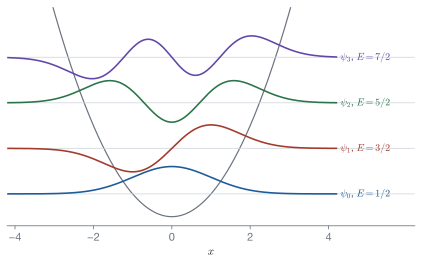
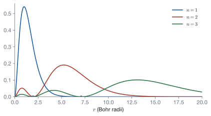
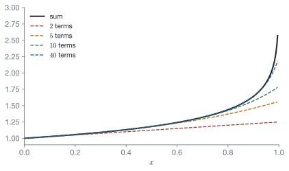
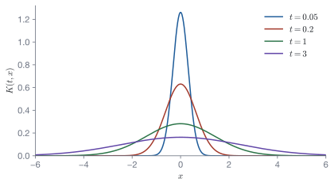
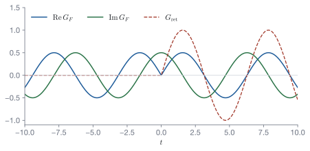

# Differential equations {#sec-differential-equations}

A differential equation relates an unknown function to its derivatives, and solving it means finding the
functions that satisfy the relation. Almost every law of physics is stated in this form: Newton's second law fixes
the acceleration of a body, and the field equations of electromagnetism, of a scalar field or of gravity fix the
second partial derivatives of a field in terms of its sources. This chapter collects the theory of such equations at the
undergraduate level.

The chapter has seven sections.

- @sec-odes defines equations in one independent variable and initial value problems, proves the existence and
  uniqueness theorem of Picard and Lindelöf with the contraction mapping theorem, solves the separable and linear
  first-order equations, and draws phase portraits.
- @sec-linear-systems treats systems $\dot{\mathbf x} = \mathbf A\mathbf x$ with a constant matrix, their solution
  $e^{t\mathbf A}\mathbf x_0$, the Wronskian and the variation of constants, the stability of equilibria by the eigenvalues,
  and the damped and driven harmonic oscillator with its resonance.
- @sec-sturm-liouville replaces initial conditions by conditions at two ends, proves the alternative between existence
  and uniqueness, proves that Sturm-Liouville problems have real eigenvalues and orthogonal eigenfunctions, and builds
  the Legendre polynomials and Bessel functions by the method of Frobenius.
- @sec-special-functions proves the Rodrigues formulas, generating functions, recurrences and orthogonality of the
  Hermite, Laguerre and Chebyshev polynomials, and defines the hypergeometric and confluent hypergeometric functions.
- @sec-pdes classifies second-order equations, solves the wave, heat and Laplace equations by d'Alembert's formula, the
  heat kernel, the mean value property and separation of variables, and analyses finite-difference schemes for them.
- @sec-greens-functions inverts linear operators with delta sequences, fundamental solutions and Green's functions:
  the Coulomb and Yukawa potentials, the Green's function of a two-point problem, Green's representation formula with
  the method of images, the retarded Green's functions of the heat, wave and oscillator operators, and the Feynman
  Green's function of the oscillator.
- @sec-characteristics solves first-order equations along their characteristics: the Cauchy problem near a
  non-characteristic curve, the transport and continuity equations with the conservation of mass, Burgers' equation
  with its breaking time, weak solutions and shocks, and the characteristic strips of fully nonlinear equations such as
  the eikonal and Hamilton-Jacobi equations.

A closing section, @sec-differential-equations-exercises, has three exercises that combine the sections.

Every definition, theorem and proposition is followed by ten examples, from the simplest instances through cases from
physics to limits and counterexamples, and by ten exercises, each with a solution by hand and a check in SageMath. The
proofs are complete with two kinds of exception, each stated where it occurs. First, a few classical facts are quoted
and marked as not proved here; the most important is the completeness of the eigenfunctions of a Sturm-Liouville
problem, together with the infinitude of its eigenvalues, and the same holds for the completeness of the special
function families. Second, the Dirac delta is used only as a notation for limits of delta sequences: every Green's
function in the chapter is a classical function, and every statement about it is proved as an integral formula for the
solutions it produces. The signature conventions of @sec-conventions are used throughout: $\Box = \partial_t^2 -
\nabla^2$.

## Ordinary differential equations {#sec-odes}

An ordinary differential equation involves one independent variable. This section defines the equation and its
order, and the initial value problem together with its equivalent integral form. It proves the existence and uniqueness theorem
of Picard and Lindelöf with the contraction mapping theorem, and solves the two classes of first-order equations that
every physicist meets, separable and linear. It then introduces the phase portrait, the picture of all solutions of an
autonomous system at once. The proposition at the end collects closed-form solutions, each of which satisfies its
equation by direct substitution.

For more on this topic, see @knauf2018mathematical [Ch. 3] and @magnus2023essential [Ch. 2, Ch. 4 and 6].
For first-order equations, separable and linear, see @riley2006mathematical [Secs. 14.1-14.2]; for the existence
theorem and the successive approximations, @magnus2023essential [Sec. 4.1, pp. 121-139].

### Ordinary differential equations

:::: {.statement-box}
::: {#def-ode}
#### Ordinary differential equation

An **ordinary differential equation** (ODE) for an unknown function $y(x)$ of one real variable is a relation
$F(x, y, y', \dots, y^{(n)}) = 0$ between $x$, $y$ and its derivatives up to order $n$; the largest order $n$ that
appears is the **order** of the equation. A **solution** on an interval $I$ is a function $y$ that is $n$ times
differentiable on $I$ (one-sidedly at an end point of $I$ that belongs to $I$) and satisfies the relation at every
point of $I$. The equation is **linear** if $F$ is a linear combination $a_n(x) y^{(n)} + \dots + a_1(x) y' + a_0(x) y
- q(x)$ of $y$ and its derivatives, and **homogeneous** if moreover $q = 0$. More generally, a **first-order system**
for an unknown $\mathbf y(x) \in \mathbb{R}^n$ is $\mathbf y' = f(x, \mathbf y)$ with $f : D \to \mathbb{R}^n$ on a set
$D \subseteq \mathbb{R} \times \mathbb{R}^n$; a solution on $I$ is a differentiable $\mathbf y : I \to \mathbb{R}^n$
with $(x, \mathbf y(x)) \in D$ and $\mathbf y'(x) = f(x, \mathbf y(x))$ for every $x \in I$, the derivative being taken
component by component.
:::
::::

The definition is that of @riley2006mathematical [Sec. 14.1] and @magnus2023essential [Sec. 4.1]. A solution comes
with its interval: the same formula on two disjoint intervals gives two different solutions, and the examples show
why the interval matters.

:::: {.callout-note .examples-fold collapse="true" title="Examples"}
The simplest equation of all is the one whose solution is its own derivative up to a constant factor. It is first
order and linear, and it already shows the pattern that a solution comes with a free constant.

::: {#exm-ode-decay}
#### Exponential decay

$y' = -ky$ with a constant $k > 0$ is a first-order linear homogeneous equation; $y = C e^{-kx}$ is a solution for
every constant $C$, since $(C e^{-kx})' = -k C e^{-kx}$. It describes radioactive decay, with $x$ the time and $k$
the decay rate [@riley2006mathematical, Problem 14.1].
:::

The next equation has a right-hand side that does not involve the unknown at all. It is solved by integrating twice,
and the two integrations bring two free constants.

::: {#exm-ode-free-fall}
#### Free fall

A body falling near the ground obeys $\ddot z = -g$, a second-order linear inhomogeneous equation for the height
$z(t)$. Integrating twice gives $\dot z = v_0 - gt$ and $z = z_0 + v_0t - \tfrac12gt^2$, a solution on all of
$\mathbb{R}$ for every pair of constants $z_0$, $v_0$, which are the height and the velocity at $t = 0$.
:::

Non-linearity appears as soon as the unknown is multiplied by itself. The logistic equation is the standard
example: it is first order like exponential decay, but its solutions behave in a qualitatively new way.

::: {#exm-ode-logistic}
#### The logistic equation

$y' = y(1 - y)$ is first order and non-linear because of the $y^2$ term. The constant functions $y = 0$ and $y = 1$
are solutions, and so is $y = 1/(1 + e^{-x})$: its derivative is $e^{-x}/(1 + e^{-x})^2$, and $y(1 - y) = \frac{1}{1 +
e^{-x}}\cdot\frac{e^{-x}}{1 + e^{-x}}$ is the same. It rises from $0$ to $1$ and models a population that grows
exponentially while small and saturates at the carrying capacity $1$. At each point $(x, y)$ the equation prescribes the
slope $y(1 - y)$ of the solution through it, and the field of these slopes shows all the solutions at a glance.

{#fig-direction-field-logistic width=70%}


:::

Mechanics supplies the second-order equations. The order is two because the force determines the acceleration,
the second derivative of the position, and the same law can be linear or non-linear depending on the force.

::: {#exm-ode-newton}
#### Newton's second law

$m\ddot q = F(q, \dot q, t)$, with the dot for the time derivative, is a second-order equation for the position
$q(t)$; for a spring, $F = -\kappa q$, it is linear and homogeneous, $\ddot q + \omega_0^2 q = 0$ with $\omega_0^2 =
\kappa/m$, and $q = \cos\omega_0 t$ is a solution. For the pendulum, $\ddot\theta + \sin\theta = 0$, the equation is
non-linear.
:::

Electric circuits give first-order linear equations with a forcing term. The charge on a capacitor is the unknown, and
the battery voltage is the inhomogeneous part.

::: {#exm-ode-rc-circuit}
#### A resistor and a capacitor

A resistance $R$ and a capacitance $C$ in series with a voltage source $V(t)$ carry a charge $q(t)$ on the capacitor
with $R\dot q + q/C = V(t)$ [@riley2006mathematical, Problem 14.8]: a first-order linear equation, inhomogeneous unless
$V = 0$. For a constant $V = V_0$ the constant $q = CV_0$, the fully charged capacitor, is a solution.
:::

Newton's law for one particle is a pair of first-order equations as well as one second-order equation. The pair is
the form in which mechanics is usually written, with position and momentum as the two unknowns.

::: {#exm-ode-oscillator-system}
#### The oscillator as a first-order system

With the momentum $p = m\dot q$, the spring equation $m\ddot q = -\kappa q$ becomes the system $\dot q = p/m$, $\dot p =
-\kappa q$, that is $\dot{\mathbf y} = \mathbf A\mathbf y$ for $\mathbf y = (q, p)^\top$ and $\mathbf A = \begin{pmatrix} 0 &
1/m \\ -\kappa & 0 \end{pmatrix}$. The function $\mathbf y = (\cos\omega_0t, -m\omega_0\sin\omega_0t)^\top$ with $\omega_0^2 =
\kappa/m$ solves it: $\dot q = -\omega_0\sin\omega_0t = p/m$ and $\dot p = -m\omega_0^2\cos\omega_0t = -\kappa q$.
:::

The hydrogen atom leads to a linear second-order equation whose coefficients are singular at the origin. In atomic
units the radial function $u(r) = rR(r)$ of an electron with angular momentum $l$ and energy $E$ satisfies the radial
equation below.

::: {#exm-ode-hydrogen-radial}
#### The radial equation of hydrogen

The radial equation is $-\tfrac12u'' + \bigl(\tfrac{l(l + 1)}{2r^2} - \tfrac1r\bigr)u = Eu$ on $r > 0$, linear and
homogeneous of order two. For $l = 0$ and $E = -\tfrac12$, $u = re^{-r}$ is a solution: $u'' = (r - 2)e^{-r}$, so $-\tfrac12u''
- u/r = (1 - \tfrac r2 - 1)e^{-r} = -\tfrac12u$. This is the ground state, with energy $-\tfrac12$ hartree $= -13.6$ eV.
:::

A solution is attached to an interval, and the interval is not decoration. The tangent function shows how one formula
gives many different solutions, one on each interval where it is defined.

::: {#exm-ode-interval-matters}
#### The interval is part of the solution

$y = \tan x$ solves $y' = 1 + y^2$ on $(-\pi/2, \pi/2)$, and also on $(\pi/2, 3\pi/2)$. These are two solutions, not
one: no solution on an interval containing $\pi/2$ can agree with $\tan$ on either side, since $\tan$ is unbounded near
$\pi/2$ while a differentiable function is bounded near each point.
:::

An equation of the form $F = 0$ need not have any solution at all. The obstruction below is algebraic: no real number
can serve as the derivative.

::: {#exm-ode-no-solution}
#### An equation without solutions

$(y')^2 + 1 = 0$ has no real solution on any interval, because $(y')^2 + 1 \geq 1$. The equation $(y')^2 + y^2 = 0$ has
exactly one solution on each interval, $y = 0$: a sum of two squares vanishes only if both vanish.
:::

The relation in the definition links the values of $y$ and its derivatives at the same point $x$. An equation that
links the derivative at $x$ to the value at an earlier point is a different kind of object.

::: {#exm-ode-delay-not-ode}
#### A delay equation is not an ODE

$y'(x) = -y(x - 1)$ relates the slope at $x$ to the value one unit earlier, so it is not of the form $F(x, y(x),
y'(x)) = 0$. Its solutions are not fixed by one value $y(0)$: one must prescribe $y$ on a whole interval $[-1, 0]$, and
then the equation gives $y$ on $[0, 1]$ by integration, then on $[1, 2]$, and so on.
:::
::::

:::: {.callout-note .exercises-fold collapse="true" title="Exercises"}
The first exercise asks for the two labels every equation carries, its order and whether it is linear. Both are
read off the equation without solving it, and both decide which methods of this chapter apply.

::: {#exr-ode-classify}
#### Order and linearity

For each of $y'' + x y' = \sin x$, $(y')^2 + y = 0$, $y''' = y y'$ and $x^2 y'' - 2y = 0$, give the order and decide
whether the equation is linear, and if so whether it is homogeneous.
:::

::: {.callout-note .solution collapse="true" title="Solution"}
:::: {.panel-tabset .solution-tabs}
## Proof

$y'' + xy' = \sin x$: order $2$, linear (the coefficients $1$, $x$, $0$ depend on $x$ only), inhomogeneous because
of $\sin x$. $(y')^2 + y = 0$: order $1$, non-linear because $y'$ is squared. $y''' = yy'$: order $3$, non-linear
because of the product $yy'$. $x^2y'' - 2y = 0$: order $2$, linear and homogeneous. For a linear equation the part of
$F$ that contains $y$ is additive: applied to $y_1 + y_2$ it gives the sum of its values on $y_1$ and on $y_2$, because
derivatives are additive. A square or a product of $y$ with its derivatives breaks this.

## SageMath

Sage applies the part of each equation that contains $y$ to $y_1 + y_2$, for two arbitrary functions, and compares with
the sum of its values on $y_1$ and $y_2$.

```{.python .sage}
x = var("x")
y1 = function("y1")(x); y2 = function("y2")(x)
ops = {"y'' + x y'": lambda y: diff(y, x, 2) + x * diff(y, x),
       "(y')^2 + y": lambda y: diff(y, x)^2 + y,
       "y''' - y y'": lambda y: diff(y, x, 3) - y * diff(y, x),
       "x^2 y'' - 2y": lambda y: x^2 * diff(y, x, 2) - 2 * y}
for name, L in ops.items():
    print(name, "additive:", bool((L(y1 + y2) - L(y1) - L(y2)).expand() == 0))
```

```{.text .sage-output}
y'' + x y' additive: True
(y')^2 + y additive: False
y''' - y y' additive: False
x^2 y'' - 2y additive: True
```
::::
:::

Checking a candidate solution is the most useful skill of the chapter, and it is purely mechanical. The second
exercise practises it, including the case where the candidate fails.

::: {#exr-ode-verify}
#### Verifying a solution by substitution

Check that $y = C_1\cos x + C_2\sin x$ solves $y'' + y = 0$ for all constants $C_1, C_2$, that $y = x^2$ and $y =
1/x$ solve $x^2 y'' - 2y = 0$, and that $y = e^{x^2}$ does not solve $y' = 2y$.
:::

::: {.callout-note .solution collapse="true" title="Solution"}
:::: {.panel-tabset .solution-tabs}
## Proof

$(C_1\cos x + C_2\sin x)'' = -C_1\cos x - C_2\sin x$, so $y'' + y = 0$. For $y = x^2$, $x^2y'' - 2y = 2x^2 - 2x^2 =
0$; for $y = 1/x$ on $x \neq 0$, $y'' = 2/x^3$ and $x^2y'' - 2y = 2/x - 2/x = 0$. For $y = e^{x^2}$, $y' - 2y = 2(x -
1)e^{x^2}$, which is not zero for $x \neq 1$, so $y$ is not a solution on any interval.

## SageMath

Substituting and simplifying the difference of the two sides is the whole verification; a non-solution leaves a
non-zero residual.

```{.python .sage}
x, C1, C2 = var("x C1 C2")
def residual(y, eq):
    return eq(y).simplify_full()
y1 = C1 * cos(x) + C2 * sin(x)
r = residual(y1, lambda y: diff(y, x, 2) + y)
print("y'' + y for C1 cos x + C2 sin x:", r, "-> solution:", bool(r == 0))
for y2 in [x^2, 1 / x]:
    r = residual(y2, lambda y: x^2 * diff(y, x, 2) - 2 * y)
    print("x^2 y'' - 2y for y =", y2, ":", r, "-> solution:", bool(r == 0))
r = residual(exp(x^2), lambda y: diff(y, x) - 2 * y)
print("y' - 2y for y = e^(x^2):", r, "-> solution:", bool(r == 0))
```

```{.text .sage-output}
y'' + y for C1 cos x + C2 sin x: 0 -> solution: True
x^2 y'' - 2y for y = x^2 : 0 -> solution: True
x^2 y'' - 2y for y = 1/x : 0 -> solution: True
y' - 2y for y = e^(x^2): 2*(x - 1)*e^(x^2) -> solution: False
```
::::
:::

A family of functions with free constants is the general solution of some equation, and the equation is found by
eliminating the constants. The third exercise does this for one- and two-parameter families.

::: {#exr-ode-eliminate-constants}
#### The equation of a family

Find a first-order equation satisfied by every member of the family $y = Ce^{x^2}$, a first-order equation for the
circles $x^2 + y^2 = C$ (on the arcs where $y \neq 0$), and a second-order equation for $y = C_1e^x + C_2e^{-x}$.
:::

::: {.callout-note .solution collapse="true" title="Solution"}
:::: {.panel-tabset .solution-tabs}
## Proof

From $y = Ce^{x^2}$, $y' = 2xCe^{x^2} = 2xy$: the equation $y' = 2xy$ no longer contains $C$. Differentiating $x^2 +
y(x)^2 = C$ gives $2x + 2yy' = 0$, so $y' = -x/y$ where $y \neq 0$. For $y = C_1e^x + C_2e^{-x}$, $y'' = C_1e^x +
C_2e^{-x} = y$, so $y'' = y$. In each case the number of constants matches the order of the equation obtained.

## SageMath

Sage substitutes each family into its equation and simplifies the residual.

```{.python .sage}
x, C, C1, C2 = var("x C C1 C2")
y = C * exp(x^2)
print("y' - 2xy:", (diff(y, x) - 2 * x * y).simplify_full())
y = sqrt(C - x^2)
print("y' + x/y on the upper arc:", (diff(y, x) + x / y).simplify_full())
y = C1 * exp(x) + C2 * exp(-x)
print("y'' - y:", (diff(y, x, 2) - y).simplify_full())
```

```{.text .sage-output}
y' - 2xy: 0
y' + x/y on the upper arc: 0
y'' - y: 0
```
::::
:::

The fourth exercise shows that one never needs a separate theory for higher orders. An equation of order $n$ is
the same as a system of $n$ first-order equations, and the rest of the chapter uses this freely.

::: {#exr-ode-first-order-system}
#### Reduction to first order

Show that every $n$-th order equation $y^{(n)} = f(x, y, y', \dots, y^{(n-1)})$ is equivalent to a first-order
system for $\mathbf u = (u_1, \dots, u_n)^\top$, and write $y''' + y' = 0$ in the form $\mathbf u' = \mathbf A\mathbf u$.
:::

::: {.callout-note .solution collapse="true" title="Solution"}
:::: {.panel-tabset .solution-tabs}
## Proof

Set $u_1 = y$, $u_2 = y'$, ..., $u_n = y^{(n-1)}$. Then $u_1' = u_2$, ..., $u_{n-1}' = u_n$ and $u_n' = f(x, u_1,
\dots, u_n)$: a solution $y$ gives a solution $\mathbf u$ of the system. Conversely, if $\mathbf u$ solves the system,
then $u_2 = u_1'$, $u_3 = u_2' = u_1''$, and so on, so $u_1$ is $n$ times differentiable with $u_1^{(n)} = u_n' = f(x,
u_1, \dots, u_1^{(n-1)})$. For $y''' + y' = 0$, $u_1' = u_2$, $u_2' = u_3$, $u_3' = -u_2$, which is $\mathbf u' =
\mathbf A\mathbf u$ with
$$
\mathbf A = \begin{pmatrix} 0 & 1 & 0 \\ 0 & 0 & 1 \\ 0 & -1 & 0 \end{pmatrix}.
$$

## SageMath

Check on $y = \sin x$, a solution of $y''' + y' = 0$: the vector $(y, y', y'')^\top$ satisfies $\mathbf u' =
\mathbf A\mathbf u$.

```{.python .sage}
x = var("x")
A = matrix(SR, [[0, 1, 0], [0, 0, 1], [0, -1, 0]])
y = sin(x)
print("y''' + y' =", diff(y, x, 3) + diff(y, x))
u = vector([y, diff(y, x), diff(y, x, 2)])
print("u' - A u =", (diff(u, x) - A * u).simplify_full())
```

```{.text .sage-output}
y''' + y' = 0
u' - A u = (0, 0, 0)
```
::::
:::

An equation whose right side depends on $x$ alone is solved by integration, and the fifth exercise proves that this
gives every solution. The tool is the mean value theorem: a function with zero derivative on an interval is constant.

::: {#exr-ode-pure-integration}
#### Equations solved by integration

Let $g$ be continuous on an open interval $I$ and $x_0 \in I$. Show that the solutions of $y^{(n)} = g(x)$ on $I$ are
exactly $y = y_p + c_0 + c_1(x - x_0) + \dots + c_{n-1}(x - x_0)^{n-1}$, where $y_p$ is one solution, and find all
solutions of $y''' = 6$.
:::

::: {.callout-note .solution collapse="true" title="Solution"}
:::: {.panel-tabset .solution-tabs}
## Proof

A solution exists: $G_1(x) = \int_{x_0}^xg$ has $G_1' = g$ by @thm-fundamental-theorem (1), and integrating $n$ times
gives $y_p$ with $y_p^{(n)} = g$. If $y$ is any solution, $w = y - y_p$ has $w^{(n)} = 0$. By induction on $n$: for $n
= 1$, $w' = 0$ makes $w$ constant (@thm-mean-value (4)). If $w^{(n)} = 0$, then $w'$ satisfies $(w')^{(n-1)} = 0$, so
$w'$ is a polynomial of degree less than $n - 1$, $w' = \sum_{k < n-1}d_k(x - x_0)^k$; then $w - \sum_k d_k(x -
x_0)^{k+1}/(k + 1)$ has zero derivative and is constant, so $w$ is a polynomial of degree less than $n$. Conversely
every such polynomial has $n$-th derivative zero. For $y''' = 6$, $y_p = x^3$, and the solutions are $x^3 + c_2x^2 +
c_1x + c_0$.

## SageMath

Check on $y''' = 6$: Sage integrates three times, adding a constant at each step, and differentiates back.

```{.python .sage}
x, c0, c1, c2 = var("x c0 c1 c2")
sol = integrate(integrate(integrate(SR(6), x) + 2 * c2, x) + c1, x) + c0
print("general solution:", sol.expand())
print("third derivative:", diff(sol, x, 3))
```

```{.text .sage-output}
general solution: c2*x^2 + x^3 + c1*x + c0
third derivative: 6
```
::::
:::

For a linear homogeneous equation the solutions form a vector space. The sixth exercise proves this, and the structure
"one solution plus homogeneous solutions" of the inhomogeneous case.

::: {#exr-ode-linear-solution-space}
#### The solution space of a linear equation

Let $L[y] = a_n(x)y^{(n)} + \dots + a_0(x)y$. Show that the solutions of $L[y] = 0$ on an interval $I$ form a vector
subspace of the real functions on $I$ (@def-vector-space), and that if $y_p$ solves $L[y] = q$, then every solution of
$L[y] = q$ is $y_p + y_h$ with $L[y_h] = 0$.
:::

::: {.callout-note .solution collapse="true" title="Solution"}
:::: {.panel-tabset .solution-tabs}
## Proof

Derivatives are linear, $(\alpha y + \beta z)^{(k)} = \alpha y^{(k)} + \beta z^{(k)}$, so $L[\alpha y + \beta z] = \alpha
L[y] + \beta L[z]$. If $L[y] = L[z] = 0$ then $L[\alpha y + \beta z] = 0$, and the zero function is a solution; so the
solutions are a subspace. If $L[y] = q$ and $L[y_p] = q$, then $L[y - y_p] = q - q = 0$, so $y_h = y - y_p$ is a
homogeneous solution; conversely $L[y_p + y_h] = q + 0 = q$.

## SageMath

Check on $x^2y'' - 2y = 0$: a combination of the solutions $x^2$ and $1/x$ is again a solution, and adding it to the
solution $-\tfrac12$ of $x^2y'' - 2y = 1$ gives solutions of the inhomogeneous equation.

```{.python .sage}
x, a, b = var("x a b")
L = lambda y: x^2 * diff(y, x, 2) - 2 * y
print("L[a x^2 + b/x] =", L(a * x^2 + b / x).simplify_full())
print("L[-1/2 + a x^2 + b/x] =", L(-1/2 + a * x^2 + b / x).simplify_full())
```

```{.text .sage-output}
L[a x^2 + b/x] = 0
L[-1/2 + a x^2 + b/x] = 1
```
::::
:::

The hydrogen radial equation of @exm-ode-hydrogen-radial has a solution of a simple form for every $l$. The seventh
exercise finds the energy for which that form works, which gives one bound-state energy for each angular momentum.

::: {#exr-ode-hydrogen-levels}
#### Hydrogen states with no radial node

For $l = 0, 1, 2, \dots$ and $\kappa > 0$ put $u = r^{l + 1}e^{-\kappa r}$. Find $\kappa$ and $E$ such that $u$ solves
$-\tfrac12u'' + \bigl(\tfrac{l(l + 1)}{2r^2} - \tfrac1r\bigr)u = Eu$ on $r > 0$.
:::

::: {.callout-note .solution collapse="true" title="Solution"}
:::: {.panel-tabset .solution-tabs}
## Proof

$u' = \bigl(\tfrac{l + 1}{r} - \kappa\bigr)u$ and $u'' = \bigl[\bigl(\tfrac{l + 1}{r} - \kappa\bigr)^2 - \tfrac{l + 1}{r^2}\bigr]u
= \bigl[\tfrac{l(l + 1)}{r^2} - \tfrac{2\kappa(l + 1)}{r} + \kappa^2\bigr]u$. Then
$$
-\tfrac12u'' + \Bigl(\tfrac{l(l + 1)}{2r^2} - \tfrac1r\Bigr)u = \Bigl(\frac{\kappa(l + 1) - 1}{r} - \frac{\kappa^2}2\Bigr)u.
$$
This equals $Eu$ for all $r > 0$ exactly when the coefficient of $1/r$ vanishes, $\kappa = 1/(l + 1)$, and then $E =
-\kappa^2/2 = -1/(2(l + 1)^2)$: the levels $-1/(2N^2)$ with $N = l + 1$, which are $-13.6\,\mathrm{eV}/N^2$.

## SageMath

Sage computes the residual divided by $u$ and solves for $\kappa$ and $E$.

```{.python .sage}
r, l, k, E = var("r l k E")
assume(r > 0)
u = r^(l + 1) * exp(-k * r)
res = ((-diff(u, r, 2) / 2 + (l * (l + 1) / (2 * r^2) - 1 / r) * u - E * u) / u).simplify_full()
print("residual / u =", res)
num = (res * r).expand()
print("kappa:", solve(num.coefficient(r, 0) == 0, k))
print("E:", solve(num.subs(k=1 / (l + 1)).coefficient(r, 1) == 0, E))
```

```{.text .sage-output}
residual / u = 1/2*(2*k*l - (k^2 + 2*E)*r + 2*k - 2)/r
kappa: [
k == (1/(l + 1))
]
E: [
E == -1/2/(l^2 + 2*l + 1)
]
```
::::
:::

An autonomous equation does not contain the independent variable explicitly, and so it cannot tell one moment from
another. The eighth exercise turns this into a statement about solutions [@magnus2023essential, Exercises 4.1.4.5-6].

::: {#exr-ode-autonomous-translates}
#### Translates of solutions

Show that if $\mathbf y(x)$ solves $\mathbf y' = f(\mathbf y)$ on an interval $I$, then $\mathbf z(x) = \mathbf y(x + c)$
solves it on $I - c$. Show that if $f(x + T, \mathbf y) = f(x, \mathbf y)$ for all $x$ and $\mathbf y$, then $\mathbf
y(x + T)$ solves $\mathbf y' = f(x, \mathbf y)$ whenever $\mathbf y$ does, and that this fails for $y' = xy$ with any $T
\neq 0$.
:::

::: {.callout-note .solution collapse="true" title="Solution"}
:::: {.panel-tabset .solution-tabs}
## Proof

By the chain rule $\mathbf z'(x) = \mathbf y'(x + c) = f(\mathbf y(x + c)) = f(\mathbf z(x))$ for $x + c \in I$. In the
periodic case, $\frac{d}{dx}\mathbf y(x + T) = f(x + T, \mathbf y(x + T)) = f(x, \mathbf y(x + T))$. For $y' = xy$, $y =
e^{x^2/2}$ is a solution, but $z = e^{(x + T)^2/2}$ has $z' = (x + T)z \neq xz$ when $T \neq 0$, since $z \neq 0$.

## SageMath

Check on the logistic equation and on $y' = xy$: Sage tests a translate of a solution of each.

```{.python .sage}
x, c, T = var("x c T")
y = 1 / (1 + exp(-x))
z = y.subs(x=x + c)
print("logistic translate residual:", (diff(z, x) - z * (1 - z)).simplify_full())
w = exp((x + T)^2 / 2)
print("y' - xy for the translate of e^(x^2/2):", (diff(w, x) - x * w).simplify_full())
```

```{.text .sage-output}
logistic translate residual: 0
y' - xy for the translate of e^(x^2/2): T*e^(1/2*T^2 + T*x + 1/2*x^2)
```
::::
:::

The ninth exercise finds a quantity that a second-order equation keeps constant. For $y'' = -V'(y)$ the quantity is
the energy, and it reduces the equation to one of first order.

::: {#exr-ode-energy-integral}
#### The energy of $y'' = -V'(y)$

Let $V$ be continuously differentiable and $y$ a twice differentiable solution of $y'' = -V'(y)$ on an interval. Show
that $E = \tfrac12(y')^2 + V(y)$ is constant, and compute it for the solution $y = \cos t$ of $y'' = -y$.
:::

::: {.callout-note .solution collapse="true" title="Solution"}
:::: {.panel-tabset .solution-tabs}
## Proof

By the chain rule (@thm-chain-rule), $\frac{d}{dt}V(y(t)) = V'(y)y'$, so $\frac{dE}{dt} = y'y'' + V'(y)y' = y'(y'' +
V'(y)) = 0$, and $E$ is constant by @thm-mean-value (4). For $V = y^2/2$ and $y = \cos t$, $E = \tfrac12\sin^2t +
\tfrac12\cos^2t = \tfrac12$.

## SageMath

Check on the quartic potential $V = y^4/4$: Sage differentiates $E$ along an arbitrary function and substitutes the
equation $y'' = -y^3$.

```{.python .sage}
t = var("t")
y = function("y")(t)
E = diff(y, t)^2 / 2 + y^4 / 4
dE = diff(E, t).subs({diff(y, t, 2): -y^3})
print("dE/dt with y'' = -y^3:", dE.simplify_full())
print("E for cos t, V = y^2/2:", (diff(cos(t), t)^2 / 2 + cos(t)^2 / 2).simplify_full())
```

```{.text .sage-output}
dE/dt with y'' = -y^3: 0
E for cos t, V = y^2/2: 1/2
```
::::
:::

The last exercise combines the definition with the complex exponential of complex analysis. A linear equation with
real coefficients can be solved with complex functions, and the real and imaginary parts are then real solutions.

::: {#exr-ode-complex-solutions}
#### Complex solutions of a real equation

Show that $y = e^{ix}$ (@def-complex-exponential) solves $y'' + y = 0$, with the derivative of a complex-valued
function of a real variable taken on its real and imaginary parts. Then show that for a linear homogeneous equation with
real coefficients the real and imaginary parts of a complex solution are real solutions, and apply this to $y'' + 2y' +
5y = 0$ with $y = e^{(-1 + 2i)x}$.
:::

::: {.callout-note .solution collapse="true" title="Solution"}
:::: {.panel-tabset .solution-tabs}
## Proof

$e^{ix} = \cos x + i\sin x$, so $(e^{ix})'' = -\cos x - i\sin x = -e^{ix}$. For a real linear $L$ and $y = u + iv$ with
$u, v$ real, $L[y] = L[u] + iL[v]$ because derivatives act on real and imaginary parts separately and the coefficients
are real; $L[y] = 0$ forces both $L[u] = 0$ and $L[v] = 0$. For $\lambda = -1 + 2i$, $y = e^{\lambda x} = e^{-x}(\cos 2x +
i\sin 2x)$, and differentiating the real and imaginary parts gives $y' = e^{-x}\bigl((-\cos 2x - 2\sin 2x) + i(-\sin 2x +
2\cos 2x)\bigr) = \lambda y$. So $y'' + 2y' + 5y = (\lambda^2 + 2\lambda + 5)y$, and $\lambda^2 + 2\lambda + 5 = (-3 - 4i) +
(-2 + 4i) + 5 = 0$. Hence $e^{-x}\cos 2x$ and $e^{-x}\sin 2x$ are real solutions.

## SageMath

Check on $y'' + 2y' + 5y = 0$: Sage substitutes the complex solution and its real and imaginary parts.

```{.python .sage}
x = var("x", domain="real")
L = lambda y: diff(y, x, 2) + 2 * diff(y, x) + 5 * y
y = exp((-1 + 2 * I) * x)
print("L[e^((-1+2i)x)] =", L(y).simplify_full())
for part in [y.real_part(), y.imag_part()]:
    print("part", part, "-> L =", L(part).simplify_full())
```

```{.text .sage-output}
L[e^((-1+2i)x)] = 0
part cos(2*x)*e^(-x) -> L = 0
part e^(-x)*sin(2*x) -> L = 0
```
::::
:::
::::

### Initial value problems

An equation alone has a whole family of solutions, as the examples showed. What singles out one of them is a
condition at one point, and the next definition makes this the standard form of the problem. It also rewrites the
problem as an integral equation, the form in which the existence theorem below is proved.

:::: {.statement-box}
::: {#def-initial-value-problem}
#### Initial value problem

An **initial value problem** for the first-order system $\mathbf y' = f(x, \mathbf y)$, with $f : D \to \mathbb{R}^n$
and $D \subseteq \mathbb{R} \times \mathbb{R}^n$, is the system together with an **initial condition** $\mathbf y(x_0) =
\mathbf y_0$, where $(x_0, \mathbf y_0) \in D$. A solution of the problem is a solution of the system on an interval $I$
containing $x_0$ (@def-ode) with $\mathbf y(x_0) = \mathbf y_0$. For an $n$-th order equation $y^{(n)} = f(x, y,
\dots, y^{(n-1)})$ the initial conditions prescribe the $n$ values $y(x_0), y'(x_0), \dots, y^{(n-1)}(x_0)$, which are
the initial value of the equivalent first-order system of @exr-ode-first-order-system. For $n = 1$ the norm $\lVert\cdot\rVert$
below is the absolute value.

1. (**Integral form**) If $f$ is continuous on $D$, a continuous $\mathbf y : I \to \mathbb{R}^n$ with $(x, \mathbf y(x))
   \in D$ for $x \in I$ solves the problem on $I$ if and only if
   $$
   \mathbf y(x) = \mathbf y_0 + \int_{x_0}^x f(s, \mathbf y(s))\,ds \qquad (x \in I),
   $$ {#eq-ivp-integral-form}
   the integral of a vector being taken component by component.
2. (**Integral inequality**) For a continuous $\boldsymbol\varphi : [\alpha, \beta] \to \mathbb{R}^n$,
   $\bigl\lVert\int_\alpha^\beta\boldsymbol\varphi(s)\,ds\bigr\rVert \leq \int_\alpha^\beta\lVert\boldsymbol\varphi(s)\rVert\,ds$.
   Consequently a solution with $\lVert f\rVert \leq M$ along its graph satisfies $\lVert\mathbf y(x) - \mathbf y_0\rVert
   \leq M|x - x_0|$.
:::
::::

*Proof.* (1) If $\mathbf y$ solves the problem, each component $y_i$ is differentiable on $I$ with $y_i'(s) = f_i(s,
\mathbf y(s))$, which is continuous in $s$ as a composition of continuous maps. By @thm-fundamental-theorem (2) on the
interval between $x_0$ and $x$, $y_i(x) - y_i(x_0) = \int_{x_0}^xf_i(s, \mathbf y(s))\,ds$, which is
@eq-ivp-integral-form. Conversely, if $\mathbf y$ is continuous and satisfies @eq-ivp-integral-form, the integrand $s
\mapsto f(s, \mathbf y(s))$ is continuous, so by @thm-fundamental-theorem (1) the right side is differentiable with
derivative $f(x, \mathbf y(x))$; at an end point of $I$ the same estimate gives the one-sided derivative. Setting $x =
x_0$ gives $\mathbf y(x_0) = \mathbf y_0$.

(2) Let $\mathbf v = \int_\alpha^\beta\boldsymbol\varphi\,ds$; if $\mathbf v = \mathbf 0$ there is nothing to prove.
Otherwise, by linearity of the integral and the Cauchy-Schwarz inequality of @exm-metric-space-euclidean,
$$
\lVert\mathbf v\rVert^2 = \sum_iv_i\int_\alpha^\beta\varphi_i\,ds = \int_\alpha^\beta\mathbf v\cdot\boldsymbol\varphi\,ds
\leq \int_\alpha^\beta\lVert\mathbf v\rVert\,\lVert\boldsymbol\varphi\rVert\,ds,
$$
using the monotonicity of the integral (@def-riemann-integral (4)); dividing by $\lVert\mathbf v\rVert$ gives the
inequality. For a solution, (1) gives $\mathbf y(x) - \mathbf y_0 = \int_{x_0}^xf(s, \mathbf y(s))\,ds$, whose norm is
at most $|\int_{x_0}^xM\,ds| = M|x - x_0|$. $\square$

The initial value problem is also called the Cauchy problem; the integral form is the starting point of
@magnus2023essential [Sec. 4.1.1, eq. (4.4)].

:::: {.callout-note .examples-fold collapse="true" title="Examples"}
The first example shows the initial condition doing its job. Among a one-parameter family of solutions, one
number picks one solution, and the choice is unique.

::: {#exm-ivp-exponential}
#### $y' = y$, $y(0) = 1$

Among the solutions $C e^x$ of $y' = y$ the condition $y(0) = 1$ selects $C = 1$: the solution is $y = e^x$, and
the general solution $Ce^x$ is a one-parameter family in which the initial value picks one member.
:::

When the right side does not depend on $y$, the integral form of the problem is already its solution. The example
writes it out for a polynomial right side.

::: {#exm-ivp-integral-form}
#### The integral form of a simple problem

For $y' = 2x$, $y(1) = 3$, the integral form @eq-ivp-integral-form reads $y(x) = 3 + \int_1^x2s\,ds = 3 + x^2 - 1 = x^2 +
2$, a solution on all of $\mathbb{R}$. When $f$ depends on $y$ the integral form is an equation for $y$, since the
unknown appears under the integral.
:::

A second-order equation needs two numbers, not one. The example makes the count explicit for the oscillator,
whose general solution contains two constants.

::: {#exm-ivp-oscillator}
#### The oscillator with initial position and velocity

$\ddot q + q = 0$ with $q(0) = 1$, $\dot q(0) = 0$ has the solution $q = \cos t$; with $q(0) = 0$, $\dot q(0) = 1$
it has $q = \sin t$. The general solution $C_1\cos t + C_2\sin t$ has two constants, and a second-order equation
needs two initial data to fix them.
:::

The two data of a second-order problem are one initial vector of the equivalent system. The example writes the
oscillator problem in that form, which is the form the theory of this section is stated in.

::: {#exm-ivp-higher-to-system}
#### A second-order problem as a first-order system

With $\mathbf u = (q, \dot q)^\top$, the problem $\ddot q + q = 0$, $q(0) = 1$, $\dot q(0) = 0$ becomes $\mathbf u' =
(u_2, -u_1)^\top$, $\mathbf u(0) = (1, 0)^\top$, with solution $\mathbf u = (\cos t, -\sin t)^\top$. Here $D = \mathbb{R}
\times \mathbb{R}^2$ and $f(t, \mathbf u) = (u_2, -u_1)^\top$.
:::

A capacitor charged through a resistor is the simplest initial value problem of electronics. The initial charge is
the datum, and the solution relaxes to the charge that the battery maintains.

::: {#exm-ivp-rc-charging}
#### Charging a capacitor

$R\dot q + q/C = V_0$ with $q(0) = 0$ has the solution $q = CV_0(1 - e^{-t/RC})$: indeed $R\dot q = V_0e^{-t/RC}$ and
$q/C = V_0 - V_0e^{-t/RC}$, which add up to $V_0$, and $q(0) = 0$. The time $RC$ is the time constant of the
circuit.
:::

A falling body with air resistance proportional to the square of its speed has a speed that saturates. The problem is
from @magnus2023essential [Exercise 2.1.3.3], and here its solution is checked by substitution.

::: {#exm-ivp-terminal-velocity}
#### Fall with quadratic drag

$\dot v = g - kv^2$ with $v(0) = 0$ and $g, k > 0$ has the solution $v = v_\infty\tanh(t\sqrt{gk})$, $v_\infty =
\sqrt{g/k}$: with $\tanh' = 1 - \tanh^2$, $\dot v = v_\infty\sqrt{gk}(1 - \tanh^2) = g - kv^2$. The speed increases to
the terminal velocity $v_\infty$, at which drag balances gravity.
:::

A charged particle in a constant magnetic field obeys a first-order system for its velocity, with the Lorentz force
on the right. Its solution with a given initial velocity is a uniform rotation.

::: {#exm-ivp-cyclotron}
#### A charge in a magnetic field

For $\mathbf B = B\mathbf e_3$, the velocity obeys $m\dot{\mathbf v} = Q\,\mathbf v \times \mathbf B$
(@def-cross-product), that is $\dot v_1 = \omega v_2$, $\dot v_2 = -\omega v_1$, $\dot v_3 = 0$ with $\omega = QB/m$.
With $\mathbf v(0) = (v_0, 0, 0)^\top$ the solution is $\mathbf v = v_0(\cos\omega t, -\sin\omega t, 0)^\top$, a rotation
at the cyclotron frequency $\omega$, with constant speed $v_0$.
:::

The pendulum gives an initial value problem that is easy to state and hard to solve in closed form. Energy conservation
already constrains the solution, even without a formula.

::: {#exm-ivp-pendulum}
#### The pendulum released from rest

$\ddot\theta + \sin\theta = 0$ with $\theta(0) = \theta_0$, $\dot\theta(0) = 0$ is an initial value problem for a
second-order equation. For $\theta_0 = 0$ and $\theta_0 = \pi$ the constant functions solve it; for other $\theta_0$ no
elementary closed form is known. Along any solution $\frac{d}{dt}(\tfrac12\dot\theta^2 - \cos\theta) = \dot\theta(\ddot\theta
+ \sin\theta) = 0$, so $\dot\theta^2 = 2(\cos\theta - \cos\theta_0)$: the pendulum never swings beyond $\pm\theta_0$.
:::

Conditions at two different points do not behave like initial conditions. The same equation with the same number of
data can then have no solution or infinitely many.

::: {#exm-ivp-two-point}
#### Data at two points

$y'' + y = 0$ has the solutions $C_1\cos x + C_2\sin x$ (@exr-ode-verify), and the problem below asks for all solutions on
$\mathbb{R}$ of this form. With $y(0) = 0$ and $y(\pi) = 0$, every $C_2\sin x$ qualifies; with $y(0) = 0$ and $y(\pi) = 1$,
none does, since $y(0) = 0$ forces $C_1 = 0$ and then $y(\pi) = 0$.
:::

An equation whose leading coefficient vanishes at the initial point is not of the form $y' = f(x, y)$ there. The last
example shows that the initial value problem can then fail in both directions.

::: {#exm-ivp-singular-point}
#### A singular initial point

On $\mathbb{R}$, $xy' = y$ is solved by $y = Cx$ for every $C$. With $y(0) = 0$ there are infinitely many solutions, and
with $y(0) = 1$ there is none of this form, since every $Cx$ vanishes at $0$; in fact any solution satisfies $0 \cdot
y'(0) = y(0)$, so $y(0) = 0$ is forced.
:::
::::

:::: {.callout-note .exercises-fold collapse="true" title="Exercises"}
The first exercise fixes the constant of the decay equation from the initial amount. It also introduces `desolve`
with the `ics` argument, which does the same selection automatically.

::: {#exr-ivp-decay}
#### Decay with a given initial amount

Solve $y' = -2y$ with $y(0) = 5$ and find the time at which $y$ has halved.
:::

::: {.callout-note .solution collapse="true" title="Solution"}
:::: {.panel-tabset .solution-tabs}
## Proof

The functions $Ce^{-2x}$ solve the equation (@exm-ode-decay), and $y(0) = 5$ gives $C = 5$. Then $y = 5/2$ when
$e^{-2x} = 1/2$, that is, at $x = \tfrac12\log 2 \approx 0.347$, independently of the initial amount.

## SageMath

Sage's `desolve` with `ics` solves the problem; the code checks the result and the half-life.

```{.python .sage}
x = var("x")
y = function("y")(x)
sol = desolve(diff(y, x) == -2 * y, y, ics=[0, 5])
print("solution:", sol)
print("check y' + 2y = 0 and y(0) = 5:", bool((diff(sol, x) + 2 * sol).simplify_full() == 0), bool(sol.subs(x=0) == 5))
half = log(2) / 2
print("y(log(2)/2) =", sol.subs(x=half).simplify_full(), "| half-life:", n(half))
```

```{.text .sage-output}
solution: 5*e^(-2*x)
check y' + 2y = 0 and y(0) = 5: True True
y(log(2)/2) = 5/2 | half-life: 0.346573590279973
```
::::
:::

The second exercise does the same for a second-order equation, where two data are needed. The Laplace-transform
solver `desolve_laplace` takes the initial position and velocity directly.

::: {#exr-ivp-second-order}
#### Two initial data for a second-order equation

Solve $\ddot q + 4q = 0$ with $q(0) = 1$, $\dot q(0) = 2$, given that $C_1\cos 2t + C_2\sin 2t$ solves the equation
for all constants, and check the result by substitution.
:::

::: {.callout-note .solution collapse="true" title="Solution"}
:::: {.panel-tabset .solution-tabs}
## Proof

$(C_1\cos 2t + C_2\sin 2t)'' = -4(C_1\cos 2t + C_2\sin 2t)$, so these functions solve the equation. $q(0) = C_1 = 1$
and $\dot q(0) = 2C_2 = 2$ give $C_2 = 1$, so $q = \cos 2t + \sin 2t$.

## SageMath

`desolve_laplace` takes the initial data as `ics=[t0, q(t0), q'(t0)]`.

```{.python .sage}
t = var("t")
q = function("q")(t)
sol = desolve_laplace(diff(q, t, 2) + 4 * q == 0, q, ics=[0, 1, 2])
print("solution q(t) =", sol)
print("q'' + 4q = 0:", bool((diff(sol, t, 2) + 4 * sol).simplify_full() == 0))
print("q(0) = 1 and q'(0) = 2:", bool(sol.subs(t=0) == 1), bool(diff(sol, t).subs(t=0) == 2))
```

```{.text .sage-output}
solution q(t) = cos(2*t) + sin(2*t)
q'' + 4q = 0: True
q(0) = 1 and q'(0) = 2: True True
```
::::
:::

The third exercise practises the integral form of the definition. The candidate solution is checked in the integral
equation rather than in the differential equation.

::: {#exr-ivp-integral-check}
#### Checking the integral form

Write the problem $y' = xy$, $y(0) = 1$ in the integral form @eq-ivp-integral-form and verify that $y = e^{x^2/2}$
satisfies it.
:::

::: {.callout-note .solution collapse="true" title="Solution"}
:::: {.panel-tabset .solution-tabs}
## Proof

The integral form is $y(x) = 1 + \int_0^xs\,y(s)\,ds$. For $y = e^{s^2/2}$, the substitution $u = s^2/2$
(@thm-fundamental-theorem (4)) gives $\int_0^xse^{s^2/2}\,ds = \int_0^{x^2/2}e^u\,du = e^{x^2/2} - 1$, so the right side
is $e^{x^2/2}$, the left side.

## SageMath

Sage evaluates the right side of the integral equation for the candidate.

```{.python .sage}
x, s = var("x s")
y = exp(x^2 / 2)
F = integrate(s * y.subs(x=s), s)            # an antiderivative in s
rhs = 1 + F.subs(s=x) - F.subs(s=0)
print("1 + int_0^x s y(s) ds =", rhs.simplify_full(), "| equals y:", bool(rhs == y))
```

```{.text .sage-output}
1 + int_0^x s y(s) ds = e^(1/2*x^2) | equals y: True
```
::::
:::

Fitting the constants of a general solution to the data is a linear system, and its determinant decides whether the
fit is possible. The fourth exercise sets this up for a second-order equation.

::: {#exr-ivp-fit-constants}
#### Fitting constants to initial data

Check that $y = C_1e^x + C_2e^{-2x}$ solves $y'' + y' - 2y = 0$, and find the solution with $y(0) = 1$, $y'(0) = 0$.
Show that every pair of initial values $y(0) = a$, $y'(0) = b$ is attained by exactly one pair $(C_1, C_2)$.
:::

::: {.callout-note .solution collapse="true" title="Solution"}
:::: {.panel-tabset .solution-tabs}
## Proof

For $e^{\lambda x}$ the left side is $(\lambda^2 + \lambda - 2)e^{\lambda x}$, and $\lambda^2 + \lambda - 2 = (\lambda - 1)(\lambda
+ 2)$ vanishes for $\lambda = 1$ and $\lambda = -2$; by linearity (@exr-ode-linear-solution-space) the combinations are
solutions. The data give $C_1 + C_2 = a$, $C_1 - 2C_2 = b$, a linear system with matrix $\begin{pmatrix} 1 & 1 \\ 1 & -2
\end{pmatrix}$ of determinant $-3 \neq 0$ (@thm-determinant-invertible), so exactly one solution: $C_1 = (2a + b)/3$,
$C_2 = (a - b)/3$. For $a = 1$, $b = 0$, $y = \tfrac23e^x + \tfrac13e^{-2x}$.

## SageMath

Sage checks the family and solves the linear system for general data.

```{.python .sage}
x, C1, C2, a, b = var("x C1 C2 a b")
y = C1 * exp(x) + C2 * exp(-2 * x)
print("residual:", (diff(y, x, 2) + diff(y, x) - 2 * y).simplify_full())
M = matrix(QQ, [[1, 1], [1, -2]])
print("det:", M.det())
print(solve([y.subs(x=0) == a, diff(y, x).subs(x=0) == b], [C1, C2]))
```

```{.text .sage-output}
residual: 0
det: -3
[
[C1 == 2/3*a + 1/3*b, C2 == 1/3*a - 1/3*b]
]
```
::::
:::

The fifth exercise exhibits an initial value problem with more than one solution. The right side is continuous, but
its difference quotients in $y$ are unbounded at $y = 0$.

::: {#exr-ivp-non-unique}
#### An initial value problem with many solutions

Show that $y' = 2\sqrt{|y|}$ with $y(0) = 0$ has the two solutions $y = 0$ and $y = x|x|$ on $\mathbb{R}$, and in fact
infinitely many. Show that $f(y) = 2\sqrt{|y|}$ is continuous but $|f(y) - f(0)|/|y|$ is unbounded for $y$ near $0$
[@magnus2023essential, Exercise 4.1.4.4].
:::

::: {.callout-note .solution collapse="true" title="Solution"}
:::: {.panel-tabset .solution-tabs}
## Proof

$y = 0$ satisfies $0 = 2\sqrt 0$. For $y = x|x|$, $y' = 2|x|$ (for $x > 0$, $(x^2)' = 2x$; for $x < 0$, $(-x^2)' = -2x$;
at $0$ the difference quotient $h|h|/h = |h| \to 0$), and $2\sqrt{|x|x||} = 2|x|$. For every $c \geq 0$, the function
$y_c = 0$ for $x \leq c$ and $y_c = (x - c)^2$ for $x \geq c$ is differentiable, with $y_c' = 2(x - c) = 2\sqrt{y_c}$ for
$x > c$ and one-sided derivatives $0$ at $c$: infinitely many solutions. The function $f$ is continuous as a composition
of continuous functions, but $|f(y) - f(0)|/|y| = 2/\sqrt{|y|} \to \infty$ as $y \to 0$.

## SageMath

Check on $c = 1$: Sage checks the glued solution $y_1$ on both sides of $x = 1$ and the blow-up of the difference quotient.

```{.python .sage}
x = var("x")
right = (x - 1)^2
print("for x > 1: y' - 2 sqrt(y) =", (diff(right, x) - 2 * sqrt(right)).simplify_full().subs(x=3), "(at x = 3)")
print("one-sided derivatives at x = 1:", diff(right, x).subs(x=1), 0)
print("2 sqrt|y| / |y| at y = 10^-k:", [2 / sqrt(10^(-k)) for k in [2, 4, 6]])
```

```{.text .sage-output}
for x > 1: y' - 2 sqrt(y) = 0 (at x = 3)
one-sided derivatives at x = 1: 0 0
2 sqrt|y| / |y| at y = 10^-k: [20, 200, 2000]
```
::::
:::

The sixth exercise solves the cyclotron problem of @exm-ivp-cyclotron for an arbitrary initial velocity. The motion
along the field and the rotation across it separate.

::: {#exr-ivp-cyclotron}
#### The general cyclotron motion

Solve $\dot v_1 = \omega v_2$, $\dot v_2 = -\omega v_1$, $\dot v_3 = 0$ with $\mathbf v(0) = (a, b, c)^\top$, show that
the speed $\lVert\mathbf v\rVert$ is constant along every solution of $m\dot{\mathbf v} = Q\mathbf v \times \mathbf B$, and
integrate once more to get the position, starting from the origin.
:::

::: {.callout-note .solution collapse="true" title="Solution"}
:::: {.panel-tabset .solution-tabs}
## Proof

The function $\mathbf v = (a\cos\omega t + b\sin\omega t, -a\sin\omega t + b\cos\omega t, c)^\top$ satisfies the system,
since $\dot v_1 = \omega(-a\sin\omega t + b\cos\omega t) = \omega v_2$ and $\dot v_2 = -\omega(a\cos\omega t + b\sin\omega t)
= -\omega v_1$, and $\mathbf v(0) = (a, b, c)^\top$. For any solution, $\frac{d}{dt}\lVert\mathbf v\rVert^2 = 2\mathbf
v\cdot\dot{\mathbf v} = \frac{2Q}{m}\mathbf v\cdot(\mathbf v \times \mathbf B) = 0$, as $\mathbf v \times \mathbf B$ is
orthogonal to $\mathbf v$ (@def-cross-product). Integrating, $\mathbf x = \bigl(\tfrac{a\sin\omega t + b(1 - \cos\omega
t)}{\omega}, \tfrac{a(\cos\omega t - 1) + b\sin\omega t}{\omega}, ct\bigr)^\top$: a helix around an axis parallel to
$\mathbf B$, of radius $\sqrt{a^2 + b^2}/|\omega|$.

## SageMath

Sage checks the solution, the speed and the position for general data.

```{.python .sage}
t, w, a, b, c = var("t w a b c")
v = vector([a * cos(w * t) + b * sin(w * t), -a * sin(w * t) + b * cos(w * t), c])
print("residual:", (diff(v, t) - vector([w * v[1], -w * v[0], 0])).simplify_full(), "| v(0):", v.subs(t=0))
print("speed^2:", (v * v).simplify_full())
x = vector([(a * sin(w * t) + b * (1 - cos(w * t))) / w, (a * (cos(w * t) - 1) + b * sin(w * t)) / w, c * t])
print("x' - v:", (diff(x, t) - v).simplify_full(), "| x(0):", x.subs(t=0))
```

```{.text .sage-output}
residual: (0, 0, 0) | v(0): (a, b, c)
speed^2: a^2 + b^2 + c^2
x' - v: (0, 0, 0) | x(0): (0, 0, 0)
```
::::
:::

The pendulum of @exm-ivp-pendulum cannot be solved in closed form, but its energy confines it. The seventh exercise
turns the conservation law into bounds on the solution.

::: {#exr-ivp-pendulum-bounds}
#### Bounds for the pendulum

Let $\theta$ solve $\ddot\theta + \sin\theta = 0$, $\theta(0) = \theta_0 \in (0, \pi)$, $\dot\theta(0) = 0$, on an
interval $I$ containing $0$. Show that $|\theta(t)| \leq \theta_0$ and $|\dot\theta(t)| \leq 2\sin(\theta_0/2)$ on $I$.
:::

::: {.callout-note .solution collapse="true" title="Solution"}
:::: {.panel-tabset .solution-tabs}
## Proof

By @exm-ivp-pendulum, $\dot\theta^2 = 2(\cos\theta - \cos\theta_0)$ on $I$, so $\cos\theta(t) \geq \cos\theta_0$ for all
$t \in I$. Suppose $|\theta(t_1)| > \theta_0$ for some $t_1 \in I$. Then $\theta$ takes the value $\theta_0$ at $0$ and a
value outside $[-\theta_0, \theta_0]$ at $t_1$, so by the intermediate value theorem (@def-continuity (5)) it takes the
value $\theta_0 + \delta$ or $-\theta_0 - \delta$ between them, for $\delta = \min(|\theta(t_1)| - \theta_0, \pi - \theta_0) >
0$. At that point $\theta_0 < |\theta| \leq \pi$, where $\cos$ is strictly smaller than $\cos\theta_0$, a contradiction.
Finally $\dot\theta^2 \leq 2(1 - \cos\theta_0) = 4\sin^2(\theta_0/2)$.

## SageMath

Check on $\theta_0 = 2$: Sage integrates the system numerically with `desolve_odeint` and compares the extremes with
the bounds.

```{.python .sage}
th, om, t = var("th om t")
ts = srange(0, 20, 0.01)
sol = desolve_odeint([om, -sin(th)], [2.0, 0.0], ts, [th, om])
print("max |theta| =", round(max(abs(sol[:, 0])), 6), "bound:", 2.0)
print("max |omega| =", round(max(abs(sol[:, 1])), 6), "bound:", round(2 * sin(1.0), 6))
```

```{.text .sage-output}
max |theta| = 2.0 bound: 2.00000000000000
max |omega| = 1.682938 bound: 1.682942
```
::::
:::

Two-point data lead to a linear system, as initial data did in the fourth exercise, but the determinant can now
vanish. The eighth exercise finds exactly when it does.

::: {#exr-ivp-two-point-determinant}
#### When two-point data determine the solution

For $L > 0$ and $A, B \in \mathbb{R}$, find for which $L$ there is exactly one function $y = C_1\cos x + C_2\sin x$ with
$y(0) = A$ and $y(L) = B$.
:::

::: {.callout-note .solution collapse="true" title="Solution"}
:::: {.panel-tabset .solution-tabs}
## Proof

The conditions are $C_1 = A$ and $C_1\cos L + C_2\sin L = B$, a linear system with matrix $\begin{pmatrix} 1 & 0 \\ \cos
L & \sin L \end{pmatrix}$ of determinant $\sin L$. If $\sin L \neq 0$, that is $L \notin \pi\mathbb{Z}$, there is exactly
one solution, $C_2 = (B - A\cos L)/\sin L$ (@thm-determinant-invertible). If $L = k\pi$, the second equation reads
$(-1)^kA = B$: for $B = (-1)^kA$ every $C_2$ works, otherwise none does, as in @exm-ivp-two-point.

## SageMath

Sage computes the determinant and the solution for general $L$.

```{.python .sage}
L, A, B, C1, C2 = var("L A B C1 C2")
M = matrix(SR, [[1, 0], [cos(L), sin(L)]])
print("det:", M.det())
print(solve([C1 == A, C1 * cos(L) + C2 * sin(L) == B], [C1, C2]))
```

```{.text .sage-output}
det: sin(L)
[
[C1 == A, C2 == -(A*cos(L) - B)/sin(L)]
]
```
::::
:::

The equation of @exm-ivp-singular-point has a singular point, and the ninth exercise determines all its solutions on the
whole line for a related equation. Gluing at the singular point produces more solutions than the formula suggests.

::: {#exr-ivp-singular-gluing}
#### Solutions through a singular point

Find all differentiable solutions of $xy' = 2y$ on $\mathbb{R}$. Deduce that the problem with $y(0) = 0$ has a
two-parameter family of solutions, that with $y(0) = 1$ has none, and that with $y(1) = 1$ has infinitely many on
$\mathbb{R}$ but exactly one on $(0, \infty)$.
:::

::: {.callout-note .solution collapse="true" title="Solution"}
:::: {.panel-tabset .solution-tabs}
## Proof

On $x > 0$, $(y/x^2)' = (xy' - 2y)/x^3 = 0$, so $y = C_+x^2$ there (@thm-mean-value (4)); likewise $y = C_-x^2$ on $x <
0$. At $x = 0$ the equation forces $y(0) = 0$, and by continuity of $y$ the two pieces join there; the glued function
is differentiable at $0$ with $y'(0) = 0$, since $|y(h)/h| \leq \max(|C_+|, |C_-|)|h|$. So the solutions on $\mathbb{R}$ are
$y = C_+x^2$ for $x \geq 0$ and $y = C_-x^2$ for $x < 0$, two free constants. All of them have $y(0) = 0$, none has $y(0)
= 1$, and $y(1) = 1$ fixes $C_+ = 1$ but leaves $C_-$ free; on $(0, \infty)$ only the piece $x^2$ remains.

## SageMath

Check on $C_+ = 1$, $C_- = 5$: Sage checks both pieces and the derivative at $0$ of the glued function.

```{.python .sage}
x, Cp, Cm, h = var("x Cp Cm h")
for y in [Cp * x^2, Cm * x^2]:
    print("x y' - 2y:", (x * diff(y, x) - 2 * y).simplify_full())
print("difference quotients at 0:", limit(h^2 / h, h=0, dir="+"), limit(5 * h^2 / h, h=0, dir="-"))
```

```{.text .sage-output}
x y' - 2y: 0
x y' - 2y: 0
difference quotients at 0: 0 0
```
::::
:::

The last exercise combines the integral inequality of the definition with the decay of a forcing term. A bound on the
right side gives a bound on the solution without solving the equation.

::: {#exr-ivp-a-priori-bound}
#### A bound without a formula

Let $y$ solve $y' = \sin(xy) + e^{-x^2}$ with $y(0) = 0$ on an interval $I \ni 0$. Show that $|y(x)| \leq |x| +
\tfrac{\sqrt\pi}2$ on $I$, and that $|y(x)| \leq 2|x|$.
:::

::: {.callout-note .solution collapse="true" title="Solution"}
:::: {.panel-tabset .solution-tabs}
## Proof

By (1), $y(x) = \int_0^x\bigl(\sin(sy(s)) + e^{-s^2}\bigr)ds$, and by (2) and the triangle inequality, $|y(x)| \leq
|\int_0^x1\,ds| + |\int_0^xe^{-s^2}ds| \leq |x| + \int_0^\infty e^{-s^2}ds = |x| + \tfrac{\sqrt\pi}2$, the Gaussian integral
of @prp-integral-values. Also $|\sin(sy) + e^{-s^2}| \leq 2$, so (2) gives $|y(x)| \leq 2|x|$.

## SageMath

Check numerically: Sage integrates the equation on $[0, 5]$ and compares $|y|$ with both bounds.

```{.python .sage}
y, x = var("y x")
xs = srange(0, 5.001, 0.01)
sol = desolve_odeint(sin(x * y) + exp(-x^2), [0.0], xs, y, ivar=x)
print("max over the grid of |y| - (x + sqrt(pi)/2):", round(max(abs(sol[i][0]) - xs[i] - sqrt(pi.n()) / 2 for i in range(len(xs))), 4))
print("max of |y| - 2x:", round(max(abs(sol[i][0]) - 2 * xs[i] for i in range(len(xs))), 4))
```

```{.text .sage-output}
max over the grid of |y| - (x + sqrt(pi)/2): -0.7447
max of |y| - 2x: 0.0
```
::::
:::
::::

### Existence and uniqueness

The examples suggest that the right number of initial data determines the solution, and @exr-ivp-non-unique showed
that this can fail. The theorem below states a hypothesis under which it holds, a Lipschitz bound in the unknown, and
proves it by turning the integral form @eq-ivp-integral-form into a fixed-point problem for the contraction mapping
theorem.

:::: {.statement-box}
::: {#thm-picard-lindelof}
#### Existence and uniqueness (Picard-Lindelöf)

Let $x_0 \in \mathbb{R}$, $\mathbf y_0 \in \mathbb{R}^n$ and $a, b > 0$, and let $f$ be continuous on the box
$R = \{(x, \mathbf y) : |x - x_0| \leq a,\ \lVert\mathbf y - \mathbf y_0\rVert \leq b\}$ with values in $\mathbb{R}^n$, and
**Lipschitz in $\mathbf y$**: there is a constant $L \geq 0$ with
$$
\lVert f(x, \mathbf y_1) - f(x, \mathbf y_2)\rVert \leq L\lVert\mathbf y_1 - \mathbf y_2\rVert \qquad ((x, \mathbf y_1), (x, \mathbf y_2) \in R).
$$
Let $M > 0$ bound $\lVert f\rVert$ on $R$, $h = \min(a, b/M)$ and $J = [x_0 - h, x_0 + h]$. Then:

1. (**existence**) the initial value problem $\mathbf y' = f(x, \mathbf y)$, $\mathbf y(x_0) = \mathbf y_0$ has a solution
   $\mathbf y$ on $J$;
2. (**uniqueness**) every solution on an interval $I \subseteq J$ containing $x_0$ is the restriction of $\mathbf y$ to
   $I$;
3. (**Picard iteration**) the **Picard iterates** $\mathbf y_0(x) = \mathbf y_0$, $\mathbf y_{k+1}(x) = \mathbf y_0 +
   \int_{x_0}^xf(s, \mathbf y_k(s))\,ds$ are defined on $J$, have graphs in $R$, and converge to $\mathbf y$ uniformly on
   $J$;
4. (**uniqueness on intervals**) if $f$ is continuous on an open set $D \subseteq \mathbb{R} \times \mathbb{R}^n$ and
   every point of $D$ is the centre of a box in $D$ on which $f$ is Lipschitz in $\mathbf y$, then two solutions of
   $\mathbf y' = f(x, \mathbf y)$ on an interval $I$ that agree at one point of $I$ agree on all of $I$;
5. (**a sufficient condition**) the hypothesis of (4) holds, with $L$ the maximum of $\lVert\partial_{\mathbf y}f\rVert$ on
   the box, when $f$ and its partial derivatives $\partial f/\partial y_j$ are continuous on $D$.
:::
::::

*Proof.* A bound $M$ exists because $R$ is closed and bounded in $\mathbb{R}^{1+n}$, hence compact, and the continuous
function $\lVert f\rVert$ is bounded on it (@def-compact). Increasing $L$ does not change the hypothesis, so take $L > 0$.

*The space.* Let $K = [\alpha, \beta]$ with $x_0 \in K \subseteq J$. Let $X_K$ be the set of continuous $\boldsymbol\varphi :
K \to \mathbb{R}^n$ with $\lVert\boldsymbol\varphi(x) - \mathbf y_0\rVert \leq b$ on $K$, and
$$
d(\boldsymbol\varphi, \boldsymbol\psi) = \sup_{x \in K}e^{-2L|x - x_0|}\lVert\boldsymbol\varphi(x) - \boldsymbol\psi(x)\rVert,
\qquad d_\infty(\boldsymbol\varphi, \boldsymbol\psi) = \sup_{x \in K}\lVert\boldsymbol\varphi(x) - \boldsymbol\psi(x)\rVert,
$$
both finite because a continuous function on $[\alpha, \beta]$ is bounded (@def-continuity (4)). Each is a metric
(@def-metric-space): symmetry is clear, $d = 0$ forces $\boldsymbol\varphi = \boldsymbol\psi$ since the weight is positive,
and the triangle inequality holds pointwise, hence for the suprema. Since $e^{-2Lh} \leq e^{-2L|x - x_0|} \leq 1$ on $K$,
$$
e^{-2Lh}d_\infty \leq d \leq d_\infty .
$$ {#eq-picard-metrics}
$X_K$ contains the constant $\mathbf y_0$, and it is complete (@def-complete-metric-space). Let $(\boldsymbol\varphi_k)$ be
$d$-Cauchy; by @eq-picard-metrics it is $d_\infty$-Cauchy, so each component sequence $(\varphi_{k,i})$ satisfies the
Cauchy criterion of @def-uniform-convergence (1), as $|\varphi_i| \leq \lVert\boldsymbol\varphi\rVert$. It converges uniformly
on $K$ to a function $\varphi_i$, continuous by @def-uniform-convergence (2). Put $\boldsymbol\varphi = (\varphi_i)$. Then
$\lVert\boldsymbol\varphi(x) - \mathbf y_0\rVert = \lim_k\lVert\boldsymbol\varphi_k(x) - \mathbf y_0\rVert \leq b$, and $d(\boldsymbol
\varphi_k, \boldsymbol\varphi) \leq d_\infty(\boldsymbol\varphi_k, \boldsymbol\varphi) \leq \sum_i\sup_K|\varphi_{k,i} - \varphi_i| \to 0$.

*The map.* For $\boldsymbol\varphi \in X_K$ the graph of $\boldsymbol\varphi$ lies in $R$, so $s \mapsto f(s, \boldsymbol\varphi(s))$ is
defined and continuous on $K$, bounded in norm by $M$. Put $(T\boldsymbol\varphi)(x) = \mathbf y_0 + \int_{x_0}^xf(s, \boldsymbol
\varphi(s))\,ds$. It is continuous (@thm-fundamental-theorem (1)) and, by @def-initial-value-problem (2), $\lVert(T\boldsymbol
\varphi)(x) - \mathbf y_0\rVert \leq M|x - x_0| \leq Mh \leq b$. So $T : X_K \to X_K$.

*Contraction.* Let $\boldsymbol\varphi, \boldsymbol\psi \in X_K$ and $x \in K$ with $x \geq x_0$. By @def-initial-value-problem (2),
the Lipschitz condition and $\lVert\boldsymbol\varphi(s) - \boldsymbol\psi(s)\rVert \leq e^{2L(s - x_0)}d(\boldsymbol\varphi, \boldsymbol\psi)$,
$$
\lVert(T\boldsymbol\varphi)(x) - (T\boldsymbol\psi)(x)\rVert \leq \int_{x_0}^xL\lVert\boldsymbol\varphi(s) - \boldsymbol\psi(s)\rVert\,ds \leq
Ld(\boldsymbol\varphi, \boldsymbol\psi)\int_{x_0}^xe^{2L(s - x_0)}ds \leq \tfrac12e^{2L(x - x_0)}d(\boldsymbol\varphi, \boldsymbol\psi),
$$
and the same bound with $|x - x_0|$ holds for $x \leq x_0$. Multiplying by $e^{-2L|x - x_0|}$ and taking the supremum,
$d(T\boldsymbol\varphi, T\boldsymbol\psi) \leq \tfrac12d(\boldsymbol\varphi, \boldsymbol\psi)$.

*Conclusion.* By @thm-contraction-mapping, $T$ has exactly one fixed point $\mathbf y_K$ in $X_K$, and the iterates $T^k\mathbf
y_0$ of the constant converge to it in $d$, hence uniformly by @eq-picard-metrics. By @def-initial-value-problem (1) the
fixed points of $T$ in $X_K$ are exactly the solutions of the problem on $K$ with graph in $R$.

(1) and (3): take $K = J$. The fixed point $\mathbf y = \mathbf y_J$ is a solution on $J$, and the iterates $T^k\mathbf y_0$
are the Picard iterates, which therefore lie in $X_J$ and converge uniformly to $\mathbf y$.

(2) Let $\mathbf z$ solve the problem on $I \subseteq J$. Its graph lies in $R$, because $f$ is defined only there. For $x
\in I$ let $K$ be the closed interval with end points $x_0$ and $x$. The restrictions of $\mathbf z$ and of $\mathbf y$ to $K$
are both solutions on $K$, hence fixed points of $T$ on $X_K$, hence equal; in particular $\mathbf z(x) = \mathbf y(x)$.

(4) Let $\mathbf y, \mathbf z$ solve the system on $I$ with $\mathbf y(x_1) = \mathbf z(x_1)$, and suppose $\mathbf y(x_2) \neq
\mathbf z(x_2)$ for some $x_2 > x_1$ in $I$ (the case $x_2 < x_1$ is the same with the order reversed). Let $c = \sup\{x \in
[x_1, x_2] : \mathbf y = \mathbf z \text{ on } [x_1, x]\}$. By continuity $\mathbf y(c) = \mathbf z(c)$, so $c < x_2$. Take a
box $R'$ in $D$ centred at $(c, \mathbf y(c))$ on which $f$ is Lipschitz in $\mathbf y$, with its $h'$ and $J'$. By continuity
there is $\delta \in (0, \min(h', x_2 - c))$ such that the graphs of $\mathbf y$ and $\mathbf z$ over $[c, c + \delta]$ lie in
$R'$. On $[c, c + \delta]$ both solve the problem with initial value $\mathbf y(c)$ at $c$ for $f$ restricted to $R'$, so by
(2) they agree there, contradicting the definition of $c$.

(5) Since $D$ is open, every point of $D$ is the centre of a box $R \subseteq D$ as above. The partial Jacobian $\partial_{\mathbf y}f$ has continuous entries, so
$\lVert\partial_{\mathbf y}f\rVert$ is continuous on the compact set $R$ and bounded there by some $L$ (@def-compact). For fixed $x$
the map $F(\mathbf y) = f(x, \mathbf y)$ is of class $C^1$ on the open set $\{\mathbf y : (x, \mathbf y) \in D\}$, which contains the
convex ball $\{\mathbf y : \lVert\mathbf y - \mathbf y_0\rVert \leq b\}$, and the mean value inequality of @thm-inverse-function (1) gives
$\lVert f(x, \mathbf y_1) - f(x, \mathbf y_2)\rVert \leq L\lVert\mathbf y_1 - \mathbf y_2\rVert$ there. In one variable this is the mean value
theorem (@thm-mean-value (4)). $\square$

The theorem and the iteration are those of @magnus2023essential [Prop. 4.1, Sec. 4.1.1], who proves convergence with the
Weierstrass M-test and uniqueness with Gronwall's inequality; the weighted metric $d$ is a device of Bielecki, which
makes $T$ a contraction on the whole interval $J$, not only on a shorter one. For $n = 1$ the norm is the absolute value,
and the theorem is the scalar statement usually quoted.

:::: {.callout-note .examples-fold collapse="true" title="Examples"}
The first example runs the Picard iteration where every step can be done by hand. The iterates are polynomials,
and they converge to the exponential function.

::: {#exm-picard-exponential}
#### Picard iterates of $y' = y$

With $f(x, y) = y$, $L = 1$ on every box. Starting from $y_0 = 1$ at $x_0 = 0$, the iterates are $y_1 = 1 + x$, $y_2 = 1
+ x + x^2/2$, and by induction $y_k = \sum_{j \leq k}x^j/j!$, since $1 + \int_0^x\sum_{j \leq k}s^j/j!\,ds = 1 + \sum_{j
\leq k}x^{j+1}/(j + 1)!$. The iteration reconstructs the exponential series, as in @exm-contraction-picard.
:::

For a non-linear equation the iterates are still polynomials, but they are no longer partial sums of one series. The
example computes them for the equation solved by the tangent.

::: {#exm-picard-tangent}
#### Picard iterates of $y' = 1 + y^2$

For $y(0) = 0$ the iterates are $y_1 = x$, $y_2 = x + x^3/3$ and $y_3 = x + x^3/3 + 2x^5/15 + x^7/63$, approaching the
solution $\tan x$. On the box $|x| \leq \tfrac12$, $|y| \leq 1$ the bounds are $M = 2$ and $L = 2$, so the theorem gives
convergence on $J = [-\tfrac12, \tfrac12]$; the figure shows the iterates converging there and spreading apart outside.

{#fig-picard-iterates width=70%}
:::

The interval of the theorem depends on the box, and the box can be chosen. The example optimises the choice for the
tangent equation and compares with the true interval of existence.

::: {#exm-picard-interval-h}
#### Choosing the box

For $y' = 1 + y^2$, $y(0) = 0$ and the box $|x| \leq a$, $|y| \leq b$, $M = 1 + b^2$ and $h = \min(a, b/(1 + b^2))$. Since
$b/(1 + b^2) \leq \tfrac12$ with equality at $b = 1$, the best guaranteed interval is $|x| \leq \tfrac12$, while the solution
$\tan x$ exists on $|x| < \pi/2$. The theorem is local and conservative.
:::

A linear equation has a right side that is Lipschitz in $y$ with a constant independent of $y$. Then the
theorem's interval does not shrink when the box grows in $y$.

::: {#exm-picard-linear}
#### Linear equations

For $y' = p(x)y + q(x)$ with $p, q$ continuous on $[x_0 - a, x_0 + a]$, $|f(x, y_1) - f(x, y_2)| = |p(x)||y_1 - y_2| \leq P|y_1
- y_2|$ with $P = \max|p|$, for all $y_1, y_2$. With $Q = \max|q|$, $M = P(|y_0| + b) + Q$, and $b/M \to 1/P$ as $b \to
\infty$: the theorem gives a solution on $|x - x_0| \leq \min(a, h)$ for every $h < 1/P$, whatever $y_0$.
:::

The theorem promises a solution on a small interval only, and the next example shows why nothing better can be
promised in general. The solution exists, is unique, and escapes to infinity in finite time.

::: {#exm-picard-blowup}
#### Local, not global: $y' = y^2$

$f = y^2$ is Lipschitz on every box, with $L = 2(|y_0| + b)$, so $y' = y^2$, $y(0) = 1$ has a unique local solution; it
is $y = 1/(1 - x)$, as $(1/(1 - x))' = 1/(1 - x)^2$, and it exists only for $x < 1$. The theorem guarantees a solution
on a small interval, and the solution of a non-linear equation may fail to extend further.
:::

The pendulum is a system, and the theorem applies to it with the Euclidean norm. The Lipschitz constant can be read off
from the fact that $\sin$ has slope at most one.

::: {#exm-picard-pendulum}
#### The pendulum

For $\mathbf u = (\theta, \omega)^\top$ and $f(\mathbf u) = (\omega, -\sin\theta)^\top$, $\lVert f(\mathbf u) - f(\mathbf v)\rVert^2 =
(\omega_1 - \omega_2)^2 + (\sin\theta_1 - \sin\theta_2)^2 \leq \lVert\mathbf u - \mathbf v\rVert^2$, by $|\sin\theta_1 - \sin\theta_2|
\leq |\theta_1 - \theta_2|$ (@thm-mean-value (4)). So $L = 1$ on all of $\mathbb{R}^2$, and the problem of
@exm-ivp-pendulum has exactly one solution near $t = 0$, for every $\theta_0$.
:::

The hydrogen radial equation is linear, but its coefficient $l(l + 1)/r^2 - 2/r$ blows up at the origin. The theorem
applies away from the origin only, which is why the behaviour at $r = 0$ has to be imposed separately.

::: {#exm-picard-hydrogen}
#### The radial equation away from the origin

As a system for $(u, v) = (u, u')$, the radial equation of @exm-ode-hydrogen-radial is $u' = v$, $v' = \bigl(\tfrac{l(l +
1)}{r^2} - \tfrac2r - 2E\bigr)u$. For $r$ in $[r_0, r_1]$ with $r_0 > 0$ the coefficient is bounded and the right side is
Lipschitz, so the values $u(r_0)$, $u'(r_0)$ fix the solution. At $r = 0$ no box exists; a solution with $u(r) \to u_0
\neq 0$ as $r \to 0$ gives an unbounded $R = u/r$ near the origin, so the condition $u(0) = 0$ has to be imposed by hand.
:::

The Lipschitz hypothesis cannot be dropped, and the example of @exr-ivp-non-unique shows what goes wrong. Its right side
is continuous but steeper than any line at $y = 0$.

::: {#exm-picard-lipschitz-fails}
#### Where uniqueness fails

$f = 2\sqrt{|y|}$ is continuous, but no $L$ gives $2\sqrt{|y|} \leq L|y|$ near $y = 0$, and the problem with $y(0) = 0$
has the solutions $y_c$ of @exr-ivp-non-unique, one for each $c \geq 0$. Continuity alone still gives existence
(Peano's theorem), not uniqueness.

{#fig-nonunique-solutions width=65%}
:::

The Lipschitz condition is weaker than differentiability. The absolute value has a corner, and the theorem still
applies to it.

::: {#exm-picard-lipschitz-not-c1}
#### Lipschitz without a derivative

$f(y) = |y|$ is not differentiable at $0$, but $||y_1| - |y_2|| \leq |y_1 - y_2|$, so $L = 1$. Hence $y' = |y|$, $y(0) = 0$
has only the zero solution near $0$, and $y(0) = 1$ has only $y = e^x$ for $x$ near $0$.
:::

Continuity in $x$ is a hypothesis too. A right side with a jump in $x$ produces an integral form that has a solution
which is not differentiable, so the differential equation has none.

::: {#exm-picard-discontinuous}
#### A jump in $x$

Let $f(x, y) = 0$ for $x < 0$ and $f(x, y) = 1$ for $x \geq 0$. The integral form with $y(0) = 0$ is solved by $y =
\max(x, 0)$, which has no derivative at $0$, and no solution of $y' = f$ exists on an interval $(-\delta, \delta)$: it
would have $y' = 0$ on $(-\delta, 0)$, hence be constant there (@thm-mean-value (4)), so its left difference quotients at $0$
would vanish, while the equation demands $y'(0) = f(0, y(0)) = 1$.
:::
::::

:::: {.callout-note .exercises-fold collapse="true" title="Exercises"}
The first exercise runs the iteration in Sage for an equation with an $x$-dependent right side. The point is to see
each step produce one more correct Taylor coefficient.

::: {#exr-picard-iterates}
#### Computing Picard iterates

Compute the first four Picard iterates of $y' = x + y$, $y(0) = 1$, and compare them with the Taylor polynomials of the
exact solution $y = 2e^x - x - 1$.
:::

::: {.callout-note .solution collapse="true" title="Solution"}
:::: {.panel-tabset .solution-tabs}
## Proof

$2e^x - x - 1$ solves the problem: its derivative $2e^x - 1$ equals $x + (2e^x - x - 1)$, and its value at $0$ is $1$.
The iterates are $y_1 = 1 + \int_0^x(s + 1)\,ds = 1 + x + x^2/2$, $y_2 = 1 + x + x^2 + x^3/6$, $y_3 = 1 + x + x^2 + x^3/3 +
x^4/24$, $y_4 = 1 + x + x^2 + x^3/3 + x^4/12 + x^5/120$. The Taylor series of the solution is $1 + x + \sum_{j \geq
2}2x^j/j!$, and $y_k$ agrees with it up to degree $k$: each integration fixes one more coefficient.

## SageMath

Sage iterates the integral and compares with the Taylor polynomials of the exact solution.

```{.python .sage}
x, s = var("x s")
exact = 2 * exp(x) - x - 1
print("exact solution solves the problem:", bool((diff(exact, x) - x - exact).simplify_full() == 0) and bool(exact.subs(x=0) == 1))
phi = SR(1)
for k in range(1, 5):
    phi = 1 + integrate(s + phi.subs(x=s), s, 0, x)
    taylor_k = exact.taylor(x, 0, k)
    print("iterate", k, ":", phi.expand(), "| agrees to degree", k, ":", bool((phi.taylor(x, 0, k) - taylor_k).expand() == 0))
```

```{.text .sage-output}
exact solution solves the problem: True
iterate 1 : 1/2*x^2 + x + 1 | agrees to degree 1 : True
iterate 2 : 1/6*x^3 + x^2 + x + 1 | agrees to degree 2 : True
iterate 3 : 1/24*x^4 + 1/3*x^3 + x^2 + x + 1 | agrees to degree 3 : True
iterate 4 : 1/120*x^5 + 1/12*x^4 + 1/3*x^3 + x^2 + x + 1 | agrees to degree 4 : True
```
::::
:::

The second exercise computes iterates and an interval for an equation that has no elementary solution. Choosing the box
well is part of the problem [@magnus2023essential, Exercise 4.1.4.1].

::: {#exr-picard-x2-y2}
#### The equation $y' = x^2 + y^2$

For $y' = x^2 + y^2$, $y(0) = 0$, compute the Picard iterates $y_1$, $y_2$, $y_3$. For the box $|x| \leq a$, $|y| \leq b$
find the interval $h$ of the theorem, and the largest value of $h$ over all boxes.
:::

::: {.callout-note .solution collapse="true" title="Solution"}
:::: {.panel-tabset .solution-tabs}
## Proof

$y_1 = \int_0^xs^2ds = x^3/3$, $y_2 = \int_0^x(s^2 + s^6/9)ds = x^3/3 + x^7/63$, and $y_3 = \int_0^x(s^2 + (s^3/3 + s^7/63)^2)ds
= x^3/3 + x^7/63 + 2x^{11}/2079 + x^{15}/59535$. On the box $M = a^2 + b^2$, so $h = \min(a, b/(a^2 + b^2))$. If $a \leq
2^{-1/2}$, then $h \leq a \leq 2^{-1/2}$. If $a > 2^{-1/2}$, then $a^2 > \tfrac12$ and $h \leq b/(a^2 + b^2) < b/(\tfrac12 +
b^2) \leq 2^{-1/2}$, because $\tfrac12 + b^2 - \sqrt2\,b = (b - 2^{-1/2})^2 \geq 0$. So $h \leq 2^{-1/2}$ for every box, and
$a = b = 2^{-1/2}$ gives $b/(a^2 + b^2) = 2^{-1/2} = a$, so the largest value is $h = 2^{-1/2}$.

## SageMath

Sage computes the iterates and maximises $h$ over a grid of boxes.

```{.python .sage}
x, s = var("x s")
y = SR(0)
for k in range(3):
    y = integrate(s^2 + y.subs(x=s)^2, s, 0, x)
    print("y_%d =" % (k + 1), y.expand())
best = max((min(a, b / (a^2 + b^2)), a, b) for a in srange(0.05, 2, 0.01) for b in srange(0.05, 2, 0.01))
print("best h on the grid:", round(best[0], 4), "at a, b =", round(best[1], 2), round(best[2], 2), "| 2^(-1/2) =", round(2^(-0.5), 4))
```

```{.text .sage-output}
y_1 = 1/3*x^3
y_2 = 1/63*x^7 + 1/3*x^3
y_3 = 1/59535*x^15 + 2/2079*x^11 + 1/63*x^7 + 1/3*x^3
best h on the grid: 0.7042 at a, b = 0.71 0.71 | 2^(-1/2) = 0.7071
```
::::
:::

The third exercise solves the blow-up example and locates the blow-up time. Uniqueness turns a solution found by
guessing into the only one.

::: {#exr-picard-blowup-time}
#### Blow-up time

Show that $y = y_0/(1 - y_0x)$ solves $y' = y^2$, $y(0) = y_0 > 0$, that it is the only solution on every interval
containing $0$ on which it is defined, and that no solution exists on an interval containing $[0, 1/y_0]$. What happens
for $y_0 < 0$?
:::

::: {.callout-note .solution collapse="true" title="Solution"}
:::: {.panel-tabset .solution-tabs}
## Proof

$y' = y_0^2/(1 - y_0x)^2 = y^2$ and $y(0) = y_0$, on the interval $(-\infty, 1/y_0)$. Since $f = y^2$ has continuous
$\partial_yf = 2y$, @thm-picard-lindelof (4) applies on $D = \mathbb{R}^2$ by (5), so every solution on an
interval $I \ni 0$ agrees with this one on $I \cap (-\infty, 1/y_0)$. A solution on an interval containing $[0, 1/y_0]$ would be
continuous, hence bounded, on $[0, 1/y_0]$, but it equals $y_0/(1 - y_0x) \to \infty$ as $x \to 1/y_0$. For $y_0 < 0$ the pole
$1/y_0$ is negative: the solution exists on $(1/y_0, \infty)$ and tends to $0$ as $x \to \infty$.

## SageMath

Sage checks the formula and shows the growth near $x = 1/y_0$ for $y_0 = 2$.

```{.python .sage}
x, y0 = var("x y0")
y = y0 / (1 - y0 * x)
print("residual:", (diff(y, x) - y^2).simplify_full(), "| y(0):", y.subs(x=0))
print("y_0 = 2 at x = 0.49, 0.499, 0.4999:", [y.subs(y0=2, x=v) for v in [0.49, 0.499, 0.4999]])
```

```{.text .sage-output}
residual: 0 | y(0): y0
y_0 = 2 at x = 0.49, 0.499, 0.4999: [99.9999999999999, 999.999999999999, 10000.0000000011]
```
::::
:::

The fourth exercise applies the criterion (5) to two equations and turns it into numbers. The constants $L$ and $M$
of the theorem then give an explicit interval of existence.

::: {#exr-picard-lipschitz-c1}
#### Lipschitz constants in practice

Show that $f = \sin y$ is Lipschitz in $y$ on all of $\mathbb{R}^2$ with $L = 1$. For $f = x\cos y + y^3$ and the box $|x| \leq 1$,
$|y| \leq 1$, find a Lipschitz constant $L$, a bound $M$ and the interval $h$ of @thm-picard-lindelof for the initial point
$(0, 0)$.
:::

::: {.callout-note .solution collapse="true" title="Solution"}
:::: {.panel-tabset .solution-tabs}
## Proof

For $\sin y$, $|\partial_yf| = |\cos y| \leq 1$, so by the mean value theorem (@thm-mean-value (4)) $|\sin y_1 - \sin y_2| \leq |y_1 -
y_2|$ for all $y_1, y_2$. For $f = x\cos y + y^3$, $\partial_yf = -x\sin y + 3y^2$, and on the box $|\partial_yf| \leq |x| + 3y^2 \leq
4$, so $L = 4$ by @thm-picard-lindelof (5). Also $|f| \leq |x| + |y|^3 \leq 2$, so $M = 2$ and $h = \min(1, 1/2) = \tfrac12$: the
problem $y' = x\cos y + y^3$, $y(0) = 0$ has exactly one solution on $[-\tfrac12, \tfrac12]$.

## SageMath

Check on $f = x\cos y + y^3$ and the box $|x| \leq 1$, $|y| \leq 1$: Sage bounds $|\partial_yf| \leq 1 + 3 = 4$ and tests
the Lipschitz quotient at random pairs of points.

```{.python .sage}
x, y = var("x y")
f = x * cos(y) + y^3
print("df/dy =", diff(f, y))
set_random_seed(1)
q = max(abs(f(x=a, y=u) - f(x=a, y=v)) / abs(u - v) for a, u, v in [(RR.random_element(-1, 1), RR.random_element(-1, 1), RR.random_element(-1, 1)) for _ in range(2000)])
print("largest quotient found:", round(q, 3), "| at most 4:", bool(q <= 4))
```

```{.text .sage-output}
df/dy = 3*y^2 - x*sin(y)
largest quotient found: 3.024 | at most 4: True
```
::::
:::

The proof gives the existence of the limit but not how fast the iterates approach it. The fifth exercise proves the
classical error bound, which shows factorial convergence [@magnus2023essential, Lemma 4.2 and Exercise 4.1.4.3].

::: {#exr-picard-error-bound}
#### Error of the Picard iterates

In the notation of @thm-picard-lindelof with $n = 1$, show by induction that $|y_{k+1}(x) - y_k(x)| \leq ML^k|x - x_0|^{k+1}/(k +
1)!$ on $J$, and deduce $|y(x) - y_k(x)| \leq \frac{M}{L}\sum_{j > k}\frac{(Lh)^j}{j!}$.
:::

::: {.callout-note .solution collapse="true" title="Solution"}
:::: {.panel-tabset .solution-tabs}
## Proof

For $k = 0$, $|y_1(x) - y_0| = |\int_{x_0}^xf(s, y_0)\,ds| \leq M|x - x_0|$. If the bound holds for $k$, then
$$
|y_{k+2}(x) - y_{k+1}(x)| \leq \Bigl|\int_{x_0}^xL|y_{k+1}(s) - y_k(s)|\,ds\Bigr| \leq ML^{k+1}\Bigl|\int_{x_0}^x\frac{|s -
x_0|^{k+1}}{(k + 1)!}ds\Bigr| = \frac{ML^{k+1}|x - x_0|^{k+2}}{(k + 2)!}.
$$
By @thm-picard-lindelof (3), $y = \lim_my_m = y_k + \sum_{j \geq k}(y_{j+1} - y_j)$, so $|y - y_k| \leq \sum_{j \geq
k}ML^jh^{j+1}/(j + 1)! = \frac ML\sum_{j > k}(Lh)^j/j!$, the tail of the exponential series of $Lh$ times $M/L$.

## SageMath

Check on $y' = y$, $y(0) = 1$, the box $|x| \leq 1$, $|y - 1| \leq 2$: there $M = 3$, $L = 1$ and $h = \min(1, 2/3) = 2/3$; Sage
compares the error of $y_k$ with the bound.

```{.python .sage}
x = var("x")
h = 2/3
for k in [1, 2, 4, 6]:
    yk = sum(x^j / factorial(j) for j in range(k + 1))
    err = max(abs(exp(t) - yk.subs(x=t)) for t in srange(-h, h + 0.001, h / 50))
    bound = 3 * sum(h^j / factorial(j) for j in range(k + 1, 60))
    print("k =", k, " error:", N(err, digits=4), " bound:", N(bound, digits=4))
```

```{.text .sage-output}
k = 1  error: 0.2811  bound: 0.8432
k = 2  error: 0.05885  bound: 0.1765
k = 4  error: 0.001232  bound: 0.003696
k = 6  error: 0.00001266  bound: 0.00003797
```
::::
:::

When the Lipschitz constant holds for all $\mathbf y$, the restriction $h \leq b/M$ disappears. The sixth exercise proves
this global form and applies it to the pendulum and to linear equations.

::: {#exr-picard-global}
#### Global solutions

Suppose $f$ is continuous on the strip $S = [x_0 - a, x_0 + a] \times \mathbb{R}^n$ and Lipschitz in $\mathbf y$ there. Show
that the problem $\mathbf y' = f(x, \mathbf y)$, $\mathbf y(x_0) = \mathbf y_0$ has exactly one solution on $[x_0 - a, x_0 +
a]$. Deduce that the pendulum of @exm-picard-pendulum and $y' = p(x)y + q(x)$ with $p, q$ continuous on $\mathbb{R}$ have
solutions on all of $\mathbb{R}$.
:::

::: {.callout-note .solution collapse="true" title="Solution"}
:::: {.panel-tabset .solution-tabs}
## Proof

Repeat the proof of @thm-picard-lindelof with $K = [x_0 - a, x_0 + a]$ and $X_K$ the set of all continuous $\boldsymbol\varphi :
K \to \mathbb{R}^n$, with no condition $\lVert\boldsymbol\varphi - \mathbf y_0\rVert \leq b$. The graphs lie in $S$ automatically, so
$T$ maps $X_K$ to itself without a bound $M$; completeness, the contraction estimate $d(T\boldsymbol\varphi, T\boldsymbol\psi) \leq
\tfrac12d(\boldsymbol\varphi, \boldsymbol\psi)$ and the fixed-point argument are unchanged, with $h$ replaced by $a$. So there is one
solution on $K$, and every solution on a subinterval is its restriction. For the pendulum $L = 1$ on every strip; for the
linear equation $L = \max_K|p|$. Solutions on $[x_0 - a, x_0 + a]$ for $a = 1, 2, \dots$ agree on overlaps by uniqueness,
so together they define a solution on $\mathbb{R}$.

## SageMath

Check on the pendulum with $\theta_0 = 3$, $\omega_0 = 0$: the numerical solution on $[0, 200]$ stays bounded and conserves
$\tfrac12\omega^2 - \cos\theta$.

```{.python .sage}
th, om = var("th om")
ts = srange(0, 200, 0.01)
sol = desolve_odeint([om, -sin(th)], [3.0, 0.0], ts, [th, om], rtol=1e-10, atol=1e-10)
E = [0.5 * w^2 - cos(a) for a, w in sol]
print("max |theta|:", round(max(abs(sol[:, 0])), 6), "| energy drift:", "%.1e" % (max(E) - min(E)))
```

```{.text .sage-output}
max |theta|: 3.0 | energy drift: 7.0e-09
```
::::
:::

Uniqueness is also a statement of stability: nearby initial values give nearby solutions. The seventh exercise proves
Gronwall's inequality and the bound it gives [@magnus2023essential, Lemma 4.3].

::: {#exr-picard-gronwall}
#### Gronwall's inequality and continuous dependence

Let $\varphi \geq 0$ be continuous on $[x_0, x_1]$ with $\varphi(x) \leq m + L\int_{x_0}^x\varphi(s)\,ds$, $L > 0$. Show that
$\varphi(x) \leq me^{L(x - x_0)}$. Deduce that two solutions of $\mathbf y' = f(x, \mathbf y)$ on $[x_0, x_1]$ with graphs in a box
where $f$ is Lipschitz with constant $L$ satisfy $\lVert\mathbf y(x) - \mathbf z(x)\rVert \leq \lVert\mathbf y(x_0) - \mathbf
z(x_0)\rVert e^{L(x - x_0)}$.
:::

::: {.callout-note .solution collapse="true" title="Solution"}
:::: {.panel-tabset .solution-tabs}
## Proof

Let $U(x) = m + L\int_{x_0}^x\varphi$. By @thm-fundamental-theorem (1), $U' = L\varphi \leq LU$, so $(e^{-L(x - x_0)}U)' =
e^{-L(x - x_0)}(U' - LU) \leq 0$, and $e^{-L(x - x_0)}U$ decreases (@thm-mean-value (4)) from its value $m$ at $x_0$; hence
$\varphi \leq U \leq me^{L(x - x_0)}$. For two solutions, @def-initial-value-problem (1) applied with initial point $x_0$
gives $\mathbf y(x) - \mathbf z(x) = \mathbf y(x_0) - \mathbf z(x_0) + \int_{x_0}^x(f(s, \mathbf y) - f(s, \mathbf z))\,ds$, and (2)
there with the Lipschitz bound gives $\varphi(x) = \lVert\mathbf y(x) - \mathbf z(x)\rVert \leq \varphi(x_0) +
L\int_{x_0}^x\varphi$.

## SageMath

Check on $y' = \sin y$, with $L = 1$: Sage compares two numerical solutions from $1$ and $1.001$ with the bound $0.001e^x$.

```{.python .sage}
y, x = var("y x")
xs = srange(0, 5.001, 0.5)
a = desolve_odeint(sin(y), [1.0], xs, y, ivar=x)
b = desolve_odeint(sin(y), [1.001], xs, y, ivar=x)
print(all(abs(b[i][0] - a[i][0]) <= 0.001 * exp(xs[i]) for i in range(len(xs))))
print([round(abs(b[i][0] - a[i][0]) / 0.001, 3) for i in range(0, len(xs), 2)], "vs e^x:", [round(exp(xs[i]), 3) for i in range(0, len(xs), 2)])
```

```{.text .sage-output}
True
[1.0, 1.101, 0.554, 0.215, 0.08, 0.029] vs e^x: [1.0, 2.718, 7.389, 20.086, 54.598, 148.413]
```
::::
:::

The eighth exercise draws a global consequence of uniqueness for scalar autonomous equations. Solution curves cannot
cross, so a solution is trapped between the constant solutions around it.

::: {#exr-picard-no-crossing}
#### Trapped between equilibria

Let $g$ have a continuous derivative on $\mathbb{R}$, with $g(c_1) = g(c_2) = 0$, $c_1 < c_2$ and $g > 0$ on $(c_1, c_2)$.
Show that a solution of $y' = g(y)$ with $y(x_0) \in (c_1, c_2)$ stays in $(c_1, c_2)$ and is strictly increasing on its
interval. Apply this to the logistic equation with $y(0) = \tfrac12$.
:::

::: {.callout-note .solution collapse="true" title="Solution"}
:::: {.panel-tabset .solution-tabs}
## Proof

By @thm-picard-lindelof (5) the hypotheses of (4) there hold on $D = \mathbb{R}^2$. If $y(x_1) = c_1$ for some
$x_1$, then $y$ and the constant $c_1$ are solutions that agree at $x_1$, so $y \equiv c_1$, contradicting $y(x_0) > c_1$;
likewise $y$ never equals $c_2$. By the intermediate value theorem (@def-continuity (5)) $y$ stays in $(c_1, c_2)$, where
$y' = g(y) > 0$, so $y$ is strictly increasing (@thm-mean-value (4)). For $y' = y(1 - y)$, $c_1 = 0$, $c_2 = 1$, and the
solution $1/(1 + e^{-x})$ of @exm-ode-logistic indeed increases inside $(0, 1)$.

## SageMath

Check on the logistic solution from $\tfrac12$: Sage confirms that $y' > 0$ and $0 < y < 1$ at sample points.

```{.python .sage}
x = var("x")
y = 1 / (1 + exp(-x))
pts = srange(-20, 20.1, 0.5)
print("0 < y < 1:", all(0 < y.subs(x=t) < 1 for t in pts), "| y' > 0:", all(diff(y, x).subs(x=t) > 0 for t in pts))
```

```{.text .sage-output}
0 < y < 1: True | y' > 0: True
```
::::
:::

Uniqueness also proves identities: two expressions that solve the same initial value problem are equal. The ninth
exercise derives the addition formula of the cosine and its parity this way.

::: {#exr-picard-oscillator-identities}
#### Identities from uniqueness

Use @thm-picard-lindelof (4) for the system $(q, p)' = (p, -q)$ to show that $\cos t$ is the only solution of $\ddot q + q
= 0$, $q(0) = 1$, $\dot q(0) = 0$, that $\cos(-t) = \cos t$, and that $\cos(t + s) = \cos t\cos s - \sin t\sin s$.
:::

::: {.callout-note .solution collapse="true" title="Solution"}
:::: {.panel-tabset .solution-tabs}
## Proof

The right side $(p, -q)^\top$ is Lipschitz with $L = 1$ on $\mathbb{R}^2$, so (4) applies on $D = \mathbb{R}^3$, and by
@exr-ode-first-order-system the second-order problem has at most one solution on each interval. $\cos t$ solves it. The
function $q(t) = \cos(-t)$ has $\ddot q = -\cos(-t) = -q$, $q(0) = 1$, $\dot q(0) = \sin 0 = 0$, so it equals $\cos t$. For
fixed $s$, both $q_1(t) = \cos(t + s)$ and $q_2(t) = \cos t\cos s - \sin t\sin s$ solve $\ddot q + q = 0$ with $q(0) = \cos
s$ and $\dot q(0) = -\sin s$, so they are equal.

## SageMath

Check on the addition formula: Sage confirms that both sides solve the same initial value problem in $t$.

```{.python .sage}
t, s = var("t s")
q1 = cos(t + s); q2 = cos(t) * cos(s) - sin(t) * sin(s)
for q in [q1, q2]:
    print("q'' + q:", (diff(q, t, 2) + q).simplify_full(), "| q(0):", q.subs(t=0), "| q'(0):", diff(q, t).subs(t=0))
```

```{.text .sage-output}
q'' + q: 0 | q(0): cos(s) | q'(0): -sin(s)
q'' + q: 0 | q(0): cos(s) | q'(0): -sin(s)
```
::::
:::

The last exercise combines uniqueness with a symmetry of the equation, in the style of @exr-ode-autonomous-translates.
Its conclusion is that a solution started at rest retraces its path backwards in time.

::: {#exr-picard-time-reversal}
#### Time reversal

Let $V$ have a continuous second derivative, and let $q$ solve $\ddot q = -V'(q)$ with $\dot q(0) = 0$ on an interval
symmetric about $0$. Show that $q(-t) = q(t)$, and deduce that if also $\dot q(T) = 0$ for some $T > 0$, then $q$ extends to
a solution on $\mathbb{R}$ with period $2T$. Check it for the pendulum released from rest.
:::

::: {.callout-note .solution collapse="true" title="Solution"}
:::: {.panel-tabset .solution-tabs}
## Proof

The system $(q, p)' = (p, -V'(q))$ has a right side with continuous partial derivatives, so @thm-picard-lindelof (4)
applies, by (5) there. The function $r(t) = q(-t)$ has $\ddot r(t) = \ddot q(-t) = -V'(r(t))$, $r(0) = q(0)$ and
$\dot r(0) = -\dot q(0) = 0$, so $r = q$. If also $\dot q(T) = 0$, the same argument at $T$ shows $q(T + t) = q(T - t)$.
Combining, $q(t + 2T) = q(T + (t + T)) = q(T - (t + T)) = q(-t) = q(t)$ wherever both sides are defined, and defining $q$ on
$\mathbb{R}$ by this periodicity gives a solution, since being a solution is a local condition and translates of solutions
are solutions (@exr-ode-autonomous-translates).

## SageMath

Check on the pendulum released from $\theta_0 = 1$: Sage integrates forwards and backwards and compares.

```{.python .sage}
th, om = var("th om")
ts = srange(0, 10, 0.01)
fwd = desolve_odeint([om, -sin(th)], [1.0, 0.0], ts, [th, om], rtol=1e-11, atol=1e-11)
bwd = desolve_odeint([-om, sin(th)], [1.0, 0.0], ts, [th, om], rtol=1e-11, atol=1e-11)
print("max |theta(t) - theta(-t)| on [0, 10]:", "%.1e" % max(abs(fwd[:, 0] - bwd[:, 0])))
```

```{.text .sage-output}
max |theta(t) - theta(-t)| on [0, 10]: 0.0e+00
```
::::
:::
::::

### Separable equations

Existence is settled, and the next question is how to find solutions explicitly. The first class that can be
integrated directly is the class in which the variables can be separated, and the uniqueness theorem shows that the
method finds every solution.

:::: {.statement-box}
::: {#def-separable-equation}
#### Separable equation

A first-order equation is **separable** if it can be written $y' = f(x)\,g(y)$, with $f$ continuous on an open interval
$I_x$ and $g$ continuous on an open interval $I_y$. Let $F$ be an antiderivative of $f$ on $I_x$.

1. (**Constant solutions**) Every zero $y_*$ of $g$ gives the constant solution $y = y_*$.
2. (**Separation**) Let $H$ be an antiderivative of $1/g$ on an open interval $I_0 \subseteq I_y$ on which $g \neq 0$. A
   differentiable $y : I \to I_0$ on an interval $I \subseteq I_x$ is a solution if and only if $H(y(x)) = F(x) + C$ for
   a constant $C$; in integral notation, $\int\frac{dy}{g(y)} = \int f(x)\,dx + C$.
3. (**Nothing else**) If $g$ has a continuous derivative on $I_y$, every solution on an interval is either a constant
   solution of (1), or takes its values in one interval $I_0$ between consecutive zeros of $g$ and is given by (2).
:::
::::

*Proof.* (1) $y' = 0 = f(x)g(y_*)$.

(2) By the chain rule (@thm-chain-rule), $(H \circ y)' = H'(y)y' = y'/g(y)$. If $y' = f(x)g(y)$, then $(H(y) - F)' = f - f
= 0$ on $I$, so $H(y) - F$ is a constant $C$ (@thm-mean-value (4)). Conversely, differentiating $H(y(x)) = F(x) + C$ gives
$y'/g(y) = f(x)$, which is the equation, since $g(y) \neq 0$.

(3) The right side $f(x)g(y)$ has the continuous partial derivative $f(x)g'(y)$ in $y$ on $D = I_x \times I_y$, so
@thm-picard-lindelof (4) applies by (5) there. If a solution $y$ on $I$ has $y(x_1) = y_*$ with $g(y_*) = 0$
at some $x_1$, then $y$ and the constant $y_*$ are two solutions agreeing at $x_1$, so $y \equiv y_*$. Otherwise $g(y(x))
\neq 0$ on $I$; the continuous $y$ cannot take values on both sides of a zero of $g$ without passing through it
(@def-continuity (5)), so its values lie in one interval $I_0$ on which $g \neq 0$, and (2) applies. $\square$

The method is that of @riley2006mathematical [Sec. 14.2.1] and @magnus2023essential [Sec. 2.1]; the use of uniqueness for
(3) follows @magnus2023essential [Sec. 2.1.1]. Without a Lipschitz $g$, (3) fails, as one of the examples below shows.

:::: {.callout-note .examples-fold collapse="true" title="Examples"}
Exponential decay is separable, and the first example redoes it by separation. The point is to see the constant
solution $y = 0$ and the sign of $y$ handled correctly.

::: {#exm-separable-decay}
#### $y' = -ky$ again

$g = y$ vanishes at $y = 0$, giving the constant solution $y = 0$; for $y > 0$ or $y < 0$, $\int dy/y = -kx + C$, so $\log|y|
= -kx + C$ and $y = \pm e^Ce^{-kx}$. By (3), together with $y = 0$ these are all the solutions: the functions $Ae^{-kx}$,
$A \in \mathbb{R}$.
:::

The second example is the equation whose solutions are circles. Separation gives an implicit relation, and each
solution is one branch of it.

::: {#exm-separable-circles}
#### $y' = -x/y$

With $f = -x$ and $g = 1/y$ on $y > 0$ or $y < 0$, $\int y\,dy = -\int x\,dx + C$ gives $y^2/2 = -x^2/2 + C$: the solutions
are arcs of the circles $x^2 + y^2 = 2C$, each solution being one of the half-circles $y = \pm\sqrt{2C - x^2}$ on $|x| <
\sqrt{2C}$.
:::

A cubic right side makes the solutions blow up at both ends of their interval. The equation is the first of
@riley2006mathematical [Problem 14.2].

::: {#exm-separable-x-y-cubed}
#### $y' = xy^3$

$y = 0$ is the constant solution. Where $y \neq 0$, $\int y^{-3}dy = -\tfrac1{2y^2} = \tfrac{x^2}2 + C$, so $y^2 = 1/(c -
x^2)$ with $c = -2C$, which must be positive: $y = \pm(c - x^2)^{-1/2}$ on $|x| < \sqrt c$. Every non-zero solution
blows up at $x = \pm\sqrt c$.
:::

The logistic equation is the fourth example, with a partial-fraction integral. It derives the closed form that
@exm-ode-logistic only checked by substitution.

::: {#exm-separable-logistic}
#### The logistic equation

$y' = y(1 - y)$ has the constant solutions $y = 0$ and $y = 1$; for $0 < y < 1$, $\int \frac{dy}{y(1 - y)} = \int
\left(\frac1y + \frac1{1 - y}\right)dy = \log\frac{y}{1 - y} = x + C$, so $y = \frac{1}{1 + e^{-x-C}}$. The
initial value $y(0) = 1/2$ gives $C = 0$ and the solution of @exm-ode-logistic.
:::

A periodic $g$ has infinitely many constant solutions, and the others run between neighbouring ones. The equation
$y' = \cos y$ is @magnus2023essential [Exercise 2.1.3.2].

::: {#exm-separable-cos-y}
#### $y' = \cos y$

The zeros $\pi/2 + k\pi$ of $\cos$ give constant solutions. On $(-\pi/2, \pi/2)$, $y = \arctan(\sinh(x + C))$ is a
solution: its derivative is $\cosh(x + C)/(1 + \sinh^2(x + C)) = 1/\cosh(x + C)$, and $\cos\arctan s = (1 + s^2)^{-1/2}$
gives $\cos y = 1/\cosh(x + C)$. By (3) these are all solutions in that strip; they rise from $-\pi/2$ to $\pi/2$ and reach
neither. The maps $y \mapsto y + 2\pi$ and $y \mapsto \pi - y$ take solutions to solutions, since $(\pi - y)' = -\cos y =
\cos(\pi - y)$, and they give the solutions in the other strips.
:::

The pressure of an atmosphere in equilibrium obeys a separable equation. The balance of forces on a thin slab of air
gives $dp/dz = -\rho g$, and the ideal gas law $\rho = pm/(k_BT)$ closes it, with $m$ the mass of a molecule.

::: {#exm-separable-barometric}
#### The barometric formula

For constant $T$, $dp/dz = -p/H_0$ with $H_0 = k_BT/(mg)$, so $p = p_0e^{-z/H_0}$; for air at $288$ K, $H_0 \approx 8.4$ km.
If the temperature falls linearly, $T = T_0 - \Gamma z$, then $\int dp/p = -\frac{mg}{k_B}\int\frac{dz}{T_0 - \Gamma z}$ gives $p =
p_0(1 - \Gamma z/T_0)^{mg/(k_B\Gamma)}$, which tends to $p_0e^{-z/H_0}$ with $H_0 = k_BT_0/(mg)$ as $\Gamma \to 0$.
:::

Radial motion under gravity becomes separable when the speed is regarded as a function of the distance. The
separated relation is the conservation of energy, and it gives the escape velocity [@magnus2023essential, Exercise 2.3.3.2].

::: {#exm-separable-escape-velocity}
#### Escape velocity

A body moving radially away from a planet of mass $M$ obeys $\ddot r = -GM/r^2$. While $\dot r > 0$, $r$ is
an increasing function of $t$ and $v = \dot r$ can be regarded as a function of $r$, with $\frac{dv}{dr} = \ddot r/\dot r =
-GM/(r^2v)$: separable, $\int v\,dv = -GM\int r^{-2}dr$, so $\tfrac12v^2 - GM/r = C$. Launched from the
surface $r = R$ with speed $v_0$, the body never returns if $C \geq 0$, that is $v_0 \geq \sqrt{2GM/R}$, about $11.2$
km/s for the Earth.
:::

The pendulum of @exm-ivp-pendulum has no closed-form solution, but its period is an integral. The energy relation is a
separable first-order equation for $\theta(t)$ on each quarter swing.

::: {#exm-separable-pendulum-period}
#### The period of the pendulum

Released from rest at $\theta_0 \in (0, \pi)$, the pendulum has $\dot\theta^2 = 2(\cos\theta - \cos\theta_0)$, and on the first
quarter swing $\dot\theta = -\sqrt{2(\cos\theta - \cos\theta_0)}$, a separable equation with $\dot\theta < 0$ for $0 \leq
\theta < \theta_0$. Separating, the time to fall from $\theta_0$ to $0$ is $\int_0^{\theta_0}d\theta/\sqrt{2(\cos\theta - \cos
\theta_0)}$, an improper integral that converges because the integrand behaves like $(\sin\theta_0)^{-1/2}(2(\theta_0 -
\theta))^{-1/2}$ near $\theta_0$. By the symmetries $t \mapsto -t$ (@exr-picard-time-reversal) and $\theta \mapsto -\theta$ the
period is four times this time.
:::

Without the Lipschitz hypothesis on $g$, part (3) fails. A solution can then reach a zero of $g$ in finite time and stay
there [@magnus2023essential, Exercise 2.1.3.5].

::: {#exm-separable-finite-time}
#### Reaching an equilibrium in finite time

For $y' = \sqrt{1 - y^2}$ on $|y| \leq 1$, separation gives $\arcsin y = x + C$ and $y = \sin(x + C)$ for $|x + C| \leq \pi/2$,
which reaches the zero $y = 1$ of $g$ at $x = \pi/2 - C$. The function equal to $\sin(x + C)$ on $(-\pi/2 - C, \pi/2 - C]$
and to $1$ afterwards is a solution on $(-\pi/2 - C, \infty)$, with derivative $0$ from both sides at the junction, that is neither constant nor away from the zeros of $g$: $g = \sqrt{1 - y^2}$ has no bounded derivative near $y =
1$.
:::

Separation can produce a relation that cannot be solved for $y$ in elementary terms. The implicit function theorem then
still gives a solution near each point where the relation can be solved locally.

::: {#exm-separable-implicit-only}
#### An implicit solution only

$y' = x/(e^y + y)$ separates into $\int(e^y + y)\,dy = \int x\,dx$, so $e^y + y^2/2 = x^2/2 + C$. No elementary formula
gives $y$, but at every point $(x_0, y_0)$ of a level set with $e^{y_0} + y_0 \neq 0$ the implicit function theorem
(@thm-implicit-function) gives a differentiable $y(x)$ near $x_0$, and by (2) it is a solution.
:::
::::

:::: {.callout-note .exercises-fold collapse="true" title="Exercises"}
The first exercise lets Sage do the separation and compares with the closed form. The output of `desolve` is
implicit, and the exercise practises turning it into an explicit solution.

::: {#exr-separable-logistic}
#### Solving the logistic equation with Sage

Solve $y' = y(1 - y)$ by separation, solve the implicit result for $y$, and verify by substitution that $y = 1/(1 +
Ce^{-x})$ solves the equation for every constant $C$.
:::

::: {.callout-note .solution collapse="true" title="Solution"}
:::: {.panel-tabset .solution-tabs}
## Proof

Where $y \neq 0, 1$, partial fractions give $\int\frac{dy}{y(1 - y)} = \log|y| - \log|y - 1| = x + C$, the relation that `desolve`
returns. Exponentiating, $y/(y - 1) = \pm e^{x + C}$, and solving for $y$ gives $y = 1/(1 - (\pm e^{-x-C}))$, the family
$1/(1 + C'e^{-x})$ with $C' = \mp e^{-C} \neq 0$; negative $C'$ gives the solutions outside $[0, 1]$. Substituting,
$y' = C'e^{-x}/(1 + C'e^{-x})^2$ and $y(1 - y) = \frac{1}{1 + C'e^{-x}}\cdot\frac{C'e^{-x}}{1 + C'e^{-x}}$, equal; $C' = 0$
gives the constant $1$.

## SageMath

Sage returns the separated relation, solves its exponentiated form, and checks the family.

```{.python .sage}
x, C = var("x C")
y = function("y")(x)
print("desolve:", desolve(diff(y, x) == y * (1 - y), y))
Y = var("Y")
print("solved for y:", solve(Y / (Y - 1) == exp(x + C), Y))
ygen = 1 / (1 + C * exp(-x))
print("residual of 1/(1 + C e^(-x)):", (diff(ygen, x) - ygen * (1 - ygen)).simplify_full())
```

```{.text .sage-output}
desolve: -log(y(x) - 1) + log(y(x)) == _C + x
solved for y: [
Y == e^(C + x)/(e^(C + x) - 1)
]
residual of 1/(1 + C e^(-x)): 0
```
::::
:::

The second exercise is a separable equation whose solution is global although the formula contains a tangent.
Deciding the interval of existence is part of solving.

::: {#exr-separable-explicit}
#### A separable equation with an explicit solution

Solve $y' = (1 + y^2)\cos x$ with $y(0) = 0$ and find the largest interval around $0$ on which the solution
exists.
:::

::: {.callout-note .solution collapse="true" title="Solution"}
:::: {.panel-tabset .solution-tabs}
## Proof

$g = 1 + y^2$ has no zeros, so by (2) and (3), $\int \frac{dy}{1 + y^2} = \int\cos x\,dx$ gives $\arctan y = \sin x + C$,
and $y(0) = 0$ gives $C = 0$, so $y = \tan(\sin x)$. Since $|\sin x| \leq 1 < \pi/2$, the tangent never reaches its pole:
the solution exists for all $x$, and it is periodic with period $2\pi$.

## SageMath

Sage solves the problem and checks the formula.

```{.python .sage}
x = var("x")
y = function("y")(x)
print(desolve(diff(y, x) == (1 + y^2) * cos(x), y, ics=[0, 0]))
Y = tan(sin(x))
print("residual:", (diff(Y, x) - (1 + Y^2) * cos(x)).simplify_full(), "| max of |sin x| < pi/2:", bool(1 < pi / 2))
```

```{.text .sage-output}
arctan(y(x)) == sin(x)
residual: 0 | max of |sin x| < pi/2: True
```
::::
:::

The third exercise practises the method on two equations from a problem set. One gives an explicit solution at once, the
other after one logarithmic integral [@riley2006mathematical, Problem 14.2(b), (c)].

::: {#exr-separable-riley}
#### Two separable equations

Solve $y'\arctan x - y/(1 + x^2) = 0$ on $x > 0$ and $x^2y' + xy^2 = 4y^2$ on $x > 0$.
:::

::: {.callout-note .solution collapse="true" title="Solution"}
:::: {.panel-tabset .solution-tabs}
## Proof

The first is $y' = y\,\frac{1}{(1 + x^2)\arctan x}$; besides $y = 0$, $\log|y| = \log\arctan x + C$, so $y = A\arctan x$, and
these with $A = 0$ are all solutions. The second is $y' = y^2\frac{4 - x}{x^2}$; besides $y = 0$, $\int y^{-2}dy = \int(4x^{-2}
- x^{-1})dx$ gives $-1/y = -4/x - \log x + C$, so $y = x/(4 + x\log x - Cx)$ on each interval where the denominator does not
vanish.

## SageMath

Sage substitutes both families.

```{.python .sage}
x, A, C = var("x A C")
assume(x > 0)
y = A * arctan(x)
print("first:", (diff(y, x) * arctan(x) - y / (1 + x^2)).simplify_full())
y = x / (4 + x * log(x) - C * x)
print("second:", (x^2 * diff(y, x) + x * y^2 - 4 * y^2).simplify_full())
```

```{.text .sage-output}
first: 0
second: 0
```
::::
:::

With a periodic coefficient $f(x)$ the solutions can be periodic or can blow up, depending on the constant. The fourth
exercise finds the dividing line [@magnus2023essential, Exercise 2.1.3.1(e), (f)].

::: {#exr-separable-cos-x}
#### Periodic coefficients

Solve $y' = y\cos x$ and $y' = y^2\cos x$. Show that all solutions of the first exist on $\mathbb{R}$ and are periodic, and
find which solutions of the second are defined on all of $\mathbb{R}$.
:::

::: {.callout-note .solution collapse="true" title="Solution"}
:::: {.panel-tabset .solution-tabs}
## Proof

For $y' = y\cos x$, separation gives $\log|y| = \sin x + C$, so with $y = 0$ the solutions are $y = Ae^{\sin x}$, defined on
$\mathbb{R}$ and $2\pi$-periodic. For $y' = y^2\cos x$, $-1/y = \sin x + C$ gives $y = -1/(\sin x + C)$, plus $y = 0$. If $|C| >
1$ the denominator never vanishes and the solution is global and periodic; if $|C| \leq 1$ it vanishes at some $x$, and the
solution exists only between consecutive zeros of $\sin x + C$, blowing up at both ends.

## SageMath

Sage checks both families and finds the zeros of the denominator for $C = \tfrac12$.

```{.python .sage}
x, A, C = var("x A C")
print((diff(A * exp(sin(x)), x) - A * exp(sin(x)) * cos(x)).simplify_full())
y = -1 / (sin(x) + C)
print((diff(y, x) - y^2 * cos(x)).simplify_full())
print("zeros of sin x + 1/2 in [0, 2 pi]:", [find_root(sin(x) + 1/2, a, b) for a, b in [(3, 4), (5, 6)]])
```

```{.text .sage-output}
0
0
zeros of sin x + 1/2 in [0, 2 pi]: [3.66519142918809, 5.759586531581373]
```
::::
:::

A falling body with quadratic drag reaches a terminal velocity. The fifth exercise derives the solution that
@exm-ivp-terminal-velocity checked [@magnus2023essential, Exercise 2.1.3.3].

::: {#exr-separable-terminal-velocity}
#### Deriving the terminal velocity

Solve $\dot v = g - kv^2$, $v(0) = 0$, by separation, and show that $v$ increases to $\sqrt{g/k}$.
:::

::: {.callout-note .solution collapse="true" title="Solution"}
:::: {.panel-tabset .solution-tabs}
## Proof

The zeros $\pm v_\infty$, $v_\infty = \sqrt{g/k}$, give constant solutions, and by (3) the solution from $0$ stays in $(-v_\infty,
v_\infty)$. There $g - kv^2 = k(v_\infty^2 - v^2)$, and $\frac{d}{dv}\operatorname{artanh}(v/v_\infty) = \frac{1/v_\infty}{1 -
v^2/v_\infty^2} = \frac{v_\infty}{v_\infty^2 - v^2}$, so $\frac{1}{kv_\infty}\operatorname{artanh}(v/v_\infty)$ is an antiderivative of
$1/(g - kv^2)$. So $\operatorname{artanh}(v/v_\infty) = kv_\infty t = \sqrt{gk}\,t$ and $v =
v_\infty\tanh(\sqrt{gk}\,t)$, increasing to $v_\infty$ as $t \to \infty$.

## SageMath

Sage checks the solution with $g = kv_\infty^2$, writing $w$ for $v_\infty$, and the antiderivative used in the separation.

```{.python .sage}
t, v = var("t v"); k, w = var("k w", domain="positive")    # w is the terminal velocity, g = k w^2
V = w * tanh(k * w * t)                                        # k w = sqrt(g k)
print("residual:", (diff(V, t) - k * w^2 + k * V^2).simplify_full(), "| v(0):", V.subs(t=0), "| limit:", limit(V, t=oo))
print("derivative of artanh(v/w)/(k w) minus 1/(g - k v^2):", (diff(arctanh(v / w) / (k * w), v) - 1 / (k * w^2 - k * v^2)).simplify_full())
```

```{.text .sage-output}
residual: 0 | v(0): 0 | limit: w
derivative of artanh(v/w)/(k w) minus 1/(g - k v^2): 0
```
::::
:::

Some equations become separable after a change of the unknown. The sixth exercise treats the equations whose right
side depends on $y/x$ only, and finds spirals [@magnus2023essential, Exercise 2.1.3.9].

::: {#exr-separable-homogeneous}
#### Equations in $y/x$

Show that $y' = h(y/x)$ becomes separable for $u = y/x$ on $x > 0$. Solve $y' = (x + y)/(x - y)$ this way, and describe the
solution curves in polar coordinates.
:::

::: {.callout-note .solution collapse="true" title="Solution"}
:::: {.panel-tabset .solution-tabs}
## Proof

$y = xu$ gives $y' = u + xu'$, so $xu' = h(u) - u$, that is $u' = \frac1x(h(u) - u)$: separable. For $h(u) = (1 + u)/(1 -
u)$, $h(u) - u = (1 + u^2)/(1 - u)$, and $\int\frac{1 - u}{1 + u^2}du = \int\frac{dx}x$ gives $\arctan u - \tfrac12\log(1 +
u^2) = \log x + C$. With $u = \tan\varphi$, $x = r\cos\varphi$ and $\log x + \tfrac12\log(1 + \tan^2\varphi) = \log r$, this is
$\varphi = \log r + C$: the curves $r = Ae^{\varphi}$, logarithmic spirals.

## SageMath

Check on the spiral $r = e^\varphi$: Sage computes $dy/dx$ along it and compares with $(x + y)/(x - y)$.

```{.python .sage}
p = var("p")
X = exp(p) * cos(p); Y = exp(p) * sin(p)
print("dy/dx - (x + y)/(x - y):", (diff(Y, p) / diff(X, p) - (X + Y) / (X - Y)).simplify_full())
```

```{.text .sage-output}
dy/dx - (x + y)/(x - y): 0
```
::::
:::

For an autonomous equation $y' = g(y)$ with $g > 0$, separation computes the time needed to travel between two values.
The seventh exercise turns this into a criterion for blow-up in finite time.

::: {#exr-separable-blowup-criterion}
#### When do solutions blow up?

Let $g$ have a continuous derivative and $g > 0$ on $[y_0, \infty)$, and let $y$ solve $y' = g(y)$, $y(0) = y_0$. Show that
$y$ reaches the value $Y > y_0$ at the time $\int_{y_0}^Ydu/g(u)$, and that $y$ exists on $[0, \infty)$ if and only if
$\int_{y_0}^\infty du/g(u)$ diverges. Apply this to $g = y^2$ and $g = 1 + y$.
:::

::: {.callout-note .solution collapse="true" title="Solution"}
:::: {.panel-tabset .solution-tabs}
## Proof

$H(y) = \int_{y_0}^ydu/g(u)$ is strictly increasing and continuous on $[y_0, \infty)$, with limit $H_\infty \in (0, \infty]$.
By (2), any solution with values in $[y_0, \infty)$ satisfies $H(y(x)) = x$, so $y = H^{-1}(x)$ (@def-continuity (3)) for $0 \leq
x < H_\infty$, and this function is a solution there by (2) (its derivative is $1/H'(y) = g(y)$, @thm-inverse-function).
It reaches $Y$ at $x = H(Y)$. If $H_\infty < \infty$, then $y(x) \to \infty$ as $x \to H_\infty$, so no solution on $[0, \infty)$
exists (it would be bounded on $[0, H_\infty]$, and it agrees with $H^{-1}$ by @thm-picard-lindelof (4)). If $H_\infty =
\infty$, $H^{-1}$ is a solution on $[0, \infty)$. For $g = y^2$ and $y_0 > 0$, $H_\infty = 1/y_0$: blow-up at $x = 1/y_0$, as in
@exr-picard-blowup-time. For $g = 1 + y$ and $y_0 > -1$, $\int^\infty du/(1 + u) = \infty$, and indeed $y = (1 + y_0)e^x - 1$
is global.

## SageMath

Check on $g = y^2$ and $g = 1 + y$: Sage evaluates the two improper integrals.

```{.python .sage}
u = var("u"); y0 = var("y0", domain="positive")
print("int du/u^2 from y0:", integrate(1 / u^2, u, y0, oo))
try:
    print("int du/(1 + u) from y0:", integrate(1 / (1 + u), u, y0, oo))
except ValueError as e:
    print("int du/(1 + u) from y0: divergent")
```

```{.text .sage-output}
int du/u^2 from y0: 1/y0
int du/(1 + u) from y0: divergent
```
::::
:::

A positive periodic $g$ makes every solution of $y' = g(y)$ advance by one period of $g$ in a fixed time. The eighth
exercise proves this, and applies it to the phase of an oscillator locked to a drive [@magnus2023essential, Exercise
2.1.3.7].

::: {#exr-separable-periodic-g}
#### Phase slips

Let $g$ have a continuous derivative, $g > 0$, and $g(y + \alpha) = g(y)$. Show that every solution of $y' = g(y)$ exists on
$\mathbb{R}$ and satisfies $y(x + L) = y(x) + \alpha$ with $L = \int_0^\alpha du/g(u)$. For the Adler equation $\dot\phi = \nu -
a\sin\phi$ with $\nu > a > 0$, compute $L$.
:::

::: {.callout-note .solution collapse="true" title="Solution"}
:::: {.panel-tabset .solution-tabs}
## Proof

Let $y(x_0) = y_0$ and $H(y) = \int_{y_0}^ydu/g(u)$. By periodicity $H(y + \alpha) = H(y) + L$, so $H$ is a strictly increasing
continuous bijection of $\mathbb{R}$ onto $\mathbb{R}$, and $y(x) = H^{-1}(x - x_0)$ is a solution on $\mathbb{R}$ by (2); by
(3) every solution is of this form. From $H(y + \alpha) = H(y) + L$, $H^{-1}(s + L) = H^{-1}(s) + \alpha$, so $y(x + L) = y(x) +
\alpha$. For the Adler equation, $\alpha = 2\pi$, and with $z = e^{i\phi}$ on $C(0, 1)$, $\sin\phi = (z - z^{-1})/(2i)$ and $d\phi =
dz/(iz)$, so $L = \oint\frac{2\,dz}{-a z^2 + 2i\nu z + a}$. The denominator vanishes at $z_\pm = i(\nu \pm \sqrt{\nu^2 - a^2})/a$, of
which only $z_-$ lies inside the circle, since $z_+z_- = -1$ and $|z_+| > 1$; its residue is $2/(-a(z_- - z_+)) = 1/(i\sqrt{\nu^2 -
a^2})$, and the residue theorem (@thm-residue) gives $L = 2\pi/\sqrt{\nu^2 - a^2}$: the phase slips by $2\pi$ once every $L$.

## SageMath

Check on $\nu = 2$, $a = 1$: Sage integrates the equation numerically over one predicted period $2\pi/\sqrt3$.

```{.python .sage}
p, t = var("p t")
L = 2 * pi / sqrt(3)
print("L numerically:", numerical_integral(1 / (2 - sin(p)), 0, 2 * pi)[0], "vs", L.n())
sol = desolve_odeint(2 - sin(p), [0.3], [0, L.n()], p, ivar=t, rtol=1e-11, atol=1e-11)
print("phase advance over L:", sol[-1][0] - 0.3, "vs 2 pi =", (2 * pi).n())
```

```{.text .sage-output}
L numerically: 3.6275987284684352 vs 3.62759872846844
phase advance over L: 6.283185306931574 vs 2 pi = 6.28318530717959
```
::::
:::

A second-order equation without $x$ becomes a first-order equation for $p = y'$ as a function of $y$. The ninth exercise
applies this reduction and finds a blow-up [@magnus2023essential, Exercise 2.1.3.10].

::: {#exr-separable-second-order}
#### Reduction of $y'' = y(y')^2$

Let $y$ solve $y'' = y(y')^2$ on an interval with $y' \neq 0$. Show that $p = y'$, as a function of $y$, satisfies $dp/dy =
yp$, and deduce $\int_0^ye^{-u^2/2}du = Cx + D$. For $y(0) = 0$, $y'(0) = 1$, find the interval of existence.
:::

::: {.callout-note .solution collapse="true" title="Solution"}
:::: {.panel-tabset .solution-tabs}
## Proof

With $y' \neq 0$, $y$ is strictly monotone with a differentiable inverse $x(y)$ (@thm-inverse-function), and $p(y) = y'(x(y))$
has $dp/dy = y''(x(y))\,x'(y) = y''/y' = yp$. Separating ($p \neq 0$), $\log|p| = y^2/2 + c$, so $y' = p = Ce^{y^2/2}$, and
separating again, $\int_0^ye^{-u^2/2}du = Cx + D$. With $y(0) = 0$, $y'(0) = 1$: $D = 0$, $C = 1$, and $G(y) =
\int_0^ye^{-u^2/2}du = x$. $G$ increases from $-\sqrt{\pi/2}$ to $\sqrt{\pi/2}$ (the Gaussian integral of
@prp-integral-values), so $y = G^{-1}(x)$ exists exactly for $|x| < \sqrt{\pi/2}$ and blows up at both ends.

## SageMath

Check: Sage integrates the equation numerically from $0$ and compares $G(y(x))$ with $x$.

```{.python .sage}
y, p, x = var("y p x")
xs = srange(0, 1.2, 0.2)
sol = desolve_odeint([p, y * p^2], [0.0, 1.0], xs, [y, p], ivar=x, rtol=1e-11, atol=1e-11)
u = var("u")
G = lambda Y: numerical_integral(exp(-u^2 / 2), 0, Y)[0]
print([round(G(sol[i][0]) - xs[i], 8) for i in range(len(xs))])
print("blow-up at sqrt(pi/2) =", sqrt(pi / 2).n())
```

```{.text .sage-output}
[0.0, 0.0, 0.0, 0.0, 0.0, 0.0]
blow-up at sqrt(pi/2) = 1.25331413731550
```
::::
:::

The last exercise combines separation with the substitution rule and uniform convergence. It turns the period of the
pendulum into a complete elliptic integral and finds its small-amplitude limit [@magnus2023essential, Exercises
2.3.3.5 and 2.3.3.7].

::: {#exr-separable-pendulum-period}
#### The period as an elliptic integral

In @exm-separable-pendulum-period substitute $\sin(\theta/2) = k\sin\varphi$ with $k = \sin(\theta_0/2)$ to show that the period is
$T(\theta_0) = 4\int_0^{\pi/2}\frac{d\varphi}{\sqrt{1 - k^2\sin^2\varphi}}$, and prove that $T(\theta_0) \to 2\pi$ as $\theta_0 \to 0$.
:::

::: {.callout-note .solution collapse="true" title="Solution"}
:::: {.panel-tabset .solution-tabs}
## Proof

$\cos\theta - \cos\theta_0 = 2(\sin^2\frac{\theta_0}2 - \sin^2\frac\theta2) = 2k^2\cos^2\varphi$, so $\sqrt{2(\cos\theta - \cos\theta_0)} =
2k\cos\varphi$. The map $\varphi \mapsto \theta = 2\arcsin(k\sin\varphi)$ is a $C^1$ increasing bijection of $[0, \pi/2)$ onto $[0,
\theta_0)$ with $d\theta = \frac{2k\cos\varphi}{\sqrt{1 - k^2\sin^2\varphi}}d\varphi$. By @thm-fundamental-theorem (4) on $[0, \varphi_1]$ and
the limit $\varphi_1 \to \pi/2$ (@def-improper-integral), $\int_0^{\theta_0}\frac{d\theta}{2k\cos\varphi} = \int_0^{\pi/2}\frac{d\varphi}{\sqrt{1
- k^2\sin^2\varphi}}$, and $T$ is four times it. For $k \leq \tfrac12$, $1 \leq (1 - k^2\sin^2\varphi)^{-1/2} \leq (1 - k^2)^{-1/2}$, so the
integrand tends to $1$ uniformly on $[0, \pi/2]$ as $k \to 0$, and $T \to 4 \cdot \pi/2 = 2\pi$ by @def-uniform-convergence (3).

## SageMath

Check on $\theta_0 = 1, 0.1, 0.01$: Sage evaluates the elliptic integral (`elliptic_kc(m)` with $m = k^2$), compares it
with $2\pi$, and for $\theta_0 = 1$ with the original improper integral.

```{.python .sage}
th = var("th")
for t0 in [1.0, 0.1, 0.01]:
    k = sin(t0 / 2)
    T = 4 * elliptic_kc(k^2)
    print("theta0 =", t0, " T =", round(T, 8), " T - 2 pi =", "%.2e" % (T - 2 * pi.n()))
direct = 4 * numerical_integral(1 / sqrt(2 * (cos(th) - cos(1.0))), 0, 1.0)[0]
print("direct improper integral for theta0 = 1:", round(direct, 6))
```

```{.text .sage-output}
theta0 = 1.00000000000000  T = 6.69997566  T - 2 pi = 4.17e-01
theta0 = 0.100000000000000  T = 6.28711455  T - 2 pi = 3.93e-03
theta0 = 0.0100000000000000  T = 6.28322458  T - 2 pi = 3.93e-05
direct improper integral for theta0 = 1: 6.699976
```
::::
:::
::::

### Linear first-order equations

The second class solvable in closed form is the linear first-order equations. The trick is a multiplier that
makes the left side an exact derivative, and the result is a formula for the solution of every initial value problem,
valid on the whole interval where the coefficients are continuous.

:::: {.statement-box}
::: {#def-linear-first-order-equation}
#### Linear first-order equation

A **linear first-order equation** has the form $y' + p(x)\,y = q(x)$ with $p, q$ continuous on an open interval $I$. The
**integrating factor** is $\mu(x) = e^{P(x)}$, where $P$ is an antiderivative of $p$ on $I$.

1. For every differentiable $y$ on $I$, $(\mu y)' = \mu\,(y' + py)$.
2. For every $x_0 \in I$ and $y_0 \in \mathbb{R}$ the initial value problem $y' + py = q$, $y(x_0) = y_0$ has exactly one
   solution on $I$, namely
   $$
   y(x) = \frac{1}{\mu(x)}\Bigl(\mu(x_0)\,y_0 + \int_{x_0}^x\mu(s)\,q(s)\,ds\Bigr).
   $$ {#eq-linear-first-order-solution}

So the general solution is $y = \frac{1}{\mu}\bigl(\int\mu q\,dx + C\bigr)$: one particular solution plus the solutions $C/\mu$
of the homogeneous equation $y' + py = 0$.
:::
::::

*Proof.* (1) $\mu' = P'e^P = p\mu$ by the chain rule, so $(\mu y)' = \mu'y + \mu y' = \mu(y' + py)$ by the product rule.

(2) The function $\mu q$ is continuous on $I$, so by @thm-fundamental-theorem (1) the right side of @eq-linear-first-order-solution
is differentiable, with $(\mu y)' = \mu q$; by (1), $\mu(y' + py) = \mu q$, and dividing by $\mu > 0$ gives the equation.
At $x = x_0$ it gives $y_0$. Conversely, if $y$ is a solution on an interval $J \subseteq I$ containing $x_0$, then $(\mu y)' =
\mu q$ on $J$ by (1), and @thm-fundamental-theorem (2) on the interval between $x_0$ and $x$ gives $\mu(x)y(x) - \mu(x_0)y_0
= \int_{x_0}^x\mu q\,ds$, which is @eq-linear-first-order-solution. $\square$

This is the method of @riley2006mathematical [Sec. 14.2.4] and @magnus2023essential [Sec. 1.1]. Unlike the theorem of
Picard and Lindelöf, it gives the solution on the whole of $I$ at once: a linear equation cannot blow up inside the
interval where its coefficients are continuous.

:::: {.callout-note .examples-fold collapse="true" title="Examples"}
The first example has constant coefficients, so the integrating factor is a plain exponential. The answer
splits visibly into a particular and a homogeneous part.

::: {#exm-linear-constant}
#### $y' + 2y = e^{-x}$

$\mu = e^{2x}$, and $(e^{2x}y)' = e^{x}$ integrates to $e^{2x}y = e^x + C$, so $y = e^{-x} + Ce^{-2x}$: the particular
solution $e^{-x}$ plus the homogeneous solutions $Ce^{-2x}$.
:::

Newton's law of cooling is the same equation with a physical meaning. The second example reads the relaxation
to the ambient temperature off the integrating-factor formula.

::: {#exm-linear-cooling}
#### Newton's law of cooling

A body at temperature $T$ in surroundings at $T_a$ obeys $\dot T = -k(T - T_a)$, that is, $\dot T + kT = kT_a$.
With $\mu = e^{kt}$, @eq-linear-first-order-solution gives $T = T_a + (T_0 - T_a)e^{-kt}$: the temperature relaxes
exponentially to $T_a$ from its initial value $T_0$.
:::

With a variable coefficient the integrating factor is no longer an exponential of $x$. The third example shows
it and the singularity it introduces at $x = 0$.

::: {#exm-linear-variable-coefficient}
#### A variable coefficient

$y' + y/x = x$ on $x > 0$ has $\mu = e^{\log x} = x$, so $(xy)' = x^2$ and $y = x^2/3 + C/x$: the homogeneous
solutions $C/x$ are singular at $x = 0$, which is why the equation is solved on $x > 0$, an interval on which $p = 1/x$
is continuous.
:::

Linear first-order equations can also be solved symbolically. The example below gives SageMath [@sagemath] the
equation $y' + y = \sin x$, and it returns the general solution with the integrating factor $e^{x}$ already applied
and an arbitrary constant written as `_C`.

::: {#exm-sage-ode}
#### Solving a linear equation in SageMath

The solution is $y = \tfrac12(\sin x - \cos x) + C e^{-x}$: a particular solution that follows the forcing plus a decaying
homogeneous part.

```{.python .sage}
x = var('x')
y = function('y')(x)
deqn = (diff(y, x) + y == sin(x))
print(deqn)
print(desolve(deqn, y))
```

```{.text .sage-output}
y(x) + diff(y(x), x) == sin(x)
-1/2*((cos(x) - sin(x))*e^x - 2*_C)*e^(-x)
```
:::

A trigonometric coefficient gives an integrating factor that is a reciprocal sine. The equation is
@riley2006mathematical [Problem 14.5(b)], solved on $(0, \pi)$ where the coefficients are continuous.

::: {#exm-linear-riley-cot}
#### $y' - y\cot x + \csc x = 0$

Here $p = -\cot x$, $P = -\log\sin x$ and $\mu = 1/\sin x$. Then $(y/\sin x)' = -\csc x/\sin x = -1/\sin^2x$, so $y/\sin
x = \cot x + k$ and $y = \cos x + k\sin x$ on $(0, \pi)$.
:::

A capacitor driven by an alternating voltage settles into an oscillation that lags behind the drive. The equation is that
of @exm-ode-rc-circuit with $V = V_0\sin\omega t$ [@riley2006mathematical, Problem 14.8].

::: {#exm-linear-rc-sinusoidal}
#### An alternating voltage

With $\tau = RC$, $\dot q + q/\tau = (V_0/R)\sin\omega t$ and $q(0) = 0$ give
$$
q = \frac{CV_0}{1 + \omega^2\tau^2}\bigl(\sin\omega t - \omega\tau\cos\omega t + \omega\tau e^{-t/\tau}\bigr),
$$
by @eq-linear-first-order-solution with $\mu = e^{t/\tau}$. The exponential is a transient; what remains oscillates with
amplitude $CV_0/\sqrt{1 + \omega^2\tau^2}$ and lags the drive by the phase $\arctan\omega\tau$.
:::

A radioactive chain $1 \to 2 \to$ (stable) gives a linear equation for the daughter whose forcing is the decay of the
parent. This is the simplest case of Bateman's equations.

::: {#exm-linear-radioactive-chain}
#### A decay chain

$\dot N_1 = -\lambda_1N_1$ gives $N_1 = N_0e^{-\lambda_1t}$, and the daughter obeys $\dot N_2 + \lambda_2N_2 = \lambda_1N_0e^{-\lambda_1t}$.
With $N_2(0) = 0$ and $\mu = e^{\lambda_2t}$, for $\lambda_1 \neq \lambda_2$,
$$
N_2 = \frac{\lambda_1N_0}{\lambda_2 - \lambda_1}\bigl(e^{-\lambda_1t} - e^{-\lambda_2t}\bigr),
$$
which rises from $0$, reaches a maximum and decays.
:::

The formula works with complex coefficients too, since $(e^{P})' = P'e^P$ also holds for $P = a + ib$ with real $a, b$:
the derivative of $e^a(\cos b + i\sin b)$ is $(a' + ib')e^P$. The amplitude of a stationary state in quantum mechanics
is the standard case.

::: {#exm-linear-stationary-phase}
#### The phase of a stationary state

The amplitude $c(t)$ of an energy eigenstate obeys $i\hbar\dot c = Ec$, that is $\dot c + (iE/\hbar)c = 0$. With $\mu =
e^{iEt/\hbar}$, $(\mu c)' = 0$, so $c = c_0e^{-iEt/\hbar}$: the state only turns its phase, and $|c|^2 = |c_0|^2$ is constant
because $E$ is real.
:::

Continuity of $q$ is a hypothesis of the definition, and the formula still produces a function when it fails. The
function it produces need not be a solution at the jump.

::: {#exm-linear-discontinuous-forcing}
#### A switched-on forcing

For $y' + y = q$ with $q = 0$ on $x < 0$ and $q = 1$ on $x \geq 0$, @eq-linear-first-order-solution with $y(0) = 0$ gives $y = 0$ for
$x \leq 0$ and $y = 1 - e^{-x}$ for $x \geq 0$. This function is continuous and solves the equation on each side, but its
left derivative at $0$ is $0$ and its right derivative is $1$: it is not differentiable at the switching time.
:::

Linearity is what makes solutions combine. For a non-linear equation, a multiple of a solution is in general not a
solution.

::: {#exm-linear-superposition-fails}
#### Superposition fails without linearity

$y = 1/x$ solves $y' + y^2 = 0$ on $x > 0$, since $-1/x^2 + 1/x^2 = 0$. But $2/x$ gives $-2/x^2 + 4/x^2 = 2/x^2 \neq 0$, and
the sum of the solutions $1/x$ and $1/(x + 1)$ is not a solution either: the solutions do not form a vector space.
:::
::::

:::: {.callout-note .exercises-fold collapse="true" title="Exercises"}
The first exercise uses `desolve` on two linear equations and reads the integrating factors off the answers.
The substitution check is the same as before.

::: {#exr-linear-desolve}
#### Two integrating factors

Solve $y' + y/x = x$ on $x > 0$ and $y' - 2xy = x$ on $\mathbb{R}$, identify the integrating factors, and check the
solutions by substitution.
:::

::: {.callout-note .solution collapse="true" title="Solution"}
:::: {.panel-tabset .solution-tabs}
## Proof

For the first, $\mu = x$ and $(xy)' = x^2$ give $y = x^2/3 + C/x$. For the second, $P = -x^2$, $\mu = e^{-x^2}$, and
$(e^{-x^2}y)' = xe^{-x^2}$ integrates to $e^{-x^2}y = -\tfrac12e^{-x^2} + C$, so $y = -\tfrac12 + Ce^{x^2}$. Substituting, $(x^2/3
+ C/x)' + (x/3 + C/x^2) = x$ and $2Cxe^{x^2} - 2x(-\tfrac12 + Ce^{x^2}) = x$.

## SageMath

Sage solves both equations, computes $\mu = e^{\int p}$, and checks $\mu' = p\mu$ and the residuals.

```{.python .sage}
x = var("x")
y = function("y")(x)
for p, q in [(1 / x, x), (-2 * x, x)]:
    sol = desolve(diff(y, x) + p * y == q, y)
    mu = exp(integrate(p, x))
    print("y' + (%s) y = %s: y =" % (p, q), sol, "| mu =", mu)
    print("   mu' = p mu:", bool((diff(mu, x) - p * mu).simplify_full() == 0), "| residual zero:", bool((diff(sol, x) + p * sol - q).simplify_full() == 0))
```

```{.text .sage-output}
y' + (1/x) y = x: y = 1/3*(x^3 + 3*_C)/x | mu = x
   mu' = p mu: True | residual zero: True
y' + (-2*x) y = x: y = 1/2*(2*_C - e^(-x^2))*e^(x^2) | mu = e^(-x^2)
   mu' = p mu: True | residual zero: True
```
::::
:::

The second exercise needs a rational integrating factor. The equation is @riley2006mathematical [Problem 14.5(a)], on the
interval $|x| < 1$ where its leading coefficient does not vanish.

::: {#exr-linear-riley-rational}
#### A rational integrating factor

Solve $(1 - x^2)y' + 2xy = (1 - x^2)^{3/2}$ on $(-1, 1)$.
:::

::: {.callout-note .solution collapse="true" title="Solution"}
:::: {.panel-tabset .solution-tabs}
## Proof

Dividing, $y' + \frac{2x}{1 - x^2}y = (1 - x^2)^{1/2}$. Then $P = -\log(1 - x^2)$ and $\mu = 1/(1 - x^2)$, so $(y/(1 - x^2))' = (1 -
x^2)^{-1/2}$, and $y/(1 - x^2) = \arcsin x + k$: $y = (1 - x^2)(k + \arcsin x)$.

## SageMath

Sage checks the family by substitution.

```{.python .sage}
x, k = var("x k")
assume(x > -1, x < 1)
y = (1 - x^2) * (k + arcsin(x))
print("residual:", ((1 - x^2) * diff(y, x) + 2 * x * y - (1 - x^2)^(3/2)).simplify_full())
```

```{.text .sage-output}
residual: 0
```
::::
:::

The third exercise fixes the constant by an initial condition in two problems. The second needs care with the interval,
since $\tan x$ has poles [@riley2006mathematical, Problem 14.24(a), (b)].

::: {#exr-linear-initial-values}
#### Two initial value problems

Solve $y' - y/x = 1$, $y(1) = -1$ on $x > 0$, and $y' - y\tan x = 1$, $y(\pi/4) = 3$ on $(-\pi/2, \pi/2)$.
:::

::: {.callout-note .solution collapse="true" title="Solution"}
:::: {.panel-tabset .solution-tabs}
## Proof

For the first, $\mu = 1/x$, $(y/x)' = 1/x$, so $y/x = \log x + C$, and $y(1) = -1$ gives $C = -1$: $y = x\log x - x$. For the
second, $P = \log\cos x$ on $(-\pi/2, \pi/2)$, $\mu = \cos x$, $(y\cos x)' = \cos x$, so $y\cos x = \sin x + C$; at $\pi/4$,
$3/\sqrt2 = 1/\sqrt2 + C$ gives $C = \sqrt2$, and $y = \tan x + \sqrt2\sec x$. By (2) each is the only solution on its
interval.

## SageMath

Sage solves both problems and checks the initial values.

```{.python .sage}
x = var("x")
y = function("y")(x)
s1 = desolve(diff(y, x) - y / x == 1, y, ics=[1, -1])
print("first:", s1)
Y = tan(x) + sqrt(2) / cos(x)
print("second: residual", (diff(Y, x) - Y * tan(x) - 1).simplify_full(), "| y(pi/4) =", Y.subs(x=pi / 4).simplify_full())
```

```{.text .sage-output}
first: x*log(x) - x
second: residual 0 | y(pi/4) = 3
```
::::
:::

In the fourth exercise the integrating factor is a square of a sine, and the solution simplifies to a form that extends
beyond the interval where the equation was solved [@riley2006mathematical, Problem 14.26].

::: {#exr-linear-riley-sin}
#### A square-of-sine factor

Solve $\sin x\,y' + 2y\cos x = 1$ with $y(\pi/2) = 1$ on $(0, \pi)$.
:::

::: {.callout-note .solution collapse="true" title="Solution"}
:::: {.panel-tabset .solution-tabs}
## Proof

Dividing by $\sin x$, $y' + 2\cot x\,y = \csc x$; $P = 2\log\sin x$ and $\mu = \sin^2x$, so $(y\sin^2x)' = \sin x$ and $y\sin^2x =
C - \cos x$. The condition gives $C = 1$, and $y = (1 - \cos x)/\sin^2x = (1 - \cos x)/((1 - \cos x)(1 + \cos x)) = 1/(1 + \cos
x)$, which is defined on $(-\pi, \pi)$.

## SageMath

Sage checks the solution.

```{.python .sage}
x = var("x")
Y = 1 / (1 + cos(x))
print("residual:", (sin(x) * diff(Y, x) + 2 * Y * cos(x) - 1).simplify_full(), "| y(pi/2) =", Y.subs(x=pi / 2))
```

```{.text .sage-output}
residual: 0 | y(pi/2) = 1
```
::::
:::

The fifth exercise proves the structure "particular plus homogeneous" of the solution set from linearity alone. The
homogeneous solutions form a vector space of dimension one.

::: {#exr-linear-superposition}
#### Structure of the solution set

Show that the difference of two solutions of $y' + py = q$ solves the homogeneous equation, that the solutions of
the homogeneous equation on $I$ form a one-dimensional vector space (@def-vector-space), and conclude that the general
solution is one particular solution plus $C/\mu$.
:::

::: {.callout-note .solution collapse="true" title="Solution"}
:::: {.panel-tabset .solution-tabs}
## Proof

If $y_1' + py_1 = q$ and $y_2' + py_2 = q$, subtracting gives $(y_1 - y_2)' + p(y_1 - y_2) = 0$. Sums and multiples
of homogeneous solutions are homogeneous solutions, so they form a vector space; by (1), $(\mu y)' = 0$ for each of them, so
$\mu y$ is constant (@thm-mean-value (4)), every homogeneous solution is $C/\mu$, and the space is spanned by the non-zero
function $1/\mu$. Hence every solution is $y_p + C/\mu$ for a fixed particular solution $y_p$.

## SageMath

Check on $y' + y/x = x$: the difference of the solutions with $C = 1$ and $C = 5$ is $4/x$, a multiple of $1/\mu = 1/x$.

```{.python .sage}
x = var("x")
y1 = x^2 / 3 + 1 / x; y2 = x^2 / 3 + 5 / x
d = (y2 - y1).simplify_full()
print("difference:", d, "| solves y' + y/x = 0:", (diff(d, x) + d / x).simplify_full() == 0, "| times mu = x:", (d * x).simplify_full())
```

```{.text .sage-output}
difference: 4/x | solves y' + y/x = 0: 0 == 0 | times mu = x: 4
```
::::
:::

The sixth exercise is a non-linear equation that becomes linear after a substitution. It generalises the
method beyond the class it was designed for [@riley2006mathematical, Sec. 14.2.7].

::: {#exr-linear-bernoulli}
#### Bernoulli's equation

Show that the substitution $u = y^{1-n}$ turns the non-linear equation $y' + p(x)y = q(x)y^n$ ($n \neq 0, 1$), on an interval
where $y > 0$, into a linear equation for $u$, and solve $y' + y = y^2$ with $y(0) = 1/2$.
:::

::: {.callout-note .solution collapse="true" title="Solution"}
:::: {.panel-tabset .solution-tabs}
## Proof

$u' = (1 - n)y^{-n}y' = (1 - n)y^{-n}(qy^n - py) = (1 - n)(q - pu)$, so $u' + (1 - n)pu = (1 - n)q$, which is linear; conversely
$y = u^{1/(1-n)}$ solves the original equation when $u > 0$ solves this one. For $y' + y = y^2$, $n = 2$ and $u = 1/y$ obeys
$u' - u = -1$, with $\mu = e^{-x}$: $u = 1 + Ce^x$, and $u(0) = 2$ gives $C = 1$, so $y = 1/(1 + e^x)$, the logistic curve of
@exm-separable-logistic reflected in $x$ (indeed $y' + y = y^2$ is $y' = -y(1 - y)$).

## SageMath

Sage checks the solution and the reflection.

```{.python .sage}
x = var("x")
y = 1 / (1 + exp(x))
print("residual:", (diff(y, x) + y - y^2).simplify_full(), "| y(0) =", y.subs(x=0))
print("reflection of 1/(1 + e^(-x)):", bool(y == (1 / (1 + exp(-x))).subs(x=-x)))
```

```{.text .sage-output}
residual: 0 | y(0) = 1/2
reflection of 1/(1 + e^(-x)): True
```
::::
:::

The seventh exercise applies the Bernoulli substitution to a problem with fractional powers. It is
@riley2006mathematical [Problem 14.29].

::: {#exr-linear-riley-bernoulli}
#### A Bernoulli problem

Solve $xy' + y - y^2/x^{3/2} = 0$ with $y(1) = 1$ on $x > 0$.
:::

::: {.callout-note .solution collapse="true" title="Solution"}
:::: {.panel-tabset .solution-tabs}
## Proof

Dividing by $x$, $y' + y/x = x^{-5/2}y^2$, Bernoulli with $n = 2$. With $u = 1/y$, $u' - u/x = -x^{-5/2}$; $\mu = 1/x$ gives $(u/x)'
= -x^{-7/2}$, so $u/x = \tfrac25x^{-5/2} + C$, and $u(1) = 1$ gives $C = \tfrac35$. Then $u = \tfrac25x^{-3/2} + \tfrac35x$, and $y =
1/u = 5x^{3/2}/(2 + 3x^{5/2})$, positive on $x > 0$.

## SageMath

Sage checks the solution.

```{.python .sage}
x = var("x")
assume(x > 0)
y = 5 * x^(3/2) / (2 + 3 * x^(5/2))
print("residual:", (x * diff(y, x) + y - y^2 / x^(3/2)).simplify_full(), "| y(1) =", y.subs(x=1))
```

```{.text .sage-output}
residual: 0 | y(1) = 1
```
::::
:::

The eighth exercise proves that a damped linear system forgets its initial condition and follows its forcing. The
proof is an estimate of the integral in @eq-linear-first-order-solution.

::: {#exr-linear-long-time}
#### Relaxation to the forcing

Let $k > 0$ and let $q$ be continuous on $[0, \infty)$ with $q(x) \to q_\infty$. Show that every solution of $y' + ky = q$ on
$[0, \infty)$ tends to $q_\infty/k$.
:::

::: {.callout-note .solution collapse="true" title="Solution"}
:::: {.panel-tabset .solution-tabs}
## Proof

By (2), $y(x) = y_0e^{-kx} + \int_0^xe^{-k(x - s)}q(s)\,ds$. Write $q = q_\infty + r$ with $r \to 0$. Then $\int_0^xe^{-k(x -
s)}q_\infty\,ds = q_\infty(1 - e^{-kx})/k \to q_\infty/k$. Given $\varepsilon > 0$ choose $S$ with $|r| < \varepsilon$ on $[S, \infty)$, and
let $B = \max_{[0, S]}|r|$. For $x > S$, $|\int_0^Se^{-k(x - s)}r\,ds| \leq SBe^{-k(x - S)} \to 0$ and $|\int_S^xe^{-k(x - s)}r\,ds|
\leq \varepsilon/k$. So $\limsup|y(x) - q_\infty/k| \leq \varepsilon/k$ for every $\varepsilon$, and $y \to q_\infty/k$.

## SageMath

Check on $y' + 2y = 3 + 1/(1 + x)$, $y(0) = 10$: Sage solves numerically and shows $y$ approaching $3/2$.

```{.python .sage}
y, x = var("y x")
xs = [0, 5, 20, 100, 1000]
sol = desolve_odeint(3 + 1 / (1 + x) - 2 * y, [10.0], xs, y, ivar=x, rtol=1e-10, atol=1e-10)
print([round(s[0], 5) for s in sol], "-> 3/2")
```

```{.text .sage-output}
[10.0, 1.59227, 1.52441, 1.50498, 1.50205] -> 3/2
```
::::
:::

The ninth exercise studies the daughter population of @exm-linear-radioactive-chain. It finds the time of its maximum and
the case of equal decay rates, which the formula of the example excludes.

::: {#exr-linear-radioactive-max}
#### The daughter's maximum

Find the time at which $N_2$ of @exm-linear-radioactive-chain is largest, and solve the equation for $N_2$ when $\lambda_1 =
\lambda_2 = \lambda$.
:::

::: {.callout-note .solution collapse="true" title="Solution"}
:::: {.panel-tabset .solution-tabs}
## Proof

$\dot N_2 = \frac{\lambda_1N_0}{\lambda_2 - \lambda_1}(\lambda_2e^{-\lambda_2t} - \lambda_1e^{-\lambda_1t})$ vanishes when
$e^{(\lambda_2 - \lambda_1)t} = \lambda_2/\lambda_1$, at $t_* = \frac{\log(\lambda_2/\lambda_1)}{\lambda_2 - \lambda_1} > 0$; $\dot N_2 > 0$
before and $< 0$ after, so this is the maximum. For $\lambda_1 = \lambda_2 = \lambda$, $(e^{\lambda t}N_2)' = \lambda N_0$, so $N_2 = \lambda N_0te^{-\lambda
t}$, largest at $t_* = 1/\lambda$, the limit of the general $t_*$ as $\lambda_2 \to \lambda_1$.

## SageMath

Sage checks the formula for $N_2$, the critical time $t_*$ for $\lambda_1 = 1$, $\lambda_2 = 3$, the equal-rate solution and the limit of $t_*$.

```{.python .sage}
t, N0 = var("t N0"); l1, l2, l = var("l1 l2 l", domain="positive")
N2 = l1 * N0 / (l2 - l1) * (exp(-l1 * t) - exp(-l2 * t))
print("residual:", (diff(N2, t) + l2 * N2 - l1 * N0 * exp(-l1 * t)).simplify_full())
print("dN2/dt at t* = log(3)/2 for l1 = 1, l2 = 3:", diff(N2, t).subs(l1=1, l2=3).subs(t=log(3) / 2).simplify_full())
M = l * N0 * t * exp(-l * t)
print("equal rates residual:", (diff(M, t) + l * M - l * N0 * exp(-l * t)).simplify_full(), "| limit of t*:", limit(log(l2 / l1) / (l2 - l1), l2=l1))
```

```{.text .sage-output}
residual: 0
dN2/dt at t* = log(3)/2 for l1 = 1, l2 = 3: 0
equal rates residual: 0 | limit of t*: 1/l1
```
::::
:::

The last exercise combines the formula with the complex exponential. A periodic forcing has exactly one periodic
response, found by solving the equation for a complex exponential and taking the real part.

::: {#exr-linear-periodic-forcing}
#### The periodic response

Let $k > 0$, $\omega > 0$. Find the solution of $z' + kz = e^{i\omega t}$ of the form $Ae^{i\omega t}$, deduce a solution of $y' + ky =
\cos\omega t$, write it as $\cos(\omega t - \delta)/\sqrt{k^2 + \omega^2}$, and show that it is the only periodic solution.
:::

::: {.callout-note .solution collapse="true" title="Solution"}
:::: {.panel-tabset .solution-tabs}
## Proof

$(Ae^{i\omega t})' + kAe^{i\omega t} = (i\omega + k)Ae^{i\omega t}$, so $A = 1/(k + i\omega) = (k - i\omega)/(k^2 + \omega^2)$. As $k$ is real,
taking real parts in $z' + kz = e^{i\omega t}$ shows that $y = \operatorname{Re}z$ solves $y' + ky = \cos\omega t$: $y = (k\cos\omega
t + \omega\sin\omega t)/(k^2 + \omega^2) = \cos(\omega t - \delta)/\sqrt{k^2 + \omega^2}$ with $\cos\delta = k/\sqrt{k^2 + \omega^2}$,
$\sin\delta = \omega/\sqrt{k^2 + \omega^2}$, so $\delta = \arctan(\omega/k)$. Every other solution is $y + Ce^{-kt}$ by
@exr-linear-superposition; if it were periodic, then $Ce^{-kt}$, a difference of two periodic functions with the same period
$2\pi/\omega$, would be periodic, forcing $C = 0$ since $e^{-kt}$ is strictly decreasing.

## SageMath

Sage checks the solution and the amplitude-phase form for symbolic $k, \omega > 0$.

```{.python .sage}
t = var("t"); k, w = var("k w", domain="positive")
y = (k * cos(w * t) + w * sin(w * t)) / (k^2 + w^2)
print("residual:", (diff(y, t) + k * y - cos(w * t)).simplify_full())
d = arctan(w / k)
print("amplitude-phase form equal:", bool((cos(w * t - d) / sqrt(k^2 + w^2) - y).simplify_full() == 0))
```

```{.text .sage-output}
residual: 0
amplitude-phase form equal: True
```
::::
:::
::::

### Phase portraits

{#fig-ode-phase-portrait width=80%}



Most systems cannot be solved in closed form, and the remedy is to look at all solutions at once as curves in
the space of states. The figure above shows such a picture for the damped pendulum, written as the first-order system
$(\theta, \omega)' = (\omega, -\sin\theta - 0.3\,\omega)$; the definition names its ingredients and proves the three facts that make
the picture readable.

:::: {.statement-box}
::: {#def-phase-portrait}
#### Phase portrait

An **autonomous system** is a first-order system $\dot{\mathbf x} = F(\mathbf x)$ with $F : U \to \mathbb{R}^n$ continuous on an open
set $U \subseteq \mathbb{R}^n$ and not depending on the time $t$; $U$ is its **phase space** and $F$ its vector field. The **orbit** of
a solution $\mathbf x(t)$, $t \in I$, is the curve $\{\mathbf x(t) : t \in I\}$ it traces in phase space, oriented by increasing $t$;
an **equilibrium** is a point $\mathbf x_*$ with $F(\mathbf x_*) = \mathbf 0$, whose orbit is the point itself. The **phase
portrait** is the picture of the orbits through many initial points, tangent everywhere to the vector field. A
**conserved quantity** is a function $E : U \to \mathbb{R}$ of class $C^1$ with $\nabla E \cdot F = 0$ on $U$.

1. (**Time translation**) If $\mathbf x$ solves the system on $I$, then $t \mapsto \mathbf x(t + c)$ solves it on $I - c$, with
   the same orbit.
2. (**Level sets**) A conserved quantity is constant along every solution, so every orbit lies in a level set of $E$.
3. (**No crossing**) If $F$ is of class $C^1$, two solutions defined on $\mathbb{R}$ whose orbits have a point in common are
   time translates of each other, so their orbits are equal; and a solution on an interval that is at an equilibrium at one
   time is constant.
:::
::::

*Proof.* (1) By the chain rule $\frac{d}{dt}\mathbf x(t + c) = \dot{\mathbf x}(t + c) = F(\mathbf x(t + c))$, and $\{\mathbf x(t + c) : t \in I
- c\} = \{\mathbf x(s) : s \in I\}$.

(2) By @thm-chain-rule, $\frac{d}{dt}E(\mathbf x(t)) = \nabla E(\mathbf x(t)) \cdot \dot{\mathbf x}(t) = \nabla E \cdot F = 0$, so $E(\mathbf x(t))$ is
constant on the interval $I$ (@thm-mean-value (4)).

(3) The right side $f(t, \mathbf x) = F(\mathbf x)$ has continuous partial derivatives in $\mathbf x$ on $D = \mathbb{R} \times U$, so
@thm-picard-lindelof (4) applies by (5) there. If $\mathbf x(t_1) = \mathbf z(t_2)$, then $\mathbf w(t) = \mathbf z(t + t_2 -
t_1)$ is a solution on $\mathbb{R}$ by (1), with $\mathbf w(t_1) = \mathbf x(t_1)$; so $\mathbf w = \mathbf x$ on $\mathbb{R}$, and $\mathbf x$ is a
time translate of $\mathbf z$. If $\mathbf x(t_1) = \mathbf x_*$ is an equilibrium, $\mathbf x$ and the constant solution $\mathbf x_*$ agree at
$t_1$, hence on the whole interval. $\square$

The definitions follow @magnus2023essential [Sec. 2.3] and @knauf2018mathematical [Ch. 3]. By (3) a non-constant solution
never reaches an equilibrium in finite time; it can only approach one as $t \to \pm\infty$, as the spirals of
@fig-ode-phase-portrait do.

:::: {.callout-note .examples-fold collapse="true" title="Examples"}
In one dimension the phase space is a line and the orbits are intervals. The first example is exponential decay, whose
phase portrait is three orbits.

::: {#exm-phase-decay-line}
#### The phase line of decay

$\dot x = -x$ on $U = \mathbb{R}$ has the solutions $Ce^{-t}$. The orbits are the equilibrium $\{0\}$, the half-line $(0, \infty)$,
traversed towards $0$ by every solution with $C > 0$, and the half-line $(-\infty, 0)$. All the solutions with $C > 0$ have the same
orbit and are time translates of each other: $Ce^{-t} = e^{-(t - \log C)}$.
:::

The logistic equation has two equilibria on its phase line. Between them the orbit runs from one to the other, and
outside them the orbits run away or approach.

::: {#exm-phase-logistic-line}
#### The phase line of the logistic equation

$\dot y = y(1 - y)$ has the equilibria $0$ and $1$ and the orbits $(-\infty, 0)$, $(0, 1)$ and $(1, \infty)$. On $(0, 1)$ the vector
field is positive and the motion goes from $0$ towards $1$; on $(1, \infty)$ it is negative and the motion goes down to $1$; on
$(-\infty, 0)$ it is negative and the motion runs away from $0$. Nearby solutions approach $1$ and leave $0$, the stable and
the unstable equilibrium.
:::

The oscillator is the standard two-dimensional example, with orbits that are circles in the plane of position and
momentum. The picture is the geometric form of energy conservation.

::: {#exm-phase-oscillator}
#### The harmonic oscillator

$\ddot q + q = 0$ becomes $(q, p)' = (p, -q)$ with $p = \dot q$. The function $E = q^2 + p^2$ has $\nabla E \cdot F = 2qp - 2pq = 0$,
so the orbits lie on the circles $q^2 + p^2 = \text{const}$ by (2), and the solutions $(r\cos(t_0 - t), r\sin(t_0 - t))$ traverse
them clockwise. The only equilibrium is the origin, and every other orbit is periodic.
:::

Exchanging the sign in one equation turns the circles into hyperbolas. The saddle is the other standard planar picture,
with orbits that come in along one line and leave along another.

::: {#exm-phase-saddle}
#### A saddle

$\dot x = x$, $\dot y = -y$ has the solutions $(ae^t, be^{-t})$ and the conserved quantity $E = xy$, since $\nabla E \cdot F = y \cdot x +
x \cdot (-y) = 0$. The orbits are the branches of the hyperbolas $xy = c \neq 0$, the four half-axes, and the equilibrium at the origin;
solutions on the $y$-axis approach the origin, those on the $x$-axis leave it, and all others pass by.
:::

The damped pendulum of the figure is the fifth example. Its orbits are spirals because the energy decreases, and its
equilibria have two kinds of stability.

::: {#exm-phase-pendulum}
#### The damped pendulum

$\ddot\theta + \gamma\dot\theta + \sin\theta = 0$ becomes $(\theta, \omega)' = (\omega, -\sin\theta - \gamma\omega)$. Its equilibria are
$(k\pi, 0)$: the pendulum hanging down ($k$ even) or balanced upright ($k$ odd). The energy $E = \omega^2/2 - \cos\theta$ is not
conserved: along a solution $\dot E = \omega\dot\omega + \sin\theta\,\dot\theta = -\gamma\omega^2$. In @fig-ode-phase-portrait the orbits
spiral into the hanging equilibria; the upright equilibria are reached only along two special curves and left along two
others.
:::

The Lotka-Volterra system describes predators and prey, and has no mechanical energy. It still has a conserved quantity,
and its orbits are closed curves.

::: {#exm-phase-predator-prey}
#### Predator and prey

The system $\dot x = x - xy$, $\dot y = -y + xy$ on the quadrant $x, y > 0$ has the equilibrium $(1, 1)$, and $E = x - \log x + y -
\log y$ is conserved: $\nabla E \cdot F = (1 - 1/x)(x - xy) + (1 - 1/y)(-y + xy) = (x - 1)(1 - y) + (y - 1)(x - 1) = 0$. $E$ has its
minimum $2$ at $(1, 1)$, and its level sets $E = c > 2$ are closed curves around it, on which the populations oscillate.

{#fig-lotka-volterra width=60%}
:::

Radial motion in a central force is a two-dimensional autonomous system. For the attractive inverse-square force of the
Kepler problem, and of the classical hydrogen atom, it has one equilibrium, the circular orbit.

::: {#exm-phase-kepler-radial}
#### The radial Kepler problem

With angular momentum $\ell \neq 0$, the distance $r > 0$ and its momentum $p$ obey $\dot r = p/m$, $\dot p = \ell^2/(mr^3) - k/r^2$. The
energy $E = p^2/(2m) + \ell^2/(2mr^2) - k/r$ is conserved, since $\nabla E \cdot F = (-\ell^2/(mr^3) + k/r^2)p/m + (p/m)(\ell^2/(mr^3) -
k/r^2) = 0$. The equilibrium $r_0 = \ell^2/(mk)$, $p = 0$, is the circular orbit, at the minimum $E_0 = -mk^2/(2\ell^2)$ of $E$. For $E_0 < E <
0$ the level sets are closed curves around it, the radial oscillation of an elliptic orbit, and for $E \geq 0$ they are unbounded,
the escaping orbits.
:::

An orbit can be periodic and attract its neighbours, which no conserved quantity allows. The system below is written in
polar coordinates, where its orbits are visible at once.

::: {#exm-phase-limit-cycle}
#### A limit cycle

$\dot x = x - y - x(x^2 + y^2)$, $\dot y = x + y - y(x^2 + y^2)$ becomes $\dot r = r(1 - r^2)$, $\dot\varphi = 1$ in polar coordinates,
since $r\dot r = x\dot x + y\dot y = r^2 - r^4$ and $r^2\dot\varphi = x\dot y - y\dot x = r^2$. The unit circle is a periodic orbit of period
$2\pi$, the origin is an equilibrium, and every other orbit spirals towards the circle, from inside or from outside, by the
logistic-like equation for $r$.
:::

The non-crossing property needs the system to be autonomous. A forced oscillator, whose vector field depends on $t$, has
solutions whose curves in the $(x, \dot x)$-plane pass through the same point in different directions.

::: {#exm-phase-non-autonomous}
#### Crossing curves of a forced system

For $\ddot x + x = \cos t$, the solutions $x_1 = \tfrac t2\sin t$ and $x_2 = \tfrac{t - \pi}{2}\sin t$ both have $(x, \dot x) = (0, 0)$, $x_1$
at $t = 0$ and $x_2$ at $t = \pi$. There $\ddot x_1 = \cos 0 = 1$ while $\ddot x_2 = \cos\pi = -1$, so their curves in the $(x, \dot
x)$-plane leave the origin in opposite directions: the state no longer determines the future, the time does too.
:::

The last example removes the $C^1$ hypothesis of (3). A solution can then reach an equilibrium in finite time and stay
there.

::: {#exm-phase-finite-time}
#### Reaching an equilibrium in finite time

$\dot x = -\sqrt{|x|}$ has the equilibrium $0$ and the solution $x = (1 - t/2)^2$ for $t \leq 2$, $x = 0$ for $t \geq 2$: for $t < 2$,
$\dot x = -(1 - t/2) = -\sqrt x$, and both one-sided derivatives at $t = 2$ are $0$. The solution reaches the equilibrium at $t =
2$, which (3) forbids for a $C^1$ field; here $F(x) = -\sqrt{|x|}$ has no derivative at $0$.
:::
::::

:::: {.callout-note .exercises-fold collapse="true" title="Exercises"}
The first exercise computes equilibria and linearises with Sage. The Jacobian at an equilibrium is the matrix of the linear
system that approximates the vector field nearby.

::: {#exr-phase-equilibria}
#### Equilibria and the linearised system

Find the equilibria of the Lotka-Volterra system $\dot x = x - xy$, $\dot y = -y + xy$ on $\mathbb{R}^2$, compute the Jacobian matrix
$\mathbf J_F$ (@def-jacobian) and its eigenvalues at each, and verify that $x - \log x + y - \log y$ is conserved on the quadrant.
:::

::: {.callout-note .solution collapse="true" title="Solution"}
:::: {.panel-tabset .solution-tabs}
## Proof

$x(1 - y) = 0$ and $y(x - 1) = 0$ give $(0, 0)$ and $(1, 1)$. The Jacobian is $\mathbf J_F = \begin{pmatrix} 1 - y & -x \\ y & x - 1
\end{pmatrix}$. At $(0, 0)$ it is $\operatorname{diag}(1, -1)$, with eigenvalues $1$ and $-1$ of opposite signs, as for the saddle
of @exm-phase-saddle; at $(1, 1)$ it is $\begin{pmatrix} 0 & -1 \\ 1 & 0 \end{pmatrix}$, with eigenvalues $\pm i$ (@def-eigenvalue),
the matrix of the rotation field of @exm-phase-oscillator up to orientation. The conserved quantity was checked in
@exm-phase-predator-prey.

## SageMath

Sage finds the equilibria, the Jacobians, their eigenvalues, and the derivative of $E$ along the field.

```{.python .sage}
x, y = var("x y")
F = vector([x - x * y, -y + x * y])
eqs = solve([F[0] == 0, F[1] == 0], [x, y], solution_dict=True)
print("equilibria:", [(e[x], e[y]) for e in eqs])
Jac = jacobian(F, [x, y])
for e in eqs:
    print("Jacobian at", (e[x], e[y]), ":", Jac.subs(e).list(), "| eigenvalues:", Jac.subs(e).eigenvalues())
H = x - log(x) + y - log(y)
print("grad E . F:", (diff(H, x) * F[0] + diff(H, y) * F[1]).simplify_full())
```

```{.text .sage-output}
equilibria: [(0, 0), (1, 1)]
Jacobian at (0, 0) : [1, 0, 0, -1] | eigenvalues: [-1, 1]
Jacobian at (1, 1) : [0, -1, 1, 0] | eigenvalues: [-I, I]
grad E . F: 0
```
::::
:::

The second exercise reads the undamped pendulum's phase portrait off the energy. The three kinds of orbit
correspond to three ranges of the energy.

::: {#exr-phase-energy-levels}
#### Orbits as level curves

For the undamped pendulum $(\theta, \omega)' = (\omega, -\sin\theta)$, show that $E = \omega^2/2 - \cos\theta$ is conserved, and
describe the orbits with $-1 < E < 1$, $E = 1$ and $E > 1$.
:::

::: {.callout-note .solution collapse="true" title="Solution"}
:::: {.panel-tabset .solution-tabs}
## Proof

$\nabla E \cdot F = \sin\theta\cdot\omega + \omega\cdot(-\sin\theta) = 0$, so (2) applies. For $-1 < E < 1$ the level set near $\theta = 0$ is
$\omega = \pm\sqrt{2(E + \cos\theta)}$ for $|\theta| \leq \arccos(-E)$, a closed curve around $(0, 0)$: the pendulum swings back and
forth. For $E = 1$ it passes through the upright equilibria $(\pm\pi, 0)$, the separatrix; by (3) the orbits on it are the two
equilibria and the arcs between them, approached as $t \to \pm\infty$. For $E > 1$, $\omega^2 = 2(E + \cos\theta) \geq 2(E - 1) > 0$, so
$\omega$ never vanishes: the pendulum rotates round and round, with $\theta$ monotone.

## SageMath

Sage checks the conservation and computes the minimum of $\omega^2 = 2(E + \cos\theta)$ over $\theta$: negative for $E = 0$, so
the orbit does not reach $\theta = \pm\pi$; zero for $E = 1$, at the upright position; positive for $E = 2$, so $\omega$ never
vanishes.

```{.python .sage}
th, om = var("th om")
E = om^2 / 2 - cos(th)
print("grad E . F:", (diff(E, th) * om + diff(E, om) * (-sin(th))).simplify_full())
for c in [0, 1, 2]:
    print("E =", c, ": min over theta of 2(E + cos theta):", min(2 * (c + cos(t)) for t in srange(-pi.n(), pi.n() + 0.001, 0.01)).n(digits=4))
```

```{.text .sage-output}
grad E . F: 0
E = 0 : min over theta of 2(E + cos theta): -2.000
E = 1 : min over theta of 2(E + cos theta): 0.0000
E = 2 : min over theta of 2(E + cos theta): 2.000
```
::::
:::

A double-well potential, or here an inverted one, gives three equilibria and a separatrix. The third exercise reads
its phase portrait off the energy [@magnus2023essential, Exercise 2.3.3.3].

::: {#exr-phase-cubic-force}
#### The force $-x + x^3$

For $\ddot x = -x + x^3$, find the equilibria of the system for $(x, v) = (x, \dot x)$, the conserved energy, and the values of the
energy for which the orbit through a point with $|x| < 1$ is a closed curve around the origin.
:::

::: {.callout-note .solution collapse="true" title="Solution"}
:::: {.panel-tabset .solution-tabs}
## Proof

The system is $\dot x = v$, $\dot v = -x + x^3$, with equilibria $(0, 0)$ and $(\pm1, 0)$. With $V = x^2/2 - x^4/4$, $E = v^2/2 + V(x)$ has
$\nabla E \cdot F = V'(x)v + v(-x + x^3) = 0$. On $[-1, 1]$, $V$ increases from $0$ at $x = 0$ to $\tfrac14$ at $x = \pm1$. For $0 < E < \tfrac14$
the level set inside the strip $|x| < 1$ is $v = \pm\sqrt{2(E - V(x))}$ for $|x| \leq x_E$, where $x_E \in (0, 1)$ solves $V(x_E) = E$: a
closed curve around the origin. For $E = \tfrac14$ the level set passes through the equilibria $(\pm1, 0)$, and for $E > \tfrac14$ the
orbits cross $x = \pm1$ and escape.

## SageMath

Sage checks the conservation and computes the turning point $x_E$ for $E = 0.2$.

```{.python .sage}
x, v = var("x v")
V = x^2 / 2 - x^4 / 4
E = v^2 / 2 + V
print("grad E . F:", (diff(E, x) * v + diff(E, v) * (-x + x^3)).simplify_full())
print("V(1) =", V.subs(x=1), "| x_E for E = 0.2:", find_root(V - 0.2, 0, 1))
```

```{.text .sage-output}
grad E . F: 0
V(1) = 1/4 | x_E for E = 0.2: 0.7434960689203691
```
::::
:::

The fourth exercise generalises the energy argument to any potential and any damping. Its conclusion is that
damping kills periodic motion.

::: {#exr-phase-dissipation}
#### A general dissipation law

For $\ddot q + \gamma\dot q + V'(q) = 0$ with $\gamma \geq 0$ and $V$ of class $C^1$, show that $E = \dot q^2/2 + V(q)$ satisfies $\dot E = -
\gamma\dot q^2 \leq 0$, and deduce that no non-constant solution can be periodic when $\gamma > 0$.
:::

::: {.callout-note .solution collapse="true" title="Solution"}
:::: {.panel-tabset .solution-tabs}
## Proof

$\dot E = \dot q\,\ddot q + V'(q)\dot q = \dot q(-\gamma\dot q - V'(q)) + V'(q)\dot q = -\gamma\dot q^2$. Along a periodic solution of
period $T$, $E(T) = E(0)$, so $\int_0^T\gamma\dot q^2\,dt = 0$ (@thm-fundamental-theorem (2)); a continuous non-negative integrand with
zero integral vanishes, so $\dot q \equiv 0$ when $\gamma > 0$, and $q$ is constant. This is why the damped phase portrait of
@fig-ode-phase-portrait has spirals where the undamped one has closed curves.

## SageMath

Check on $V = q^4/4$, $\gamma = 0.2$: Sage integrates numerically and shows $E$ decreasing.

```{.python .sage}
q, p = var("q p")
ts = srange(0, 30, 0.01)
sol = desolve_odeint([p, -0.2 * p - q^3], [1.5, 0.0], ts, [q, p], rtol=1e-10, atol=1e-10)
E = [s[1]^2 / 2 + s[0]^4 / 4 for s in sol]
print("E at t = 0, 10, 20, 30:", [round(E[i], 5) for i in [0, 1000, 2000, len(E) - 1]])
print("E never increases:", all(E[i + 1] <= E[i] + 1e-9 for i in range(len(E) - 1)))
```

```{.text .sage-output}
E at t = 0, 10, 20, 30: [1.26562, 0.083, 0.00637, 0.00074]
E never increases: True
```
::::
:::

The fifth exercise solves the limit-cycle system of @exm-phase-limit-cycle exactly. The radial equation is a Bernoulli equation,
which became linear in @exr-linear-bernoulli.

::: {#exr-phase-limit-cycle}
#### Approach to the limit cycle

Solve $\dot r = r(1 - r^2)$ with $r(0) = r_0 > 0$ and show that $r(t) \to 1$ as $t \to \infty$.
:::

::: {.callout-note .solution collapse="true" title="Solution"}
:::: {.panel-tabset .solution-tabs}
## Proof

With $u = r^{-2}$ (Bernoulli with $n = 3$), $\dot u = -2r^{-3}\dot r = -2r^{-2}(1 - r^2) = -2u + 2$, a linear equation with solution $u = 1 +
(r_0^{-2} - 1)e^{-2t}$. So $r = (1 + (r_0^{-2} - 1)e^{-2t})^{-1/2}$, defined for all $t \geq 0$ (the bracket is at least $\min(1, r_0^{-2}) >
0$), and $r \to 1$. By the uniqueness of @thm-picard-lindelof this is the solution, for $r_0 < 1$ increasing and for $r_0 > 1$
decreasing.

## SageMath

Sage checks the formula.

```{.python .sage}
t = var("t"); r0 = var("r0", domain="positive")
r = (1 + (r0^(-2) - 1) * exp(-2 * t))^(-1/2)
print("residual:", (diff(r, t) - r * (1 - r^2)).simplify_full(), "| r(0):", r.subs(t=0), "| limit:", limit(r, t=oo))
```

```{.text .sage-output}
residual: 0 | r(0): r0 | limit: 1
```
::::
:::

The sixth exercise computes an escape velocity from the phase portrait of radial motion. The energy decides between the
bounded and the unbounded orbits [@magnus2023essential, Exercise 2.3.3.2].

::: {#exr-phase-escape}
#### Bounded and escaping orbits

For $\ddot x = -a/x^2$ on $x > 0$, with $a > 0$, show that $E = \dot x^2/2 - a/x$ is conserved. Show that if $E < 0$ the solution stays
in $x \leq a/|E|$, and if $E > 0$ and $\dot x(0) > 0$, then $x(t) \geq x(0) + \sqrt{2E}\,t$ while the solution exists. Deduce the escape
speed from $x = R$.
:::

::: {.callout-note .solution collapse="true" title="Solution"}
:::: {.panel-tabset .solution-tabs}
## Proof

$\nabla E \cdot F = (a/x^2)\dot x + \dot x(-a/x^2) = 0$. If $E < 0$, then $a/x = \dot x^2/2 - E \geq |E|$, so $x \leq a/|E|$. If $E > 0$, $\dot x^2 = 2E
+ 2a/x > 2E$, so $\dot x$ never vanishes, and it stays positive by the intermediate value theorem; then $\dot x \geq \sqrt{2E}$, and
integrating gives $x(t) \geq x(0) + \sqrt{2E}\,t$. From $x = R$ with speed $v$, $E = v^2/2 - a/R$, so the body escapes if $v > \sqrt{2a/R}$ and
returns if $v < \sqrt{2a/R}$; with $a = GM$ this is @exm-separable-escape-velocity.

## SageMath

Check on $a = 1$, $x(0) = 1$: with $v = 1.3$ ($E < 0$) and $v = 1.5$ ($E > 0$), Sage integrates up to $t = 25$ and compares the largest $x$ with the two bounds.

```{.python .sage}
x, v = var("x v")
ts = srange(0, 25, 0.01)          # the bounded orbit reaches its top near t = 16 and falls back after t = 30
for v0 in [1.3, 1.5]:
    sol = desolve_odeint([v, -1 / x^2], [1.0, v0], ts, [x, v], rtol=1e-10, atol=1e-10)
    E = v0^2 / 2 - 1
    print("v0 = %.1f  E = %.3f  max x on [0, 25]: %.3f" % (v0, E, max(sol[:, 0])), (" bound 1/|E| = %.3f" % (1 / abs(E))) if E < 0 else " bound x(0) + sqrt(2E) t at t = 25: %.3f" % (1 + sqrt(2 * E) * 25))
```

```{.text .sage-output}
v0 = 1.3  E = -0.155  max x on [0, 25]: 6.452  bound 1/|E| = 6.452
v0 = 1.5  E = 0.125  max x on [0, 25]: 18.775  bound x(0) + sqrt(2E) t at t = 25: 13.500
```
::::
:::

A system that moves down the gradient of a function cannot return to where it started. The seventh exercise proves this
for gradient systems, which describe overdamped motion.

::: {#exr-phase-gradient}
#### Gradient systems

Let $V$ be of class $C^2$ on $U$ and $\dot{\mathbf x} = -\nabla V(\mathbf x)$. Show that $V$ decreases along solutions and that every
periodic solution is constant.
:::

::: {.callout-note .solution collapse="true" title="Solution"}
:::: {.panel-tabset .solution-tabs}
## Proof

By @thm-chain-rule, $\frac{d}{dt}V(\mathbf x) = \nabla V \cdot \dot{\mathbf x} = -\lVert\nabla V(\mathbf x)\rVert^2 \leq 0$. On a periodic solution of
period $T$, $0 = V(\mathbf x(T)) - V(\mathbf x(0)) = -\int_0^T\lVert\nabla V(\mathbf x(t))\rVert^2dt$, so $\nabla V(\mathbf x(t)) = \mathbf 0$ for all
$t$, that is $\dot{\mathbf x} = \mathbf 0$, and $\mathbf x$ is constant.

## SageMath

Check on $V = (x^2 - 1)^2 + y^2$: Sage integrates from $(0.1, 1)$ and shows $V$ decreasing to its minimum $0$ at $(1, 0)$.

```{.python .sage}
x, y = var("x y")
V = (x^2 - 1)^2 + y^2
F = [-diff(V, x), -diff(V, y)]
ts = srange(0, 10, 0.01)
sol = desolve_odeint(F, [0.1, 1.0], ts, [x, y])
vals = [V.subs(x=a, y=b) for a, b in sol]
print("V decreasing:", all(vals[i + 1] <= vals[i] + 1e-12 for i in range(len(vals) - 1)), "| final point:", [round(c, 4) for c in sol[-1]])
```

```{.text .sage-output}
V decreasing: True | final point: [1.0, 0.0]
```
::::
:::

By (3) an orbit that returns to a point it has visited must repeat itself. The eighth exercise proves that such a solution
is periodic.

::: {#exr-phase-periodic-return}
#### Return implies periodicity

Let $F$ be of class $C^1$ and $\mathbf x$ a solution on $\mathbb{R}$ with $\mathbf x(t_1) = \mathbf x(t_2)$ for some $t_1 < t_2$. Show that $\mathbf
x(t + T) = \mathbf x(t)$ for all $t$, with $T = t_2 - t_1$.
:::

::: {.callout-note .solution collapse="true" title="Solution"}
:::: {.panel-tabset .solution-tabs}
## Proof

$\mathbf z(t) = \mathbf x(t + T)$ is a solution on $\mathbb{R}$ by (1), and $\mathbf z(t_1) = \mathbf x(t_2) = \mathbf x(t_1)$. By @thm-picard-lindelof
(4), which applies as in the proof of (3), $\mathbf z = \mathbf x$ on $\mathbb{R}$.

## SageMath

Check on the pendulum released from $\theta_0 = 1$: Sage finds the first return to $(1, 0)$ and compares the solution one
period later.

```{.python .sage}
th, om = var("th om")
ts = srange(0, 20, 0.001)
sol = desolve_odeint([om, -sin(th)], [1.0, 0.0], ts, [th, om], rtol=1e-12, atol=1e-12)
i = next(j for j in range(1000, len(ts)) if sol[j - 1][1] > 0 and sol[j][1] <= 0)
T = ts[i]
print("return time T ~", round(T, 3))
j = int(round(T / 0.001))
print("max difference x(t + T) - x(t) on [0, 5]:", "%.1e" % max(abs(sol[k + j][0] - sol[k][0]) for k in range(5000)))
```

```{.text .sage-output}
return time T ~ 6.7
max difference x(t + T) - x(t) on [0, 5]: 2.3e-05
```
::::
:::

Mechanics in the form of Hamilton's equations is an autonomous system with a built-in conserved quantity. The ninth exercise
proves conservation and computes the divergence of the vector field.

::: {#exr-phase-hamilton}
#### Hamilton's equations

For a function $H(q, p)$ of class $C^2$, show that $H$ is a conserved quantity of $\dot q = \partial_pH$, $\dot p = -\partial_qH$, and that
the vector field has divergence zero. Check that the radial Kepler system of @exm-phase-kepler-radial has this form.
:::

::: {.callout-note .solution collapse="true" title="Solution"}
:::: {.panel-tabset .solution-tabs}
## Proof

$\nabla H \cdot F = \partial_qH\,\partial_pH + \partial_pH\,(-\partial_qH) = 0$. The divergence is $\partial_q(\partial_pH) + \partial_p(-\partial_qH) = 0$
by the symmetry of second derivatives (@def-smooth-map (3)). For $H = p^2/(2m) + \ell^2/(2mr^2) - k/r$ with $q = r$, $\partial_pH = p/m$
and $-\partial_rH = \ell^2/(mr^3) - k/r^2$, which are the equations of @exm-phase-kepler-radial.

## SageMath

Check on the Kepler $H$: Sage computes the field, $\nabla H \cdot F$ and the divergence.

```{.python .sage}
r, p, m, l, k = var("r p m l k")
H = p^2 / (2 * m) + l^2 / (2 * m * r^2) - k / r
F = [diff(H, p), -diff(H, r)]
print("F =", F)
print("grad H . F:", (diff(H, r) * F[0] + diff(H, p) * F[1]).simplify_full(), "| div F:", (diff(F[0], r) + diff(F[1], p)).simplify_full())
```

```{.text .sage-output}
F = [p/m, -k/r^2 + l^2/(m*r^3)]
grad H . F: 0 | div F: 0
```
::::
:::

The last exercise combines the linearisation of the first exercise with a numerical solution. Near the equilibrium
$(1, 1)$ the Lotka-Volterra orbits are close to those of the linear system, and the periods are close to $2\pi$.

::: {#exr-phase-lotka-period}
#### Small oscillations of predator and prey

Show that the linear system $\dot u = -v$, $\dot v = u$ given by the Jacobian at $(1, 1)$ has the solutions $(a\cos t - b\sin t, a\sin t + b\cos
t)$, all of period $2\pi$. Compute numerically the period of the Lotka-Volterra orbit through $(1.01, 1)$ and through $(2, 1)$.
:::

::: {.callout-note .solution collapse="true" title="Solution"}
:::: {.panel-tabset .solution-tabs}
## Proof

With $u = x - 1$, $v = y - 1$, the system is $\dot u = -v - uv$, $\dot v = u + uv$, whose linear part is $\dot u = -v$, $\dot v = u$, the
Jacobian of @exr-phase-equilibria. The given functions satisfy it: $\frac{d}{dt}(a\cos t - b\sin t) = -(a\sin t + b\cos t)$ and
$\frac{d}{dt}(a\sin t + b\cos t) = a\cos t - b\sin t$; they take every initial value $(a, b)$ at $t = 0$ and have period $2\pi$. The
periods of the full system are not given by a formula; they are measured numerically, and are close to $2\pi$ for small orbits,
where the neglected terms $uv$ are small, and longer for large ones.

## SageMath

Sage integrates the system and measures the time between two upward crossings of $y = 1$ on the side $x > 1$.

```{.python .sage}
x, y = var("x y")
ts = srange(0, 30, 0.0005)
for x0 in [1.01, 2.0]:
    sol = desolve_odeint([x - x * y, -y + x * y], [x0, 1.0], ts, [x, y], rtol=1e-12, atol=1e-12)
    ups = [ts[i] for i in range(1, len(ts)) if sol[i - 1][1] < 1 <= sol[i][1] and sol[i][0] > 1]
    print("x0 =", x0, " period ~", round(ups[1] - ups[0], 3), " (2 pi =", round(2 * pi.n(), 3), ")")
```

```{.text .sage-output}
x0 = 1.01000000000000  period ~ 6.283  (2 pi = 6.283 )
x0 = 2.00000000000000  period ~ 6.609  (2 pi = 6.283 )
```
::::
:::
::::

### Worked computations

The closed forms quoted in this section were each found by a method. The proposition collects them, and each
one is confirmed by substituting it into its equation, the only test that does not depend on the method.

:::: {.statement-box}
::: {#prp-ode-closed-forms}
#### Closed-form solutions checked by substitution

The logistic equation $y' = y(1 - y)$ with $y(0) = 1/2$ has the solution $y = 1/(1 + e^{-x})$; the linear
equation $y' + 2y = e^{-x}$ has the general solution $y = e^{-x} + Ce^{-2x}$; the arcs of the circles $x^2 + y^2 = C$ with $y
\neq 0$ solve $y' = -x/y$; the fourth Picard iterate of $y' = y$, $y(0) = 1$ is the Taylor polynomial $1 + x + x^2/2 + x^3/6 +
x^4/24$; and the energy $E = \omega^2/2 - \cos\theta$ of the damped pendulum obeys $\dot E = -\gamma\omega^2$ along
its solutions.
:::
::::

*Proof.* For the logistic curve, $y' = e^{-x}/(1 + e^{-x})^2$ and $y(1 - y) = \frac{1}{1 + e^{-x}}\cdot\frac{e^{-x}}{1 + e^{-x}}$ agree,
and $y(0) = \tfrac12$. For the linear equation, $y' + 2y = -e^{-x} - 2Ce^{-2x} + 2e^{-x} + 2Ce^{-2x} = e^{-x}$, and by
@def-linear-first-order-equation (2) these are all the solutions on $\mathbb{R}$. On an arc $y = \pm\sqrt{C - x^2}$, $|x| < \sqrt C$, the
chain rule gives $y' = \mp x/\sqrt{C - x^2} = -x/y$. The Picard iterates of $y' = y$ are the Taylor polynomials $\sum_{j \leq k}x^j/j!$ by
the induction of @exm-picard-exponential; take $k = 4$. Along a solution of $\dot\theta = \omega$, $\dot\omega = -\sin\theta - \gamma\omega$,
$\dot E = \omega\dot\omega + \sin\theta\,\dot\theta = \omega(-\sin\theta - \gamma\omega) + \omega\sin\theta = -\gamma\omega^2$. $\square$

Substitution is the check recommended by @riley2006mathematical [Sec. 14.1]: it is independent of how the solution was found.

:::: {.callout-note .examples-fold collapse="true" title="Examples"}
The first example explains the form in which Sage presents the logistic solution. Solving an implicit relation
for the unknown is an extra step the proposition does by hand.

::: {#exm-closed-forms-what-desolve-returns}
#### What `desolve` returns

For the logistic equation Sage's `desolve` returns the separated relation $\log y - \log(y - 1) = x + C$ for a constant $C$
rather than $y$ itself; solving the relation for $y$ gives the closed form, and substituting the closed form into
the equation tests it directly, independently of how it was found.
:::

The second example concerns the free constant in the linear solution. The check is done with the constant kept
symbolic, so it covers the whole family.

::: {#exm-closed-forms-arbitrary-constant}
#### The arbitrary constant

For the linear equation Sage returns $(C + e^x)e^{-2x}$ with a symbol `_C`; substituting this family into the
equation leaves the residual zero for every value of the constant, so the substitution covers the whole general
solution at once.
:::

The third example states the general principle behind all these substitutions. Testing a candidate solution is
independent of the method that produced it.

::: {#exm-closed-forms-principle}
#### Testing a solution by substitution

A solution found by any method, by hand, by `desolve`, by guessing, is tested by the same procedure: differentiate
it, substitute into the equation and simplify. The test is independent of the method of discovery: a function
whose residual simplifies to zero on an interval is a solution there, whatever produced it.
:::

An implicit solution is checked by differentiating the relation, not by solving it. The circles of the proposition are the
simplest case.

::: {#exm-closed-forms-implicit-check}
#### Checking an implicit solution

If $y(x)$ is differentiable and $x^2 + y(x)^2 = C$, differentiating gives $2x + 2yy' = 0$, so $y' = -x/y$ wherever $y \neq 0$: every
differentiable function whose graph lies on the circle is a solution, without choosing the sign of the square root. The same
argument checks the implicit solutions of @exm-separable-implicit-only.
:::

A numerical solution gives an independent check of a closed form, with no symbolic algebra at all. The example compares the
logistic curve with a Runge-Kutta solution computed by Sage.

::: {#exm-closed-forms-numerical-check}
#### A numerical check

Sage's `desolve_rk4` integrates $y' = y(1 - y)$ from $y(0) = \tfrac12$ with step $0.1$, and the largest difference from $1/(1 +
e^{-x})$ on $[0, 5]$ is of the order of $10^{-8}$.

```{.python .sage}
x, y = var("x y")
pts = desolve_rk4(y * (1 - y), y, ics=[0, 0.5], ivar=x, end_points=5, step=0.1)
err = max(abs(v - 1 / (1 + exp(-u))) for u, v in pts)
print("points:", len(pts), "| max error:", "%.1e" % err)
```

```{.text .sage-output}
points: 51 | max error: 4.8e-08
```
:::

The damped harmonic oscillator has a closed-form solution that is checked by substitution. Its frequency is lowered by the
damping.

::: {#exm-closed-forms-damped-oscillator}
#### The damped oscillator

For $\ddot x + \gamma\dot x + \omega_0^2x = 0$ with $0 < \gamma < 2\omega_0$, the function $x = e^{-\gamma t/2}\cos\omega_dt$ with $\omega_d =
\sqrt{\omega_0^2 - \gamma^2/4}$ is a solution: it is the real part of $e^{\lambda t}$ with $\lambda = -\gamma/2 + i\omega_d$, and $\lambda^2 +
\gamma\lambda + \omega_0^2 = \gamma^2/4 - \omega_d^2 - \gamma^2/2 + \omega_0^2 = 0$, the imaginary parts $-\gamma\omega_d + \gamma\omega_d$
cancelling (@exr-ode-complex-solutions).
:::

The first excited state of hydrogen with $l = 0$ has a node, and so does not have the form of @exr-ode-hydrogen-levels. It is
checked by substitution all the same.

::: {#exm-closed-forms-hydrogen-2s}
#### The $2s$ state of hydrogen

$u = (r - r^2/2)e^{-r/2}$ has $u' = (1 - \tfrac32r + \tfrac14r^2)e^{-r/2}$ and $u'' = (-2 + \tfrac54r - \tfrac18r^2)e^{-r/2}$, so $-\tfrac12u'' -
u/r = (-\tfrac18r + \tfrac1{16}r^2)e^{-r/2} = -\tfrac18u$. It solves the radial equation of @exm-ode-hydrogen-radial with $l = 0$ and $E = -\tfrac18$,
a quarter of the ground-state energy, and vanishes at $r = 2$.
:::

The orbits of the Kepler problem are conics, and in the variable $u = 1/r$ as a function of the angle $\varphi$ they solve a
linear equation. In mechanics this is Binet's equation, $u'' + u = mk/\ell^2$ for the force $-k/r^2$ and angular momentum $\ell$.

::: {#exm-closed-forms-kepler-orbit}
#### Kepler orbits

$u = \frac{mk}{\ell^2}(1 + e\cos\varphi)$ solves $u'' + u = mk/\ell^2$ for every constant $e$, since $u'' = -\frac{mk}{\ell^2}e\cos\varphi$. So $r =
p/(1 + e\cos\varphi)$ with $p = \ell^2/(mk)$: an ellipse for $0 \leq e < 1$, a parabola for $e = 1$ and a branch of a hyperbola for $e > 1$.
:::

A closed form solves its equation only on its interval. At the end points of the circle arcs the slope becomes infinite,
and the substitution check fails there.

::: {#exm-closed-forms-domain}
#### The end points of an arc

$y = \sqrt{1 - x^2}$ solves $y' = -x/y$ on $(-1, 1)$, but not on $[-1, 1]$: at $x = \pm1$ the right side $-x/y$ is not defined, and
$y$ has no one-sided derivative there, its difference quotients tending to $\mp\infty$. A substitution check must state the
interval.
:::

A symbolic simplifier can fail to recognise zero, or recognise it only under assumptions. The residual is then not
literally $0$, though the function is a solution.

::: {#exm-closed-forms-simplification-pitfall}
#### When the residual does not simplify

$y = \sqrt{x^2} = |x|$ solves $y' = 1$ on $x > 0$ but not on $x < 0$. Without assumptions Sage leaves the residual $x/\sqrt{x^2} - 1$
unsimplified; with `assume(x > 0)` it becomes $0$, and with `assume(x < 0)` it becomes $-2$. The check is valid only on the
half-line where it is made.

```{.python .sage}
x = var("x")
y = sqrt(x^2)
print("residual without assumptions:", (diff(y, x) - 1).simplify_full())
assume(x > 0)
print("residual with x > 0:", (diff(y, x) - 1).simplify_full())
forget(); assume(x < 0)
print("residual with x < 0:", (diff(y, x) - 1).simplify_full())
```

```{.text .sage-output}
residual without assumptions: (x - sqrt(x^2))/sqrt(x^2)
residual with x > 0: 0
residual with x < 0: -2
```
:::
::::

:::: {.callout-note .exercises-fold collapse="true" title="Exercises"}
The first exercise extends the logistic check to the whole family of solutions. The limits of the constant
recover the two constant solutions.

::: {#exr-closed-forms-logistic-family}
#### The whole logistic family

Verify that $y = 1/(1 + Ce^{-x})$ solves $y' = y(1 - y)$ for every constant $C$, and that $C = 1$ gives $y(0) = 1/2$, $C = 0$ the
constant solution $1$, and $C \to \infty$ the constant solution $0$.
:::

::: {.callout-note .solution collapse="true" title="Solution"}
:::: {.panel-tabset .solution-tabs}
## Proof

$y' = Ce^{-x}/(1 + Ce^{-x})^2$ and $y(1 - y) = \frac{1}{1 + Ce^{-x}}\cdot\frac{Ce^{-x}}{1 + Ce^{-x}}$ are equal, on every interval where
$1 + Ce^{-x} \neq 0$. $C = 1$ gives $y(0) = \tfrac12$; $C = 0$ gives $y = 1$; for fixed $x$, $y \to 0$ as $C \to \infty$.

## SageMath

The residual vanishes identically in $C$, and Sage takes the limits.

```{.python .sage}
x, C = var("x C")
y = 1 / (1 + C * exp(-x))
res = (diff(y, x) - y * (1 - y)).simplify_full()
print("residual for general C:", res)
print("C = 1: y(0) =", y.subs(C=1, x=0), "| C = 0: y =", y.subs(C=0), "| C -> oo: y ->", limit(y, C=oo))
```

```{.text .sage-output}
residual for general C: 0
C = 1: y(0) = 1/2 | C = 0: y = 1 | C -> oo: y -> 0
```
::::
:::

The second exercise repeats the linear check by hand, to see that nothing more than differentiation is
involved. It then fixes the constant by an initial condition.

::: {#exr-closed-forms-linear-by-hand}
#### The linear check by hand

Verify $y = e^{-x} + Ce^{-2x}$ in $y' + 2y = e^{-x}$, and find the solution with $y(0) = 0$ and its maximum.
:::

::: {.callout-note .solution collapse="true" title="Solution"}
:::: {.panel-tabset .solution-tabs}
## Proof

$y' = -e^{-x} - 2Ce^{-2x}$, so $y' + 2y = -e^{-x} - 2Ce^{-2x} + 2e^{-x} + 2Ce^{-2x} = e^{-x}$. The condition $y(0) = 1 + C = 0$ gives $C =
-1$ and $y = e^{-x} - e^{-2x}$. Its derivative $-e^{-x} + 2e^{-2x}$ vanishes where $e^{-x} = \tfrac12$, at $x = \log 2$, where $y = \tfrac12 -
\tfrac14 = \tfrac14$; it is positive before and negative after, so this is the maximum.

## SageMath

Sage checks the residual and the maximum.

```{.python .sage}
x, C = var("x C")
y = exp(-x) + C * exp(-2 * x)
print("residual:", (diff(y, x) + 2 * y - exp(-x)).simplify_full())
Y = y.subs(C=-1)
crit = solve(diff(Y, x) == 0, x)
print("critical point:", crit, "| value:", Y.subs(crit[0]).simplify_full())
```

```{.text .sage-output}
residual: 0
critical point: [
x == log(2)
] | value: 1/4
```
::::
:::

The third exercise checks both branches of the circle solutions. The interval of each solution is part of the answer, as
@exm-closed-forms-domain showed.

::: {#exr-closed-forms-circles}
#### Both branches of the circles

Show that every solution of $y' = -x/y$ on an interval is one of the arcs $y = \sqrt{C - x^2}$ or $y = -\sqrt{C - x^2}$ restricted to a
subinterval of $(-\sqrt C, \sqrt C)$, for some $C > 0$.
:::

::: {.callout-note .solution collapse="true" title="Solution"}
:::: {.panel-tabset .solution-tabs}
## Proof

A solution $y$ on an interval $I$ has $y \neq 0$ on $I$, since the right side must be defined; by the intermediate value theorem it
has one sign there. Then $\frac{d}{dx}(x^2 + y^2) = 2x + 2yy' = 0$, so $x^2 + y^2 = C$ on $I$ (@thm-mean-value (4)) with $C > x^2 \geq 0$,
and $y = \pm\sqrt{C - x^2}$ with the sign of $y$; $I$ lies in $(-\sqrt C, \sqrt C)$ because $C - x^2 = y^2 > 0$. Conversely these arcs are
solutions by @prp-ode-closed-forms.

## SageMath

Check on both branches with symbolic $C > 0$: Sage substitutes them into the equation.

```{.python .sage}
x = var("x"); C = var("C", domain="positive")
for s in [1, -1]:
    y = s * sqrt(C - x^2)
    print("sign", s, ": residual", (diff(y, x) + x / y).simplify_full())
```

```{.text .sage-output}
sign 1 : residual 0
sign -1 : residual 0
```
::::
:::

The fourth exercise checks the energy statement of the proposition symbolically, for an arbitrary solution. The equations
of motion are substituted for the derivatives.

::: {#exr-closed-forms-pendulum-energy}
#### The dissipation of the pendulum

For the damped pendulum, check that $\dot E = -\gamma\omega^2$ by substituting the equations of motion into $\frac{d}{dt}(\omega^2/2 -
\cos\theta)$, and deduce that $E$ is non-increasing for $\gamma \geq 0$.
:::

::: {.callout-note .solution collapse="true" title="Solution"}
:::: {.panel-tabset .solution-tabs}
## Proof

$\frac{dE}{dt} = \omega\dot\omega + \sin\theta\,\dot\theta = \omega(-\sin\theta - \gamma\omega) + \sin\theta\,\omega = -\gamma\omega^2 \leq 0$, so $E$ is
non-increasing by @thm-mean-value (4).

## SageMath

Sage differentiates $E$ along arbitrary functions $\theta(t)$, $\omega(t)$ and substitutes the system.

```{.python .sage}
t, g = var("t g")
th = function("th")(t); om = function("om")(t)
E = om^2 / 2 - cos(th)
dE = diff(E, t).subs({diff(th, t): om, diff(om, t): -sin(th) - g * om})
print("dE/dt =", dE.simplify_full())
```

```{.text .sage-output}
dE/dt = -g*om(t)^2
```
::::
:::

The fifth exercise derives the frequency of the damped oscillator of @exm-closed-forms-damped-oscillator instead of checking it.
The condition comes out of the substitution.

::: {#exr-closed-forms-damped-frequency}
#### The damped frequency

For which $\omega > 0$ does $x = e^{-\gamma t/2}\cos\omega t$ solve $\ddot x + \gamma\dot x + \omega_0^2x = 0$, where $0 < \gamma < 2\omega_0$?
:::

::: {.callout-note .solution collapse="true" title="Solution"}
:::: {.panel-tabset .solution-tabs}
## Proof

With $\lambda = -\gamma/2 + i\omega$, $x = \operatorname{Re}e^{\lambda t}$ and the left side is $\operatorname{Re}\bigl((\lambda^2 + \gamma\lambda +
\omega_0^2)e^{\lambda t}\bigr)$, as in @exr-ode-complex-solutions. Here $\lambda^2 + \gamma\lambda + \omega_0^2 = \omega_0^2 - \gamma^2/4 - \omega^2$
is real, so the left side is $(\omega_0^2 - \gamma^2/4 - \omega^2)e^{-\gamma t/2}\cos\omega t$, which vanishes for all $t$ exactly when $\omega^2 =
\omega_0^2 - \gamma^2/4$, that is $\omega = \omega_d$.

## SageMath

Sage computes the residual and solves for $\omega$.

```{.python .sage}
t = var("t"); g, w0, w = var("g w0 w", domain="positive")
x = exp(-g * t / 2) * cos(w * t)
res = (diff(x, t, 2) + g * diff(x, t) + w0^2 * x).simplify_full()
print("residual:", res.factor())
print(solve((res / (exp(-g * t / 2) * cos(w * t))).simplify_full() == 0, w))
```

```{.text .sage-output}
residual: -1/4*(g^2 + 4*w^2 - 4*w0^2)*cos(t*w)*e^(-1/2*g*t)
[
w == 1/2*sqrt(-g^2 + 4*w0^2)
]
```
::::
:::

The sixth exercise checks the $2s$ state of @exm-closed-forms-hydrogen-2s and locates its node. The node is where the
probability density $u^2$ of finding the electron at distance $r$ vanishes.

::: {#exr-closed-forms-hydrogen-2s}
#### The node of the $2s$ state

Check that $u = (r - r^2/2)e^{-r/2}$ solves the radial equation with $l = 0$ and $E = -\tfrac18$, find its zeros on $r > 0$, and find the
radius at which $u^2$ is largest.
:::

::: {.callout-note .solution collapse="true" title="Solution"}
:::: {.panel-tabset .solution-tabs}
## Proof

The substitution was done in @exm-closed-forms-hydrogen-2s. On $r > 0$, $u = 0$ only at $r = 2$, the node. $u^2$ is largest where $u' = 0$,
that is $1 - \tfrac32r + \tfrac14r^2 = 0$, at $r = 3 \pm \sqrt5$; at $r = 3 - \sqrt5 \approx 0.76$, $u^2 \approx 0.052$, and at $r = 3 + \sqrt5 \approx
5.24$, $u^2 \approx 0.191$, so the maximum is at $r = 3 + \sqrt5$ (the function tends to $0$ at $0$ and at infinity).

## SageMath

Sage checks the residual, solves $u' = 0$ and evaluates $u^2$.

```{.python .sage}
r = var("r")
u = (r - r^2 / 2) * exp(-r / 2)
print("residual:", (-diff(u, r, 2) / 2 - u / r + u / 8).simplify_full())
crit = solve(diff(u, r) == 0, r)
print("critical points:", crit, "| u^2 there:", [N(u.subs(c)^2, digits=4) for c in crit])
```

```{.text .sage-output}
residual: 0
critical points: [
r == -sqrt(5) + 3,
r == sqrt(5) + 3
] | u^2 there: [0.1038, 0.3819]
```
::::
:::

The seventh exercise combines the Kepler orbits of @exm-closed-forms-kepler-orbit with the energy of @exm-phase-kepler-radial. The
eccentricity is determined by the energy.

::: {#exr-closed-forms-kepler-energy}
#### Eccentricity and energy

For the orbit $r = p/(1 + e\cos\varphi)$, $p = \ell^2/(mk)$, $e \geq 0$, show that the energy at the closest point $\varphi = 0$, where $\dot r =
0$, is $E = \frac{mk^2}{2\ell^2}(e^2 - 1)$. Deduce that the orbit is bounded exactly when $E < 0$.
:::

::: {.callout-note .solution collapse="true" title="Solution"}
:::: {.panel-tabset .solution-tabs}
## Proof

At $\varphi = 0$, $r_{\min} = p/(1 + e)$ and $p = 0$ in the radial energy of @exm-phase-kepler-radial, so $E = \ell^2/(2mr_{\min}^2) - k/r_{\min} =
\frac{mk^2}{2\ell^2}\bigl((1 + e)^2 - 2(1 + e)\bigr) = \frac{mk^2}{2\ell^2}(e^2 - 1)$, using $1/r_{\min} = mk(1 + e)/\ell^2$. The orbit is bounded iff $1 + e\cos
\varphi$ never vanishes, iff $e < 1$, iff $E < 0$.

## SageMath

Sage evaluates the energy at the closest point.

```{.python .sage}
m, k, l, e = var("m k l e", domain="positive")
rmin = (l^2 / (m * k)) / (1 + e)
E = l^2 / (2 * m * rmin^2) - k / rmin
print("E =", E.simplify_full().factor())
```

```{.text .sage-output}
E = 1/2*(e + 1)*(e - 1)*k^2*m/l^2
```
::::
:::

The eighth exercise proves the Picard-iterate statement for all $k$ and all rates $a$. It turns the single
instance of the proposition into a theorem.

::: {#exr-closed-forms-picard-general}
#### Picard iterates for a linear equation

Show that for $y' = ay$, $y(0) = 1$ the $k$-th Picard iterate is the Taylor polynomial of degree $k$ of $e^{ax}$, and that the iterates
converge uniformly on every bounded interval.
:::

::: {.callout-note .solution collapse="true" title="Solution"}
:::: {.panel-tabset .solution-tabs}
## Proof

By induction: if $y_k = \sum_{j=0}^k(ax)^j/j!$, then $y_{k+1} = 1 + \int_0^xa\,y_k(s)\,ds = 1 + \sum_{j=0}^ka^{j+1}x^{j+1}/(j + 1)! = \sum_{j=0}^{k+1}
(ax)^j/j!$. The exponential series has infinite radius of convergence, so it converges uniformly on every $[-r, r]$
(@def-uniform-convergence (5)), and its sum is $e^{ax}$.

## SageMath

Check on $k = 5$ with symbolic $a$: Sage iterates and compares with the Taylor polynomial.

```{.python .sage}
x, s, a = var("x s a")
y = SR(1)
for k in range(1, 6):
    y = 1 + integrate(a * y.subs(x=s), s, 0, x)
print("y_5 - Taylor_5(e^(ax)):", (y - exp(a * x).taylor(x, 0, 5)).expand())
```

```{.text .sage-output}
y_5 - Taylor_5(e^(ax)): 0
```
::::
:::

The ninth exercise compares the simplest numerical method with the closed form $e^x$. The comparison is exact, and it shows
how slowly the method converges.

::: {#exr-closed-forms-euler-method}
#### Euler's method for $y' = y$

Euler's method with step $h = 1/n$ replaces $y' = y$, $y(0) = 1$ by $y_{k+1} = y_k + hy_k$. Show that it gives $y_n = (1 + 1/n)^n$ at $x = 1$,
that $y_n \to e$, and that $e - y_n = \frac{e}{2n} + O(n^{-2})$.
:::

::: {.callout-note .solution collapse="true" title="Solution"}
:::: {.panel-tabset .solution-tabs}
## Proof

$y_{k+1} = (1 + h)y_k$ gives $y_n = (1 + 1/n)^n$. By Taylor's theorem (@thm-taylor), $\log(1 + t) = t - t^2/2 + O(t^3)$, so $n\log(1 + 1/n) =
1 - \frac1{2n} + O(n^{-2})$ and $y_n = e\cdot e^{-1/(2n) + O(n^{-2})} = e\bigl(1 - \frac1{2n} + O(n^{-2})\bigr)$, using $e^s = 1 + s + O(s^2)$.
Hence $y_n \to e$ and $e - y_n = \frac e{2n} + O(n^{-2})$: halving the step only halves the error.

## SageMath

Check on $n = 10, \dots, 10^4$: Sage computes $n(e - y_n)$, which tends to $e/2 \approx 1.359$.

```{.python .sage}
for n in [10, 100, 1000, 10000]:
    yn = (1 + 1 / QQ(n))^n
    print(n, N(n * (e - yn), digits=6))
print("e/2 =", N(e / 2, digits=6))
```

```{.text .sage-output}
10 1.24539
100 1.34680
1000 1.35791
10000 1.35938
e/2 = 1.35914
```
::::
:::

The last exercise combines the Picard iteration with the closed form $\tan x$ of @exm-picard-tangent. Each iterate fixes two more
Taylor coefficients of the solution.

::: {#exr-closed-forms-picard-tangent}
#### Picard iterates of the tangent

For $y' = 1 + y^2$, $y(0) = 0$, show by induction that the Picard iterates satisfy $y_k(x) = \tan x + O(x^{2k+1})$ as $x \to 0$.
:::

::: {.callout-note .solution collapse="true" title="Solution"}
:::: {.panel-tabset .solution-tabs}
## Proof

$\tan$ solves the problem, so $\tan x = \int_0^x(1 + \tan^2s)\,ds$ (@def-initial-value-problem (1)). For $k = 0$, $y_0 = 0 = \tan x + O(x)$.
If $y_k = \tan + e_k$ with $|e_k(x)| \leq B|x|^{2k+1}$ near $0$, then $y_k^2 - \tan^2 = e_k(2\tan + e_k) = O(x^{2k+2})$, because $\tan x = O(x)$;
so $y_{k+1}(x) - \tan x = \int_0^x(y_k^2 - \tan^2)\,ds = O(x^{2k+3})$, by @def-initial-value-problem (2). This is the claim for $k + 1$.

## SageMath

Check on $k = 1, \dots, 4$: Sage computes the iterates and the lowest power in $y_k - \tan x$.

```{.python .sage}
x, s = var("x s")
y = SR(0)
for k in range(1, 5):
    y = integrate(1 + y.subs(x=s)^2, s, 0, x)
    d = (y.taylor(x, 0, 2 * k + 4) - tan(x).taylor(x, 0, 2 * k + 4)).expand()
    print("k =", k, " lowest power in y_k - tan x:", d.low_degree(x), " (2k + 1 =", 2 * k + 1, ")")
```

```{.text .sage-output}
k = 1  lowest power in y_k - tan x: 3  (2k + 1 = 3 )
k = 2  lowest power in y_k - tan x: 5  (2k + 1 = 5 )
k = 3  lowest power in y_k - tan x: 7  (2k + 1 = 7 )
k = 4  lowest power in y_k - tan x: 9  (2k + 1 = 9 )
```
::::
:::
::::

## Linear systems and the matrix exponential {#sec-linear-systems}

A linear system with constant coefficients, $\dot{\mathbf x} = \mathbf A\mathbf x + \mathbf b(t)$, is the one class of
systems that is solved completely by linear algebra. This section defines linear systems and the matrix exponential
$e^{\mathbf A} = \sum_k\mathbf A^k/k!$, proves that the series converges and that $\mathbf x(t) = e^{t\mathbf A}\mathbf x_0$ is
the unique solution of the homogeneous system, and computes $e^{t\mathbf A}$ from the eigenvalues and the Jordan form of
$\mathbf A$. It then proves Abel's identity for the Wronskian, the variation of constants formula for the inhomogeneous
system, and the eigenvalue criteria for stability. The damped and driven harmonic oscillator, its resonance, and the
time-stepping schemes that approximate it are the applications. The proposition at the end collects the matrix
exponentials and the resonance formulas in closed form.

For more on this topic, see @aliev2024mathematical [Secs. 1.1-1.2], @axler2024linear [Ch. 5 and 8],
@knauf2018mathematical [Ch. 4, 5 and 7] and @magnus2023essential [Ch. 1, Ch. 5, Sec. 6.3]. For equations of higher order
with constant coefficients, see @riley2006mathematical [Secs. 15.1-15.2].

### Linear systems

A system whose right side is a matrix times the unknown, plus a given function of time, is the simplest kind of system,
and the one that describes small motions near an equilibrium. The definition fixes the notation of the section and
records the three facts that need no solution formula: superposition, the structure of the inhomogeneous solutions, and
uniqueness.

:::: {.statement-box}
::: {#def-linear-system}
#### Linear system

Let $I$ be an interval, $\mathbf A$ a constant $n \times n$ matrix and $\mathbf b : I \to \mathbb R^n$ continuous. A **linear
system** with constant coefficients is the first-order system
$$
\dot{\mathbf x} = \mathbf A\mathbf x + \mathbf b(t)
$$ {#eq-linear-system}
for $\mathbf x(t) \in \mathbb R^n$, with solutions as in @def-ode; it is **homogeneous** if $\mathbf b = \mathbf 0$. The same
words are used for complex $\mathbf A$, $\mathbf b$ and $\mathbf x(t) \in \mathbb C^n$, the derivative of a complex function
being that of its real and imaginary parts.

1. (**Superposition**) The solutions of the homogeneous system on $I$ form a vector space.
2. (**Inhomogeneous solutions**) If $\mathbf x_p$ solves @eq-linear-system on $I$, the solutions on $I$ are exactly the
   functions $\mathbf x_p + \mathbf y$ with $\mathbf y$ a solution of the homogeneous system on $I$.
3. (**Uniqueness**) Two solutions of @eq-linear-system on $I$ that agree at one $t_0 \in I$ agree on all of $I$.
4. (**Equations of order $n$**) $y$ solves $y^{(n)} + a_{n-1}y^{(n-1)} + \dots + a_1y' + a_0y = f(t)$, with constants $a_k$
   and $f$ continuous, if and only if $\mathbf x = (y, y', \dots, y^{(n-1)})^\top$ solves @eq-linear-system with
   $\mathbf b = f(t)\mathbf e_n$ and the **companion matrix** $\mathbf C$, which has ones directly above the diagonal, last
   row $(-a_0, -a_1, \dots, -a_{n-1})$, and zeros elsewhere.
:::
::::

*Proof.* (1) The zero function is a solution, and if $\dot{\mathbf x} = \mathbf A\mathbf x$ and $\dot{\mathbf y} = \mathbf A\mathbf y$,
then $\frac{d}{dt}(\alpha\mathbf x + \beta\mathbf y) = \alpha\mathbf A\mathbf x + \beta\mathbf A\mathbf y = \mathbf A(\alpha\mathbf x +
\beta\mathbf y)$, because differentiation and multiplication by $\mathbf A$ are linear.

(2) If $\mathbf x$ solves @eq-linear-system, then $\frac{d}{dt}(\mathbf x - \mathbf x_p) = \mathbf A\mathbf x + \mathbf b - \mathbf
A\mathbf x_p - \mathbf b = \mathbf A(\mathbf x - \mathbf x_p)$, so $\mathbf y = \mathbf x - \mathbf x_p$ solves the homogeneous
system; conversely $\frac{d}{dt}(\mathbf x_p + \mathbf y) = \mathbf A(\mathbf x_p + \mathbf y) + \mathbf b$.

(3) A complex system for $\mathbf x = \mathbf u + i\mathbf v$ is the real system for $(\mathbf u, \mathbf v) \in \mathbb R^{2n}$
with the matrix $\begin{pmatrix}\operatorname{Re}\mathbf A & -\operatorname{Im}\mathbf A \\ \operatorname{Im}\mathbf A &
\operatorname{Re}\mathbf A\end{pmatrix}$, and $\lVert\mathbf x\rVert = \lVert(\mathbf u, \mathbf v)\rVert$, so it suffices to
treat real systems. Let $\mathbf x, \mathbf y$ be solutions with $\mathbf x(t_0) = \mathbf y(t_0)$. By (2), $\mathbf z = \mathbf x
- \mathbf y$ solves $\dot{\mathbf z} = \mathbf A\mathbf z$ with $\mathbf z(t_0) = \mathbf 0$. Let $L = \lVert\mathbf A\rVert_F$, the
Frobenius norm $(\sum_{i,j}A_{ij}^2)^{1/2}$, so that $\lVert\mathbf A\mathbf h\rVert \leq L\lVert\mathbf h\rVert$ by the
Cauchy-Schwarz inequality applied to each row (@exm-metric-space-euclidean). For $t \geq t_0$ in $I$, the integral form
and the integral inequality of @def-initial-value-problem give
$$
\lVert\mathbf z(t)\rVert \leq \int_{t_0}^tL\lVert\mathbf z(s)\rVert\,ds = Lu(t), \qquad u(t) = \int_{t_0}^t\lVert\mathbf z(s)\rVert\,ds .
$$
The function $u$ is differentiable with $u' = \lVert\mathbf z\rVert \leq Lu$ (@thm-fundamental-theorem (1)), so
$(e^{-L(t - t_0)}u)' = e^{-L(t - t_0)}(u' - Lu) \leq 0$, and $e^{-L(t - t_0)}u$ decreases from its value $0$ at $t_0$
(@thm-mean-value (4)). Since $u \geq 0$, $u = 0$, hence $\lVert\mathbf z\rVert \leq Lu = 0$ for $t \geq t_0$. For $t \leq t_0$
the function $\mathbf w(s) = \mathbf z(-s)$ solves $\dot{\mathbf w} = -\mathbf A\mathbf w$ with $\mathbf w(-t_0) = \mathbf 0$, and the
same argument applies.

(4) Write $x_k = y^{(k-1)}$. The first $n - 1$ rows of $\dot{\mathbf x} = \mathbf C\mathbf x + f\mathbf e_n$ say $\dot x_k = x_{k+1}$,
which holds by definition, and the last row says $y^{(n)} = -a_0y - \dots - a_{n-1}y^{(n-1)} + f$, which is the equation.
Conversely, if $\mathbf x$ solves the system, the first $n - 1$ rows show $x_k = x_1^{(k-1)}$, and the last row is the
equation for $y = x_1$. $\square$

The uniqueness argument is Gronwall's, as in @exr-picard-gronwall, in its simplest form; on an open interval it is also
the case $f(t, \mathbf x) = \mathbf A\mathbf x + \mathbf b(t)$ of @thm-picard-lindelof (4). Existence of solutions on all of
$I$ is not part of the definition; it is proved below with the matrix exponential. The reduction (4) is that of
@exr-ode-first-order-system, and @riley2006mathematical [Sec. 15.1] treats the equations of order $n$ directly.

:::: {.callout-note .examples-fold collapse="true" title="Examples"}
The case $n = 1$ is the linear first-order equation with a constant coefficient. The first example records it, so that
everything below can be compared with the scalar case.

::: {#exm-ls-scalar}
#### One unknown

For $n = 1$ the system is $\dot x = ax + b(t)$, the linear equation of @def-linear-first-order-equation with $p = -a$. Its
homogeneous solutions are the multiples of $e^{at}$, a vector space of dimension $1$, and by (3) the solution with
$x(t_0) = x_0$ is $x_0e^{a(t - t_0)}$ and nothing else. With $a = -k < 0$ this is the decay law of @exm-ode-decay.
:::

The oscillator becomes a system as soon as the velocity is taken as a second unknown. The second example writes it out
and shows that its matrix is a companion matrix.

::: {#exm-ls-oscillator}
#### The oscillator as a system

$\ddot q + \omega_0^2 q = 0$ with $\mathbf x = (q, \dot q)^\top$ is $\dot{\mathbf x} = \mathbf A\mathbf x$ with $\mathbf A =
\begin{pmatrix} 0 & 1 \\ -\omega_0^2 & 0 \end{pmatrix}$, the companion matrix of (4) with $a_0 = \omega_0^2$, $a_1 = 0$.
The two solutions $(\cos\omega_0 t, -\omega_0\sin\omega_0 t)^\top$ and $(\sin\omega_0 t, \omega_0\cos\omega_0 t)^\top$ lie in
the solution space, and so does every combination of them.
:::

A system of two coupled first-order equations arises whenever two quantities feed each other. The third example is of
that kind, and its matrix is not a companion matrix.

::: {#exm-ls-coupled}
#### Two coupled tanks

If salt flows between two tanks at rates proportional to the amounts, the amounts $(x_1, x_2)$ obey $\dot x_1 = -x_1 +
x_2$, $\dot x_2 = x_1 - x_2$, so $\mathbf A = \begin{pmatrix} -1 & 1 \\ 1 & -1 \end{pmatrix}$. Adding the equations gives
$\frac{d}{dt}(x_1 + x_2) = 0$, and subtracting them gives $\frac{d}{dt}(x_1 - x_2) = -2(x_1 - x_2)$: the total is constant
and the difference decays like $e^{-2t}$, so the amounts equalise.
:::

A force that depends on time makes the system inhomogeneous. The fourth example is the driven, damped oscillator,
whose solutions are described by (2).

::: {#exm-ls-driven}
#### The driven oscillator

$\ddot q + 2\gamma\dot q + \omega_0^2 q = F\cos\omega t$ is $\dot{\mathbf x} = \mathbf A\mathbf x + \mathbf b(t)$ with $\mathbf A =
\begin{pmatrix} 0 & 1 \\ -\omega_0^2 & -2\gamma \end{pmatrix}$ and $\mathbf b(t) = (0, F\cos\omega t)^\top$. By (2) its
general solution is one particular solution plus the solutions of the free oscillator, so the whole problem reduces to
finding one particular solution.
:::

The reduction (4) works for every order. The fifth example writes a third-order equation as a system of three equations
with its companion matrix.

::: {#exm-ls-companion-third}
#### A third-order equation

$y''' + y' = 0$ has $a_0 = 0$, $a_1 = 1$, $a_2 = 0$, so with $\mathbf x = (y, y', y'')^\top$ it is $\dot{\mathbf x} = \mathbf
C\mathbf x$ with $\mathbf C = \begin{pmatrix} 0 & 1 & 0 \\ 0 & 0 & 1 \\ 0 & -1 & 0 \end{pmatrix}$, the system of
@exr-ode-first-order-system. The functions $1$, $\cos t$, $\sin t$ solve the equation, and their vectors $(1, 0, 0)^\top$,
$(\cos t, -\sin t, -\cos t)^\top$ and $(\sin t, \cos t, -\sin t)^\top$ solve the system.
:::

A charged particle in a constant magnetic field obeys a linear system for its velocity. The sixth example writes the
Lorentz force as a matrix, which is the cross product with the field.

::: {#exm-ls-cyclotron}
#### A charge in a magnetic field

A particle of charge $q$ and mass $m$ in the field $\mathbf B = B\mathbf e_3$ obeys $m\dot{\mathbf v} = q\mathbf v \times \mathbf B$,
as in @exm-ivp-cyclotron. Since $\mathbf v \times \mathbf e_3 = (v_2, -v_1, 0)^\top$, this is $\dot{\mathbf v} = \omega_c\mathbf
A\mathbf v$ with $\omega_c = qB/m$ and $\mathbf A = \begin{pmatrix} 0 & 1 & 0 \\ -1 & 0 & 0 \\ 0 & 0 & 0 \end{pmatrix}$. The
component $v_3$ along the field is constant, and $(v_1, v_2)$ obeys the oscillator system with $\omega_0 = \omega_c$.
:::

Two masses joined by springs give a second-order system for two positions. The seventh example turns it into a
first-order system of four equations with a block matrix.

::: {#exm-ls-normal-modes}
#### Two coupled masses

Two unit masses between two walls, joined to the walls and to each other by springs of stiffness $k$, have positions
$\mathbf q = (q_1, q_2)^\top$ with $\ddot{\mathbf q} = -\mathbf K\mathbf q$, $\mathbf K = k\begin{pmatrix} 2 & -1 \\ -1 & 2
\end{pmatrix}$. With $\mathbf x = (\mathbf q, \dot{\mathbf q})^\top \in \mathbb R^4$ this is $\dot{\mathbf x} = \mathbf A\mathbf x$,
$\mathbf A = \begin{pmatrix} \mathbf 0 & \mathbf I_2 \\ -\mathbf K & \mathbf 0 \end{pmatrix}$ in $2 \times 2$ blocks. The
in-phase motion $\mathbf q = (\cos\sqrt k\,t, \cos\sqrt k\,t)^\top$ is one solution, since $\mathbf K(1, 1)^\top = k(1, 1)^\top$
[@riley2006mathematical, Sec. 9.1].
:::

Electric circuits obey the same equations as springs and masses. The eighth example is the series circuit of a coil, a
resistor and a capacitor, the electrical oscillator.

::: {#exm-ls-rlc}
#### A series RLC circuit

With inductance $L$, resistance $R$, capacitance $C$ and a source $V(t)$, the charge $Q$ on the capacitor obeys
$L\ddot Q + R\dot Q + Q/C = V(t)$. Dividing by $L$ gives the equation of @exm-ls-driven with $2\gamma = R/L$,
$\omega_0^2 = 1/(LC)$ and the force $V(t)/L$; the system has $\mathbf x = (Q, I)^\top$ with the current $I = \dot Q$. It
reduces to the circuit of @exm-ode-rc-circuit when the coil is removed, which lowers the order.
:::

A radioactive decay chain is linear because every nucleus decays independently. The ninth example writes a chain of two
decays as a system with a triangular matrix [@riley2006mathematical, Problem 15.13].

::: {#exm-ls-decay-chain}
#### A decay chain

Nuclei of type A decay to B at rate $3$ and to the stable C at rate $1$, and B decays to C at rate $2$ (per second). The
numbers $(N_A, N_B, N_C)$ obey $\dot{\mathbf x} = \mathbf A\mathbf x$ with $\mathbf A = \begin{pmatrix} -4 & 0 & 0 \\ 3 & -2 & 0
\\ 1 & 2 & 0 \end{pmatrix}$. Each column sums to $0$, which says that the total number of nuclei is constant.
:::

The words "linear" and "constant coefficients" each exclude something. The last example shows systems that miss one of
the two, and the failure of superposition for an inhomogeneous system.

::: {#exm-ls-not-linear}
#### What is not a linear system

$\dot x = -x + x^2$ is not linear: $x = 1$ solves it, but $x = 2$ does not. $\dot{\mathbf x} = \mathbf A(t)\mathbf x$ with a
matrix depending on $t$, such as $\ddot q + (1 + \cos t)q = 0$, is linear without constant coefficients. And for the
inhomogeneous $\dot x = -x + 1$ the constant $x = 1$ is a solution, while $2 = 1 + 1$ is not: by (2) the difference of
two solutions solves the homogeneous system, and their sum does not solve the inhomogeneous one.
:::
::::

:::: {.callout-note .exercises-fold collapse="true" title="Exercises"}
The first exercise checks two candidate solutions by substitution. It is the direct test, and it shows that a function
can solve one component of the system and fail the other.

::: {#exr-ls-check-solution}
#### Checking a solution

Let $\mathbf J = \begin{pmatrix} 0 & 1 \\ -1 & 0 \end{pmatrix}$. Show that $\mathbf x(t) = (\cos t, -\sin t)^\top$ solves
$\dot{\mathbf x} = \mathbf J\mathbf x$, and that $\mathbf y(t) = (\cos t, \sin t)^\top$ does not.
:::

::: {.callout-note .solution collapse="true" title="Solution"}
:::: {.panel-tabset .solution-tabs}
## Proof

$\dot{\mathbf x} = (-\sin t, -\cos t)^\top$ and $\mathbf J\mathbf x = (x_2, -x_1)^\top = (-\sin t, -\cos t)^\top$, so $\mathbf x$ is
a solution on $\mathbb R$. For $\mathbf y$, $\dot{\mathbf y} = (-\sin t, \cos t)^\top$ while $\mathbf J\mathbf y = (\sin t,
-\cos t)^\top$; the first components differ by $-2\sin t$, which is non-zero for $t \notin \pi\mathbb Z$, so $\mathbf y$ is
not a solution on any interval.

## SageMath

The residual $\dot{\mathbf x} - \mathbf J\mathbf x$ is computed for both candidates.

```{.python .sage}
t = var("t")
J = matrix(QQ, [[0, 1], [-1, 0]])
for name, x in [("(cos t, -sin t)", vector([cos(t), -sin(t)])), ("(cos t, sin t)", vector([cos(t), sin(t)]))]:
    print(name, "residual:", (x.diff(t) - J * x).simplify_full())
```

```{.text .sage-output}
(cos t, -sin t) residual: (0, 0)
(cos t, sin t) residual: (-2*sin(t), 2*cos(t))
```
::::
:::

The coupled tanks can be solved by a computer algebra system, and the solution should show the conserved total and the
decaying difference of @exm-ls-coupled. The second exercise does this.

::: {#exr-ls-desolve-system}
#### Solving a system with Sage

Solve $\dot x_1 = -x_1 + x_2$, $\dot x_2 = x_1 - x_2$ with $\mathbf x(0) = (3, 1)^\top$, and check that $x_1 + x_2$ is
constant and $x_1 - x_2 = 2e^{-2t}$.
:::

::: {.callout-note .solution collapse="true" title="Solution"}
:::: {.panel-tabset .solution-tabs}
## Proof

By @exm-ls-coupled, $s = x_1 + x_2$ has $\dot s = 0$, so $s = 4$, and $d = x_1 - x_2$ has $\dot d = -2d$ with $d(0) = 2$, so
$d = 2e^{-2t}$ (@exm-ls-scalar). Hence $x_1 = (s + d)/2 = 2 + e^{-2t}$ and $x_2 = (s - d)/2 = 2 - e^{-2t}$. These functions
solve the system, as substitution shows, and by (3) of @def-linear-system they are the only solution with this initial
value.

## SageMath

`desolve_system` solves the system with the initial values, and the sum and difference are simplified.

```{.python .sage}
t = var("t")
x1 = function("x1")(t); x2 = function("x2")(t)
sol = desolve_system([diff(x1, t) == -x1 + x2, diff(x2, t) == x1 - x2], [x1, x2], ics=[0, 3, 1])
print("solution:", sol)
s1, s2 = sol[0].rhs(), sol[1].rhs()
print("x1 + x2 =", (s1 + s2).simplify_full(), "| x1 - x2 =", (s1 - s2).simplify_full())
```

```{.text .sage-output}
solution: [x1(t) == e^(-2*t) + 2, x2(t) == -e^(-2*t) + 2]
x1 + x2 = 4 | x1 - x2 = 2*e^(-2*t)
```
::::
:::

The reduction to a system turns the characteristic polynomial of an equation into that of a matrix. The third exercise
proves this for orders two and three, where the determinant can be expanded by hand.

::: {#exr-ls-companion}
#### The companion matrix

Show that the companion matrix $\mathbf C$ of $y'' + a_1y' + a_0y = 0$ has $\det(\lambda - \mathbf C) = \lambda^2 + a_1\lambda
+ a_0$, and that of $y''' + a_2y'' + a_1y' + a_0y = 0$ has $\det(\lambda - \mathbf C) = \lambda^3 + a_2\lambda^2 + a_1\lambda +
a_0$. Explain why this is the polynomial obtained by substituting $y = e^{\lambda t}$ into the equation.
:::

::: {.callout-note .solution collapse="true" title="Solution"}
:::: {.panel-tabset .solution-tabs}
## Proof

For $n = 2$, $\lambda - \mathbf C = \begin{pmatrix} \lambda & -1 \\ a_0 & \lambda + a_1\end{pmatrix}$, with determinant
$\lambda(\lambda + a_1) + a_0$. For $n = 3$, $\lambda - \mathbf C = \begin{pmatrix} \lambda & -1 & 0 \\ 0 & \lambda & -1 \\ a_0 &
a_1 & \lambda + a_2\end{pmatrix}$. In the Leibniz formula (@def-determinant) only the permutations that avoid the two
zero entries contribute: the identity gives $\lambda\cdot\lambda\cdot(\lambda + a_2)$, the transposition of rows $2, 3$
gives $-\lambda\cdot(-1)\cdot a_1 = \lambda a_1$, and the cyclic permutation through $(1, 2), (2, 3), (3, 1)$ gives $(-1)(-1)a_0
= a_0$, with sign $+1$; the other three permutations meet a zero. The sum is $\lambda^3 + a_2\lambda^2 + a_1\lambda + a_0$.
Substituting $y = e^{\lambda t}$ gives $(\lambda^n + a_{n-1}\lambda^{n-1} + \dots + a_0)e^{\lambda t}$, the same polynomial
times a non-vanishing factor.

## SageMath

Sage builds the companion matrices with symbolic coefficients and expands $\det(\lambda - \mathbf C)$.

```{.python .sage}
lam, a0, a1, a2 = var("lam a0 a1 a2")
C2 = matrix(SR, [[0, 1], [-a0, -a1]])
C3 = matrix(SR, [[0, 1, 0], [0, 0, 1], [-a0, -a1, -a2]])
for C in (C2, C3):
    print((lam * identity_matrix(C.nrows()) - C).det().expand())
```

```{.text .sage-output}
a1*lam + lam^2 + a0
a2*lam^2 + lam^3 + a1*lam + a0
```
::::
:::

A constant force produces a constant particular solution whenever the matrix is invertible. The fourth exercise finds
it, and uses (2) of the definition to describe all the other solutions.

::: {#exr-ls-constant-force}
#### A constant particular solution

Let $\mathbf A$ be invertible and $\mathbf b$ constant. Show that $\mathbf x_p = -\mathbf A^{-1}\mathbf b$ is a solution of
$\dot{\mathbf x} = \mathbf A\mathbf x + \mathbf b$, and describe all solutions. For the oscillator $\ddot q + \omega_0^2q = g$
with a constant force $g$, find $\mathbf x_p$.
:::

::: {.callout-note .solution collapse="true" title="Solution"}
:::: {.panel-tabset .solution-tabs}
## Proof

A constant has derivative $\mathbf 0$, and $\mathbf A\mathbf x_p + \mathbf b = -\mathbf A\mathbf A^{-1}\mathbf b + \mathbf b = \mathbf 0$,
so $\mathbf x_p$ solves the system on $\mathbb R$. By @def-linear-system (2) every solution is $-\mathbf A^{-1}\mathbf b +
\mathbf y$ with $\mathbf y$ a homogeneous solution. For the oscillator, $\mathbf A = \begin{pmatrix}0 & 1 \\ -\omega_0^2 &
0\end{pmatrix}$, $\mathbf b = (0, g)^\top$, $\mathbf A^{-1} = \begin{pmatrix}0 & -\omega_0^{-2} \\ 1 & 0\end{pmatrix}$, and
$\mathbf x_p = (g/\omega_0^2, 0)^\top$: the spring stretched by $g/\omega_0^2$ and at rest.

## SageMath

Sage solves $\mathbf A\mathbf x_p = -\mathbf b$ for the oscillator with symbolic $\omega_0$ and $g$.

```{.python .sage}
w0, g = var("w0 g")
A = matrix(SR, [[0, 1], [-w0^2, 0]]); b = vector(SR, [0, g])
xp = A.solve_right(-b)
print("x_p =", xp, "| A x_p + b =", (A * xp + b).simplify_full())
```

```{.text .sage-output}
x_p = (g/w0^2, 0) | A x_p + b = (0, 0)
```
::::
:::

The definition proves uniqueness but not existence, and uniqueness alone already bounds the size of the solution space.
The fifth exercise derives this bound from (3).

::: {#exr-ls-solution-space}
#### At most $n$ independent solutions

Let $S$ be the space of solutions of $\dot{\mathbf x} = \mathbf A\mathbf x$ on an interval $I$ and $t_0 \in I$. Show that $E :
S \to \mathbb R^n$, $E(\mathbf x) = \mathbf x(t_0)$, is linear and injective, and conclude that $\dim S \leq n$. Check on the
oscillator that the two solutions of @exm-ls-oscillator have independent values at $t_0 = 0$.
:::

::: {.callout-note .solution collapse="true" title="Solution"}
:::: {.panel-tabset .solution-tabs}
## Proof

$E(\alpha\mathbf x + \beta\mathbf y) = \alpha\mathbf x(t_0) + \beta\mathbf y(t_0)$, so $E$ is linear. If $E(\mathbf x) = \mathbf 0$,
then $\mathbf x$ and the zero solution agree at $t_0$, so $\mathbf x = \mathbf 0$ by @def-linear-system (3): $\ker E = \{\mathbf
0\}$. An injective linear map sends independent vectors to independent vectors, so $S$ has no more than $n$ independent
elements, and $\dim S \leq n$ (@def-dimension). For the oscillator the values at $0$ are $(1, 0)^\top$ and $(0,
\omega_0)^\top$, independent since $\omega_0 \neq 0$.

## SageMath

Check on the oscillator: the matrix of the two initial values has non-zero determinant.

```{.python .sage}
t, w0 = var("t w0")
s1 = vector([cos(w0*t), -w0*sin(w0*t)]); s2 = vector([sin(w0*t), w0*cos(w0*t)])
M = matrix([s1.subs(t=0), s2.subs(t=0)]).transpose()
print(M, "| det =", M.det())
```

```{.text .sage-output}
[ 1  0]
[ 0 w0] | det = w0
```
::::
:::

A system with constant coefficients looks the same at every time and in both directions of time. The sixth exercise
makes this precise with translations and reflections of the time variable.

::: {#exr-ls-time-reversal}
#### Translating and reversing time

Let $\mathbf x$ solve $\dot{\mathbf x} = \mathbf A\mathbf x$ on $\mathbb R$. Show that $\mathbf x(t + c)$ solves the same system
for every constant $c$, and that $\mathbf y(t) = \mathbf x(-t)$ solves $\dot{\mathbf y} = -\mathbf A\mathbf y$. Check both on
the tanks with $\mathbf x(t) = (2 + e^{-2t}, 2 - e^{-2t})^\top$.
:::

::: {.callout-note .solution collapse="true" title="Solution"}
:::: {.panel-tabset .solution-tabs}
## Proof

By the chain rule, $\frac{d}{dt}\mathbf x(t + c) = \dot{\mathbf x}(t + c) = \mathbf A\mathbf x(t + c)$, and $\frac{d}{dt}\mathbf
x(-t) = -\dot{\mathbf x}(-t) = -\mathbf A\mathbf x(-t)$. For the tanks, $\mathbf x(-t) = (2 + e^{2t}, 2 - e^{2t})^\top$ grows,
because reversing time turns the decay of the difference into growth. If $\mathbf A$ depended on $t$, the translate
would solve the system with $\mathbf A(t + c)$ instead.

## SageMath

Check on the tank solution: the two residuals vanish.

```{.python .sage}
t, c = var("t c")
A = matrix(QQ, [[-1, 1], [1, -1]])
x = lambda s: vector([2 + exp(-2*s), 2 - exp(-2*s)])
print("translate:", (diff(x(t + c), t) - A * x(t + c)).simplify_full())
print("reversal:", (diff(x(-t), t) + A * x(-t)).simplify_full())
```

```{.text .sage-output}
translate: (0, 0)
reversal: (0, 0)
```
::::
:::

A real matrix may have complex solutions, and their real and imaginary parts are real solutions. The seventh exercise
proves this and applies it to a complex exponential solution of the oscillator.

::: {#exr-ls-real-imag}
#### Real and imaginary parts

Let $\mathbf A$ be real and $\mathbf z = \mathbf u + i\mathbf v$ a complex solution of $\dot{\mathbf z} = \mathbf A\mathbf z$. Show
that $\mathbf u$ and $\mathbf v$ are real solutions. Apply this to $\mathbf z = e^{it}(1, i)^\top$ for $\mathbf J = \begin{pmatrix}
0 & 1 \\ -1 & 0\end{pmatrix}$.
:::

::: {.callout-note .solution collapse="true" title="Solution"}
:::: {.panel-tabset .solution-tabs}
## Proof

$\dot{\mathbf u} + i\dot{\mathbf v} = \mathbf A\mathbf u + i\mathbf A\mathbf v$, and since $\mathbf A\mathbf u$ and $\mathbf A\mathbf v$
are real, comparing real and imaginary parts gives $\dot{\mathbf u} = \mathbf A\mathbf u$ and $\dot{\mathbf v} = \mathbf A\mathbf v$.
For $\mathbf J$, $\mathbf J(1, i)^\top = (i, -1)^\top = i(1, i)^\top$, so $\dot{\mathbf z} = ie^{it}(1, i)^\top = \mathbf J\mathbf
z$. By Euler's formula (@def-complex-exponential), $\mathbf z = (\cos t + i\sin t, -\sin t + i\cos t)^\top$, so $\mathbf u =
(\cos t, -\sin t)^\top$ and $\mathbf v = (\sin t, \cos t)^\top$, the two oscillator solutions of @exm-ls-oscillator with
$\omega_0 = 1$.

## SageMath

Check on $\mathbf J$: the real and imaginary parts are extracted and substituted.

```{.python .sage}
t = var("t", domain="real")
J = matrix(QQ, [[0, 1], [-1, 0]])
z = exp(I*t) * vector([1, I])
u = z.apply_map(lambda e: e.real()); v = z.apply_map(lambda e: e.imag())
print("u =", u, "| v =", v)
print("residuals:", (u.diff(t) - J*u).simplify_full(), (v.diff(t) - J*v).simplify_full())
```

```{.text .sage-output}
u = (cos(t), -sin(t)) | v = (sin(t), cos(t))
residuals: (0, 0) (0, 0)
```
::::
:::

A two-dimensional system can be turned back into one equation of second order. The eighth exercise does this and finds
that the coefficients are the trace and the determinant of the matrix.

::: {#exr-ls-second-order}
#### From a system to one equation

Let $\mathbf A = \begin{pmatrix} a & b \\ c & d\end{pmatrix}$ with $b \neq 0$, and let $\mathbf x$ be a solution of $\dot{\mathbf
x} = \mathbf A\mathbf x$ whose components are twice differentiable. Show that $\ddot x_1 - (\operatorname{tr}\mathbf A)\dot x_1 +
(\det\mathbf A)x_1 = 0$. Check it on the tanks.
:::

::: {.callout-note .solution collapse="true" title="Solution"}
:::: {.panel-tabset .solution-tabs}
## Proof

From $\dot x_1 = ax_1 + bx_2$, $x_2 = (\dot x_1 - ax_1)/b$. Differentiating, $\ddot x_1 = a\dot x_1 + b\dot x_2 = a\dot x_1 +
b(cx_1 + dx_2) = a\dot x_1 + bcx_1 + d(\dot x_1 - ax_1)$, that is $\ddot x_1 = (a + d)\dot x_1 - (ad - bc)x_1$. For the
tanks, $\operatorname{tr}\mathbf A = -2$ and $\det\mathbf A = 0$, so $\ddot x_1 + 2\dot x_1 = 0$, and $x_1 = 2 + e^{-2t}$ indeed
satisfies it.

## SageMath

Check on the tank solution $x_1 = 2 + e^{-2t}$.

```{.python .sage}
t = var("t")
A = matrix(QQ, [[-1, 1], [1, -1]])
x1 = 2 + exp(-2*t)
print("tr =", A.trace(), "det =", A.det(), "| residual:", (diff(x1, t, 2) - A.trace()*diff(x1, t) + A.det()*x1).simplify_full())
```

```{.text .sage-output}
tr = -2 det = 0 | residual: 0
```
::::
:::

A linear function of the state that is constant along every solution is a conservation law. The ninth exercise finds
all of them for a linear system, and recovers the conserved total of the tanks and of the decay chain.

::: {#exr-ls-conserved}
#### Conserved linear quantities

Show that if $\mathbf c^\top\mathbf A = \mathbf 0^\top$, then $\mathbf c\cdot\mathbf x(t)$ is constant along every solution of
$\dot{\mathbf x} = \mathbf A\mathbf x$, and that conversely, if $\mathbf c\cdot\mathbf x$ is constant along a solution $\mathbf x$
whose values $\mathbf x(t)$ span $\mathbb R^n$, then $\mathbf c^\top\mathbf A = \mathbf 0^\top$. Find all such $\mathbf c$ for the
tanks of @exm-ls-coupled and the decay chain of @exm-ls-decay-chain.
:::

::: {.callout-note .solution collapse="true" title="Solution"}
:::: {.panel-tabset .solution-tabs}
## Proof

$\frac{d}{dt}(\mathbf c\cdot\mathbf x) = \mathbf c^\top\dot{\mathbf x} = \mathbf c^\top\mathbf A\mathbf x$. If $\mathbf c^\top\mathbf A
= \mathbf 0^\top$, this vanishes and $\mathbf c\cdot\mathbf x$ is constant (@thm-mean-value (4)). Conversely, if $\mathbf
c\cdot\mathbf x$ is constant along $\mathbf x$, then $\mathbf c^\top\mathbf A\mathbf x(t) = 0$ for every $t$; the linear
functional $\mathbf h \mapsto \mathbf c^\top\mathbf A\mathbf h$ vanishes on the values $\mathbf x(t)$, hence on their span
$\mathbb R^n$, so $\mathbf c^\top\mathbf A = \mathbf 0^\top$. For the tanks and the chain every column of $\mathbf A$ sums to
zero, so $\mathbf c = (1, \dots, 1)^\top$ works: the total amount and the total number of nuclei are conserved. In both
cases $\mathbf A$ has rank $n - 1$, so the solutions of $\mathbf c^\top\mathbf A = \mathbf 0^\top$ form a line, and these
multiples are all.

## SageMath

Sage computes the left kernel $\{\mathbf c : \mathbf c^\top\mathbf A = \mathbf 0^\top\}$ of both matrices.

```{.python .sage}
tanks = matrix(QQ, [[-1, 1], [1, -1]])
chain = matrix(QQ, [[-4, 0, 0], [3, -2, 0], [1, 2, 0]])
for name, A in [("tanks", tanks), ("chain", chain)]:
    print(name, "conserved c:", A.left_kernel().basis())
```

```{.text .sage-output}
tanks conserved c: [
(1, 1)
]
chain conserved c: [
(1, 1, 1)
]
```
::::
:::

For an autonomous linear system a solution that returns to its starting value must repeat itself. The last exercise
proves this with uniqueness and the translation of @exr-ls-time-reversal.

::: {#exr-ls-periodic}
#### Returning means periodic

Let $\mathbf x$ solve $\dot{\mathbf x} = \mathbf A\mathbf x$ on $\mathbb R$ with $\mathbf x(T) = \mathbf x(0)$ for some $T > 0$.
Show that $\mathbf x(t + T) = \mathbf x(t)$ for all $t$. Check it for the oscillator solution $(\cos 2t, -2\sin 2t)^\top$ of
$\ddot q + 4q = 0$ with $T = \pi$.
:::

::: {.callout-note .solution collapse="true" title="Solution"}
:::: {.panel-tabset .solution-tabs}
## Proof

By @exr-ls-time-reversal, $\mathbf y(t) = \mathbf x(t + T)$ is a solution on $\mathbb R$, and $\mathbf y(0) = \mathbf x(T) =
\mathbf x(0)$. By @def-linear-system (3), $\mathbf y = \mathbf x$ on $\mathbb R$. For the oscillator, $\cos 2(t + \pi) = \cos 2t$
and $\sin 2(t + \pi) = \sin 2t$, and indeed $\mathbf x(\pi) = (1, 0)^\top = \mathbf x(0)$. The same argument fails for a
non-autonomous system $\dot{\mathbf x} = \mathbf A(t)\mathbf x$, whose translates solve a different system.

## SageMath

Check on the oscillator solution with $T = \pi$.

```{.python .sage}
t = var("t")
x = vector([cos(2*t), -2*sin(2*t)])
A = matrix(QQ, [[0, 1], [-4, 0]])
print("solution:", (x.diff(t) - A*x).simplify_full(), "| x(pi) = x(0):", x.subs(t=pi) == x.subs(t=0))
print("x(t + pi) - x(t) =", (x.subs(t=t + pi) - x).simplify_full())
```

```{.text .sage-output}
solution: (0, 0) | x(pi) = x(0): True
x(t + pi) - x(t) = (0, 0)
```
::::
:::
::::

### The matrix exponential

The scalar equation $\dot x = ax$ is solved by $e^{at} = \sum_k(at)^k/k!$, and the same series with a matrix in place of
$a$ is the candidate for the system. The definition shows that the series converges for every square matrix, bounds its
tail, and lists the rules that follow from the series alone.

:::: {.statement-box}
::: {#def-matrix-exp}
#### Matrix exponential

Let $\mathbf M$ be a real or complex $n \times n$ matrix, $\mathbf M^0 = \mathbf I$, and $\lVert\mathbf M\rVert_F = (\sum_{i,j}
|M_{ij}|^2)^{1/2}$ its Frobenius norm.

1. (**Convergence**) For all $i, j$ the series $\sum_{k \geq 0}(\mathbf M^k)_{ij}/k!$ converges absolutely. The matrix of
   the sums is the **matrix exponential**
   $$
   e^{\mathbf M} = \exp\mathbf M = \sum_{k=0}^\infty\frac{\mathbf M^k}{k!} .
   $$
2. (**Bounds**) $\lVert\mathbf A\mathbf B\rVert_F \leq \lVert\mathbf A\rVert_F\lVert\mathbf B\rVert_F$ for $n \times n$ matrices,
   $\lVert\mathbf M^k\rVert_F \leq \lVert\mathbf M\rVert_F^k$ for $k \geq 1$, and the partial sums $\mathbf S_N = \sum_{k \leq
   N}\mathbf M^k/k!$ satisfy $\lVert e^{\mathbf M} - \mathbf S_N\rVert_F \leq \sum_{k > N}\lVert\mathbf M\rVert_F^k/k!$.
3. (**Rules**) $e^{\mathbf 0} = \mathbf I$; $e^{\mathbf P\mathbf M\mathbf P^{-1}} = \mathbf P e^{\mathbf M}\mathbf P^{-1}$ for every
   invertible $\mathbf P$; $(e^{\mathbf M})^\top = e^{\mathbf M^\top}$ and $(e^{\mathbf M})^* = e^{\mathbf M^*}$; the exponential
   of a block diagonal matrix is block diagonal with the exponentials of the blocks; and $e^{\mathbf M}$ commutes with every
   $\mathbf B$ that commutes with $\mathbf M$, in particular with $\mathbf M$.
:::
::::

*Proof.* (2) For $\mathbf a, \mathbf b \in \mathbb C^n$, $|\sum_ka_kb_k| \leq \sum_k|a_k||b_k| \leq (\sum_k|a_k|^2)^{1/2}(\sum_k
|b_k|^2)^{1/2}$, by the triangle inequality and the Cauchy-Schwarz inequality of @exm-metric-space-euclidean applied to
the real vectors $(|a_k|)$ and $(|b_k|)$. With $\mathbf a$ the $i$-th row of $\mathbf A$ and $\mathbf b$ the $j$-th column of
$\mathbf B$, $|(\mathbf A\mathbf B)_{ij}|^2 \leq (\sum_k|A_{ik}|^2)(\sum_k|B_{kj}|^2)$, and summing over $i$ and $j$ gives
$\lVert\mathbf A\mathbf B\rVert_F^2 \leq \lVert\mathbf A\rVert_F^2\lVert\mathbf B\rVert_F^2$. Induction gives $\lVert\mathbf M^k\rVert_F
\leq \lVert\mathbf M\rVert_F^k$.

(1) Let $r = \lVert\mathbf M\rVert_F$. Then $|(\mathbf M^k)_{ij}| \leq \lVert\mathbf M^k\rVert_F \leq r^k$ for $k \geq 1$, and
$|(\mathbf M^0)_{ij}| \leq 1$. The series $\sum_kr^k/k!$ converges, to $e^r$ (@prp-series-values), so by the comparison test
(@thm-convergence-tests (1)) the real and imaginary parts of $\sum_k(\mathbf M^k)_{ij}/k!$, whose terms are bounded in
absolute value by $r^k/k!$, converge absolutely, and hence converge (@def-absolute-convergence).

The tail bound in (2): $\lVert\cdot\rVert_F$ is the Euclidean norm of the $n^2$ entries, so it satisfies the triangle
inequality (@exm-metric-space-euclidean, on $\mathbb R^{2n^2}$ for complex entries). For $K > N$, $\lVert\mathbf S_K - \mathbf
S_N\rVert_F \leq \sum_{N < k \leq K}r^k/k!$. As $K \to \infty$ the entries of $\mathbf S_K$ converge to those of $e^{\mathbf
M}$, so the left side converges to $\lVert e^{\mathbf M} - \mathbf S_N\rVert_F$, and the right side increases to $\sum_{k >
N}r^k/k!$.

(3) Every rule holds for the partial sums, and passes to the limit because each entry of the right side is a fixed
linear combination of entries of $\mathbf S_N$. Indeed, $\mathbf 0^k = \mathbf 0$ for $k \geq 1$; $(\mathbf P\mathbf M\mathbf
P^{-1})^k = \mathbf P\mathbf M^k\mathbf P^{-1}$ because the inner factors $\mathbf P^{-1}\mathbf P$ cancel, so $\mathbf S_N(\mathbf P
\mathbf M\mathbf P^{-1}) = \mathbf P\mathbf S_N(\mathbf M)\mathbf P^{-1}$; $(\mathbf M^\top)^k = (\mathbf M^k)^\top$ and $(\mathbf M^*)^k =
(\mathbf M^k)^*$; powers of a block diagonal matrix are block diagonal with the powers of the blocks; and $\mathbf B\mathbf M =
\mathbf M\mathbf B$ gives $\mathbf B\mathbf M^k = \mathbf M^k\mathbf B$ by induction, hence $\mathbf B\mathbf S_N = \mathbf S_N\mathbf B$.
$\square$

The definition by the series is that of @riley2006mathematical [Sec. 8.5]. @magnus2023essential [Sec. 5.1] defines
$e^{x\mathbf A}$ instead as the solution of a matrix differential equation and then shows that it equals the series; the
order is reversed here, and the differential equation is proved in the next theorem.

:::: {.callout-note .examples-fold collapse="true" title="Examples"}
The simplest exponentials are those of multiples of the identity, where the matrix series is the scalar series times
$\mathbf I$. The first example records them.

::: {#exm-mexp-scalar}
#### Multiples of the identity

$e^{\mathbf 0} = \mathbf I$, and for a number $a$, $(a\mathbf I)^k = a^k\mathbf I$, so $e^{a\mathbf I} = (\sum_ka^k/k!)\mathbf I =
e^a\mathbf I$ (@prp-series-values for real $a$, @def-complex-exponential for complex $a$). For $n = 1$ the matrix
exponential is the ordinary exponential.
:::

A diagonal matrix is the next case, where the series is computed entry by entry along the diagonal. Combined with the
similarity rule it gives the exponential of every diagonalisable matrix.

::: {#exm-mexp-diagonal}
#### Diagonal matrices

$e^{t\operatorname{diag}(\lambda_1, \dots, \lambda_n)} = \operatorname{diag}(e^{\lambda_1 t}, \dots, e^{\lambda_n t})$, since
powers of a diagonal matrix are diagonal with the powers of the entries. If $\mathbf A = \mathbf P\mathbf D\mathbf P^{-1}$ with
$\mathbf D$ diagonal (@def-diagonalisable), the similarity rule (3) gives $e^{t\mathbf A} = \mathbf Pe^{t\mathbf D}\mathbf P^{-1}$.
:::

A nilpotent matrix has a terminating series, and the third example shows the polynomial that results. It is the case of
a repeated eigenvalue without a full set of eigenvectors.

::: {#exm-mexp-nilpotent}
#### A nilpotent matrix

$\mathbf N = \begin{pmatrix} 0 & 1 \\ 0 & 0 \end{pmatrix}$ has $\mathbf N^2 = \mathbf 0$, so $e^{t\mathbf N} = \mathbf I + t\mathbf N =
\begin{pmatrix} 1 & t \\ 0 & 1 \end{pmatrix}$. The system $\dot{\mathbf x} = \mathbf N\mathbf x$ is $\dot x_1 = x_2$, $\dot x_2 =
0$, and its solutions $(x_1(0) + tx_2(0), x_2(0))^\top$ are $e^{t\mathbf N}\mathbf x(0)$, as substitution shows: the
eigenvalue $0$ is repeated, only one eigenvector exists, and the solution grows linearly.
:::

A projection is equal to its own square, so all its powers coincide. The fourth example sums the series for it.

::: {#exm-mexp-projection}
#### A projection

If $\mathbf P^2 = \mathbf P$, then $\mathbf P^k = \mathbf P$ for $k \geq 1$, and $e^{t\mathbf P} = \mathbf I + \sum_{k \geq 1}
\frac{t^k}{k!}\mathbf P = \mathbf I + (e^t - 1)\mathbf P$. For $\mathbf P = \frac12\begin{pmatrix} 1 & 1 \\ 1 & 1\end{pmatrix}$, the
projection onto the line spanned by $(1, 1)^\top$, $e^{t\mathbf P}$ stretches that line by $e^t$ and fixes the line spanned
by $(1, -1)^\top$.
:::

The rotation generator has an infinite series that sums to something familiar. The fifth example is the matrix form of
Euler's formula.

::: {#exm-mexp-rotation}
#### Rotations

For $\mathbf J = \begin{pmatrix} 0 & 1 \\ -1 & 0 \end{pmatrix}$, $\mathbf J^2 = -\mathbf I$, so $\mathbf J^{2k} = (-1)^k\mathbf I$
and $\mathbf J^{2k+1} = (-1)^k\mathbf J$. The absolutely convergent series may be split into even and odd terms, giving $e^{t\mathbf
J} = \cos t\,\mathbf I + \sin t\,\mathbf J = \begin{pmatrix} \cos t & \sin t \\ -\sin t & \cos t \end{pmatrix}$, a rotation
by the angle $-t$; the series of $\cos$ and $\sin$ are those of @exm-power-exponential.
:::

The tail bound (2) says how fast the partial sums approach the exponential. The sixth example measures the error in Sage
for the matrix of the spiral sink.

::: {#exm-mexp-partial-sums}
#### Partial sums in Sage

For $\mathbf M = \begin{pmatrix} 0 & 1 \\ -2 & -2\end{pmatrix}$, $\lVert\mathbf M\rVert_F = 3$, and the error of $\mathbf S_N$
stays below the bound $\sum_{k > N}3^k/k!$, both falling faster than any geometric sequence.

```{.python .sage}
M = matrix(RDF, [[0, 1], [-2, -2]]); E = M.exp(); r = M.norm("frob")
for N in [2, 5, 10, 15, 20]:
    S = sum(M^k / factorial(k) for k in range(N + 1))
    tail = sum(r^k / factorial(k) for k in range(N + 1, 80))
    print("N = %2d   error %.3e   bound %.3e" % (N, (E - S).norm("frob"), tail))
```

```{.text .sage-output}
N =  2   error 8.659e-01   bound 1.159e+01
N =  5   error 2.535e-02   bound 1.686e+00
N = 10   error 2.306e-06   bound 5.872e-03
N = 15   error 1.638e-11   bound 2.492e-06
N = 20   error 2.082e-16   bound 2.368e-10
```
:::

The Pauli matrices $\sigma_a$ square to the identity, and their exponentials describe the rotation of a spin. The
seventh example computes them.

::: {#exm-mexp-pauli}
#### Spin rotations

For a unit vector $\mathbf n \in \mathbb R^3$ and $\mathbf n\cdot\boldsymbol\sigma = n_1\sigma_1 + n_2\sigma_2 + n_3\sigma_3$, the
relations $\sigma_a\sigma_b + \sigma_b\sigma_a = 2\delta_{ab}\mathbf I$ give $(\mathbf n\cdot\boldsymbol\sigma)^2 = \mathbf I$. Splitting
the series as in @exm-mexp-rotation,
$$
e^{-i\theta\,\mathbf n\cdot\boldsymbol\sigma/2} = \cos\tfrac\theta2\,\mathbf I - i\sin\tfrac\theta2\,\mathbf n\cdot\boldsymbol\sigma ,
$$
the operator that rotates a spin-$\frac12$ state by the angle $\theta$ about $\mathbf n$. At $\theta = 2\pi$ it is $-\mathbf I$:
a full turn changes the sign of the state.
:::

In the Minkowski plane the role of $\mathbf J$ is played by a symmetric matrix whose square is $+\mathbf I$. The eighth
example exponentiates it and obtains the Lorentz boosts.

::: {#exm-mexp-boost}
#### Lorentz boosts

For $\mathbf K = \begin{pmatrix} 0 & 1 \\ 1 & 0\end{pmatrix}$, $\mathbf K^2 = \mathbf I$, so the even terms give $\cosh\varphi$ and
the odd terms $\sinh\varphi$: $\Lambda = e^{\varphi\mathbf K} = \begin{pmatrix} \cosh\varphi & \sinh\varphi \\ \sinh\varphi &
\cosh\varphi\end{pmatrix}$. It maps $(ct, x)$ to coordinates with the same $c^2t^2 - x^2$, since $\cosh^2\varphi -
\sinh^2\varphi = 1$; it is the boost with velocity $v = c\tanh\varphi$ and rapidity $\varphi$ (@prp-minkowski-values).
:::

The cross product with a fixed unit vector is a linear map whose cube is minus itself. The ninth example sums the series
and obtains the rotation about an axis, Rodrigues' formula.

::: {#exm-mexp-rodrigues}
#### Rotation about an axis

For a unit vector $\mathbf n$ let $\mathbf N$ be the matrix of $\mathbf v \mapsto \mathbf n \times \mathbf v$. Then $\mathbf N^2\mathbf v
= \mathbf n \times (\mathbf n \times \mathbf v) = (\mathbf n\cdot\mathbf v)\mathbf n - \mathbf v$, and $\mathbf N^3\mathbf v = -\mathbf n
\times \mathbf v$ because $\mathbf n \times \mathbf n = \mathbf 0$, so $\mathbf N^3 = -\mathbf N$. Hence $\mathbf N^{2k+1} = (-1)^k\mathbf
N$ and $\mathbf N^{2k} = (-1)^{k-1}\mathbf N^2$ for $k \geq 1$, and
$$
e^{\theta\mathbf N} = \mathbf I + \sin\theta\,\mathbf N + (1 - \cos\theta)\,\mathbf N^2 ,
$$
which fixes $\mathbf n$ and rotates the plane orthogonal to it by $\theta$. For $\mathbf n = \mathbf e_3$, $-\mathbf N$ is the matrix
$\mathbf A$ of the magnetic field in @exm-ls-cyclotron.
:::

The exponential of a matrix is not the matrix of the exponentials of its entries. The last example shows the difference on
the nilpotent matrix, where both are easy to compute.

::: {#exm-mexp-not-entrywise}
#### Not entry by entry

For $\mathbf N = \begin{pmatrix} 0 & 1 \\ 0 & 0\end{pmatrix}$, $e^{\mathbf N} = \begin{pmatrix} 1 & 1 \\ 0 & 1\end{pmatrix}$ by
@exm-mexp-nilpotent, while the matrix of the exponentials of the entries is $\begin{pmatrix} 1 & e \\ 1 & 1\end{pmatrix}$.
The two agree only for diagonal matrices: the powers of a matrix mix its entries, and the exponential of a matrix is a
function of the matrix as a linear map, not of its entries one at a time.
:::
::::

:::: {.callout-note .exercises-fold collapse="true" title="Exercises"}
The first exercise computes three exponentials with Sage and compares them with closed forms obtained from the series.
The third of them is a shear plus the identity, and its powers can be found by induction.

::: {#exr-mexp-sage}
#### Matrix exponentials with Sage

Compute $e^{t\mathbf N}$ for $\mathbf N = \begin{pmatrix} 0 & 1 \\ 0 & 0\end{pmatrix}$, $e^{t\operatorname{diag}(1, -1)}$ and
$e^{t\mathbf M}$ for $\mathbf M = \begin{pmatrix} 1 & 1 \\ 0 & 1 \end{pmatrix}$ with Sage's `exp`, and prove from the series
that $e^{t\mathbf M} = e^t(\mathbf I + t\mathbf N)$.
:::

::: {.callout-note .solution collapse="true" title="Solution"}
:::: {.panel-tabset .solution-tabs}
## Proof

$\mathbf M = \mathbf I + \mathbf N$ and $\mathbf M^k = \mathbf I + k\mathbf N$ by induction: $(\mathbf I + k\mathbf N)(\mathbf I + \mathbf N) =
\mathbf I + (k + 1)\mathbf N + k\mathbf N^2 = \mathbf I + (k + 1)\mathbf N$. Hence
$$
e^{t\mathbf M} = \sum_k\frac{t^k}{k!}\mathbf I + \sum_{k \geq 1}\frac{kt^k}{k!}\mathbf N = e^t\mathbf I + t\sum_{k \geq 1}
\frac{t^{k-1}}{(k - 1)!}\mathbf N = e^t(\mathbf I + t\mathbf N).
$$
The other two are @exm-mexp-nilpotent and @exm-mexp-diagonal.

## SageMath

Sage exponentiates the three matrices and compares the third with $e^t(\mathbf I + t\mathbf N)$.

```{.python .sage}
t = var("t")
N = matrix(QQ, [[0, 1], [0, 0]])
D = matrix(QQ, [[1, 0], [0, -1]])
M = matrix(QQ, [[1, 1], [0, 1]])
for name, X in [("N", N), ("diag(1, -1)", D), ("M", M)]:
    print("exp(t", name, ") =", (t * X).exp().apply_map(lambda e: e.simplify_full()).list())
EM = (t * M).exp().apply_map(lambda e: e.simplify_full())
print("exp(tM) = e^t (I + tN):", (EM - exp(t) * (identity_matrix(2) + t * N)).apply_map(lambda e: e.simplify_full()) == 0)
```

```{.text .sage-output}
exp(t N ) = [1, t, 0, 1]
exp(t diag(1, -1) ) = [e^t, 0, 0, e^(-t)]
exp(t M ) = [e^t, t*e^t, 0, e^t]
exp(tM) = e^t (I + tN): True
```
::::
:::

The shift matrix of size three is nilpotent of order three, so its series stops after three terms. The second exercise
computes it and the solution of the corresponding system [@magnus2023essential, Exercise 5.1.1.3].

::: {#exr-mexp-nilpotent-three}
#### A nilpotent matrix of size three

Let $\mathbf N_3 = \begin{pmatrix} 0 & 1 & 0 \\ 0 & 0 & 1 \\ 0 & 0 & 0\end{pmatrix}$. Compute $e^{t\mathbf N_3}$ and show that its
first row consists of the solutions $1, t, t^2/2$ of $y''' = 0$.
:::

::: {.callout-note .solution collapse="true" title="Solution"}
:::: {.panel-tabset .solution-tabs}
## Proof

$\mathbf N_3\mathbf e_1 = \mathbf 0$, $\mathbf N_3\mathbf e_2 = \mathbf e_1$, $\mathbf N_3\mathbf e_3 = \mathbf e_2$, so $\mathbf N_3^2$ sends
$\mathbf e_3$ to $\mathbf e_1$ and the other basis vectors to $\mathbf 0$, and $\mathbf N_3^3 = \mathbf 0$. The series stops:
$$
e^{t\mathbf N_3} = \mathbf I + t\mathbf N_3 + \tfrac{t^2}2\mathbf N_3^2 = \begin{pmatrix} 1 & t & t^2/2 \\ 0 & 1 & t \\ 0 & 0 &
1\end{pmatrix}.
$$
$\mathbf N_3$ is the companion matrix of $y''' = 0$ (@def-linear-system (4)), and the entries $1, t, t^2/2$ of the first
row have third derivative $0$.

## SageMath

Sage computes the exponential and the third derivatives of the first row.

```{.python .sage}
t = var("t")
N3 = matrix(QQ, [[0, 1, 0], [0, 0, 1], [0, 0, 0]])
E = (t * N3).exp()
print(E)
print("third derivatives of the first row:", [diff(e, t, 3) for e in E.row(0)])
```

```{.text .sage-output}
[      1       t 1/2*t^2]
[      0       1       t]
[      0       0       1]
third derivatives of the first row: [0, 0, 0]
```
::::
:::

Every matrix whose square is $-\mathbf I$ behaves like the rotation generator. The third exercise proves the general formula
[@magnus2023essential, Exercise 5.1.1.4].

::: {#exr-mexp-square-minus-one}
#### Matrices with $\mathbf M^2 = -\mathbf I$

Show that $\mathbf M^2 = -\mathbf I$ implies $e^{t\mathbf M} = \cos t\,\mathbf I + \sin t\,\mathbf M$, and check it on $\mathbf M =
\begin{pmatrix} 1 & -2 \\ 1 & -1\end{pmatrix}$.
:::

::: {.callout-note .solution collapse="true" title="Solution"}
:::: {.panel-tabset .solution-tabs}
## Proof

$\mathbf M^{2k} = (-1)^k\mathbf I$ and $\mathbf M^{2k+1} = (-1)^k\mathbf M$. Each entry of $e^{t\mathbf M}$ is an absolutely
convergent series, so its even and odd terms may be summed separately (@def-absolute-convergence): $e^{t\mathbf M} =
\sum_k\frac{(-1)^kt^{2k}}{(2k)!}\mathbf I + \sum_k\frac{(-1)^kt^{2k+1}}{(2k + 1)!}\mathbf M = \cos t\,\mathbf I + \sin t\,\mathbf
M$. For the given $\mathbf M$, $\mathbf M^2 = \begin{pmatrix} 1 - 2 & -2 + 2 \\ 1 - 1 & -2 + 1\end{pmatrix} = -\mathbf I$.

## SageMath

Check on the given matrix: Sage's exponential is compared with $\cos t\,\mathbf I + \sin t\,\mathbf M$.

```{.python .sage}
t = var("t")
M = matrix(QQ, [[1, -2], [1, -1]])
print("M^2 =", M^2)
E = (t * M).exp().apply_map(lambda e: e.rectform().simplify_full())
print((E - cos(t) * identity_matrix(2) - sin(t) * M).apply_map(lambda e: e.simplify_full()) == 0)
```

```{.text .sage-output}
M^2 = [-1  0]
[ 0 -1]
True
```
::::
:::

A block diagonal matrix is exponentiated block by block. The fourth exercise uses this to combine a rotation and a
scalar exponential.

::: {#exr-mexp-block}
#### Block by block

Compute $e^{t\mathbf B}$ for $\mathbf B = \begin{pmatrix} 0 & 1 & 0 \\ -1 & 0 & 0 \\ 0 & 0 & 2\end{pmatrix}$.
:::

::: {.callout-note .solution collapse="true" title="Solution"}
:::: {.panel-tabset .solution-tabs}
## Proof

$\mathbf B$ is block diagonal with blocks $\mathbf J$ and $(2)$. By the block rule of @def-matrix-exp (3), @exm-mexp-rotation and
@exm-mexp-scalar,
$$
e^{t\mathbf B} = \begin{pmatrix} \cos t & \sin t & 0 \\ -\sin t & \cos t & 0 \\ 0 & 0 & e^{2t}\end{pmatrix}.
$$

## SageMath

Sage's exponential is compared with the block formula.

```{.python .sage}
t = var("t")
B = matrix(QQ, [[0, 1, 0], [-1, 0, 0], [0, 0, 2]])
E = (t * B).exp().apply_map(lambda e: e.rectform().simplify_full())
print(E)
```

```{.text .sage-output}
[ cos(t)  sin(t)       0]
[-sin(t)  cos(t)       0]
[      0       0 e^(2*t)]
```
::::
:::

An eigenvector of $\mathbf A$ is an eigenvector of every power of $\mathbf A$, hence of $e^{t\mathbf A}$. The fifth exercise
proves this and rederives the diagonalisable case of @exm-mexp-diagonal from it.

::: {#exr-mexp-eigenvector}
#### The exponential on an eigenvector

Show that if $\mathbf A\mathbf v = \lambda\mathbf v$ then $e^{t\mathbf A}\mathbf v = e^{\lambda t}\mathbf v$, and deduce $e^{t\mathbf
A} = \mathbf Pe^{t\mathbf D}\mathbf P^{-1}$ when the columns of $\mathbf P$ are a basis of eigenvectors with eigenvalues the
diagonal entries of $\mathbf D$.
:::

::: {.callout-note .solution collapse="true" title="Solution"}
:::: {.panel-tabset .solution-tabs}
## Proof

$\mathbf A^k\mathbf v = \lambda^k\mathbf v$ by induction, so the partial sums satisfy $\mathbf S_N(t\mathbf A)\mathbf v =
\sum_{k \leq N}\frac{(\lambda t)^k}{k!}\mathbf v$, and letting $N \to \infty$ gives $e^{t\mathbf A}\mathbf v = e^{\lambda t}\mathbf
v$. If $\mathbf P = (\mathbf v_1 | \dots | \mathbf v_n)$ with $\mathbf A\mathbf v_j = \lambda_j\mathbf v_j$, then $e^{t\mathbf A}\mathbf P
= (e^{\lambda_1t}\mathbf v_1 | \dots | e^{\lambda_nt}\mathbf v_n) = \mathbf Pe^{t\mathbf D}$, and multiplying by $\mathbf P^{-1}$ on
the right gives the formula.

## SageMath

Check on $\mathbf A = \begin{pmatrix} -1 & 1 \\ 1 & -1\end{pmatrix}$: its eigenvectors and $\mathbf Pe^{t\mathbf D}\mathbf P^{-1}$.

```{.python .sage}
t = var("t")
A = matrix(QQ, [[-1, 1], [1, -1]])
D, P = A.eigenmatrix_right()
print("D =", D.list(), "| P =", P.list())
lhs = (t * A).exp().apply_map(lambda e: e.simplify_full())
rhs = (P * (t * D).exp() * P.inverse()).apply_map(lambda e: e.simplify_full())
print("exp(tA) = P exp(tD) P^-1:", lhs == rhs)
```

```{.text .sage-output}
D = [0, 0, 0, -2] | P = [1, 1, 1, -1]
exp(tA) = P exp(tD) P^-1: True
```
::::
:::

Symmetry properties of $\mathbf M$ pass to $e^{\mathbf M}$ through the transpose and conjugation rules. The sixth exercise
collects the four cases that occur in mechanics and quantum mechanics.

::: {#exr-mexp-symmetry}
#### Symmetric and Hermitian exponents

Show: if $\mathbf M^\top = \mathbf M$ then $e^{\mathbf M}$ is symmetric; if $\mathbf M^\top = -\mathbf M$ then $(e^{\mathbf M})^\top =
e^{-\mathbf M}$; if $\mathbf M^\dagger = \mathbf M$ then $e^{\mathbf M}$ is Hermitian; if $\mathbf M^\dagger = -\mathbf M$ then
$(e^{\mathbf M})^\dagger = e^{-\mathbf M}$.
:::

::: {.callout-note .solution collapse="true" title="Solution"}
:::: {.panel-tabset .solution-tabs}
## Proof

By @def-matrix-exp (3), $(e^{\mathbf M})^\top = e^{\mathbf M^\top}$, which is $e^{\mathbf M}$ or $e^{-\mathbf M}$ in the first two
cases. Since $\mathbf M^\dagger = (\mathbf M^*)^\top$, the two rules give $(e^{\mathbf M})^\dagger = ((e^{\mathbf M})^*)^\top =
(e^{\mathbf M^*})^\top = e^{\mathbf M^\dagger}$, which is $e^{\mathbf M}$ or $e^{-\mathbf M}$ in the last two cases.

## SageMath

Check on $\mathbf M = \begin{pmatrix} 0 & 1 + i \\ -1 + i & 0\end{pmatrix}$, which has $\mathbf M^\dagger = -\mathbf M$.

```{.python .sage}
M = matrix(QQbar, [[0, 1 + I], [-1 + I, 0]])
print("M^dagger = -M:", M.conjugate_transpose() == -M)
E = M.change_ring(CDF).exp(); Em = (-M).change_ring(CDF).exp()
print("|| exp(M)^dagger - exp(-M) || =", (E.conjugate_transpose() - Em).norm() < 1e-12)
```

```{.text .sage-output}
M^dagger = -M: True
|| exp(M)^dagger - exp(-M) || = True
```
::::
:::

For a diagonalisable matrix the determinant of the exponential is the exponential of the trace. The seventh exercise
proves this from the similarity rule.

::: {#exr-mexp-det-diagonalisable}
#### $\det e^{\mathbf M} = e^{\operatorname{tr}\mathbf M}$ for diagonalisable $\mathbf M$

Let $\mathbf M = \mathbf P\mathbf D\mathbf P^{-1}$ with $\mathbf D = \operatorname{diag}(d_1, \dots, d_n)$. Show that $\det e^{\mathbf M} =
e^{\operatorname{tr}\mathbf M}$, and conclude that $e^{\mathbf M}$ is invertible.
:::

::: {.callout-note .solution collapse="true" title="Solution"}
:::: {.panel-tabset .solution-tabs}
## Proof

By @def-matrix-exp (3) and @exm-mexp-diagonal, $e^{\mathbf M} = \mathbf Pe^{\mathbf D}\mathbf P^{-1}$, so by @thm-determinant-product
$\det e^{\mathbf M} = \det e^{\mathbf D} = e^{d_1}\cdots e^{d_n} = e^{d_1 + \dots + d_n}$. The trace is invariant under similarity
(@prp-trace-cyclic), so $d_1 + \dots + d_n = \operatorname{tr}\mathbf D = \operatorname{tr}\mathbf M$. The exponential of a number
is never zero, so $\det e^{\mathbf M} \neq 0$ and $e^{\mathbf M}$ is invertible (@thm-determinant-invertible).

## SageMath

Check on the diagonalisable $\mathbf M = \begin{pmatrix} 1 & 2 \\ 3 & 0\end{pmatrix}$, with eigenvalues $3$ and $-2$.

```{.python .sage}
M = matrix(QQ, [[1, 2], [3, 0]])
print("eigenvalues:", M.eigenvalues(), "| tr =", M.trace())
print("det exp(M) =", M.exp().det().simplify_full(), "| exp(tr M) =", exp(M.trace()))
```

```{.text .sage-output}
eigenvalues: [3, -2] | tr = 1
det exp(M) = e | exp(tr M) = e
```
::::
:::

The tail bound tells in advance how many terms are needed for a given accuracy. The eighth exercise sharpens it to a
single term and applies it to two norms.

::: {#exr-mexp-tail}
#### How many terms

Show that $\sum_{k > N}r^k/k! \leq \frac{r^{N+1}}{(N + 1)!}e^r$ for $r \geq 0$. For $\lVert\mathbf M\rVert_F = 1$ and $= 10$, find the
smallest $N$ for which this bound guarantees $\lVert e^{\mathbf M} - \mathbf S_N\rVert_F < 10^{-10}$.
:::

::: {.callout-note .solution collapse="true" title="Solution"}
:::: {.panel-tabset .solution-tabs}
## Proof

For $j \geq 0$, $(N + 1 + j)! \geq (N + 1)!\,j!$, since $\binom{N + 1 + j}{j} \geq 1$. Hence $\sum_{k > N}\frac{r^k}{k!} =
\sum_{j \geq 0}\frac{r^{N+1+j}}{(N + 1 + j)!} \leq \frac{r^{N+1}}{(N + 1)!}\sum_j\frac{r^j}{j!} = \frac{r^{N+1}}{(N + 1)!}e^r$.
With @def-matrix-exp (2), $N$ must satisfy $r^{N+1}e^r/(N + 1)! < 10^{-10}$. The left side decreases in $N$ once $N + 1
> r$, and Sage finds the first $N$: $13$ for $r = 1$ and $49$ for $r = 10$. Large norms need many terms, which is why
numerical libraries first divide $\mathbf M$ by a power of $2$.

## SageMath

Sage searches for the first $N$ with the bound below $10^{-10}$.

```{.python .sage}
for r in [1, 10]:
    N = 0
    while (r^(N + 1) * exp(RDF(r)) / factorial(N + 1)) >= 1e-10:
        N += 1
    print("r =", r, ": N =", N)
```

```{.text .sage-output}
r = 1 : N = 13
r = 10 : N = 49
```
::::
:::

Each entry of $e^{\mathbf M} - \mathbf I$ is bounded by the same number, which depends only on the norm. The ninth exercise
proves the bound and tests it on a random matrix.

::: {#exr-mexp-entry-bound}
#### A bound for every entry

Show that $|(e^{\mathbf M})_{ij} - \delta_{ij}| \leq e^{\lVert\mathbf M\rVert_F} - 1$ for all $i, j$, and that $e^{\mathbf M}$ is
close to $\mathbf I$ when $\lVert\mathbf M\rVert_F$ is small.
:::

::: {.callout-note .solution collapse="true" title="Solution"}
:::: {.panel-tabset .solution-tabs}
## Proof

With $r = \lVert\mathbf M\rVert_F$, the term $k = 0$ of the series is $\delta_{ij}$, and @def-matrix-exp (2) bounds the
others by $|(\mathbf M^k)_{ij}| \leq r^k$. Hence $|(e^{\mathbf M})_{ij} - \delta_{ij}| \leq \sum_{k \geq 1}r^k/k! = e^r - 1$
(@def-absolute-convergence). Since $e^r - 1 \to 0$ as $r \to 0$, $e^{\mathbf M} \to \mathbf I$ entrywise as $\mathbf M \to
\mathbf 0$; in particular $\mathbf M \mapsto e^{\mathbf M}$ is continuous at $\mathbf 0$.

## SageMath

Check on a random $4 \times 4$ matrix: the largest entry of $|e^{\mathbf M} - \mathbf I|$ against $e^r - 1$.

```{.python .sage}
set_random_seed(3)
M = random_matrix(RDF, 4, 4, min=-1, max=1)
r = M.norm("frob")
print("max |exp(M) - I| = %.4f  <=  e^r - 1 = %.4f" % (max(abs(e) for e in (M.exp() - identity_matrix(4)).list()), exp(r) - 1))
```

```{.text .sage-output}
max |exp(M) - I| = 0.7288  <=  e^r - 1 = 6.2262
```
::::
:::

The exponential is also the limit of compound interest, $(1 + a/N)^N \to e^a$, and the same holds for matrices. The last
exercise proves it, and it is the reason why many small linear steps approximate the solution of a linear system.

::: {#exr-mexp-limit-formula}
#### $e^{\mathbf M} = \lim_N(\mathbf I + \mathbf M/N)^N$

Show that $(\mathbf I + \mathbf M/N)^N \to e^{\mathbf M}$ entrywise as $N \to \infty$, with $\lVert e^{\mathbf M} - (\mathbf I + \mathbf
M/N)^N\rVert_F \leq e^r - (1 + r/N)^N$, $r = \lVert\mathbf M\rVert_F$. Check it on $\mathbf M = \begin{pmatrix} 0 & 1 \\ -2 &
-2\end{pmatrix}$.
:::

::: {.callout-note .solution collapse="true" title="Solution"}
:::: {.panel-tabset .solution-tabs}
## Proof

$\mathbf I$ and $\mathbf M$ commute, so the binomial expansion holds: $(\mathbf I + \mathbf M/N)^N = \sum_{k=0}^Nc_{N,k}\mathbf M^k$ with
$c_{N,k} = \binom Nk N^{-k} = \frac1{k!}\prod_{j < k}(1 - j/N)$. Put $c_{N,k} = 0$ for $k > N$. Then $0 \leq c_{N,k} \leq 1/k!$,
$c_{N,0} = 1$, and $c_{N,k} \to 1/k!$ as $N \to \infty$ for each fixed $k$. Hence
$$
\lVert e^{\mathbf M} - (\mathbf I + \mathbf M/N)^N\rVert_F = \Bigl\lVert\sum_{k \geq 1}\bigl(\tfrac1{k!} - c_{N,k}\bigr)\mathbf
M^k\Bigr\rVert_F \leq \sum_{k \geq 1}\bigl(\tfrac1{k!} - c_{N,k}\bigr)r^k = e^r - (1 + r/N)^N,
$$
the last step being the same binomial expansion for numbers. The right side tends to $0$: given $\varepsilon > 0$ choose
$K$ with $\sum_{k > K}r^k/k! < \varepsilon$; the terms $k > K$ contribute less than $\varepsilon$, since $0 \leq 1/k! -
c_{N,k} \leq 1/k!$, and the finitely many terms $k \leq K$ tend to $0$ as $N \to \infty$. So the sum is below $2\varepsilon$
for $N$ large.

## SageMath

Check on the given $\mathbf M$: the error and the bound for three values of $N$.

```{.python .sage}
M = matrix(RDF, [[0, 1], [-2, -2]]); E = M.exp(); r = M.norm("frob")
for N in [10, 100, 1000]:
    err = (E - (identity_matrix(RDF, 2) + M / N)^N).norm("frob")
    print("N = %4d   error %.2e   bound %.2e" % (N, err, exp(r) - (1 + r / N)^N))
```

```{.text .sage-output}
N =   10   error 7.43e-02   bound 6.30e+00
N =  100   error 6.90e-03   bound 8.67e-01
N = 1000   error 6.85e-04   bound 9.00e-02
```
::::
:::
::::

### Solutions of the homogeneous system

The series converges, and the next step is to show that $t \mapsto e^{t\mathbf A}$ solves the system. The theorem proves
this by differentiating the series term by term, and draws the consequences: the solution formula on all of $\mathbb R$,
the law $e^{(t+s)\mathbf A} = e^{t\mathbf A}e^{s\mathbf A}$, the dimension of the solution space, and the product rule for
commuting matrices.

:::: {.statement-box}
::: {#thm-matrix-exp-solution}
#### The exponential solves the linear system

Let $\mathbf A$ be a real or complex $n \times n$ matrix.

1. (**Derivative**) Every entry of $e^{t\mathbf A}$ is a power series in $t$ with infinite radius of convergence, and
   $\frac{d}{dt}e^{t\mathbf A} = \mathbf Ae^{t\mathbf A} = e^{t\mathbf A}\mathbf A$ for all $t \in \mathbb R$.
2. (**Solution formula**) For $t_0 \in \mathbb R$ and $\mathbf x_0 \in \mathbb C^n$, $\mathbf x(t) = e^{(t - t_0)\mathbf A}\mathbf x_0$
   solves $\dot{\mathbf x} = \mathbf A\mathbf x$ on $\mathbb R$ with $\mathbf x(t_0) = \mathbf x_0$, and every solution on an
   interval $I \ni t_0$ with this initial value is its restriction to $I$. If $\mathbf A$ and $\mathbf x_0$ are real, so is
   $\mathbf x$.
3. (**Exponential law**) $e^{(t+s)\mathbf A} = e^{t\mathbf A}e^{s\mathbf A}$ for all $s, t$; in particular $e^{t\mathbf A}$ is
   invertible with inverse $e^{-t\mathbf A}$.
4. (**Solution space**) On every interval $I$ the solutions of $\dot{\mathbf x} = \mathbf A\mathbf x$ form a vector space of
   dimension $n$; the columns of $e^{t\mathbf A}$ are a basis, and $n$ solutions are a basis exactly when their values at
   one $t_0 \in I$ are independent.
5. (**Commuting matrices**) If $\mathbf A\mathbf B = \mathbf B\mathbf A$, then $e^{\mathbf A + \mathbf B} = e^{\mathbf A}e^{\mathbf B}$.
:::
::::

*Proof.* (1) The $(i, j)$ entry of $e^{t\mathbf A}$ is $\sum_kc_kt^k$ with $c_k = (\mathbf A^k)_{ij}/k!$, which converges for
every $t$ by @def-matrix-exp (1) applied to $t\mathbf A$. So the radius of convergence is infinite
(@def-radius-of-convergence), and for real $\mathbf A$ @def-uniform-convergence (5) allows term-by-term differentiation:
$$
\frac{d}{dt}(e^{t\mathbf A})_{ij} = \sum_{k \geq 1}\frac{kt^{k-1}(\mathbf A^k)_{ij}}{k!} = \sum_{m \geq 0}\frac{t^m(\mathbf
A^{m+1})_{ij}}{m!}.
$$
For complex $\mathbf A$ the same holds for the real and imaginary parts of the coefficients separately. Since $\mathbf
A^{m+1} = \mathbf A\mathbf A^m = \mathbf A^m\mathbf A$, the right side is the $(i, j)$ entry of $\mathbf A\mathbf S$ and of $\mathbf S\mathbf
A$ for $\mathbf S = \sum_mt^m\mathbf A^m/m!$, the limit of the partial sums being taken entry by entry as in
@def-matrix-exp (3).

(2) The entries of $\mathbf x(t) = e^{(t - t_0)\mathbf A}\mathbf x_0$ are fixed linear combinations of entries of $e^{(t -
t_0)\mathbf A}$, so by (1) and the chain rule $\dot{\mathbf x}(t) = \mathbf Ae^{(t - t_0)\mathbf A}\mathbf x_0 = \mathbf A\mathbf x(t)$,
and $\mathbf x(t_0) = e^{\mathbf 0}\mathbf x_0 = \mathbf x_0$. Any other solution on $I$ with the same value at $t_0$ agrees with
$\mathbf x$ on $I$ by @def-linear-system (3). For real $\mathbf A$ every partial sum of $e^{t\mathbf A}$ is real, hence so is
the limit.

(3) Fix $s$. Each column of $\mathbf U(t) = e^{(t+s)\mathbf A}$ and of $\mathbf V(t) = e^{t\mathbf A}e^{s\mathbf A}$ solves
$\dot{\mathbf x} = \mathbf A\mathbf x$, by (2) with the initial values the columns of $e^{s\mathbf A}$ at $t = 0$, and
$\mathbf U(0) = \mathbf V(0) = e^{s\mathbf A}$. By uniqueness the columns agree, so $\mathbf U = \mathbf V$. With $s = -t$,
$e^{t\mathbf A}e^{-t\mathbf A} = e^{\mathbf 0} = \mathbf I$.

(4) The solutions form a vector space by @def-linear-system (1), and the map $E(\mathbf x) = \mathbf x(t_0)$ is linear and
injective (@exr-ls-solution-space). By (2) it is surjective: the restriction of $e^{(t - t_0)\mathbf A}\mathbf x_0$ is a
solution with value $\mathbf x_0$. So $E$ is a linear bijection onto $\mathbb C^n$ (or $\mathbb R^n$ for real systems), and the
solution space has dimension $n$ (@def-dimension). A list of solutions is a basis exactly when its image under $E$ is a
basis, that is, when the values at $t_0$ are independent; the columns of $e^{t\mathbf A}$ have the values $\mathbf e_1, \dots,
\mathbf e_n$ at $t_0 = 0$, and for another $t_0$ their values are the columns of the invertible $e^{t_0\mathbf A}$, which are
independent (@thm-determinant-invertible).

(5) Let $\mathbf U(t) = e^{t(\mathbf A + \mathbf B)}$ and $\mathbf V(t) = e^{t\mathbf A}e^{t\mathbf B}$. Both equal $\mathbf I$ at $t = 0$.
By (1), $\dot{\mathbf U} = (\mathbf A + \mathbf B)\mathbf U$, and the product rule for each entry of $\mathbf V$ gives $\dot{\mathbf V} =
\mathbf Ae^{t\mathbf A}e^{t\mathbf B} + e^{t\mathbf A}\mathbf Be^{t\mathbf B}$. Since $\mathbf B$ commutes with $t\mathbf A$, it commutes with
$e^{t\mathbf A}$ (@def-matrix-exp (3)), so $\dot{\mathbf V} = (\mathbf A + \mathbf B)\mathbf V$. The columns of $\mathbf U$ and $\mathbf V$
solve the same system with the same initial values, so $\mathbf U = \mathbf V$ by uniqueness; at $t = 1$ this is the claim.
$\square$

The proof follows @magnus2023essential [Prop. 5.2 and Exercise 5.1.1.1] with the roles reversed: Magnus defines the
exponential by the differential equation and proves the series, while here the series comes first. A matrix whose columns
are $n$ independent solutions is a **fundamental matrix**; by (2), every fundamental matrix is $\mathbf X(t) = e^{(t -
t_0)\mathbf A}\mathbf X(t_0)$.

:::: {.callout-note .examples-fold collapse="true" title="Examples"}
For $n = 1$ the theorem is the familiar statement about $\dot x = ax$. The first example records it, with the exponential
law as the law of exponents for numbers.

::: {#exm-mexpsol-scalar}
#### One unknown

For $\mathbf A = (a)$, $e^{t\mathbf A} = e^{at}$, (1) is $\frac{d}{dt}e^{at} = ae^{at}$, (2) says that $x_0e^{a(t - t_0)}$ is
the only solution with $x(t_0) = x_0$, and (3) is $e^{a(t + s)} = e^{at}e^{as}$. The solution exists on all of $\mathbb R$,
in contrast to the non-linear equation of @exm-picard-blowup, whose solution escapes to infinity in finite time.
:::

The oscillator matrix satisfies $\mathbf A^2 = -\omega_0^2\mathbf I$, and its exponential follows as for the rotation
generator. The second example computes it and reads off the solution of every initial value problem.

::: {#exm-mexpsol-oscillator}
#### The oscillator

For $\mathbf A = \begin{pmatrix} 0 & 1 \\ -\omega_0^2 & 0\end{pmatrix}$, $\mathbf A^2 = -\omega_0^2\mathbf I$, and the even and odd
terms of the series give
$$
e^{t\mathbf A} = \cos\omega_0t\,\mathbf I + \frac{\sin\omega_0t}{\omega_0}\mathbf A = \begin{pmatrix} \cos\omega_0t &
\omega_0^{-1}\sin\omega_0t \\ -\omega_0\sin\omega_0t & \cos\omega_0t\end{pmatrix}.
$$
By (2), the solution with $q(0) = q_0$, $\dot q(0) = v_0$ is $q = q_0\cos\omega_0t + (v_0/\omega_0)\sin\omega_0t$, and the
columns are the basis of @exm-ls-oscillator up to the factor $\omega_0$.
:::

For the tanks the matrix satisfies $\mathbf A^2 = -2\mathbf A$, so all its powers are multiples of $\mathbf A$. The third
example sums the series and recovers the solution of @exr-ls-desolve-system.

::: {#exm-mexpsol-tanks}
#### The tanks

For $\mathbf A = \begin{pmatrix} -1 & 1 \\ 1 & -1\end{pmatrix}$, $\mathbf A^k = (-2)^{k-1}\mathbf A$ for $k \geq 1$, so
$e^{t\mathbf A} = \mathbf I - \frac12\sum_{k \geq 1}\frac{(-2t)^k}{k!}\mathbf A = \mathbf I + \frac{1 - e^{-2t}}2\mathbf A$. Applied to
$(3, 1)^\top$ it gives $(3, 1)^\top + (1 - e^{-2t})(-1, 1)^\top = (2 + e^{-2t}, 2 - e^{-2t})^\top$.
:::

A free particle has a nilpotent matrix, and the exponential is a polynomial in $t$. The fourth example is Newton's first
law in the language of the theorem.

::: {#exm-mexpsol-free-particle}
#### A free particle

$\dot q = p/m$, $\dot p = 0$ is $\dot{\mathbf x} = \mathbf A\mathbf x$ with $\mathbf A = \begin{pmatrix} 0 & 1/m \\ 0 & 0\end{pmatrix}$,
$\mathbf A^2 = \mathbf 0$. So $e^{t\mathbf A} = \begin{pmatrix} 1 & t/m \\ 0 & 1\end{pmatrix}$ and $q(t) = q_0 + p_0t/m$: uniform
motion. The determinant of $e^{t\mathbf A}$ is $1$, so the flow preserves areas in the $(q, p)$ plane.
:::

The magnetic field of @exm-ls-cyclotron rotates the velocity about the field. The fifth example obtains the rotation from
Rodrigues' formula.

::: {#exm-mexpsol-cyclotron}
#### Cyclotron motion

The system $\dot{\mathbf v} = \omega_c\mathbf A\mathbf v$ of @exm-ls-cyclotron has $\mathbf A = -\mathbf N$ for the cross product with
$\mathbf e_3$, so by @exm-mexp-rodrigues with $\theta = -\omega_ct$,
$$
e^{\omega_ct\mathbf A} = \begin{pmatrix} \cos\omega_ct & \sin\omega_ct & 0 \\ -\sin\omega_ct & \cos\omega_ct & 0 \\ 0 & 0 &
1\end{pmatrix}.
$$
The velocity turns about $\mathbf e_3$ with angular frequency $\omega_c$, clockwise for $qB > 0$, and keeps its length.
:::

A closed form can be confirmed by the uniqueness in (2): a matrix function that satisfies $\dot{\mathbf X} = \mathbf A\mathbf X$
and $\mathbf X(0) = \mathbf I$ is $e^{t\mathbf A}$. The sixth example confirms the flow of the spiral sink this way and draws
it.

::: {#exm-mexpsol-flow}
#### The flow of a spiral sink

For $\mathbf A = \begin{pmatrix} 0 & 1 \\ -2 & -2\end{pmatrix}$ let $\mathbf X(t) = e^{-t}\begin{pmatrix} \cos t + \sin t & \sin t
\\ -2\sin t & \cos t - \sin t\end{pmatrix}$. Then $\mathbf X(0) = \mathbf I$, and differentiating, $\dot{\mathbf X} = e^{-t}
\begin{pmatrix} -2\sin t & \cos t - \sin t \\ -2\cos t + 2\sin t & -2\cos t\end{pmatrix} = \mathbf A\mathbf X$, as
multiplying out shows. So $\mathbf X(t) = e^{t\mathbf A}$ by (2), column by column. The figure shows it acting on the unit
circle of initial values, next to the saddle $\operatorname{diag}(1, -1)$, whose exponential is $\operatorname{diag}(e^t,
e^{-t})$.

{#fig-matrix-exp-flow width=90%}


:::

An inhomogeneous system with a constant right side reduces to a homogeneous one by a shift. The seventh example combines
the theorem with @exr-ls-constant-force.

::: {#exm-mexpsol-constant-force}
#### A constant force

If $\mathbf A$ is invertible and $\mathbf b$ constant, every solution of $\dot{\mathbf x} = \mathbf A\mathbf x + \mathbf b$ is
$-\mathbf A^{-1}\mathbf b$ plus a homogeneous solution, so by (2) the solution with $\mathbf x(0) = \mathbf x_0$ is
$\mathbf x(t) = e^{t\mathbf A}(\mathbf x_0 + \mathbf A^{-1}\mathbf b) - \mathbf A^{-1}\mathbf b$. For the oscillator with the constant
force $g$, $q = g/\omega_0^2 + (q_0 - g/\omega_0^2)\cos\omega_0t + (v_0/\omega_0)\sin\omega_0t$: the oscillation is about the
displaced equilibrium.
:::

The flow can be run backwards in time, because $e^{t\mathbf A}$ is invertible. The eighth example uses this for the tanks
to find the state in the past.

::: {#exm-mexpsol-backwards}
#### Running the flow backwards

The state of the tanks at $t = -1$ that leads to $\mathbf x(0) = (3, 1)^\top$ is $e^{-\mathbf A}(3, 1)^\top = (2 + e^{2}, 2 -
e^{2})^\top$, by (3) and @exm-mexpsol-tanks. Its second component is negative: the linear model has a solution for all
$t$, but for $t < -\frac12\ln2$ the solution is not a physical state of the tanks. The model is meaningful forwards in
time only.
:::

The product rule (5) needs commuting matrices. The ninth example shows the failure for the shear and its transpose, where
both sides can be computed exactly.

::: {#exm-mexpsol-not-commuting}
#### Non-commuting exponents

For $\mathbf N = \begin{pmatrix} 0 & 1 \\ 0 & 0\end{pmatrix}$ and $\mathbf N^\top$, $\mathbf N\mathbf N^\top - \mathbf N^\top\mathbf N =
\operatorname{diag}(1, -1) \neq \mathbf 0$. Here $\mathbf N + \mathbf N^\top = \mathbf K$ of @exm-mexp-boost, so $e^{\mathbf N +
\mathbf N^\top} = \begin{pmatrix} \cosh1 & \sinh1 \\ \sinh1 & \cosh1\end{pmatrix}$, while $e^{\mathbf N}e^{\mathbf N^\top} =
\begin{pmatrix} 1 & 1 \\ 0 & 1\end{pmatrix}\begin{pmatrix} 1 & 0 \\ 1 & 1\end{pmatrix} = \begin{pmatrix} 2 & 1 \\ 1 &
1\end{pmatrix}$.
:::

For a matrix that depends on time, the obvious guess $\exp\int_0^t\mathbf A(s)\,ds$ is not a solution in general. The last
example shows the failure with a nilpotent matrix, where every exponential is a polynomial [@magnus2023essential,
Exercise 5.3.1.5].

::: {#exm-mexpsol-time-dependent}
#### Variable coefficients

Let $\mathbf A(t) = \begin{pmatrix} 0 & 1 & 0 \\ 0 & 0 & t \\ 0 & 0 & 0\end{pmatrix}$ and $\mathbf B(t) = \int_0^t\mathbf A =
\begin{pmatrix} 0 & t & 0 \\ 0 & 0 & t^2/2 \\ 0 & 0 & 0\end{pmatrix}$. Then $\mathbf B^3 = \mathbf 0$ and $\mathbf M = e^{\mathbf B}
= \mathbf I + \mathbf B + \mathbf B^2/2$ has $M_{13} = t^3/4$. But the solution of $\dot{\mathbf x} = \mathbf A(t)\mathbf x$ with
$\mathbf x(0) = \mathbf e_3$ is $(t^3/6, t^2/2, 1)^\top$, found by integrating from the last component up. The guess fails
because $\mathbf A(t)$ and $\mathbf B(t)$ do not commute.
:::
::::

:::: {.callout-note .exercises-fold collapse="true" title="Exercises"}
The first exercise checks the derivative identity on a matrix whose exponential was found from the series. It is the
direct test of (1).

::: {#exr-mexpsol-derivative-check}
#### Checking the derivative

For $\mathbf M = \begin{pmatrix} 1 & 1 \\ 0 & 1\end{pmatrix}$, $e^{t\mathbf M} = e^t\begin{pmatrix} 1 & t \\ 0 & 1\end{pmatrix}$
(@exr-mexp-sage). Check by differentiating that $\frac{d}{dt}e^{t\mathbf M} = \mathbf Me^{t\mathbf M} = e^{t\mathbf M}\mathbf M$.
:::

::: {.callout-note .solution collapse="true" title="Solution"}
:::: {.panel-tabset .solution-tabs}
## Proof

$\frac{d}{dt}e^t\begin{pmatrix} 1 & t \\ 0 & 1\end{pmatrix} = e^t\begin{pmatrix} 1 & t + 1 \\ 0 & 1\end{pmatrix}$. And
$\mathbf Me^{t\mathbf M} = e^t\begin{pmatrix} 1 & t + 1 \\ 0 & 1\end{pmatrix} = e^{t\mathbf M}\mathbf M$, by multiplying out.

## SageMath

The three matrices are computed and compared.

```{.python .sage}
t = var("t")
M = matrix(QQ, [[1, 1], [0, 1]])
E = exp(t) * matrix([[1, t], [0, 1]])
print(E.derivative(t) == M * E, E.derivative(t) == E * M)
```

```{.text .sage-output}
True True
```
::::
:::

The solution formula with $t_0 \neq 0$ shifts the exponent. The second exercise solves an initial value problem at $t_0 = 1$
[@magnus2023essential, Exercise 5.2.6.1(a)].

::: {#exr-mexpsol-ivp}
#### An initial value at $t_0 = 1$

For $\mathbf A = \begin{pmatrix} 5 & 1 \\ -4 & 0\end{pmatrix}$, whose eigenvalues are $1$ and $4$, find the solution of
$\dot{\mathbf x} = \mathbf A\mathbf x$ with $\mathbf x(1) = (1, 0)^\top$.
:::

::: {.callout-note .solution collapse="true" title="Solution"}
:::: {.panel-tabset .solution-tabs}
## Proof

$\mathbf A\mathbf v = \lambda\mathbf v$ gives $\mathbf v_1 = (1, -4)^\top$ for $\lambda = 1$ and $\mathbf v_4 = (1, -1)^\top$ for
$\lambda = 4$. Write $(1, 0)^\top = c_1\mathbf v_1 + c_4\mathbf v_4$: $c_1 + c_4 = 1$, $-4c_1 - c_4 = 0$, so $c_1 = -\frac13$,
$c_4 = \frac43$. By @exr-mexp-eigenvector, $e^{(t-1)\mathbf A}\mathbf v = e^{\lambda(t - 1)}\mathbf v$, so by
@thm-matrix-exp-solution (2)
$$
\mathbf x(t) = -\tfrac13e^{t - 1}(1, -4)^\top + \tfrac43e^{4(t - 1)}(1, -1)^\top .
$$

## SageMath

Sage computes $e^{(t-1)\mathbf A}(1, 0)^\top$ and compares it with the formula.

```{.python .sage}
t = var("t")
A = matrix(QQ, [[5, 1], [-4, 0]])
x = ((t - 1) * A).exp() * vector([1, 0])
claim = -exp(t - 1) / 3 * vector([1, -4]) + 4 * exp(4*(t - 1)) / 3 * vector([1, -1])
print("eigenvalues:", A.eigenvalues(), "| matches:", (x - claim).simplify_full() == 0)
```

```{.text .sage-output}
eigenvalues: [4, 1] | matches: True
```
::::
:::

The product rule fails for non-commuting matrices, and the failure can be detected at second order in $t$. The third
exercise proves that commuting is also necessary for the rule to hold for all $t$.

::: {#exr-mexp-commuting}
#### When $e^{t(\mathbf A + \mathbf B)} = e^{t\mathbf A}e^{t\mathbf B}$

Show that if $e^{t(\mathbf A + \mathbf B)} = e^{t\mathbf A}e^{t\mathbf B}$ for all $t$, then $\mathbf A\mathbf B = \mathbf B\mathbf A$.
Check with Sage that the identity fails for $\mathbf N$ and $\mathbf N^\top$ at $t = 1$.
:::

::: {.callout-note .solution collapse="true" title="Solution"}
:::: {.panel-tabset .solution-tabs}
## Proof

Differentiate both sides twice and set $t = 0$. By @thm-matrix-exp-solution (1), the left side gives $(\mathbf A + \mathbf
B)^2 = \mathbf A^2 + \mathbf A\mathbf B + \mathbf B\mathbf A + \mathbf B^2$. On the right, the product rule gives $\frac{d^2}{dt^2}
(e^{t\mathbf A}e^{t\mathbf B}) = \mathbf A^2e^{t\mathbf A}e^{t\mathbf B} + 2\mathbf Ae^{t\mathbf A}\mathbf Be^{t\mathbf B} + e^{t\mathbf A}
\mathbf B^2e^{t\mathbf B}$, which at $t = 0$ is $\mathbf A^2 + 2\mathbf A\mathbf B + \mathbf B^2$. Equating, $\mathbf B\mathbf A = \mathbf A\mathbf
B$. The converse is (5).

## SageMath

Check on $\mathbf N$ and $\mathbf N^\top$ (@exm-mexpsol-not-commuting).

```{.python .sage}
N = matrix(QQ, [[0, 1], [0, 0]]); Nt = N.transpose()
print("commutator:", (N * Nt - Nt * N).list())
lhs = (N + Nt).exp().apply_map(lambda e: e.simplify_full()); rhs = N.exp() * Nt.exp()
print("exp(N + N^T) =", lhs.list(), "| exp(N) exp(N^T) =", rhs.list(), "| equal:", lhs == rhs)
```

```{.text .sage-output}
commutator: [1, 0, 0, -1]
exp(N + N^T) = [1/2*(e^2 + 1)*e^(-1), 1/2*(e^2 - 1)*e^(-1), 1/2*(e^2 - 1)*e^(-1), 1/2*(e^2 + 1)*e^(-1)] | exp(N) exp(N^T) = [2, 1, 1, 1] | equal: False
```
::::
:::

A matrix can have exponential $\mathbf I$ without being zero, so the exponential is not injective. The fourth exercise finds
all multiples of the rotation generator with this property.

::: {#exr-mexpsol-not-injective}
#### $e^{\mathbf M} = \mathbf I$ with $\mathbf M \neq \mathbf 0$

Show that $e^{s\mathbf J} = \mathbf I$ exactly when $s \in 2\pi\mathbb Z$, and deduce that every solution of $\dot{\mathbf x} =
\mathbf J\mathbf x$ is $2\pi$-periodic.
:::

::: {.callout-note .solution collapse="true" title="Solution"}
:::: {.panel-tabset .solution-tabs}
## Proof

$e^{s\mathbf J} = \cos s\,\mathbf I + \sin s\,\mathbf J$ (@exm-mexp-rotation) equals $\mathbf I$ iff $\cos s = 1$ and $\sin s = 0$,
that is $s \in 2\pi\mathbb Z$. By @thm-matrix-exp-solution (2) and (3), a solution is $\mathbf x(t) = e^{t\mathbf J}\mathbf x_0$ and
$\mathbf x(t + 2\pi) = e^{t\mathbf J}e^{2\pi\mathbf J}\mathbf x_0 = \mathbf x(t)$.

## SageMath

Sage evaluates $e^{s\mathbf J}$ at $s = 2\pi$ and $s = \pi$.

```{.python .sage}
J = matrix(QQ, [[0, 1], [-1, 0]])
for s in [2*pi, pi]:
    print("s =", s, ":", (s * J).exp().apply_map(lambda e: e.simplify_full()).list())
```

```{.text .sage-output}
s = 2*pi : [1, 0, 0, 1]
s = pi : [-1, 0, 0, -1]
```
::::
:::

Any $n$ independent solutions determine the exponential, without summing a series. The fifth exercise proves the formula
and applies it to the tanks [@magnus2023essential, Sec. 5.2.1].

::: {#exr-mexpsol-fundamental}
#### The exponential from a fundamental matrix

Let $\mathbf X(t)$ be a fundamental matrix of $\dot{\mathbf x} = \mathbf A\mathbf x$. Show that $e^{t\mathbf A} = \mathbf X(t)\mathbf
X(0)^{-1}$. For the tanks, use the solutions $(1, 1)^\top$ and $e^{-2t}(1, -1)^\top$.
:::

::: {.callout-note .solution collapse="true" title="Solution"}
:::: {.panel-tabset .solution-tabs}
## Proof

$\mathbf X(0)$ is invertible because its columns are independent (@thm-matrix-exp-solution (4),
@thm-determinant-invertible). The columns of $\mathbf X(t)\mathbf X(0)^{-1}$ are combinations of the columns of $\mathbf X$,
hence solutions, and at $t = 0$ the matrix is $\mathbf I$. By uniqueness its columns are those of $e^{t\mathbf A}$. For the
tanks, $\mathbf X = \begin{pmatrix} 1 & e^{-2t} \\ 1 & -e^{-2t}\end{pmatrix}$, $\mathbf X(0)^{-1} = \frac12\begin{pmatrix} 1 &
1 \\ 1 & -1\end{pmatrix}$, and $\mathbf X\mathbf X(0)^{-1} = \frac12\begin{pmatrix} 1 + e^{-2t} & 1 - e^{-2t} \\ 1 - e^{-2t} & 1
+ e^{-2t}\end{pmatrix}$, which is $\mathbf I + \frac{1 - e^{-2t}}2\mathbf A$ of @exm-mexpsol-tanks.

## SageMath

Check on the tanks: $\mathbf X(t)\mathbf X(0)^{-1}$ against Sage's exponential.

```{.python .sage}
t = var("t")
A = matrix(QQ, [[-1, 1], [1, -1]])
X = matrix([[1, exp(-2*t)], [1, -exp(-2*t)]])
print(((X * X.subs(t=0).inverse()) - (t * A).exp()).simplify_full() == 0)
```

```{.text .sage-output}
True
```
::::
:::

The first row of the exponential of a companion matrix contains a basis of solutions of the scalar equation. The sixth
exercise uses this for an equation of second order.

::: {#exr-mexpsol-companion}
#### The scalar equation from the companion matrix

Compute $e^{t\mathbf C}$ for the companion matrix of $y'' - 3y' + 2y = 0$ and read off the solution with $y(0) = y_0$,
$y'(0) = y_1$.
:::

::: {.callout-note .solution collapse="true" title="Solution"}
:::: {.panel-tabset .solution-tabs}
## Proof

$\mathbf C = \begin{pmatrix} 0 & 1 \\ -2 & 3\end{pmatrix}$ has eigenvalues $1, 2$ (roots of $\lambda^2 - 3\lambda + 2$, by
@exr-ls-companion) with eigenvectors $(1, 1)^\top$, $(1, 2)^\top$. So $\mathbf X(t) = \begin{pmatrix} e^t & e^{2t} \\ e^t &
2e^{2t}\end{pmatrix}$ is a fundamental matrix, and by @exr-mexpsol-fundamental $e^{t\mathbf C} = \mathbf X(t)\mathbf X(0)^{-1} =
\begin{pmatrix} 2e^t - e^{2t} & e^{2t} - e^t \\ 2e^t - 2e^{2t} & 2e^{2t} - e^t\end{pmatrix}$. By @def-linear-system (4), $y$ is
the first component of $e^{t\mathbf C}(y_0, y_1)^\top$: $y = (2y_0 - y_1)e^t + (y_1 - y_0)e^{2t}$.

## SageMath

Sage computes $e^{t\mathbf C}$ and checks the first component.

```{.python .sage}
t, y0, y1 = var("t y0 y1")
C = matrix(QQ, [[0, 1], [-2, 3]])
E = (t * C).exp().apply_map(lambda e: e.simplify_full())
print(E)
y = (E * vector([y0, y1]))[0]
print("y =", y.expand(), "| residual:", (diff(y, t, 2) - 3*diff(y, t) + 2*y).simplify_full())
```

```{.text .sage-output}
[  -e^(2*t) + 2*e^t      e^(2*t) - e^t]
[-2*e^(2*t) + 2*e^t    2*e^(2*t) - e^t]
y = -y0*e^(2*t) + y1*e^(2*t) + 2*y0*e^t - y1*e^t | residual: 0
```
::::
:::

If the flow returns to the identity after a time $T$, every solution is periodic with period $T$. The seventh exercise proves
this, extending @exr-mexpsol-not-injective, and finds $T$ for the oscillator.

::: {#exr-mexpsol-periodic}
#### Periodic flows

Show that if $e^{T\mathbf A} = \mathbf I$ for some $T > 0$, then every solution of $\dot{\mathbf x} = \mathbf A\mathbf x$ is
$T$-periodic. Find the smallest such $T$ for the oscillator matrix of @exm-mexpsol-oscillator.
:::

::: {.callout-note .solution collapse="true" title="Solution"}
:::: {.panel-tabset .solution-tabs}
## Proof

$\mathbf x(t + T) = e^{(t+T)\mathbf A}\mathbf x_0 = e^{t\mathbf A}e^{T\mathbf A}\mathbf x_0 = \mathbf x(t)$ by
@thm-matrix-exp-solution (3). For the oscillator, $e^{T\mathbf A} = \mathbf I$ iff $\cos\omega_0T = 1$ and $\sin\omega_0T = 0$
(compare the diagonal and the off-diagonal entries of @exm-mexpsol-oscillator), so the smallest $T$ is $2\pi/\omega_0$.

## SageMath

Check for $\omega_0 = 3$: the exponential at $T = 2\pi/3$ and at $T/2$.

```{.python .sage}
A = matrix(QQ, [[0, 1], [-9, 0]])
for T in [2*pi/3, pi/3]:
    print("T =", T, ":", (T * A).exp().apply_map(lambda e: e.rectform().simplify_full()).list())
```

```{.text .sage-output}
T = 2/3*pi : [1, 0, 0, 1]
T = 1/3*pi : [-1, 0, 0, -1]
```
::::
:::

A linear change of variables turns one linear system into another with a similar matrix. The eighth exercise checks that
the exponentials match, which is the similarity rule seen from the differential equation.

::: {#exr-mexpsol-change-variables}
#### Changing variables

Let $\mathbf P$ be invertible and $\mathbf x$ a solution of $\dot{\mathbf x} = \mathbf A\mathbf x$. Show that $\mathbf y = \mathbf P\mathbf x$
solves $\dot{\mathbf y} = \mathbf P\mathbf A\mathbf P^{-1}\mathbf y$, and deduce $e^{t\mathbf P\mathbf A\mathbf P^{-1}} = \mathbf Pe^{t\mathbf
A}\mathbf P^{-1}$ from the theorem.
:::

::: {.callout-note .solution collapse="true" title="Solution"}
:::: {.panel-tabset .solution-tabs}
## Proof

$\dot{\mathbf y} = \mathbf P\dot{\mathbf x} = \mathbf P\mathbf A\mathbf x = \mathbf P\mathbf A\mathbf P^{-1}\mathbf y$. The columns of $\mathbf
Pe^{t\mathbf A}\mathbf P^{-1}$ are $\mathbf P$ times solutions of the first system, hence solutions of the second, and at $t = 0$
the matrix is $\mathbf I$. By @thm-matrix-exp-solution (2) it is $e^{t\mathbf P\mathbf A\mathbf P^{-1}}$. This proves the
similarity rule of @def-matrix-exp (3) a second time.

## SageMath

Check on the oscillator with $\omega_0 = 2$ and a shear $\mathbf P$.

```{.python .sage}
t = var("t")
A = matrix(QQ, [[0, 1], [-4, 0]]); P = matrix(QQ, [[1, 2], [0, 1]])
lhs = (t * P * A * P.inverse()).exp(); rhs = P * (t * A).exp() * P.inverse()
print((lhs - rhs).apply_map(lambda e: e.rectform().simplify_full()) == 0)
```

```{.text .sage-output}
True
```
::::
:::

The Picard iteration of @thm-picard-lindelof can be carried out exactly for a linear system. The ninth exercise shows
that the iterates are the partial sums of the exponential series [@magnus2023essential, Lemma 5.1].

::: {#exr-mexpsol-picard}
#### Picard iterates are partial sums

Show that the Picard iterates of $\dot{\mathbf x} = \mathbf A\mathbf x$, $\mathbf x(0) = \mathbf x_0$, are $\mathbf x_m(t) = \sum_{k
\leq m}\frac{t^k}{k!}\mathbf A^k\mathbf x_0$, and that they converge to $e^{t\mathbf A}\mathbf x_0$ for every $t$.
:::

::: {.callout-note .solution collapse="true" title="Solution"}
:::: {.panel-tabset .solution-tabs}
## Proof

$\mathbf x_0(t) = \mathbf x_0$ is the case $m = 0$. If the formula holds for $m$, then $\mathbf x_{m+1}(t) = \mathbf x_0 + \int_0^t
\mathbf A\mathbf x_m(s)\,ds = \mathbf x_0 + \sum_{k \leq m}\frac{t^{k+1}}{(k + 1)!}\mathbf A^{k+1}\mathbf x_0$, which is the formula
for $m + 1$. These are the partial sums $\mathbf S_m(t\mathbf A)\mathbf x_0$, which converge to $e^{t\mathbf A}\mathbf x_0$ for every
$t$ by @def-matrix-exp (2), not only on the interval $J$ of @thm-picard-lindelof.

## SageMath

Sage runs the iteration for the oscillator with $\omega_0 = 1$ and compares with the Taylor polynomials.

```{.python .sage}
t, s = var("t s")
A = matrix(QQ, [[0, 1], [-1, 0]]); x = vector(SR, [1, 0])
for m in range(4):
    x = vector([1, 0]) + vector([integrate(e, s, 0, t) for e in (A * x).subs(t=s)])
    print("x_%d =" % (m + 1), x)
print("cos t to order 4:", taylor(cos(t), t, 0, 4))
```

```{.text .sage-output}
x_1 = (1, -t)
x_2 = (-1/2*t^2 + 1, -t)
x_3 = (-1/2*t^2 + 1, 1/6*t^3 - t)
x_4 = (1/24*t^4 - 1/2*t^2 + 1, 1/6*t^3 - t)
cos t to order 4: 1/24*t^4 - 1/2*t^2 + 1
```
::::
:::

A matrix equation $\dot{\mathbf X} = \mathbf A\mathbf X + \mathbf X\mathbf B$ is solved by exponentials on both sides. The last
exercise proves this and applies it to the equation $\dot{\mathbf X} = \mathbf A\mathbf X - \mathbf X\mathbf A$, which describes how
an observable moves when a state evolves by $e^{t\mathbf A}$ [@magnus2023essential, Exercise 5.3.1.9].

::: {#exr-mexpsol-two-sided}
#### A matrix equation

Show that $\mathbf X(t) = e^{t\mathbf A}\mathbf Ce^{t\mathbf B}$ is the unique solution of $\dot{\mathbf X} = \mathbf A\mathbf X + \mathbf
X\mathbf B$ with $\mathbf X(0) = \mathbf C$. For $\mathbf B = -\mathbf A$, show that $\operatorname{tr}\mathbf X(t)$ is constant.
:::

::: {.callout-note .solution collapse="true" title="Solution"}
:::: {.panel-tabset .solution-tabs}
## Proof

By the product rule and @thm-matrix-exp-solution (1), $\dot{\mathbf X} = \mathbf Ae^{t\mathbf A}\mathbf Ce^{t\mathbf B} + e^{t\mathbf
A}\mathbf Ce^{t\mathbf B}\mathbf B = \mathbf A\mathbf X + \mathbf X\mathbf B$, and $\mathbf X(0) = \mathbf C$. The equation is a linear system
for the $n^2$ entries of $\mathbf X$, with the constant matrix of the linear map $\mathbf X \mapsto \mathbf A\mathbf X + \mathbf X\mathbf
B$, so its solutions are unique by @def-linear-system (3). For $\mathbf B = -\mathbf A$, $\mathbf X(t) = e^{t\mathbf A}\mathbf Ce^{-t\mathbf
A}$ with $e^{-t\mathbf A} = (e^{t\mathbf A})^{-1}$, so $\operatorname{tr}\mathbf X(t) = \operatorname{tr}\mathbf C$ by
@prp-trace-cyclic.

## SageMath

Check on $\mathbf A = \mathbf J$ and $\mathbf C = \operatorname{diag}(1, 0)$.

```{.python .sage}
t = var("t")
A = matrix(QQ, [[0, 1], [-1, 0]]); C = matrix(QQ, [[1, 0], [0, 0]])
X = ((t * A).exp() * C * (-t * A).exp()).apply_map(lambda e: e.rectform().simplify_full())
print(X)
print("equation:", (X.derivative(t) - A * X + X * A).simplify_full() == 0, "| trace:", X.trace().simplify_full())
```

```{.text .sage-output}
[      cos(t)^2 -cos(t)*sin(t)]
[-cos(t)*sin(t)       sin(t)^2]
equation: True | trace: 1
```
::::
:::
::::

### Eigenvalues and the Jordan form

The substitution $\mathbf x = e^{\lambda t}\mathbf v$ turns $\dot{\mathbf x} = \mathbf A\mathbf x$ into the eigenvalue equation
$\mathbf A\mathbf v = \lambda\mathbf v$ of @def-eigenvalue, whose roots are those of the characteristic polynomial
(@def-characteristic-polynomial). The proposition records the exponential solutions this gives, and uses the
generalised eigenvectors and the Jordan form of @thm-jordan-form to compute $e^{t\mathbf A}$ for every matrix.

:::: {.statement-box}
::: {#prp-eigen-exponential-solutions}
#### Exponential solutions and the Jordan form

Let $\mathbf A$ be a real or complex $n \times n$ matrix.

1. If $\mathbf A\mathbf v = \lambda\mathbf v$ with $\mathbf v \neq \mathbf 0$, then $e^{t\mathbf A}\mathbf v = e^{\lambda t}\mathbf v$, and
   $\mathbf x(t) = e^{\lambda t}\mathbf v$ solves $\dot{\mathbf x} = \mathbf A\mathbf x$. If $\mathbf A$ is real, $\lambda = \alpha + i\beta$
   and $\mathbf v = \mathbf a + i\mathbf b$ with $\mathbf a, \mathbf b$ real, then $e^{\alpha t}(\mathbf a\cos\beta t - \mathbf b\sin\beta t)$
   and $e^{\alpha t}(\mathbf a\sin\beta t + \mathbf b\cos\beta t)$ are real solutions.
2. If $\mathbf v_1, \dots, \mathbf v_n$ is a basis of eigenvectors, with eigenvalues $\lambda_1, \dots, \lambda_n$, the solutions
   $e^{\lambda_kt}\mathbf v_k$ form a basis of the solution space, and $e^{t\mathbf A} = \mathbf Pe^{t\mathbf D}\mathbf P^{-1}$ with $\mathbf
   P = (\mathbf v_1 | \dots | \mathbf v_n)$ and $\mathbf D = \operatorname{diag}(\lambda_1, \dots, \lambda_n)$.
3. If $\mathbf v$ lies in the generalised eigenspace $G_\lambda$ (@def-generalised-eigenvector), then
   $$
   e^{t\mathbf A}\mathbf v = e^{\lambda t}\sum_{k=0}^{n-1}\frac{t^k}{k!}(\mathbf A - \lambda)^k\mathbf v .
   $$ {#eq-generalised-exponential}
4. For a Jordan block, $e^{t\mathbf J_k(\lambda)} = e^{\lambda t}\sum_{m < k}\frac{t^m}{m!}\mathbf N_k^m$, the upper triangular
   matrix with entries $e^{\lambda t}t^{j-i}/(j - i)!$ for $j \geq i$. If $\mathbf A = \mathbf P\mathbf J\mathbf P^{-1}$ with $\mathbf J$ in
   Jordan form, then $e^{t\mathbf A} = \mathbf Pe^{t\mathbf J}\mathbf P^{-1}$, and every entry of $e^{t\mathbf A}$ is a sum
   $\sum_jp_j(t)e^{\lambda_jt}$ over the distinct eigenvalues, with polynomials $p_j$ of degree less than the size of the
   largest Jordan block for $\lambda_j$.
:::
::::

*Proof.* (1) The first claim is @exr-mexp-eigenvector, and the solution property follows from @thm-matrix-exp-solution
(2). For real $\mathbf A$, $\mathbf z = e^{\lambda t}\mathbf v$ is a complex solution, and its real and imaginary parts are real
solutions (@exr-ls-real-imag). By Euler's formula (@def-complex-exponential), $e^{\lambda t} = e^{\alpha t}(\cos\beta t +
i\sin\beta t)$, and multiplying out $(\cos\beta t + i\sin\beta t)(\mathbf a + i\mathbf b)$ gives the two real parts stated.

(2) At $t = 0$ the solutions have the independent values $\mathbf v_k$, so they form a basis by @thm-matrix-exp-solution
(4). The formula is $e^{t\mathbf A}\mathbf P = \mathbf Pe^{t\mathbf D}$, which holds column by column by (1).

(3) $\lambda\mathbf I$ commutes with $\mathbf A - \lambda$, so @thm-matrix-exp-solution (5) and @exm-mexp-scalar give
$e^{t\mathbf A} = e^{\lambda t}e^{t(\mathbf A - \lambda)}$. On $G_\lambda = \ker(\mathbf A - \lambda)^n$ the powers $(\mathbf A -
\lambda)^k\mathbf v$ vanish for $k \geq n$, so the series of $e^{t(\mathbf A - \lambda)}\mathbf v$ stops after the term $k = n -
1$.

(4) $\mathbf J_k(\lambda) = \lambda\mathbf I_k + \mathbf N_k$, and $\mathbf N_k^m$ has ones on the $m$-th diagonal above the main
one and zeros elsewhere, so $\mathbf N_k^k = \mathbf 0$. As in (3), $e^{t\mathbf J_k(\lambda)} = e^{\lambda t}\sum_{m < k}t^m\mathbf
N_k^m/m!$. A Jordan matrix is block diagonal, so $e^{t\mathbf J}$ is block diagonal with these blocks, and $e^{t\mathbf A} = \mathbf
Pe^{t\mathbf J}\mathbf P^{-1}$ by the similarity rule of @def-matrix-exp (3). Each entry of $e^{t\mathbf A}$ is a fixed linear
combination of entries of $e^{t\mathbf J}$, which are of the form $e^{\lambda t}t^m/m!$ with $m$ less than the size of the
block. Every complex matrix has a Jordan form by @thm-jordan-form (2), applied to $\mathbf x \mapsto \mathbf A\mathbf x$ on
$\mathbb C^n$. $\square$

The method of (2) and (3) is the eigenvector method of @magnus2023essential [Sec. 5.2.1]; for an equation of order $n$ it
gives the solutions $t^me^{\lambda t}$ of @riley2006mathematical [Sec. 15.1.1].

:::: {.callout-note .examples-fold collapse="true" title="Examples"}
The first example is a diagonal matrix, where everything is visible. Each coordinate decouples and grows or decays at its
own exponential rate.

::: {#exm-eigen-diagonal}
#### Diagonal matrices

$\mathbf A = \operatorname{diag}(1, -1)$ has eigenvalues $1$ and $-1$ with eigenvectors $\mathbf e_1, \mathbf e_2$, and the
solutions of $\dot{\mathbf x} = \mathbf A\mathbf x$ are $\mathbf x = (c_1e^t, c_2e^{-t})^\top$: the $x_1$ direction expands and the
$x_2$ direction contracts, the saddle of @fig-matrix-exp-flow.
:::

A triangular matrix shows its eigenvalues on the diagonal. The second example computes the eigenvectors of one and the
basis of solutions they give.

::: {#exm-eigen-triangular}
#### A triangular matrix

$\mathbf A = \begin{pmatrix} 1 & 1 \\ 0 & 2\end{pmatrix}$ has $\det(\lambda - \mathbf A) = (\lambda - 1)(\lambda - 2)$, eigenvectors
$(1, 0)^\top$ for $1$ and $(1, 1)^\top$ for $2$, and by (2) the basis of solutions $e^t(1, 0)^\top$, $e^{2t}(1, 1)^\top$.
With $\mathbf P = \begin{pmatrix} 1 & 1 \\ 0 & 1\end{pmatrix}$, $e^{t\mathbf A} = \begin{pmatrix} e^t & e^{2t} - e^t \\ 0 &
e^{2t}\end{pmatrix}$.
:::

Real matrices can have complex eigenvalues, and the third example is the basic case. The complex exponentials combine into
the real rotations of the oscillator.

::: {#exm-eigen-rotation}
#### The rotation generator

$\mathbf J = \begin{pmatrix} 0 & 1 \\ -1 & 0 \end{pmatrix}$ has characteristic polynomial $\lambda^2 + 1$ and eigenvalues $\pm
i$ with eigenvectors $(1, \pm i)^\top$. For $\lambda = i$, $\mathbf a = (1, 0)^\top$, $\mathbf b = (0, 1)^\top$, and (1) gives
the real solutions $(\cos t, -\sin t)^\top$ and $(\sin t, \cos t)^\top$, the solutions of the oscillator of
@exm-ls-oscillator with $\omega_0 = 1$.
:::

The fourth example is the spiral sink of the figure, whose eigenvalues have both a real and an imaginary part. The real
part gives the decay and the imaginary part the rotation.

::: {#exm-eigen-spiral}
#### Complex eigenvalues with a real part

$\mathbf A = \begin{pmatrix} 0 & 1 \\ -2 & -2 \end{pmatrix}$ has $\det(\lambda - \mathbf A) = \lambda^2 + 2\lambda + 2$, eigenvalues
$-1 \pm i$, and for $-1 + i$ the eigenvector $(1, -1 + i)^\top$. By (1), $e^{-t}(\cos t, -\cos t - \sin t)^\top$ and
$e^{-t}(\sin t, \cos t - \sin t)^\top$ are real solutions: $e^{-t}$ times rotating vectors, which is why the trajectories
of @fig-matrix-exp-flow spiral inwards.
:::

A single Jordan block of size two has one eigenvector and one generalised eigenvector. The fifth example computes its
exponential and the solution $te^{\lambda t}$ it contains.

::: {#exm-eigen-jordan-block}
#### A Jordan block

For $\mathbf J_2(\lambda) = \begin{pmatrix} \lambda & 1 \\ 0 & \lambda\end{pmatrix}$, (4) gives $e^{t\mathbf J_2(\lambda)} =
e^{\lambda t}\begin{pmatrix} 1 & t \\ 0 & 1\end{pmatrix}$. The companion matrix of $\ddot q + 2\gamma\dot q + \gamma^2q = 0$ has
the double eigenvalue $-\gamma$ and only the eigenvector $(1, -\gamma)^\top$, so its solutions involve $e^{-\gamma t}$ and
$te^{-\gamma t}$: the first row of $e^{t\mathbf A}$ is $\bigl((1 + \gamma t)e^{-\gamma t}, te^{-\gamma t}\bigr)$.
:::

A three-by-three matrix with a double eigenvalue and a single eigenvector needs one generalised eigenvector. The sixth
example follows the computation of @magnus2023essential [Sec. 5.2.1, Example].

::: {#exm-eigen-generalised}
#### A generalised eigenvector

$\mathbf A = \begin{pmatrix} 3 & -1 & 1 \\ 2 & 0 & 1 \\ 1 & -1 & 2\end{pmatrix}$ has $\det(\lambda - \mathbf A) = (\lambda - 1)
(\lambda - 2)^2$, the eigenvectors $\mathbf v_1 = (0, 1, 1)^\top$ for $1$ and $\mathbf v_2 = (1, 1, 0)^\top$ for $2$, and the
generalised eigenvector $\mathbf v_3 = (0, 0, 1)^\top$ with $(\mathbf A - 2)\mathbf v_3 = \mathbf v_2$. By @eq-generalised-exponential,
$e^{t\mathbf A}\mathbf v_3 = e^{2t}(\mathbf v_3 + t\mathbf v_2)$, and the three solutions $e^t\mathbf v_1$, $e^{2t}\mathbf v_2$, $e^{2t}(\mathbf
v_3 + t\mathbf v_2)$ form a basis.
:::

Two masses coupled by a spring have two normal modes, in phase and out of phase. The seventh example finds them as
eigenvectors of the four-by-four system of @exm-ls-normal-modes.

::: {#exm-eigen-normal-modes}
#### Normal modes

For $\mathbf A = \begin{pmatrix}\mathbf 0 & \mathbf I_2 \\ -\mathbf K & \mathbf 0\end{pmatrix}$, $\mathbf A(\mathbf u, \lambda\mathbf u)^\top
= \lambda(\mathbf u, \lambda\mathbf u)^\top$ exactly when $\mathbf K\mathbf u = -\lambda^2\mathbf u$. $\mathbf K = k\begin{pmatrix} 2 & -1
\\ -1 & 2\end{pmatrix}$ has the eigenvectors $(1, 1)^\top$ with eigenvalue $k$ and $(1, -1)^\top$ with $3k$, so $\mathbf A$
has the four eigenvalues $\pm i\sqrt k$, $\pm i\sqrt{3k}$. By (1) and (2) every motion is a superposition of the in-phase
mode at frequency $\sqrt k$ and the out-of-phase mode at $\sqrt{3k}$ [@riley2006mathematical, Sec. 9.1].
:::

A magnetic moment in a magnetic field precesses about the field. The eighth example reads the precession off the
eigenvalues of the cross product.

::: {#exm-eigen-precession}
#### Larmor precession

A magnetic moment $\boldsymbol\mu$ with $\dot{\boldsymbol\mu} = \omega\,\mathbf e_3 \times \boldsymbol\mu$ obeys $\dot{\boldsymbol\mu} =
\omega\mathbf N\boldsymbol\mu$ with $\mathbf N$ of @exm-mexp-rodrigues for $\mathbf n = \mathbf e_3$. The eigenvalues of $\mathbf N$ are
$0$, with eigenvector $\mathbf e_3$, and $\pm i$, with eigenvectors $(1, \mp i, 0)^\top$. So $\mu_3$ is constant and $(\mu_1,
\mu_2)$ turns with angular frequency $\omega$: the moment precesses about the field at the Larmor frequency.
:::

A repeated eigenvalue does not always produce polynomial factors. The ninth example shows the case of a full eigenspace,
where (4) has only blocks of size one.

::: {#exm-eigen-star}
#### A repeated eigenvalue without $t$

$\mathbf A = \lambda\mathbf I_2$ has the double eigenvalue $\lambda$ and every non-zero vector as eigenvector; $e^{t\mathbf A} =
e^{\lambda t}\mathbf I_2$, and every solution moves along a ray, a **star**. The factor $t$ appears only when the geometric
multiplicity is smaller than the algebraic one, as for $\mathbf J_2(\lambda)$ of @exm-eigen-jordan-block, which has the same
characteristic polynomial.
:::

The Jordan form is rarely computed by hand beyond size three. The last example lets Sage find it for a four-by-four matrix
with a block of size three, and checks the structure of the exponential.

::: {#exm-eigen-sage-jordan}
#### The Jordan form in Sage

`jordan_form(transformation=True)` returns $\mathbf J$ and $\mathbf P$ with $\mathbf A = \mathbf P\mathbf J\mathbf P^{-1}$; the entries
of $e^{t\mathbf A}$ then contain $t^2e^{-t}$ but no higher power of $t$.

```{.python .sage}
t = var("t")
A = matrix(QQ, [[-1, 1, 0, 0], [0, -1, 1, 0], [0, 0, -1, 0], [0, 0, 0, 2]])
B = matrix(QQ, [[1, 1, 0, 0], [0, 1, 1, 0], [0, 0, 1, 1], [1, 0, 0, 2]])
A = B * A * B.inverse()
J, P = A.jordan_form(transformation=True)
print(J)
E = (t * A).exp().apply_map(lambda e: e.simplify_full())
print("entry (1,1) of exp(tA):", E[0, 0].expand())
```

```{.text .sage-output}
[ 2| 0  0  0]
[--+--------]
[ 0|-1  1  0]
[ 0| 0 -1  1]
[ 0| 0  0 -1]
entry (1,1) of exp(tA): 1/2*t^2*e^(-t) + e^(-t)
```
:::
::::

:::: {.callout-note .exercises-fold collapse="true" title="Exercises"}
The first exercise solves the tanks by the eigenvector method. The result should agree with the solution found in
@exr-ls-desolve-system.

::: {#exr-eigen-compute}
#### Eigenvectors with Sage

Find the eigenvalues and eigenvectors of $\mathbf A = \begin{pmatrix} -1 & 1 \\ 1 & -1 \end{pmatrix}$, and write the solution
with $\mathbf x(0) = (3, 1)^\top$ as a combination of exponential solutions.
:::

::: {.callout-note .solution collapse="true" title="Solution"}
:::: {.panel-tabset .solution-tabs}
## Proof

$\det(\lambda - \mathbf A) = (\lambda + 1)^2 - 1 = \lambda(\lambda + 2)$, so the eigenvalues are $0$ and $-2$, with eigenvectors
$(1, 1)^\top$ and $(1, -1)^\top$. Since $(3, 1)^\top = 2(1, 1)^\top + (1, -1)^\top$, (1) and (2) of
@prp-eigen-exponential-solutions give $\mathbf x(t) = 2(1, 1)^\top + e^{-2t}(1, -1)^\top$.

## SageMath

`eigenvectors_right` gives the eigenpairs, and the coefficients come from a linear solve.

```{.python .sage}
t = var("t")
A = matrix(QQ, [[-1, 1], [1, -1]])
ev = A.eigenvectors_right()
for lam, vecs, mult in ev:
    print("eigenvalue", lam, "with eigenvector", vecs[0])
P = matrix(QQ, [ev[0][1][0], ev[1][1][0]]).transpose()
c = P.solve_right(vector(QQ, [3, 1]))
x = c[0] * exp(ev[0][0] * t) * ev[0][1][0] + c[1] * exp(ev[1][0] * t) * ev[1][1][0]
print("x(t) =", x, "| solves x' = A x:", (x.derivative(t) - A * x).simplify_full() == 0)
```

```{.text .sage-output}
eigenvalue 0 with eigenvector (1, 1)
eigenvalue -2 with eigenvector (1, -1)
x(t) = (e^(-2*t) + 2, -e^(-2*t) + 2) | solves x' = A x: True
```
::::
:::

For a two-by-two matrix the characteristic polynomial is determined by the trace and the determinant. The second exercise
derives it, and the discriminant that decides whether the eigenvalues are real.

::: {#exr-eigen-trace-det}
#### Trace and determinant

Show that for a $2 \times 2$ matrix $\det(\lambda - \mathbf A) = \lambda^2 - (\operatorname{tr}\mathbf A)\lambda + \det\mathbf A$,
and that for real $\mathbf A$ the eigenvalues are real exactly when $(\operatorname{tr}\mathbf A)^2 \geq 4\det\mathbf A$.
:::

::: {.callout-note .solution collapse="true" title="Solution"}
:::: {.panel-tabset .solution-tabs}
## Proof

For $\mathbf A = \begin{pmatrix} a & b \\ c & d \end{pmatrix}$, $\det(\lambda - \mathbf A) = (\lambda - a)(\lambda - d) - bc =
\lambda^2 - (a + d)\lambda + (ad - bc)$. Its roots $\lambda = \tfrac12[\operatorname{tr}\mathbf A \pm \sqrt{(\operatorname{tr}
\mathbf A)^2 - 4\det\mathbf A}]$ are real exactly when the discriminant is non-negative; their sum is the trace and their
product the determinant, as in @prp-trace-det-eigenvalues.

## SageMath

Sage expands the characteristic polynomial of a symbolic matrix.

```{.python .sage}
a, b, c, d, lam = var("a b c d lam")
A = matrix(SR, [[a, b], [c, d]])
p = (lam * identity_matrix(2) - A).det().expand()
print(p, "| equals lam^2 - tr lam + det:", bool((p - (lam^2 - A.trace()*lam + A.det())).expand() == 0))
```

```{.text .sage-output}
-b*c + a*d - a*lam - d*lam + lam^2 | equals lam^2 - tr lam + det: True
```
::::
:::

A real matrix with complex eigenvalues has a real exponential built from $\cos$ and $\sin$. The third exercise computes
one from the eigenvectors [@magnus2023essential, Exercise 5.2.6.1(b)].

::: {#exr-eigen-complex-pair}
#### A complex pair

Compute $e^{t\mathbf A}$ for $\mathbf A = \begin{pmatrix} 2 & -1 \\ 1 & 2\end{pmatrix}$, whose eigenvalues are $2 \pm i$.
:::

::: {.callout-note .solution collapse="true" title="Solution"}
:::: {.panel-tabset .solution-tabs}
## Proof

$\mathbf A = 2\mathbf I - \mathbf J$ with $\mathbf J$ the rotation generator, and $2\mathbf I$ commutes with $\mathbf J$. By
@thm-matrix-exp-solution (5), @exm-mexp-scalar and @exm-mexp-rotation with $t$ replaced by $-t$,
$$
e^{t\mathbf A} = e^{2t}e^{-t\mathbf J} = e^{2t}\begin{pmatrix} \cos t & -\sin t \\ \sin t & \cos t\end{pmatrix}.
$$
The same follows from (1) of @prp-eigen-exponential-solutions with the eigenvector $(1, -i)^\top$ for $2 + i$, which gives the
real solutions $e^{2t}(\cos t, \sin t)^\top$ and $e^{2t}(-\sin t, \cos t)^\top$, the columns.

## SageMath

Sage's exponential, simplified to real form.

```{.python .sage}
t = var("t")
A = matrix(QQ, [[2, -1], [1, 2]])
print(A.charpoly().roots(QQbar, multiplicities=False))
print((t * A).exp().apply_map(lambda e: e.rectform().simplify_full()))
```

```{.text .sage-output}
[2 - 1*I, 2 + 1*I]
[ cos(t)*e^(2*t) -e^(2*t)*sin(t)]
[ e^(2*t)*sin(t)  cos(t)*e^(2*t)]
```
::::
:::

A matrix with a double eigenvalue and a single eigenvector is a Jordan block in disguise. The fourth exercise computes
its exponential with (3) [@magnus2023essential, Exercise 5.2.6.1(d)].

::: {#exr-eigen-repeated}
#### A double eigenvalue

Show that $\mathbf A = \begin{pmatrix} 5 & -3 \\ 3 & -1\end{pmatrix}$ has the double eigenvalue $2$ with a single eigenvector,
and that $e^{t\mathbf A} = e^{2t}(\mathbf I + t(\mathbf A - 2\mathbf I))$.
:::

::: {.callout-note .solution collapse="true" title="Solution"}
:::: {.panel-tabset .solution-tabs}
## Proof

$\operatorname{tr}\mathbf A = 4$, $\det\mathbf A = -5 + 9 = 4$, so $\det(\lambda - \mathbf A) = (\lambda - 2)^2$
(@exr-eigen-trace-det). $\mathbf A - 2\mathbf I = \begin{pmatrix} 3 & -3 \\ 3 & -3\end{pmatrix}$ has rank $1$, so the eigenspace is
the line of $(1, 1)^\top$, and $(\mathbf A - 2\mathbf I)^2 = \mathbf 0$. So $G_2 = \mathbb C^2$, and @eq-generalised-exponential applied
to each $\mathbf e_j$ gives $e^{t\mathbf A} = e^{2t}(\mathbf I + t(\mathbf A - 2\mathbf I))$.

## SageMath

Check: Sage's exponential against the formula.

```{.python .sage}
t = var("t")
A = matrix(QQ, [[5, -3], [3, -1]])
print("charpoly:", A.charpoly().factor(), "| eigenspace dim:", (A - 2).right_kernel().dimension())
print(((t*A).exp() - exp(2*t) * (identity_matrix(2) + t*(A - 2))).simplify_full() == 0)
```

```{.text .sage-output}
charpoly: (x - 2)^2 | eigenspace dim: 1
True
```
::::
:::

The fifth exercise proves that symmetric matrices have real eigenvalues. This is the reason why a mechanical system with
a symmetric stiffness matrix has real squared frequencies, as in @exm-eigen-normal-modes.

::: {#exr-eigen-symmetric}
#### Symmetric matrices have real eigenvalues

Prove that every eigenvalue of a real symmetric matrix $\mathbf A = \mathbf A^\top$ is real, and that eigenvectors for
different eigenvalues are orthogonal for the dot product.
:::

::: {.callout-note .solution collapse="true" title="Solution"}
:::: {.panel-tabset .solution-tabs}
## Proof

Let $\mathbf A\mathbf v = \lambda\mathbf v$ with $\mathbf v \in \mathbb C^n$ non-zero. Then $\mathbf v^\dagger\mathbf A\mathbf v = \lambda\,\mathbf
v^\dagger\mathbf v$. The conjugate of this number is $(\mathbf v^\dagger\mathbf A\mathbf v)^\dagger = \mathbf v^\dagger\mathbf A^\dagger\mathbf v
= \mathbf v^\dagger\mathbf A\mathbf v$, because $\mathbf A$ is real and symmetric, so $\mathbf v^\dagger\mathbf A\mathbf v$ is real. Since
$\mathbf v^\dagger\mathbf v = \sum_i|v_i|^2 > 0$, $\lambda$ is real. If $\mathbf A\mathbf v = \lambda\mathbf v$ and $\mathbf A\mathbf w = \mu\mathbf
w$ with $\lambda \neq \mu$, then $\lambda\,\mathbf w\cdot\mathbf v = \mathbf w^\top\mathbf A\mathbf v = (\mathbf A\mathbf w)^\top\mathbf v = \mu\,\mathbf
w\cdot\mathbf v$, so $\mathbf w\cdot\mathbf v = 0$.

## SageMath

Check on a symmetric $3 \times 3$ matrix: the eigenvalues are real and the eigenvectors pairwise orthogonal.

```{.python .sage}
A = matrix(QQ, [[2, -1, 0], [-1, 2, -1], [0, -1, 2]])
ev = A.change_ring(AA).eigenvectors_right()
print("eigenvalues:", [e[0] for e in ev])
vs = [e[1][0] for e in ev]
print("pairwise dot products:", [vs[i] * vs[j] for i in range(3) for j in range(i + 1, 3)])
```

```{.text .sage-output}
eigenvalues: [3.414213562373095?, 2, 0.5857864376269049?]
pairwise dot products: [0, 0, 0]
```
::::
:::

For two distinct eigenvalues the exponential has a closed form in terms of $\mathbf A$ alone. The sixth exercise proves it
[@magnus2023essential, Exercise 5.2.6.3].

::: {#exr-eigen-interpolation}
#### Two distinct eigenvalues

Let the $2 \times 2$ matrix $\mathbf A$ have eigenvalues $\lambda_1 \neq \lambda_2$. Show that
$e^{t\mathbf A} = e^{\lambda_1t}\frac{\mathbf A - \lambda_2}{\lambda_1 - \lambda_2} + e^{\lambda_2t}\frac{\mathbf A - \lambda_1}{\lambda_2
- \lambda_1}$, and check it on $\mathbf A = \begin{pmatrix} 5 & 1 \\ -4 & 0\end{pmatrix}$.
:::

::: {.callout-note .solution collapse="true" title="Solution"}
:::: {.panel-tabset .solution-tabs}
## Proof

Let $\mathbf v_1, \mathbf v_2$ be eigenvectors; they form a basis by @thm-diagonalisability (3). On $\mathbf v_1$ the right side
gives $e^{\lambda_1t}\frac{\lambda_1 - \lambda_2}{\lambda_1 - \lambda_2}\mathbf v_1 + e^{\lambda_2t}\frac{\lambda_1 - \lambda_1}{\lambda_2
- \lambda_1}\mathbf v_1 = e^{\lambda_1t}\mathbf v_1$, which is $e^{t\mathbf A}\mathbf v_1$ by @prp-eigen-exponential-solutions (1);
likewise on $\mathbf v_2$. Two linear maps that agree on a basis are equal. The two fractions are the projections onto the
eigenlines along each other.

## SageMath

Check on the given matrix, whose eigenvalues are $1$ and $4$.

```{.python .sage}
t = var("t")
A = matrix(QQ, [[5, 1], [-4, 0]]); l1, l2 = 1, 4
R = exp(l1*t) * (A - l2) / (l1 - l2) + exp(l2*t) * (A - l1) / (l2 - l1)
print(((t*A).exp() - R).simplify_full() == 0)
```

```{.text .sage-output}
True
```
::::
:::

A third-order equation with three distinct roots has a three-by-three companion matrix with three eigenvectors. The
seventh exercise computes its exponential [@magnus2023essential, Exercise 5.2.6.2(c)].

::: {#exr-eigen-third-order}
#### Three distinct roots

Find the eigenvalues and eigenvectors of the companion matrix $\mathbf C$ of $y''' + 6y'' + 11y' + 6y = 0$, and write the
solution with $y(0) = 1$, $y'(0) = y''(0) = 0$.
:::

::: {.callout-note .solution collapse="true" title="Solution"}
:::: {.panel-tabset .solution-tabs}
## Proof

By @exr-ls-companion the characteristic polynomial is $\lambda^3 + 6\lambda^2 + 11\lambda + 6 = (\lambda + 1)(\lambda + 2)(\lambda +
3)$. For a companion matrix, $\mathbf C(1, \lambda, \lambda^2)^\top = (\lambda, \lambda^2, -6 - 11\lambda - 6\lambda^2)^\top = \lambda(1,
\lambda, \lambda^2)^\top$ at a root, so the eigenvectors are $(1, \lambda, \lambda^2)^\top$ for $\lambda = -1, -2, -3$. The
solution is $y = c_1e^{-t} + c_2e^{-2t} + c_3e^{-3t}$ with $c_1 + c_2 + c_3 = 1$, $c_1 + 2c_2 + 3c_3 = 0$, $c_1 + 4c_2 + 9c_3 =
0$, so $c_1 = 3$, $c_2 = -3$, $c_3 = 1$: $y = 3e^{-t} - 3e^{-2t} + e^{-3t}$.

## SageMath

Sage computes the eigenvectors and the first entry of $e^{t\mathbf C}$.

```{.python .sage}
t = var("t")
C = matrix(QQ, [[0, 1, 0], [0, 0, 1], [-6, -11, -6]])
for lam, vecs, m in C.eigenvectors_right():
    print(lam, vecs[0])
print("y =", (t * C).exp()[0, 0].simplify_full())
```

```{.text .sage-output}
-1 (1, -1, 1)
-2 (1, -2, 4)
-3 (1, -3, 9)
y = (3*e^(2*t) - 3*e^t + 1)*e^(-3*t)
```
::::
:::

A $k$-fold root of the characteristic polynomial of an equation of order $n$ gives the solutions $t^me^{\lambda t}$, $m <
k$. The eighth exercise proves this with (3), as stated in @riley2006mathematical [Sec. 15.1.1].

::: {#exr-eigen-multiple-root}
#### Multiple roots

Let $\lambda_0$ be a root of multiplicity $k$ of $p(\lambda) = \lambda^n + a_{n-1}\lambda^{n-1} + \dots + a_0$. Show that $t^me^{\lambda_0t}$
solves $y^{(n)} + a_{n-1}y^{(n-1)} + \dots + a_0y = 0$ for $m < k$. Check it on $y'' - 2y' + y = 0$.
:::

::: {.callout-note .solution collapse="true" title="Solution"}
:::: {.panel-tabset .solution-tabs}
## Proof

Write $L[y] = y^{(n)} + \dots + a_0y$. Then $L[e^{\lambda t}] = p(\lambda)e^{\lambda t}$. Differentiating $m$ times in $\lambda$, which
commutes with the derivatives in $t$ for the smooth function $e^{\lambda t}$ of $(t, \lambda)$, gives $L[t^me^{\lambda t}] =
\frac{\partial^m}{\partial\lambda^m}(p(\lambda)e^{\lambda t}) = \sum_{j \leq m}\binom mjp^{(j)}(\lambda)t^{m-j}e^{\lambda t}$ by the
Leibniz rule. Since $\lambda_0$ is a root of multiplicity $k$, $p(\lambda) = (\lambda - \lambda_0)^kq(\lambda)$, and $p^{(j)}(\lambda_0)
= 0$ for $j < k$. So for $m < k$ every term vanishes at $\lambda_0$. For $y'' - 2y' + y$, $p = (\lambda - 1)^2$ and $e^t$, $te^t$
are solutions.

## SageMath

Check on $y'' - 2y' + y = 0$ and on $(\lambda + 2)^3$, the equation $y''' + 6y'' + 12y' + 8y = 0$.

```{.python .sage}
t = var("t")
L2 = lambda y: diff(y, t, 2) - 2*diff(y, t) + y
L3 = lambda y: diff(y, t, 3) + 6*diff(y, t, 2) + 12*diff(y, t) + 8*y
print([L2(t^m * exp(t)).simplify_full() for m in range(3)])
print([L3(t^m * exp(-2*t)).simplify_full() for m in range(4)])
```

```{.text .sage-output}
[0, 0, 2*e^t]
[0, 0, 0, 6*e^(-2*t)]
```
::::
:::

The solutions $t^me^{\lambda t}$ are independent, which is needed to count them as a basis. The ninth exercise proves the
independence by induction on the number of distinct exponents.

::: {#exr-eigen-exponential-polynomials-independent}
#### Exponential polynomials are independent

Let $\lambda_1, \dots, \lambda_r$ be distinct complex numbers and $p_1, \dots, p_r$ polynomials with $\sum_jp_j(t)e^{\lambda_jt} = 0$
for all $t$ in an interval. Show that every $p_j = 0$. Deduce that the functions $t^me^{\lambda_jt}$ are linearly independent.
:::

::: {.callout-note .solution collapse="true" title="Solution"}
:::: {.panel-tabset .solution-tabs}
## Proof

Induction on $r$. For $r = 1$, $p_1(t)e^{\lambda_1t} = 0$ forces $p_1 = 0$ on the interval, hence everywhere, since a
non-zero polynomial has finitely many roots. For the step, multiply by $e^{-\lambda_rt}$: $\sum_{j < r}p_j(t)e^{(\lambda_j -
\lambda_r)t} + p_r(t) = 0$. Differentiate $d + 1$ times, $d = \deg p_r$; this kills $p_r$. For $\mu \neq 0$, $(pe^{\mu t})' =
(p' + \mu p)e^{\mu t}$, and $p' + \mu p$ has the same degree as $p$, and is non-zero if $p$ is. So the result is $\sum_{j <
r}q_j(t)e^{(\lambda_j - \lambda_r)t} = 0$ with $\deg q_j = \deg p_j$ and $q_j \neq 0$ when $p_j \neq 0$; the exponents are
distinct, so by induction all $q_j = 0$, hence $p_j = 0$ for $j < r$, and then $p_r = 0$. A linear relation among the
$t^me^{\lambda_jt}$ is such a sum, so all coefficients vanish.

## SageMath

Check on six functions $t^me^{\lambda t}$, $\lambda \in \{0, 1, -1\}$, $m \in \{0, 1\}$: their $6 \times 6$ Wronskian at $t = 0$
is non-zero.

```{.python .sage}
t = var("t")
fs = [t^m * exp(l*t) for l in (0, 1, -1) for m in (0, 1)]
W = matrix([[diff(f, t, k) for f in fs] for k in range(6)]).subs(t=0)
print("Wronskian at 0:", W.det())
```

```{.text .sage-output}
Wronskian at 0: 16
```
::::
:::

Every solution of a constant-coefficient equation of order $n$ is an exponential polynomial, and the last exercise counts
them. It combines (4) of the proposition with @thm-matrix-exp-solution (4) and the independence just proved.

::: {#exr-eigen-basis-equation}
#### A basis for an equation of order $n$

Let $p(\lambda) = \prod_j(\lambda - \lambda_j)^{k_j}$ with distinct $\lambda_j$ and $\sum_jk_j = n$. Show that the functions
$t^me^{\lambda_jt}$, $m < k_j$, form a basis of the solutions of $y^{(n)} + a_{n-1}y^{(n-1)} + \dots + a_0y = 0$. Apply it to
$y'''' - 2y'' + y = 0$.
:::

::: {.callout-note .solution collapse="true" title="Solution"}
:::: {.panel-tabset .solution-tabs}
## Proof

By @def-linear-system (4) and @thm-matrix-exp-solution (4), the solutions $y$ correspond bijectively and linearly to the
solutions $\mathbf x$ of the companion system, so they form a space of dimension $n$. The $n$ functions solve the equation
(@exr-eigen-multiple-root) and are independent (@exr-eigen-exponential-polynomials-independent), so they are a basis
(@def-dimension). For $y'''' - 2y'' + y$, $p = (\lambda^2 - 1)^2 = (\lambda - 1)^2(\lambda + 1)^2$, and the basis is $e^t, te^t,
e^{-t}, te^{-t}$.

## SageMath

Check on $y'''' - 2y'' + y = 0$: the four functions solve it and their Wronskian is non-zero.

```{.python .sage}
t = var("t")
fs = [exp(t), t*exp(t), exp(-t), t*exp(-t)]
print([(diff(f, t, 4) - 2*diff(f, t, 2) + f).simplify_full() for f in fs])
print("Wronskian:", matrix([[diff(f, t, k) for f in fs] for k in range(4)]).det().simplify_full())
```

```{.text .sage-output}
[0, 0, 0, 0]
Wronskian: 16
```
::::
:::
::::

### The Wronskian

The dimension count says that a linear equation of second order has exactly two independent solutions, and in practice
one needs a test that decides whether two given solutions form a basis. The test is a determinant built from the
solutions and their derivatives, and it obeys a first-order equation of its own, so that it is known once the coefficients
are known [@das2023quantum, Sec. 7.1.2]. For constant-coefficient systems the same determinant is $\det e^{t\mathbf A}$, and
the proposition computes it from the trace.

:::: {.statement-box}
::: {#prp-wronskian}
#### Abel's identity for the Wronskian

1. Let $P$ and $Q$ be continuous on an open interval $I$ and let $y_1, y_2$ solve $y'' + P(x)y' + Q(x)y = 0$ on $I$. Their
   **Wronskian** $W = y_1y_2' - y_1'y_2$, the determinant of the matrix with columns $(y_1, y_1')^\top$ and $(y_2,
   y_2')^\top$, satisfies $W' = -PW$, hence
   $$W(x) = W(x_0)\exp\Bigl(-\int_{x_0}^xP(s)\,ds\Bigr), \qquad x_0, x \in I.$$ {#eq-abel-identity}
   Consequently $W$ either vanishes identically or vanishes nowhere on $I$, and it vanishes nowhere exactly when $y_1$ and
   $y_2$ are linearly independent, that is, when they form a basis of the solution space.
2. (**Liouville's formula**) For a constant $n \times n$ matrix $\mathbf A$, $\det e^{t\mathbf A} = e^{t\operatorname{tr}\mathbf A}$,
   and every matrix $\mathbf X(t)$ whose columns solve $\dot{\mathbf x} = \mathbf A\mathbf x$ has $\det\mathbf X(t) = \det\mathbf
   X(t_0)\,e^{(t - t_0)\operatorname{tr}\mathbf A}$.
:::
::::

*Proof.* (1) $W' = y_1y_2'' - y_1''y_2 = y_1(-Py_2' - Qy_2) - (-Py_1' - Qy_1)y_2 = -P(y_1y_2' - y_1'y_2) = -PW$, a linear
first-order equation whose solution is @eq-abel-identity (@def-linear-first-order-equation); the exponential never
vanishes. If $c_1y_1 + c_2y_2 = 0$ with $(c_1, c_2) \neq 0$, differentiating gives $c_1y_1' + c_2y_2' = 0$, so the columns
are dependent and $W = 0$ everywhere. Conversely, if $W(x_0) = 0$, there is $(c_1, c_2) \neq 0$ with $c_1y_1 + c_2y_2$ and
its derivative both zero at $x_0$. This combination solves the equation with zero initial data. As a system for $(y,
y')$ the equation has the right side $(v, -Pv - Qy)$, whose partial derivatives in $(y, v)$ are continuous on $I \times
\mathbb R^2$, so by @thm-picard-lindelof (4) and (5) the combination is zero on $I$.

(2) By @thm-jordan-form, $\mathbf A = \mathbf P\mathbf J\mathbf P^{-1}$ with $\mathbf J$ upper triangular, its diagonal entries being the
eigenvalues $\lambda_1, \dots, \lambda_n$ listed with their algebraic multiplicities. By @prp-eigen-exponential-solutions
(4), $e^{t\mathbf J}$ is upper triangular with diagonal entries $e^{\lambda_it}$. In the Leibniz formula (@def-determinant)
for an upper triangular matrix, a permutation $\sigma$ contributes only if $\sigma(j) \leq j$ for every $j$, which forces
$\sigma = \mathrm{id}$; so the determinant is the product of the diagonal entries. Hence, by @thm-determinant-product and
@prp-trace-det-eigenvalues, $\det e^{t\mathbf A} = \det e^{t\mathbf J} = e^{t(\lambda_1 + \dots + \lambda_n)} = e^{t\operatorname{tr}
\mathbf A}$. Each column of $\mathbf X$ is $e^{(t - t_0)\mathbf A}$ times its value at $t_0$ (@thm-matrix-exp-solution (2)), so
$\mathbf X(t) = e^{(t - t_0)\mathbf A}\mathbf X(t_0)$, and the product rule for determinants gives the formula. $\square$

For $W' = -PW$ and its solution, see @riley2006mathematical [Sec. 16.1, eqs. (16.3)-(16.4)] and @magnus2023essential
[Sec. 1.2.1]; Liouville's formula for a fundamental matrix with variable coefficients is @magnus2023essential [Exercise
5.3.1.8]. For $n = 2$ and the companion matrix $\begin{pmatrix} 0 & 1 \\ -Q & -P\end{pmatrix}$ with constant $P$ and $Q$, the
trace is $-P$, and (2) is (1).

:::: {.callout-note .examples-fold collapse="true" title="Examples"}
The oscillator has no first-derivative term, so Abel's identity predicts a constant Wronskian. The first example checks
this on the basis of @exm-ls-oscillator.

::: {#exm-wr-oscillator}
#### The oscillator basis

For $y'' + \omega_0^2y = 0$, $P = 0$ and the Wronskian of $y_1 = \cos\omega_0x$, $y_2 = \sin\omega_0x$ is
$\cos\omega_0x\cdot\omega_0\cos\omega_0x + \omega_0\sin\omega_0x\cdot\sin\omega_0x = \omega_0$, constant and non-zero: the two
solutions form a basis. In the variables $\mathbf x = (q, \dot q)^\top$, $W$ is the area of the parallelogram spanned by the
two solution vectors, and the flow of the undamped oscillator preserves areas in the phase plane.
:::

Exponential solutions have a Wronskian that is again an exponential. The second example computes it for two of them and
reads off when they are independent.

::: {#exm-wr-exponentials}
#### Two exponentials

$W(e^{ax}, e^{bx}) = e^{ax}be^{bx} - ae^{ax}e^{bx} = (b - a)e^{(a + b)x}$. It vanishes exactly when $a = b$, when the two
functions coincide. Both solve $y'' - (a + b)y' + aby = 0$, with $P = -(a + b)$, and the factor $e^{(a + b)x}$ is
@eq-abel-identity.
:::

With damping the phase-plane areas shrink, and Abel's identity says at which rate. The third example computes the
Wronskian of the free damped oscillator from its exponential solutions.

::: {#exm-wr-damped}
#### Areas shrink under damping

For $\ddot q + 2\gamma\dot q + \omega_0^2q = 0$ with $\gamma \neq \omega_0$ the solutions $e^{\lambda_\pm t}$, $\lambda_\pm =
-\gamma \pm \sqrt{\gamma^2 - \omega_0^2}$, have $W = (\lambda_- - \lambda_+)e^{(\lambda_+ + \lambda_-)t} = -2\sqrt{\gamma^2 -
\omega_0^2}\,e^{-2\gamma t}$, by @exm-wr-exponentials, which is @eq-abel-identity with $P = 2\gamma$. The factor $e^{-2\gamma t}$
is $e^{t\operatorname{tr}\mathbf A}$ for the matrix $\mathbf A$ of @exm-ls-driven, whose trace is $-2\gamma$: phase-plane areas
decay at the rate $2\gamma$.
:::

The identity holds for variable coefficients as well. The fourth example takes an equation with $P = 0$ and two power
solutions, and finds the constant Wronskian.

::: {#exm-wr-euler}
#### Power solutions

$x^2y'' - 2y = 0$ on $x > 0$ is $y'' - 2y/x^2 = 0$, with $P = 0$. Its solutions $x^2$ and $1/x$ (@exr-ode-verify) have $W =
x^2\cdot(-1/x^2) - 2x\cdot(1/x) = -3$, constant as Abel's identity requires, and non-zero, so they form a basis on
$(0, \infty)$.
:::

Three solutions of a second-order equation are always dependent, and the Wronskian shows it at once. The fifth example
forms the three-by-three determinant for $y'' = y$ [@das2023quantum, Sec. 7.1.2, Property 3].

::: {#exm-wr-three-solutions}
#### Three solutions are dependent

$e^x$, $e^{-x}$ and $\cosh x$ solve $y'' = y$. Their three-by-three Wronskian has the rows $(y_i)$, $(y_i')$, $(y_i'')$, and
the third row equals the first because $y_i'' = y_i$, so the determinant is zero; indeed $\cosh x = \tfrac12e^x +
\tfrac12e^{-x}$. In general the third row is $-P$ times the second plus $-Q$ times the first, so three solutions of $y'' +
Py' + Qy = 0$ always have a vanishing Wronskian, while two of them, $e^{\pm x}$ with $W = -2$, already form a basis.
:::

Abel's identity gives $W$ before the second solution is known, and $W$ then determines it. The sixth example finds the
second solution of a double-root equation this way [@riley2006mathematical, Sec. 16.4.1].

::: {#exm-wr-reduction-order}
#### A second solution from the first

If $y_1$ is a solution without zeros on $I$, then $(y_2/y_1)' = W/y_1^2$, so $y_2 = y_1\int W/y_1^2$. For $y'' - 2y' + y = 0$,
$y_1 = e^x$ and $P = -2$, so $W = e^{2x}$ by @eq-abel-identity, and $y_2 = e^x\int e^{2x}e^{-2x}\,dx = xe^x$, the solution of
@exr-eigen-multiple-root.
:::

A linear system derived from a quadratic energy by Hamilton's equations has a matrix of trace zero. The seventh example
draws the consequence from Liouville's formula: such flows preserve areas.

::: {#exm-wr-hamilton}
#### Linear Hamiltonian flows

For $H = \frac12(aq^2 + 2bqp + cp^2)$, Hamilton's equations $\dot q = \partial H/\partial p = bq + cp$, $\dot p = -\partial
H/\partial q = -aq - bp$ have $\mathbf A = \begin{pmatrix} b & c \\ -a & -b\end{pmatrix}$, with $\operatorname{tr}\mathbf A = 0$. By
(2), $\det e^{t\mathbf A} = 1$: the flow preserves areas in the $(q, p)$ plane. The oscillator ($a = m\omega_0^2$, $b = 0$, $c =
1/m$) and the free particle of @exm-mexpsol-free-particle are instances.
:::

The radial equation of hydrogen has no first-derivative term, so its Wronskians are constant. The eighth example uses this
to show that the second solution cannot be regular at the origin.

::: {#exm-wr-hydrogen}
#### The radial equation of hydrogen

The radial equation of @exm-ode-hydrogen-radial is $u'' = \bigl(\frac{l(l + 1)}{r^2} - \frac2r - 2E\bigr)u$ on $r > 0$, with
$P = 0$. So any two solutions have a constant Wronskian $W$. If $u_1 = re^{-r}$ ($l = 0$, $E = -\frac12$) and $u_2$ is
independent of it, $W = u_1u_2' - u_1'u_2 \neq 0$; as $r \to 0$, $u_1 \to 0$ and $u_1' \to 1$, so $u_2(r) \to -W$ if $u_2'$
stays bounded. Then $R = u_2/r$ is unbounded at the origin, which is why the regular solution $u_1$ is the physical one.
:::

Where the coefficient $P$ blows up, the Wronskian may blow up too. The ninth example takes an equation that is singular
at $x = \pm1$ and has the simple solution $y_1 = x$.

::: {#exm-wr-singular-ends}
#### An equation singular at $\pm1$

$(1 - x^2)y'' - 2xy' + 2y = 0$ has $P = -2x/(1 - x^2)$ on $(-1, 1)$, and $y_1 = x$ solves it. By @eq-abel-identity, $W =
C\exp\int\frac{2x}{1 - x^2}dx = \frac{C}{1 - x^2}$, unbounded at the ends. The second solution $y_2 = x\int\frac{dx}{x^2(1 - x^2)}
= \frac x2\ln\frac{1 + x}{1 - x} - 1$, by @exm-wr-reduction-order on $(0, 1)$, has logarithmic singularities at $\pm1$.
:::

The identity also restricts which pairs of functions can solve such an equation at all. The last example shows two
independent functions whose Wronskian has an isolated zero, which Abel's identity forbids for solutions.

::: {#exm-wr-isolated-zero}
#### A Wronskian with an isolated zero

$W(x, x^2) = x\cdot2x - 1\cdot x^2 = x^2$, which vanishes at $0$ and nowhere else. By (1), $x$ and $x^2$ cannot both solve
an equation $y'' + Py' + Qy = 0$ with $P, Q$ continuous on an interval containing $0$. They do solve $x^2y'' - 2xy' + 2y = 0$,
whose coefficient $P = -2/x$ is singular at $0$.
:::
::::

:::: {.callout-note .exercises-fold collapse="true" title="Exercises"}
The first exercise computes a Wronskian and compares it with Abel's formula. It is the direct check of (1) on an equation
with constant coefficients.

::: {#exr-wr-check}
#### A direct check

Verify that $e^{2x}$ and $e^{-x}$ solve $y'' - y' - 2y = 0$, compute their Wronskian, and compare with
@eq-abel-identity for $x_0 = 0$.
:::

::: {.callout-note .solution collapse="true" title="Solution"}
:::: {.panel-tabset .solution-tabs}
## Proof

$(e^{2x})'' - (e^{2x})' - 2e^{2x} = (4 - 2 - 2)e^{2x} = 0$ and $(1 + 1 - 2)e^{-x} = 0$. $W = e^{2x}(-e^{-x}) - 2e^{2x}e^{-x} =
-3e^x$. With $P = -1$, @eq-abel-identity gives $W(x) = W(0)e^{x} = -3e^x$.

## SageMath

Sage computes the Wronskian and Abel's prediction.

```{.python .sage}
x = var("x")
y1, y2 = exp(2*x), exp(-x)
W = (y1*diff(y2, x) - diff(y1, x)*y2).simplify_full()
print("W =", W, "| Abel:", W.subs(x=0) * exp(-integrate(-1, x, 0, x)))
```

```{.text .sage-output}
W = -3*e^x | Abel: -3*e^x
```
::::
:::

The test "zero Wronskian means dependence" uses that the functions solve an equation with continuous coefficients; for
arbitrary smooth functions it fails. The second exercise gives the standard counterexample [@das2023quantum, Sec. 7.1.2;
@riley2006mathematical, Ch. 15, eq. (15.6)].

::: {#exr-wr-smooth}
#### A zero Wronskian without dependence

Show that $y_1 = x^3$ and $y_2 = |x|^3$ are continuously differentiable on $\mathbb{R}$, have $W = 0$ everywhere, and are
linearly independent on $[-1, 1]$. Explain why they cannot both solve an equation $y'' + P(x)y' + Q(x)y = 0$ with $P, Q$
continuous on an interval containing $0$, and find an equation with a coefficient singular at $0$ that both solve.
:::

::: {.callout-note .solution collapse="true" title="Solution"}
:::: {.panel-tabset .solution-tabs}
## Proof

$y_2 = x^2|x|$ has $y_2' = 3x|x|$, continuous. For $x \geq 0$ the two functions coincide and $W = 0$; for $x < 0$, $y_2 = -y_1$
and again $W = 0$. If $c_1x^3 + c_2|x|^3 = 0$ on $[-1, 1]$, then $x = 1$ gives $c_1 + c_2 = 0$ and $x = -1$ gives $-c_1 + c_2 =
0$, so $c_1 = c_2 = 0$. If both solved such an equation, @prp-wronskian (1) would make them dependent, since $W = 0$.
Both solve $y'' - \frac2xy' = 0$ for $x \neq 0$: $6x - \frac2x\,3x^2 = 0$, and similarly for $|x|^3$. The coefficient $P = -2/x$
is singular at $0$.

## SageMath

Check on both half-lines: the Wronskian vanishes and the singular equation holds.

```{.python .sage}
x = var("x")
for sgn in [1, -1]:
    y1, y2 = x^3, sgn * x^3          # |x|^3 on x > 0 and on x < 0
    W = y1*diff(y2, x) - diff(y1, x)*y2
    print("sign", sgn, ": W =", W, "| residuals:", [(diff(y, x, 2) - 2/x*diff(y, x)).simplify_full() for y in (y1, y2)])
```

```{.text .sage-output}
sign 1 : W = 0 | residuals: [0, 0]
sign -1 : W = 0 | residuals: [0, 0]
```
::::
:::

Linear dependence of several solutions is decided by writing them in a basis of exponential polynomials. The third
exercise finds when four given functions are dependent [@riley2006mathematical, Problem 15.6].

::: {#exr-wr-dependence}
#### When are four functions dependent?

Find the constants $\alpha, \beta$ for which $y_1 = x\cosh x + \sinh x$, $y_2 = x\sinh x + \cosh x$, $y_3 = (x + \alpha)e^x$
and $y_4 = (x + \beta)e^{-x}$ are linearly dependent.
:::

::: {.callout-note .solution collapse="true" title="Solution"}
:::: {.panel-tabset .solution-tabs}
## Proof

$y_1 + y_2 = (x + 1)e^x$ and $y_1 - y_2 = (x - 1)e^{-x}$, so the four functions span the same space as $(x + 1)e^x$, $(x +
\alpha)e^x$, $(x - 1)e^{-x}$, $(x + \beta)e^{-x}$. The functions $xe^x, e^x, xe^{-x}, e^{-x}$ are independent
(@exr-eigen-exponential-polynomials-independent), and in this basis the four have the coordinates $(1, 1, 0, 0)$, $(1,
\alpha, 0, 0)$, $(0, 0, 1, -1)$, $(0, 0, 1, \beta)$. The matrix is block diagonal with determinant $(\alpha - 1)(\beta +
1)$, so the functions are dependent exactly when $\alpha = 1$ or $\beta = -1$.

## SageMath

The $4 \times 4$ Wronskian of the four functions at $x = 0$, factored.

```{.python .sage}
x, al, be = var("x alpha beta")
ys = [x*cosh(x) + sinh(x), x*sinh(x) + cosh(x), (x + al)*exp(x), (x + be)*exp(-x)]
W0 = matrix([[diff(y, x, k).subs(x=0) for y in ys] for k in range(4)]).det()
print(W0.factor())
```

```{.text .sage-output}
8*(alpha - 1)*(beta + 1)
```
::::
:::

For a system $\dot{\mathbf u} = \mathbf A\mathbf u$ of any size the Wronskian is the determinant of $n$ solution vectors, and
(2) is Liouville's formula. The fourth exercise checks it in Sage on a third-order equation written with the companion
matrix of @exr-ls-companion.

::: {#exr-wr-liouville}
#### Liouville's formula in Sage

Show that $e^t$, $e^{2t}$, $e^{3t}$ solve $y''' - 6y'' + 11y' - 6y = 0$, compute their Wronskian with rows $y_i$, $y_i'$,
$y_i''$, and check $W' = (\operatorname{tr}\mathbf C)W$ for the companion matrix $\mathbf C$. Then check that three solutions of
$y'' + \omega^2y = 0$ have a vanishing three-by-three Wronskian.
:::

::: {.callout-note .solution collapse="true" title="Solution"}
:::: {.panel-tabset .solution-tabs}
## Proof

The polynomial $\lambda^3 - 6\lambda^2 + 11\lambda - 6 = (\lambda - 1)(\lambda - 2)(\lambda - 3)$ vanishes at $1, 2, 3$, so the three
exponentials are solutions. The Wronskian matrix has columns $(1, \lambda, \lambda^2)^\top e^{\lambda t}$, so $W = e^{6t}$ times
the Vandermonde determinant $(2 - 1)(3 - 1)(3 - 2) = 2$. The columns are the solutions $\mathbf x = (y, y', y'')^\top$ of
the companion system, whose matrix has last row $(6, -11, 6)$ and trace $6$, so @prp-wronskian (2) gives $W = W(0)e^{6t}$,
as found. Three solutions of $y'' + \omega^2y = 0$ have a vanishing Wronskian by @exm-wr-three-solutions.

## SageMath

The Wronskians and the companion matrix in Sage.

```{.python .sage}
t, w = var("t w")
ys = [exp(t), exp(2*t), exp(3*t)]
W = matrix([[diff(y, t, k) for y in ys] for k in range(3)]).det().simplify_full()
C = companion_matrix([-6, 11, -6, 1], format="bottom")
print("W(t) =", W, "| tr C =", C.trace(), "| W' - (tr C) W =", (diff(W, t) - C.trace()*W).simplify_full())
zs = [cos(w*t), sin(w*t), cos(w*t + 1)]
print("3x3 Wronskian for y'' + w^2 y = 0:", matrix([[diff(z, t, k) for z in zs] for k in range(3)]).det().simplify_full())
```

```{.text .sage-output}
W(t) = 2*e^(6*t) | tr C = 6 | W' - (tr C) W = 0
3x3 Wronskian for y'' + w^2 y = 0: 0
```
::::
:::

The rate at which a flow shrinks areas is the trace of its matrix. The fifth exercise computes it for the damped
oscillator and checks it on the image of the unit square.

::: {#exr-wr-damped-area}
#### The shrinking square

For $\mathbf A = \begin{pmatrix} 0 & 1 \\ -\omega_0^2 & -2\gamma\end{pmatrix}$, show that $e^{t\mathbf A}$ maps the unit square to
a parallelogram of area $e^{-2\gamma t}$. Check it for $\omega_0 = 2$, $\gamma = \frac12$, $t = 3$.
:::

::: {.callout-note .solution collapse="true" title="Solution"}
:::: {.panel-tabset .solution-tabs}
## Proof

The image of the unit square is spanned by the columns of $e^{t\mathbf A}$, and its area is $|\det e^{t\mathbf A}|$. By
@prp-wronskian (2), $\det e^{t\mathbf A} = e^{t\operatorname{tr}\mathbf A} = e^{-2\gamma t}$. For $\gamma = \frac12$, $t = 3$ this is
$e^{-3} \approx 0.0498$.

## SageMath

Check for $\omega_0 = 2$, $\gamma = \frac12$, $t = 3$.

```{.python .sage}
A = matrix(QQ, [[0, 1], [-4, -1]])
print("det exp(3A) =", (3*A).exp().det().simplify_full(), "| e^-3 =", n(exp(-3)))
```

```{.text .sage-output}
det exp(3A) = e^(-3) | e^-3 = 0.0497870683678639
```
::::
:::

If one solution of a second-order equation is known, Abel's identity gives the second by a single integration. The sixth
exercise does this for an equation with variable coefficients [@riley2006mathematical, Problem 15.26(a)].

::: {#exr-wr-second-solution}
#### Finding a second solution

Show that $y_1 = 1/x$ solves $x(x + 1)y'' + (2 - x^2)y' - (2 + x)y = 0$ on $x > 0$, find $W$ from Abel's identity, and
obtain a second solution. Check that $e^x$ is one, by adding the coefficients.
:::

::: {.callout-note .solution collapse="true" title="Solution"}
:::: {.panel-tabset .solution-tabs}
## Proof

With $y_1' = -1/x^2$, $y_1'' = 2/x^3$: $\frac{2(x + 1)}{x^2} - \frac{2 - x^2}{x^2} - \frac{2 + x}{x} = \frac{2x + 2 - 2 + x^2 - 2x -
x^2}{x^2} = 0$. Dividing by $x(x + 1)$, $P = \frac{2 - x^2}{x(x + 1)} = -1 + \frac2x - \frac1{x + 1}$, so $\int P = -x + 2\ln x
- \ln(x + 1)$ and $W = Ce^x(x + 1)/x^2$. By @exm-wr-reduction-order, $y_2 = y_1\int W/y_1^2 = \frac Cx\int e^x(x + 1)\,dx =
\frac Cx\,xe^x = Ce^x$. Directly: for $y = e^x$ the equation gives $e^x$ times the sum of the coefficients, $x(x + 1) + (2 -
x^2) - (2 + x) = 0$.

## SageMath

Check: both functions solve the equation, and their Wronskian matches Abel's identity with $C = 1$.

```{.python .sage}
x = var("x")
L = lambda y: x*(x + 1)*diff(y, x, 2) + (2 - x^2)*diff(y, x) - (2 + x)*y
print([L(y).simplify_full() for y in (1/x, exp(x))])
W = (1/x*diff(exp(x), x) - diff(1/x, x)*exp(x)).simplify_full()
print("W =", W, "| e^x (x + 1)/x^2:", bool((W - exp(x)*(x + 1)/x^2).simplify_full() == 0))
```

```{.text .sage-output}
[0, 0]
W = (x + 1)*e^x/x^2 | e^x (x + 1)/x^2: True
```
::::
:::

Two independent solutions cannot vanish at the same point, and no non-zero solution can vanish together with its derivative.
The seventh exercise proves both from Abel's identity and uniqueness.

::: {#exr-wr-common-zero}
#### No common zeros

Let $y_1, y_2$ be independent solutions of $y'' + Py' + Qy = 0$ with continuous $P, Q$ on an open interval. Show that they
have no common zero, and that their zeros are simple, $y_i(x_0) = 0 \Rightarrow y_i'(x_0) \neq 0$.
:::

::: {.callout-note .solution collapse="true" title="Solution"}
:::: {.panel-tabset .solution-tabs}
## Proof

If $y_1(x_0) = y_2(x_0) = 0$, then $W(x_0) = 0$, so by @prp-wronskian (1) the solutions are dependent, a contradiction.
If $y_1(x_0) = y_1'(x_0) = 0$, then $y_1$ and the zero solution have the same initial data, so $y_1 = 0$ by the uniqueness
used in the proof of @prp-wronskian, and $y_1$ would not be part of an independent pair. For $\cos x$ and $\sin x$ the
zeros $\pi/2 + k\pi$ and $k\pi$ indeed alternate, and the derivatives at them are $\mp1$ and $\pm1$.

## SageMath

Check on $\cos x$, $\sin x$: at the zeros of each, the other function and the derivative are non-zero.

```{.python .sage}
x = var("x")
for y, z, zeros in [(cos(x), sin(x), [pi/2, 3*pi/2]), (sin(x), cos(x), [0, pi])]:
    print([(y.subs(x=a), diff(y, x).subs(x=a), z.subs(x=a)) for a in zeros])
```

```{.text .sage-output}
[(0, -1, 1), (0, 1, -1)]
[(0, 1, 1), (0, -1, -1)]
```
::::
:::

For two solutions of a system with any matrix $\mathbf A(t)$, the derivative of the Wronskian can be computed directly. The
eighth exercise does this in dimension two, giving a second proof of Liouville's formula there.

::: {#exr-wr-liouville-proof}
#### Liouville's formula by differentiation

Let $\mathbf A(t)$ be a continuous $2 \times 2$ matrix function and $\mathbf X(t)$ a $2 \times 2$ matrix of differentiable functions
with $\dot{\mathbf X} = \mathbf A\mathbf X$. Show that $\frac{d}{dt}\det\mathbf X = (\operatorname{tr}\mathbf A)\det\mathbf X$, and conclude
$\det\mathbf X(t) = \det\mathbf X(t_0)\exp\int_{t_0}^t\operatorname{tr}\mathbf A$.
:::

::: {.callout-note .solution collapse="true" title="Solution"}
:::: {.panel-tabset .solution-tabs}
## Proof

Let $\mathbf r_1, \mathbf r_2$ be the rows of $\mathbf X$. The equation says $\dot{\mathbf r}_i = A_{i1}\mathbf r_1 + A_{i2}\mathbf r_2$. The
determinant $\det(\mathbf r_1, \mathbf r_2) = X_{11}X_{22} - X_{12}X_{21}$ is linear in each row and vanishes for equal rows,
and the product rule gives $\frac{d}{dt}\det = \det(\dot{\mathbf r}_1, \mathbf r_2) + \det(\mathbf r_1, \dot{\mathbf r}_2) = A_{11}\det(\mathbf
r_1, \mathbf r_2) + A_{22}\det(\mathbf r_1, \mathbf r_2)$, the terms with a repeated row dropping out. So $D = \det\mathbf X$
satisfies the linear equation $D' = (\operatorname{tr}\mathbf A)D$, solved by @def-linear-first-order-equation.

## SageMath

Check with a general $\mathbf X$: the derivative of $\det\mathbf X$ with $\dot{\mathbf X} = \mathbf A\mathbf X$ substituted.

```{.python .sage}
a = matrix(SR, 2, 2, var("a11 a12 a21 a22")); X = matrix(SR, 2, 2, var("x11 x12 x21 x22"))
Xdot = a * X
dD = sum(diff(X.det(), X[i, j]) * Xdot[i, j] for i in range(2) for j in range(2))
print((dD - a.trace() * X.det()).expand())
```

```{.text .sage-output}
0
```
::::
:::

For an equation of order $n$ the Wronskian is an $n \times n$ determinant, and the same row argument applies. The ninth
exercise proves Abel's identity in that generality.

::: {#exr-wr-order-n}
#### Abel's identity for order $n$

Let $y_1, \dots, y_n$ solve $y^{(n)} + a_{n-1}(x)y^{(n-1)} + \dots + a_0(x)y = 0$ with continuous $a_k$, and let $W$ be the
determinant with rows $(y_i^{(k)})_i$, $k = 0, \dots, n - 1$. Show that $W' = -a_{n-1}W$.
:::

::: {.callout-note .solution collapse="true" title="Solution"}
:::: {.panel-tabset .solution-tabs}
## Proof

By the Leibniz formula (@def-determinant, with @thm-determinant-transpose for rows), $W$ is a sum of products with one factor
from each row, so the product rule gives $W' = \sum_kW_k$, where $W_k$ is the determinant with row $k$ differentiated. For
$k < n - 1$, the differentiated row $(y_i^{(k+1)})$ equals row $k + 1$, so $W_k = 0$, a determinant with two equal rows being
zero. The last row becomes $(y_i^{(n)}) = -\sum_ja_j(y_i^{(j)})$; by linearity in that row, $W_{n-1} = -\sum_ja_j\det(\dots)$,
and every term with $j < n - 1$ has a repeated row. What remains is $-a_{n-1}W$.

## SageMath

Check on the variable-coefficient equation $y''' - \frac1xy'' = 0$ on $x > 0$, solved by $1$, $x$ and $x^3$, where $a_2 =
-1/x$.

```{.python .sage}
x = var("x")
ys = [1, x, x^3]
print([(diff(y, x, 3) - diff(y, x, 2)/x).simplify_full() for y in ys])
W = matrix([[diff(y, x, k) for y in ys] for k in range(3)]).det()
print("W =", W, "| W' + a2 W with a2 = -1/x:", (diff(W, x) - W/x).simplify_full())
```

```{.text .sage-output}
[0, 0, 0]
W = 6*x | W' + a2 W with a2 = -1/x: 0
```
::::
:::

Once a basis is known, the inhomogeneous equation is solved by letting the constants vary, and the Wronskian is the
denominator of the result. The last exercise derives the formula and applies it to the oscillator driven at its natural
frequency.

::: {#exr-wr-variation}
#### Variation of parameters

Let $y_1, y_2$ be a basis for $y'' + Py' + Qy = 0$ with Wronskian $W$. Show that $y_p = -y_1\int\frac{y_2f}{W} +
y_2\int\frac{y_1f}{W}$ solves $y'' + Py' + Qy = f$, by imposing $c_1'y_1 + c_2'y_2 = 0$ on $y = c_1y_1 + c_2y_2$. Apply it to
$\ddot q + \omega_0^2q = F\cos\omega_0t$.
:::

::: {.callout-note .solution collapse="true" title="Solution"}
:::: {.panel-tabset .solution-tabs}
## Proof

With $c_1'y_1 + c_2'y_2 = 0$, $y' = c_1y_1' + c_2y_2'$ and $y'' = c_1y_1'' + c_2y_2'' + c_1'y_1' + c_2'y_2'$; since $y_1, y_2$
solve the homogeneous equation, the equation becomes $c_1'y_1' + c_2'y_2' = f$. The two linear equations for $(c_1', c_2')$
have determinant $W \neq 0$ and the solution $c_1' = -y_2f/W$, $c_2' = y_1f/W$. For the oscillator, $y_1 = \cos\omega_0t$, $y_2
= \sin\omega_0t$, $W = \omega_0$, and with $f = F\cos\omega_0t$, $c_1 = -\frac F{\omega_0}\int\sin\omega_0t\cos\omega_0t =
-\frac{F\sin^2\omega_0t}{2\omega_0^2}$ and $c_2 = \frac F{\omega_0}\int\cos^2\omega_0t = \frac{Ft}{2\omega_0} +
\frac{F\sin2\omega_0t}{4\omega_0^2}$. The terms without $t$ cancel, $-\cos\omega_0t\sin^2\omega_0t + \sin\omega_0t\sin\omega_0t
\cos\omega_0t = 0$, leaving $q_p = \frac{F}{2\omega_0}t\sin\omega_0t$, which grows linearly in $t$.

## SageMath

Sage evaluates the formula for the oscillator and checks the result.

```{.python .sage}
t, w0, F = var("t w0 F")
y1, y2, f = cos(w0*t), sin(w0*t), F*cos(w0*t)
W = (y1*diff(y2, t) - diff(y1, t)*y2).simplify_full()
yp = (-y1*integrate(y2*f/W, t) + y2*integrate(y1*f/W, t)).simplify_full()
print("W =", W, "| y_p =", yp)
print("residual:", (diff(yp, t, 2) + w0^2*yp - f).simplify_full())
```

```{.text .sage-output}
W = w0 | y_p = 1/2*(F*t*w0*sin(t*w0) + F*cos(t*w0))/w0^2
residual: 0
```
::::
:::
::::

### Variation of constants

For the inhomogeneous system the constant vector $\mathbf x_0$ in $e^{t\mathbf A}\mathbf x_0$ is replaced by an unknown function,
as for the scalar equation of @def-linear-first-order-equation. The theorem gives the resulting formula, which proves that
solutions exist on the whole interval where the force is defined.

:::: {.statement-box}
::: {#thm-variation-of-constants}
#### Variation of constants

Let $\mathbf A$ be a real or complex $n \times n$ matrix, $I$ an interval, $t_0 \in I$, $\mathbf b : I \to \mathbb C^n$ continuous
and $\mathbf x_0 \in \mathbb C^n$.

1. The initial value problem $\dot{\mathbf x} = \mathbf A\mathbf x + \mathbf b(t)$, $\mathbf x(t_0) = \mathbf x_0$ has exactly one solution
   on $I$,
   $$
   \mathbf x(t) = e^{(t - t_0)\mathbf A}\mathbf x_0 + \int_{t_0}^te^{(t - s)\mathbf A}\mathbf b(s)\,ds .
   $$ {#eq-variation-of-constants}
2. For the equation $y^{(n)} + a_{n-1}y^{(n-1)} + \dots + a_0y = f(t)$ with constant $a_k$ and continuous $f$, let $g$ be the
   solution of the homogeneous equation with $g(0) = \dots = g^{(n-2)}(0) = 0$ and $g^{(n-1)}(0) = 1$. Then
   $y_p(t) = \int_{t_0}^tg(t - s)f(s)\,ds$ is the solution with zero initial data at $t_0$.
:::
::::

*Proof.* (1) The entries of $e^{-s\mathbf A}$ are power series in $s$, hence continuous (@def-uniform-convergence (5)), so
$s \mapsto e^{-s\mathbf A}\mathbf b(s)$ is continuous and $\mathbf c(t) = \int_{t_0}^te^{-s\mathbf A}\mathbf b(s)\,ds$, taken entry by entry
and for real and imaginary parts separately, is differentiable with $\dot{\mathbf c}(t) = e^{-t\mathbf A}\mathbf b(t)$
(@thm-fundamental-theorem (1)). By @thm-matrix-exp-solution (3), $e^{(t-s)\mathbf A} = e^{t\mathbf A}e^{-s\mathbf A}$, and $e^{t\mathbf
A}$ can be taken out of the integral by linearity, so the right side of @eq-variation-of-constants is $\mathbf x(t) = e^{t\mathbf
A}\bigl(e^{-t_0\mathbf A}\mathbf x_0 + \mathbf c(t)\bigr)$. The product rule, applied entry by entry, and @thm-matrix-exp-solution
(1) give
$$
\dot{\mathbf x} = \mathbf Ae^{t\mathbf A}\bigl(e^{-t_0\mathbf A}\mathbf x_0 + \mathbf c(t)\bigr) + e^{t\mathbf A}e^{-t\mathbf A}\mathbf b(t) = \mathbf A\mathbf
x + \mathbf b(t),
$$
and $\mathbf x(t_0) = \mathbf x_0$. Uniqueness is @def-linear-system (3).

(2) By @def-linear-system (4) the equation is the system with the companion matrix $\mathbf C$ and $\mathbf b = f\mathbf e_n$. The
$n$-th column of $e^{t\mathbf C}$ is the solution of the homogeneous system with value $\mathbf e_n$ at $0$, whose first component is
$g$, so the first component of $e^{(t - s)\mathbf C}f(s)\mathbf e_n$ is $g(t - s)f(s)$. With $\mathbf x_0 = \mathbf 0$, the first
component of @eq-variation-of-constants is $y_p$. $\square$

The formula is @magnus2023essential [Sec. 5.3, eq. (5.6)], where it is derived for variable coefficients from a fundamental
matrix; @riley2006mathematical [Sec. 15.2.4] gives the second-order case as variation of parameters. The function $g$ is
the **impulse response**: the motion that follows a unit kick at time $0$.

:::: {.callout-note .examples-fold collapse="true" title="Examples"}
For $n = 1$ the formula is the integrating-factor solution of the linear first-order equation. The first example compares
the two.

::: {#exm-voc-scalar}
#### One unknown

For $\dot x = ax + b(t)$, @eq-variation-of-constants is $x(t) = e^{a(t - t_0)}x_0 + \int_{t_0}^te^{a(t - s)}b(s)\,ds$, which is the
formula of @def-linear-first-order-equation with $p = -a$ and the integrating factor $e^{-at}$. For $b = 1$, $a = -1$, $x_0 = 0$,
$t_0 = 0$, it gives $x = 1 - e^{-t}$, the charging of the capacitor of @exm-ode-rc-circuit in suitable units.
:::

A constant force can be integrated in closed form when $\mathbf A$ is invertible. The second example does it and recovers
the shifted equilibrium of @exm-mexpsol-constant-force.

::: {#exm-voc-constant-force}
#### A constant force

For constant $\mathbf b$ and invertible $\mathbf A$, $\frac{d}{ds}\bigl(-\mathbf A^{-1}e^{(t - s)\mathbf A}\bigr) = e^{(t - s)\mathbf A}$, so
$\int_{t_0}^te^{(t - s)\mathbf A}\mathbf b\,ds = \mathbf A^{-1}(e^{(t - t_0)\mathbf A} - \mathbf I)\mathbf b$. With $t_0 = 0$,
@eq-variation-of-constants becomes $e^{t\mathbf A}(\mathbf x_0 + \mathbf A^{-1}\mathbf b) - \mathbf A^{-1}\mathbf b$, as found before by
shifting the equilibrium.
:::

When $\mathbf A$ is not invertible the integral must be done directly. The third example is free fall, where $\mathbf A$ is
nilpotent and the formula gives back the parabola of @exm-ode-free-fall.

::: {#exm-voc-free-fall}
#### Free fall

$\dot z = v$, $\dot v = -g$ is the system with $\mathbf A = \begin{pmatrix} 0 & 1 \\ 0 & 0\end{pmatrix}$, $\mathbf b = (0, -g)^\top$.
By @exm-mexp-nilpotent, $e^{(t - s)\mathbf A}\mathbf b = (-g(t - s), -g)^\top$, whose integral from $0$ to $t$ is $(-gt^2/2,
-gt)^\top$. So $z = z_0 + v_0t - \frac12gt^2$ and $v = v_0 - gt$.
:::

For the oscillator the impulse response is a sine, and (2) writes every forced motion as a superposition of kicks. The
fourth example states it.

::: {#exm-voc-kick}
#### The oscillator kicked

For $\ddot q + \omega_0^2q = f(t)$, $g(t) = \sin(\omega_0t)/\omega_0$: it solves the free equation with $g(0) = 0$, $\dot g(0) = 1$.
By (2), the motion from rest at $t_0 = 0$ is $q(t) = \frac1{\omega_0}\int_0^t\sin\omega_0(t - s)\,f(s)\,ds$: the force during $[s, s +
ds]$ gives a kick $f(s)\,ds$ to the velocity, and each kick starts its own oscillation.
:::

A decay chain feeds the second species from the first, and the feeding term is a known exponential once the first equation
is solved. The fifth example computes the amount of the stable end product [@riley2006mathematical, Problem 15.13].

::: {#exm-voc-decay-chain}
#### The end of a decay chain

In @exm-ls-decay-chain with $N_A(0) = x_0$ and $N_B(0) = N_C(0) = 0$, $N_A = x_0e^{-4t}$, and $\dot N_B = -2N_B + 3N_A$ gives by
@eq-variation-of-constants $N_B = 3x_0\int_0^te^{-2(t - s)}e^{-4s}\,ds = \frac32x_0(e^{-2t} - e^{-4t})$. The total is conserved,
so $N_C = x_0 - N_A - N_B = x_0\bigl(1 + \frac12e^{-4t} - \frac32e^{-2t}\bigr)$.
:::

A force of the form $e^{\mu t}\mathbf v$ has a particular solution of the same form, unless $\mu$ is an eigenvalue. The sixth
example is the matrix version of the trial functions of @riley2006mathematical [Sec. 15.1.2].

::: {#exm-voc-exponential-forcing}
#### Exponential forcing

If $\mu$ is not an eigenvalue of $\mathbf A$, then $\mathbf x_p = e^{\mu t}(\mu - \mathbf A)^{-1}\mathbf v$ solves $\dot{\mathbf x} = \mathbf
A\mathbf x + e^{\mu t}\mathbf v$: with $\mathbf w = (\mu - \mathbf A)^{-1}\mathbf v$, $\dot{\mathbf x}_p = \mu e^{\mu t}\mathbf w = e^{\mu t}(\mathbf
A\mathbf w + \mathbf v)$. For the oscillator and $\mathbf v = (0, F)^\top$, $\mu = i\omega$, the first component is $Fe^{i\omega t}/
(\omega_0^2 - \omega^2)$, whose real part answers the force $F\cos\omega t$.
:::

A force switched on at $t = 0$ produces a step response, which settles to the new equilibrium. The seventh example computes
it for a damped oscillator [@riley2006mathematical, Problem 15.29].

::: {#exm-voc-step-response}
#### A step response

For $\ddot x + 2\dot x + (1 + \kappa^2)x = 1$ on $t \geq 0$, from rest, the impulse response is $g(t) = e^{-t}\sin(\kappa t)/\kappa$.
By (2), $x(t) = \int_0^tg(s)\,ds = \frac1{1 + \kappa^2}\bigl(1 - e^{-t}\cos\kappa t - \kappa^{-1}e^{-t}\sin\kappa t\bigr)$, which
oscillates about and settles to the static displacement $1/(1 + \kappa^2)$.
:::

Crossed electric and magnetic fields make a charge drift, whatever its charge and mass. The eighth example finds the drift
as a constant particular solution.

::: {#exm-voc-drift}
#### $\mathbf E \times \mathbf B$ drift

For $m\dot{\mathbf v} = q(\mathbf E + \mathbf v \times \mathbf B)$ with constant $\mathbf E = E\mathbf e_1$ and $\mathbf B = B\mathbf e_3$, the
constant $\mathbf v_d = \mathbf E \times \mathbf B/B^2 = -(E/B)\mathbf e_2$ satisfies $\mathbf v_d \times \mathbf B = -E\mathbf e_1$, so it is a
particular solution. By @def-linear-system (2) the velocity is $\mathbf v_d$ plus the cyclotron rotation of
@exm-mexpsol-cyclotron: the particle circles while its centre drifts with speed $E/B$, the same for every charge and mass.
:::

A bounded force does not always give a bounded response. The ninth example forces the undamped oscillator at its own
frequency and finds secular growth.

::: {#exm-voc-secular}
#### Growth under a bounded force

For $\ddot q + q = \cos t$ from rest, @exm-voc-kick gives $q = \int_0^t\sin(t - s)\cos s\,ds = \frac12t\sin t$, since $\sin(t - s)\cos
s = \frac12(\sin t + \sin(t - 2s))$ and the second term integrates to $0$. The force is bounded but the response grows
linearly: the matrix has the eigenvalues $\pm i$, and $e^{\pm it}$ is the frequency of the force.
:::

The theorem asks for a continuous force. The last example switches a constant force on abruptly, and shows what the formula
gives at the jump.

::: {#exm-voc-jump}
#### A force with a jump

For $\dot x = -x + b(t)$ with $b = 0$ for $t < 1$ and $b = 1$ for $t \geq 1$, and $x(0) = 0$, the formula gives $x = 0$ for $t \leq 1$
and $x = 1 - e^{-(t - 1)}$ for $t \geq 1$. This $x$ is continuous, and it solves the equation on $[0, 1)$ and on $(1, \infty)$,
but $\dot x$ jumps from $0$ to $1$ at $t = 1$, so it is not a solution on any interval containing $1$ in the sense of
@def-ode.
:::
::::

:::: {.callout-note .exercises-fold collapse="true" title="Exercises"}
The first exercise evaluates the formula in the simplest case. It is the direct check that the integral term vanishes at
$t_0$ and supplies the response to the force.

::: {#exr-voc-check}
#### A first check

Solve $\dot x = -x + 1$, $x(0) = 0$ with @eq-variation-of-constants, and check the result by substitution.
:::

::: {.callout-note .solution collapse="true" title="Solution"}
:::: {.panel-tabset .solution-tabs}
## Proof

$x(t) = \int_0^te^{-(t - s)}\,ds = e^{-t}(e^t - 1) = 1 - e^{-t}$. Then $\dot x = e^{-t}$ and $-x + 1 = e^{-t}$, and $x(0) = 0$.

## SageMath

Sage evaluates the integral and the residual.

```{.python .sage}
t, s = var("t s")
x = integrate(exp(-(t - s)), s, 0, t)
print("x =", x.simplify_full(), "| residual:", (diff(x, t) + x - 1).simplify_full())
```

```{.text .sage-output}
x = (e^t - 1)*e^(-t) | residual: 0
```
::::
:::

A system with a periodic force and a rotation matrix is solved by a periodic particular solution and the rotation. The
second exercise is a problem of @riley2006mathematical [Problem 15.8].

::: {#exr-voc-riley-system}
#### A forced rotation

Solve $\dot x - 2y = -\sin t$, $\dot y + 2x = 5\cos t$ with $x(0) = 3$, $y(0) = 2$, and show that the trajectory passes through
$(0, -3)$ and $(0, -1)$ and through $(0, \frac12)$ twice.
:::

::: {.callout-note .solution collapse="true" title="Solution"}
:::: {.panel-tabset .solution-tabs}
## Proof

The system is $\dot{\mathbf x} = 2\mathbf J\mathbf x + (-\sin t, 5\cos t)^\top$. Trying $x_p = \alpha\cos t$, $y_p = \beta\sin t$:
$-\alpha = 2\beta - 1$ and $\beta = -2\alpha + 5$, so $\beta = -1$, $\alpha = 3$. The particular solution has the value $(3, 0)^\top$
at $0$, so the homogeneous part has value $(0, 2)^\top$, and by @exm-mexp-rotation it is $e^{2t\mathbf J}(0, 2)^\top = (2\sin 2t,
2\cos2t)^\top$. Hence $x = 3\cos t + 2\sin2t = \cos t(3 + 4\sin t)$ and $y = -\sin t + 2\cos2t$. $x = 0$ when $\cos t = 0$,
giving $(0, -3)$ at $t = \pi/2$ and $(0, -1)$ at $t = 3\pi/2$, or when $\sin t = -\frac34$, at two times in $[0, 2\pi)$, both with
$y = \frac34 + 2(1 - 2\cdot\frac9{16}) = \frac12$.

## SageMath

Sage solves the system and evaluates $y$ at the zeros of $x$.

```{.python .sage}
t = var("t")
x = function("x")(t); y = function("y")(t)
sol = desolve_system([diff(x, t) - 2*y == -sin(t), diff(y, t) + 2*x == 5*cos(t)], [x, y], ics=[0, 3, 2])
X, Y = sol[0].rhs(), sol[1].rhs()
print("x =", X.simplify_full(), "| y =", Y.simplify_full())
for t0 in [pi/2, 3*pi/2, arcsin(-3/4) + 2*pi, pi - arcsin(-3/4)]:
    print("x =", X.subs(t=t0).simplify_full(), " y =", Y.subs(t=t0).simplify_full())
```

```{.text .sage-output}
x = 4*cos(t)*sin(t) + 3*cos(t) | y = 4*cos(t)^2 - sin(t) - 2
x = 0  y = -3
x = 0  y = -1
x = 0  y = 1/2
x = 0  y = 1/2
```
::::
:::

A critically damped equation with an exponential force has a particular solution of the same exponential form. The third
exercise fits the initial data [@riley2006mathematical, Problem 15.4].

::: {#exr-voc-riley-critical}
#### A critically damped equation

Solve $f'' + 6f' + 9f = e^{-t}$ with $f(0) = 0$, $f'(0) = \lambda$.
:::

::: {.callout-note .solution collapse="true" title="Solution"}
:::: {.panel-tabset .solution-tabs}
## Proof

$-1$ is not a root of $\lambda^2 + 6\lambda + 9 = (\lambda + 3)^2$, so by @exm-voc-exponential-forcing there is a particular
solution $ce^{-t}$, with $c(1 - 6 + 9) = 1$, $c = \frac14$. The homogeneous solutions are $(A + Bt)e^{-3t}$
(@exr-eigen-multiple-root). $f(0) = \frac14 + A = 0$ gives $A = -\frac14$, and $f'(0) = -\frac14 - 3A + B = \lambda$ gives $B =
\lambda - \frac12$: $f = \frac14e^{-t} + \bigl(-\frac14 + (\lambda - \frac12)t\bigr)e^{-3t}$.

## SageMath

Sage solves the problem with a symbolic $\lambda$ and compares.

```{.python .sage}
t, lam = var("t lam")
f = function("f")(t)
sol = desolve(diff(f, t, 2) + 6*diff(f, t) + 9*f == exp(-t), f, ics=[0, 0, lam])
claim = exp(-t)/4 + (-1/4 + (lam - 1/2)*t)*exp(-3*t)
print((sol - claim).simplify_full())
```

```{.text .sage-output}
0
```
::::
:::

When the force is itself a solution of the homogeneous equation, the trial function must be multiplied by a power of $t$. The
fourth exercise meets this case with two conditions at different points [@riley2006mathematical, Problem 15.7].

::: {#exr-voc-riley-resonant}
#### A force inside the homogeneous solutions

A solution of $y'' + 2y' + y = 4e^{-x}$ has $y(0) = 1$ and $y(1) = e^{-1}$. Find $y(2)$.
:::

::: {.callout-note .solution collapse="true" title="Solution"}
:::: {.panel-tabset .solution-tabs}
## Proof

The impulse response of $y'' + 2y' + y$ is $g = xe^{-x}$, so by @thm-variation-of-constants (2) a particular solution is
$\int_0^x(x - s)e^{-(x - s)}4e^{-s}\,ds = 4e^{-x}\int_0^x(x - s)\,ds = 2x^2e^{-x}$. With the homogeneous solutions, $y = (A + Bx +
2x^2)e^{-x}$. $y(0) = A = 1$, and $y(1) = (1 + B + 2)e^{-1} = e^{-1}$ gives $B = -2$. So $y(2) = (1 - 4 + 8)e^{-2} = 5e^{-2}$.

## SageMath

Sage computes the particular solution from the impulse response and evaluates $y(2)$.

```{.python .sage}
x, s = var("x s")
yp = integrate((x - s)*exp(-(x - s))*4*exp(-s), s, 0, x).simplify_full()
y = (1 - 2*x)*exp(-x) + yp
print("y_p =", yp, "| residual:", (diff(y, x, 2) + 2*diff(y, x) + y - 4*exp(-x)).simplify_full())
print("y(0) =", y.subs(x=0), "| y(1) =", y.subs(x=1), "| y(2) =", y.subs(x=2))
```

```{.text .sage-output}
y_p = 2*x^2*e^(-x) | residual: 0
y(0) = 1 | y(1) = e^(-1) | y(2) = 5*e^(-2)
```
::::
:::

A constant force on a system with an invertible matrix has a constant particular solution. The fifth exercise writes the general
solution of such a system [@magnus2023essential, Exercise 5.3.1.3(a)].

::: {#exr-voc-magnus}
#### A general solution

Find the general solution of $\dot{\mathbf x} = \mathbf A\mathbf x + (1, 1)^\top$ for $\mathbf A = \begin{pmatrix} 5 & 1 \\ -4 &
0\end{pmatrix}$.
:::

::: {.callout-note .solution collapse="true" title="Solution"}
:::: {.panel-tabset .solution-tabs}
## Proof

$\det\mathbf A = 4$, $\mathbf A^{-1} = \frac14\begin{pmatrix} 0 & -1 \\ 4 & 5\end{pmatrix}$, and by @exr-ls-constant-force $\mathbf x_p =
-\mathbf A^{-1}(1, 1)^\top = (\frac14, -\frac94)^\top$. The eigenvectors of @exr-mexpsol-ivp give the homogeneous solutions, so
$\mathbf x = (\frac14, -\frac94)^\top + c_1e^t(1, -4)^\top + c_2e^{4t}(1, -1)^\top$.

## SageMath

Check: the particular solution and the residual of the general solution.

```{.python .sage}
t, c1, c2 = var("t c1 c2")
A = matrix(QQ, [[5, 1], [-4, 0]]); b = vector(QQ, [1, 1])
xp = -A.inverse() * b
x = xp + c1*exp(t)*vector([1, -4]) + c2*exp(4*t)*vector([1, -1])
print("x_p =", xp, "| residual:", (x.diff(t) - A*x - b).simplify_full())
```

```{.text .sage-output}
x_p = (1/4, -9/4) | residual: (0, 0)
```
::::
:::

The exponential trial function fails exactly when $\mu$ is an eigenvalue, and then a factor $t$ appears. The sixth exercise
proves both statements for an eigenvalue whose eigenspace is all of the generalised eigenspace.

::: {#exr-voc-exponential-forcing}
#### Forcing at an eigenvalue

Let $\mathbf A\mathbf v = \mu\mathbf v$ with $\mathbf v \neq \mathbf 0$, and suppose that $\ker(\mu - \mathbf A)^2 = \ker(\mu - \mathbf
A)$. Show that $\dot{\mathbf x} = \mathbf A\mathbf x + e^{\mu t}\mathbf v$ has the solution $te^{\mu t}\mathbf v$,
and that it has no solution of the form $e^{\mu t}\mathbf w$.
:::

::: {.callout-note .solution collapse="true" title="Solution"}
:::: {.panel-tabset .solution-tabs}
## Proof

$\frac{d}{dt}(te^{\mu t}\mathbf v) = e^{\mu t}\mathbf v + t\mu e^{\mu t}\mathbf v = \mathbf A(te^{\mu t}\mathbf v) + e^{\mu t}\mathbf v$. If
$e^{\mu t}\mathbf w$ were a solution, then $\mu\mathbf w = \mathbf A\mathbf w + \mathbf v$, so $\mathbf v = (\mu - \mathbf A)\mathbf w$ would lie in the
image of $\mu - \mathbf A$. Then $(\mu - \mathbf A)^2\mathbf w = (\mu - \mathbf A)\mathbf v = \mathbf 0$, so $\mathbf w$ is a generalised
eigenvector, and by the hypothesis $(\mu - \mathbf A)\mathbf w = \mathbf 0$, hence $\mathbf v = \mathbf 0$, a
contradiction. The oscillator at resonance, @exm-voc-secular, is the real form of this case.

## SageMath

Check on $\mathbf J$ with $\mu = i$, $\mathbf v = (1, i)^\top$: the residual of $te^{it}\mathbf v$, and the singular system for $\mathbf
w$.

```{.python .sage}
t = var("t")
i = QQbar(I); J = matrix(QQbar, [[0, 1], [-1, 0]]); v = vector(QQbar, [1, i])
x = t*exp(I*t)*vector(SR, [1, I])
print("residual:", (x.diff(t) - J.change_ring(SR)*x - exp(I*t)*vector(SR, [1, I])).simplify_full())
M = i*identity_matrix(QQbar, 2) - J
print("rank of i - J:", M.rank(), "| v in the image of i - J:", v in M.column_space())
```

```{.text .sage-output}
residual: (0, 0)
rank of i - J: 1 | v in the image of i - J: False
```
::::
:::

If the free motion decays exponentially, a bounded force gives a bounded response. The seventh exercise proves the estimate
from the formula.

::: {#exr-voc-bound}
#### Bounded input, bounded output

Suppose $\lVert e^{t\mathbf A}\mathbf h\rVert \leq Ce^{-mt}\lVert\mathbf h\rVert$ for all $t \geq 0$ and $\mathbf h$, with $C, m > 0$, and
$\lVert\mathbf b(t)\rVert \leq B$ for $t \geq 0$. Show that the solution with $\mathbf x(0) = \mathbf x_0$ satisfies $\lVert\mathbf
x(t)\rVert \leq Ce^{-mt}\lVert\mathbf x_0\rVert + CB/m$.
:::

::: {.callout-note .solution collapse="true" title="Solution"}
:::: {.panel-tabset .solution-tabs}
## Proof

By @eq-variation-of-constants, the triangle inequality and the integral inequality of @def-initial-value-problem (2),
$\lVert\mathbf x(t)\rVert \leq Ce^{-mt}\lVert\mathbf x_0\rVert + \int_0^tCe^{-m(t - s)}B\,ds = Ce^{-mt}\lVert\mathbf x_0\rVert +
\frac{CB}m(1 - e^{-mt})$, which is at most the bound.

## SageMath

Check on $\dot x = -2x + \sin 5t$, $x(0) = 1$, with $C = 1$, $m = 2$, $B = 1$: the largest value of $|x| - (e^{-2t} + \frac12)$
on a grid is negative.

```{.python .sage}
t, s = var("t s"); assume(t > 0)
x = exp(-2*t) + integrate(exp(-2*(t - s))*sin(5*s), s, 0, t)
f = fast_callable(abs(x) - exp(-2*t) - 1/2, vars=[t], domain=RDF)
print("max over [0, 20]:", max(f(k/50) for k in range(1001)))
```

```{.text .sage-output}
max over [0, 20]: -0.2557682786109805
```
::::
:::

The variation of parameters of @exr-wr-variation is the first component of @eq-variation-of-constants for the companion matrix.
The eighth exercise proves this by computing the impulse response from a basis.

::: {#exr-voc-wronskian}
#### The impulse response from a basis

Let $y_1, y_2$ be a basis for $y'' + a_1y' + a_0y = 0$ with Wronskian $W$. Show that the impulse response is $g(t - s) =
\frac{y_1(s)y_2(t) - y_1(t)y_2(s)}{W(s)}$, and check it for $y'' + y = 0$.
:::

::: {.callout-note .solution collapse="true" title="Solution"}
:::: {.panel-tabset .solution-tabs}
## Proof

Let $\mathbf X(t) = \begin{pmatrix} y_1 & y_2 \\ y_1' & y_2'\end{pmatrix}$. By @exr-mexpsol-fundamental and
@thm-matrix-exp-solution (3), $e^{(t - s)\mathbf C} = e^{t\mathbf C}(e^{s\mathbf C})^{-1} = \mathbf X(t)\mathbf X(s)^{-1}$, and $\mathbf
X(s)^{-1} = \frac1{W(s)}\begin{pmatrix} y_2'(s) & -y_2(s) \\ -y_1'(s) & y_1(s)\end{pmatrix}$. The impulse response is the $(1,
2)$ entry, $\frac{-y_1(t)y_2(s) + y_2(t)y_1(s)}{W(s)}$. With $f$ in place of the kick, @thm-variation-of-constants (2) is the
formula of @exr-wr-variation with definite integrals. For $y'' + y = 0$, $\cos s\sin t - \cos t\sin s = \sin(t - s)$, as in
@exm-voc-kick.

## SageMath

Check on $y'' + y = 0$ with $y_1 = \cos$, $y_2 = \sin$.

```{.python .sage}
t, s = var("t s")
y1, y2 = cos, sin
W = y1(s)*cos(s) - (-sin(s))*y2(s)
print(((y1(s)*y2(t) - y1(t)*y2(s))/W - sin(t - s)).simplify_full())
```

```{.text .sage-output}
0
```
::::
:::

One damped oscillator can drive another, and the response of the second is the convolution of its impulse response with the
motion of the first. The ninth exercise computes it [@riley2006mathematical, Problem 15.11].

::: {#exr-voc-riley-driven-pair}
#### One oscillator drives another

Let $\ddot x + 2n\dot x + n^2x = 0$ and $\ddot y + 2n\dot y + n^2y = \mu\dot x$, with $x(0) = y(0) = \dot y(0) = 0$ and $\dot x(0) =
\lambda$. Show that $y(t) = \frac12\mu\lambda t^2\bigl(1 - \frac13nt\bigr)e^{-nt}$.
:::

::: {.callout-note .solution collapse="true" title="Solution"}
:::: {.panel-tabset .solution-tabs}
## Proof

The double root $-n$ gives the impulse response $g(t) = te^{-nt}$ (@exr-eigen-multiple-root; $g(0) = 0$, $\dot g(0) = 1$), so
$x = \lambda te^{-nt}$ and $\dot x = \lambda(1 - nt)e^{-nt}$. By @thm-variation-of-constants (2),
$$
y = \int_0^t(t - s)e^{-n(t - s)}\mu\lambda(1 - ns)e^{-ns}\,ds = \mu\lambda e^{-nt}\int_0^t(t - s)(1 - ns)\,ds = \mu\lambda
e^{-nt}\Bigl(\frac{t^2}2 - \frac{nt^3}6\Bigr).
$$

## SageMath

Sage evaluates the integral and compares.

```{.python .sage}
t, s, n, mu, lam = var("t s n mu lam"); assume(t > 0)
y = integrate((t - s)*exp(-n*(t - s))*mu*lam*(1 - n*s)*exp(-n*s), s, 0, t)
print((y - mu*lam*t^2/2*(1 - n*t/3)*exp(-n*t)).simplify_full())
```

```{.text .sage-output}
0
```
::::
:::

A periodic force on a system whose flow has no period of its own produces exactly one periodic response. The last exercise
proves this with the formula and uniqueness.

::: {#exr-voc-periodic-response}
#### The periodic response

Let $\mathbf b$ be continuous and $T$-periodic on $\mathbb R$, and let $\mathbf I - e^{T\mathbf A}$ be invertible. Show that
$\dot{\mathbf x} = \mathbf A\mathbf x + \mathbf b$ has exactly one $T$-periodic solution, with $\mathbf x(0) = (\mathbf I - e^{T\mathbf
A})^{-1}\int_0^Te^{(T - s)\mathbf A}\mathbf b(s)\,ds$. Find it for $\dot x = -x + \cos t$.
:::

::: {.callout-note .solution collapse="true" title="Solution"}
:::: {.panel-tabset .solution-tabs}
## Proof

If $\mathbf x$ is a solution, so is $\mathbf y(t) = \mathbf x(t + T)$, since $\mathbf b(t + T) = \mathbf b(t)$. So by uniqueness
$\mathbf x$ is $T$-periodic iff $\mathbf x(T) = \mathbf x(0)$. By @eq-variation-of-constants, $\mathbf x(T) = e^{T\mathbf A}\mathbf x(0) +
\int_0^Te^{(T - s)\mathbf A}\mathbf b(s)\,ds$, so the condition is $(\mathbf I - e^{T\mathbf A})\mathbf x(0) = \int_0^Te^{(T - s)\mathbf A}\mathbf
b\,ds$, which has exactly one solution. For $\dot x = -x + \cos t$, $T = 2\pi$, $1 - e^{-2\pi} \neq 0$, and the periodic solution
is $x = \frac12(\cos t + \sin t)$, as substitution confirms: $\dot x = \frac12(-\sin t + \cos t) = -x + \cos t$.

## SageMath

Sage computes $\mathbf x(0)$ from the formula and checks the periodic solution.

```{.python .sage}
t, s = var("t s")
T = 2*pi
x0 = (integrate(exp(-(T - s))*cos(s), s, 0, T) / (1 - exp(-T))).simplify_full()
x = (cos(t) + sin(t))/2
print("x(0) from the formula:", x0, "| residual:", (diff(x, t) + x - cos(t)).simplify_full())
```

```{.text .sage-output}
x(0) from the formula: 1/2 | residual: 0
```
::::
:::
::::

### Stability

The figure of the spiral sink and the saddle shows two of the possible behaviours near an equilibrium: solutions that
start nearby stay nearby and converge, or some of them run away. The definition names the behaviours for any autonomous
system, and characterises them for linear systems by the size of the solutions.

:::: {.statement-box}
::: {#def-stability}
#### Stability

Let $F$ be continuous on an open set $D \subseteq \mathbb R^n$, with every point the centre of a ball on which $F$ is Lipschitz,
so that solutions of $\dot{\mathbf x} = F(\mathbf x)$ are unique (@thm-picard-lindelof (4)). An **equilibrium** is a point
$\mathbf x_*$ with $F(\mathbf x_*) = \mathbf 0$, the value of the constant solution $\mathbf x(t) = \mathbf x_*$. It is

- **stable** if for every $\varepsilon > 0$ there is $\delta > 0$ such that every $\mathbf x_0$ with $\lVert\mathbf x_0 - \mathbf
  x_*\rVert < \delta$ is the initial value at $t = 0$ of a solution on $[0, \infty)$, and this solution satisfies $\lVert\mathbf
  x(t) - \mathbf x_*\rVert < \varepsilon$ for all $t \geq 0$;
- **asymptotically stable** if it is stable and there is $\delta_0 > 0$ such that the solutions with $\lVert\mathbf x(0) - \mathbf
  x_*\rVert < \delta_0$ converge to $\mathbf x_*$ as $t \to \infty$;
- **unstable** if it is not stable.

For a linear system $\dot{\mathbf x} = \mathbf A\mathbf x$ with real $\mathbf A$, the origin is an equilibrium, and

1. it is stable if and only if every solution is bounded on $[0, \infty)$, if and only if $\lVert e^{t\mathbf A}\rVert_F$ is
   bounded on $[0, \infty)$;
2. it is asymptotically stable if and only if every solution converges to $\mathbf 0$ as $t \to \infty$.
:::
::::

*Proof.* Every solution of the linear system is $e^{t\mathbf A}\mathbf x_0$, defined on $\mathbb R$ (@thm-matrix-exp-solution (2)).

(1) If the origin is stable, take $\varepsilon = 1$ and its $\delta$. For $\mathbf x_0 \neq \mathbf 0$, the vector $\mathbf y_0 =
\frac\delta2\mathbf x_0/\lVert\mathbf x_0\rVert$ has norm $\delta/2$, so $\lVert e^{t\mathbf A}\mathbf y_0\rVert < 1$, and by linearity
$\lVert e^{t\mathbf A}\mathbf x_0\rVert < 2\lVert\mathbf x_0\rVert/\delta$ for $t \geq 0$: every solution is bounded. If every solution
is bounded, so are the columns $e^{t\mathbf A}\mathbf e_j$, hence $\lVert e^{t\mathbf A}\rVert_F \leq K$ on $[0, \infty)$. Then
$\lVert e^{t\mathbf A}\mathbf x_0\rVert \leq K\lVert\mathbf x_0\rVert$ (@def-matrix-exp (2) and the bound of @def-linear-system (3)),
and $\delta = \varepsilon/K$ works.

(2) If the origin is asymptotically stable with $\delta_0$, then for $\mathbf x_0 \neq \mathbf 0$, $e^{t\mathbf A}\mathbf x_0 =
\frac{2\lVert\mathbf x_0\rVert}{\delta_0}e^{t\mathbf A}\mathbf y_0$ with $\lVert\mathbf y_0\rVert = \delta_0/2$, which converges to
$\mathbf 0$. Conversely, if every solution converges to $\mathbf 0$, each is continuous on $[0, \infty)$ and within distance $1$ of
$\mathbf 0$ after some time $T$, and it is bounded on $[0, T]$ (@def-continuity), hence bounded; by (1) the origin is stable,
and every solution converges. $\square$

The definitions are those of @magnus2023essential [Sec. 6.3.1] and @knauf2018mathematical [Sec. 7.1]; in the older
literature a stable equilibrium is called stable in the sense of Lyapunov. The two conditions in the definition of
asymptotic stability are independent, as the examples show.

:::: {.callout-note .examples-fold collapse="true" title="Examples"}
The scalar equation $\dot x = ax$ already shows all three cases. The first example classifies its equilibrium by the sign of
$a$.

::: {#exm-stab-scalar}
#### One unknown

For $\dot x = ax$ the solutions are $x_0e^{at}$. If $a < 0$ they converge to $0$: asymptotically stable. If $a = 0$ they are
constant: stable, with $\delta = \varepsilon$, but not asymptotically stable. If $a > 0$ every non-zero solution is unbounded:
unstable, by (1).
:::

The second example is the sink of the figure, with its two complex eigenvalues of negative real part. The trajectories spiral
because of the rotation and converge because of the factor $e^{-t}$.

::: {#exm-stab-sink}
#### The spiral sink

For $\mathbf A = \begin{pmatrix} 0 & 1 \\ -2 & -2 \end{pmatrix}$ the closed form of @exm-mexpsol-flow has entries bounded by
$2e^{-t}$, so $\lVert e^{t\mathbf A}\rVert_F \leq 4e^{-t}$. Every solution converges to $\mathbf 0$, exponentially fast, and the
origin is asymptotically stable by (2).
:::

The saddle is the third example, and it is unstable although one direction contracts. Stability requires every direction to
behave.

::: {#exm-stab-saddle}
#### The saddle

For $\mathbf S = \operatorname{diag}(1, -1)$, solutions starting on the $x_2$ axis converge to the origin, but every other solution
has an $e^t$ component and is unbounded (@fig-matrix-exp-flow, right). By (1) the origin is unstable.
:::

The fourth example is the borderline case of a rotation. It is stable but not asymptotically stable, because nothing pulls
the solutions in.

::: {#exm-stab-centre}
#### The centre

For $\mathbf J$ the solutions $e^{t\mathbf J}\mathbf x_0$ are rotations of $\mathbf x_0$ (@exm-mexp-rotation), so $\lVert\mathbf x(t)\rVert =
\lVert\mathbf x_0\rVert$: stability with $\delta = \varepsilon$, without convergence. Such an equilibrium is a **centre**. Nothing
in the definition protects a centre against small changes of the equation: adding a small damping turns it into a sink.
:::

An equilibrium can belong to a whole line of equilibria. The fifth example is the tanks, where every equal distribution is an
equilibrium.

::: {#exm-stab-tanks}
#### A line of equilibria

For the tanks, $e^{t\mathbf A} = \mathbf I + \frac{1 - e^{-2t}}2\mathbf A$ (@exm-mexpsol-tanks) has $\lVert e^{t\mathbf A}\rVert_F \leq
\lVert\mathbf I\rVert_F + \frac12\lVert\mathbf A\rVert_F = \sqrt2 + 1$, so the origin is stable. It is not asymptotically stable:
$(c, c)^\top$ is an equilibrium for every $c$, and the solution starting there does not move.
:::

For a non-linear equation the definition is applied to each equilibrium separately. The sixth example is the logistic equation
of @exm-ode-logistic, whose explicit solutions decide both equilibria.

::: {#exm-stab-logistic}
#### The logistic equation

The solution of $y' = y(1 - y)$ with $y(0) = y_0 > 0$ is $y = \frac{y_0e^t}{1 + y_0(e^t - 1)}$, as substitution shows, so $y - 1 =
\frac{y_0 - 1}{1 + y_0(e^t - 1)}$. For $t \geq 0$ the denominator is at least $1$ and tends to $\infty$: $|y(t) - 1| \leq |y_0 - 1|$
and $y \to 1$, so $1$ is asymptotically stable. Every $y_0 > 0$, however small, gives $y \to 1$, so $0$ is unstable.
:::

Energy conservation proves stability without solving the equation. The seventh example does this for the undamped pendulum,
whose equilibrium at the bottom is a non-linear centre.

::: {#exm-stab-pendulum}
#### The pendulum at rest

For $\dot\theta = \omega$, $\dot\omega = -\sin\theta$ the energy $E = \frac12\omega^2 + 1 - \cos\theta$ is constant along solutions,
which exist on $\mathbb R$ because the right side is Lipschitz on $\mathbb R^2$ (@exm-picard-pendulum, @exr-picard-global). On
$|\theta| \leq \pi$, $1 - \cos\theta = 2\sin^2\frac\theta2 \geq 2\theta^2/\pi^2$, so $E \geq \frac2{\pi^2}(\theta^2 + \omega^2)$, and
$E \leq \frac12(\theta^2 + \omega^2)$ everywhere. For $\varepsilon < \pi$ let $\delta = 2\varepsilon/\pi$. A solution starting with
$\lVert(\theta, \omega)\rVert < \delta$ has $E < 2\varepsilon^2/\pi^2 < 2$, so it never reaches $|\theta| = \pi$, where $E \geq 2$;
hence $\theta^2 + \omega^2 \leq \frac{\pi^2}2E < \varepsilon^2$ for all $t$. The origin is stable, and not asymptotically stable
since $E$ is conserved.
:::

A charge in a magnetic field keeps its speed, and friction makes it slow down. The eighth example compares the two cases for the
velocity equation of @exm-ls-cyclotron.

::: {#exm-stab-cyclotron}
#### A charge with and without drag

Without drag, $\mathbf v(t) = e^{\omega_ct\mathbf A}\mathbf v_0$ is a rotation (@exm-mexpsol-cyclotron), $\lVert\mathbf v\rVert$ is
constant, and $\mathbf v = \mathbf 0$ is stable but not asymptotically stable. With a drag $-k\mathbf v$, $k > 0$, the matrix
$\omega_c\mathbf A - k\mathbf I$ is a sum of commuting matrices, so $e^{t(\omega_c\mathbf A - k\mathbf I)} = e^{-kt}e^{\omega_ct\mathbf A}$
(@thm-matrix-exp-solution (5)) and $\lVert\mathbf v(t)\rVert = e^{-kt}\lVert\mathbf v_0\rVert \to 0$: asymptotically stable.
:::

A repeated eigenvalue zero can make a linear system unstable, although nothing grows exponentially. The ninth example is the
free particle.

::: {#exm-stab-free-particle}
#### The free particle

For $\dot q = p$, $\dot p = 0$, the solutions $(q_0 + p_0t, p_0)$ are unbounded whenever $p_0 \neq 0$. By (1) the origin is
unstable: an arbitrarily small initial velocity carries the particle arbitrarily far. Every equilibrium $(q_0, 0)$ is unstable
for the same reason.
:::

Convergence of all nearby solutions does not imply stability. The last example is a flow on the circle $S^1$, with the
distance measured along the circle, in which every solution converges to the equilibrium but some first travel all the way
round.

::: {#exm-stab-circle}
#### Attracting but not stable

On the circle of angles $\theta$ (mod $2\pi$) let $\dot\theta = 1 - \cos\theta \geq 0$. The only equilibrium is $\theta = 0$. A solution
starting at a small $\theta_0 > 0$ satisfies $\cot\frac\theta2 = \cot\frac{\theta_0}2 - t$, as differentiating shows, so it increases
towards $2\pi$, which is the same point of the circle; every
solution converges to the equilibrium. But the solution through $\theta_0$ passes through $\theta = \pi$, at distance $\pi$ from it,
however small $\theta_0$ is: the equilibrium is attracting and unstable.
:::
::::

:::: {.callout-note .exercises-fold collapse="true" title="Exercises"}
The first exercise applies the definition with explicit $\delta$ and $\varepsilon$. It is the direct check on three scalar
equations.

::: {#exr-stab-scalar-check}
#### Three scalar equations

For $\dot x = -3x$, $\dot x = 0$ and $\dot x = 2x$, decide from the definition whether $0$ is stable or asymptotically stable,
giving $\delta$ in terms of $\varepsilon$ where it exists.
:::

::: {.callout-note .solution collapse="true" title="Solution"}
:::: {.panel-tabset .solution-tabs}
## Proof

For $\dot x = -3x$, $|x(t)| = |x_0|e^{-3t} \leq |x_0|$, so $\delta = \varepsilon$ works and $x \to 0$: asymptotically stable. For
$\dot x = 0$, $x = x_0$: $\delta = \varepsilon$ again, and no convergence. For $\dot x = 2x$, given $\varepsilon = 1$ and any
$\delta > 0$, $x_0 = \delta/2$ gives $x(t) = \frac\delta2e^{2t} \geq 1$ for $t \geq \frac12\ln(2/\delta)$: no $\delta$ works,
and $0$ is unstable.

## SageMath

The time at which $\frac\delta2e^{2t}$ reaches $1$, for three values of $\delta$.

```{.python .sage}
t = var("t")
for d in [1/10, 1/1000, 10^-9]:
    print("delta =", d, ": leaves the unit interval at t =", n(log(2/d)/2, digits=4), "| check:", bool(d/2*exp(2*(log(2/d)/2)) == 1))
```

```{.text .sage-output}
delta = 1/10 : leaves the unit interval at t = 1.498 | check: True
delta = 1/1000 : leaves the unit interval at t = 3.800 | check: True
delta = 1/1000000000 : leaves the unit interval at t = 10.71 | check: True
```
::::
:::

The second exercise proves the instability of the saddle from the definition, by exhibiting solutions that leave every ball.
It is the argument behind (1) in a concrete case.

::: {#exr-stab-saddle-unstable}
#### The saddle is unstable

For $\mathbf S = \operatorname{diag}(1, -1)$ and $\varepsilon = 1$, show that every $\delta > 0$ admits an initial value of norm
less than $\delta$ whose solution leaves the unit ball, and find when it leaves.
:::

::: {.callout-note .solution collapse="true" title="Solution"}
:::: {.panel-tabset .solution-tabs}
## Proof

Take $\mathbf x_0 = (\delta/2, 0)^\top$. Then $\mathbf x(t) = (\frac\delta2e^t, 0)^\top$ by @exm-mexp-diagonal, of norm $1$ at $t =
\ln(2/\delta)$, and larger afterwards. So no $\delta$ satisfies the definition for $\varepsilon = 1$.

## SageMath

The exit times for three values of $\delta$, from the closed form.

```{.python .sage}
for d in [1/10, 1/1000, 10^-9]:
    print("delta =", d, ": exit time ln(2/delta) =", n(log(2/d), digits=4))
```

```{.text .sage-output}
delta = 1/10 : exit time ln(2/delta) = 2.996
delta = 1/1000 : exit time ln(2/delta) = 7.601
delta = 1/1000000000 : exit time ln(2/delta) = 21.42
```
::::
:::

An equilibrium of an inhomogeneous system with a constant force can be moved to the origin. The third exercise shows that this
changes nothing about stability.

::: {#exr-stab-translate}
#### Moving the equilibrium

Let $\mathbf A$ be invertible and $\mathbf b$ constant. Show that $\mathbf x_* = -\mathbf A^{-1}\mathbf b$ is the only equilibrium of
$\dot{\mathbf x} = \mathbf A\mathbf x + \mathbf b$, and that it is stable or asymptotically stable exactly when the origin is for
$\dot{\mathbf y} = \mathbf A\mathbf y$.
:::

::: {.callout-note .solution collapse="true" title="Solution"}
:::: {.panel-tabset .solution-tabs}
## Proof

$\mathbf A\mathbf x + \mathbf b = \mathbf 0$ has the single solution $\mathbf x_*$ (@thm-determinant-invertible). By
@exr-ls-constant-force, $\mathbf x$ is a solution iff $\mathbf y = \mathbf x - \mathbf x_*$ solves $\dot{\mathbf y} = \mathbf A\mathbf y$, and
$\lVert\mathbf x(t) - \mathbf x_*\rVert = \lVert\mathbf y(t)\rVert$. So the conditions of @def-stability for $\mathbf x_*$ are word for
word those for the origin of the homogeneous system.

## SageMath

Check on the oscillator with a constant force: the solution minus $\mathbf x_*$ is a homogeneous solution.

```{.python .sage}
t = var("t")
A = matrix(QQ, [[0, 1], [-4, 0]]); b = vector(QQ, [0, 2])
xs = -A.inverse()*b
x = (t*A).exp()*(vector([1, 0]) - xs) + xs
print("x_* =", xs, "| y = x - x_* solves y' = Ay:", ((x - xs).diff(t) - A*(x - xs)).simplify_full() == 0)
```

```{.text .sage-output}
x_* = (1/2, 0) | y = x - x_* solves y' = Ay: True
```
::::
:::

The tanks have a line of equilibria, and each point of it can be examined separately. The fourth exercise shows that every
one of them is stable but none asymptotically stable.

::: {#exr-stab-tanks-line}
#### Every point of the line

For the tanks, show that $(c, c)^\top$ is an equilibrium for every $c$, that it is stable, and that the solutions starting
nearby converge to a nearby point of the line, not to $(c, c)^\top$.
:::

::: {.callout-note .solution collapse="true" title="Solution"}
:::: {.panel-tabset .solution-tabs}
## Proof

$\mathbf A(c, c)^\top = \mathbf 0$. By linearity, $\mathbf x(t) - (c, c)^\top = e^{t\mathbf A}(\mathbf x_0 - (c, c)^\top)$, and
$\lVert e^{t\mathbf A}\rVert_F \leq \sqrt2 + 1$ (@exm-stab-tanks), so $\delta = \varepsilon/(\sqrt2 + 1)$ works. By
@exm-mexpsol-tanks, $\mathbf x(t) \to \mathbf x_0 + \frac12\mathbf A\mathbf x_0 = (m, m)^\top$ with $m = \frac12(x_{0,1} + x_{0,2})$,
which equals $(c, c)^\top$ only if $x_{0,1} + x_{0,2} = 2c$.

## SageMath

The limit of $e^{t\mathbf A}\mathbf x_0$ as $t \to \infty$, for a general $\mathbf x_0$.

```{.python .sage}
t, a, b = var("t a b")
A = matrix(QQ, [[-1, 1], [1, -1]])
print([limit(e, t=oo) for e in (t*A).exp()*vector([a, b])])
```

```{.text .sage-output}
[1/2*a + 1/2*b, 1/2*a + 1/2*b]
```
::::
:::

The circle example rests on an explicit solution. The fifth exercise finds it by separation of variables, as in
@def-separable-equation.

::: {#exr-stab-circle}
#### Solving $\dot\theta = 1 - \cos\theta$

Show that the solution with $\theta(0) = \theta_0 \in (0, 2\pi)$ satisfies $\cot\frac\theta2 = \cot\frac{\theta_0}2 - t$, that it
increases to $2\pi$, and that it passes $\theta = \pi$ at $t = \cot\frac{\theta_0}2$.
:::

::: {.callout-note .solution collapse="true" title="Solution"}
:::: {.panel-tabset .solution-tabs}
## Proof

$1 - \cos\theta = 2\sin^2\frac\theta2$, and $\frac{d}{dt}\cot\frac\theta2 = -\frac{\dot\theta}{2\sin^2(\theta/2)} = -1$ along a solution
in $(0, 2\pi)$, so $\cot\frac\theta2 = \cot\frac{\theta_0}2 - t$. Conversely $\theta = 2\operatorname{arccot}(\cot\frac{\theta_0}2 -
t)$, with $\operatorname{arccot}$ taking values in $(0, \pi)$, is a solution on $\mathbb R$; by uniqueness it is the solution. As $t
\to \infty$ the cotangent tends to $-\infty$, so $\frac\theta2 \to \pi$. $\theta = \pi$ when the cotangent is $0$, at $t =
\cot\frac{\theta_0}2$, which is large but finite for small $\theta_0$.

## SageMath

Check: the formula solves the equation, and the time to reach $\pi$ from $\theta_0 = 0.01$.

```{.python .sage}
t, c = var("t c")
theta = 2*arccot(c - t)
print("residual:", (diff(theta, t) - 1 + cos(theta)).simplify_full())
print("theta_0 = 0.01 reaches pi at t =", n(cot(0.005)))
```

```{.text .sage-output}
residual: 0
theta_0 = 0.01 reaches pi at t = 199.998333330556
```
::::
:::

An equation whose right side vanishes to third order at the equilibrium is not decided by its linear part, which is zero. The
sixth exercise solves two such equations explicitly.

::: {#exr-stab-cubic}
#### $\dot x = \mp x^3$

Solve $\dot x = -x^3$ and $\dot x = x^3$ with $x(0) = x_0 \neq 0$, and decide the stability of $0$ in each case.
:::

::: {.callout-note .solution collapse="true" title="Solution"}
:::: {.panel-tabset .solution-tabs}
## Proof

$x = x_0/\sqrt{1 + 2x_0^2t}$ solves $\dot x = -x^3$: $\dot x = -x_0\cdot x_0^2(1 + 2x_0^2t)^{-3/2} = -x^3$; by uniqueness it is the
solution, defined for all $t \geq 0$, with $|x| \leq |x_0|$ and $x \to 0$: asymptotically stable, with $\delta = \varepsilon$. For
$\dot x = x^3$, $x = x_0/\sqrt{1 - 2x_0^2t}$ escapes to infinity at $t = 1/(2x_0^2)$, so no non-zero $x_0$ is the initial value of a
solution on $[0, \infty)$: unstable. In both cases the linear part is $\dot x = 0$, which is stable.

## SageMath

Check: both formulas solve their equations.

```{.python .sage}
t, x0 = var("t x0")
for sgn in [-1, 1]:
    x = x0/sqrt(1 - sgn*2*x0^2*t)
    print("sign", sgn, ": residual", (diff(x, t) - sgn*x^3).simplify_full())
```

```{.text .sage-output}
sign -1 : residual 0
sign 1 : residual 0
```
::::
:::

The seventh exercise gives a direct proof of asymptotic stability for symmetric negative-definite matrices, with a decreasing
quadratic quantity in place of the eigenvalues. The quantity $\lVert\mathbf x\rVert^2$ plays the role of the energy of
@exr-phase-dissipation.

::: {#exr-stab-lyapunov}
#### A decreasing quadratic form

Let $\mathbf A$ be symmetric with $\mathbf v\cdot\mathbf A\mathbf v < 0$ for all $\mathbf v \neq \mathbf 0$. Show that $\lVert\mathbf
x(t)\rVert^2$ is strictly decreasing along every non-zero solution of $\dot{\mathbf x} = \mathbf A\mathbf x$, that $\lVert\mathbf
x(t)\rVert \leq e^{-ct}\lVert\mathbf x(0)\rVert$ for some $c > 0$, and that every eigenvalue of $\mathbf A$ is negative.
:::

::: {.callout-note .solution collapse="true" title="Solution"}
:::: {.panel-tabset .solution-tabs}
## Proof

$\frac{d}{dt}\lVert\mathbf x\rVert^2 = 2\mathbf x\cdot\dot{\mathbf x} = 2\mathbf x\cdot\mathbf A\mathbf x < 0$ for $\mathbf x \neq \mathbf 0$, and
a non-zero solution never vanishes, by uniqueness. On the unit sphere, which is closed and bounded, the continuous function
$\mathbf v\cdot\mathbf A\mathbf v$ has a maximum $-c < 0$ (@def-compact), so $\mathbf x\cdot\mathbf A\mathbf x \leq -c\lVert\mathbf x\rVert^2$
and $\frac{d}{dt}\lVert\mathbf x\rVert^2 \leq -2c\lVert\mathbf x\rVert^2$. Then $\frac{d}{dt}(e^{2ct}\lVert\mathbf x\rVert^2) \leq 0$,
whence $\lVert\mathbf x(t)\rVert^2 \leq e^{-2ct}\lVert\mathbf x(0)\rVert^2 \to 0$, and the origin is asymptotically stable
(@def-stability (2)). The eigenvalues are real (@exr-eigen-symmetric), and for a real eigenvector $\mathbf v\cdot\mathbf A\mathbf v
= \lambda\lVert\mathbf v\rVert^2 < 0$.

## SageMath

Check on $\mathbf A = \begin{pmatrix} -2 & 1 \\ 1 & -2\end{pmatrix}$: eigenvalues, the constant $c$ and the decay of a solution.

```{.python .sage}
t = var("t")
A = matrix(QQ, [[-2, 1], [1, -2]])
print("eigenvalues:", A.eigenvalues(), "| c = -max eigenvalue =", -max(A.eigenvalues()))
x = (t*A).exp()*vector([1, 0])
print("|x|^2 =", (x*x).simplify_full(), "<= e^(-2t):", bool(((x*x)*exp(2*t)).simplify_full().subs(t=1) <= 1))
```

```{.text .sage-output}
eigenvalues: [-1, -3] | c = -max eigenvalue = 1
|x|^2 = 1/2*(e^(4*t) + 1)*e^(-6*t) <= e^(-2t): True
```
::::
:::

For the damped oscillator the energy decreases, and this alone proves stability. The eighth exercise carries this out, with
the energy as a quadratic form comparable to $\lVert\mathbf x\rVert^2$.

::: {#exr-stab-damped-energy}
#### Stability from the energy

For $\ddot x + 2\gamma\dot x + \omega_0^2x = 0$ with $\gamma \geq 0$, $\omega_0 > 0$, show that $E = \frac12(\dot x^2 + \omega_0^2x^2)$
does not increase, and deduce that the origin of the system for $(x, \dot x)$ is stable.
:::

::: {.callout-note .solution collapse="true" title="Solution"}
:::: {.panel-tabset .solution-tabs}
## Proof

$\dot E = \dot x\ddot x + \omega_0^2x\dot x = \dot x(-2\gamma\dot x) = -2\gamma\dot x^2 \leq 0$, so $E(t) \leq E(0)$ for $t \geq 0$.
With $a = \min(1, \omega_0^2)$ and $b = \max(1, \omega_0^2)$, $\frac a2\lVert\mathbf x\rVert^2 \leq E \leq \frac b2\lVert\mathbf
x\rVert^2$ for $\mathbf x = (x, \dot x)^\top$. Hence $\lVert\mathbf x(t)\rVert^2 \leq \frac2aE(0) \leq \frac ba\lVert\mathbf x(0)
\rVert^2$, and $\delta = \varepsilon\sqrt{a/b}$ works.

## SageMath

Check on $\gamma = \frac14$, $\omega_0 = 2$: the energy of a solution at several times.

```{.python .sage}
t = var("t")
A = matrix(QQ, [[0, 1], [-4, -1/2]])
x = (t*A).exp()*vector([1, 0])
E = (x[1]^2 + 4*x[0]^2)/2
print([round(E.subs(t=s).n().real(), 4) for s in [0, 1, 2, 5, 10]])
```

```{.text .sage-output}
[2.0, 1.1329, 0.8408, 0.1827, 0.0153]
```
::::
:::

A linear centre can become a sink or a source when a non-linear term is added. The ninth exercise shows both, with explicit
solutions in polar coordinates.

::: {#exr-stab-nonlinear-centre}
#### A centre tipped by a cubic term

For $\sigma = \pm1$ consider $\dot x = -y + \sigma x(x^2 + y^2)$, $\dot y = x + \sigma y(x^2 + y^2)$, whose linear part is the
centre $\dot{\mathbf x} = -\mathbf J\mathbf x$. Show that $\rho = x^2 + y^2$ satisfies $\dot\rho = 2\sigma\rho^2$, and decide the
stability of the origin for $\sigma = -1$ and $\sigma = 1$.
:::

::: {.callout-note .solution collapse="true" title="Solution"}
:::: {.panel-tabset .solution-tabs}
## Proof

$\dot\rho = 2x\dot x + 2y\dot y = 2\sigma(x^2 + y^2)^2$. With $\rho(t) = \rho_0/(1 - 2\sigma\rho_0t)$ and $r = \sqrt\rho$, the functions
$x = r\cos(t + \varphi_0)$, $y = r\sin(t + \varphi_0)$ solve the system wherever $\rho$ is defined, as substitution shows: the
angle turns at rate $1$ and $\dot r = \sigma r^3$. By uniqueness these are the solutions. For $\sigma = -1$, $\rho$ is defined
and decreasing on $[0, \infty)$ and tends to $0$: asymptotically stable. For $\sigma = 1$, $\rho$ blows up at $t = 1/(2\rho_0)$,
so no non-zero initial value has a solution on $[0, \infty)$: unstable.

## SageMath

Check the polar solution in both cases.

```{.python .sage}
t, r0, p = var("t r0 p")
for sg in [-1, 1]:
    rho = r0^2/(1 - 2*sg*r0^2*t); r = sqrt(rho)
    x, y = r*cos(t + p), r*sin(t + p)
    res = [(diff(x, t) - (-y + sg*x*rho)).simplify_full(), (diff(y, t) - (x + sg*y*rho)).simplify_full()]
    print("sigma =", sg, ":", res)
```

```{.text .sage-output}
sigma = -1 : [0, 0]
sigma = 1 : [0, 0]
```
::::
:::

For linear systems, asymptotic stability is automatically exponential. The last exercise proves this from (2) of the
definition and the exponential law.

::: {#exr-stab-asymptotic-exponential}
#### Asymptotic stability is exponential

Suppose every solution of $\dot{\mathbf x} = \mathbf A\mathbf x$ converges to $\mathbf 0$. Show that there are $C, m > 0$ with
$\lVert e^{t\mathbf A}\rVert_F \leq Ce^{-mt}$ for $t \geq 0$.
:::

::: {.callout-note .solution collapse="true" title="Solution"}
:::: {.panel-tabset .solution-tabs}
## Proof

The columns of $e^{t\mathbf A}$ converge to $\mathbf 0$, so there is $T > 0$ with $\lVert e^{T\mathbf A}\rVert_F \leq \frac12$, and by
@def-stability (1) $\lVert e^{s\mathbf A}\rVert_F \leq K$ for $s \geq 0$. For $t = kT + s$ with $k \in \mathbb N$ and $0 \leq s < T$,
the exponential law and @def-matrix-exp (2) give $\lVert e^{t\mathbf A}\rVert_F = \lVert e^{s\mathbf A}(e^{T\mathbf A})^k\rVert_F \leq
K2^{-k} \leq 2K\,2^{-t/T}$. So $C = 2K$ and $m = (\ln 2)/T$ work.

## SageMath

Check on the spiral sink: $T$ with $\lVert e^{T\mathbf A}\rVert_F \leq \frac12$, and the resulting rate compared with the true
rate $1$.

```{.python .sage}
A = matrix(RDF, [[0, 1], [-2, -2]])
T = next(k/10 for k in range(1, 100) if (k/10*A).exp().norm("frob") <= 0.5)
print("T =", T, "| m = ln 2 / T =", round(log(2.0)/T, 4))
```

```{.text .sage-output}
T = 17/10 | m = ln 2 / T = 0.4077
```
::::
:::
::::

### Stability and eigenvalues

By @def-stability, the stability of a linear system is a question about the size of $e^{t\mathbf A}$ for large $t$, and by
@prp-eigen-exponential-solutions its entries are sums of $t^me^{\lambda t}$. The theorem turns this into criteria on the
eigenvalues, and in the plane into criteria on the trace and the determinant.

:::: {.statement-box}
::: {#thm-linear-stability}
#### Stability of linear systems

Let $\mathbf A$ be a real $n \times n$ matrix with eigenvalues $\lambda_1, \dots, \lambda_n$, and consider the origin of
$\dot{\mathbf x} = \mathbf A\mathbf x$.

1. (**Decay**) If $\operatorname{Re}\lambda_j < -m < 0$ for every $j$, there is $C$ with $\lVert e^{t\mathbf A}\mathbf x_0\rVert \leq
   Ce^{-mt}\lVert\mathbf x_0\rVert$ for all $t \geq 0$ and $\mathbf x_0$.
2. (**Asymptotic stability**) The origin is asymptotically stable if and only if $\operatorname{Re}\lambda_j < 0$ for every $j$.
3. (**Instability**) If some $\operatorname{Re}\lambda_j > 0$, the origin is unstable.
4. (**Stability**) If $\operatorname{Re}\lambda_j \leq 0$ for every $j$, the origin is stable if and only if every eigenvalue with
   real part $0$ has equal algebraic and geometric multiplicities.
5. (**The plane**) For $n = 2$ the origin is asymptotically stable if and only if $\operatorname{tr}\mathbf A < 0$ and $\det\mathbf
   A > 0$.
:::
::::

*Proof.* Write $\mathbf A = \mathbf P\mathbf J\mathbf P^{-1}$ in Jordan form (@thm-jordan-form), so $e^{t\mathbf A} = \mathbf Pe^{t\mathbf J}\mathbf
P^{-1}$ and $\lVert e^{t\mathbf A}\rVert_F \leq \lVert\mathbf P\rVert_F\lVert\mathbf P^{-1}\rVert_F\lVert e^{t\mathbf J}\rVert_F$ by
@def-matrix-exp (2). The non-zero entries of $e^{t\mathbf J}$ are $e^{\lambda t}t^k/k!$ with $\lambda$ an eigenvalue and $k$ less than
the size of its block (@prp-eigen-exponential-solutions (4)), of modulus $e^{(\operatorname{Re}\lambda)t}t^k/k!$. For a complex
vector $\mathbf z$, $\lVert\mathbf z\rVert^2 = \lVert\operatorname{Re}\mathbf z\rVert^2 + \lVert\operatorname{Im}\mathbf z\rVert^2$, and since
$\mathbf A$ is real, $e^{t\mathbf A}\mathbf z$ has real part $e^{t\mathbf A}\operatorname{Re}\mathbf z$ and imaginary part $e^{t\mathbf
A}\operatorname{Im}\mathbf z$ (@thm-matrix-exp-solution (2)), both real solutions.

(1) For $\operatorname{Re}\lambda < -m$, $e^{(\operatorname{Re}\lambda + m)t}t^k$ is continuous on $[0, \infty)$ and tends to $0$, so it
is bounded. Hence every entry of $e^{t\mathbf J}$ is at most a constant times $e^{-mt}$, and $\lVert e^{t\mathbf A}\mathbf x_0\rVert
\leq \lVert e^{t\mathbf A}\rVert_F\lVert\mathbf x_0\rVert \leq Ce^{-mt}\lVert\mathbf x_0\rVert$.

(2) If all real parts are negative, choose $m$ with $\max_j\operatorname{Re}\lambda_j < -m < 0$; by (1) every solution converges to
$\mathbf 0$, and @def-stability (2) applies. Conversely, let $\mathbf A\mathbf v = \lambda\mathbf v$ with $\operatorname{Re}\lambda \geq 0$
and $\mathbf v \neq \mathbf 0$. Then $\lVert e^{t\mathbf A}\mathbf v\rVert = |e^{\lambda t}|\lVert\mathbf v\rVert \geq \lVert\mathbf v\rVert$, so
the real solutions $e^{t\mathbf A}\operatorname{Re}\mathbf v$ and $e^{t\mathbf A}\operatorname{Im}\mathbf v$ cannot both converge to $\mathbf
0$, and the origin is not asymptotically stable.

(3) With $\operatorname{Re}\lambda > 0$ and $\mathbf v$ as in (2), $\lVert e^{t\mathbf A}\mathbf v\rVert = e^{(\operatorname{Re}\lambda)t}
\lVert\mathbf v\rVert \to \infty$, so one of the two real solutions is unbounded, and the origin is unstable by @def-stability
(1).

(4) If every eigenvalue with real part $0$ has only blocks of size $1$, which by @thm-jordan-form (3) means that its algebraic
and geometric multiplicities agree, then the entries of $e^{t\mathbf J}$ for these eigenvalues are $e^{i\beta t}$, of modulus $1$,
and the other entries are bounded on $[0, \infty)$ as in (1). So $\lVert e^{t\mathbf A}\rVert_F$ is bounded and the origin is
stable. Otherwise some $\lambda = i\beta$ has a block of size at least $2$, with Jordan basis vectors $\mathbf w_1, \mathbf w_2$, $(\mathbf
A - \lambda)\mathbf w_1 = \mathbf 0$, $(\mathbf A - \lambda)\mathbf w_2 = \mathbf w_1$. By @eq-generalised-exponential, $e^{t\mathbf A}\mathbf
w_2 = e^{i\beta t}(\mathbf w_2 + t\mathbf w_1)$, of norm at least $t\lVert\mathbf w_1\rVert - \lVert\mathbf w_2\rVert \to \infty$, and as
in (3) the origin is unstable.

(5) By @prp-trace-det-eigenvalues, $\operatorname{tr}\mathbf A = \lambda_1 + \lambda_2$ and $\det\mathbf A = \lambda_1\lambda_2$. If the
eigenvalues are real, both are negative exactly when their sum is negative and their product positive. If they are a
conjugate pair $\alpha \pm i\beta$, $\beta \neq 0$, the determinant $\alpha^2 + \beta^2$ is positive and the trace $2\alpha$ is
negative exactly when $\alpha < 0$. Now apply (2). $\square$

The theorem is @knauf2018mathematical [Thm. 7.1], whose proof also passes to the Jordan form; the decay estimate (1) is
@magnus2023essential [Prop. 5.3].

:::: {.callout-note .examples-fold collapse="true" title="Examples"}
For a diagonal matrix the estimate (1) holds with the constant $C = 1$. The first example checks it.

::: {#exm-lstab-diagonal}
#### A diagonal matrix

For $\mathbf A = \operatorname{diag}(-1, -2)$, $\lVert e^{t\mathbf A}\mathbf x_0\rVert^2 = e^{-2t}x_{0,1}^2 + e^{-4t}x_{0,2}^2 \leq
e^{-2t}\lVert\mathbf x_0\rVert^2$, so (1) holds with $C = 1$ and $m = 1$, and even with $m = 1$ although the theorem asks for $m <
1$; the origin is asymptotically stable.
:::

In the plane, the trace and the determinant sort the linear systems into a few types, each with its own picture. The second
example shows six of them.

::: {#exm-lstab-portraits}
#### The planar types

The figure shows the trajectories of six systems. A **node** has two real eigenvalues of the same sign, a **saddle** two of
opposite signs, a **spiral** a complex pair with non-zero real part, a **centre** a purely imaginary pair, and a **degenerate
node** a double eigenvalue with a single eigenvector. By (2)-(4), the stable node, the stable spiral and the degenerate node
with $\lambda < 0$ are asymptotically stable, the centre is stable, and the saddle and the unstable spiral are unstable.

{#fig-linear-phase-portraits width=95%}


:::

A double eigenvalue $0$ with a single eigenvector is the simplest case where (4) detects instability. The third example is the
shear of the free particle.

::: {#exm-lstab-jordan-zero}
#### A Jordan block at zero

$\mathbf N = \begin{pmatrix} 0 & 1 \\ 0 & 0\end{pmatrix}$ has the eigenvalue $0$ with algebraic multiplicity $2$ and geometric
multiplicity $1$. By (4) the origin is unstable, as found directly in @exm-stab-free-particle. Here $\operatorname{tr}\mathbf N = \det
\mathbf N = 0$, on the boundary of the region of (5).
:::

A zero eigenvalue with a full eigenspace is harmless. The fourth example shows the stable, non-asymptotic case.

::: {#exm-lstab-zero-semisimple}
#### A zero eigenvalue with an eigenvector

$\mathbf A = \operatorname{diag}(0, -1)$ has eigenvalues $0$ and $-1$, each simple. By (4) the origin is stable, and by (2) not
asymptotically stable: the solutions $(x_{0,1}, x_{0,2}e^{-t})$ converge to the point $(x_{0,1}, 0)$ of the axis of equilibria.
:::

The free damped oscillator is asymptotically stable for every positive damping. The fifth example reads this off (5).

::: {#exm-lstab-damped-oscillator}
#### The damped oscillator

For $\mathbf A = \begin{pmatrix} 0 & 1 \\ -\omega_0^2 & -2\gamma\end{pmatrix}$, $\operatorname{tr}\mathbf A = -2\gamma$ and $\det\mathbf A
= \omega_0^2 > 0$. By (5) the origin is asymptotically stable for $\gamma > 0$. For $\gamma = 0$ the eigenvalues are $\pm i\omega_0$,
simple, so by (4) it is stable, and by (2) not asymptotically stable.
:::

The same criterion applies to circuits, with resistance as damping. The sixth example is the series circuit of
@exm-ls-rlc.

::: {#exm-lstab-rlc}
#### The RLC circuit

For $L\ddot Q + R\dot Q + Q/C = 0$ the matrix has trace $-R/L$ and determinant $1/(LC)$. With $L, C > 0$, the circuit at rest is
asymptotically stable iff $R > 0$. A negative resistance, as supplied by an amplifier, makes it unstable, which is how an
electronic oscillator starts.
:::

Undamped mechanical systems have purely imaginary eigenvalues and are at best stable. The seventh example shows that the
coupled masses are stable but never asymptotically stable.

::: {#exm-lstab-normal-modes}
#### Coupled masses

The matrix of @exm-ls-normal-modes has the simple eigenvalues $\pm i\sqrt k$, $\pm i\sqrt{3k}$ (@exm-eigen-normal-modes). By (4) the
equilibrium is stable, and by (2) not asymptotically stable. Its trace is $0$, so by @prp-wronskian (2) the flow preserves
volumes in $\mathbb R^4$, which already excludes convergence of all solutions to $\mathbf 0$.
:::

For an equation of order three the criteria apply to the roots of the characteristic polynomial. The eighth example compares
two cubics, one with a pair of imaginary roots.

::: {#exm-lstab-third-order}
#### Two third-order equations

$y''' + y'' + y' + y = 0$ has $\lambda^3 + \lambda^2 + \lambda + 1 = (\lambda + 1)(\lambda^2 + 1)$: the roots $-1, \pm i$ are simple, so
the equilibrium is stable but not asymptotically stable. $y''' + 2y'' + 2y' + y = 0$ has $(\lambda + 1)(\lambda^2 + \lambda + 1)$, with
roots $-1$ and $-\frac12 \pm i\frac{\sqrt3}2$: asymptotically stable.
:::

The rate $m$ in (1) must be strictly smaller than $-\max\operatorname{Re}\lambda_j$ when there is a Jordan block. The ninth example
shows why.

::: {#exm-lstab-rate}
#### The rate cannot always be attained

For $\mathbf J_2(-1)$, $e^{t\mathbf J_2(-1)}\mathbf e_2 = e^{-t}(t, 1)^\top$, of norm $e^{-t}\sqrt{1 + t^2}$. No constant $C$ gives
$e^{-t}\sqrt{1 + t^2} \leq Ce^{-t}$ for all $t$, so $m = 1$ fails; every $m < 1$ works, since $\sqrt{1 + t^2}e^{-(1 - m)t}$ is
bounded.
:::

The trace and determinant criterion is special to the plane. The last example shows that in dimension three a negative trace
and a positive determinant do not imply stability.

::: {#exm-lstab-three-dimensions}
#### Trace and determinant in dimension three

$\mathbf A = \operatorname{diag}(-1, 2, -2)$ has $\operatorname{tr}\mathbf A = -1 < 0$ and $\det\mathbf A = 4 > 0$, but the eigenvalue $2$
makes the origin unstable by (3). In dimension three the determinant is the product of three eigenvalues, and two positive ones
can hide in it.
:::
::::

:::: {.callout-note .exercises-fold collapse="true" title="Exercises"}
The first exercise applies the plane criterion to three matrices. Reading the type from the trace and the determinant is faster
than solving the characteristic equation.

::: {#exr-stab-classify}
#### Classifying three systems

Classify the origin for $\mathbf A_1 = \begin{pmatrix} -3 & 1 \\ 1 & -3 \end{pmatrix}$, $\mathbf A_2 = \begin{pmatrix} 1 & 2 \\ 3 & 0
\end{pmatrix}$ and $\mathbf A_3 = \begin{pmatrix} 0 & 2 \\ -2 & -1 \end{pmatrix}$ by trace and determinant, and confirm with the
eigenvalues.
:::

::: {.callout-note .solution collapse="true" title="Solution"}
:::: {.panel-tabset .solution-tabs}
## Proof

$\mathbf A_1$: trace $-6$, determinant $8$, discriminant $36 - 32 > 0$, eigenvalues $-2, -4$: a stable node. $\mathbf A_2$: determinant
$-6 < 0$, eigenvalues $3, -2$: a saddle, unstable. $\mathbf A_3$: trace $-1$, determinant $4$, discriminant $1 - 16 < 0$, eigenvalues
$-\tfrac12 \pm i\tfrac{\sqrt{15}}2$: a stable spiral. The stability follows from @thm-linear-stability (5) and (3).

## SageMath

Sage computes trace, determinant and eigenvalues, and compares the two criteria.

```{.python .sage}
mats = {"A1": matrix(QQ, [[-3, 1], [1, -3]]), "A2": matrix(QQ, [[1, 2], [3, 0]]), "A3": matrix(QQ, [[0, 2], [-2, -1]])}
for name, A in mats.items():
    tr, det = A.trace(), A.det()
    ev = A.change_ring(QQbar).eigenvalues()
    kind = "saddle" if det < 0 else ("node" if tr^2 >= 4*det else "spiral")
    print(name, ": tr =", tr, ", det =", det, ",", kind, "| real parts negative:", all(e.real() < 0 for e in ev), "| tr < 0 and det > 0:", tr < 0 and det > 0)
```

```{.text .sage-output}
A1 : tr = -6 , det = 8 , node | real parts negative: True | tr < 0 and det > 0: True
A2 : tr = 1 , det = -6 , saddle | real parts negative: False | tr < 0 and det > 0: False
A3 : tr = -1 , det = 4 , spiral | real parts negative: True | tr < 0 and det > 0: True
```
::::
:::

The plane criterion divides the $(\operatorname{tr}, \det)$ plane into regions. The second exercise draws the map, using
@exr-eigen-trace-det.

::: {#exr-stab-trace-det-plane}
#### The trace-determinant plane

Describe the regions of the $(\operatorname{tr}\mathbf A, \det\mathbf A)$ plane in which a real $2 \times 2$ matrix has a node, a saddle,
a spiral or a centre, and which of them are stable.
:::

::: {.callout-note .solution collapse="true" title="Solution"}
:::: {.panel-tabset .solution-tabs}
## Proof

By @exr-eigen-trace-det the eigenvalues are real when $\det \leq (\operatorname{tr})^2/4$ and complex when $\det >
(\operatorname{tr})^2/4$. Below the parabola, $\det < 0$ gives eigenvalues of opposite signs, a saddle, and $0 < \det <
(\operatorname{tr})^2/4$ two of the same sign, a node, stable for $\operatorname{tr} < 0$. Above the parabola, the real part is
$\operatorname{tr}/2$: spirals, stable for $\operatorname{tr} < 0$, and centres on the half-line $\operatorname{tr} = 0$, $\det > 0$.
On the parabola the eigenvalue is double (degenerate nodes or stars). By @thm-linear-stability, the open quadrant $\operatorname{tr} <
0$, $\det > 0$ is the asymptotically stable region.

## SageMath

Sample matrices from each region, with their eigenvalues.

```{.python .sage}
for tr, det in [(-3, 2), (1, -2), (-2, 5), (0, 4), (2, 5), (-2, 1)]:
    A = matrix(QQ, [[0, 1], [-det, tr]])
    print("tr =", tr, "det =", det, ":", A.change_ring(QQbar).eigenvalues())
```

```{.text .sage-output}
tr = -3 det = 2 : [-1, -2]
tr = 1 det = -2 : [2, -1]
tr = -2 det = 5 : [-1 + 2*I, -1 - 2*I]
tr = 0 det = 4 : [2*I, -2*I]
tr = 2 det = 5 : [1 + 2*I, 1 - 2*I]
tr = -2 det = 1 : [-1, -1]
```
::::
:::

The constants of the decay estimate can be computed for a given matrix. The third exercise does this for a Jordan block, where the
polynomial factor matters [@magnus2023essential, Prop. 5.3].

::: {#exr-lstab-constants}
#### Constants in the decay estimate

For $\mathbf A = \begin{pmatrix} -1 & 1 \\ 0 & -1\end{pmatrix}$ and $m = \frac12$, find the smallest $C$ with $\lVert e^{t\mathbf
A}\rVert_F \leq Ce^{-t/2}$ for all $t \geq 0$.
:::

::: {.callout-note .solution collapse="true" title="Solution"}
:::: {.panel-tabset .solution-tabs}
## Proof

$e^{t\mathbf A} = e^{-t}\begin{pmatrix} 1 & t \\ 0 & 1\end{pmatrix}$, so $\lVert e^{t\mathbf A}\rVert_Fe^{t/2} = e^{-t/2}\sqrt{2 + t^2}
=: h(t)$. Then $h'(t) = e^{-t/2}\bigl(\frac t{\sqrt{2 + t^2}} - \frac12\sqrt{2 + t^2}\bigr)$ vanishes when $2t = 2 + t^2$, which has
no real root, and $h'(0) < 0$. So $h$ decreases and the smallest $C$ is $h(0) = \sqrt2$.

## SageMath

The maximum of $h$ on a grid, and $h(0)$.

```{.python .sage}
t = var("t")
h = exp(-t/2)*sqrt(2 + t^2)
print("h(0) =", h.subs(t=0), "| max on grid:", max(n(h.subs(t=k/10)) for k in range(200)))
```

```{.text .sage-output}
h(0) = sqrt(2) | max on grid: 1.41421356237310
```
::::
:::

A family of systems depending on a parameter moves through the types as the parameter crosses zero. The fourth exercise classifies a family
of spirals.

::: {#exr-lstab-family}
#### A family of spirals

For $\mathbf A_a = \begin{pmatrix} a & 1 \\ -1 & a\end{pmatrix}$, find the eigenvalues and classify the origin for $a < 0$, $a = 0$,
$a > 0$.
:::

::: {.callout-note .solution collapse="true" title="Solution"}
:::: {.panel-tabset .solution-tabs}
## Proof

$\mathbf A_a = a\mathbf I + \mathbf J$, with eigenvalues $a \pm i$ (@exm-eigen-rotation), and $e^{t\mathbf A_a} = e^{at}e^{t\mathbf J}$
(@thm-matrix-exp-solution (5)), so $\lVert e^{t\mathbf A_a}\mathbf x_0\rVert = e^{at}\lVert\mathbf x_0\rVert$. For $a < 0$ a stable
spiral, asymptotically stable; for $a = 0$ a centre, stable; for $a > 0$ an unstable spiral. This agrees with
@thm-linear-stability (2)-(4).

## SageMath

The norm of a solution for three values of $a$.

```{.python .sage}
t = var("t")
for a in [-1/2, 0, 1/2]:
    x = (t*matrix(QQ, [[a, 1], [-1, a]])).exp()*vector([1, 0])
    print("a =", a, ": |x|^2 =", (x*x).simplify_full())
```

```{.text .sage-output}
a = -1/2 : |x|^2 = e^(-t)
a = 0 : |x|^2 = 1
a = 1/2 : |x|^2 = e^t
```
::::
:::

Two oscillators of the same frequency can be stable or unstable depending on how they are coupled. The fifth exercise uses (4)
to decide two cases.

::: {#exr-lstab-semisimple}
#### Coupled at resonance

Decide the stability of the origin for $\mathbf B_1 = \begin{pmatrix} 0 & 1 & 0 \\ -1 & 0 & 0 \\ 0 & 0 & 0\end{pmatrix}$ and for
$\mathbf B_2 = \begin{pmatrix} \mathbf J & \mathbf I_2 \\ \mathbf 0 & \mathbf J\end{pmatrix}$, an oscillator driven by an identical one.
:::

::: {.callout-note .solution collapse="true" title="Solution"}
:::: {.panel-tabset .solution-tabs}
## Proof

$\mathbf B_1$ has the simple eigenvalues $\pm i$ and $0$, so by @thm-linear-stability (4) the origin is stable. $\mathbf B_2$ is block
upper triangular, so its characteristic polynomial is $(\lambda^2 + 1)^2$, with $\pm i$ double. A vector $(\mathbf u, \mathbf w)$ is in
$\ker(\mathbf B_2 - i)$ iff $(\mathbf J - i)\mathbf u + \mathbf w = \mathbf 0$ and $(\mathbf J - i)\mathbf w = \mathbf 0$. Then $\mathbf w$ lies in
$\ker(\mathbf J - i)$ and in the image of $\mathbf J - i$; since $(\mathbf J + i)(\mathbf J - i) = \mathbf J^2 + \mathbf I = \mathbf 0$, that image
lies in $\ker(\mathbf J + i)$, and the two eigenlines meet only in $\mathbf 0$. So $\mathbf w = \mathbf 0$, $\mathbf u \in \ker(\mathbf J - i)$,
and the eigenvalue $i$ has geometric multiplicity $1$; likewise $-i$. By @thm-linear-stability (4) the origin is unstable:
the second oscillator is driven at its own frequency, and its amplitude grows like $t$ (@exm-voc-secular).

## SageMath

Sage computes the Jordan forms over $\mathbb Q(i)$.

```{.python .sage}
K.<i> = QuadraticField(-1)
J = matrix(K, [[0, 1], [-1, 0]]); I2 = identity_matrix(K, 2); Z = zero_matrix(K, 2)
B1 = matrix(K, [[0, 1, 0], [-1, 0, 0], [0, 0, 0]]); B2 = block_matrix([[J, I2], [Z, J]])
print(B1.jordan_form()); print(B2.jordan_form())
```

```{.text .sage-output}
[ i| 0| 0]
[--+--+--]
[ 0| 0| 0]
[--+--+--]
[ 0| 0|-i]
[ i  1| 0  0]
[ 0  i| 0  0]
[-----+-----]
[ 0  0|-i  1]
[ 0  0| 0 -i]
```
::::
:::

For a mechanical system with a symmetric positive definite stiffness matrix, stability follows from energy conservation. The sixth
exercise proves it without computing eigenvalues.

::: {#exr-lstab-stiffness}
#### Stability from a conserved energy

Let $\mathbf K$ be symmetric with $\mathbf v\cdot\mathbf K\mathbf v > 0$ for $\mathbf v \neq \mathbf 0$. Show that $E = \frac12\dot{\mathbf q}\cdot
\dot{\mathbf q} + \frac12\mathbf q\cdot\mathbf K\mathbf q$ is conserved along solutions of $\ddot{\mathbf q} = -\mathbf K\mathbf q$, and that the
equilibrium is stable.
:::

::: {.callout-note .solution collapse="true" title="Solution"}
:::: {.panel-tabset .solution-tabs}
## Proof

$\dot E = \dot{\mathbf q}\cdot\ddot{\mathbf q} + \frac12(\dot{\mathbf q}\cdot\mathbf K\mathbf q + \mathbf q\cdot\mathbf K\dot{\mathbf q}) = \dot{\mathbf
q}\cdot(\ddot{\mathbf q} + \mathbf K\mathbf q) = 0$, using $\mathbf K^\top = \mathbf K$. On the unit sphere $\mathbf v\cdot\mathbf K\mathbf v$ has a
minimum $k > 0$ and a maximum $K'$ (@def-compact), so with $a = \min(1, k)$ and $b = \max(1, K')$, $\frac a2\lVert\mathbf x\rVert^2 \leq
E \leq \frac b2\lVert\mathbf x\rVert^2$ for $\mathbf x = (\mathbf q, \dot{\mathbf q})$. As in @exr-stab-damped-energy, $\delta =
\varepsilon\sqrt{a/b}$ works.

## SageMath

Check on the coupled masses with $k = 1$: the energy of a solution at several times.

```{.python .sage}
t = var("t")
K = matrix(QQ, [[2, -1], [-1, 2]])
A = block_matrix([[zero_matrix(QQ, 2), identity_matrix(QQ, 2)], [-K, zero_matrix(QQ, 2)]])
x = (t*A).exp()*vector([1, 0, 0, 0]); q, v = x[:2], x[2:]
E = (v*v + q*K*q)/2
print([E.subs(t=s).simplify_full() for s in [0, 1, 7]])
```

```{.text .sage-output}
[1, 1, 1]
```
::::
:::

With symmetric positive definite damping as well, the energy decreases and every eigenvalue has negative real part. The seventh
exercise proves this directly from the eigenvalue equation.

::: {#exr-lstab-damped-modes}
#### Damped modes decay

Let $\mathbf K$ and $\boldsymbol\Gamma$ be real symmetric and positive definite. Show that every eigenvalue $\lambda$ of the system
$\ddot{\mathbf q} + \boldsymbol\Gamma\dot{\mathbf q} + \mathbf K\mathbf q = \mathbf 0$, written as a first-order system, satisfies
$\operatorname{Re}\lambda < 0$, and conclude asymptotic stability.
:::

::: {.callout-note .solution collapse="true" title="Solution"}
:::: {.panel-tabset .solution-tabs}
## Proof

As in @exm-eigen-normal-modes, $(\mathbf u, \lambda\mathbf u)$ is an eigenvector iff $(\lambda^2 + \lambda\boldsymbol\Gamma + \mathbf K)\mathbf u =
\mathbf 0$ with $\mathbf u \neq \mathbf 0$. Multiply by $\mathbf u^\dagger$: $a\lambda^2 + g\lambda + k = 0$ with $a = \mathbf u^\dagger\mathbf u
> 0$, $g = \mathbf u^\dagger\boldsymbol\Gamma\mathbf u$ and $k = \mathbf u^\dagger\mathbf K\mathbf u$. For real symmetric matrices these are
real, as in @exr-eigen-symmetric, and positive: with $\mathbf u = \mathbf a + i\mathbf b$, $\mathbf u^\dagger\mathbf K\mathbf u = \mathbf a\cdot
\mathbf K\mathbf a + \mathbf b\cdot\mathbf K\mathbf b > 0$. A quadratic with positive coefficients has roots with negative real part: real
roots have negative sum $-g/a$ and positive product, and a complex pair has real part $-g/(2a)$. By @thm-linear-stability (2) the
origin is asymptotically stable.

## SageMath

Check on a random example: the largest real part of the eigenvalues.

```{.python .sage}
set_random_seed(5)
M = random_matrix(QQ, 3, 3); N = random_matrix(QQ, 3, 3)
K = M*M.transpose() + identity_matrix(3); G = N*N.transpose() + identity_matrix(3)/10
A = block_matrix([[zero_matrix(QQ, 3), identity_matrix(QQ, 3)], [-K, -G]])
print("max Re lambda =", max(e.real() for e in A.change_ring(CDF).eigenvalues()))
```

```{.text .sage-output}
max Re lambda = -0.288241067661398
```
::::
:::

A small change of an asymptotically stable matrix stays asymptotically stable. The eighth exercise proves this robustness in the
plane, where it follows from (5).

::: {#exr-lstab-perturbation}
#### Robustness in the plane

Let $\mathbf A$ be a real $2 \times 2$ matrix with an asymptotically stable origin and $\mathbf B$ any real $2 \times 2$ matrix. Show
that $\mathbf A + \varepsilon\mathbf B$ has an asymptotically stable origin for all small $|\varepsilon|$. Show that a centre has no
such robustness.
:::

::: {.callout-note .solution collapse="true" title="Solution"}
:::: {.panel-tabset .solution-tabs}
## Proof

$\operatorname{tr}(\mathbf A + \varepsilon\mathbf B)$ and $\det(\mathbf A + \varepsilon\mathbf B)$ are polynomials in $\varepsilon$, hence
continuous, and they are $< 0$ and $> 0$ at $\varepsilon = 0$ by @thm-linear-stability (5). So they keep their signs for small
$|\varepsilon|$, and (5) applies again. For the centre $\mathbf J$, $\mathbf J + \varepsilon\mathbf I$ is an unstable spiral for every
$\varepsilon > 0$ (@exr-lstab-family).

## SageMath

Check on the spiral sink perturbed by $\varepsilon\mathbf B$: the trace changes sign only at $\varepsilon = \frac23$, and the determinant never vanishes.

```{.python .sage}
eps = polygen(QQ, "eps")
A = matrix(QQ, [[0, 1], [-2, -2]]); B = matrix(QQ, [[1, 3], [-1, 2]])
M = A + eps*B
print("tr =", M.trace(), "| det =", M.det())
print("real roots of tr:", M.trace().roots(AA, multiplicities=False), "| real roots of det:", M.det().roots(AA, multiplicities=False))
```

```{.text .sage-output}
tr = 3*eps - 2 | det = 5*eps^2 + 5*eps + 2
real roots of tr: [0.6666666666666667?] | real roots of det: []
```
::::
:::

For a diagonalisable matrix the decay rate in (1) can be taken equal to the largest real part. The ninth exercise proves this
and gives the constant explicitly.

::: {#exr-lstab-diagonalisable-rate}
#### The rate for diagonalisable matrices

Let $\mathbf A = \mathbf P\mathbf D\mathbf P^{-1}$ with $\mathbf D$ diagonal and $\sigma = \max_j\operatorname{Re}\lambda_j$. Show that
$\lVert e^{t\mathbf A}\mathbf x\rVert \leq \lVert\mathbf P\rVert_F\lVert\mathbf P^{-1}\rVert_Fe^{\sigma t}\lVert\mathbf x\rVert$ for $t
\geq 0$.
:::

::: {.callout-note .solution collapse="true" title="Solution"}
:::: {.panel-tabset .solution-tabs}
## Proof

$e^{t\mathbf A}\mathbf x = \mathbf Pe^{t\mathbf D}\mathbf P^{-1}\mathbf x$ (@prp-eigen-exponential-solutions (2)). For a diagonal matrix,
$\lVert e^{t\mathbf D}\mathbf y\rVert^2 = \sum_j|e^{\lambda_jt}|^2|y_j|^2 \leq e^{2\sigma t}\lVert\mathbf y\rVert^2$. With $\lVert\mathbf
M\mathbf h\rVert \leq \lVert\mathbf M\rVert_F\lVert\mathbf h\rVert$ for $\mathbf M = \mathbf P$ and $\mathbf P^{-1}$, the estimate follows.
Compare @exm-lstab-rate, where $\mathbf A$ is not diagonalisable and the rate $\sigma$ fails.

## SageMath

Check on $\mathbf A = \begin{pmatrix} -1 & 3 \\ 0 & -2\end{pmatrix}$: the ratio $\lVert e^{t\mathbf A}\rVert_Fe^{t}$ stays below the
constant.

```{.python .sage}
A = matrix(QQ, [[-1, 3], [0, -2]])
D, P = A.eigenmatrix_right()
C = (P.change_ring(RDF).norm("frob")*P.inverse().change_ring(RDF).norm("frob"))
print("C =", round(C, 4), "| max ratio:", round(max((t*A.change_ring(RDF)).exp().norm("frob")*exp(t) for t in srange(0, 10, 0.1)), 4))
```

```{.text .sage-output}
C = 6.3333 | max ratio: 3.1621
```
::::
:::

A solution bounded for all times, past and future, is possible only with an eigenvalue on the imaginary axis. The last exercise
proves this with the generalised eigenspaces [@magnus2023essential, Exercise 5.2.6.9(b)].

::: {#exr-lstab-bounded-on-line}
#### Solutions bounded on the whole line

Show that $\dot{\mathbf x} = \mathbf A\mathbf x$ has a non-zero solution bounded on $\mathbb R$ if and only if $\mathbf A$ has an
eigenvalue with real part $0$.
:::

::: {.callout-note .solution collapse="true" title="Solution"}
:::: {.panel-tabset .solution-tabs}
## Proof

If $\mathbf A\mathbf v = i\beta\mathbf v$, $\mathbf v \neq \mathbf 0$, then $e^{t\mathbf A}\mathbf v = e^{i\beta t}\mathbf v$ has constant norm, and
one of its real and imaginary parts is a non-zero real solution, bounded on $\mathbb R$. Conversely, let $\mathbf x = e^{t\mathbf A}\mathbf
x_0$ be bounded and suppose no eigenvalue has real part $0$. Write $\mathbf x_0 = \sum_\lambda\mathbf w_\lambda$ with $\mathbf w_\lambda \in
G_\lambda$ (@thm-jordan-form (1)). The map $\Pi_\lambda$ taking $\mathbf x_0$ to $\mathbf w_\lambda$ is linear, and $G_\lambda$ is
invariant under $\mathbf A$, hence under $e^{t\mathbf A}$, so $\Pi_\lambda e^{t\mathbf A}\mathbf x_0 = e^{t\mathbf A}\mathbf w_\lambda$, which is
bounded since $\lVert\Pi_\lambda\mathbf h\rVert \leq \lVert\Pi_\lambda\rVert_F\lVert\mathbf h\rVert$. If $\mathbf w_\lambda \neq \mathbf 0$, let
$k$ be the largest power with $\mathbf u = (\mathbf A - \lambda)^k\mathbf w_\lambda \neq \mathbf 0$. By @eq-generalised-exponential,
$e^{-\lambda t}t^{-k}e^{t\mathbf A}\mathbf w_\lambda \to \mathbf u/k!$ as $|t| \to \infty$, so $\lVert e^{t\mathbf A}\mathbf w_\lambda\rVert$ grows
like $e^{(\operatorname{Re}\lambda)t}|t|^k$, unbounded as $t \to \infty$ if $\operatorname{Re}\lambda > 0$ and as $t \to -\infty$ if
$\operatorname{Re}\lambda < 0$. So every $\mathbf w_\lambda = \mathbf 0$ and $\mathbf x = \mathbf 0$.

## SageMath

Check on the saddle and on $\mathbf B_1$ of @exr-lstab-semisimple: the norm of $e^{t\mathbf A}\mathbf x_0$ at $t = \pm10$.

```{.python .sage}
for name, A, x0 in [("saddle", matrix(QQ, [[1, 0], [0, -1]]), vector([1, 1])),
                    ("B1", matrix(QQ, [[0, 1, 0], [-1, 0, 0], [0, 0, 0]]), vector([1, 0, 1]))]:
    print(name, [round(((s*A.change_ring(RDF)).exp()*x0.change_ring(RDF)).norm(), 3) for s in (-10, 10)])
```

```{.text .sage-output}
saddle [22026.466, 22026.466]
B1 [1.414, 1.414]
```
::::
:::
::::

### The harmonic oscillator

Most examples so far have been drawn from one system, the oscillator with or without damping and forcing. The next definition
collects its versions in one equation, the most important linear equation in physics, and the theory of this section solves it
completely.

:::: {.statement-box}
::: {#def-harmonic-oscillator}
#### Harmonic oscillator

The **harmonic oscillator** is the equation $\ddot q + 2\gamma\dot q + \omega_0^2q = F(t)$ with constants $\omega_0 > 0$ (the
**natural frequency**) and $\gamma \geq 0$ (the **damping**) and a given continuous force $F(t)$; it is **free** if $F = 0$ and
**driven** otherwise. The free solutions are spanned by $e^{\lambda t}$ with $\lambda = -\gamma \pm \sqrt{\gamma^2 - \omega_0^2}$:
with $\omega_d = \sqrt{\omega_0^2 - \gamma^2}$, they are $e^{-\gamma t}(C_1\cos\omega_dt + C_2\sin\omega_dt)$, oscillating with
decaying amplitude, for $\gamma < \omega_0$ (**underdamped**); $C_1e^{\lambda_+t} + C_2e^{\lambda_-t}$ with $\lambda_\pm$ real and
negative, decaying without oscillation, for $\gamma > \omega_0$ (**overdamped**); and $(C_1 + C_2t)e^{-\gamma t}$ for $\gamma =
\omega_0$ (**critically damped**). For $\gamma > 0$ every free solution tends to $0$.
:::
::::

*Proof.* By @def-linear-system (4) the free equation is the system with the companion matrix $\mathbf A = \begin{pmatrix} 0 & 1 \\
-\omega_0^2 & -2\gamma\end{pmatrix}$, whose characteristic polynomial is $\lambda^2 + 2\gamma\lambda + \omega_0^2$ (@exr-ls-companion),
with the roots $\lambda_\pm$. By @exr-eigen-basis-equation, $e^{\lambda_+t}, e^{\lambda_-t}$ form a basis when $\lambda_+ \neq \lambda_-$,
and $e^{-\gamma t}, te^{-\gamma t}$ when $\gamma = \omega_0$. For $\gamma < \omega_0$, $\lambda_\pm = -\gamma \pm i\omega_d$, and the real
and imaginary parts of $e^{\lambda_+t}$, namely $e^{-\gamma t}\cos\omega_dt$ and $e^{-\gamma t}\sin\omega_dt$, are real solutions
(@exr-ls-real-imag) with independent initial values $(1, -\gamma)$ and $(0, \omega_d)$, hence a basis of the real solutions
(@thm-matrix-exp-solution (4)). For $\gamma > \omega_0$, $\sqrt{\gamma^2 - \omega_0^2} < \gamma$, so both roots are negative. The last
claim is @exm-lstab-damped-oscillator. $\square$

The three regimes are those of @riley2006mathematical [Sec. 15.1.1] and @knauf2018mathematical [Sec. 5.4]. Every small
oscillation about a stable equilibrium of a mechanical system with one degree of freedom is approximately of this form.

:::: {.callout-note .examples-fold collapse="true" title="Examples"}
The equation arises first for a mass on a spring with friction proportional to the velocity. The first example identifies the
constants.

::: {#exm-ho-spring-mass}
#### Mass, spring and friction

$m\ddot q + c\dot q + kq = f(t)$ with mass $m$, friction coefficient $c$ and spring constant $k$ becomes the oscillator after division
by $m$: $\omega_0 = \sqrt{k/m}$, $\gamma = c/(2m)$ and $F = f/m$. A stiffer spring raises the frequency, a heavier mass lowers it.
:::

The free oscillator without damping has pure oscillations as solutions. Its two constants can be traded for an amplitude and a
phase.

::: {#exm-ho-undamped}
#### The undamped oscillator

With $\gamma = 0$, $\lambda = \pm i\omega_0$ and $q = C_1\cos\omega_0t + C_2\sin\omega_0t = R\cos(\omega_0t - \varphi)$ with amplitude $R
= \sqrt{C_1^2 + C_2^2}$ and phase $\varphi$, where $R\cos\varphi = C_1$, $R\sin\varphi = C_2$: every solution oscillates for ever with
the period $2\pi/\omega_0$, independent of the amplitude.
:::

A pendulum is an oscillator only for small angles. The third example linearises it and finds the familiar period.

::: {#exm-ho-pendulum}
#### The small pendulum

A pendulum of length $\ell$ obeys $\ddot\theta + (g/\ell)\sin\theta = 0$. For small $\theta$, $\sin\theta \approx \theta$, and the
linearised equation is the undamped oscillator with $\omega_0 = \sqrt{g/\ell}$ and period $2\pi\sqrt{\ell/g}$: $2.0$ s for $\ell = 1$ m.
:::

The electrical oscillator of @exm-ls-rlc has the same equation with other names. The fourth example translates the constants.

::: {#exm-ho-rlc}
#### The electrical oscillator

For $L\ddot Q + R\dot Q + Q/C = V(t)$, $\omega_0 = 1/\sqrt{LC}$ and $\gamma = R/(2L)$. With $L = 10$ mH and $C = 1$ μF, $\omega_0 =
10^4$ s$^{-1}$, and the circuit is critically damped at $R = 2\sqrt{L/C} = 200$ Ω.
:::

The underdamped oscillator has a shifted frequency and a decaying envelope. The envelope is the real part of the eigenvalue,
the shifted frequency its imaginary part.

::: {#exm-ho-underdamped}
#### Underdamped motion

For $0 < \gamma < \omega_0$, $\lambda = -\gamma \pm i\omega_d$ and $q = e^{-\gamma t}(C_1\cos\omega_dt + C_2\sin\omega_dt)$:
oscillation at the slightly lower frequency $\omega_d$ inside the envelope $\pm Re^{-\gamma t}$. The energy $\dot q^2/2 +
\omega_0^2q^2/2$ decays like $e^{-2\gamma t}$ on average (@exr-phase-dissipation).
:::

The sixth example is the overdamped and the critically damped oscillator, with no oscillation at all. Critical damping is the
fastest return to rest without overshoot, which is what shock absorbers are tuned to.

::: {#exm-ho-overdamped}
#### Overdamped and critically damped motion

For $\gamma > \omega_0$ both $\lambda_\pm$ are negative and $q = C_1e^{\lambda_+t} + C_2e^{\lambda_-t}$ creeps back to $0$, the slow
rate $\lambda_+$ dominating. At $\gamma = \omega_0$ the roots coincide and $q = (C_1 + C_2t)e^{-\gamma t}$, the Jordan block of
@exm-eigen-jordan-block in disguise.
:::

A diatomic molecule vibrates along its axis, and the relative coordinate obeys the oscillator equation. The seventh example
derives the frequency with the reduced mass.

::: {#exm-ho-diatomic}
#### A vibrating molecule

Two atoms of masses $m_1, m_2$ on a line, joined by a bond of stiffness $k$ and rest length $\ell$, obey $m_1\ddot x_1 = k(x_2 - x_1
- \ell)$ and $m_2\ddot x_2 = -k(x_2 - x_1 - \ell)$. The stretch $u = x_2 - x_1 - \ell$ satisfies $\ddot u = -k(1/m_1 + 1/m_2)u$,
the oscillator with $\omega_0 = \sqrt{k/\mu}$ and the reduced mass $\mu = m_1m_2/(m_1 + m_2)$. The centre of mass moves uniformly.
:::

The phase portraits of the free oscillator are three of the planar types. The eighth example matches the regimes with
@fig-linear-phase-portraits.

::: {#exm-ho-portraits}
#### The regimes in the phase plane

For $\gamma = 0$ the origin of the $(q, \dot q)$ plane is a centre, for $0 < \gamma < \omega_0$ a stable spiral, for $\gamma =
\omega_0$ a stable degenerate node, and for $\gamma > \omega_0$ a stable node: the discriminant of $\lambda^2 + 2\gamma\lambda +
\omega_0^2$ decides between spiral and node, as in @exr-stab-trace-det-plane.
:::

A negative damping constant feeds energy in instead of taking it out. The ninth example, outside the range $\gamma \geq 0$ of the
definition, shows the resulting growth.

::: {#exm-ho-negative-damping}
#### Negative damping

For $\gamma < 0$ the same formulas hold with $e^{-\gamma t} = e^{|\gamma|t}$, so the oscillations grow, and the origin is unstable
by @thm-linear-stability (3). This is the linearisation of self-sustained oscillators such as a bowed string or a valve
oscillator, whose growth is stopped only by non-linear effects.
:::

The period of the oscillator does not depend on the amplitude, and this fails as soon as the force is non-linear. The last
example compares with the full pendulum.

::: {#exm-ho-anharmonic}
#### Large amplitudes

For the pendulum $\ddot\theta + \sin\theta = 0$ the period grows with the amplitude $\theta_0$, from $2\pi$ for small $\theta_0$ to
infinity as $\theta_0 \to \pi$ (@exm-separable-pendulum-period). The harmonic oscillator is the limit of small amplitudes, and its
isochronism, a period independent of the amplitude, is a property of the linear force.
:::
::::

:::: {.callout-note .exercises-fold collapse="true" title="Exercises"}
The first exercise reads the regime off the coefficients. It is the direct application of the definition, after dividing by the
leading coefficient.

::: {#exr-ho-identify}
#### Which regime?

Find $\gamma$, $\omega_0$ and the regime for $4\ddot q + 4\dot q + 17q = 0$, $\ddot q + 6\dot q + 9q = 0$ and $\ddot q + 5\dot q + 4q =
0$, and $\omega_d$ where it exists.
:::

::: {.callout-note .solution collapse="true" title="Solution"}
:::: {.panel-tabset .solution-tabs}
## Proof

$\ddot q + \dot q + \frac{17}4q = 0$: $\gamma = \frac12$, $\omega_0 = \frac{\sqrt{17}}2 > \gamma$, underdamped with $\omega_d =
\sqrt{17/4 - 1/4} = 2$. $\ddot q + 6\dot q + 9q = 0$: $\gamma = 3 = \omega_0$, critically damped. $\ddot q + 5\dot q + 4q = 0$:
$\gamma = \frac52 > \omega_0 = 2$, overdamped with $\lambda = -1, -4$.

## SageMath

The roots of the three characteristic polynomials.

```{.python .sage}
x = polygen(QQ)
for p in [4*x^2 + 4*x + 17, x^2 + 6*x + 9, x^2 + 5*x + 4]:
    print(p, ":", p.roots(QQbar))
```

```{.text .sage-output}
4*x^2 + 4*x + 17 : [(-0.50000000000000000? - 2*I, 1), (-0.50000000000000000? + 2*I, 1)]
x^2 + 6*x + 9 : [(-3, 2)]
x^2 + 5*x + 4 : [(-4, 1), (-1, 1)]
```
::::
:::

The second exercise solves an underdamped initial value problem with Sage and reads off the damped frequency. The envelope and
the zeros of the solution should match the definition.

::: {#exr-ho-underdamped-sage}
#### An underdamped oscillator with Sage

Solve $\ddot q + \dot q + 5q = 0$ with $q(0) = 1$, $\dot q(0) = 0$, identify $\gamma$ and $\omega_d$, and check that the solution is
$e^{-t/2}(\cos\tfrac{\sqrt{19}}2t + \tfrac1{\sqrt{19}}\sin\tfrac{\sqrt{19}}2t)$.
:::

::: {.callout-note .solution collapse="true" title="Solution"}
:::: {.panel-tabset .solution-tabs}
## Proof

$2\gamma = 1$ and $\omega_0^2 = 5$, so $\gamma = 1/2$ and $\omega_d = \sqrt{5 - 1/4} = \sqrt{19}/2$. With $q = e^{-t/2}(C_1\cos\omega_dt
+ C_2\sin\omega_dt)$, $q(0) = C_1 = 1$ and $\dot q(0) = -\frac12C_1 + \omega_dC_2 = 0$ give $C_2 = 1/(2\omega_d) = 1/\sqrt{19}$.

## SageMath

`desolve` solves the problem and the result is compared with the closed form.

```{.python .sage}
t = var("t")
q = function("q")(t)
sol = desolve(diff(q, t, 2) + diff(q, t) + 5*q == 0, q, ics=[0, 1, 0])
wd = sqrt(19)/2
claimed = exp(-t/2)*(cos(wd*t) + sin(wd*t)/sqrt(19))
print("desolve:", sol, "| equals the closed form:", bool((sol - claimed).simplify_full() == 0))
```

```{.text .sage-output}
desolve: 1/19*(sqrt(19)*sin(1/2*sqrt(19)*t) + 19*cos(1/2*sqrt(19)*t))*e^(-1/2*t) | equals the closed form: True
```
::::
:::

The third exercise fits the constants of an overdamped solution to initial data. It shows the slow exponential taking over after
a short transient.

::: {#exr-ho-overdamped}
#### An overdamped return

Solve $\ddot q + 5\dot q + 4q = 0$ with $q(0) = 0$, $\dot q(0) = 3$, and show that for large $t$ the solution is approximately
$e^{-t}$ while the $e^{-4t}$ term is negligible.
:::

::: {.callout-note .solution collapse="true" title="Solution"}
:::: {.panel-tabset .solution-tabs}
## Proof

$\lambda^2 + 5\lambda + 4 = (\lambda + 1)(\lambda + 4)$, so $q = C_1e^{-t} + C_2e^{-4t}$; $q(0) = C_1 + C_2 = 0$ and $\dot q(0) = -C_1 -
4C_2 = 3$ give $C_1 = 1$, $C_2 = -1$: $q = e^{-t} - e^{-4t}$. The ratio of the two terms is $e^{-3t}$, below $1\%$ for $t > \frac13\ln
100 \approx 1.54$.

## SageMath

Sage solves the problem and finds when the ratio falls below $1\%$.

```{.python .sage}
t = var("t")
q = function("q")(t)
print(desolve(diff(q, t, 2) + 5*diff(q, t) + 4*q == 0, q, ics=[0, 0, 3]))
print("e^(-3t) < 0.01 for t >", n(log(100)/3, digits=3))
```

```{.text .sage-output}
e^(-t) - e^(-4*t)
e^(-3t) < 0.01 for t > 1.54
```
::::
:::

A critically damped solution can cross zero at most once. The fourth exercise writes the solution for general initial data and
proves this.

::: {#exr-ho-critical}
#### Critical damping overshoots at most once

For $\gamma = \omega_0$, show that the solution with $q(0) = q_0$, $\dot q(0) = v_0$ is $q = (q_0 + (v_0 + \gamma q_0)t)e^{-\gamma t}$, and
that it vanishes for at most one $t > 0$.
:::

::: {.callout-note .solution collapse="true" title="Solution"}
:::: {.panel-tabset .solution-tabs}
## Proof

$q = (C_1 + C_2t)e^{-\gamma t}$ with $q(0) = C_1 = q_0$ and $\dot q(0) = C_2 - \gamma C_1 = v_0$. The factor $e^{-\gamma t}$ never
vanishes, and a polynomial of degree at most one has at most one root unless it is zero, which happens only for $q_0 = v_0 = 0$.
The zero is at $t = -q_0/(v_0 + \gamma q_0)$, positive when the initial velocity points towards $0$ fast enough.

## SageMath

Sage solves the problem with symbolic data and compares.

```{.python .sage}
t, g, q0, v0 = var("t g q0 v0"); assume(g > 0)
q = function("q")(t)
sol = desolve(diff(q, t, 2) + 2*g*diff(q, t) + g^2*q == 0, q, ivar=t, ics=[0, q0, v0])
print((sol - (q0 + (v0 + g*q0)*t)*exp(-g*t)).simplify_full())
```

```{.text .sage-output}
0
```
::::
:::

The decay of an underdamped oscillation is measured by the ratio of successive maxima. The fifth exercise computes it, the
logarithmic decrement.

::: {#exr-ho-log-decrement}
#### The logarithmic decrement

For $0 < \gamma < \omega_0$, show that successive maxima of $q = Re^{-\gamma t}\cos(\omega_dt - \varphi)$ are $T_d = 2\pi/\omega_d$
apart and that their ratio is $e^{-\gamma T_d}$, so the logarithmic decrement is $2\pi\gamma/\omega_d$.
:::

::: {.callout-note .solution collapse="true" title="Solution"}
:::: {.panel-tabset .solution-tabs}
## Proof

$\dot q = -Re^{-\gamma t}(\gamma\cos(\omega_dt - \varphi) + \omega_d\sin(\omega_dt - \varphi))$, whose bracket is $\sqrt{\gamma^2 +
\omega_d^2}\cos(\omega_dt - \varphi - \psi)$ for a fixed angle $\psi$. Its zeros are spaced $\pi/\omega_d$ apart and alternate between
maxima and minima of $q$, so maxima are $T_d$ apart. Since $\cos(\omega_d(t + T_d) - \varphi) = \cos(\omega_dt - \varphi)$, $q(t +
T_d) = e^{-\gamma T_d}q(t)$.

## SageMath

Check on $\ddot q + \dot q + 5q = 0$: the ratio $q(t + T_d)/q(t)$ and $e^{-\gamma T_d}$.

```{.python .sage}
t = var("t")
wd = sqrt(19)/2; Td = 2*pi/wd
q = exp(-t/2)*(cos(wd*t) + sin(wd*t)/sqrt(19))
print((q.subs(t=t + Td)/q).simplify_full(), "| decrement =", n(Td/2, digits=5))
```

```{.text .sage-output}
e^(-2/19*sqrt(19)*pi) | decrement = 1.4415
```
::::
:::

The exponential of the oscillator matrix has a closed form in each regime. The sixth exercise derives the underdamped one from the
Cayley-Hamilton theorem [@magnus2023essential, Exercise 5.2.6.4].

::: {#exr-ho-matrix-exponential}
#### The exponential of the oscillator matrix

For $0 < \gamma < \omega_0$ and $\mathbf A = \begin{pmatrix} 0 & 1 \\ -\omega_0^2 & -2\gamma\end{pmatrix}$, show that $\mathbf B = \mathbf A +
\gamma\mathbf I$ has $\mathbf B^2 = -\omega_d^2\mathbf I$, and that $e^{t\mathbf A} = e^{-\gamma t}\bigl(\cos\omega_dt\,\mathbf I +
\frac{\sin\omega_dt}{\omega_d}\mathbf B\bigr)$.
:::

::: {.callout-note .solution collapse="true" title="Solution"}
:::: {.panel-tabset .solution-tabs}
## Proof

$\mathbf B = \begin{pmatrix} \gamma & 1 \\ -\omega_0^2 & -\gamma\end{pmatrix}$ has trace $0$ and determinant $\omega_0^2 - \gamma^2 =
\omega_d^2$, so by the Cayley-Hamilton theorem for $2 \times 2$ matrices (@exr-trace-cayley-hamilton), $\mathbf B^2 = -\omega_d^2\mathbf
I$. As in @exr-mexp-square-minus-one with $\mathbf B/\omega_d$ and time $\omega_dt$, $e^{t\mathbf B} = \cos\omega_dt\,\mathbf I +
\frac{\sin\omega_dt}{\omega_d}\mathbf B$. Since $-\gamma\mathbf I$ commutes with $\mathbf B$, $e^{t\mathbf A} = e^{-\gamma t}e^{t\mathbf B}$
(@thm-matrix-exp-solution (5)).

## SageMath

Check for $\gamma = \frac12$, $\omega_0^2 = 5$: $\mathbf B^2$, and the two properties that identify $e^{t\mathbf A}$ by uniqueness.

```{.python .sage}
t = var("t")
g, w0sq = 1/2, 5; wd = sqrt(w0sq - g^2)
A = matrix(QQ, [[0, 1], [-w0sq, -2*g]]); B = A + g
print("B^2 =", B^2)
claim = exp(-g*t)*(cos(wd*t)*identity_matrix(2) + sin(wd*t)/wd*B)
print("value at 0:", claim.subs(t=0) == identity_matrix(2), "| derivative:", (claim.derivative(t) - A*claim).simplify_full() == 0)
```

```{.text .sage-output}
B^2 = [-19/4     0]
[    0 -19/4]
value at 0: True | derivative: True
```
::::
:::

The underdamped solution can also be found by working with a complex solution and taking its real part at the end, which turns
the fitting of initial data into two linear equations. The seventh exercise does this and expresses amplitude and phase through
the initial data [@foulaadvand2023computational, Sec. 3.5 and Problem 3.1].

::: {#exr-ho-complex-fit}
#### Fitting the initial data with complex amplitudes

For $\gamma < \omega_0$, write the free solution as $Z = e^{-\gamma t}(A_1e^{i\omega_dt} + A_2e^{-i\omega_dt})$ with $Z(0) = q_0$ and
$\dot Z(0) = v_0$ real. Find $A_1, A_2$, and show that $q = e^{-\gamma t}\bigl(q_0\cos\omega_dt + \frac{v_0 + \gamma q_0}{\omega_d}
\sin\omega_dt\bigr) = Re^{-\gamma t}\cos(\omega_dt - \varphi)$ with $R^2 = q_0^2 + \bigl(\frac{v_0 + \gamma q_0}{\omega_d}\bigr)^2$ and
$\tan\varphi = \frac{v_0 + \gamma q_0}{\omega_dq_0}$.
:::

::: {.callout-note .solution collapse="true" title="Solution"}
:::: {.panel-tabset .solution-tabs}
## Proof

$Z(0) = A_1 + A_2 = q_0$ and $\dot Z(0) = -\gamma q_0 + i\omega_d(A_1 - A_2) = v_0$, so $A_1 - A_2 = -i(v_0 + \gamma q_0)/\omega_d$ and
$A_{1,2} = \frac12\bigl(q_0 \mp i\frac{v_0 + \gamma q_0}{\omega_d}\bigr)$, complex conjugates. Then $Z$ is real and equals the stated
$q$, because $A_1e^{i\omega_dt} + (A_1e^{i\omega_dt})^* = 2\operatorname{Re}(A_1e^{i\omega_dt}) = q_0\cos\omega_dt + \frac{v_0 + \gamma
q_0}{\omega_d}\sin\omega_dt$. Expanding $R\cos(\omega_dt - \varphi)$ and matching gives $R\cos\varphi = q_0$, $R\sin\varphi = (v_0 +
\gamma q_0)/\omega_d$. The source prints the coefficient of the second term with $\cos\omega_dt$ in place of $\sin\omega_dt$; with
$\cos$ the formula would not satisfy $\dot q(0) = v_0$. For $\gamma \to 0$, $R^2 \to q_0^2 + v_0^2/\omega_0^2$, the undamped value
of @exm-ho-undamped.

## SageMath

Sage checks the formula against the equation and the initial data, with symbolic constants.

```{.python .sage}
t, g, w0, q0, v0 = var("t g w0 q0 v0")
wd = sqrt(w0^2 - g^2)
q = exp(-g*t)*(q0*cos(wd*t) + (v0 + g*q0)/wd*sin(wd*t))
print((diff(q, t, 2) + 2*g*diff(q, t) + w0^2*q).simplify_full(), q.subs(t=0), diff(q, t).subs(t=0).simplify_full())
```

```{.text .sage-output}
0 q0 v0
```
::::
:::

The eighth exercise derives the energy balance of the damped oscillator and the quality factor. It quantifies how many
oscillations happen before the energy has decayed.

::: {#exr-ho-energy-quality}
#### Energy decay and the quality factor

For the free oscillator with $\gamma < \omega_0$, show that $E = \dot q^2/2 + \omega_0^2q^2/2$ obeys $\dot E = -2\gamma\dot q^2$, that
$E(t + T_d) = e^{-2\gamma T_d}E(t)$ with $T_d = 2\pi/\omega_d$, and that the number of periods in which $E$ drops by the factor
$e^{-2\pi}$ is $\omega_d/(2\gamma) \approx Q = \omega_0/(2\gamma)$, the **quality factor**.
:::

::: {.callout-note .solution collapse="true" title="Solution"}
:::: {.panel-tabset .solution-tabs}
## Proof

$\dot E = \dot q\ddot q + \omega_0^2q\dot q = \dot q(-2\gamma\dot q - \omega_0^2q) + \omega_0^2q\dot q = -2\gamma\dot q^2$. For $q =
Re^{-\gamma t}\cos(\omega_dt - \varphi)$, both $q$ and $\dot q$ are $e^{-\gamma t}$ times $T_d$-periodic functions, so $E(t + T_d) =
e^{-2\gamma T_d}E(t)$. Over $N$ periods $E$ drops by $e^{-2\gamma NT_d}$, which is $e^{-2\pi}$ for $N = \pi/(\gamma T_d) = \omega_d/
(2\gamma) \approx \omega_0/(2\gamma)$ when $\gamma \ll \omega_0$: a large $Q$ means many oscillations before the energy is dissipated.

## SageMath

Check on $\ddot q + \dot q + 5q = 0$: $\dot E + 2\gamma\dot q^2$ and $E(t + T_d)/E(t)$.

```{.python .sage}
t = var("t")
wd = sqrt(19)/2; Td = 2*pi/wd
q = exp(-t/2)*(cos(wd*t) + sin(wd*t)/sqrt(19)); v = diff(q, t)
E = (v^2 + 5*q^2)/2
print((diff(E, t) + v^2).simplify_full(), (E.subs(t=t + Td)/E).simplify_full())
```

```{.text .sage-output}
0 e^(-4/19*sqrt(19)*pi)
```
::::
:::

For a fixed natural frequency, the damping can be tuned to make the slowest solution decay as fast as possible. The ninth exercise
proves that the best choice is critical damping.

::: {#exr-ho-fastest-decay}
#### Critical damping decays fastest

Let $\sigma(\gamma) = \max\operatorname{Re}\lambda_\pm$ for the free oscillator with fixed $\omega_0$. Show that $\sigma(\gamma) = -\gamma$
for $\gamma \leq \omega_0$ and $\sigma(\gamma) = -\omega_0^2/(\gamma + \sqrt{\gamma^2 - \omega_0^2})$ for $\gamma > \omega_0$, and that
$\sigma$ is smallest, equal to $-\omega_0$, at $\gamma = \omega_0$.
:::

::: {.callout-note .solution collapse="true" title="Solution"}
:::: {.panel-tabset .solution-tabs}
## Proof

For $\gamma \leq \omega_0$ the roots have real part $-\gamma$. For $\gamma > \omega_0$, $\sigma = -\gamma + \sqrt{\gamma^2 - \omega_0^2}
= -\frac{\omega_0^2}{\gamma + \sqrt{\gamma^2 - \omega_0^2}}$, multiplying by the conjugate. The first expression decreases on $[0,
\omega_0]$, the second increases on $(\omega_0, \infty)$ because its denominator increases, and both equal $-\omega_0$ at $\gamma =
\omega_0$. So the minimum of $\sigma$ is at critical damping.

## SageMath

$\sigma(\gamma)$ for $\omega_0 = 1$ on a grid.

```{.python .sage}
def sigma(g):
    return max(r.real() for r in (polygen(QQ)^2 + 2*g*polygen(QQ) + 1).roots(CDF, multiplicities=False))
print([(g, round(sigma(g), 4)) for g in [1/4, 1/2, 3/4, 1, 5/4, 2, 4]])
```

```{.text .sage-output}
[(1/4, -0.25), (1/2, -0.5), (3/4, -0.75), (1, -1.0), (5/4, -0.5), (2, -0.2679), (4, -0.127)]
```
::::
:::

The last exercise collects the stability of the free oscillator for all real damping constants. It combines the regimes with
@thm-linear-stability.

::: {#exr-ho-stability}
#### Stability for every $\gamma$

For the free oscillator with $\omega_0 > 0$ and any real $\gamma$, show that the origin of the $(q, \dot q)$ plane is asymptotically
stable for $\gamma > 0$, stable but not asymptotically stable for $\gamma = 0$, and unstable for $\gamma < 0$.
:::

::: {.callout-note .solution collapse="true" title="Solution"}
:::: {.panel-tabset .solution-tabs}
## Proof

The matrix has $\operatorname{tr} = -2\gamma$ and $\det = \omega_0^2 > 0$. For $\gamma > 0$ @thm-linear-stability (5) gives asymptotic
stability. For $\gamma = 0$ the eigenvalues $\pm i\omega_0$ are simple, so by (4) the origin is stable and by (2) not
asymptotically stable. For $\gamma < 0$ the eigenvalues have real part $-\gamma > 0$ when $|\gamma| \leq \omega_0$, and $-\gamma +
\sqrt{\gamma^2 - \omega_0^2} > 0$ otherwise, so by (3) the origin is unstable.

## SageMath

The largest real part of the eigenvalues for several $\gamma$, with $\omega_0 = 1$.

```{.python .sage}
for g in [-2, -1/2, 0, 1/2, 2]:
    A = matrix(QQ, [[0, 1], [-1, -2*g]])
    print("gamma =", g, ": max Re lambda =", max(e.real() for e in A.change_ring(QQbar).eigenvalues()))
```

```{.text .sage-output}
gamma = -2 : max Re lambda = 3.732050807568878?
gamma = -1/2 : max Re lambda = 1/2
gamma = 0 : max Re lambda = 0
gamma = 1/2 : max Re lambda = -1/2
gamma = 2 : max Re lambda = -0.2679491924311227?
```
::::
:::
::::

### Resonance

The free solutions all decay when $\gamma > 0$, so after a while only the response to the force remains. The definition names
the quantities that describe this response for a periodic force, and its proof computes them from a trial solution.

:::: {.statement-box}
::: {#def-resonance}
#### Resonance

For the driven oscillator $\ddot q + 2\gamma\dot q + \omega_0^2q = F\cos\omega t$ with $\gamma > 0$ and $\omega \geq 0$, the
**steady-state response** is the particular solution $q_p = A\cos(\omega t - \delta)$ with **amplitude** and **phase lag**
$$
A(\omega) = \frac{F}{\sqrt{(\omega_0^2 - \omega^2)^2 + 4\gamma^2\omega^2}}, \qquad \cos\delta = \frac{(\omega_0^2 - \omega^2)A}F, \quad
\sin\delta = \frac{2\gamma\omega A}F,
$$ {#eq-resonance-amplitude}
so $\delta \in [0, \pi)$ and $\tan\delta = 2\gamma\omega/(\omega_0^2 - \omega^2)$; every solution approaches it as $t \to \infty$.
**Resonance** is the peaking of $A(\omega)$ near $\omega_0$: for $\gamma < \omega_0/\sqrt2$ the amplitude is maximal at the
**resonance frequency** $\omega_r = \sqrt{\omega_0^2 - 2\gamma^2}$, with the peak value $F/(2\gamma\sqrt{\omega_0^2 - \gamma^2})$, which
grows without bound as $\gamma \to 0$; for $\gamma \geq \omega_0/\sqrt2$ it decreases from $A(0) = F/\omega_0^2$.
:::
::::

*Proof.* Substituting $q = a\cos\omega t + b\sin\omega t$ and comparing the coefficients of $\cos\omega t$ and $\sin\omega t$ gives
$(\omega_0^2 - \omega^2)a + 2\gamma\omega b = F$ and $-2\gamma\omega a + (\omega_0^2 - \omega^2)b = 0$. The determinant is $D =
(\omega_0^2 - \omega^2)^2 + 4\gamma^2\omega^2 > 0$, and $a = F(\omega_0^2 - \omega^2)/D$, $b = 2\gamma\omega F/D$. Then $a^2 + b^2 =
F^2/D$, so $A = \sqrt{a^2 + b^2}$ is @eq-resonance-amplitude, and $a = A\cos\delta$, $b = A\sin\delta$ with $b \geq 0$ define $\delta
\in [0, \pi)$. By @def-linear-system (2) every solution is $q_p$ plus a free solution, which tends to $0$ by
@def-harmonic-oscillator. The amplitude is largest where $D$ is smallest. As a function of $u = \omega^2 \geq 0$, $D = (\omega_0^2 -
u)^2 + 4\gamma^2u$ is a parabola with minimum at $u = \omega_0^2 - 2\gamma^2$. If this is positive, $\omega_r$ is the maximum of $A$,
and $D(\omega_r) = 4\gamma^4 + 4\gamma^2(\omega_0^2 - 2\gamma^2) = 4\gamma^2(\omega_0^2 - \gamma^2)$ gives the peak value. Otherwise $D$
increases on $u \geq 0$. $\square$

The formulas are those of @riley2006mathematical [Problem 15.14] and @knauf2018mathematical [Sec. 5.4]. The figure shows the
amplitude for four damping constants.

:::: {.callout-note .examples-fold collapse="true" title="Examples"}
At zero frequency the force is constant and the response is a static deflection. The first example reads it off the
formulas.

::: {#exm-res-static}
#### A slowly varying force

As $\omega \to 0$, $A \to F/\omega_0^2$ and $\delta \to 0$: the oscillator follows the force in phase, with the displacement that
balances a constant force (@exr-ls-constant-force). For a slowly varying force, the spring does all the work and the mass and the
damping play no role.
:::

The second example reads the response at the natural frequency off the formula. The amplitude is set by the damping alone and
the lag is a quarter period.

::: {#exm-res-at-natural}
#### Driving at the natural frequency

At $\omega = \omega_0$, $\cos\delta = 0$ and $\sin\delta = 1$, so $\delta = \pi/2$ and $A = F/(2\gamma\omega_0)$: the oscillator lags the
force by a quarter period, the velocity $\dot q_p = -\omega_0A\sin(\omega_0t - \pi/2) = \omega_0A\cos\omega_0t$ is in phase with the
force, and the force does the most work per cycle.
:::

At high frequency the mass cannot follow. The third example finds the response in that limit.

::: {#exm-res-high-frequency}
#### A rapidly varying force

As $\omega \to \infty$, $A \approx F/\omega^2$ and $\cos\delta \to -1$, $\delta \to \pi$: the oscillator moves opposite to the force,
with a small amplitude set by the inertia alone, as for a free mass with $\ddot q = F\cos\omega t$.
:::

The amplitude curves for several damping constants show how the peak sharpens as the damping decreases. The fourth example is
the figure.

::: {#exm-res-curves}
#### The resonance curves

For $\omega_0 = F = 1$ and $\gamma = \frac1{20}, \frac18, \frac14, \frac12$ the peak values $1/(2\gamma\sqrt{1 - \gamma^2})$ are about
$10.0, 4.03, 2.07$ and $1.15$, at $\omega_r = 0.997, 0.984, 0.935$ and $0.707$.

{#fig-ode-resonance width=75%}


:::

For weak damping the peak is narrow, and its width is set by $\gamma$. The fifth example derives the shape of the peak near
$\omega_0$.

::: {#exm-res-narrow}
#### Narrow resonances

For $\gamma \ll \omega_0$ and $\omega$ near $\omega_0$, $\omega_0^2 - \omega^2 = (\omega_0 - \omega)(\omega_0 + \omega) \approx 2\omega_0(\omega_0
- \omega)$ and $2\gamma\omega \approx 2\gamma\omega_0$, so $A \approx \frac F{2\omega_0\sqrt{(\omega_0 - \omega)^2 + \gamma^2}}$. The peak has
height $F/(2\gamma\omega_0) = QF/\omega_0^2$ and falls to $1/\sqrt2$ of it at $\omega_0 \pm \gamma$: a lightly damped oscillator
responds strongly only to frequencies within $\gamma$ of $\omega_0$, which is how a radio receiver selects a station.
:::

The force does work on the oscillator, and in the steady state this work is dissipated. The sixth example computes the average
power, whose peak is exactly at $\omega_0$.

::: {#exm-res-power}
#### Absorbed power

With $q_p = a\cos\omega t + b\sin\omega t$, the power $F\cos\omega t\cdot\dot q_p$ averaged over a period is $\frac12F\omega b =
\frac{\gamma\omega^2F^2}{(\omega_0^2 - \omega^2)^2 + 4\gamma^2\omega^2} = \frac{\gamma F^2}{(\omega_0^2 - \omega^2)^2/\omega^2 + 4\gamma^2}$,
since $\cos^2$ averages to $\frac12$ and $\cos\cdot\sin$ to $0$. The denominator is smallest when $\omega = \omega_0$, so the absorbed
power peaks exactly at the natural frequency, not at $\omega_r$.
:::

An electron bound in an atom responds to light like a damped oscillator. The seventh example is the Lorentz model of an
absorption line.

::: {#exm-res-lorentz-atom}
#### An absorption line

In the Lorentz model an electron of charge $-e$ and mass $m$ is bound harmonically with frequency $\omega_0$, damped at rate
$\gamma$, and driven by the field $E_0\cos\omega t$ of a light wave: $\ddot q + 2\gamma\dot q + \omega_0^2q = -(e/m)E_0\cos\omega t$.
The absorbed power is that of @exm-res-power, a peak of width about $2\gamma$ at $\omega_0$: an absorption line, whose shape
near the peak is the Lorentzian of @exm-res-narrow.
:::

Started from rest at resonance, the oscillator needs time to build up its steady state. The eighth example follows the build-up
[@riley2006mathematical, Problem 15.14].

::: {#exm-res-build-up}
#### Building up the steady state

For $\ddot q + 2\gamma\dot q + \omega_0^2q = F\sin\omega_0t$ from rest, the steady state is $-\frac F{2\gamma\omega_0}\cos\omega_0t$, of
amplitude $F/(2\gamma\omega_0)$ and a quarter period behind the force, as in @exm-res-at-natural. Near $t = 0$, $q(0) = \dot q(0) = 0$
and $\ddot q(0) = 0$ from the equation, and differentiating the equation gives $\dddot q(0) = F\omega_0$: the motion starts like
$F\omega_0t^3/6$ and grows into the steady state over the time $1/\gamma$.
:::

Strong damping removes the peak. The ninth example shows the monotone response for $\gamma \geq \omega_0/\sqrt2$.

::: {#exm-res-no-peak}
#### No resonance with strong damping

For $\gamma = \omega_0/\sqrt2$, $D = (\omega_0^2 - \omega^2)^2 + 2\omega_0^2\omega^2 = \omega_0^4 + \omega^4$, so $A = F/\sqrt{\omega_0^4 +
\omega^4}$ decreases monotonically from $F/\omega_0^2$: the curve $\gamma = \frac12$ of @fig-ode-resonance is close to this. For larger
$\gamma$ the response is still flatter.
:::

The undamped oscillator driven exactly at resonance has no steady state at all. The last example shows the amplitude growing
linearly, the secular growth that damping cuts off.

::: {#exm-res-secular}
#### Undamped resonance

With $\gamma = 0$ and $\omega = \omega_0$ the formula for $A$ diverges, and indeed no bounded particular solution exists: $q =
\frac{F}{2\omega_0}t\sin\omega_0t$ solves the equation (@exr-wr-variation) and grows linearly in $t$. A swing pushed in time with its
period is the familiar instance.
:::
::::

:::: {.callout-note .exercises-fold collapse="true" title="Exercises"}
The first exercise evaluates the formulas at one frequency and checks the trial solution by substitution. It is the direct
check of the definition.

::: {#exr-res-check}
#### A direct check

For $\omega_0 = 2$, $\gamma = \frac12$, $F = 3$ and $\omega = 1$, compute $A$ and $\delta$, and verify that $A\cos(t - \delta)$ solves
$\ddot q + \dot q + 4q = 3\cos t$.
:::

::: {.callout-note .solution collapse="true" title="Solution"}
:::: {.panel-tabset .solution-tabs}
## Proof

$D = (4 - 1)^2 + 4\cdot\frac14\cdot1 = 10$, so $A = 3/\sqrt{10}$, $\cos\delta = 3A/3 = 3/\sqrt{10}$ and $\sin\delta = A/3 = 1/\sqrt{10}$,
$\delta = \arctan\frac13$. Then $q_p = A\cos\delta\cos t + A\sin\delta\sin t = \frac9{10}\cos t + \frac3{10}\sin t$, and $\ddot q_p +
\dot q_p + 4q_p = (-\frac9{10} + \frac3{10} + \frac{36}{10})\cos t + (-\frac3{10} - \frac9{10} + \frac{12}{10})\sin t = 3\cos t$.

## SageMath

Sage substitutes the steady state.

```{.python .sage}
t = var("t")
A = 3/sqrt(10); d = arctan(1/3)
q = A*cos(t - d)
print("A =", A, "| residual:", (diff(q, t, 2) + diff(q, t) + 4*q - 3*cos(t)).simplify_full())
```

```{.text .sage-output}
A = 3/10*sqrt(10) | residual: 0
```
::::
:::

The second exercise computes the amplitude and phase for specific numbers, including the resonance frequency. It compares the
peak with the value at $\omega_0$.

::: {#exr-res-numbers}
#### A resonance curve by numbers

For $\omega_0 = 1$, $\gamma = 1/4$, $F = 1$, compute the resonance frequency $\omega_r$, the amplitude there and at $\omega = \omega_0$,
and the phase lag at $\omega = 1/2, 1, 2$.
:::

::: {.callout-note .solution collapse="true" title="Solution"}
:::: {.panel-tabset .solution-tabs}
## Proof

$\omega_r = \sqrt{1 - 2/16} = \sqrt{7/8} \approx 0.935$; the amplitude there is $1/(2\gamma\sqrt{\omega_0^2 - \gamma^2}) = 8/\sqrt{15}
\approx 2.066$, slightly above $A(\omega_0) = 1/(2\gamma\omega_0) = 2$. The phase lag is $\arctan(1/3) \approx 0.32$ at $\omega = 1/2$,
$\pi/2$ at $\omega = 1$ and $\pi - \arctan(1/3) \approx 2.82$ at $\omega = 2$, approaching $\pi$ for fast driving.

## SageMath

The formulas of @def-resonance in Sage, with `atan2` for the angle with the given cosine and sine.

```{.python .sage}
w = var("w")
w0, g, F = 1, QQ(1)/4, 1
A = F/sqrt((w0^2 - w^2)^2 + 4*g^2*w^2)
wr = sqrt(w0^2 - 2*g^2)
print("omega_r =", wr, "=", n(wr), "| A(omega_r) =", A.subs(w=wr).canonicalize_radical(), "| A(omega_0) =", A.subs(w=w0))
for wv in [QQ(1)/2, 1, 2]:
    delta = atan2(2*g*wv, w0^2 - wv^2)
    print("phase lag at omega =", wv, ":", delta, "=", n(delta))
```

```{.text .sage-output}
omega_r = 1/2*sqrt(7/2) = 0.935414346693485 | A(omega_r) = 8/15*sqrt(5)*sqrt(3) | A(omega_0) = 2
phase lag at omega = 1/2 : arctan(1/3) = 0.321750554396642
phase lag at omega = 1 : 1/2*pi = 1.57079632679490
phase lag at omega = 2 : pi - arctan(1/3) = 2.81984209919315
```
::::
:::

Complex exponentials turn the trial solution into a single division. The third exercise derives the amplitude and the phase
this way.

::: {#exr-res-complex}
#### The complex amplitude

Show that $q = \operatorname{Re}(Ze^{i\omega t})$ with $Z = F/(\omega_0^2 - \omega^2 + 2i\gamma\omega)$ is the steady-state response, and
that $|Z| = A$ and $Z = Ae^{-i\delta}$.
:::

::: {.callout-note .solution collapse="true" title="Solution"}
:::: {.panel-tabset .solution-tabs}
## Proof

$\zeta = Ze^{i\omega t}$ satisfies $\ddot\zeta + 2\gamma\dot\zeta + \omega_0^2\zeta = (-\omega^2 + 2i\gamma\omega + \omega_0^2)Ze^{i\omega t} =
Fe^{i\omega t}$, and the real part of a solution with real coefficients and force $Fe^{i\omega t}$ solves the equation with force
$F\cos\omega t$. $|Z| = F/\sqrt D = A$, and $Z = F(\omega_0^2 - \omega^2 - 2i\gamma\omega)/D = A(\cos\delta - i\sin\delta)$ by
@eq-resonance-amplitude, so $\operatorname{Re}(Ze^{i\omega t}) = A\cos(\omega t - \delta)$.

## SageMath

Check for symbolic constants: modulus and argument of $Z$.

```{.python .sage}
w, w0, g, F = var("w w0 g F", domain="positive")
Z = F/(w0^2 - w^2 + 2*I*g*w)
print("|Z|^2 =", (Z*Z.conjugate()).simplify_full())
print("tan(-arg Z) =", (-Z.imag()/Z.real()).simplify_full())
```

```{.text .sage-output}
|Z|^2 = F^2/(4*g^2*w^2 + w^4 - 2*w^2*w0^2 + w0^4)
tan(-arg Z) = -2*g*w/(w^2 - w0^2)
```
::::
:::

The phase lag sweeps from $0$ to $\pi$ as the frequency increases. The fourth exercise proves that it does so monotonically.

::: {#exr-res-phase-sweep}
#### The phase lag increases

Show that $\delta(\omega)$ increases strictly from $0$ to $\pi$ as $\omega$ runs from $0$ to $\infty$, passing $\pi/2$ at $\omega_0$.
:::

::: {.callout-note .solution collapse="true" title="Solution"}
:::: {.panel-tabset .solution-tabs}
## Proof

For $\omega > 0$, $\sin\delta > 0$, so $\delta \in (0, \pi)$, and $\cot\delta = \frac{\omega_0^2 - \omega^2}{2\gamma\omega} =
\frac{\omega_0^2}{2\gamma\omega} - \frac\omega{2\gamma}$, a strictly decreasing function running from $+\infty$ to $-\infty$. Since
$\cot$ is a strictly decreasing bijection of $(0, \pi)$ onto $\mathbb R$, $\delta$ is strictly increasing, tends to $0$ and $\pi$ at the
ends, and equals $\pi/2$ where $\cot\delta = 0$, at $\omega = \omega_0$.

## SageMath

The phase lag on a grid, for $\omega_0 = 1$, $\gamma = \frac1{10}$.

```{.python .sage}
g = 1/10
print([round(n(atan2(2*g*w, 1 - w^2)), 3) for w in [0.1, 0.5, 0.9, 1, 1.1, 2, 10]])
```

```{.text .sage-output}
[0.02, 0.133, 0.758, 1.571, 2.333, 3.009, 3.121]
```
::::
:::

The fifth exercise derives the width of the resonance peak in the weakly damped limit. It is the quantitative form of
@exm-res-narrow.

::: {#exr-res-width}
#### The width of the peak

Show that for $\gamma \ll \omega_0$ the amplitude near resonance is approximately $A \approx F/(2\omega_0\sqrt{(\omega_0 - \omega)^2 +
\gamma^2})$, and that this drops to $1/\sqrt2$ of its maximum at $\omega = \omega_0 \pm \gamma$.
:::

::: {.callout-note .solution collapse="true" title="Solution"}
:::: {.panel-tabset .solution-tabs}
## Proof

Near $\omega_0$, $\omega_0^2 - \omega^2 \approx 2\omega_0(\omega_0 - \omega)$ and $2\gamma\omega \approx 2\gamma\omega_0$, so $A \approx
F/(2\omega_0\sqrt{(\omega_0 - \omega)^2 + \gamma^2})$, with maximum $F/(2\omega_0\gamma)$ at $\omega = \omega_0$. It equals the maximum
divided by $\sqrt2$ when $(\omega_0 - \omega)^2 = \gamma^2$, so the full width at that level is $2\gamma$, and $Q = \omega_0/(2\gamma)$
is the ratio of the centre to the width.

## SageMath

For $\omega_0 = 1$, $\gamma = 0.01$, the exact frequencies where $A$ is $1/\sqrt2$ of its maximum.

```{.python .sage}
w = var("w")
g = 0.01
A = 1/sqrt((1 - w^2)^2 + 4*g^2*w^2)
Amax = 1/(2*g*sqrt(1 - g^2))
roots = [find_root(A - Amax/sqrt(2), a, b) for a, b in [(0.95, 0.9999), (1.0001, 1.05)]]
print("half-power points:", [round(r, 5) for r in roots], "| width:", round(roots[1] - roots[0], 5))
```

```{.text .sage-output}
half-power points: [0.98985, 1.00985] | width: 0.02
```
::::
:::

The absorbed power has an exact half-width, unlike the amplitude. The sixth exercise proves that it is exactly $2\gamma$ for every
damping.

::: {#exr-res-power-width}
#### The exact width of the power curve

Show that the average power of @exm-res-power falls to half its maximum exactly at $\omega_\pm = \sqrt{\omega_0^2 + \gamma^2} \pm
\gamma$, so that the full width at half maximum is $2\gamma$.
:::

::: {.callout-note .solution collapse="true" title="Solution"}
:::: {.panel-tabset .solution-tabs}
## Proof

$P = \gamma F^2/(X^2 + 4\gamma^2)$ with $X = (\omega_0^2 - \omega^2)/\omega$, maximal at $X = 0$. It is half the maximum when $X^2 =
4\gamma^2$, that is $\omega_0^2 - \omega^2 = \pm2\gamma\omega$, or $\omega^2 \pm 2\gamma\omega - \omega_0^2 = 0$. The positive roots are
$\omega = \sqrt{\omega_0^2 + \gamma^2} \mp \gamma$, and their difference is $2\gamma$.

## SageMath

Sage solves $X^2 = 4\gamma^2$ for $\omega > 0$.

```{.python .sage}
w, w0, g = var("w w0 g", domain="positive")
sols = solve(((w0^2 - w^2)/w)^2 == 4*g^2, w)
print([s.rhs() for s in sols])
```

```{.text .sage-output}
[sqrt(2*g^2 + w0^2 + 2*sqrt(g^2 + w0^2)*g), sqrt(2*g^2 + w0^2 - 2*sqrt(g^2 + w0^2)*g)]
```
::::
:::

In the steady state the work done by the force is dissipated by the damping. The seventh exercise checks this energy balance.

::: {#exr-res-energy-balance}
#### Energy balance

Show that in the steady state the average of $2\gamma\dot q_p^2$ over a period equals the average power of @exm-res-power, and
explain why the energy $E = \frac12\dot q^2 + \frac12\omega_0^2q^2$ has a periodic, not a growing, average.
:::

::: {.callout-note .solution collapse="true" title="Solution"}
:::: {.panel-tabset .solution-tabs}
## Proof

For the driven oscillator $\dot E = \dot q(\ddot q + \omega_0^2q) = F\cos\omega t\,\dot q - 2\gamma\dot q^2$. In the steady state $E$ is
periodic, so the average of $\dot E$ over a period is $0$, and the averages of the two terms agree. Directly: $\dot q_p =
-A\omega\sin(\omega t - \delta)$, so the average of $2\gamma\dot q_p^2$ is $\gamma A^2\omega^2 = \gamma\omega^2F^2/D$, which is the power of
@exm-res-power.

## SageMath

The two averages for $\omega_0 = 2$, $\gamma = \frac12$, $F = 3$, $\omega = 1$.

```{.python .sage}
t = var("t")
q = 9/10*cos(t) + 3/10*sin(t); v = diff(q, t)
print("dissipation:", integrate(v^2, t, 0, 2*pi)/(2*pi), "| power:", integrate(3*cos(t)*v, t, 0, 2*pi)/(2*pi))
```

```{.text .sage-output}
dissipation: 9/20 | power: 9/20
```
::::
:::

The undamped oscillator driven off resonance shows beats, and their limit is the secular growth. The eighth exercise derives
both [@riley2006mathematical, Problem 15.1].

::: {#exr-res-beats}
#### Beats and the resonant limit

Solve $\ddot q + \omega_0^2q = F\cos\omega t$ with $q(0) = \dot q(0) = 0$ for $\omega \neq \omega_0$, write the solution as a product
of two sines (beats), and show that its limit as $\omega \to \omega_0$ is $\frac{F}{2\omega_0}t\sin\omega_0t$.
:::

::: {.callout-note .solution collapse="true" title="Solution"}
:::: {.panel-tabset .solution-tabs}
## Proof

A particular solution is $\frac{F}{\omega_0^2 - \omega^2}\cos\omega t$, and the initial conditions are met by subtracting the same
multiple of $\cos\omega_0t$: $q = \frac{F}{\omega_0^2 - \omega^2}(\cos\omega t - \cos\omega_0t) = \frac{2F}{\omega_0^2 -
\omega^2}\sin\frac{(\omega_0 - \omega)t}{2}\sin\frac{(\omega_0 + \omega)t}{2}$, a fast oscillation at the mean frequency inside a slow
envelope. As $\omega \to \omega_0$, $\sin\frac{(\omega_0 - \omega)t}2 \approx \frac{(\omega_0 - \omega)t}2$ and $\omega_0^2 - \omega^2
\approx 2\omega_0(\omega_0 - \omega)$, so $q \to \frac{2F}{2\omega_0(\omega_0 - \omega)}\cdot\frac{(\omega_0 - \omega)t}{2}\sin\omega_0t
= \frac{F}{2\omega_0}t\sin\omega_0t$.

## SageMath

Sage checks the solution and computes the limit.

```{.python .sage}
t, w, w0, F = var("t w w0 F")
q = F/(w0^2 - w^2)*(cos(w*t) - cos(w0*t))
print("residual:", (diff(q, t, 2) + w0^2*q - F*cos(w*t)).simplify_full(), "| q(0) =", q.subs(t=0), "| q'(0) =", diff(q, t).subs(t=0))
print("limit:", limit(q, w=w0))
```

```{.text .sage-output}
residual: 0 | q(0) = 0 | q'(0) = 0
limit: 1/2*F*t*sin(t*w0)/w0
```
::::
:::

The difference between a solution and the steady state is a free solution, which decays at the rate $\gamma$. The ninth exercise
watches this with Sage.

::: {#exr-res-transient}
#### The transient

Solve $\ddot q + \dot q + q = \cos t$ from rest, find the steady state, and show that the difference decays like $e^{-t/2}$.
:::

::: {.callout-note .solution collapse="true" title="Solution"}
:::: {.panel-tabset .solution-tabs}
## Proof

Here $\gamma = \frac12$, $\omega_0 = \omega = 1$, so $a = 0$, $b = 2\gamma\omega F/D = 1$, and the steady state is $\sin t$. The
difference $q - \sin t$ solves the free equation with the data $(0, -1)$ at $t = 0$, so it is $-\frac2{\sqrt3}e^{-t/2}\sin\frac{\sqrt3}2t$,
by @def-harmonic-oscillator with $\omega_d = \frac{\sqrt3}2$.

## SageMath

Sage solves the problem and compares the difference with the free solution.

```{.python .sage}
t = var("t")
q = function("q")(t)
sol = desolve(diff(q, t, 2) + diff(q, t) + q == cos(t), q, ics=[0, 0, 0])
print((sol - sin(t) + 2/sqrt(3)*exp(-t/2)*sin(sqrt(3)/2*t)).simplify_full())
```

```{.text .sage-output}
0
```
::::
:::

Two coupled oscillators have two resonance frequencies, but a force excites only the modes it overlaps with. The last exercise
shows a force at a resonance frequency without resonant growth [@riley2006mathematical, Problem 15.12].

::: {#exr-res-two-oscillators}
#### A force that misses its mode

Solve $\ddot x + 2x + y = \cos t$, $\ddot y + 2x + 3y = 2\cos t$ from rest. Show that the motion is along the line $y = 2x$, that $\omega
= 1$ is a normal-mode frequency of the system, and explain why there is no resonant growth.
:::

::: {.callout-note .solution collapse="true" title="Solution"}
:::: {.panel-tabset .solution-tabs}
## Proof

The system is $\ddot{\mathbf q} = -\mathbf K\mathbf q + \mathbf f\cos t$ with $\mathbf K = \begin{pmatrix} 2 & 1 \\ 2 & 3\end{pmatrix}$ and
$\mathbf f = (1, 2)^\top$. $\mathbf K$ has the eigenvalues $1$ and $4$, with eigenvectors $(1, -1)^\top$ and $(1, 2)^\top$; the normal
frequencies are $1$ and $2$ (as in @exm-eigen-normal-modes). Since $\mathbf f$ is an eigenvector for $4$, try $\mathbf q = c(t)\mathbf f$:
$\ddot c + 4c = \cos t$, $c(0) = \dot c(0) = 0$, so $c = \frac13(\cos t - \cos2t)$ by @exr-res-beats. This is a solution with the right
initial data, hence the solution, and it moves along $y = 2x$. The force has no component along the mode $(1, -1)^\top$ of frequency
$1$, so that mode is never excited, although the force has its frequency.

## SageMath

Sage checks that $x = \frac13(\cos t - \cos2t)$, $y = 2x$ solves the system with zero initial data.

```{.python .sage}
t = var("t")
X = (cos(t) - cos(2*t))/3; Y = 2*X
print("residuals:", (diff(X, t, 2) + 2*X + Y - cos(t)).simplify_full(), (diff(Y, t, 2) + 2*X + 3*Y - 2*cos(t)).simplify_full())
print("initial data:", [X.subs(t=0), Y.subs(t=0), diff(X, t).subs(t=0), diff(Y, t).subs(t=0)])
print("eigenvalues of K:", matrix(QQ, [[2, 1], [2, 3]]).eigenvalues())
```

```{.text .sage-output}
residuals: 0 0
initial data: [0, 0, 0, 0]
eigenvalues of K: [4, 1]
```
::::
:::
::::

### Time stepping

Equations without closed-form solutions, such as the pendulum of @exm-ivp-pendulum, are solved by stepping forward in small time
steps $\tau$. For the oscillator each step is a linear map of the phase plane, a two-by-two matrix, and the eigenvalue criteria
of this section decide whether the computed motion stays bounded. The proposition compares the simplest step with a one-line
modification of it [@foulaadvand2023computational, Secs. 3.2-3.3].

:::: {.statement-box}
::: {#prp-ts-oscillator-steps}
#### Euler and Euler-Cromer steps for the oscillator

For $\ddot x = -\omega^2x$ with time step $\tau$ and $(x_n, v_n)$ approximating $(x, \dot x)$ at $t = n\tau$:

(a) the **Euler step** $x_{n + 1} = x_n + \tau v_n$, $v_{n + 1} = v_n - \tau\omega^2x_n$ is $(x, v)_{n + 1} = \mathbf E(x, v)_n$ with $\mathbf E =
\begin{pmatrix}1 & \tau \\ -\omega^2\tau & 1\end{pmatrix}$, and it multiplies the energy $\mathcal E = \tfrac12(v^2 + \omega^2x^2)$ by
exactly $1 + \omega^2\tau^2$ at every step, so the amplitude grows like $(1 + \omega^2\tau^2)^{n/2} \approx e^{\omega^2\tau t/2}$ for every
$\tau > 0$;

(b) the **Euler-Cromer step** $v_{n + 1} = v_n - \tau\omega^2x_n$, $x_{n + 1} = x_n + \tau v_{n + 1}$ is given by $\mathbf C =
\begin{pmatrix}1 - \omega^2\tau^2 & \tau \\ -\omega^2\tau & 1\end{pmatrix}$ with $\det\mathbf C = 1$ and $\operatorname{tr}\mathbf C = 2 -
\omega^2\tau^2$. For $\omega\tau < 2$ its eigenvalues are $e^{\pm i\theta}$ with $\cos\theta = 1 - \omega^2\tau^2/2$, the quadratic form
$Q = v^2 + \omega^2x^2 - \omega^2\tau xv$ is conserved, and the computed motion is bounded, with frequency $\theta/\tau =
\frac2\tau\arcsin\frac{\omega\tau}2 = \omega\bigl(1 + \frac{\omega^2\tau^2}{24} + \dots\bigr)$.
:::
::::

*Proof.* (a) $(v - \tau\omega^2x)^2 + \omega^2(x + \tau v)^2 = (1 + \omega^2\tau^2)(v^2 + \omega^2x^2)$, the cross terms $\mp2\tau\omega^2xv$
cancelling. After $n = t/\tau$ steps the amplitude, the square root of the energy, has grown by $(1 + \omega^2\tau^2)^{n/2} = \exp(\frac
t{2\tau}\ln(1 + \omega^2\tau^2))$, which is about $e^{\omega^2\tau t/2}$ since $\ln(1 + u) \approx u$ for small $u$.

(b) Substituting $v_{n + 1}$ into the position update gives $x_{n + 1} = (1 - \omega^2\tau^2)x_n + \tau v_n$, hence $\mathbf C$; its
determinant is $1 - \omega^2\tau^2 + \omega^2\tau^2 = 1$. The eigenvalues solve $\lambda^2 - (2 - \omega^2\tau^2)\lambda + 1 = 0$
(@exr-eigen-trace-det); their product is $1$, and for $|2 - \omega^2\tau^2| < 2$, that is $\omega\tau < 2$, they are complex conjugate,
hence of modulus $1$, $e^{\pm i\theta}$ with $2\cos\theta = 2 - \omega^2\tau^2$. Then $\sin^2\frac\theta2 = \frac12(1 - \cos\theta) =
\frac{\omega^2\tau^2}4$, which gives the frequency, and $\arcsin u = u + u^3/6 + \dots$ gives its expansion. For $(x', v') = \mathbf
C(x, v)$, write $c = 1 - \omega^2\tau^2$. Then
$$
v'^2 = \omega^4\tau^2x^2 - 2\omega^2\tau xv + v^2, \qquad \omega^2x'^2 = \omega^2c^2x^2 + 2\omega^2\tau cxv + \omega^2\tau^2v^2,
$$
$$
-\omega^2\tau x'v' = \omega^4\tau^2cx^2 - \omega^2\tau(c - \omega^2\tau^2)xv - \omega^2\tau^2v^2 .
$$
The coefficients of $x^2$ add up to $\omega^4\tau^2 + \omega^2c(c + \omega^2\tau^2) = \omega^4\tau^2 + \omega^2c = \omega^2$, those of $xv$
to $\omega^2\tau(-2 + 2c - c + \omega^2\tau^2) = -\omega^2\tau$, and those of $v^2$ to $1$: $Q(x', v') = Q(x, v)$. $Q$ is positive definite
for $\omega\tau < 2$, its discriminant $\omega^4\tau^2 - 4\omega^2$ being negative, so $Q \geq \mu(x^2 + v^2)$ for some $\mu > 0$ (its
minimum on the unit circle, @def-compact), and the iterates stay in the bounded set $\{Q \leq Q(x_0, v_0)\}$. $\square$

The Euler step is the first two terms $\mathbf I + \tau\mathbf A$ of the series of $e^{\tau\mathbf A}$, and its failure to conserve energy
is visible in every simulation [@foulaadvand2023computational, Sec. 3.2, Fig. 3.2].

:::: {.callout-note .examples-fold collapse="true" title="Examples"}
The Euler step for any linear system replaces $e^{\tau\mathbf A}$ by its first two terms. The first example writes this out and
recovers the matrix $\mathbf E$.

::: {#exm-ts-euler-matrix}
#### The Euler step as a truncated exponential

For $\dot{\mathbf x} = \mathbf A\mathbf x$ the exact step is $\mathbf x_{n+1} = e^{\tau\mathbf A}\mathbf x_n$ (@thm-matrix-exp-solution (3)), and
the Euler step $\mathbf x_{n+1} = \mathbf x_n + \tau\mathbf A\mathbf x_n$ keeps the terms $\mathbf I + \tau\mathbf A$ of the series. For the
oscillator matrix $\begin{pmatrix} 0 & 1 \\ -\omega^2 & 0\end{pmatrix}$ this is $\mathbf E$.
:::

For the decay equation the Euler step multiplies by a number, and the number decides everything. The second example finds the
range of $\tau$ in which the computed solution decays.

::: {#exm-ts-euler-decay}
#### Euler steps for decay

For $\dot x = -kx$ with $k > 0$, $x_n = (1 - k\tau)^nx_0$. The computed solution decays for $0 < k\tau < 2$, alternates in sign for
$1 < k\tau < 2$ although the exact one never changes sign, and grows for $k\tau > 2$. The exact factor per step is $e^{-k\tau}$,
which $1 - k\tau$ approximates only for $k\tau \ll 1$.
:::

The growth in part (a) is not a matter of choosing $\tau$ small; it only becomes slow. The third example puts in the numbers used
in the source, $\omega = 3$ over the time interval $[0, 20]$ [@foulaadvand2023computational, Sec. 3.2, Fig. 3.2].

::: {#exm-ts-euler-growth}
#### The Euler step spirals outwards

With $\omega = 3$ and $\tau = 0.01$, $1 + \omega^2\tau^2 = 1.0009$, and after the $2000$ steps up to $t = 20$ the amplitude has grown by
$1.0009^{1000} = 2.46$; with $\tau = 0.005$ and $0.001$ the factors are $1.57$ and $1.09$. The eigenvalues $1 \pm i\omega\tau$ of $\mathbf
E$ have modulus $\sqrt{1 + \omega^2\tau^2} > 1$: the discrete motion is an unstable spiral, although the exact motion is a centre.
:::

The two steps can be compared in the phase plane, where the exact motion is a circle. The fourth example draws them for a step
that is deliberately large.

::: {#exm-ts-orbits}
#### Orbits in the phase plane

For $\omega = 1$, $\tau = 0.1$ and $(x_0, v_0) = (1, 0)$, the Euler iterates spiral outwards by the factor $1.01$ in energy per step,
while the Euler-Cromer iterates stay on the ellipse $v^2 + x^2 - 0.1xv = 1$, which is close to the unit circle.

{#fig-ts-orbits width=55%}
:::

The Euler-Cromer step conserves a quadratic form close to the energy rather than the energy itself. The fifth example reads off
how large the energy error is and why it does not accumulate [@foulaadvand2023computational, Sec. 3.2, Fig. 3.4].

::: {#exm-ts-energy-error}
#### The energy error of Euler-Cromer

Since $Q = 2\mathcal E - \omega^2\tau xv$ is constant, $\mathcal E_n = \tfrac12Q + \tfrac12\omega^2\tau x_nv_n$ oscillates about a fixed
value with amplitude of order $\omega^2\tau|xv| \leq \omega\tau\mathcal E$, at twice the oscillation frequency; halving $\tau$ halves
the error, and the error never drifts. The velocity Verlet step $x_{n + 1} = x_n + \tau v_n - \tfrac12\omega^2\tau^2x_n$, $v_{n + 1} =
v_n - \tfrac12\omega^2\tau(x_n + x_{n + 1})$ has the same trace $2 - \omega^2\tau^2$ and determinant $1$, so it has the same frequency,
while its conserved form, $v^2 + \omega^2(1 - \omega^2\tau^2/4)x^2$, differs from $2\mathcal E$ only at order $\tau^2$.
:::

The exact step is itself a matrix, the exponential of $\tau\mathbf A$. The sixth example compares its trace and determinant with
those of the Euler-Cromer step.

::: {#exm-ts-exact-step}
#### The exact step

By @exm-mexpsol-oscillator, $e^{\tau\mathbf A} = \begin{pmatrix} \cos\omega\tau & \omega^{-1}\sin\omega\tau \\ -\omega\sin\omega\tau &
\cos\omega\tau\end{pmatrix}$, with determinant $1$ and trace $2\cos\omega\tau$. $\mathbf C$ has determinant $1$ and trace $2 -
\omega^2\tau^2 = 2\cos\theta$: it is an exact step for the slightly higher frequency $\theta/\tau$, seen in a slightly deformed set of
coordinates.
:::

Damping changes the trace and the determinant of the step matrix, and the computed motion must reproduce the frequency $\omega_d$ of
@def-harmonic-oscillator. The seventh example compares the source's computed period with it, and corrects the value quoted there
[@foulaadvand2023computational, Sec. 3.5].

::: {#exm-ts-damped}
#### A damped oscillator stepped forward

For $\ddot x + 2\gamma\dot x + \omega_0^2x = 0$ the Euler-Cromer step $v_{n + 1} = v_n - \tau(\omega_0^2x_n + 2\gamma v_n)$, $x_{n + 1} =
x_n + \tau v_{n + 1}$ has determinant $1 - 2\gamma\tau$, close to $e^{-2\gamma\tau}$, the factor by which the exact flow shrinks
phase-plane areas in one step (@exm-wr-damped). With $\omega_0 = 3$, a friction force $-0.5\,\dot x$ on a unit mass ($\gamma = 0.25$) and
$\tau = 0.01$, the time between maxima of the computed motion is $2.10$, giving $2\pi/2.10 = 2.992$, against $\omega_d = \sqrt{9 -
0.0625} = 2.990$; the source quotes $\omega_d = 2.958$ and an error of $1\%$, but the correct value agrees with the computation to
the resolution of the period.
:::

At a fixed time $t$, many small Euler steps do converge to the exact solution. The eighth example explains why this does not
contradict the growth in (a).

::: {#exm-ts-convergence}
#### Convergence at a fixed time

$n$ Euler steps of size $\tau = t/n$ give $(\mathbf I + t\mathbf A/n)^n\mathbf x_0$, which converges to $e^{t\mathbf A}\mathbf x_0$ as $n \to \infty$
by @exr-mexp-limit-formula. The energy factor $(1 + \omega^2t^2/n^2)^n$ tends to $1$, so at a fixed time the error vanishes; it is
over long times, $t \gg 1/(\omega^2\tau)$, that the growth becomes visible.
:::

The backward Euler step evaluates the right side at the new time, which requires solving a linear system. The ninth example shows
that it errs in the opposite direction.

::: {#exm-ts-backward-euler}
#### The backward Euler step

The step $\mathbf x_{n+1} = \mathbf x_n + \tau\mathbf A\mathbf x_{n+1}$, that is $\mathbf x_{n+1} = (\mathbf I - \tau\mathbf A)^{-1}\mathbf x_n$,
multiplies the energy of the oscillator by $1/(1 + \omega^2\tau^2)$: with $(x', v')$ the new values, $v_n^2 + \omega^2x_n^2 =
(v' + \omega^2\tau x')^2 + \omega^2(x' - \tau v')^2 = (1 + \omega^2\tau^2)(v'^2 + \omega^2x'^2)$. So the computed motion spirals
inwards: the method adds artificial damping. It is stable for every $\tau$, which is why it is used for decaying systems.
:::

In molecular simulations the fastest vibration sets the time step. The last example estimates it for the hydrogen molecule.

::: {#exm-ts-molecular-step}
#### The time step of molecular dynamics

The H$_2$ molecule vibrates with wavenumber about $4160$ cm$^{-1}$, a frequency $\nu = c \times 4160$ cm$^{-1} \approx 1.25 \times 10^{14}$
Hz and a period of about $8$ fs. With $\omega = 2\pi\nu \approx 7.8 \times 10^{14}$ s$^{-1}$, the limit $\omega\tau < 2$ of (b) allows
$\tau < 2.6$ fs, and an accurate trajectory needs a fraction of that: steps of about $0.5$ fs are used, or the bond lengths are held
fixed.
:::
::::

:::: {.callout-note .exercises-fold collapse="true" title="Exercises"}
The first exercise takes one step of each method by hand. It shows the difference between the two updates in the smallest
possible computation.

::: {#exr-ts-one-step}
#### One step by hand

For $\omega = 1$, $\tau = 0.1$ and $(x_0, v_0) = (1, 0)$, compute one Euler step and one Euler-Cromer step, and the values of $v^2 +
x^2$ and of $Q$ after them.
:::

::: {.callout-note .solution collapse="true" title="Solution"}
:::: {.panel-tabset .solution-tabs}
## Proof

Euler: $x_1 = 1 + 0.1\cdot0 = 1$, $v_1 = 0 - 0.1\cdot1 = -0.1$, and $v_1^2 + x_1^2 = 1.01 = 1 + \omega^2\tau^2$. Euler-Cromer: $v_1 =
-0.1$, $x_1 = 1 + 0.1\cdot(-0.1) = 0.99$, and $Q = 0.01 + 0.9801 - 0.1\cdot0.99\cdot(-0.1) = 1.0000$, equal to $Q(1, 0) = 1$, while
$v_1^2 + x_1^2 = 0.9901$.

## SageMath

The two steps in exact arithmetic.

```{.python .sage}
tau = 1/10
E = matrix(QQ, [[1, tau], [-tau, 1]]); C = matrix(QQ, [[1 - tau^2, tau], [-tau, 1]])
for name, M in [("Euler", E), ("Euler-Cromer", C)]:
    x, v = M*vector(QQ, [1, 0])
    print(name, ": (x, v) =", (x, v), "| v^2 + x^2 =", v^2 + x^2, "| Q =", v^2 + x^2 - tau*x*v)
```

```{.text .sage-output}
Euler : (x, v) = (1, -1/10) | v^2 + x^2 = 101/100 | Q = 51/50
Euler-Cromer : (x, v) = (99/100, -1/10) | v^2 + x^2 = 9901/10000 | Q = 1
```
::::
:::

The matrices of the three steps can be compared mechanically, and the expansion of the numerical frequency is a short series. The
second exercise does both in Sage [@foulaadvand2023computational, Secs. 3.2-3.3].

::: {#exr-ts-frequency}
#### Step matrices in Sage

Form the one-step matrices of the Euler, Euler-Cromer and velocity Verlet steps for $\ddot x = -\omega^2x$, compute their determinants
and traces, check that Euler-Cromer conserves $Q$ and that Euler multiplies $v^2 + \omega^2x^2$ by $1 + \omega^2\tau^2$, and expand the
frequency $\frac2\tau\arcsin\frac{\omega\tau}2$ in $\tau$. Evaluate it for $\omega = 3$ and $\tau = 0.001, 0.005, 0.01$.
:::

::: {.callout-note .solution collapse="true" title="Solution"}
:::: {.panel-tabset .solution-tabs}
## Proof

The Euler matrix has determinant $1 + \omega^2\tau^2$ and trace $2$; the other two have determinant $1$ and trace $2 - \omega^2\tau^2$
(@prp-ts-oscillator-steps and @exm-ts-energy-error). The conservation laws are the computations in the proof of
@prp-ts-oscillator-steps, and the expansion is $\omega + \omega^3\tau^2/24 + 3\omega^5\tau^4/640 + \dots$, from $\arcsin u = u + u^3/6 +
3u^5/40 + \dots$. For $\omega = 3$ and $\tau = 0.01$ the frequency error $\omega^3\tau^2/24$ is $1.1 \times 10^{-4}$: after $t = 20$ the
computed phase lags by $2 \times 10^{-3}$ radians, invisible in a plot, while the Euler amplitude has grown by the factor $2.46$ of
@exm-ts-euler-growth.

## SageMath

Sage forms the matrices, checks the conservation laws and expands the frequency.

```{.python .sage}
w, tau, x, v = var("w tau x v")
E = matrix([[1, tau], [-w^2*tau, 1]])
C = matrix([[1 - w^2*tau^2, tau], [-w^2*tau, 1]])
xn = x + tau*v - w^2*tau^2*x/2
V = jacobian([xn, v - w^2*tau*(x + xn)/2], [x, v])
for name, M in [("Euler", E), ("Euler-Cromer", C), ("velocity Verlet", V)]:
    print("%-16s det = %s, trace = %s" % (name, M.det().simplify_full(), M.trace().simplify_full()))
X = C*vector([x, v]); Q = v^2 + w^2*x^2 - w^2*tau*x*v
print("Euler-Cromer conserves Q:", bool((Q.subs(x=X[0], v=X[1]) - Q).expand() == 0))
Y = E*vector([x, v])
print("Euler multiplies v^2 + w^2 x^2 by", ((Y[1]^2 + w^2*Y[0]^2)/(v^2 + w^2*x^2)).simplify_full())
s = var("s")
print("theta/tau =", taylor(2*arcsin(w*s/2)/s, s, 0, 4))
print("w = 3: frequency", [round((2/t*arcsin(3*t/2)).n(), 6) for t in (0.001, 0.005, 0.01)],
      "| Euler amplitude factor after t = 20:", [round(((1 + 9*t^2)^(10/t)).n(), 3) for t in (0.001, 0.005, 0.01)])
```

```{.text .sage-output}
Euler            det = tau^2*w^2 + 1, trace = 2
Euler-Cromer     det = 1, trace = -tau^2*w^2 + 2
velocity Verlet  det = 1, trace = -tau^2*w^2 + 2
Euler-Cromer conserves Q: True
Euler multiplies v^2 + w^2 x^2 by tau^2*w^2 + 1
theta/tau = 3/640*s^4*w^5 + 1/24*s^2*w^3 + w
w = 3: frequency [3.000001, 3.000028, 3.000113] | Euler amplitude factor after t = 20: [1.094, 1.568, 2.459]
```
::::
:::

For the equation $\dot x = \lambda x$ with complex $\lambda$, the Euler step multiplies by $1 + \lambda\tau$, and its stability is a
condition on this number. The third exercise finds the region and applies it to the oscillator.

::: {#exr-ts-stability-region}
#### Where the Euler step is stable

Show that the Euler iterates of $\dot x = \lambda x$ are bounded exactly when $|1 + \lambda\tau| \leq 1$, a disc of radius $1$ about
$-1$ in the $\lambda\tau$ plane. Deduce that no $\tau > 0$ makes the Euler step bounded for the eigenvalues $\pm i\omega$ of the
oscillator, and find the range of $\tau$ for $\lambda = -1 \pm 3i$.
:::

::: {.callout-note .solution collapse="true" title="Solution"}
:::: {.panel-tabset .solution-tabs}
## Proof

$x_n = (1 + \lambda\tau)^nx_0$, and $|x_n| = |1 + \lambda\tau|^n|x_0|$ is bounded iff $|1 + \lambda\tau| \leq 1$. For $\lambda = \pm i\omega$,
$|1 \pm i\omega\tau|^2 = 1 + \omega^2\tau^2 > 1$. For $\lambda = -1 + 3i$, $|1 + \lambda\tau|^2 = (1 - \tau)^2 + 9\tau^2 = 1 - 2\tau +
10\tau^2 \leq 1$ iff $\tau \leq \frac15$. A system $\dot{\mathbf x} = \mathbf A\mathbf x$ with a basis of eigenvectors has bounded Euler
iterates iff this holds for every eigenvalue, since $\mathbf I + \tau\mathbf A$ has the eigenvalues $1 + \tau\lambda$.

## SageMath

The modulus $|1 + \lambda\tau|$ for $\lambda = -1 + 3i$ and three steps.

```{.python .sage}
lam = CDF(-1, 3)
print([(t, round(abs(1 + lam*t), 4)) for t in (0.1, 0.2, 0.3)])
```

```{.text .sage-output}
[(0.100000000000000, 0.9487), (0.200000000000000, 1.0), (0.300000000000000, 1.1402)]
```
::::
:::

The local error of a step is its difference from the exact step $e^{\tau\mathbf A}$. The fourth exercise computes it to second
order for the Euler and Euler-Cromer steps.

::: {#exr-ts-local-error}
#### The local error

For the oscillator matrix $\mathbf A$, show that $\mathbf E - e^{\tau\mathbf A} = \frac{\omega^2\tau^2}2\mathbf I + O(\tau^3)$ and $\mathbf C -
e^{\tau\mathbf A} = \frac{\omega^2\tau^2}2\operatorname{diag}(-1, 1) + O(\tau^3)$. Explain why the two steps nevertheless behave so
differently over long times.
:::

::: {.callout-note .solution collapse="true" title="Solution"}
:::: {.panel-tabset .solution-tabs}
## Proof

$\mathbf A^2 = -\omega^2\mathbf I$, so $e^{\tau\mathbf A} = \mathbf I + \tau\mathbf A - \frac{\omega^2\tau^2}2\mathbf I + O(\tau^3)$, by the tail bound of
@def-matrix-exp (2). $\mathbf E = \mathbf I + \tau\mathbf A$ and $\mathbf C = \mathbf I + \tau\mathbf A - \omega^2\tau^2\operatorname{diag}(1, 0)$, which
give the two differences. Both errors are of order $\tau^2$ per step. The difference is structural: $\det\mathbf C = 1 = \det
e^{\tau\mathbf A}$, so the errors of $\mathbf C$ do not change areas and do not accumulate into growth, while $\det\mathbf E = 1 +
\omega^2\tau^2$ makes every step enlarge areas by the same factor.

## SageMath

Sage expands the entries of the differences in $\tau$.

```{.python .sage}
w, tau = var("w tau")
A = matrix(SR, [[0, 1], [-w^2, 0]])
expA = matrix(SR, [[cos(w*tau), sin(w*tau)/w], [-w*sin(w*tau), cos(w*tau)]])
E = identity_matrix(2) + tau*A; C = matrix(SR, [[1 - w^2*tau^2, tau], [-w^2*tau, 1]])
for name, M in [("E", E), ("C", C)]:
    print(name, "- exp(tau A) =", (M - expA).apply_map(lambda e: taylor(e, tau, 0, 2)))
```

```{.text .sage-output}
E - exp(tau A) = [1/2*tau^2*w^2             0]
[            0 1/2*tau^2*w^2]
C - exp(tau A) = [-1/2*tau^2*w^2              0]
[             0  1/2*tau^2*w^2]
```
::::
:::

The backward Euler step of @exm-ts-backward-euler damps the oscillator by a fixed factor per step. The fifth exercise proves the
factor.

::: {#exr-ts-backward-euler}
#### The backward Euler step damps

For the oscillator, the backward Euler step is $x_{n+1} - \tau v_{n+1} = x_n$, $v_{n+1} + \omega^2\tau x_{n+1} = v_n$. Show that $v_{n+1}^2
+ \omega^2x_{n+1}^2 = (v_n^2 + \omega^2x_n^2)/(1 + \omega^2\tau^2)$.
:::

::: {.callout-note .solution collapse="true" title="Solution"}
:::: {.panel-tabset .solution-tabs}
## Proof

Write $(x', v')$ for the new values. Then $v_n^2 + \omega^2x_n^2 = (v' + \omega^2\tau x')^2 + \omega^2(x' - \tau v')^2 = v'^2 +
\omega^4\tau^2x'^2 + \omega^2x'^2 + \omega^2\tau^2v'^2$, the cross terms $\pm2\omega^2\tau x'v'$ cancelling, and this is $(1 +
\omega^2\tau^2)(v'^2 + \omega^2x'^2)$. The matrix $\mathbf I - \tau\mathbf A$ has determinant $1 + \omega^2\tau^2 \neq 0$, so the step is
always defined.

## SageMath

The energy ratio for one step, from the inverse matrix.

```{.python .sage}
w, tau, x, v = var("w tau x v")
B = matrix([[1, -tau], [w^2*tau, 1]]).inverse()
X = B*vector([x, v])
print(((X[1]^2 + w^2*X[0]^2)/(v^2 + w^2*x^2)).simplify_full())
```

```{.text .sage-output}
1/(tau^2*w^2 + 1)
```
::::
:::

Averaging the forward and backward steps gives a step that conserves the energy exactly. The sixth exercise proves this for the
implicit midpoint step.

::: {#exr-ts-midpoint}
#### The midpoint step conserves energy

The implicit midpoint step is $x_{n+1} = x_n + \frac\tau2(v_n + v_{n+1})$, $v_{n+1} = v_n - \frac{\omega^2\tau}2(x_n + x_{n+1})$. Show that
it conserves $v^2 + \omega^2x^2$ exactly, and that its matrix $(\mathbf I - \frac\tau2\mathbf A)^{-1}(\mathbf I + \frac\tau2\mathbf A)$ has
determinant $1$.
:::

::: {.callout-note .solution collapse="true" title="Solution"}
:::: {.panel-tabset .solution-tabs}
## Proof

With $(x', v')$ the new values, $(v' - v_n)(v' + v_n) = -\frac{\omega^2\tau}2(x_n + x')(v_n + v')$ and $\omega^2(x' - x_n)(x' + x_n) =
\frac{\omega^2\tau}2(v_n + v')(x_n + x')$. Adding, $v'^2 - v_n^2 + \omega^2(x'^2 - x_n^2) = 0$. In matrix form the step is $(\mathbf I -
\frac\tau2\mathbf A)\mathbf x' = (\mathbf I + \frac\tau2\mathbf A)\mathbf x_n$, and both matrices have determinant $1 + \omega^2\tau^2/4$, so
the product has determinant $1$ (@thm-determinant-product).

## SageMath

The energy of the image under the midpoint matrix.

```{.python .sage}
w, tau, x, v = var("w tau x v")
A = matrix([[0, 1], [-w^2, 0]]); I2 = identity_matrix(2)
M = (I2 - tau/2*A).inverse()*(I2 + tau/2*A)
X = M*vector([x, v])
print("energy ratio:", ((X[1]^2 + w^2*X[0]^2)/(v^2 + w^2*x^2)).simplify_full(), "| det:", M.det().simplify_full())
```

```{.text .sage-output}
energy ratio: 1 | det: 1
```
::::
:::

The velocity Verlet step conserves a different quadratic form from Euler-Cromer. The seventh exercise proves the conservation law
quoted in @exm-ts-energy-error.

::: {#exr-ts-verlet}
#### What Verlet conserves

Show that the velocity Verlet matrix is $\mathbf V = \begin{pmatrix} c & \tau \\ -k\tau & c\end{pmatrix}$ with $c = 1 - \omega^2\tau^2/2$
and $k = \omega^2(1 - \omega^2\tau^2/4)$, that $c^2 + k\tau^2 = 1$, and that $v^2 + kx^2$ is conserved.
:::

::: {.callout-note .solution collapse="true" title="Solution"}
:::: {.panel-tabset .solution-tabs}
## Proof

$x' = cx + \tau v$, and $v' = v - \frac{\omega^2\tau}2(x + cx + \tau v) = -\frac{\omega^2\tau}2(1 + c)x + (1 - \frac{\omega^2\tau^2}2)v$, with
$\frac{\omega^2}2(1 + c) = \omega^2(1 - \omega^2\tau^2/4) = k$. Then $c^2 + k\tau^2 = 1 - \omega^2\tau^2 + \frac{\omega^4\tau^4}4 + \omega^2\tau^2
- \frac{\omega^4\tau^4}4 = 1$, and $v'^2 + kx'^2 = (cv - k\tau x)^2 + k(cx + \tau v)^2 = (c^2 + k\tau^2)(v^2 + kx^2)$, the cross terms
$\mp2ck\tau xv$ cancelling.

## SageMath

Sage builds the matrix from the update rules and checks the invariant.

```{.python .sage}
w, tau, x, v = var("w tau x v")
xn = x + tau*v - w^2*tau^2*x/2; vn = v - w^2*tau*(x + xn)/2
k = w^2*(1 - w^2*tau^2/4)
print(jacobian([xn, vn], [x, v]).simplify_full())
print("invariant:", ((vn^2 + k*xn^2) - (v^2 + k*x^2)).expand())
```

```{.text .sage-output}
[     -1/2*tau^2*w^2 + 1                     tau]
[1/4*tau^3*w^4 - tau*w^2      -1/2*tau^2*w^2 + 1]
invariant: 0
```
::::
:::

The period quoted in @exm-ts-damped can be reproduced by running the damped Euler-Cromer step. The eighth exercise does this.

::: {#exr-ts-damped-period}
#### The period of the damped computation

Step $\ddot x + 0.5\dot x + 9x = 0$ from $(x, v) = (1, 0)$ with the damped Euler-Cromer step and $\tau = 0.01$, measure the time between
successive maxima of $x$, and compare $2\pi$ divided by it with $\omega_d = \sqrt{9 - 0.0625}$.
:::

::: {.callout-note .solution collapse="true" title="Solution"}
:::: {.panel-tabset .solution-tabs}
## Proof

By @exr-ho-log-decrement the exact maxima are $2\pi/\omega_d = 2.1028$ apart. The step matrix has determinant $1 - 2\gamma\tau =
0.995$ and trace $2 - 9\tau^2 - 2\gamma\tau$, so its eigenvalues are $re^{\pm i\theta}$ with $r^2 = 0.995$ and $2r\cos\theta = 1.9941$; the
computed motion is $r^n$ times an oscillation with frequency $\theta/\tau = 2.9934$, within $0.13\%$ of $\omega_d = 2.9896$. Sampling
the maxima on the grid of step $0.01$ gives the spacing $2.10$, and $2\pi/2.10 = 2.992$, consistent with both to the resolution of the
grid.

## SageMath

The simulation, the spacing of the maxima, and $\theta/\tau$ from the eigenvalues.

```{.python .sage}
tau, w0sq, g = 0.01, 9.0, 0.25
x, v, xs = 1.0, 0.0, [1.0]
for _ in range(1000):
    v = v - tau*(w0sq*x + 2*g*v); x = x + tau*v; xs.append(x)
peaks = [i*tau for i in range(1, len(xs) - 1) if xs[i - 1] < xs[i] >= xs[i + 1]]
print("maxima at", [round(p, 2) for p in peaks[:3]], "| spacing", round(peaks[1] - peaks[0], 2))
C = matrix(RDF, [[1 - tau^2*w0sq, tau*(1 - 2*g*tau)], [-tau*w0sq, 1 - 2*g*tau]])
th = C.eigenvalues()[0].arg()
print("theta/tau =", round(abs(th)/tau, 4), "| omega_d =", round(sqrt(w0sq - g^2), 4))
```

```{.text .sage-output}
maxima at [2.09, 4.19, 6.29] | spacing 2.1
theta/tau = 2.9934 | omega_d = 2.9896
```
::::
:::

The Euler-Cromer step needs no closed-form solution, and its real use is for non-linear equations. The ninth exercise computes the
period of the pendulum for large amplitudes and compares it with the exact integral and with its expansion
[@foulaadvand2023computational, Sec. 3.7, eqs. (3.45)-(3.53), Fig. 3.20].

::: {#exr-ts-pendulum}
#### The period of the pendulum

For $\ddot\theta = -\omega_0^2\sin\theta$ released from rest at $\theta_0$, show from energy conservation that the period is $T =
\frac4{\omega_0}\int_0^{\pi/2}\frac{d\phi}{\sqrt{1 - k^2\sin^2\phi}} = \frac4{\omega_0}K(k^2)$ with $k = \sin\frac{\theta_0}2$, and that $T =
\frac{2\pi}{\omega_0}\bigl(1 + \frac{\theta_0^2}{16} + \frac{11\theta_0^4}{3072} + \dots\bigr)$. With Sage, step the equation with
Euler-Cromer and velocity Verlet ($\omega_0 = 3$, $\tau = 0.001$) and compare the periods with $K$ and the series for $\theta_0$ from
$0.1$ to $3$.
:::

::: {.callout-note .solution collapse="true" title="Solution"}
:::: {.panel-tabset .solution-tabs}
## Proof

Energy conservation gives $\dot\theta^2 = 2\omega_0^2(\cos\theta - \cos\theta_0) = 4\omega_0^2(k^2 - \sin^2\frac\theta2)$, and a quarter
period is $\int_0^{\theta_0}d\theta/\dot\theta$. The substitution $\sin\frac\theta2 = k\sin\phi$, with $d\theta = 2k\cos\phi\,d\phi/
\cos\frac\theta2$, turns it into $\frac1{\omega_0}\int_0^{\pi/2}d\phi/\sqrt{1 - k^2\sin^2\phi}$. Expanding $(1 - k^2\sin^2\phi)^{-1/2} = 1 +
\frac{k^2}2\sin^2\phi + \frac{3k^4}8\sin^4\phi + \dots$ and integrating gives $K = \frac\pi2(1 + \frac{k^2}4 + \frac{9k^4}{64} + \dots)$; with
$k^2 = \frac{\theta_0^2}4 - \frac{\theta_0^4}{48} + \dots$ this is the series. The steps reproduce the exact period to five digits at every
amplitude, while the series fails as $\theta_0 \to \pi$, where $T$ diverges logarithmically. At $\theta_0 = 0.8$ the source finds
$2.178$ with a second-order Runge-Kutta step, against the exact $2.1814$.

## SageMath

The two steps are run until two downward zero crossings, interpolated linearly.

```{.python .sage}
w0 = 3.0; tau = 0.001
def period(theta0, method):
    th, om, t = theta0, 0.0, 0.0
    crossings = []
    while len(crossings) < 2:
        if method == "EC":
            om_new = om - w0^2*sin(th)*tau; th_new = th + om_new*tau
        else:
            a = -w0^2*sin(th); th_new = th + om*tau + a*tau^2/2; om_new = om + (a - w0^2*sin(th_new))*tau/2
        if th > 0 and th_new <= 0:
            crossings.append(t + tau*th/(th - th_new))
        th, om, t = th_new, om_new, t + tau
    return crossings[1] - crossings[0]
print(" theta0    exact    series   Euler-Cromer  Verlet")
for theta0 in [0.1, 0.2, 0.4, 0.8, 1.5, 3.0]:
    exact = (4*elliptic_kc(sin(theta0/2)^2)/w0).n()
    series = (2*pi/w0*(1 + theta0^2/16 + 11*theta0^4/3072)).n()
    print("%6.2f  %8.5f  %8.5f  %8.5f     %8.5f" % (theta0, exact, series, period(theta0, "EC"), period(theta0, "V")))
```

```{.text .sage-output}
 theta0    exact    series   Euler-Cromer  Verlet
  0.10   2.09570   2.09570   2.09570      2.09570
  0.20   2.09964   2.09964   2.09964      2.09964
  0.40   2.11553   2.11553   2.11553      2.11553
  0.80   2.18138   2.18124   2.18138      2.18138
  1.50   2.43362   2.42689   2.43362      2.43362
  3.00   5.38518   3.87995   5.38518      5.38518
```
::::
:::

A step is stable only within a range of $\tau$, and the range is again set by the eigenvalues. The last exercise finds it for
Euler-Cromer and shows what happens beyond it.

::: {#exr-ts-stability-limit}
#### The stability limit $\omega\tau < 2$

Show that for $\omega\tau > 2$ the matrix $\mathbf C$ of @prp-ts-oscillator-steps has a real eigenvalue of modulus larger than $1$, and
that the computed motion then grows like $|\lambda|^n$ with alternating sign. For a chain of masses whose highest normal frequency
is $\omega_{\max}$, what does this imply for the step?
:::

::: {.callout-note .solution collapse="true" title="Solution"}
:::: {.panel-tabset .solution-tabs}
## Proof

For $\omega\tau > 2$, $\operatorname{tr}\mathbf C = 2 - \omega^2\tau^2 < -2$, so the roots of $\lambda^2 - (\operatorname{tr}\mathbf C)\lambda + 1 =
0$ are real, negative and have product $1$; one of them has $|\lambda| > 1$. A generic initial value has a component along its
eigenvector, and $(x_n, v_n)$ then alternates in sign and grows like $|\lambda|^n$. At $\omega\tau = 2$ the eigenvalue $-1$ is double
and the growth is linear. In a chain of masses the step acts on each normal mode (@exm-eigen-normal-modes) as on an oscillator of
that frequency, so the step must satisfy $\omega_{\max}\tau < 2$: the fastest mode limits $\tau$ even when only the slow motion is of
interest.

## SageMath

The eigenvalues of $\mathbf C$ for $\omega = 1$ on both sides of $\tau = 2$.

```{.python .sage}
for tau in [1.9, 2.0, 2.1]:
    C = matrix(RDF, [[1 - tau^2, tau], [-tau, 1]])
    print("tau =", tau, ": eigenvalues", [round(abs(e), 4) for e in C.eigenvalues()])
```

```{.text .sage-output}
tau = 1.90000000000000 : eigenvalues [1.0, 1.0]
tau = 2.00000000000000 : eigenvalues [1.0, 1.0]
tau = 2.10000000000000 : eigenvalues [1.8773, 0.5327]
```
::::
:::
::::

### Worked computations

The exponentials, eigenvalues and resonance formulas of this section were derived one at a time. The proposition collects them in
closed form, so that they can be quoted later, and its proof points to where each was established.

:::: {.statement-box}
::: {#prp-matrix-exp-flow}
#### Matrix exponentials and the resonance formula

$e^{t\mathbf J} = \begin{pmatrix} \cos t & \sin t \\ -\sin t & \cos t \end{pmatrix}$ for $\mathbf J = \begin{pmatrix} 0 & 1 \\ -1 & 0
\end{pmatrix}$; for $\mathbf A = \begin{pmatrix} 0 & 1 \\ -2 & -2 \end{pmatrix}$, $e^{t\mathbf A} = e^{-t}\begin{pmatrix} \cos t + \sin t
& \sin t \\ -2\sin t & \cos t - \sin t \end{pmatrix}$, which satisfies $\frac{d}{dt}e^{t\mathbf A} = \mathbf Ae^{t\mathbf A}$, $e^{\mathbf 0}
= \mathbf I$ and $e^{t\mathbf A}e^{s\mathbf A} = e^{(t+s)\mathbf A}$, and $\mathbf A$ has eigenvalues $-1 \pm i$. The steady-state amplitude of
the driven oscillator is $F/\sqrt{(\omega_0^2 - \omega^2)^2 + 4\gamma^2\omega^2}$, maximal at $\omega_r = \sqrt{\omega_0^2 - 2\gamma^2}$ when
$\gamma < \omega_0/\sqrt2$, with phase lag $\pi/2$ and amplitude $F/(2\gamma\omega_0)$ at $\omega = \omega_0$, and $q =
\frac{F}{2\omega_0}t\sin\omega_0t$ solves the undamped resonant equation $\ddot q + \omega_0^2q = F\cos\omega_0t$.
:::
::::

*Proof.* $e^{t\mathbf J}$ is @exm-mexp-rotation, and $e^{t\mathbf A}$ is @exm-mexpsol-flow, where it was identified by the uniqueness of
@thm-matrix-exp-solution (2). The derivative identity and the exponential law are @thm-matrix-exp-solution (1) and (3), and the
eigenvalues are the roots of $\lambda^2 + 2\lambda + 2$ (@exm-eigen-spiral). The resonance formulas are @def-resonance and
@exm-res-at-natural, and the resonant solution is @exr-wr-variation. $\square$

:::: {.callout-note .examples-fold collapse="true" title="Examples"}
The closed forms can be checked at single times before anything else. The first example evaluates them at $t = 0$ and $t = \pi$.

::: {#exm-mef-values}
#### Two values

At $t = 0$ both formulas give $\mathbf I$. At $t = \pi$, $e^{\pi\mathbf J} = -\mathbf I$, a rotation by a half turn, and $e^{\pi\mathbf A} =
-e^{-\pi}\mathbf I$: after half a turn of the spiral every initial vector is reversed and shrunk by $e^{-\pi} \approx 0.043$.
:::

The exponential law, applied to $\mathbf J$, contains the addition theorems of trigonometry. The second example reads them off.

::: {#exm-mef-addition}
#### The addition theorems

$e^{t\mathbf J}e^{s\mathbf J} = e^{(t+s)\mathbf J}$ (@thm-matrix-exp-solution (3)) says, in the $(1, 1)$ and $(1, 2)$ entries, $\cos t\cos s -
\sin t\sin s = \cos(t + s)$ and $\cos t\sin s + \sin t\cos s = \sin(t + s)$. The exponential law of the matrix exponential is the
source of these identities, as $e^{a + b} = e^ae^b$ is for numbers.
:::

The third example explains how Sage computes a symbolic matrix exponential and why its output needs simplification. The closed form
is the target, the raw output a tangle of complex exponentials.

::: {#exm-mef-how-sage-exponentiates}
#### How Sage exponentiates a matrix

`(t*A).exp()` diagonalises $t\mathbf A$ over the complex numbers and returns entries such as $\tfrac12e^{(-1+i)t} + \tfrac12e^{(-1-i)t}$;
applying `rectform` and `simplify_full` to each entry turns them into $e^{-t}\cos t$ and the like, and the comparison with the closed
form is then an identity of real functions.
:::

The fourth example is the check of the differential equation, which does not depend on the closed form being pretty.
Differentiating the matrix entrywise and multiplying by $\mathbf A$ is all that is needed.

::: {#exm-mef-derivative-check}
#### The derivative identity

Differentiating the closed form entry by entry and subtracting $\mathbf A$ times it gives the zero matrix; together with the value
$\mathbf I$ at $t = 0$ this identifies $e^{t\mathbf A}$ by uniqueness, independently of the diagonalisation that produced it.
:::

The decay of the spiral can be measured by the Frobenius norm of its flow. The fifth example computes it from the closed form.

::: {#exm-mef-norm}
#### The size of the flow

The squares of the entries of $e^{t\mathbf A}$ add up to $e^{-2t}((\cos t + \sin t)^2 + (\cos t - \sin t)^2 + 5\sin^2t) = e^{-2t}(2 +
5\sin^2t)$, so $\lVert e^{t\mathbf A}\rVert_F = e^{-t}\sqrt{2 + 5\sin^2t} \leq \sqrt7e^{-t}$: the constant $C$ and the rate $m = 1$ of
@thm-linear-stability (1), here with $m$ equal to $-\operatorname{Re}\lambda$ since $\mathbf A$ is diagonalisable.
:::

The spiral sink is a damped oscillator in disguise. The sixth example identifies its constants and recovers the closed form from
@exr-ho-matrix-exponential.

::: {#exm-mef-damped-oscillator}
#### A damped oscillator

$\mathbf A$ is the matrix of $\ddot q + 2\dot q + 2q = 0$, with $\omega_0^2 = 2$, $\gamma = 1$ and $\omega_d = 1$. By
@exr-ho-matrix-exponential, $e^{t\mathbf A} = e^{-t}(\cos t\,\mathbf I + \sin t\,(\mathbf A + \mathbf I))$, and with $\mathbf A + \mathbf I =
\begin{pmatrix} 1 & 1 \\ -2 & -1\end{pmatrix}$ this is the closed form of the proposition.
:::

The rotation $e^{t\mathbf J}$ appears in physics as the turning of a velocity in a magnetic field. The seventh example matches the two.

::: {#exm-mef-cyclotron}
#### The cyclotron rotation

In @exm-mexpsol-cyclotron the upper left block of the flow is $e^{\omega_ct\mathbf J}$: the velocity components $(v_1, v_2)$ turn by the
angle $\omega_ct$, clockwise, with period $2\pi/\omega_c$, independent of the speed. This independence is what makes the cyclotron
work.
:::

The eighth example is the resonance computation, which is linear algebra for the two unknown coefficients. The amplitude formula
follows from them by a single simplification.

::: {#exm-mef-resonance-check}
#### Solving for the response

Substituting $a\cos\omega t + b\sin\omega t$ into the driven equation and collecting the coefficients of $\cos\omega t$ and $\sin\omega t$
gives two linear equations for $a, b$; their solution gives $a^2 + b^2 = A(\omega)^2$, and the derivative of $A^2$ in $\omega$ vanishes
at $\omega_r$, as in the proof of @def-resonance.
:::

At the natural frequency the response is a sine when the force is a cosine. The ninth example writes the steady state there and its
velocity.

::: {#exm-mef-resonance-phase}
#### The steady state at $\omega_0$

With $\delta = \pi/2$, $q_p = \frac F{2\gamma\omega_0}\cos(\omega_0t - \frac\pi2) = \frac F{2\gamma\omega_0}\sin\omega_0t$ and $\dot q_p =
\frac F{2\gamma}\cos\omega_0t$: the velocity is in phase with the force, and the damping force $-2\gamma\dot q_p = -F\cos\omega_0t$ cancels
the driving force exactly, leaving the spring and the inertia to balance each other.
:::

The undamped resonant solution is the limit of the damped solutions from rest. The last example takes the limit $\gamma \to 0$.

::: {#exm-mef-secular-limit}
#### The limit of small damping

For $\gamma < \omega_0$ the solution of $\ddot q + 2\gamma\dot q + \omega_0^2q = F\cos\omega_0t$ from rest is $q = \frac F{2\gamma\omega_0}\sin
\omega_0t - \frac F{2\gamma\omega_d}e^{-\gamma t}\sin\omega_dt$: the steady state of @exm-mef-resonance-phase plus the free solution that
cancels its initial velocity. As $\gamma \to 0$, $\omega_d = \omega_0 + O(\gamma^2)$ and $(1 - e^{-\gamma t})/\gamma \to t$, so $q \to
\frac F{2\omega_0}t\sin\omega_0t$, the secular solution of the proposition.
:::
::::

:::: {.callout-note .exercises-fold collapse="true" title="Exercises"}
The first exercise checks Liouville's formula on the closed form. It is a direct computation of a two-by-two determinant.

::: {#exr-mef-det}
#### The determinant of the flow

Compute $\det e^{t\mathbf A}$ from the closed form and compare with $e^{t\operatorname{tr}\mathbf A}$ (@prp-wronskian (2)).
:::

::: {.callout-note .solution collapse="true" title="Solution"}
:::: {.panel-tabset .solution-tabs}
## Proof

$\det e^{t\mathbf A} = e^{-2t}((\cos t + \sin t)(\cos t - \sin t) + 2\sin^2t) = e^{-2t}(\cos^2t - \sin^2t + 2\sin^2t) = e^{-2t}$, and
$\operatorname{tr}\mathbf A = -2$.

## SageMath

The determinant of the closed form.

```{.python .sage}
t = var("t")
E = exp(-t)*matrix([[cos(t) + sin(t), sin(t)], [-2*sin(t), cos(t) - sin(t)]])
print(E.det().simplify_full())
```

```{.text .sage-output}
e^(-2*t)
```
::::
:::

The eigenvalues of $\mathbf A$ come with eigenvectors of a simple form, as for every companion matrix. The second exercise checks
them.

::: {#exr-mef-eigenvectors}
#### The eigenvectors of the spiral

Show that $(1, \lambda)^\top$ is an eigenvector of $\mathbf A$ for $\lambda = -1 \pm i$.
:::

::: {.callout-note .solution collapse="true" title="Solution"}
:::: {.panel-tabset .solution-tabs}
## Proof

$\mathbf A(1, \lambda)^\top = (\lambda, -2 - 2\lambda)^\top$, and $\lambda(1, \lambda)^\top = (\lambda, \lambda^2)^\top$. These agree since
$\lambda^2 + 2\lambda + 2 = 0$. For $\lambda = -1 + i$, $\lambda^2 = -2i = -2 - 2\lambda$.

## SageMath

Sage computes the eigenvectors over $\overline{\mathbb Q}$.

```{.python .sage}
A = matrix(QQbar, [[0, 1], [-2, -2]])
for lam, vecs, m in A.eigenvectors_right():
    print(lam, vecs[0])
```

```{.text .sage-output}
-1 + 1*I (1, -1 + 1*I)
-1 - 1*I (1, -1 - 1*I)
```
::::
:::

The inverse of the flow is the flow backwards in time. The third exercise checks this on the closed form.

::: {#exr-mef-inverse}
#### Running the spiral backwards

Write $e^{-t\mathbf A}$ from the closed form and check that $e^{t\mathbf A}e^{-t\mathbf A} = \mathbf I$.
:::

::: {.callout-note .solution collapse="true" title="Solution"}
:::: {.panel-tabset .solution-tabs}
## Proof

Replacing $t$ by $-t$: $e^{-t\mathbf A} = e^{t}\begin{pmatrix} \cos t - \sin t & -\sin t \\ 2\sin t & \cos t + \sin t\end{pmatrix}$. The
product has $(1, 1)$ entry $(\cos t + \sin t)(\cos t - \sin t) + 2\sin^2t = 1$, $(1, 2)$ entry $-(\cos t + \sin t)\sin t + \sin t(\cos t + \sin
t) = 0$, and similarly for the second row, as @thm-matrix-exp-solution (3) requires.

## SageMath

The product of the two closed forms.

```{.python .sage}
t = var("t")
E = lambda s: exp(-s)*matrix([[cos(s) + sin(s), sin(s)], [-2*sin(s), cos(s) - sin(s)]])
print((E(t)*E(-t)).simplify_full())
```

```{.text .sage-output}
[1 0]
[0 1]
```
::::
:::

The fourth exercise derives the rotation exponential from the series by hand. It is the computation that the Sage example
mechanises.

::: {#exr-mef-rotation-series}
#### The rotation from the series

Using $\mathbf J^2 = -\mathbf I$, sum the series $e^{t\mathbf J} = \sum_kt^k\mathbf J^k/k!$ and obtain the closed form.
:::

::: {.callout-note .solution collapse="true" title="Solution"}
:::: {.panel-tabset .solution-tabs}
## Proof

$\mathbf J^{2k} = (-1)^k\mathbf I$ and $\mathbf J^{2k+1} = (-1)^k\mathbf J$, and each entry is an absolutely convergent series whose even and odd
terms may be summed separately (@def-absolute-convergence): $e^{t\mathbf J} = \sum_k\frac{(-1)^kt^{2k}}{(2k)!}\mathbf I + \sum_k
\frac{(-1)^kt^{2k+1}}{(2k + 1)!}\mathbf J = \cos t\,\mathbf I + \sin t\,\mathbf J$, the series of $\cos$ and $\sin$ being those of
@exm-power-exponential.

## SageMath

The partial sum of order $9$ against the Taylor polynomials of $\cos$ and $\sin$.

```{.python .sage}
t = var("t")
J = matrix(QQ, [[0, 1], [-1, 0]])
S = sum(t^k/factorial(k)*J^k for k in range(10))
print(bool(S[0, 0] == taylor(cos(t), t, 0, 9)), bool(S[0, 1] == taylor(sin(t), t, 0, 9)))
```

```{.text .sage-output}
True True
```
::::
:::

The resonant solution of the proposition can be checked by substitution. The fifth exercise does this and checks the initial
data.

::: {#exr-mef-secular}
#### The resonant solution

Verify that $q = \frac F{2\omega_0}t\sin\omega_0t$ solves $\ddot q + \omega_0^2q = F\cos\omega_0t$ with $q(0) = \dot q(0) = 0$.
:::

::: {.callout-note .solution collapse="true" title="Solution"}
:::: {.panel-tabset .solution-tabs}
## Proof

$\dot q = \frac F{2\omega_0}(\sin\omega_0t + \omega_0t\cos\omega_0t)$ and $\ddot q = \frac F{2\omega_0}(2\omega_0\cos\omega_0t -
\omega_0^2t\sin\omega_0t)$, so $\ddot q + \omega_0^2q = F\cos\omega_0t$; at $t = 0$, $q = \dot q = 0$.

## SageMath

The residual and the initial data.

```{.python .sage}
t, w0, F = var("t w0 F")
q = F/(2*w0)*t*sin(w0*t)
print((diff(q, t, 2) + w0^2*q - F*cos(w0*t)).simplify_full(), q.subs(t=0), diff(q, t).subs(t=0))
```

```{.text .sage-output}
0 0 0
```
::::
:::

The coefficients of the steady state solve a two-by-two linear system. The sixth exercise solves it with Sage and recovers the
amplitude.

::: {#exr-mef-resonance-coefficients}
#### The coefficients by machine

Solve the linear equations for $a$ and $b$ of the proof of @def-resonance with Sage, and simplify $a^2 + b^2$.
:::

::: {.callout-note .solution collapse="true" title="Solution"}
:::: {.panel-tabset .solution-tabs}
## Proof

By Cramer's rule, with determinant $D = (\omega_0^2 - \omega^2)^2 + 4\gamma^2\omega^2$, $a = F(\omega_0^2 - \omega^2)/D$ and $b = 2\gamma\omega
F/D$, so $a^2 + b^2 = F^2D/D^2 = F^2/D$.

## SageMath

Substitution, collection of coefficients and the solve.

```{.python .sage}
t, w, w0, g, F, a, b = var("t w w0 g F a b")
q = a*cos(w*t) + b*sin(w*t)
res = (diff(q, t, 2) + 2*g*diff(q, t) + w0^2*q - F*cos(w*t)).expand()
eqs = [res.coefficient(cos(w*t)) == 0, res.coefficient(sin(w*t)) == 0]
s = solve(eqs, a, b, solution_dict=True)[0]
print(s)
print("a^2 + b^2 =", (s[a]^2 + s[b]^2).factor())
```

```{.text .sage-output}
{a: -(F*w^2 - F*w0^2)/(4*g^2*w^2 + w^4 - 2*w^2*w0^2 + w0^4), b: 2*F*g*w/(4*g^2*w^2 + w^4 - 2*w^2*w0^2 + w0^4)}
a^2 + b^2 = F^2/(4*g^2*w^2 + w^4 - 2*w^2*w0^2 + w0^4)
```
::::
:::

The next exercise repeats the derivative check for a three-by-three matrix. It is the same test on an example whose closed form is
not known in advance.

::: {#exr-mef-three-by-three}
#### A three-by-three exponential

For $\mathbf A = \begin{pmatrix} 0 & 1 & 0 \\ 0 & 0 & 1 \\ 0 & -1 & 0 \end{pmatrix}$, the companion matrix of $y''' + y' = 0$
(@exm-ls-companion-third), compute $e^{t\mathbf A}$, verify $\frac{d}{dt}e^{t\mathbf A} = \mathbf Ae^{t\mathbf A}$, and read off the general
solution of $y''' + y' = 0$ from the first row.
:::

::: {.callout-note .solution collapse="true" title="Solution"}
:::: {.panel-tabset .solution-tabs}
## Proof

By @thm-matrix-exp-solution (2) the columns of $e^{t\mathbf A}$ are the solutions of the system with the values $\mathbf e_1, \mathbf
e_2, \mathbf e_3$ at $t = 0$, and by @def-linear-system (4) they are the vectors $(y, y', y'')^\top$ of the solutions of $y''' + y' =
0$ with the data $(1, 0, 0)$, $(0, 1, 0)$, $(0, 0, 1)$, namely $1$, $\sin t$ and $1 - \cos t$. So the first row of $e^{t\mathbf
A}$ is $(1, \sin t, 1 - \cos t)$, the other rows are its derivatives, and $y = y_0 + y_0'\sin t + y_0''(1 - \cos t)$, the general
solution $C_1 + C_2\cos t + C_3\sin t$. The eigenvalues are the roots $0, \pm i$ of $\lambda^3 + \lambda$.

## SageMath

Sage computes the exponential and checks the derivative identity.

```{.python .sage}
t = var("t")
A = matrix(QQ, [[0, 1, 0], [0, 0, 1], [0, -1, 0]])
E = (t*A).exp().apply_map(lambda e: e.rectform().simplify_full())
print("eigenvalues of A:", A.change_ring(QQbar).eigenvalues())
print(E)
print("d/dt exp(tA) = A exp(tA):", (E.derivative(t) - A*E).apply_map(lambda e: e.simplify_full()) == 0)
```

```{.text .sage-output}
eigenvalues of A: [1*I, 0, -1*I]
[          1      sin(t) -cos(t) + 1]
[          0      cos(t)      sin(t)]
[          0     -sin(t)      cos(t)]
d/dt exp(tA) = A exp(tA): True
```
::::
:::

A matrix with trace $0$ and positive determinant generates a centre, and its flow is periodic. The eighth exercise gives its
exponential in closed form.

::: {#exr-mef-trace-zero}
#### Every centre

Let $\mathbf A$ be a real $2 \times 2$ matrix with $\operatorname{tr}\mathbf A = 0$ and $\det\mathbf A = \omega^2 > 0$. Show that $e^{t\mathbf A} =
\cos\omega t\,\mathbf I + \frac{\sin\omega t}\omega\mathbf A$, periodic with period $2\pi/\omega$.
:::

::: {.callout-note .solution collapse="true" title="Solution"}
:::: {.panel-tabset .solution-tabs}
## Proof

By the Cayley-Hamilton theorem for $2 \times 2$ matrices (@exr-trace-cayley-hamilton), $\mathbf A^2 - (\operatorname{tr}\mathbf A)\mathbf A +
(\det\mathbf A)\mathbf I = \mathbf 0$, so $\mathbf A^2 = -\omega^2\mathbf I$, and $(\mathbf A/\omega)^2 = -\mathbf I$. By @exr-mexp-square-minus-one at
time $\omega t$, $e^{t\mathbf A} = \cos\omega t\,\mathbf I + \sin\omega t\,\mathbf A/\omega$, which has period $2\pi/\omega$.

## SageMath

Check on $\mathbf A = \begin{pmatrix} 1 & 2 \\ -5 & -1\end{pmatrix}$, with $\omega = 3$.

```{.python .sage}
t = var("t")
A = matrix(QQ, [[1, 2], [-5, -1]])
print("tr =", A.trace(), "det =", A.det())
print(((t*A).exp() - cos(3*t)*identity_matrix(2) - sin(3*t)/3*A).apply_map(lambda e: e.rectform().simplify_full()) == 0)
```

```{.text .sage-output}
tr = 0 det = 9
True
```
::::
:::

The ninth exercise generalises the spiral sink to every matrix with complex eigenvalues. It asks for the closed form of $e^{t\mathbf
A}$ in terms of the real and imaginary parts of the eigenvalues [@magnus2023essential, Exercise 5.2.6.4].

::: {#exr-mef-general-spiral}
#### Every spiral

Let $\mathbf A$ be a real $2 \times 2$ matrix with eigenvalues $\alpha \pm i\beta$, $\beta \neq 0$. Show that $e^{t\mathbf A} =
e^{\alpha t}\left[\cos\beta t\,\mathbf I + \frac{\sin\beta t}{\beta}(\mathbf A - \alpha\mathbf I)\right]$, and check the formula on the $\mathbf A$
of the proposition.
:::

::: {.callout-note .solution collapse="true" title="Solution"}
:::: {.panel-tabset .solution-tabs}
## Proof

$\mathbf B = \mathbf A - \alpha\mathbf I$ has trace $2\alpha - 2\alpha = 0$ and determinant $(\alpha + i\beta - \alpha)(\alpha - i\beta - \alpha) =
\beta^2$ (@prp-trace-det-eigenvalues), so $e^{t\mathbf B} = \cos\beta t\,\mathbf I + \frac{\sin\beta t}\beta\mathbf B$ by @exr-mef-trace-zero.
Since $\alpha\mathbf I$ commutes with $\mathbf B$, $e^{t\mathbf A} = e^{\alpha t}e^{t\mathbf B}$ (@thm-matrix-exp-solution (5)). For the $\mathbf A$
of the proposition, $\alpha = -1$, $\beta = 1$ and $\mathbf A + \mathbf I = \begin{pmatrix} 1 & 1 \\ -2 & -1 \end{pmatrix}$, giving the closed
form.

## SageMath

Check on $\mathbf A = \begin{pmatrix} 2 & -5 \\ 1 & 0\end{pmatrix}$, with eigenvalues $1 \pm 2i$.

```{.python .sage}
t = var("t")
A = matrix(QQ, [[2, -5], [1, 0]]); al, be = 1, 2
print(A.charpoly().roots(QQbar, multiplicities=False))
R = exp(al*t)*(cos(be*t)*identity_matrix(2) + sin(be*t)/be*(A - al))
print(((t*A).exp() - R).apply_map(lambda e: e.rectform().simplify_full()) == 0)
```

```{.text .sage-output}
[1 - 2*I, 1 + 2*I]
True
```
::::
:::

The orbits of a centre are ellipses, and the eigenvectors locate them. The last exercise proves this and finds four points on each
orbit [@magnus2023essential, Exercise 5.2.6.5].

::: {#exr-mef-centre-ellipses}
#### The orbits of a centre

Let the real $2 \times 2$ matrix $\mathbf A$ have eigenvalues $\pm i\omega$, $\omega > 0$, and let $\mathbf u + i\mathbf v$ be an eigenvector for
$-i\omega$, with $\mathbf u, \mathbf v$ real. Show that $\mathbf u, \mathbf v$ are independent, that in the coordinates $\mathbf y = x_1\mathbf u +
x_2\mathbf v$ the system becomes $\dot x_1 = -\omega x_2$, $\dot x_2 = \omega x_1$, and that the orbit through $\mathbf u$ is an ellipse that
passes through $\mathbf u, \mathbf v, -\mathbf u, -\mathbf v$ at equal time intervals.
:::

::: {.callout-note .solution collapse="true" title="Solution"}
:::: {.panel-tabset .solution-tabs}
## Proof

$\mathbf A(\mathbf u + i\mathbf v) = -i\omega(\mathbf u + i\mathbf v) = \omega\mathbf v - i\omega\mathbf u$, so $\mathbf A\mathbf u = \omega\mathbf v$ and $\mathbf
A\mathbf v = -\omega\mathbf u$. If $\mathbf v = c\mathbf u$, then $\mathbf A\mathbf u = c\omega\mathbf u$ would be a real eigenvalue, impossible; and
$\mathbf u \neq \mathbf 0$ similarly. For $\mathbf y = x_1\mathbf u + x_2\mathbf v$, $\mathbf A\mathbf y = \omega x_1\mathbf v - \omega x_2\mathbf u$, so
$\dot{\mathbf y} = \mathbf A\mathbf y$ is $\dot x_1 = -\omega x_2$, $\dot x_2 = \omega x_1$. From $(x_1, x_2) = (1, 0)$ the solution is $(\cos\omega
t, \sin\omega t)$, so $\mathbf y = \cos\omega t\,\mathbf u + \sin\omega t\,\mathbf v$, the image of the unit circle under the invertible map
$(x_1, x_2) \mapsto x_1\mathbf u + x_2\mathbf v$, an ellipse; at $\omega t = 0, \frac\pi2, \pi, \frac{3\pi}2$ it is at $\mathbf u, \mathbf v, -\mathbf
u, -\mathbf v$.

## SageMath

Check on $\mathbf A = \begin{pmatrix} 1 & 2 \\ -5 & -1\end{pmatrix}$ ($\omega = 3$): the solution through $\mathbf u$ at quarter periods.

```{.python .sage}
A = matrix(QQbar, [[1, 2], [-5, -1]])
w = [v for lam, vs, m in A.eigenvectors_right() for v in vs if lam == -3*QQbar(I)][0]
u = vector(AA, [e.real() for e in w]); v = vector(AA, [e.imag() for e in w])
print("u =", u, "v =", v)
for k in range(4):
    print((k*pi/6*A.change_ring(QQ)).exp().apply_map(lambda e: e.simplify_full())*u.change_ring(QQ))
```

```{.text .sage-output}
u = (1, -0.50000000000000000?) v = (0, -1.5000000000000000?)
(1, -1/2)
(0, -3/2)
(-1, 1/2)
(0, 3/2)
```
::::
:::
::::

## Boundary value and Sturm-Liouville problems {#sec-sturm-liouville}

Replacing the initial conditions at one point by conditions at the two ends of an interval changes the character
of a linear equation: a solution may fail to exist or fail to be unique, and the values of a parameter for which
non-zero solutions exist, the eigenvalues, carry the physics of vibrating strings, drums and quantum systems.
This section defines boundary value problems and proves the alternative between existence and uniqueness for them. It
then defines Sturm-Liouville problems and the weighted inner product, and proves that the Sturm-Liouville operator is
self-adjoint under its boundary conditions, so that its eigenvalues are real and simple and its eigenfunctions
orthogonal. The method of Frobenius, proved in full, then produces the Legendre polynomials and the Bessel functions,
the eigenfunctions that appear when the Laplacian is separated in spherical and cylindrical coordinates, and the
proposition at the end proves their orthogonality relations, recurrences, generating functions and integral formula.

For more on this topic, see @aliev2024mathematical [Sec. 2.2], @magnus2023essential [Sec. 1.5, Ch. 3, Ch. 7] and
@riley2006mathematical [Chs. 16-18].

### Boundary value problems

An initial value problem fixes the value and the slope of a solution at one point, and @thm-picard-lindelof then
gives exactly one solution. A boundary value problem spreads the two conditions over the two ends of an interval, and
the definition records the kinds of conditions met in practice, together with the one general fact about them: the
problem is uniquely solvable for all data exactly when the problem with zero data has only the zero solution.

:::: {.statement-box}
::: {#def-boundary-value-problem}
#### Boundary value problem

Let $P, Q, f$ be continuous real functions on $[a, b]$, $a < b$. A **boundary value problem** is the equation
$$u'' + P(x)u' + Q(x)u = f(x)$$ {#eq-bvp-equation}
for $u \in C^2[a, b]$ together with two **boundary conditions**. The conditions are **separated** if they read
$$\alpha_au(a) + \beta_au'(a) = \gamma_a, \qquad \alpha_bu(b) + \beta_bu'(b) = \gamma_b,$$
with real $(\alpha_a, \beta_a) \neq (0, 0)$ and $(\alpha_b, \beta_b) \neq (0, 0)$: **Dirichlet** conditions have $\beta_a =
\beta_b = 0$ and prescribe $u(a)$, $u(b)$; **Neumann** conditions have $\alpha_a = \alpha_b = 0$ and prescribe $u'(a)$,
$u'(b)$; the other cases are **Robin** (or **mixed**) conditions. The conditions are **periodic** if they read $u(a) =
u(b)$, $u'(a) = u'(b)$. The problem is **homogeneous** if $f = 0$ and the prescribed values $\gamma_a, \gamma_b$ are zero.

(**Alternative**) For separated or periodic conditions, exactly one of the following holds:

1. the homogeneous problem has only the solution $u = 0$, and then the problem has exactly one solution for every
   continuous $f$ and all $\gamma_a, \gamma_b$;
2. the homogeneous problem has a non-zero solution, and then for each choice of data the problem has either no
   solution or infinitely many.
:::
::::

*Proof.* Write @eq-bvp-equation as the first-order system $\mathbf y' = \mathbf F(x, \mathbf y)$ for $\mathbf y = (u,
u')^\top$, with $\mathbf F(x, \mathbf y) = (y_2, f - Py_2 - Qy_1)^\top$. On the strip $[a, b] \times \mathbb R^2$ it is
continuous and Lipschitz in $\mathbf y$ with constant $1 + \max|P| + \max|Q|$, so by @exr-picard-global every initial
value problem at a point of $[a, b]$ has exactly one solution on all of $[a, b]$ (the exercise is stated for an interval
centred at the initial point; extend $P, Q, f$ to a larger interval centred at that point by constants, and restrict
the solution). Let $y_1, y_2$ be the solutions of the homogeneous equation with $(y_1, y_1')(a) = (1, 0)$ and $(y_2,
y_2')(a) = (0, 1)$, and $u_p$ the solution of @eq-bvp-equation with $u_p(a) = u_p'(a) = 0$. If $u$ is any solution of
@eq-bvp-equation on $[a, b]$, then $u - u_p - u(a)y_1 - u'(a)y_2$ solves the homogeneous equation with zero initial values
at $a$, so it is zero by uniqueness. Hence the solutions of the equation are exactly
$$u = u_p + c_1y_1 + c_2y_2, \qquad (c_1, c_2) \in \mathbb R^2 .$$
Each boundary condition has the form $B_i(u) = \gamma_i$ ($i = 1, 2$) with $B_i$ linear in $u$: for separated conditions
$B_1(u) = \alpha_au(a) + \beta_au'(a)$ and $B_2(u) = \alpha_bu(b) + \beta_bu'(b)$, and for periodic ones $B_1(u) = u(a) -
u(b)$, $B_2(u) = u'(a) - u'(b)$ with $\gamma_1 = \gamma_2 = 0$. So $u$ satisfies the conditions if and only if
$$\mathbf M\mathbf c = \boldsymbol\gamma - \begin{pmatrix} B_1(u_p) \\ B_2(u_p)\end{pmatrix}, \qquad
\mathbf M = \begin{pmatrix} B_1(y_1) & B_1(y_2) \\ B_2(y_1) & B_2(y_2)\end{pmatrix}, \quad \mathbf c = \begin{pmatrix} c_1 \\
c_2\end{pmatrix}.$$
For the homogeneous problem $u_p = 0$ and $\boldsymbol\gamma = \mathbf 0$, so its solutions correspond to the kernel of
$\mathbf M$, and since $(y_1, y_2)$ is a basis of the homogeneous solutions, a non-zero $\mathbf c$ gives a non-zero
$u$. If the kernel is $\{\mathbf 0\}$, $\mathbf M$ is invertible (@thm-determinant-invertible) and the system has exactly
one solution $\mathbf c$ for every right side: case 1. If the kernel contains $\mathbf c_0 \neq \mathbf 0$, the system
either has no solution, or has one, $\mathbf c$, and then all $\mathbf c + t\mathbf c_0$, $t \in \mathbb R$, which give
distinct functions $u$: case 2. $\square$

Separated, periodic and Green's-function treatments of these problems are in @magnus2023essential [Sec. 1.5], and the
argument through the matrix $\mathbf M$ is the "shooting" idea: launch solutions from $a$ and adjust their parameters
until the condition at $b$ holds.

:::: {.callout-note .examples-fold collapse="true" title="Examples"}
The first example is the simplest Dirichlet problem, a loaded string with fixed ends. Its solution exists and is
unique, and can be written by two integrations.

::: {#exm-bvp-loaded-string}
#### A loaded string

$-u'' = f(x)$ on $[0, 1]$ with $u(0) = u(1) = 0$ describes the shape of a string fixed at both ends under the
transverse load $f$. For $f = 1$, integrating twice gives $u = -x^2/2 + C_1x + C_2$, and the two conditions give
$C_2 = 0$, $C_1 = 1/2$: $u = x(1 - x)/2$, a parabola. The homogeneous problem $-u'' = 0$, $u(0) = u(1) = 0$ has only
the solution $u = 0$, since a linear function vanishing at two points is zero, so case 1 of the alternative applies.
:::

The matrix $\mathbf M$ of the proof can be written down whenever a basis of solutions is known. The second example
does this for the oscillator equation and finds that the answer depends on the length of the interval.

::: {#exm-bvp-shooting-matrix}
#### Dependence on the length of the interval

For $u'' + u = f$ on $[0, \ell]$ with Dirichlet conditions, $y_1 = \cos x$, $y_2 = \sin x$, $B_1(u) = u(0)$, $B_2(u) =
u(\ell)$, and $\mathbf M = \begin{pmatrix} 1 & 0 \\ \cos\ell & \sin\ell\end{pmatrix}$, with $\det\mathbf M = \sin\ell$. The
problem is uniquely solvable for all data unless $\ell$ is a multiple of $\pi$; for $\ell = \pi$ the homogeneous problem
has the solutions $C\sin x$.
:::

The second case of the alternative with homogeneous conditions is the eigenvalue problem that the rest of the section
is about. The third example shows non-zero solutions appearing for special values of a parameter.

::: {#exm-bvp-eigenvalue}
#### A homogeneous problem with non-zero solutions

$u'' + \lambda u = 0$ on $[0, \pi]$ with $u(0) = u(\pi) = 0$ has the solution $u = 0$ for every $\lambda$; for
$\lambda = n^2$, $n = 1, 2, \dots$, it also has $u = \sin nx$, since $\sin n\pi = 0$. For $\lambda = k^2 > 0$ with $k$
not an integer the solutions with $u(0) = 0$ are $C\sin kx$, and $C\sin k\pi = 0$ forces $C = 0$; so among positive
$\lambda$ only the squares give non-zero solutions.
:::

The fourth example shows a problem with no solution at all. Boundary value problems do not enjoy the automatic
existence that @thm-picard-lindelof gives initial value problems.

::: {#exm-bvp-no-solution}
#### A problem without a solution

$u'' + u = 0$ with $u(0) = 0$ and $u(\pi) = 1$ has no solution: $u(0) = 0$ forces $u = C\sin x$, and then $u(\pi)
= 0 \neq 1$. With $u(\pi) = 0$ instead there are infinitely many solutions $C\sin x$. Both outcomes are case 2 of the
alternative, since the homogeneous problem has the solution $\sin x$.
:::

Neumann conditions prescribe fluxes, and a steady state can exist only if the fluxes balance the sources. The fifth
example derives this compatibility condition for a rod with insulated ends.

::: {#exm-bvp-neumann-compatibility}
#### A rod with insulated ends

The steady temperature of a rod with heat source $f$ and insulated ends solves $-u'' = f$ on $[0, 1]$ with $u'(0) =
u'(1) = 0$. Integrating, $\int_0^1f\,dx = -[u']_0^1 = 0$: a solution exists only if the net source vanishes. The
constants solve the homogeneous problem, so this is case 2, and when a solution exists, adding a constant gives
another.
:::

A Robin condition models an end that exchanges heat with its surroundings at a rate proportional to its temperature.
The sixth example solves the steady problem in closed form.

::: {#exm-bvp-robin-cooling}
#### A rod cooled at one end

With $u(0) = 1$ (a bath at temperature $1$) and $u'(1) + hu(1) = 0$, $h > 0$ (cooling into surroundings at
temperature $0$), $-u'' = 0$ gives $u = 1 + Cx$, and $C + h(1 + C) = 0$ gives $C = -h/(1 + h)$. The far end has
temperature $u(1) = 1/(1 + h)$: insulated for $h = 0$, held at $0$ in the limit $h \to \infty$.
:::

Periodic conditions describe functions on a circle, the configuration space of a rotor or of a particle on a ring.
The seventh example shows how the answer depends on the operator.

::: {#exm-bvp-periodic-ring}
#### A problem on a ring

On $[0, 2\pi]$ with periodic conditions, the homogeneous equation $-u'' + u = 0$ has the solutions $C_1e^x + C_2e^{-x}$,
and $u(0) = u(2\pi)$, $u'(0) = u'(2\pi)$ force $C_1 = C_2 = 0$; so $-u'' + u = f$ has exactly one periodic solution for
each $f$. For $-u'' = f$ the constants are periodic solutions of the homogeneous problem, and integrating shows that
$\int_0^{2\pi}f\,dx = 0$ is needed, as for the insulated rod.
:::

A particle confined to a box obeys the Schrödinger equation with Dirichlet conditions at the walls. The eighth example
shows that its energies are the parameter values at which the homogeneous problem has non-zero solutions.

::: {#exm-bvp-particle-box}
#### A particle in a box

$-\frac{\hbar^2}{2m}\psi'' = E\psi$ on $[0, L]$ with $\psi(0) = \psi(L) = 0$ is the problem of @exm-bvp-eigenvalue
after the substitution $x \mapsto \pi x/L$: non-zero solutions $\sin(n\pi x/L)$ exist exactly for $E_n =
\frac{\hbar^2\pi^2n^2}{2mL^2}$ among positive $E$. These are the allowed energies, and the walls quantise them.
:::

The potential between two charged plates is a Dirichlet problem whose data are the plate voltages. The ninth example
adds a uniform space charge between the plates.

::: {#exm-bvp-space-charge}
#### Space charge between plates

The potential between plates at $x = 0$ (earthed) and $x = d$ (voltage $V$) with a uniform charge density $\rho$
solves $-\varphi'' = \rho/\varepsilon_0$, $\varphi(0) = 0$, $\varphi(d) = V$. Integrating twice, $\varphi =
\frac{\rho}{2\varepsilon_0}x(d - x) + \frac Vdx$: the linear vacuum profile plus the parabola of @exm-bvp-loaded-string,
an instance of the superposition of data.
:::

On an infinite interval a condition at infinity is replaced by a growth condition. The last example shows that
boundedness can play the role of the missing boundary condition, and that without it uniqueness fails.

::: {#exm-bvp-half-line}
#### A condition at infinity

$-u'' + u = 0$ on $[0, \infty)$ with $u(0) = 1$ has the solutions $u = Ae^x + (1 - A)e^{-x}$, one for each $A$: one
boundary condition is not enough. Requiring $u$ to be bounded forces $A = 0$ and leaves $u = e^{-x}$ alone. The
alternative does not apply here, because its proof uses the compact interval $[a, b]$.
:::
::::

:::: {.callout-note .exercises-fold collapse="true" title="Exercises"}
The first exercise solves a Dirichlet problem by hand and with Sage, which accepts conditions at two points. The load
is a sine, so that the answer is a sine too.

::: {#exr-bvp-solve}
#### A Dirichlet problem with Sage

Solve $-u'' = \sin\pi x$ on $[0, 1]$ with $u(0) = u(1) = 0$, and check the answer $u = \sin(\pi x)/\pi^2$ with
`desolve` and boundary conditions.
:::

::: {.callout-note .solution collapse="true" title="Solution"}
:::: {.panel-tabset .solution-tabs}
## Proof

$u = \sin(\pi x)/\pi^2$ has $-u'' = \sin\pi x$ and $u(0) = u(1) = 0$, so it is a solution. The homogeneous problem $-u''
= 0$, $u(0) = u(1) = 0$ has only the zero solution (@exm-bvp-loaded-string), so by case 1 of
@def-boundary-value-problem it is the only one.

## SageMath

`desolve` takes `ics=[x0, u0, x1, u1]` for a second-order equation with values at two points.

```{.python .sage}
x = var("x")
u = function("u")(x)
sol = desolve(-diff(u, x, 2) == sin(pi * x), u, ics=[0, 0, 1, 0])
print("desolve with ics=[0, 0, 1, 0]:", sol)
print("equals sin(pi x)/pi^2:", bool((sol - sin(pi * x) / pi ** 2).simplify_full() == 0))
print("-u'' = sin(pi x), u(0) = 0, u(1) = 0:", bool((-diff(sol, x, 2) - sin(pi * x)).simplify_full() == 0), bool(sol.subs(x=0) == 0), bool(sol.subs(x=1).simplify_full() == 0))
```

```{.text .sage-output}
desolve with ics=[0, 0, 1, 0]: sin(pi*x)/pi^2
equals sin(pi x)/pi^2: True
-u'' = sin(pi x), u(0) = 0, u(1) = 0: True True True
```
::::
:::

A Neumann problem has a solution only if its data are compatible, and then infinitely many. The second exercise
checks the compatibility condition of @exm-bvp-neumann-compatibility and finds all solutions.

::: {#exr-bvp-neumann-solve}
#### A Neumann problem

Show that $-u'' = \cos\pi x$ on $[0, 1]$ with $u'(0) = u'(1) = 0$ is solvable, find all solutions, and show that
$-u'' = 1 + \cos\pi x$ with the same conditions has none.
:::

::: {.callout-note .solution collapse="true" title="Solution"}
:::: {.panel-tabset .solution-tabs}
## Proof

Integrating $-u'' = \cos\pi x$ once, $u' = -\sin(\pi x)/\pi + C$, and $u'(0) = 0$ gives $C = 0$; then $u'(1) = -\sin\pi/\pi
= 0$ holds automatically. Integrating again, $u = \cos(\pi x)/\pi^2 + D$ for any constant $D$: infinitely many
solutions, as case 2 of @def-boundary-value-problem predicts, since constants solve the homogeneous problem. For the
second load, $\int_0^1(1 + \cos\pi x)\,dx = 1 \neq 0$, while a solution would give $\int_0^1(-u'')\,dx = u'(0) - u'(1) = 0$
(@thm-fundamental-theorem (2)); so there is none.

## SageMath

The residuals of $u = \cos(\pi x)/\pi^2 + D$ and the integral of the second load are computed.

```{.python .sage}
x, D = var("x D")
u = cos(pi * x) / pi^2 + D
print("-u'' - cos(pi x):", (-diff(u, x, 2) - cos(pi * x)).simplify_full())
print("u'(0), u'(1):", diff(u, x).subs(x=0), diff(u, x).subs(x=1))
print("integral of 1 + cos(pi x) over [0, 1]:", integrate(1 + cos(pi * x), x, 0, 1))
```

```{.text .sage-output}
-u'' - cos(pi x): 0
u'(0), u'(1): 0 0
integral of 1 + cos(pi x) over [0, 1]: 1
```
::::
:::

The third exercise counts the non-zero solutions of a homogeneous problem as a function of the parameter, including
the negative values left out of @exm-bvp-eigenvalue. Each sign of the parameter gives a different basis of solutions.

::: {#exr-sl-dirichlet-eigenvalues}
#### Dirichlet eigenvalues

Show that $u'' + \lambda u = 0$, $u(0) = u(\pi) = 0$ has a non-zero solution exactly for $\lambda = n^2$, $n =
1, 2, \dots$, treating the cases $\lambda < 0$, $\lambda = 0$ and $\lambda > 0$ separately.
:::

::: {.callout-note .solution collapse="true" title="Solution"}
:::: {.panel-tabset .solution-tabs}
## Proof

For $\lambda = -\mu^2 < 0$, $u = C_1e^{\mu x} + C_2e^{-\mu x}$; $u(0) = 0$ gives $C_2 = -C_1$ and $u(\pi) =
2C_1\sinh\mu\pi = 0$ forces $C_1 = 0$, since $\sinh\mu\pi > 0$. For $\lambda = 0$, $u = C_1 + C_2x$ and both conditions
force $C_1 = C_2 = 0$. For $\lambda = k^2 > 0$, $u = C_1\cos kx + C_2\sin kx$; $u(0) = 0$ gives $C_1 = 0$ and $u(\pi) =
C_2\sin k\pi = 0$ allows $C_2 \neq 0$ exactly when $k$ is an integer $n \geq 1$. These bases are those of the
constant-coefficient equation (@prp-wronskian (1) shows each pair is independent). So the non-zero solutions occur
exactly for $\lambda = n^2$, and they are the multiples of $\sin nx$.

## SageMath

The determinant $\sin(\sqrt\lambda\,\pi)$ of the matrix $\mathbf M$ of @def-boundary-value-problem vanishes at the
squares; for negative and zero $\lambda$ the matrices are computed from the bases above.

```{.python .sage}
mu, k = var("mu k")
assume(mu > 0)
Mneg = matrix(SR, [[1, 1], [exp(mu * pi), exp(-mu * pi)]])
print("lambda = -mu^2 < 0: det M =", Mneg.det().simplify_full(), "| equals e^(-pi mu) - e^(pi mu) = -2 sinh(pi mu):", bool((Mneg.det() - exp(-pi * mu) + exp(pi * mu)).simplify_full() == 0))
Mzero = matrix(SR, [[1, 0], [1, pi]])
print("lambda = 0: det M =", Mzero.det())
print("lambda = k^2 > 0: det M = sin(k pi); zeros among k = 0.5, 1, ..., 5:", [kk for kk in srange(1/2, 11/2, 1/2) if sin(kk * pi) == 0])
```

```{.text .sage-output}
lambda = -mu^2 < 0: det M = -(e^(2*pi*mu) - 1)*e^(-pi*mu) | equals e^(-pi mu) - e^(pi mu) = -2 sinh(pi mu): True
lambda = 0: det M = pi
lambda = k^2 > 0: det M = sin(k pi); zeros among k = 0.5, 1, ..., 5: [1, 2, 3, 4, 5]
```
::::
:::

The alternative says that a solution exists only if the homogeneous problem gives no obstruction. The fourth exercise
finds the obstruction explicitly for the eigenvalue problem of the previous exercise, using the variation of constants
formula.

::: {#exr-bvp-alternative}
#### Existence versus uniqueness

For the problem $u'' + \lambda u = f$ on $[0, \pi]$ with $u(0) = u(\pi) = 0$ and continuous $f$, show that if
$\lambda$ is not one of the $n^2$ then a solution exists and is unique, and that if $\lambda = n^2$ then a solution
exists only when $\int_0^\pi f(x)\sin nx\,dx = 0$, and is then not unique.
:::

::: {.callout-note .solution collapse="true" title="Solution"}
:::: {.panel-tabset .solution-tabs}
## Proof

If $\lambda$ is not a square, the homogeneous problem has only the zero solution by @exr-sl-dirichlet-eigenvalues, and
case 1 of @def-boundary-value-problem gives existence and uniqueness. Let $\lambda = n^2$. If $u$ is a solution,
integrating by parts twice (@thm-fundamental-theorem (3)),
$$\int_0^\pi f\sin nx\,dx = \int_0^\pi(u'' + n^2u)\sin nx\,dx = [u'\sin nx - nu\cos nx]_0^\pi + \int_0^\pi u\,(\sin nx)'' +
n^2u\sin nx\,dx = 0,$$
because $\sin nx$ vanishes at both ends, $u$ does too, and $(\sin nx)'' = -n^2\sin nx$. Conversely, suppose $\int_0^\pi
f\sin nx\,dx = 0$. By @thm-variation-of-constants (2), with $g(x) = \sin(nx)/n$, the function $u_p(x) =
\frac1n\int_0^x\sin n(x - s)f(s)\,ds$ solves the equation with $u_p(0) = u_p'(0) = 0$, and $u_p(\pi) =
\frac1n\int_0^\pi\sin(n\pi - ns)f(s)\,ds = \frac{(-1)^{n+1}}n\int_0^\pi\sin(ns)f(s)\,ds = 0$. So $u_p$ is a solution, and
$u_p + C\sin nx$ is one for every $C$.

## SageMath

Check on $n = 1$: the formula $u_p$ is computed for $f = \cos x$, for which $\int_0^\pi f\sin x\,dx = 0$, and for $f = 1$,
for which the integral is $2$.

```{.python .sage}
x, s = var("x s")
assume(x > 0)
for f in [cos(s), SR(1)]:
    up = integrate(sin(x - s) * f, s, 0, x)
    print("f =", f, "| integral of f sin:", integrate(f * sin(s), s, 0, pi), "| u_p =", up.simplify_full(),
          "| residual:", (diff(up, x, 2) + up - f.subs(s=x)).simplify_full(), "| u_p(pi) =", up.subs(x=pi))
```

```{.text .sage-output}
f = cos(s) | integral of f sin: 0 | u_p = 1/2*x*sin(x) | residual: 0 | u_p(pi) = 0
f = 1 | integral of f sin: 2 | u_p = -cos(x) + 1 | residual: 0 | u_p(pi) = 2
```
::::
:::

A Robin condition at one end shifts the lengths at which uniqueness fails. The fifth exercise finds them, following
the hint of @magnus2023essential [Sec. 1.5.3, Exercise 6].

::: {#exr-bvp-robin-length}
#### When a Robin problem is uniquely solvable

For $u'' + u = f$ on $[0, \ell]$ with $u(0) = 0$ and $u(\ell) - ku'(\ell) = 0$, show that the problem is uniquely
solvable for every continuous $f$ exactly when $\sin\ell - k\cos\ell \neq 0$. Find the smallest $\ell > 0$ for which
this fails when $k = 1$.
:::

::: {.callout-note .solution collapse="true" title="Solution"}
:::: {.panel-tabset .solution-tabs}
## Proof

By @def-boundary-value-problem it suffices to decide when the homogeneous problem has only the zero solution. The
solutions of $u'' + u = 0$ with $u(0) = 0$ are $C\sin x$, and the second condition gives $C(\sin\ell - k\cos\ell) = 0$.
So the homogeneous problem has a non-zero solution exactly when $\sin\ell = k\cos\ell$, and uniqueness and existence for
all $f$ hold exactly when $\sin\ell - k\cos\ell \neq 0$. For $k = 1$ this fails when $\tan\ell = 1$, first at $\ell =
\pi/4$.

## SageMath

The determinant $\sin\ell - k\cos\ell$ is computed from the basis $\cos x, \sin x$, and its first positive zero for
$k = 1$ is found.

```{.python .sage}
x, l, k = var("x l k")
y1, y2 = cos(x), sin(x)
B1 = lambda y: y.subs(x=0)
B2 = lambda y: (y - k * diff(y, x)).subs(x=l)
M = matrix(SR, [[B1(y1), B1(y2)], [B2(y1), B2(y2)]])
print("M =", M, "| det M =", M.det())
print("first zero for k = 1:", find_root(M.det().subs(k=1), 0.1, 1.5), "| pi/4 =", n(pi / 4))
```

```{.text .sage-output}
M = [                 1                  0]
[ k*sin(l) + cos(l) -k*cos(l) + sin(l)] | det M = -k*cos(l) + sin(l)
first zero for k = 1: 0.7853981633974483 | pi/4 = 0.785398163397448
```
::::
:::

On a ring the operator decides whether periodic solutions are unique. The sixth exercise solves the problem of
@exm-bvp-periodic-ring for a cosine load and checks the uniqueness argument.

::: {#exr-bvp-periodic-solve}
#### A periodic problem

Find the $2\pi$-periodic solution of $-u'' + u = \cos x$ on $[0, 2\pi]$ with periodic conditions, and show that it is
the only one.
:::

::: {.callout-note .solution collapse="true" title="Solution"}
:::: {.panel-tabset .solution-tabs}
## Proof

Trying $u = A\cos x$ gives $A\cos x + A\cos x = \cos x$, so $A = \tfrac12$, and $u = \tfrac12\cos x$ satisfies $u(0) =
u(2\pi)$, $u'(0) = u'(2\pi) = 0$. By @exm-bvp-periodic-ring the homogeneous problem has only the zero solution: the
matrix $\mathbf M$ for the basis $e^x, e^{-x}$ is $\begin{pmatrix} 1 - e^{2\pi} & 1 - e^{-2\pi} \\ 1 - e^{2\pi} &
-(1 - e^{-2\pi})\end{pmatrix}$, with determinant $-2(1 - e^{2\pi})(1 - e^{-2\pi}) \neq 0$. So case 1 of
@def-boundary-value-problem applies and $\tfrac12\cos x$ is the only solution.

## SageMath

The candidate is checked, and the matrix of the periodic conditions for the basis $e^x, e^{-x}$ is computed.

```{.python .sage}
x = var("x")
u = cos(x) / 2
print("residual:", (-diff(u, x, 2) + u - cos(x)).simplify_full(), "| u(0) - u(2 pi):", u.subs(x=0) - u.subs(x=2*pi),
      "| u'(0) - u'(2 pi):", (diff(u, x).subs(x=0) - diff(u, x).subs(x=2*pi)))
B = [lambda y: y.subs(x=0) - y.subs(x=2*pi), lambda y: diff(y, x).subs(x=0) - diff(y, x).subs(x=2*pi)]
M = matrix(SR, [[Bi(y) for y in [exp(x), exp(-x)]] for Bi in B])
print("det M =", M.det().simplify_full(), "=", M.det().n())
```

```{.text .sage-output}
residual: 0 | u(0) - u(2 pi): 0 | u'(0) - u'(2 pi): 0
det M = 2*(e^(4*pi) - 2*e^(2*pi) + 1)*e^(-2*pi) = 1066.98704593499
```
::::
:::

Whether a non-homogeneous Dirichlet problem is solvable depends on the data only through the obstruction. The seventh
exercise finds, for the oscillator equation, all lengths and boundary values for which a solution exists.

::: {#exr-bvp-oscillator-data}
#### Which data can be reached

For $u'' + u = 0$ on $[0, \ell]$ with $u(0) = 0$ and $u(\ell) = \beta$, find for which $(\ell, \beta)$ a solution exists
and when it is unique.
:::

::: {.callout-note .solution collapse="true" title="Solution"}
:::: {.panel-tabset .solution-tabs}
## Proof

The solutions with $u(0) = 0$ are $C\sin x$, and the second condition is $C\sin\ell = \beta$. If $\sin\ell \neq 0$
there is exactly one solution, $u = \beta\sin x/\sin\ell$. If $\ell = n\pi$, then $C\sin\ell = 0$: there is no solution
when $\beta \neq 0$ and the infinitely many solutions $C\sin x$ when $\beta = 0$. This is the alternative of
@def-boundary-value-problem with $\det\mathbf M = \sin\ell$ (@exm-bvp-shooting-matrix).

## SageMath

`desolve` is asked for the solution with $\ell = 2$, $\beta = 1$, and the formula is compared; for $\ell = \pi$ the
linear system for $C$ is solved for $\beta = 1$ and $\beta = 0$.

```{.python .sage}
x, C = var("x C")
u = function("u")(x)
sol = desolve(diff(u, x, 2) + u == 0, u, ics=[0, 0, 2, 1])
print("ell = 2, beta = 1:", sol, "| equals sin(x)/sin(2):", bool((sol - sin(x) / sin(2)).simplify_full() == 0))
print("ell = pi: the condition C sin(pi) = beta reads", C * sin(pi), "= beta, so it holds for no C if beta != 0 and for all C if beta = 0")
```

```{.text .sage-output}
ell = 2, beta = 1: sin(x)/sin(2) | equals sin(x)/sin(2): True
ell = pi: the condition C sin(pi) = beta reads 0 = beta, so it holds for no C if beta != 0 and for all C if beta = 0
```
::::
:::

The solution of a uniquely solvable problem depends linearly on its data. The eighth exercise proves this and uses it
to split a problem into one with a load and one with boundary values, as in @exm-bvp-space-charge.

::: {#exr-bvp-superposition}
#### Superposition of data

Suppose the homogeneous problem has only the zero solution, and let $u[f, \gamma_a, \gamma_b]$ be the solution with
data $(f, \gamma_a, \gamma_b)$. Show that $u$ depends linearly on the data, and that for Dirichlet conditions $u[f,
\gamma_a, \gamma_b] = u[f, 0, 0] + u[0, \gamma_a, \gamma_b]$, where $u[0, \gamma_a, \gamma_b]$ solves the homogeneous
equation. Check this on $-u'' = 1$, $u(0) = 0$, $u(1) = 2$.
:::

::: {.callout-note .solution collapse="true" title="Solution"}
:::: {.panel-tabset .solution-tabs}
## Proof

If $u_1$ has data $(f_1, \gamma_{a,1}, \gamma_{b,1})$ and $u_2$ has data $(f_2, \gamma_{a,2}, \gamma_{b,2})$, then
$c_1u_1 + c_2u_2$ solves @eq-bvp-equation with right side $c_1f_1 + c_2f_2$, because the left side of the equation is
linear in $u$, and satisfies the conditions with values $c_1\gamma_{a,1} + c_2\gamma_{a,2}$ and $c_1\gamma_{b,1} +
c_2\gamma_{b,2}$, because the conditions are linear. By uniqueness it is the solution with these data, which is
linearity. The splitting is the case $(f, \gamma_a, \gamma_b) = (f, 0, 0) + (0, \gamma_a, \gamma_b)$. For $-u'' = 1$,
$u[1, 0, 0] = x(1 - x)/2$ (@exm-bvp-loaded-string) and $u[0, 0, 2] = 2x$, so $u = x(1 - x)/2 + 2x$.

## SageMath

Check on $-u'' = 1$, $u(0) = 0$, $u(1) = 2$: `desolve` gives the solution, compared with the sum of the two pieces.

```{.python .sage}
x = var("x")
u = function("u")(x)
full = desolve(-diff(u, x, 2) == 1, u, ics=[0, 0, 1, 2])
load_only = desolve(-diff(u, x, 2) == 1, u, ics=[0, 0, 1, 0])
values_only = desolve(-diff(u, x, 2) == 0, u, ics=[0, 0, 1, 2])
print("full:", full.expand(), "| load:", load_only.expand(), "| values:", values_only)
print("full = load + values:", bool((full - load_only - values_only).simplify_full() == 0))
```

```{.text .sage-output}
full: -1/2*x^2 + 5/2*x | load: -1/2*x^2 + 1/2*x | values: 2*x
full = load + values: True
```
::::
:::

For separated homogeneous conditions the alternative can be sharpened: the homogeneous problem never has two
independent solutions. The ninth exercise proves this, which is the reason eigenvalues of such problems are simple.

::: {#exr-bvp-at-most-one}
#### At most one solution up to scale

Show that for separated conditions the solutions of the homogeneous problem form a vector space of dimension $0$ or
$1$. Show by an example that for periodic conditions the dimension can be $2$.
:::

::: {.callout-note .solution collapse="true" title="Solution"}
:::: {.panel-tabset .solution-tabs}
## Proof

The solutions form a vector space because the equation and the conditions are linear and homogeneous. If $u, v$ are
two of them, $(u(a), u'(a))$ and $(v(a), v'(a))$ both lie in the kernel of the linear map $(s, t) \mapsto \alpha_as +
\beta_at$ on $\mathbb R^2$, which is a line since $(\alpha_a, \beta_a) \neq (0, 0)$. If $u \neq 0$, then $(u(a), u'(a))
\neq (0, 0)$, since otherwise $u = 0$ by uniqueness for the initial value problem (proof of @def-boundary-value-problem),
so $(v(a), v'(a)) = c(u(a), u'(a))$ for some $c$. Then $v - cu$ solves the homogeneous equation with zero initial values
at $a$, so $v = cu$. Hence the dimension is at most $1$. For periodic conditions on $[0, 2\pi]$, $u'' + u = 0$ has the
two independent periodic solutions $\cos x$ and $\sin x$.

## SageMath

Check on $u'' + u = 0$ on $[0, 2\pi]$: the matrix $\mathbf M$ of the periodic conditions for the basis $\cos x, \sin x$ is
zero (kernel of dimension $2$), while for the Dirichlet conditions on $[0, \pi]$ it has rank $1$.

```{.python .sage}
x = var("x")
basis = [cos(x), sin(x)]
per = matrix(SR, [[y.subs(x=0) - y.subs(x=2*pi) for y in basis], [diff(y, x).subs(x=0) - diff(y, x).subs(x=2*pi) for y in basis]])
dir_ = matrix(SR, [[y.subs(x=0) for y in basis], [y.subs(x=pi) for y in basis]])
print("periodic M =", per.list(), "| kernel dimension:", 2 - per.rank())
print("Dirichlet M =", dir_.list(), "| kernel dimension:", 2 - dir_.rank())
```

```{.text .sage-output}
periodic M = [0, 0, 0, 0] | kernel dimension: 2
Dirichlet M = [1, 0, -1, 0] | kernel dimension: 1
```
::::
:::

Variation of constants produces an explicit solution of the equation, and the boundary conditions then fix the two
free constants. The last exercise combines @thm-variation-of-constants with the alternative, in the setting of
@magnus2023essential [Sec. 1.5.3, Exercise 5(b)].

::: {#exr-bvp-variation-constants}
#### Solving with variation of constants

Solve $u'' + u = x$ on $[0, \pi/2]$ with $u(0) = u(\pi/2) = 0$: write the solution with zero initial data at $0$ by
@thm-variation-of-constants (2), add $c_1\cos x + c_2\sin x$, and fit the conditions.
:::

::: {.callout-note .solution collapse="true" title="Solution"}
:::: {.panel-tabset .solution-tabs}
## Proof

With $g(x) = \sin x$, $u_p(x) = \int_0^x\sin(x - s)\,s\,ds$. Integrating by parts, $\int_0^x s\sin(x - s)\,ds = [s\cos(x -
s)]_0^x - \int_0^x\cos(x - s)\,ds = x - \sin x$. Then $u = x - \sin x + c_1\cos x + c_2\sin x$, and $u(0) = c_1 = 0$, $u(\pi/2)
= \pi/2 - 1 + c_2 = 0$, so $c_2 = 1 - \pi/2$ and $u = x - \frac\pi2\sin x$. Here $\det\mathbf M = \sin(\pi/2) = 1 \neq 0$
(@exm-bvp-shooting-matrix), so this is the only solution.

## SageMath

The integral of @thm-variation-of-constants and the fitted solution are computed and checked.

```{.python .sage}
x, s, c1, c2 = var("x s c1 c2")
assume(x > 0)
up = integrate(sin(x - s) * s, s, 0, x)
print("u_p =", up)
u = up + c1 * cos(x) + c2 * sin(x)
cs = solve([u.subs(x=0) == 0, u.subs(x=pi/2) == 0], c1, c2, solution_dict=True)[0]
U = u.subs(cs).simplify_full()
print("u =", U, "| residual:", (diff(U, x, 2) + U - x).simplify_full(), "| u(0), u(pi/2):", U.subs(x=0), U.subs(x=pi/2))
```

```{.text .sage-output}
u_p = x - sin(x)
u = -1/2*pi*sin(x) + x | residual: 0 | u(0), u(pi/2): 0 0
```
::::
:::
::::

### Sturm-Liouville problems

The eigenvalue problem of @exm-bvp-eigenvalue is a special case of a form that covers every separated Laplacian and
every one-dimensional Schrödinger equation. The definition isolates that form, its boundary conditions and the
distinction between regular and singular problems.

:::: {.statement-box}
::: {#def-sturm-liouville-problem}
#### Sturm-Liouville problem

Let $p$ be a real $C^1$ function and $q, w$ real continuous functions on $[a, b]$. The **Sturm-Liouville operator** is
$$Lu = -(pu')' + qu$$
on complex-valued $u \in C^2[a, b]$ (the derivatives of a complex function being those of its real and imaginary
parts). A **Sturm-Liouville problem** is the eigenvalue equation
$$-(pu')' + qu = \lambda wu$$ {#eq-sturm-liouville}
with homogeneous boundary conditions that are either separated, $\alpha_au(a) + \beta_au'(a) = 0$ and $\alpha_bu(b) +
\beta_bu'(b) = 0$ with real $(\alpha_a, \beta_a) \neq (0, 0)$ and $(\alpha_b, \beta_b) \neq (0, 0)$, or periodic, $u(a) =
u(b)$ and $u'(a) = u'(b)$, the latter only when $p(a) = p(b)$. A number $\lambda \in \mathbb C$ for which a non-zero
solution exists is an **eigenvalue**, a non-zero solution is an **eigenfunction**, and $w$ is the **weight**. The problem
is **regular** if $p > 0$ and $w > 0$ on $[a, b]$. It is **singular** if instead $p$ or $w$ vanishes at an endpoint, or
the coefficients are given only on an open or unbounded interval; the condition at such an end is then replaced by the
requirement that $u$ stay bounded near it.
:::
::::

For a regular problem, dividing by $p$ turns @eq-sturm-liouville into $u'' + \frac{p'}pu' + \frac{\lambda w - q}pu = 0$,
an equation of the form @eq-bvp-equation with $f = 0$. So $\lambda$ is a real eigenvalue exactly when, for this $\lambda$,
case 2 of the alternative of @def-boundary-value-problem holds. The form with $p$, $q$ and $w$ is that of
@magnus2023essential [Sec. 7.1] (written there with the opposite sign) and @riley2006mathematical [Sec. 17.4].

:::: {.callout-note .examples-fold collapse="true" title="Examples"}
The Dirichlet problem of the previous subsection is the first example, with the simplest coefficients. It is regular,
and its eigenvalues and eigenfunctions are known explicitly.

::: {#exm-sl-dirichlet}
#### The vibrating string

$-u'' = \lambda u$ on $[0, \pi]$, $u(0) = u(\pi) = 0$ is the Sturm-Liouville problem with $p = w = 1$, $q = 0$. It is
regular, with eigenvalues $n^2$ and eigenfunctions $\sin nx$ (@exr-sl-dirichlet-eigenvalues). The eigenvalues are the
squared frequencies of a string with fixed ends, and the $n$-th mode has $n - 1$ nodes inside the string.

![The first four Dirichlet eigenfunctions $\sin nx$ on $[0, \pi]$; the dots mark their zeros inside the interval.](figures/string_modes.svg){#fig-string-modes width=80%}
:::

A string fixed at one end and free at the other has a Dirichlet and a Neumann condition. The second example shows
that the eigenvalues are then the squares of the odd numbers, after rescaling [@magnus2023essential, Sec. 7.2.4,
Exercise 1(d)].

::: {#exm-sl-quarter-range}
#### One fixed and one free end

$-u'' = \lambda u$ on $[0, \pi/2]$ with $u(0) = 0$, $u'(\pi/2) = 0$: for $\lambda = k^2 > 0$ the solutions with $u(0) = 0$ are
$C\sin kx$, and $u'(\pi/2) = Ck\cos(k\pi/2) = 0$ needs $k$ odd. The eigenvalues are $(2m - 1)^2$, $m = 1, 2, \dots$, with
eigenfunctions $\sin(2m - 1)x$; $\lambda = 0$ gives $u = Cx$ with $u'(\pi/2) = C$, and $\lambda < 0$ gives $C\sinh\mu x$ with
$u' = C\mu\cosh(\mu\pi/2) \neq 0$ unless $C = 0$.
:::

A Robin condition gives eigenvalues that are not squares of simple numbers. The third example reduces them to the roots
of a transcendental equation.

::: {#exm-sl-robin}
#### A string attached to a spring

$-u'' = \lambda u$ on $[0, 1]$ with $u(0) = 0$ and $u'(1) + hu(1) = 0$, $h > 0$: the solutions with $u(0) = 0$ and $\lambda =
k^2$ are $C\sin kx$, and the second condition reads $k\cos k + h\sin k = 0$, that is $\tan k = -k/h$. For $h = 1$ the
first roots are $k = 2.0288$, $4.9132$, $7.9787$, one in each interval $(\tfrac\pi2 + (m - 1)\pi, m\pi)$, and they approach
$(m - \tfrac12)\pi$ as $m$ grows.
:::

Periodic conditions describe a particle on a ring, the circle $S^1$. The fourth example shows that an eigenvalue can
then carry two independent eigenfunctions.

::: {#exm-sl-periodic-ring}
#### A particle on a ring

$-u'' = \lambda u$ on $[0, 2\pi]$ with periodic conditions ($p = 1$, so $p(0) = p(2\pi)$) has the eigenvalue $0$ with the
constant eigenfunction and the eigenvalues $n^2$, $n \geq 1$, each with the two independent eigenfunctions $\cos nx$ and
$\sin nx$, or $e^{\pm inx}$. In quantum mechanics $\lambda = n^2$ is the energy $\hbar^2n^2/(2mR^2)$ of a particle on a
ring of radius $R$, and the two eigenfunctions $e^{\pm inx}$ circulate in opposite directions.
:::

A variable coefficient $p$ appears in the radial and angular parts of the Laplacian. The fifth example has $p = x^2$ and
is solved by powers of $x$ [@magnus2023essential, Sec. 7.2.4, Exercise 2(a)].

::: {#exm-sl-euler-weight}
#### An equation solved by powers

$-(x^2u')' = \lambda u$ on $[1, 2]$ with $u(1) = u(2) = 0$ is regular, with $p = x^2$, $q = 0$, $w = 1$. Trying $u = x^s$
gives $-s(s + 1) = \lambda$, and for $\lambda > \tfrac14$ the real solutions are $x^{-1/2}\cos(\mu\ln x)$ and
$x^{-1/2}\sin(\mu\ln x)$ with $\mu = \sqrt{\lambda - 1/4}$. The conditions keep $x^{-1/2}\sin(\mu\ln x)$ with $\mu\ln 2 =
n\pi$: the eigenvalues are $\lambda_n = \tfrac14 + (n\pi/\ln2)^2$.
:::

Legendre's equation is the sixth example, singular because $p$ vanishes at both ends. It comes from the Laplacian on
the sphere $S^2$, and its bounded eigenfunctions are polynomials.

::: {#exm-sl-legendre}
#### Legendre's equation

$-\big((1 - x^2)u'\big)' = \lambda u$ on $[-1, 1]$ has $p = 1 - x^2$, which vanishes at $\pm1$: a singular problem, with
boundedness at $\pm1$ as boundary condition. By @prp-curvilinear-operators, a function $f(\theta)$ on the sphere has
$\Delta f = \frac1{\sin\theta}(\sin\theta\,f')'$, and with $x = \cos\theta$, $\frac{d}{d\theta} = -\sin\theta\frac{d}{dx}$,
this is $\frac{d}{dx}\big((1 - x^2)\frac{df}{dx}\big)$; so $\Delta f = -\lambda f$ is Legendre's equation. Direct
substitution shows that $1$, $x$, $\tfrac12(3x^2 - 1)$ and $\tfrac12(5x^3 - 3x)$ are bounded eigenfunctions with
$\lambda = 0, 2, 6, 12$, that is $\lambda = n(n + 1)$.
:::

Bessel's equation is the seventh example, singular at the origin because $p$ and the weight vanish there. It comes
from the Laplacian in polar coordinates and describes the radial modes of a circular drum.

::: {#exm-sl-bessel}
#### The circular drum

A mode $u(r)\cos n\varphi$ of a drum of radius $R$ solves $\Delta(u\cos n\varphi) = -\lambda u\cos n\varphi$, which by
@prp-curvilinear-operators (cylindrical) is $\frac1r(ru')' - \frac{n^2}{r^2}u = -\lambda u$, or
$$-(ru')' + \frac{n^2}ru = \lambda ru \quad \text{on } [0, R],$$
with $p = w = r$, $q = n^2/r$, singular at $0$; the conditions are $u(R) = 0$ and boundedness at $0$. For $\lambda = k^2$
the substitution $x = kr$ turns it into $x^2y'' + xy' + (x^2 - n^2)y = 0$, which no longer contains $\lambda$. So the
eigenvalues are $(z/R)^2$, where $z$ runs through the positive zeros of a solution of this equation that is bounded at
$0$.
:::

The one-dimensional Schrödinger equation is a Sturm-Liouville equation with the potential as $q$. The eighth example
is the harmonic oscillator, singular because its interval is the whole line.

::: {#exm-sl-oscillator}
#### The harmonic oscillator

In units with $\hbar = m = \omega = 1$, $-\psi'' + x^2\psi = 2E\psi$ on $\mathbb R$ has $p = 1$, $q = x^2$, $w = 1$ and
eigenvalue $\lambda = 2E$; the condition at $\pm\infty$ is boundedness (in fact decay). $\psi_0 = e^{-x^2/2}$ has $\psi_0'' =
(x^2 - 1)\psi_0$, so $\lambda = 1$, $E = \tfrac12$; $\psi_1 = xe^{-x^2/2}$ has $\psi_1'' = (x^2 - 3)\psi_1$, so $\lambda = 3$,
$E = \tfrac32$. These are the two lowest levels $E = n + \tfrac12$.
:::

The radial equation of the hydrogen atom is singular at both ends of the half-line. The ninth example checks its ground
state.

::: {#exm-sl-hydrogen}
#### The hydrogen ground state

In atomic units the radial function $u = rR$ of the hydrogen atom with angular momentum $l$ solves $-u'' +
\big(\frac{l(l + 1)}{r^2} - \frac2r\big)u = 2Eu$ on $(0, \infty)$: $p = 1$, $q = l(l + 1)/r^2 - 2/r$, singular at $0$, where
$q$ blows up, and at $\infty$. For $l = 0$, $u = re^{-r}$ has $u'' = (r - 2)e^{-r}$, so $-u'' - \frac2ru = (2 - r - 2)e^{-r}
= -u$, and $2E = -1$: the ground-state energy $E = -\tfrac12$ hartree, that is $-13.6$ eV.
:::

The boundary conditions in the definition are chosen with care. The last example shows that a different pair of
homogeneous conditions can produce eigenvalues that are not real.

::: {#exm-sl-complex-eigenvalues}
#### Conditions that couple the ends badly

$-u'' = \lambda u$ on $[0, 1]$ with $u(0) = 0$ and $u(1) = u'(0)$ is neither separated nor periodic. With $u = \sin(kx)/k$
($\lambda = k^2 \neq 0$, $u'(0) = 1$) the second condition reads $\sin k = k$. A real $k \neq 0$ has $|\sin k| < |k|$,
and $k = i\mu$ gives $\sinh\mu = \mu$, impossible for $\mu \neq 0$; for $\lambda = 0$, $u = x$ satisfies both conditions.
So $0$ is the only real eigenvalue, and the next one is non-real: $k \approx 7.4977 + 2.7687i$, $\lambda = k^2 \approx
48.55 + 41.52i$.
:::
::::

:::: {.callout-note .exercises-fold collapse="true" title="Exercises"}
The first exercise scales the string problem to a string of length $\ell$, tension $T$ and density $\rho$. It is a
direct check of how the coefficients enter the eigenvalues.

::: {#exr-sl-string-scaling}
#### A string of any length

Find the eigenvalues of $-Tu'' = \lambda\rho u$ on $[0, \ell]$ with $u(0) = u(\ell) = 0$, where $T, \rho > 0$ are
constants, and deduce the frequencies $\omega_n = \sqrt{\lambda_n}$ of the string.
:::

::: {.callout-note .solution collapse="true" title="Solution"}
:::: {.panel-tabset .solution-tabs}
## Proof

With $x = \ell y/\pi$ and $v(y) = u(\ell y/\pi)$, $v'' = (\ell/\pi)^2u''$, so the equation becomes $-v'' =
\frac{\lambda\rho\ell^2}{T\pi^2}v$ on $[0, \pi]$ with $v(0) = v(\pi) = 0$. By @exr-sl-dirichlet-eigenvalues,
$\frac{\lambda\rho\ell^2}{T\pi^2} = n^2$, so $\lambda_n = \frac{Tn^2\pi^2}{\rho\ell^2}$ with eigenfunctions $\sin(n\pi x/\ell)$,
and $\omega_n = \frac{n\pi}\ell\sqrt{T/\rho}$: the harmonics of the fundamental $\frac\pi\ell\sqrt{T/\rho}$.

## SageMath

The eigenfunction $\sin(n\pi x/\ell)$ is substituted for symbolic $n$, and the boundary values are printed.

```{.python .sage}
x, l, T, rho = var("x l T rho")
n = var("n", domain="integer")
u = sin(n * pi * x / l)
lam = T * n^2 * pi^2 / (rho * l^2)
print("residual -T u'' - lambda rho u:", (-T * diff(u, x, 2) - lam * rho * u).simplify_full())
print("u(0), u(l):", u.subs(x=0), u.subs(x=l))
```

```{.text .sage-output}
residual -T u'' - lambda rho u: 0
u(0), u(l): 0 0
```
::::
:::

The Neumann version of the string problem has a free end at each side. The second exercise finds its eigenvalues and
explains the new eigenvalue zero.

::: {#exr-sl-neumann}
#### Neumann eigenvalues

Find the eigenvalues and eigenfunctions of $-u'' = \lambda u$ on $[0, \pi]$ with $u'(0) = u'(\pi) = 0$, and
explain why $\lambda = 0$ is now an eigenvalue.
:::

::: {.callout-note .solution collapse="true" title="Solution"}
:::: {.panel-tabset .solution-tabs}
## Proof

For $\lambda = k^2 > 0$, $u = C_1\cos kx + C_2\sin kx$; $u'(0) = kC_2 = 0$ and $u'(\pi) = -kC_1\sin k\pi = 0$ allow
$C_1 \neq 0$ exactly for integer $k = n \geq 1$: eigenfunctions $\cos nx$, eigenvalues $n^2$. For $\lambda = 0$, $u = C_1 +
C_2x$ with $u' = C_2 = 0$: the constant function is an eigenfunction with eigenvalue $0$, which the Dirichlet condition
$u(0) = 0$ excluded. For $\lambda = -\mu^2 < 0$, $u = C_1\cosh\mu x + C_2\sinh\mu x$, $u'(0) = \mu C_2 = 0$ and $u'(\pi) =
\mu C_1\sinh\mu\pi = 0$ force $u = 0$. The free ends allow a uniform displacement at no cost, which is the eigenvalue $0$.

## SageMath

The determinants of the matrices $\mathbf M$ for the three signs of $\lambda$ are computed from the bases of the proof.

```{.python .sage}
x, k, mu = var("x k mu")
def M(basis):
    return matrix(SR, [[diff(y, x).subs(x=0) for y in basis], [diff(y, x).subs(x=pi) for y in basis]])
print("lambda = k^2: det M =", M([cos(k*x), sin(k*x)]).det().simplify_full())
print("lambda = 0: M =", M([SR(1), x]).list())
print("lambda = -mu^2: det M =", M([cosh(mu*x), sinh(mu*x)]).det().simplify_full())
```

```{.text .sage-output}
lambda = k^2: det M = k^2*sin(pi*k)
lambda = 0: M = [0, 1, 0, 1]
lambda = -mu^2: det M = -mu^2*sinh(pi*mu)
```
::::
:::

Any linear second-order equation with a positive leading coefficient can be put in Sturm-Liouville form by an
integrating factor. The third exercise derives the factor and applies it to an equation solved by powers, compare
@riley2006mathematical [Problem 17.13].

::: {#exr-sl-reduce-form}
#### Putting an equation into Sturm-Liouville form

Show that $a(x)u'' + b(x)u' + c(x)u + \lambda u = 0$ with $a > 0$ becomes @eq-sturm-liouville after multiplication by $\mu
= p/a$, $p = e^{\int b/a}$, with $q = -\mu c$ and $w = \mu$. Apply this to $x^2u'' + 3xu' + \lambda u = 0$ on $[1, e]$ with
$u(1) = u(e) = 0$, and check that $u_n = x^{-1}\sin(n\pi\ln x)$ are eigenfunctions with $\lambda_n = 1 + n^2\pi^2$.
:::

::: {.callout-note .solution collapse="true" title="Solution"}
:::: {.panel-tabset .solution-tabs}
## Proof

With $p = e^{\int b/a}$, $p' = (b/a)p$, so $(pu')' = pu'' + (b/a)pu' = \mu(au'' + bu')$. Multiplying the equation by $\mu$
therefore gives $(pu')' + \mu cu + \lambda\mu u = 0$, that is $-(pu')' + (-\mu c)u = \lambda\mu u$. For $a = x^2$, $b = 3x$,
$c = 0$: $\int b/a = 3\ln x$, $p = x^3$, $w = \mu = x$, and the problem is $-(x^3u')' = \lambda xu$, regular on $[1, e]$. With
$t = \ln x$ and $u = x^{-1}v$, $x^2u'' + 3xu' = x^{-1}(v_{tt} - v)$, so the equation is $v_{tt} + (\lambda - 1)v = 0$ with $v =
0$ at $t = 0, 1$; by @exr-sl-dirichlet-eigenvalues rescaled to $[0, 1]$, $\lambda - 1 = n^2\pi^2$ and $v = \sin n\pi t$.

## SageMath

The multiplier is computed from $a, b$, and the eigenfunctions are substituted for $n = 1, 2, 3$.

```{.python .sage}
x, lam = var("x lambda_")
assume(x > 0)
a, b = x^2, 3 * x
p = exp(integrate(b / a, x)).simplify_full()
print("p =", p, "| w = p/a =", (p / a).simplify_full())
for n in [1, 2, 3]:
    u = sin(n * pi * log(x)) / x
    res = (-diff(p * diff(u, x), x) - (1 + n^2 * pi^2) * (p / a) * u).simplify_full()
    print("n =", n, ": residual", res, "| u(1) =", u.subs(x=1), "| u(e) =", u.subs(x=e))
```

```{.text .sage-output}
p = x^3 | w = p/a = x
n = 1 : residual 0 | u(1) = 0 | u(e) = 0
n = 2 : residual 0 | u(1) = 0 | u(e) = 0
n = 3 : residual 0 | u(1) = 0 | u(e) = 0
```
::::
:::

A weight that depends on $x$ changes the eigenvalues but not the method. The fourth exercise solves a Neumann problem
with weight $x^{-2}$ and finds all its eigenvalues [@magnus2023essential, Sec. 7.2.4, Exercise 2(b)].

::: {#exr-sl-euler-neumann}
#### A Neumann problem with a weight

Find all eigenvalues and eigenfunctions of $-u'' = \lambda x^{-2}u$ on $[1, 2]$ with $u'(1) = u'(2) = 0$.
:::

::: {.callout-note .solution collapse="true" title="Solution"}
:::: {.panel-tabset .solution-tabs}
## Proof

$u = x^s$ solves $x^2u'' + \lambda u = 0$ when $s(s - 1) + \lambda = 0$, $s = \tfrac12 \pm \sqrt{\tfrac14 - \lambda}$. If $\lambda <
\tfrac14$, the roots $s_1 \neq s_2$ are real with $s_1s_2 = \lambda$ and $u = Ax^{s_1} + Bx^{s_2}$; the conditions are
$As_1 + Bs_2 = 0$ and $As_12^{s_1 - 1} + Bs_22^{s_2 - 1} = 0$, with determinant $s_1s_2(2^{s_2 - 1} - 2^{s_1 - 1})$, zero only
when $s_1s_2 = \lambda = 0$; then $u = 1$. If $\lambda = \tfrac14$, $u = x^{1/2}(A + B\ln x)$ and $u' = x^{-1/2}(\tfrac A2 + B +
\tfrac B2\ln x)$; $u'(1) = 0$ and $u'(2) = 0$ give $\tfrac B2\ln 2 = 0$, so $B = A = 0$. If $\lambda = \tfrac14 + \mu^2$, $\mu >
0$, $u = x^{1/2}(A\cos(\mu\ln x) + B\sin(\mu\ln x))$, $u' = x^{-1/2}\big((\tfrac A2 + \mu B)\cos(\mu\ln x) + (\tfrac B2 - \mu
A)\sin(\mu\ln x)\big)$; $u'(1) = 0$ gives $A = -2\mu B$, and then $u'(2) = 0$ gives $B(\tfrac12 + 2\mu^2)\sin(\mu\ln 2) = 0$. So
the eigenvalues are $0$ (eigenfunction $1$) and $\tfrac14 + (n\pi/\ln 2)^2$, with eigenfunctions $x^{1/2}\big(\sin(\mu_n\ln
x) - 2\mu_n\cos(\mu_n\ln x)\big)$, $\mu_n = n\pi/\ln 2$.

## SageMath

The eigenfunctions are checked for $n = 1, 2$, together with the constant for $\lambda = 0$.

```{.python .sage}
x = var("x")
assume(x > 0)
for n in [1, 2]:
    m = n * pi / log(2)
    u = sqrt(x) * (sin(m * log(x)) - 2 * m * cos(m * log(x)))
    lam = 1/4 + m^2
    print("n =", n, ": residual", (-diff(u, x, 2) - lam * u / x^2).simplify_full(),
          "| u'(1) =", diff(u, x).subs(x=1).simplify_full(), "| u'(2) =", diff(u, x).subs(x=2).simplify_full())
print("lambda = 0, u = 1: u' =", diff(SR(1), x))
```

```{.text .sage-output}
n = 1 : residual 0 | u'(1) = 0 | u'(2) = 0
n = 2 : residual 0 | u'(1) = 0 | u'(2) = 0
lambda = 0, u = 1: u' = 0
```
::::
:::

A Robin coefficient of the wrong sign lets a negative eigenvalue appear. The fifth exercise shows that there is then
exactly one, compare @magnus2023essential [Sec. 7.2.4, Exercise 4(d)].

::: {#exr-sl-robin-negative}
#### A negative eigenvalue

For $-u'' = \lambda u$ on $[0, 1]$ with $u(0) = 0$ and $u'(1) = \sigma u(1)$, $\sigma > 1$, show that there is exactly one
negative eigenvalue $-\mu^2$, where $\mu > 0$ solves $\tanh\mu = \mu/\sigma$, and that $0$ is not an eigenvalue. Compute it
for $\sigma = 2$.
:::

::: {.callout-note .solution collapse="true" title="Solution"}
:::: {.panel-tabset .solution-tabs}
## Proof

For $\lambda = -\mu^2$ the solutions with $u(0) = 0$ are $C\sinh\mu x$, and the condition at $1$ reads $\mu\cosh\mu =
\sigma\sinh\mu$, that is $g(\mu) = \tanh\mu - \mu/\sigma = 0$. Now $g(0) = 0$, $g'(\mu) = 1/\cosh^2\mu - 1/\sigma$ decreases
strictly from $1 - 1/\sigma > 0$ towards $-1/\sigma$, and $g(\mu) \to -\infty$. Hence $g > 0$ just after $0$, and by the
intermediate value theorem $g$ has a zero in $(0, \infty)$. It has only one: zeros $0 < \mu_1 < \mu_2$ of $g$ would give,
by Rolle's theorem (@thm-mean-value (2)), zeros of $g'$ in $(0, \mu_1)$ and in $(\mu_1, \mu_2)$, while the strictly
decreasing $g'$ has at most one. For $\lambda = 0$, $u = Cx$ and the
condition is $C = \sigma C$, so $C = 0$ as $\sigma \neq 1$.

## SageMath

The root of $\tanh\mu = \mu/2$ is computed, and the eigenfunction $\sinh\mu x$ is checked at $x = 1$.

```{.python .sage}
m = var("m")
mu = find_root(tanh(m) - m / 2, 0.5, 5)
print("mu =", mu, "| eigenvalue -mu^2 =", -mu^2)
print("u'(1) - 2 u(1) for u = sinh(mu x):", mu * cosh(mu) - 2 * sinh(mu))
```

```{.text .sage-output}
mu = 1.9150080481545326 | eigenvalue -mu^2 = -3.6672558244966327
u'(1) - 2 u(1) for u = sinh(mu x): -1.4210854715202004e-14
```
::::
:::

The periodic problem of @exm-sl-periodic-ring has double eigenvalues. The sixth exercise proves this by counting the
periodic solutions for each $\lambda$.

::: {#exr-sl-periodic-eigenvalues}
#### The periodic eigenvalues

Show that $-u'' = \lambda u$ on $[0, 2\pi]$ with periodic conditions has exactly the eigenvalues $n^2$, $n = 0, 1, 2,
\dots$, with a one-dimensional eigenspace for $n = 0$ and a two-dimensional one for $n \geq 1$.
:::

::: {.callout-note .solution collapse="true" title="Solution"}
:::: {.panel-tabset .solution-tabs}
## Proof

For $\lambda = k^2 > 0$ and the basis $\cos kx, \sin kx$, the matrix of the conditions $u(0) - u(2\pi) = 0$, $u'(0) -
u'(2\pi) = 0$ is $\mathbf M = \begin{pmatrix} 1 - \cos2\pi k & -\sin2\pi k \\ k\sin2\pi k & k(1 - \cos2\pi k)\end{pmatrix}$, with
$\det\mathbf M = k\big((1 - \cos2\pi k)^2 + \sin^22\pi k\big) = 2k(1 - \cos2\pi k)$. It vanishes exactly when $k$ is an
integer, and then $\mathbf M = \mathbf 0$, so both basis functions are eigenfunctions. For $\lambda = 0$, $u = C_1 + C_2x$,
and $u(0) = u(2\pi)$ forces $C_2 = 0$: only the constants. For $\lambda = -\mu^2 < 0$, the basis $e^{\pm\mu x}$ gives $\det
\mathbf M = -2\mu(1 - e^{2\pi\mu})(1 - e^{-2\pi\mu}) \neq 0$, as in @exr-bvp-periodic-solve. Complex $\lambda$ are excluded by
the same computation with $k \in \mathbb C$: $\cos2\pi k = 1$ only for integer $k$.

## SageMath

The matrix $\mathbf M$ for $\lambda = k^2$ and its determinant are computed, and its rank is evaluated at $k = 1$ and
$k = 3/2$.

```{.python .sage}
x, k = var("x k")
basis = [cos(k*x), sin(k*x)]
M = matrix(SR, [[y.subs(x=0) - y.subs(x=2*pi) for y in basis], [diff(y, x).subs(x=0) - diff(y, x).subs(x=2*pi) for y in basis]])
print("det M =", M.det().simplify_full())
print("rank at k = 1:", M.subs(k=1).rank(), "| rank at k = 3/2:", M.subs(k=3/2).rank())
```

```{.text .sage-output}
det M = 4*k*sin(pi*k)^2
rank at k = 1: 0 | rank at k = 3/2: 2
```
::::
:::

For Dirichlet conditions and $q \geq 0$, multiplying the equation by the eigenfunction and integrating gives a sign.
The seventh exercise proves that the eigenvalues are then positive, using the integration by parts that recurs
throughout the theory.

::: {#exr-sl-nonnegative}
#### Positive eigenvalues

For a regular Sturm-Liouville problem with $q \geq 0$ and Dirichlet conditions, and a real eigenfunction $u$, show that
$\lambda\int_a^b wu^2\,dx = \int_a^b (pu'^2 + qu^2)\,dx$, and deduce $\lambda > 0$.
:::

::: {.callout-note .solution collapse="true" title="Solution"}
:::: {.panel-tabset .solution-tabs}
## Proof

By @thm-fundamental-theorem (3), $\int_a^b -(pu')'u\,dx = -[pu'u]_a^b + \int_a^b pu'^2\,dx = \int_a^b pu'^2\,dx$, the boundary
term vanishing because $u(a) = u(b) = 0$. Multiplying @eq-sturm-liouville by $u$, integrating and adding $\int qu^2$
gives the identity. The right side is non-negative and $\int wu^2 > 0$ for the continuous $u \neq 0$, so $\lambda \geq 0$.
If $\lambda = 0$, then $\int pu'^2 = 0$ with $p > 0$ forces $u' = 0$, so $u$ is constant, and $u(a) = 0$ makes it zero,
which is impossible. Hence $\lambda > 0$, consistent with @exr-sl-dirichlet-eigenvalues.

## SageMath

Check on $-(e^xu')' + u = \lambda e^xu$ on $[0, 1]$ with Dirichlet conditions: the first eigenvalue is located by
shooting, and both sides of the identity are computed numerically for the eigenfunction.

```{.python .sage}
x, y, v, lam = var("x y v lam")
def shoot(L):
    sol = desolve_odeint([v, -v + exp(-x) * y - L * y], [0, 1], srange(0, 1.0001, 0.001), [y, v], ivar=x)   # (e^x u')' = e^x(u'' + u')
    return sol
L1 = find_root(lambda L: shoot(L)[-1, 0], 5, 20)
sol = shoot(L1); h = 0.001
ys, vs = sol[:, 0], sol[:, 1]
xs = [i * h for i in range(len(ys))]
trap = lambda vals: h * (sum(vals) - (vals[0] + vals[-1]) / 2)          # trapezoidal rule
lhs = L1 * trap([exp(xx) * yy^2 for xx, yy in zip(xs, ys)])
rhs = trap([exp(xx) * vv^2 + yy^2 for xx, yy, vv in zip(xs, ys, vs)])
print("lambda_1 = %.5f | lambda int w u^2 = %.5f | int (p u'^2 + q u^2) = %.5f" % (L1, lhs, rhs))
```

```{.text .sage-output}
lambda_1 = 10.73569 | lambda int w u^2 = 0.55302 | int (p u'^2 + q u^2) = 0.55302
```
::::
:::

The bounded eigenfunctions of Legendre's equation found in @exm-sl-legendre are polynomials, while the other solutions
blow up at the ends. The eighth exercise checks both for the lowest eigenvalue.

::: {#exr-sl-legendre-bounded}
#### Bounded and unbounded solutions

Check that $1, x, \tfrac12(3x^2 - 1), \tfrac12(5x^3 - 3x)$ solve $-((1 - x^2)u')' = n(n + 1)u$ for $n = 0, 1, 2, 3$. For
$\lambda = 0$, find all solutions on $(-1, 1)$ and show that only the constants are bounded.
:::

::: {.callout-note .solution collapse="true" title="Solution"}
:::: {.panel-tabset .solution-tabs}
## Proof

For $u = \tfrac12(3x^2 - 1)$, $(1 - x^2)u' = 3x - 3x^3$ and $-(3x - 3x^3)' = 9x^2 - 3 = 6u$; the other three are checked
the same way. For $\lambda = 0$, $((1 - x^2)u')' = 0$ gives $(1 - x^2)u' = C$, so $u' = \frac{C}{1 - x^2}$ and $u = D +
\frac C2\ln\frac{1 + x}{1 - x} = D + C\operatorname{artanh}x$ on $(-1, 1)$. Since $\operatorname{artanh}x \to \pm\infty$ as $x \to
\pm1$, $u$ is bounded only if $C = 0$.

## SageMath

The four polynomials and $\operatorname{artanh}x$ are substituted, and $\operatorname{artanh}x$ is evaluated near $1$.

```{.python .sage}
x = var("x")
for n, u in enumerate([SR(1), x, (3*x^2 - 1)/2, (5*x^3 - 3*x)/2]):
    print("n =", n, ": residual", (-diff((1 - x^2) * diff(u, x), x) - n*(n + 1) * u).expand())
print("artanh: residual", (-diff((1 - x^2) * diff(arctanh(x), x), x)).simplify_full(), "| values at 0.9, 0.999, 0.999999:", [round(arctanh(t), 3) for t in [0.9, 0.999, 0.999999]])
```

```{.text .sage-output}
n = 0 : residual 0
n = 1 : residual 0
n = 2 : residual 0
n = 3 : residual 0
artanh: residual 0 | values at 0.9, 0.999, 0.999999: [1.472, 3.8, 7.254]
```
::::
:::

The oscillator of @exm-sl-oscillator has more eigenfunctions of the form polynomial times Gaussian. The ninth exercise
finds the next two and their energies.

::: {#exr-sl-oscillator-levels}
#### More oscillator levels

Show that $\psi = (2x^2 - 1)e^{-x^2/2}$ and $\psi = (2x^3 - 3x)e^{-x^2/2}$ solve $-\psi'' + x^2\psi = \lambda\psi$, find
$\lambda$, and check that the four functions of @exm-sl-oscillator and this exercise give $E = \lambda/2 = n + \tfrac12$.
:::

::: {.callout-note .solution collapse="true" title="Solution"}
:::: {.panel-tabset .solution-tabs}
## Proof

For $\psi = h(x)e^{-x^2/2}$, $\psi'' = (h'' - 2xh' + (x^2 - 1)h)e^{-x^2/2}$, so $-\psi'' + x^2\psi = (-h'' + 2xh' + h)e^{-x^2/2}$
and the equation becomes $-h'' + 2xh' + h = \lambda h$. For $h = 2x^2 - 1$: $-4 + 8x^2 + 2x^2 - 1 = 5(2x^2 - 1)$, so $\lambda =
5$. For $h = 2x^3 - 3x$: $-12x + 2x(6x^2 - 3) + 2x^3 - 3x = 14x^3 - 21x = 7(2x^3 - 3x)$, so $\lambda = 7$. With $\lambda = 1,
3$ from @exm-sl-oscillator, $E = \lambda/2 = \tfrac12, \tfrac32, \tfrac52, \tfrac72$.

## SageMath

The quotient $(-\psi'' + x^2\psi)/\psi$ is simplified for the four functions.

```{.python .sage}
x = var("x")
for h in [SR(1), x, 2*x^2 - 1, 2*x^3 - 3*x]:
    psi = h * exp(-x^2 / 2)
    lam = ((-diff(psi, x, 2) + x^2 * psi) / psi).simplify_full()
    print("h =", h, ": lambda =", lam, "| E =", lam / 2)
```

```{.text .sage-output}
h = 1 : lambda = 1 | E = 1/2
h = x : lambda = 3 | E = 3/2
h = 2*x^2 - 1 : lambda = 5 | E = 5/2
h = 2*x^3 - 3*x : lambda = 7 | E = 7/2
```
::::
:::

Separating the Laplacian on the sphere is where Legendre's equation comes from. The last exercise combines
@prp-curvilinear-operators with the eigenfunctions of @exm-sl-legendre to produce harmonic polynomials in space.

::: {#exr-sl-sphere-harmonic}
#### Harmonic functions from Legendre's equation

Use the spherical form of the Laplacian in @prp-curvilinear-operators to show that $\Delta(r^nf(\theta)) = r^{n-2}\big(n(n +
1)f + \frac1{\sin\theta}(\sin\theta f')'\big)$, and deduce that $r^nu(\cos\theta)$ is harmonic when $u$ solves
$-((1 - x^2)u')' = n(n + 1)u$. Check with Sage in Cartesian coordinates for $u = \tfrac12(3x^2 - 1)$ and $u = \tfrac12(5x^3 -
3x)$.
:::

::: {.callout-note .solution collapse="true" title="Solution"}
:::: {.panel-tabset .solution-tabs}
## Proof

In spherical coordinates $(r, \theta, \varphi)$ the scale factors are $(1, r, r\sin\theta)$, and for a function of $r$ and
$\theta$ only, @prp-curvilinear-operators gives $\Delta F = \frac1{r^2}\partial_r(r^2\partial_rF) + \frac1{r^2\sin\theta}
\partial_\theta(\sin\theta\,\partial_\theta F)$. For $F = r^nf(\theta)$, $\frac1{r^2}\partial_r(r^2\cdot nr^{n-1}f) = n(n +
1)r^{n-2}f$, which gives the formula. With $f(\theta) = u(\cos\theta)$, the computation of @exm-sl-legendre shows
$\frac1{\sin\theta}(\sin\theta f')' = ((1 - x^2)u')'$ at $x = \cos\theta$, which equals $-n(n + 1)u$. The bracket vanishes,
so $r^nu(\cos\theta)$ is harmonic. In Cartesian coordinates $r\cos\theta = z$, so $r^2\cdot\tfrac12(3\cos^2\theta - 1) =
\tfrac12(3z^2 - r^2)$ and $r^3\cdot\tfrac12(5\cos^3\theta - 3\cos\theta) = \tfrac12(5z^3 - 3zr^2)$.

## SageMath

The Cartesian Laplacians of the two polynomials are computed.

```{.python .sage}
X, Y, Z = var("X Y Z")
R2 = X^2 + Y^2 + Z^2
for F in [(3*Z^2 - R2) / 2, (5*Z^3 - 3*Z*R2) / 2]:
    print("F =", F.expand(), "| Laplacian:", (diff(F, X, 2) + diff(F, Y, 2) + diff(F, Z, 2)).expand())
```

```{.text .sage-output}
F = -1/2*X^2 - 1/2*Y^2 + Z^2 | Laplacian: 0
F = -3/2*X^2*Z - 3/2*Y^2*Z + Z^3 | Laplacian: 0
```
::::
:::
::::

### Orthogonal functions

The Dirichlet eigenfunctions $\sin nx$ satisfy $\int_0^\pi\sin mx\sin nx\,dx = 0$ for $m \neq n$, and the eigenfunctions
of the other examples have similar relations once the weight $w$ is included in the integral. The definition gives
these relations their name, and proves the two facts that make them useful: the integral is an inner product, and
orthogonal functions are independent, with coefficients read off by integration.

:::: {.statement-box}
::: {#def-orthogonal-functions}
#### Orthogonal functions

Let $w > 0$ be continuous on $[a, b]$. The **weighted inner product** of continuous complex functions $f, g$ on $[a, b]$
is
$$\langle f, g\rangle_w = \int_a^b f(x)^*g(x)w(x)\,dx,$$
and $\lVert f\rVert_w = \langle f, f\rangle_w^{1/2}$ is the **norm**. The same formulas are used on an open or unbounded
interval, or with a weight that vanishes or blows up at an end, for the functions for which the integrals converge
(@def-improper-integral). Two functions are **orthogonal** if $\langle f, g\rangle_w = 0$; a finite or infinite family
$\varphi_1, \varphi_2, \dots$ is **orthogonal** if its members are non-zero and pairwise orthogonal, and **orthonormal** if
moreover $\lVert\varphi_n\rVert_w = 1$ for all $n$.

1. $\langle\cdot, \cdot\rangle_w$ is an inner product on the complex vector space $C[a, b]$: it is linear in the second
   argument, $\langle g, f\rangle_w = \langle f, g\rangle_w^*$, and $\lVert f\rVert_w > 0$ for $f \neq 0$.
2. An orthogonal family is linearly independent, and if $f = \sum_{n=1}^Nc_n\varphi_n$, then $c_n = \langle\varphi_n,
   f\rangle_w/\lVert\varphi_n\rVert_w^2$.
:::
::::

*Proof.* (1) Linearity in $g$ is linearity of the integral, applied to real and imaginary parts. Since $w$ is real,
$\langle g, f\rangle_w = \int g^*fw\,dx = \big(\int f^*gw\,dx\big)^* = \langle f, g\rangle_w^*$. If $f \neq 0$, there is $x_0$
with $f(x_0) \neq 0$, and by continuity $|f|^2w \geq \varepsilon > 0$ on an interval of length $\delta > 0$ around $x_0$
inside $[a, b]$; since $|f|^2w \geq 0$ everywhere, $\lVert f\rVert_w^2 \geq \varepsilon\delta > 0$ (@def-riemann-integral).

(2) If $f = \sum_nc_n\varphi_n$, then $\langle\varphi_m, f\rangle_w = \sum_nc_n\langle\varphi_m, \varphi_n\rangle_w =
c_m\lVert\varphi_m\rVert_w^2$ by orthogonality, which is the formula, and $\lVert\varphi_m\rVert_w \neq 0$ because $\varphi_m \neq
0$. If $\sum_nc_n\varphi_n = 0$, the formula with $f = 0$ gives every $c_m = 0$, which is independence. $\square$

With $w = 1$ on $\mathbb R^n$ in place of functions this is the dot product, and (2) is the familiar fact about
orthogonal vectors (@def-signature); @riley2006mathematical [Sec. 17.1] and @magnus2023essential [Sec. 7.1] treat the
same inner product, the latter with the conjugate on the second factor.

:::: {.callout-note .examples-fold collapse="true" title="Examples"}
The first example is the sine family with weight one. Its orthogonality is a trigonometric integral, and the norms
are all equal.

::: {#exm-orth-sines}
#### The sines on $[0, \pi\rbrack$

By $2\sin mx\sin nx = \cos(m - n)x - \cos(m + n)x$ and $\int_0^\pi\cos kx\,dx = 0$ for integers $k \neq 0$,
$\langle\sin mx, \sin nx\rangle = \int_0^\pi\sin mx\sin nx\,dx = \frac\pi2\delta_{mn}$ for $m, n \geq 1$: the family $\sin nx$
is orthogonal with $w = 1$, and $\sqrt{2/\pi}\sin nx$ is orthonormal. The same computation with $2\cos mx\cos nx = \cos(m -
n)x + \cos(m + n)x$ shows that $\cos nx$, $n \geq 0$, are orthogonal on $[0, \pi]$, with $\lVert1\rVert^2 = \pi$.
:::

On a full period both families are needed, and they are orthogonal to each other. The second example records this for
functions on $[-\pi, \pi]$, that is, on the circle $S^1$.

::: {#exm-orth-trig-full}
#### Sines and cosines on a full period

On $[-\pi, \pi]$ with $w = 1$, $\int_{-\pi}^\pi\sin mx\cos nx\,dx = 0$ for all $m, n$ because the integrand is odd, and the
product formulas of @exm-orth-sines give $\int_{-\pi}^\pi\sin mx\sin nx\,dx = \int_{-\pi}^\pi\cos mx\cos nx\,dx = \pi\delta_{mn}$
for $m, n \geq 1$. So $1, \cos x, \sin x, \cos2x, \sin2x, \dots$ is orthogonal, with $\lVert1\rVert^2 = 2\pi$ and all other
norms squared $\pi$.
:::

For complex functions the conjugate in the inner product matters. The third example is the family $e^{inx}$, the
eigenfunctions of the ring of @exm-sl-periodic-ring that carry momentum $n$.

::: {#exm-orth-exponentials}
#### Exponentials on the circle

$\langle e^{imx}, e^{inx}\rangle = \int_0^{2\pi}e^{-imx}e^{inx}\,dx = \int_0^{2\pi}e^{i(n - m)x}\,dx = 2\pi\delta_{mn}$, since
$e^{ikx}$ has antiderivative $e^{ikx}/(ik)$, which is $2\pi$-periodic, for $k \neq 0$. The functions
$e^{inx}/\sqrt{2\pi}$, $n \in \mathbb Z$, are orthonormal; without the conjugate the integral of $e^{imx}e^{inx}$ would
vanish also for $m = n \neq 0$.
:::

The states of a particle in a box are orthonormal for the inner product of quantum mechanics. The fourth example
normalises them, which is what makes $|\psi|^2$ a probability density.

::: {#exm-orth-box-states}
#### States in a box

The eigenfunctions $\sin(n\pi x/L)$ of @exm-bvp-particle-box have, with $x = Ly/\pi$, $\int_0^L\sin\frac{m\pi
x}L\sin\frac{n\pi x}L\,dx = \frac L\pi\cdot\frac\pi2\delta_{mn}$ by @exm-orth-sines. So $\psi_n = \sqrt{2/L}\sin(n\pi x/L)$
are orthonormal, and $\int_0^L|\psi_n|^2\,dx = 1$: the particle is somewhere in the box with probability one.
:::

The bounded eigenfunctions of Legendre's equation are orthogonal with weight one on $[-1, 1]$. The fifth example
computes the first ones and their norms.

::: {#exm-orth-legendre}
#### Polynomials on $[-1, 1\rbrack$

The eigenfunctions $1$, $x$, $\tfrac12(3x^2 - 1)$ of @exm-sl-legendre are orthogonal on $[-1, 1]$ with $w = 1$:
$\int_{-1}^1x\,dx = 0$ and $\int_{-1}^1x\cdot\tfrac12(3x^2 - 1)\,dx = 0$ by oddness, and $\int_{-1}^1\tfrac12(3x^2 - 1)\,dx =
\tfrac12(2 - 2) = 0$. Their norms squared are $2$, $\tfrac23$ and $\tfrac14\int_{-1}^1(9x^4 - 6x^2 + 1)\,dx = \tfrac25$, that is
$2/(2n + 1)$ for $n = 0, 1, 2$.
:::

Some families are orthogonal only for a non-trivial weight. The sixth example is a family of polynomials orthogonal
for the weight $(1 - x^2)^{-1/2}$, which blows up at the ends.

::: {#exm-orth-chebyshev}
#### Polynomials with the weight $(1 - x^2)^{-1/2}$

$c_n(x) = \cos(n\arccos x)$ is a polynomial of degree $n$: $c_0 = 1$, $c_1 = x$, and $\cos(n + 1)\theta + \cos(n - 1)\theta =
2\cos\theta\cos n\theta$ gives $c_{n+1} = 2xc_n - c_{n-1}$, so $c_2 = 2x^2 - 1$. With $x = \cos\theta$,
$\int_{-1}^1c_mc_n\frac{dx}{\sqrt{1 - x^2}} = \int_0^\pi\cos m\theta\cos n\theta\,d\theta$, which vanishes for $m \neq n$ by
@exm-orth-sines: the family is orthogonal for $w = (1 - x^2)^{-1/2}$.
:::

The eigenfunctions of @exr-sl-reduce-form carry the weight $x$. The seventh example checks their orthogonality by a
change of variable.

::: {#exm-orth-euler-modes}
#### Modes with the weight $x$

For $u_n = x^{-1}\sin(n\pi\ln x)$ on $[1, e]$, the substitution $t = \ln x$, $dx = x\,dt$, gives $\int_1^eu_mu_nx\,dx =
\int_0^1e^{-2t}\sin(m\pi t)\sin(n\pi t)e^{2t}\,dt = \int_0^1\sin m\pi t\sin n\pi t\,dt = \tfrac12\delta_{mn}$. With the weight
$1$ instead the integral would carry the factor $e^{-t}$ and the family would not be orthogonal.
:::

The oscillator eigenfunctions of @exm-sl-oscillator and @exr-sl-oscillator-levels are orthogonal on the whole line. The
eighth example checks two of them with Gaussian integrals.

::: {#exm-orth-oscillator-states}
#### Oscillator states

With $\int_{\mathbb R}e^{-x^2}dx = \sqrt\pi$ and $\int_{\mathbb R}x^2e^{-x^2}dx = \sqrt\pi/2$, $\langle e^{-x^2/2}, (2x^2 -
1)e^{-x^2/2}\rangle = \int(2x^2 - 1)e^{-x^2}dx = \sqrt\pi - \sqrt\pi = 0$, while $\langle e^{-x^2/2}, xe^{-x^2/2}\rangle = 0$ by
oddness. The states $e^{-x^2/2}$ and $(2x^2 - 1)e^{-x^2/2}$ have energies $\tfrac12$ and $\tfrac52$ and are orthogonal, as
states of different energy should be.
:::

Radial wave functions are orthogonal with the weight $r^2$ that comes from the volume element in spherical coordinates.
The ninth example checks this for the two lowest $s$-states of hydrogen.

::: {#exm-orth-hydrogen}
#### Hydrogen radial functions

In atomic units the $1s$ and $2s$ radial functions are $R_{10} = 2e^{-r}$ and $R_{20} = \frac1{\sqrt2}(1 - \frac r2)e^{-r/2}$.
With $\int_0^\infty r^ke^{-ar}dr = k!/a^{k+1}$, $\langle R_{10}, R_{20}\rangle_{r^2} = \sqrt2\big(\frac{2}{(3/2)^3} -
\frac12\cdot\frac{6}{(3/2)^4}\big) = \sqrt2\big(\frac{16}{27} - \frac{16}{27}\big) = 0$, and $\lVert R_{10}\rVert_{r^2}^2 =
4\cdot\frac{2}{2^3} = 1$.
:::

Orthogonality is a property of a family together with a weight, and some families are orthogonal for no weight. The
last example shows both.

::: {#exm-orth-weight-matters}
#### The weight matters

The polynomials $c_0 = 1$ and $c_2 = 2x^2 - 1$ of @exm-orth-chebyshev have $\int_{-1}^1c_0c_2\,dx = \tfrac43 - 2 = -\tfrac23
\neq 0$: with $w = 1$ they are not orthogonal. And $1$ and $x^2$ are orthogonal for no positive weight on any interval,
since $\int x^2w\,dx > 0$; independent functions need not be orthogonal, so (2) has no converse.
:::
::::

:::: {.callout-note .exercises-fold collapse="true" title="Exercises"}
The first exercise computes a table of sine and cosine inner products with Sage. The pattern of zeros and the common
norm should appear.

::: {#exr-orth-sines}
#### A table of inner products

Compute the matrix $\langle\sin mx, \sin nx\rangle$ for $m, n = 1, \dots, 4$ on $[0, \pi]$, and the matrix $\langle\cos mx,
\cos nx\rangle$ for $m, n = 0, \dots, 3$; comment on the entry $m = n = 0$.
:::

::: {.callout-note .solution collapse="true" title="Solution"}
:::: {.panel-tabset .solution-tabs}
## Proof

By @exm-orth-sines both matrices are diagonal with entries $\pi/2$, except $\langle 1, 1\rangle = \int_0^\pi dx = \pi$: the
constant mode has twice the norm squared of the others, because for $m = n = 0$ the product formula gives $\cos0 + \cos0
= 2$ instead of $1 + \cos2nx$.

## SageMath

The two Gram matrices are computed by exact integration.

```{.python .sage}
x = var("x")
S = matrix(SR, 4, 4, lambda i, j: integrate(sin((i + 1) * x) * sin((j + 1) * x), x, 0, pi))
C = matrix(SR, 4, 4, lambda i, j: integrate(cos(i * x) * cos(j * x), x, 0, pi))
print("sine Gram matrix:")
print(S)
print("cosine Gram matrix (m, n = 0..3):")
print(C)
print("sine matrix is (pi/2) times the identity:", bool(S == pi / 2 * identity_matrix(4)))
print("cosine matrix is diagonal with <1, 1> = pi and the rest pi/2:", bool(C == diagonal_matrix([pi, pi / 2, pi / 2, pi / 2])))
```

```{.text .sage-output}
sine Gram matrix:
[1/2*pi      0      0      0]
[     0 1/2*pi      0      0]
[     0      0 1/2*pi      0]
[     0      0      0 1/2*pi]
cosine Gram matrix (m, n = 0..3):
[    pi      0      0      0]
[     0 1/2*pi      0      0]
[     0      0 1/2*pi      0]
[     0      0      0 1/2*pi]
sine matrix is (pi/2) times the identity: True
cosine matrix is diagonal with <1, 1> = pi and the rest pi/2: True
```
::::
:::

Orthogonality depends on the interval as well as on the functions. The second exercise checks three pairs on $[0, \pi]$
and on $[-\pi, \pi]$.

::: {#exr-orth-pairs}
#### Which pairs are orthogonal

Decide whether $\sin x$ and $\cos x$, and $\sin x$ and $\cos2x$, are orthogonal on $[0, \pi]$, and on $[-\pi, \pi]$, with
$w = 1$.
:::

::: {.callout-note .solution collapse="true" title="Solution"}
:::: {.panel-tabset .solution-tabs}
## Proof

$\int\sin x\cos x\,dx = \tfrac12\sin^2x$, which vanishes at $0$, $\pi$ and $-\pi$: orthogonal on both intervals. $2\sin x\cos2x
= \sin3x - \sin x$, so $\int_0^\pi\sin x\cos2x\,dx = \tfrac12\big(\tfrac23 - 2\big) = -\tfrac23$: not orthogonal on $[0, \pi]$. On
$[-\pi, \pi]$ the integrand is odd, so the integral is $0$ (@exm-orth-trig-full).

## SageMath

The four integrals are computed exactly.

```{.python .sage}
x = var("x")
for f, g in [(sin(x), cos(x)), (sin(x), cos(2*x))]:
    print(f, g, "| on [0, pi]:", integrate(f * g, x, 0, pi), "| on [-pi, pi]:", integrate(f * g, x, -pi, pi))
```

```{.text .sage-output}
sin(x) cos(x) | on [0, pi]: 0 | on [-pi, pi]: 0
sin(x) cos(2*x) | on [0, pi]: -2/3 | on [-pi, pi]: 0
```
::::
:::

The Gram-Schmidt procedure turns any independent family into an orthogonal one. The third exercise applies it to the
monomials on $[-1, 1]$ and recognises the eigenfunctions of @exm-sl-legendre.

::: {#exr-orth-gram-schmidt}
#### Gram-Schmidt on the monomials

Apply the Gram-Schmidt procedure $e_k = x^k - \sum_{j<k}\frac{\langle e_j, x^k\rangle}{\langle e_j, e_j\rangle}e_j$ to $1, x,
x^2, x^3$ with the inner product $\int_{-1}^1fg\,dx$, and show that the results are multiples of the eigenfunctions $1, x,
\tfrac12(3x^2 - 1), \tfrac12(5x^3 - 3x)$ of @exm-sl-legendre.
:::

::: {.callout-note .solution collapse="true" title="Solution"}
:::: {.panel-tabset .solution-tabs}
## Proof

Odd and even functions are orthogonal on $[-1, 1]$, so $e_0 = 1$, $e_1 = x$, $e_2 = x^2 - \frac{\langle1, x^2\rangle}{\langle1,
1\rangle} = x^2 - \frac{2/3}2 = x^2 - \tfrac13$, and $e_3 = x^3 - \frac{\langle x, x^3\rangle}{\langle x, x\rangle}x = x^3 -
\frac{2/5}{2/3}x = x^3 - \tfrac35x$. These are $1$, $x$, $\tfrac23\cdot\tfrac12(3x^2 - 1)$ and $\tfrac25\cdot\tfrac12(5x^3 -
3x)$. Each $e_k$ is orthogonal to $e_0, \dots, e_{k-1}$, by the usual induction: $\langle e_m, e_k\rangle = \langle e_m, x^k\rangle -
\frac{\langle e_m, x^k\rangle}{\langle e_m, e_m\rangle}\langle e_m, e_m\rangle = 0$ for $m < k$.

## SageMath

The procedure is run exactly and each result is divided by the corresponding eigenfunction.

```{.python .sage}
x = var("x")
ip = lambda f, g: integrate(f * g, x, -1, 1)
targets = [SR(1), x, (3*x^2 - 1)/2, (5*x^3 - 3*x)/2]
basis = []
for k in range(4):
    e = x ** k - sum(ip(b, x ** k) / ip(b, b) * b for b in basis)
    basis.append(e.expand())
for k, e in enumerate(basis):
    print("e_%d =" % k, e, "| ratio to the eigenfunction:", (e / targets[k]).simplify_full(), "| orthogonal to the previous ones:", all(bool(ip(e, b) == 0) for b in basis[:k]))
```

```{.text .sage-output}
e_0 = 1 | ratio to the eigenfunction: 1 | orthogonal to the previous ones: True
e_1 = x | ratio to the eigenfunction: 1 | orthogonal to the previous ones: True
e_2 = x^2 - 1/3 | ratio to the eigenfunction: 2/3 | orthogonal to the previous ones: True
e_3 = x^3 - 3/5*x | ratio to the eigenfunction: 2/5 | orthogonal to the previous ones: True
```
::::
:::

A weight on an unbounded interval gives a different family. The fourth exercise orthogonalises the monomials for the
weight $e^{-x}$ on $[0, \infty)$ [@riley2006mathematical, Problem 17.6].

::: {#exr-orth-gram-schmidt-exponential}
#### Gram-Schmidt with the weight $e^{-x}$

Using $\int_0^\infty x^ke^{-x}dx = k!$ (@def-gamma-function (3)), orthogonalise $1, x, x^2$ for $\langle f, g\rangle_{e^{-x}}$ on
$[0, \infty)$, and check the orthogonality relations.
:::

::: {.callout-note .solution collapse="true" title="Solution"}
:::: {.panel-tabset .solution-tabs}
## Proof

$e_0 = 1$ with $\lVert e_0\rVert^2 = 0! = 1$. $e_1 = x - \langle1, x\rangle = x - 1$, with $\lVert e_1\rVert^2 = 2! - 2\cdot1! + 0! =
1$. For $e_2 = x^2 - \langle1, x^2\rangle - \langle e_1, x^2\rangle e_1$: $\langle1, x^2\rangle = 2$ and $\langle x - 1, x^2\rangle = 3! - 2!
= 4$, so $e_2 = x^2 - 2 - 4(x - 1) = x^2 - 4x + 2$. Check: $\langle1, x^2 - 4x + 2\rangle = 2 - 4 + 2 = 0$ and $\langle x, x^2 - 4x +
2\rangle = 6 - 8 + 2 = 0$, so $e_2$ is orthogonal to $1$ and $x$, hence to $e_0$ and $e_1$.

## SageMath

The procedure is run with the improper integrals computed by Sage.

```{.python .sage}
x = var("x")
ip = lambda f, g: integrate(f * g * exp(-x), x, 0, oo)
basis = []
for k in range(3):
    e = x^k - sum(ip(b, x^k) / ip(b, b) * b for b in basis)
    basis.append(e.expand())
print("orthogonal family:", basis)
print("Gram matrix:", matrix(QQ, 3, 3, lambda i, j: ip(basis[i], basis[j])).list())
```

```{.text .sage-output}
orthogonal family: [1, x - 1, x^2 - 4*x + 2]
Gram matrix: [1, 0, 0, 0, 1, 0, 0, 0, 4]
```
::::
:::

The coefficient formula of (2) is also the answer to an approximation problem when $f$ is not a combination of the
$\varphi_n$. The fifth exercise proves this and the inequality of Bessel that follows from it.

::: {#exr-orth-expansion}
#### Best approximation and Bessel's inequality

Let $\varphi_1, \dots, \varphi_N$ be orthogonal for $\langle\cdot, \cdot\rangle_w$ and $f$ continuous. Show that among all
combinations $\sum c_n\varphi_n$ the one closest to $f$ in the norm $\lVert\cdot\rVert_w$ has $c_n = \langle\varphi_n,
f\rangle_w/\lVert\varphi_n\rVert_w^2$, and that $\sum_n|\langle\varphi_n, f\rangle_w|^2/\lVert\varphi_n\rVert_w^2 \leq \lVert
f\rVert_w^2$.
:::

::: {.callout-note .solution collapse="true" title="Solution"}
:::: {.panel-tabset .solution-tabs}
## Proof

Write $d_n = \langle\varphi_n, f\rangle_w$ and $\nu_n = \lVert\varphi_n\rVert_w^2$. Expanding with the rules of
@def-orthogonal-functions (1), and using $\langle\varphi_m, \varphi_n\rangle_w = \nu_n\delta_{mn}$,
$$\Big\lVert f - \sum c_n\varphi_n\Big\rVert_w^2 = \lVert f\rVert_w^2 - \sum_n(c_nd_n^* + c_n^*d_n) + \sum_n|c_n|^2\nu_n =
\lVert f\rVert_w^2 - \sum_n\frac{|d_n|^2}{\nu_n} + \sum_n\nu_n\Big|c_n - \frac{d_n}{\nu_n}\Big|^2,$$
as expanding the last square shows. Only the last sum depends on the $c_n$, and it is smallest, namely $0$, exactly when
$c_n = d_n/\nu_n$. The left side is non-negative, so at this minimum $\lVert f\rVert_w^2 - \sum|d_n|^2/\nu_n \geq 0$, which is
Bessel's inequality.

## SageMath

Check on $f = x$ on $[0, \pi]$ with $\varphi_n = \sin nx$, $n \leq 3$: the error at the optimal coefficients is compared
with the error after perturbing one of them.

```{.python .sage}
x = var("x")
f = x
c = [integrate(f * sin(n*x), x, 0, pi) / (pi/2) for n in [1, 2, 3]]
err = lambda cs: integrate((f - sum(cn * sin((i+1)*x) for i, cn in enumerate(cs)))^2, x, 0, pi)
print("optimal c_n:", c)
print("error at the optimum: %.6f | with c_1 + 0.1: %.6f | with c_3 - 0.1: %.6f" % (err(c).n(), err([c[0] + 0.1, c[1], c[2]]).n(), err([c[0], c[1], c[2] - 0.1]).n()))
print("Bessel: sum c_n^2 pi/2 = %.6f <= ||f||^2 = %.6f" % (sum(cn^2 * pi/2 for cn in c).n(), integrate(f^2, x, 0, pi).n()))
```

```{.text .sage-output}
optimal c_n: [2, -1, 2/3]
error at the optimum: 1.783312 | with c_1 + 0.1: 1.799020 | with c_3 - 0.1: 1.799020
Bessel: sum c_n^2 pi/2 = 8.552113 <= ||f||^2 = 10.335426
```
::::
:::

An orthogonal family makes best approximations easy to compute. The sixth exercise finds the best straight line to the
exponential on $[-1, 1]$ with the coefficients of the previous exercise.

::: {#exr-orth-best-line}
#### The best straight line

Compute $c_n = \langle\varphi_n, f\rangle/\lVert\varphi_n\rVert^2$ for $f = e^x$ and the orthogonal family $\varphi_0 = 1$,
$\varphi_1 = x$ on $[-1, 1]$ with $w = 1$, and the mean-square error $\lVert f - c_0 - c_1x\rVert^2$.
:::

::: {.callout-note .solution collapse="true" title="Solution"}
:::: {.panel-tabset .solution-tabs}
## Proof

$\langle1, e^x\rangle = e - e^{-1}$ and $\lVert1\rVert^2 = 2$, so $c_0 = \sinh1$. Integrating by parts, $\langle x, e^x\rangle =
[xe^x - e^x]_{-1}^1 = 2e^{-1}$, and $\lVert x\rVert^2 = \tfrac23$, so $c_1 = 3e^{-1}$. By orthogonality, $\lVert f - c_0 -
c_1x\rVert^2 = \lVert f\rVert^2 - 2c_0^2 - \tfrac23c_1^2 = \sinh2 - 2\sinh^21 - 6e^{-2}$, using $\lVert e^x\rVert^2 = \sinh 2$
and the expansion in the proof of @exr-orth-expansion.

## SageMath

The coefficients and the error are computed exactly and numerically.

```{.python .sage}
x = var("x")
f = exp(x)
c0 = integrate(f, x, -1, 1) / 2
c1 = integrate(x * f, x, -1, 1) / (2/3)
err = integrate((f - c0 - c1 * x)^2, x, -1, 1)
print("c0 =", c0.simplify_full(), "=", c0.n(), "| c1 =", c1, "=", c1.n())
print("error =", err.simplify_full().n(), "| formula:", (sinh(2) - 2*sinh(1)^2 - 6*exp(-2)).n())
```

```{.text .sage-output}
c0 = 1/2*(e^2 - 1)*e^(-1) = 1.17520119364380 | c1 = 3*e^(-1) = 1.10363832351433
error = 0.0526530173437112 | formula: 0.0526530173437112
```
::::
:::

The Cauchy-Schwarz inequality holds for every inner product, and for the weighted one it bounds an integral of a
product by the integrals of the squares. The seventh exercise proves it, following the hint of @riley2006mathematical
[Problem 17.1].

::: {#exr-orth-cauchy-schwarz}
#### The Cauchy-Schwarz inequality

Show that $|\langle f, g\rangle_w| \leq \lVert f\rVert_w\lVert g\rVert_w$ for continuous complex $f, g$, by expanding
$\lVert f + tg\rVert_w^2 \geq 0$ for suitable complex $t$, and deduce the triangle inequality $\lVert f + g\rVert_w \leq \lVert
f\rVert_w + \lVert g\rVert_w$.
:::

::: {.callout-note .solution collapse="true" title="Solution"}
:::: {.panel-tabset .solution-tabs}
## Proof

If $g = 0$ both sides vanish. Otherwise put $t = -\langle g, f\rangle_w/\lVert g\rVert_w^2$. Then $0 \leq \lVert f + tg\rVert_w^2
= \lVert f\rVert_w^2 + t\langle f, g\rangle_w + t^*\langle g, f\rangle_w + |t|^2\lVert g\rVert_w^2 = \lVert f\rVert_w^2 - |\langle f,
g\rangle_w|^2/\lVert g\rVert_w^2$, using $\langle f, g\rangle_w = \langle g, f\rangle_w^*$ (@def-orthogonal-functions (1)). This
is the inequality. Then $\lVert f + g\rVert_w^2 = \lVert f\rVert_w^2 + 2\operatorname{Re}\langle f, g\rangle_w + \lVert g\rVert_w^2 \leq
\lVert f\rVert_w^2 + 2\lVert f\rVert_w\lVert g\rVert_w + \lVert g\rVert_w^2$, and taking square roots gives the triangle inequality.

## SageMath

Check on $f = x$, $g = e^{ix}$ on $[0, 1]$ with $w = 1 + x$: both sides of the two inequalities are computed numerically.

```{.python .sage}
x = var("x")
w = 1 + x
f, g = x, exp(I * x)
ff = integrate(x^2 * w, x, 0, 1); gg = integrate(w, x, 0, 1)
fg = integrate(x * w * cos(x), x, 0, 1) + I * integrate(x * w * sin(x), x, 0, 1)
sumsq = integrate((x^2 + 2*x*cos(x) + 1) * w, x, 0, 1)          # |x + e^(ix)|^2 = x^2 + 2x cos x + 1
nf, ng = sqrt(ff), sqrt(gg)
print("|<f, g>| = %.6f <= ||f|| ||g|| = %.6f" % (abs(fg.n()), (nf * ng).n()))
print("||f + g|| = %.6f <= ||f|| + ||g|| = %.6f" % (sqrt(sumsq).n(), (nf + ng).n()))
```

```{.text .sage-output}
|<f, g>| = 0.812733 <= ||f|| ||g|| = 0.935414
||f + g|| = 1.823499 <= ||f|| + ||g|| = 1.988507
```
::::
:::

Bessel's inequality turns the coefficients of a single function into a bound on a numerical series. The eighth exercise
applies it to $f = x$ and the sines, and bounds $\sum1/n^2$.

::: {#exr-orth-basel-bound}
#### A bound for $\sum 1/n^2$

Compute $b_n = \frac2\pi\int_0^\pi x\sin nx\,dx$, and apply the inequality of @exr-orth-expansion to $f = x$ and $\sin x,
\dots, \sin Nx$ on $[0, \pi]$ to show $\sum_{n=1}^N1/n^2 \leq \pi^2/6$ for every $N$.
:::

::: {.callout-note .solution collapse="true" title="Solution"}
:::: {.panel-tabset .solution-tabs}
## Proof

Integrating by parts, $\int_0^\pi x\sin nx\,dx = [-x\cos(nx)/n]_0^\pi + \int_0^\pi\cos(nx)/n\,dx = (-1)^{n+1}\pi/n$, so $b_n =
2(-1)^{n+1}/n$. With $\nu_n = \pi/2$ (@exm-orth-sines), $|\langle\sin nx, x\rangle|^2/\nu_n = (\pi/n)^2\cdot\frac2\pi =
2\pi/n^2$, and $\lVert x\rVert^2 = \pi^3/3$. Bessel's inequality gives $2\pi\sum_{n \leq N}1/n^2 \leq \pi^3/3$, that is
$\sum_{n \leq N}1/n^2 \leq \pi^2/6$.

## SageMath

The coefficients and the partial sums are computed and compared with $\pi^2/6$.

```{.python .sage}
x = var("x")
print("b_1..b_5:", [2/pi * integrate(x * sin(n*x), x, 0, pi) for n in range(1, 6)])
for N in [10, 100, 1000]:
    print("N =", N, ": sum 1/n^2 = %.6f <= pi^2/6 = %.6f" % (sum(1/n^2 for n in range(1, N + 1)), (pi^2/6).n()))
```

```{.text .sage-output}
b_1..b_5: [2, -1, 2/3, -1/2, 2/5]
N = 10 : sum 1/n^2 = 1.549768 <= pi^2/6 = 1.644934
N = 100 : sum 1/n^2 = 1.634984 <= pi^2/6 = 1.644934
N = 1000 : sum 1/n^2 = 1.643935 <= pi^2/6 = 1.644934
```
::::
:::

The conjugate in the definition is what makes the norm positive for complex functions. The ninth exercise shows that
the bilinear integral without the conjugate fails to be positive.

::: {#exr-orth-conjugate-needed}
#### Why the conjugate is there

Show that $B(f, g) = \int_0^{2\pi}f(x)g(x)\,dx$ is symmetric and bilinear on complex functions but $B(e^{ix}, e^{ix}) =
0$, so it is not an inner product, and compute $\langle e^{ix}, e^{ix}\rangle$ instead.
:::

::: {.callout-note .solution collapse="true" title="Solution"}
:::: {.panel-tabset .solution-tabs}
## Proof

$B$ is linear in each slot by linearity of the integral and symmetric because $fg = gf$. But $B(e^{ix}, e^{ix}) =
\int_0^{2\pi}e^{2ix}\,dx = [e^{2ix}/(2i)]_0^{2\pi} = 0$ for the non-zero function $e^{ix}$, so $B$ is not positive definite.
With the conjugate, $\langle e^{ix}, e^{ix}\rangle = \int_0^{2\pi}|e^{ix}|^2dx = 2\pi > 0$, as @def-orthogonal-functions (1)
guarantees.

## SageMath

Both integrals are computed exactly.

```{.python .sage}
x = var("x")
f = exp(I * x)
print("B(f, f) =", integrate(f * f, x, 0, 2*pi), "| <f, f> =", integrate(conjugate(f) * f, x, 0, 2*pi).simplify_full())
```

```{.text .sage-output}
B(f, f) = 0 | <f, f> = 2*pi
```
::::
:::

A change of variable can turn a weight into $1$. The last exercise proves the orthogonality of @exm-orth-chebyshev
carefully, with the improper integrals at the ends, and checks it for the first four polynomials.

::: {#exr-orth-change-variable}
#### Removing a weight by a substitution

Show that for continuous $f, g$ on $[-1, 1]$ the improper integral $\int_{-1}^1f(x)g(x)(1 - x^2)^{-1/2}dx$ converges and
equals $\int_0^\pi f(\cos\theta)g(\cos\theta)\,d\theta$. Deduce that $c_0, \dots, c_3$ of @exm-orth-chebyshev are orthogonal
for this weight, with norms squared $\pi, \tfrac\pi2, \tfrac\pi2, \tfrac\pi2$.
:::

::: {.callout-note .solution collapse="true" title="Solution"}
:::: {.panel-tabset .solution-tabs}
## Proof

For $-1 < s < t < 1$, the substitution $x = \cos\theta$, $dx = -\sin\theta\,d\theta$, $\sqrt{1 - x^2} = \sin\theta$ on $(0, \pi)$
(@thm-fundamental-theorem (4)) gives $\int_s^tfg(1 - x^2)^{-1/2}dx = \int_{\arccos t}^{\arccos s}f(\cos\theta)g(\cos\theta)\,d\theta$.
As $s \to -1$ and $t \to 1$ the limits are $\arccos s \to \pi$ and $\arccos t \to 0$, and the right side converges to
$\int_0^\pi f(\cos\theta)g(\cos\theta)\,d\theta$ because its integrand is continuous on $[0, \pi]$; so the improper integral
converges to it (@def-improper-integral). For $f = c_m$, $g = c_n$ the right side is $\int_0^\pi\cos m\theta\cos n\theta\,d\theta$,
which by @exm-orth-sines is $0$ for $m \neq n$, $\pi$ for $m = n = 0$ and $\pi/2$ for $m = n \geq 1$.

## SageMath

The Gram matrix of $c_0, \dots, c_3$ is computed with the weight.

```{.python .sage}
x = var("x")
c = [SR(1), x, 2*x^2 - 1, 4*x^3 - 3*x]
print("cos(3 arccos x) =", cos(3 * arccos(x)).expand_trig().expand())
G = matrix(SR, 4, 4, lambda i, j: integrate(c[i] * c[j] / sqrt(1 - x^2), x, -1, 1))
print(G)
```

```{.text .sage-output}
cos(3 arccos x) = 4*x^3 - 3*x
[    pi      0      0      0]
[     0 1/2*pi      0      0]
[     0      0 1/2*pi      0]
[     0      0      0 1/2*pi]
```
::::
:::
::::

### The Sturm-Liouville theorem

The orthogonality of the sines and of the polynomials of @exm-orth-legendre is no coincidence: both are eigenfunctions
of Sturm-Liouville problems. The theorem proves this in general, together with the reality of the eigenvalues, from one
integration by parts: the Sturm-Liouville operator is self-adjoint once the boundary conditions are imposed, exactly as
a real symmetric matrix is (@exr-eigen-symmetric).

:::: {.statement-box}
::: {#thm-sturm-liouville}
#### Sturm-Liouville theorem

Let $Lu = -(pu')' + qu$ be the operator of a regular Sturm-Liouville problem on $[a, b]$, with separated or periodic
boundary conditions (@def-sturm-liouville-problem), and $\langle\cdot, \cdot\rangle_w$ the weighted inner product of
@def-orthogonal-functions.

1. (**Lagrange's identity**) For complex $u, v \in C^2[a, b]$, $(Lu)^*v - u^*Lv = \big(p(u^*v' - u^{*\prime}v)\big)'$, so
   $$\int_a^b\big((Lu)^*v - u^*Lv\big)\,dx = \big[p(u^*v' - u^{*\prime}v)\big]_a^b .$$ {#eq-lagrange-identity}
2. (**Self-adjointness**) If $u$ and $v$ satisfy the boundary conditions, $\int_a^b(Lu)^*v\,dx = \int_a^bu^*Lv\,dx$.
3. (**Real eigenvalues**) Every eigenvalue is real, and the real and imaginary parts of an eigenfunction are each an
   eigenfunction or zero; so every eigenvalue has a real eigenfunction.
4. (**Orthogonality**) Eigenfunctions $u, v$ of distinct eigenvalues are orthogonal: $\langle u, v\rangle_w = 0$.
5. (**Simplicity**) For separated conditions every eigenvalue is simple: two eigenfunctions of the same eigenvalue are
   proportional.
:::
::::

*Proof.* (1) Since $p$ and $q$ are real, $(Lu)^* = -(pu^{*\prime})' + qu^*$, so $(Lu)^*v - u^*Lv = u^*(pv')' -
v(pu^{*\prime})'$, the terms with $q$ cancelling. By the product rule, $\big(p(u^*v' - u^{*\prime}v)\big)' = u^{*\prime}pv' +
u^*(pv')' - (pu^{*\prime})'v - pu^{*\prime}v'$, which is the same expression. Integrating over $[a, b]$, for real and imaginary
parts separately, gives @eq-lagrange-identity by @thm-fundamental-theorem (2).

(2) By (1) it suffices that the boundary term vanishes. For a separated condition at $a$, the vectors $(u(a), u'(a))$
and $(v(a), v'(a))$ of $\mathbb C^2$ lie in the kernel of the non-zero row $(\alpha_a, \beta_a)$, and so does $(u(a)^*,
u'(a)^*)$, because $\alpha_a, \beta_a$ are real. The kernel is a line, so $(u(a)^*, u'(a)^*)$ and $(v(a), v'(a))$ are
dependent and the determinant $u^*(a)v'(a) - u^{*\prime}(a)v(a)$ vanishes; the same holds at $b$. For periodic
conditions with $p(a) = p(b)$, the values of $u, u', v, v'$ at $b$ equal those at $a$, so the two terms of the boundary
term are equal and cancel.

(3) Let $Lu = \lambda wu$ with $u \neq 0$ satisfying the conditions. By (2) with $v = u$, $\int(\lambda wu)^*u\,dx =
\int u^*\lambda wu\,dx$, that is $\lambda^*\lVert u\rVert_w^2 = \lambda\lVert u\rVert_w^2$, and $\lVert u\rVert_w > 0$ by
@def-orthogonal-functions (1); so $\lambda = \lambda^*$. Since $p, q, w$ and $\lambda$ are real, taking real and imaginary
parts of $Lu = \lambda wu$ gives $L(\operatorname{Re}u) = \lambda w\operatorname{Re}u$ and $L(\operatorname{Im}u) = \lambda
w\operatorname{Im}u$, and the conditions, having real coefficients, hold for $\operatorname{Re}u$ and $\operatorname{Im}u$. One
of the two is non-zero.

(4) Let $Lu = \lambda wu$ and $Lv = \mu wv$ with $\lambda \neq \mu$, both real by (3). By (2), $\lambda\langle u,
v\rangle_w = \int(Lu)^*v\,dx = \int u^*Lv\,dx = \mu\langle u, v\rangle_w$, so $(\lambda - \mu)\langle u, v\rangle_w = 0$.

(5) Let $u, v$ be eigenfunctions of $\lambda$. Dividing by $p > 0$, both solve $y'' = \big(-p'y' + (q - \lambda w)y\big)/p$,
which as a system for $(y, y')$ has a right side with continuous partial derivatives in $(y, y')$. Extend $p$, $q$, $w$
beyond $[a, b]$ to a slightly larger open interval, keeping $p$ of class $C^1$ and positive (for instance $p(a) + p'(a)(x
- a)$ to the left of $a$, and similarly at $b$, and $q$, $w$ constant); then @thm-picard-lindelof (4), (5) applies on that
interval, so two solutions on $[a, b]$ with the same value and derivative at $a$ coincide on $[a, b]$. In particular
$(u(a), u'(a)) \neq (0, 0)$. Both $(u(a), u'(a))$ and $(v(a), v'(a))$ lie in the kernel of $(\alpha_a, \beta_a)$, a line,
so $(v(a), v'(a)) = c(u(a), u'(a))$ for some $c \in \mathbb C$, and $v - cu$ is a solution with zero value and derivative
at $a$. Hence $v = cu$. $\square$

The proof of (3) and (4) is the argument for symmetric matrices, with the integral in place of the dot product, and
follows @riley2006mathematical [Secs. 17.2-17.4] and @magnus2023essential [Sec. 7.1]. The theorem says nothing about the
existence of eigenvalues. Two further facts hold for regular problems with separated conditions, and are stated here
without proof, since their proofs need tools that this chapter does not develop: the eigenvalues form an infinite
increasing sequence $\lambda_1 < \lambda_2 < \dots \to \infty$, whose $n$-th eigenfunction has exactly $n - 1$ zeros in
$(a, b)$; and every $f$ with $\lVert f\rVert_w < \infty$ is the limit, in the norm $\lVert\cdot\rVert_w$, of the sums
$\sum_{n \leq N}c_n\varphi_n$ with $c_n = \langle\varphi_n, f\rangle_w/\lVert\varphi_n\rVert_w^2$ (the eigenfunctions are
**complete**). Finally, the proof of (4) uses the boundary conditions only to make the boundary term of
@eq-lagrange-identity vanish; it therefore applies to a singular problem whenever that term vanishes for its
eigenfunctions.

:::: {.callout-note .examples-fold collapse="true" title="Examples"}
The first example is the string, where (4) gives the orthogonality of the sines without computing an integral. With
(2) of @def-orthogonal-functions it gives the coefficients of any finite combination of them.

::: {#exm-slt-sine-series}
#### Sine coefficients

The functions $\sin nx$ are eigenfunctions of the Dirichlet problem of @exm-sl-dirichlet with the distinct eigenvalues
$n^2$, so by (4) they are orthogonal on $[0, \pi]$, as @exm-orth-sines found by direct integration. If $f = \sum_{n \leq
N}b_n\sin nx$, then $b_n = \frac2\pi\int_0^\pi f(x)\sin nx\,dx$; for instance $f = \sin^3x = \tfrac34\sin x - \tfrac14\sin3x$
has $b_1 = \tfrac34$, $b_3 = -\tfrac14$, and all other $b_n = 0$.
:::

Self-adjointness needs the boundary conditions. The second example computes the boundary term of
@eq-lagrange-identity for two functions that satisfy none.

::: {#exm-slt-boundary-term}
#### Without boundary conditions

On $[0, 1]$ with $p = 1$, $q = 0$, take $u = x$ and $v = x^2$. Then $Lu = 0$ and $Lv = -2$, so $\int_0^1(Lu)v\,dx = 0$ while
$\int_0^1uLv\,dx = -1$. The boundary term is $[uv' - u'v]_0^1 = (2x^2 - x^2)|_0^1 = 1$, which accounts for the difference, as
@eq-lagrange-identity says. The two functions satisfy no common separated condition at $x = 1$, since their data
$(u, u') = (1, 1)$ and $(v, v') = (1, 2)$ there are not proportional.
:::

Robin conditions give eigenvalues that are only known numerically, but the theorem still applies. The third example
uses (4) to predict an integral that would otherwise need the numerical eigenvalues.

::: {#exm-slt-robin-orthogonal}
#### Orthogonality with numerical eigenvalues

For the problem of @exm-sl-robin with $h = 1$, the eigenfunctions $\sin k_1x$ and $\sin k_2x$ with $k_1 = 2.0288$ and $k_2 =
4.9132$ are orthogonal on $[0, 1]$ by (4), although $k_1$ and $k_2$ are not in any simple ratio. Indeed $\int_0^1\sin
k_1x\sin k_2x\,dx = \frac{\sin(k_1 - k_2)}{2(k_1 - k_2)} - \frac{\sin(k_1 + k_2)}{2(k_1 + k_2)}$, and evaluating this with the
computed roots gives $0$ to within rounding, about $10^{-14}$.
:::

A non-constant weight enters the orthogonality relation. The fourth example reads the relation of
@exm-orth-euler-modes off the theorem.

::: {#exm-slt-euler-modes}
#### The weight is the one in the equation

The problem $-(x^3u')' = \lambda xu$ of @exr-sl-reduce-form is regular on $[1, e]$ with weight $w = x$. By (4) its
eigenfunctions $x^{-1}\sin(n\pi\ln x)$ are orthogonal for $\langle\cdot, \cdot\rangle_x$, which is what @exm-orth-euler-modes
found by substitution. The theorem names the weight: it is the coefficient of $\lambda$, not the coefficient $p$.
:::

Periodic conditions are self-adjoint but not separated. The fifth example shows that (5) then fails while (4) holds.

::: {#exm-slt-periodic-double}
#### Double eigenvalues on a ring

For the ring of @exm-sl-periodic-ring, $\cos nx$ and $\sin nx$ are independent eigenfunctions of the same eigenvalue $n^2$:
simplicity fails, because no condition ties $u(a)$ to $u'(a)$ alone. Eigenfunctions of different eigenvalues, such as
$\cos x$ and $\sin2x$, are still orthogonal by (4), and within the eigenspace of $n^2$ the basis $\cos nx, \sin nx$
happens to be orthogonal too.
:::

In quantum mechanics a Sturm-Liouville operator is a Hamiltonian, and (3) and (4) are the statements that energies are
real and that states of different energy are orthogonal. The sixth example spells this out for a box with a potential.

::: {#exm-slt-quantum-box}
#### Energies are real

$H\psi = -\frac{\hbar^2}{2m}\psi'' + V(x)\psi$ on $[0, L]$ with $\psi(0) = \psi(L) = 0$ and real continuous $V$ is $L$ with $p =
\hbar^2/(2m)$, $q = V$, $w = 1$. By (3) its energies are real, by (5) each energy has one state up to a factor, and by
(4) states of different energies are orthogonal, whatever the potential. The phase of a state, the factor $c$ of (5), is
not observable.
:::

A string of variable density has its density as the weight. The seventh example writes the problem and the
orthogonality relation of its modes.

::: {#exm-slt-string-density}
#### A string of variable density

A string with tension $T(x) > 0$ and density $\rho(x) > 0$ vibrating in a mode $u(x)\cos\omega t$ satisfies $-(Tu')' =
\omega^2\rho u$ with $u(0) = u(\ell) = 0$. By (3)-(5) the squared frequencies are real and simple, and modes of different
frequencies satisfy $\int_0^\ell u_mu_n\rho\,dx = 0$: they are orthogonal for the mass distribution, which is what makes
the kinetic energy of a superposition the sum of the kinetic energies of its modes.
:::

Legendre's problem is singular, but its boundary term vanishes because $p$ does. The eighth example applies the
remark after the proof.

::: {#exm-slt-legendre-series}
#### Legendre's equation: $p$ kills the boundary term

For $p = 1 - x^2$ on $[-1, 1]$ and polynomial eigenfunctions $u, v$, the boundary term $[(1 - x^2)(uv' - u'v)]_{-1}^1$ is
zero because $1 - x^2$ vanishes at $\pm1$ and $u, v, u', v'$ are bounded. The argument of (4) then shows that bounded
polynomial eigenfunctions for different $n(n + 1)$, such as $x$ and $\tfrac12(5x^3 - 3x)$, are orthogonal on $[-1, 1]$
with weight $1$: $\int_{-1}^1(\tfrac52x^4 - \tfrac32x^2)\,dx = 1 - 1 = 0$.
:::

The drum problem is singular at the centre, where $p = r$ vanishes. The ninth example shows that its radial modes are
orthogonal with the weight $r$, the factor of the area element.

::: {#exm-slt-bessel-series}
#### The drum: weight $r$

For the drum of @exm-sl-bessel, with $u(R) = 0$ and $u, u'$ bounded near $0$, the boundary term $[r(uv' - u'v)]_0^R$
vanishes: at $R$ because $u(R) = v(R) = 0$, at $0$ because of the factor $r$. So radial modes with different eigenvalues
satisfy $\int_0^Ru_mu_n\,r\,dr = 0$, the orthogonality of the modes for the area element $r\,dr\,d\varphi$ of the drum.
:::

The boundary conditions of @exm-sl-complex-eigenvalues produced non-real eigenvalues. The last example locates the
failure in the proof: the boundary term does not vanish.

::: {#exm-slt-non-self-adjoint}
#### Where the proof breaks

For $u(0) = 0$, $u(1) = u'(0)$ and $p = 1$, the functions $u = x$ and $v = x + x^2 - x^3$ both satisfy the conditions:
$u(0) = v(0) = 0$ and $u(1) = u'(0) = v(1) = v'(0) = 1$. Their boundary term is $u(1)v'(1) - u'(1)v(1) = 1\cdot0 - 1\cdot1 =
-1 \neq 0$. So (2) fails, and with it the proof of (3); the eigenvalue $48.55 + 41.52i$ of
@exm-sl-complex-eigenvalues shows that the conclusion fails too.
:::
::::

:::: {.callout-note .exercises-fold collapse="true" title="Exercises"}
The first exercise derives the orthogonality relation for two Dirichlet eigenfunctions directly from their equations.
It is the special case of Lagrange's identity that is used most often.

::: {#exr-slt-orthogonality}
#### Orthogonality of eigenfunctions

Let $u, v$ be real eigenfunctions with eigenvalues $\lambda \neq \mu$ of a regular problem with Dirichlet conditions.
Show from the two equations that $(\lambda - \mu)w\,uv = \big(p(uv' - u'v)\big)'$, and deduce $(\lambda - \mu)\int_a^b
uvw\,dx = [p(uv' - u'v)]_a^b = 0$.
:::

::: {.callout-note .solution collapse="true" title="Solution"}
:::: {.panel-tabset .solution-tabs}
## Proof

Multiply $-(pu')' + qu = \lambda wu$ by $v$ and $-(pv')' + qv = \mu wv$ by $u$ and subtract: $(\lambda - \mu)wuv =
u(pv')' - v(pu')'$, and expanding $\big(p(uv' - u'v)\big)' = pu'v' + u(pv')' - (pu')'v - pu'v'$ shows that the right side is
this derivative. Integrating over $[a, b]$ (@thm-fundamental-theorem (2)) gives $(\lambda - \mu)\int uvw = [p(uv' -
u'v)]_a^b$, and the boundary term vanishes because $u$ and $v$ vanish at both ends. As $\lambda \neq \mu$, $\int uvw = 0$.

## SageMath

Check on the problem of @exr-sl-reduce-form, $p = x^3$, $w = x$ on $[1, e]$, with the eigenfunctions for $n = 1, 2$:
the identity is verified symbolically and the integral computed.

```{.python .sage}
x = var("x")
assume(x > 0)
p, w = x^3, x
u, v = sin(pi * log(x)) / x, sin(2 * pi * log(x)) / x
lu, lv = 1 + pi^2, 1 + 4 * pi^2
lhs = (lu - lv) * w * u * v
rhs = diff(p * (u * diff(v, x) - diff(u, x) * v), x)
print("identity holds:", bool((lhs - rhs).simplify_full() == 0))
print("integral of u v w over [1, e]:", integrate(u * v * w, x, 1, e).simplify_full())
```

```{.text .sage-output}
identity holds: True
integral of u v w over [1, e]: 0
```
::::
:::

The theorem proves reality by an integral identity, but for the string it can also be seen directly from the
complex zeros of the sine. The second exercise does this.

::: {#exr-slt-real}
#### No complex eigenvalues for the string

Show directly that $-u'' = \lambda u$, $u(0) = u(\pi) = 0$ has no non-real eigenvalue: for $\lambda \neq 0$ write $\lambda =
k^2$ with $k \in \mathbb C$, and use that $\sin z = 0$ only for $z \in \pi\mathbb Z$.
:::

::: {.callout-note .solution collapse="true" title="Solution"}
:::: {.panel-tabset .solution-tabs}
## Proof

For $\lambda = k^2 \neq 0$, $\cos kx$ and $\sin kx$ are solutions with Wronskian $k \neq 0$, so they form a basis
(@prp-wronskian), and $u(0) = 0$ leaves $u = C\sin kx$. Then $u(\pi) = C\sin k\pi = 0$ with $C \neq 0$ needs $\sin k\pi = 0$.
Now $\sin z = (e^{iz} - e^{-iz})/(2i) = 0$ means $e^{2iz} = 1$, that is $2iz \in 2\pi i\mathbb Z$ (@def-complex-exponential), so
$z \in \pi\mathbb Z$. Hence $k$ is a non-zero integer and $\lambda = k^2$ is real. For $\lambda = 0$, $u = C_1 + C_2x$ and the
conditions give $u = 0$.

## SageMath

The complex zeros of $\sin z$ in a box are counted with the argument principle, numerically: the number of zeros of
$\sin(\pi k)$ in the rectangle $|\operatorname{Re}k| < 3.5$, $|\operatorname{Im}k| < 2$ is compared with the $7$ integers
there.

```{.python .sage}
def count_zeros(f, df, x0, x1, y0, y1, N=4000):
    pts = [complex(x0, y0) + (complex(x1, y0) - complex(x0, y0)) * t / N for t in range(N)]
    pts += [complex(x1, y0) + (complex(x1, y1) - complex(x1, y0)) * t / N for t in range(N)]
    pts += [complex(x1, y1) + (complex(x0, y1) - complex(x1, y1)) * t / N for t in range(N)]
    pts += [complex(x0, y1) + (complex(x0, y0) - complex(x0, y1)) * t / N for t in range(N)]
    s = sum(df(pts[i]) / f(pts[i]) * (pts[(i + 1) % len(pts)] - pts[i]) for i in range(len(pts)))
    return s / (2 * pi.n() * 1j)
import cmath
z = count_zeros(lambda k: cmath.sin(pi.n() * k), lambda k: pi.n() * cmath.cos(pi.n() * k), -3.5, 3.5, -2, 2)
print("number of zeros of sin(pi k) in the box: %.4f" % complex(z).real, "| integers in the box:", len(range(-3, 4)))
```

```{.text .sage-output}
number of zeros of sin(pi k) in the box: 7.0000 | integers in the box: 7
```
::::
:::

The sine coefficients of a smooth function can be computed exactly, and their partial sums approach the function in
the mean-square norm. The third exercise computes both for a parabola.

::: {#exr-slt-fourier-sine}
#### Sine coefficients of a parabola

Compute $b_n = \frac2\pi\int_0^\pi f(x)\sin nx\,dx$ for $f = x(\pi - x)$, show that only the odd $n$ contribute, with $b_n =
8/(\pi n^3)$, and compute $\lVert f - S_N\rVert^2$ for the partial sums $S_N = \sum_{n \leq N}b_n\sin nx$ with $N = 1, 3, 5$.
:::

::: {.callout-note .solution collapse="true" title="Solution"}
:::: {.panel-tabset .solution-tabs}
## Proof

Integrating by parts twice, $\int_0^\pi x(\pi - x)\sin nx\,dx = \big[-x(\pi - x)\frac{\cos nx}n\big]_0^\pi + \int_0^\pi(\pi -
2x)\frac{\cos nx}n\,dx = \big[(\pi - 2x)\frac{\sin nx}{n^2}\big]_0^\pi + \int_0^\pi\frac{2\sin nx}{n^2}\,dx = \frac{2(1 -
(-1)^n)}{n^3}$. So $b_n = \frac{4(1 - (-1)^n)}{\pi n^3}$, which is $8/(\pi n^3)$ for odd $n$ and $0$ for even $n$. By the
computation of @exr-orth-expansion, $\lVert f - S_N\rVert^2 = \lVert f\rVert^2 - \frac\pi2\sum_{n \leq N}b_n^2$ with $\lVert f\rVert^2
= \int_0^\pi x^2(\pi - x)^2\,dx = \pi^5/30$; the errors decrease with $N$, and the first term alone leaves less than
$0.2\%$ of $\lVert f\rVert^2$.

## SageMath

The coefficients, the norm and the three errors are computed exactly and numerically.

```{.python .sage}
x = var("x")
f = x * (pi - x)
b = lambda k: 2 / pi * integrate(f * sin(k * x), x, 0, pi)
print("b_1..b_6:", [b(k).simplify_full() for k in range(1, 7)])
print("agree with 4(1 - (-1)^n)/(pi n^3):", all(bool((b(k) - 4 * (1 - (-1) ** k) / (pi * k ** 3)).simplify_full() == 0) for k in range(1, 7)))
norm2 = integrate(f ** 2, x, 0, pi)
print("||f||^2 =", norm2)
for N in [1, 3, 5]:
    S = sum(b(k) * sin(k * x) for k in range(1, N + 1))
    err = integrate((f - S) ** 2, x, 0, pi).simplify_full()
    print("N =", N, ": ||f - S_N||^2 =", err, "=", numerical_approx(err), "| relative:", numerical_approx(err / norm2))
```

```{.text .sage-output}
b_1..b_6: [8/pi, 0, 8/27/pi, 0, 8/125/pi, 0]
agree with 4(1 - (-1)^n)/(pi n^3): True
||f||^2 = 1/30*pi^5
N = 1 : ||f - S_N||^2 = 1/30*(pi^6 - 960)/pi = 0.0147398016280784 | relative: 0.00144498563598161
N = 3 : ||f - S_N||^2 = 1/7290*(243*pi^6 - 233600)/pi = 0.000767351205745304 | relative: 0.0000752256711476305
N = 5 : ||f - S_N||^2 = 1/22781250*(759375*pi^6 - 730046656)/pi = 0.000115452558840580 | relative: 0.0000113181502283019
```
::::
:::

Periodic conditions give double eigenvalues, so (5) cannot hold for them. The fourth exercise finds the step of the
proof of (5) that fails.

::: {#exr-slt-simple-fails}
#### Why simplicity needs separated conditions

For the ring of @exm-sl-periodic-ring, show that every function $u = A\cos nx + B\sin nx$ is an eigenfunction of $n^2$, and
explain which step of the proof of (5) does not apply.
:::

::: {.callout-note .solution collapse="true" title="Solution"}
:::: {.panel-tabset .solution-tabs}
## Proof

$-u'' = n^2u$, and $u(0) = A = u(2\pi)$, $u'(0) = nB = u'(2\pi)$, so every such $u$ is an eigenfunction. In the proof of (5),
the separated condition at $a$ forces $(u(a), u'(a))$ onto a fixed line, so two eigenfunctions have proportional initial
data. The periodic conditions relate the values at $a$ to those at $b$ and impose nothing on $(u(a), u'(a))$ alone: here
$(u(0), u'(0)) = (A, nB)$ is arbitrary, and $\cos nx$, $\sin nx$ have the independent initial data $(1, 0)$ and $(0, n)$.

## SageMath

The periodic conditions are checked for symbolic $A, B$ and $n = 3$.

```{.python .sage}
x, A, B = var("x A B")
n = 3
u = A * cos(n * x) + B * sin(n * x)
print("-u'' - 9u:", (-diff(u, x, 2) - n^2 * u).simplify_full(), "| u(0) - u(2 pi):", (u.subs(x=0) - u.subs(x=2*pi)).simplify_full(),
      "| u'(0) - u'(2 pi):", (diff(u, x).subs(x=0) - diff(u, x).subs(x=2*pi)).simplify_full(), "| initial data:", (u.subs(x=0), diff(u, x).subs(x=0)))
```

```{.text .sage-output}
-u'' - 9u: 0 | u(0) - u(2 pi): 0 | u'(0) - u'(2 pi): 0 | initial data: (A, 3*B)
```
::::
:::

Robin conditions of the right sign make the operator positive. The fifth exercise proves this for the string with
elastic supports at both ends and computes the first eigenvalue [@magnus2023essential, Sec. 7.1.2, Exercise 1(c)].

::: {#exr-slt-robin-positive}
#### Positive eigenvalues with Robin conditions

For $Lu = -u''$ on $[0, \pi]$ with $u'(0) - u(0) = 0$ and $u'(\pi) + u(\pi) = 0$, show that $\int_0^\pi u^*Lu\,dx =
|u(0)|^2 + |u(\pi)|^2 + \int_0^\pi|u'|^2dx$ for $u$ satisfying the conditions, deduce that every eigenvalue is positive,
and find the smallest one.
:::

::: {.callout-note .solution collapse="true" title="Solution"}
:::: {.panel-tabset .solution-tabs}
## Proof

Integrating by parts, $\int_0^\pi -u''u^*\,dx = -[u'u^*]_0^\pi + \int_0^\pi|u'|^2dx = -u'(\pi)u^*(\pi) + u'(0)u^*(0) + \int|u'|^2$, and
the conditions give $u'(\pi) = -u(\pi)$, $u'(0) = u(0)$, which is the formula. For an eigenfunction, the left side is
$\lambda\lVert u\rVert^2$ and the right side is positive unless $u' = 0$ and $u(0) = 0$, that is $u = 0$; so $\lambda > 0$, and
$\lambda$ is real by @thm-sturm-liouville (3). For $\lambda = k^2$, $u = k\cos kx + \sin kx$ satisfies $u'(0) = u(0) = k$, and
the condition at $\pi$ is $(1 - k^2)\sin k\pi + 2k\cos k\pi = 0$; its smallest positive root is $k = 0.6383$, so $\lambda_1 =
0.4075$.

## SageMath

The smallest root of the condition at $\pi$ is found, and the identity is checked for the eigenfunction.

```{.python .sage}
x, k = var("x k")
k1 = find_root((1 - k^2) * sin(k * pi) + 2 * k * cos(k * pi), 0.1, 0.99)
u = k1 * cos(k1 * x) + sin(k1 * x)
lhs = numerical_integral(-diff(u, x, 2) * u, 0, pi)[0]
rhs = u.subs(x=0)^2 + u.subs(x=pi)^2 + numerical_integral(diff(u, x)^2, 0, pi)[0]
print("k_1 = %.4f, lambda_1 = %.4f" % (k1, k1^2), "| int u Lu = %.6f, boundary + int u'^2 = %.6f" % (lhs, rhs))
```

```{.text .sage-output}
k_1 = 0.6383, lambda_1 = 0.4075 | int u Lu = 1.308268, boundary + int u'^2 = 1.308268
```
::::
:::

Periodic conditions are one case of conditions that relate the two ends. The sixth exercise finds exactly which such
conditions make the operator self-adjoint [@magnus2023essential, Sec. 7.1.2, Exercise 2].

::: {#exr-slt-coupled-conditions}
#### Self-adjoint coupled conditions

Let $p(a) = p(b)$ and impose $\begin{pmatrix} u(b) \\ u'(b)\end{pmatrix} = \mathbf T\begin{pmatrix} u(a) \\ u'(a)\end{pmatrix}$
with a real $2 \times 2$ matrix $\mathbf T$. Show that the boundary term of @eq-lagrange-identity vanishes for all $u, v$
satisfying these conditions if and only if $\det\mathbf T = 1$.
:::

::: {.callout-note .solution collapse="true" title="Solution"}
:::: {.panel-tabset .solution-tabs}
## Proof

Write $D(\mathbf U, \mathbf V) = U_1V_2 - U_2V_1$ for $\mathbf U, \mathbf V \in \mathbb C^2$; it is the determinant of the
matrix with columns $\mathbf U, \mathbf V$, so $D(\mathbf T\mathbf U, \mathbf T\mathbf V) = \det\mathbf T\,D(\mathbf U, \mathbf V)$
(@thm-determinant-product). With $\mathbf U = (u(a)^*, u'(a)^*)^\top$ and $\mathbf V = (v(a), v'(a))^\top$, and
$\mathbf T$ real, the boundary term is $p(a)\big(D(\mathbf T\mathbf U, \mathbf T\mathbf V) - D(\mathbf U, \mathbf V)\big) =
p(a)(\det\mathbf T - 1)D(\mathbf U, \mathbf V)$. If $\det\mathbf T = 1$ it vanishes. Conversely, any initial data $\mathbf U$,
$\mathbf V$ at $a$ occur: the cubic polynomial with prescribed value and derivative at $a$ and at $b$ exists (it solves
four independent linear equations), so a $C^2$ function with data $\mathbf V$ at $a$ and $\mathbf T\mathbf V$ at $b$ exists.
Taking $\mathbf U = (1, 0)^\top$, $\mathbf V = (0, 1)^\top$ gives $D = 1$, so the term vanishes only if $\det\mathbf T = 1$. Periodic
conditions are $\mathbf T = \mathbf I$, and antiperiodic ones $\mathbf T = -\mathbf I$.

## SageMath

Check on $[0, 1]$ with $p = 1$: for symbolic $\mathbf T$ and symbolic data at $0$, cubic Hermite interpolants are built and
the boundary term is factored.

```{.python .sage}
x = var("x")
t11, t12, t21, t22, u0, u1, v0, v1 = var("t11 t12 t21 t22 u0 u1 v0 v1")
T = matrix(SR, [[t11, t12], [t21, t22]])
def hermite_cubic(y0, d0, y1, d1):                  # value and slope at 0 and at 1
    c = var("c0 c1 c2 c3"); f = c[0] + c[1]*x + c[2]*x^2 + c[3]*x^3
    s = solve([f.subs(x=0) == y0, diff(f, x).subs(x=0) == d0, f.subs(x=1) == y1, diff(f, x).subs(x=1) == d1], c, solution_dict=True)[0]
    return f.subs(s)
Ub, Vb = T * vector([u0, u1]), T * vector([v0, v1])
u, v = hermite_cubic(u0, u1, Ub[0], Ub[1]), hermite_cubic(v0, v1, Vb[0], Vb[1])
term = (u * diff(v, x) - diff(u, x) * v).subs(x=1) - (u * diff(v, x) - diff(u, x) * v).subs(x=0)
print("boundary term =", term.factor())
```

```{.text .sage-output}
boundary term = (t12*t21 - t11*t22 + 1)*(u1*v0 - u0*v1)
```
::::
:::

The integration by parts of @exr-sl-nonnegative gives a lower bound for the eigenvalues whenever the boundary terms
have the right sign. The seventh exercise finds the signs of Robin coefficients for which this works
[@magnus2023essential, Sec. 7.1.2, Exercise 3].

::: {#exr-slt-lower-bound}
#### A lower bound for the eigenvalues

For a regular problem with separated conditions with $\alpha_a\beta_a \leq 0$ and $\alpha_b\beta_b \geq 0$, show that every
eigenvalue satisfies $\lambda \geq \min_{[a, b]}(q/w)$.
:::

::: {.callout-note .solution collapse="true" title="Solution"}
:::: {.panel-tabset .solution-tabs}
## Proof

Let $u$ be a real eigenfunction (@thm-sturm-liouville (3)). Integrating by parts, $\lambda\int wu^2 = \int(-(pu')'u + qu^2) =
-[pu'u]_a^b + \int(pu'^2 + qu^2)$. The boundary term is $-p(b)u'(b)u(b) + p(a)u'(a)u(a)$. If $\beta_b = 0$, $u(b) = 0$ and its
part vanishes; otherwise $u'(b) = -(\alpha_b/\beta_b)u(b)$ and the part at $b$ is $p(b)\frac{\alpha_b}{\beta_b}u(b)^2 =
p(b)\frac{\alpha_b\beta_b}{\beta_b^2}u(b)^2 \geq 0$. Likewise the part at $a$ is $0$ or $-p(a)\frac{\alpha_a\beta_a}{\beta_a^2}u(a)^2
\geq 0$. With $m = \min q/w$, $\int qu^2 \geq m\int wu^2$ and $\int pu'^2 \geq 0$, so $\lambda\int wu^2 \geq m\int wu^2$, and
$\int wu^2 > 0$ gives $\lambda \geq m$.

## SageMath

Check on $-u'' + (1 + x)u = \lambda u$ on $[0, 1]$ with $u(0) = 0$ and $u'(1) + u(1) = 0$ ($\alpha_b\beta_b = 1$): the first
eigenvalue is found by shooting and compared with $\min q/w = 1$.

```{.python .sage}
x, y, v = var("x y v")
def end_value(L):
    sol = desolve_odeint([v, (1 + x - L) * y], [0, 1], srange(0, 1.0001, 0.001), [y, v], ivar=x)
    return sol[-1, 1] + sol[-1, 0]
L1 = find_root(end_value, 1.1, 9)
print("lambda_1 = %.5f >= min q/w = 1:" % L1, L1 >= 1)
```

```{.text .sage-output}
lambda_1 = 5.77718 >= min q/w = 1: True
```
::::
:::

The theorem has a finite-dimensional shadow: replacing $-u''$ by a difference quotient on a grid gives a symmetric
matrix. The eighth exercise computes its eigenvalues and eigenvectors exactly and compares them with the string.

::: {#exr-slt-matrix-analogue}
#### The discrete string

On the grid $x_j = jh$, $h = \pi/(N + 1)$, let $\mathbf A$ be the $N \times N$ matrix with $2/h^2$ on the diagonal and
$-1/h^2$ next to it, the approximation of $-u''$ with $u(0) = u(\pi) = 0$. Show that $\mathbf v_k = (\sin kx_1, \dots,
\sin kx_N)^\top$ is an eigenvector with eigenvalue $\frac4{h^2}\sin^2\frac{kh}2$ for $k = 1, \dots, N$, that these
eigenvectors are orthogonal, and that the eigenvalues tend to $k^2$ as $N \to \infty$.
:::

::: {.callout-note .solution collapse="true" title="Solution"}
:::: {.panel-tabset .solution-tabs}
## Proof

$(\mathbf A\mathbf v_k)_j = h^{-2}\big(2\sin kx_j - \sin kx_{j-1} - \sin kx_{j+1}\big)$, where $\sin kx_0 = \sin kx_{N+1} = 0$
supplies the missing neighbours at the ends ($x_{N+1} = \pi$). By $\sin(\theta - kh) + \sin(\theta + kh) = 2\sin\theta\cos kh$,
this is $h^{-2}(2 - 2\cos kh)\sin kx_j = \frac4{h^2}\sin^2\frac{kh}2\sin kx_j$. The eigenvalues are distinct for $k = 1, \dots,
N$, since $kh/2 \in (0, \pi/2)$, and $\mathbf A$ is symmetric, so the eigenvectors are orthogonal (@exr-eigen-symmetric). For
fixed $k$, $\frac4{h^2}\sin^2\frac{kh}2 = k^2\big(\frac{\sin(kh/2)}{kh/2}\big)^2 \to k^2$ as $h \to 0$.

## SageMath

For $N = 49$ the matrix is built, its four smallest eigenvalues are compared with the formula and with $k^2$, and the
Gram matrix of the first four eigenvectors is checked to be diagonal.

```{.python .sage}
N = 49; h = pi.n() / (N + 1)
A = matrix(RDF, N, N, lambda i, j: 2 if i == j else (-1 if abs(i - j) == 1 else 0)) / h^2
ev = sorted(A.eigenvalues())[:4]
print("eigenvalues:", [round(e, 5) for e in ev])
print("formula    :", [round(4 / h^2 * sin(k * h / 2)^2, 5) for k in range(1, 5)])
V = matrix(RDF, [[sin(k * j * h) for j in range(1, N + 1)] for k in range(1, 5)])
G = V * V.transpose()
print("off-diagonal Gram entries below 1e-10:", all(abs(G[i, j]) < 1e-10 for i in range(4) for j in range(4) if i != j))
```

```{.text .sage-output}
eigenvalues: [0.99967, 3.99474, 8.97338, 15.91596]
formula    : [0.99967, 3.99474, 8.97338, 15.91596]
off-diagonal Gram entries below 1e-10: True
```
::::
:::

When the right side of a boundary value problem is a finite combination of eigenfunctions, so is the solution. The
ninth exercise solves a forced string this way, following @riley2006mathematical [Problem 17.9] with a load that keeps
the sums finite.

::: {#exr-slt-eigenfunction-method}
#### Solving by eigenfunctions

Solve $-u'' - \kappa u = \sin x + 3\sin2x$ on $[0, \pi]$ with $u(0) = u(\pi) = 0$ for $\kappa = \tfrac12$, by trying $u =
c_1\sin x + c_2\sin2x$, and show that the answer is the only solution.
:::

::: {.callout-note .solution collapse="true" title="Solution"}
:::: {.panel-tabset .solution-tabs}
## Proof

$-(\sin nx)'' - \kappa\sin nx = (n^2 - \kappa)\sin nx$, so the trial function gives $c_1(1 - \kappa)\sin x + c_2(4 -
\kappa)\sin2x$, and by independence of the sines (@def-orthogonal-functions (2)) $c_1 = 1/(1 - \kappa) = 2$ and $c_2 = 3/(4 -
\kappa) = \tfrac67$. The function satisfies the conditions. Since $\kappa = \tfrac12$ is not an eigenvalue $n^2$, the
homogeneous problem has only the zero solution (@exr-sl-dirichlet-eigenvalues), and by @def-boundary-value-problem the
solution is unique.

## SageMath

The solution is checked, and compared with the one `desolve` finds.

```{.python .sage}
x = var("x")
U = 2 * sin(x) + 6/7 * sin(2*x)
print("residual:", (-diff(U, x, 2) - U/2 - sin(x) - 3*sin(2*x)).simplify_full(), "| ends:", U.subs(x=0), U.subs(x=pi))
u = function("u")(x)
sol = desolve(-diff(u, x, 2) - u/2 == sin(x) + 3*sin(2*x), u, ics=[0, 0, pi, 0])
print("desolve agrees:", bool((sol - U).simplify_full() == 0))
```

```{.text .sage-output}
residual: 0 | ends: 0 0
desolve agrees: True
```
::::
:::

Lagrange's identity on a subinterval compares the zeros of two eigenfunctions. The last exercise shows that an
eigenfunction of a larger eigenvalue changes sign between consecutive zeros of one of a smaller eigenvalue
[@riley2006mathematical, Problem 17.3].

::: {#exr-slt-sign-change}
#### Eigenfunctions of larger eigenvalues oscillate faster

Let $y_m, y_n$ be real eigenfunctions of a regular problem with $\lambda_n > \lambda_m$, and let $x_1 < x_2$ be consecutive
zeros of $y_m$ in $[a, b]$. Show that $(\lambda_n - \lambda_m)\int_{x_1}^{x_2}wy_ny_m\,dx = \big[p(y_ny_m' -
y_n'y_m)\big]_{x_1}^{x_2}$, and deduce that $y_n$ takes both signs on $(x_1, x_2)$.
:::

::: {.callout-note .solution collapse="true" title="Solution"}
:::: {.panel-tabset .solution-tabs}
## Proof

The identity is Lagrange's identity of @thm-sturm-liouville (1) for real $u = y_n$, $v = y_m$, integrated over $[x_1,
x_2]$. Replacing $y_m$ by $-y_m$ if necessary, $y_m > 0$ on $(x_1, x_2)$; then $y_m'(x_1) \geq 0 \geq y_m'(x_2)$, and neither is
zero, since a solution with $y_m = y_m' = 0$ at a point vanishes identically (proof of @thm-sturm-liouville (5)). So
$y_m'(x_1) > 0 > y_m'(x_2)$, and the right side is $p(x_2)y_n(x_2)y_m'(x_2) - p(x_1)y_n(x_1)y_m'(x_1)$. Suppose $y_n \geq 0$
on $(x_1, x_2)$, so also at the ends by continuity. Then the right side is $\leq 0$, while the left side is $> 0$, because
$wy_ny_m \geq 0$ and is not identically zero on $(x_1, x_2)$ ($y_n$ cannot vanish on an interval without vanishing
identically, by the same uniqueness). This is a contradiction, and $y_n \leq 0$ is excluded the same way.

## SageMath

Check on the string, $y_m = \sin2x$ and $y_n = \sin3x$: between the consecutive zeros $0$ and $\pi/2$ of $\sin2x$ the
function $\sin3x$ takes both signs, and both sides of the identity are computed.

```{.python .sage}
x = var("x")
ym, yn = sin(2*x), sin(3*x)
lhs = (9 - 4) * integrate(yn * ym, x, 0, pi/2)
rhs = (yn * diff(ym, x) - diff(yn, x) * ym).subs(x=pi/2) - (yn * diff(ym, x) - diff(yn, x) * ym).subs(x=0)
print("lhs =", lhs, "| rhs =", rhs)
print("values of sin 3x at pi/6 and 5 pi/12:", yn.subs(x=pi/6), yn.subs(x=5*pi/12).n())
```

```{.text .sage-output}
lhs = 2 | rhs = 2
values of sin 3x at pi/6 and 5 pi/12: 1 -0.707106781186548
```
::::
:::
::::

### Series solutions

Legendre's and Bessel's equations, met in @exm-sl-legendre and @exm-sl-bessel, have coefficients that blow up at the
ends of the interval, and their solutions are found as power series. Whether a series solution exists near a point
depends on how badly the coefficients blow up there, and the definition sorts the points accordingly
[@das2023quantum, Sec. 7.1.1].

:::: {.statement-box}
::: {#def-regular-singular-point}
#### Regular singular point

Write a linear second-order equation as $y'' + P(x)y' + Q(x)y = 0$. A function is **analytic** at $x_0$ if it is given by
a power series in $x - x_0$ with positive radius of convergence (@def-radius-of-convergence) on an interval around
$x_0$. A point $x_0$ is **ordinary** if $P$ and $Q$ are analytic at $x_0$, and **singular** otherwise. A singular point is
**regular** if $(x - x_0)P(x)$ and $(x - x_0)^2Q(x)$ are analytic at $x_0$, and **irregular** otherwise. At a regular
singular point, with $p_0$ and $q_0$ the values of these two functions at $x_0$, the **Euler equation**
$(x - x_0)^2y'' + p_0(x - x_0)y' + q_0y = 0$ is the equation with the leading coefficients only. The point at
infinity is classified by the substitution $z = 1/x$ and the resulting equation at $z = 0$.
:::
::::

The classification uses only the coefficients, so it is decided by inspection or by a short computation of limits; the
examples and exercises carry it out for the equations of this section, following @das2023quantum [Secs. 7.1.1-7.1.3],
@magnus2023essential [Secs. 3.2.1, 3.2.3] and @riley2006mathematical [Secs. 16.1-16.3].

:::: {.callout-note .examples-fold collapse="true" title="Examples"}
An equation with polynomial coefficients and leading coefficient $1$ has no finite singular point. The first example is
the simplest such equation with a non-constant coefficient.

::: {#exm-frob-airy-ordinary}
#### Every finite point ordinary

$y'' - xy = 0$, Airy's equation, has $P = 0$ and $Q = -x$, both polynomials and hence analytic at every point: every
$x_0 \in \mathbb R$ is ordinary. The same holds for $y'' + \omega^2y = 0$ and for every equation with constant
coefficients.
:::

The Euler equation is the model of a regular singular point. The second example classifies one and finds its solutions,
which are powers.

::: {#exm-frob-euler-point}
#### An Euler equation

$x^2y'' + xy' - y = 0$ has $P = 1/x$ and $Q = -1/x^2$, singular at $0$; $xP = 1$ and $x^2Q = -1$ are constants, so $0$ is a
regular singular point with $p_0 = 1$, $q_0 = -1$, and the equation is its own Euler equation. Trying $y = x^k$ gives $k^2 - 1
= 0$: the solutions are $x$ and $1/x$, one regular and one singular at the origin.
:::

Legendre's equation must first be divided by its leading coefficient. The third example does so and finds that both
ends of the interval $[-1, 1]$ are regular singular points.

::: {#exm-frob-legendre-points}
#### The singular points of Legendre's equation

Dividing $(1 - x^2)y'' - 2xy' + \lambda y = 0$ by $1 - x^2$ gives $P = -2x/(1 - x^2)$ and $Q = \lambda/(1 - x^2)$, analytic
except at $x = \pm1$. At $x_0 = 1$, $(x - 1)P = 2x/(1 + x)$ and $(x - 1)^2Q = -\lambda(x - 1)/(1 + x)$ are analytic, so $x = 1$
is a regular singular point with $p_0 = 1$, $q_0 = 0$, and by symmetry so is $x = -1$; every other finite point is
ordinary. The ends of the interval of the Legendre problem in @exm-sl-legendre are exactly its singular points, as for
most Sturm-Liouville problems of physics.
:::

Bessel's equation is regular singular at the origin, while the oscillations of its solutions at large $x$ come from an
irregular singular point at infinity. The fourth example classifies both points.

::: {#exm-frob-bessel-points}
#### The singular points of Bessel's equation

$x^2y'' + xy' + (x^2 - n^2)y = 0$ has $P = 1/x$ and $Q = 1 - n^2/x^2$, so $xP = 1$ and $x^2Q = x^2 - n^2$ are polynomials:
$x = 0$ is a regular singular point with $p_0 = 1$, $q_0 = -n^2$. With $z = 1/x$, $\frac{d}{dx} = -z^2\frac{d}{dz}$ and
$\frac{d^2}{dx^2} = z^4\frac{d^2}{dz^2} + 2z^3\frac{d}{dz}$, and the equation becomes $y_{zz} + \frac1zy_z + \bigl(\frac1{z^4} -
\frac{n^2}{z^2}\bigr)y = 0$; here $z^2Q = 1/z^2 - n^2$ is not analytic, so infinity is an irregular singular point.
:::

Separating the Laplace equation in polar coordinates gives an Euler equation for the radial factor. The fifth example
classifies it and reads off the potentials regular at the axis.

::: {#exm-frob-polar-laplace}
#### The radial Laplace equation

A harmonic function $R(r)\cos n\varphi$ in the plane satisfies, by @prp-curvilinear-operators, $\frac1r(rR')' -
\frac{n^2}{r^2}R = 0$, that is $r^2R'' + rR' - n^2R = 0$: regular singular at $r = 0$ with $p_0 = 1$, $q_0 = -n^2$. Its solutions
$r^{\pm n}$ ($1$ and $\ln r$ for $n = 0$) give the harmonic functions $r^n\cos n\varphi$, regular at the axis, and
$r^{-n}\cos n\varphi$, the multipole fields of a line charge.
:::

The radial equation of a free particle in three dimensions is a variant of Bessel's equation with a $2$ in place of
the $1$. The sixth example classifies its origin.

::: {#exm-frob-spherical-bessel-points}
#### The free radial equation

A free particle with angular momentum $l$ and wave number $k = 1$ has radial functions solving $x^2y'' + 2xy' + (x^2 - l(l +
1))y = 0$. Here $xP = 2$ and $x^2Q = x^2 - l(l + 1)$, so $0$ is a regular singular point with $p_0 = 2$, $q_0 = -l(l + 1)$; the
Euler equation $x^2y'' + 2xy' - l(l + 1)y = 0$ has the solutions $x^l$ and $x^{-l-1}$, the behaviour of the regular and the
irregular partial waves at the origin.
:::

Even the oscillator, with constant coefficients, has a singular point once infinity is included. The seventh example
shows that it is irregular, which is the general situation for solutions that oscillate or grow exponentially
[@das2023quantum, Sec. 7.1.3 and Problem 7.3.2].

::: {#exm-frob-oscillator-infinity}
#### The oscillator at infinity

$y'' + \omega^2y = 0$ has no finite singular point. With $z = 1/x$ it becomes $z^4y_{zz} + 2z^3y_z + \omega^2y = 0$, so $P =
2/z$ and $Q = \omega^2/z^4$; $zP = 2$ is analytic but $z^2Q = \omega^2/z^2$ is not, and $z = 0$ is an irregular singular
point. The solutions $e^{\pm i\omega/z}$ have an essential singularity there (@def-isolated-singularity), which no series
$z^k\sum a_jz^j$ can represent.
:::

An irregular singular point at a finite place produces the same kind of essential singularity. The eighth example
solves such an equation in closed form.

::: {#exm-frob-irregular-zero}
#### An irregular point at the origin

$x^2y'' + y' = 0$ has $P = 1/x^2$ and $Q = 0$; $xP = 1/x$ is not analytic at $0$, so $0$ is irregular. As a first-order
equation for $y'$, $y' = Ce^{1/x}$ (@def-linear-first-order-equation), and $y = D + C\int e^{1/x}dx$: as $x \to 0^+$, $y'$
grows faster than every power $x^{-m}$, so no solution with $C \neq 0$ behaves like $x^k$ times a series.
:::

A singular point of the equation need not be a singular point of its solutions. The ninth example has a regular
singular point at which every solution is a polynomial.

::: {#exm-frob-singular-analytic-solutions}
#### Analytic solutions at a singular point

$x^2y'' - 2xy' + 2y = 0$ has $P = -2/x$ and $Q = 2/x^2$, regular singular at $0$ with $p_0 = -2$, $q_0 = 2$. Trying $x^k$ gives
$k^2 - 3k + 2 = 0$, so $x$ and $x^2$ are solutions, a basis by @prp-wronskian, and every solution $C_1x + C_2x^2$ is a
polynomial. What the singular point does force is that every solution vanishes at $0$: no solution has $y(0) = 1$.
:::

On the real line an equation can be free of singular points while its coefficients still have complex singularities.
The last example shows such a case, which will matter for the convergence of series [@magnus2023essential, Sec. 3.1.3,
Exercise 2(a)].

::: {#exm-frob-complex-singularities}
#### Singular points off the real line

$(1 + x^2)y'' + y = 0$ has $Q = 1/(1 + x^2)$, analytic at every real point: every real point is ordinary. But $Q$ is not
given by one power series about $0$ beyond $|x| < 1$, since $\frac1{1 + x^2} = \sum(-1)^jx^{2j}$ has radius $1$; read as an
equation for complex $x$, it has singular points at $\pm i$, at distance $1$ from the origin.
:::
::::

:::: {.callout-note .exercises-fold collapse="true" title="Exercises"}
The first exercise classifies the origin for three equations, two regular and one irregular
[@magnus2023essential, Sec. 3.2.4, Exercises 1(a), 1(b) and 5].

::: {#exr-frob-classify}
#### Classifying the origin

Classify $x = 0$ for $2xy'' + y' + y = 0$, $2x^2y'' - xy' + (1 + x)y = 0$ and $x^3y'' + y = 0$, and give $p_0$, $q_0$ where the
point is regular singular.
:::

::: {.callout-note .solution collapse="true" title="Solution"}
:::: {.panel-tabset .solution-tabs}
## Proof

For $2xy'' + y' + y = 0$, $P = \frac1{2x}$, $Q = \frac1{2x}$: $xP = \tfrac12$ and $x^2Q = \tfrac x2$ are analytic, so $0$ is regular
singular with $p_0 = \tfrac12$, $q_0 = 0$. For $2x^2y'' - xy' + (1 + x)y = 0$, $xP = -\tfrac12$ and $x^2Q = \tfrac{1 + x}2$: regular
singular with $p_0 = -\tfrac12$, $q_0 = \tfrac12$. For $x^3y'' + y = 0$, $Q = x^{-3}$ and $x^2Q = 1/x$ is not analytic at $0$ (it is
unbounded): irregular.

## SageMath

The functions $xP$ and $x^2Q$ are computed and their limits at $0$ taken.

```{.python .sage}
x = var("x")
for name, a2, a1, a0 in [("2x y'' + y' + y", 2*x, 1, 1), ("2x^2 y'' - x y' + (1 + x) y", 2*x^2, -x, 1 + x), ("x^3 y'' + y", x^3, 0, 1)]:
    xP, x2Q = (x * a1 / a2).simplify_full(), (x^2 * a0 / a2).simplify_full()
    print(name, ": xP =", xP, ", x^2 Q =", x2Q, "| limits:", limit(xP, x=0), limit(x2Q, x=0, dir="+"))
```

```{.text .sage-output}
2x y'' + y' + y : xP = 1/2 , x^2 Q = 1/2*x | limits: 1/2 0
2x^2 y'' - x y' + (1 + x) y : xP = -1/2 , x^2 Q = 1/2*x + 1/2 | limits: -1/2 1/2
x^3 y'' + y : xP = 0 , x^2 Q = 1/x | limits: 0 +Infinity
```
::::
:::

The Euler equation at a regular singular point gives the leading powers of the solutions. The second exercise computes
it for an equation with exponents that do not differ by an integer [@riley2006mathematical, Problem 16.6].

::: {#exr-frob-riley-exponents}
#### The leading powers

Show that $0$ is a regular singular point of $x^2y'' - \tfrac32xy' + (1 + x)y = 0$, write its Euler equation, and find the
powers $x^k$ that solve the Euler equation.
:::

::: {.callout-note .solution collapse="true" title="Solution"}
:::: {.panel-tabset .solution-tabs}
## Proof

$xP = -\tfrac32$ and $x^2Q = 1 + x$ are polynomials, so $0$ is regular singular with $p_0 = -\tfrac32$, $q_0 = 1$. The Euler
equation is $x^2y'' - \tfrac32xy' + y = 0$, and $y = x^k$ solves it when $k(k - 1) - \tfrac32k + 1 = 0$, that is $2k^2 - 5k + 2 =
0$, with roots $k = 2$ and $k = \tfrac12$.

## SageMath

The power $x^k$ is substituted into the Euler equation and the resulting polynomial in $k$ is solved.

```{.python .sage}
x, k = var("x k")
assume(x > 0)
E = (x^2 * diff(x^k, x, 2) - 3/2 * x * diff(x^k, x) + x^k) / x^k
print("Euler equation on x^k gives", E.simplify_full().factor(), "| roots:", solve(E.simplify_full() == 0, k))
```

```{.text .sage-output}
Euler equation on x^k gives 1/2*(2*k - 1)*(k - 2) | roots: [
k == 2,
k == (1/2)
]
```
::::
:::

Equations with only a regular singular point and nothing else are solved by powers, and they show the typical
behaviour of all solutions near such a point. The third exercise treats this Euler equation [@das2023quantum, Problem
7.3.6(a)].

::: {#exr-frob-euler}
#### The Euler equation

Show that $x^2y'' + axy' + by = 0$ has a regular singular point at $0$ and solutions $x^k$ ($x > 0$) with $k(k - 1) + ak + b
= 0$. For $y'' - \frac{\beta(\beta + 1)}{x^2}y = 0$ with $\beta > 0$ find both solutions, and for a double root $k$ check that
$x^k\ln x$ is a second solution.
:::

::: {.callout-note .solution collapse="true" title="Solution"}
:::: {.panel-tabset .solution-tabs}
## Proof

$xP = a$ and $x^2Q = b$ are constants. Substituting $x^k$ gives $(k(k - 1) + ak + b)x^k = 0$. For $a = 0$, $b =
-\beta(\beta + 1)$, the roots of $k^2 - k - \beta(\beta + 1) = 0$ are $k = \beta + 1$ and $k = -\beta$: the solutions
$x^{\beta + 1}$ and $x^{-\beta}$, one regular and one singular at the origin, as for the radial functions $r^l$ and
$r^{-l - 1}$. For a double root, $(a - 1)^2 = 4b$ and $k = (1 - a)/2$; with $y = x^k\ln x$, $y' = x^{k-1}(k\ln x + 1)$ and $y'' =
x^{k-2}(k(k - 1)\ln x + 2k - 1)$, so $x^2y'' + axy' + by = (k(k - 1) + ak + b)x^k\ln x + (2k - 1 + a)x^k = 0$, since both
brackets vanish.

## SageMath

The double-root case $a = -1$, $b = 1$ ($k = 1$) and the case $\beta = 2$ are checked.

```{.python .sage}
x = var("x")
assume(x > 0)
y = x * log(x)
print("a = -1, b = 1, y = x ln x:", (x^2 * diff(y, x, 2) - x * diff(y, x) + y).simplify_full())
for y in [x^3, x^(-2)]:
    print("beta = 2, y =", y, ":", (diff(y, x, 2) - 6 * y / x^2).simplify_full())
```

```{.text .sage-output}
a = -1, b = 1, y = x ln x: 0
beta = 2, y = x^3 : 0
beta = 2, y = x^(-2) : 0
```
::::
:::

The distance from a point to the nearest singular point of the coefficients, complex ones included, is the quantity
that governs series about that point. The fourth exercise locates the singular points of a family of equations
[@riley2006mathematical, Problem 16.12].

::: {#exr-frob-radius-riley}
#### The nearest singular point

For $(x^2 + ax + b)y'' + 2y = 0$ with real $a, b$, find the singular points for $(a, b) = (5, 6)$ and $(5, 7)$, and show that
when $4b > a^2$ they are complex and both at distance $\sqrt b$ from $0$.
:::

::: {.callout-note .solution collapse="true" title="Solution"}
:::: {.panel-tabset .solution-tabs}
## Proof

$P = 0$ and $Q = 2/(x^2 + ax + b)$, singular exactly at the roots of $x^2 + ax + b$; at a simple root $x_0$, $(x - x_0)^2Q$ is
analytic, so these points are regular singular. For $(5, 6)$ the roots are $-2, -3$, the nearest at distance $2$. For $(5,
7)$ they are $\frac{-5 \pm \sqrt{-3}}2$, at distance $\sqrt{(25 + 3)/4} = \sqrt7$. If $4b > a^2$ the roots $x_\pm$ are complex
conjugate, and $|x_\pm|^2 = x_+x_- = b$ by Vieta's formula, so both are at distance $\sqrt b$.

## SageMath

The roots and their moduli are computed.

```{.python .sage}
x = polygen(QQbar, "x")
for a, b in [(5, 6), (5, 7), (2, 5)]:
    r = (x^2 + a*x + b).roots(multiplicities=False)
    print("(a, b) = (%d, %d): roots %s, moduli %s, sqrt(b) = %s" % (a, b, r, [abs(z) for z in r], sqrt(QQbar(b))))
```

```{.text .sage-output}
(a, b) = (5, 6): roots [-3, -2], moduli [3, 2], sqrt(b) = 2.449489742783178?
(a, b) = (5, 7): roots [-2.500000000000000? - 0.866025403784439?*I, -2.500000000000000? + 0.866025403784439?*I], moduli [2.645751311064591?, 2.645751311064591?], sqrt(b) = 2.645751311064591?
(a, b) = (2, 5): roots [-1 - 2*I, -1 + 2*I], moduli [2.236067977499790?, 2.236067977499790?], sqrt(b) = 2.236067977499790?
```
::::
:::

The polar angle on the sphere satisfies an equation with singular points at the poles. The fifth exercise classifies the
north pole $\theta = 0$, where the coefficient $\cot\theta$ blows up.

::: {#exr-frob-polar-angle}
#### The poles of the sphere

The function $\Theta(\theta)$ of an axially symmetric eigenfunction of the Laplacian on $S^2$ solves $\Theta'' +
\cot\theta\,\Theta' + \lambda\Theta = 0$ (@exm-sl-legendre). Show that $\theta = 0$ is a regular singular point with $p_0 =
1$ and $q_0 = 0$, and find the solutions of its Euler equation.
:::

::: {.callout-note .solution collapse="true" title="Solution"}
:::: {.panel-tabset .solution-tabs}
## Proof

$\theta P = \theta\cot\theta = \theta\cos\theta/\sin\theta$. The function $\sin\theta/\theta = \sum_j(-1)^j\theta^{2j}/(2j + 1)!$
is analytic with value $1$ at $0$, so its reciprocal is analytic near $0$ (@def-taylor-series (3), applied to $1/g$ on a
disc where $g \neq 0$), and $\theta\cot\theta = \cos\theta\cdot\theta/\sin\theta$ is analytic with value $1$. And
$\theta^2Q = \lambda\theta^2$ is analytic with value $0$. So $\theta = 0$ is regular singular with $p_0 = 1$, $q_0 = 0$, and
the Euler equation $\theta^2\Theta'' + \theta\Theta' = 0$ has $k^2 = 0$, a double root: its solutions are $1$ and $\ln\theta$
(@exr-frob-euler). Only the first is bounded at the pole.

## SageMath

The series of $\theta\cot\theta$ and its value at $0$ are computed.

```{.python .sage}
t = var("t")
print("t cot t =", (t * cot(t)).series(t, 8), "| value at 0:", limit(t * cot(t), t=0))
```

```{.text .sage-output}
t cot t = 1 + (-1/3)*t^2 + (-1/45)*t^4 + (-2/945)*t^6 + Order(t^8) | value at 0: 1
```
::::
:::

Separating the Schrödinger equation in spherical coordinates produces a radial equation with a regular singular point
at the origin. The sixth exercise classifies it for the Coulomb potential, the case of the hydrogen atom
[@das2023quantum, Sec. 7.1.5 and Sec. 11.2, eq. (11.6)].

::: {#exr-frob-radial}
#### The radial equation at the origin

The radial equation $u'' + \bigl(\frac{2m}{\hbar^2}(E + \frac{e^2}{4\pi r}) - \frac{l(l + 1)}{r^2}\bigr)u = 0$ has $P = 0$. Show
that $r = 0$ is a regular singular point and that infinity is an irregular one, and find the powers $r^k$ that solve
the Euler equation at $r = 0$.
:::

::: {.callout-note .solution collapse="true" title="Solution"}
:::: {.panel-tabset .solution-tabs}
## Proof

$r^2Q = \frac{2m}{\hbar^2}(Er^2 + \frac{e^2}{4\pi}r) - l(l + 1)$ is a polynomial, and $rP = 0$, so $r = 0$ is regular singular,
with $p_0 = 0$ and $q_0 = -l(l + 1)$. With $z = 1/r$ the equation becomes $u_{zz} + \frac2zu_z +
\frac1{z^4}\bigl(\frac{2m}{\hbar^2}(E + \frac{e^2}{4\pi}z) - l(l + 1)z^2\bigr)u = 0$, and $z^2Q = \frac{2m}{\hbar^2}\bigl(\frac{E}{z^2} +
\frac{e^2}{4\pi z}\bigr) - l(l + 1)$ is not analytic at $z = 0$ unless $E = 0$ and $e = 0$. The Euler equation $r^2u'' - l(l +
1)u = 0$ is that of @exr-frob-euler with $\beta = l$: its solutions are $r^{l + 1}$ and $r^{-l}$, and only the first is
regular at the origin.

## SageMath

The function $r^2Q$ is expanded, and the Euler equation is solved by powers.

```{.python .sage}
r, m, hbar, E, e, l, k = var("r m hbar E e l k")
Q = 2*m/hbar^2 * (E + e^2/(4*pi*r)) - l*(l + 1)/r^2
print("r^2 Q =", (r^2 * Q).expand())
print("Euler equation on r^k:", (k*(k - 1) - l*(l + 1)).factor())
```

```{.text .sage-output}
r^2 Q = -l^2 + 2*E*m*r^2/hbar^2 - l + 1/2*e^2*m*r/(pi*hbar^2)
Euler equation on r^k: (k + l)*(k - l - 1)
```
::::
:::

The substitution $z = 1/x$ can be carried out once and for all. The seventh exercise derives the transformed equation
and the criterion for infinity to be a regular singular point.

::: {#exr-frob-infinity-general}
#### The equation at infinity

Show that with $z = 1/x$ and $y(x) = Y(z)$, the equation $y'' + P(x)y' + Q(x)y = 0$ becomes $Y'' + \big(\frac2z -
\frac{P(1/z)}{z^2}\big)Y' + \frac{Q(1/z)}{z^4}Y = 0$. Deduce that infinity is a regular singular point or an ordinary point if
$xP(x)$ and $x^2Q(x)$ are analytic functions of $1/x$ at $1/x = 0$.
:::

::: {.callout-note .solution collapse="true" title="Solution"}
:::: {.panel-tabset .solution-tabs}
## Proof

By the chain rule (@thm-chain-rule), $y' = Y'\frac{dz}{dx} = -z^2Y'$ and $y'' = -z^2\frac{d}{dz}(-z^2Y') = z^4Y'' + 2z^3Y'$.
Substituting and dividing by $z^4$ gives the stated equation, with $\tilde P(z) = \frac2z - \frac{P(1/z)}{z^2}$ and $\tilde Q(z) =
\frac{Q(1/z)}{z^4}$. Then $z\tilde P = 2 - \frac{P(1/z)}z = 2 - xP(x)$ and $z^2\tilde Q = \frac{Q(1/z)}{z^2} = x^2Q(x)$, with $x =
1/z$. If $xP(x)$ and $x^2Q(x)$ are analytic in $z = 1/x$ at $z = 0$, so are $z\tilde P$ and $z^2\tilde Q$, and $z = 0$ is either
ordinary or regular singular.

## SageMath

Check on Legendre's equation: the transformed coefficients are computed directly by the chain rule and compared with
the formula.

```{.python .sage}
z, lam, Y0, Y1, Y2 = var("z lambda_ Y0 Y1 Y2")     # Y, Y', Y'' as functions of z
x = 1 / z
y1 = -z^2 * Y1                          # dy/dx by the chain rule
y2 = z^4 * Y2 + 2 * z^3 * Y1            # d2y/dx2
expr = ((1 - x^2) * y2 - 2 * x * y1 + lam * Y0) / ((1 - x^2) * z^4)
print("coefficient of Y'':", diff(expr, Y2).simplify_full())
Pt = diff(expr, Y1).simplify_full(); Qt = diff(expr, Y0).simplify_full()
print("tilde P =", Pt, "| z tilde P =", (z * Pt).simplify_full(), "| z^2 tilde Q =", (z^2 * Qt).simplify_full())
```

```{.text .sage-output}
coefficient of Y'': 1
tilde P = 2*z/(z^2 - 1) | z tilde P = 2*z^2/(z^2 - 1) | z^2 tilde Q = lambda_/(z^2 - 1)
```
::::
:::

The oscillator was irregular at infinity in @exm-frob-oscillator-infinity. The eighth exercise shows that Airy's
equation is irregular there too, with a stronger singularity.

::: {#exr-frob-airy-infinity}
#### Airy's equation at infinity

Use @exr-frob-infinity-general to show that infinity is an irregular singular point of $y'' - xy = 0$.
:::

::: {.callout-note .solution collapse="true" title="Solution"}
:::: {.panel-tabset .solution-tabs}
## Proof

$P = 0$ and $Q = -x$, so the transformed equation is $Y'' + \frac2zY' - \frac1{z^5}Y = 0$. Here $z\tilde P = 2$ is analytic but
$z^2\tilde Q = -1/z^3$ is unbounded near $0$, so it is not analytic there: infinity is irregular. The power $z^{-3}$ is worse
than the $z^{-2}$ of the oscillator, which reflects the faster growth $e^{\pm\frac23x^{3/2}}$ of the solutions of Airy's
equation.

## SageMath

The transformed coefficient $z^2\tilde Q = x^2Q(x)$ at $x = 1/z$ is computed.

```{.python .sage}
z = var("z")
x = 1 / z
print("z^2 tilde Q = x^2 Q(x) at x = 1/z:", (x^2 * (-x)).simplify_full(), "| z tilde P:", (2 - x * 0))
```

```{.text .sage-output}
z^2 tilde Q = x^2 Q(x) at x = 1/z: -1/z^3 | z tilde P: 2
```
::::
:::

Legendre's equation has three singular points, $\pm1$ and infinity. The ninth exercise classifies infinity and finds
the powers of $x$ with which solutions can grow there [@magnus2023essential, Sec. 3.2.4, Exercise 2(b)].

::: {#exr-frob-legendre-infinity}
#### Legendre's equation at infinity

Show that infinity is a regular singular point of $(1 - x^2)y'' - 2xy' + l(l + 1)y = 0$ with $p_0 = 0$, $q_0 = -l(l + 1)$ in the
variable $z = 1/x$, and deduce that the Euler equation there is solved by $z^{-l}$ and $z^{l + 1}$, that is by $x^l$ and
$x^{-l-1}$.
:::

::: {.callout-note .solution collapse="true" title="Solution"}
:::: {.panel-tabset .solution-tabs}
## Proof

$xP = \frac{-2x^2}{1 - x^2} = \frac{2}{1 - z^2}$ and $x^2Q = \frac{l(l + 1)x^2}{1 - x^2} = \frac{-l(l + 1)}{1 - z^2}$, both analytic at
$z = 0$. By @exr-frob-infinity-general, $z\tilde P = 2 - xP = 2 - \frac2{1 - z^2} = \frac{-2z^2}{1 - z^2}$ and $z^2\tilde Q =
\frac{-l(l + 1)}{1 - z^2}$ are analytic, with values $p_0 = 0$ and $q_0 = -l(l + 1)$. The Euler equation $z^2Y'' - l(l + 1)Y = 0$
is solved by $z^k$ with $k(k - 1) = l(l + 1)$, $k = l + 1$ or $k = -l$; in $x = 1/z$ these are $x^{-l-1}$ and $x^l$, the growth
of the polynomial solutions of degree $l$ found in @exm-sl-legendre.

## SageMath

The functions $z\tilde P$ and $z^2\tilde Q$ are computed from $xP$ and $x^2Q$.

```{.python .sage}
z, l = var("z l")
x = 1 / z
xP = x * (-2*x / (1 - x^2)); x2Q = x^2 * (l*(l + 1) / (1 - x^2))
zP, z2Q = (2 - xP).simplify_full(), x2Q.simplify_full()
print("z tilde P =", zP, "| z^2 tilde Q =", z2Q, "| at z = 0:", zP.subs(z=0), z2Q.subs(z=0))
```

```{.text .sage-output}
z tilde P = 2*z^2/(z^2 - 1) | z^2 tilde Q = (l^2 + l)/(z^2 - 1) | at z = 0: 0 -l^2 - l
```
::::
:::

Multiplying the unknown by a power of $x$ moves the exponents of a regular singular point. The last exercise proves
that the point stays regular singular, and finds the shift.

::: {#exr-frob-substitution}
#### Shifting the exponents

Let $0$ be a regular singular point of $y'' + Py' + Qy = 0$ with values $p_0, q_0$, and put $y = x^su$ for $x > 0$. Show that
$u$ solves an equation for which $0$ is again regular singular, and that if $x^k$ solves the Euler equation of the first,
then $x^{k - s}$ solves that of the second.
:::

::: {.callout-note .solution collapse="true" title="Solution"}
:::: {.panel-tabset .solution-tabs}
## Proof

With $y = x^su$, $y' = x^s(u' + \frac sxu)$ and $y'' = x^s(u'' + \frac{2s}xu' + \frac{s(s - 1)}{x^2}u)$. Substituting and dividing
by $x^s$, $u'' + (P + \frac{2s}x)u' + (Q + \frac sxP + \frac{s(s - 1)}{x^2})u = 0$. Then $x(P + \frac{2s}x) = xP + 2s$ and
$x^2(Q + \frac sxP + \frac{s(s - 1)}{x^2}) = x^2Q + s\,xP + s(s - 1)$ are analytic, with values $p_0 + 2s$ and $q_0 + sp_0 + s(s -
1)$. The new Euler polynomial at $j$ is $j(j - 1) + (p_0 + 2s)j + q_0 + sp_0 + s(s - 1) = (j + s)(j + s - 1) + p_0(j + s) + q_0$,
the old one at $k = j + s$. So $x^k$ solves the old Euler equation exactly when $x^{k - s}$ solves the new one.

## SageMath

Check on Bessel's equation of order $2$ with $s = 2$: the transformed coefficients and the new Euler polynomial are
computed.

```{.python .sage}
x, j = var("x j")
s = 2; n = 2
P, Q = 1/x, 1 - n^2/x^2
p0n = limit(x * (P + 2*s/x), x=0); q0n = limit(x^2 * (Q + s*P/x + s*(s - 1)/x^2), x=0)
print("new p0, q0:", p0n, q0n, "| new Euler polynomial:", (j*(j - 1) + p0n*j + q0n).factor(), "| old exponents +-2 shifted by -2: 0, -4")
```

```{.text .sage-output}
new p0, q0: 5 0 | new Euler polynomial: (j + 4)*j | old exponents +-2 shifted by -2: 0, -4
```
::::
:::
::::

At a regular singular point the Euler equation is the leading approximation of the equation, and its powers become
the leading terms of convergent series. The theorem states this method of Frobenius, with a proof of convergence, and
describes the second solution, which acquires a logarithm when the two exponents differ by an integer
[@das2023quantum, Sec. 7.1.3; @magnus2023essential, Secs. 3.2.1-3.2.2; @riley2006mathematical, Secs. 16.3-16.4].

:::: {.statement-box}
::: {#thm-frobenius-method}
#### The Frobenius method

Let $0$ be an ordinary or regular singular point of $y'' + P(x)y' + Q(x)y = 0$, with $xP(x) = \sum_{m \geq 0}p_mx^m$ and
$x^2Q(x) = \sum_{m \geq 0}q_mx^m$ convergent for $|x| < \rho$, $\rho > 0$. Let $k_1, k_2$ be the roots of the **indicial
equation**
$$F(k) = k(k - 1) + p_0k + q_0 = 0,$$ {#eq-indicial-equation}
labelled with $\operatorname{Re}k_1 \geq \operatorname{Re}k_2$, and put $x^k = e^{k\ln x}$ for $x > 0$.

1. There is a solution $y_1 = x^{k_1}\sum_{j \geq 0}a_jx^j$ on $0 < x < \rho$ with $a_0 = 1$, the series converging for $|x| <
   \rho$; the coefficients are determined by the recursion
   $$a_jF(k + j) = -\sum_{m=1}^{j}a_{j-m}\big[(k + j - m)p_m + q_m\big], \qquad j \geq 1,$$ {#eq-frobenius-recursion}
   with $k = k_1$.
2. If $k_1 - k_2$ is not an integer, the same holds with $k = k_2$, and the resulting $y_2 = x^{k_2}\sum_jb_jx^j$ is a second
   solution, independent of $y_1$.
3. If $k_1 - k_2 = N$ is an integer ($N \geq 0$), there are $r \in (0, \rho]$ and a constant $c$, with $c = 1$ when $N = 0$, such
   that a solution independent of $y_1$ on $0 < x < r$ is
   $$y_2 = c\,y_1\ln x + x^{k_2}\sum_{j \geq 0}b_jx^j,$$
   the series converging for $|x| < r$.
4. If $0$ is an ordinary point, the solutions with $(y(0), y'(0)) = (1, 0)$ and $(0, 1)$ are power series $\sum_ja_jx^j$
   converging for $|x| < \rho$, with $(a_0, a_1) = (1, 0)$ and $(0, 1)$ respectively.
:::
::::

*Proof.* *The recursion.* Multiplying the equation by $x^2$ gives $x^2y'' + (xP)\,xy' + (x^2Q)\,y = 0$. Let $\varphi =
\sum_ja_jx^j$ have radius of convergence at least $\rho$ and $y = x^k\varphi$. Then $xy' = x^k\sum_j(k + j)a_jx^j$ and $x^2y'' =
x^k\sum_j(k + j)(k + j - 1)a_jx^j$, the series being differentiated term by term inside their interval of convergence
(@def-uniform-convergence (5)). The products with $xP$ and $x^2Q$ are Cauchy products of absolutely convergent series
(@exr-absolute-cauchy-product), so
$$x^2y'' + (xP)xy' + (x^2Q)y = x^k\sum_{j \geq 0}\Big(a_jF(k + j) + \sum_{m=1}^ja_{j-m}\big[(k + j - m)p_m + q_m\big]\Big)x^j,$$
the term $m = 0$ of each product having been combined into $F(k + j)$. The coefficient of $x^0$ is $a_0F(k)$, and the rest
vanish exactly when @eq-frobenius-recursion holds. So if $F(k) = 0$, the recursion can be solved for every $j \geq 1$ (that
is, $F(k + j) \neq 0$ for $j \geq 1$), and the series converges for $|x| < \rho$, then $y = x^k\varphi$ is a solution on $0 < x <
\rho$.

*Convergence.* Since $F(k) = (k - k_1)(k - k_2)$, $F(k_1 + j) = j(j + k_1 - k_2)$, and $|j + k_1 - k_2| \geq \operatorname{Re}(j + k_1 -
k_2) \geq j$; so $|F(k_1 + j)| \geq j^2$. If $d = k_1 - k_2$ is not an integer, $F(k_2 + j) = j(j - d)$ is never zero for $j \geq 1$,
and $|j - d| \geq j - |d| \geq j/2$ for $j \geq 2|d|$; so $\delta = \inf_{j \geq 1}|F(k_2 + j)|/j^2$ is positive, as a minimum of finitely
many positive numbers and $\tfrac12$. In both cases $|F(k + j)| \geq \delta j^2$ for $j \geq 1$ with some $\delta > 0$. Fix $0 < r <
\rho$. The series for $xP$ and $x^2Q$ converge at $r$, so their terms are bounded: $|p_m|r^m, |q_m|r^m \leq M$. Put $A_j =
|a_j|r^j$ and $S_j = A_0 + \dots + A_j$. From @eq-frobenius-recursion, since $|k + j - m| \leq |k| + j$,
$$\delta j^2A_j \leq \sum_{m=1}^jA_{j-m}(|k| + j + 1)M \leq M(|k| + j + 1)S_{j-1},$$
and $(|k| + j + 1)/j^2 \leq (|k| + 2)/j$ for $j \geq 1$, so $A_j \leq \frac CjS_{j-1}$ with $C = M(|k| + 2)/\delta$. Then $S_j \leq (1 +
\frac Cj)S_{j-1}$, and with $S_0 = 1$, $1 + t \leq e^t$ and $\sum_{i \leq j}\frac1i \leq 1 + \ln j$, $S_j \leq \exp\big(C\sum_{i \leq
j}\frac1i\big) \leq e^Cj^C$. Hence $|a_j| \leq e^Cj^Cr^{-j}$, $\limsup|a_j|^{1/j} \leq 1/r$, and the radius of convergence is at least
$r$ (@def-radius-of-convergence). As $r < \rho$ was arbitrary, it is at least $\rho$. This proves (1), and (2) apart from
independence.

*Independence in (2).* If $y_2 = cy_1$, then $x^{-d}\varphi_2(x) = c\varphi_1(x)$ with $\varphi_i(0) = 1$. As $x \to 0^+$ the right
side tends to $c$; on the left, $|x^{-d}| = x^{-\operatorname{Re}d}$ tends to $\infty$ if $\operatorname{Re}d > 0$, and if
$\operatorname{Re}d = 0$ then $d = i\beta$ with $\beta \neq 0$ and $x^{-d} = e^{-i\beta\ln x}$ has no limit. Either way this is
impossible.

*The second solution (3).* Let $\varphi_1$ be the series of $y_1$; as a complex power series it is holomorphic on $D(0,
\rho)$ (@def-taylor-series (2)) with $\varphi_1(0) = 1$, so there is $r \in (0, \rho]$ with $\varphi_1 \neq 0$ on $D(0, r)$. Let
$g(x) = \exp\big(-\sum_{m \geq 1}p_mx^m/m\big)$, holomorphic on $D(0, \rho)$ as the exponential of a power series of radius at
least $\rho$, with $g(0) = 1$; then $h = g/\varphi_1^2$ is holomorphic on $D(0, r)$, so $h(x) = \sum_jh_jx^j$ there
(@def-taylor-series (3)), with $h_0 = 1$. For $0 < x < r$, integrating $P = p_0/x + \sum_{m \geq 1}p_mx^{m-1}$ term by term gives an
antiderivative $\int P = p_0\ln x + \sum_{m \geq 1}p_mx^m/m$, so $E = e^{-\int P} = x^{-p_0}g$ satisfies $E' = -PE$. Define $v$ on $(0,
r)$ by $v' = E/y_1^2$. Then $y_2 = y_1v$ is a solution: $y_2'' + Py_2' + Qy_2 = v(y_1'' + Py_1' + Qy_1) + 2y_1'v' + y_1v'' +
Py_1v'$, and $y_1v'' = y_1\frac{-PE}{y_1^2} - y_1\frac{2Ey_1'}{y_1^3} = -Pv'y_1 - 2y_1'v'$, so everything cancels. Its Wronskian
with $y_1$ is $y_1y_2' - y_1'y_2 = y_1^2v' = E \neq 0$, so the two are independent (@prp-wronskian (1)). Now $k_1 + k_2 = 1 -
p_0$ (the sum of the roots of @eq-indicial-equation), so $E/y_1^2 = x^{-p_0 - 2k_1}h = x^{-N-1}\sum_jh_jx^j$. Integrating term
by term,
$$v = h_N\ln x + \sum_{j \neq N}\frac{h_j}{j - N}x^{j - N},$$
and $y_2 = y_1v = h_Ny_1\ln x + x^{k_1 - N}\varphi_1(x)\sum_{j \neq N}\frac{h_j}{j - N}x^j$. The last factor is a product of two
power series converging on $|x| < r$, hence one such series, and $k_1 - N = k_2$. This is (3) with $c = h_N$, and $c = h_0 =
1$ when $N = 0$.

*Ordinary points (4).* At an ordinary point $xP = xP(x)$ and $x^2Q = x^2Q(x)$ have $p_0 = q_0 = q_1 = 0$, and $F(k) = k(k -
1)$. For $k = 0$, $F(j) = j(j - 1)$ vanishes at $j = 1$, where the right side of @eq-frobenius-recursion is $-a_0(0\cdot p_1 +
q_1) = 0$; so $a_1$ is free, and for $j \geq 2$, $|F(j)| \geq j^2/2$, so the convergence argument applies with $\delta = \tfrac12$
and $A_0 + A_1$ in place of $A_0$. The choices $(a_0, a_1) = (1, 0)$ and $(0, 1)$ give the two solutions; their initial data
are $(y(0), y'(0)) = (a_0, a_1)$. $\square$

For $x < 0$ the same series with $|x|^k$ in place of $x^k$ and $\ln|x|$ in place of $\ln x$ give solutions, as the
substitution $x \mapsto -x$ shows. The constant $c$ of (3) can be zero when $N \geq 1$: the logarithm is then absent, and
the recursion with $k = k_2$ can be continued past $j = N$.

:::: {.callout-note .examples-fold collapse="true" title="Examples"}
The Euler equation is its own leading approximation, so the theorem should reproduce its solutions exactly. The first
example checks that the series stop after one term.

::: {#exm-frob-euler-check}
#### The Euler equation

For $x^2y'' + axy' + by = 0$, $xP = a$ and $x^2Q = b$, so $p_m = q_m = 0$ for $m \geq 1$, and @eq-frobenius-recursion gives $a_j =
0$ for $j \geq 1$: $y_1 = x^{k_1}$, as in @exr-frob-euler. For a double root, $N = 0$ and (3) gives $y_2 = y_1\ln x + x^{k_1}\sum
b_jx^j$; here $h = 1/\varphi_1^2 = 1$, so all $b_j = 0$ and $y_2 = x^{k_1}\ln x$, the solution found there.
:::

The oscillator equation about an ordinary point is the simplest test of (4). The second example recovers the cosine and
the sine from the recursion [@das2023quantum, Sec. 7.1.3, eqs. (7.11)-(7.18)].

::: {#exm-frob-oscillator}
#### Cosine and sine from the recursion

For $y'' + \omega^2y = 0$ about $0$, $p_m = 0$, $q_2 = \omega^2$ and the other $q_m = 0$; the indicial equation is $k(k - 1) =
0$. With $k = 0$ the recursion is $a_jj(j - 1) = -\omega^2a_{j-2}$. For $(a_0, a_1) = (1, 0)$ it gives $a_{2n} =
(-1)^n\omega^{2n}/(2n)!$, the series of $\cos\omega x$; for $(0, 1)$ it gives $a_{2n+1} = (-1)^n\omega^{2n}/(2n + 1)!$, the series of
$\sin(\omega x)/\omega$, the solution for $k = 1$ in (1).
:::

Airy's equation has a variable coefficient but no finite singular point. The third example finds its two series
solutions, which by (4) converge on the whole line.

::: {#exm-frob-airy}
#### Airy's equation

For $y'' = xy$, $x^2Q = -x^3$, so $q_3 = -1$ and all other coefficients vanish. With $k = 0$ the recursion is $j(j - 1)a_j =
a_{j-3}$: $a_2 = 0$, and $a_{j} = a_{j-3}/(j(j - 1))$. From $a_0 = 1$: $1 + \frac{x^3}6 + \frac{x^6}{180} + \dots$; from $a_1 = 1$: $x +
\frac{x^4}{12} + \frac{x^7}{504} + \dots$. Here $\rho = \infty$, so both series converge for every $x$.
:::

When the exponents do not differ by an integer, (2) gives two series at once. The fourth example is of this kind
[@riley2006mathematical, Problem 16.6].

::: {#exm-frob-noninteger-exponents}
#### Two series

For $x^2y'' - \tfrac32xy' + (1 + x)y = 0$ (@exr-frob-riley-exponents), $p_0 = -\tfrac32$, $q_0 = 1$, $q_1 = 1$, and the exponents
are $2$ and $\tfrac12$, which differ by $\tfrac32$. The recursion is $a_jF(k + j) = -a_{j-1}$: for $k = 2$, $F(2 + j) = j(j +
\tfrac32)$ and $a_1 = -\tfrac25$, $a_2 = \tfrac2{35}$; for $k = \tfrac12$, $F(\tfrac12 + j) = j(j - \tfrac32)$ and $b_1 = 2$, $b_2 = -2$.
Both series converge for all $x$ because $\rho = \infty$.
:::

Exponents differing by an integer do not always bring a logarithm. The fifth example has $N = 3$ and two series
solutions in closed form [@riley2006mathematical, Problem 16.8].

::: {#exm-frob-integer-no-log}
#### An integer difference without a logarithm

$xy'' - 2y' + xy = 0$ has $xP = -2$, $x^2Q = x^2$: $p_0 = -2$, $q_2 = 1$, $F(k) = k(k - 3)$, exponents $3$ and $0$, $N = 3$. The
recursion for $k = 0$ is $a_jj(j - 3) = -a_{j-2}$, which at $j = 3$ reads $0 = -a_1$; with $a_1 = 0$ it is consistent and
$a_3$ is free. So $c = 0$ in (3), and indeed the solutions are $\sin x - x\cos x$ (exponent $3$) and $\cos x + x\sin x$
(exponent $0$), as substitution shows.
:::

At the regular singular point of Bessel's equation the exponents are $\pm n$, and the larger one gives a series that
converges everywhere. The sixth example derives it.

::: {#exm-frob-bessel}
#### The series at the origin of Bessel's equation

For $x^2y'' + xy' + (x^2 - n^2)y = 0$, $p_0 = 1$, $q_0 = -n^2$, $q_2 = 1$, so the indicial equation is $k^2 - n^2 = 0$, $k = \pm n$.
With $k = n$ the recursion is $a_j[(n + j)^2 - n^2] = -a_{j-2}$, that is $a_j = -a_{j-2}/(j(2n + j))$, with $a_1 = 0$. Hence $a_{2m}
= (-1)^m/(4^mm!(n + 1)\cdots(n + m))$ and $y_1 = \sum_m\frac{(-1)^m}{m!(n + 1)\cdots(n + m)}\big(\frac x2\big)^{2m}x^n$. For an integer
$n \geq 1$ the exponents differ by $2n$, and the recursion with $k = -n$ breaks down at $j = 2n$, where $F(-n + 2n) = 0$
while the right side $-a_{2n-2}$ is not zero; so the second solution contains a logarithm.
:::

About the ordinary point $0$, Legendre's equation has two power series solutions, and the recursion decides whether they
survive at the singular points $\pm1$. The seventh example shows that a series terminates exactly for $\lambda = l(l +
1)$, which is how the eigenvalues of @exm-sl-legendre arise [@das2023quantum, Secs. 7.1.3-7.1.4].

::: {#exm-frob-legendre-termination}
#### Termination of the Legendre series

For $(1 - x^2)y'' - 2xy' + \lambda y = 0$, substituting $\sum a_jx^j$ directly gives $a_{j + 2} = \frac{j(j + 1) - \lambda}{(j + 1)(j +
2)}a_j$. If $\lambda = l(l + 1)$ the even or the odd series (as $l$ is even or odd) stops at $j = l$ and is a polynomial
of degree $l$. Otherwise $a_{j + 2}/a_j \to 1$, the radius is $1 = \rho$, and the coefficients behave like those of $\sum
x^j/j$: the series grows like $\ln(1 - x)$ near $x = 1$. Requiring a solution bounded at both singular points therefore quantises $\lambda$.
:::

The free radial equation of @exm-frob-spherical-bessel-points has exponents $l$ and $-l - 1$, differing by the integer
$2l + 1$. The eighth example shows that for $l = 0$ both series exist and are elementary.

::: {#exm-frob-spherical-bessel}
#### Free radial waves

For $x^2y'' + 2xy' + x^2y = 0$ ($l = 0$), $p_0 = 2$, $q_2 = 1$, $F(k) = k(k + 1)$, exponents $0$ and $-1$, $N = 1$. With $k = -1$
the recursion is $a_jj(j - 1) = -a_{j-2}$; at $j = 1$ it reads $0 = 0$, so $c = 0$ and $a_1$ is free. The choice $a_1 = 0$
gives $x^{-1}(1 - \frac{x^2}2 + \dots) = \frac{\cos x}x$, and $k = 0$ gives $1 - \frac{x^2}6 + \dots = \frac{\sin x}x$: the radial
waves of a free particle with no angular momentum.
:::

For the hydrogen atom the series method yields the energy levels. The ninth example applies (1) to the radial equation
after the decaying exponential has been split off.

::: {#exm-frob-hydrogen-series}
#### The hydrogen levels

In atomic units the bound radial functions solve $u'' + \big(\frac2r - \frac{l(l + 1)}{r^2} - \kappa^2\big)u = 0$ with $E =
-\kappa^2/2$. Writing $u = e^{-\kappa r}f$ gives $rf'' - 2\kappa rf' + \big(2 - \frac{l(l + 1)}r\big)f = 0$, regular singular at $0$
with exponents $l + 1$ and $-l$. With $f = r^{l+1}\sum c_jr^j$ the recursion is $c_{j+1}(j + 1)(j + 2l + 2) = 2\big(\kappa(j + l +
1) - 1\big)c_j$. It terminates exactly when $\kappa = 1/n$ with $n = j + l + 1$, giving $E_n = -1/(2n^2)$, the Bohr levels; otherwise
$c_{j+1}/c_j \approx 2\kappa/j$ and $f$ grows like $e^{2\kappa r}$, so $u$ is not normalisable.
:::

At an irregular singular point a formal series can have radius of convergence zero. The last example is Euler's
classical one, which shows that the hypothesis of a regular singular point cannot be dropped.

::: {#exm-frob-irregular-divergent}
#### A formal series that diverges

$x^2y'' + (3x - 1)y' + y = 0$ has $xP = (3x - 1)/x$, not analytic at $0$: the origin is irregular. Substituting $\sum
a_jx^j$, the coefficient of $x^j$ is $\big(j(j - 1) + 3j + 1\big)a_j - (j + 1)a_{j+1} = (j + 1)^2a_j - (j + 1)a_{j+1}$,
so $a_{j+1} = (j + 1)a_j$ and $a_j = j!\,a_0$. The formal solution $\sum j!\,x^j$ converges only at $x = 0$.
:::
::::

:::: {.callout-note .exercises-fold collapse="true" title="Exercises"}
The recursion turns the equation into a computation that a computer does well. The first exercise computes the
polynomial solutions of an equation similar to Legendre's [@riley2006mathematical, Problem 16.1].

::: {#exr-frob-polynomial-solutions}
#### Polynomial solutions

Find the recursion for power series solutions of $(1 - x^2)y'' - 3xy' + \lambda y = 0$ about $0$, show that a polynomial
solution of degree $N$ exists exactly when $\lambda = N(N + 2)$, and compute it for $N = 2, 3$.
:::

::: {.callout-note .solution collapse="true" title="Solution"}
:::: {.panel-tabset .solution-tabs}
## Proof

Substituting $\sum a_jx^j$, the coefficient of $x^j$ is $(j + 2)(j + 1)a_{j+2} - j(j - 1)a_j - 3ja_j + \lambda a_j$, so $a_{j+2} =
\frac{j(j + 2) - \lambda}{(j + 1)(j + 2)}a_j$. A solution of one parity is a polynomial of degree $N$ exactly when $a_N \neq 0$ and
$a_{N+2} = 0$, that is $\lambda = N(N + 2)$; the series of the other parity, started at $a_0$ or $a_1$, terminates only if
$j(j + 2) = N(N + 2)$ for some $j$ of the other parity, which is impossible since $j \mapsto j(j + 2)$ is injective on $j \geq
0$. For $N = 2$, $\lambda = 8$: $a_2 = -4a_0$, giving $1 - 4x^2$. For $N = 3$, $\lambda = 15$: $a_3 = \frac{3 - 15}6a_1 = -2a_1$,
giving $x - 2x^3$.

## SageMath

The recursion is run with exact rationals for $\lambda = N(N + 2)$, and the polynomials are substituted.

```{.python .sage}
x = var("x")
def series_sol(lam, parity, terms=12):
    a = {parity: QQ(1)}
    for j in range(parity, terms, 2):
        a[j + 2] = (j*(j + 2) - lam) / ((j + 1)*(j + 2)) * a[j]
    return sum(c * x^j for j, c in a.items())
for N in [2, 3]:
    y = series_sol(N*(N + 2), N % 2)
    print("N =", N, ": y =", y, "| residual:", ((1 - x^2)*diff(y, x, 2) - 3*x*diff(y, x) + N*(N + 2)*y).expand())
```

```{.text .sage-output}
N = 2 : y = -4*x^2 + 1 | residual: 0
N = 3 : y = -2*x^3 + x | residual: 0
```
::::
:::

The recursion of the oscillator equation with a variable frequency term has the same termination mechanism as
Legendre's, with the irregular point at infinity in place of the ends $\pm1$. The second exercise computes its series
and the growth of the non-terminating ones [@magnus2023essential, Sec. 3.1.3, Exercise 3].

::: {#exr-frob-oscillator-series}
#### Series for the oscillator states

The oscillator of @exm-sl-oscillator with $\psi = e^{-x^2/2}y$ leads to $y'' - 2xy' + 2\nu y = 0$, $E = \nu + \tfrac12$. Show that
its recursion about $0$ is $a_{j + 2} = \frac{2(j - \nu)}{(j + 1)(j + 2)}a_j$, that for integer $\nu = n$ one series terminates in a
polynomial of degree $n$, and that otherwise the even series grows like $e^{x^2}$ up to a power, so that $e^{-x^2/2}y$ is
unbounded.
:::

::: {.callout-note .solution collapse="true" title="Solution"}
:::: {.panel-tabset .solution-tabs}
## Proof

Substituting $\sum a_jx^j$, the coefficient of $x^j$ is $(j + 2)(j + 1)a_{j + 2} - 2ja_j + 2\nu a_j = 0$, which is the
recursion; by @thm-frobenius-method (4) the series converge for all $x$. For $\nu = n$ the factor $j - n$ stops the series of
the parity of $n$ at degree $n$. Otherwise no coefficient of the even series vanishes once $j > \nu$, and $a_{j + 2}/a_j \sim
2/j$, the ratio of the coefficients of $x^j$ and $x^{j + 2}$ in $x^se^{x^2}$ for any fixed power $s$; the computed series indeed
behaves like $Cx^{-\nu - 1}e^{x^2}$, and then $e^{-x^2/2}y \sim Cx^{-\nu-1}e^{x^2/2}$ is unbounded.

## SageMath

The series are computed for $\nu = 0, \dots, 4$, and for $\nu = \tfrac12$ the truncated series is evaluated against
$x^{-3/2}e^{x^2}$.

```{.python .sage}
x = var("x")
def series(nu, parity, terms):
    a = {parity: 1}
    for j in range(parity, terms, 2):
        a[j + 2] = 2*(j - nu)/((j + 1)*(j + 2))*a[j]
    return sum(c*x^j for j, c in a.items())
for nu in [0, 1, 2, 3, 4]:
    y = series(nu, nu % 2, 30)
    print("nu = %d: terminating series %s, residual %s" % (nu, y, (diff(y, x, 2) - 2*x*diff(y, x) + 2*nu*y).expand()))
nu = 1/2
y = series(nu, 0, 400)
for X in [2, 4, 6, 8]:
    print("x = %d: y x^(3/2) e^(-x^2) = %.4f, e^(-x^2/2) y = %.4g" % (X, (y(x=X)*X^(3/2)/exp(X^2)).n(), (exp(-X^2/2)*y(x=X)).n()))
```

```{.text .sage-output}
nu = 0: terminating series 1, residual 0
nu = 1: terminating series x, residual 0
nu = 2: terminating series -2*x^2 + 1, residual 0
nu = 3: terminating series -2/3*x^3 + x, residual 0
nu = 4: terminating series 4/3*x^4 - 4*x^2 + 1, residual 0
x = 2: y x^(3/2) e^(-x^2) = -0.4334, e^(-x^2/2) y = -1.132
x = 4: y x^(3/2) e^(-x^2) = -0.3861, e^(-x^2/2) y = -143.9
x = 6: y x^(3/2) e^(-x^2) = -0.3716, e^(-x^2/2) y = -1.66e+06
x = 8: y x^(3/2) e^(-x^2) = -0.3671, e^(-x^2/2) y = -1.281e+12
```
::::
:::

When the two exponents coincide the theorem predicts a logarithm, and its coefficients follow from the same
substitution. The third exercise computes them for Bessel's equation of order $0$, whose exponents are both $0$.

::: {#exr-frob-bessel-log}
#### A logarithmic second solution

Let $\varphi = \sum_{m \geq 0}\frac{(-1)^m}{(m!)^2}(x/2)^{2m}$, the solution of $x^2y'' + xy' + x^2y = 0$ from @exm-frob-bessel with
$n = 0$. Substitute $y_2 = \varphi\ln x + \sum_{m \geq 1}b_mx^{2m}$ and show that the logarithms cancel and that $b_m =
-(-1)^mH_m/(4^m(m!)^2)$, with $H_m = 1 + \frac12 + \dots + \frac1m$.
:::

::: {.callout-note .solution collapse="true" title="Solution"}
:::: {.panel-tabset .solution-tabs}
## Proof

With $\mathcal B y = x^2y'' + xy' + x^2y$, $\mathcal B(\varphi\ln x) = \ln x\,\mathcal B\varphi + 2x\varphi'$, and $\mathcal B\varphi = 0$, so
the logarithms cancel and the condition is $2x\varphi' + \sum_mb_m(4m^2x^{2m} + x^{2m+2}) = 0$. With $2x\varphi' =
\sum_{m \geq 1}\frac{4m(-1)^m}{4^m(m!)^2}x^{2m}$, the coefficient of $x^{2m}$ gives $4m^2b_m + b_{m-1} = -\frac{4m(-1)^m}{4^m(m!)^2}$,
with $b_0 = 0$. The claimed $b_m$ satisfy this: $4m^2b_m + b_{m-1} = \frac{-(-1)^m}{4^{m-1}((m-1)!)^2}\big(H_m - H_{m-1}\big) =
-\frac{(-1)^m}{4^{m-1}((m - 1)!)^2m}$, which equals the right side. The recursion determines the $b_m$ uniquely, so these are
they; the first are $\frac14$, $-\frac3{128}$, $\frac{11}{13824}$.

## SageMath

The coefficients are found by substituting truncated series and compared with the formula.

```{.python .sage}
x = var("x")
N = 6
J0 = sum((-1)^k/(factorial(k)^2)*(x/2)^(2*k) for k in range(N + 2))
b = var(["b%d" % k for k in range(1, N + 1)])
y2 = J0*log(x) + sum(b[k - 1]*x^(2*k) for k in range(1, N + 1))
res = (x^2*diff(y2, x, 2) + x*diff(y2, x) + x^2*y2).expand().subs(log(x) == 0)   # the log terms cancel up to the truncation order
sol = solve([res.coefficient(x, 2*k) == 0 for k in range(1, N + 1)], b, solution_dict=True)[0]
print("b_m:", [sol[bk] for bk in b])
print("-(-1)^m H_m/(4^m (m!)^2):", [-(-1)^k*sum(1/QQ(j) for j in range(1, k + 1))/factorial(k)^2/4^k for k in range(1, N + 1)])
```

```{.text .sage-output}
b_m: [1/4, -3/128, 11/13824, -25/1769472, 137/884736000, -49/42467328000]
-(-1)^m H_m/(4^m (m!)^2): [1/4, -3/128, 11/13824, -25/1769472, 137/884736000, -49/42467328000]
```
::::
:::

The solutions about an ordinary point often have closed forms. The fourth exercise finds them for an equation whose
exponents at the singular point $0$ are $0$ and $3$ [@riley2006mathematical, Problem 16.3].

::: {#exr-frob-riley-closed-forms}
#### Series with closed forms

Find the two series solutions of $xy'' - 2y' + 9x^5y = 0$ about $0$, identify them as $\cos x^3$ and $\sin x^3$, and compare
their Wronskian with @eq-abel-identity.
:::

::: {.callout-note .solution collapse="true" title="Solution"}
:::: {.panel-tabset .solution-tabs}
## Proof

$xP = -2$, $x^2Q = 9x^6$, so $p_0 = -2$, $q_6 = 9$, $F(k) = k(k - 3)$, exponents $3$ and $0$. The recursion is $a_jF(k + j) =
-9a_{j-6}$. For $k = 3$: $a_{6m} = -9a_{6m-6}/((6m)(6m + 3))$, so $a_{6m} = (-1)^m/(2m + 1)!$ and $y_1 = x^3\sum(-1)^mx^{6m}/(2m + 1)! =
\sin x^3$. For $k = 0$ the recursion at $j = 3$ reads $0 = 0$ (the right side involves $a_{-3} = 0$), so $c = 0$, and with
$a_3 = 0$, $a_{6m} = (-1)^m/(2m)!$: $y_2 = \cos x^3$. Both are checked by differentiation. Their Wronskian is $\cos x^3\cdot
3x^2\cos x^3 + 3x^2\sin^2x^3 = 3x^2$, and @eq-abel-identity with $P = -2/x$ gives $W = Ce^{2\ln x} = Cx^2$, in agreement.

## SageMath

The two functions are substituted and the Wronskian is computed.

```{.python .sage}
x = var("x")
for y in [sin(x^3), cos(x^3)]:
    print(y, ": residual", (x*diff(y, x, 2) - 2*diff(y, x) + 9*x^5*y).simplify_full())
print("Wronskian:", (cos(x^3)*diff(sin(x^3), x) - diff(cos(x^3), x)*sin(x^3)).simplify_full())
```

```{.text .sage-output}
sin(x^3) : residual 0
cos(x^3) : residual 0
Wronskian: 3*x^2
```
::::
:::

The logarithm of (3) is absent exactly when the recursion for the smaller exponent is consistent at $j = N$. The fifth
exercise proves this criterion.

::: {#exr-frob-no-log-criterion}
#### When there is no logarithm

Let $k_1 - k_2 = N \geq 1$. Show that if the right side of @eq-frobenius-recursion with $k = k_2$ vanishes at $j = N$, then
the recursion with $k = k_2$, any value of $a_N$ and $a_0 = 1$ gives a convergent series solution $x^{k_2}\sum a_jx^j$
independent of $y_1$.
:::

::: {.callout-note .solution collapse="true" title="Solution"}
:::: {.panel-tabset .solution-tabs}
## Proof

For $k = k_2$, $F(k_2 + j) = j(j - N)$ vanishes only at $j = N$ among $j \geq 1$. For $j < N$ the recursion determines $a_j$; at
$j = N$ it reads $0\cdot a_N = 0$ by hypothesis, so any $a_N$ is allowed; for $j > N$ it determines $a_j$ again. By the
computation in the proof of @thm-frobenius-method, $x^{k_2}\sum a_jx^j$ solves the equation if the series converges. For
convergence, $|F(k_2 + j)| = j(j - N) \geq j^2/(N + 1)$ for $j \geq N + 1$, and the estimate of the proof applies from $j = N + 1$
on, with $S_N$ in place of $S_0$. The solution is independent of $y_1 = x^{k_1}\varphi_1$, since its quotient by $y_1$ is
$x^{-N}$ times a function tending to $1/\varphi_1(0) = 1$, which is unbounded as $x \to 0^+$.

## SageMath

Check on @exm-frob-integer-no-log: the recursion with $k = 0$, $a_0 = 1$, $a_1 = 0$, $a_3 = 0$ is run and compared with $\cos x +
x\sin x$.

```{.python .sage}
x = var("x")
a = {0: QQ(1), 1: QQ(0), 3: QQ(0)}
for j in range(2, 20):
    if j == 3: continue
    a[j] = -a.get(j - 2, 0) / (j*(j - 3))
y = sum(a[j]*x^j for j in sorted(a))
print("series:", y.taylor(x, 0, 8), "| cos x + x sin x:", (cos(x) + x*sin(x)).taylor(x, 0, 8))
```

```{.text .sage-output}
series: -1/5760*x^8 + 1/144*x^6 - 1/8*x^4 + 1/2*x^2 + 1 | cos x + x sin x: -1/5760*x^8 + 1/144*x^6 - 1/8*x^4 + 1/2*x^2 + 1
```
::::
:::

The half-integer orders of Bessel's equation have exponents $\pm\tfrac12$, differing by $1$. The sixth exercise shows that
both solutions are elementary and that no logarithm appears.

::: {#exr-frob-bessel-half}
#### Bessel's equation of order one half

For $x^2y'' + xy' + (x^2 - \tfrac14)y = 0$, find the exponents, show that $c = 0$ in @thm-frobenius-method (3), and identify the
solutions as $\sin x/\sqrt x$ and $\cos x/\sqrt x$.
:::

::: {.callout-note .solution collapse="true" title="Solution"}
:::: {.panel-tabset .solution-tabs}
## Proof

$p_0 = 1$, $q_0 = -\tfrac14$, $q_2 = 1$, $F(k) = k^2 - \tfrac14$, exponents $\pm\tfrac12$, $N = 1$. For $k = -\tfrac12$, $F(-\tfrac12 + j) =
j(j - 1)$, and the recursion $a_jj(j - 1) = -a_{j-2}$ at $j = 1$ reads $0 = -a_{-1} = 0$: consistent, so by
@exr-frob-no-log-criterion there is no logarithm. With $a_1 = 0$, $a_{2m} = (-1)^m/(2m)!$ and the solution is $x^{-1/2}\cos x$;
for $k = \tfrac12$, $a_{2m}(2m)(2m + 1) = -a_{2m-2}$ gives $a_{2m} = (-1)^m/(2m + 1)!$ and $x^{1/2}\sum(-1)^mx^{2m}/(2m + 1)! =
\sin x/\sqrt x$.

## SageMath

The two functions are substituted into the equation.

```{.python .sage}
x = var("x")
assume(x > 0)
for y in [sin(x)/sqrt(x), cos(x)/sqrt(x)]:
    print(y, ": residual", (x^2*diff(y, x, 2) + x*diff(y, x) + (x^2 - 1/4)*y).simplify_full())
```

```{.text .sage-output}
sin(x)/sqrt(x) : residual 0
cos(x)/sqrt(x) : residual 0
```
::::
:::

The radius in (1) is only a lower bound, set by the nearest singular point of the coefficients, complex ones included.
The seventh exercise observes it for an equation with singular points at $\pm i$ [@magnus2023essential, Sec. 3.1.3,
Exercise 2(a)].

::: {#exr-frob-radius-check}
#### The radius of the series

For $(1 + x^2)y'' + y = 0$ (@exm-frob-complex-singularities), show that the power series solutions about $0$ converge at least
for $|x| < 1$, find the recursion, and estimate the radius from the computed coefficients.
:::

::: {.callout-note .solution collapse="true" title="Solution"}
:::: {.panel-tabset .solution-tabs}
## Proof

$P = 0$ and $Q = \frac1{1 + x^2} = \sum(-1)^jx^{2j}$ for $|x| < 1$, so $0$ is ordinary with $\rho = 1$, and
@thm-frobenius-method (4) gives convergence for $|x| < 1$. Substituting $\sum a_jx^j$ into $(1 + x^2)y'' + y = 0$ directly gives
$(j + 2)(j + 1)a_{j+2} + j(j - 1)a_j + a_j = 0$, so $a_{j+2} = -\frac{j^2 - j + 1}{(j + 1)(j + 2)}a_j$. The ratio $|a_{j+2}/a_j| \to 1$, so
the even series has $\limsup|a_j|^{1/j} = 1$ and radius exactly $1$, since $|a_{2m}|^{1/(2m)} \to 1$.

## SageMath

The recursion is run and $|a_j|^{-1/j}$ is printed for large $j$.

```{.python .sage}
a = {0: QQ(1), 1: QQ(0)}
for j in range(0, 400):
    a[j + 2] = -(j^2 - j + 1) / ((j + 1)*(j + 2)) * a[j]
print("|a_j|^(-1/j) for j = 100, 200, 400:", [round(RR(abs(a[j]))^(-1/j), 4) for j in [100, 200, 400]])
```

```{.text .sage-output}
|a_j|^(-1/j) for j = 100, 200, 400: [1.0899, 1.0513, 1.0289]
```
::::
:::

Reduction of order, the step in the proof of (3), produces second solutions in closed form when the first is
elementary. The eighth exercise applies it to an equation with a Gaussian solution [@riley2006mathematical, Problem 16.9].

::: {#exr-frob-riley-gaussian}
#### A second solution by reduction of order

Show that $y_1 = e^{x^2}$ solves $y'' - 2xy' - 2y = 0$, and that $y_2 = e^{x^2}\int_0^xe^{-t^2}dt$ is a second solution. Deduce
from the power series solution with $y(0) = 0$, $y'(0) = 1$ that $\int_0^xe^{-t^2}dt = e^{-x^2}\sum_{n \geq 0}\frac{2^{2n}n!}{(2n +
1)!}x^{2n+1}$.
:::

::: {.callout-note .solution collapse="true" title="Solution"}
:::: {.panel-tabset .solution-tabs}
## Proof

$y_1' = 2xe^{x^2}$, $y_1'' = (2 + 4x^2)e^{x^2}$, and $(2 + 4x^2) - 4x^2 - 2 = 0$. With $P = -2x$, $E = e^{-\int P} = e^{x^2}$ and
$v' = E/y_1^2 = e^{-x^2}$, so $y_2 = y_1v = e^{x^2}\int_0^xe^{-t^2}dt$ is a solution, as in the proof of @thm-frobenius-method
(3), with $y_2(0) = 0$, $y_2'(0) = 1$. The power series solution with these data has, from $(j + 2)(j + 1)a_{j+2} = 2(j +
1)a_j$, $a_{j+2} = \frac2{j + 2}a_j$, $a_1 = 1$: $a_{2n+1} = \frac{2^n}{3\cdot5\cdots(2n + 1)} = \frac{2^{2n}n!}{(2n + 1)!}$. By uniqueness
(@thm-frobenius-method (4) and @prp-wronskian) the two solutions coincide, which is the identity.

## SageMath

The identity is checked by comparing Taylor coefficients up to $x^{15}$.

```{.python .sage}
x, t = var("x t")
assume(x > 0)
lhs = (exp(x^2) * integrate(exp(-t^2), t, 0, x)).taylor(x, 0, 15)
rhs = sum(2^(2*n) * factorial(n) / factorial(2*n + 1) * x^(2*n + 1) for n in range(8))
print("difference of Taylor polynomials:", (lhs - rhs).expand())
```

```{.text .sage-output}
difference of Taylor polynomials: 0
```
::::
:::

For Legendre's equation the second solution can be found without series, from one solution and Abel's identity. The
ninth exercise does so for $l = 0, 1$ and locates the logarithmic singularity predicted at $x = \pm1$
[@riley2006mathematical, Sec. 16.4.1, eq. (16.25)].

::: {#exr-frob-legendre-second}
#### Second solutions of Legendre's equation

Use @eq-abel-identity to show that two solutions of Legendre's equation have $W = C/(1 - x^2)$, and that $y_2 = y_1\int\frac{dx}{(1
- x^2)y_1^2}$ is a second solution. For $y_1 = 1$ ($\lambda = 0$) and $y_1 = x$ ($\lambda = 2$) obtain $\operatorname{artanh}x$
and $x\operatorname{artanh}x - 1$, and describe them near $x = 1$.
:::

::: {.callout-note .solution collapse="true" title="Solution"}
:::: {.panel-tabset .solution-tabs}
## Proof

$P = -2x/(1 - x^2)$ gives $-\int P = -\ln(1 - x^2)$ on $(-1, 1)$, and $W = C/(1 - x^2)$. Since $(y_2/y_1)' = W/y_1^2$, the formula
follows with $C = 1$, as in the proof of @thm-frobenius-method (3). For $y_1 = 1$, $y_2 = \int\frac{dx}{1 - x^2} =
\operatorname{artanh}x$; for $y_1 = x$, $\int\frac{dx}{x^2(1 - x^2)} = -\frac1x + \operatorname{artanh}x$, and $y_2 = x\operatorname{artanh}x
- 1$. Near $x = 1$, $\operatorname{artanh}x = \frac12\ln\frac{1 + x}{1 - x} = -\frac12\ln(1 - x) + \frac12\ln 2 + O(1 - x)$: at the regular
singular point $1$ the exponents are both $0$ ($p_0 = 1$, $q_0 = 0$, @exm-frob-legendre-points), and the second solution carries
the logarithm that @thm-frobenius-method (3) predicts.

## SageMath

Both second solutions are checked, and $\operatorname{artanh}x$ is compared with $-\frac12\ln(1 - x) + \frac12\ln2$ near $1$.

```{.python .sage}
x = var("x")
for lam, y1, y2 in [(0, SR(1), arctanh(x)), (2, x, x*arctanh(x) - 1)]:
    print("lambda = %d: residual %s | Wronskian %s" % (lam,
        ((1 - x^2)*diff(y2, x, 2) - 2*x*diff(y2, x) + lam*y2).simplify_full(),
        (y1*diff(y2, x) - diff(y1, x)*y2).simplify_full()))
for X in [0.9, 0.99, 0.999]:
    print("x = %s: artanh x = %.4f, -log(1 - x)/2 + log(2)/2 = %.4f" % (X, arctanh(X), -log(1 - X)/2 + log(2.)/2))
```

```{.text .sage-output}
lambda = 0: residual 0 | Wronskian -1/(x^2 - 1)
lambda = 2: residual 0 | Wronskian -1/(x^2 - 1)
x = 0.900000000000000: artanh x = 1.4722, -log(1 - x)/2 + log(2)/2 = 1.4979
x = 0.990000000000000: artanh x = 2.6467, -log(1 - x)/2 + log(2)/2 = 2.6492
x = 0.999000000000000: artanh x = 3.8002, -log(1 - x)/2 + log(2)/2 = 3.8005
```
::::
:::

The series of @exm-frob-hydrogen-series terminate for the Bohr levels. The last exercise derives the recursion, checks
the first excited states and their energy, and combines it with the normalisation of @def-orthogonal-functions.

::: {#exr-frob-hydrogen-levels}
#### Hydrogen states from the recursion

Derive the equation for $f$ and the recursion of @exm-frob-hydrogen-series, and for $n = 2$ find the states with $l = 0$ and
$l = 1$. Check that $u = re^{-r/2}(1 - r/2)$ and $u = r^2e^{-r/2}$ solve the radial equation with $\kappa = \tfrac12$, and that
the first is orthogonal to the ground state $re^{-r}$.
:::

::: {.callout-note .solution collapse="true" title="Solution"}
:::: {.panel-tabset .solution-tabs}
## Proof

With $u = e^{-\kappa r}f$, $u'' = e^{-\kappa r}(f'' - 2\kappa f' + \kappa^2f)$, and the equation becomes $f'' - 2\kappa f' + \big(\frac2r -
\frac{l(l + 1)}{r^2}\big)f = 0$, which is the stated one times $r$. Substituting $f = \sum c_jr^{j + l + 1}$, the coefficient of
$r^{j + l}$ is $c_{j+1}\big((j + l + 2)(j + l + 1) - l(l + 1)\big) - 2\kappa(j + l + 1)c_j + 2c_j = 0$, and $(j + l + 2)(j + l + 1) - l(l +
1) = (j + 1)(j + 2l + 2)$, which gives the recursion. For $\kappa = \tfrac12$, $n = 2$: with $l = 1$, $4c_1 = 2(2\kappa - 1)c_0 = 0$, so $f = r^2$; with $l = 0$, $c_1 = 2(\tfrac12 - 1)c_0/2 = -\tfrac12c_0$ and $c_2 = 0$, so $f = r(1 - r/2)$. These are the stated
functions. They are eigenfunctions of the Sturm-Liouville operator of @exm-sl-hydrogen with eigenvalue $-\tfrac14$, distinct
from the ground-state eigenvalue $-1$; the boundary term $[uv' - u'v]_0^\infty$ vanishes because both vanish at $0$ and decay
at $\infty$, so the argument of @thm-sturm-liouville (4) gives $\int_0^\infty re^{-r}\cdot re^{-r/2}(1 - r/2)\,dr = 0$; directly,
$\frac2{(3/2)^3} - \frac12\cdot\frac6{(3/2)^4} = 0$.

## SageMath

The two functions are substituted with $l = 0, 1$, and the overlap integral is computed.

```{.python .sage}
r = var("r")
assume(r > 0)
for l, u in [(0, r*exp(-r/2)*(1 - r/2)), (1, r^2*exp(-r/2))]:
    print("l =", l, ": residual", (diff(u, r, 2) + (2/r - l*(l + 1)/r^2 - 1/4)*u).simplify_full())
print("overlap with r e^(-r):", integrate(r*exp(-r) * r*exp(-r/2)*(1 - r/2), r, 0, oo))
```

```{.text .sage-output}
l = 0 : residual 0
l = 1 : residual 0
overlap with r e^(-r): 0
```
::::
:::
::::

### Legendre polynomials

The bounded eigenfunctions of Legendre's equation found in @exm-sl-legendre are polynomials, one for each eigenvalue
$n(n + 1)$, and @exm-frob-legendre-termination showed why: the power series terminates. Rodrigues' formula produces all of
them at once, and the definition takes it as the starting point; the examples compare it with the eigenfunctions
already found [@magnus2023essential, Sec. 3.1.4, Project A; @riley2006mathematical, Sec. 18.1].

:::: {.statement-box}
::: {#def-legendre-polynomial}
#### Legendre polynomial

For $n = 0, 1, 2, \dots$, the **Legendre polynomial** of degree $n$ is
$$P_n(x) = \frac{1}{2^nn!}\frac{d^n}{dx^n}(x^2 - 1)^n \qquad \text{(Rodrigues' formula)}.$$ {#eq-rodrigues}
**Legendre's equation** of degree $n$ is $(1 - x^2)u'' - 2xu' + n(n + 1)u = 0$, that is $-((1 - x^2)u')' = n(n + 1)u$.
:::
::::

The factor $1/(2^nn!)$ is chosen so that $P_n(1) = 1$, as the examples below find for small $n$. Since $(x^2 - 1)^n$
has degree $2n$, its $n$-th derivative has degree $n$, so $P_n$ is a polynomial of degree at most $n$.

:::: {.callout-note .examples-fold collapse="true" title="Examples"}
The first example computes the first four polynomials from @eq-rodrigues. Each needs one expansion and $n$
differentiations.

::: {#exm-leg-low-degree}
#### The first four

$P_0 = 1$; $P_1 = \frac12(x^2 - 1)' = x$; $P_2 = \frac18(x^4 - 2x^2 + 1)'' = \frac18(12x^2 - 4) = \frac12(3x^2 - 1)$; $P_3 =
\frac1{48}(x^6 - 3x^4 + 3x^2 - 1)''' = \frac1{48}(120x^3 - 72x) = \frac12(5x^3 - 3x)$. These are the bounded eigenfunctions of
@exm-sl-legendre, with the normalisation $P_n(1) = 1$.
:::

That $P_2$ solves Legendre's equation of degree $2$ can be checked by hand. The second example does so.

::: {#exm-leg-p2}
#### $P_2$ in the equation

For $P_2 = \tfrac12(3x^2 - 1)$, $P_2' = 3x$ and $P_2'' = 3$, so $(1 - x^2)\cdot3 - 2x\cdot3x + 6\cdot\tfrac12(3x^2 - 1) = 3 -
3x^2 - 6x^2 + 9x^2 - 3 = 0$, and $P_2(1) = 1$.
:::

The values at the ends and at the centre follow a pattern. The third example tabulates them for $n \leq 4$.

::: {#exm-leg-values}
#### Values at $\pm1$ and $0$

With $P_4 = \frac1{384}\frac{d^4}{dx^4}(x^2 - 1)^4 = \frac18(35x^4 - 30x^2 + 3)$, $P_n(1) = 1$ for $n \leq 4$ and $P_n(-1) = 1, -1, 1, -1, 1$: each
$P_n$ has the parity of $n$. At the centre $P_n(0) = 1, 0, -\tfrac12, 0, \tfrac38$; the odd ones vanish by parity.
:::

Three consecutive Legendre polynomials are linked by a linear relation. The fourth example checks it for the
polynomials already computed.

::: {#exm-leg-recurrence}
#### A three-term relation

$(n + 1)P_{n+1} = (2n + 1)xP_n - nP_{n-1}$ holds for $n = 1, 2$: $3x\cdot x - 1 = 3x^2 - 1 = 2P_2$, and $5x\cdot\tfrac12(3x^2 -
1) - 2x = \tfrac12(15x^3 - 9x) = 3P_3$. It computes each polynomial from the two before it, without differentiation.
:::

A single function of two variables seems to contain all the Legendre polynomials. The fifth example expands it and
compares the coefficients with @exm-leg-low-degree.

::: {#exm-leg-generating}
#### A generating expression

By the binomial series $(1 - s)^{-1/2} = 1 + \tfrac12s + \tfrac38s^2 + \tfrac5{16}s^3 + \dots$ with $s = 2xt - t^2$,
$$\frac{1}{\sqrt{1 - 2xt + t^2}} = 1 + xt + \tfrac12(3x^2 - 1)t^2 + \tfrac12(5x^3 - 3x)t^3 + O(t^4),$$
and the coefficients are $P_0, \dots, P_3$. With $x = \cos\theta$ and $t = r'/r$ the left side is $r/\lvert\mathbf r -
\mathbf r'\rvert$, the inverse distance of electrostatics.
:::

The graphs show the parity, the values at the ends and the zeros. The sixth example draws $P_0$ to $P_5$.

::: {#exm-leg-graphs}
#### The graphs

The figure shows that $P_n(1) = 1$, that $|P_n| \leq 1$ on $[-1, 1]$ for these $n$, and that $P_n$ has $n$ zeros inside
$(-1, 1)$, as the remark after @thm-sturm-liouville leads one to expect of the $(n + 1)$-th eigenfunction.

![The Legendre polynomials $P_0$ to $P_5$ on $[-1, 1]$; the dots mark the five zeros of $P_5$.](figures/legendre_polynomials.svg){#fig-legendre-polynomials width=80%}
:::

Legendre polynomials give the harmonic functions in space that are symmetric about an axis. The seventh example uses
@exr-sl-sphere-harmonic, where this was checked for $P_2$ and $P_3$.

::: {#exm-leg-harmonic}
#### Axially symmetric harmonic polynomials

$rP_1(\cos\theta) = z$, $r^2P_2(\cos\theta) = \tfrac12(3z^2 - r^2)$ and $r^3P_3(\cos\theta) = \tfrac12(5z^3 - 3zr^2)$ are harmonic
polynomials in $\mathbf x = (x, y, z)^\top$, with $r = \lVert\mathbf x\rVert$. They are the potentials of a uniform field, of a
field with a quadrupole symmetry and of the next multipole; they are the first terms of the expansion of the
potential of an axially symmetric charge distribution.
:::

The potential of a linear quadrupole falls off like $r^{-3}$, with the angular dependence of $P_2$. The eighth example
derives it by the expansion of @exm-leg-generating.

::: {#exm-leg-quadrupole}
#### A linear quadrupole

Charges $q$ at $\pm a\mathbf e_3$ and $-2q$ at the origin have potential $\Phi = \frac q{4\pi\varepsilon_0}\big(\frac1{\lVert\mathbf x
- a\mathbf e_3\rVert} + \frac1{\lVert\mathbf x + a\mathbf e_3\rVert} - \frac2r\big)$. By @exm-leg-generating with $t = \pm a/r$, the
terms of order $t^0$ and $t^1$ cancel and $\Phi = \frac{q}{4\pi\varepsilon_0r}\big(2(a/r)^2P_2(\cos\theta) + O((a/r)^4)\big) =
\frac{2qa^2}{4\pi\varepsilon_0r^3}P_2(\cos\theta) + \dots$.
:::

Normalisations differ between sources, and a polynomial proportional to $P_n$ is not $P_n$. The ninth example compares
three normalisations of the degree-two polynomial.

::: {#exm-leg-normalisation}
#### Other normalisations

Without the factor $1/(2^nn!)$, @eq-rodrigues gives $12x^2 - 4 = 8P_2$ for $n = 2$. The Gram-Schmidt polynomial of
@exr-orth-gram-schmidt is the monic $x^2 - \tfrac13 = \tfrac23P_2$, and the normalised eigenfunction of
@exm-orth-legendre is $\sqrt{5/2}\,P_2$. All three solve the same equation and differ only in the factor.
:::

Legendre's equation has polynomial solutions only for the eigenvalues $n(n + 1)$. The last example recalls why, and
what the other solutions do.

::: {#exm-leg-noninteger}
#### No polynomial for other eigenvalues

For $(1 - x^2)u'' - 2xu' + \lambda u = 0$ with $\lambda = 1$, the recursion of @exm-frob-legendre-termination is $a_{j+2} =
\frac{j(j + 1) - 1}{(j + 1)(j + 2)}a_j$, and $j(j + 1) = 1$ has no integer root, so neither series terminates: there is no
polynomial solution. The even one starts $1 - \frac{x^2}2 - \frac{5}{24}x^4 - \dots$ and is unbounded near $\pm1$.
:::
::::

:::: {.callout-note .exercises-fold collapse="true" title="Exercises"}
The first exercise computes the polynomials up to degree six from @eq-rodrigues with Sage, and checks the value at $1$
and the parity.

::: {#exr-leg-rodrigues}
#### Rodrigues' formula with Sage

Compute $P_0, \dots, P_6$ from @eq-rodrigues, compare with Sage's `legendre_P`, and check $P_n(1) = 1$ and $P_n(-x) =
(-1)^nP_n(x)$. Prove the parity in general.
:::

::: {.callout-note .solution collapse="true" title="Solution"}
:::: {.panel-tabset .solution-tabs}
## Proof

$(x^2 - 1)^n$ is even. The derivative of an even function is odd and that of an odd function is even, so its $n$-th
derivative has the parity of $n$: $P_n(-x) = (-1)^nP_n(x)$. The values at $1$ are computed here for $n \leq 6$.

## SageMath

The polynomials are computed from the formula and compared.

```{.python .sage}
x = var("x")
for k in range(7):
    R = (diff((x ** 2 - 1) ** k, x, k) / (2 ** k * factorial(k))).expand()
    print("P_%d =" % k, R, "| matches legendre_P:", bool((R - legendre_P(k, x)).expand() == 0), "| P(1) = 1:", bool(R.subs(x=1) == 1), "| parity:", bool((R.subs(x=-x) - (-1) ** k * R).expand() == 0))
```

```{.text .sage-output}
P_0 = 1 | matches legendre_P: True | P(1) = 1: True | parity: True
P_1 = x | matches legendre_P: True | P(1) = 1: True | parity: True
P_2 = 3/2*x^2 - 1/2 | matches legendre_P: True | P(1) = 1: True | parity: True
P_3 = 5/2*x^3 - 3/2*x | matches legendre_P: True | P(1) = 1: True | parity: True
P_4 = 35/8*x^4 - 15/4*x^2 + 3/8 | matches legendre_P: True | P(1) = 1: True | parity: True
P_5 = 63/8*x^5 - 35/4*x^3 + 15/8*x | matches legendre_P: True | P(1) = 1: True | parity: True
P_6 = 231/16*x^6 - 315/16*x^4 + 105/16*x^2 - 5/16 | matches legendre_P: True | P(1) = 1: True | parity: True
```
::::
:::

The degree-four polynomial is the first that needs some care by hand. The second exercise computes it and checks
Legendre's equation of degree four.

::: {#exr-leg-p4}
#### $P_4$ by hand

Compute $P_4$ from @eq-rodrigues and check that it solves Legendre's equation of degree $4$.
:::

::: {.callout-note .solution collapse="true" title="Solution"}
:::: {.panel-tabset .solution-tabs}
## Proof

$(x^2 - 1)^4 = x^8 - 4x^6 + 6x^4 - 4x^2 + 1$, and four derivatives give $1680x^4 - 1440x^2 + 144$. Dividing by $2^4\cdot4! = 384$,
$P_4 = \frac{35x^4 - 30x^2 + 3}8$. Then $P_4' = \frac{140x^3 - 60x}8$, $P_4'' = \frac{420x^2 - 60}8$, and $8\big((1 - x^2)P_4'' -
2xP_4' + 20P_4\big) = 420x^2 - 60 - 420x^4 + 60x^2 - 280x^4 + 120x^2 + 700x^4 - 600x^2 + 60 = 0$.

## SageMath

The computation is repeated.

```{.python .sage}
x = var("x")
P4 = (diff((x^2 - 1)^4, x, 4) / (2^4 * factorial(4))).expand()
print("P_4 =", P4, "| Legendre residual:", ((1 - x^2)*diff(P4, x, 2) - 2*x*diff(P4, x) + 20*P4).expand())
```

```{.text .sage-output}
P_4 = 35/8*x^4 - 15/4*x^2 + 3/8 | Legendre residual: 0
```
::::
:::

Every polynomial is a combination of Legendre polynomials, since their degrees are $0, 1, 2, \dots$. The third exercise
finds the combinations for $x^3$ and $x^4$ by solving from the top degree down.

::: {#exr-leg-expansion}
#### Expanding $x^3$ and $x^4$

Write $x^3$ and $x^4$ as combinations of Legendre polynomials.
:::

::: {.callout-note .solution collapse="true" title="Solution"}
:::: {.panel-tabset .solution-tabs}
## Proof

Since $P_3 = \tfrac12(5x^3 - 3x)$, $x^3 = \tfrac25P_3 + \tfrac35x = \tfrac25P_3 + \tfrac35P_1$. For $x^4$, $P_4 = \tfrac18(35x^4 - 30x^2
+ 3)$ (@exr-leg-p4) gives $x^4 = \tfrac8{35}P_4 + \tfrac67x^2 - \tfrac3{35}$, and $x^2 = \tfrac23P_2 + \tfrac13P_0$ gives $x^4 =
\tfrac8{35}P_4 + \tfrac47P_2 + \tfrac15P_0$.

## SageMath

The coefficients are found by solving the linear system for the coefficients of the powers of $x$.

```{.python .sage}
x = var("x")
c = var("c0 c1 c2 c3 c4")
for f in [x^3, x^4]:
    comb = sum(c[k] * legendre_P(k, x) for k in range(5))
    eqs = [(comb - f).expand().coefficient(x, j) == 0 for j in range(5)]
    print(f, "=", solve(eqs, c, solution_dict=True)[0])
```

```{.text .sage-output}
x^3 = {c0: 0, c1: 3/5, c2: 0, c3: 2/5, c4: 0}
x^4 = {c0: 1/5, c1: 0, c2: 4/7, c3: 0, c4: 8/35}
```
::::
:::

The normalisation of @eq-rodrigues makes the value at $1$ equal to $1$. The fourth exercise proves this with Leibniz's
rule for the derivatives of a product.

::: {#exr-leg-value-at-one}
#### The value at $1$

Show that $P_n(1) = 1$ and $P_n(-1) = (-1)^n$ for all $n$.
:::

::: {.callout-note .solution collapse="true" title="Solution"}
:::: {.panel-tabset .solution-tabs}
## Proof

Write $(x^2 - 1)^n = (x - 1)^n(x + 1)^n$. By Leibniz's rule $(fg)^{(n)} = \sum_k\binom nkf^{(k)}g^{(n-k)}$ (induction on $n$ from
the product rule), $\frac{d^n}{dx^n}(x^2 - 1)^n = \sum_k\binom nk\big((x - 1)^n\big)^{(k)}\big((x + 1)^n\big)^{(n-k)}$. At $x = 1$ every
term with $k < n$ contains a factor $x - 1$ and vanishes, and the term $k = n$ is $n!\,(x + 1)^n = n!\,2^n$. Dividing by
$2^nn!$ gives $P_n(1) = 1$, and the parity of @exr-leg-rodrigues gives $P_n(-1) = (-1)^n$.

## SageMath

The values are computed for $n \leq 12$.

```{.python .sage}
x = var("x")
P = lambda n: diff((x^2 - 1)^n, x, n) / (2^n * factorial(n))
print("P_n(1):", [P(n).subs(x=1) for n in range(13)])
print("P_n(-1):", [P(n).subs(x=-1) for n in range(13)])
```

```{.text .sage-output}
P_n(1): [1, 1, 1, 1, 1, 1, 1, 1, 1, 1, 1, 1, 1]
P_n(-1): [1, -1, 1, -1, 1, -1, 1, -1, 1, -1, 1, -1, 1]
```
::::
:::

Expanding $(x^2 - 1)^n$ by the binomial theorem before differentiating gives every coefficient of $P_n$. The fifth exercise
derives the formula and reads off the leading coefficient.

::: {#exr-leg-explicit-sum}
#### The coefficients of $P_n$

Show that $P_n(x) = \frac1{2^n}\sum_{k=0}^{\lfloor n/2\rfloor}(-1)^k\binom nk\binom{2n - 2k}nx^{n - 2k}$, and that the leading
coefficient is $\frac{(2n)!}{2^n(n!)^2}$; in particular $P_n$ has degree exactly $n$.
:::

::: {.callout-note .solution collapse="true" title="Solution"}
:::: {.panel-tabset .solution-tabs}
## Proof

$(x^2 - 1)^n = \sum_k\binom nk(-1)^kx^{2n - 2k}$. The $n$-th derivative of $x^{2n - 2k}$ is $\frac{(2n - 2k)!}{(n - 2k)!}x^{n - 2k}$ if $2n
- 2k \geq n$ and $0$ otherwise. Dividing by $2^nn!$ and using $\frac{(2n - 2k)!}{n!(n - 2k)!} = \binom{2n - 2k}n$ gives the formula.
The term $k = 0$ is $\frac1{2^n}\binom{2n}nx^n$, with coefficient $\frac{(2n)!}{2^n(n!)^2} \neq 0$.

## SageMath

The formula is compared with @eq-rodrigues for $n \leq 10$.

```{.python .sage}
x = var("x")
ok = True
for n in range(11):
    R = (diff((x^2 - 1)^n, x, n) / (2^n * factorial(n))).expand()
    S = sum((-1)^k * binomial(n, k) * binomial(2*n - 2*k, n) * x^(n - 2*k) for k in range(n//2 + 1)) / 2^n
    ok = ok and bool((R - S).expand() == 0) and bool(R.coefficient(x, n) == factorial(2*n) / (2^n * factorial(n)^2))
print("formula and leading coefficient agree for n <= 10:", ok)
```

```{.text .sage-output}
formula and leading coefficient agree for n <= 10: True
```
::::
:::

Derivatives of Legendre polynomials satisfy their own relations. The sixth exercise proves one directly from
@eq-rodrigues.

::: {#exr-leg-derivative-identity}
#### A derivative relation

Show that $P_{n+1}' - P_{n-1}' = (2n + 1)P_n$ for $n \geq 1$.
:::

::: {.callout-note .solution collapse="true" title="Solution"}
:::: {.panel-tabset .solution-tabs}
## Proof

Let $D = d/dx$. $D(x^2 - 1)^{n+1} = 2(n + 1)x(x^2 - 1)^n$, and $D^2(x^2 - 1)^{n+1} = 2(n + 1)\big((x^2 - 1)^n + 2nx^2(x^2 -
1)^{n-1}\big) = 2(n + 1)\big((2n + 1)(x^2 - 1)^n + 2n(x^2 - 1)^{n-1}\big)$, using $x^2 = (x^2 - 1) + 1$. Hence
$$P_{n+1}' = \frac{D^{n}D^2(x^2 - 1)^{n+1}}{2^{n+1}(n + 1)!} = (2n + 1)\frac{D^n(x^2 - 1)^n}{2^nn!} + \frac{D^n(x^2 - 1)^{n-1}}{2^{n-1}(n -
1)!} = (2n + 1)P_n + P_{n-1}' .$$

## SageMath

The relation is checked for $n = 1, \dots, 8$.

```{.python .sage}
x = var("x")
P = lambda n: diff((x^2 - 1)^n, x, n) / (2^n * factorial(n))
print("holds for n = 1..8:", all(bool((diff(P(n + 1), x) - diff(P(n - 1), x) - (2*n + 1)*P(n)).expand() == 0) for n in range(1, 9)))
```

```{.text .sage-output}
holds for n = 1..8: True
```
::::
:::

The integral of $P_n$ over $[-1, 1]$ is an integral of a derivative. The seventh exercise computes it, which is the
orthogonality of $P_n$ to the constant $P_0$.

::: {#exr-leg-integral}
#### The integral of $P_n$

Show that $\int_{-1}^1P_n\,dx = 0$ for $n \geq 1$ and $= 2$ for $n = 0$.
:::

::: {.callout-note .solution collapse="true" title="Solution"}
:::: {.panel-tabset .solution-tabs}
## Proof

For $n \geq 1$, $P_n = \frac1{2^nn!}D\big(D^{n-1}(x^2 - 1)^n\big)$, so $\int_{-1}^1P_n\,dx = \frac1{2^nn!}\big[D^{n-1}(x^2 - 1)^n\big]_{-1}^1$
(@thm-fundamental-theorem (2)). The polynomial $(x^2 - 1)^n = (x - 1)^n(x + 1)^n$ has zeros of order $n$ at $\pm1$, so its
derivatives of order $n - 1$ vanish there (by Leibniz's rule, each term keeps a factor $x - 1$ at $1$ and $x + 1$ at $-1$).
So the integral is $0$. For $n = 0$, $\int_{-1}^11\,dx = 2$.

## SageMath

The integrals are computed for $n \leq 8$.

```{.python .sage}
x = var("x")
print([integrate(legendre_P(n, x), x, -1, 1) for n in range(9)])
```

```{.text .sage-output}
[2, 0, 0, 0, 0, 0, 0, 0, 0]
```
::::
:::

The expression of @exm-leg-generating can be expanded to every order by a recursion. The eighth exercise derives the
recursion for its Taylor coefficients and compares them with @eq-rodrigues up to degree six.

::: {#exr-leg-recurrence}
#### The coefficients of the generating expression

Let $g(x, t) = (1 - 2xt + t^2)^{-1/2}$ and $Q_n(x)$ the coefficient of $t^n$ in its Taylor expansion in $t$ for fixed $x$.
Show $(1 - 2xt + t^2)\partial_tg = (x - t)g$, deduce $(n + 1)Q_{n+1} = (2n + 1)xQ_n - nQ_{n-1}$ with $Q_0 = 1$, $Q_1 = x$, and check
with Sage that $Q_n = P_n$ for $n \leq 6$.
:::

::: {.callout-note .solution collapse="true" title="Solution"}
:::: {.panel-tabset .solution-tabs}
## Proof

$\partial_tg = -\tfrac12(-2x + 2t)(1 - 2xt + t^2)^{-3/2} = (x - t)g/(1 - 2xt + t^2)$. With $g = \sum Q_nt^n$ and $\partial_tg = \sum
nQ_nt^{n-1}$ (@def-taylor-series (2)), the coefficient of $t^n$ in $(1 - 2xt + t^2)\sum nQ_nt^{n-1}$ is $(n + 1)Q_{n+1} - 2xnQ_n + (n -
1)Q_{n-1}$, and in $(x - t)\sum Q_nt^n$ it is $xQ_n - Q_{n-1}$. Equating gives $(n + 1)Q_{n+1} = (2n + 1)xQ_n - nQ_{n-1}$; $Q_0 = g(x,
0) = 1$ and $Q_1 = \partial_tg(x, 0) = x$.

## SageMath

The coefficients are computed by the recursion and compared with @eq-rodrigues and with the Taylor expansion.

```{.python .sage}
x, t = var("x t")
Q = [SR(1), x]
for n in range(1, 6):
    Q.append((((2*n + 1)*x*Q[n] - n*Q[n - 1]) / (n + 1)).expand())
P = lambda n: (diff((x^2 - 1)^n, x, n) / (2^n * factorial(n))).expand()
g = (1 - 2*x*t + t^2)^(-1/2)
tay = g.taylor(t, 0, 6)
print("Q_n = P_n for n <= 6:", all(bool((Q[n] - P(n)).expand() == 0) for n in range(7)))
print("Taylor coefficients = Q_n:", all(bool((tay.coefficient(t, n) - Q[n]).expand() == 0) for n in range(7)))
```

```{.text .sage-output}
Q_n = P_n for n <= 6: True
Taylor coefficients = Q_n: True
```
::::
:::

The polynomial $(x^2 - 1)^n$ itself satisfies a simple second-order equation, from which Legendre's equation for $P_n$
follows by differentiation. The ninth exercise derives it [@magnus2023essential, Sec. 3.1.4, Project A7].

::: {#exr-leg-generating-equation}
#### The equation of $(x^2 - 1)^n$

Show that $v = (x^2 - 1)^n$ satisfies $(x^2 - 1)v' = 2nxv$, and differentiating once that $(1 - x^2)v'' + 2(n - 1)xv' + 2nv = 0$.
:::

::: {.callout-note .solution collapse="true" title="Solution"}
:::: {.panel-tabset .solution-tabs}
## Proof

$v' = 2nx(x^2 - 1)^{n-1}$, so $(x^2 - 1)v' = 2nx(x^2 - 1)^n = 2nxv$. Differentiating, $2xv' + (x^2 - 1)v'' = 2nv + 2nxv'$, that is
$(1 - x^2)v'' + 2(n - 1)xv' + 2nv = 0$.

## SageMath

Both identities are checked with symbolic $n$.

```{.python .sage}
x, n = var("x n")
v = (x^2 - 1)^n
print("(x^2 - 1) v' - 2 n x v:", ((x^2 - 1)*diff(v, x) - 2*n*x*v).simplify_full())
print("(1 - x^2) v'' + 2(n - 1) x v' + 2 n v:", ((1 - x^2)*diff(v, x, 2) + 2*(n - 1)*x*diff(v, x) + 2*n*v).simplify_full())
```

```{.text .sage-output}
(x^2 - 1) v' - 2 n x v: 0
(1 - x^2) v'' + 2(n - 1) x v' + 2 n v: 0
```
::::
:::

The harmonic polynomials of @exm-leg-harmonic exist in every degree. The last exercise combines @exr-sl-sphere-harmonic
with @exr-leg-p4 for degree four, and checks the first five in Cartesian coordinates.

::: {#exr-leg-sphere-check}
#### Harmonic polynomials of degree four

Show that $r^4P_4(\cos\theta)$ is harmonic, write it as a polynomial in $x, y, z$, and check with Sage that $r^nP_n(z/r)$ is a
harmonic polynomial for $n \leq 4$.
:::

::: {.callout-note .solution collapse="true" title="Solution"}
:::: {.panel-tabset .solution-tabs}
## Proof

By @exr-leg-p4, $P_4$ solves $-((1 - x^2)u')' = 20u$, so by @exr-sl-sphere-harmonic, $r^4P_4(\cos\theta)$ is harmonic. With
$r\cos\theta = z$, $r^4P_4(\cos\theta) = \frac18(35z^4 - 30z^2r^2 + 3r^4)$, a polynomial since $r^2 = x^2 + y^2 + z^2$. In general
$r^nP_n(z/r)$ is a polynomial because $P_n$ has only powers $x^{n-2k}$ (@exr-leg-explicit-sum), so $r^nP_n(z/r) = \sum c_kz^{n -
2k}r^{2k}$.

## SageMath

The Laplacians of $r^nP_n(z/r)$ are computed for $n \leq 4$.

```{.python .sage}
X, Y, Z = var("X Y Z")
R2 = X^2 + Y^2 + Z^2
for n in range(5):
    F = sum(legendre_P(n, var("s")).coefficient(var("s"), n - 2*k) * Z^(n - 2*k) * R2^k for k in range(n//2 + 1))
    print("n =", n, ": F =", F.expand(), "| Laplacian:", (diff(F, X, 2) + diff(F, Y, 2) + diff(F, Z, 2)).expand())
```

```{.text .sage-output}
n = 0 : F = 1 | Laplacian: 0
n = 1 : F = Z | Laplacian: 0
n = 2 : F = -1/2*X^2 - 1/2*Y^2 + Z^2 | Laplacian: 0
n = 3 : F = -3/2*X^2*Z - 3/2*Y^2*Z + Z^3 | Laplacian: 0
n = 4 : F = 3/8*X^4 + 3/4*X^2*Y^2 + 3/8*Y^4 - 3*X^2*Z^2 - 3*Y^2*Z^2 + Z^4 | Laplacian: 0
```
::::
:::
::::

### Bessel functions

The radial modes of the drum in @exm-sl-bessel are built from a solution of Bessel's equation that is bounded at the
origin, and @exm-frob-bessel found it as a series. The definition fixes its normalisation, extends it to non-integer
orders with the Gamma function, and adds the modified functions that appear when $x^2$ changes sign in the equation
[@riley2006mathematical, Sec. 18.5].

:::: {.statement-box}
::: {#def-bessel-function}
#### Bessel function

For a real **order** $\nu > -1$, the **Bessel function** of the first kind and the **modified Bessel function** are, for $x >
0$,
$$J_\nu(x) = \sum_{k \geq 0}\frac{(-1)^k}{k!\,\Gamma(k + \nu + 1)}\Big(\frac x2\Big)^{2k + \nu}, \qquad
I_\nu(x) = \sum_{k \geq 0}\frac{1}{k!\,\Gamma(k + \nu + 1)}\Big(\frac x2\Big)^{2k + \nu},$$ {#eq-bessel-series}
with the Gamma function of @def-gamma-function; for an integer $\nu = n \geq 0$, $\Gamma(k + n + 1) = (k + n)!$, and the series
define $J_n$, $I_n$ for all real $x$. For integers $n \geq 1$ one puts $J_{-n} = (-1)^nJ_n$. **Bessel's equation** of order
$\nu$ is $x^2u'' + xu' + (x^2 - \nu^2)u = 0$, and $j_{\nu,k}$ denotes the $k$-th positive zero of $J_\nu$, when it exists.

1. The series @eq-bessel-series converge for every $x > 0$, and $J_\nu$ solves Bessel's equation of order $\nu$.
2. $J_\nu(x)/x^\nu$ is a power series in $x^2$ with value $1/(2^\nu\Gamma(\nu + 1))$ at $0$; in particular $J_0(0) = 1$ and $J_\nu$ is
   bounded near $0$ for $\nu \geq 0$.
:::
::::

*Proof.* Since $k + \nu + 1 > 0$, $\Gamma(k + \nu + 1) > 0$ (@def-gamma-function (2)), so the terms are defined. Let
$c_k = \frac{(-1)^k}{k!\Gamma(k + \nu + 1)2^{2k + \nu}}$, so that $J_\nu(x) = x^\nu\sum_kc_kx^{2k}$. By the recursion $\Gamma(k + \nu + 2) =
(k + \nu + 1)\Gamma(k + \nu + 1)$ (@def-gamma-function (3)), $|c_{k+1}x^{2k+2}/(c_kx^{2k})| = \frac{x^2}{4(k + 1)(k + \nu + 1)} \to 0$,
so the series $\sum_kc_kx^{2k}$ converges for every $x$ by the ratio test (@thm-convergence-tests (3)); the same holds for
$I_\nu$. This proves (2), with the value $c_0$ at $0$. For (1), differentiate term by term (@def-uniform-convergence (5)):
for $u = x^{2k + \nu}$, $x^2u'' + xu' - \nu^2u = \big((2k + \nu)^2 - \nu^2\big)x^{2k + \nu} = 4k(k + \nu)x^{2k + \nu}$. So the
coefficient of $x^{2k + \nu}$ in $x^2J_\nu'' + xJ_\nu' + (x^2 - \nu^2)J_\nu$ is $4k(k + \nu)c_k + c_{k-1}$ for $k \geq 1$ (and $0$ for
$k = 0$), and $c_k/c_{k-1} = -\frac1{4k(k + \nu)}$ by the same recursion of $\Gamma$. $\square$

For integer $n$ and the normalisation $a_0 = 1$, the series is the solution of @exm-frob-bessel divided by $2^nn!$. The
normalisation by $\Gamma(\nu + 1)$ makes the relations between neighbouring orders free of constant factors;
@riley2006mathematical [Sec. 18.5.1, eq. (18.79)] uses the same.

:::: {.callout-note .examples-fold collapse="true" title="Examples"}
The first example is $J_0$, with its series written out. The series makes the value at the origin and the first few
terms immediate.

::: {#exm-bes-j0}
#### $J_0$

$J_0(x) = \sum_k\frac{(-1)^k}{(k!)^2}\big(\frac x2\big)^{2k} = 1 - \frac{x^2}4 + \frac{x^4}{64} - \frac{x^6}{2304} + \dots$, with $J_0(0) = 1$ and
$J_0$ even. Truncated after $k = K$, it is a polynomial with rational coefficients, and substituting it into Bessel's
equation leaves only the term that the missing $k = K + 1$ would have cancelled.
:::

Differentiating the series of $J_0$ gives the series of $J_1$ up to sign. The second example carries this out.

::: {#exm-bes-derivative}
#### $J_0' = -J_1$

Differentiating term by term, $J_0'(x) = \sum_{k \geq 1}\frac{(-1)^k\,2k}{(k!)^2}\frac{x^{2k-1}}{2^{2k}} = -\sum_{k \geq 1}\frac{(-1)^{k-1}}{(k -
1)!\,k!}\big(\frac x2\big)^{2k-1} = -J_1(x)$, the last step being the series of $J_1$ with $k - 1$ in place of $k$. So $J_1$ is
determined by $J_0$, and its zeros are the critical points of $J_0$.
:::

At half-integer order the Gamma function takes values with a $\sqrt\pi$, and the series sums to an elementary
function. The third example finds $J_{1/2}$.

::: {#exm-bes-half-order}
#### Order one half

From $\Gamma(\tfrac12) = \sqrt\pi$ and the recursion, $\Gamma(k + \tfrac32) = \frac{(2k + 1)!}{4^kk!}\frac{\sqrt\pi}2$ (@def-gamma-function (3),
(5)). Then the $k$-th term of $J_{1/2}$ is $\frac{(-1)^k}{k!}\frac{4^kk!\,2}{(2k + 1)!\sqrt\pi}\frac{x^{2k + 1/2}}{2^{2k + 1/2}} =
\sqrt{\frac2{\pi x}}\frac{(-1)^kx^{2k+1}}{(2k + 1)!}$, so $J_{1/2}(x) = \sqrt{\frac2{\pi x}}\sin x$. Its positive zeros are $j_{1/2,k} =
k\pi$, exactly.
:::

The series of @eq-bessel-series with $\nu$ replaced by $-\nu$ makes sense for $0 < \nu < 1$ and gives a second solution,
unbounded at $0$. The fourth example computes it for $\nu = \tfrac12$.

::: {#exm-bes-negative-order}
#### A second solution of negative order

For $\nu = -\tfrac12 > -1$, @eq-bessel-series gives, with $\Gamma(k + \tfrac12) = \frac{(2k)!}{4^kk!}\sqrt\pi$, $J_{-1/2}(x) = \sqrt{\frac2{\pi
x}}\cos x$. It solves Bessel's equation of order $\tfrac12$, since the equation contains only $\nu^2$, and it is unbounded
as $x \to 0^+$, unlike $J_{1/2}$; so the two are independent.
:::

The modified function $I_0$ appears as a partition function in statistical mechanics. The fifth example derives this
for a rotor in a field, the classical spin on a circle.

::: {#exm-bes-modified}
#### A rotor in a field

The partition function of a rotor with energy $-\varepsilon\cos\theta$ at inverse temperature $\beta$ is $\frac1{2\pi}\int_0^{2\pi}
e^{\beta\varepsilon\cos\theta}d\theta$. Expanding the exponential, $\frac1{2\pi}\int_0^{2\pi}\cos^{2k}\theta\,d\theta = \binom{2k}k4^{-k}$ and
the odd powers integrate to $0$, so it equals $\sum_k\frac{(\beta\varepsilon)^{2k}}{(2k)!}\frac{(2k)!}{(k!)^24^k} = I_0(\beta\varepsilon)$.
:::

Near the origin the first term of the series dominates. The sixth example records the resulting behaviour, which is
what distinguishes $J_n$ for different $n$ at small $x$.

::: {#exm-bes-small-x}
#### Small arguments

From (2), $J_\nu(x) = \frac{(x/2)^\nu}{\Gamma(\nu + 1)}\big(1 + O(x^2)\big)$ as $x \to 0$: $J_0(0) = 1$, and $J_n$ vanishes to order $n$ at
the origin for $n \geq 1$. In a drum mode $J_n(kr)\cos n\varphi$ this order of vanishing keeps the mode smooth at the centre,
where $\cos n\varphi$ is not defined.
:::

The graphs show the decreasing oscillations and the interlacing of the zeros. The seventh example draws $J_0$, $J_1$
and $J_2$.

::: {#exm-bes-graphs}
#### The graphs

The figure shows $J_0(0) = 1$ and $J_1(0) = J_2(0) = 0$, the slow decrease of the oscillations, and the zeros of $J_0$, which
are not equally spaced near the origin but approach a spacing of $\pi$.

![The Bessel functions $J_0$, $J_1$ and $J_2$ on $[0, 15]$; the dots mark the first four zeros of $J_0$.](figures/bessel_functions.svg){#fig-bessel-functions width=80%}
:::

The circular drum is where the zeros become frequencies. Unlike the string, the frequencies are not multiples of a
fundamental, as the eighth example shows with numerically computed zeros.

::: {#exm-bes-drum}
#### The circular drum

By @exm-sl-bessel the radially symmetric modes of a drum of radius $1$ are $J_0(j_{0,k}r)$, with frequencies proportional
to $j_{0,k}$. Numerically $j_{0,k} = 2.405, 5.520, 8.654, \dots$; the ratios $5.520/2.405 = 2.295$ and $8.654/2.405 = 3.598$
are not integers, which is why a drum does not sound a harmonic series. The modes with angular dependence $\cos n\varphi$
use $J_n$ and its zeros.
:::

Microwave cavities have the same modes as drums. The ninth example computes the lowest frequency of a cylindrical
cavity.

::: {#exm-bes-cavity}
#### A cylindrical cavity

In a cylindrical cavity of radius $R$ the lowest mode has an electric field $E_z = E_0J_0(kr)$ along the axis, vanishing
on the wall, so $kR = j_{0,1}$ and the frequency is $\omega = cj_{0,1}/R$. For $R = 5$ cm this is $\omega/2\pi = 2.405\cdot c/(2\pi R)
\approx 2.30$ GHz, independent of the length of the cavity.
:::

A convergent series is not always a good way to compute. The last example shows that the series of $J_0$ needs many
terms at moderate $x$, because its terms first grow enormously and then cancel.

::: {#exm-bes-truncation}
#### A convergent series that computes badly

At $x = 20$ the terms $\frac{(x/2)^{2k}}{(k!)^2}$ of $J_0$ reach about $7.6\times10^6$, and the sum up to $k = 10$ is about $3.6\times10^6$,
while $J_0(20) = 0.1670$. Many more terms, and many more digits, are needed; for large $x$ other representations of $J_0$ are
used instead.
:::
::::

:::: {.callout-note .exercises-fold collapse="true" title="Exercises"}
The first exercise verifies Bessel's equation on the truncated series with Sage. The residual is a single monomial, as
@exm-bes-j0 says.

::: {#exr-bes-series}
#### The series in the equation

Show that substituting the series of $J_n$ truncated at $k = K$ into Bessel's equation leaves the single term
$\frac{(-1)^K}{K!\,(K + n)!}\frac{x^{2K+n+2}}{2^{2K+n}}$, and check this with Sage for $n = 0, 1, 2$ and $K = 6$.
:::

::: {.callout-note .solution collapse="true" title="Solution"}
:::: {.panel-tabset .solution-tabs}
## Proof

By the proof of @def-bessel-function (1), the coefficient of $x^{2k + n}$ in the residual is $4k(k + n)c_k + c_{k-1}$, which is $0$
for $1 \leq k \leq K$. The truncation removes the term $k = K + 1$, so the coefficient of $x^{2K + n + 2}$ is $c_K$ alone, coming from
$x^2\cdot c_Kx^{2K + n}$: the residual is $c_Kx^{2K + n + 2}$ with $c_K = \frac{(-1)^K}{K!(K + n)!2^{2K + n}}$.

## SageMath

The truncated series is substituted and the residual compared with the predicted monomial.

```{.python .sage}
x = var("x")
K = 6
for n in range(3):
    J = sum((-1) ** k / (factorial(k) * factorial(k + n)) * (x / 2) ** (2 * k + n) for k in range(K + 1))
    res = (x ** 2 * diff(J, x, 2) + x * diff(J, x) + (x ** 2 - n ** 2) * J).expand()
    predicted = (-1) ** K / (factorial(K) * factorial(K + n)) * x ** (2 * K + n + 2) / 2 ** (2 * K + n)
    print("n =", n, ": residual =", res, "| equals the predicted monomial:", bool((res - predicted).expand() == 0))
```

```{.text .sage-output}
n = 0 : residual = 1/2123366400*x^14 | equals the predicted monomial: True
n = 1 : residual = 1/29727129600*x^15 | equals the predicted monomial: True
n = 2 : residual = 1/475634073600*x^16 | equals the predicted monomial: True
```
::::
:::

The first zero of $J_0$ can be located by hand from the series, because after the first term it alternates with
decreasing terms. The second exercise proves that it lies in $(2, 2.5)$.

::: {#exr-bes-first-zero}
#### The first zero of $J_0$

Show that $J_0(2) > 0$ and $J_0(2.5) < 0$, using the error bound of Leibniz's test (@exr-absolute-alternating), and deduce that
$J_0$ has a zero in $(2, 2.5)$.
:::

::: {.callout-note .solution collapse="true" title="Solution"}
:::: {.panel-tabset .solution-tabs}
## Proof

Write $J_0(x) = 1 - \sum_{k \geq 1}(-1)^{k+1}t_k$ with $t_k = \frac{(x/2)^{2k}}{(k!)^2}$. For $x \leq 4$, $t_{k+1}/t_k = \frac{(x/2)^2}{(k + 1)^2} \leq 1$
for $k \geq 1$, so $t_k$ decreases to $0$ and the alternating series $S = \sum_{k \geq 1}(-1)^{k+1}t_k$ lies between consecutive partial
sums. At $x = 2$: $t_1 = 1$, $t_2 = \tfrac14$, $t_3 = \tfrac1{36}$, and $S \leq t_1 - t_2 + t_3 = 0.7778$, so $J_0(2) \geq 0.2222 > 0$. At $x =
2.5$: $t_1 = 1.5625$, $t_2 = 0.6104$, $t_3 = 0.1060$, $t_4 = 0.0103$, and $S \geq t_1 - t_2 + t_3 - t_4 = 1.0478$, so $J_0(2.5) \leq -0.0478 <
0$. $J_0$ is continuous, so it has a zero in $(2, 2.5)$ by the intermediate value theorem.

## SageMath

The partial sums used in the proof are computed exactly, and the zero is found numerically.

```{.python .sage}
t = lambda k, x: (x/2)^(2*k) / factorial(k)^2
print("x = 2: 1 - (t1 - t2 + t3) =", (1 - (t(1, 2) - t(2, 2) + t(3, 2))).n(digits=6))
X = QQ(5)/2
print("x = 2.5: 1 - (t1 - t2 + t3 - t4) =", (1 - (t(1, X) - t(2, X) + t(3, X) - t(4, X))).n(digits=6))
x = var("x")
print("zero of J_0 in (2, 2.5):", find_root(bessel_J(0, x), 2, 2.5))
```

```{.text .sage-output}
x = 2: 1 - (t1 - t2 + t3) = 0.222222
x = 2.5: 1 - (t1 - t2 + t3 - t4) = -0.0477642
zero of J_0 in (2, 2.5): 2.404825557695744
```
::::
:::

The zeros of $J_0$ and $J_1$ alternate, and one half of this follows from $J_0' = -J_1$. The third exercise computes the
first zeros numerically and proves that half.

::: {#exr-bes-zeros}
#### Zeros of $J_0$ and $J_1$

Find the first three positive zeros of $J_0$ and of $J_1$ numerically, compare their spacing with $\pi$, and prove that
between two consecutive zeros of $J_0$ there is a zero of $J_1$.
:::

::: {.callout-note .solution collapse="true" title="Solution"}
:::: {.panel-tabset .solution-tabs}
## Proof

If $J_0(a) = J_0(b) = 0$ with $a < b$, Rolle's theorem (@thm-mean-value (2)) gives $c \in (a, b)$ with $J_0'(c) = 0$, and $J_0' =
-J_1$ (@exm-bes-derivative), so $J_1(c) = 0$. Numerically $j_{0,k} = 2.405, 5.520, 8.654$ and $j_{1,k} = 3.832, 7.016, 10.173$:
consecutive zeros differ by about $3.1$, close to $\pi$, and the two lists alternate.

## SageMath

The zeros are found with `find_root` in brackets read off @fig-bessel-functions.

```{.python .sage}
x = var("x")
def zeros(nu, brackets):
    return [find_root(bessel_J(nu, x), a, b) for a, b in brackets]
z0 = zeros(0, [(2, 3), (5, 6), (8, 9)])
z1 = zeros(1, [(3, 4.5), (6.5, 7.5), (9.5, 11)])
print("zeros of J_0:", [round(z, 4) for z in z0])
print("zeros of J_1:", [round(z, 4) for z in z1])
print("spacings of the J_0 zeros:", [round(z0[i + 1] - z0[i], 4) for i in range(2)], "compared with pi =", round(float(pi), 4))
print("interlacing:", z0[0] < z1[0] < z0[1] < z1[1] < z0[2] < z1[2])
```

```{.text .sage-output}
zeros of J_0: [2.4048, 5.5201, 8.6537]
zeros of J_1: [3.8317, 7.0156, 10.1735]
spacings of the J_0 zeros: [3.1153, 3.1336] compared with pi = 3.1416
interlacing: True
```
::::
:::

The relation $J_0' = -J_1$ is the first of a family. The fourth exercise derives the two derivative identities from the
series, and from them the recurrences that connect three consecutive orders.

::: {#exr-bes-recurrence}
#### The recurrence relations

Show from @eq-bessel-series that $\frac{d}{dx}[x^\nu J_\nu(x)] = x^\nu J_{\nu-1}(x)$ for $\nu > 0$ and $\frac{d}{dx}[x^{-\nu}J_\nu(x)] =
-x^{-\nu}J_{\nu+1}(x)$ for $\nu > -1$, and deduce $J_{\nu-1} + J_{\nu+1} = \frac{2\nu}xJ_\nu$ and $J_{\nu-1} - J_{\nu+1} = 2J_\nu'$ for $\nu > 0$.
:::

::: {.callout-note .solution collapse="true" title="Solution"}
:::: {.panel-tabset .solution-tabs}
## Proof

$x^\nu J_\nu = \sum_k\frac{(-1)^kx^{2k + 2\nu}}{k!\,\Gamma(k + \nu + 1)2^{2k + \nu}}$; differentiating term by term and using $\frac{2k + 2\nu}{\Gamma(k + \nu
+ 1)} = \frac2{\Gamma(k + \nu)}$ gives $\sum_k\frac{(-1)^kx^{2k + 2\nu - 1}}{k!\,\Gamma(k + \nu)2^{2k + \nu - 1}} = x^\nu J_{\nu-1}$, since $\nu - 1 > -1$.
Likewise $x^{-\nu}J_\nu = \sum_k\frac{(-1)^kx^{2k}}{k!\,\Gamma(k + \nu + 1)2^{2k + \nu}}$ has derivative $\sum_{k \geq 1}\frac{(-1)^k2k\,x^{2k-1}}{k!\,\Gamma(k + \nu
+ 1)2^{2k + \nu}}$, and with $k = m + 1$ this is $-\sum_m\frac{(-1)^mx^{2m+1}}{m!\,\Gamma(m + \nu + 2)2^{2m + \nu + 1}} = -x^{-\nu}J_{\nu+1}$.
Expanding the derivatives, $J_\nu' + \frac\nu xJ_\nu = J_{\nu-1}$ and $J_\nu' - \frac\nu xJ_\nu = -J_{\nu+1}$; adding and subtracting gives
the two relations. For integer $n$ the identities also hold for $n = 0$ with $J_{-1} = -J_1$ (@exm-bes-derivative).

## SageMath

The identities are checked on the truncated series for $\nu = \tfrac12, 1, \tfrac52$, comparing Taylor coefficients.

```{.python .sage}
x = var("x")
assume(x > 0)
def J(nu, K=12):
    return sum((-1)^k / (factorial(k) * gamma(k + nu + 1)) * (x/2)^(2*k + nu) for k in range(K))
for nu in [1/2, 1, 5/2]:
    d1 = (diff(x^nu * J(nu), x) - x^nu * J(nu - 1)) / x^(2*nu - 1)
    d2 = (diff(x^(-nu) * J(nu), x) + x^(-nu) * J(nu + 1)) * x
    print("nu =", nu, ": first identity, low-order terms vanish:", bool(d1.simplify_full().taylor(x, 0, 16) == 0),
          "| second:", bool(d2.simplify_full().taylor(x, 0, 16) == 0))
```

```{.text .sage-output}
nu = 1/2 : first identity, low-order terms vanish: True | second: True
nu = 1 : first identity, low-order terms vanish: True | second: True
nu = 5/2 : first identity, low-order terms vanish: True | second: True
```
::::
:::

The negative half-integer order gives the cosine. The fifth exercise checks Bessel's equation for $J_{\pm1/2}$ directly,
and their Wronskian.

::: {#exr-bes-half-cos}
#### $J_{\pm1/2}$ in the equation

Check that $\sqrt{2/(\pi x)}\sin x$ and $\sqrt{2/(\pi x)}\cos x$ solve Bessel's equation of order $\tfrac12$, and compute their
Wronskian, comparing with @eq-abel-identity.
:::

::: {.callout-note .solution collapse="true" title="Solution"}
:::: {.panel-tabset .solution-tabs}
## Proof

For $u = x^{-1/2}v$, $u' = x^{-1/2}(v' - \frac v{2x})$ and $u'' = x^{-1/2}(v'' - \frac{v'}x + \frac{3v}{4x^2})$, so $x^2u'' + xu' + (x^2 - \tfrac14)u =
x^{-1/2}\big(x^2v'' + x^2v\big)$, which vanishes for $v = \sin x$ and $v = \cos x$. The Wronskian of $J_{1/2} = \sqrt{2/\pi}\,x^{-1/2}\sin x$
and $J_{-1/2} = \sqrt{2/\pi}\,x^{-1/2}\cos x$ is $\frac2\pi x^{-1}(\sin x\cdot(-\sin x) - \cos x\cos x) = -\frac2{\pi x}$, and @eq-abel-identity
with $P = 1/x$ gives $W = C/x$, in agreement.

## SageMath

The residuals and the Wronskian are computed.

```{.python .sage}
x = var("x")
assume(x > 0)
s, c = sqrt(2/(pi*x))*sin(x), sqrt(2/(pi*x))*cos(x)
for u in [s, c]:
    print("residual:", (x^2*diff(u, x, 2) + x*diff(u, x) + (x^2 - 1/4)*u).simplify_full())
print("W(J_1/2, J_-1/2) =", (s*diff(c, x) - diff(s, x)*c).simplify_full())
```

```{.text .sage-output}
residual: 0
residual: 0
W(J_1/2, J_-1/2) = -2/(pi*x)
```
::::
:::

A rescaled Bessel function solves a rescaled equation, which is how the eigenvalue enters the drum problem. The sixth
exercise proves the scaling rule.

::: {#exr-bes-scaling}
#### The drum equation

Show that $u(r) = J_n(kr)$ satisfies $r^2u'' + ru' + (k^2r^2 - n^2)u = 0$, that is $-(ru')' + \frac{n^2}ru = k^2ru$, and check with Sage
that $J_0(j_{0,1}r)$ vanishes at $r = 1$.
:::

::: {.callout-note .solution collapse="true" title="Solution"}
:::: {.panel-tabset .solution-tabs}
## Proof

With $x = kr$, $u'(r) = kJ_n'(x)$ and $u''(r) = k^2J_n''(x)$, so $r^2u'' + ru' + (k^2r^2 - n^2)u = x^2J_n''(x) + xJ_n'(x) + (x^2 - n^2)J_n(x)
= 0$ by @def-bessel-function (1). Dividing by $r$, $ru'' + u' = (ru')'$ gives the Sturm-Liouville form of @exm-sl-bessel with
$\lambda = k^2$.

## SageMath

The residual is evaluated numerically at several points for $n = 2$, $k = 3$, and $J_0(j_{0,1})$ is computed.

```{.python .sage}
r = var("r")
u = bessel_J(2, 3*r)
res = r^2*diff(u, r, 2) + r*diff(u, r) + (9*r^2 - 4)*u
print("residuals at r = 0.5, 1, 2:", [abs(res.subs(r=R).n()) < 1e-12 for R in [0.5, 1, 2]])
j01 = find_root(bessel_J(0, r), 2, 3)
print("J_0(j_01 * 1) = %.2e" % bessel_J(0, RR(j01)))
```

```{.text .sage-output}
residuals at r = 0.5, 1, 2: [True, True, True]
J_0(j_01 * 1) = -1.78e-14
```
::::
:::

The modified functions solve the equation with $x^2$ replaced by $-x^2$, and they have no positive zeros. The seventh
exercise proves both.

::: {#exr-bes-modified-equation}
#### The modified equation

Show that $I_\nu$ solves $x^2u'' + xu' - (x^2 + \nu^2)u = 0$ and that $I_\nu(x) > 0$ for $x > 0$, and check $I_0(1) = 1.2661$.
:::

::: {.callout-note .solution collapse="true" title="Solution"}
:::: {.panel-tabset .solution-tabs}
## Proof

With $d_k = \frac1{k!\Gamma(k + \nu + 1)2^{2k + \nu}}$, the computation of the proof of @def-bessel-function gives the coefficient of
$x^{2k + \nu}$ in $x^2I_\nu'' + xI_\nu' - (x^2 + \nu^2)I_\nu$ as $4k(k + \nu)d_k - d_{k-1}$, which vanishes since $d_k/d_{k-1} = \frac1{4k(k + \nu)}$.
All terms of the series are positive for $x > 0$, because $\Gamma(k + \nu + 1) > 0$, so $I_\nu(x) > 0$.

## SageMath

The truncated series of $I_0$ is evaluated at $1$ and compared with Sage's `bessel_I`.

```{.python .sage}
S = sum(1 / factorial(k)^2 * (1/2)^(2*k) for k in range(20))
print("series:", S.n(digits=10), "| bessel_I(0, 1):", bessel_I(0, 1).n(digits=10))
```

```{.text .sage-output}
series: 1.266065878 | bessel_I(0, 1): 1.266065878
```
::::
:::

Many equations reduce to Bessel's equation after a change of variables. The eighth exercise reduces Stokes' equation,
which describes a quantum particle in a uniform field [@riley2006mathematical, Problem 18.9].

::: {#exr-bes-stokes}
#### Stokes' equation

Show that $y = x^{1/2}Z(s)$ with $s = \frac23\sqrt\lambda\,x^{3/2}$ solves $y'' + \lambda xy = 0$ for $x > 0$ whenever $Z$ solves Bessel's
equation of order $\tfrac13$; in particular $y = x^{1/2}J_{1/3}(\frac23\sqrt\lambda\,x^{3/2})$, which is bounded at $0$.
:::

::: {.callout-note .solution collapse="true" title="Solution"}
:::: {.panel-tabset .solution-tabs}
## Proof

Let $b = \frac23\sqrt\lambda$, so $s = bx^{3/2}$ and $ds/dx = \frac32bx^{1/2}$. Then $y' = \frac12x^{-1/2}Z + \frac32bxZ'$ and $y'' =
-\frac14x^{-3/2}Z + \frac94bZ' + \frac94b^2x^{3/2}Z''$, with $Z, Z', Z''$ at $s$. Multiplying by $x^{3/2}$ and using $x^{3/2} = s/b$,
$x^{3/2}y'' = \frac94\big(s^2Z'' + sZ' - \frac19Z\big) = -\frac94s^2Z$ by Bessel's equation of order $\tfrac13$. So $y'' = -\frac94b^2x^{3/2}Z
= -\frac94b^2xy = -\lambda xy$. By @def-bessel-function (2), $J_{1/3}(s) = s^{1/3}\times$ a power series, so $y = x^{1/2}J_{1/3}(s)$ is a
multiple of $x$ times a power series in $x^3$, bounded at $0$.

## SageMath

The residual of $y$ for $\lambda = 2$ is evaluated numerically with Sage's `bessel_J`.

```{.python .sage}
x = var("x")
lam = 2
y = sqrt(x) * bessel_J(1/3, 2/3*sqrt(lam)*x^(3/2))
res = diff(y, x, 2) + lam * x * y
print("residuals at x = 0.5, 1, 3:", [abs(res.subs(x=X).n()) < 1e-12 for X in [0.5, 1, 3]])
```

```{.text .sage-output}
residuals at x = 0.5, 1, 3: [True, True, True]
```
::::
:::

The radial functions of a free particle in three dimensions are Bessel functions of half-integer order. The ninth
exercise proves this for every $l$.

::: {#exr-bes-spherical}
#### Spherical Bessel functions

Show that $u = x^{-1/2}v$ solves $x^2u'' + 2xu' + (x^2 - l(l + 1))u = 0$ exactly when $v$ solves Bessel's equation of order $l +
\tfrac12$. Deduce that $j_l(x) = \sqrt{\pi/(2x)}\,J_{l+1/2}(x)$ is a solution, and compute $j_0$ and $j_1$.
:::

::: {.callout-note .solution collapse="true" title="Solution"}
:::: {.panel-tabset .solution-tabs}
## Proof

With $u' = x^{-1/2}(v' - \frac v{2x})$ and $u'' = x^{-1/2}(v'' - \frac{v'}x + \frac{3v}{4x^2})$, $x^2u'' + 2xu' = x^{-1/2}(x^2v'' + xv' - \tfrac14v)$, so
the equation for $u$ is $x^{-1/2}$ times $x^2v'' + xv' + (x^2 - l(l + 1) - \tfrac14)v = 0$, and $l(l + 1) + \tfrac14 = (l + \tfrac12)^2$. By
@exm-bes-half-order, $j_0 = \sqrt{\pi/(2x)}\sqrt{2/(\pi x)}\sin x = \frac{\sin x}x$. By @exr-bes-recurrence with $\nu = \tfrac12$,
$J_{3/2} = \frac1xJ_{1/2} - J_{-1/2}$, so $j_1 = \frac{\sin x}{x^2} - \frac{\cos x}x$.

## SageMath

Both functions are substituted into the radial equation with $l = 0, 1$.

```{.python .sage}
x = var("x")
for l, u in [(0, sin(x)/x), (1, sin(x)/x^2 - cos(x)/x)]:
    print("l =", l, ": residual", (x^2*diff(u, x, 2) + 2*x*diff(u, x) + (x^2 - l*(l + 1))*u).simplify_full())
print("j_1 against sqrt(pi/(2x)) J_{3/2} at x = 1.3:", (sin(1.3)/1.3^2 - cos(1.3)/1.3), (sqrt(pi/2.6) * bessel_J(3/2, 1.3)).n())
```

```{.text .sage-output}
l = 0 : residual 0
l = 1 : residual 0
j_1 against sqrt(pi/(2x)) J_{3/2} at x = 1.3: 0.364384442724988 0.364384442724988
```
::::
:::

The drum has modes with every angular number $n$, and their frequencies interleave. The last exercise combines
@exm-sl-bessel and @exr-bes-scaling to order the five lowest modes of a drum.

::: {#exr-bes-drum-frequencies}
#### The lowest drum modes

The modes $J_n(j_{n,k}r)\cos n\varphi$ of a drum of radius $1$ have frequencies proportional to $j_{n,k}$. Compute $j_{n,1}$ for $n =
0, 1, 2, 3$ and $j_{0,2}$, order the five modes, and give their frequencies relative to the fundamental.
:::

::: {.callout-note .solution collapse="true" title="Solution"}
:::: {.panel-tabset .solution-tabs}
## Proof

By @exr-bes-scaling, $u = J_n(kr)$ solves the radial equation of @exm-sl-bessel with $\lambda = k^2$, and it is bounded at $0$ by
@def-bessel-function (2); the condition $u(1) = 0$ makes $k$ a positive zero of $J_n$. The frequency of a membrane mode is
proportional to $\sqrt\lambda = k$. Numerically $j_{0,1} = 2.405$, $j_{1,1} = 3.832$, $j_{2,1} = 5.136$, $j_{0,2} = 5.520$, $j_{3,1} = 6.380$,
in this order, with ratios $1, 1.593, 2.136, 2.295, 2.653$ to the fundamental.

## SageMath

The zeros are computed and sorted.

```{.python .sage}
x = var("x")
modes = {(0, 1): (2, 3), (1, 1): (3, 4.5), (2, 1): (4.5, 5.5), (0, 2): (5.3, 6), (3, 1): (6, 7)}
z = {m: find_root(bessel_J(m[0], x), *br) for m, br in modes.items()}
for m in sorted(z, key=z.get):
    print("(n, k) =", m, ": j = %.4f, ratio %.4f" % (z[m], z[m] / z[(0, 1)]))
```

```{.text .sage-output}
(n, k) = (0, 1) : j = 2.4048, ratio 1.0000
(n, k) = (1, 1) : j = 3.8317, ratio 1.5933
(n, k) = (2, 1) : j = 5.1356, ratio 2.1355
(n, k) = (0, 2) : j = 5.5201, ratio 2.2954
(n, k) = (3, 1) : j = 6.3802, ratio 2.6531
```
::::
:::
::::

### Legendre and Bessel identities

The examples and exercises of the last two subsections found the Legendre polynomials and Bessel functions one at a
time. The proposition proves their main properties in general, from @eq-rodrigues and @eq-bessel-series: the
equations and orthogonality relations that make them eigenfunctions, the recurrences, the generating functions, and an
integral formula for $J_n$. It also records the orthogonality of the Dirichlet modes, which the later sections use in the
same way.

:::: {.statement-box}
::: {#prp-legendre-bessel}
#### Legendre and Bessel identities

1. (**Dirichlet modes**) $\int_0^\pi\sin mx\sin nx\,dx = \frac\pi2\delta_{mn}$ for integers $m, n \geq 1$.
2. (**Legendre's equation**) $P_n$ has degree $n$, leading coefficient $\frac{(2n)!}{2^n(n!)^2}$, parity $P_n(-x) = (-1)^nP_n(x)$ and
   $P_n(1) = 1$; it solves Legendre's equation of degree $n$, and every polynomial solution of that equation is a multiple
   of $P_n$.
3. (**Orthogonality**) $\int_{-1}^1P_mP_n\,dx = \frac2{2n + 1}\delta_{mn}$; $P_n$ is orthogonal on $[-1, 1]$ to every polynomial of
   degree less than $n$, and has $n$ distinct zeros in $(-1, 1)$.
4. (**Recurrence and generating function**) $(n + 1)P_{n+1} = (2n + 1)xP_n - nP_{n-1}$ for $n \geq 1$, and for $x \in [-1, 1]$ and real
   or complex $|t| < 1$,
   $$\frac1{\sqrt{1 - 2xt + t^2}} = \sum_{n \geq 0}P_n(x)t^n .$$ {#eq-legendre-generating}
5. (**Bessel recurrences**) For $\nu > 0$, $(x^\nu J_\nu)' = x^\nu J_{\nu-1}$, $J_{\nu-1} + J_{\nu+1} = \frac{2\nu}xJ_\nu$ and $J_{\nu-1} -
   J_{\nu+1} = 2J_\nu'$; for $\nu > -1$, $(x^{-\nu}J_\nu)' = -x^{-\nu}J_{\nu+1}$.
6. (**Generating function and integral**) For real $x$ and complex $t \neq 0$, $e^{\frac x2(t - 1/t)} = \sum_{n \in \mathbb Z}J_n(x)t^n$,
   and for every integer $n$
   $$J_n(x) = \frac1\pi\int_0^\pi\cos(n\theta - x\sin\theta)\,d\theta, \qquad |J_n(x)| \leq 1 .$$ {#eq-bessel-integral}
7. (**Bessel orthogonality**) If $\nu \geq 0$ and $\alpha \neq \beta$ are positive zeros of $J_\nu$, then $\int_0^1J_\nu(\alpha x)J_\nu(\beta
   x)\,x\,dx = 0$ and $\int_0^1J_\nu(\alpha x)^2\,x\,dx = \frac12J_{\nu+1}(\alpha)^2$.
:::
::::

*Proof.* (1) is @exm-orth-sines.

(2) The degree and leading coefficient are @exr-leg-explicit-sum, the parity is @exr-leg-rodrigues and $P_n(1) = 1$ is
@exr-leg-value-at-one. By @exr-leg-generating-equation, $v = (x^2 - 1)^n$ satisfies $(1 - x^2)v'' + 2(n - 1)xv' + 2nv = 0$.
Differentiating $n$ times with Leibniz's rule, $\big((1 - x^2)v''\big)^{(n)} = (1 - x^2)v^{(n+2)} - 2nxv^{(n+1)} - n(n - 1)v^{(n)}$ and
$(xv')^{(n)} = xv^{(n+1)} + nv^{(n)}$, so $w = v^{(n)}$ satisfies $(1 - x^2)w'' - 2xw' + \big(-n(n - 1) + 2n(n - 1) + 2n\big)w = (1 - x^2)w''
- 2xw' + n(n + 1)w = 0$; so does $P_n = w/(2^nn!)$. For uniqueness, a polynomial solution $\sum a_jx^j$ has $a_{j+2} = \frac{j(j + 1)
- n(n + 1)}{(j + 1)(j + 2)}a_j$ (@exm-frob-legendre-termination), so its even and odd parts are solutions. A non-zero polynomial
solution of degree $d$ has $a_d \neq 0 = a_{d+2}$, so $d(d + 1) = n(n + 1)$ and $d = n$; hence the part of parity opposite to
$n$ is zero, and the other part is determined by its lowest coefficient through the recursion, so it is a multiple
of $P_n$.

(3) Let $q$ be a polynomial of degree less than $n$. The derivatives $v^{(k)}$, $k < n$, vanish at $\pm1$ (@exr-leg-integral),
so integrating by parts $n$ times (@thm-fundamental-theorem (3)) gives $\int_{-1}^1qP_n\,dx = \frac{(-1)^n}{2^nn!}\int_{-1}^1q^{(n)}v\,dx
= 0$. For $q = P_m$, $m < n$, this is orthogonality. For $q = P_n$ the same integration gives $\int P_n^2 = \frac{(-1)^n}{2^nn!}\int
P_n^{(n)}v = \frac{(2n)!}{4^n(n!)^2}I_n$ with $I_n = \int_{-1}^1(1 - x^2)^ndx$, since $P_n^{(n)} = \frac{(2n)!}{2^nn!}$ and $(-1)^nv = (1 - x^2)^n$.
Writing $(1 - x^2)^n = (1 - x^2)^{n-1} - x\cdot x(1 - x^2)^{n-1}$ and integrating the second term by parts, $I_n = I_{n-1} - \frac1{2n}I_n$,
so $I_n = \frac{2n}{2n + 1}I_{n-1}$ and, from $I_0 = 2$, $I_n = \frac{2\cdot4^n(n!)^2}{(2n + 1)!}$; hence $\int P_n^2 = \frac2{2n + 1}$. For the
zeros, let $x_1 < \dots < x_m$ be the points of $(-1, 1)$ where $P_n$ changes sign. If $m < n$, then $P_n(x)\prod_i(x - x_i)$ has
constant sign on $[-1, 1]$ and is not identically zero, so its integral is not zero, contradicting orthogonality to the
polynomial $\prod_i(x - x_i)$ of degree $m < n$. So $m \geq n$, and since $P_n$ has at most $n$ zeros, it has exactly $n$
distinct zeros in $(-1, 1)$.

(4) By (2) the $P_j$ have exact degrees $j$, so $P_0, \dots, P_{n+1}$ is a basis of the polynomials of degree at most $n + 1$,
and by (3) and @def-orthogonal-functions (2), $xP_n = \sum_jc_jP_j$ with $c_j = \int xP_nP_j/\int P_j^2$. For $j \leq n - 2$, $\int
P_n(xP_j) = 0$ by (3), and $\int xP_n^2 = 0$ because the integrand is odd. So $xP_n = c_{n+1}P_{n+1} + c_{n-1}P_{n-1}$. Comparing
leading coefficients, $c_{n+1} = \frac{(2n)!}{2^n(n!)^2}\cdot\frac{2^{n+1}((n + 1)!)^2}{(2n + 2)!} = \frac{n + 1}{2n + 1}$, and at $x = 1$, $1 =
c_{n+1} + c_{n-1}$, so $c_{n-1} = \frac n{2n + 1}$; this is the recurrence. For the generating function, write $x = \cos\varphi$, so
$s(t) = 1 - 2xt + t^2 = (1 - te^{i\varphi})(1 - te^{-i\varphi})$. For $|t| < 1$ both factors have positive real part, so their
principal arguments lie in $(-\frac\pi2, \frac\pi2)$ and $s(t)$ is not in $(-\infty, 0]$. Hence $g(t) = s(t)^{-1/2}$, the principal
power, is holomorphic on $D(0, 1)$ with $g' = -\frac12\frac{s'}sg$ (@exm-holomorphic-sqrt-power), that is $s\,g' = (x - t)g$, and
$g(0) = 1$; for real $t$ it is the positive square root. By @def-taylor-series (3), $g = \sum Q_nt^n$ on $D(0, 1)$, and the
comparison of coefficients in @exr-leg-recurrence gives $(n + 1)Q_{n+1} = (2n + 1)xQ_n - nQ_{n-1}$, $Q_0 = 1$, $Q_1 = x$. The $P_n$
satisfy the same recurrence with $P_0 = 1$, $P_1 = x$, so $Q_n = P_n$ by induction.

(5) is @exr-bes-recurrence.

(6) For $t \neq 0$, $e^{xt/2} = \sum_a\frac{(x/2)^at^a}{a!}$ and $e^{-x/(2t)} = \sum_b\frac{(-1)^b(x/2)^bt^{-b}}{b!}$, and the double series of
products converges absolutely, the sum of the absolute values being $e^{|x|(|t| + 1/|t|)/2}$. So its terms may be summed in
any order (@def-absolute-convergence), and grouping those with $a - b = n$ gives, for $n \geq 0$, the coefficient
$\sum_b\frac{(-1)^b(x/2)^{n+2b}}{(n + b)!\,b!} = J_n(x)$, and for $n = -m < 0$, $\sum_a\frac{(-1)^{a+m}(x/2)^{2a+m}}{a!\,(a + m)!} = (-1)^mJ_m(x) =
J_{-m}(x)$. With $t = e^{i\theta}$, $\frac x2(t - 1/t) = ix\sin\theta$, so $e^{ix\sin\theta} = \sum_nJ_n(x)e^{in\theta}$. Since $|J_n(x)| \leq
\sum_b\frac{(|x|/2)^{|n|+2b}}{|n|!\,b!} = \frac{(|x|/2)^{|n|}}{|n|!}e^{x^2/4}$, a summable bound, the series converges uniformly in $\theta$
(@def-uniform-convergence (1)); multiplying by $e^{-im\theta}$ and integrating term by term over $[0, 2\pi]$
(@def-uniform-convergence (3)), with $\int_0^{2\pi}e^{i(n - m)\theta}d\theta = 2\pi\delta_{mn}$ (@exm-orth-exponentials), gives $J_m(x) =
\frac1{2\pi}\int_0^{2\pi}e^{i(x\sin\theta - m\theta)}d\theta$. Taking real parts, as $J_m(x)$ is real, and substituting $\theta \mapsto 2\pi -
\theta$ on $[\pi, 2\pi]$, which leaves $\cos(m\theta - x\sin\theta)$ unchanged, gives @eq-bessel-integral; the integrand has modulus at
most $1$, so $|J_m(x)| \leq 1$.

(7) Let $u(x) = J_\nu(\alpha x)$ and $v(x) = J_\nu(\beta x)$ with $\beta > 0$ arbitrary for the moment. By the computation of
@exr-bes-scaling, which uses only @def-bessel-function (1), $(xu')' - \frac{\nu^2}xu = -\alpha^2xu$ and likewise for $v$, so
$\big(x(uv' - u'v)\big)' = u(xv')' - v(xu')' = (\alpha^2 - \beta^2)xuv$. By @def-bessel-function (2), $u = x^\nu f(x^2)$ with $f$ a power
series, so $xu' = \nu x^\nu f + 2x^{\nu+2}f'$ tends to $0$ at $0$ (for $\nu = 0$ the first term is absent), and $u$ is bounded there;
the same holds for $v$. Integrating over $[\varepsilon, 1]$ and letting $\varepsilon \to 0$,
$$(\alpha^2 - \beta^2)\int_0^1x\,J_\nu(\alpha x)J_\nu(\beta x)\,dx = u(1)v'(1) - u'(1)v(1) = -\alpha J_\nu'(\alpha)J_\nu(\beta),$$
using $u(1) = J_\nu(\alpha) = 0$. If $\beta \neq \alpha$ is also a zero, the right side vanishes, which is orthogonality. For the
norm, divide by $\alpha^2 - \beta^2 = -(\beta - \alpha)(\beta + \alpha)$ and let $\beta \to \alpha$: the left side tends to $\int_0^1xJ_\nu(\alpha
x)^2dx$, since the integrand is continuous in $(x, \beta)$ on a compact set and hence uniformly continuous, and the right side
is $\frac{\alpha J_\nu'(\alpha)}{\beta + \alpha}\cdot\frac{J_\nu(\beta) - J_\nu(\alpha)}{\beta - \alpha} \to \frac{\alpha J_\nu'(\alpha)}{2\alpha}J_\nu'(\alpha) =
\frac12J_\nu'(\alpha)^2$ (@def-derivative). Finally (5) gives $J_\nu' = \frac\nu xJ_\nu - J_{\nu+1}$, so $J_\nu'(\alpha) = -J_{\nu+1}(\alpha)$.
$\square$

The proofs follow @riley2006mathematical [Secs. 18.1.2 and 18.5.3]: orthogonality by parts as in its eq. (18.14), the
recurrence and generating function as in Sec. 18.1.2, and the Bessel generating function, integral representation and
orthogonality as in Sec. 18.5.3. With the orthogonality relations, the Legendre and Bessel problems of @exm-sl-legendre and
@exm-sl-bessel behave like regular Sturm-Liouville problems, as the remarks after @thm-sturm-liouville anticipated.

:::: {.callout-note .examples-fold collapse="true" title="Examples"}
The orthogonality relations can be checked exactly by computer algebra, since they are integrals of polynomials and of
trigonometric products. The first example describes the tables.

::: {#exm-plb-orthogonality-table}
#### Exact orthogonality tables

`integrate(legendre_P(m, x) * legendre_P(n, x), x, -1, 1)` is a rational number for every $m, n$, equal to $2/(2n + 1)$ for $m
= n$ and $0$ otherwise; the sine integrals give $\pi/2$ or $0$ exactly. For $m, n \leq 4$ each table has twenty-five entries, a
diagonal matrix as (1) and (3) predict.
:::

The norm formula shows how the polynomials shrink in the mean-square sense although $P_n(1) = 1$ for all $n$. The second
example evaluates it.

::: {#exm-plb-legendre-norms}
#### The norms

$\int_{-1}^1P_n^2\,dx = 2, \tfrac23, \tfrac25, \tfrac27, \dots$: for $P_3 = \tfrac12(5x^3 - 3x)$, $\int_{-1}^1\tfrac14(25x^6 - 30x^4 + 9x^2)\,dx =
\tfrac14(\tfrac{50}7 - 12 + 6) = \tfrac27$. The orthonormal polynomials are $\sqrt{(2n + 1)/2}\,P_n$, and their values at $1$ grow like
$\sqrt n$, while their mean square is $1$.
:::

The recurrence of (4) computes Legendre polynomials faster than @eq-rodrigues. The third example obtains $P_4$ and $P_5$
from it.

::: {#exm-plb-recurrence-p5}
#### $P_4$ and $P_5$ from the recurrence

With $n = 3$: $4P_4 = 7x\cdot\tfrac12(5x^3 - 3x) - 3\cdot\tfrac12(3x^2 - 1) = \tfrac12(35x^4 - 30x^2 + 3)$, so $P_4 = \tfrac18(35x^4 - 30x^2 + 3)$.
With $n = 4$: $5P_5 = 9xP_4 - 4P_3 = \tfrac18(315x^5 - 270x^3 + 27x) - (10x^3 - 6x)$, so $P_5 = \tfrac18(63x^5 - 70x^3 + 15x)$.
:::

The zeros of $P_n$ in (3) can be computed for small $n$. The fourth example finds them for $n = 2, 3$; they are the nodes of
Gauss's quadrature rule.

::: {#exm-plb-legendre-zeros}
#### Zeros of $P_2$ and $P_3$

$P_2 = \tfrac12(3x^2 - 1)$ vanishes at $\pm1/\sqrt3$, and $P_3 = \tfrac12x(5x^2 - 3)$ at $0, \pm\sqrt{3/5}$: two and three distinct zeros in $(-1,
1)$, symmetric by parity and interlaced, $-\sqrt{3/5} < -1/\sqrt3 < 0 < 1/\sqrt3 < \sqrt{3/5}$.
:::

The generating function is the multipole expansion of the Coulomb potential. The fifth example states it for a point
charge displaced from the origin.

::: {#exm-plb-multipole}
#### The multipole expansion

For $\mathbf x, \mathbf x' \in \mathbb R^3$ with $r' = \lVert\mathbf x'\rVert < r = \lVert\mathbf x\rVert$ and angle $\gamma$ between them,
$\lVert\mathbf x - \mathbf x'\rVert^2 = r^2(1 - 2t\cos\gamma + t^2)$ with $t = r'/r < 1$, so @eq-legendre-generating gives $\frac1{\lVert\mathbf x -
\mathbf x'\rVert} = \sum_{l \geq 0}\frac{r'^l}{r^{l+1}}P_l(\cos\gamma)$. The term $l$ is the $2^l$-pole field of a unit charge at $\mathbf x'$; for
a charge distribution, integrating term by term gives the monopole, dipole and quadrupole moments.
:::

The generating function of (6) on the unit circle says how a phase modulation splits a carrier into sidebands. The
sixth example gives the amplitudes.

::: {#exm-plb-jacobi-anger}
#### Phase modulation

A carrier $e^{i\omega t}$ with phase modulated as $e^{i(\omega t + m\sin\Omega t)}$ is, by (6) with $x = m$ and $\theta = \Omega t$, the sum
$\sum_nJ_n(m)e^{i(\omega + n\Omega)t}$: lines at $\omega + n\Omega$ with amplitudes $J_n(m)$. For $m = 2.405 = j_{0,1}$ the carrier line
vanishes, which is used to calibrate the modulation depth.
:::

The integral formula expresses $J_0$ as an average of plane waves. The seventh example gives this reading, and the
bound it implies.

::: {#exm-plb-integral-bound}
#### An average of plane waves

By @eq-bessel-integral with $n = 0$ and the symmetry of the cosine, $J_0(kr) = \frac1{2\pi}\int_0^{2\pi}e^{ikr\sin\theta}d\theta$: the
superposition of plane waves $e^{i\mathbf k\cdot\mathbf x}$ in the plane with $\lVert\mathbf k\rVert = k$ and all directions, at
distance $r$ from the origin. Every plane wave has modulus $1$, hence $|J_0| \leq 1$; and $J_0(kr)$ is a circularly symmetric solution of
$\Delta u = -k^2u$, regular at the origin (@exr-bes-scaling with $n = 0$).
:::

The drum modes are orthogonal with the weight $r$, and (7) gives their norms. The eighth example evaluates both for the
first two radial modes.

::: {#exm-plb-drum-orthogonality}
#### Norms of the drum modes

For $\nu = 0$ and $\alpha = j_{0,1} = 2.405$, $\beta = j_{0,2} = 5.520$, (7) gives $\int_0^1J_0(\alpha r)J_0(\beta r)\,r\,dr = 0$ and $\int_0^1J_0(\alpha
r)^2\,r\,dr = \tfrac12J_1(2.405)^2 = 0.1348$, $\int_0^1J_0(\beta r)^2\,r\,dr = \tfrac12J_1(5.520)^2 = 0.0579$: the higher modes have smaller mean
square, as their amplitude near the rim decreases.
:::

The finite checks behind the proposition avoid any approximation of a transcendental function. The ninth example
explains why a truncated Bessel series can be checked exactly.

::: {#exm-plb-exact-series}
#### The truncated Bessel series

The truncated series of $J_n$ is a polynomial with rational coefficients; substituting it into Bessel's equation and
expanding gives a polynomial, which agrees term by term with the predicted leftover monomial (@exr-bes-series). No
floating point enters, and the statement is that all terms of order below $2K + n + 2$ cancel.
:::

A zero of a transcendental function is a limit, not a closed form, so a numerical statement is what can be made. The
last example contrasts the numerical value of a zero with the exact identities.

::: {#exm-plb-numerical-zero}
#### The zero of $J_0$ as a numerical statement

`find_root(bessel_J(0, x), 2, 3)` returns $2.4048255576957\dots$, inside the interval $(2, 2.5)$ proved in @exr-bes-first-zero.
This is a different kind of statement from the identities of the proposition: it asserts a value to a stated precision,
which is what the theory provides for the zeros.
:::
::::

:::: {.callout-note .exercises-fold collapse="true" title="Exercises"}
The first exercise computes a Legendre norm by hand, to see where $2/(2n + 1)$ comes from. The integral is of a
polynomial and short.

::: {#exr-plb-legendre-norm}
#### The norm of $P_2$

Compute $\int_{-1}^1P_2^2\,dx$ by hand and check it against $2/(2n + 1)$; then show that $\int_{-1}^1P_0P_2\,dx = 0$ and $\int_{-1}^1
xP_2\,dx = 0$.
:::

::: {.callout-note .solution collapse="true" title="Solution"}
:::: {.panel-tabset .solution-tabs}
## Proof

$P_2^2 = \tfrac14(9x^4 - 6x^2 + 1)$, whose integral over $[-1, 1]$ is $\tfrac14(\tfrac{18}5 - 4 + 2) = \tfrac14\cdot\tfrac85 = \tfrac25 = \tfrac2{2\cdot2 +
1}$. $\int_{-1}^1\tfrac12(3x^2 - 1)\,dx = \tfrac12(2 - 2) = 0$, and $\int_{-1}^1xP_2\,dx = 0$ because the integrand is odd.

## SageMath

The three integrals are computed exactly.

```{.python .sage}
x = var("x")
P2 = (3*x^2 - 1) / 2
print("int P2^2 =", integrate(P2^2, x, -1, 1), "| int P0 P2 =", integrate(P2, x, -1, 1), "| int x P2 =", integrate(x*P2, x, -1, 1))
```

```{.text .sage-output}
int P2^2 = 2/5 | int P0 P2 = 0 | int x P2 = 0
```
::::
:::

Orthogonality gives the best mean-square approximation of a function by polynomials. The second exercise computes it for
$|x|$, which is not a polynomial, with $P_0, \dots, P_4$.

::: {#exr-plb-legendre-abs}
#### Approximating $|x|$

Compute $c_n = \frac{2n + 1}2\int_{-1}^1|x|P_n\,dx$ for $n \leq 4$, and the mean-square error of $\sum_{n \leq 4}c_nP_n$.
:::

::: {.callout-note .solution collapse="true" title="Solution"}
:::: {.panel-tabset .solution-tabs}
## Proof

By (3) and @exr-orth-expansion these coefficients give the best approximation. $|x|$ is even, so $c_1 = c_3 = 0$, and $c_n =
(2n + 1)\int_0^1xP_n\,dx$ for even $n$: $c_0 = \tfrac12$, $c_2 = 5\int_0^1\tfrac12(3x^3 - x)\,dx = 5\cdot\tfrac18 = \tfrac58$, $c_4 =
9\int_0^1\tfrac18(35x^5 - 30x^3 + 3x)\,dx = \tfrac98(\tfrac{35}6 - \tfrac{30}4 + \tfrac32) = -\tfrac3{16}$. By the identity in the proof of
@exr-orth-expansion, the error is $\int|x|^2 - \sum c_n^2\frac2{2n + 1} = \tfrac23 - \tfrac12 - \tfrac{25}{64}\cdot\tfrac25 - \tfrac9{256}\cdot\tfrac29 =
\tfrac23 - \tfrac12 - \tfrac5{32} - \tfrac1{128} = \tfrac1{384}$.

## SageMath

The coefficients and the error are computed exactly.

```{.python .sage}
x = var("x")
c = [(2*n + 1) / 2 * (integrate(-x * legendre_P(n, x), x, -1, 0) + integrate(x * legendre_P(n, x), x, 0, 1)) for n in range(5)]
print("c_n:", c)
approx = sum(c[n] * legendre_P(n, x) for n in range(5))
err = integrate((-x - approx)^2, x, -1, 0) + integrate((x - approx)^2, x, 0, 1)
print("mean-square error:", err)
```

```{.text .sage-output}
c_n: [1/2, 0, 5/8, 0, -3/16]
mean-square error: 1/384
```
::::
:::

The Bessel recurrences are identities of functions and can be tested at any point. The third exercise evaluates both
residuals with Sage to high precision.

::: {#exr-plb-bessel-recurrence}
#### The recurrence by evaluation

Evaluate $J_{n-1}(x) + J_{n+1}(x) - \frac{2n}xJ_n(x)$ and $J_{n-1}(x) - J_{n+1}(x) - 2J_n'(x)$ for $n = 1, 2, 3$ at $x = 0.7, 1.7, 5.3$ with
Sage to high precision, and explain why the second vanishes exactly in Sage.
:::

::: {.callout-note .solution collapse="true" title="Solution"}
:::: {.panel-tabset .solution-tabs}
## Proof

Both combinations vanish identically by (5). Sage's `diff` of `bessel_J(n, x)` is itself given by the second relation, as
$\frac12(J_{n-1} - J_{n+1})$, so the second combination cancels symbolically before any evaluation; the first is evaluated
numerically and vanishes to the working precision.

## SageMath

Both residuals are evaluated with 200-bit numbers.

```{.python .sage}
x = var("x")
R = RealField(200)
ok = True
for n in range(1, 4):
    for xv in [R("0.7"), R("1.7"), R("5.3")]:
        r1 = bessel_J(n - 1, xv) + bessel_J(n + 1, xv) - 2 * n / xv * bessel_J(n, xv)
        r2 = (bessel_J(n - 1, x) - bessel_J(n + 1, x) - 2 * diff(bessel_J(n, x), x)).subs(x=xv)
        ok = ok and abs(r1) < R(10) ** (-45) and abs(R(r2)) < R(10) ** (-45)
print("all residuals below 1e-45:", ok)
```

```{.text .sage-output}
all residuals below 1e-45: True
```
::::
:::

The orthogonality of the drum modes can be derived directly from the Sturm-Liouville form. The fourth exercise does
this for $\nu = 0$, as a check on the proof of (7).

::: {#exr-plb-bessel-orthogonality}
#### Orthogonality of the drum modes

Show that $u_k(x) = J_0(j_{0,k}x)$ satisfies $-(xu_k')' = j_{0,k}^2xu_k$, and deduce from Lagrange's identity that
$\int_0^1J_0(j_{0,k}x)J_0(j_{0,l}x)\,x\,dx = 0$ for $k \neq l$.
:::

::: {.callout-note .solution collapse="true" title="Solution"}
:::: {.panel-tabset .solution-tabs}
## Proof

With $y = j_{0,k}x$, Bessel's equation for $n = 0$ reads $y^2J_0'' + yJ_0' + y^2J_0 = 0$, that is $(yJ_0')' = -yJ_0$. Since $u_k' =
j_{0,k}J_0'(y)$, $xu_k' = yJ_0'(y)$, and by the chain rule $(xu_k')' = j_{0,k}\frac{d}{dy}(yJ_0') = -j_{0,k}yJ_0 = -j_{0,k}^2xu_k$.
Lagrange's identity (@eq-lagrange-identity) with $p = x$ on $[\varepsilon, 1]$ gives $(j_{0,k}^2 - j_{0,l}^2)\int_\varepsilon^1u_ku_lx\,dx =
[x(u_ku_l' - u_k'u_l)]_\varepsilon^1$; at $x = 1$ both $u_k, u_l$ vanish, and at $x = \varepsilon \to 0$ the factor $x$ kills the
bounded bracket. Hence the integral vanishes for $k \neq l$.

## SageMath

The integrals for the first three zeros are computed numerically.

```{.python .sage}
x = var("x")
js = [find_root(bessel_J(0, x), a, b) for a, b in [(2, 3), (5, 6), (8, 9)]]
M = matrix(RDF, 3, 3, lambda i, j: numerical_integral(bessel_J(0, js[i]*x) * bessel_J(0, js[j]*x) * x, 0, 1)[0])
print(M.round(10))
print("diagonal against J_1(j)^2/2:", [round(float(bessel_J(1, j))^2 / 2, 10) for j in js])
```

```{.text .sage-output}
[ 0.134757062          0.0         -0.0]
[         0.0 0.0578900693         -0.0]
[        -0.0         -0.0 0.0368431756]
diagonal against J_1(j)^2/2: [0.134757062, 0.0578900693, 0.0368431756]
```
::::
:::

Integrating the generating function term by term gives integrals of the $P_n$ over half the interval. The fifth exercise
computes them [@riley2006mathematical, Problem 18.3].

::: {#exr-plb-half-integrals}
#### Integrals over $[0, 1\rbrack$

Show that $\int_0^1P_{2n}\,dx = 0$ for $n \geq 1$ and $\int_0^1P_{2n+1}\,dx = (-1)^n\frac{(2n)!}{2^{2n+1}n!\,(n + 1)!}$, by integrating
@eq-legendre-generating over $[0, 1]$ for small $t > 0$.
:::

::: {.callout-note .solution collapse="true" title="Solution"}
:::: {.panel-tabset .solution-tabs}
## Proof

From the recurrence, $|P_{n+1}| \leq \frac{2n + 1}{n + 1}|P_n| + \frac n{n + 1}|P_{n-1}| \leq 3\max(|P_n|, |P_{n-1}|)$ on $[-1, 1]$, so $|P_n| \leq
3^n$ there, and for $0 < t \leq \tfrac14$ the series @eq-legendre-generating converges uniformly in $x$ (@def-uniform-convergence (1))
and can be integrated term by term. The left side integrates to $\big[-\frac1t\sqrt{1 - 2xt + t^2}\big]_0^1 = \frac{\sqrt{1 + t^2} - (1 -
t)}t = 1 + \sum_{m \geq 1}\binom{1/2}mt^{2m-1}$. Both sides are power series in $t$ with equal sums on $(0, \tfrac14]$, so their
coefficients agree (@def-uniform-convergence (5)): $\int_0^1P_0 = 1$, $\int_0^1P_{2m} = 0$ for $m \geq 1$, and $\int_0^1P_{2m-1} =
\binom{1/2}m = \frac{(-1)^{m-1}(2m - 2)!}{2^{2m-1}m!(m - 1)!}$; with $m = n + 1$ this is the formula.

## SageMath

The integrals are computed for $n \leq 5$ and compared with the formula.

```{.python .sage}
x = var("x")
print("even:", [integrate(legendre_P(2*n, x), x, 0, 1) for n in range(1, 6)])
print("odd: ", [integrate(legendre_P(2*n + 1, x), x, 0, 1) for n in range(6)])
print("formula:", [(-1)^n * factorial(2*n) / (2^(2*n + 1) * factorial(n) * factorial(n + 1)) for n in range(6)])
```

```{.text .sage-output}
even: [0, 0, 0, 0, 0]
odd:  [1/2, -1/8, 1/16, -5/128, 7/256, -21/1024]
formula: [1/2, -1/8, 1/16, -5/128, 7/256, -21/1024]
```
::::
:::

Squaring the generating function gives a second proof of the norms of (3). The sixth exercise carries it out
[@riley2006mathematical, Problem 18.4].

::: {#exr-plb-norm-generating}
#### The norms from the generating function

Integrate the square of @eq-legendre-generating over $[-1, 1]$ for small $t > 0$, use the orthogonality of (3) on the right,
and compare coefficients to obtain $\int_{-1}^1P_n^2\,dx = \frac2{2n + 1}$.
:::

::: {.callout-note .solution collapse="true" title="Solution"}
:::: {.panel-tabset .solution-tabs}
## Proof

The left side is $\int_{-1}^1\frac{dx}{1 - 2xt + t^2} = \big[-\frac1{2t}\ln(1 - 2xt + t^2)\big]_{-1}^1 = \frac1{2t}\ln\frac{(1 + t)^2}{(1 - t)^2} =
\frac1t\ln\frac{1 + t}{1 - t} = \sum_{n \geq 0}\frac{2t^{2n}}{2n + 1}$. On the right, the square of the uniformly convergent series (as in
@exr-plb-half-integrals, for $0 < t \leq \tfrac14$) is the Cauchy product $\sum_n t^n\sum_{j \leq n}P_jP_{n-j}$, again uniformly
convergent, and integrating term by term with $\int P_jP_k = 0$ for $j \neq k$ leaves $\sum_nt^{2n}\int P_n^2$. Comparing
coefficients gives the norms.

## SageMath

The left side and the series are compared.

```{.python .sage}
x, t = var("x t")
assume(0 < t, t < 1)
lhs = integrate(1 / (1 - 2*x*t + t^2), x, -1, 1)
print("integral:", lhs.simplify_full(), "| series:", lhs.taylor(t, 0, 8))
print("norms:", [integrate(legendre_P(n, x)^2, x, -1, 1) for n in range(5)])
```

```{.text .sage-output}
integral: 1/2*(log(t^2 + 2*t + 1) - log(t^2 - 2*t + 1))/t | series: 2/9*t^8 + 2/7*t^6 + 2/5*t^4 + 2/3*t^2 + 2
norms: [2, 2/3, 2/5, 2/7, 2/9]
```
::::
:::

The generating function also gives the potentials of symmetric charge distributions in closed form. The seventh
exercise treats three charges on an axis [@riley2006mathematical, Problem 18.6].

::: {#exr-plb-three-charges}
#### Three charges on an axis

A charge $2q$ sits at the origin and charges $-q$ at $\pm a\mathbf e_3$. Show that for $r > a$ the potential is $\Phi =
-\frac{2q}{4\pi\varepsilon_0r}\sum_{s \geq 1}\big(\frac ar\big)^{2s}P_{2s}(\cos\theta)$.
:::

::: {.callout-note .solution collapse="true" title="Solution"}
:::: {.panel-tabset .solution-tabs}
## Proof

$\lVert\mathbf x \mp a\mathbf e_3\rVert^2 = r^2(1 \mp 2t\cos\theta + t^2)$ with $t = a/r < 1$, so by @eq-legendre-generating $\frac1{\lVert\mathbf x \mp
a\mathbf e_3\rVert} = \frac1r\sum_l(\pm t)^lP_l(\cos\theta)$. Then $4\pi\varepsilon_0\Phi = \frac{2q}r - \frac qr\sum_l\big(t^l + (-t)^l\big)P_l(\cos\theta) =
\frac{2q}r - \frac{2q}r\sum_{s \geq 0}t^{2s}P_{2s}(\cos\theta)$, and the term $s = 0$ cancels the charge at the origin.

## SageMath

The exact potential and the sum up to $s = 10$ are compared at $r = 3a$, $\theta = 0.7$, with $q = a = 1$ and $4\pi\varepsilon_0 = 1$.

```{.python .sage}
r, th = 3, 0.7
exact = 2/r - 1/sqrt(r^2 - 2*r*cos(th) + 1) - 1/sqrt(r^2 + 2*r*cos(th) + 1)
series = -2/r * sum((1/r)^(2*s) * legendre_P(2*s, cos(th)) for s in range(1, 11))
print("exact: %.12f | series: %.12f" % (exact, series))
```

```{.text .sage-output}
exact: -0.025039424949 | series: -0.025039424952
```
::::
:::

The orthogonality of the drum modes gives the coefficients of the best approximation of a radial profile by them. The
eighth exercise computes them for a parabolic profile, using the derivative identities of (5).

::: {#exr-plb-drum-coefficients}
#### Coefficients of a parabolic profile

Show that $\int_0^1(1 - r^2)J_0(jr)\,r\,dr = \frac{2J_2(j)}{j^2}$, and that at a zero $j = j_{0,k}$ the coefficient of $J_0(j_{0,k}r)$ in the
best approximation of $1 - r^2$ is $c_k = \frac{8}{j_{0,k}^3J_1(j_{0,k})}$. Compute $c_1, \dots, c_5$ and the error.
:::

::: {.callout-note .solution collapse="true" title="Solution"}
:::: {.panel-tabset .solution-tabs}
## Proof

With $y = jr$, $\int_0^1rJ_0(jr)\,dr = \frac1{j^2}\int_0^jyJ_0\,dy = \frac{J_1(j)}j$ by $(yJ_1)' = yJ_0$, and $\int_0^1r^3J_0(jr)\,dr =
\frac1{j^4}\int_0^jy^2(yJ_0)\,dy = \frac1{j^4}\big([y^3J_1]_0^j - 2\int_0^jy^2J_1\,dy\big) = \frac{J_1(j)}j - \frac{2J_2(j)}{j^2}$, by parts and $(y^2J_2)' =
y^2J_1$ (5). Subtracting gives $\frac{2J_2(j)}{j^2}$. At a zero of $J_0$, (5) gives $J_2 = \frac2jJ_1 - J_0 = \frac2jJ_1$, so the integral is
$\frac{4J_1(j)}{j^3}$; dividing by the norm $\frac12J_1(j)^2$ of (7) gives $c_k$ (@exr-orth-expansion).

## SageMath

The coefficients are computed, and the mean-square error of the five-term approximation is integrated numerically.

```{.python .sage}
x = var("x")
js = [find_root(bessel_J(0, x), a, b) for a, b in [(2, 3), (5, 6), (8, 9), (11, 12), (14, 15)]]
c = [8 / (j^3 * bessel_J(1, j)) for j in js]
print("c_k:", [round(float(ck), 6) for ck in c])
approx = sum(ck * bessel_J(0, j*x) for ck, j in zip(c, js))
print("error int (1 - r^2 - S)^2 r dr = %.2e" % numerical_integral((1 - x^2 - approx)^2 * x, 0, 1)[0])
```

```{.text .sage-output}
c_k: [1.108022, -0.139778, 0.045476, -0.020991, 0.011636]
error int (1 - r^2 - S)^2 r dr = 1.59e-06
```
::::
:::

Taking real parts of the generating function on the unit circle gives an expansion of $\cos(x\sin\theta)$. The ninth exercise
derives it and checks it numerically.

::: {#exr-plb-jacobi-anger}
#### An expansion of $\cos(x\sin\theta)$

Show that $\cos(x\sin\theta) = J_0(x) + 2\sum_{m \geq 1}J_{2m}(x)\cos2m\theta$ and $\sin(x\sin\theta) = 2\sum_{m \geq 0}J_{2m+1}(x)\sin(2m + 1)\theta$.
:::

::: {.callout-note .solution collapse="true" title="Solution"}
:::: {.panel-tabset .solution-tabs}
## Proof

By (6) with $t = e^{i\theta}$, $e^{ix\sin\theta} = \sum_{n \in \mathbb Z}J_n(x)e^{in\theta} = J_0 + \sum_{n \geq 1}\big(J_ne^{in\theta} + J_{-n}e^{-in\theta}\big)$,
and $J_{-n} = (-1)^nJ_n$. For even $n$ the bracket is $2J_n\cos n\theta$, for odd $n$ it is $2iJ_n\sin n\theta$. Taking real and
imaginary parts gives the two expansions.

## SageMath

Both sides are evaluated at $x = 1.7$, $\theta = 0.4$ with ten terms.

```{.python .sage}
xv, th = 1.7, 0.4
c = bessel_J(0, xv) + 2 * sum(bessel_J(2*m, xv) * cos(2*m*th) for m in range(1, 11))
s = 2 * sum(bessel_J(2*m + 1, xv) * sin((2*m + 1)*th) for m in range(11))
print("cos: %.12f %.12f | sin: %.12f %.12f" % (cos(xv*sin(th)), c, sin(xv*sin(th)), s))
```

```{.text .sage-output}
cos: 0.788757545098 0.788757545098 | sin: 0.614704429016 0.614704429016
```
::::
:::

The two derivative identities of (5) put a zero of each of $J_\nu$, $J_{\nu+1}$ between two zeros of the other. The last
exercise proves this interlacing, which @exr-bes-zeros proved in one direction for $\nu = 0$.

::: {#exr-plb-interlacing}
#### Interlacing of zeros

For $\nu \geq 0$, show that between two consecutive positive zeros of $J_\nu$ there is a zero of $J_{\nu+1}$, that between
two consecutive positive zeros of $J_{\nu+1}$ there is a zero of $J_\nu$, and that the two functions have no common
positive zero. Check this for $\nu = 1$.
:::

::: {.callout-note .solution collapse="true" title="Solution"}
:::: {.panel-tabset .solution-tabs}
## Proof

If $0 < a < b$ are zeros of $J_\nu$, then $x^{-\nu}J_\nu$ vanishes at $a$ and $b$, and by Rolle's theorem (@thm-mean-value (2)) its
derivative $-x^{-\nu}J_{\nu+1}$ vanishes in between. If $a < b$ are zeros of $J_{\nu+1}$, then $x^{\nu+1}J_{\nu+1}$ vanishes at both,
and its derivative $x^{\nu+1}J_\nu$ (5) vanishes in between. A common zero $a > 0$ would give $J_\nu'(a) = \frac\nu aJ_\nu(a) -
J_{\nu+1}(a) = 0$, so $J_\nu$ would solve Bessel's equation, which has continuous coefficients near $a$, with zero value and
derivative at $a$, and vanish identically by @thm-picard-lindelof (4), (5); but $J_\nu \neq 0$ by @def-bessel-function (2).

## SageMath

Check on $\nu = 1$: the first four zeros of $J_1$ and $J_2$ are computed and merged.

```{.python .sage}
x = var("x")
z1 = [find_root(bessel_J(1, x), a, a + 2.5) for a in [3, 6, 9.5, 12.5]]
z2 = [find_root(bessel_J(2, x), a, a + 2.5) for a in [4.5, 7.5, 10.5, 13.5]]
merged = sorted([(z, 1) for z in z1] + [(z, 2) for z in z2])
print([(round(z, 4), n) for z, n in merged])
print("alternate:", all(merged[i][1] != merged[i + 1][1] for i in range(len(merged) - 1)))
```

```{.text .sage-output}
[(3.8317, 1), (5.1356, 2), (7.0156, 1), (8.4172, 2), (10.1735, 1), (11.6198, 2), (13.3237, 1), (14.796, 2)]
alternate: True
```
::::
:::
::::


## Further special functions {#sec-special-functions}

The Legendre polynomials and Bessel functions of the last section are the first members of a larger family. The
oscillator, the hydrogen atom and the approximation of functions on an interval each produce a family of
polynomials with a Rodrigues formula, a generating function, a three-term recurrence and an orthogonality relation:
the Hermite polynomials with the weight $e^{-x^2}$ on the line, the Laguerre polynomials with the weight $x^\alpha e^{-x}$ on
the half-line, and the Chebyshev polynomials with the weight $(1 - x^2)^{-1/2}$ on $[-1, 1]$. This section proves these
properties, and with them that the bounded states of the quantum oscillator are exactly the Hermite functions and that
the Laguerre polynomials give the bound states of hydrogen. It then defines the hypergeometric function ${}_2F_1$ and
the confluent hypergeometric function ${}_1F_1$, whose series, equations, integral formulas and transformations contain
all of these polynomials, and Legendre's, as special cases. The proposition at the end collects the values computed on
the way. Completeness of these families, the statement that every reasonable function is a convergent series of them,
is not proved here.

For more on this topic, see @riley2006mathematical [Secs. 18.4, 18.7-18.11], @zhuEquationsAnalyticalTools2021 [Ch. 7]
and @magnus2023essential [Sec. 3.1.3].

### Hermite polynomials

The oscillator states of @exm-sl-oscillator and @exr-sl-oscillator-levels are polynomials times $e^{-x^2/2}$, and the
polynomials $1$, $x$, $2x^2 - 1$ and $2x^3 - 3x$ found there are, up to constant factors, the first Hermite polynomials. The
definition produces all of them from one formula, and its last part proves that the bounded states of the oscillator
are exactly these functions [@riley2006mathematical, Sec. 18.9; @magnus2023essential, Sec. 3.1.3, Exercise 3].

:::: {.statement-box}
::: {#def-hermite-polynomial}
#### Hermite polynomial

For $n = 0, 1, 2, \dots$, the **Hermite polynomial** of degree $n$ is
$$H_n(x) = (-1)^ne^{x^2}\frac{d^n}{dx^n}e^{-x^2},$$ {#eq-hermite-rodrigues}
and $\psi_n(x) = H_n(x)e^{-x^2/2}$ is the $n$-th **Hermite function**. **Hermite's equation** of index $\nu \in \mathbb R$ is
$y'' - 2xy' + 2\nu y = 0$.

1. (**Generating function**) For real $x$ and complex $t$,
   $$e^{2xt - t^2} = \sum_{n \geq 0}H_n(x)\frac{t^n}{n!}.$$ {#eq-hermite-generating}
2. (**Recurrences**) $H_n' = 2nH_{n-1}$ and $H_{n+1} = 2xH_n - 2nH_{n-1}$ for $n \geq 1$, with $H_0 = 1$, $H_1 = 2x$. $H_n$ is a
   polynomial of degree $n$ with leading coefficient $2^n$ and parity $H_n(-x) = (-1)^nH_n(x)$.
3. (**Hermite's equation**) $H_n$ solves Hermite's equation of index $n$.
4. (**Orthogonality**) $\int_{-\infty}^\infty H_mH_ne^{-x^2}dx = 2^nn!\sqrt\pi\,\delta_{mn}$.
5. (**The oscillator**) For real $\lambda$, the equation $-\psi'' + x^2\psi = \lambda\psi$ has a non-zero solution bounded on
   $\mathbb R$ exactly when $\lambda = 2n + 1$ for an integer $n \geq 0$, and the bounded solutions are then the multiples of
   $\psi_n$, which tends to $0$ as $x \to \pm\infty$.
:::
::::

*Proof.* Let $g(x) = e^{-x^2}$.

(1) Fix $x$. The function $f(t) = e^{x^2}e^{-(x - t)^2} = e^{2xt - t^2}$ is entire in $t$, as the exponential of a polynomial
(@def-complex-exponential), so by @def-taylor-series (3) it is the sum of its Taylor series at $0$ on all of $\mathbb C$. Its
derivatives at $0$ may be computed along the real axis, and $\frac{d^n}{dt^n}g(x - t) = (-1)^ng^{(n)}(x - t)$ by the chain rule;
so $f^{(n)}(0) = e^{x^2}(-1)^ng^{(n)}(x) = H_n(x)$, which is @eq-hermite-generating.

(2) From @eq-hermite-rodrigues, $H_0 = 1$, and differentiating $g^{(n)} = (-1)^ne^{-x^2}H_n$ gives $g^{(n+1)} =
(-1)^ne^{-x^2}(H_n' - 2xH_n)$, so
$$H_{n+1} = 2xH_n - H_n' \qquad (n \geq 0);$$
in particular $H_1 = 2x$. By induction this makes every $H_n$ a polynomial of degree $n$ with leading coefficient $2^n$,
since $H_n'$ has degree $n - 1$. Write $G(x, t) = e^{2xt - t^2}$. For fixed $x$, $\partial_tG = (2x - 2t)G$, and the series
@eq-hermite-generating may be differentiated term by term in $t$ (@def-taylor-series (2)). Comparing the coefficients of
$t^n$ (@def-taylor-series (3)), $\frac{H_{n+1}}{n!} = 2x\frac{H_n}{n!} - 2\frac{H_{n-1}}{(n - 1)!}$, that is $H_{n+1} = 2xH_n - 2nH_{n-1}$ for $n \geq
1$. Subtracting the two expressions for $H_{n+1}$ gives $H_n' = 2nH_{n-1}$. Finally $G(-x, t) = G(x, -t)$, so $H_n(-x) =
(-1)^nH_n(x)$ by comparing coefficients.

(3) By (2), $H_n'' = 2nH_{n-1}'$, and $H_{n-1}' = 2xH_{n-1} - H_n$ by the first relation of (2) with $n - 1$ in place of $n$. So
$H_n'' = 2n(2xH_{n-1} - H_n) = 2xH_n' - 2nH_n$, which is Hermite's equation of index $n$.

(4) By @def-gamma-function (5) and the substitution $u = x^2$, $\int_0^\infty e^{-x^2}dx = \frac12\int_0^\infty u^{-1/2}e^{-u}du =
\frac12\Gamma(\tfrac12) = \frac{\sqrt\pi}2$, so $\int_{\mathbb R}g = \sqrt\pi$. Let $m \leq n$ and $q$ a polynomial of degree $m$. Since
$g^{(k)} = (-1)^kH_kg$, every $q^{(j)}g^{(k)}$ is a polynomial times $e^{-x^2}$, which is integrable on $\mathbb R$ and tends to
$0$ at $\pm\infty$. Integrating by parts $n$ times on $[-R, R]$ (@thm-fundamental-theorem (3)) and letting $R \to \infty$
(@def-improper-integral),
$$\int_{\mathbb R}qH_ng\,dx = (-1)^n\int_{\mathbb R}qg^{(n)}dx = \int_{\mathbb R}q^{(n)}g\,dx .$$
For $m < n$, $q^{(n)} = 0$. For $q = H_n$, $q^{(n)} = 2^nn!$ by (2), and the integral is $2^nn!\sqrt\pi$.

(5) For $\psi = e^{-x^2/2}y$, $\psi'' = e^{-x^2/2}\big(y'' - 2xy' + (x^2 - 1)y\big)$, so $-\psi'' + x^2\psi = \lambda\psi$ exactly when $y$
solves Hermite's equation of index $\nu = (\lambda - 1)/2$. Its coefficients are polynomials, so $0$ is an ordinary point and
@thm-frobenius-method (4), with $\rho = \infty$, gives the solutions $y_e$ with $(y(0), y'(0)) = (1, 0)$ and $y_o$ with $(0, 1)$
as power series $\sum_ja_jx^j$ converging on $\mathbb R$. Substituting, the coefficient of $x^j$ is $(j + 2)(j + 1)a_{j+2} - 2ja_j +
2\nu a_j$, so
$$a_{j+2} = \frac{2(j - \nu)}{(j + 1)(j + 2)}a_j ,$$
and $y_e$ is even and $y_o$ odd. Every solution is $Ay_e + By_o$, since this has the same value and derivative at $0$
and two solutions with the same data at $0$ coincide (@thm-picard-lindelof).

*Growth.* Suppose that the series of $y = y_e$ or $y = y_o$ does not terminate. Write $b_k = a_{2k}$ or $b_k = a_{2k+1}$
respectively. No $b_k$ vanishes, since a zero coefficient would make all later ones zero, and for $2k > \nu$ the ratio
$b_{k+1}/b_k$ is positive; replacing $y$ by $-y$, all $b_k$ with $k$ large are positive. The ratio is
$\frac{2k - \nu}{(2k + 1)(k + 1)}$ for $y_e$ and $\frac{2k + 1 - \nu}{(k + 1)(2k + 3)}$ for $y_o$. Take an integer $m \geq \nu/2 + 3$, $m
\geq 1$. Then $(2k - \nu)(k + m) - (2k + 1)(k + 1) = k(2m - \nu - 3) - \nu m - 1$ and $(2k + 1 - \nu)(k + m) - (k + 1)(2k + 3) = k(2m - \nu -
4) + m - \nu m - 3$ are positive for $k$ large, because $2m - \nu - 4 \geq 2$. So there is $K$ with $b_{k+1} \geq b_k/(k + m)$ for $k
\geq K$, and by induction $b_k \geq c/(k + m - 1)!$ for $k \geq K$, with $c = b_K(K + m - 1)! > 0$. For $x > 0$ and $s = x^2$,
$$\sum_{k \geq K}b_ks^k \geq c\sum_{k \geq K}\frac{s^k}{(k + m - 1)!} = cs^{1-m}\Big(e^s - \sum_{j < K + m - 1}\frac{s^j}{j!}\Big),$$
and $y_e(x) = p(x) + \sum_{k \geq K}b_kx^{2k}$, $y_o(x) = p(x) + x\sum_{k \geq K}b_kx^{2k}$ with a polynomial $p$. Since $e^{x^2/2}$ grows
faster than every power of $x$ and $e^{-x^2/2}$ times a polynomial tends to $0$, $e^{-x^2/2}y(x) \geq cx^{2 - 2m}e^{x^2/2} - o(1) \to
\infty$ as $x \to \infty$.

*Bounded solutions.* Let $\psi = e^{-x^2/2}(Ay_e + By_o)$ be bounded. Then so is $\psi(-x) = e^{-x^2/2}(Ay_e - By_o)$, and so are
$Ae^{-x^2/2}y_e$ and $Be^{-x^2/2}y_o$, half the sum and the difference. If $A \neq 0$, the growth argument forces the series of
$y_e$ to terminate, which by the recursion needs $j = \nu$ for an even $j \geq 0$; if $B \neq 0$, the series of $y_o$
terminates and $\nu$ is an odd integer. So $\nu = n$ is an integer $\geq 0$, $\lambda = 2n + 1$, and only the solution of the
parity of $n$ survives. The solutions of that parity form the line spanned by $y_e$ or $y_o$; $H_n$ is a non-zero
solution (3) of that parity (2), so $y$ is a multiple of $H_n$ and $\psi$ a multiple of $\psi_n$. Conversely $\psi_n$ is a
solution for $\lambda = 2n + 1$ by (3), and a polynomial times $e^{-x^2/2}$ tends to $0$ at $\pm\infty$. $\square$

In physical units the oscillator $-\frac{\hbar^2}{2m}\psi'' + \frac12m\omega^2X^2\psi = E\psi$ becomes $-\psi'' + x^2\psi = \lambda\psi$ with
$x = X\sqrt{m\omega/\hbar}$ and $\lambda = 2E/(\hbar\omega)$, so (5) says that the energies of the bounded states are $E = \hbar\omega(n +
\tfrac12)$. The normalisation of @eq-hermite-rodrigues, leading coefficient $2^n$, is that of @riley2006mathematical [Sec.
18.9, eq. (18.143)].

:::: {.callout-note .examples-fold collapse="true" title="Examples"}
The first example computes the first five polynomials from @eq-hermite-rodrigues. Each derivative of $e^{-x^2}$ is a
polynomial times $e^{-x^2}$, and the factor $e^{x^2}$ removes the exponential.

::: {#exm-herm-low-degree}
#### The first five

$\frac{d}{dx}e^{-x^2} = -2xe^{-x^2}$, $\frac{d^2}{dx^2}e^{-x^2} = (4x^2 - 2)e^{-x^2}$, $\frac{d^3}{dx^3}e^{-x^2} = (-8x^3 + 12x)e^{-x^2}$, and
$\frac{d^4}{dx^4}e^{-x^2} = (16x^4 - 48x^2 + 12)e^{-x^2}$. With the signs $(-1)^n$: $H_0 = 1$, $H_1 = 2x$, $H_2 = 4x^2 - 2$, $H_3 = 8x^3
- 12x$ and $H_4 = 16x^4 - 48x^2 + 12$. Up to the factors $1, 2, 2, 4$, the first four are the polynomials of
@exr-sl-oscillator-levels.
:::

The recurrence of (2) produces the next polynomial without any differentiation. The second example computes $H_5$ from
$H_3$ and $H_4$.

::: {#exm-herm-recurrence}
#### $H_5$ from the recurrence

With $n = 4$, $H_5 = 2xH_4 - 8H_3 = 32x^5 - 96x^3 + 24x - 64x^3 + 96x = 32x^5 - 160x^3 + 120x$. Its leading coefficient is
$2^5$ and it is odd, as (2) says. Differentiating, $H_5' = 160x^4 - 480x^2 + 120 = 10H_4$, which is the first recurrence
$H_n' = 2nH_{n-1}$.
:::

The generating function packs all the polynomials into one exponential. The third example expands it to third order
and reads off the coefficients.

::: {#exm-herm-generating}
#### Expanding the generating function

With $s = 2xt - t^2$, $e^s = 1 + s + \frac{s^2}2 + \frac{s^3}6 + \dots$ and $s^2 = 4x^2t^2 - 4xt^3 + O(t^4)$, $s^3 = 8x^3t^3 + O(t^4)$, so
$e^{2xt - t^2} = 1 + 2xt + (2x^2 - 1)t^2 + (\tfrac43x^3 - 2x)t^3 + O(t^4)$. Multiplying the coefficients by $n! = 1, 1, 2, 6$ gives
$1$, $2x$, $4x^2 - 2$ and $8x^3 - 12x$, as in @exm-herm-low-degree.
:::

At $x = 0$ the generating function becomes $e^{-t^2}$, whose series is known. The fourth example reads off the values
$H_n(0)$.

::: {#exm-herm-values-at-zero}
#### Values at the origin

$e^{-t^2} = \sum_k(-1)^kt^{2k}/k!$, so by @eq-hermite-generating $H_{2k+1}(0) = 0$ and $H_{2k}(0) = (-1)^k\frac{(2k)!}{k!}$: $H_0(0) = 1$,
$H_2(0) = -2$, $H_4(0) = 12$, $H_6(0) = -120$. The odd values vanish by parity, and the even ones alternate in sign, so
$\psi_{2k}(0) \neq 0$: the centre is never a node of an even oscillator state, and always one of an odd state.
:::

Normalised Hermite functions are the oscillator wavefunctions of quantum mechanics. The fifth example draws the first
four at the height of their energies.

::: {#exm-herm-oscillator-states}
#### Oscillator wavefunctions

By (4), $\int_{\mathbb R}\psi_n^2dx = 2^nn!\sqrt\pi$, so $\hat\psi_n = (2^nn!\sqrt\pi)^{-1/2}\psi_n$ has norm one. In the units of (5) the
energy of $\hat\psi_n$ is $\lambda/2 = n + \tfrac12$. The figure shows that $\hat\psi_n$ has $n$ zeros, those of $H_n$, and that it
reaches into the classically forbidden region where $x^2/2 > n + \tfrac12$ and decays there.

{#fig-hermite-functions width=80%}
:::

The step from $\psi_n$ to $\psi_{n+1}$ is a first-order differential operator. The sixth example finds it from the relation
$H_{n+1} = 2xH_n - H_n'$ of the proof of (2).

::: {#exm-herm-raising}
#### Raising the index

For $\psi_n = H_ne^{-x^2/2}$, $\psi_n' = (H_n' - xH_n)e^{-x^2/2}$, so $x\psi_n - \psi_n' = (2xH_n - H_n')e^{-x^2/2} = \psi_{n+1}$. So
$\psi_n = (x - \frac{d}{dx})^n\psi_0$: all oscillator states come from the ground state $e^{-x^2/2}$ by one operator, which raises
the energy by one unit. Likewise $x\psi_n + \psi_n' = H_n'e^{-x^2/2} = 2n\psi_{n-1}$ lowers it.
:::

The dimensionless variable of (5) hides the physical scales. The seventh example restores them for a molecule.

::: {#exm-herm-physical-units}
#### A vibrating molecule

For the vibration of a diatomic molecule of reduced mass $m$ and angular frequency $\omega$, the length scale is
$\sqrt{\hbar/(m\omega)}$ and the levels are $E_n = \hbar\omega(n + \tfrac12)$, equally spaced. For carbon monoxide, $\hbar\omega
\approx 0.27$ eV, so the lowest transition, from $n = 0$ to $n = 1$, absorbs infrared light of wavelength $hc/(0.27\text{ eV})
\approx 4.6\,\mu$m. The ground state still carries the zero-point energy $\tfrac12\hbar\omega$.
:::

Two other states of the oscillator have different energies and must be orthogonal. The eighth example checks one
instance of (4) by direct integration.

::: {#exm-herm-orthogonality-check}
#### An orthogonality integral

With $\int_{\mathbb R}x^{2k}e^{-x^2}dx = \Gamma(k + \tfrac12)$, which is $\sqrt\pi, \tfrac12\sqrt\pi, \tfrac34\sqrt\pi$ for $k = 0, 1, 2$, one has
$\int H_0H_4e^{-x^2}dx = 16\cdot\tfrac34\sqrt\pi - 48\cdot\tfrac12\sqrt\pi + 12\sqrt\pi = 0$, and $\int H_2^2e^{-x^2}dx = 16\cdot\tfrac34\sqrt\pi -
16\cdot\tfrac12\sqrt\pi + 4\sqrt\pi = 8\sqrt\pi = 2^2\cdot2!\sqrt\pi$.
:::

Other normalisations of the same polynomials are in use, and they must not be mixed. The ninth example compares the
monic version with $H_n$.

::: {#exm-herm-monic}
#### The monic version

The polynomials $\mathrm{He}_n(x) = 2^{-n/2}H_n(x/\sqrt2)$ are monic: $\mathrm{He}_2 = x^2 - 1$, $\mathrm{He}_3 = x^3 - 3x$, $\mathrm{He}_4 = x^4 - 6x^2 + 3$. They
are orthogonal for the weight $e^{-x^2/2}$ and satisfy $\mathrm{He}_{n+1} = x\mathrm{He}_n - n\mathrm{He}_{n-1}$. The oscillator in the variable
$\sqrt2x$ produces them; formulas for one family are wrong for the other by powers of $2$ and $\sqrt2$.
:::

Part (5) excludes all other energies, and an explicit solution shows what goes wrong. The last example is the index
$\nu = -1$, where the even solution has a closed form.

::: {#exm-herm-unbounded}
#### A solution that grows

For $\nu = -1$, $y = e^{x^2}$ has $y' = 2xe^{x^2}$ and $y'' = (2 + 4x^2)e^{x^2}$, so $y'' - 2xy' - 2y = 0$: it is the even solution $y_e$.
Then $\psi = e^{-x^2/2}y = e^{x^2/2}$ solves $-\psi'' + x^2\psi = \lambda\psi$ with $\lambda = 2\nu + 1 = -1$ and is unbounded. This is the
growth of the proof of (5) in its plainest form.
:::
::::

:::: {.callout-note .exercises-fold collapse="true" title="Exercises"}
The first exercise computes the polynomials up to degree seven from @eq-hermite-rodrigues and compares them with the
recurrence. It also checks the parity and the leading coefficient.

::: {#exr-herm-rodrigues}
#### Rodrigues' formula with Sage

Compute $H_0, \dots, H_7$ from @eq-hermite-rodrigues, compare them with the polynomials produced by $H_{n+1} = 2xH_n - 2nH_{n-1}$,
and check the parity and the leading coefficient $2^n$.
:::

::: {.callout-note .solution collapse="true" title="Solution"}
:::: {.panel-tabset .solution-tabs}
## Proof

By @def-hermite-polynomial (2), the Rodrigues polynomials satisfy the recurrence with the starting values $H_0 = 1$, $H_1 =
2x$, so both constructions give the same polynomials, of degree $n$, leading coefficient $2^n$ and parity $(-1)^n$. The
table below lists them.

## SageMath

The polynomials are computed both ways and compared, together with the parity and the leading coefficient.

```{.python .sage}
x = var("x")
R = [((-1)^n * exp(x^2) * diff(exp(-x^2), x, n)).simplify_full().expand() for n in range(8)]
Q = [SR(1), 2*x]
for n in range(1, 7):
    Q.append((2*x*Q[n] - 2*n*Q[n-1]).expand())
for n in range(8):
    print("H_%d =" % n, R[n], "| recurrence:", bool((R[n] - Q[n]).expand() == 0), "| parity:", bool((R[n].subs(x=-x) - (-1)^n * R[n]).expand() == 0), "| leading 2^n:", bool(R[n].coefficient(x, n) == 2^n))
```

```{.text .sage-output}
H_0 = 1 | recurrence: True | parity: True | leading 2^n: True
H_1 = 2*x | recurrence: True | parity: True | leading 2^n: True
H_2 = 4*x^2 - 2 | recurrence: True | parity: True | leading 2^n: True
H_3 = 8*x^3 - 12*x | recurrence: True | parity: True | leading 2^n: True
H_4 = 16*x^4 - 48*x^2 + 12 | recurrence: True | parity: True | leading 2^n: True
H_5 = 32*x^5 - 160*x^3 + 120*x | recurrence: True | parity: True | leading 2^n: True
H_6 = 64*x^6 - 480*x^4 + 720*x^2 - 120 | recurrence: True | parity: True | leading 2^n: True
H_7 = 128*x^7 - 1344*x^5 + 3360*x^3 - 1680*x | recurrence: True | parity: True | leading 2^n: True
```
::::
:::

The second exercise checks Hermite's equation for a polynomial of odd degree. It uses $H_5$ from @exm-herm-recurrence.

::: {#exr-herm-equation-h5}
#### $H_5$ in Hermite's equation

Check that $H_5 = 32x^5 - 160x^3 + 120x$ solves $y'' - 2xy' + 10y = 0$ and that $\psi_5$ solves $-\psi'' + x^2\psi = 11\psi$.
:::

::: {.callout-note .solution collapse="true" title="Solution"}
:::: {.panel-tabset .solution-tabs}
## Proof

$H_5' = 160x^4 - 480x^2 + 120$ and $H_5'' = 640x^3 - 960x$. Then $H_5'' - 2xH_5' + 10H_5 = 640x^3 - 960x - 320x^5 + 960x^3 - 240x + 320x^5 -
1600x^3 + 1200x = 0$. By the substitution in the proof of @def-hermite-polynomial (5), $\psi = e^{-x^2/2}y$ solves $-\psi'' +
x^2\psi = \lambda\psi$ exactly when $y$ solves Hermite's equation of index $(\lambda - 1)/2$; here the index is $5$, so $\lambda = 11$.

## SageMath

Both residuals are simplified.

```{.python .sage}
x = var("x")
H5 = 32*x^5 - 160*x^3 + 120*x
print("Hermite residual:", (diff(H5, x, 2) - 2*x*diff(H5, x) + 10*H5).expand())
psi = H5 * exp(-x^2 / 2)
print("oscillator residual:", (-diff(psi, x, 2) + x^2*psi - 11*psi).simplify_full())
```

```{.text .sage-output}
Hermite residual: 0
oscillator residual: 0
```
::::
:::

Every polynomial is a combination of Hermite polynomials, because their degrees are $0, 1, 2, \dots$. The third exercise
finds the combination for $x^4$ and its coefficient formula by orthogonality.

::: {#exr-herm-expand-power}
#### Expanding $x^4$

Write $x^4 = c_0H_0 + c_2H_2 + c_4H_4$, and check $c_k = \frac{1}{2^kk!\sqrt\pi}\int_{\mathbb R}x^4H_ke^{-x^2}dx$.
:::

::: {.callout-note .solution collapse="true" title="Solution"}
:::: {.panel-tabset .solution-tabs}
## Proof

From $H_4 = 16x^4 - 48x^2 + 12$, $16x^4 = H_4 + 48x^2 - 12$, and $4x^2 = H_2 + 2$ gives $48x^2 = 12H_2 + 24$. So $x^4 = \frac1{16}(H_4 + 12H_2 +
12H_0)$, that is $c_4 = \frac1{16}$, $c_2 = \frac34$, $c_0 = \frac34$. Multiplying by $H_k$ and integrating against $e^{-x^2}$, the
orthogonality of @def-hermite-polynomial (4) leaves $\int x^4H_ke^{-x^2} = c_k2^kk!\sqrt\pi$, which is the formula.

## SageMath

The coefficients are computed from the integral formula and the combination is compared with $x^4$.

```{.python .sage}
x = var("x")
c = [integrate(x^4 * hermite(k, x) * exp(-x^2), x, -oo, oo) / (2^k * factorial(k) * sqrt(pi)) for k in range(5)]
print("c_k:", c)
print("sum c_k H_k - x^4:", (sum(c[k] * hermite(k, x) for k in range(5)) - x^4).expand())
```

```{.text .sage-output}
c_k: [3/4, 0, 3/4, 0, 1/16]
sum c_k H_k - x^4: 0
```
::::
:::

Multiplying the series of $e^{2xt}$ and $e^{-t^2}$ gives every coefficient of $H_n$ at once. The fourth exercise derives the
resulting formula.

::: {#exr-herm-explicit-sum}
#### The coefficients of $H_n$

Show that $H_n(x) = \sum_{k=0}^{\lfloor n/2\rfloor}\frac{(-1)^kn!}{k!(n - 2k)!}(2x)^{n-2k}$.
:::

::: {.callout-note .solution collapse="true" title="Solution"}
:::: {.panel-tabset .solution-tabs}
## Proof

$e^{2xt} = \sum_j(2x)^jt^j/j!$ and $e^{-t^2} = \sum_k(-1)^kt^{2k}/k!$ converge absolutely for every $t$, so their Cauchy product
converges to $e^{2xt - t^2}$ (@exr-absolute-cauchy-product), and the coefficient of $t^n$ is $\sum_{j + 2k = n}\frac{(2x)^j(-1)^k}{j!k!}$.
By @eq-hermite-generating and the uniqueness of Taylor coefficients (@def-taylor-series (3)), this is $H_n(x)/n!$; with $j =
n - 2k$ it is the formula.

## SageMath

The formula is compared with Sage's `hermite` for $n \leq 12$.

```{.python .sage}
x = var("x")
ok = all(bool((sum((-1)^k * factorial(n) / (factorial(k) * factorial(n - 2*k)) * (2*x)^(n - 2*k) for k in range(n//2 + 1)) - hermite(n, x)).expand() == 0) for n in range(13))
print("explicit sum equals H_n for n <= 12:", ok)
```

```{.text .sage-output}
explicit sum equals H_n for n <= 12: True
```
::::
:::

The fifth exercise evaluates three orthogonality integrals by hand, with the moments of $e^{-x^2}$. It follows
@riley2006mathematical [Exercise 18.8].

::: {#exr-herm-integrals}
#### Three integrals

With $\int_{\mathbb R}x^{2k}e^{-x^2}dx = \frac{(2k)!\sqrt\pi}{4^kk!}$, evaluate $\int_{\mathbb R}H_pH_qe^{-x^2}dx$ for $(p, q) = (2, 3)$, $(2, 4)$ and
$(3, 3)$, and compare with @def-hermite-polynomial (4).
:::

::: {.callout-note .solution collapse="true" title="Solution"}
:::: {.panel-tabset .solution-tabs}
## Proof

The moment formula is $\Gamma(k + \frac12) = \frac{(2k)!}{4^kk!}\sqrt\pi$, from $\Gamma(\frac12) = \sqrt\pi$ and the recursion
(@def-gamma-function (3), (5)), with the substitution of the proof of @def-hermite-polynomial (4). For $(2, 3)$ the integrand is
odd, so the integral is $0$. For $(2, 4)$, $H_2H_4 = (4x^2 - 2)(16x^4 - 48x^2 + 12) = 64x^6 - 224x^4 + 144x^2 - 24$, and with the moments
$\frac{15}8\sqrt\pi, \frac34\sqrt\pi, \frac12\sqrt\pi, \sqrt\pi$ the integral is $(120 - 168 + 72 - 24)\sqrt\pi = 0$. For $(3, 3)$, $H_3^2 = 64x^6 - 192x^4
+ 144x^2$, giving $(120 - 144 + 72)\sqrt\pi = 48\sqrt\pi = 2^3\cdot3!\sqrt\pi$.

## SageMath

The three integrals are computed exactly.

```{.python .sage}
x = var("x")
for p, q in [(2, 3), (2, 4), (3, 3)]:
    print((p, q), integrate(hermite(p, x) * hermite(q, x) * exp(-x^2), x, -oo, oo), "| formula:", 2^p * factorial(p) * sqrt(pi) if p == q else 0)
```

```{.text .sage-output}
(2, 3) 0 | formula: 0
(2, 4) 0 | formula: 0
(3, 3) 48*sqrt(pi) | formula: 48*sqrt(pi)
```
::::
:::

The generating function satisfies a partial differential equation, and Hermite's equation follows from it. The sixth
exercise proves this second route to (3), following @riley2006mathematical [Exercise 18.5].

::: {#exr-herm-generating-pde}
#### A differential equation for the generating function

Show that $G = e^{2xt - t^2}$ satisfies $\partial_x^2G - 2x\partial_xG + 2t\partial_tG = 0$, and deduce Hermite's equation for $H_n$
from @eq-hermite-generating.
:::

::: {.callout-note .solution collapse="true" title="Solution"}
:::: {.panel-tabset .solution-tabs}
## Proof

$\partial_xG = 2tG$, $\partial_x^2G = 4t^2G$ and $\partial_tG = (2x - 2t)G$, so $\partial_x^2G - 2x\partial_xG + 2t\partial_tG = (4t^2 - 4xt + 4xt -
4t^2)G = 0$. The series @eq-hermite-generating may be differentiated term by term in $t$ (@def-taylor-series (2)). In $x$:
for $|x| \leq X$, the Cauchy estimates (@thm-cauchy-integral-formula (3)) for $t \mapsto G(x, t)$ on the circle $|t| = r$ give
$|H_n(x)|/n! \leq e^{2Xr + r^2}r^{-n}$, and with $H_n' = 2nH_{n-1}$ and $H_n'' = 4n(n - 1)H_{n-2}$ (@def-hermite-polynomial (2)) the
series of first and second $x$-derivatives at a fixed $t$ with $|t| < r/2$ are dominated by convergent series of constants,
uniformly in $|x| < X$. So they may be differentiated term by term (@def-uniform-convergence (1), (4)). The left side is
then $\sum_n\big(H_n'' - 2xH_n' + 2nH_n\big)\frac{t^n}{n!}$, since $t\partial_t$ multiplies $t^n$ by $n$. A power series that vanishes
identically has zero coefficients (@def-taylor-series (3)), so $H_n'' - 2xH_n' + 2nH_n = 0$ for every $n$.

## SageMath

The partial differential equation is checked symbolically, and Hermite's equation for $n \leq 8$.

```{.python .sage}
x, t = var("x t")
G = exp(2*x*t - t^2)
print("PDE residual:", (diff(G, x, 2) - 2*x*diff(G, x) + 2*t*diff(G, t)).simplify_full())
print("Hermite residuals:", [(diff(hermite(n, x), x, 2) - 2*x*diff(hermite(n, x), x) + 2*n*hermite(n, x)).expand() for n in range(9)])
```

```{.text .sage-output}
PDE residual: 0
Hermite residuals: [0, 0, 0, 0, 0, 0, 0, 0, 0]
```
::::
:::

The generating function also turns a shift of the argument into a finite sum. The seventh exercise proves the addition
formula.

::: {#exr-herm-addition}
#### The addition formula

Show that $H_n(x + y) = \sum_{k=0}^n\binom nkH_k(x)(2y)^{n-k}$.
:::

::: {.callout-note .solution collapse="true" title="Solution"}
:::: {.panel-tabset .solution-tabs}
## Proof

$e^{2(x + y)t - t^2} = e^{2xt - t^2}e^{2yt}$. Both factors are entire in $t$ with the series @eq-hermite-generating and
$\sum_j(2y)^jt^j/j!$, which converge absolutely, so the coefficient of $t^n$ in the product is $\sum_{k + j = n}\frac{H_k(x)}{k!}\frac{(2y)^j}{j!}$
(@exr-absolute-cauchy-product). By @eq-hermite-generating at $x + y$ and the uniqueness of Taylor coefficients this equals
$H_n(x + y)/n!$; multiplying by $n!$ gives the formula.

## SageMath

The formula is checked symbolically for $n \leq 7$.

```{.python .sage}
x, y = var("x y")
print("addition formula for n <= 7:", all(bool((hermite(n, x + y) - sum(binomial(n, k) * hermite(k, x) * (2*y)^(n - k) for k in range(n + 1))).expand() == 0) for n in range(8)))
```

```{.text .sage-output}
addition formula for n <= 7: True
```
::::
:::

The position operator moves an oscillator state up or down by one level. The eighth exercise derives this from the
recurrence and deduces which matrix elements of $x$ vanish, the selection rule of dipole transitions.

::: {#exr-herm-position-matrix}
#### Matrix elements of the position

Show that $xH_n = \frac12H_{n+1} + nH_{n-1}$, and deduce that $\int_{\mathbb R}x\psi_m\psi_n\,dx$ vanishes unless $m = n \pm 1$, with
$\int x\psi_{n+1}\psi_n\,dx = 2^nn!(n + 1)\sqrt\pi$.
:::

::: {.callout-note .solution collapse="true" title="Solution"}
:::: {.panel-tabset .solution-tabs}
## Proof

The recurrence of @def-hermite-polynomial (2) reads $2xH_n = H_{n+1} + 2nH_{n-1}$, which is the first claim. Then $\int
x\psi_m\psi_n = \int H_m\,xH_n\,e^{-x^2} = \frac12\int H_mH_{n+1}e^{-x^2} + n\int H_mH_{n-1}e^{-x^2}$, and by (4) the first term is
non-zero only for $m = n + 1$ and the second only for $m = n - 1$. For $m = n + 1$ the value is $\frac12\cdot2^{n+1}(n + 1)!\sqrt\pi =
2^nn!(n + 1)\sqrt\pi$.

## SageMath

The matrix of $\int x\psi_m\psi_n\,dx$ is computed for $m, n \leq 4$.

```{.python .sage}
x = var("x")
M = matrix(SR, 5, 5, lambda m, n: integrate(x * hermite(m, x) * hermite(n, x) * exp(-x^2), x, -oo, oo) / sqrt(pi))
print(M)
print("superdiagonal / sqrt(pi) predicted:", [2^n * factorial(n) * (n + 1) for n in range(4)])
```

```{.text .sage-output}
[  0   1   0   0   0]
[  1   0   4   0   0]
[  0   4   0  24   0]
[  0   0  24   0 192]
[  0   0   0 192   0]
superdiagonal / sqrt(pi) predicted: [1, 4, 24, 192]
```
::::
:::

The zeros of $H_n$ are the nodes of the oscillator states, and orthogonality locates them. The ninth exercise proves
that there are $n$ of them, all real and distinct.

::: {#exr-herm-zeros}
#### The zeros of $H_n$

Show that $H_n$ has $n$ distinct real zeros.
:::

::: {.callout-note .solution collapse="true" title="Solution"}
:::: {.panel-tabset .solution-tabs}
## Proof

For $n = 0$ there is nothing to prove. Let $x_1 < \dots < x_m$ be the real points where $H_n$ changes sign, and suppose $m <
n$. Then $q(x) = \prod_i(x - x_i)$ has degree $m < n$, and $qH_n$ does not change sign on $\mathbb R$ and is not identically zero,
so $\int qH_ne^{-x^2}dx \neq 0$, since a continuous non-negative function that is positive somewhere has positive integral
(@def-orthogonal-functions (1)). But by the proof of @def-hermite-polynomial (4), $H_n$ is orthogonal to every polynomial of
degree less than $n$ for the weight $e^{-x^2}$. So $m \geq n$, and since $H_n$ has degree $n$ (@def-hermite-polynomial (2)) it has
at most $n$ zeros; the $n$ sign changes are $n$ distinct zeros.

## SageMath

Check on $H_6$, $H_7$ and $H_8$: the number of real roots and their least distance are computed.

```{.python .sage}
x = polygen(QQ, "x")
for n in [6, 7, 8]:
    H = hermite(n, x)
    r = sorted(H.roots(RR, multiplicities=False))
    print("H_%d: %d real roots, least gap %.4f" % (n, len(r), min(r[i + 1] - r[i] for i in range(len(r) - 1))))
```

```{.text .sage-output}
H_6: 6 real roots, least gap 0.8722
H_7: 7 real roots, least gap 0.8163
H_8: 8 real roots, least gap 0.7624
```
::::
:::

The energy of an oscillator state is shared equally between kinetic and potential energy. The last exercise computes
the mean of $x^2$ from the recurrence and checks this sharing.

::: {#exr-herm-mean-square}
#### The mean square displacement

Show that $\int x^2\psi_n^2\,dx\big/\int\psi_n^2\,dx = n + \tfrac12$. Deduce that in the state $\psi_n$ the mean potential energy
$\frac12\langle x^2\rangle$ is half the energy $\lambda/2$ of @def-hermite-polynomial (5).
:::

::: {.callout-note .solution collapse="true" title="Solution"}
:::: {.panel-tabset .solution-tabs}
## Proof

By @exr-herm-position-matrix, $xH_n = \frac12H_{n+1} + nH_{n-1}$, and by orthogonality (@def-hermite-polynomial (4)),
$\int(xH_n)^2e^{-x^2} = \frac14\lVert H_{n+1}\rVert^2 + n^2\lVert H_{n-1}\rVert^2$, the cross term vanishing, with $\lVert H_k\rVert^2 = 2^kk!\sqrt\pi$ for the
weight $e^{-x^2}$. This is $2^nn!\sqrt\pi\big(\frac{2(n + 1)}4 + \frac{n^2}{2n}\big) = 2^nn!\sqrt\pi\,(n + \frac12)$ for $n \geq 1$, and $\frac12\sqrt\pi$ for $n =
0$ directly. Dividing by $\int\psi_n^2 = 2^nn!\sqrt\pi$ gives $n + \frac12$. In the units of (5) the energy is $\lambda/2 = n + \frac12$ and the
potential is $x^2/2$, so the mean potential energy $\frac12(n + \frac12)$ is half of it.

## SageMath

The ratio is computed exactly for $n \leq 6$.

```{.python .sage}
x = var("x")
print([integrate(x^2 * hermite(n, x)^2 * exp(-x^2), x, -oo, oo) / integrate(hermite(n, x)^2 * exp(-x^2), x, -oo, oo) for n in range(7)])
```

```{.text .sage-output}
[1/2, 3/2, 5/2, 7/2, 9/2, 11/2, 13/2]
```
::::
:::
::::

### Laguerre polynomials

The bound states of hydrogen found in @exm-frob-hydrogen-series are polynomials times exponentials, and their
polynomials terminate for the same reason as Legendre's and Hermite's. The definition gives these polynomials a Rodrigues
formula on the half-line, with a parameter $\alpha$ for the angular momentum, and its last part builds every bound radial
function of hydrogen from them [@riley2006mathematical, Secs. 18.7-18.8].

:::: {.statement-box}
::: {#def-laguerre-polynomial}
#### Laguerre polynomial

The **Pochhammer symbol** of a number $a$ is $(a)_0 = 1$ and $(a)_k = a(a + 1)\cdots(a + k - 1)$ for $k \geq 1$. For real $\alpha > -1$ and
$n = 0, 1, 2, \dots$, the **associated Laguerre polynomial** is
$$L_n^\alpha(x) = \frac{x^{-\alpha}e^x}{n!}\frac{d^n}{dx^n}\big(e^{-x}x^{n+\alpha}\big) \qquad (x > 0),$$ {#eq-laguerre-rodrigues}
and $L_n = L_n^0$ is the **Laguerre polynomial**. The **associated Laguerre equation** of index $n$ is $xy'' + (\alpha + 1 - x)y' + ny = 0$.

1. (**Coefficients**) $L_n^\alpha(x) = \sum_{k=0}^n\frac{(-1)^k\Gamma(n + \alpha + 1)}{\Gamma(k + \alpha + 1)(n - k)!\,k!}x^k$. So $L_n^\alpha$ is a polynomial of
   degree $n$ with leading coefficient $(-1)^n/n!$, and $L_n^\alpha(0) = \frac{(\alpha + 1)_n}{n!}$.
2. (**Equation**) $L_n^\alpha$ solves the associated Laguerre equation of index $n$.
3. (**Generating function**) For real $x$ and complex $|t| < 1$, with the principal power $(1 - t)^{-\beta} = e^{-\beta\operatorname{Log}(1 - t)}$,
   $$(1 - t)^{-\alpha-1}\exp\Big(-\frac{xt}{1 - t}\Big) = \sum_{n \geq 0}L_n^\alpha(x)t^n .$$ {#eq-laguerre-generating}
4. (**Recurrences**) For $n \geq 1$: $(n + 1)L_{n+1}^\alpha = (2n + \alpha + 1 - x)L_n^\alpha - (n + \alpha)L_{n-1}^\alpha$, $(L_n^\alpha)' = -L_{n-1}^{\alpha+1}$ and
   $L_n^\alpha = L_n^{\alpha+1} - L_{n-1}^{\alpha+1}$.
5. (**Orthogonality**) $\int_0^\infty L_m^\alpha L_n^\alpha x^\alpha e^{-x}dx = \frac{\Gamma(n + \alpha + 1)}{n!}\delta_{mn}$, and $L_n^\alpha$ has $n$ distinct zeros in $(0, \infty)$.
6. (**Hydrogen**) For integers $n \geq 1$ and $0 \leq l \leq n - 1$, the function
   $$u_{nl}(r) = r^{l+1}e^{-r/n}L_{n-l-1}^{2l+1}(2r/n)$$
   solves $u'' + \big(\frac2r - \frac{l(l + 1)}{r^2} - \frac1{n^2}\big)u = 0$ on $r > 0$, the radial equation of @exm-ode-hydrogen-radial with $E =
   -\frac1{2n^2}$. It tends to $0$ as $r \to 0$ and as $r \to \infty$, it has $n - l - 1$ zeros in $(0, \infty)$, and $\int_0^\infty
   u_{nl}u_{n'l}\,dr = 0$ for $n \neq n'$.
:::
::::

*Proof.* (1) For real $\beta$ and $j \geq 0$, $\frac{d^j}{dx^j}x^\beta = \beta(\beta - 1)\cdots(\beta - j + 1)x^{\beta-j}$ on $x > 0$, and when $\beta - j + 1 >
0$ this coefficient is $\Gamma(\beta + 1)/\Gamma(\beta - j + 1)$ by the recursion of @def-gamma-function (3). By Leibniz's rule,
$$\frac{d^n}{dx^n}\big(e^{-x}x^{n+\alpha}\big) = \sum_{j=0}^n\binom nj(-1)^{n-j}e^{-x}\frac{\Gamma(n + \alpha + 1)}{\Gamma(n + \alpha + 1 - j)}x^{n+\alpha-j},$$
where $n + \alpha + 1 - j \geq \alpha + 1 > 0$. Multiplying by $x^{-\alpha}e^x/n!$ and writing $k = n - j$ gives the formula. The term $k = n$
has coefficient $(-1)^n/n!$, and the term $k = 0$ is $\frac{\Gamma(n + \alpha + 1)}{\Gamma(\alpha + 1)n!} = \frac{(\alpha + 1)_n}{n!}$, again by the recursion.

(2) Write $L_n^\alpha = \sum_kc_kx^k$. The coefficient of $x^k$ in $xy'' + (\alpha + 1)y' - xy' + ny$ is $(k + 1)kc_{k+1} + (\alpha + 1)(k +
1)c_{k+1} - kc_k + nc_k = (k + 1)(k + \alpha + 1)c_{k+1} + (n - k)c_k$. By (1), $c_{k+1}/c_k = -\frac{n - k}{(k + 1)(k + \alpha + 1)}$ for $k < n$,
so this vanishes, and for $k \geq n$ both terms are zero.

(3) For real $\beta$, $(1 - t)^{-\beta}$ is holomorphic on $|t| < 1$, because $\operatorname{Re}(1 - t) > 0$ there and the principal
logarithm is holomorphic off the negative axis (@def-complex-logarithm); by the chain rule its $m$-th derivative is
$(\beta)_m(1 - t)^{-\beta-m}$, so by @def-taylor-series (3) it is the **binomial series**
$$(1 - t)^{-\beta} = \sum_{m \geq 0}\frac{(\beta)_m}{m!}t^m \qquad (|t| < 1).$$
Expanding the exponential, the left side of @eq-laguerre-generating is $\sum_kf_k(t)$ with $f_k(t) = \frac{(-x)^k}{k!}t^k(1 - t)^{-k-\alpha-1}$,
holomorphic on $|t| < 1$. On $|t| \leq \rho < 1$, $|1 - t| \geq 1 - \rho$ gives $|f_k| \leq \frac{(|x|\rho)^k}{k!}(1 - \rho)^{-k-\alpha-1}$, a convergent series of
constants, so $\sum_kf_k$ converges uniformly there (@def-uniform-convergence (1)). By @thm-cauchy-integral-formula (2) on the
circle $|t| = \rho$, the $n$-th Taylor coefficient of the sum is the integral of the sum, which is the sum of the integrals,
that is the sum over $k$ of the $n$-th coefficients of $f_k$. That coefficient is $\frac{(-x)^k}{k!}\frac{(k + \alpha + 1)_{n-k}}{(n - k)!}$ for $k \leq
n$ and $0$ for $k > n$, and $(k + \alpha + 1)_{n-k} = \Gamma(n + \alpha + 1)/\Gamma(k + \alpha + 1)$; by (1) the sum over $k$ is $L_n^\alpha(x)$.

(4) Write $G$ for the left side of @eq-laguerre-generating. Then $(1 - t)^2\partial_tG = \big((\alpha + 1)(1 - t) - x\big)G$. The series
may be differentiated term by term (@def-taylor-series (2)), and the coefficient of $t^n$ on the left is $(n + 1)L_{n+1}^\alpha -
2nL_n^\alpha + (n - 1)L_{n-1}^\alpha$, on the right $(\alpha + 1)L_n^\alpha - (\alpha + 1)L_{n-1}^\alpha - xL_n^\alpha$; equating them is the three-term relation.
The left side of @eq-laguerre-generating for $\alpha$ is $(1 - t)$ times that for $\alpha + 1$, which gives $L_n^\alpha = L_n^{\alpha+1} -
L_{n-1}^{\alpha+1}$. For the derivative, by (1) the coefficient of $x^{k-1}$ in $(L_n^\alpha)'$ is $\frac{(-1)^k\Gamma(n + \alpha + 1)}{\Gamma(k + \alpha +
1)(n - k)!(k - 1)!}$, and in $L_{n-1}^{\alpha+1}$ it is $\frac{(-1)^{k-1}\Gamma(n + \alpha + 1)}{\Gamma(k + \alpha + 1)(n - k)!(k - 1)!}$, the negative.

(5) Write $v = e^{-x}x^{n+\alpha}$. By induction, $v^{(j)} = e^{-x}x^{n+\alpha-j}p_j(x)$ with a polynomial $p_j$, so for $j < n$, $v^{(j)} \to 0$
as $x \to 0^+$ (because $n + \alpha - j \geq \alpha + 1 > 0$) and as $x \to \infty$. Let $q$ be a polynomial of degree $m \leq n$. Then $\int_0^\infty
qL_n^\alpha x^\alpha e^{-x}dx = \frac1{n!}\int_0^\infty qv^{(n)}dx$, which converges because $x^\alpha$ is integrable at $0$ for $\alpha > -1$
(@def-improper-integral (3)) and $e^{-x}$ times a polynomial is integrable at $\infty$. Integrating by parts $n$ times on $[\varepsilon,
R]$ and letting $\varepsilon \to 0$, $R \to \infty$, the boundary terms vanish and
$$\int_0^\infty qL_n^\alpha x^\alpha e^{-x}dx = \frac{(-1)^n}{n!}\int_0^\infty q^{(n)}e^{-x}x^{n+\alpha}dx .$$
For $m < n$ this is $0$. For $q = L_n^\alpha$, $q^{(n)} = (-1)^n$ by (1), and the integral is $\frac1{n!}\Gamma(n + \alpha + 1)$. For the zeros, let
$x_1 < \dots < x_m$ be the points of $(0, \infty)$ where $L_n^\alpha$ changes sign; if $m < n$, then $L_n^\alpha\prod_i(x - x_i)$ has
constant sign on $(0, \infty)$ and is not identically zero, so its integral against $x^\alpha e^{-x}$ is not zero, contradicting
the orthogonality just proved. So $m \geq n$, and as $L_n^\alpha$ has degree $n$, it has exactly $n$ zeros, all simple and
positive.

(6) Put $\rho = 2r/n$, so $\frac{d}{dr} = \frac2n\frac{d}{d\rho}$. Multiplying the radial equation by $n^2/4$, it becomes $u_{\rho\rho} + \big(\frac n\rho -
\frac{l(l + 1)}{\rho^2} - \frac14\big)u = 0$. Let $u = \rho^se^{-\rho/2}w(\rho)$ with $s = l + 1$. Then $u_\rho = \rho^se^{-\rho/2}\big(w' + (\frac s\rho -
\frac12)w\big)$ and $u_{\rho\rho} = \rho^se^{-\rho/2}\big(w'' + 2(\frac s\rho - \frac12)w' + (\frac{s(s - 1)}{\rho^2} - \frac s\rho + \frac14)w\big)$. Since $s(s - 1) = l(l +
1)$, the equation becomes $w'' + (\frac{2s}\rho - 1)w' + \frac{n - s}\rho w = 0$, that is
$$\rho w'' + (2l + 2 - \rho)w' + (n - l - 1)w = 0,$$
the associated Laguerre equation with $\alpha = 2l + 1$ and index $n - l - 1$. By (2), $w = L_{n-l-1}^{2l+1}(\rho)$ is a solution, and $u_{nl}
= (n/2)^{l+1}\rho^{l+1}e^{-\rho/2}w$ is a constant multiple of the resulting $u$. Near $0$, $u_{nl} = O(r^{l+1})$, and at $\infty$ a polynomial
times $e^{-r/n}$ tends to $0$. Its zeros in $(0, \infty)$ are those of $L_{n-l-1}^{2l+1}(2r/n)$, of which there are $n - l - 1$ by (5).
For the last claim let $u = u_{nl}$ and $v = u_{n'l}$, which solve $-u'' + qu = -\frac1{n^2}u$ and $-v'' + qv = -\frac1{n'^2}v$ with $q =
\frac{l(l + 1)}{r^2} - \frac2r$. Then $(u'v - uv')' = u''v - uv'' = \big(\frac1{n'^2} - \frac1{n^2}\big)uv$. Integrating over $[\varepsilon, R]$,
$\big(\frac1{n'^2} - \frac1{n^2}\big)\int_\varepsilon^Ruv\,dr = [u'v - uv']_\varepsilon^R$. Near $0$, $u, v = O(r^{l+1})$ and $u', v' = O(r^l)$, so the
bracket at $\varepsilon$ is $O(\varepsilon^{2l+1}) \to 0$; at $R$ it is a polynomial times $e^{-R/n - R/n'}$, which tends to $0$. The integral
$\int_0^\infty uv\,dr$ converges for the same reasons, so it is zero. $\square$

The argument $2r/n$ depends on $n$, so the orthogonality of (6) is not that of (5) for a single $\alpha$: it comes from the
radial equation, as in @thm-sturm-liouville (4). The Rodrigues formula and the recurrences are those of
@riley2006mathematical [Secs. 18.7.1, 18.8.1], with $L_n^m$ written there for integer $\alpha = m$.

:::: {.callout-note .examples-fold collapse="true" title="Examples"}
The first example computes the first three Laguerre polynomials from @eq-laguerre-rodrigues with $\alpha = 0$. The products
of $e^{-x}$ with powers of $x$ are differentiated directly.

::: {#exm-lagu-low-degree}
#### The first three

$L_0 = 1$; $L_1 = e^x(e^{-x}x)' = 1 - x$; $L_2 = \frac{e^x}2(e^{-x}x^2)'' = \frac{e^x}2(2 - 4x + x^2)e^{-x} = 1 - 2x + \frac{x^2}2$. Each has the
leading coefficient $(-1)^n/n!$ of (1) and the value $1$ at the origin, which is $(1)_n/n!$.
:::

With a non-zero $\alpha$ the coefficients depend on $\alpha$ through Gamma ratios, which here are polynomials. The second
example lists the first associated polynomials.

::: {#exm-lagu-associated-low}
#### The first associated polynomials

By (1), $L_0^\alpha = 1$, $L_1^\alpha = \alpha + 1 - x$ and $L_2^\alpha = \frac{(\alpha + 1)(\alpha + 2)}2 - (\alpha + 2)x + \frac{x^2}2$. For $\alpha = 1$:
$L_1^1 = 2 - x$ and $L_2^1 = 3 - 3x + \frac{x^2}2$. The relation $L_n^\alpha = L_n^{\alpha+1} - L_{n-1}^{\alpha+1}$ of (4) holds for $n = 1$: $(\alpha
+ 2 - x) - 1 = \alpha + 1 - x$.
:::

The equation of (2) can be checked on these polynomials by hand. The third example does so for $L_2^\alpha$.

::: {#exm-lagu-equation-check}
#### $L_2^\alpha$ in the equation

For $y = L_2^\alpha$, $y' = -(\alpha + 2) + x$ and $y'' = 1$, so $xy'' + (\alpha + 1 - x)y' + 2y = x - (\alpha + 1)(\alpha + 2) + (\alpha + 1)x + (\alpha + 2)x - x^2
+ (\alpha + 1)(\alpha + 2) - 2(\alpha + 2)x + x^2 = 0$: every power of $x$ cancels.
:::

The generating function contains all the Laguerre polynomials at once. The fourth example expands it to second order
for $\alpha = 0$.

::: {#exm-lagu-generating}
#### Expanding the generating function

For $\alpha = 0$, $-\frac{xt}{1 - t} = -xt - xt^2 + O(t^3)$, so $\exp(-\frac{xt}{1 - t}) = 1 - xt + (\frac{x^2}2 - x)t^2 + O(t^3)$, and multiplying by
$\frac1{1 - t} = 1 + t + t^2 + \dots$ gives $1 + (1 - x)t + (1 - 2x + \frac{x^2}2)t^2 + O(t^3)$. The coefficients are $L_0, L_1, L_2$ of
@exm-lagu-low-degree.
:::

With $\alpha = -\frac12$ the Laguerre polynomials in $x^2$ are the even Hermite polynomials. The fifth example checks this for
the first two.

::: {#exm-lagu-hermite}
#### Hermite from Laguerre

By @exm-lagu-associated-low, $L_1^{-1/2}(s) = \frac12 - s$ and $L_2^{-1/2}(s) = \frac38 - \frac32s + \frac{s^2}2$. Then $-4L_1^{-1/2}(x^2) = 4x^2 - 2 =
H_2$ and $32L_2^{-1/2}(x^2) = 12 - 48x^2 + 16x^4 = H_4$, matching $H_{2n}(x) = (-1)^n4^nn!\,L_n^{-1/2}(x^2)$ for $n = 1, 2$. The weight
$s^{-1/2}e^{-s}$ on $(0, \infty)$ becomes $2e^{-x^2}$ on $(0, \infty)$ under $s = x^2$.
:::

The hydrogen functions of (6) for $n = 1, 2$ are the states found earlier in the chapter. The sixth example identifies
them.

::: {#exm-lagu-hydrogen-low}
#### The states $1s$, $2s$ and $2p$

$u_{10} = re^{-r}L_0^1 = re^{-r}$, the ground state of @exm-ode-hydrogen-radial; $u_{20} = re^{-r/2}L_1^1(r) = r(2 - r)e^{-r/2}$, a
multiple of the $2s$ state of @exm-closed-forms-hydrogen-2s with its node at $r = 2$; and $u_{21} = r^2e^{-r/2}L_0^3 = r^2e^{-r/2}$, the
state of @exr-frob-hydrogen-levels with $l = 1$. Their energies are $-\frac12$, $-\frac18$ and $-\frac18$ hartree.
:::

The radial density of a bound state, the square of its normalised radial function, shows at which distances the
electron is found. The seventh example draws it for the first three $s$-states.

::: {#exm-lagu-hydrogen-densities}
#### Radial densities of the $s$-states

The figure shows $u_{n0}^2/\int_0^\infty u_{n0}^2\,dr$ for $n = 1, 2, 3$. The $n$-th state has $n - 1$ radial nodes, at $r = 2$ for $n = 2$ and at
$r = \frac{9 \mp 3\sqrt3}2$ for $n = 3$, the zeros of $L_2^1(2r/3)$, and its density is spread over a distance of order $n^2$ Bohr radii,
as the energy $-1/(2n^2)$ leads one to expect.

{#fig-hydrogen-radial width=80%}
:::

In hydrogen the energy depends on $n$ alone, not on $l$. The eighth example counts the radial functions that share
one energy.

::: {#exm-lagu-degeneracy}
#### States of one energy

For a given $n$, (6) gives the $n$ radial functions $u_{n0}, \dots, u_{n,n-1}$, all with $E = -\frac1{2n^2}$, and $u_{nl}$ has $n - l - 1$
nodes: $u_{30}$ has two, $u_{31}$ one and $u_{32}$ none. The radial equation itself changes with $l$, and its eigenvalue does not;
this coincidence is special to the potential $-1/r$.
:::

The weight is part of the orthogonality, and $x^\alpha$ cannot be dropped. The ninth example shows two associated
polynomials that are orthogonal for one weight and not for another.

::: {#exm-lagu-weight-matters}
#### The weight matters

$L_0^1 = 1$ and $L_1^1 = 2 - x$ satisfy $\int_0^\infty(2 - x)xe^{-x}dx = 2 - 2 = 0$, as (5) requires with the weight $xe^{-x}$. With the
weight $e^{-x}$ instead, $\int_0^\infty(2 - x)e^{-x}dx = 2 - 1 = 1 \neq 0$: they are orthogonal for one weight only.
:::

The hypothesis $\alpha > -1$ is what makes the weight integrable at the origin. The last example takes $\alpha = -1$ and shows
what fails.

::: {#exm-lagu-alpha-minus-one}
#### The limit $\alpha = -1$

@eq-laguerre-rodrigues with $\alpha = -1$, $n = 1$ gives $xe^x(e^{-x})' = -x$, which vanishes at the origin, and (1) gives the same once
$1/\Gamma(0)$ is read as $0$ (@def-beta-function (4)). But the weight $x^{-1}e^{-x}$ is not integrable at $0$
(@def-improper-integral (3)), so already $\int_0^\infty L_0^2x^{-1}e^{-x}dx$ diverges, and the orthogonality relations lose their
meaning.
:::
::::

:::: {.callout-note .exercises-fold collapse="true" title="Exercises"}
The first exercise computes the associated polynomials from @eq-laguerre-rodrigues with symbolic $\alpha$ and compares
them with the coefficient formula of (1). It also checks the value at the origin.

::: {#exr-lagu-rodrigues}
#### Rodrigues' formula with Sage

For $n \leq 4$ and symbolic $\alpha$, compute $L_n^\alpha$ from @eq-laguerre-rodrigues, compare with (1) and with Sage's `gen_laguerre`,
and check $L_n^\alpha(0) = (\alpha + 1)_n/n!$.
:::

::: {.callout-note .solution collapse="true" title="Solution"}
:::: {.panel-tabset .solution-tabs}
## Proof

The coefficient formula and the value at the origin are @def-laguerre-polynomial (1). The computation below confirms them
for $n \leq 4$, with the Gamma ratios $\Gamma(n + \alpha + 1)/\Gamma(k + \alpha + 1) = (k + \alpha + 1)_{n-k}$ written as products.

## SageMath

The three expressions are compared with $\alpha$ symbolic and positive.

```{.python .sage}
x, a = var("x a")
assume(x > 0); assume(a > -1)
for n in range(5):
    R = (x^(-a) * exp(x) / factorial(n) * diff(exp(-x) * x^(n + a), x, n)).simplify_full()
    C = sum((-1)^k * rising_factorial(k + a + 1, n - k) / (factorial(n - k) * factorial(k)) * x^k for k in range(n + 1))
    print(n, bool((R - C).expand() == 0), bool((C - gen_laguerre(n, a, x)).expand() == 0), bool((C.subs(x=0) - rising_factorial(a + 1, n) / factorial(n)).expand() == 0))
forget()
```

```{.text .sage-output}
0 True True True
1 True True True
2 True True True
3 True True True
4 True True True
```
::::
:::

The three-term relation of (4) produces the next polynomial from the previous two. The second exercise computes $L_3$
with it and checks the equation.

::: {#exr-lagu-l3}
#### $L_3$ from the recurrence

Compute $L_3$ from the recurrence of (4) with $\alpha = 0$, compare with (1), and check that it solves $xy'' + (1 - x)y' + 3y = 0$.
:::

::: {.callout-note .solution collapse="true" title="Solution"}
:::: {.panel-tabset .solution-tabs}
## Proof

With $n = 2$: $3L_3 = (5 - x)L_2 - 2L_1 = (5 - x)(1 - 2x + \frac{x^2}2) - 2 + 2x = 3 - 9x + \frac92x^2 - \frac12x^3$, so $L_3 = 1 - 3x + \frac32x^2 -
\frac16x^3$. By (1) the coefficients are $\frac{(-1)^k3!}{(3 - k)!k!k!} = 1, -3, \frac32, -\frac16$. With $y' = -3 + 3x - \frac12x^2$ and $y'' = 3 -
x$: $xy'' + (1 - x)y' + 3y = 3x - x^2 - 3 + 3x - \frac12x^2 + 3x - 3x^2 + \frac12x^3 + 3 - 9x + \frac92x^2 - \frac12x^3 = 0$.

## SageMath

The recurrence is run and the equation checked.

```{.python .sage}
x = var("x")
L = [SR(1), 1 - x]
for n in range(1, 3):
    L.append((((2*n + 1 - x) * L[n] - n * L[n-1]) / (n + 1)).expand())
print("L_3 =", L[3], "| equals laguerre(3, x):", bool((L[3] - laguerre(3, x)).expand() == 0))
print("residual:", (x*diff(L[3], x, 2) + (1 - x)*diff(L[3], x) + 3*L[3]).expand())
```

```{.text .sage-output}
L_3 = -1/6*x^3 + 3/2*x^2 - 3*x + 1 | equals laguerre(3, x): True
residual: 0
```
::::
:::

At $x = 0$ the generating function is a binomial series. The third exercise reads off the values $L_n^\alpha(0)$ from it and
compares them with (1).

::: {#exr-lagu-value-at-zero}
#### The value at the origin from the generating function

Use @eq-laguerre-generating at $x = 0$ to find $L_n^\alpha(0)$, and evaluate it for $\alpha = 0, 1, 2$.
:::

::: {.callout-note .solution collapse="true" title="Solution"}
:::: {.panel-tabset .solution-tabs}
## Proof

At $x = 0$ the left side of @eq-laguerre-generating is $(1 - t)^{-\alpha-1} = \sum_n\frac{(\alpha + 1)_n}{n!}t^n$ by the binomial series of the
proof of @def-laguerre-polynomial (3). Comparing coefficients, $L_n^\alpha(0) = \frac{(\alpha + 1)_n}{n!}$, which is (1). For $\alpha = 0$ this is
$1$; for $\alpha = 1$, $\frac{(n + 1)!}{n!} = n + 1$; for $\alpha = 2$, $\frac{(n + 2)!}{2n!} = \frac{(n + 1)(n + 2)}2$.

## SageMath

The values are compared with the polynomials for $n \leq 6$.

```{.python .sage}
x = var("x")
for al in [0, 1, 2]:
    print("alpha =", al, ":", [gen_laguerre(n, al, x).subs(x=0) for n in range(7)], "| predicted:", [rising_factorial(al + 1, n) / factorial(n) for n in range(7)])
```

```{.text .sage-output}
alpha = 0 : [1, 1, 1, 1, 1, 1, 1] | predicted: [1, 1, 1, 1, 1, 1, 1]
alpha = 1 : [1, 2, 3, 4, 5, 6, 7] | predicted: [1, 2, 3, 4, 5, 6, 7]
alpha = 2 : [1, 3, 6, 10, 15, 21, 28] | predicted: [1, 3, 6, 10, 15, 21, 28]
```
::::
:::

A second derivative relation mixes the index $n$ without changing $\alpha$. The fourth exercise proves it from the
coefficients, following @riley2006mathematical [Exercise 18.7(b)].

::: {#exr-lagu-x-derivative}
#### A derivative relation at fixed $\alpha$

Show that $x(L_n^\alpha)' = nL_n^\alpha - (n + \alpha)L_{n-1}^\alpha$ for $n \geq 1$.
:::

::: {.callout-note .solution collapse="true" title="Solution"}
:::: {.panel-tabset .solution-tabs}
## Proof

Write $c_k(n) = \frac{(-1)^k\Gamma(n + \alpha + 1)}{\Gamma(k + \alpha + 1)(n - k)!k!}$ for the coefficients of @def-laguerre-polynomial (1), with $c_n(n -
1) = 0$. The coefficient of $x^k$ on the left is $kc_k(n)$. Since $(n + \alpha)\Gamma(n + \alpha) = \Gamma(n + \alpha + 1)$ and $\frac1{(n - 1 -
k)!} = \frac{n - k}{(n - k)!}$, $(n + \alpha)c_k(n - 1) = (n - k)c_k(n)$ for $k \leq n$. So the coefficient on the right is $nc_k(n) - (n -
k)c_k(n) = kc_k(n)$.

## SageMath

The relation is checked with symbolic $\alpha$ for $n \leq 6$.

```{.python .sage}
x, a = var("x a")
print(all(bool((x*diff(gen_laguerre(n, a, x), x) - n*gen_laguerre(n, a, x) + (n + a)*gen_laguerre(n - 1, a, x)).expand() == 0) for n in range(1, 7)))
```

```{.text .sage-output}
True
```
::::
:::

The norm of (5) can be checked by expanding the square and integrating powers against the weight. The fifth exercise
does so for $L_2^\alpha$.

::: {#exr-lagu-norm}
#### The norm of $L_2^\alpha$

Compute $\int_0^\infty(L_2^\alpha)^2x^\alpha e^{-x}dx$ for $\alpha = 0$ and $\alpha = 1$ directly, and compare with $\Gamma(\alpha + 3)/2$.
:::

::: {.callout-note .solution collapse="true" title="Solution"}
:::: {.panel-tabset .solution-tabs}
## Proof

Use $\int_0^\infty x^{k+\alpha}e^{-x}dx = \Gamma(k + \alpha + 1)$. For $\alpha = 0$, $L_2^2 = (1 - 2x + \frac{x^2}2)^2 = 1 - 4x + 5x^2 - 2x^3 + \frac{x^4}4$,
and the integral is $1 - 4 + 10 - 12 + 6 = 1 = \Gamma(3)/2$. For $\alpha = 1$, $(L_2^1)^2 = (3 - 3x + \frac{x^2}2)^2 = 9 - 18x + 12x^2 - 3x^3 +
\frac{x^4}4$, and against $xe^{-x}$ the integral is $9\cdot1 - 18\cdot2 + 12\cdot6 - 3\cdot24 + \frac14\cdot120 = 9 - 36 + 72 - 72 + 30 = 3 = \Gamma(4)/2$.

## SageMath

The two integrals are computed exactly.

```{.python .sage}
x = var("x")
for al in [0, 1]:
    print("alpha =", al, ":", integrate(gen_laguerre(2, al, x)^2 * x^al * exp(-x), x, 0, oo), "| Gamma(alpha + 3)/2 =", gamma(al + 3) / 2)
```

```{.text .sage-output}
alpha = 0 : 1 | Gamma(alpha + 3)/2 = 1
alpha = 1 : 3 | Gamma(alpha + 3)/2 = 3
```
::::
:::

The coefficients of a polynomial in the Laguerre polynomials are found by solving from the top degree down, or by
orthogonality. The sixth exercise does both for $x^2$.

::: {#exr-lagu-expansion}
#### Expanding $x^2$

Write $x^2 = c_0L_0 + c_1L_1 + c_2L_2$, and check $c_k = \int_0^\infty x^2L_ke^{-x}dx$.
:::

::: {.callout-note .solution collapse="true" title="Solution"}
:::: {.panel-tabset .solution-tabs}
## Proof

From $L_2 = 1 - 2x + \frac{x^2}2$, $x^2 = 2L_2 + 4x - 2$, and $x = 1 - L_1$, so $x^2 = 2L_2 - 4L_1 + 2L_0$. By @def-laguerre-polynomial (5) with
$\alpha = 0$, the $L_k$ are orthogonal for $e^{-x}$ with norm $1$, so $c_k = \int x^2L_ke^{-x}dx$: $\int x^2e^{-x} = 2$, $\int x^2(1 -
x)e^{-x} = 2 - 6 = -4$ and $\int x^2(1 - 2x + \frac{x^2}2)e^{-x} = 2 - 12 + 12 = 2$.

## SageMath

The coefficients are computed from the integrals and the combination is compared with $x^2$.

```{.python .sage}
x = var("x")
c = [integrate(x^2 * laguerre(k, x) * exp(-x), x, 0, oo) for k in range(3)]
print("c:", c, "| combination - x^2:", (sum(c[k] * laguerre(k, x) for k in range(3)) - x^2).expand())
```

```{.text .sage-output}
c: [2, -4, 2] | combination - x^2: 0
```
::::
:::

The Hermite polynomials of even degree are Laguerre polynomials of $x^2$ with $\alpha = -\frac12$, as @exm-lagu-hermite found for two of
them. The seventh exercise proves it in general from the two coefficient formulas.

::: {#exr-lagu-hermite-relation}
#### Even Hermite polynomials

Show that $H_{2n}(x) = (-1)^n4^nn!\,L_n^{-1/2}(x^2)$.
:::

::: {.callout-note .solution collapse="true" title="Solution"}
:::: {.panel-tabset .solution-tabs}
## Proof

By @def-gamma-function (3), (5), $\Gamma(k + \frac12) = \frac{(2k)!}{4^kk!}\sqrt\pi$. So by @def-laguerre-polynomial (1) the coefficient of $s^k$ in
$L_n^{-1/2}(s)$ is $\frac{(-1)^k\Gamma(n + \frac12)}{\Gamma(k + \frac12)(n - k)!k!} = \frac{(-1)^k(2n)!\,4^k}{4^nn!\,(n - k)!(2k)!}$, and the coefficient of $x^{2k}$
on the right is $\frac{(-1)^{n+k}(2n)!\,4^k}{(n - k)!(2k)!}$. By @exr-herm-explicit-sum with $j = n - k$, the coefficient of $x^{2k}$ in $H_{2n}$ is
$\frac{(-1)^{n-k}(2n)!}{(n - k)!(2k)!}2^{2k}$, the same.

## SageMath

The identity is checked for $n \leq 8$.

```{.python .sage}
x = var("x")
print(all(bool((hermite(2*n, x) - (-1)^n * 4^n * factorial(n) * gen_laguerre(n, -1/2, x^2)).expand() == 0) for n in range(9)))
```

```{.text .sage-output}
True
```
::::
:::

The $3s$ state of hydrogen is the first with two radial nodes. The eighth exercise builds it from (6) and locates the
nodes.

::: {#exr-lagu-hydrogen-3s}
#### The $3s$ state

Compute $u_{30}$ from @def-laguerre-polynomial (6), check that it solves the radial equation with $l = 0$ and $E = -\frac1{18}$, and
find its nodes.
:::

::: {.callout-note .solution collapse="true" title="Solution"}
:::: {.panel-tabset .solution-tabs}
## Proof

By (1), $L_2^1(\rho) = 3 - 3\rho + \frac{\rho^2}2 = \frac12(\rho^2 - 6\rho + 6)$, so $u_{30} = re^{-r/3}L_2^1(\frac{2r}3) = re^{-r/3}(3 - 2r + \frac29r^2)$. It
solves the radial equation by @def-laguerre-polynomial (6). The nodes are the zeros $\rho = 3 \pm \sqrt3$ of $L_2^1$, that is $r =
\frac32\rho = \frac{9 \pm 3\sqrt3}2 \approx 1.90$ and $7.10$.

## SageMath

The residual of the radial equation and the nodes are computed.

```{.python .sage}
r = var("r")
u = r * exp(-r/3) * gen_laguerre(2, 1, 2*r/3)
print("u_30 * exp(r/3) =", (u * exp(r/3)).expand())
print("residual:", (diff(u, r, 2) + (2/r - 1/9) * u).simplify_full())
print("nodes:", solve(u * exp(r/3) / r == 0, r))
```

```{.text .sage-output}
u_30 * exp(r/3) = 2/9*r^3 - 2*r^2 + 3*r
residual: 0
nodes: [
r == -3/2*sqrt(3) + 9/2,
r == 3/2*sqrt(3) + 9/2
]
```
::::
:::

States of one angular momentum and different energies are orthogonal, by the argument of (6). The ninth exercise checks
this for two pairs and shows that the claim needs the same $l$.

::: {#exr-lagu-hydrogen-orthogonality}
#### Orthogonality of radial functions

Show that $\int_0^\infty u_{20}u_{30}\,dr = 0$ and $\int_0^\infty u_{21}u_{31}\,dr = 0$, and that $\int_0^\infty u_{20}u_{31}\,dr \neq 0$. Why does the last not
contradict (6)?
:::

::: {.callout-note .solution collapse="true" title="Solution"}
:::: {.panel-tabset .solution-tabs}
## Proof

The first two vanish by @def-laguerre-polynomial (6), since in each pair $l$ is the same and $n$ differs. For the third, with
$u_{20} = r(2 - r)e^{-r/2}$ and $u_{31} = r^2e^{-r/3}L_1^3(\frac{2r}3) = r^2e^{-r/3}(4 - \frac{2r}3)$, the integrand is $r^3(2 - r)(4 - \frac23r)e^{-5r/6}$,
and with $\int_0^\infty r^ke^{-5r/6}dr = k!(\frac65)^{k+1}$ its integral is $8\cdot3!(\frac65)^4 - \frac{16}3\cdot4!(\frac65)^5 + \frac23\cdot5!(\frac65)^6 = (\frac65)^4\big(48 -
\frac{768}5 + \frac{2880}{25}\big) = (\frac65)^4\cdot\frac{240}{25} \neq 0$. The two functions solve radial equations with different $q$, since
$l(l + 1)/r^2$ differs, so the identity $(u'v - uv')' = (\lambda - \mu)uv$ of the proof of (6) fails: their orthogonality, in
three dimensions, comes from the angular parts instead.

## SageMath

The three integrals are computed exactly.

```{.python .sage}
r = var("r")
u = lambda n, l: r^(l + 1) * exp(-r/n) * gen_laguerre(n - l - 1, 2*l + 1, 2*r/n)
for (n1, l1), (n2, l2) in [((2, 0), (3, 0)), ((2, 1), (3, 1)), ((2, 0), (3, 1))]:
    print((n1, l1), (n2, l2), integrate(u(n1, l1) * u(n2, l2), r, 0, oo))
```

```{.text .sage-output}
(2, 0) (3, 0) 0
(2, 1) (3, 1) 0
(2, 0) (3, 1) 62208/3125
```
::::
:::

The mean distance of the electron from the nucleus grows like $n^2$, as the densities of @exm-lagu-hydrogen-densities
suggest. The last exercise computes it for the three lowest states with Gamma integrals.

::: {#exr-lagu-mean-radius}
#### The mean radius

Compute $\langle r\rangle = \int_0^\infty ru_{nl}^2\,dr\big/\int_0^\infty u_{nl}^2\,dr$ for $1s$, $2s$ and $2p$, and compare with $\frac12\big(3n^2 - l(l + 1)\big)$.
:::

::: {.callout-note .solution collapse="true" title="Solution"}
:::: {.panel-tabset .solution-tabs}
## Proof

With the functions of @exm-lagu-hydrogen-low and $\int_0^\infty r^ke^{-ar}dr = k!/a^{k+1}$ (@def-gamma-function (3)): for $1s$, $\int r^2e^{-2r} =
\frac14$ and $\int r^3e^{-2r} = \frac38$, so $\langle r\rangle = \frac32$. For $2s$, $\int r^2(2 - r)^2e^{-r} = 8 - 24 + 24 = 8$ and $\int r^3(2 - r)^2e^{-r} = 24 -
96 + 120 = 48$, so $\langle r\rangle = 6$. For $2p$, $\int r^4e^{-r} = 24$ and $\int r^5e^{-r} = 120$, so $\langle r\rangle = 5$. The formula gives $\frac32$, $6$
and $\frac12(12 - 2) = 5$.

## SageMath

The three ratios are computed exactly.

```{.python .sage}
r = var("r")
u = lambda n, l: r^(l + 1) * exp(-r/n) * gen_laguerre(n - l - 1, 2*l + 1, 2*r/n)
for n, l in [(1, 0), (2, 0), (2, 1)]:
    print((n, l), integrate(r * u(n, l)^2, r, 0, oo) / integrate(u(n, l)^2, r, 0, oo), "| formula:", (3*n^2 - l*(l + 1)) / 2)
```

```{.text .sage-output}
(1, 0) 3/2 | formula: 3/2
(2, 0) 6 | formula: 6
(2, 1) 5 | formula: 5
```
::::
:::
::::

### Chebyshev polynomials

The polynomials $c_n(x) = \cos(n\arccos x)$ of @exm-orth-chebyshev and the polynomial solutions of
@exr-frob-polynomial-solutions are the two kinds of Chebyshev polynomials. The definition makes them precise through the
substitution $x = \cos\theta$, which turns their properties into trigonometric identities, and proves the property that makes
them the polynomials of choice for approximation: among monic polynomials of a given degree, a Chebyshev polynomial
deviates least from zero on $[-1, 1]$ [@riley2006mathematical, Sec. 18.4].

:::: {.statement-box}
::: {#def-chebyshev-polynomial}
#### Chebyshev polynomial

For $n = 0, 1, 2, \dots$, the **Chebyshev polynomials** of the first and second kind are the polynomials $T_n$ and $U_n$ with
$$T_n(\cos\theta) = \cos n\theta, \qquad U_n(\cos\theta)\sin\theta = \sin(n + 1)\theta \qquad (\theta \in \mathbb R).$$ {#eq-chebyshev-definition}
**Chebyshev's equation** of index $n$ is $(1 - x^2)y'' - xy' + n^2y = 0$.

1. (**Recurrences**) $T_n$ and $U_n$ exist and are unique. $T_0 = 1$, $T_1 = x$, $U_0 = 1$, $U_1 = 2x$, and both families satisfy
   $p_{n+1} = 2xp_n - p_{n-1}$. $T_n$ has degree $n$ and, for $n \geq 1$, leading coefficient $2^{n-1}$; $U_n$ has degree $n$ and leading
   coefficient $2^n$; both have the parity of $n$; and $T_n' = nU_{n-1}$ for $n \geq 1$.
2. (**Equations**) $T_n$ solves Chebyshev's equation of index $n$, and every polynomial solution of it is a multiple of $T_n$.
   $U_n$ solves $(1 - x^2)y'' - 3xy' + n(n + 2)y = 0$.
3. (**Orthogonality**) $\int_{-1}^1T_mT_n\frac{dx}{\sqrt{1 - x^2}}$ is $0$ for $m \neq n$, $\pi$ for $m = n = 0$ and $\frac\pi2$ for $m = n \geq 1$; and
   $\int_{-1}^1U_mU_n\sqrt{1 - x^2}\,dx = \frac\pi2\delta_{mn}$.
4. (**Zeros and extrema**) For $n \geq 1$, the zeros of $T_n$ are $\cos\frac{(2k - 1)\pi}{2n}$, $k = 1, \dots, n$, all simple and in $(-1, 1)$;
   $|T_n| \leq 1$ on $[-1, 1]$, and $T_n(\cos\frac{k\pi}n) = (-1)^k$ for $k = 0, \dots, n$.
5. (**Least deviation**) For $n \geq 1$, every monic polynomial $p$ of degree $n$ satisfies $\max_{[-1, 1]}|p| \geq 2^{1-n}$, with equality for
   $p = 2^{1-n}T_n$.
:::
::::

*Proof.* (1) *Uniqueness.* $\cos\theta$ takes every value in $[-1, 1]$, and $\sin\theta \neq 0$ for $\theta \in (0, \pi)$, so
@eq-chebyshev-definition fixes the values of $T_n$ on $[-1, 1]$ and of $U_n$ on $(-1, 1)$. Two polynomials that agree on an
infinite set are equal, since their difference has infinitely many zeros. *Existence.* Define $T_n$ and $U_n$ by the
recurrence and the starting values. The identities $\cos(n + 1)\theta + \cos(n - 1)\theta = 2\cos\theta\cos n\theta$ and $\sin(n + 2)\theta +
\sin n\theta = 2\cos\theta\sin(n + 1)\theta$ show by induction that they satisfy @eq-chebyshev-definition, the cases $n = 0, 1$ being
$\cos0 = 1$, $\cos\theta$, $\sin\theta$ and $\sin2\theta = 2\cos\theta\sin\theta$. The recurrence multiplies the leading coefficient by $2$ and raises
the degree by one, starting from $T_1 = x$ and $U_0 = 1$, and it preserves the parity, since $2xp_n$ and $p_{n-1}$ both have the
parity of $n + 1$. Differentiating $T_n(\cos\theta) = \cos n\theta$ gives $-\sin\theta\,T_n'(\cos\theta) = -n\sin n\theta = -nU_{n-1}(\cos\theta)\sin\theta$,
and dividing by $\sin\theta \neq 0$ for $\theta \in (0, \pi)$, $T_n' = nU_{n-1}$ on $(-1, 1)$, hence everywhere.

(2) For $\theta \in (0, \pi)$ and $x = \cos\theta$, differentiating $T_n(\cos\theta) = \cos n\theta$ twice gives $\sin^2\theta\,T_n''(x) - \cos\theta\,T_n'(x) =
-n^2\cos n\theta$, that is $(1 - x^2)T_n'' - xT_n' + n^2T_n = 0$ on $(-1, 1)$, and so everywhere, the left side being a polynomial.
For a polynomial $\sum_ja_jx^j$, the coefficient of $x^j$ in Chebyshev's equation is $(j + 2)(j + 1)a_{j+2} - j^2a_j + n^2a_j$, so a
solution has $a_{j+2} = \frac{j^2 - n^2}{(j + 1)(j + 2)}a_j$, and its even and odd parts are again solutions. A non-zero polynomial
solution of degree $d$ has $a_d \neq 0 = a_{d+2}$, so $d^2 = n^2$ and $d = n$. Hence the part of parity opposite to $n$ is zero, and
the other part is determined by its lowest coefficient; the polynomial solutions form a line, which contains $T_n \neq 0$.
For $U_n$, differentiate Chebyshev's equation of index $n + 1$ for $T = T_{n+1}$: $(1 - x^2)T''' - 3xT'' + \big((n + 1)^2 - 1\big)T' = 0$, and
$T' = (n + 1)U_n$ by (1).

(3) With $x = \cos\theta$ on $[\delta, \pi - \delta]$, $dx = -\sin\theta\,d\theta$ and $\sqrt{1 - x^2} = \sin\theta$, so $\int_{\cos(\pi - \delta)}^{\cos\delta}T_mT_n\frac{dx}{\sqrt{1 -
x^2}} = \int_\delta^{\pi-\delta}\cos m\theta\cos n\theta\,d\theta$. Letting $\delta \to 0$ (@def-improper-integral), the integral is $\int_0^\pi\cos
m\theta\cos n\theta\,d\theta$, which @exm-orth-sines evaluates: $0$ for $m \neq n$, $\pi$ for $m = n = 0$, and $\frac\pi2$ otherwise.
Likewise $\int_{-1}^1U_mU_n\sqrt{1 - x^2}\,dx = \int_0^\pi\sin(m + 1)\theta\sin(n + 1)\theta\,d\theta = \frac\pi2\delta_{mn}$ by @prp-legendre-bessel (1).

(4) $\cos n\theta = 0$ for $\theta = \frac{(2k - 1)\pi}{2n}$, $k = 1, \dots, n$, which lie in $(0, \pi)$; $\cos$ is injective on $[0, \pi]$, so they give $n$
distinct zeros in $(-1, 1)$, all the zeros of a polynomial of degree $n$, and each is simple. $|T_n(\cos\theta)| = |\cos n\theta| \leq
1$, and $\cos(k\pi) = (-1)^k$.

(5) For $p = 2^{1-n}T_n$, which is monic by (1), the maximum is $2^{1-n}$ by (4). Suppose a monic $p$ of degree $n$ had $|p| < 2^{1-n}$
on $[-1, 1]$. Then $q = 2^{1-n}T_n - p$ has degree at most $n - 1$, and at the points $y_k = \cos\frac{k\pi}n$, $y_0 > y_1 > \dots > y_n$, the
value $q(y_k) = 2^{1-n}(-1)^k - p(y_k)$ has the sign of $(-1)^k$. By the intermediate value theorem (@exr-connected-image), $q$ has a
zero in each of the $n$ intervals $(y_{k+1}, y_k)$, so $q = 0$ and $p = 2^{1-n}T_n$, whose maximum is $2^{1-n}$: a contradiction. $\square$

The minimal deviation of (5) is the reason why the zeros of $T_n$ are good interpolation nodes and why truncated
Chebyshev expansions are close to the best polynomial approximations. The recurrence and the orthogonality are those of
@riley2006mathematical [Sec. 18.4.1].

:::: {.callout-note .examples-fold collapse="true" title="Examples"}
The first example lists the first polynomials of both kinds. Each is computed from the two before it by (1).

::: {#exm-cheb-low-degree}
#### The first few

$T_0 = 1$, $T_1 = x$, $T_2 = 2x^2 - 1$, $T_3 = 4x^3 - 3x$, $T_4 = 8x^4 - 8x^2 + 1$; and $U_0 = 1$, $U_1 = 2x$, $U_2 = 4x^2 - 1$, $U_3 = 8x^3 - 4x$.
The leading coefficients are $1, 1, 2, 4, 8$ and $1, 2, 4, 8$, and each polynomial has the parity of its index. $T_3$ encodes
$\cos3\theta = 4\cos^3\theta - 3\cos\theta$.
:::

Both kinds have already appeared in this chapter under other names. The second example identifies them.

::: {#exm-cheb-earlier}
#### Two earlier families

The polynomials $c_n$ of @exm-orth-chebyshev satisfy $c_n(\cos\theta) = \cos n\theta$, so $c_n = T_n$ by the uniqueness of (1). The
polynomial solutions $1 - 4x^2$ and $x - 2x^3$ of $(1 - x^2)y'' - 3xy' + \lambda y = 0$ found in @exr-frob-polynomial-solutions, with
$\lambda = 8 = 2\cdot4$ and $\lambda = 15 = 3\cdot5$, are $-U_2$ and $-\frac14U_3$, solutions of the equation of (2).
:::

A Chebyshev polynomial is a multiple-angle formula. The third example computes $\cos5\theta$ and $\sin6\theta$ with it.

::: {#exm-cheb-multiple-angle}
#### Multiple angles

$T_5 = 2xT_4 - T_3 = 16x^5 - 20x^3 + 5x$, so $\cos5\theta = 16\cos^5\theta - 20\cos^3\theta + 5\cos\theta$. And $U_5 = 2xU_4 - U_3$ with $U_4 = 2xU_3 - U_2 =
16x^4 - 12x^2 + 1$ gives $U_5 = 32x^5 - 32x^3 + 6x$, so $\sin6\theta = \sin\theta\,(32\cos^5\theta - 32\cos^3\theta + 6\cos\theta)$.
:::

The zeros of (4) cluster towards the ends of the interval. The fourth example lists them for $n = 3$ and $n = 4$.

::: {#exm-cheb-zeros}
#### Zeros

$T_3 = x(4x^2 - 3)$ has zeros $0$ and $\pm\frac{\sqrt3}2 = \pm\cos\frac\pi6$, the values $\cos\frac{(2k - 1)\pi}6$. $T_4$ has zeros $\pm\cos\frac\pi8 \approx \pm0.924$ and
$\pm\cos\frac{3\pi}8 \approx \pm0.383$: the spacing near the ends, $0.541$, is less than the gap $0.765$ at the centre, since equal steps in $\theta$
give steps $\sin\theta\,\Delta\theta$ in $x$.
:::

The least deviation of (5) has a picture: the monic Chebyshev polynomial touches the bounds $\pm2^{1-n}$ at $n + 1$ points.
The fifth example compares it with two other monic polynomials of degree five.

::: {#exm-cheb-equioscillation}
#### Equioscillation

$2^{-4}T_5$ reaches $\pm\frac1{16}$ at the six points $\cos\frac{k\pi}5$ with alternating signs. The monic $x^5$ has maximum $1$ on $[-1, 1]$, and the
monic multiple $\frac8{63}P_5$ of the Legendre polynomial has maximum $\frac8{63} \approx 0.127$ at $x = \pm1$, about twice $\frac1{16}$.

![The monic polynomials $2^{-4}T_5$, $x^5$ and $\frac{8}{63}P_5$ on $[-1, 1]$; the dashed lines are $\pm\frac1{16}$ and the dots mark where $2^{-4}T_5$ attains them.](figures/chebyshev_equioscillation.svg){#fig-chebyshev-equioscillation width=80%}
:::

Composing two Chebyshev polynomials multiplies the angles. The sixth example checks it for $T_2$ and $T_3$.

::: {#exm-cheb-composition}
#### Composition

$T_m(T_n(\cos\theta)) = T_m(\cos n\theta) = \cos mn\theta$, so $T_m \circ T_n = T_{mn}$ by uniqueness. For $m = 2$, $n = 3$: $2(4x^3 - 3x)^2 - 1 = 32x^6
- 48x^4 + 18x^2 - 1$, which is $T_6 = 2xT_5 - T_4$.
:::

A chain of equal masses joined by equal springs has normal modes governed by the second-kind polynomials. The seventh
example finds the frequencies of a chain with fixed ends.

::: {#exm-cheb-chain-modes}
#### A chain of masses

$N$ masses $m$ joined by springs of stiffness $K$, with the ends fixed, obey $m\ddot x_j = K(x_{j+1} - 2x_j + x_{j-1})$, $x_0 = x_{N+1} = 0$. A
mode $x_j = a_j\cos\omega t$ needs $a_{j+1} + a_{j-1} = 2ca_j$ with $c = 1 - \frac{m\omega^2}{2K}$. With $a_0 = 0$, $a_j = U_{j-1}(c)a_1$ by the recurrence,
and $a_{N+1} = 0$ needs $U_N(c) = 0$, that is $c = \cos\frac{p\pi}{N + 1}$, $p = 1, \dots, N$. So $\omega_p = 2\sqrt{K/m}\sin\frac{p\pi}{2(N + 1)}$, and $a_j \propto
\sin\frac{jp\pi}{N + 1}$, a sampled string mode.
:::

A product of identical $2 \times 2$ transfer matrices, as for a wave crossing $N$ identical cells of a periodic medium, is
also expressed through $U_n$. The eighth example derives the formula from Cayley-Hamilton.

::: {#exm-cheb-transfer-matrix}
#### Powers of a transfer matrix

Let $\mathbf M$ be a real $2 \times 2$ matrix with $\det\mathbf M = 1$ and $\operatorname{tr}\mathbf M = 2c$. By @exr-trace-cayley-hamilton, $\mathbf M^2 =
2c\mathbf M - \mathbf I$, and induction with the recurrence of (1) gives $\mathbf M^N = U_{N-1}(c)\mathbf M - U_{N-2}(c)\mathbf I$ for $N \geq 2$. For $|c|
< 1$ the entries stay bounded in $N$ (a pass band), because $|U_{N-1}(\cos\theta)| \leq 1/\sin\theta$; for $c = \cosh u > 1$ the same identities with
$\cosh$ and $\sinh$ give $U_{N-1}(c) = \sinh Nu/\sinh u$, which grows like $e^{Nu}$ (a stop band).
:::

The least deviation of (5) is also a statement about approximation: $x^n$ minus its best approximation of lower degree is
$2^{1-n}T_n$. The ninth example uses this to replace $x^3$ by a polynomial of degree one.

::: {#exm-cheb-economisation}
#### Economising a cubic

$x^3 = \frac14T_3 + \frac34x$. Dropping the $T_3$ term leaves $\frac34x$, with error $\frac14|T_3| \leq \frac14$ on $[-1, 1]$. Every polynomial $r$ of degree
at most $2$ has $x^3 - r$ monic of degree $3$, so by (5) its error is at least $\frac14$: $\frac34x$ is a best approximation of $x^3$ by
polynomials of degree $\leq 2$, and the Taylor-style truncation $r = 0$, with error $1$, is four times worse.
:::

Everything in (4) and (5) concerns the interval $[-1, 1]$, and outside it the polynomials behave quite differently. The
last example computes $T_n$ for $x > 1$.

::: {#exm-cheb-outside}
#### Outside the interval

For $x = \cosh u \geq 1$, $\cosh(n + 1)u + \cosh(n - 1)u = 2\cosh u\cosh nu$, so by the recurrence $T_n(\cosh u) = \cosh nu$, that is
$T_n(x) = \frac12\big((x + \sqrt{x^2 - 1})^n + (x - \sqrt{x^2 - 1})^n\big)$. At $x = 2$, $T_{10}(2) = \frac12\big((2 + \sqrt3)^{10} + (2 - \sqrt3)^{10}\big) =
262087$: the polynomial bounded by $1$ on $[-1, 1]$ grows like $(x + \sqrt{x^2 - 1})^n$ outside.
:::
::::

:::: {.callout-note .exercises-fold collapse="true" title="Exercises"}
The first exercise builds both kinds from the trigonometric definition with Sage, by expanding $\cos n\theta$ and $\sin(n + 1)\theta/\sin\theta$
as polynomials in $\cos\theta$, and compares them with the recurrence.

::: {#exr-cheb-table}
#### Both kinds with Sage

For $n \leq 7$, compute $T_n$ and $U_n$ by the recurrence of @def-chebyshev-polynomial (1), and check @eq-chebyshev-definition at
symbolic $\theta$ and the agreement with Sage's `chebyshev_T` and `chebyshev_U`.
:::

::: {.callout-note .solution collapse="true" title="Solution"}
:::: {.panel-tabset .solution-tabs}
## Proof

By @def-chebyshev-polynomial (1) the recurrence produces the unique polynomials of @eq-chebyshev-definition. The computation
below confirms the identities for $n \leq 7$.

## SageMath

The identities are checked after expanding the trigonometric functions.

```{.python .sage}
x, th = var("x theta")
T = [SR(1), x]; U = [SR(1), 2*x]
for n in range(1, 7):
    T.append((2*x*T[n] - T[n-1]).expand()); U.append((2*x*U[n] - U[n-1]).expand())
for n in range(8):
    okT = bool((T[n].subs(x=cos(th)) - cos(n*th)).trig_expand().simplify_full() == 0)
    okU = bool((U[n].subs(x=cos(th)) * sin(th) - sin((n + 1)*th)).trig_expand().simplify_full() == 0)
    print(n, T[n], "|", U[n], "|", okT, okU, bool(T[n] == chebyshev_T(n, x).expand()), bool(U[n] == chebyshev_U(n, x).expand()))
```

```{.text .sage-output}
0 1 | 1 | True True True True
1 x | 2*x | True True True True
2 2*x^2 - 1 | 4*x^2 - 1 | True True True True
3 4*x^3 - 3*x | 8*x^3 - 4*x | True True True True
4 8*x^4 - 8*x^2 + 1 | 16*x^4 - 12*x^2 + 1 | True True True True
5 16*x^5 - 20*x^3 + 5*x | 32*x^5 - 32*x^3 + 6*x | True True True True
6 32*x^6 - 48*x^4 + 18*x^2 - 1 | 64*x^6 - 80*x^4 + 24*x^2 - 1 | True True True True
7 64*x^7 - 112*x^5 + 56*x^3 - 7*x | 128*x^7 - 192*x^5 + 80*x^3 - 8*x | True True True True
```
::::
:::

The second exercise computes $T_6$ in two ways and checks Chebyshev's equation for it. The composition of
@exm-cheb-composition gives one of the two ways.

::: {#exr-cheb-t6}
#### $T_6$ in Chebyshev's equation

Compute $T_6$ from the recurrence, compare with @exm-cheb-composition, and check $(1 - x^2)y'' - xy' + 36y = 0$.
:::

::: {.callout-note .solution collapse="true" title="Solution"}
:::: {.panel-tabset .solution-tabs}
## Proof

$T_6 = 2xT_5 - T_4 = 32x^6 - 40x^4 + 10x^2 - 8x^4 + 8x^2 - 1 = 32x^6 - 48x^4 + 18x^2 - 1$, as in @exm-cheb-composition. Then $y' = 192x^5 - 192x^3 +
36x$ and $y'' = 960x^4 - 576x^2 + 36$, and $(1 - x^2)y'' - xy' + 36y$ has coefficients: $x^6$: $-960 - 192 + 1152 = 0$; $x^4$: $960 + 576 + 192 -
1728 = 0$; $x^2$: $-576 - 36 - 36 + 648 = 0$; $x^0$: $36 - 36 = 0$.

## SageMath

The recurrence value and the residual are computed.

```{.python .sage}
x = var("x")
T6 = (2*x*chebyshev_T(5, x) - chebyshev_T(4, x)).expand()
print("T_6 =", T6, "| = T_2(T_3):", bool((T6 - chebyshev_T(2, chebyshev_T(3, x))).expand() == 0))
print("residual:", ((1 - x^2)*diff(T6, x, 2) - x*diff(T6, x) + 36*T6).expand())
```

```{.text .sage-output}
T_6 = 32*x^6 - 48*x^4 + 18*x^2 - 1 | = T_2(T_3): True
residual: 0
```
::::
:::

Powers of $x$ are finite combinations of Chebyshev polynomials, and the coefficients follow from the multiple-angle formulas
or from orthogonality. The third exercise expands $x^4$ both ways.

::: {#exr-cheb-powers}
#### Expanding $x^4$

Show that $x^4 = \frac18(3T_0 + 4T_2 + T_4)$, and that the coefficients are $c_k = \frac{2 - \delta_{k0}}\pi\int_{-1}^1x^4T_k\frac{dx}{\sqrt{1 - x^2}}$.
:::

::: {.callout-note .solution collapse="true" title="Solution"}
:::: {.panel-tabset .solution-tabs}
## Proof

$\cos^4\theta = \big(\frac{1 + \cos2\theta}2\big)^2 = \frac14 + \frac12\cos2\theta + \frac18(1 + \cos4\theta) = \frac38 + \frac12\cos2\theta + \frac18\cos4\theta$, and with
@eq-chebyshev-definition this is $x^4 = \frac38T_0 + \frac12T_2 + \frac18T_4$. Multiplying $x^4 = \sum_kc_kT_k$ by $T_j$ and integrating against
$(1 - x^2)^{-1/2}$, the orthogonality of @def-chebyshev-polynomial (3) leaves $c_j$ times $\pi$ or $\frac\pi2$, which is the formula.

## SageMath

The coefficients are computed from the integral formula, after the substitution $x = \cos\theta$.

```{.python .sage}
th = var("theta")
c = [(2 - (1 if k == 0 else 0)) / pi * integrate(cos(th)^4 * cos(k*th), th, 0, pi) for k in range(5)]
print("c_k:", c)
```

```{.text .sage-output}
c_k: [3/8, 0, 1/2, 0, 1/8]
```
::::
:::

A product of two Chebyshev polynomials of the first kind is a sum of two others. The fourth exercise proves this
linearisation formula.

::: {#exr-cheb-product}
#### Products

Show that $2T_mT_n = T_{m+n} + T_{|m-n|}$.
:::

::: {.callout-note .solution collapse="true" title="Solution"}
:::: {.panel-tabset .solution-tabs}
## Proof

$2\cos m\theta\cos n\theta = \cos(m + n)\theta + \cos(m - n)\theta$, and $\cos(m - n)\theta = \cos|m - n|\theta$. By @eq-chebyshev-definition both sides of
the claim agree at every $x = \cos\theta \in [-1, 1]$, and by the uniqueness argument of @def-chebyshev-polynomial (1) they are the
same polynomial.

## SageMath

The formula is checked for $m, n \leq 6$.

```{.python .sage}
x = var("x")
print(all(bool((2*chebyshev_T(m, x)*chebyshev_T(n, x) - chebyshev_T(m + n, x) - chebyshev_T(abs(m - n), x)).expand() == 0) for m in range(7) for n in range(7)))
```

```{.text .sage-output}
True
```
::::
:::

The norms of (3) can be computed without the substitution, as improper integrals in $x$. The fifth exercise does so for
small indices.

::: {#exr-cheb-norms}
#### Norms in the variable $x$

Compute $\int_{-1}^1T_mT_n(1 - x^2)^{-1/2}dx$ and $\int_{-1}^1U_mU_n(1 - x^2)^{1/2}dx$ for $m, n \leq 3$ directly in $x$.
:::

::: {.callout-note .solution collapse="true" title="Solution"}
:::: {.panel-tabset .solution-tabs}
## Proof

The values are those of @def-chebyshev-polynomial (3). Directly, $\int_{-1}^1x^{2k}(1 - x^2)^{-1/2}dx = B(k + \frac12, \frac12)$ by $x^2 = t$ on each half
and @def-beta-function, which is $\pi, \frac\pi2, \frac{3\pi}8, \frac{5\pi}{16}$ for $k = 0, \dots, 3$; for instance $\int T_2^2(1 - x^2)^{-1/2}dx = 4\cdot\frac{3\pi}8 - 4\cdot\frac\pi2 +
\pi = \frac\pi2$. The matrices below are $\pi\,\mathrm{diag}(1, \frac12, \frac12, \frac12)$ and $\frac\pi2\mathbf I$.

## SageMath

The two Gram matrices are computed exactly.

```{.python .sage}
x = var("x")
GT = matrix(SR, 4, 4, lambda m, n: integrate(chebyshev_T(m, x)*chebyshev_T(n, x) / sqrt(1 - x^2), x, -1, 1))
GU = matrix(SR, 4, 4, lambda m, n: integrate(chebyshev_U(m, x)*chebyshev_U(n, x) * sqrt(1 - x^2), x, -1, 1))
print(GT); print(GU)
```

```{.text .sage-output}
[    pi      0      0      0]
[     0 1/2*pi      0      0]
[     0      0 1/2*pi      0]
[     0      0      0 1/2*pi]
[1/2*pi      0      0      0]
[     0 1/2*pi      0      0]
[     0      0 1/2*pi      0]
[     0      0      0 1/2*pi]
```
::::
:::

The two kinds are linked by first-order relations. The sixth exercise proves two of them from the trigonometric
definition.

::: {#exr-cheb-relations}
#### Relations between the two kinds

Show that $T_n = U_n - xU_{n-1}$ and $(1 - x^2)U_{n-1} = xT_n - T_{n+1}$ for $n \geq 1$.
:::

::: {.callout-note .solution collapse="true" title="Solution"}
:::: {.panel-tabset .solution-tabs}
## Proof

Multiply by $\sin\theta$ and use @eq-chebyshev-definition: $\sin(n + 1)\theta - \cos\theta\sin n\theta = \sin n\theta\cos\theta + \cos n\theta\sin\theta - \cos\theta\sin
n\theta = \cos n\theta\sin\theta$, which is the first relation at $x = \cos\theta$, $\theta \in (0, \pi)$. For the second, $\cos\theta\cos n\theta - \cos(n + 1)\theta =
\sin\theta\sin n\theta = \sin^2\theta\,U_{n-1}(\cos\theta)$. Both hold on $(-1, 1)$, hence as polynomial identities.

## SageMath

The two relations are checked for $n \leq 8$.

```{.python .sage}
x = var("x")
T, U = chebyshev_T, chebyshev_U
print(all(bool((T(n, x) - U(n, x) + x*U(n - 1, x)).expand() == 0) and bool(((1 - x^2)*U(n - 1, x) - x*T(n, x) + T(n + 1, x)).expand() == 0) for n in range(1, 9)))
```

```{.text .sage-output}
True
```
::::
:::

For degree two the least deviation can be proved by hand, with uniqueness. The seventh exercise does so with three
values of the polynomial.

::: {#exr-cheb-monic-quadratic}
#### The best monic quadratic

Show that every $p = x^2 + bx + c$ has $\max_{[-1, 1]}|p| \geq \frac12$, with equality only for $p = x^2 - \frac12 = \frac12T_2$.
:::

::: {.callout-note .solution collapse="true" title="Solution"}
:::: {.panel-tabset .solution-tabs}
## Proof

$p(1) + p(-1) - 2p(0) = 2$ for every such $p$. If $M = \max_{[-1, 1]}|p|$, the left side is at most $4M$, so $M \geq \frac12$. Equality forces
$p(1) = p(-1) = M = \frac12$ and $p(0) = -\frac12$, so $c = -\frac12$ and $b = 0$. This is (5) of @def-chebyshev-polynomial for $n = 2$, with the
uniqueness that (5) does not state.

## SageMath

The maximum of $|x^2 + bx + c|$ on a grid is minimised over a grid of coefficients.

```{.python .sage}
import numpy as np
xs = np.linspace(-1, 1, 401)
best = min((max(abs(xs**2 + b*xs + c)), b, c) for b in np.linspace(-0.5, 0.5, 41) for c in np.linspace(-1, 0, 41))
print("least max %.4f at b = %.3f, c = %.3f" % best)
```

```{.text .sage-output}
least max 0.5000 at b = 0.000, c = -0.500
```
::::
:::

The normal modes of @exm-cheb-chain-modes are eigenvectors of a tridiagonal matrix. The eighth exercise computes its
eigenvalues for four masses and compares them with the zeros of $U_4$.

::: {#exr-cheb-chain}
#### Four masses

For $N = 4$, $m = K = 1$, show that the squared frequencies are the eigenvalues of the matrix $\mathbf A$ with $2$ on the diagonal
and $-1$ next to it, and that they are $2 - 2\cos\frac{p\pi}5$, $p = 1, \dots, 4$.
:::

::: {.callout-note .solution collapse="true" title="Solution"}
:::: {.panel-tabset .solution-tabs}
## Proof

The equations of motion are $\ddot{\mathbf x} = -\mathbf A\mathbf x$, and a mode $\mathbf x = \mathbf a\cos\omega t$ needs $\mathbf A\mathbf a = \omega^2\mathbf a$. By
@exm-cheb-chain-modes, $\omega^2 = 2(1 - c)$ with $U_4(c) = 0$, $c = \cos\frac{p\pi}5$. Equivalently, expanding along the last row, $D_N =
\det(2c\mathbf I - \mathbf B_N)$, with $\mathbf B_N$ the matrix of ones next to the diagonal, satisfies $D_N = 2cD_{N-1} - D_{N-2}$ with $D_0 = 1$,
$D_1 = 2c$, so $D_N = U_N(c)$; and $\mathbf A = 2\mathbf I - \mathbf B_4$ has eigenvalue $2 - 2c$ exactly when $\det(2c\mathbf I - \mathbf B_4) = 0$.

## SageMath

The eigenvalues of $\mathbf A$ are compared with the formula.

```{.python .sage}
A = matrix(QQ, 4, 4, lambda i, j: 2 if i == j else (-1 if abs(i - j) == 1 else 0))
ev = sorted(A.charpoly().roots(RR, multiplicities=False))
print([round(e, 10) for e in ev])
print([round(RR(2 - 2*cos(p*pi/5)), 10) for p in range(1, 5)])
```

```{.text .sage-output}
[0.3819660113, 1.3819660113, 2.6180339887, 3.6180339887]
[0.3819660113, 1.3819660113, 2.6180339887, 3.6180339887]
```
::::
:::

The Legendre polynomials are orthogonal on $[-1, 1]$ too, but they do not have the least deviation. The ninth exercise
compares the monic Legendre polynomials with the bound of (5).

::: {#exr-cheb-legendre-deviation}
#### Monic Legendre polynomials

Using @prp-legendre-bessel (2), show that the monic multiple of $P_n$ has the value $\frac{2^n(n!)^2}{(2n)!}$ at $x = 1$, and that this exceeds
$2^{1-n}$ for $n \geq 2$.
:::

::: {.callout-note .solution collapse="true" title="Solution"}
:::: {.panel-tabset .solution-tabs}
## Proof

$P_n$ has leading coefficient $\frac{(2n)!}{2^n(n!)^2}$ and $P_n(1) = 1$ (@prp-legendre-bessel (2)), so the monic multiple has the stated value at $1$.
The inequality $\frac{2^n(n!)^2}{(2n)!} > 2^{1-n}$ is $\binom{2n}n < \frac{4^n}2$. Since $\sum_k\binom{2n}k = 4^n$ and, for $n \geq 2$, $\binom{2n}{n-1} + \binom{2n}{n+1}
= \frac{2n}{n + 1}\binom{2n}n > \binom{2n}n$, the central coefficient is less than the sum of the others, which is the claim. So the monic
Legendre polynomial already exceeds the bound at $x = 1$; (5) is attained by $2^{1-n}T_n$ and not by it.

## SageMath

The two numbers are compared for $n \leq 8$.

```{.python .sage}
print([(n, 2^n * factorial(n)^2 / factorial(2*n), 2^(1 - n)) for n in range(2, 9)])
```

```{.text .sage-output}
[(2, 2/3, 1/2), (3, 2/5, 1/4), (4, 8/35, 1/8), (5, 8/63, 1/16), (6, 16/231, 1/32), (7, 16/429, 1/64), (8, 128/6435, 1/128)]
```
::::
:::

The zeros of $T_n$ are the nodes of an exact quadrature rule for the weight $(1 - x^2)^{-1/2}$. The last exercise proves it from
(3), (4) and a geometric sum.

::: {#exr-cheb-quadrature}
#### Gauss-Chebyshev quadrature

Let $x_k = \cos\theta_k$, $\theta_k = \frac{(2k - 1)\pi}{2n}$, be the zeros of $T_n$. Show that $\int_{-1}^1f(x)\frac{dx}{\sqrt{1 - x^2}} = \frac\pi n\sum_{k=1}^nf(x_k)$ for
every polynomial $f$ of degree at most $2n - 1$.
:::

::: {.callout-note .solution collapse="true" title="Solution"}
:::: {.panel-tabset .solution-tabs}
## Proof

Both sides are linear in $f$, and by @def-chebyshev-polynomial (1) the $T_j$, $j \leq 2n - 1$, have degrees $0, \dots, 2n - 1$, so they span
the polynomials of degree at most $2n - 1$; it suffices to take $f = T_j$. By (3) the left side is $\pi$ for $j = 0$ and $0$ for $j
\geq 1$. The right side is $\frac\pi n\sum_k\cos j\theta_k$, which is $\pi$ for $j = 0$. For $1 \leq j \leq 2n - 1$ let $\omega = e^{ij\pi/n} \neq 1$; then
$\sum_ke^{ij\theta_k} = e^{-ij\pi/(2n)}\sum_{k=1}^n\omega^k = e^{-ij\pi/(2n)}\omega\frac{\omega^n - 1}{\omega - 1} = \frac{(-1)^j - 1}{e^{ij\pi/(2n)} - e^{-ij\pi/(2n)}} = \frac{(-1)^j -
1}{2i\sin(j\pi/(2n))}$, which is purely imaginary. Its real part $\sum_k\cos j\theta_k$ is $0$.

## SageMath

Check on $n = 4$ and the monomials $x^j$, $j \leq 8$: the integral and the rule are compared, and degree $8 = 2n$ is where they part.

```{.python .sage}
x = var("x")
n = 4
nodes = [cos((2*k - 1)*pi/(2*n)) for k in range(1, n + 1)]
for j in range(9):
    exact = integrate(x^j / sqrt(1 - x^2), x, -1, 1)
    rule = (pi / n * sum(t^j for t in nodes)).simplify_full()
    print(j, exact, rule, bool((exact - rule).simplify_full() == 0))
```

```{.text .sage-output}
0 pi pi True
1 0 0 True
2 1/2*pi 1/2*pi True
3 0 0 True
4 3/8*pi 3/8*pi True
5 0 0 True
6 5/16*pi 5/16*pi True
7 0 0 True
8 35/128*pi 17/64*pi False
```
::::
:::
::::

### The hypergeometric function

The series of the Legendre, Chebyshev and Laguerre polynomials all have coefficients whose consecutive ratios are rational
functions of the index. The hypergeometric series is the general series with this property and two parameters upstairs
and one downstairs. The definition proves its convergence, its differential equation with the Frobenius solutions at the
origin, Euler's integral formula through the Beta function, Gauss's value at $z = 1$, and that the Legendre and Chebyshev
polynomials are special cases [@zhuEquationsAnalyticalTools2021, Sec. 7.2; @riley2006mathematical, Sec. 18.10].

:::: {.statement-box}
::: {#def-hypergeometric-function}
#### Hypergeometric function

Let $a, b, c \in \mathbb C$ with $c \notin \{0, -1, -2, \dots\}$. The **hypergeometric function** is
$${}_2F_1(a, b; c; z) = \sum_{k \geq 0}\frac{(a)_k(b)_k}{(c)_k\,k!}z^k,$$ {#eq-hypergeometric-series}
with the Pochhammer symbols of @def-laguerre-polynomial, and the **hypergeometric equation** is
$$z(1 - z)y'' + \big(c - (a + b + 1)z\big)y' - aby = 0 .$$

1. (**Convergence**) If $a$ or $b$ is a non-positive integer $-n$, the series is a polynomial of degree at most $n$; otherwise its
   radius of convergence is $1$. It is symmetric in $a$ and $b$, and ${}_2F_1(a, b; b; z) = (1 - z)^{-a}$ for $|z| < 1$, with the principal
   power $e^{-a\operatorname{Log}(1 - z)}$ (the **binomial series**).
2. (**Equation and Frobenius solutions**) On $|z| < 1$, ${}_2F_1(a, b; c; z)$ solves the hypergeometric equation, and every power
   series solution about $0$ is a multiple of it. The origin is a regular singular point with exponents $0$ and $1 - c$. If $c$
   is not an integer, then on $0 < x < 1$, $x^{1-c}{}_2F_1(a - c + 1, b - c + 1; 2 - c; x)$ is a second solution, independent of the first.
3. (**Euler's integral**) If $b, c$ are real with $c > b > 0$, then for $|z| < 1$
   $${}_2F_1(a, b; c; z) = \frac{\Gamma(c)}{\Gamma(b)\Gamma(c - b)}\int_0^1t^{b-1}(1 - t)^{c-b-1}(1 - zt)^{-a}\,dt .$$ {#eq-euler-integral}
4. (**Gauss's sum**) If $a, b, c$ are real with $c > b > 0$ and $c - a - b > 0$, the series converges absolutely at $z = 1$, and
   $${}_2F_1(a, b; c; 1) = \frac{\Gamma(c)\Gamma(c - a - b)}{\Gamma(c - a)\Gamma(c - b)} .$$
5. (**Special cases**) For integers $n \geq 0$ and real $x$, $P_n(x) = {}_2F_1\big(-n, n + 1; 1; \frac{1 - x}2\big)$ and $T_n(x) = {}_2F_1\big(-n, n;
   \frac12; \frac{1 - x}2\big)$; and ${}_2F_1(1, 1; 2; z) = -\operatorname{Log}(1 - z)/z$ for $0 < |z| < 1$.
:::
::::

*Proof.* Write $A_k = \frac{(a)_k(b)_k}{(c)_kk!}$; the denominators do not vanish because $c + j \neq 0$ for every $j \geq 0$.

(1) If $a = -n$, then $(a)_k = 0$ for $k > n$, since the product contains the factor $a + n = 0$; likewise for $b$. Otherwise no $A_k$
vanishes and $\big|\frac{A_k}{A_{k+1}}\big| = \big|\frac{(c + k)(k + 1)}{(a + k)(b + k)}\big| \to 1$, so the radius is $1$ by @def-taylor-series. The
symmetry is plain. For the binomial series, $(1 - z)^{-a}$ is holomorphic on $|z| < 1$, where $\operatorname{Re}(1 - z) > 0$ and the
principal logarithm is holomorphic (@def-complex-logarithm); by the chain rule its $m$-th derivative is $(a)_m(1 - z)^{-a-m}$, so its
Taylor series (@def-taylor-series (3)) is $\sum_m\frac{(a)_m}{m!}z^m$, which is ${}_2F_1(a, b; b; z)$ because $(b)_k/(b)_k = 1$.

(2) Write $\vartheta = z\frac{d}{dz}$, so that $\vartheta z^k = kz^k$ and $\vartheta^2y = z^2y'' + zy'$. A computation gives
$$\vartheta(\vartheta + c - 1)y - z(\vartheta + a)(\vartheta + b)y = z\Big(z(1 - z)y'' + \big(c - (a + b + 1)z\big)y' - aby\Big),$$
since $\vartheta(\vartheta + c - 1)y = z^2y'' + czy'$ and $z(\vartheta + a)(\vartheta + b)y = z^3y'' + (a + b + 1)z^2y' + abzy$. For $y = \sum_kB_kz^k$ with radius at
least $1$, differentiated term by term (@def-taylor-series (2)), the left side is $\sum_k\big((k + 1)(k + c)B_{k+1} - (k + a)(k + b)B_k\big)z^{k+1}$.
So $y$ solves the equation on $|z| < 1$ exactly when $(k + 1)(k + c)B_{k+1} = (k + a)(k + b)B_k$ for all $k \geq 0$. The coefficients $A_k$
satisfy this, by the definition of the Pochhammer symbol; and since $(k + 1)(k + c) \neq 0$, every solution of the recursion is
$B_0$ times $(A_k)$. Dividing the equation by $z(1 - z)$, $zP(z) = \frac{c - (a + b + 1)z}{1 - z}$ and $z^2Q(z) = -\frac{abz}{1 - z}$ are analytic at
$0$ with values $p_0 = c$, $q_0 = 0$, so $0$ is a regular singular point (@def-regular-singular-point) with indicial equation
$k(k - 1) + ck = k(k + c - 1) = 0$ (@eq-indicial-equation), whose roots are $0$ and $1 - c$.

For the second solution, $x^{1-c} = e^{(1-c)\ln x}$ satisfies $\vartheta(x^{1-c}w) = x^{1-c}(\vartheta + 1 - c)w$. So for $y = x^{1-c}w$ the left side of the
displayed identity is $x^{1-c}\big(\vartheta(\vartheta + 1 - c)w - x(\vartheta + a + 1 - c)(\vartheta + b + 1 - c)w\big)$, the same operator with $(a, b, c)$
replaced by $(a - c + 1, b - c + 1, 2 - c)$; since $c$ is not an integer, $2 - c$ is not a non-positive integer, and $w = {}_2F_1(a - c +
1, b - c + 1; 2 - c; x)$ makes it vanish. For independence, suppose $AF + Bx^{1-c}G = 0$ on $(0, 1)$, with $F, G$ the two series and
$(A, B) \neq (0, 0)$. Then $B \neq 0$, since $F(0) = 1$. Choose an integer $m > \operatorname{Re}(1 - c)$ and differentiate $m$ times. By
Leibniz's rule $(x^{1-c}G)^{(m)} = (1 - c)(-c)\cdots(2 - c - m)\,x^{1-c-m}G(x) + O(|x^{2-c-m}|)$ as $x \to 0^+$, with a non-zero
coefficient because $c$ is not an integer and $G(0) = 1$; this is unbounded, while $(AF)^{(m)}$ is bounded near $0$. So no such
relation holds.

(3) Let $w(t) = t^{b-1}(1 - t)^{c-b-1} \geq 0$ on $(0, 1)$; $\int_0^1w = B(b, c - b)$ converges (@def-beta-function (1)). For $t \in [0, 1]$, $|zt| \leq
|z| < 1$, so by (1) $(1 - zt)^{-a} = \sum_k\frac{(a)_k}{k!}z^kt^k$, and $\big|\frac{(a)_k}{k!}z^kt^k\big| \leq M_k = \frac{|(a)_k|}{k!}|z|^k$ with $\sum_kM_k <
\infty$ by the ratio test (@thm-convergence-tests (3)). If $\varepsilon_N = \sum_{k > N}M_k$, the remainder after $N$ terms is at most $\varepsilon_N$ on
$[0, 1]$, and its integral against $w$ is at most $\varepsilon_N B(b, c - b) \to 0$; so the series may be integrated term by term against $w$,
for the real and imaginary parts separately. By @def-beta-function (2), $\int_0^1wt^k\,dt = B(b + k, c - b) = \frac{\Gamma(b + k)\Gamma(c -
b)}{\Gamma(c + k)}$, and by the recursion of @def-gamma-function (3), $\frac{\Gamma(c)}{\Gamma(b)\Gamma(c - b)}\cdot\frac{\Gamma(b + k)\Gamma(c - b)}{\Gamma(c + k)} = \frac{(b)_k}{(c)_k}$.
Summing over $k$ gives @eq-euler-integral.

(4) *Absolute convergence.* If $a$ or $b$ is a non-positive integer the series is finite. Otherwise, for $k$ large all of $a + k$,
$b + k$, $c + k$ are positive and
$$\Big|\frac{A_{k+1}}{A_k}\Big| = \frac{(1 + a/k)(1 + b/k)}{(1 + c/k)(1 + 1/k)} = 1 - \frac{1 + s}k + O\Big(\frac1{k^2}\Big), \qquad s = c - a - b > 0,$$
as a rational function of $1/k$ with value $1$ and derivative $-(c + 1 - a - b)$ at $0$. So $|A_{k+1}/A_k| \leq 1 - p/k$ for $k \geq K$, with
$p = 1 + s/2 > 1$. By Bernoulli's inequality $(1 + \frac1k)^{-p} \geq 1 - \frac pk$, so $|A_k|k^p$ decreases for $k \geq K$, and $|A_k| \leq Ck^{-p}$, a
convergent series (@def-improper-integral (3), (4)).

*The value.* By the M-test with $M_k = |A_k|$, $\sum_kA_kx^k$ converges uniformly on $[0, 1]$, so its sum is continuous there
(@def-uniform-convergence (1), (2)) and ${}_2F_1(a, b; c; 1) = \lim_{x \to 1^-}{}_2F_1(a, b; c; x)$. For $0 < x < 1$, @eq-euler-integral expresses
${}_2F_1(a, b; c; x)$ as $C\int_0^1w(t)(1 - xt)^{-a}dt$ with $C = \frac{\Gamma(c)}{\Gamma(b)\Gamma(c - b)}$. The integrand is at most $g(t) = w(t)\max\big(1,
(1 - t)^{-a}\big)$, because $1 - t \leq 1 - xt \leq 1$, and $g$ is integrable, since $t^{b-1}(1 - t)^{c-a-b-1}$ is (@def-beta-function (1)).
Given $\varepsilon > 0$, take $\delta$ with $\int_{1-\delta}^1g < \varepsilon$. On $[0, 1 - \delta]$, $(1 - xt)^{-a} \to (1 - t)^{-a}$ uniformly as $x \to 1^-$,
because $(x, t) \mapsto (1 - xt)^{-a}$ is uniformly continuous on the compact set $[0, 1] \times [0, 1 - \delta]$, and $\int_0^1w < \infty$. So
$\int_0^1w(t)(1 - xt)^{-a}dt$ is within $3\varepsilon$ of $\int_0^1w(t)(1 - t)^{-a}dt$ for $x$ close to $1$, and the limit is $C\,B(b, c - a - b) =
\frac{\Gamma(c)}{\Gamma(b)\Gamma(c - b)}\cdot\frac{\Gamma(b)\Gamma(c - a - b)}{\Gamma(c - a)}$ by @def-beta-function (2), which is the claim.

(5) Let $y(x) = F\big(\frac{1 - x}2\big)$ for a polynomial solution $F$ of the hypergeometric equation, an identity of polynomials in $z$
by (2). With $z = \frac{1 - x}2$, $z(1 - z) = \frac{1 - x^2}4$, $F' = -2y'$ and $F'' = 4y''$, the equation becomes
$$(1 - x^2)y'' - \big(2c - (a + b + 1)(1 - x)\big)y' - aby = 0 .$$
For $(a, b, c) = (-n, n + 1, 1)$ this is Legendre's equation $(1 - x^2)y'' - 2xy' + n(n + 1)y = 0$; for $(-n, n, \frac12)$ it is Chebyshev's
equation $(1 - x^2)y'' - xy' + n^2y = 0$. In both cases $y$ is a polynomial by (1), with $y(1) = F(0) = 1$. By @prp-legendre-bessel (2)
and @def-chebyshev-polynomial (2), $y$ is a multiple of $P_n$, respectively of $T_n$, and $P_n(1) = T_n(1) = 1$ fixes the multiple to
be $1$. Finally, $-\operatorname{Log}(1 - z) = \sum_{k \geq 0}\frac{z^{k+1}}{k + 1}$ on $|z| < 1$, the Taylor series of a function whose derivative is
$\frac1{1 - z} = \sum_kz^k$ (@def-taylor-series (2), (3)), and $\frac{(1)_k(1)_k}{(2)_kk!} = \frac{k!\,k!}{(k + 1)!\,k!} = \frac1{k + 1}$. $\square$

The hypothesis $c > b > 0$ in (3) and (4) is needed for the integral, not for the results, which hold whenever the series
converge; the proofs given here use the integral and so keep it. The notation $F(a, b; c; z)$ without the indices is that of
@riley2006mathematical [Sec. 18.10] and @zhuEquationsAnalyticalTools2021 [eq. (7.5)].

:::: {.callout-note .examples-fold collapse="true" title="Examples"}
The geometric series is the simplest hypergeometric series. The first example finds it in two ways.

::: {#exm-hyg-geometric}
#### The geometric series

With $a = 1$, $\frac{(1)_k(b)_k}{(b)_kk!} = 1$, so ${}_2F_1(1, b; b; z) = \sum_kz^k = \frac1{1 - z}$ for every admissible $b$, the binomial series of (1) with
$a = 1$. The parameter $b$ cancels, and the radius $1$ is set by the pole at $z = 1$.
:::

A non-positive integer upstairs stops the series. The second example writes out the polynomial for $a = -2$.

::: {#exm-hyg-terminating}
#### A terminating series

${}_2F_1(-2, b; c; z) = 1 - \frac{2b}cz + \frac{b(b + 1)}{c(c + 1)}z^2$, since $(-2)_1 = -2$, $(-2)_2 = 2$ and $(-2)_k = 0$ for $k \geq 3$. It is a polynomial for
every $z$, and the equation of (2) holds for all $z$, not only for $|z| < 1$.
:::

The inverse sine is hypergeometric, as one integration of a binomial series shows. The third example derives the series
and identifies the parameters.

::: {#exm-hyg-arcsin}
#### The inverse sine

By (1), $(1 - x^2)^{-1/2} = \sum_k\frac{(1/2)_k}{k!}x^{2k}$ for $|x| < 1$, and integrating term by term (@def-uniform-convergence (5)),
$\arcsin x = \sum_k\frac{(1/2)_k}{k!(2k + 1)}x^{2k+1}$. Since $(\frac32)_k = (\frac12)_k(2k + 1)$, the coefficient is $\frac{(1/2)_k(1/2)_k}{(3/2)_kk!}$, so $\arcsin x =
x\,{}_2F_1(\frac12, \frac12; \frac32; x^2)$.
:::

Legendre polynomials come out of (5) as polynomials in $\frac{1 - x}2$, centred at $x = 1$. The fourth example computes $P_2$ this
way.

::: {#exm-hyg-legendre}
#### $P_2$ as a hypergeometric polynomial

${}_2F_1(-2, 3; 1; z) = 1 - 6z + 6z^2$, since $\frac{(-2)(3)}{1} = -6$ and $\frac{(-2)_2(3)_2}{(1)_2\,2!} = \frac{2\cdot12}{2\cdot2} = 6$. With $z = \frac{1 - x}2$: $1 - 3(1
- x) + \frac32(1 - x)^2 = \frac32x^2 - \frac12 = P_2(x)$. The expansion about $x = 1$ makes $P_n(1) = 1$ immediate.
:::

The Chebyshev polynomials are hypergeometric with $c = \frac12$. The fifth example computes $T_2$ from (5).

::: {#exm-hyg-chebyshev}
#### $T_2$ as a hypergeometric polynomial

${}_2F_1(-2, 2; \frac12; z) = 1 - 8z + 8z^2$, since $\frac{(-2)(2)}{1/2} = -8$ and $\frac{(-2)_2(2)_2}{(1/2)_2\,2!} = \frac{2\cdot6}{\frac34\cdot2} = 8$. With $z = \frac{1 - x}2$: $1 - 4(1 -
x) + 2(1 - x)^2 = 2x^2 - 1 = T_2(x)$.
:::

Gauss's sum and the inverse sine of @exm-hyg-arcsin must agree at $x = 1$. The sixth example checks that they do.

::: {#exm-hyg-gauss-arcsin}
#### Gauss's sum for the inverse sine

For $(a, b, c) = (\frac12, \frac12, \frac32)$, $c > b > 0$ and $c - a - b = \frac12 > 0$, so (4) gives ${}_2F_1(\frac12, \frac12; \frac32; 1) = \frac{\Gamma(3/2)\Gamma(1/2)}{\Gamma(1)\Gamma(1)} =
\frac{\sqrt\pi}2\sqrt\pi = \frac\pi2$ (@def-gamma-function (3), (5)). And $\arcsin1 = \frac\pi2$, the limit of $x\,{}_2F_1(\frac12, \frac12; \frac32; x^2)$ as $x \to 1^-$.
:::

The period of a pendulum swinging through a finite amplitude is a hypergeometric function of the amplitude. The seventh
example derives it from (3) and shows how slowly the series converges near the separatrix.

::: {#exm-hyg-pendulum}
#### The period of a pendulum

For $\ddot\theta = -\frac gl\sin\theta$ with amplitude $\theta_0$, energy conservation gives $\dot\theta^2 = \frac{2g}l(\cos\theta - \cos\theta_0)$, and the
substitution $\sin\frac\theta2 = k\sin\varphi$, $k = \sin\frac{\theta_0}2$, turns the quarter period into $\sqrt{l/g}\,K$ with $K = \int_0^{\pi/2}\frac{d\varphi}{\sqrt{1 -
k^2\sin^2\varphi}}$. With $t = \sin^2\varphi$, @eq-euler-integral for $(a, b, c) = (\frac12, \frac12, 1)$ gives ${}_2F_1(\frac12, \frac12; 1; k^2) = \frac1\pi\int_0^1\frac{t^{-1/2}(1 -
t)^{-1/2}}{\sqrt{1 - k^2t}}dt = \frac2\pi K$, so the period is $2\pi\sqrt{l/g}\,{}_2F_1(\frac12, \frac12; 1; k^2)$. Here $c - a - b = 0$, and the series diverges at $k =
1$: the period becomes infinite as the amplitude approaches $\pi$.

{#fig-hypergeometric-partial-sums width=80%}
:::

A terminating series can be summed at $z = 1$ by hand, and the result is a ratio of Pochhammer symbols. The eighth example
checks this for $a = -2$.

::: {#exm-hyg-vandermonde}
#### A terminating sum at $z = 1$

By @exm-hyg-terminating, ${}_2F_1(-2, b; c; 1) = \frac{c(c + 1) - 2b(c + 1) + b(b + 1)}{c(c + 1)} = \frac{(c - b)(c - b + 1)}{c(c + 1)} = \frac{(c - b)_2}{(c)_2}$, as both
numerators expand to $c^2 + c - 2bc - b + b^2$. Gauss's formula gives the same for $c > b > 0$: $\frac{\Gamma(c)\Gamma(c + 2 - b)}{\Gamma(c + 2)\Gamma(c - b)} =
\frac{(c - b)_2}{(c)_2}$.
:::

The hypothesis $c - a - b > 0$ of (4) cannot be dropped. The ninth example has $c - a - b = 0$ and a divergent series at $z = 1$.

::: {#exm-hyg-divergent-at-one}
#### Divergence at $z = 1$

By (5), ${}_2F_1(1, 1; 2; x) = -\frac{\ln(1 - x)}x$, which tends to $\infty$ as $x \to 1^-$, and at $x = 1$ the series is $\sum_k\frac1{k + 1}$, the harmonic series.
Here $c - a - b = 0$; Gauss's formula would need $\Gamma(0)$, which is a pole.
:::

The definition excludes $c = 0, -1, -2, \dots$, and the recursion of (2) shows why. The last example takes $c = -1$.

::: {#exm-hyg-c-excluded}
#### An excluded value of $c$

For $c = -1$ the recursion $(k + 1)(k + c)B_{k+1} = (k + a)(k + b)B_k$ at $k = 1$ reads $0 = (1 + a)(1 + b)B_1$, and at $k = 0$ it gives $B_1 =
-abB_0$. For $a = b = 1$ this forces $B_0 = 0$: there is no power series solution with $y(0) = 1$. The exponents $0$ and $1 - c = 2$
differ by an integer, the case of @thm-frobenius-method (3), and the solution with exponent $0$ needs a logarithm.
:::
::::

:::: {.callout-note .exercises-fold collapse="true" title="Exercises"}
The first exercise checks the radius of convergence numerically and compares the partial sums with Sage's own
hypergeometric function. It follows @zhuEquationsAnalyticalTools2021 [Exercise 7.1].

::: {#exr-hyg-radius}
#### The radius of convergence

Show that the coefficients of ${}_2F_1(\frac12, \frac13; \frac54; z)$ satisfy $A_k/A_{k+1} \to 1$, and compare partial sums with the value at $z = 0.9$.
:::

::: {.callout-note .solution collapse="true" title="Solution"}
:::: {.panel-tabset .solution-tabs}
## Proof

$\frac{A_k}{A_{k+1}} = \frac{(k + \frac54)(k + 1)}{(k + \frac12)(k + \frac13)} \to 1$, so the radius is $1$ by @def-hypergeometric-function (1). At $z = 0.9$ the
terms decay like $0.9^kk^{a+b-c-1}$, so a few hundred terms give the sum to many digits; at $z = 1$, $c - a - b = \frac5{12} > 0$ and (4)
gives the value $\frac{\Gamma(5/4)\Gamma(5/12)}{\Gamma(3/4)\Gamma(11/12)}$.

## SageMath

The ratio, partial sums at $0.9$, and the series at $1$ against Gauss's value are computed.

```{.python .sage}
a, b, c = QQ(1)/2, QQ(1)/3, QQ(5)/4
A = lambda k: rising_factorial(a, k) * rising_factorial(b, k) / (rising_factorial(c, k) * factorial(k))
print("A_k/A_(k+1) at k = 1000:", RR(A(1000) / A(1001)))
for N in [10, 100, 400]:
    print(N, "terms at 0.9:", RR(sum(A(k) * 0.9^k for k in range(N))))
print("Sage at 0.9:", RR(hypergeometric([a, b], [c], 0.9)))
print("Gauss at 1:", RR(gamma(c) * gamma(c - a - b) / (gamma(c - a) * gamma(c - b))), "| Sage:", RR(hypergeometric([a, b], [c], 1)))
```

```{.text .sage-output}
A_k/A_(k+1) at k = 1000: 1.00141656928950
10 terms at 0.9: 1.24074651390995
100 terms at 0.9: 1.25405966411399
400 terms at 0.9: 1.25405973047602
Sage at 0.9: 1.25405973047602
Gauss at 1: 1.49087457241949 | Sage: 1.49087457241949
```
::::
:::

Many elementary functions are hypergeometric. The second exercise identifies three of them, following
@riley2006mathematical [Exercise 18.11] and @zhuEquationsAnalyticalTools2021 [eq. (7.9)].

::: {#exr-hyg-elementary}
#### Three elementary functions

Show that for $0 < x < 1$, ${}_2F_1(1, 1; 2; -x) = \frac{\ln(1 + x)}x$, ${}_2F_1(\frac12, 1; \frac32; -x^2) = \frac{\arctan x}x$ and ${}_2F_1(\frac12, 1; \frac32; x^2) = \frac{\operatorname{artanh}x}x$.
:::

::: {.callout-note .solution collapse="true" title="Solution"}
:::: {.panel-tabset .solution-tabs}
## Proof

The first is @def-hypergeometric-function (5) at $z = -x$. For the others, $\frac{(1/2)_k(1)_k}{(3/2)_kk!} = \frac{(1/2)_k}{(3/2)_k} = \frac1{2k + 1}$, since
$(\frac32)_k = (\frac12)_k(2k + 1)$. So ${}_2F_1(\frac12, 1; \frac32; \pm x^2) = \sum_k\frac{(\pm1)^kx^{2k}}{2k + 1}$. Integrating $\frac1{1 + x^2} = \sum_k(-1)^kx^{2k}$ and $\frac1{1 -
x^2} = \sum_kx^{2k}$ term by term from $0$ (@def-uniform-convergence (5)) gives $\arctan x = \sum_k\frac{(-1)^kx^{2k+1}}{2k + 1}$ and $\operatorname{artanh}x =
\sum_k\frac{x^{2k+1}}{2k + 1}$, which are $x$ times the two series.

## SageMath

The three identities are checked at $x = \frac13$ to 30 digits.

```{.python .sage}
x = QQ(1)/3
R = RealField(100)
print(R(hypergeometric([1, 1], [2], -x)) - R(log(1 + x) / x))
print(R(hypergeometric([1/2, 1], [3/2], -x^2)) - R(arctan(x) / x))
print(R(hypergeometric([1/2, 1], [3/2], x^2)) - R(arctanh(x) / x))
```

```{.text .sage-output}
-1.5777218104420236108234571306e-30
-7.8886090522101180541172856528e-31
0.00000000000000000000000000000
```
::::
:::

Differentiating a hypergeometric series raises every parameter by one. The third exercise proves this.

::: {#exr-hyg-derivative}
#### The derivative

Show that $\frac{d}{dz}{}_2F_1(a, b; c; z) = \frac{ab}c\,{}_2F_1(a + 1, b + 1; c + 1; z)$ on $|z| < 1$.
:::

::: {.callout-note .solution collapse="true" title="Solution"}
:::: {.panel-tabset .solution-tabs}
## Proof

Differentiating term by term (@def-taylor-series (2)), the coefficient of $z^k$ in the derivative is $(k + 1)A_{k+1} = \frac{(a)_{k+1}(b)_{k+1}}{(c)_{k+1}k!}$.
Since $(a)_{k+1} = a(a + 1)_k$, and likewise for $b$ and $c$, this is $\frac{ab}c\cdot\frac{(a + 1)_k(b + 1)_k}{(c + 1)_kk!}$, the coefficient of the right side.

## SageMath

Check on $(a, b, c) = (\frac13, 2, \frac74)$: the derivative of the series truncated at degree $30$ is compared with the right side truncated at
degree $29$.

```{.python .sage}
z = polygen(QQ, "z")
F = lambda a, b, c, N: sum(rising_factorial(a, k) * rising_factorial(b, k) / (rising_factorial(c, k) * factorial(k)) * z^k for k in range(N + 1))
a, b, c = QQ(1)/3, QQ(2), QQ(7)/4
print(F(a, b, c, 30).derivative() - a*b/c * F(a + 1, b + 1, c + 1, 29))
```

```{.text .sage-output}
0
```
::::
:::

The hypergeometric equation has exactly three singular points, all regular, counting infinity. The fourth exercise
classifies them and finds the exponents, following @magnus2023essential [Sec. 3.2.4, Exercise 4].

::: {#exr-hyg-singular-points}
#### The three singular points

Show that the only singular points of the hypergeometric equation are $0$, $1$ and $\infty$, that all three are regular, and that
the exponents are $0, 1 - c$ at $0$; $0, c - a - b$ at $1$; and $a, b$ at $\infty$.
:::

::: {.callout-note .solution collapse="true" title="Solution"}
:::: {.panel-tabset .solution-tabs}
## Proof

In the form $y'' + Py' + Qy = 0$, $P = \frac{c - (a + b + 1)z}{z(1 - z)}$ and $Q = \frac{-ab}{z(1 - z)}$ are analytic except at $0$ and $1$. At $0$ see
@def-hypergeometric-function (2). At $1$, $(z - 1)P = \frac{(a + b + 1)z - c}z \to a + b + 1 - c$ and $(z - 1)^2Q = \frac{ab(z - 1)}z \to 0$ are
analytic, so the indicial equation is $k(k - 1) + (a + b + 1 - c)k = k(k + a + b - c) = 0$ (@eq-indicial-equation), with roots $0$ and $c - a -
b$. At infinity, with $z = 1/s$ and $y(z) = u(s)$, $y' = -s^2u'$ and $y'' = s^4u'' + 2s^3u'$. Substituting, the equation becomes $(s - 1)s^2u'' + s\big((a + b - 1) + (2 - c)s\big)u' - abu = 0$, and dividing by $s - 1$
gives $s^2u'' + s\frac{(1 - a - b) - (2 - c)s}{1 - s}u' + \frac{ab}{1 - s}u = 0$: the coefficients $sP$ and $s^2Q$ of the new equation are analytic at $s = 0$
with values $1 - a - b$ and $ab$, so $s = 0$ is regular singular (@def-regular-singular-point) with indicial equation $k(k - 1) + (1 - a -
b)k + ab = (k - a)(k - b) = 0$.

## SageMath

Check on symbolic parameters: the indicial polynomials at the three points are computed from the limits.

```{.python .sage}
a, b, c, z, s, k = var("a b c z s k")
P = (c - (a + b + 1)*z) / (z*(1 - z)); Q = -a*b / (z*(1 - z))
for pt in [0, 1]:
    p0 = limit((z - pt)*P, z=pt); q0 = limit((z - pt)^2*Q, z=pt)
    print("at", pt, ":", factor(k*(k - 1) + p0*k + q0))
Ps = (2/s - P.subs(z=1/s) / s^2); Qs = Q.subs(z=1/s) / s^4
print("at infinity:", factor(k*(k - 1) + limit(s*Ps, s=0)*k + limit(s^2*Qs, s=0)))
```

```{.text .sage-output}
at 0 : (c + k - 1)*k
at 1 : (a + b - c + k)*k
at infinity: (a - k)*(b - k)
```
::::
:::

The substitution of (5) generates the Legendre polynomials from the hypergeometric series. The fifth exercise carries it
out for the first four, following @riley2006mathematical [Exercise 18.12].

::: {#exr-hyg-legendre}
#### Legendre polynomials from the series

Compute ${}_2F_1(-l, l + 1; 1; \frac{1 - x}2)$ for $l = 0, 1, 2, 3$, compare with $P_l$, and explain why the normalisation is $P_l(1) = 1$.
:::

::: {.callout-note .solution collapse="true" title="Solution"}
:::: {.panel-tabset .solution-tabs}
## Proof

With $z = \frac{1 - x}2$: for $l = 0$, $1$; for $l = 1$, $1 - 2z = x$; for $l = 2$, @exm-hyg-legendre; for $l = 3$, the coefficients $\frac{(-3)_k(4)_k}{(k!)^2}$
are $1, -12, 30, -20$, and $1 - 12z + 30z^2 - 20z^3 = \frac52x^3 - \frac32x$ after expanding. These are $P_0, \dots, P_3$, by
@def-hypergeometric-function (5). The series starts with $1$ at $z = 0$, which is $x = 1$; that is why the hypergeometric form has
$P_l(1) = 1$ built in, the normalisation of @eq-rodrigues.

## SageMath

The terminating series are expanded and compared with `legendre_P`.

```{.python .sage}
x = var("x")
for l in range(4):
    F = sum(rising_factorial(-l, k) * rising_factorial(l + 1, k) / factorial(k)^2 * ((1 - x)/2)^k for k in range(l + 1))
    print(l, F.expand(), bool((F - legendre_P(l, x)).expand() == 0))
```

```{.text .sage-output}
0 1 True
1 x True
2 3/2*x^2 - 1/2 True
3 5/2*x^3 - 3/2*x True
```
::::
:::

The polynomials of the second kind are hypergeometric too, with $c = \frac32$. The sixth exercise proves it with the
substitution of (5) and checks both kinds with Sage.

::: {#exr-hyg-chebyshev-u}
#### Both Chebyshev kinds

Show that $U_n(x) = (n + 1)\,{}_2F_1\big(-n, n + 2; \frac32; \frac{1 - x}2\big)$, and check it and the formula for $T_n$ for $n \leq 6$.
:::

::: {.callout-note .solution collapse="true" title="Solution"}
:::: {.panel-tabset .solution-tabs}
## Proof

The transformed equation in the proof of @def-hypergeometric-function (5) with $(a, b, c) = (-n, n + 2, \frac32)$ has $a + b + 1 = 3$ and $2c -
3(1 - x) = 3x$, so it is $(1 - x^2)y'' - 3xy' + n(n + 2)y = 0$, the equation of $U_n$ in @def-chebyshev-polynomial (2), and $y$ is a
polynomial with $y(1) = 1$. Its polynomial solutions form a line: the coefficients satisfy $a_{j+2} = \frac{j(j + 2) - n(n + 2)}{(j +
1)(j + 2)}a_j$, a non-zero solution of degree $d$ has $d(d + 2) = n(n + 2)$, so $d = n$, and the part of the other parity vanishes
because $j \mapsto j(j + 2)$ is injective on $j \geq 0$ (@exr-frob-polynomial-solutions). So $y = U_n/U_n(1)$, and $U_n(1) = \lim_{\theta \to
0}\frac{\sin(n + 1)\theta}{\sin\theta} = n + 1$.

## SageMath

Both formulas are compared with `chebyshev_T` and `chebyshev_U`.

```{.python .sage}
x = var("x")
F = lambda a, b, c, n: sum(rising_factorial(a, k) * rising_factorial(b, k) / (rising_factorial(c, k) * factorial(k)) * ((1 - x)/2)^k for k in range(n + 1))
print("T:", all(bool((F(-n, n, 1/2, n) - chebyshev_T(n, x)).expand() == 0) for n in range(7)))
print("U:", all(bool(((n + 1)*F(-n, n + 2, 3/2, n) - chebyshev_U(n, x)).expand() == 0) for n in range(7)))
```

```{.text .sage-output}
T: True
U: True
```
::::
:::

Gauss's sum for a terminating series is a polynomial identity in the parameters, and so it holds without the hypotheses
of (4). The seventh exercise proves this Chu-Vandermonde identity.

::: {#exr-hyg-chu-vandermonde}
#### The Chu-Vandermonde identity

Show that ${}_2F_1(-n, b; c; 1) = \frac{(c - b)_n}{(c)_n}$ for every integer $n \geq 0$, every complex $b$ and every $c \notin \{0, -1, -2, \dots\}$.
:::

::: {.callout-note .solution collapse="true" title="Solution"}
:::: {.panel-tabset .solution-tabs}
## Proof

For real $c > b > 0$, $c - a - b = c + n - b > 0$, and @def-hypergeometric-function (4) gives $\frac{\Gamma(c)\Gamma(c + n - b)}{\Gamma(c + n)\Gamma(c - b)} = \frac{(c -
b)_n}{(c)_n}$ by the recursion of @def-gamma-function (3). Multiply both sides by $(c)_n$: the left becomes $\sum_{k=0}^n\frac{(-n)_k(b)_k}{k!}(c +
k)_{n-k}$, since $(c)_n/(c)_k = (c + k)_{n-k}$, and the right is $(c - b)_n$. Both are polynomials in $(b, c)$, and their difference vanishes
on the open set $c > b > 0$. A polynomial in two variables that vanishes on an open set is zero: for each fixed $c$ in an
interval its coefficients as a polynomial in $b$ vanish, and each coefficient is a polynomial in $c$ with infinitely many
zeros. So the identity holds for all complex $b, c$, and dividing by $(c)_n \neq 0$ gives the claim.

## SageMath

The identity is checked with symbolic $b, c$ for $n \leq 6$.

```{.python .sage}
b, c = var("b c")
print(all(bool((sum(rising_factorial(-n, k) * rising_factorial(b, k) / (rising_factorial(c, k) * factorial(k)) for k in range(n + 1)) - rising_factorial(c - b, n) / rising_factorial(c, n)).simplify_full() == 0) for n in range(7)))
```

```{.text .sage-output}
True
```
::::
:::

Euler's integral can be checked numerically against the series, also for complex $z$. The eighth exercise does so.

::: {#exr-hyg-euler-check}
#### Euler's integral numerically

For $(a, b, c) = (\frac12, 1, \frac52)$, evaluate both sides of @eq-euler-integral at $z = \frac13$ and $z = \frac i2$, and find the closed form of the
prefactor.
:::

::: {.callout-note .solution collapse="true" title="Solution"}
:::: {.panel-tabset .solution-tabs}
## Proof

Here $c > b > 0$, so @def-hypergeometric-function (3) applies, with prefactor $\frac{\Gamma(5/2)}{\Gamma(1)\Gamma(3/2)} = \frac32$ by the recursion of
@def-gamma-function (3). The integral is $\frac32\int_0^1(1 - t)^{1/2}(1 - zt)^{-1/2}dt$, and the computation below compares it with the series.

## SageMath

The series is summed to 200 terms and the integral is computed numerically, in real and imaginary parts.

```{.python .sage}
a, b, c = QQ(1)/2, 1, QQ(5)/2
A = lambda k: rising_factorial(a, k) * rising_factorial(b, k) / (rising_factorial(c, k) * factorial(k))
for z in [1/3, I/2]:
    S = CC(sum(A(k) * CC(z)^k for k in range(200)))
    f = lambda t: CC(gamma(c) / (gamma(b) * gamma(c - b)) * (1 - t)^(c - b - 1) * (1 - CC(z)*t)^(-a))
    re = numerical_integral(lambda t: f(t).real(), 0, 1)[0]; im = numerical_integral(lambda t: f(t).imag(), 0, 1)[0]
    print(z, "series:", S.real().n(digits=8), S.imag().n(digits=8), "| integral:", RR(re).n(digits=8), RR(im).n(digits=8))
```

```{.text .sage-output}
1/3 series: 1.0784430 0.00000000 | integral: 1.0784430 0.00000000
1/2*I series: 0.98025611 0.094623832 | integral: 0.98025612 0.094623835
```
::::
:::

The period of the pendulum in @exm-hyg-pendulum can be expanded in the amplitude. The ninth exercise finds the first
corrections and evaluates the period at a right angle.

::: {#exr-hyg-pendulum-series}
#### The pendulum at large amplitude

Show that the period is $T_0\big(1 + \frac{k^2}4 + \frac{9k^4}{64} + O(k^6)\big)$ with $T_0 = 2\pi\sqrt{l/g}$ and $k = \sin\frac{\theta_0}2$, and that the small-amplitude
form is $T_0(1 + \frac{\theta_0^2}{16} + O(\theta_0^4))$. Evaluate $T/T_0$ for $\theta_0 = \frac\pi2$.
:::

::: {.callout-note .solution collapse="true" title="Solution"}
:::: {.panel-tabset .solution-tabs}
## Proof

By @exm-hyg-pendulum, $T/T_0 = {}_2F_1(\frac12, \frac12; 1; k^2)$, whose coefficients are $\frac{(1/2)_k^2}{(k!)^2} = 1, \frac14, \frac9{64}, \dots$. With $k^2 =
\sin^2\frac{\theta_0}2 = \frac{\theta_0^2}4 + O(\theta_0^4)$, the first correction is $\frac{\theta_0^2}{16}$. For $\theta_0 = \frac\pi2$, $k^2 = \frac12$, and the series,
which converges there by @def-hypergeometric-function (1), gives $T/T_0 \approx 1.18034$.

## SageMath

The series at $k^2 = \frac12$ is compared with the integral $\frac2\pi K$.

```{.python .sage}
A = lambda k: rising_factorial(QQ(1)/2, k)^2 / factorial(k)^2
print("coefficients:", [A(k) for k in range(4)])
print("series, 60 terms:", RR(sum(A(k) * (1/2)^k for k in range(60))))
phi = var("phi")
print("(2/pi) K:", RR(2/pi * numerical_integral(1/sqrt(1 - sin(phi)^2/2), 0, pi/2)[0]))
```

```{.text .sage-output}
coefficients: [1, 1/4, 9/64, 25/256]
series, 60 terms: 1.18034059901610
(2/pi) K: 1.18034059901610
```
::::
:::

Euler's integral turns a change of the integration variable into an identity between two hypergeometric functions. The
last exercise derives Pfaff's transformation in this way.

::: {#exr-hyg-pfaff}
#### Pfaff's transformation

Let $a, b, c$ be real with $c > b > 0$, and $-1 < z < \frac12$. Show that ${}_2F_1(a, b; c; z) = (1 - z)^{-a}{}_2F_1\big(a, c - b; c; \frac z{z - 1}\big)$.
:::

::: {.callout-note .solution collapse="true" title="Solution"}
:::: {.panel-tabset .solution-tabs}
## Proof

For real $z < \frac12$, $|\frac z{z - 1}| < 1$, since $|z| < |1 - z|$; and $c > c - b > 0$, so @def-hypergeometric-function (3) applies to both
sides. In @eq-euler-integral substitute $t = 1 - s$: $1 - zt = (1 - z) + zs = (1 - z)\big(1 - \frac z{z - 1}s\big)$, a product of two positive
numbers, so $(1 - zt)^{-a} = (1 - z)^{-a}(1 - \frac z{z - 1}s)^{-a}$. The integral becomes $(1 - z)^{-a}\int_0^1s^{c-b-1}(1 - s)^{b-1}(1 - \frac z{z -
1}s)^{-a}ds$, and with the prefactor $\frac{\Gamma(c)}{\Gamma(b)\Gamma(c - b)} = \frac{\Gamma(c)}{\Gamma(c - b)\Gamma(b)}$ this is $(1 - z)^{-a}{}_2F_1(a, c - b; c; \frac z{z - 1})$ by
@eq-euler-integral again.

## SageMath

Check on $(a, b, c) = (\frac23, \frac12, \frac74)$ at three values of $z$: both sides are summed to 400 terms.

```{.python .sage}
a, b, c = QQ(2)/3, QQ(1)/2, QQ(7)/4
S = lambda a, b, c, z: sum(RR(rising_factorial(a, k) * rising_factorial(b, k) / (rising_factorial(c, k) * factorial(k))) * z^k for k in range(400))
for z in [RR(-0.5), RR(0.2), RR(0.45)]:
    print(z, S(a, b, c, z), (1 - z)^(-a) * S(a, c - b, c, z / (z - 1)))
```

```{.text .sage-output}
-0.500000000000000 0.921586496745467 0.921586496745467
0.200000000000000 1.04203392788176 1.04203392788176
0.450000000000000 1.11006486910102 1.11006486910102
```
::::
:::
::::

### The confluent hypergeometric function

Replacing $z$ by $z/b$ in the hypergeometric series and letting $b \to \infty$ moves the singular point $z = b$ to infinity, and the
coefficients $(b)_k/b^k$ tend to $1$. The limit is a series with one parameter upstairs and one downstairs, which converges
everywhere. The definition proves its equation, Kummer's transformation and an integral formula, and that the Hermite and
Laguerre polynomials are its terminating cases [@zhuEquationsAnalyticalTools2021, Sec. 7.3; @riley2006mathematical, Sec.
18.11].

:::: {.statement-box}
::: {#def-confluent-hypergeometric}
#### Confluent hypergeometric function

Let $a, c \in \mathbb C$ with $c \notin \{0, -1, -2, \dots\}$. The **confluent hypergeometric function** (Kummer's function) is
$${}_1F_1(a; c; z) = \sum_{k \geq 0}\frac{(a)_k}{(c)_k\,k!}z^k,$$ {#eq-kummer-series}
and **Kummer's equation** is $zy'' + (c - z)y' - ay = 0$.

1. (**Convergence**) The series converges for every $z \in \mathbb C$; it is a polynomial of degree $n$ if $a = -n$ is a non-positive
   integer, and ${}_1F_1(a; a; z) = e^z$.
2. (**Equation and Frobenius solutions**) ${}_1F_1(a; c; z)$ solves Kummer's equation on $\mathbb C$, and every power series solution
   about $0$ is a multiple of it. The origin is a regular singular point with exponents $0$ and $1 - c$. If $c$ is not an
   integer, then on $x > 0$, $x^{1-c}{}_1F_1(a - c + 1; 2 - c; x)$ is a second solution, independent of the first.
3. (**Kummer's transformation**) ${}_1F_1(a; c; z) = e^z\,{}_1F_1(c - a; c; -z)$ for every $z \in \mathbb C$.
4. (**Integral**) If $a, c$ are real with $c > a > 0$, then ${}_1F_1(a; c; z) = \frac{\Gamma(c)}{\Gamma(a)\Gamma(c - a)}\int_0^1e^{zt}t^{a-1}(1 - t)^{c-a-1}\,dt$.
5. (**Laguerre and Hermite**) For real $\alpha > -1$ and integers $n \geq 0$, $L_n^\alpha(x) = \frac{(\alpha + 1)_n}{n!}{}_1F_1(-n; \alpha + 1; x)$,
   $$H_{2n}(x) = (-1)^n\frac{(2n)!}{n!}{}_1F_1\big(-n; \tfrac12; x^2\big), \qquad H_{2n+1}(x) = (-1)^n\frac{2(2n + 1)!}{n!}\,x\,{}_1F_1\big(-n; \tfrac32; x^2\big).$$
:::
::::

*Proof.* Write $A_k = \frac{(a)_k}{(c)_kk!}$.

(1) If $a = -n$, $A_k = 0$ for $k > n$ and $A_n \neq 0$. Otherwise no $A_k$ vanishes and $\big|\frac{A_k}{A_{k+1}}\big| = \frac{|c + k|(k + 1)}{|a + k|} \to \infty$, so
the radius is infinite (@def-taylor-series). For $c = a$, $A_k = 1/k!$, the exponential series (@def-complex-exponential).

(2) With $\vartheta = z\frac{d}{dz}$ as in the proof of @def-hypergeometric-function (2), $\vartheta(\vartheta + c - 1)y = z^2y'' + czy'$ and $z(\vartheta + a)y = z^2y' +
azy$, so
$$\vartheta(\vartheta + c - 1)y - z(\vartheta + a)y = z\big(zy'' + (c - z)y' - ay\big).$$
For $y = \sum_kB_kz^k$ the left side is $\sum_k\big((k + 1)(k + c)B_{k+1} - (k + a)B_k\big)z^{k+1}$, so $y$ solves Kummer's equation exactly when
$(k + 1)(k + c)B_{k+1} = (k + a)B_k$ for all $k$. The $A_k$ satisfy this, and every solution of the recursion is $B_0$ times $(A_k)$,
since $(k + 1)(k + c) \neq 0$. In the form $y'' + Py' + Qy = 0$, $zP = c - z$ and $z^2Q = -az$ are analytic with values $c$ and $0$
at $0$, so the indicial equation is $k(k + c - 1) = 0$ (@eq-indicial-equation). For the second solution, $\vartheta(x^{1-c}w) =
x^{1-c}(\vartheta + 1 - c)w$ turns the left side for $y = x^{1-c}w$ into $x^{1-c}$ times the same operator with $(a, c)$ replaced by $(a - c
+ 1, 2 - c)$, which ${}_1F_1(a - c + 1; 2 - c; x)$ annihilates, $2 - c$ not being a non-positive integer. Independence follows as in
the proof of @def-hypergeometric-function (2): a relation $AF + Bx^{1-c}G = 0$ with $B \neq 0$, differentiated $m > \operatorname{Re}(1 - c)$
times, equates a function bounded near $0$ with one that is unbounded there.

(3) Let $w(z) = {}_1F_1(c - a; c; -z)$. Since $f(u) = {}_1F_1(c - a; c; u)$ solves $uf'' + (c - u)f' - (c - a)f = 0$, $w(z) = f(-z)$ solves
$zw'' + (c + z)w' + (c - a)w = 0$. For $y = e^zw$, $y' = e^z(w' + w)$ and $y'' = e^z(w'' + 2w' + w)$, so
$$zy'' + (c - z)y' - ay = e^z\big(zw'' + 2zw' + zw + (c - z)w' + (c - z)w - aw\big) = e^z\big(zw'' + (c + z)w' + (c - a)w\big) = 0 .$$
The product $e^zw$ of two entire functions is entire, hence a power series about $0$ (@def-taylor-series (3)), and it is a
solution of Kummer's equation with the value $1$ at $0$. By (2) it equals ${}_1F_1(a; c; z)$.

(4) For $t \in [0, 1]$, $e^{zt} = \sum_kz^kt^k/k!$ with $|z^kt^k/k!| \leq |z|^k/k!$, a convergent series of constants. As in the proof of
@def-hypergeometric-function (3), the series may be integrated term by term against the integrable weight $t^{a-1}(1 -
t)^{c-a-1}$, and $\int_0^1t^{a+k-1}(1 - t)^{c-a-1}dt = \frac{\Gamma(a + k)\Gamma(c - a)}{\Gamma(c + k)}$ by @def-beta-function (2). Multiplied by
$\frac{\Gamma(c)}{\Gamma(a)\Gamma(c - a)}$, this is $\frac{(a)_k}{(c)_k}$ by the recursion of @def-gamma-function (3).

(5) $(-n)_k = (-1)^k\frac{n!}{(n - k)!}$ for $k \leq n$. *Laguerre.* $\frac{(\alpha + 1)_n}{n!}\cdot\frac{(-n)_k}{(\alpha + 1)_kk!} = \frac{\Gamma(n + \alpha + 1)}{\Gamma(\alpha + 1)n!}\cdot\frac{(-1)^kn!\,\Gamma(\alpha +
1)}{(n - k)!\,\Gamma(k + \alpha + 1)\,k!}$, which is the coefficient of $x^k$ in @def-laguerre-polynomial (1). *Hermite.* $(\frac12)_k = \frac{(2k)!}{4^kk!}$ and
$(\frac32)_k = \frac{(2k + 1)!}{4^kk!}$. The coefficient of $x^{2k}$ on the right of the first formula is $(-1)^n\frac{(2n)!}{n!}\cdot\frac{(-1)^kn!}{(n -
k)!}\cdot\frac{4^kk!}{(2k)!\,k!} = \frac{(-1)^{n+k}(2n)!\,4^k}{(n - k)!(2k)!}$, and by @exr-herm-explicit-sum with $n - k$ in place of $k$, the coefficient of
$x^{2k}$ in $H_{2n}$ is $\frac{(-1)^{n-k}(2n)!}{(n - k)!(2k)!}2^{2k}$, the same. Likewise the coefficient of $x^{2k+1}$ on the right of the second
formula is $(-1)^n\frac{2(2n + 1)!}{n!}\cdot\frac{(-1)^kn!}{(n - k)!}\cdot\frac{4^kk!}{(2k + 1)!\,k!} = \frac{(-1)^{n+k}(2n + 1)!\,2^{2k+1}}{(n - k)!(2k + 1)!}$, which is the
coefficient of $x^{2k+1}$ in $H_{2n+1}$ by the same exercise. $\square$

The function is often written $M(a, c; z)$ or $M(a; c; z)$, as in @riley2006mathematical [Sec. 18.11] and
@zhuEquationsAnalyticalTools2021 [eq. (7.40)]. The integral (4) is the confluent form of Euler's integral, with $e^{zt}$ as the
limit of $(1 - zt/b)^{-b}$.

:::: {.callout-note .examples-fold collapse="true" title="Examples"}
The exponential is the simplest confluent hypergeometric function. The first example finds it and one relative.

::: {#exm-kum-exponential}
#### The exponential and a relative

${}_1F_1(a; a; z) = e^z$ by (1). For $(a, c) = (1, 2)$, $\frac{(1)_k}{(2)_kk!} = \frac{k!}{(k + 1)!\,k!} = \frac1{(k + 1)!}$, so ${}_1F_1(1; 2; z) = \sum_k\frac{z^k}{(k + 1)!} =
\frac{e^z - 1}z$ for $z \neq 0$.
:::

Kummer's transformation can be checked on the relative just found. The second example does so.

::: {#exm-kum-kummer-check}
#### Kummer's transformation for $(1, 2)$

By (3), ${}_1F_1(1; 2; z) = e^z\,{}_1F_1(1; 2; -z)$. With @exm-kum-exponential the right side is $e^z\frac{e^{-z} - 1}{-z} = \frac{e^z - 1}z$, the left side.
The transformation exchanges a series with terms of one sign, at $z > 0$, for an alternating one.
:::

A non-positive integer $a$ stops the series. The third example writes out the polynomial for $a = -2$.

::: {#exm-kum-terminating}
#### A terminating series

${}_1F_1(-2; c; z) = 1 - \frac2cz + \frac{z^2}{c(c + 1)}$, since $(-2)_1 = -2$ and $(-2)_2 = 2$. Kummer's equation holds: with $y' = -\frac2c + \frac{2z}{c(c +
1)}$ and $y'' = \frac2{c(c + 1)}$, $zy'' + (c - z)y' + 2y$ has constant term $-2 + 2 = 0$, $z$-coefficient $\frac2{c(c + 1)} + \frac2{c + 1} + \frac2c - \frac4c = 0$,
and $z^2$-coefficient $-\frac2{c(c + 1)} + \frac2{c(c + 1)} = 0$.
:::

The Laguerre polynomials are terminating Kummer functions. The fourth example checks (5) for $n = 2$.

::: {#exm-kum-laguerre}
#### $L_2^\alpha$ as a Kummer function

By @exm-kum-terminating with $c = \alpha + 1$, $\frac{(\alpha + 1)_2}{2}{}_1F_1(-2; \alpha + 1; x) = \frac{(\alpha + 1)(\alpha + 2)}2\big(1 - \frac{2x}{\alpha + 1} + \frac{x^2}{(\alpha + 1)(\alpha +
2)}\big) = \frac{(\alpha + 1)(\alpha + 2)}2 - (\alpha + 2)x + \frac{x^2}2$, which is $L_2^\alpha$ of @exm-lagu-associated-low.
:::

The Hermite polynomials are Kummer functions of $x^2$, with $c = \frac12$ for even and $c = \frac32$ for odd degree. The fifth example
checks (5) for $H_2$ and $H_3$.

::: {#exm-kum-hermite}
#### $H_2$ and $H_3$ as Kummer functions

For $n = 1$: $-2\,{}_1F_1(-1; \frac12; x^2) = -2(1 - 2x^2) = 4x^2 - 2 = H_2$, and $-\frac{2\cdot3!}{1}x\,{}_1F_1(-1; \frac32; x^2) = -12x(1 - \frac23x^2) = 8x^3 - 12x = H_3$,
using ${}_1F_1(-1; c; z) = 1 - \frac zc$.
:::

The name "confluent" refers to the merging of two singular points. The sixth example shows how the hypergeometric series
becomes the Kummer series.

::: {#exm-kum-confluence}
#### Confluence

The $k$-th coefficient of ${}_2F_1(a, b; c; z/b)$ is $\frac{(a)_k}{(c)_kk!}\cdot\frac{(b)_k}{b^k}$, and $\frac{(b)_k}{b^k} = \prod_{j<k}(1 + j/b) \to 1$ as $b \to \infty$: each
coefficient tends to that of ${}_1F_1(a; c; z)$. The equation of $y(z) = {}_2F_1(a, b; c; z/b)$ is $z(1 - \frac zb)y'' + \big(c - (1 + \frac{a + 1}b)z\big)y' - ay =
0$, with singular points $0$, $b$ and $\infty$; as $b \to \infty$ its coefficients tend to those of Kummer's equation, whose singular
points are $0$ and $\infty$ only [@zhuEquationsAnalyticalTools2021, eqs. (7.37)-(7.40)].
:::

The oscillator of @def-hermite-polynomial (5) is a confluent hypergeometric problem in the variable $x^2$, for every index. The
seventh example writes the even and odd solutions of Hermite's equation as Kummer functions.

::: {#exm-kum-oscillator}
#### Hermite's equation for every index

For $y(x) = f(x^2)$, $y' = 2xf'$ and $y'' = 2f' + 4x^2f''$, so with $s = x^2$, $y'' - 2xy' + 2\nu y = 4sf'' + (2 - 4s)f' + 2\nu f$, which is $4$ times
Kummer's equation $sf'' + (\frac12 - s)f' + \frac\nu2f = 0$ with $a = -\frac\nu2$, $c = \frac12$. So $y_e(x) = {}_1F_1(-\frac\nu2; \frac12; x^2)$, and similarly $y_o(x) =
x\,{}_1F_1(\frac{1 - \nu}2; \frac32; x^2)$. The bounded oscillator states are the cases where one of the two terminates, $\nu = n$.
:::

The hydrogen atom with an arbitrary negative energy leads to Kummer's equation, and the bound states are the terminating
cases. The eighth example carries out the reduction of the proof of @def-laguerre-polynomial (6) for general energy.

::: {#exm-kum-coulomb}
#### Hydrogen at any energy

For $E = -\frac{\kappa^2}2$, $\kappa > 0$, the radial equation $u'' + (\frac2r - \frac{l(l + 1)}{r^2} - \kappa^2)u = 0$ becomes, with $\rho = 2\kappa r$ and $u =
\rho^{l+1}e^{-\rho/2}w$, the computation of that proof with $n$ replaced by $1/\kappa$: $\rho w'' + (2l + 2 - \rho)w' - (l + 1 - \frac1\kappa)w = 0$. This
is Kummer's equation with $a = l + 1 - \frac1\kappa$ and $c = 2l + 2$, and by (2) its solution that is a power series at $0$ is $w =
{}_1F_1(l + 1 - \frac1\kappa; 2l + 2; 2\kappa r)$. It terminates exactly when $\frac1\kappa = n$ is an integer $\geq l + 1$, and then (5) gives a
multiple of $L_{n-l-1}^{2l+1}(2r/n)$.
:::

The error function $\operatorname{erf}x = \frac2{\sqrt\pi}\int_0^xe^{-t^2}dt$, the normalised integral of $e^{-t^2}$, is a Kummer function too. The
ninth example finds it in two forms.

::: {#exm-kum-error-function}
#### The error function

Integrating $e^{-t^2} = \sum_k(-1)^kt^{2k}/k!$ term by term, $\operatorname{erf}x = \frac2{\sqrt\pi}\sum_k\frac{(-1)^kx^{2k+1}}{k!(2k + 1)}$, and $\frac1{2k + 1} =
\frac{(1/2)_k}{(3/2)_k}$, so $\operatorname{erf}x = \frac{2x}{\sqrt\pi}{}_1F_1(\frac12; \frac32; -x^2)$. By (3) this is also $\frac{2x}{\sqrt\pi}e^{-x^2}{}_1F_1(1; \frac32; x^2)$, a
series with positive terms.
:::

The second solution of (2) needs $c$ not to be an integer. The last example takes $c = 1$ and finds a logarithm instead.

::: {#exm-kum-logarithm}
#### A logarithmic second solution

For $a = 0$, $c = 1$, Kummer's equation is $zy'' + (1 - z)y' = 0$, with the solution ${}_1F_1(0; 1; z) = 1$. The formula of (2) would give
$x^0{}_1F_1(0; 1; x) = 1$ again. Solving for $y'$ instead, $(y')' = \frac{z - 1}zy'$ gives $y' = e^z/z$, and $y = \ln x + \sum_{k \geq 1}\frac{x^k}{k\cdot k!}$
on $x > 0$: the second solution carries $\ln x$, as @thm-frobenius-method (3) allows for equal exponents.
:::
::::

:::: {.callout-note .exercises-fold collapse="true" title="Exercises"}
The first exercise sums the series numerically and compares it with Sage's hypergeometric function, at points where the
terms first grow and then decay.

::: {#exr-kum-series}
#### Summing the series

For $(a, c) = (\frac13, \frac52)$ compute the partial sums of @eq-kummer-series at $z = 10$ and $z = -10$, compare with Sage's value, and check Kummer's
transformation numerically at $z = 10$.
:::

::: {.callout-note .solution collapse="true" title="Solution"}
:::: {.panel-tabset .solution-tabs}
## Proof

By @def-confluent-hypergeometric (1) the series converges at every $z$; the terms $\frac{(a)_k}{(c)_kk!}z^k$ grow while $|z|/k$ exceeds roughly $1$
and then decay faster than geometrically, so $80$ terms suffice at $|z| = 10$. By (3) the value at $10$ equals $e^{10}$ times the value
of ${}_1F_1(\frac{13}6; \frac52; -10)$.

## SageMath

The partial sums are compared with Sage's value, and the two sides of Kummer's transformation.

```{.python .sage}
a, c = QQ(1)/3, QQ(5)/2
A = lambda a, c, k: rising_factorial(a, k) / (rising_factorial(c, k) * factorial(k))
S = lambda a, c, z, N: RR(sum(A(a, c, k) * z^k for k in range(N)))
for z in [10, -10]:
    print(z, [S(a, c, z, N) for N in [10, 40, 80]], RR(hypergeometric([a], [c], z)))
print("Kummer at 10:", S(a, c, 10, 80), RR(exp(10)) * S(c - a, c, -10, 80))
```

```{.text .sage-output}
10 [66.7920950494084, 90.6519568224959, 90.6519568224985] 90.6519568224985
-10 [-3.80174576720184, 0.548180718288508, 0.548180718290096] 0.548180718290096
Kummer at 10: 90.6519568224985 90.6519568224985
```
::::
:::

Differentiating a Kummer series raises both parameters by one. The second exercise proves it, following
@riley2006mathematical [Exercise 18.19(a)].

::: {#exr-kum-derivative}
#### The derivative

Show that $\frac{d}{dz}{}_1F_1(a; c; z) = \frac ac\,{}_1F_1(a + 1; c + 1; z)$.
:::

::: {.callout-note .solution collapse="true" title="Solution"}
:::: {.panel-tabset .solution-tabs}
## Proof

The coefficient of $z^k$ in the derivative is $(k + 1)\frac{(a)_{k+1}}{(c)_{k+1}(k + 1)!} = \frac{(a)_{k+1}}{(c)_{k+1}k!}$ (@def-taylor-series (2)), and $(a)_{k+1} =
a(a + 1)_k$, $(c)_{k+1} = c(c + 1)_k$, so it is $\frac ac\cdot\frac{(a + 1)_k}{(c + 1)_kk!}$.

## SageMath

Check on $(a, c) = (-\frac25, \frac73)$: the truncated series are compared as polynomials.

```{.python .sage}
z = polygen(QQ, "z")
F = lambda a, c, N: sum(rising_factorial(a, k) / (rising_factorial(c, k) * factorial(k)) * z^k for k in range(N + 1))
a, c = -QQ(2)/5, QQ(7)/3
print(F(a, c, 25).derivative() - a/c * F(a + 1, c + 1, 24))
```

```{.text .sage-output}
0
```
::::
:::

The integral of (4) gives a second proof of Kummer's transformation by a reflection of the integration variable. The third
exercise carries it out, following @riley2006mathematical [Exercise 18.19(b)].

::: {#exr-kum-transformation-integral}
#### Kummer's transformation from the integral

For real $c > a > 0$, derive (3) of @def-confluent-hypergeometric from (4) with the substitution $t = 1 - s$.
:::

::: {.callout-note .solution collapse="true" title="Solution"}
:::: {.panel-tabset .solution-tabs}
## Proof

With $t = 1 - s$, $e^{zt} = e^ze^{-zs}$ and $t^{a-1}(1 - t)^{c-a-1} = (1 - s)^{a-1}s^{c-a-1}$, so $\int_0^1e^{zt}t^{a-1}(1 - t)^{c-a-1}dt =
e^z\int_0^1e^{-zs}s^{(c-a)-1}(1 - s)^{c-(c-a)-1}ds$. Since $c > c - a > 0$, (4) applies to ${}_1F_1(c - a; c; -z)$, and the prefactors agree:
$\frac{\Gamma(c)}{\Gamma(a)\Gamma(c - a)} = \frac{\Gamma(c)}{\Gamma(c - a)\Gamma(a)}$. So ${}_1F_1(a; c; z) = e^z{}_1F_1(c - a; c; -z)$.

## SageMath

Check on $(a, c) = (\frac12, 2)$ at $z = 1.7$: the integral and the two series are computed numerically.

```{.python .sage}
a, c, z = 1/2, 2, 1.7
t = var("t")
I = gamma(c) / (gamma(a) * gamma(c - a)) * numerical_integral(exp(z*t) * t^(a - 1) * (1 - t)^(c - a - 1), 0, 1)[0]
print([RR(v).n(digits=8) for v in [I, hypergeometric([a], [c], z), exp(z) * hypergeometric([c - a], [c], -z)]])
```

```{.text .sage-output}
[1.6948192, 1.6948193, 1.6948193]
```
::::
:::

The formulas of (5) are best checked on a few polynomials by hand. The fourth exercise does $H_4$ and $H_5$.

::: {#exr-kum-hermite}
#### $H_4$ and $H_5$ as Kummer functions

Show that $H_4 = 12\,{}_1F_1(-2; \frac12; x^2)$ and $H_5 = 120x\,{}_1F_1(-2; \frac32; x^2)$ directly, and check (5) for $n \leq 6$ with Sage.
:::

::: {.callout-note .solution collapse="true" title="Solution"}
:::: {.panel-tabset .solution-tabs}
## Proof

By @exm-kum-terminating, ${}_1F_1(-2; \frac12; s) = 1 - 4s + \frac43s^2$ and ${}_1F_1(-2; \frac32; s) = 1 - \frac43s + \frac4{15}s^2$. So $12(1 - 4x^2 + \frac43x^4) = 12 - 48x^2 + 16x^4
= H_4$ and $120x(1 - \frac43x^2 + \frac4{15}x^4) = 120x - 160x^3 + 32x^5 = H_5$ (@exm-herm-low-degree, @exm-herm-recurrence). The prefactors are
those of @def-confluent-hypergeometric (5) for $n = 2$: $\frac{4!}{2!} = 12$ and $\frac{2\cdot5!}{2!} = 120$.

## SageMath

Both formulas of (5) are compared with `hermite` for $n \leq 6$.

```{.python .sage}
x = var("x")
F = lambda a, c: sum(rising_factorial(a, k) / (rising_factorial(c, k) * factorial(k)) * x^(2*k) for k in range(-a + 1))
print(all(bool((hermite(2*n, x) - (-1)^n * factorial(2*n) / factorial(n) * F(-n, 1/2)).expand() == 0) for n in range(7)))
print(all(bool((hermite(2*n + 1, x) - (-1)^n * 2 * factorial(2*n + 1) / factorial(n) * x * F(-n, 3/2)).expand() == 0) for n in range(7)))
```

```{.text .sage-output}
True
True
```
::::
:::

The error function of @exm-kum-error-function satisfies a first-order equation that identifies its Kummer form without
series. The fifth exercise checks both forms against that equation.

::: {#exr-kum-error-function}
#### The error function and its equation

Show that $y = \frac{\sqrt\pi}{2}e^{x^2}\operatorname{erf}x$ satisfies $y' = 2xy + 1$, $y(0) = 0$, and that $y = x\,{}_1F_1(1; \frac32; x^2)$ satisfies the same
problem. Deduce the second form of @exm-kum-error-function again.
:::

::: {.callout-note .solution collapse="true" title="Solution"}
:::: {.panel-tabset .solution-tabs}
## Proof

$\frac{d}{dx}\big(e^{x^2}\int_0^xe^{-t^2}dt\big) = 2xe^{x^2}\int_0^xe^{-t^2}dt + 1$ by @thm-fundamental-theorem, and $y(0) = 0$. For $v = x\sum_k\frac{(1)_k}{(3/2)_kk!}x^{2k} =
\sum_k\frac{4^kk!}{(2k + 1)!}x^{2k+1}$, using $(\frac32)_k = \frac{(2k + 1)!}{4^kk!}$, the coefficient of $x^{2k}$ in $v'$ is $\frac{4^kk!}{(2k)!}$, and in $2xv + 1$ it is
$2\frac{4^{k-1}(k - 1)!}{(2k - 1)!}$ for $k \geq 1$ and $1$ for $k = 0$; these agree, since $\frac{4^kk!}{(2k)!} = \frac{4^{k-1}(k - 1)!}{(2k - 1)!}\cdot\frac{4k}{2k}$. Both
solve the linear problem $y' = 2xy + 1$, $y(0) = 0$, whose solution is unique (@thm-picard-lindelof). So $\operatorname{erf}x =
\frac2{\sqrt\pi}e^{-x^2}x\,{}_1F_1(1; \frac32; x^2)$.

## SageMath

The equation is checked for the series truncated at degree $41$, and the two forms are compared at $x = 1.3$.

```{.python .sage}
x = polygen(QQ, "x")
v = sum(4^k * factorial(k) / factorial(2*k + 1) * x^(2*k + 1) for k in range(21))
print("residual up to degree 40:", (v.derivative() - 2*x*v - 1).truncate(41))
t = 1.3
print(RR(erf(t)), RR(2/sqrt(pi) * exp(-t^2) * t * hypergeometric([1], [3/2], t^2)), RR(2*t/sqrt(pi) * hypergeometric([1/2], [3/2], -t^2)))
```

```{.text .sage-output}
residual up to degree 40: 0
0.934007944940652 0.934007944940652 0.934007944940652
```
::::
:::

The incomplete Gamma function is a Kummer function of its argument. The sixth exercise identifies it, following
@riley2006mathematical [Exercise 18.21].

::: {#exr-kum-incomplete-gamma}
#### The incomplete Gamma function

For an integer $n \geq 1$ and $x > 0$, let $\gamma(n, x) = \int_0^xe^{-t}t^{n-1}dt$. Show that $x^{-n}\gamma(n, x) = \frac1n{}_1F_1(n; n + 1; -x)$, and that $y =
x^{-n}\gamma(n, x)$ solves $xy'' + (n + 1 + x)y' + ny = 0$.
:::

::: {.callout-note .solution collapse="true" title="Solution"}
:::: {.panel-tabset .solution-tabs}
## Proof

Integrating $e^{-t}t^{n-1} = \sum_k\frac{(-1)^kt^{k+n-1}}{k!}$ term by term on $[0, x]$ (@def-uniform-convergence (5)), $\gamma(n, x) = \sum_k\frac{(-1)^kx^{n+k}}{k!(n +
k)}$. Since $\frac{(n)_k}{(n + 1)_k} = \frac n{n + k}$, $\frac1n{}_1F_1(n; n + 1; -x) = \sum_k\frac{(-x)^k}{k!(n + k)} = x^{-n}\gamma(n, x)$. For the equation, $f(u) = {}_1F_1(n;
n + 1; u)$ solves $uf'' + (n + 1 - u)f' - nf = 0$ (@def-confluent-hypergeometric (2)), and $y(x) = \frac1nf(-x)$ has $y' = -\frac1nf'$, $y'' =
\frac1nf''$, so $xy'' + (n + 1 + x)y' + ny = \frac1n\big(-uf'' - (n + 1 - u)f' + nf\big)$ at $u = -x$, which is $0$.

## SageMath

The identity and the equation are checked for $n = 3$ with Sage's symbolic integral.

```{.python .sage}
x, t = var("x t")
assume(x > 0)
n = 3
y = integrate(exp(-t) * t^(n - 1), t, 0, x) / x^n
print("equation residual:", (x*diff(y, x, 2) + (n + 1 + x)*diff(y, x) + n*y).simplify_full())
print("at x = 2:", RR(y.subs(x=2)), RR(hypergeometric([n], [n + 1], -2) / n))
forget()
```

```{.text .sage-output}
equation residual: 0
at x = 2: 0.0808308959542341 0.0808308959542341
```
::::
:::

The parabolic cylinder functions solve the oscillator equation with an arbitrary energy, and they are Kummer functions in
disguise. The seventh exercise proves this, following @riley2006mathematical [Exercise 18.24(b)].

::: {#exr-kum-parabolic-cylinder}
#### Parabolic cylinder functions

Show that $y_1 = e^{-x^2/4}{}_1F_1(\frac a2 + \frac14; \frac12; \frac{x^2}2)$ solves $y'' - (\frac{x^2}4 + a)y = 0$ for every real $a$.
:::

::: {.callout-note .solution collapse="true" title="Solution"}
:::: {.panel-tabset .solution-tabs}
## Proof

Write $y_1 = e^{-x^2/4}f(s)$ with $s = \frac{x^2}2$, $f = {}_1F_1(\alpha; \frac12; s)$, $\alpha = \frac a2 + \frac14$. Then $\frac{d}{dx}f = xf'$ and $\frac{d^2}{dx^2}f = f' + x^2f''$, so
$$y_1'' = e^{-x^2/4}\Big(x^2f'' + f' - x^2f' + \big(\tfrac{x^2}4 - \tfrac12\big)f\Big).$$
Hence $y_1'' - (\frac{x^2}4 + a)y_1 = e^{-x^2/4}\big(x^2f'' + (1 - x^2)f' - (a + \frac12)f\big) = 2e^{-x^2/4}\big(sf'' + (\frac12 - s)f' - \alpha f\big)$, which is $0$ by
Kummer's equation (@def-confluent-hypergeometric (2)).

## SageMath

Check on $a = 0.3$: the residual of the series truncated at $60$ terms is evaluated at several points.

```{.python .sage}
x = var("x")
a = 3/10
al = a/2 + 1/4
f = sum(rising_factorial(al, k) / (rising_factorial(1/2, k) * factorial(k)) * (x^2/2)^k for k in range(60))
y = exp(-x^2/4) * f
res = diff(y, x, 2) - (x^2/4 + a) * y
print("residual below 1e-10 at x = 1/2, 1, 2:", [bool(abs(RR(res.subs(x=v))) < 1e-10) for v in [1/2, 1, 2]])
```

```{.text .sage-output}
residual below 1e-10 at x = 1/2, 1, 2: [True, True, True]
```
::::
:::

For a terminating series the confluence of @exm-kum-confluence is an exact limit of finite sums. The eighth exercise
proves it, following @zhuEquationsAnalyticalTools2021 [Exercise 7.8].

::: {#exr-kum-confluence-polynomial}
#### Confluence for polynomials

Show that ${}_2F_1(-n, b; c; z/b) \to {}_1F_1(-n; c; z)$ as $b \to \infty$, for every $z$ and integer $n \geq 0$, and that $y(z) = {}_2F_1(a, b; c; z/b)$
solves $z(1 - \frac zb)y'' + \big(c - (1 + \frac{a + 1}b)z\big)y' - ay = 0$ for $|z| < |b|$.
:::

::: {.callout-note .solution collapse="true" title="Solution"}
:::: {.panel-tabset .solution-tabs}
## Proof

Both sides are sums over $k \leq n$, and the $k$-th term of the left is that of the right times $\frac{(b)_k}{b^k} = \prod_{j<k}(1 + \frac jb) \to 1$;
a finite sum of convergent terms converges to the sum of the limits. For the equation, $F(u) = {}_2F_1(a, b; c; u)$ solves
the hypergeometric equation for $|u| < 1$ (@def-hypergeometric-function (2)). With $u = z/b$, $F' = by'$ and $F'' = b^2y''$, and $u(1 - u)F'' +
(c - (a + b + 1)u)F' - abF = 0$ becomes $\frac zb(1 - \frac zb)b^2y'' + (c - (a + b + 1)\frac zb)by' - aby = 0$; dividing by $b$ gives the
stated equation.

## SageMath

Check on $n = 3$, $c = \frac52$, $z = 2$: the left side is computed for growing $b$.

```{.python .sage}
n, c, z = 3, QQ(5)/2, 2
F21 = lambda b: sum(rising_factorial(-n, k) * rising_factorial(b, k) / (rising_factorial(c, k) * factorial(k)) * (z/b)^k for k in range(n + 1))
F11 = sum(rising_factorial(-n, k) / (rising_factorial(c, k) * factorial(k)) * z^k for k in range(n + 1))
print([RR(F21(b)) for b in [10, 100, 1000, 10^6]], "| limit:", F11, "=", RR(F11))
```

```{.text .sage-output}
[-0.159619047619048, -0.224167619047619, -0.230984533333333, -0.231745269841676] | limit: -73/315 = -0.231746031746032
```
::::
:::

A Kummer series that does not terminate grows like an exponential, and this is why hydrogen has discrete levels. The
ninth exercise proves the growth and combines it with @exm-kum-coulomb.

::: {#exr-kum-growth}
#### Growth and the hydrogen levels

Let $a, c$ be real, $c > 0$, and $a$ not a non-positive integer. Show that there are $C > 0$ and an integer $m \geq 1$ with $|{}_1F_1(a; c; x)| \geq
Cx^{1-m}e^x$ for all large $x > 0$. Deduce that for $\kappa > 0$ and $1/\kappa$ not an integer $\geq l + 1$, the solution
$u = (2\kappa r)^{l+1}e^{-\kappa r}{}_1F_1(l + 1 - \frac1\kappa; 2l + 2; 2\kappa r)$ of @exm-kum-coulomb is unbounded.
:::

::: {.callout-note .solution collapse="true" title="Solution"}
:::: {.panel-tabset .solution-tabs}
## Proof

No coefficient $A_k = \frac{(a)_k}{(c)_kk!}$ vanishes, and for $k > -a$ the ratio $\frac{A_{k+1}}{A_k} = \frac{a + k}{(c + k)(k + 1)}$ is positive, so
the $A_k$ with $k \geq K_0$ have one sign $\sigma \in \{\pm1\}$. Take an integer $m > c - a + 1$, $m \geq 1$. Then $(a + k)(k + m) - (c + k)(k + 1) = k(a +
m - c - 1) + am - c > 0$ for $k$ large, so there is $K \geq K_0$ with $\frac{A_{k+1}}{A_k} \geq \frac1{k + m}$ for $k \geq K$, and by induction $\sigma A_k \geq
\frac{C}{(k + m - 1)!}$ for $k \geq K$, with $C = \sigma A_K(K + m - 1)! > 0$, as in the proof of @def-hermite-polynomial (5). For $x > 0$,
$$\sigma\,{}_1F_1(a; c; x) \geq \sigma\sum_{k < K}A_kx^k + Cx^{1-m}\Big(e^x - \sum_{j < K + m - 1}\frac{x^j}{j!}\Big),$$
and every term except $Cx^{1-m}e^x$ is a finite sum of powers of $x$, which is less than $\frac C2x^{1-m}e^x$ in absolute value for
large $x$. So $|{}_1F_1(a; c; x)| \geq \frac C2x^{1-m}e^x$ for large $x$, which is the claim with $C/2$. For the hydrogen
function, $a = l + 1 - \frac1\kappa$ is not a non-positive integer, so with $\rho = 2\kappa r$, $|u| \geq C\rho^{l+2-m}e^{\rho/2} \to \infty$.
Bound states therefore need $\frac1\kappa = n \geq l + 1$, the levels $E = -\frac1{2n^2}$ of @def-laguerre-polynomial (6).

## SageMath

Check on $l = 0$, $\kappa = 0.45$: the function $u$ is evaluated at growing $r$.

```{.python .sage}
l, kap = 0, 0.45
u = lambda r: (2*kap*r)^(l + 1) * exp(-kap*r) * hypergeometric([l + 1 - 1/kap], [2*l + 2], 2*kap*r)
print([RR(u(r)) for r in [5, 10, 20, 40]])
```

```{.text .sage-output}
[-0.506495924493540, 0.184369552178246, 5.00498015222672, 6499.46204809276]
```
::::
:::

Kummer's transformation applied to the Laguerre polynomials gives a second expression with a non-terminating series. The
last exercise derives it and checks it numerically.

::: {#exr-kum-laguerre-transformation}
#### Laguerre polynomials and Kummer's transformation

Show that $L_n^\alpha(x) = \frac{(\alpha + 1)_n}{n!}e^x\,{}_1F_1(n + \alpha + 1; \alpha + 1; -x)$, and check it for $n = 1$ in closed form.
:::

::: {.callout-note .solution collapse="true" title="Solution"}
:::: {.panel-tabset .solution-tabs}
## Proof

By @def-confluent-hypergeometric (5), $L_n^\alpha(x) = \frac{(\alpha + 1)_n}{n!}{}_1F_1(-n; \alpha + 1; x)$, and by (3) with $a = -n$, $c = \alpha + 1$, ${}_1F_1(-n; \alpha + 1;
x) = e^x{}_1F_1(\alpha + 1 + n; \alpha + 1; -x)$. For $n = 1$: ${}_1F_1(\alpha + 2; \alpha + 1; -x) = \sum_k\frac{(\alpha + 2)_k}{(\alpha + 1)_k}\frac{(-x)^k}{k!}$, and
$\frac{(\alpha + 2)_k}{(\alpha + 1)_k} = \frac{\alpha + 1 + k}{\alpha + 1}$, so the series is $e^{-x} + \frac{1}{\alpha + 1}(-x)e^{-x} = e^{-x}\big(1 - \frac x{\alpha + 1}\big)$, using
$\sum_kk\frac{(-x)^k}{k!} = -xe^{-x}$. Times $(\alpha + 1)e^x$ this is $\alpha + 1 - x = L_1^\alpha$.

## SageMath

Check on $\alpha = \frac12$, $x = 1.4$, $n \leq 4$: both sides are evaluated.

```{.python .sage}
al, t = 1/2, 1.4
for n in range(5):
    print(n, RR(gen_laguerre(n, al, t)), RR(rising_factorial(al + 1, n) / factorial(n) * exp(t) * hypergeometric([n + al + 1], [al + 1], -t)))
```

```{.text .sage-output}
0 1.00000000000000 1.00000000000000
1 0.100000000000000 0.100000000000000
2 -0.645000000000000 -0.645000000000000
3 -0.964833333333333 -0.964833333333333
4 -0.906995833333333 -0.906995833333333
```
::::
:::
::::

### Values of the special functions

The examples and exercises of this section computed many particular polynomials, zeros, norms and values. The
proposition collects the ones used most often and proves each from the definitions, so that they can be cited by
reference [@riley2006mathematical, Secs. 18.4, 18.7-18.11].

:::: {.statement-box}
::: {#prp-special-function-values}
#### Values of the special functions

1. (**Hermite**) $H_0 = 1$, $H_1 = 2x$, $H_2 = 4x^2 - 2$, $H_3 = 8x^3 - 12x$, $H_4 = 16x^4 - 48x^2 + 12$; $\int_{\mathbb R}H_n^2e^{-x^2}dx = \sqrt\pi, 2\sqrt\pi, 8\sqrt\pi,
   48\sqrt\pi$ for $n = 0, \dots, 3$; $H_{2k}(0) = (-1)^k\frac{(2k)!}{k!}$ and $H_{2k+1}(0) = 0$; the zeros of $H_2$ are $\pm\frac1{\sqrt2}$ and those of $H_3$ are $0,
   \pm\sqrt{3/2}$.
2. (**Laguerre and hydrogen**) $L_1 = 1 - x$, $L_2 = 1 - 2x + \frac{x^2}2$, $L_1^1 = 2 - x$, $L_2^1 = 3 - 3x + \frac{x^2}2$; $\int_0^\infty(L_2^1)^2xe^{-x}dx = 3$; the normalised
   radial functions $R_{nl} = u_{nl}/(r\lVert u_{nl}\rVert)$ are $R_{10} = 2e^{-r}$, $R_{20} = \frac1{2\sqrt2}(2 - r)e^{-r/2}$ and $R_{21} = \frac1{2\sqrt6}re^{-r/2}$, with
   $\lVert u\rVert^2 = \int_0^\infty u^2dr$ and energies $-\frac12, -\frac18, -\frac18$.
3. (**Chebyshev**) $T_2 = 2x^2 - 1$, $T_3 = 4x^3 - 3x$, $T_4 = 8x^4 - 8x^2 + 1$, $U_2 = 4x^2 - 1$, $U_3 = 8x^3 - 4x$; the zeros of $T_3$ are $0, \pm\frac{\sqrt3}2$,
   and $\max_{[-1, 1]}|x^3 - \frac34x| = \frac14$, the least maximum of a monic cubic.
4. (**Hypergeometric**) ${}_2F_1(1, 1; 2; \frac12) = 2\ln2$, ${}_2F_1(\frac12, \frac12; \frac32; 1) = \frac\pi2$, ${}_2F_1(1, \frac12; \frac52; 1) = \frac32$, ${}_2F_1(-3, 1; 2; 1) = \frac14$,
   and $P_2(x) = {}_2F_1(-2, 3; 1; \frac{1 - x}2)$.
5. (**Confluent**) ${}_1F_1(1; 2; 1) = e - 1$, ${}_1F_1(1; 2; -1) = 1 - e^{-1}$, $12\,{}_1F_1(-2; \frac12; x^2) = H_4$, and $\operatorname{erf}x = \frac{2x}{\sqrt\pi}{}_1F_1(\frac12;
   \frac32; -x^2)$.
:::
::::

*Proof.* (1) The polynomials are @exm-herm-low-degree, and the integrals are $2^nn!\sqrt\pi$ by @def-hermite-polynomial (4). The
values at $0$ are @exm-herm-values-at-zero. $4x^2 - 2 = 0$ at $x = \pm\frac1{\sqrt2}$, and $8x^3 - 12x = 4x(2x^2 - 3) = 0$ at $0, \pm\sqrt{3/2}$.

(2) The polynomials are @exm-lagu-low-degree and @exm-lagu-associated-low. The integral is $\Gamma(4)/2! = 3$ by
@def-laguerre-polynomial (5). By @exm-lagu-hydrogen-low, $u_{10} = re^{-r}$, $u_{20} = r(2 - r)e^{-r/2}$ and $u_{21} = r^2e^{-r/2}$, with energies
$-\frac1{2n^2}$ by @def-laguerre-polynomial (6). With $\int_0^\infty r^ke^{-ar}dr = k!/a^{k+1}$ (@def-gamma-function (3)), $\lVert u_{10}\rVert^2 = \frac2{8} =
\frac14$, $\lVert u_{20}\rVert^2 = \int(4r^2 - 4r^3 + r^4)e^{-r}dr = 8 - 24 + 24 = 8$ and $\lVert u_{21}\rVert^2 = 4! = 24$, which give the three normalised
functions.

(3) The polynomials are @exm-cheb-low-degree and the zeros @exm-cheb-zeros. Since $x^3 - \frac34x = \frac14T_3$, its maximum on $[-1, 1]$ is $\frac14$ by
@def-chebyshev-polynomial (4), and this is the least maximum of a monic cubic by @def-chebyshev-polynomial (5).

(4) By @def-hypergeometric-function (5), ${}_2F_1(1, 1; 2; \frac12) = -2\ln\frac12 = 2\ln2$. The second value is @exm-hyg-gauss-arcsin. For $(a, b, c) =
(1, \frac12, \frac52)$, $c > b > 0$ and $c - a - b = 1 > 0$, so @def-hypergeometric-function (4) gives $\frac{\Gamma(5/2)\Gamma(1)}{\Gamma(3/2)\Gamma(2)} = \frac32$. For $(-3, 1, 2)$
the series terminates: $1 - \frac32 + \frac{(-3)(-2)\cdot2}{2\cdot3\cdot2} - \frac{(-3)(-2)(-1)\cdot6}{2\cdot3\cdot4\cdot6} = 1 - \frac32 + 1 - \frac14 = \frac14$. The last is
@exm-hyg-legendre.

(5) By @exm-kum-exponential, ${}_1F_1(1; 2; z) = (e^z - 1)/z$, which is $e - 1$ at $1$ and $1 - e^{-1}$ at $-1$. The third is
@def-confluent-hypergeometric (5) with $n = 2$, and the last is @exm-kum-error-function. $\square$

The table of @riley2006mathematical [Sec. 18.9, eq. (18.145)] lists the same Hermite polynomials, and its Sec. 18.4 lists the
Chebyshev ones.

:::: {.callout-note .examples-fold collapse="true" title="Examples"}
The first example checks the Hermite entries of (1) with Sage, from @eq-hermite-rodrigues. The norms are computed as exact
integrals.

::: {#exm-spf-hermite-check}
#### Hermite entries

The polynomials, norms and values at $0$ of (1) are recomputed from the Rodrigues formula.

```{.python .sage}
x = var("x")
H = [((-1)^n * exp(x^2) * diff(exp(-x^2), x, n)).simplify_full().expand() for n in range(7)]
print(H[:5])
print([integrate(H[n]^2 * exp(-x^2), x, -oo, oo) for n in range(4)])
print([H[n].subs(x=0) for n in range(7)])
```

```{.text .sage-output}
[1, 2*x, 4*x^2 - 2, 8*x^3 - 12*x, 16*x^4 - 48*x^2 + 12]
[sqrt(pi), 2*sqrt(pi), 8*sqrt(pi), 48*sqrt(pi)]
[1, 0, -2, 0, 12, 0, -120]
```
:::

The zeros of $H_n$ are the nodes of the oscillator states. The second example converts the zeros of (1) into physical
lengths.

::: {#exm-spf-oscillator-nodes}
#### Nodes of oscillator states

In the variable $x = X\sqrt{m\omega/\hbar}$ of @def-hermite-polynomial (5), $\psi_2$ has nodes at $x = \pm\frac1{\sqrt2}$ and $\psi_3$ at $0, \pm\sqrt{3/2} \approx \pm1.22$.
The classical turning points of the energies $\frac52$ and $\frac72$ are $\pm\sqrt5 \approx \pm2.24$ and $\pm\sqrt7 \approx \pm2.65$: all nodes lie well
inside the classically allowed region, as @fig-hermite-functions shows.
:::

The Laguerre entries of (2) can be checked in the same way. The third example computes them and the norm with Sage.

::: {#exm-spf-laguerre-check}
#### Laguerre entries

The polynomials of (2) are computed from @eq-laguerre-rodrigues, and the norm of $L_2^1$ as an exact integral.

```{.python .sage}
x = var("x")
assume(x > 0)
L = lambda n, al: (x^(-al) * exp(x) / factorial(n) * diff(exp(-x) * x^(n + al), x, n)).simplify_full().expand()
print(L(1, 0), "|", L(2, 0), "|", L(1, 1), "|", L(2, 1))
print(integrate(L(2, 1)^2 * x * exp(-x), x, 0, oo))
forget()
```

```{.text .sage-output}
-x + 1 | 1/2*x^2 - 2*x + 1 | -x + 2 | 1/2*x^2 - 3*x + 3
3
```
:::

The normalised radial functions of (2) are the ones tabulated in atomic physics. The fourth example checks their
normalisation in the form used there, with the volume weight $r^2$.

::: {#exm-spf-hydrogen-radial}
#### Normalised radial functions

With $R_{nl} = u_{nl}/(r\lVert u_{nl}\rVert)$, $\int_0^\infty R_{nl}^2r^2dr = 1$. For instance $\int_0^\infty4e^{-2r}r^2dr = 4\cdot\frac2{8} = 1$ and
$\int_0^\infty\frac1{24}r^2e^{-r}r^2dr = \frac{24}{24} = 1$. These are $R_{10}$ and $R_{21}$ of (2); the orthogonality of $R_{10}$ and $R_{20}$ with this weight
is @exm-orth-hydrogen.
:::

The Chebyshev entries of (3) are quick to check with Sage. The fifth example does so, including the least maximum.

::: {#exm-spf-chebyshev-check}
#### Chebyshev entries

The polynomials, the zeros of $T_3$, and the maximum of $|x^3 - \frac34x|$ on a fine grid are computed.

```{.python .sage}
x = var("x")
print([chebyshev_T(n, x).expand() for n in range(2, 5)], [chebyshev_U(n, x).expand() for n in range(2, 4)])
print(solve(chebyshev_T(3, x) == 0, x))
print(max(abs(t^3 - 3*t/4) for t in [k/1000 for k in range(-1000, 1001)]))
```

```{.text .sage-output}
[2*x^2 - 1, 4*x^3 - 3*x, 8*x^4 - 8*x^2 + 1] [4*x^2 - 1, 8*x^3 - 4*x]
[
x == -1/2*sqrt(3),
x == 1/2*sqrt(3),
x == 0
]
1/4
```
:::

The value $2\ln2$ of (4) is a slowly convergent series at $z = \frac12$. The sixth example shows how many terms it takes.

::: {#exm-spf-log-two}
#### $2\ln2$ from the series

${}_2F_1(1, 1; 2; \frac12) = \sum_k\frac{2^{-k}}{k + 1}$, with terms that decrease geometrically. Ten terms give $1.38613$, twenty give
$1.3862943$, and $2\ln2 = 1.38629436\dots$: each term gains about $0.3$ digits, since $\log_{10}2 \approx 0.30$.
:::

Gauss's sum turns an infinite series into a ratio of Gamma values. The seventh example checks the third value of (4)
against partial sums.

::: {#exm-spf-gauss-check}
#### A Gauss sum and its series

The partial sums of ${}_2F_1(1, \frac12; \frac52; 1) = \sum_k\frac{(1/2)_k}{(5/2)_k}$ are compared with $\frac32$.

```{.python .sage}
A = lambda k: rising_factorial(QQ(1)/2, k) / rising_factorial(QQ(5)/2, k)
for N in [10, 100, 1000]:
    print(N, RR(sum(A(k) for k in range(N))))
print("Gauss:", gamma(5/2) * gamma(1) / (gamma(3/2) * gamma(2)))
```

```{.text .sage-output}
10 1.42857142857143
100 1.49253731343284
1000 1.49925037481259
Gauss: 3/2
```
:::

The confluent values of (5) come from the closed form of @exm-kum-exponential. The eighth example checks Kummer's
transformation on them.

::: {#exm-spf-kummer-values}
#### Kummer's transformation on values

By @def-confluent-hypergeometric (3) with $(a, c) = (1, 2)$, ${}_1F_1(1; 2; 1) = e\,{}_1F_1(1; 2; -1)$, and indeed $e(1 - e^{-1}) = e - 1$. The two series
are $\sum_k\frac1{(k + 1)!} = 1.71828\dots$ and $\sum_k\frac{(-1)^k}{(k + 1)!} = 0.63212\dots$, with ratio $e$.
:::

The error function at $x = 1$ is a standard number. The ninth example computes it from the two series of
@exm-kum-error-function.

::: {#exm-spf-erf-one}
#### $\operatorname{erf}1$

The alternating series $\frac2{\sqrt\pi}\sum_k\frac{(-1)^k}{k!(2k + 1)}$ and the positive series $\frac2{\sqrt\pi}e^{-1}\sum_k\frac{4^kk!}{(2k + 1)!}$ both give
$\operatorname{erf}1 = 0.842700\dots$.

```{.python .sage}
print(RR(2/sqrt(pi) * sum((-1)^k / (factorial(k) * (2*k + 1)) for k in range(20))))
print(RR(2/sqrt(pi) * exp(-1) * sum(4^k * factorial(k) / factorial(2*k + 1) for k in range(20))))
print(RR(erf(1)))
```

```{.text .sage-output}
0.842700792949715
0.842700792949715
0.842700792949715
```
:::

Gauss's formula is valid only under its hypotheses, and outside them it can return a finite number that is not the sum.
The last example applies it where $c - a - b < 0$.

::: {#exm-spf-gauss-misuse}
#### Gauss's formula out of range

For $(a, b, c) = (1, 1, \frac12)$, $c - a - b = -\frac32 < 0$, and the terms $\frac{(1)_k(1)_k}{(1/2)_kk!} = \frac{k!}{(1/2)_k}$ increase, since consecutive ratios are $\frac{k + 1}{k + 1/2} >
1$, so they do not tend to $0$ and the series diverges at $z = 1$. Yet $\frac{\Gamma(1/2)\Gamma(-3/2)}{\Gamma(-1/2)^2} = \frac{\sqrt\pi\cdot\frac43\sqrt\pi}{4\pi} = \frac13$ is finite, by the continuation of
@def-gamma-function (4): the formula is not the value of the series here.
:::
::::

:::: {.callout-note .exercises-fold collapse="true" title="Exercises"}
The first exercise extends the norms of (1) to higher degree. It checks the formula $2^nn!\sqrt\pi$ with Sage.

::: {#exr-spf-hermite-norms}
#### Hermite norms

Compute $\int_{\mathbb R}H_n^2e^{-x^2}dx$ for $n \leq 6$ and compare with $2^nn!\sqrt\pi$.
:::

::: {.callout-note .solution collapse="true" title="Solution"}
:::: {.panel-tabset .solution-tabs}
## Proof

By @def-hermite-polynomial (4) the integral is $2^nn!\sqrt\pi$: $\sqrt\pi, 2\sqrt\pi, 8\sqrt\pi, 48\sqrt\pi, 384\sqrt\pi, 3840\sqrt\pi, 46080\sqrt\pi$.

## SageMath

The integrals are computed exactly and divided by the formula.

```{.python .sage}
x = var("x")
print([integrate(hermite(n, x)^2 * exp(-x^2), x, -oo, oo) / (2^n * factorial(n) * sqrt(pi)) for n in range(7)])
```

```{.text .sage-output}
[1, 1, 1, 1, 1, 1, 1]
```
::::
:::

The values of $H_n$ at the origin also follow from the recurrence alone. The second exercise derives them that way.

::: {#exr-spf-hermite-origin}
#### $H_n(0)$ from the recurrence

Use $H_{n+1} = 2xH_n - 2nH_{n-1}$ to show $H_{2k}(0) = (-1)^k\frac{(2k)!}{k!}$ and $H_{2k+1}(0) = 0$.
:::

::: {.callout-note .solution collapse="true" title="Solution"}
:::: {.panel-tabset .solution-tabs}
## Proof

At $x = 0$ the recurrence of @def-hermite-polynomial (2) reads $H_{n+1}(0) = -2nH_{n-1}(0)$. With $H_1(0) = 0$, all odd values vanish. With $H_0(0)
= 1$, $H_{2k}(0) = -2(2k - 1)H_{2k-2}(0)$, so $H_{2k}(0) = (-2)^k(2k - 1)(2k - 3)\cdots1 = (-1)^k2^k\frac{(2k)!}{2^kk!} = (-1)^k\frac{(2k)!}{k!}$.

## SageMath

The values are compared with the formula for $k \leq 8$.

```{.python .sage}
print([hermite(2*k, 0) for k in range(9)])
print([(-1)^k * factorial(2*k) / factorial(k) for k in range(9)])
```

```{.text .sage-output}
[1, -2, 12, -120, 1680, -30240, 665280, -17297280, 518918400]
[1, -2, 12, -120, 1680, -30240, 665280, -17297280, 518918400]
```
::::
:::

The norm of (2) can be checked by expanding the square. The third exercise does so for $L_2^1$ and $L_3^1$.

::: {#exr-spf-laguerre-norms}
#### Two Laguerre norms

Show $\int_0^\infty(L_2^1)^2xe^{-x}dx = 3$ by expanding, and compute $\int_0^\infty(L_3^1)^2xe^{-x}dx$ from @def-laguerre-polynomial (5).
:::

::: {.callout-note .solution collapse="true" title="Solution"}
:::: {.panel-tabset .solution-tabs}
## Proof

The first is @exr-lagu-norm with $\alpha = 1$: $9 - 36 + 72 - 72 + 30 = 3$. By @def-laguerre-polynomial (5) the second is $\Gamma(5)/3! = 4$.

## SageMath

Both integrals are computed exactly.

```{.python .sage}
x = var("x")
print([integrate(gen_laguerre(n, 1, x)^2 * x * exp(-x), x, 0, oo) for n in [2, 3]])
```

```{.text .sage-output}
[3, 4]
```
::::
:::

The normalisation constants of (2) come from Gamma integrals. The fourth exercise computes them and adds the $3s$ state.

::: {#exr-spf-hydrogen-normalise}
#### Normalising radial functions

Verify the three normalised functions of (2), and find $R_{30}$ from $u_{30} = re^{-r/3}(3 - 2r + \frac29r^2)$.
:::

::: {.callout-note .solution collapse="true" title="Solution"}
:::: {.panel-tabset .solution-tabs}
## Proof

The first three are the proof of @prp-special-function-values (2). For $u_{30}$, $\int_0^\infty r^2(3 - 2r + \frac29r^2)^2e^{-2r/3}dr$ expands into
the integrals $\int_0^\infty r^je^{-2r/3}dr = j!(\frac32)^{j+1}$, $j = 2, \dots, 6$: with $(3 - 2r + \frac29r^2)^2 = 9 - 12r + \frac{16}3r^2 - \frac89r^3 + \frac4{81}r^4$, it is $9\cdot\frac{27}4 - 12\cdot\frac{243}8 +
\frac{16}3\cdot\frac{729}{4} - \frac89\cdot\frac{10935}{8} + \frac4{81}\cdot\frac{98415}{8} = \frac{243}4$. So $R_{30} = \frac2{9\sqrt3}(3 - 2r + \frac29r^2)e^{-r/3}$.

## SageMath

The norms are computed and the normalised functions printed.

```{.python .sage}
r = var("r")
u = lambda n, l: r^(l + 1) * exp(-r/n) * gen_laguerre(n - l - 1, 2*l + 1, 2*r/n)
for n, l in [(1, 0), (2, 0), (2, 1), (3, 0)]:
    N2 = integrate(u(n, l)^2, r, 0, oo)
    print((n, l), "norm^2 =", N2, "| R =", (u(n, l) / (r * sqrt(N2))).simplify_full())
```

```{.text .sage-output}
(1, 0) norm^2 = 1/4 | R = 2*e^(-r)
(2, 0) norm^2 = 8 | R = -1/4*sqrt(2)*(r - 2)*e^(-1/2*r)
(2, 1) norm^2 = 24 | R = 1/12*sqrt(6)*r*e^(-1/2*r)
(3, 0) norm^2 = 243/4 | R = 2/243*sqrt(3)*(2*r^2 - 18*r + 27)*e^(-1/3*r)
```
::::
:::

The least maximum of (3) is attained at four points. The fifth exercise locates them for the cubic.

::: {#exr-spf-chebyshev-extrema}
#### Where the cubic is extremal

Find the points of $[-1, 1]$ where $|x^3 - \frac34x| = \frac14$, and check that the signs alternate.
:::

::: {.callout-note .solution collapse="true" title="Solution"}
:::: {.panel-tabset .solution-tabs}
## Proof

$x^3 - \frac34x = \frac14T_3$, and by @def-chebyshev-polynomial (4), $T_3(\cos\frac{k\pi}3) = (-1)^k$, at $x = 1, \frac12, -\frac12, -1$, with values $\frac14, -\frac14, \frac14,
-\frac14$. Elsewhere on $[-1, 1]$, $|\cos3\theta| < 1$.

## SageMath

The values at the four points and the critical points are computed.

```{.python .sage}
x = var("x")
p = x^3 - 3*x/4
print([p.subs(x=t) for t in [1, 1/2, -1/2, -1]], solve(diff(p, x) == 0, x))
```

```{.text .sage-output}
[1/4, -1/4, 1/4, -1/4] [
x == (-1/2),
x == (1/2)
]
```
::::
:::

The value $2\ln2$ of (4) can also be checked against Euler's integral. The sixth exercise does so.

::: {#exr-spf-log-two-integral}
#### $2\ln2$ from Euler's integral

Evaluate @eq-euler-integral for $(a, b, c) = (1, 1, 2)$ at $z = \frac12$ in closed form.
:::

::: {.callout-note .solution collapse="true" title="Solution"}
:::: {.panel-tabset .solution-tabs}
## Proof

Here $c > b > 0$ and the prefactor is $\frac{\Gamma(2)}{\Gamma(1)^2} = 1$, so ${}_2F_1(1, 1; 2; \frac12) = \int_0^1\frac{dt}{1 - t/2} = \big[-2\ln(1 - \frac t2)\big]_0^1 = 2\ln2$, by
@def-hypergeometric-function (3) and @thm-fundamental-theorem.

## SageMath

The integral is evaluated exactly.

```{.python .sage}
t = var("t")
print(integrate(1 / (1 - t/2), t, 0, 1), "|", RR(2*log(2)))
```

```{.text .sage-output}
2*log(2) | 1.38629436111989
```
::::
:::

Terminating sums at $z = 1$ follow from the Chu-Vandermonde identity. The seventh exercise checks the fourth value of (4)
that way and adds two more.

::: {#exr-spf-vandermonde-values}
#### Terminating sums

Use @exr-hyg-chu-vandermonde to evaluate ${}_2F_1(-3, 1; 2; 1)$, ${}_2F_1(-4, \frac12; 1; 1)$ and ${}_2F_1(-2, -3; 4; 1)$.
:::

::: {.callout-note .solution collapse="true" title="Solution"}
:::: {.panel-tabset .solution-tabs}
## Proof

$\frac{(c - b)_n}{(c)_n}$: $\frac{(1)_3}{(2)_3} = \frac6{24} = \frac14$; $\frac{(1/2)_4}{(1)_4} = \frac{\frac12\cdot\frac32\cdot\frac52\cdot\frac72}{24} = \frac{105/16}{24} = \frac{35}{128}$; $\frac{(7)_2}{(4)_2} =
\frac{56}{20} = \frac{14}5$.

## SageMath

The terminating sums are computed directly.

```{.python .sage}
F = lambda n, b, c: sum(rising_factorial(-n, k) * rising_factorial(b, k) / (rising_factorial(c, k) * factorial(k)) for k in range(n + 1))
print(F(3, 1, 2), F(4, QQ(1)/2, 1), F(2, -3, 4))
```

```{.text .sage-output}
1/4 35/128 14/5
```
::::
:::

The confluent values of (5) can be checked against the integral of @def-confluent-hypergeometric (4). The eighth exercise
does so for ${}_1F_1(1; 2; \pm1)$.

::: {#exr-spf-kummer-integral}
#### Confluent values from the integral

Evaluate the integral of @def-confluent-hypergeometric (4) for $(a, c) = (1, 2)$ at $z = \pm1$.
:::

::: {.callout-note .solution collapse="true" title="Solution"}
:::: {.panel-tabset .solution-tabs}
## Proof

The prefactor is $\frac{\Gamma(2)}{\Gamma(1)\Gamma(1)} = 1$ and the weight is $1$, so ${}_1F_1(1; 2; z) = \int_0^1e^{zt}dt = \frac{e^z - 1}z$: $e - 1$ at $z = 1$ and
$1 - e^{-1}$ at $z = -1$, as in @prp-special-function-values (5).

## SageMath

The two integrals are evaluated exactly.

```{.python .sage}
t = var("t")
print(integrate(exp(t), t, 0, 1), "|", integrate(exp(-t), t, 0, 1))
```

```{.text .sage-output}
e - 1 | -e^(-1) + 1
```
::::
:::

The error function grows from $0$ towards $1$, and its Kummer form gives it to any accuracy. The ninth exercise
computes a short table.

::: {#exr-spf-erf-table}
#### A table of the error function

Compute $\operatorname{erf}x$ for $x = 0.5, 1, 2$ from $\frac{2x}{\sqrt\pi}{}_1F_1(\frac12; \frac32; -x^2)$, and compare with Sage's `erf`.
:::

::: {.callout-note .solution collapse="true" title="Solution"}
:::: {.panel-tabset .solution-tabs}
## Proof

By @prp-special-function-values (5) the Kummer form equals $\operatorname{erf}x$; the series converges for all $x$ by
@def-confluent-hypergeometric (1), and at $x = 2$ its terms first grow to about $3$ before decaying, so $40$ terms suffice for
ten digits.

## SageMath

The series is summed to $40$ terms and compared.

```{.python .sage}
for t in [0.5, 1, 2]:
    S = 2*t/sqrt(pi) * sum(rising_factorial(1/2, k) / (rising_factorial(3/2, k) * factorial(k)) * (-t^2)^k for k in range(40))
    print(t, RR(S), RR(erf(t)))
```

```{.text .sage-output}
0.500000000000000 0.520499877813047 0.520499877813047
1 0.842700792949715 0.842700792949715
2 0.995322265018953 0.995322265018953
```
::::
:::

A hydrogen function can be written with a Laguerre polynomial or with a Kummer function, and the constant between them
comes from @def-confluent-hypergeometric (5). The last exercise compares the two forms for $u_{31}$.

::: {#exr-spf-two-forms}
#### Two forms of $u_{31}$

Show that $u_{31} = r^2e^{-r/3}L_1^3(\frac{2r}3) = 4r^2e^{-r/3}{}_1F_1(-1; 4; \frac{2r}3)$, and check that it solves the radial equation with $l = 1$ and $E =
-\frac1{18}$.
:::

::: {.callout-note .solution collapse="true" title="Solution"}
:::: {.panel-tabset .solution-tabs}
## Proof

By @def-confluent-hypergeometric (5) with $n = 1$, $\alpha = 3$, $L_1^3(\rho) = \frac{(4)_1}{1!}{}_1F_1(-1; 4; \rho) = 4(1 - \frac\rho4) = 4 - \rho$, which is
@def-laguerre-polynomial (1). The radial equation holds by @def-laguerre-polynomial (6) with $n = 3$, $l = 1$.

## SageMath

The two forms are compared and the residual is computed.

```{.python .sage}
r = var("r")
u1 = r^2 * exp(-r/3) * gen_laguerre(1, 3, 2*r/3)
u2 = 4 * r^2 * exp(-r/3) * (1 - (2*r/3) / 4)
print("difference:", (u1 - u2).simplify_full())
print("residual:", (diff(u1, r, 2) + (2/r - 2/r^2 - 1/9) * u1).simplify_full())
```

```{.text .sage-output}
difference: 0
residual: 0
```
::::
:::
::::

## Partial differential equations {#sec-pdes}

A field depends on several variables, and its equation of motion involves partial derivatives with respect to all
of them. This section defines partial differential equations and the classification of the linear second-order
ones into hyperbolic, parabolic and elliptic types, then treats the representative of each type. The wave equation is
solved on the line by d'Alembert's formula, and on an interval its energy is conserved. The heat equation is solved on
the line by a Gaussian kernel, and on a rod it obeys a maximum principle. The solutions of Laplace's equation, the
harmonic functions, have the mean value property and obey a maximum principle too. These conservation laws and
maximum principles give uniqueness. Separation of variables then produces explicit series solutions for data given by
series whose coefficients decay fast enough, with the convergence of the series and of its derivatives proved. Finite
differences and relaxation, the numerical counterparts, and a proposition collecting the explicit solutions close the
section. The d'Alembertian is $\Box = \partial_t^2 - \nabla^2$ in the signature $(+, -, -, -)$ of @sec-conventions.

For more on this topic, see @riley2006mathematical [Chs. 20-21], @arrigo2023introduction [Secs. 3.1-3.3, Ch. 5] and
@borodzik2019problems [Ch. 3, Ch. 4, Ch. 5].

### Partial differential equations

An ordinary differential equation relates a function of one variable to its derivatives. A partial differential
equation does the same for a function of several variables, and the definition records the vocabulary, together with
the one structural fact used throughout the section: the solutions of a linear homogeneous equation can be added.

:::: {.statement-box}
::: {#def-pde}
#### Partial differential equation

Let $\Omega \subseteq \mathbb R^n$ be open. A **partial differential equation** (PDE) of **order** $k$ for an unknown
function $u(x^1, \dots, x^n)$ on $\Omega$ is a relation between $\mathbf x$, $u$ and the partial derivatives of $u$
(@def-partial-derivative) of order at most $k$, in which a derivative of order $k$ occurs; a **solution** is a function of
class $C^k$ on $\Omega$ (@def-smooth-map) that satisfies the relation at every point. The equation is **linear** if it
has the form $Lu = f$, where $f$ is a given function and $L$ is a finite sum of terms $a(\mathbf x)\,\partial_{i_1}\cdots
\partial_{i_m}u$ with $m \leq k$ and continuous coefficients $a$, and **homogeneous** if moreover $f = 0$. Then:

1. the solutions of a homogeneous linear equation $Lu = 0$ form a vector space (**superposition**);
2. if $u_p$ solves $Lu = f$, the solutions of $Lu = f$ are exactly the functions $u_p + u_h$ with $Lu_h = 0$.
:::
::::

*Proof.* Each partial derivative is linear, $\partial_i(\alpha u + \beta v) = \alpha\partial_iu + \beta\partial_iv$, by the
rules of @def-derivative applied in one variable (@def-partial-derivative (1)), and so is multiplication by a coefficient
$a(\mathbf x)$. Hence $L$ is a linear map from the vector space $C^k(\Omega)$ of functions of class $C^k$ to the continuous
functions on $\Omega$. (1) The solutions of $Lu = 0$ are the kernel of $L$, a subspace by @def-linear-map. (2) If $Lu = f$, then $L(u - u_p) = f - f = 0$, so $u = u_p + (u - u_p)$ has the stated form;
conversely $L(u_p + u_h) = f + 0 = f$. $\square$

The superposition principle is what fails for the non-linear equations met in physics, and the examples show both
sides. Riley, Hobson and Bence give many more instances [@riley2006mathematical, Secs. 20.1-20.2].

:::: {.callout-note .examples-fold collapse="true" title="Examples"}
The first example is the transport equation, the simplest linear equation of first order. Its solutions are profiles
that move without changing shape, which the chain rule confirms in one line.

::: {#exm-pde-transport}
#### Transport

For a constant $c$, $u_t + cu_x = 0$ is linear, homogeneous and of order $1$. For every $f$ of class $C^1$ on $\mathbb R$,
$u(t, x) = f(x - ct)$ is a solution, since $u_t = -cf'(x - ct)$ and $u_x = f'(x - ct)$. The graph of $u(t, \cdot)$ is the graph of
$f$ shifted by $ct$: a signal travelling at speed $c$.
:::

The wave equation in one space dimension is the equation of a vibrating string. It is linear, of second order and
homogeneous, and the second example records its three-dimensional and massive versions.

::: {#exm-pde-wave}
#### The wave equation

$u_{tt} - c^2u_{xx} = 0$, with subscripts for partial derivatives, governs the transverse displacement $u(t, x)$ of
a string with wave speed $c$. In three space dimensions it reads $\Box u = u_{tt} - \nabla^2u = 0$ with $c = 1$,
and the Klein-Gordon equation $(\Box + m^2)u = 0$ adds a mass term; both are linear and homogeneous of order $2$.
:::

The heat equation is the third example, first order in time and second in space. It is the equation of diffusion
as well as of heat conduction.

::: {#exm-pde-heat}
#### The heat equation

$u_t = \kappa u_{xx}$ governs the temperature $u(t, x)$ of a rod with diffusivity $\kappa > 0$, or the density of a
diffusing substance. Unlike the wave equation it is not symmetric under $t \to -t$: if $u(t, x)$ is a solution, then
$u(-t, x)$ solves $u_t = -\kappa u_{xx}$, a different equation.
:::

Laplace's equation is the fourth example, with no time at all. It describes equilibrium states, and in two
dimensions its solutions are the harmonic functions of @def-harmonic.

::: {#exm-pde-laplace}
#### Laplace's equation

$\nabla^2u = u_{xx} + u_{yy} + u_{zz} = 0$ is satisfied by the electrostatic potential in empty space, by the
steady temperature of a body, and by the real and imaginary parts of a holomorphic function in two dimensions
(@def-harmonic (1)). With a given charge density $\rho$ it becomes **Poisson's equation** $\nabla^2u = -\rho$, which is
linear but inhomogeneous.
:::

Part (2) of the definition describes all solutions of an inhomogeneous equation once one is known. The fifth example
applies it to Poisson's equation with a uniform charge.

::: {#exm-pde-poisson-uniform}
#### A uniform charge

For $\nabla^2u = -1$ in $\mathbb R^3$, the function $u_p = -\tfrac16(x^2 + y^2 + z^2)$ is a solution, since each of the three
second derivatives equals $-\tfrac13$. By (2) every solution is $-\tfrac16r^2 + u_h$ with $u_h$ harmonic: for instance
$-\tfrac16r^2 + z$ or $-\tfrac16r^2 + x^2 - y^2$. The potential inside a uniformly charged ball is of this form.
:::

Quantum mechanics is linear: the Schrödinger equation is a linear PDE for a complex function. The sixth example writes
the free equation and its plane waves [@riley2006mathematical, Exercise 20.17].

::: {#exm-pde-schrodinger}
#### The free Schrödinger equation

$i\hbar\psi_t = -\frac{\hbar^2}{2m}\nabla^2\psi$ is linear and homogeneous of order $2$, with a complex unknown $\psi$; the
definition applies to the real and imaginary parts, which satisfy a real linear system. The plane wave $\psi =
e^{i(\mathbf k\cdot\mathbf x - \omega t)}$ has $i\hbar\psi_t = \hbar\omega\psi$ and $-\frac{\hbar^2}{2m}\nabla^2\psi = \frac{\hbar^2|\mathbf
k|^2}{2m}\psi$, so it is a solution exactly when $\hbar\omega = \hbar^2|\mathbf k|^2/(2m)$: the energy $E = \hbar\omega$ and the
momentum $\mathbf p = \hbar\mathbf k$ obey $E = |\mathbf p|^2/(2m)$.
:::

The stationary states of the hydrogen atom solve a linear equation with a variable coefficient, the Coulomb
potential. The seventh example checks the ground state with the radial Laplacian of @prp-curvilinear-operators (2).

::: {#exm-pde-hydrogen}
#### The hydrogen ground state

The equation $-\frac{\hbar^2}{2m}\nabla^2\psi - \frac{e^2}{4\pi\varepsilon_0r}\psi = E\psi$ on $\mathbb R^3 \setminus \{\mathbf 0\}$ is linear and
homogeneous. For $\psi = e^{-r/a}$ the radial Laplacian gives $\nabla^2\psi = \psi'' + \frac2r\psi' = \big(\frac1{a^2} -
\frac2{ar}\big)\psi$, so the equation reads $-\frac{\hbar^2}{2ma^2} + \frac{\hbar^2}{mar} - \frac{e^2}{4\pi\varepsilon_0r} = E$
for all $r > 0$. This holds exactly when $a = \frac{4\pi\varepsilon_0\hbar^2}{me^2}$, the Bohr radius, and $E =
-\frac{\hbar^2}{2ma^2}$, the ground-state energy.
:::

A linear ordinary differential equation of order two has a two-dimensional space of solutions, with a basis of two
independent solutions (@prp-wronskian (1)). The eighth example shows that a linear PDE behaves quite differently.

::: {#exm-pde-infinite-dimensional}
#### An infinite-dimensional solution space

The functions $u_n = \operatorname{Re}(x + iy)^n$, $n = 0, 1, 2, \dots$, are harmonic in the plane (@def-harmonic (1)),
and they are linearly independent: on the line $y = 0$ they reduce to the monomials $x^n$, and a vanishing finite
combination $\sum c_nu_n$ would give a polynomial $\sum c_nx^n$ vanishing for all $x$, so all $c_n = 0$. The solutions of
Laplace's equation therefore form an infinite-dimensional vector space.
:::

The eikonal equation of geometric optics is non-linear, and the ninth example shows superposition failing for it.
Each solution measures a distance, and the sum of two distances is not a distance.

::: {#exm-pde-eikonal}
#### A non-linear equation

The **eikonal equation** $u_x^2 + u_y^2 = 1$ is of first order and not linear. Both $u_1 = x$ and $u_2 = y$ solve it, but
$u_1 + u_2 = x + y$ has $u_x^2 + u_y^2 = 2$, and $2u_1 = 2x$ gives $4$: neither sums nor multiples of solutions are
solutions. The distance $u = \sqrt{x^2 + y^2}$ to the origin is a solution on $\mathbb R^2 \setminus \{\mathbf 0\}$ and is not
differentiable at the origin.
:::

The solutions of a PDE depend on the domain, not only on the equation. The last example shows that the familiar fact
"$u_x = 0$ implies that $u$ depends on $y$ alone" fails on a slit plane.

::: {#exm-pde-domain}
#### The domain matters

On a rectangle, $u_x = 0$ forces $u(x, y) = u(x_0, y)$ by the mean value theorem (@thm-mean-value) along horizontal
segments. On $\Omega = \mathbb R^2 \setminus \{(0, y) : y \geq 0\}$, the plane with the upper half of the $y$-axis removed, put
$u = 0$ for $y \leq 0$ and $u = y^2\operatorname{sgn}x$ for $y > 0$. Then $u$ is of class $C^1$ on $\Omega$ (both pieces and
their first derivatives tend to $0$ at $y = 0$), $u_x = 0$ everywhere on $\Omega$, and yet $u(-1, 1) = -1 \neq 1 = u(1, 1)$:
the horizontal segment joining the two points leaves $\Omega$.
:::
::::

:::: {.callout-note .exercises-fold collapse="true" title="Exercises"}
The first exercise classifies a list of equations by order and linearity, as @exr-ode-classify did for ordinary
equations. Non-linear field equations are common in physics, and recognising them matters.

::: {#exr-pde-classify}
#### Order and linearity of field equations

For $u_t + uu_x = 0$, $u_{tt} - u_{xx} + \sin u = 0$, $u_{xx} + u_{yy} = e^{x}$ and $u_t = u_{xxxx}$, give the
order and decide whether the equation is linear, and if so homogeneous.
:::

::: {.callout-note .solution collapse="true" title="Solution"}
:::: {.panel-tabset .solution-tabs}
## Proof

$u_t + uu_x = 0$ (Burgers' equation) is of first order and not linear: for $u = v = x$ the left side is $x$ for each, but
$4x$ for $u + v = 2x$. $u_{tt} - u_{xx} + \sin u = 0$ (the sine-Gordon equation) is of second order and not linear: for the
constants $u = v = \pi/2$ the left side is $1$ for each, but $\sin\pi = 0$ for the sum. $u_{xx} + u_{yy} = e^x$ is of second
order, linear with $L = \partial_x^2 + \partial_y^2$ and inhomogeneous (Poisson's equation with $f = e^x$). $u_t = u_{xxxx}$ is of
fourth order, linear and homogeneous, with $L = \partial_t - \partial_x^4$.

## SageMath

The code computes $N(u + v) - N(u) - N(v)$ for each left side $N$ (for the third, the operator $\partial_x^2 + \partial_y^2$ without
the source, with $y$ renamed $t$) and two arbitrary functions $u$ and $v$; it vanishes identically only for the linear operators.

```{.python .sage}
t, x = var("t x")
u, v = function("u")(t, x), function("v")(t, x)
ops = {"u_t + u u_x": lambda w: diff(w, t) + w * diff(w, x),
       "u_tt - u_xx + sin u": lambda w: diff(w, t, 2) - diff(w, x, 2) + sin(w),
       "u_xx + u_yy": lambda w: diff(w, x, 2) + diff(w, t, 2),
       "u_t - u_xxxx": lambda w: diff(w, t) - diff(w, x, 4)}
for name, N in ops.items():
    defect = (N(u + v) - N(u) - N(v)).simplify_full()
    print(name, ": additive:", bool(defect == 0))
```

```{.text .sage-output}
u_t + u u_x : additive: False
u_tt - u_xx + sin u : additive: False
u_xx + u_yy : additive: True
u_t - u_xxxx : additive: True
```
::::
:::

The second exercise verifies candidate solutions by substitution with Sage. For partial derivatives the procedure
is the same as for ordinary ones.

::: {#exr-pde-check-solution}
#### Checking solutions of three equations

Verify that $u = e^{-t}\sin x$ solves the heat equation with $\kappa = 1$, that $u = \cos(x - 2t)$ solves $u_{tt} -
4u_{xx} = 0$, and that $u = \arctan(y/x)$ solves Laplace's equation on the half-plane $x > 0$.
:::

::: {.callout-note .solution collapse="true" title="Solution"}
:::: {.panel-tabset .solution-tabs}
## Proof

For $u = e^{-t}\sin x$, $u_t = -e^{-t}\sin x = u_{xx}$. For $u = \cos(x - 2t)$, $u_{tt} = -4\cos(x - 2t)$ and $u_{xx} = -\cos(x -
2t)$, so $u_{tt} - 4u_{xx} = 0$. For $u = \arctan(y/x)$ on $x > 0$, $u_x = -y/(x^2 + y^2)$ and $u_y = x/(x^2 + y^2)$, so $u_{xx} =
2xy/(x^2 + y^2)^2$ and $u_{yy} = -2xy/(x^2 + y^2)^2$, which add to $0$. The last function is the polar angle, the imaginary
part of the holomorphic $\operatorname{Log}(x + iy)$ on the right half-plane, harmonic by @def-harmonic (1).

## SageMath

Each residual is computed and simplified.

```{.python .sage}
t, x, y = var("t x y")
checks = [("heat u_t - u_xx", exp(-t) * sin(x), lambda u: diff(u, t) - diff(u, x, 2)),
          ("wave u_tt - 4 u_xx", cos(x - 2 * t), lambda u: diff(u, t, 2) - 4 * diff(u, x, 2)),
          ("Laplace u_xx + u_yy", atan(y / x), lambda u: diff(u, x, 2) + diff(u, y, 2))]
for name, u, op in checks:
    r = op(u).simplify_full()
    print(name, "for u =", u, ": residual", r)
```

```{.text .sage-output}
heat u_t - u_xx for u = e^(-t)*sin(x) : residual 0
wave u_tt - 4 u_xx for u = cos(-2*t + x) : residual 0
Laplace u_xx + u_yy for u = arctan(y/x) : residual 0
```
::::
:::

The third exercise proves the superposition principle directly and shows that it fails for a non-linear equation. It
explains why the linear equations of this section admit series solutions.

::: {#exr-pde-superposition}
#### Superposition

Show that if $u_1, u_2$ solve $Lu = 0$ with $L$ linear then so does $\alpha u_1 + \beta u_2$, that if $u_1$ solves
$Lu = f_1$ and $u_2$ solves $Lu = f_2$ then $u_1 + u_2$ solves $Lu = f_1 + f_2$, and that although $u = 1$ and $u = x/(1 +
t)$ solve Burgers' equation $u_t + uu_x = 0$ for $t > -1$, their sum does not.
:::

::: {.callout-note .solution collapse="true" title="Solution"}
:::: {.panel-tabset .solution-tabs}
## Proof

Linearity of $L$ means $L(\alpha u_1 + \beta u_2) = \alpha Lu_1 + \beta Lu_2$, which gives both statements at once: $0$ in the
first case, $f_1 + f_2$ in the second with $\alpha = \beta = 1$. For Burgers' equation, $u = 1$ gives $0 + 1\cdot0 = 0$, and $u = x/(1
+ t)$ gives $u_t + uu_x = -x/(1 + t)^2 + x/(1 + t)^2 = 0$. Their sum $1 + x/(1 + t)$ has $u_t + uu_x = -x/(1 + t)^2 + (1 + x/(1 +
t))/(1 + t) = 1/(1 + t) \neq 0$.

## SageMath

The Burgers residual of the two solutions and of their sum.

```{.python .sage}
t, x = var("t x")
B = lambda u: (diff(u, t) + u * diff(u, x)).simplify_full()
u1, u2 = SR(1), x / (1 + t)
print("B[u1] =", B(u1), "| B[u2] =", B(u2), "| B[u1 + u2] =", B(u1 + u2))
```

```{.text .sage-output}
B[u1] = 0 | B[u2] = 0 | B[u1 + u2] = 1/(t + 1)
```
::::
:::

Many families of functions are the general solution of some first-order PDE, which can be found by eliminating the
arbitrary function. The fourth exercise does this for three families [@riley2006mathematical, Exercise 20.2].

::: {#exr-pde-find-equation}
#### Equations from families of solutions

Show that every $u = f(x^2 - y^2)$ with $f$ of class $C^1$ satisfies $yu_x + xu_y = 0$, every $u = f(x + ay)$ satisfies $u_y =
au_x$, and every $u = y^nf(y/x)$ on $x \neq 0$ satisfies $xu_x + yu_y = nu$.
:::

::: {.callout-note .solution collapse="true" title="Solution"}
:::: {.panel-tabset .solution-tabs}
## Proof

By the chain rule (@thm-chain-rule): for $u = f(x^2 - y^2)$, $u_x = 2xf'$ and $u_y = -2yf'$, so $yu_x + xu_y = 2xyf' - 2xyf' =
0$. For $u = f(x + ay)$, $u_x = f'$ and $u_y = af'$. For $u = y^nf(s)$ with $s = y/x$, $u_x = -y^{n+1}x^{-2}f'(s)$ and $u_y =
ny^{n-1}f(s) + y^nx^{-1}f'(s)$, so $xu_x + yu_y = -y^{n+1}x^{-1}f' + ny^nf + y^{n+1}x^{-1}f' = nu$, Euler's relation for
homogeneous functions of degree $n$.

## SageMath

Each identity is checked with an undefined function $f$.

```{.python .sage}
x, y, a, n = var("x y a n")
f = function("f")
u = f(x^2 - y^2); print("y u_x + x u_y =", (y * diff(u, x) + x * diff(u, y)).simplify_full())
u = f(x + a * y); print("u_y - a u_x =", (diff(u, y) - a * diff(u, x)).simplify_full())
u = y^n * f(y / x); print("x u_x + y u_y - n u =", (x * diff(u, x) + y * diff(u, y) - n * u).simplify_full())
```

```{.text .sage-output}
y u_x + x u_y = 0
u_y - a u_x = 0
x u_x + y u_y - n u = 0
```
::::
:::

The fifth exercise finds all solutions of the simplest second-order equation on a rectangle. The result, a sum of a
function of $x$ and a function of $y$, is used for the wave equation later in the section.

::: {#exr-pde-uxy}
#### Solutions of $u_{xy} = 0$

Let $R = (a, b) \times (c, d)$ and $u$ of class $C^2$ on $R$ with $u_{xy} = 0$. Show that $u(x, y) = F(x) + G(y)$ with $F, G$ of
class $C^2$, and that conversely every such sum solves the equation.
:::

::: {.callout-note .solution collapse="true" title="Solution"}
:::: {.panel-tabset .solution-tabs}
## Proof

Fix $x_0 \in (a, b)$ and $y_0 \in (c, d)$. For each $x$, the function $y \mapsto u_x(x, y)$ has derivative $u_{xy} = 0$ on $(c,
d)$, so it is constant by @thm-mean-value: $u_x(x, y) = u_x(x, y_0) =: h(x)$, a function of class $C^1$. Put $F(x) =
\int_{x_0}^xh(s)\,ds$, of class $C^2$ by @thm-fundamental-theorem. Then $w = u - F$ has $w_x = 0$ on $R$, so $w(x, y) = w(x_0, y)
=: G(y)$, again by @thm-mean-value along the horizontal segment in $R$; $G(y) = u(x_0, y) - F(x_0)$ is of class $C^2$. So $u =
F(x) + G(y)$. Conversely, for such a sum $u_x = F'(x)$ does not depend on $y$, and $u_{xy} = 0$. On the slit plane of
@exm-pde-domain the argument fails at the step along horizontal segments.

## SageMath

Check on $u = e^x\sin x + \cosh y$ (a sum) and on $u = xy$ (not a sum): the mixed derivative is computed.

```{.python .sage}
x, y = var("x y")
for u in [exp(x) * sin(x) + cosh(y), x * y]:
    print("u =", u, "| u_xy =", diff(u, x, y))
```

```{.text .sage-output}
u = e^x*sin(x) + cosh(y) | u_xy = 0
u = x*y | u_xy = 1
```
::::
:::

The free Schrödinger equation admits exponential solutions in all four variables, which give the relation between
energy and momentum. The sixth exercise derives them [@riley2006mathematical, Exercise 20.17].

::: {#exr-pde-schrodinger-plane}
#### Exponential solutions of the Schrödinger equation

Show that $\psi = A\exp(lx + my + nz + \lambda t)$ with complex constants solves $i\hbar\psi_t = -\frac{\hbar^2}{2m_e}\nabla^2\psi$ exactly
when $-\frac{\hbar^2}{2m_e}(l^2 + m^2 + n^2) = i\hbar\lambda$ ($A \neq 0$), and identify the relation obtained for $\lambda = -iE/\hbar$ and $(l, m,
n) = i\mathbf p/\hbar$.
:::

::: {.callout-note .solution collapse="true" title="Solution"}
:::: {.panel-tabset .solution-tabs}
## Proof

Differentiating the exponential, $\psi_t = \lambda\psi$ and $\nabla^2\psi = (l^2 + m^2 + n^2)\psi$, so the equation reads $\big(i\hbar\lambda +
\frac{\hbar^2}{2m_e}(l^2 + m^2 + n^2)\big)\psi = 0$; as $\psi$ never vanishes, this holds exactly under the stated relation. With
$\lambda = -iE/\hbar$ the right side of the relation is $i\hbar\lambda = E$, and with $(l, m, n) = i\mathbf p/\hbar$, $l^2 + m^2 +
n^2 = -|\mathbf p|^2/\hbar^2$; the relation becomes $E = |\mathbf p|^2/(2m_e)$, the kinetic energy of a free particle, and $\psi =
Ae^{i(\mathbf p\cdot\mathbf x - Et)/\hbar}$ is the plane wave of @exm-pde-schrodinger.

## SageMath

The residual divided by $\psi$, and its value under the substitution.

```{.python .sage}
x, y, z, t, A, l, m, n, lam, hbar, me, E = var("x y z t A l m n lam hbar m_e E")
px, py, pz = var("p_x p_y p_z")
psi = A * exp(l * x + m * y + n * z + lam * t)
lap = diff(psi, x, 2) + diff(psi, y, 2) + diff(psi, z, 2)
res = ((I * hbar * diff(psi, t) + hbar^2 / (2 * me) * lap) / psi).simplify_full()
print("residual / psi =", res)
print("with lambda = -iE/hbar, (l, m, n) = i p/hbar:", res.subs(lam=-I * E / hbar, l=I * px / hbar, m=I * py / hbar, n=I * pz / hbar).simplify_full())
```

```{.text .sage-output}
residual / psi = 1/2*(hbar^2*l^2 + hbar^2*m^2 + hbar^2*n^2 + 2*I*hbar*lam*m_e)/m_e
with lambda = -iE/hbar, (l, m, n) = i p/hbar: 1/2*(2*E*m_e - p_x^2 - p_y^2 - p_z^2)/m_e
```
::::
:::

The hydrogen atom has excited states with angular dependence, and checking one in Cartesian coordinates is a good
test of a computation. The seventh exercise does this for a $2p$ state.

::: {#exr-pde-hydrogen-2p}
#### A $2p$ state of hydrogen

With $a$ the Bohr radius of @exm-pde-hydrogen, show that $\psi = z\,e^{-r/(2a)}$ solves $-\frac{\hbar^2}{2m}\nabla^2\psi -
\frac{e^2}{4\pi\varepsilon_0r}\psi = E\psi$ on $\mathbb R^3 \setminus \{\mathbf 0\}$ with $E = -\frac{\hbar^2}{8ma^2}$, a quarter of the
ground-state energy.
:::

::: {.callout-note .solution collapse="true" title="Solution"}
:::: {.panel-tabset .solution-tabs}
## Proof

Write $\psi = zg(r)$ with $g = e^{-r/(2a)}$. By the product rule (@def-grad-div-curl (1)), $\nabla^2(zg) = z\nabla^2g + 2\nabla z\cdot\nabla
g + g\nabla^2z = z\big(g'' + \frac2rg'\big) + 2\frac zrg'$, using $\nabla g = g'(r)\mathbf x/r$ and the radial Laplacian. With $g' = -g/(2a)$
and $g'' = g/(4a^2)$, $\nabla^2\psi = \psi\big(\frac1{4a^2} - \frac1{ar} - \frac1{ar}\big) = \psi\big(\frac1{4a^2} - \frac2{ar}\big)$. Hence
$-\frac{\hbar^2}{2m}\nabla^2\psi = \big(-\frac{\hbar^2}{8ma^2} + \frac{\hbar^2}{mar}\big)\psi$, and $\frac{\hbar^2}{ma} = \frac{e^2}{4\pi\varepsilon_0}$ by the
value of $a$, so the Coulomb term cancels the $1/r$ term and leaves $E = -\frac{\hbar^2}{8ma^2}$.

## SageMath

The residual in Cartesian coordinates, with $e^2/(4\pi\varepsilon_0)$ written as $\hbar^2/(ma)$.

```{.python .sage}
x, y, z, a, hbar, m = var("x y z a hbar m")
assume(a > 0)
r = sqrt(x^2 + y^2 + z^2)
psi = z * exp(-r / (2 * a))
lap = sum(diff(psi, v, 2) for v in (x, y, z))
E = -hbar^2 / (8 * m * a^2)
res = (-hbar^2 / (2 * m) * lap - hbar^2 / (m * a * r) * psi - E * psi).simplify_full()
print("residual:", res)
```

```{.text .sage-output}
residual: 0
```
::::
:::

A stiff rod obeys a fourth-order equation, and its exponential solutions give the clamped-rod frequencies. The eighth
exercise derives the frequency condition and solves it numerically [@riley2006mathematical, Exercise 20.18].

::: {#exr-pde-rod}
#### Vibrations of a clamped rod

Show that $u = e^{\lambda x}e^{i\omega t}$ solves $a^4u_{xxxx} + u_{tt} = 0$ exactly when $a^4\lambda^4 = \omega^2$. For real $\mu > 0$ with
$a^4\mu^4 = \omega^2$, show that $X(x) = A\cos\mu x + B\sin\mu x + C\cosh\mu x + D\sinh\mu x$ makes $X(x)\cos\omega t$ a solution, and that
$X = X' = 0$ at $x = 0$ and $x = L$ has a non-zero solution exactly when $\cos\mu L\cosh\mu L = 1$. Find the smallest $\mu L > 0$.
:::

::: {.callout-note .solution collapse="true" title="Solution"}
:::: {.panel-tabset .solution-tabs}
## Proof

$u_{xxxx} = \lambda^4u$ and $u_{tt} = -\omega^2u$, so the residual is $(a^4\lambda^4 - \omega^2)u$, zero exactly when $a^4\lambda^4 = \omega^2$. Each
of $\cos\mu x$, $\sin\mu x$, $\cosh\mu x$, $\sinh\mu x$ has fourth derivative $\mu^4$ times itself, so $a^4X'''' = \omega^2X$ and $(X\cos\omega
t)_{tt} = -\omega^2X\cos\omega t$: the equation holds. At $x = 0$, $X(0) = A + C = 0$ and $X'(0) = \mu(B + D) = 0$, so $X = A(\cos\mu x -
\cosh\mu x) + B(\sin\mu x - \sinh\mu x)$. The conditions at $L$ are the linear system with matrix $\begin{pmatrix}\cos\mu L - \cosh\mu L &
\sin\mu L - \sinh\mu L \\ -\sin\mu L - \sinh\mu L & \cos\mu L - \cosh\mu L\end{pmatrix}$ (after dividing the second row by $\mu$), which has a
non-zero solution exactly when its determinant vanishes (@thm-determinant-invertible). The determinant is $(\cos\mu L - \cosh\mu L)^2 +
\sin^2\mu L - \sinh^2\mu L = 2 - 2\cos\mu L\cosh\mu L$, using $\cos^2 + \sin^2 = 1$ and $\cosh^2 - \sinh^2 = 1$. The smallest positive root
is $\mu L \approx 4.7300$.

## SageMath

The determinant is simplified and its first root found.

```{.python .sage}
s = var("s")
M = matrix(SR, [[cos(s) - cosh(s), sin(s) - sinh(s)], [-sin(s) - sinh(s), cos(s) - cosh(s)]])
print("det =", M.det().simplify_full().trig_reduce().simplify_full())
print("first root of cos s cosh s = 1:", find_root(cos(s) * cosh(s) - 1, 4, 5))
```

```{.text .sage-output}
det = -2*cos(s)*cosh(s) + 2
first root of cos s cosh s = 1: 4.730040744862591
```
::::
:::

Superposition makes the solutions of a homogeneous linear equation a vector space, and the ninth exercise measures a
finite-dimensional piece of it. It counts the polynomial solutions of Poisson's equation of degree at most two, using
part (2) of the definition.

::: {#exr-pde-poisson-quadratics}
#### Quadratic solutions of a Poisson equation

Find all polynomials $u$ of degree at most $2$ in $(x, y)$ with $u_{xx} + u_{yy} = 1$, and show that they form $u_p + V$ with
$u_p = \tfrac14(x^2 + y^2)$ and $V$ a vector space of dimension $5$.
:::

::: {.callout-note .solution collapse="true" title="Solution"}
:::: {.panel-tabset .solution-tabs}
## Proof

Write $u = \alpha x^2 + \beta xy + \gamma y^2 + \delta x + \varepsilon y + \zeta$. Then $u_{xx} + u_{yy} = 2\alpha + 2\gamma$, so the equation is
the single linear condition $\alpha + \gamma = \tfrac12$. $u_p$ satisfies it. By @def-pde (2) the solutions are $u_p + u_h$ with $u_h$ a
harmonic polynomial of degree at most $2$, that is $\alpha + \gamma = 0$: $V$ is the kernel of the non-zero linear functional
$(\alpha, \dots, \zeta) \mapsto \alpha + \gamma$ on the $6$-dimensional space of coefficients, of dimension $6 - 1 = 5$, with basis $x^2 - y^2,
xy, x, y, 1$.

## SageMath

The coefficient condition and the dimension of its kernel.

```{.python .sage}
x, y = var("x y")
basis = [x^2, x * y, y^2, x, y, SR(1)]
row = matrix(QQ, [[diff(b, x, 2) + diff(b, y, 2) for b in basis]])
print("Laplacians of the monomials:", row)
print("dimension of the harmonic quadratics:", row.right_kernel().dimension())
print("u_p = (x^2 + y^2)/4 has Laplacian", diff((x^2 + y^2) / 4, x, 2) + diff((x^2 + y^2) / 4, y, 2))
```

```{.text .sage-output}
Laplacians of the monomials: [2 0 2 0 0 0]
dimension of the harmonic quadratics: 5
u_p = (x^2 + y^2)/4 has Laplacian 1
```
::::
:::

The last exercise combines the infinite-dimensional solution space of @exm-pde-infinite-dimensional with the
superposition principle. It builds a harmonic polynomial with prescribed values at several points of the plane.

::: {#exr-pde-harmonic-interpolation}
#### Prescribing values of a harmonic function

Show that for any distinct real $x_1, \dots, x_N$ and any values $c_1, \dots, c_N$ there is a harmonic polynomial $u$ with $u(x_j, 0) = c_j$.
Find it for the points $x = -1, 0, 1, 2$ and the values $0, 1, 0, 3$.
:::

::: {.callout-note .solution collapse="true" title="Solution"}
:::: {.panel-tabset .solution-tabs}
## Proof

Let $p(x) = \sum_{n < N}a_nx^n$ be the interpolating polynomial with $p(x_j) = c_j$; it exists because the Vandermonde system for the
$a_n$ has a non-zero determinant $\prod_{j < k}(x_k - x_j)$ for distinct points. Put $u = \sum_{n < N}a_n\operatorname{Re}(x + iy)^n$. It is
harmonic by @def-pde (1), each term being harmonic (@exm-pde-infinite-dimensional), and $u(x, 0) = \sum a_nx^n = p(x)$, so $u(x_j, 0) =
c_j$. For the data given, $p = 1 + \alpha x + \beta x^2 + \gamma x^3$ with $p(0) = 1$; $p(1) = p(-1) = 0$ give $\beta = -1$ and $\alpha +
\gamma = 0$, and $p(2) = 1 + 2\alpha - 4 + 8\gamma = 3$ then gives $\gamma = 1$, $\alpha = -1$. So $p = 1 - x - x^2 + x^3$ and $u = 1 - x - (x^2 -
y^2) + (x^3 - 3xy^2)$.

## SageMath

The interpolating polynomial and the harmonic polynomial built from it.

```{.python .sage}
x, y = var("x y")
R.<X> = QQ[]
p = R.lagrange_polynomial([(-1, 0), (0, 1), (1, 0), (2, 3)])
print("p(x) =", p)
u = sum(c * ((x + I * y)^n).expand().real_part() for n, c in enumerate(p.list()))
u = u.simplify_full()
print("u =", u)
print("Laplacian:", (diff(u, x, 2) + diff(u, y, 2)).simplify_full(), "| values:", [u.subs(x=a, y=0) for a in [-1, 0, 1, 2]])
```

```{.text .sage-output}
p(x) = X^3 - X^2 - X + 1
u = x^3 - (3*x - 1)*y^2 - x^2 - x + 1
Laplacian: 0 | values: [0, 1, 0, 3]
```
::::
:::
::::

### Classification

The model equations behave very differently: waves propagate, heat spreads, and equilibrium is attained. The next
definition sorts linear second-order equations into three types by an algebraic criterion on their second-order
coefficients, and shows that the type does not depend on the coordinates in which the equation is written.

:::: {.statement-box}
::: {#def-pde-classification}
#### Classification of second-order equations

A linear second-order equation in two variables, $Au_{xx} + 2Bu_{xy} + Cu_{yy} + (\text{lower order}) = 0$ with $A, B, C$
continuous and not all zero at the point considered, is **hyperbolic** at a point where $B^2 - AC > 0$, **parabolic** where
$B^2 - AC = 0$ and **elliptic** where $B^2 - AC < 0$. In $n$ variables, for $\sum_{i, j}M_{ij}\partial_i\partial_ju + (\text{lower
order}) = 0$ with $\mathbf M = \mathbf M^\top \neq \mathbf 0$, the type at a point is read off the signature (@def-signature) of the
symmetric matrix $\mathbf M$ of second-order coefficients: **elliptic** if all eigenvalues are non-zero and of one sign,
**hyperbolic** if they are non-zero and all but one have the same sign, **parabolic** if $\mathbf M$ is singular. Then:

1. for $n = 2$, with $\mathbf M = \begin{pmatrix}A & B \\ B & C\end{pmatrix}$, the two definitions agree;
2. (**invariance**) if $\boldsymbol\xi = \boldsymbol\xi(\mathbf x)$ is a change of variables of class $C^2$ with invertible Jacobian matrix
   $\mathbf J = (\partial\xi_k/\partial x_i)$ (@def-jacobian) and $u(\mathbf x) = v(\boldsymbol\xi(\mathbf x))$, then the equation for $v$ has the
   second-order coefficient matrix $\mathbf J\mathbf M\mathbf J^\top$ at the corresponding point, and its type is the same.
:::
::::

*Proof.* (1) $\mathbf M$ is real symmetric, so its eigenvalues $\lambda_1, \lambda_2$ are real (@exr-eigen-symmetric), and their
product is $\det\mathbf M = AC - B^2$ (@prp-trace-det-eigenvalues). So $B^2 - AC > 0$ exactly when the eigenvalues are non-zero of
opposite signs (hyperbolic), $B^2 - AC < 0$ exactly when they are non-zero of the same sign (elliptic), and $B^2 - AC = 0$ exactly
when $\mathbf M$ is singular (parabolic).

(2) By the chain rule (@thm-chain-rule), $\partial_iu = \sum_kJ_{ki}\,\partial_kv$, with $\partial_k$ the derivative in $\xi_k$ and $v$ and its
derivatives evaluated at $\boldsymbol\xi(\mathbf x)$. Differentiating again with the product rule,
$$\partial_j\partial_iu = \sum_{k, l}J_{ki}J_{lj}\,\partial_l\partial_kv + \sum_k(\partial_j\partial_i\xi_k)\,\partial_kv .$$
The second sum is of first order in $v$. Hence $\sum_{i, j}M_{ij}\partial_i\partial_ju = \sum_{k, l}(\mathbf J\mathbf M\mathbf
J^\top)_{kl}\partial_k\partial_lv + (\text{lower order})$. The lower-order terms of the original equation stay of lower order. Finally
$\mathbf J\mathbf M\mathbf J^\top$ is the matrix of the same symmetric bilinear form as $\mathbf M$ in another basis, since $\mathbf J$ is
invertible, so it has the same signature by Sylvester's law of inertia (@def-signature): the same number of positive, negative and
zero eigenvalues, hence the same type. $\square$

The type thus belongs to the equation, not to its coordinates, as Riley, Hobson and Bence show by a direct computation
[@riley2006mathematical, Sec. 20.6 and Exercise 20.24]; @arrigo2023introduction [Sec. 3.2] uses it to bring each type to a
standard form.

:::: {.callout-note .examples-fold collapse="true" title="Examples"}
The wave equation is the model hyperbolic equation, with two families of lines along which signals travel. The first
example computes its discriminant.

::: {#exm-class-wave}
#### The wave equation is hyperbolic

$u_{tt} - c^2u_{xx} = 0$ in the variables $(t, x)$ has $A = 1$, $B = 0$, $C = -c^2$, so $B^2 - AC = c^2 > 0$. Its coefficient
matrix $\operatorname{diag}(1, -c^2)$ has one positive and one negative eigenvalue. The two families of lines $x \mp ct =
\text{const}$ are those along which the travelling profiles $f(x \mp ct)$ of @exm-pde-transport, with speeds $\pm c$, are constant.
:::

Laplace's equation is the model elliptic equation, with no preferred direction. The second example records its
discriminant and the consequence for directions.

::: {#exm-class-laplace}
#### Laplace's equation is elliptic

$u_{xx} + u_{yy} = 0$ has $A = C = 1$, $B = 0$, so $B^2 - AC = -1 < 0$: elliptic, with the positive definite coefficient matrix
$\mathbf I_2$. The quadratic form $\xi^2 + \eta^2$ of the coefficients vanishes only at $\mathbf 0$, so, unlike the wave equation,
Laplace's equation has no real directions along which a profile can travel unchanged.
:::

The heat equation is the model parabolic equation, degenerate because the time derivative is of first order. The
third example shows the degenerate coefficient matrix.

::: {#exm-class-heat}
#### The heat equation is parabolic

$u_t - \kappa u_{xx} = 0$, written in the variables $(x, t)$, has $A = -\kappa$, $B = C = 0$ (no $u_{tt}$ or $u_{xt}$ term), so $B^2 - AC
= 0$: parabolic, with the singular coefficient matrix $\operatorname{diag}(-\kappa, 0)$. The first-order term $u_t$ does not enter the
classification at all.
:::

The criterion in $n$ variables covers the equations in three space dimensions. The fourth example classifies the
three model operators of physics in four variables.

::: {#exm-class-four-dim}
#### Four variables

In the variables $(t, x, y, z)$, the wave operator $\Box = \partial_t^2 - \nabla^2$ has $\mathbf M = \operatorname{diag}(1, -1, -1, -1)$: three
eigenvalues of one sign and one of the other, hyperbolic. The Laplacian in $(x, y, z)$ has $\mathbf M = \mathbf I_3$, elliptic. The heat
operator $\partial_t - \kappa\nabla^2$ has $\mathbf M = \operatorname{diag}(0, -\kappa, -\kappa, -\kappa)$, singular, parabolic. The Klein-Gordon
operator $\Box + m^2$ differs from $\Box$ by a term of order zero and is hyperbolic as well.
:::

The time-dependent Schrödinger equation has the same second-order part as the heat equation. The fifth example
classifies it and notes the role of the factor $i$.

::: {#exm-class-schrodinger}
#### The Schrödinger equation

$i\hbar\psi_t + \frac{\hbar^2}{2m}\psi_{xx} - V(x)\psi = 0$ has the second-order coefficients $A = \frac{\hbar^2}{2m}$ (for $\psi_{xx}$), $B = C =
0$, so it is parabolic, like the heat equation. The two differ in the coefficient of the first-order time derivative, $i\hbar$ instead
of a real number, and the classification, which sees only the second-order terms, cannot tell them apart; their solutions behave
very differently (@exm-pde-schrodinger).
:::

A string carried along by a moving fluid has a mixed derivative in its equation. The sixth example shows that the
flow does not change the type [@riley2006mathematical, Exercise 20.19].

::: {#exm-class-moving-tube}
#### A string in a moving fluid

Small transverse displacements of a flexible tube under tension $T$, carrying fluid of density $\rho$ at speed $v$ through
the cross-section $A_0$, obey $u_{tt} + 2vu_{xt} + \big(v^2 - \frac T{\rho A_0}\big)u_{xx} = 0$. In the variables $(t, x)$, $A = 1$, $B = v$,
$C = v^2 - \frac{T}{\rho A_0}$, so $B^2 - AC = \frac T{\rho A_0} > 0$ whatever $v$ is: the equation is hyperbolic, and the flow only
changes the speeds of its two travelling waves, which are $v \pm \sqrt{T/(\rho A_0)}$.
:::

A rotation of the coordinates is the simplest change of variables, and part (2) predicts how the Laplacian transforms
under it. The seventh example checks that it does not change at all.

::: {#exm-class-rotation}
#### The Laplacian is rotation invariant

For $\boldsymbol\xi = \mathbf R\mathbf x$ with $\mathbf R$ a rotation, $\mathbf J = \mathbf R$ and $\mathbf J\mathbf I\mathbf J^\top = \mathbf R\mathbf
R^\top = \mathbf I$. The change of variables is linear, so the first-order terms of (2) vanish, and $\nabla^2u = \nabla_{\boldsymbol\xi}^2v$:
Laplace's equation has the same form in all rotated frames. For the wave operator in $(t, x)$ the same holds for the boosts that
preserve $\operatorname{diag}(1, -1)$.
:::

Part (2) also says that a constant-coefficient elliptic equation can be brought to the form of Laplace's equation by a
linear change of variables. The eighth example finds the change for one equation.

::: {#exm-class-normal-form}
#### Reducing an elliptic operator to the Laplacian

$u_{xx} + 2u_{xy} + 3u_{yy}$ has $\mathbf M = \begin{pmatrix}1 & 1 \\ 1 & 3\end{pmatrix} = \mathbf L\mathbf L^\top$ with $\mathbf L =
\begin{pmatrix}1 & 0 \\ 1 & \sqrt2\end{pmatrix}$, by completing the square $\xi^2 + 2\xi\eta + 3\eta^2 = (\xi + \eta)^2 + 2\eta^2$. With $\mathbf
J = \mathbf L^{-1}$, $\mathbf J\mathbf M\mathbf J^\top = \mathbf I_2$, so in the variables $(\xi_1, \xi_2) = \mathbf L^{-1}(x, y)^\top = \big(x, (y -
x)/\sqrt2\big)$ the operator becomes $\partial_{\xi_1}^2 + \partial_{\xi_2}^2$.
:::

With variable coefficients the type can change from region to region. The ninth example draws the regions for one
equation in @fig-classification-regions.

{#fig-classification-regions width=60%}

::: {#exm-class-regions}
#### A type that changes across a hyperbola

For $xu_{xx} + 2u_{xy} + yu_{yy} = 0$, $A = x$, $B = 1$, $C = y$ and $B^2 - AC = 1 - xy$. The equation is hyperbolic in the region $xy
< 1$, which contains both axes, parabolic on the two branches of the hyperbola $xy = 1$, and elliptic in the two convex regions
$xy > 1$ of the first and third quadrants. A problem posed on a domain that meets both kinds of region, like the transonic flow
modelled by Tricomi's equation, needs different kinds of data on its different parts.
:::

The classification is a statement about the highest derivatives, and it does not say that a parabolic equation
describes diffusion. The last example is a parabolic equation with no time direction at all.

::: {#exm-class-degenerate}
#### Parabolic without diffusion

$u_{xx} = 0$ in the variables $(x, y)$ has $A = 1$, $B = C = 0$ and is parabolic. Its solutions on $\mathbb R^2$ are $u = a(y)x + b(y)$
with $a$, $b$ arbitrary functions of class $C^2$: for fixed $y$ the equation is an ordinary one in $x$. Nothing spreads or smooths
in $y$; the degenerate direction carries no dynamics because the equation has no $u_y$ term, unlike the heat equation.
:::
::::

:::: {.callout-note .exercises-fold collapse="true" title="Exercises"}
The first exercise applies the discriminant to equations with constant and variable coefficients. It is a direct check
of the definition, item by item [@arrigo2023introduction, Exercise 3.1].

::: {#exr-class-direct}
#### Discriminants by hand

Determine the type of $u_{xx} + 2u_{xy} + u_{yy} = 0$, $2u_{xx} - 5u_{xy} - 3u_{yy} = 1$, $u_{xx} - 4yu_{xy} + 13u_{yy} = u$ and $(1 + y^2)u_{xx} +
2xyu_{xy} + (1 + x^2)u_{yy} = 1$ at each point of the plane.
:::

::: {.callout-note .solution collapse="true" title="Solution"}
:::: {.panel-tabset .solution-tabs}
## Proof

Read off $A$, $2B$, $C$. The first has $B = 1$, $B^2 - AC = 0$: parabolic everywhere. The second has $B = -\tfrac52$, $B^2 - AC = \tfrac{25}4 + 6 =
\tfrac{49}4 > 0$: hyperbolic everywhere; the source $1$ and the term $u$ do not matter. The third has $B = -2y$, $B^2 - AC = 4y^2 - 13$:
hyperbolic for $|y| > \sqrt{13}/2$, parabolic on the two lines $|y| = \sqrt{13}/2$, elliptic for $|y| < \sqrt{13}/2$. The fourth has $B =
xy$ and $B^2 - AC = x^2y^2 - (1 + x^2)(1 + y^2) = -1 - x^2 - y^2 < 0$: elliptic everywhere.

## SageMath

The four discriminants.

```{.python .sage}
x, y = var("x y")
for A, B2, C in [(1, 2, 1), (2, -5, -3), (1, -4 * y, 13), (1 + y^2, 2 * x * y, 1 + x^2)]:
    B = SR(B2) / 2
    print("A, 2B, C =", (A, B2, C), "| B^2 - AC =", (B^2 - A * C).expand())
```

```{.text .sage-output}
A, 2B, C = (1, 2, 1) | B^2 - AC = 0
A, 2B, C = (2, -5, -3) | B^2 - AC = 49/4
A, 2B, C = (1, -4*y, 13) | B^2 - AC = 4*y^2 - 13
A, 2B, C = (y^2 + 1, 2*x*y, x^2 + 1) | B^2 - AC = -x^2 - y^2 - 1
```
::::
:::

The second exercise classifies equations with mixed derivatives and variable coefficients using Sage. The type can
change from region to region when the coefficients vary.

::: {#exr-class-compute}
#### Discriminants with Sage

Classify $u_{xx} + 4u_{xy} + u_{yy} = 0$, $u_{xx} + 2u_{xy} + u_{yy} = 0$, $u_{xx} + 2u_{xy} + 3u_{yy} = 0$ and
Tricomi's equation $yu_{xx} + u_{yy} = 0$, computing $B^2 - AC$ and the eigenvalues of the coefficient matrix.
:::

::: {.callout-note .solution collapse="true" title="Solution"}
:::: {.panel-tabset .solution-tabs}
## Proof

The coefficients are $(A, B, C) = (1, 2, 1)$, $(1, 1, 1)$, $(1, 1, 3)$ and $(y, 0, 1)$, with discriminants $4 - 1 = 3$ (hyperbolic), $0$
(parabolic), $1 - 3 = -2$ (elliptic) and $-y$. The eigenvalues of $\begin{pmatrix}A & B \\ B & C\end{pmatrix}$ are $3, -1$; $0, 2$;
$2 \pm \sqrt2$; and $y, 1$, in agreement with (1). So Tricomi's equation is hyperbolic for $y < 0$, parabolic on $y = 0$ and
elliptic for $y > 0$, the model of transonic flow.

## SageMath

Discriminant and eigenvalues for each equation, with the Tricomi discriminant evaluated on both sides of $y = 0$.

```{.python .sage}
y = var("y")
def classify(A, B, C):
    d = SR(B ** 2 - A * C).simplify_full()
    M = matrix(SR, [[A, B], [B, C]])
    kind = "hyperbolic" if bool(d > 0) else ("parabolic" if bool(d == 0) else ("elliptic" if bool(d < 0) else "depends on the point"))
    return d, M.eigenvalues(), kind
for name, (A, B, C) in [("u_xx + 4 u_xy + u_yy", (1, 2, 1)), ("u_xx + 2 u_xy + u_yy", (1, 1, 1)), ("u_xx + 2 u_xy + 3 u_yy", (1, 1, 3)), ("y u_xx + u_yy (Tricomi)", (y, 0, 1))]:
    d, ev, kind = classify(A, B, C)
    print(name, ": B^2 - AC =", d, "| eigenvalues", ev, "->", kind)
print("Tricomi discriminant at y = -1, 0, 1:", [(-y).subs(y=v) for v in (-1, 0, 1)])
```

```{.text .sage-output}
u_xx + 4 u_xy + u_yy : B^2 - AC = 3 | eigenvalues [3, -1] -> hyperbolic
u_xx + 2 u_xy + u_yy : B^2 - AC = 0 | eigenvalues [0, 2] -> parabolic
u_xx + 2 u_xy + 3 u_yy : B^2 - AC = -2 | eigenvalues [-sqrt(2) + 2, sqrt(2) + 2] -> elliptic
y u_xx + u_yy (Tricomi) : B^2 - AC = -y | eigenvalues [y, 1] -> depends on the point
Tricomi discriminant at y = -1, 0, 1: [1, 0, -1]
```
::::
:::

The third exercise proves the invariance of the type by an explicit formula for the new coefficients. It is part (2)
in two variables, written out in components [@riley2006mathematical, Exercise 20.24].

::: {#exr-class-invariance}
#### Invariance of the type

Under a change of variables $(\xi, \eta) = (\xi(x, y), \eta(x, y))$ of class $C^2$, show that $Au_{xx} + 2Bu_{xy} + Cu_{yy}$ becomes
$A'v_{\xi\xi} + 2B'v_{\xi\eta} + C'v_{\eta\eta}$ plus first-order terms, with $A' = A\xi_x^2 + 2B\xi_x\xi_y + C\xi_y^2$, $B' = A\xi_x\eta_x +
B(\xi_x\eta_y + \xi_y\eta_x) + C\xi_y\eta_y$, $C' = A\eta_x^2 + 2B\eta_x\eta_y + C\eta_y^2$, and that $B'^2 - A'C' = (\xi_x\eta_y - \xi_y\eta_x)^2(B^2 -
AC)$.
:::

::: {.callout-note .solution collapse="true" title="Solution"}
:::: {.panel-tabset .solution-tabs}
## Proof

The coefficients are the entries of $\mathbf J\mathbf M\mathbf J^\top$ from the proof of (2), with $\mathbf J = \begin{pmatrix}\xi_x & \xi_y \\
\eta_x & \eta_y\end{pmatrix}$: for instance the $(1, 1)$ entry is $(\xi_x, \xi_y)\mathbf M(\xi_x, \xi_y)^\top = A\xi_x^2 + 2B\xi_x\xi_y + C\xi_y^2$. Then
$A'C' - B'^2 = \det(\mathbf J\mathbf M\mathbf J^\top) = (\det\mathbf J)^2\det\mathbf M = (\xi_x\eta_y - \xi_y\eta_x)^2(AC - B^2)$ by
@thm-determinant-product and @thm-determinant-transpose. As $\det\mathbf J \neq 0$, the sign of the discriminant, and so the type,
is unchanged.

## SageMath

Check on arbitrary symbols for the coefficients and the first derivatives: the identity is expanded.

```{.python .sage}
A, B, C, xx, xy, ex, ey = var("A B C xi_x xi_y eta_x eta_y")
A1 = A * xx^2 + 2 * B * xx * xy + C * xy^2
B1 = A * xx * ex + B * (xx * ey + xy * ex) + C * xy * ey
C1 = A * ex^2 + 2 * B * ex * ey + C * ey^2
print("B'^2 - A'C' - (xi_x eta_y - xi_y eta_x)^2 (B^2 - AC) =", (B1^2 - A1 * C1 - (xx * ey - xy * ex)^2 * (B^2 - A * C)).expand())
```

```{.text .sage-output}
B'^2 - A'C' - (xi_x eta_y - xi_y eta_x)^2 (B^2 - AC) = 0
```
::::
:::

The fourth exercise finds the light-cone coordinates of the wave equation and uses them to derive its general
solution. It is the origin of d'Alembert's formula.

::: {#exr-class-characteristics}
#### Light-cone coordinates

Show that in the variables $\xi = x - ct$, $\eta = x + ct$ the wave equation $u_{tt} - c^2u_{xx} = 0$ becomes $v_{\xi\eta} = 0$, and deduce
that every solution of class $C^2$ on $\mathbb R^2$ is $f(x - ct) + g(x + ct)$ with $f, g$ of class $C^2$.
:::

::: {.callout-note .solution collapse="true" title="Solution"}
:::: {.panel-tabset .solution-tabs}
## Proof

With $u(t, x) = v(x - ct, x + ct)$ the chain rule gives $u_t = c(v_\eta - v_\xi)$ and $u_x = v_\xi + v_\eta$, so $u_{tt} = c^2(v_{\xi\xi} - 2v_{\xi\eta}
+ v_{\eta\eta})$ and $u_{xx} = v_{\xi\xi} + 2v_{\xi\eta} + v_{\eta\eta}$, using $v_{\xi\eta} = v_{\eta\xi}$ (@def-smooth-map (3)). Hence $u_{tt} - c^2u_{xx}
= -4c^2v_{\xi\eta}$, and the wave equation is $v_{\xi\eta} = 0$. The map $(t, x) \mapsto (\xi, \eta)$ is linear and invertible, so $v$ is of class
$C^2$ on all of $\mathbb R^2$, and by @exr-pde-uxy (on rectangles exhausting the plane, with a common base point $(0, 0)$), $v = f(\xi) +
g(\eta)$ with $f, g$ of class $C^2$. So $u = f(x - ct) + g(x + ct)$: a right-moving and a left-moving wave.

## SageMath

Check with undefined functions: the residual of $f(x - ct) + g(x + ct)$ and the transformed operator.

```{.python .sage}
t, x, c, xi, eta = var("t x c xi eta")
f, g, v = function("f"), function("g"), function("v")
u = f(x - c * t) + g(x + c * t)
print("u_tt - c^2 u_xx =", (diff(u, t, 2) - c^2 * diff(u, x, 2)).simplify_full())
w = v(x - c * t, x + c * t)
print("for u = v(x - ct, x + ct): u_tt - c^2 u_xx =", (diff(w, t, 2) - c^2 * diff(w, x, 2)).simplify_full())
```

```{.text .sage-output}
u_tt - c^2 u_xx = 0
for u = v(x - ct, x + ct): u_tt - c^2 u_xx = -4*c^2*D[0, 1](v)(-c*t + x, c*t + x)
```
::::
:::

A small change in a physical law can change the type of an equation. The fifth exercise replaces Fourier's law of
heat conduction by a law with a relaxation time and finds a hyperbolic equation in place of the parabolic one
[@picard2020primer, Sec. 2.1.2].

::: {#exr-class-telegraph}
#### Heat conduction with a relaxation time

Fourier's law $q = -\kappa u_x$ for the heat flux, with the balance $\mu u_t + q_x = 0$ ($\mu$ the heat capacity per
length), gives the heat equation. The Maxwell-Cattaneo-Vernotte law $\tau q_t + q = -\kappa u_x$, with a relaxation time
$\tau > 0$, gives instead $\tau\mu u_{tt} + \mu u_t - \kappa u_{xx} = 0$. Derive this, classify it by
@def-pde-classification, find the speeds of its two families of lines, and find the decay rates of the modes $e^{ikx}$. What
happens as $\tau \to 0$?
:::

::: {.callout-note .solution collapse="true" title="Solution"}
:::: {.panel-tabset .solution-tabs}
## Proof

Applying $\tau\partial_t + 1$ to the balance and substituting $(\tau\partial_t + 1)q_x = -\kappa u_{xx}$ gives $\tau\mu u_{tt} + \mu u_t -
\kappa u_{xx} = 0$, the **telegraph equation**. In the variables $(t, x)$ the coefficients are $A = \tau\mu$, $B = 0$, $C = -\kappa$,
so $B^2 - AC = \tau\mu\kappa > 0$: hyperbolic, with the lines $x \pm ct$, $c = \sqrt{\kappa/(\tau\mu)}$, so that heat now travels at a
finite speed. For $u = e^{ikx + st}$, $\tau\mu s^2 + \mu s + \kappa k^2 = 0$, so $s = \frac{-1 \pm \sqrt{1 - 4\tau\kappa k^2/\mu}}{2\tau}$.
For $4\tau\kappa k^2 < \mu$ the root with the $+$ sign is $s = -\frac{\kappa k^2}\mu + O(\tau)$, by $\sqrt{1 - \varepsilon} = 1 - \varepsilon/2 +
O(\varepsilon^2)$: long waves decay like $e^{-\kappa k^2t/\mu}$, as for the heat equation. For $k^2 > \mu/(4\tau\kappa)$ the roots are complex
with real part $-1/(2\tau)$: short waves oscillate and decay at that fixed rate. As $\tau \to 0$ the speed $c$ diverges, the second root
$s \approx -1/\tau$ decays instantly, and the parabolic heat equation $\mu u_t = \kappa u_{xx}$ remains.

## SageMath

The telegraph operator is checked to be $(\tau\partial_t + 1)$ applied to the balance minus $\partial_x$ of the law, for arbitrary $u$
and $q$, and the slow root of the mode equation is expanded in $\tau$.

```{.python .sage}
t, x, tau, mu, kap, k, s = var("t x tau mu kappa k s")
u, q = function("u")(t, x), function("q")(t, x)
balance = mu * diff(u, t) + diff(q, x)
law = tau * diff(q, t) + q + kap * diff(u, x)
combo = tau * diff(balance, t) + balance - diff(law, x)
print("combination minus telegraph operator:", (combo - (tau * mu * diff(u, t, 2) + mu * diff(u, t) - kap * diff(u, x, 2))).expand())
slow = (-1 + sqrt(1 - 4 * tau * kap * k^2 / mu)) / (2 * tau)
print("slow root solves the mode equation:", bool((tau * mu * slow^2 + mu * slow + kap * k^2).simplify_full() == 0))
print("slow root to first order in tau:", slow.series(tau, 2).truncate().simplify_full())
```

```{.text .sage-output}
combination minus telegraph operator: 0
slow root solves the mode equation: True
slow root to first order in tau: -(k^4*kappa^2*tau + k^2*kappa*mu)/mu^2
```
::::
:::

A hyperbolic equation with constant coefficients can be reduced to $v_{\xi\eta} = $ (source) by a linear change of
variables, and then solved like the wave equation. The sixth exercise does this for an inhomogeneous equation with data on a
line [@riley2006mathematical, Exercises 20.12-20.13].

::: {#exr-class-reduce-hyperbolic}
#### An inhomogeneous hyperbolic equation

Show that with $\xi = x + 2y$, $\eta = x + 3y$ the equation $6u_{xx} - 5u_{xy} + u_{yy} = 14$ becomes $v_{\xi\eta} = -14$, and find the solution
with $u = 2x + 1$ and $u_y = 4 - 6x$ on the line $y = 0$.
:::

::: {.callout-note .solution collapse="true" title="Solution"}
:::: {.panel-tabset .solution-tabs}
## Proof

$\partial_x = \partial_\xi + \partial_\eta$ and $\partial_y = 2\partial_\xi + 3\partial_\eta$, so the operator is $6(\partial_\xi + \partial_\eta)^2 - 5(\partial_\xi +
\partial_\eta)(2\partial_\xi + 3\partial_\eta) + (2\partial_\xi + 3\partial_\eta)^2 = (6 - 10 + 4)\partial_\xi^2 + (12 - 25 + 12)\partial_\xi\partial_\eta + (6 - 15 +
9)\partial_\eta^2 = -\partial_\xi\partial_\eta$. So $v_{\xi\eta} = -14$, and $v + 14\xi\eta$ has zero mixed derivative: by @exr-pde-uxy, $u = F(\xi) +
G(\eta) - 14\xi\eta$. On $y = 0$, $\xi = \eta = x$, and $u_y = 2F'(\xi) + 3G'(\eta) - 14(2\eta + 3\xi)$. The data give $F + G - 14x^2 = 2x + 1$ and
$2F' + 3G' - 70x = 4 - 6x$. Differentiating the first, $F' + G' = 2 + 28x$; subtracting twice this from the second, $G' = 8x$, so $G =
4x^2 + \gamma$ and $F' = 2 + 20x$, $F = 2x + 10x^2 + 1 - \gamma$. Hence $u = 10\xi^2 + 2\xi + 4\eta^2 + 1 - 14\xi\eta$ with $\xi = x + 2y$, $\eta = x
+ 3y$, which expands to $u = 1 + 2x + 4y - 6xy - 8y^2$. Check: $u(x, 0) = 1 + 2x$, $u_y(x, 0) = 4 - 6x$, and $6u_{xx} - 5u_{xy} + u_{yy} =
0 + 30 - 16 = 14$.

## SageMath

The transformed operator, the solution and its data.

```{.python .sage}
x, y = var("x y")
xi, eta = x + 2 * y, x + 3 * y
u = (10 * xi^2 + 2 * xi + 4 * eta^2 + 1 - 14 * xi * eta).expand()
print("u =", u)
print("6 u_xx - 5 u_xy + u_yy =", 6 * diff(u, x, 2) - 5 * diff(u, x, y) + diff(u, y, 2))
print("u(x, 0) =", u.subs(y=0), "| u_y(x, 0) =", diff(u, y).subs(y=0))
```

```{.text .sage-output}
u = -6*x*y - 8*y^2 + 2*x + 4*y + 1
6 u_xx - 5 u_xy + u_yy = 14
u(x, 0) = 2*x + 1 | u_y(x, 0) = -6*x + 4
```
::::
:::

A constant-coefficient operator that factors into two first-order operators has a general solution that is a sum of
two arbitrary functions. The seventh exercise uses this to solve a problem with data on a line [@riley2006mathematical,
Exercise 20.9].

::: {#exr-class-factor}
#### A factorised operator

Show that $u_{xx} - 3u_{xy} + 2u_{yy} = 0$ is hyperbolic and that its solutions of class $C^2$ on $\mathbb R^2$ are $f(x + y) + g(2x + y)$. Find the
solution with $u = -x^2$ and $u_y = 0$ on $y = 0$, and evaluate $u(0, 1)$.
:::

::: {.callout-note .solution collapse="true" title="Solution"}
:::: {.panel-tabset .solution-tabs}
## Proof

$B = -\tfrac32$, $B^2 - AC = \tfrac94 - 2 = \tfrac14 > 0$. With $\xi = x + y$, $\eta = 2x + y$ (Jacobian determinant $1 - 2 = -1 \neq 0$), $\partial_x =
\partial_\xi + 2\partial_\eta$ and $\partial_y = \partial_\xi + \partial_\eta$, so $\partial_x^2 - 3\partial_x\partial_y + 2\partial_y^2 = (\partial_x - \partial_y)(\partial_x - 2\partial_y)
= (\partial_\eta)(-\partial_\xi) = -\partial_\xi\partial_\eta$. The equation is $v_{\xi\eta} = 0$ on $\mathbb R^2$, so $u = f(\xi) + g(\eta)$ by @exr-pde-uxy, as
in @exr-class-characteristics. On $y = 0$: $f(x) + g(2x) = -x^2$ and $f'(x) + g'(2x) = 0$. Differentiating the first, $f'(x) + 2g'(2x) = -2x$, so
$g'(2x) = -2x$, that is $g'(s) = -s$, $g(s) = -\tfrac12s^2 + \gamma$, and $f(x) = -x^2 + 2x^2 - \gamma = x^2 - \gamma$. Hence $u = (x + y)^2 - \tfrac12(2x +
y)^2 = -x^2 + \tfrac12y^2$, and $u(0, 1) = \tfrac12$.

## SageMath

The factorisation, the solution and its data.

```{.python .sage}
x, y = var("x y")
u = (x + y)^2 - (2 * x + y)^2 / 2
print("u =", u.expand(), "| residual:", (diff(u, x, 2) - 3 * diff(u, x, y) + 2 * diff(u, y, 2)).expand())
print("u(x, 0) =", u.subs(y=0).expand(), "| u_y(x, 0) =", diff(u, y).subs(y=0).expand(), "| u(0, 1) =", u.subs(x=0, y=1))
```

```{.text .sage-output}
u = -x^2 + 1/2*y^2 | residual: 0
u(x, 0) = -x^2 | u_y(x, 0) = 0 | u(0, 1) = 1/2
```
::::
:::

The Schrödinger equation and the heat equation have the same second-order part, and a complex change of the time
variable turns one into the other. The eighth exercise follows a plane wave through this change, the Wick rotation of
@def-wick-rotation.

::: {#exr-class-imaginary-time}
#### Imaginary time

Show that if $\psi(t, x)$ solves $i\hbar\psi_t = -\frac{\hbar^2}{2m}\psi_{xx}$ and $\psi$ extends to complex $t$ as a function holomorphic in $t$, then
$u(\tau, x) = \psi(-i\tau, x)$ solves the heat equation $u_\tau = \frac\hbar{2m}u_{xx}$. Check this on the plane wave $e^{i(kx - \hbar k^2t/(2m))}$.
:::

::: {.callout-note .solution collapse="true" title="Solution"}
:::: {.panel-tabset .solution-tabs}
## Proof

By the chain rule for holomorphic functions, $u_\tau = -i\psi_t(-i\tau, x)$, and $\psi_t = \frac{i\hbar}{2m}\psi_{xx}$ from the equation, so $u_\tau =
-i\cdot\frac{i\hbar}{2m}\psi_{xx} = \frac\hbar{2m}u_{xx}$. For the plane wave, $u = e^{ikx}e^{i\hbar k^2i\tau/(2m)} = e^{ikx - \hbar k^2\tau/(2m)}$: the
oscillating phase becomes the decaying mode of the heat equation with diffusivity $\kappa = \hbar/(2m)$, which matches $e^{-\kappa k^2\tau}$.
Both equations are parabolic; the factor $i$, invisible to the classification, separates oscillation from decay.

## SageMath

Check on the plane wave: both residuals.

```{.python .sage}
t, x, tau, k, hbar, m = var("t x tau k hbar m")
psi = exp(I * (k * x - hbar * k^2 * t / (2 * m)))
print("Schrodinger residual:", (I * hbar * diff(psi, t) + hbar^2 / (2 * m) * diff(psi, x, 2)).simplify_full())
u = psi.subs(t=-I * tau)
print("u =", u.simplify_full(), "| heat residual:", (diff(u, tau) - hbar / (2 * m) * diff(u, x, 2)).simplify_full())
```

```{.text .sage-output}
Schrodinger residual: 0
u = e^(-1/2*hbar*k^2*tau/m + I*k*x) | heat residual: 0
```
::::
:::

In three variables the type is decided by three eigenvalues, and a single parameter can move the equation through all
three types. The ninth exercise traces this.

::: {#exr-class-three-variables}
#### A family in three variables

For which real $a$ is $u_{xx} + u_{yy} + u_{zz} + 2au_{xy} = 0$ elliptic, parabolic or hyperbolic?
:::

::: {.callout-note .solution collapse="true" title="Solution"}
:::: {.panel-tabset .solution-tabs}
## Proof

$\mathbf M = \begin{pmatrix}1 & a & 0 \\ a & 1 & 0 \\ 0 & 0 & 1\end{pmatrix}$ has the eigenvector $\mathbf e_3$ with eigenvalue $1$, and on the span of
$\mathbf e_1, \mathbf e_2$ the eigenvectors $(1, \pm1, 0)^\top$ with eigenvalues $1 \pm a$. So for $|a| < 1$ all three eigenvalues are positive
(elliptic); for $|a| = 1$ one is zero (parabolic); for $|a| > 1$ one, $1 - |a|$, is negative and two are positive (hyperbolic).

## SageMath

The eigenvalues as functions of $a$, and the counts of signs at three values.

```{.python .sage}
a = var("a")
M = matrix(SR, [[1, a, 0], [a, 1, 0], [0, 0, 1]])
print("eigenvalues:", M.eigenvalues())
for v in [1/2, 1, 2]:
    ev = M.subs(a=v).change_ring(QQ).eigenvalues()
    print("a =", v, ": eigenvalues", ev)
```

```{.text .sage-output}
eigenvalues: [-a + 1, a + 1, 1]
a = 1/2 : eigenvalues [3/2, 1, 1/2]
a = 1 : eigenvalues [2, 1, 0]
a = 2 : eigenvalues [3, 1, -1]
```
::::
:::

The last exercise combines the invariance of (2) with the explicit coordinates of @exm-class-normal-form. It proves that
every constant-coefficient elliptic equation in two variables is Laplace's equation in suitable linear coordinates.

::: {#exr-class-elliptic-normal}
#### Elliptic equations are Laplace's equation in disguise

Let $A > 0$ and $AC - B^2 > 0$. Find a linear change of variables in which $Au_{xx} + 2Bu_{xy} + Cu_{yy}$ becomes $v_{\xi\xi} + v_{\eta\eta}$, and check
it for $A = 2$, $B = 1$, $C = 1$.
:::

::: {.callout-note .solution collapse="true" title="Solution"}
:::: {.panel-tabset .solution-tabs}
## Proof

Completing the square, $A\alpha^2 + 2B\alpha\beta + C\beta^2 = A(\alpha + \tfrac BA\beta)^2 + \tfrac{AC - B^2}A\beta^2$, that is $\mathbf M = \mathbf L\mathbf
L^\top$ with $\mathbf L = \begin{pmatrix}\sqrt A & 0 \\ B/\sqrt A & \sqrt{(AC - B^2)/A}\end{pmatrix}$, invertible since both diagonal entries are
positive. Take $\boldsymbol\xi = \mathbf L^{-1}\mathbf x$, so $\mathbf J = \mathbf L^{-1}$; by (2) the new matrix is $\mathbf L^{-1}\mathbf L\mathbf
L^\top\mathbf L^{-\top} = \mathbf I_2$, and the change is linear, so no first-order terms appear: the operator is $v_{\xi\xi} + v_{\eta\eta}$. For $A =
2$, $B = C = 1$, $\mathbf L = \begin{pmatrix}\sqrt2 & 0 \\ 1/\sqrt2 & 1/\sqrt2\end{pmatrix}$ and $\mathbf L^{-1} = \begin{pmatrix}1/\sqrt2 & 0 \\ -1/\sqrt2
& \sqrt2\end{pmatrix}$, so $\xi = x/\sqrt2$, $\eta = (2y - x)/\sqrt2$.

## SageMath

Check on $A = 2$, $B = C = 1$: the matrix $\mathbf J\mathbf M\mathbf J^\top$ and the operator applied to $u(x, y) = v(\xi, \eta)$.

```{.python .sage}
x, y = var("x y")
M = matrix(SR, [[2, 1], [1, 1]])
L = matrix(SR, [[sqrt(2), 0], [1 / sqrt(2), 1 / sqrt(2)]])
J = L.inverse()
print("L L^T == M:", L * L.T == M, "| J M J^T rows:", (J * M * J.T).simplify_full().rows())
v = function("v")
u = v(x / sqrt(2), (2 * y - x) / sqrt(2))
op = (2 * diff(u, x, 2) + 2 * diff(u, x, y) + diff(u, y, 2)).simplify_full()
print(op)
```

```{.text .sage-output}
L L^T == M: True | J M J^T rows: [(1, 0), (0, 1)]
D[0, 0](v)(1/2*sqrt(2)*x, -1/2*sqrt(2)*(x - 2*y)) + D[1, 1](v)(1/2*sqrt(2)*x, -1/2*sqrt(2)*(x - 2*y))
```
::::
:::
::::

### The wave equation

The light-cone coordinates of @exr-class-characteristics give the general solution of the one-dimensional wave
equation. The definition records it, the formula that fits it to initial data, the finite speed at which data travel, and
the conserved energy of a string with fixed ends, which makes the solution of the boundary problem unique.

:::: {.statement-box}
::: {#def-wave-equation}
#### Wave equation

The **wave equation** in one space dimension is $u_{tt} - c^2u_{xx} = 0$ with **wave speed** $c > 0$; in three space dimensions
it is $\Box u = u_{tt} - \nabla^2u = 0$, with $c = 1$.

1. (**General solution**) A function $u$ of class $C^2$ on $\mathbb R^2$ solves the one-dimensional equation if and only if $u = f(x - ct)
   + g(x + ct)$ with $f, g$ of class $C^2$ on $\mathbb R$.
2. (**d'Alembert's formula**) For $\varphi$ of class $C^2$ and $\psi$ of class $C^1$ on $\mathbb R$, the only solution of class $C^2$ on
   $\mathbb R^2$ with $u(0, x) = \varphi(x)$ and $u_t(0, x) = \psi(x)$ is
   $$u(t, x) = \frac{\varphi(x - ct) + \varphi(x + ct)}2 + \frac1{2c}\int_{x-ct}^{x+ct}\psi(s)\,ds.$$ {#eq-dalembert}
3. (**Domain of dependence**) $u(t, x)$ depends only on the values of $\varphi$ and $\psi$ on $[x - c|t|, x + c|t|]$; if $\varphi$ and
   $\psi$ vanish outside $[a, b]$, then $u(t, \cdot)$ vanishes outside $[a - c|t|, b + c|t|]$.
4. (**Energy**) Let $u$ be of class $C^2$ on $[0, \infty) \times [0, L]$ (one-sided derivatives at the edges) with $u_{tt} = c^2u_{xx}$ and,
   at each end, either $u = 0$ for all $t$ (a fixed end) or $u_x = 0$ for all $t$ (a free end). Then the **energy**
   $$E(t) = \frac12\int_0^L\big(u_t^2 + c^2u_x^2\big)\,dx$$
   is constant, and $u$ is the only such solution with its initial values $u(0, x)$, $u_t(0, x)$.
:::
::::

*Proof.* (1) If $u = f(x - ct) + g(x + ct)$, the chain rule gives $u_{tt} = c^2f'' + c^2g''$ and $u_{xx} = f'' + g''$, so $u_{tt} -
c^2u_{xx} = 0$. Conversely, @exr-class-characteristics shows that every solution of class $C^2$ on $\mathbb R^2$ has this form.

(2) Suppose $u$ is a solution with these data. By (1), $u = f(x - ct) + g(x + ct)$, and the data give $f + g = \varphi$ and $c(g' - f') =
\psi$. Integrating the second from $0$, $g(x) - f(x) = \frac1c\int_0^x\psi + \gamma$ with $\gamma = g(0) - f(0)$, so $f = \frac12\varphi -
\frac1{2c}\int_0^x\psi - \frac\gamma2$ and $g = \frac12\varphi + \frac1{2c}\int_0^x\psi + \frac\gamma2$. Substituting, the constants cancel and
$u$ is @eq-dalembert: a solution, if it exists, is unique. Conversely, let $\Psi(x) = \int_0^x\psi$, of class $C^2$ by
@thm-fundamental-theorem. The formula is $u = f(x - ct) + g(x + ct)$ with $f = \frac12\varphi - \frac1{2c}\Psi$ and $g = \frac12\varphi + \frac1{2c}\Psi$, both
of class $C^2$, so it solves the equation by (1). At $t = 0$ it gives $\varphi(x)$, and $u_t = \frac c2(-\varphi'(x - ct) + \varphi'(x + ct)) +
\frac12(\psi(x + ct) + \psi(x - ct))$ gives $\psi(x)$ at $t = 0$.

(3) The formula uses $\varphi$ at $x \pm ct$ and $\psi$ on the interval between them. If $x > b + c|t|$ or $x < a - c|t|$, that whole
interval lies outside $[a, b]$, where the data vanish.

(4) Since $u_t$ and $u_x$ have continuous derivatives in $t$ on $[0, \infty) \times [0, L]$, @thm-differentiation-under-integral (2)
gives $E'(t) = \int_0^L(u_tu_{tt} + c^2u_xu_{xt})\,dx$, with $u_{xt} = u_{tx}$ (@def-smooth-map (3)). Integrating the second term by parts,
$\int_0^Lc^2u_xu_{tx}\,dx = c^2[u_xu_t]_0^L - \int_0^Lc^2u_{xx}u_t\,dx$. At a fixed end $u(t, 0) = 0$ for all $t$, so $u_t = 0$ there; at a free
end $u_x = 0$; either way the boundary term vanishes. Hence $E'(t) = \int_0^Lu_t(u_{tt} - c^2u_{xx})\,dx = 0$. If $u_1, u_2$ are two solutions
with the same initial values and boundary conditions, $w = u_1 - u_2$ is a solution of the same kind with $w(0, x) = 0$, so $w_x(0, x) =
0$, and $w_t(0, x) = 0$. Its energy is $0$ at $t = 0$, hence for all $t$; the integrand $w_t^2 + c^2w_x^2$ is continuous and non-negative
with zero integral, so it vanishes (if it were positive at a point, it would exceed half that value on an interval). So $w_t = w_x = 0$,
$w$ is constant, and $w = w(0, 0) = 0$. $\square$

@riley2006mathematical [Sec. 20.4] derives d'Alembert's formula the same way, and @borodzik2019problems [Sec. 5.2] proves the
energy identity and the dependence on data. In three dimensions a solution at $(t, \mathbf x)$ depends only on the data on the
sphere $|\mathbf y - \mathbf x| = t$ (Huygens' principle); this is not proved here, but the spherical waves of the examples illustrate it.

![Solutions of $u_{tt} - u_{xx} = 0$. Left: d'Alembert's solution for a Gaussian profile released from rest at $t = 0, 1, 2, 3$; right: the
standing wave $\sin 2x\cos 2t$ on $[0, \pi]$ at four times, with fixed nodes.](figures/wave_dalembert.svg){#fig-wave-dalembert width=95%}



:::: {.callout-note .examples-fold collapse="true" title="Examples"}
The first example is a profile released from rest, as in the left panel of @fig-wave-dalembert. The formula splits it
into two halves that move apart.

::: {#exm-wave-split}
#### A bump released from rest

With $\varphi = e^{-x^2}$ and $\psi = 0$, @eq-dalembert gives $u = \tfrac12[e^{-(x-ct)^2} + e^{-(x+ct)^2}]$: two copies of half the
height travel right and left at speed $c$ (@fig-wave-dalembert). Along each line $x - ct = \text{const}$ the right-moving half keeps its
value, and at $x = 0$ the height falls from $1$ to $e^{-c^2t^2}$.
:::

The second example starts from zero displacement with an initial velocity. The integral term alone produces the
solution, which here does not split into two bumps.

::: {#exm-wave-velocity}
#### An initial velocity

With $\varphi = 0$ and $\psi = \cos x$, $u = \frac1{2c}[\sin(x + ct) - \sin(x - ct)] = \frac1c\cos x\sin ct$: a standing wave, which is the
superposition of a left- and a right-moving sine. With $\psi$ equal to $1$ on $[-1, 1]$ and smoothly cut off just outside, $u(t, x)$ is
$\frac1{2c}$ times the length of $[x - ct, x + ct] \cap [-1, 1]$, roughly: a plateau of height $1/c$ that widens at speed $c$ in both
directions.
:::

A product of a sine in space and a cosine in time is a standing wave, and the formula produces it from sinusoidal data.
The third example derives the right panel of @fig-wave-dalembert.

::: {#exm-wave-standing}
#### Standing waves from d'Alembert

With $\varphi = \sin kx$ and $\psi = 0$, $u = \tfrac12[\sin k(x - ct) + \sin k(x + ct)] = \sin kx\cos kct$ by the sum-to-product formula.
The nodes $x = m\pi/k$ do not move; for integer $k$ they include $x = 0$ and $x = \pi$, so the solution on the line restricts to a string
on $[0, \pi]$ with fixed ends, oscillating with angular frequency $kc$.
:::

Part (3) says that a disturbance confined to an interval spreads at most at speed $c$. The fourth example computes a
sine arch released on an infinite string and watches it at three points [@riley2006mathematical, Exercise 20.16].

::: {#exm-wave-domain-dependence}
#### A plucked infinite string

Let $\varphi = \sin(\pi x/a)$ on $[-a, a]$ and $0$ outside, $\psi = 0$ (the formula still makes sense for this continuous $\varphi$). At $x = 0$,
$u = \tfrac12[\varphi(-ct) + \varphi(ct)] = 0$ for all $t$, because $\varphi$ is odd. At $x = 2a$ the value is $\tfrac12\varphi(2a - ct)$, which is
$0$ until $t = a/c$: the disturbance needs the time $a/c$ to cross the distance from the edge $a$ of the support to $2a$, as (3) predicts. For
$t > 3a/c$ the value at $2a$ is $0$ again, since $2a - ct < -a$: the pulse has passed.
:::

In three dimensions the spherically symmetric solutions reduce to the one-dimensional equation. The fifth example is
the spherical wave, which keeps its shape while its amplitude decreases like $1/r$.

::: {#exm-wave-spherical}
#### Spherical waves

In three dimensions, $u = \frac{f(r - t)}r$ (with $r = |\mathbf x|$) solves $\Box u = 0$ away from $r = 0$ for every $f$ of class $C^2$. Indeed the
radial Laplacian (@prp-curvilinear-operators (2)) is $\nabla^2u = u_{rr} + \frac2ru_r = \frac1r(ru)_{rr}$, so $\Box u = \frac1r\big((ru)_{tt} -
(ru)_{rr}\big)$, and $ru = f(r - t)$ solves the one-dimensional equation. The amplitude falls like $1/r$, so the energy flux through spheres,
proportional to $r^2u^2$, does not decrease. The incoming wave is $f(r + t)/r$.
:::

The wave equation is second order in time, but it can be written as a first-order system for the velocity and the
strain, the form in which the energy is most transparent. The sixth example does this
[@picard2020primer, Sec. 2.1; @foulaadvand2023computational, Sec. 6.4, eqs. (6.33)-(6.36)].

::: {#exm-wave-first-order}
#### The wave equation as a first-order system

For $u_{tt} = c^2u_{xx}$ put $p = u_t$ and $q = cu_x$. Then $p_t = cq_x$ and $q_t = cp_x$, that is $\partial_t\mathbf U = \mathcal A\mathbf U$ with
$\mathbf U = (p, q)^\top$ and $\mathcal A = c\begin{pmatrix}0 & \partial_x \\ \partial_x & 0\end{pmatrix}$, and the initial data become $p(0, x) = \psi(x)$,
$q(0, x) = c\varphi'(x)$. On $[0, L]$ with $p = 0$ at the ends, integration by parts gives $\int(p\,\partial_xq + q\,\partial_xp)\,dx = [pq]_0^L = 0$:
$\mathcal A$ is skew-symmetric, and therefore $\frac{d}{dt}\frac12\int(p^2 + q^2)\,dx = \int\mathbf U\cdot\mathcal A\mathbf U\,dx = 0$, which is the energy
conservation of (4). The combinations $p \mp q$ satisfy $(\partial_t \pm c\partial_x)(p \mp q) = 0$, the two travelling waves of d'Alembert's formula.
:::

With $c = 1$ the wave operator is the d'Alembertian of Minkowski space in two dimensions, and the solutions inherit its
symmetries. The seventh example checks that a Lorentz boost maps solutions to solutions.

::: {#exm-wave-boost}
#### Lorentz boosts

For $c = 1$, a boost $t' = t\cosh\theta - x\sinh\theta$, $x' = -t\sinh\theta + x\cosh\theta$ acts on the light-cone coordinates by $x' - t' =
e^{\theta}(x - t)$ and $x' + t' = e^{-\theta}(x + t)$. So if $u = f(x - t) + g(x + t)$, then $u(t', x') = f(e^\theta(x - t)) + g(e^{-\theta}(x + t))$ is again
of the form (1): boosts map solutions to solutions, stretching right-moving profiles and compressing left-moving ones, the Doppler effect.
The domain of dependence of (3) is the region between the two light rays through the point, which boosts preserve.
:::

A string fixed at one end can be solved on the whole line by extending the data as an odd function. The eighth example
proves that the extension produces the boundary condition.

::: {#exm-wave-reflection}
#### Reflection at a fixed end

Let $\varphi$ and $\psi$ be odd ($\varphi(-x) = -\varphi(x)$, $\psi(-x) = -\psi(x)$), of class $C^2$ and $C^1$. Then $u(t, -x)$ is a solution with
data $-\varphi$, $-\psi$, so by the uniqueness in (2), $u(t, -x) = -u(t, x)$, and in particular $u(t, 0) = 0$ for all $t$. Restricted to $x \geq 0$, $u$
is the motion of a half-infinite string with a fixed end: a pulse arriving at $x = 0$ comes back upside down, because its odd mirror image
arrives from the other side at the same time.
:::

The formula @eq-dalembert makes sense for data that are only continuous, but then it need not produce a solution of
class $C^2$. The ninth example looks at a triangular profile.

::: {#exm-wave-kink}
#### A profile with corners

For the tent $\varphi(x) = \max(0, 1 - |x|)$ and $\psi = 0$, the formula gives $u = \tfrac12[\varphi(x - ct) + \varphi(x + ct)]$, two half-height tents moving
apart. The function $u$ is continuous but not differentiable along the six lines $x \pm ct \in \{-1, 0, 1\}$, so it is not a solution in the sense
of @def-pde. The corners travel at speed $c$ along those lines, which is why sharp signals in a string or in light propagate along them and
are not smoothed out, unlike in the heat equation.
:::

The energy of (4) is constant while its kinetic and potential parts exchange. The last example computes both for a
single mode of a string with fixed ends.

::: {#exm-wave-mode-energy}
#### Energy of a standing wave

For $u = \sin kx\cos\omega t$ on $[0, L]$ with $k = n\pi/L$ and $\omega = ck$, the kinetic part is $\frac12\int_0^Lu_t^2 = \frac12\omega^2\sin^2\omega
t\int_0^L\sin^2kx\,dx = \frac{\omega^2L}4\sin^2\omega t$, and the potential part is $\frac12\int_0^Lc^2u_x^2 = \frac{c^2k^2L}4\cos^2\omega t =
\frac{\omega^2L}4\cos^2\omega t$. Their sum $E = \frac{\omega^2L}4$ is constant, as (4) says, while the energy moves between the two forms twice per
period.
:::
::::

:::: {.callout-note .exercises-fold collapse="true" title="Exercises"}
The first exercise applies d'Alembert's formula to a profile with an initial velocity. It is a direct check of (2) and of
the initial data.

::: {#exr-wave-check-dalembert}
#### A direct application

For $c = 1$, $\varphi = 1/(1 + x^2)$ and $\psi = 2x/(1 + x^2)^2$, compute $u$ from @eq-dalembert, check that it solves the equation with these data,
and evaluate $u(1, 0)$.
:::

::: {.callout-note .solution collapse="true" title="Solution"}
:::: {.panel-tabset .solution-tabs}
## Proof

$\psi = -\frac{d}{dx}\frac1{1 + x^2}$, so $\frac12\int_{x-t}^{x+t}\psi = \frac12\big[\frac1{1 + (x - t)^2} - \frac1{1 + (x + t)^2}\big]$. Adding
$\frac12[\varphi(x - t) + \varphi(x + t)]$ gives $u = \frac1{1 + (x - t)^2}$: the whole profile moves to the right, since $\psi = -\varphi'$ is exactly the
velocity of a right-moving wave. Then $u(0, x) = \varphi$, $u_t(0, x) = \frac{2x}{(1 + x^2)^2} = \psi$, it solves the equation by (1), and $u(1, 0) =
\frac12$.

## SageMath

The formula is evaluated symbolically.

```{.python .sage}
t, x, s = var("t x s")
assume(t > 0)
phi, psi = 1 / (1 + x^2), 2 * x / (1 + x^2)^2
u = (phi.subs(x=x - t) + phi.subs(x=x + t)) / 2 + integrate(psi.subs(x=s), s, x - t, x + t) / 2
u = u.simplify_full()
print("u =", u)
print("residual:", (diff(u, t, 2) - diff(u, x, 2)).simplify_full(), "| u(0,x) - phi:", (u.subs(t=0) - phi).simplify_full(),
      "| u_t(0,x) - psi:", (diff(u, t).subs(t=0) - psi).simplify_full(), "| u(1, 0) =", u.subs(t=1, x=0))
```

```{.text .sage-output}
u = 1/(t^2 - 2*t*x + x^2 + 1)
residual: 0 | u(0,x) - phi: 0 | u_t(0,x) - psi: 0 | u(1, 0) = 1/2
```
::::
:::

The second exercise verifies the spherical wave in Cartesian coordinates. It is the $1/r$ factor that makes the
radial Laplacian reduce to a one-dimensional wave operator.

::: {#exr-wave-spherical}
#### The spherical wave in Cartesian coordinates

Check that $u = f(r - t)/r$ with $r = \sqrt{x^2 + y^2 + z^2}$ satisfies $u_{tt} - \nabla^2u = 0$ on $\mathbb R^3 \setminus \{\mathbf 0\}$ for every $f$ of
class $C^2$, and that $u = f(r - t)$ without the $1/r$ does not.
:::

::: {.callout-note .solution collapse="true" title="Solution"}
:::: {.panel-tabset .solution-tabs}
## Proof

For a radial function $w(r)$, $\nabla w = w'(r)\mathbf x/r$ and $\nabla^2w = w'' + \frac2rw'$, by the product rule $\nabla\cdot(w'\mathbf x/r) = w'' + w'\cdot\frac2r$
(since $\nabla\cdot(\mathbf x/r) = 3/r - 1/r$). With $v = ru$ one has $r\nabla^2u = v_{rr}$: indeed $u_r = v_r/r - v/r^2$, $u_{rr} = v_{rr}/r - 2v_r/r^2
+ 2v/r^3$, so $u_{rr} + \frac2ru_r = v_{rr}/r$. For $u = f(r - t)/r$, $v = f(r - t)$ has $v_{tt} = v_{rr}$, hence $r(u_{tt} - \nabla^2u) = v_{tt} - v_{rr}
= 0$. For $u = f(r - t)$, $u_{tt} - \nabla^2u = f'' - f'' - \frac2rf' = -\frac2rf'(r - t)$, not zero unless $f' = 0$.

## SageMath

The residuals in Cartesian coordinates with an undefined $f$.

```{.python .sage}
t, x, y, z = var("t x y z")
f = function("f")
r = sqrt(x^2 + y^2 + z^2)
box = lambda u: diff(u, t, 2) - diff(u, x, 2) - diff(u, y, 2) - diff(u, z, 2)
print("Box[f(r - t)/r] =", box(f(r - t) / r).simplify_full())
print("Box[f(r - t)] =", box(f(r - t)).simplify_full())
```

```{.text .sage-output}
Box[f(r - t)/r] = 0
Box[f(r - t)] = -2*D[0](f)(-t + sqrt(x^2 + y^2 + z^2))/sqrt(x^2 + y^2 + z^2)
```
::::
:::

The energy of (4) is the integral of an energy density, and conservation holds pointwise as a balance between the
density and its flux. The third exercise derives this local law for the string.

::: {#exr-wave-energy}
#### Energy of the string

For a solution of $u_{tt} - c^2u_{xx} = 0$ of class $C^2$, let $e = \frac12(u_t^2 + c^2u_x^2)$ and $S = -c^2u_tu_x$. Show that $e_t + S_x = 0$, and deduce
again that $E = \tfrac12\int_0^L(u_t^2 + c^2u_x^2)\,dx$ is constant when $u(t, 0) = u(t, L) = 0$. For d'Alembert's solution with $\psi = 0$, compute
$e$ and $S$ when $\varphi$ is supported far from the ends, and interpret the result.
:::

::: {.callout-note .solution collapse="true" title="Solution"}
:::: {.panel-tabset .solution-tabs}
## Proof

$e_t = u_tu_{tt} + c^2u_xu_{xt}$ and $S_x = -c^2u_{tx}u_x - c^2u_tu_{xx}$, so $e_t + S_x = u_t(u_{tt} - c^2u_{xx}) = 0$ (with $u_{xt} = u_{tx}$). Integrating
over $[0, L]$, $E'(t) = \int_0^Le_t\,dx = -[S]_0^L = c^2[u_tu_x]_0^L = 0$, because $u_t = 0$ at fixed ends. For $u = \frac12[\varphi(x - ct) + \varphi(x + ct)]$,
write $P = \varphi'(x - ct)$ and $Q = \varphi'(x + ct)$: $u_t = \frac c2(Q - P)$, $u_x = \frac12(P + Q)$, so $e = \frac{c^2}4(P^2 + Q^2)$ and $S =
\frac{c^3}4(P^2 - Q^2)$. Once the two halves have separated, $P$ and $Q$ are not both non-zero at any point: where only the right-moving half is present, $S = ce$, the
energy moves to the right at speed $c$; where only the left-moving half is, $S = -ce$.

## SageMath

Check with undefined $\varphi$: the conservation law, and $S - ce$ for a right-moving wave.

```{.python .sage}
t, x, c = var("t x c")
phi = function("phi")
u = (phi(x - c * t) + phi(x + c * t)) / 2
e = (diff(u, t)^2 + c^2 * diff(u, x)^2) / 2
S = -c^2 * diff(u, t) * diff(u, x)
print("e_t + S_x =", (diff(e, t) + diff(S, x)).simplify_full())
v = phi(x - c * t)
ev, Sv = (diff(v, t)^2 + c^2 * diff(v, x)^2) / 2, -c^2 * diff(v, t) * diff(v, x)
print("right-moving wave: S - c e =", (Sv - c * ev).simplify_full())
```

```{.text .sage-output}
e_t + S_x = 0
right-moving wave: S - c e = 0
```
::::
:::

The fourth exercise is the Klein-Gordon equation, the wave equation with a mass term, in the signature of the
tutorial. Its plane-wave solutions give the relativistic relation between energy and momentum.

::: {#exr-wave-klein-gordon}
#### Plane waves of the Klein-Gordon equation

Show that $u = e^{i(\mathbf k\cdot\mathbf x - \omega t)}$ solves $(\Box + m^2)u = 0$ with $\Box = \partial_t^2 - \nabla^2$ exactly when $\omega^2 =
|\mathbf k|^2 + m^2$, and compute the phase velocity $\omega/|\mathbf k|$ and the group velocity $d\omega/d|\mathbf k|$.
:::

::: {.callout-note .solution collapse="true" title="Solution"}
:::: {.panel-tabset .solution-tabs}
## Proof

$\partial_t^2u = -\omega^2u$ and $\nabla^2u = -|\mathbf k|^2u$, so $(\Box + m^2)u = (-\omega^2 + |\mathbf k|^2 + m^2)u$, which vanishes exactly for $\omega^2 =
|\mathbf k|^2 + m^2$, as $u \neq 0$. With $k = |\mathbf k| > 0$ and $\omega = \sqrt{k^2 + m^2}$, the phase velocity $\sqrt{k^2 + m^2}/k$ exceeds $1$ for $m \neq
0$, the group velocity $\omega'(k) = k/\sqrt{k^2 + m^2}$ is below $1$, and their product is $1$: a massive wave packet moves slower than light
although its phase fronts move faster.

## SageMath

The residual divided by the wave, and the product of the two velocities.

```{.python .sage}
t, x, y, z, k1, k2, k3, w, m, k = var("t x y z k1 k2 k3 omega m k")
u = exp(I * (k1 * x + k2 * y + k3 * z - w * t))
res = (diff(u, t, 2) - diff(u, x, 2) - diff(u, y, 2) - diff(u, z, 2) + m^2 * u) / u
print("residual / u =", res.simplify_full())
om = sqrt(k^2 + m^2)
print("phase velocity * group velocity =", ((om / k) * diff(om, k)).simplify_full())
```

```{.text .sage-output}
residual / u = k1^2 + k2^2 + k3^2 + m^2 - omega^2
phase velocity * group velocity = 1
```
::::
:::

The plucked infinite string of @exm-wave-domain-dependence can be followed at any point. The fifth exercise computes the
displacement at three points as functions of time [@riley2006mathematical, Exercise 20.16].

::: {#exr-wave-plucked-infinite}
#### Three points of a plucked string

For $\varphi = \sin(\pi x/a)$ on $[-a, a]$, $\varphi = 0$ outside, and $\psi = 0$, find $u(t, x)$ for $t \geq 0$ at $x = 0$, $x = a$ and $x = a/2$.
:::

::: {.callout-note .solution collapse="true" title="Solution"}
:::: {.panel-tabset .solution-tabs}
## Proof

By @eq-dalembert, $u(t, x) = \frac12[\varphi(x - ct) + \varphi(x + ct)]$. At $x = 0$, $u = 0$ since $\varphi$ is odd. At $x = a$, $a + ct \geq a$ gives $\varphi(a +
ct) = 0$ (with $\varphi(a) = 0$), and $\varphi(a - ct) = \sin(\pi - \pi ct/a) = \sin(\pi ct/a)$ for $0 \leq ct \leq 2a$, $0$ afterwards: $u(t, a) =
\frac12\sin(\pi ct/a)$ for $ct \leq 2a$ and $0$ for $ct \geq 2a$. At $x = a/2$, $\varphi(a/2 + ct) = \cos(\pi ct/a)$ for $ct \leq a/2$ and $0$ after, and $\varphi(a/2 -
ct) = \cos(\pi ct/a)$ for $ct \leq 3a/2$ and $0$ after; so $u = \cos(\pi ct/a)$ for $ct \leq a/2$, $\frac12\cos(\pi ct/a)$ for $a/2 \leq ct \leq 3a/2$, and $0$ for $ct
\geq 3a/2$.

## SageMath

Check on $a = c = 1$: the formula against the piecewise answers at several times.

```{.python .sage}
phi = lambda s: sin(pi * s) if abs(s) <= 1 else 0
u = lambda t, x: (phi(x - t) + phi(x + t)) / 2
ans_a = lambda t: sin(pi * t) / 2 if t <= 2 else 0
ans_half = lambda t: cos(pi * t) if t <= 1/2 else (cos(pi * t) / 2 if t <= 3/2 else 0)
ts = [QQ(k) / 4 for k in range(0, 13)]
print("x = 0:", all(u(t, 0) == 0 for t in ts))
print("x = a:", all(bool(u(t, 1) == ans_a(t)) for t in ts))
print("x = a/2:", all(bool(u(t, 1/2) == ans_half(t)) for t in ts))
```

```{.text .sage-output}
x = 0: True
x = a: True
x = a/2: True
```
::::
:::

Every solution of the one-dimensional wave equation satisfies a four-point identity on parallelograms whose sides are
light rays. The sixth exercise proves it from (1) [@borodzik2019problems, Problem 5.2.12].

::: {#exr-wave-parallelogram}
#### The parallelogram rule

Show that every solution of class $C^2$ on $\mathbb R^2$ satisfies $u(t, x) - u(t + \xi, x + c\xi) - u(t + \eta, x - c\eta) + u(t + \xi + \eta, x + c\xi - c\eta) =
0$ for all $t, x, \xi, \eta$, and interpret the four points.
:::

::: {.callout-note .solution collapse="true" title="Solution"}
:::: {.panel-tabset .solution-tabs}
## Proof

By (1), $u = f(x - ct) + g(x + ct)$. The values of $x - ct$ at the four points are $x - ct$, $x - ct$, $x - ct - 2c\eta$, $x - ct - 2c\eta$, and those of
$x + ct$ are $x + ct$, $x + ct + 2c\xi$, $x + ct$, $x + ct + 2c\xi$. So the $f$-terms are $f(\alpha) - f(\alpha) - f(\beta) + f(\beta) = 0$ and the
$g$-terms are $g(\gamma) - g(\delta) - g(\gamma) + g(\delta) = 0$. The four points are the corners of a parallelogram in the $(t, x)$-plane whose sides
have slopes $\pm c$: the alternating sum of $u$ over the corners of any light-ray parallelogram vanishes.

## SageMath

Check with undefined $f$, $g$.

```{.python .sage}
t, x, c, xi, eta = var("t x c xi eta")
f, g = function("f"), function("g")
u = lambda T, X: f(X - c * T) + g(X + c * T)
print((u(t, x) - u(t + xi, x + c * xi) - u(t + eta, x - c * eta) + u(t + xi + eta, x + c * xi - c * eta)).expand())
```

```{.text .sage-output}
0
```
::::
:::

A free end reflects a pulse without changing its sign, and the even extension builds this in. The seventh exercise
solves the half-line problem with a free end [@borodzik2019problems, Problem 5.2.8].

::: {#exr-wave-free-end}
#### A free end

Let $\varphi$ of class $C^2$ and $\psi$ of class $C^1$ on $[0, \infty)$ with $\varphi'(0) = \psi'(0) = 0$, and let $\tilde\varphi(x) = \varphi(|x|)$, $\tilde\psi(x) =
\psi(|x|)$ be their even extensions to $\mathbb R$. Show that $\tilde\varphi$ is of class $C^2$ and $\tilde\psi$ of class $C^1$, that without $\varphi'(0) = 0$ the
extension $\tilde\varphi$ is not even differentiable at $0$, and that d'Alembert's solution $u$ for $\tilde\varphi$, $\tilde\psi$ satisfies $u_x(t, 0) = 0$. Compute $u(t,
0)$ for $\varphi(x) = e^{-(x^2 - 9)^2}$ and $\psi = 0$.
:::

::: {.callout-note .solution collapse="true" title="Solution"}
:::: {.panel-tabset .solution-tabs}
## Proof

The even extension has one-sided derivatives $\varphi'(0)$ and $-\varphi'(0)$ at $0$, so it is differentiable there only if $\varphi'(0) = 0$. In that case
$\tilde\varphi'$ is the odd extension of $\varphi'$, continuous at $0$ because $\varphi'(0) = 0$, with one-sided derivatives $\varphi''(0)$ from both sides; so
$\tilde\varphi''$ is the even extension of $\varphi''$, continuous, and $\tilde\varphi$ is of class $C^2$. The same argument one order lower shows that $\tilde\psi$ is
of class $C^1$. So (2) applies. The data are even, so $u(t, -x)$ is a solution with the same data, hence equal to $u(t, x)$ by the uniqueness in (2);
differentiating $u(t, -x) = u(t, x)$ at $x = 0$ gives $-u_x(t, 0) = u_x(t, 0)$, so $u_x(t, 0) = 0$. For $\varphi = e^{-(x^2 - 9)^2}$, already even with $\varphi'(0)
= 0$, and $\psi = 0$, $u(t, 0) = \frac12[\varphi(-ct) + \varphi(ct)] = e^{-(c^2t^2 - 9)^2}$: the bump near $x = 3$ reaches the end at $t = 3/c$ with full
height, double the height $\frac12$ of each travelling half, because the incoming half and its mirror image add.

## SageMath

Check on $c = 1$: for $|x| < t$ the solution is $\frac12[\varphi(t - x) + \varphi(t + x)]$; its $x$-derivative at $0$ and its value there are computed.

```{.python .sage}
t, x = var("t x")
phi = lambda s: exp(-(s^2 - 9)^2)
u_near = (phi(t - x) + phi(t + x)) / 2
print("u_x(t, 0) =", diff(u_near, x).subs(x=0).simplify_full())
print("u(t, 0) =", u_near.subs(x=0).simplify_full(), "| at t = 3:", u_near.subs(x=0, t=3))
```

```{.text .sage-output}
u_x(t, 0) = 0
u(t, 0) = e^(-t^4 + 18*t^2 - 81) | at t = 3: 1
```
::::
:::

A force acting on the string adds a source term, and d'Alembert's formula extends by integrating the force over the
backward light cone. The eighth exercise proves this with the Leibniz rule.

::: {#exr-wave-duhamel}
#### A driven string

Let $F$ be continuous on $\mathbb R^2$ with $F_x$ continuous. Show that
$$u(t, x) = \frac1{2c}\int_0^t\int_{x - c(t - s)}^{x + c(t - s)}F(s, y)\,dy\,ds$$
solves $u_{tt} - c^2u_{xx} = F$ with $u(0, x) = u_t(0, x) = 0$. Evaluate it for $F = 1$.
:::

::: {.callout-note .solution collapse="true" title="Solution"}
:::: {.panel-tabset .solution-tabs}
## Proof

Write $u = \frac1{2c}\int_0^tG(s; t, x)\,ds$ with $G(s; t, x) = \int_{x - c(t - s)}^{x + c(t - s)}F(s, y)\,dy$. By @thm-differentiation-under-integral (4),
$u_t = \frac1{2c}G(t; t, x) + \frac1{2c}\int_0^t\partial_tG\,ds$, and $G(t; t, x) = 0$ (an integral over a point), while $\partial_tG = c[F(s, x + c(t - s)) +
F(s, x - c(t - s))]$ by the same rule for the inner integral. So $u_t = \frac12\int_0^t[F(s, x + c(t - s)) + F(s, x - c(t - s))]\,ds$. Differentiating
again, $u_{tt} = F(t, x) + \frac c2\int_0^t[F_x(s, x + c(t - s)) - F_x(s, x - c(t - s))]\,ds$. In $x$, $u_x = \frac1{2c}\int_0^t[F(s, x + c(t - s)) - F(s, x - c(t -
s))]\,ds$ and $u_{xx} = \frac1{2c}\int_0^t[F_x(s, x + c(t - s)) - F_x(s, x - c(t - s))]\,ds$. Hence $u_{tt} - c^2u_{xx} = F$. At $t = 0$ both $u$ and $u_t$ are
integrals over $[0, 0]$, zero. For $F = 1$, $G = 2c(t - s)$ and $u = \int_0^t(t - s)\,ds = \frac{t^2}2$, which indeed has $u_{tt} = 1$.

## SageMath

Check on $c = 1$, $F = \sin y$ and $F = s\,y^2$: the formula is integrated and the residual computed.

```{.python .sage}
t, x, s, y = var("t x s y")
assume(t > 0, s > 0, s < t)
for F in [sin(y), s * y^2]:
    u = integrate(integrate(F, y, x - (t - s), x + (t - s)), s, 0, t) / 2
    u = u.simplify_full()
    print("F =", F, "| u =", u, "| residual:", (diff(u, t, 2) - diff(u, x, 2) - F.subs(s=t, y=x)).simplify_full(),
          "| data:", u.subs(t=0), diff(u, t).subs(t=0))
```

```{.text .sage-output}
F = sin(y) | u = -(cos(t) - 1)*sin(x) | residual: 0 | data: 0 0
F = s*y^2 | u = 1/60*t^5 + 1/6*t^3*x^2 | residual: 0 | data: 0 0
```
::::
:::

A spherically symmetric pulse in three dimensions converges on the centre and then flies apart. The ninth exercise
solves this problem with the substitution of @exm-wave-spherical and the odd reflection of @exm-wave-reflection
[@borodzik2019problems, Problem 5.2.16].

::: {#exr-wave-radial-ivp}
#### A focusing spherical pulse

Let $\Phi$ be even and of class $C^3$ on $\mathbb R$. Show that $u(t, r) = \frac{(r - t)\Phi(r - t) + (r + t)\Phi(r + t)}{2r}$ solves $\Box u = 0$ for $r > 0$, tends to
$\Phi(r)$ as $t \to 0$, has $u_t(0, r) = 0$, and has the limit $\frac{d}{ds}\big(s\Phi(s)\big)\big|_{s = t} = \Phi(t) + t\Phi'(t)$ as $r \to 0$. For $\Phi = e^{-s^2}$, show that
the value at the centre becomes negative for $t > 1/\sqrt2$.
:::

::: {.callout-note .solution collapse="true" title="Solution"}
:::: {.panel-tabset .solution-tabs}
## Proof

$ru = v(t, r)$ with $v = \frac12[h(r - t) + h(r + t)]$ and $h(s) = s\Phi(s)$, a solution of the one-dimensional equation by (1); by @exm-wave-spherical
$u = v/r$ solves $\Box u = 0$ for $r > 0$. At $t = 0$, $v = h(r)$ and $u = \Phi(r)$; $v_t(0, r) = \frac12[-h'(r) + h'(r)] = 0$. Since $\Phi$ is even, $h$ is odd,
so $v(t, 0) = \frac12[h(-t) + h(t)] = 0$ and $u = \frac{v(t, r) - v(t, 0)}r \to v_r(t, 0) = \frac12[h'(-t) + h'(t)] = h'(t)$, as $h'$ is even. For $\Phi = e^{-s^2}$,
$h'(t) = (1 - 2t^2)e^{-t^2}$, negative for $t > 1/\sqrt2$: after the pulse has focused, the centre swings to the other side.

## SageMath

Check on $\Phi = e^{-s^2}$: the residual for $r > 0$ and the limit at the centre.

```{.python .sage}
t, r = var("t r")
assume(r > 0)
Phi = lambda s: exp(-s^2)
u = ((r - t) * Phi(r - t) + (r + t) * Phi(r + t)) / (2 * r)
print("residual u_tt - u_rr - 2 u_r / r:", (diff(u, t, 2) - diff(u, r, 2) - 2 * diff(u, r) / r).simplify_full())
print("value at the centre:", limit(u, r=0).factor())
```

```{.text .sage-output}
residual u_tt - u_rr - 2 u_r / r: 0
value at the centre: -(2*t^2 - 1)*e^(-t^2)
```
::::
:::

Friction turns conservation into dissipation, and the energy argument of (4) still proves uniqueness. The last exercise
combines (4) with the telegraph equation of @exr-class-telegraph.

::: {#exr-wave-damped-energy}
#### A damped string

Let $u$ be of class $C^2$ on $[0, \infty) \times [0, L]$ with $u_{tt} + \gamma u_t = c^2u_{xx}$, $\gamma \geq 0$, and $u(t, 0) = u(t, L) = 0$. Show that $E'(t) =
-\gamma\int_0^Lu_t^2\,dx \leq 0$, deduce uniqueness for given initial values, and check the decay on the mode $u = e^{-\gamma t/2}\sin x\cos\Omega t$ on $[0, \pi]$
with $c = 1$ and $\Omega^2 = 1 - \gamma^2/4$, $0 < \gamma < 2$.
:::

::: {.callout-note .solution collapse="true" title="Solution"}
:::: {.panel-tabset .solution-tabs}
## Proof

As in the proof of (4), $E'(t) = \int_0^Lu_t(u_{tt} - c^2u_{xx})\,dx = -\gamma\int_0^Lu_t^2\,dx \leq 0$. The difference $w$ of two solutions with the same
initial values has $E_w(0) = 0$ and $E_w$ non-increasing and non-negative, so $E_w \equiv 0$ and $w = 0$ as in (4). For the mode, $X = \sin x$
has $X'' = -X$, and $T = e^{-\gamma t/2}\cos\Omega t$ satisfies $T'' + \gamma T' + T = e^{-\gamma t/2}\cos\Omega t\,(\gamma^2/4 - \Omega^2 - \gamma^2/2 + 1) = 0$
(the sine terms cancel); so $u = TX$ solves the equation, and its energy is $\frac\pi4(T'^2 + T^2)$, which decreases.

## SageMath

Check on $\gamma = 1/2$: the residual and $E'(t) + \gamma\int u_t^2$, computed symbolically.

```{.python .sage}
t, x = var("t x")
g = 1/2
Om = sqrt(1 - g^2 / 4)
u = exp(-g * t / 2) * sin(x) * cos(Om * t)
print("residual:", (diff(u, t, 2) + g * diff(u, t) - diff(u, x, 2)).simplify_full())
E = integrate((diff(u, t)^2 + diff(u, x)^2) / 2, x, 0, pi)
print("E'(t) + gamma * int u_t^2:", (diff(E, t) + g * integrate(diff(u, t)^2, x, 0, pi)).simplify_full())
```

```{.text .sage-output}
residual: 0
E'(t) + gamma * int u_t^2: 0
```
::::
:::
::::

### The heat equation

The parabolic representative has a solution formula of a different kind: an integral against a Gaussian kernel that
spreads with time. The definition gives the kernel, proves that the integral solves the initial value problem on the
line for bounded continuous data, and proves the maximum principle on a rod, which gives uniqueness there.

:::: {.statement-box}
::: {#def-heat-equation}
#### Heat equation

The **heat equation** is $u_t = \kappa\nabla^2u$ with **diffusivity** $\kappa > 0$. In one dimension its **heat kernel** is
$$K(t, x) = \frac{1}{\sqrt{4\pi\kappa t}}\,e^{-x^2/(4\kappa t)}, \qquad t > 0,\ x \in \mathbb R .$$

1. (**Kernel**) $K$ has partial derivatives of all orders on $(0, \infty) \times \mathbb R$, $K_t = \kappa K_{xx}$, $K > 0$, $\int_{-\infty}^\infty K(t,
   x)\,dx = 1$, and for every $\delta > 0$, $\int_{|x| \geq \delta}K(t, x)\,dx \to 0$ as $t \to 0^+$.
2. (**Initial value problem on the line**) Let $\varphi$ be continuous and bounded on $\mathbb R$. Then
   $$u(t, x) = \int_{-\infty}^\infty K(t, x - y)\,\varphi(y)\,dy$$ {#eq-heat-convolution}
   has continuous $u_t$, $u_x$, $u_{xx}$ on $(0, \infty) \times \mathbb R$ and solves $u_t = \kappa u_{xx}$ there, $|u| \leq \sup|\varphi|$, and $u(t, x) \to
   \varphi(x_0)$ as $(t, x) \to (0^+, x_0)$, for every $x_0$.
3. (**Maximum principle**) Let $R_T = [0, T] \times [0, L]$ and $\Gamma = \{0\} \times [0, L] \cup [0, T] \times \{0, L\}$, its **parabolic boundary**. If $u$
   is continuous on $R_T$, has continuous $u_t$ and $u_{xx}$ on $(0, T] \times (0, L)$, and $u_t = \kappa u_{xx}$ there, then $\max_{R_T}u = \max_\Gamma u$
   and $\min_{R_T}u = \min_\Gamma u$. Consequently two such solutions with the same values on $\Gamma$ coincide, and in general $\max_{R_T}|u_1 - u_2|
   = \max_\Gamma|u_1 - u_2|$.
:::
::::

*Proof.* (1) $K$ is a product and composition of functions with derivatives of all orders on $t > 0$ (@def-smooth-map (2)), and $K > 0$.
Differentiating, $K_x = -\frac{x}{2\kappa t}K$, $K_{xx} = \big(\frac{x^2}{4\kappa^2t^2} - \frac1{2\kappa t}\big)K$ and $K_t = \big(\frac{x^2}{4\kappa t^2} -
\frac1{2t}\big)K$, so $K_t = \kappa K_{xx}$. The substitution $x = \sqrt{4\kappa t}\,s$ gives $\int K\,dx = \frac1{\sqrt\pi}\int e^{-s^2}\,ds = 1$ by
@prp-multiple-integral-values, and $\int_{|x| \geq \delta}K\,dx = \frac2{\sqrt\pi}\int_{\delta/\sqrt{4\kappa t}}^\infty e^{-s^2}\,ds$, the tail of a convergent integral
beyond a point that tends to $\infty$ as $t \to 0^+$; it tends to $0$ (@def-improper-integral).

(2) Let $M = \sup|\varphi|$. Fix $t_0 > 0$ and $x_0$, and let $(t, x)$ range over $Q = [t_0/2, 2t_0] \times [x_0 - 1, x_0 + 1]$. Each of $K$, $K_x$, $K_{xx}$,
$K_t$ at $(t, x - y)$ is $P(t, x - y)K(t, x - y)$ with $|P(t, z)| \leq C_0(1 + z^2)$ on $Q$ for a constant $C_0$, by the formulas in (1). For $|y - x_0| \geq
2$ and $(t, x) \in Q$, $|x - y| \geq |y - x_0| - 1 \geq \tfrac12|y - x_0|$ and $|x - y| \leq 2|y - x_0|$, so all four are bounded by
$$g(y) = C_0\big(1 + 4(y - x_0)^2\big)\frac{1}{\sqrt{2\pi\kappa t_0}}\,e^{-(y - x_0)^2/(32\kappa t_0)},$$
and for $|y - x_0| < 2$ by the constant $C_0\cdot 10/\sqrt{2\pi\kappa t_0}$. This bound $G(y)$ does not depend on $(t, x) \in Q$, and $\int G$ converges by
comparison with $\int(1 + s^2)e^{-s^2}ds$ (@def-improper-integral (1)). So by @thm-differentiation-under-integral (3), applied in $x$ with $t$
fixed and then in $t$ with $x$ fixed (the integrand $K\varphi$ and its derivatives are continuous in $(t, x, y)$), $u_x = \int K_x(t, x - y)\varphi(y)\,dy$,
$u_{xx} = \int K_{xx}\varphi\,dy$ and $u_t = \int K_t\varphi\,dy$ on the interior of $Q$; by (1), $u_t = \kappa u_{xx}$. These three integrals are continuous in
$(t, x)$: given $\varepsilon > 0$ choose $R$ with $\int_{|y - x_0| > R}MG < \varepsilon$; on $|y - x_0| \leq R$ the integrand is uniformly continuous on the compact set
$Q \times [x_0 - R, x_0 + R]$, so the integral over that interval changes by less than $\varepsilon$ when $(t, x)$ moves by a small enough amount. Since $t_0$
and $x_0$ were arbitrary, the claims hold on $(0, \infty) \times \mathbb R$. Next, $|u| \leq \int K|\varphi| \leq M\int K = M$. Finally, by (1),
$$u(t, x) - \varphi(x_0) = \int K(t, x - y)\big(\varphi(y) - \varphi(x_0)\big)\,dy .$$
Given $\varepsilon > 0$ choose $\delta > 0$ with $|\varphi(y) - \varphi(x_0)| < \varepsilon$ for $|y - x_0| < 2\delta$. For $|x - x_0| < \delta$, the part of the integral with
$|y - x| < \delta$ has $|y - x_0| < 2\delta$ and is at most $\varepsilon\int K = \varepsilon$; the part with $|y - x| \geq \delta$ is at most $2M\int_{|z| \geq \delta}K(t, z)\,dz$,
which is less than $\varepsilon$ for small $t$ by (1). So $|u(t, x) - \varphi(x_0)| < 2\varepsilon$ for $t$ small and $|x - x_0| < \delta$.

(3) $R_T$ is closed and bounded, so the continuous $u$ attains a maximum on it (@def-compact), and so does every continuous function below. Let $M =
\max_\Gamma u$ and, for $\varepsilon > 0$, $v = u + \varepsilon x^2$. Suppose $v$ attains its maximum over $R_T$ at a point $(t_1, x_1) \notin \Gamma$, so $0 < x_1 <
L$ and $0 < t_1 \leq T$. The function $x \mapsto v(t_1, x)$ has an interior maximum at $x_1$, so $v_{xx}(t_1, x_1) \leq 0$ (@thm-second-derivative-test,
in one variable). The function $t \mapsto v(t, x_1)$ on $(0, t_1]$ is largest at $t_1$, so its derivative there, a limit of non-negative difference
quotients from the left, satisfies $v_t(t_1, x_1) \geq 0$. Then $v_t - \kappa v_{xx} \geq 0$ at that point, but $v_t - \kappa v_{xx} = u_t - \kappa u_{xx} - 2\kappa\varepsilon =
-2\kappa\varepsilon < 0$, a contradiction. So $\max_{R_T}v$ is attained on $\Gamma$, and $u \leq v \leq \max_\Gamma v \leq M + \varepsilon L^2$ on $R_T$. Letting $\varepsilon \to
0$, $u \leq M$; as $\Gamma \subseteq R_T$, $\max_{R_T}u = M$. Applying this to $-u$ gives the minimum. For two solutions, $w = u_1 - u_2$ is a solution of
the same kind, so $\max_{R_T}w = \max_\Gamma w$ and $\min_{R_T}w = \min_\Gamma w$, which gives $\max|w|$ on $R_T$ equal to $\max|w|$ on $\Gamma$, and $w = 0$
if it vanishes on $\Gamma$. $\square$

The kernel and the maximum principle are treated in @borodzik2019problems [Sec. 5.3], and @riley2006mathematical [Sec. 20.3] derives
the heat equation from Fourier's law of conduction. @fig-heat-kernel shows the kernel spreading.

{#fig-heat-kernel width=75%}

:::: {.callout-note .examples-fold collapse="true" title="Examples"}
The simplest solutions are those that do not depend on time. The first example finds them and the steady state of a
rod between two temperatures.

::: {#exm-heat-steady}
#### Steady states

A time-independent solution has $u_t = 0$, so $u_{xx} = 0$ and $u = \alpha + \beta x$. On $[0, L]$ with the ends held at $T_0$ and $T_1$, the steady
state is $u = T_0 + (T_1 - T_0)x/L$, and by (3) it is the only solution with these boundary values and this initial profile. Heat flows
through the rod at the constant rate $-\kappa u_x = -\kappa(T_1 - T_0)/L$, from hot to cold.
:::

The second example is a sinusoidal profile, which decays without changing shape. It is the building block of
separation of variables for the heat equation.

::: {#exm-heat-mode}
#### Decaying modes

$u = e^{-\kappa k^2t}\sin kx$ solves the heat equation: $u_t = -\kappa k^2u$ and $u_{xx} = -k^2u$. A sinusoidal temperature profile of wavenumber
$k$ keeps its shape and decays at the rate $\kappa k^2$, short wavelengths dying fastest. For $k = n\pi/L$ the mode vanishes at both ends of $[0,
L]$, and by (3) it is the only solution there with this initial profile and zero end temperatures.
:::

The third example is the kernel itself, a spreading Gaussian, drawn in @fig-heat-kernel. Its width grows like the
square root of the time, the hallmark of diffusion.

::: {#exm-heat-kernel}
#### The spreading Gaussian

$K(t, \cdot)$ is a Gaussian of variance $\int x^2K\,dx = 2\kappa t$ (by @prp-multiple-integral-values with $a = 1/(4\kappa t)$): a unit amount of heat
deposited near $x = 0$ spreads to a width $\sqrt{2\kappa t}$, quadrupling the time doubling the width. The maximum $K(t, 0) = (4\pi\kappa t)^{-1/2}$
decreases accordingly, and by (1) the heat outside any fixed interval around $0$ tends to $0$ as $t \to 0^+$.
:::

Gaussian initial data stay Gaussian, with the variances adding. The fourth example evaluates @eq-heat-convolution for
one Gaussian by completing the square.

::: {#exm-heat-gaussian-data}
#### A Gaussian profile

For $\varphi(y) = e^{-y^2/(2\sigma^2)}$, completing the square in the exponent of $K(t, x - y)\varphi(y)$ and using $\int e^{-a(y - b)^2}dy = \sqrt{\pi/a}$ gives
$$u(t, x) = \frac{\sigma}{\sqrt{\sigma^2 + 2\kappa t}}\exp\Big(-\frac{x^2}{2(\sigma^2 + 2\kappa t)}\Big).$$
The profile stays Gaussian with variance $\sigma^2 + 2\kappa t$; its height falls and its width grows, while $\int u\,dx = \sqrt{2\pi}\sigma$, the
initial amount of heat, stays the same.
:::

The fifth example is the maximum principle (3) on an explicit solution. It shows where the extremes sit and why no
interior point can become hotter than its surroundings were.

::: {#exm-heat-maximum}
#### The maximum principle

$u = e^{-t}\sin x + \tfrac12$ on $[0, \pi] \times [0, 1]$ ($\kappa = 1$) has the maximum $\tfrac32$ at $(0, \pi/2)$, on the initial line, and the minimum $\tfrac12$ on the
two sides; inside it lies strictly between. Physically, heat flows from hot to cold, so a point that is not on $\Gamma$ cannot become hotter than all
the temperatures on $\Gamma$. By (3), the solution with given initial and end temperatures is unique, and it depends continuously on them in the
maximum norm.
:::

The same first-order form describes heat conduction, with the flux in place of the strain; only the coefficients
of the time derivative change. The sixth example sets the two systems side by side
[@picard2020primer, Sec. 2.1.1, eqs. (2.1.7)-(2.1.8)].

::: {#exm-heat-flux-system}
#### Temperature and heat flux

Let $u$ be the temperature and $q$ the heat flux along a rod, with heat capacity $\mu$ per length and conductivity
$\kappa$. Energy balance and Fourier's law read $\mu u_t + q_x = f$ and $\kappa^{-1}q + u_x = 0$, or
$$\partial_t\begin{pmatrix}\mu & 0 \\ 0 & 0\end{pmatrix}\begin{pmatrix}u \\ q\end{pmatrix} + \begin{pmatrix}0 & 0 \\ 0 & \kappa^{-1}\end{pmatrix}
\begin{pmatrix}u \\ q\end{pmatrix} + \begin{pmatrix}0 & \partial_x \\ \partial_x & 0\end{pmatrix}\begin{pmatrix}u \\ q\end{pmatrix} =
\begin{pmatrix}f \\ 0\end{pmatrix}.$$
Eliminating $q = -\kappa u_x$ gives $\mu u_t - (\kappa u_x)_x = f$, the heat equation with diffusivity $\kappa/\mu$ when the
coefficients are constant. The spatial operator is the skew-symmetric one of @exm-wave-first-order; the wave
equation has the time-derivative matrix $\mathbf I_2$ and no second matrix. Whether a law conducts or propagates is decided by
the material matrices, not by the derivatives in space.
:::

The ground below the surface feels the daily and yearly temperature cycles with a delay and a damping that the
heat equation predicts. The seventh example finds the travelling temperature waves [@riley2006mathematical, Exercise 20.22].

::: {#exm-heat-earth}
#### Temperature waves in the ground

For a surface temperature $A\sin\omega t$, try $u = Ae^{-\lambda x}\sin(\omega t - \lambda x)$ at depth $x \geq 0$. Then $u_t = A\omega e^{-\lambda x}\cos(\omega t - \lambda x)$ and
$u_{xx} = 2A\lambda^2e^{-\lambda x}\cos(\omega t - \lambda x)$, so $u_t = \kappa u_{xx}$ exactly when $\lambda = \sqrt{\omega/(2\kappa)}$. The amplitude decays by $e$ over the depth
$1/\lambda$, and the phase lags by $\lambda x$: at the depth $\pi/\lambda$ the ground is coldest when the surface is warmest. The yearly wave penetrates
$\sqrt{365} \approx 19$ times deeper than the daily one.
:::

The free Schrödinger equation is a heat equation with an imaginary diffusivity, and a Gaussian wave packet spreads by
the same formula. The eighth example writes the packet.

::: {#exm-heat-schrodinger-packet}
#### A spreading wave packet

$i\hbar\psi_t = -\frac{\hbar^2}{2m}\psi_{xx}$ is $\psi_t = \kappa\psi_{xx}$ with $\kappa = \frac{i\hbar}{2m}$. The function $\psi = (1 + 2\kappa t/\sigma^2)^{-1/2}\exp\big(-x^2/(2(\sigma^2 +
2\kappa t))\big)$, the formula of @exm-heat-gaussian-data with this complex $\kappa$ and the principal square root, solves it, as the same differentiation
shows. Its modulus squared is a Gaussian of variance $\sigma^2/2 + \hbar^2t^2/(2m^2\sigma^2)$: the packet spreads, growing linearly in $t$ for large $t$ rather
than like $\sqrt t$.
:::

The heat equation cannot be run backwards in a stable way, and the modes show why. The ninth example compares the size
of the data at two times.

::: {#exm-heat-backward}
#### Running backwards

The solutions $u_n = n^{-2}e^{-n^2t}\sin nx$ on $[0, \pi]$, $n = 1, 2, \dots$, have $|u_n(1, x)| \leq n^{-2}e^{-n^2}$, which tends to $0$ very fast, while $\max|u_n(0, x)| =
n^{-2}$. Data at $t = 1$ that are smaller than $10^{-40}$ (for $n = 10$) come from data at $t = 0$ of size $10^{-2}$. Recovering an earlier temperature
from a later one amplifies errors without bound: the backward problem does not depend continuously on its data, unlike the forward one of (3).
:::

The maximum principle is special to parabolic and elliptic equations. The last example shows that it fails for the wave
equation.

::: {#exm-heat-no-maximum-wave}
#### No maximum principle for waves

$u = \sin x\sin t$ solves $u_{tt} = u_{xx}$ on $[0, \pi] \times [0, \pi]$. It vanishes on the initial line $t = 0$ and on the sides $x = 0, \pi$, yet $u(\pi/2,
\pi/2) = 1$. The values on $\Gamma$ do not bound the wave, because the wave equation also needs the initial velocity $u_t(0, x) = \sin x$, which
the parabolic boundary does not see; and a string can rise above all its boundary values.
:::
::::

:::: {.callout-note .exercises-fold collapse="true" title="Exercises"}
The first exercise verifies the heat kernel and its normalisation, and computes its spread. The variance grows
linearly in time.

::: {#exr-heat-kernel-check}
#### The kernel and a convolution

Verify that $K$ solves $u_t = \kappa u_{xx}$, that $\int K\,dx = 1$, and that $\int x^2K\,dx = 2\kappa t$; then check that @eq-heat-convolution with $\varphi =
e^{-y^2}$ is again a Gaussian, of variance $\tfrac12 + 2\kappa t$.
:::

::: {.callout-note .solution collapse="true" title="Solution"}
:::: {.panel-tabset .solution-tabs}
## Proof

The first two facts are (1). With $a = 1/(4\kappa t)$, $\int x^2e^{-ax^2}dx = \frac{\sqrt\pi}2a^{-3/2}$ (@prp-multiple-integral-values), so $\int x^2K =
\frac{1}{\sqrt{4\pi\kappa t}}\cdot\frac{\sqrt\pi}2(4\kappa t)^{3/2} = 2\kappa t$. The data $e^{-y^2}$ are the case $\sigma^2 = \tfrac12$ of @exm-heat-gaussian-data, so $u =
(1 + 4\kappa t)^{-1/2}e^{-x^2/(1 + 4\kappa t)}$, a Gaussian of variance $\tfrac12(1 + 4\kappa t) = \tfrac12 + 2\kappa t$.

## SageMath

The integrals are evaluated with the assumptions $t, \kappa > 0$.

```{.python .sage}
t, x, y, kap = var("t x y kap")
assume(t > 0, kap > 0)
K = exp(-x ** 2 / (4 * kap * t)) / sqrt(4 * pi * kap * t)
print("K_t - kappa K_xx = 0:", bool((diff(K, t) - kap * diff(K, x, 2)).simplify_full() == 0))
print("integral of K:", integrate(K, x, -oo, oo).canonicalize_radical())
print("integral of x^2 K:", integrate(x ** 2 * K, x, -oo, oo).canonicalize_radical())
u = integrate(K.subs(x=x - y) * exp(-y ** 2), y, -oo, oo).canonicalize_radical()
print("convolution with e^(-y^2):", u)
var_u = (integrate(x ** 2 * u, x, -oo, oo) / integrate(u, x, -oo, oo)).canonicalize_radical()
print("its variance:", var_u)
```

```{.text .sage-output}
K_t - kappa K_xx = 0: True
integral of K: 1
integral of x^2 K: 2*kap*t
convolution with e^(-y^2): e^(-x^2/(4*kap*t + 1))/sqrt(4*kap*t + 1)
its variance: 2*kap*t + 1/2
```
::::
:::

The second exercise derives the similarity solution, which explains the form of the kernel. The scaling symmetry
of the equation reduces it to an ordinary differential equation.

::: {#exr-heat-similarity}
#### The similarity solution

Show that $u(t, x) = t^{-1/2}F(\xi)$ with $\xi = x/\sqrt{4\kappa t}$ solves the heat equation exactly when $F'' + 2\xi F' + 2F = 0$. Solve this equation, and
show that the only solutions with $\int u\,dx = 1$ are $u = K$.
:::

::: {.callout-note .solution collapse="true" title="Solution"}
:::: {.panel-tabset .solution-tabs}
## Proof

With $\xi_t = -\xi/(2t)$ and $\xi_x = (4\kappa t)^{-1/2}$, $u_t = -\tfrac12t^{-3/2}F - t^{-3/2}\tfrac\xi2F'$ and $u_{xx} = t^{-1/2}F''/(4\kappa t)$, so $u_t - \kappa
u_{xx} = -\tfrac14t^{-3/2}(F'' + 2\xi F' + 2F)$. The equation for $F$ is $(F' + 2\xi F)' = 0$, so $F' + 2\xi F = C$, a linear first-order equation
(@def-linear-first-order-equation) with solutions $F = e^{-\xi^2}\big(A + C\int_0^\xi e^{s^2}ds\big)$. If $C \neq 0$, then for $\xi \geq 2$, $\int_0^\xi e^{s^2}ds \geq
\int_{\xi - 1/\xi}^\xi e^{s^2}ds \geq \frac1\xi e^{(\xi - 1/\xi)^2} \geq \frac{e^{-2}}\xi e^{\xi^2}$, so for large $\xi$, $F$ has the sign of $C$ and $|F(\xi)| \geq \frac{|C|e^{-2}}{\xi} - |A|e^{-\xi^2} \geq \frac{|C|e^{-2}}{2\xi}$. Then $\int^\infty F\,d\xi$
diverges (@def-improper-integral (1) and (3)), and so does $\int u\,dx$. So $C = 0$, $F
= Ae^{-\xi^2}$, and $\int u\,dx = t^{-1/2}\sqrt{4\kappa t}\int Ae^{-\xi^2}d\xi = A\sqrt{4\pi\kappa}$; unit integral fixes $A = (4\pi\kappa)^{-1/2}$, which is $K$.

## SageMath

The reduced equation, and the check that $e^{-\xi^2}$ solves it while $e^{-\xi^2}\int_0^\xi e^{s^2}ds$ decays only like $1/(2\xi)$.

```{.python .sage}
t, x, kap, xi = var("t x kap xi")
assume(t > 0, kap > 0)
F = function("F")
u = t^(-1/2) * F(x / sqrt(4 * kap * t))
res = (diff(u, t) - kap * diff(u, x, 2)).simplify_full()
print("residual * (-4 t^(3/2)):", (res * (-4) * t^(3/2)).simplify_full().subs(x=xi * sqrt(4 * kap * t)).simplify_full())
G = exp(-xi^2)
print("e^(-xi^2) solves it:", bool((diff(G, xi, 2) + 2 * xi * diff(G, xi) + 2 * G).simplify_full() == 0))
D = exp(-xi^2) * integrate(exp(xi^2), xi)
print("xi * e^(-xi^2) * int e^(s^2) at xi = 10, 100:", [numerical_approx((xi * D).subs(xi=v), digits=6) for v in (10, 100)])
```

```{.text .sage-output}
residual * (-4 t^(3/2)): 2*xi*diff(F(xi), xi) + 2*F(xi) + diff(F(xi), xi, xi)
e^(-xi^2) solves it: True
xi * e^(-xi^2) * int e^(s^2) at xi = 10, 100: [0.502539, 0.500025]
```
::::
:::

The third exercise proves uniqueness for the heat equation on a rod by an energy argument, as (4) of
@def-wave-equation did for the wave equation. Here the energy decreases instead of being conserved.

::: {#exr-heat-uniqueness}
#### Uniqueness by the energy method

For $u$ continuous on $[0, T] \times [0, L]$, with continuous $u_t$, $u_x$, $u_{xx}$ there, solving $u_t = \kappa u_{xx}$ with $u(t, 0) = u(t, L) = 0$, show that
$E = \tfrac12\int_0^Lu^2\,dx$ satisfies $E' = -\kappa\int_0^Lu_x^2\,dx \leq 0$, and deduce uniqueness of the solution with given initial data.
:::

::: {.callout-note .solution collapse="true" title="Solution"}
:::: {.panel-tabset .solution-tabs}
## Proof

By @thm-differentiation-under-integral (2), $E' = \int_0^Luu_t\,dx = \kappa\int_0^Luu_{xx}\,dx = \kappa[uu_x]_0^L - \kappa\int_0^Lu_x^2\,dx$, and the
boundary term vanishes because $u = 0$ at the ends. The difference $w$ of two solutions with the same initial data has $E_w(0) = 0$ and
$E_w$ non-increasing and non-negative, so $E_w \equiv 0$; $w^2$ is continuous, non-negative, with zero integral, so $w \equiv 0$.

## SageMath

Check on $u = e^{-t}\sin x + \tfrac13e^{-9t}\sin3x$ on $[0, \pi]$, $\kappa = 1$: $E'$ against $-\int u_x^2$.

```{.python .sage}
t, x = var("t x")
u = exp(-t) * sin(x) + exp(-9 * t) * sin(3 * x) / 3
E = integrate(u^2 / 2, x, 0, pi)
print("E' + int u_x^2 =", (diff(E, t) + integrate(diff(u, x)^2, x, 0, pi)).simplify_full())
```

```{.text .sage-output}
E' + int u_x^2 = 0
```
::::
:::

The kernel decays like $t^{-1/2}$, and so does every solution with integrable data. The fourth exercise proves this
decay bound [@borodzik2019problems, Problem 5.3.16].

::: {#exr-heat-decay-bound}
#### Decay of a solution with integrable data

Let $\varphi$ be bounded and continuous with $\int|\varphi| < \infty$. Show that the solution @eq-heat-convolution satisfies $|u(t, x)| \leq (4\pi\kappa t)^{-1/2}\int|\varphi|$.
Compare with $\varphi = e^{-y^2}$.
:::

::: {.callout-note .solution collapse="true" title="Solution"}
:::: {.panel-tabset .solution-tabs}
## Proof

$0 < K(t, z) \leq K(t, 0) = (4\pi\kappa t)^{-1/2}$ for all $z$, since $e^{-z^2/(4\kappa t)} \leq 1$. So $|K(t, x - y)\varphi(y)| \leq (4\pi\kappa t)^{-1/2}|\varphi(y)|$ and, by
@def-improper-integral (1) and (2), $|u(t, x)| \leq (4\pi\kappa t)^{-1/2}\int|\varphi|$. For $\varphi = e^{-y^2}$, $\int|\varphi| = \sqrt\pi$ and the bound is $(4\kappa t)^{-1/2}$, while
the exact maximum is $u(t, 0) = (1 + 4\kappa t)^{-1/2}$ (@exr-heat-kernel-check): the bound is sharp as $t \to \infty$.

## SageMath

The ratio of the exact maximum to the bound for $\kappa = 1$ at several times.

```{.python .sage}
t = var("t")
exact, bound = (1 + 4 * t)^(-1/2), (4 * t)^(-1/2)
print([(T, numerical_approx(exact.subs(t=T) / bound.subs(t=T), digits=5)) for T in [0.1, 1, 10, 100]])
print("limit of the ratio:", limit(exact / bound, t=oo))
```

```{.text .sage-output}
[(0.100000000000000, 0.53452), (1, 0.89443), (10, 0.98773), (100, 0.99875)]
limit of the ratio: 1
```
::::
:::

The heat kernel at time $t + s$ is the kernel at time $t$ smoothed by the kernel at time $s$. The fifth exercise proves
this composition law by completing the square.

::: {#exr-heat-composition}
#### Composition of kernels

Show that $\int_{-\infty}^\infty K(t, x - y)K(s, y)\,dy = K(t + s, x)$ for $t, s > 0$, and explain why the solution with data $\varphi$ at time $0$, observed at time
$t + s$, equals the solution with data $u(s, \cdot)$ observed at time $t$, for $\varphi = K(s_0, \cdot)$ with $s_0 > 0$.
:::

::: {.callout-note .solution collapse="true" title="Solution"}
:::: {.panel-tabset .solution-tabs}
## Proof

The exponent is $-\frac{(x - y)^2}{4\kappa t} - \frac{y^2}{4\kappa s} = -\frac{t + s}{4\kappa ts}\big(y - \frac{sx}{t + s}\big)^2 - \frac{x^2}{4\kappa(t + s)}$, by expanding both
sides. With $\int e^{-a(y - b)^2}dy = \sqrt{\pi/a}$ and $a = \frac{t + s}{4\kappa ts}$, the integral is $\frac{1}{4\pi\kappa\sqrt{ts}}\sqrt{\frac{4\pi\kappa ts}{t + s}}e^{-x^2/(4\kappa(t
+ s))} = K(t + s, x)$. For $\varphi = K(s_0, \cdot)$, this gives $u(s, \cdot) = K(s_0 + s, \cdot)$ and $u(t + s, \cdot) = K(s_0 + s + t, \cdot)$, while the solution with data $K(s_0 +
s, \cdot)$ at time $t$ is $K(s_0 + s + t, \cdot)$ again: evolving for $s$ and then for $t$ is evolving for $t + s$.

## SageMath

The integral is computed symbolically.

```{.python .sage}
t, s, x, y, kap = var("t s x y kap")
assume(t > 0, s > 0, kap > 0)
K = lambda T, X: exp(-X^2 / (4 * kap * T)) / sqrt(4 * pi * kap * T)
I1 = integrate(K(t, x - y) * K(s, y), y, -oo, oo)
print("difference from K(t + s, x):", (I1 - K(t + s, x)).canonicalize_radical().simplify_full())
```

```{.text .sage-output}
difference from K(t + s, x): 0
```
::::
:::

The fronts of an initial step are smoothed at once, and the solution can be written with the error function. The
sixth exercise computes it from @eq-heat-convolution and checks (2) on it.

::: {#exr-heat-step-front}
#### A temperature step

With $\varphi(y) = T_1$ for $y < 0$ and $T_2$ for $y > 0$ (discontinuous at $0$, but the formula still makes sense), show that $u(t, x) = \frac{T_1 + T_2}2 +
\frac{T_2 - T_1}2\operatorname{erf}\big(x/\sqrt{4\kappa t}\big)$, with $\operatorname{erf}(z) = \frac2{\sqrt\pi}\int_0^ze^{-s^2}ds$, and that $u$ solves the heat equation for $t >
0$ and tends to $\varphi(x_0)$ as $t \to 0^+$ for every $x_0 \neq 0$.
:::

::: {.callout-note .solution collapse="true" title="Solution"}
:::: {.panel-tabset .solution-tabs}
## Proof

With $s = (x - y)/\sqrt{4\kappa t}$, $\int_0^\infty K(t, x - y)\,dy = \frac1{\sqrt\pi}\int_{-\infty}^{x/\sqrt{4\kappa t}}e^{-s^2}ds = \frac12\big(1 + \operatorname{erf}(x/\sqrt{4\kappa
t})\big)$, using $\frac1{\sqrt\pi}\int_{-\infty}^0e^{-s^2} = \frac12$; likewise $\int_{-\infty}^0K\,dy = \frac12\big(1 - \operatorname{erf}(\cdot)\big)$. Combining with weights $T_2$ and $T_1$
gives the formula. Differentiating, $u_x = \frac{T_2 - T_1}{\sqrt{4\pi\kappa t}}e^{-x^2/(4\kappa t)} = (T_2 - T_1)K(t, x)$, so $u_{xx} = (T_2 - T_1)K_x$, and $u_t = (T_2 -
T_1)\frac{d}{dt}\big(\tfrac12\operatorname{erf}(x/\sqrt{4\kappa t})\big) = (T_2 - T_1)\cdot\big(-\frac{x}{2t}\big)K = \kappa(T_2 - T_1)K_x$: the equation holds. As $t \to 0^+$,
$x_0/\sqrt{4\kappa t} \to \pm\infty$ for $x_0 \gtrless 0$ and $\operatorname{erf} \to \pm1$, so $u \to T_2$ or $T_1$. At $x = 0$, $u = \frac{T_1 + T_2}2$ for all $t > 0$.

## SageMath

The convolution integral, the residual and the limits, with $\kappa = 1$.

```{.python .sage}
t, x, y, T1, T2 = var("t x y T1 T2")
assume(t > 0)
K = exp(-(x - y)^2 / (4 * t)) / sqrt(4 * pi * t)
u = (T1 * integrate(K, y, -oo, 0) + T2 * integrate(K, y, 0, oo)).canonicalize_radical().expand()
print("u =", u)
print("residual:", (diff(u, t) - diff(u, x, 2)).simplify_full())
print("limits as t -> 0 at x = 1 and x = -1:", limit(u.subs(x=1), t=0, dir="+"), limit(u.subs(x=-1), t=0, dir="+"))
```

```{.text .sage-output}
u = -1/2*T1*erf(1/2*x/sqrt(t)) + 1/2*T2*erf(1/2*x/sqrt(t)) + 1/2*T1 + 1/2*T2
residual: 0
limits as t -> 0 at x = 1 and x = -1: T2 T1
```
::::
:::

The maximum principle compares solutions as well as bounding them. The seventh exercise proves the comparison
principle and uses it to bound a solution between two explicit ones.

::: {#exr-heat-comparison}
#### Comparison of solutions

Let $u_1, u_2$ be solutions on $R_T$ as in (3) with $u_1 \leq u_2$ on $\Gamma$. Show that $u_1 \leq u_2$ on $R_T$. Deduce that the solution on $[0, \pi]$ ($\kappa = 1$)
with $u = 0$ at the ends and $0 \leq u(0, x) \leq \sin x$ satisfies $0 \leq u(t, x) \leq e^{-t}\sin x$.
:::

::: {.callout-note .solution collapse="true" title="Solution"}
:::: {.panel-tabset .solution-tabs}
## Proof

$w = u_2 - u_1$ is a solution of the same kind with $w \geq 0$ on $\Gamma$, so $\min_{R_T}w = \min_\Gamma w \geq 0$ by (3). For the second claim, $0$ and $e^{-t}\sin x$ are
solutions (@exm-heat-mode) which vanish at the ends; on the initial line $0 \leq u(0, x) \leq \sin x$, and on the sides all three are $0$. Comparing $u$ with each
gives $0 \leq u \leq e^{-t}\sin x$ on every $R_T$: the temperature decays at least like $e^{-t}$.

## SageMath

Check on the solution $u = \tfrac12e^{-t}\sin x + \tfrac18e^{-9t}\sin3x$, whose initial profile $\tfrac78\sin x - \tfrac12\sin^3x$ lies between $0$ and $\sin x$: the bounds on a grid.

```{.python .sage}
t, x = var("t x")
u = exp(-t) * sin(x) / 2 + exp(-9 * t) * sin(3 * x) / 8
print("solves the heat equation:", bool((diff(u, t) - diff(u, x, 2)).simplify_full() == 0))
pts = [(T / 10, X * pi / 40) for T in range(0, 21) for X in range(0, 41)]
vals = [(numerical_approx(u.subs(t=T, x=X)), numerical_approx(exp(-T) * sin(X))) for T, X in pts]
print("0 <= u <= e^(-t) sin x on the grid:", all(-1e-12 <= a <= b + 1e-12 for a, b in vals))
```

```{.text .sage-output}
solves the heat equation: True
0 <= u <= e^(-t) sin x on the grid: True
```
::::
:::

The energy $\int u^2$ of @exr-heat-uniqueness decreases, and so does the integral of the squared gradient. The eighth
exercise proves this second monotonicity [@borodzik2019problems, Problem 5.3.23].

::: {#exr-heat-gradient-energy}
#### The gradient energy decreases

Let $u$ have continuous partial derivatives up to order $3$ on $[0, T] \times [0, L]$ with $u_t = \kappa u_{xx}$ and $u(t, 0) = u(t, L) = 0$. Show that $E_1 = \int_0^Lu_x^2\,dx$
satisfies $E_1' = -2\kappa\int_0^Lu_{xx}^2\,dx \leq 0$.
:::

::: {.callout-note .solution collapse="true" title="Solution"}
:::: {.panel-tabset .solution-tabs}
## Proof

By @thm-differentiation-under-integral (2), $E_1' = 2\int_0^Lu_xu_{xt}\,dx$, and integrating by parts, $= 2[u_xu_t]_0^L - 2\int_0^Lu_{xx}u_t\,dx$. At the ends $u = 0$ for all $t$,
so $u_t = 0$ there and the boundary term vanishes. With $u_t = \kappa u_{xx}$, $E_1' = -2\kappa\int_0^Lu_{xx}^2\,dx \leq 0$.

## SageMath

Check on $u = e^{-t}\sin x + e^{-4t}\sin2x$ on $[0, \pi]$, $\kappa = 1$.

```{.python .sage}
t, x = var("t x")
u = exp(-t) * sin(x) + exp(-4 * t) * sin(2 * x)
E1 = integrate(diff(u, x)^2, x, 0, pi)
print("E1' + 2 int u_xx^2 =", (diff(E1, t) + 2 * integrate(diff(u, x, 2)^2, x, 0, pi)).simplify_full())
```

```{.text .sage-output}
E1' + 2 int u_xx^2 = 0
```
::::
:::

On a finite rod the kernel must vanish at both ends, and an alternating row of mirror-image kernels achieves this. The
ninth exercise compares this sum of images with the series of modes, which converges fast at late times where the
images converge slowly [@foulaadvand2023computational, Sec. 5.2 and Problem 5.3].

::: {#exr-heat-images}
#### Images on a finite rod

Show that $G(t, x) = \sum_{n \in \mathbb{Z}}(-1)^nK(t, x + nL)$, with $K$ the heat kernel ($\kappa = 1$), converges with its derivatives uniformly on $[t_0, t_1] \times [-L/2,
L/2]$ for all $0 < t_0 < t_1$, solves the heat equation there, vanishes at $x = \pm L/2$, and as $t \to 0^+$ tends to $0$ at every $x \neq 0$ of the rod. Compare it for $L = 1$ with
the series $\sum_j\frac2L\sin\frac{j\pi(x + L/2)}L\sin\frac{j\pi}2e^{-(j\pi/L)^2t}$, and count the terms each needs at $t = 0.001$ and $t = 0.5$.
:::

::: {.callout-note .solution collapse="true" title="Solution"}
:::: {.panel-tabset .solution-tabs}
## Proof

For $|x| \leq L/2$ and $|n| \geq 1$, $|x + nL| \geq (|n| - \tfrac12)L$. On $Q = [t_0, t_1] \times [-L/2, L/2]$, each of $K$, $K_x$, $K_{xx}$, $K_t$ at $(t, x
+ nL)$ is $P\cdot K$ with $|P| \leq C\big(1 + (|n| + 1)^2L^2\big)$ for a constant $C$ (the formulas of (1) of @def-heat-equation), and $K(t, z) \leq (4\pi
t_0)^{-1/2}e^{-z^2/(4t_1)} \leq (4\pi t_0)^{-1/2}e^{-(|n| - 1/2)^2L^2/(4t_1)}$. The series of these bounds converges by the ratio test (@thm-convergence-tests),
so by the M-test (@def-uniform-convergence (1)) the series of $G$ and its three derived series converge uniformly on $Q$. By @def-uniform-convergence (2)
and (4), $G$ has continuous derivatives obtained term by term; each term solves the heat equation, so $G$ does. At $x = L/2$ the terms $n$ and $-n - 1$ have
arguments $L/2 + nL$ and $-(L/2 + nL)$, equal values of the even kernel, and opposite signs, so they cancel in pairs; the same holds at $-L/2$. For fixed $x$
with $0 < |x| \leq L/2$ put $d = |x|$; every term has $|x + nL| \geq d$, and $|x + nL| \geq (|n| - \tfrac12)L$ for $n \neq 0$. For $t \leq 1$, $K(t, z) = (4\pi
t)^{-1/2}e^{-z^2/(8t)}e^{-z^2/(8t)} \leq (4\pi t)^{-1/2}e^{-d^2/(8t)}e^{-z^2/8}$, so $|G(t, x)| \leq S\,(4\pi t)^{-1/2}e^{-d^2/(8t)}$ with $S = 1 + \sum_{n \neq 0}e^{-(|n| -
1/2)^2L^2/8} < \infty$, which tends to $0$ as $t \to 0^+$. The two expansions agree to nine digits; three images suffice at $t =
0.001$, where five modes are far off, and one mode suffices at $t = 0.5$, where the three central images are wrong.

## SageMath

Both expansions evaluated in floating point at three points and four times.

```{.python .sage}
from math import exp, sqrt, pi, sin
L = 1.0
K = lambda t, x: exp(-x^2/(4*t))/sqrt(4*pi*t)
images = lambda t, x, M: sum((-1)^n*K(t, x + n*L) for n in range(-M, M + 1))
modes = lambda t, x, J: sum(2/L*sin(j*pi*(x + L/2)/L)*sin(j*pi/2)*exp(-(j*pi/L)^2*t) for j in range(1, J + 1))
print("    t     x   images |n|<=1   images |n|<=6   modes j<=5      modes j<=200")
for t in [0.001, 0.01, 0.1, 0.5]:
    for x0 in [0.0, 0.3, 0.5]:
        print("%6.3f  %4.1f  %13.9f  %13.9f  %13.9f  %13.9f" % (t, x0, images(t, x0, 1), images(t, x0, 6), modes(t, x0, 5), modes(t, x0, 200)))
```

```{.text .sage-output}
    t     x   images |n|<=1   images |n|<=6   modes j<=5      modes j<=200
 0.001   0.0    8.920620581    8.920620581    5.373054078    8.920620581
 0.001   0.3    0.000000002    0.000000002   -0.576416577    0.000000002
 0.001   0.5   -0.000000000    0.000000000    0.000000000   -0.000000000
 0.010   0.0    2.820947918    2.820947918    2.804384271    2.820947918
 0.010   0.3    0.297312224    0.297312224    0.282617563    0.297312224
 0.010   0.5   -0.000000000    0.000000000    0.000000000    0.000000000
 0.100   0.0    0.745612232    0.745693231    0.745693231    0.745693231
 0.100   0.3    0.437229217    0.437880373    0.437880373    0.437880373
 0.100   0.5   -0.003217278   -0.000000000    0.000000000    0.000000000
 0.500   0.0   -0.084999169    0.014383767    0.014383767    0.014383767
 0.500   0.3   -0.102234710    0.008454566    0.008454566    0.008454566
 0.500   0.5   -0.129517596    0.000000000    0.000000000    0.000000000
```
::::
:::

The kernel in three dimensions is the product of three one-dimensional kernels. The last exercise proves that the
product solves the three-dimensional heat equation and has unit integral, combining (1) with the product rule.

::: {#exr-heat-3d-kernel}
#### The kernel in three dimensions

Show that $K_3(t, \mathbf x) = K(t, x)K(t, y)K(t, z) = (4\pi\kappa t)^{-3/2}e^{-|\mathbf x|^2/(4\kappa t)}$ solves $u_t = \kappa\nabla^2u$ for $t > 0$, that its integral over a cube
$[-a, a]^3$ tends to $1$ as $a \to \infty$, and that its mean square distance $\int|\mathbf x|^2K_3$ over $\mathbb R^3$ is $6\kappa t$.
:::

::: {.callout-note .solution collapse="true" title="Solution"}
:::: {.panel-tabset .solution-tabs}
## Proof

With $a = K(t, x)$, $b = K(t, y)$, $c = K(t, z)$, $\partial_t(abc) = a_tbc + ab_tc + abc_t = \kappa(a_{xx}bc + ab_{yy}c + abc_{zz}) = \kappa\nabla^2(abc)$ by (1), since $b, c$ do not depend
on $x$, and so on. The integral over the cube is $\big(\int_{-a}^aK(t, x)\,dx\big)^3$ (@def-multiple-integral, iterated integrals of a product), which tends to $1^3 = 1$ by (1).
Likewise $\int x^2K_3 = \int x^2K(t, x)\,dx\cdot1\cdot1 = 2\kappa t$ (@exr-heat-kernel-check), and adding the three coordinates gives $6\kappa t$.

## SageMath

The residual and the integrals, with $t, \kappa > 0$.

```{.python .sage}
t, x, y, z, kap = var("t x y z kap")
assume(t > 0, kap > 0)
K3 = (4 * pi * kap * t)^(-3/2) * exp(-(x^2 + y^2 + z^2) / (4 * kap * t))
print("residual:", (diff(K3, t) - kap * (diff(K3, x, 2) + diff(K3, y, 2) + diff(K3, z, 2))).simplify_full())
K1 = exp(-x^2 / (4 * kap * t)) / sqrt(4 * pi * kap * t)
print("integral:", (integrate(K1, x, -oo, oo)^3).canonicalize_radical(), "| mean square distance:", (3 * integrate(x^2 * K1, x, -oo, oo)).canonicalize_radical())
```

```{.text .sage-output}
residual: 0
integral: 1 | mean square distance: 6*kap*t
```
::::
:::
::::

### Laplace's equation

The elliptic representative has no initial data; its solutions are determined by boundary values. The definition names
them and proves their basic properties: the value at a point is the average over every sphere around it, extremes sit on
the boundary, and so the boundary values determine the solution.

:::: {.statement-box}
::: {#def-laplace-equation}
#### Laplace's equation

Let $\Omega \subseteq \mathbb R^n$ be open, $n = 2$ or $3$. **Laplace's equation** is $\nabla^2u = 0$, and its solutions of class $C^2$ on $\Omega$ are the
**harmonic functions** (@def-grad-div-curl; in the plane, @def-harmonic). For $\mathbf a \in \mathbb R^n$ and $\rho > 0$, the **sphere average** of a continuous $u$
is
$$m_u(\mathbf a, \rho) = \frac1{2\pi}\int_0^{2\pi}u(\mathbf a + \rho\boldsymbol\omega(\theta))\,d\theta \quad (n = 2), \qquad m_u(\mathbf a, \rho) = \frac1{4\pi}\int_{-\pi}^\pi\int_0^\pi
u(\mathbf a + \rho\boldsymbol\omega(\theta, \varphi))\sin\theta\,d\theta\,d\varphi \quad (n = 3),$$
with $\boldsymbol\omega = (\cos\theta, \sin\theta)^\top$, respectively $\boldsymbol\omega = (\sin\theta\cos\varphi, \sin\theta\sin\varphi, \cos\theta)^\top$; for $n = 3$ it is $\frac1{4\pi\rho^2}\int_Su\,dS$
over the sphere $S$ of radius $\rho$ about $\mathbf a$ (@def-surface-integral (4)). Let $u$ be harmonic on $\Omega$.

1. (**Mean value property**) If the closed ball $\bar B_R(\mathbf a) = \{|\mathbf x - \mathbf a| \leq R\}$ lies in $\Omega$, then $m_u(\mathbf a, \rho) = u(\mathbf a)$ for $0 < \rho \leq R$, and
   $u(\mathbf a)$ is also the average of $u$ over the ball: $u(\mathbf a) = \frac1{\operatorname{vol}(B_R)}\int_{B_R(\mathbf a)}u\,d^nx$.
2. (**Strong maximum principle**) If $\Omega$ is connected (@def-connected) and $u$ attains its maximum or its minimum over $\Omega$ at a point of $\Omega$, then $u$
   is constant.
3. (**Maximum principle**) If $\Omega$ is bounded and $u$ extends continuously to the closure $\bar\Omega$, then $\max_{\bar\Omega}u = \max_{\partial\Omega}u$ and
   $\min_{\bar\Omega}u = \min_{\partial\Omega}u$.
4. (**Uniqueness for the Dirichlet problem**) If $\Omega$ is bounded, there is at most one function continuous on $\bar\Omega$, harmonic on $\Omega$, with given values
   on $\partial\Omega$; and two such functions satisfy $\max_{\bar\Omega}|u_1 - u_2| = \max_{\partial\Omega}|u_1 - u_2|$.
:::
::::

*Proof.* (1) Put $m(r) = m_u(\mathbf a, r)$ for $0 \leq r \leq R$, with $m(0) = u(\mathbf a)$. For each $\boldsymbol\omega$, the mean value theorem (@thm-mean-value) applied to
$r \mapsto u(\mathbf a + r\boldsymbol\omega)$, with the chain rule, gives $u(\mathbf a + (r + h)\boldsymbol\omega) - u(\mathbf a + r\boldsymbol\omega) = h\,\nabla u(\mathbf a + (r +
sh)\boldsymbol\omega)\cdot\boldsymbol\omega$ for some $s \in (0, 1)$. The gradient is continuous on the closed bounded ball $\bar B_R(\mathbf a)$, hence uniformly continuous there
(the argument of (3) of @def-riemann-integral, with the compactness of @def-compact): for $\varepsilon > 0$ there is $\delta > 0$ with $|\nabla u(\mathbf z) - \nabla u(\mathbf
z')| < \varepsilon$ whenever $|\mathbf z - \mathbf z'| < \delta$. For $0 < |h| < \delta$ the difference quotient of $u(\mathbf a + r\boldsymbol\omega)$ therefore differs from
$\nabla u(\mathbf a + r\boldsymbol\omega)\cdot\boldsymbol\omega$ by less than $\varepsilon$ for every $\boldsymbol\omega$, and averaging (an average of a function bounded by $\varepsilon$ is bounded
by $\varepsilon$) gives
$$m'(r) = N(r), \qquad N(r) = \text{the average of } \nabla u(\mathbf a + r\boldsymbol\omega)\cdot\boldsymbol\omega,$$
with one-sided derivatives at $0$ and $R$; in particular $m$ is continuous on $[0, R]$. We show $N(r) = 0$ for $0 < r \leq R$. For $n = 2$, apply Green's theorem
(@thm-green (1)) to the disc of radius $r$ about $\mathbf a$, which has both forms required there, with $P = -u_y$, $Q = u_x$ and the circle $\boldsymbol\gamma(\theta) = \mathbf a
+ r\boldsymbol\omega(\theta)$: $\oint P\,dx + Q\,dy = \int_0^{2\pi}(u_y r\sin\theta + u_xr\cos\theta)\,d\theta = 2\pi r N(r)$, and it equals $\iint(u_{xx} + u_{yy}) = 0$. For $n = 3$,
apply the divergence theorem (@thm-divergence) to $\mathbf F = \nabla u$ and $\Psi(s, \theta, \varphi) = \mathbf a + s\boldsymbol\omega(\theta, \varphi)$ on the box $[0, r] \times [0, \pi]
\times [-\pi, \pi]$, with $\det\mathbf J_\Psi = s^2\sin\theta \geq 0$, injective with positive determinant for $0 < s$, $0 < \theta < \pi$, $-\pi < \varphi < \pi$. By (2) of the
theorem, the faces $s = 0$, $\theta = 0$ and $\theta = \pi$ contribute nothing and the faces $\varphi = \pm\pi$ cancel; the face $s = r$, parametrised by $(\theta, \varphi)$, has
the normal $r^2\sin\theta\,\boldsymbol\omega$ (@def-surface-integral (4)), so the outward flux is $\int\int\nabla u(\mathbf a + r\boldsymbol\omega)\cdot\boldsymbol\omega\,r^2\sin\theta\,d\theta\,d\varphi = 4\pi
r^2N(r)$, and it equals $\iiint\nabla\cdot\nabla u = 0$. So $m' = 0$ on $(0, R]$, $m$ is constant on $[0, R]$ by @thm-mean-value and continuity, and $m(\rho) = m(0) =
u(\mathbf a)$. For the ball, polar or spherical coordinates (@thm-change-of-variables, @prp-polar-jacobian) give $\int_{B_R(\mathbf a)}u\,d^3x =
\int_0^R4\pi r^2m(r)\,dr = \frac43\pi R^3u(\mathbf a)$, and $\int_{B_R(\mathbf a)}u\,d^2x = \int_0^R2\pi rm(r)\,dr = \pi R^2u(\mathbf a)$; the volumes are $\frac43\pi R^3$ and $\pi R^2$
(@prp-multiple-integral-values).

(2) Let $M = u(\mathbf p)$ be the maximum, $\mathbf p \in \Omega$, and $A = \{\mathbf x \in \Omega : u(\mathbf x) = M\}$, non-empty. $A$ is closed in $\Omega$, being the preimage of $\{M\}$
under the continuous $u$. It is open: if $\mathbf a \in A$, choose $R > 0$ with $\bar B_R(\mathbf a) \subseteq \Omega$; by (1) the ball average of the continuous function $g = M -
u \geq 0$ over $B_R(\mathbf a)$ is $M - u(\mathbf a) = 0$. If $g(\mathbf z) > 0$ for some $\mathbf z \in B_R(\mathbf a)$, then $g > g(\mathbf z)/2$ on a small ball about $\mathbf z$ inside
$B_R(\mathbf a)$, and the integral of $g$ would be positive; so $g = 0$ on $B_R(\mathbf a)$, which lies in $A$. As $\Omega$ is connected, $A = \Omega$. For the minimum apply this
to $-u$.

(3) $\bar\Omega$ is closed and bounded, so $u$ attains its maximum on it (@def-compact), and so does $v = u + \varepsilon|\mathbf x|^2$ for $\varepsilon > 0$. Here $\nabla^2v = 2n\varepsilon
> 0$ on $\Omega$. If $v$ attained its maximum at $\mathbf p \in \Omega$, each one-variable function $x_i \mapsto v(\dots, x_i, \dots)$ would have an interior maximum at $p_i$, so
$\partial_i^2v(\mathbf p) \leq 0$ (@thm-second-derivative-test) and $\nabla^2v(\mathbf p) \leq 0$, a contradiction. So $v$ attains its maximum on $\bar\Omega \setminus \Omega =
\partial\Omega$, and with $D = \max_{\bar\Omega}|\mathbf x|^2$, $u \leq v \leq \max_{\partial\Omega}v \leq \max_{\partial\Omega}u + \varepsilon D$ on $\bar\Omega$. Letting $\varepsilon \to 0$ gives the claim
for the maximum, and applying it to $-u$ gives the minimum.

(4) $w = u_1 - u_2$ is continuous on $\bar\Omega$ and harmonic on $\Omega$, so by (3) its maximum and minimum over $\bar\Omega$ are those over $\partial\Omega$; if it vanishes on
$\partial\Omega$, it vanishes everywhere. $\square$

The mean value property in the plane is also @exr-harmonic-mean-value, proved there from Cauchy's integral formula. Riley, Hobson and Bence
prove uniqueness by an energy integral instead [@riley2006mathematical, Sec. 20.7], and Borodzik and
coauthors develop the mean value property and its consequences [@borodzik2019problems, Sec. 4.1].

:::: {.callout-note .examples-fold collapse="true" title="Examples"}
The simplest harmonic functions are the affine ones, and for them the mean value property is a symmetry. The first
example checks it directly.

::: {#exm-laplace-linear}
#### Affine functions

$u = \alpha + \mathbf b\cdot\mathbf x$ has $\nabla^2u = 0$. Its sphere average is $\alpha + \mathbf b\cdot\mathbf a + \rho\,\mathbf b\cdot\bar{\boldsymbol\omega}$, where $\bar{\boldsymbol\omega}$ is the
average of $\boldsymbol\omega$ over the sphere, which is $\mathbf 0$ because $\boldsymbol\omega$ and $-\boldsymbol\omega$ occur symmetrically ($\int_0^{2\pi}\cos\theta = \int_0^{2\pi}\sin\theta = 0$, and
$\int_0^\pi\sin\theta\cos\theta\,d\theta = 0$). So $m_u(\mathbf a, \rho) = u(\mathbf a)$. In one variable the harmonic functions are exactly the affine ones, and the mean value
property is $u(a) = \frac12[u(a - \rho) + u(a + \rho)]$.
:::

The second example is the family of harmonic polynomials in the plane. They are the real and imaginary parts of the
powers of $z = x + iy$.

::: {#exm-laplace-polynomials}
#### Harmonic polynomials

$x^2 - y^2$ and $2xy$ are harmonic, being the real and imaginary parts of the holomorphic function $z^2$ (@def-harmonic (1)); in general
$r^n\cos n\theta = \operatorname{Re}z^n$ and $r^n\sin n\theta = \operatorname{Im}z^n$ are harmonic polynomials of degree $n$. Their sphere averages about $\mathbf 0$ vanish for
$n \geq 1$, since $\int_0^{2\pi}\cos n\theta\,d\theta = 0$, in agreement with (1) and their value $0$ at the origin.
:::

The third example is the logarithm, harmonic away from the origin and singular there. It is the potential of a line
charge, and $1/r$ is its counterpart in space.

::: {#exm-laplace-log}
#### The logarithm and $1/r$

$\log r = \tfrac12\log(x^2 + y^2)$ is harmonic in the plane away from the origin: it is the real part of $\operatorname{Log}z$ on the slit plane, and of
$\operatorname{Log}(-z)$ near the negative axis (@def-harmonic (1)). In space, $1/r$ is harmonic away from the origin: by the radial Laplacian
(@prp-curvilinear-operators (2)), $\nabla^2(1/r) = \frac1{r^2}\big(r^2\cdot(-r^{-2})\big)' = 0$. These are the potentials of a line charge and of a point
charge; neither extends to a harmonic function at the origin, since neither is bounded there.
:::

In three dimensions the axially symmetric harmonic functions are built from the Legendre polynomials of
@def-legendre-polynomial. The fourth example lists the first few, the multipole potentials.

::: {#exm-laplace-multipoles}
#### Multipoles

With $z = r\cos\theta$, the functions $rP_1(\cos\theta) = z$ and $r^2P_2(\cos\theta) = \tfrac12(3z^2 - r^2) = z^2 - \tfrac12(x^2 + y^2)$ are harmonic polynomials, as a
direct differentiation shows ($\nabla^2(z^2 - \tfrac12x^2 - \tfrac12y^2) = 2 - 1 - 1 = 0$). Their partners $r^{-2}P_1(\cos\theta) = z/r^3$ and $r^{-3}P_2(\cos\theta)$, harmonic
away from the origin, are the potentials of a dipole and a quadrupole. In general $r^lP_l(\cos\theta)$ and $r^{-l-1}P_l(\cos\theta)$ are harmonic, because the angular part of
the spherical Laplacian applied to $P_l(\cos\theta)$ gives $-l(l + 1)P_l$ by Legendre's equation.
:::

For boundary values given by a finite trigonometric sum, a harmonic polynomial solves the Dirichlet problem on the disc,
and (4) says it is the only solution. The fifth example writes it and plots one case in @fig-laplace-disk.

{#fig-laplace-disk width=55%}



::: {#exm-laplace-disk}
#### The Dirichlet problem on a disc

On the unit disc, with boundary values $g(\theta) = \tfrac{a_0}2 + \sum_{n \leq N}(a_n\cos n\theta + b_n\sin n\theta)$, the harmonic polynomial $u = \tfrac{a_0}2 +
\sum_{n \leq N}r^n(a_n\cos n\theta + b_n\sin n\theta)$ is continuous on the closed disc and equals $g$ on the circle, so by (4) it is the solution. At the centre
$u(\mathbf 0) = a_0/2 = \frac1{2\pi}\int_0^{2\pi}g\,d\theta$, the average of the boundary values, as (1) requires. For $g = \cos\theta + \tfrac12\sin2\theta$, $u = x + xy$
(@fig-laplace-disk). Its only critical point $(0, -1)$ lies on the circle, and on the circle $g' = -\sin\theta + \cos2\theta$ vanishes for $\sin\theta = \tfrac12$ or $-1$, so
the extremes $\pm\frac{3\sqrt3}4 \approx \pm1.30$ are at $\theta = \pi/6$ and $\theta = 5\pi/6$, on the boundary as (3) requires.
:::

The strong maximum principle has a famous consequence in electrostatics. The sixth example is Earnshaw's theorem: charges
cannot be held in stable equilibrium by electrostatic forces alone.

::: {#exm-laplace-earnshaw}
#### Earnshaw's theorem

In a region free of charge the electrostatic potential $\Phi$ is harmonic, and a test charge $q$ at $\mathbf x$ has potential energy $q\Phi(\mathbf x)$. A stable equilibrium
would be a strict local minimum of $q\Phi$. By (2) applied on a small ball around the point (connected), a local minimum of a harmonic function forces it to be
constant on that ball, so the minimum is not strict. Hence no configuration of fixed charges traps a test charge in a charge-free region; ion traps use
oscillating fields or magnetic fields instead.
:::

The mean value property gives Newton's shell theorem in one line. The seventh example computes the average of the
Coulomb potential over a sphere.

::: {#exm-laplace-shell}
#### A spherical shell seen from outside

Let $|\mathbf x| > R$. The function $\mathbf y \mapsto 1/|\mathbf x - \mathbf y|$ is harmonic on the open set $\{\mathbf y \neq \mathbf x\}$ (@exm-laplace-log, translated), which contains the
closed ball $|\mathbf y| \leq R$. By (1), its average over the sphere $|\mathbf y| = R$ is its value at the centre, $1/|\mathbf x|$. So a uniform spherical shell of mass $M$ produces
outside it the potential $-GM/|\mathbf x|$ of a point mass at its centre: the shell theorem of Newton's gravitation and of electrostatics.
:::

The maximum principle (3) and the uniqueness (4) need a bounded domain. The eighth example is a counterexample on a
half-plane.

::: {#exm-laplace-unbounded}
#### An unbounded domain

On the upper half-plane $\Omega = \{y > 0\}$, the harmonic function $u = y$ vanishes on the boundary $y = 0$, but it is not zero: the Dirichlet problem with zero
data has the two solutions $0$ and $y$, and indeed all $cy$, $c \in \mathbb R$. The proof of (3) breaks down because $\bar\Omega$ is not bounded, and $y$ has no
maximum on it. Uniqueness on
unbounded domains needs a condition at infinity, such as boundedness of $u$.
:::

The mean value property requires the whole ball to lie in the domain. The ninth example shows the conclusion failing when
the circle surrounds a singularity.

::: {#exm-laplace-ball-needed}
#### A circle around a singularity

$u = \log|\mathbf x|$ is harmonic on $\mathbb R^2 \setminus \{\mathbf 0\}$. For $\mathbf a \neq \mathbf 0$ and $\rho > |\mathbf a|$, the circle of radius $\rho$ about $\mathbf a$ surrounds the origin.
Writing points of the circle as complex numbers $a + \rho e^{i\theta}$, $\log|a + \rho e^{i\theta}| = \log\rho + \log|1 + (a/\rho)e^{-i\theta}|$, and $w \mapsto \log|1 + (a/\rho)w|$ is
harmonic on $|w| < \rho/|a|$, which contains the closed unit disc; its average over the unit circle (traversed as $e^{-i\theta}$) is its value $0$ at $w = 0$, by (1). So
$m_u(\mathbf a, \rho) = \log\rho \neq \log|\mathbf a| = u(\mathbf a)$.
:::

The Neumann problem prescribes the normal derivative instead of the values, and its solutions are not unique. The last
example shows the constants that remain free and the condition the data must satisfy.

::: {#exm-laplace-neumann}
#### The Neumann problem

On the unit disc, the problem $\nabla^2u = 0$ with $\partial_ru = \cos\theta$ on the circle has the solutions $u = r\cos\theta + C = x + C$ for every constant $C$: a harmonic
function with zero normal derivative may be a non-zero constant. Data with non-zero average admit no solution: by Green's theorem, as in the proof of (1), the
flux $\oint\partial_ru\,ds$ through the circle equals $\iint\nabla^2u = 0$, so $\partial_ru = 1$ is impossible.
:::
::::

:::: {.callout-note .exercises-fold collapse="true" title="Exercises"}
The Hessian of a harmonic function has trace zero, which already rules out non-degenerate maxima. The first exercise
makes this observation precise [@borodzik2019problems, Problem 4.1.22].

::: {#exr-laplace-hessian}
#### No definite Hessian

Show that at every point the Hessian matrix $\mathbf H_u$ of a harmonic function has trace $0$, so it is never positive or negative definite. Check it for $u =
x^3 - 3xy^2$ at $(1, 1)$.
:::

::: {.callout-note .solution collapse="true" title="Solution"}
:::: {.panel-tabset .solution-tabs}
## Proof

$\operatorname{tr}\mathbf H_u = \sum_i\partial_i^2u = \nabla^2u = 0$. The trace is the sum of the eigenvalues (@prp-trace-det-eigenvalues), which are real for the symmetric $\mathbf H_u$
(@def-smooth-map (3), @exr-eigen-symmetric); if all were positive (or all negative) the sum would not vanish. So a harmonic function has no critical point with a
definite Hessian, and no strict local extremum detected by @thm-second-derivative-test; (2) of @def-laplace-equation shows that it has no strict local extremum at all.
For $u = x^3 - 3xy^2$, $\mathbf H_u = \begin{pmatrix}6x & -6y \\ -6y & -6x\end{pmatrix}$, which at $(1, 1)$ has eigenvalues $\pm6\sqrt2$.

## SageMath

The Hessian, its trace and its eigenvalues at $(1, 1)$.

```{.python .sage}
x, y = var("x y")
u = x^3 - 3 * x * y^2
H = matrix(SR, 2, 2, lambda i, j: diff(u, [x, y][i], [x, y][j]))
print("H =", H.rows(), "| trace:", H.trace(), "| eigenvalues at (1, 1):", H.subs(x=1, y=1).eigenvalues())
```

```{.text .sage-output}
H = [(6*x, -6*y), (-6*y, -6*x)] | trace: 0 | eigenvalues at (1, 1): [-6*sqrt(2), 6*sqrt(2)]
```
::::
:::

The second exercise verifies the polar harmonic functions, using the polar form of the Laplacian. It shows which powers
and angular dependences combine to harmonic functions.

::: {#exr-laplace-polar}
#### Harmonic functions in polar coordinates

Using the polar Laplacian $\nabla^2u = u_{rr} + \frac1ru_r + \frac1{r^2}u_{\theta\theta}$ (@prp-curvilinear-operators (1) without $z$), show that $r^n\cos n\theta$,
$r^{-n}\cos n\theta$ and $\log r$ are harmonic for $r > 0$, and that $r^n\cos m\theta$ is not when $m^2 \neq n^2$.
:::

::: {.callout-note .solution collapse="true" title="Solution"}
:::: {.panel-tabset .solution-tabs}
## Proof

For $u = r^p\cos m\theta$, $u_{rr} + \frac1ru_r = (p(p - 1) + p)r^{p-2}\cos m\theta = p^2r^{p-2}\cos m\theta$ and $\frac1{r^2}u_{\theta\theta} = -m^2r^{p-2}\cos m\theta$, so $\nabla^2u =
(p^2 - m^2)r^{p-2}\cos m\theta$. This vanishes for $p = \pm n$, $m = n$, and is non-zero for $p = n$, $m^2 \neq n^2$. For $\log r$, $u_{rr} + \frac1ru_r = -\frac1{r^2} + \frac1{r^2} = 0$.

## SageMath

The residuals in polar coordinates.

```{.python .sage}
r, th, n, m = var("r theta n m")
assume(n > 0)
lap = lambda u: (diff(u, r, 2) + diff(u, r) / r + diff(u, th, 2) / r ** 2).simplify_full()
for u in [r ** n * cos(n * th), r ** (-n) * cos(n * th), log(r)]:
    print("Laplacian of", u, "=", lap(u))
print("Laplacian of r^n cos(m theta) =", lap(r ** n * cos(m * th)).factor())
```

```{.text .sage-output}
Laplacian of r^n*cos(n*theta) = 0
Laplacian of cos(n*theta)/r^n = 0
Laplacian of log(r) = 0
Laplacian of r^n cos(m theta) = -(m + n)*(m - n)*r^(n - 2)*cos(m*theta)
```
::::
:::

The third exercise checks the mean value property on an explicit harmonic function, and sees it fail for a function that
is not harmonic. The average over a circle equals the value at the centre, for every radius.

::: {#exr-laplace-mean-value}
#### The mean value property by hand

For $u = x^2 - y^2 + 3x$, compute the average of $u$ over the circle of radius $\rho$ centred at $(a, b)$ and check that it equals $u(a, b)$; then do the same for
$u = x^2 + y^2$ and explain the difference.
:::

::: {.callout-note .solution collapse="true" title="Solution"}
:::: {.panel-tabset .solution-tabs}
## Proof

On the circle $x = a + \rho\cos\theta$, $y = b + \rho\sin\theta$: $u = (a^2 - b^2 + 3a) + \rho(2a\cos\theta - 2b\sin\theta + 3\cos\theta) + \rho^2(\cos^2\theta - \sin^2\theta)$. Averaging over
$\theta$ kills the middle term, and $\cos^2\theta - \sin^2\theta = \cos2\theta$ averages to $0$, leaving $u(a, b)$. For $x^2 + y^2$ the average is $a^2 + b^2 + \rho^2 > u(a, b)$:
the function is not harmonic ($\nabla^2u = 4 > 0$), and the defect $\rho^2 = \frac{\rho^2}4\nabla^2u$ grows with the radius.

## SageMath

The two averages, computed symbolically.

```{.python .sage}
a, b, rho, th = var("a b rho theta")
avg = lambda u: (integrate(u.subs(x=a + rho * cos(th), y=b + rho * sin(th)), th, 0, 2 * pi) / (2 * pi)).simplify_full()
x, y = var("x y")
print("x^2 - y^2 + 3x:", avg(x^2 - y^2 + 3 * x))
print("x^2 + y^2:", avg(x^2 + y^2))
```

```{.text .sage-output}
x^2 - y^2 + 3x: a^2 - b^2 + 3*a
x^2 + y^2: a^2 + b^2 + rho^2
```
::::
:::

The radially symmetric harmonic functions are found by solving an ordinary differential equation. The fourth exercise
finds them all in the plane and in space [@borodzik2019problems, Problem 4.1.10].

::: {#exr-laplace-radial}
#### Radial harmonic functions

Find all harmonic functions on $\mathbb R^n \setminus \{\mathbf 0\}$ of the form $u = f(r)$, $r = |\mathbf x|$, with $f$ of class $C^2$ on $(0, \infty)$, for $n = 2$ and $n = 3$. Which of them
extend to harmonic functions on $\mathbb R^n$?
:::

::: {.callout-note .solution collapse="true" title="Solution"}
:::: {.panel-tabset .solution-tabs}
## Proof

By @prp-curvilinear-operators (cylindrical without $z$ for $n = 2$, spherical for $n = 3$), $\nabla^2f(r) = r^{1-n}(r^{n-1}f')'$. So $u$ is harmonic exactly when $r^{n-1}f' =
\beta$ is constant (@thm-mean-value), that is $f' = \beta r^{1-n}$: $f = \alpha + \beta\log r$ for $n = 2$ and $f = \alpha - \beta/r$ for $n = 3$. These are all. If $\beta \neq 0$, $f$ is
unbounded near $0$, so it has no continuous extension; with $\beta = 0$ the constant extends. So only the constants extend.

## SageMath

The radial ordinary differential equations, solved.

```{.python .sage}
r = var("r")
f = function("f")(r)
for n in [2, 3]:
    sol = desolve(diff(r^(n - 1) * diff(f, r), r) == 0, f, ivar=r)
    print("n =", n, ": f =", sol)
```

```{.text .sage-output}
n = 2 : f = _K1*log(r) + _K2
n = 3 : f = _K1 + _K2/r
```
::::
:::

A disc heated along its rim settles into a harmonic temperature, which for trigonometric data is a polynomial. The fifth
exercise solves one such problem [@riley2006mathematical, Exercise 21.9].

::: {#exr-laplace-disk-trig}
#### A disc heated at its rim

The rim $\rho = a$ of a disc is held at the temperature $A + B\cos^2\varphi$. Find the steady temperature inside, and show it is the only one.
:::

::: {.callout-note .solution collapse="true" title="Solution"}
:::: {.panel-tabset .solution-tabs}
## Proof

$\cos^2\varphi = \tfrac12 + \tfrac12\cos2\varphi$, so the data are $A + \tfrac B2 + \tfrac B2\cos2\varphi$. By @exm-laplace-disk, scaled to radius $a$, $T = A + \tfrac B2 +
\tfrac B2\frac{\rho^2}{a^2}\cos2\varphi = A + \tfrac B2 + \tfrac B{2a^2}(x^2 - y^2)$, a harmonic polynomial with the right boundary values. By (4) of @def-laplace-equation
it is the only continuous solution. The centre is at $A + B/2$, the mean of the rim temperature.

## SageMath

The Laplacian and the boundary values.

```{.python .sage}
x, y, A, B, a, ph = var("x y A B a phi")
T = A + B / 2 + B / (2 * a^2) * (x^2 - y^2)
print("Laplacian:", diff(T, x, 2) + diff(T, y, 2))
print("on the rim minus the data:", (T.subs(x=a * cos(ph), y=a * sin(ph)) - (A + B * cos(ph)^2)).simplify_full())
```

```{.text .sage-output}
Laplacian: 0
on the rim minus the data: 0
```
::::
:::

On a square, products of sines and hyperbolic sines are harmonic. The sixth exercise solves a Dirichlet problem with one
heated side, where one such product fits the data exactly [@arrigo2023introduction, Exercise 5.3].

::: {#exr-laplace-square}
#### A square with one heated side

On the unit square, find the harmonic function, continuous on the closed square, that equals $\sin\pi x$ on the side $y = 1$ and $0$ on the other three sides. Evaluate it at
the centre and compare with the average of the boundary values.
:::

::: {.callout-note .solution collapse="true" title="Solution"}
:::: {.panel-tabset .solution-tabs}
## Proof

$u = \sin(\pi x)\sinh(\pi y)/\sinh\pi$ has $u_{xx} = -\pi^2u$ and $u_{yy} = \pi^2u$, so it is harmonic; it vanishes at $x = 0$, $x = 1$ and $y = 0$, and equals $\sin\pi x$ at $y = 1$. By (4)
of @def-laplace-equation it is the solution. At the centre $u = \sinh(\pi/2)/\sinh\pi = 1/(2\cosh(\pi/2)) \approx 0.199$. The mean value property concerns circles, not the
square's boundary: the average of the boundary values, $\frac14\int_0^1\sin\pi x\,dx = \frac1{2\pi} \approx 0.159$, is a different number.

## SageMath

The residual, the boundary values and the two numbers.

```{.python .sage}
x, y = var("x y")
u = sin(pi * x) * sinh(pi * y) / sinh(pi)
print("Laplacian:", (diff(u, x, 2) + diff(u, y, 2)).simplify_full())
print("sides x=0, x=1, y=0:", u.subs(x=0), u.subs(x=1), u.subs(y=0), "| side y=1:", u.subs(y=1))
print("centre:", numerical_approx(u.subs(x=1/2, y=1/2), digits=5), "| boundary average:", numerical_approx(integrate(sin(pi * x), x, 0, 1) / 4, digits=5))
```

```{.text .sage-output}
Laplacian: 0
sides x=0, x=1, y=0: 0 0 0 | side y=1: sin(pi*x)
centre: 0.19927 | boundary average: 0.15915
```
::::
:::

The seventh exercise proves uniqueness for the Dirichlet problem by an energy integral, the elliptic version of (4) of
@def-wave-equation and @exr-heat-uniqueness. It uses the divergence theorem.

::: {#exr-laplace-uniqueness}
#### Uniqueness by an energy integral

Let $V = \Psi(B)$ be a region as in @thm-divergence, and $w$ of class $C^2$ on an open set containing $V$, harmonic, with $w = 0$ on the faces of $V$. Show that $\int_V|\nabla w|^2 = 0$,
and deduce that $w$ is constant on $V$, hence zero if $V$ is connected.
:::

::: {.callout-note .solution collapse="true" title="Solution"}
:::: {.panel-tabset .solution-tabs}
## Proof

$\nabla\cdot(w\nabla w) = |\nabla w|^2 + w\nabla^2w = |\nabla w|^2$ by @def-grad-div-curl (1), so by the divergence theorem $\int_V|\nabla w|^2 = \int_{\partial V}w\,\nabla w\cdot d\mathbf S = 0$,
because $w = 0$ on the faces. The integrand $|\nabla w|^2$ is continuous and non-negative with zero integral, so $\nabla w = 0$ on the interior of $V$ (as in the proof of (2) of
@def-laplace-equation), and $w$ is constant on each connected part, equal to its boundary value $0$. Two solutions of the Dirichlet problem differ by such a $w$.

## SageMath

Check on the unit cube with $w = \sin\pi x\sin\pi y\sinh(\sqrt2\pi z)$, which is harmonic and vanishes on five faces but not on the top face $z = 1$: $\int|\nabla w|^2$
equals the flux $\int w\,w_z$ through the top face, which is positive, so the vanishing on every face is needed.

```{.python .sage}
x, y, z = var("x y z")
w = sin(pi * x) * sin(pi * y) * sinh(sqrt(2) * pi * z)
grad2 = sum(diff(w, v)^2 for v in (x, y, z))
lapw = sum(diff(w, v, 2) for v in (x, y, z))
vol = lambda f: integrate(integrate(integrate(f, x, 0, 1), y, 0, 1), z, 0, 1)
flux_top = integrate(integrate((w * diff(w, z)).subs(z=1), x, 0, 1), y, 0, 1)
print("Laplacian of w:", lapw.simplify_full())
print("int |grad w|^2 - flux through the top:", (vol(grad2) - flux_top).exponentialize().simplify_full(), "| flux:", numerical_approx(flux_top, digits=6))
```

```{.text .sage-output}
Laplacian of w: 0
int |grad w|^2 - flux through the top: 0 | flux: 2007.17
```
::::
:::

Derivatives of harmonic functions are harmonic, which gives many new harmonic functions from old ones. The eighth
exercise proves it [@borodzik2019problems, Problem 4.1.7].

::: {#exr-laplace-derivatives}
#### Derivatives of harmonic functions

Let $u$ be harmonic and of class $C^3$ on $\Omega$, and $\mathbf v \in \mathbb R^n$. Show that $\mathbf v\cdot\nabla u$ is harmonic. Apply this to $u = 1/r$ in $\mathbb R^3 \setminus \{\mathbf 0\}$
and $\mathbf v = -\mathbf e_3$.
:::

::: {.callout-note .solution collapse="true" title="Solution"}
:::: {.panel-tabset .solution-tabs}
## Proof

By Schwarz's theorem (@def-smooth-map (3)) the third derivatives commute, so $\nabla^2(\partial_iu) = \sum_j\partial_j^2\partial_iu = \partial_i\sum_j\partial_j^2u = \partial_i\nabla^2u = 0$, and $\mathbf
v\cdot\nabla u = \sum_iv_i\partial_iu$ is harmonic by linearity (@def-pde (1)). For $u = 1/r$, $-\partial_z(1/r) = z/r^3$, the dipole potential of @exm-laplace-multipoles.

## SageMath

Check on $u = 1/r$: the derivative and its Laplacian.

```{.python .sage}
x, y, z = var("x y z")
u = 1 / sqrt(x^2 + y^2 + z^2)
d = -diff(u, z)
print("-d/dz (1/r) =", d, "| Laplacian:", sum(diff(d, v, 2) for v in (x, y, z)).simplify_full())
```

```{.text .sage-output}
-d/dz (1/r) = z/(x^2 + y^2 + z^2)^(3/2) | Laplacian: 0
```
::::
:::

A harmonic function that is bounded on the whole plane or the whole space is constant. The ninth exercise proves this
Liouville theorem from the ball averages of (1) [@borodzik2019problems, Problem 4.1.16].

::: {#exr-laplace-liouville}
#### Bounded harmonic functions are constant

Let $u$ be harmonic on $\mathbb R^n$ ($n = 2, 3$) with $|u| \leq M$. Show that $|u(\mathbf a) - u(\mathbf b)| \leq M\frac{(R + d)^n - (R - d)^n}{R^n}$ for $R > d = |\mathbf a - \mathbf b|$, and
deduce that $u$ is constant.
:::

::: {.callout-note .solution collapse="true" title="Solution"}
:::: {.panel-tabset .solution-tabs}
## Proof

By (1) of @def-laplace-equation, $u(\mathbf a) - u(\mathbf b) = \frac1{\operatorname{vol}(B_R)}\big(\int_{B_R(\mathbf a)}u - \int_{B_R(\mathbf b)}u\big)$, and the common part of the two balls cancels,
leaving integrals over $B_R(\mathbf a) \setminus B_R(\mathbf b)$ and $B_R(\mathbf b) \setminus B_R(\mathbf a)$. A point $\mathbf z$ in either set has $R - d \leq |\mathbf z - \mathbf a| < R + d$ by the
triangle inequality: if $|\mathbf z - \mathbf a| < R \leq |\mathbf z - \mathbf b|$ then $|\mathbf z - \mathbf a| \geq |\mathbf z - \mathbf b| - d \geq R - d$, and if $|\mathbf z - \mathbf b| < R \leq |\mathbf z -
\mathbf a|$ then $|\mathbf z - \mathbf a| < R + d$. The two sets are disjoint and both lie in the shell $R - d \leq |\mathbf z - \mathbf a| < R + d$, so $|u(\mathbf a) - u(\mathbf b)| \leq
\frac{M}{\operatorname{vol}(B_R)}\operatorname{vol}(\text{shell}) = M\frac{(R + d)^n - (R - d)^n}{R^n}$, the volume of a ball being a constant times the $n$-th power of its radius. The right
side is $M\big((1 + d/R)^n - (1 - d/R)^n\big) \to 0$ as $R \to \infty$, so $u(\mathbf a) = u(\mathbf b)$.

## SageMath

The bound as a function of $R$ for $n = 2, 3$ and $d = 1$, and its limit.

```{.python .sage}
R = var("R")
for n in [2, 3]:
    bound = ((R + 1)^n - (R - 1)^n) / R^n
    print("n =", n, ": bound / M =", bound.expand(), "| at R = 10, 100:", [bound.subs(R=v) for v in (10, 100)], "| limit:", limit(bound, R=oo))
```

```{.text .sage-output}
n = 2 : bound / M = 4/R | at R = 10, 100: [2/5, 1/25] | limit: 0
n = 3 : bound / M = 6/R + 2/R^3 | at R = 10, 100: [301/500, 30001/500000] | limit: 0
```
::::
:::

Inside a uniform spherical shell there is no force, and the reflection of a point in the sphere reduces this to the
outside case of @exm-laplace-shell. The last exercise combines the two with the mean value property.

::: {#exr-laplace-shell-inside}
#### No force inside a shell

For $|\mathbf y| = R$ and $0 < |\mathbf x| = s < R$, let $\mathbf x' = (R^2/s^2)\mathbf x$. Show that $|\mathbf x - \mathbf y| = \frac sR|\mathbf x' - \mathbf y|$, and deduce that the average of $1/|\mathbf x -
\mathbf y|$ over the sphere $|\mathbf y| = R$ is $1/R$ for every $\mathbf x$ inside it.
:::

::: {.callout-note .solution collapse="true" title="Solution"}
:::: {.panel-tabset .solution-tabs}
## Proof

$|\mathbf x - \mathbf y|^2 = s^2 - 2\mathbf x\cdot\mathbf y + R^2$ and $|\mathbf x' - \mathbf y|^2 = \frac{R^4}{s^2} - 2\frac{R^2}{s^2}\mathbf x\cdot\mathbf y + R^2 = \frac{R^2}{s^2}(R^2 - 2\mathbf x\cdot\mathbf y + s^2)$,
using $|\mathbf y| = R$; so $|\mathbf x - \mathbf y| = \frac sR|\mathbf x' - \mathbf y|$. Hence $\frac1{|\mathbf x - \mathbf y|} = \frac Rs\cdot\frac1{|\mathbf x' - \mathbf y|}$ on the sphere, and since $|\mathbf x'| =
R^2/s > R$, @exm-laplace-shell gives the average $\frac Rs\cdot\frac1{|\mathbf x'|} = \frac Rs\cdot\frac s{R^2} = \frac1R$. For $\mathbf x = \mathbf 0$ the average is $1/R$ directly. The potential
of the shell is constant inside, so the force, its gradient, vanishes there.

## SageMath

Check on $R = 1$ and $\mathbf x = (0, 0, s)$ for three values of $s$: the average is computed by numerical integration in spherical coordinates.

```{.python .sage}
th, ph = var("theta phi")
for s in [0.2, 0.5, 0.9]:
    f = lambda T, P: sin(T) / sqrt((sin(T) * cos(P))^2 + (sin(T) * sin(P))^2 + (cos(T) - s)^2)
    inner = lambda P: numerical_integral(lambda T: f(T, P), 0, pi)[0]
    avg = numerical_integral(inner, -pi, pi)[0] / (4 * pi)
    print("s =", s, ": average =", round(avg, 10))
```

```{.text .sage-output}
s = 0.200000000000000 : average = 1.0
s = 0.500000000000000 : average = 1.0
s = 0.900000000000000 : average = 1.0
```
::::
:::
::::

### Separation of variables

The standing waves of @exm-wave-standing, the decaying modes of @exm-heat-mode and the disc solution of @exm-laplace-disk all
have the form of a product. The method that finds such products is the main technique for solving linear equations on simple
domains, and the definition records it with what can be proved here: for data given by a series whose coefficients decay fast
enough, the series of products converges, may be differentiated term by term, and is the unique solution.

:::: {.statement-box}
::: {#def-separation-of-variables}
#### Separation of variables

**Separation of variables** seeks solutions of a linear homogeneous equation in the product form $u = T(t)X(x)$ (or $R(r)\Phi(\theta)$, and
so on). Substituting and dividing by $u$ splits the equation into ordinary differential equations for the factors, coupled by a
**separation constant** $\lambda$; the boundary conditions make the spatial equation a Sturm-Liouville problem (@def-sturm-liouville-problem),
whose eigenvalues $\lambda_n$ and eigenfunctions $X_n$ give the **separated solutions** $T_n(t)X_n(x)$, which are then superposed. On $[0, L]$ with
Dirichlet conditions, $X_n = \sin(n\pi x/L)$ and $\lambda_n = (n\pi/L)^2$, $n = 1, 2, \dots$ (@exm-sl-dirichlet, scaled to $[0, L]$).

1. (**Heat**) If $\sum_n|b_n| < \infty$, then $u(t, x) = \sum_nb_ne^{-\kappa\lambda_nt}X_n(x)$ converges uniformly on $[0, \infty) \times [0, L]$ to a continuous
   function, has continuous partial derivatives of all orders on $(0, \infty) \times [0, L]$, obtained term by term, solves $u_t = \kappa u_{xx}$ there,
   vanishes at $x = 0$ and $x = L$, and has $u(0, x) = \sum_nb_nX_n(x)$. It is the only solution with these properties (@def-heat-equation (3)).
2. (**Wave**) If $\sum_nn^2|a_n| < \infty$ and $\sum_nn|b_n| < \infty$, then, with $\omega_n = cn\pi/L$, $u(t, x) = \sum_n\big(a_n\cos\omega_nt + \frac{b_n}{\omega_n}\sin\omega_nt\big)
   X_n(x)$ is of class $C^2$ on $\mathbb R \times [0, L]$, with derivatives up to order $2$ obtained term by term, solves $u_{tt} = c^2u_{xx}$, vanishes at the
   ends, and has $u(0, x) = \sum_na_nX_n$, $u_t(0, x) = \sum_nb_nX_n$. It is the only such solution (@def-wave-equation (4)).
3. (**Laplace on the disc**) If $\sum_n(|a_n| + |b_n|) < \infty$, then $u = \frac{a_0}2 + \sum_{n \geq 1}r^n(a_n\cos n\theta + b_n\sin n\theta)$ is continuous on the closed
   unit disc, harmonic inside, and equals $g(\theta) = \frac{a_0}2 + \sum_n(a_n\cos n\theta + b_n\sin n\theta)$ on the circle. It is the only such function
   (@def-laplace-equation (4)).
4. (**Coefficients**) If $\varphi = \sum_nb_nX_n$ with $\sum|b_n| < \infty$, the coefficients are determined by $\varphi$: $b_n = \frac2L\int_0^L\varphi X_n\,dx$. Likewise
   in (3), $a_n = \frac1\pi\int_0^{2\pi}g\cos n\theta\,d\theta$ and $b_n = \frac1\pi\int_0^{2\pi}g\sin n\theta\,d\theta$.
:::
::::

*Proof.* (1) For $t \geq 0$ each term is bounded by $|b_n|$, so by the M-test (@def-uniform-convergence (1)) the series converges uniformly on $[0, \infty)
\times [0, L]$, and its sum is continuous (@def-uniform-convergence (2)). Fix $t_0 > 0$. A partial derivative of order $j$ in $t$ and $k$ in $x$ of the
$n$-th term is $b_n(-\kappa\lambda_n)^je^{-\kappa\lambda_nt}\partial_x^kX_n$, with $|\partial_x^kX_n| \leq (n\pi/L)^k$, so it is bounded on $[t_0, \infty) \times [0, L]$ by $M_n = |b_n|\kappa^j(n\pi/L)^{2j + k}e^{-\kappa(\pi/L)^2n^2t_0}$,
and $\sum_nM_n$ converges because $\sup_n|b_n| < \infty$ and $n^pe^{-cn^2}$ is summable for every $p$ (ratio test, @thm-convergence-tests). So every derived series
converges uniformly on $[t_0, \infty) \times [0, L]$. By @def-uniform-convergence (4), applied in one variable at a time on open intervals slightly larger than
$(t_0, \infty)$ and $(0, L)$ (the terms are defined for all real $x$ and are bounded in the same way there), the sum may be differentiated term by term, and the
derivatives are continuous by (2) of the same definition. Each term satisfies $T_n' = -\kappa\lambda_nT_n$ and $X_n'' = -\lambda_nX_n$, hence the heat equation, and so
does the sum. Each term vanishes at $x = 0, L$, and at $t = 0$ the series is $\sum b_nX_n$. Uniqueness is @def-heat-equation (3) on every $R_T$, since $u$ is
continuous on $[0, T] \times [0, L]$ with continuous $u_t$, $u_{xx}$ on $(0, T] \times [0, L]$.

(2) The terms and their partial derivatives of order at most $2$ are bounded on $\mathbb R \times [0, L]$ by a constant times $|a_n| + |b_n|/\omega_n$, $\omega_n|a_n| +
|b_n|$ or $\omega_n^2|a_n| + \omega_n|b_n|$, each at most a constant times $n^2|a_n| + n|b_n|$. By the M-test the series and its derived series up to order $2$ converge
uniformly, and as in (1) $u$ is of class $C^2$ with term-by-term derivatives. Each term solves the equation, since $T_n'' = -\omega_n^2T_n$ and $c^2X_n'' =
-\omega_n^2X_n$, and vanishes at the ends. At $t = 0$, $u = \sum a_nX_n$ and $u_t = \sum b_nX_n$. Uniqueness is @def-wave-equation (4).

(3) On the closed disc $|r^n\cos n\theta| \leq 1$, and $r^n\cos n\theta = \operatorname{Re}(x + iy)^n$, $r^n\sin n\theta = \operatorname{Im}(x + iy)^n$ are polynomials in $x$, $y$, harmonic by
@def-harmonic (1). By the M-test the series converges uniformly on the closed disc, so $u$ is continuous there, and at $r = 1$ it is $g$. On a smaller disc $r
\leq \rho < 1$, the first and second partial derivatives of $\operatorname{Re}z^n$ and $\operatorname{Im}z^n$ are real or imaginary parts of $nz^{n-1}$ and $n(n - 1)z^{n-2}$, up to factors
$\pm1$, $\pm i$, hence bounded by $n^2\rho^{n-2}$; as $|a_n| + |b_n|$ is bounded and $\sum n^2\rho^{n-2}$ converges, the derived series converge uniformly on that smaller disc.
As in (1), $u$ is of class $C^2$ inside the unit disc with $\nabla^2u = \sum\nabla^2(\text{terms}) = 0$. Uniqueness is @def-laplace-equation (4).

(4) The series $\varphi X_m = \sum_nb_nX_nX_m$ converges uniformly on $[0, L]$ by the M-test, so it may be integrated term by term (@def-uniform-convergence (3)).
The $X_n$ are eigenfunctions of the Dirichlet problem with distinct eigenvalues, so $\int_0^LX_nX_m\,dx = 0$ for $n \neq m$ (@thm-sturm-liouville (4)), and
$\int_0^LX_m^2\,dx = \frac L2$. Hence $\int_0^L\varphi X_m = \frac L2b_m$. The same argument with $\cos n\theta$ and $\sin n\theta$ on $[0, 2\pi]$, eigenfunctions of the periodic
problem of @exm-sl-periodic-ring with eigenvalue $n^2$, and orthogonal also within one eigenvalue because $\int_0^{2\pi}\cos n\theta\sin n\theta\,d\theta = 0$, gives (4) for the disc.
$\square$

The proposition proves nothing about which functions $\varphi$ are sums of such series: it starts from the coefficients. When the data are a finite sum of
eigenfunctions, every hypothesis holds and the solution is a finite sum. When the data are a given function, (4) says which coefficients a series
representation would have to have, and one can compute them and check the hypotheses; whether the resulting series then sums to $\varphi$ is a separate
question, which this chapter leaves open, and the exercises below that use such data say so. The method is developed in @riley2006mathematical [Secs.
21.1-21.3], @arrigo2023introduction [Ch. 5] and @borodzik2019problems [Sec. 3.2]. @fig-sep-heat-rod shows a series solution of (1).

![The series solution $\sum_{n\ \mathrm{odd}}\frac8{\pi n^3}e^{-n^2t}\sin nx$ of the heat equation on $[0, \pi]$ at $t = 0, 0.1, 0.5, 1, 2$; by $t = 1$ only the first mode
is visible.](figures/sep_heat_rod.svg){#fig-sep-heat-rod width=75%}

:::: {.callout-note .examples-fold collapse="true" title="Examples"}
The first example is the heat equation on an interval with ends held at zero temperature. The series is a sine series whose
terms decay at different rates, as in @fig-sep-heat-rod.

::: {#exm-sep-heat}
#### Cooling of a rod

For $u_t = \kappa u_{xx}$ on $[0, \pi]$ with $u(t, 0) = u(t, \pi) = 0$, $u = T(t)X(x)$ gives $T'/(\kappa T) = X''/X = -\lambda$; the Dirichlet problem has $\lambda_n = n^2$,
$X_n = \sin nx$, and $T_n = e^{-\kappa n^2t}$. For initial data $\varphi = \sum b_n\sin nx$ with $\sum|b_n| < \infty$, by (1) the solution is $u = \sum_nb_ne^{-\kappa
n^2t}\sin nx$, and it differs from its first term by at most $e^{-4\kappa t}\sum_{n \geq 2}|b_n|$.
:::

The second example is the wave equation on the same interval, which gives standing waves. The time factors oscillate
instead of decaying, and the frequencies are the harmonics of the string.

::: {#exm-sep-wave}
#### Standing waves

For $u_{tt} = c^2u_{xx}$ with fixed ends on $[0, \pi]$, $T''/(c^2T) = X''/X = -n^2$ gives $T_n = a_n\cos nct + b_n\sin nct$ and the standing waves $\sin nx\cos nct$
(@fig-wave-dalembert) with nodes at $x = k\pi/n$. The superpositions of (2) have frequencies $nc$, a harmonic series, which is why a string sounds a musical
note; a drum (@exm-bes-drum) has frequencies in irrational ratios.
:::

The third example is Laplace's equation in polar coordinates, where the angular problem is periodic. The radial equation is of
Euler type and its solutions are powers.

::: {#exm-sep-laplace}
#### Laplace's equation on the disc

For $u_{rr} + \frac1ru_r + \frac1{r^2}u_{\theta\theta} = 0$ with $u = R(r)\Phi(\theta)$, $r^2R''/R + rR'/R = -\Phi''/\Phi = n^2$; periodicity in $\theta$ is the periodic problem of
@exm-sl-periodic-ring and forces $n$ to be an integer, $\Phi = \cos n\theta, \sin n\theta$, and the Euler equation $r^2R'' + rR' - n^2R = 0$ has $R = r^{\pm n}$ ($1$ and
$\log r$ for $n = 0$). Boundedness at the centre selects $r^n$, giving the series of (3) and of @exm-laplace-disk.
:::

Insulated ends replace the sines by cosines, and the constant mode does not decay. The fourth example solves a finite-mode
problem with this condition.

::: {#exm-sep-neumann}
#### An insulated rod

For $u_t = \kappa u_{xx}$ on $[0, L]$ with $u_x = 0$ at both ends, separation gives the Neumann eigenfunctions $\cos(n\pi x/L)$, $n = 0, 1, 2, \dots$, with eigenvalues $(n\pi/L)^2$.
For $\varphi = 1 + \cos(\pi x/L)$ the solution is $u = 1 + e^{-\kappa\pi^2t/L^2}\cos(\pi x/L)$, as differentiation confirms. The average temperature $\frac1L\int_0^Lu\,dx = 1$
stays constant, since no heat leaves the rod, and the profile flattens to it.
:::

On a rectangle with one side carrying the data, separation gives sines in one direction and hyperbolic sines in the other.
The fifth example writes the solution for finitely many modes [@riley2006mathematical, Sec. 21.2].

::: {#exm-sep-rectangle}
#### A rectangle with one side at a given potential

On $[0, a] \times [0, b]$ with $u = 0$ on three sides and $u(x, b) = \sum_{n \leq N}c_n\sin(n\pi x/a)$, $u = X(x)Y(y)$ with $X'' = -\lambda X$, $X(0) = X(a) = 0$ gives $X_n = \sin(n\pi x/a)$, and $Y''
= (n\pi/a)^2Y$ with $Y(0) = 0$ gives $Y_n = \sinh(n\pi y/a)$. So $u = \sum_{n \leq N}c_n\frac{\sinh(n\pi y/a)}{\sinh(n\pi b/a)}\sin(n\pi x/a)$, harmonic and with the given boundary
values, hence the solution by @def-laplace-equation (4). Higher modes decay quickly away from the side $y = b$.
:::

A rectangular membrane separates in three variables, and its frequencies are not multiples of one another. The sixth example
finds them [@riley2006mathematical, Exercise 21.3].

::: {#exm-sep-membrane}
#### A rectangular membrane

The membrane equation $T(u_{xx} + u_{yy}) = \rho u_{tt}$ on $[0, a] \times [0, b]$ with fixed edges has the separated solutions $\sin(n\pi x/a)\sin(m\pi y/b)\cos\omega t$ with
$\omega^2 = \frac{\pi^2T}\rho\big(\frac{n^2}{a^2} + \frac{m^2}{b^2}\big)$, as substitution shows. For a square, $(n, m)$ and $(m, n)$ give the same frequency: the frequencies are
degenerate, and a square drum vibrating at $\omega_{1,2}$ can have any combination of the two modes, with different nodal lines.
:::

The particle in a box is the quantum version of the membrane, with energies in place of squared frequencies. The seventh example
separates the time-independent Schrödinger equation in a cube [@riley2006mathematical, Exercise 21.4].

::: {#exm-sep-quantum-box}
#### A particle in a box

$-\frac{\hbar^2}{2m}\nabla^2\psi = E\psi$ in the cube $[0, a]^3$ with $\psi = 0$ on the walls has the separated solutions $\psi = \sin\frac{n_x\pi x}a\sin\frac{n_y\pi y}a\sin\frac{n_z\pi z}a$, with
$E = \frac{\hbar^2\pi^2}{2ma^2}(n_x^2 + n_y^2 + n_z^2)$, $n_i \geq 1$. The ground state $(1, 1, 1)$ is simple and the first excited level $(2, 1, 1)$ is triply degenerate, a
consequence of the symmetry of the cube under permutations of the axes.
:::

In spherical coordinates the axially symmetric separated solutions of Laplace's equation are the multipoles of
@exm-laplace-multipoles. The eighth example uses two of them to put a conducting sphere into a uniform field.

::: {#exm-sep-sphere-field}
#### A conducting sphere in a uniform field

Outside a grounded sphere $r = R$, the potential $\Phi = -E_0\big(r - \frac{R^3}{r^2}\big)\cos\theta = -E_0z\big(1 - \frac{R^3}{r^3}\big)$ is a combination of $rP_1(\cos\theta)$ and
$r^{-2}P_1(\cos\theta)$, hence harmonic for $r > 0$. It vanishes on the sphere and tends to the uniform-field potential $-E_0z$ far away. The surface charge density is
$-\varepsilon_0\partial_r\Phi|_{r = R} = 3\varepsilon_0E_0\cos\theta$, positive on the side the field points to.
:::

A circular membrane separates in polar coordinates, and the radial factor is a Bessel function (@def-bessel-function). The ninth
example writes its symmetric modes.

::: {#exm-sep-drum}
#### The circular drum

For $u_{tt} = c^2\nabla^2u$ on the disc $r \leq R$ with $u = 0$ on the edge, the radially symmetric separated solutions are $J_0(j_{0,k}r/R)\cos(cj_{0,k}t/R)$, where $j_{0,k}$
is the $k$-th zero of $J_0$ (@exm-bes-drum). The radial factor solves Bessel's equation of order $0$ in the variable $j_{0,k}r/R$, which is the radial part of the polar
Laplacian with eigenvalue $-(j_{0,k}/R)^2$. The frequency ratios $j_{0,2}/j_{0,1} \approx 2.295$ and $j_{0,3}/j_{0,1} \approx 3.598$ are not integers.
:::

The hypotheses of (1) concern the series at $t = 0$, not for $t > 0$. The last example has coefficients that violate them, and
shows what remains.

::: {#exm-sep-slow-coefficients}
#### Coefficients that decay slowly

For $b_n = 1/n$, $\sum|b_n|$ diverges and (1) does not apply: the series $\sum\frac1n\sin nx$ does not converge absolutely, and the proof gives no continuity at $t = 0$. For
every $t > 0$, however, $\sum\frac1ne^{-\kappa n^2t}\sin nx$ converges with all its derivatives, by the proof of (1), which only used that the $b_n$ are bounded; so it solves the
heat equation for $t > 0$. What it does as $t \to 0^+$ is not decided by the argument given here.
:::
::::

:::: {.callout-note .exercises-fold collapse="true" title="Exercises"}
The first exercise checks a separated solution in three dimensions and reads off the heat flow. It is a direct substitution
[@riley2006mathematical, Exercise 21.2].

::: {#exr-sep-cube}
#### A cube cooling through two faces

Verify that $u = A\cos\frac{\pi x}a\sin\frac{\pi z}a\exp\big(-\frac{2\kappa\pi^2t}{a^2}\big)$ solves $u_t = \kappa\nabla^2u$ in the cube $|x|, |y|, |z| \leq a$, and find the heat flux $\mathbf q =
-k\nabla u$ at $(3a/4, a/4, a)$ at time $t = a^2/(\kappa\pi^2)$.
:::

::: {.callout-note .solution collapse="true" title="Solution"}
:::: {.panel-tabset .solution-tabs}
## Proof

$u_{xx} = -\frac{\pi^2}{a^2}u$, $u_{yy} = 0$, $u_{zz} = -\frac{\pi^2}{a^2}u$ and $u_t = -\frac{2\kappa\pi^2}{a^2}u$, so $u_t = \kappa\nabla^2u$. The gradient is $\nabla u = \frac\pi aAe^{-2\kappa\pi^2t/a^2}\big(-\sin\frac{\pi
x}a\sin\frac{\pi z}a, 0, \cos\frac{\pi x}a\cos\frac{\pi z}a\big)$. At $z = a$, $\sin\pi = 0$ and $\cos\pi = -1$; at $x = 3a/4$, $\cos\frac{3\pi}4 = -\frac1{\sqrt2}$; and $e^{-2\kappa\pi^2t/a^2} =
e^{-2}$. So $\nabla u = \frac{\pi A}{a}e^{-2}(0, 0, \frac1{\sqrt2})$ and $\mathbf q = -\frac{k\pi A}{\sqrt2\,ae^2}\mathbf e_3$: heat flows into the cube through the face $z = a$, in the
$-z$ direction. Heat crosses only the faces $z = \pm a$, where $u_z \neq 0$; on $x = \pm a$, $u_x = 0$, and $u$ does not depend on $y$.

## SageMath

The residual and the flux.

```{.python .sage}
x, y, z, t, a, A, kap, k = var("x y z t a A kappa k")
assume(a > 0, kap > 0)
u = A * cos(pi * x / a) * sin(pi * z / a) * exp(-2 * kap * pi^2 * t / a^2)
print("residual:", (diff(u, t) - kap * sum(diff(u, v, 2) for v in (x, y, z))).simplify_full())
q = [(-k * diff(u, v)).subs(x=3 * a / 4, y=a / 4, z=a, t=a^2 / (kap * pi^2)).simplify_full() for v in (x, y, z)]
print("q =", q)
```

```{.text .sage-output}
residual: 0
q = [0, 0, -1/2*sqrt(2)*pi*A*k*e^(-2)/a]
```
::::
:::

The second exercise solves a heat problem whose initial coefficients are those of $x(\pi - x)$, computed by (4), and checks
the hypotheses of (1). It also measures how closely the resulting series reproduces $x(\pi - x)$ at $t = 0$.

::: {#exr-sep-heat-series}
#### A cooling rod with Sage

Compute $b_n = \frac2\pi\int_0^\pi x(\pi - x)\sin nx\,dx$, show that $\sum|b_n| < \infty$, and write the solution of (1) on $[0, \pi]$, $\kappa = 1$, with initial data $\sum b_n\sin nx$.
Check with Sage that the partial sum with $N = 5$ satisfies the equation and the boundary conditions exactly, and measure its distance from $x(\pi - x)$ at $t = 0$.
:::

::: {.callout-note .solution collapse="true" title="Solution"}
:::: {.panel-tabset .solution-tabs}
## Proof

Integrating by parts twice, $\int_0^\pi x(\pi - x)\sin nx\,dx = \frac{2(1 - (-1)^n)}{n^3}$, so $b_n = \frac{8}{\pi n^3}$ for odd $n$ and $0$ for even $n$. Then $\sum|b_n| \leq
\frac8\pi\sum n^{-3} < \infty$ (@def-improper-integral (4)), and by (1) $u = \sum_{n\ \mathrm{odd}}\frac{8}{\pi n^3}e^{-n^2t}\sin nx$ is the unique solution with initial data
$\sum b_n\sin nx$. Each partial sum satisfies the equation and the boundary conditions, as each term does. That the sum of the series at $t = 0$ is $x(\pi - x)$ is not
proved here; the computation below shows that already the partial sum with $N = 5$ is within $0.01$ of it in the root-mean-square distance.

## SageMath

The coefficients, the partial sum and its checks.

```{.python .sage}
t, x = var("t x")
n = var("n")
assume(n, "integer")
phi = x * (pi - x)
print("int x(pi - x) sin nx dx =", integrate(phi * sin(n * x), x, 0, pi).simplify_full())
b = lambda k: 2 / pi * integrate(phi * sin(k * x), x, 0, pi)
N = 5
u = sum(b(k) * exp(-k ** 2 * t) * sin(k * x) for k in range(1, N + 1))
print("partial sum u_5(t, x) =", u)
print("u_t = u_xx exactly:", bool((diff(u, t) - diff(u, x, 2)).simplify_full() == 0))
print("u(t, 0) = u(t, pi) = 0:", bool(u.subs(x=0) == 0), bool(u.subs(x=pi).simplify_full() == 0))
err = integrate((u.subs(t=0) - phi) ** 2, x, 0, pi)
print("mean-square distance from x(pi - x) at t = 0:", numerical_approx(sqrt(err / pi)))
```

```{.text .sage-output}
int x(pi - x) sin nx dx = -2*((-1)^n - 1)/n^3
partial sum u_5(t, x) = 8/125*e^(-25*t)*sin(5*x)/pi + 8/27*e^(-9*t)*sin(3*x)/pi + 8*e^(-t)*sin(x)/pi
u_t = u_xx exactly: True
u(t, 0) = u(t, pi) = 0: True True
mean-square distance from x(pi - x) at t = 0: 0.00606215232930979
```
::::
:::

The third exercise separates the wave equation with the plucked-string coefficients, and relates the series to d'Alembert's
formula term by term. The coefficients decay too slowly for (2), which shows where the method needs care.

::: {#exr-sep-plucked}
#### The plucked string

With $b_n = \frac{8}{\pi n^3}$ for odd $n$ and $0$ for even $n$, let $S(x) = \sum_nb_n\sin nx$ and $u(t, x) = \sum_nb_n\sin nx\cos nt$. Show that both series converge
uniformly, that $u(t, x) = \tfrac12[S(x - t) + S(x + t)]$, that $u$ is $2\pi$-periodic in $t$, and that the hypothesis $\sum n^2|a_n| < \infty$ of (2) fails.
:::

::: {.callout-note .solution collapse="true" title="Solution"}
:::: {.panel-tabset .solution-tabs}
## Proof

$|b_n\sin nx\cos nt| \leq |b_n|$ and $\sum|b_n| < \infty$, so both series converge uniformly by the M-test. By $\sin nx\cos nt = \tfrac12[\sin n(x - t) + \sin n(x + t)]$ the partial sums
satisfy $u_N(t, x) = \tfrac12[S_N(x - t) + S_N(x + t)]$, and letting $N \to \infty$ gives the identity: the series solution is d'Alembert's formula applied to the odd,
$2\pi$-periodic function $S$. Every term has period $2\pi/n$ in $t$, which divides $2\pi$, so $u(t + 2\pi, x) = u(t, x)$. Finally $n^2|a_n| = \frac{8}{\pi n}$ for odd $n$, and $\sum_{n\
\mathrm{odd}}\frac1n$ diverges, so (2) does not guarantee that $u$ is of class $C^2$; the second derivatives of the terms do not have a uniformly convergent series.

## SageMath

The identity for a partial sum, and the partial sums of $\sum n^2|a_n|$.

```{.python .sage}
t, x = var("t x")
b = lambda n: 8 / (pi * n^3) if n % 2 else 0
N = 15
S = lambda X: sum(b(n) * sin(n * X) for n in range(1, N + 1))
u = sum(b(n) * sin(n * x) * cos(n * t) for n in range(1, N + 1))
print("u_N = [S_N(x - t) + S_N(x + t)]/2:", bool((u - (S(x - t) + S(x + t)) / 2).expand_trig().simplify_full() == 0))
print("partial sums of n^2 |a_n|:", [numerical_approx(sum(n^2 * b(n) for n in range(1, M + 1)), digits=4) for M in (10, 100, 1000)])
```

```{.text .sage-output}
u_N = [S_N(x - t) + S_N(x + t)]/2: True
partial sums of n^2 |a_n|: [4.551, 7.481, 10.41]
```
::::
:::

The fourth exercise completes the disc problem of (3), summing the series under the integral to obtain the Poisson kernel. The
geometric series of @sec-series does the summation.

::: {#exr-sep-laplace-disk}
#### The Poisson kernel

Under the hypothesis of (3), show that for $r < 1$
$$u(r, \theta) = \frac1{2\pi}\int_0^{2\pi}\frac{1 - r^2}{1 - 2r\cos(\theta - \phi) + r^2}\,g(\phi)\,d\phi .$$
:::

::: {.callout-note .solution collapse="true" title="Solution"}
:::: {.panel-tabset .solution-tabs}
## Proof

By (4), $a_n = \frac1\pi\int_0^{2\pi}g\cos n\phi\,d\phi$ and $b_n = \frac1\pi\int_0^{2\pi}g\sin n\phi\,d\phi$, so $r^n(a_n\cos n\theta + b_n\sin n\theta) = \frac1\pi\int_0^{2\pi}g(\phi)r^n\cos
n(\theta - \phi)\,d\phi$. For fixed $r < 1$ the series $\frac12 + \sum_nr^n\cos n(\theta - \phi)$ converges uniformly in $\phi$ by the M-test, and $g$ is bounded (continuous on the
circle), so the sum and the integral may be exchanged (@def-uniform-convergence (3)): $u = \frac1{2\pi}\int_0^{2\pi}g(\phi)\big[1 + 2\sum_{n \geq 1}r^n\cos n\alpha\big]\,d\phi$ with $\alpha = \theta -
\phi$. The bracket is $\operatorname{Re}\big(1 + 2\sum_{n \geq 1}(re^{i\alpha})^n\big) = \operatorname{Re}\frac{1 + re^{i\alpha}}{1 - re^{i\alpha}}$ by the geometric series, and multiplying numerator and
denominator by $1 - re^{-i\alpha}$ gives $\frac{1 - r^2}{1 - 2r\cos\alpha + r^2}$.

## SageMath

Check on $g = \cos\theta + \tfrac12\sin2\theta$, whose solution is $x + xy$ (@exm-laplace-disk): the Poisson integral at a point, numerically.

```{.python .sage}
ph = var("phi")
r0, th0 = 0.6, 1.1
P = (1 - r0^2) / (1 - 2 * r0 * cos(th0 - ph) + r0^2)
g = cos(ph) + sin(2 * ph) / 2
val = numerical_integral(P * g, 0, 2 * pi)[0] / (2 * pi)
X, Y = r0 * cos(th0), r0 * sin(th0)
print("Poisson integral:", round(val, 12), "| x + xy:", round(X + X * Y, 12))
```

```{.text .sage-output}
Poisson integral: 0.417687025543 | x + xy: 0.417687025543
```
::::
:::

A source proportional to the density turns decaying modes into growing ones, and separation of variables decides which. The
fifth exercise applies it to the neutron density in a slab of fissile material, where the answer is a critical size
[@foulaadvand2023computational, Sec. 5.5, eqs. (5.53)-(5.66), and Problem 5.7].

::: {#exr-sep-neutron-critical}
#### The critical length

The neutron density in a slab $-L/2 < x < L/2$ obeys $n_t = Dn_{xx} + Cn$ with $D, C > 0$, and neutrons reaching the faces escape, $n(t, \pm L/2) = 0$. Separate
variables, show that the modes grow like $e^{\alpha_jt}$ with $\alpha_j = C - D(j\pi/L)^2$, and find the critical length above which the density grows. Repeat with $n_x
= 0$ at $x = L/2$ (a reflecting face). With Sage, step the equation forward ($C = D = 1$) and compare the growth rate of $\int n\,dx$ with $\alpha_1$.
:::

::: {.callout-note .solution collapse="true" title="Solution"}
:::: {.panel-tabset .solution-tabs}
## Proof

$n = T(t)X(x)$ gives $T'/T = DX''/X + C = \alpha$; the Dirichlet problem for $X'' = -\frac{C - \alpha}DX$ on the slab has the eigenfunctions $\sin\frac{j\pi(x + L/2)}L$ with
$\frac{C - \alpha_j}D = (j\pi/L)^2$. The slowest decaying mode is $j = 1$, and it grows when $\alpha_1 > 0$, that is $L > L_c = \pi\sqrt{D/C}$. With one reflecting face the
eigenvalue problem $X(-L/2) = 0$, $X'(L/2) = 0$ has the lowest eigenfunction $\sin\frac{\pi(x + L/2)}{2L}$, a quarter wave, so $\alpha_1 = C - D(\pi/2L)^2$ and $L_c =
\frac\pi2\sqrt{D/C}$: a mirror halves the critical size. The computed growth rates agree with $\alpha_1$ to three digits on both sides of $L_c = \pi$ and $\pi/2$.

## SageMath

An explicit finite-difference step with the small ratio $r = \tau/\Delta x^2 = 0.25$, the reflecting face imposed through a mirror point, and the growth rate read off
$\int n\,dx$ between $t = 3$ and $t = 4$.

```{.python .sage}
import numpy as np
def rate(L, mixed=False, M=60, r=0.25, t1=3.0, t2=4.0):
    dx = L/M; tau = r*dx^2
    n = np.zeros(M + 1); n[M//2] = 1/dx
    totals = {}
    steps2 = int(round(t2/tau))
    for k in range(1, steps2 + 1):
        end = n[-1] + 2*r*(n[-2] - n[-1]) + tau*n[-1]   # n_x = 0 by a mirror point n_{M+1} = n_{M-1}
        n[1:-1] = n[1:-1] + r*(n[2:] - 2*n[1:-1] + n[:-2]) + tau*n[1:-1]
        n[0] = 0.0
        n[-1] = end if mixed else 0.0
        if k in (int(round(t1/tau)), steps2):
            totals[k] = n.sum()*dx
    (k1, s1), (k2, s2) = sorted(totals.items())
    return np.log(s2/s1)/((k2 - k1)*tau)
for L in [2.5, 3.0, 3.3, 3.5]:
    print("Dirichlet, L = %.1f: growth rate %+.4f, alpha_1 = %+.4f" % (L, rate(L), 1 - (np.pi/L)^2))
for L in [1.4, 1.7]:
    print("mixed,     L = %.1f: growth rate %+.4f, alpha_1 = %+.4f" % (L, rate(L, mixed=True), 1 - (np.pi/(2*L))^2))
print("critical lengths: pi = %.4f (both ends absorbing), pi/2 = %.4f (one reflecting end)" % (np.pi, np.pi/2))
```

```{.text .sage-output}
Dirichlet, L = 2.5: growth rate -0.5788, alpha_1 = -0.5791
Dirichlet, L = 3.0: growth rate -0.0964, alpha_1 = -0.0966
Dirichlet, L = 3.3: growth rate +0.0939, alpha_1 = +0.0937
Dirichlet, L = 3.5: growth rate +0.1945, alpha_1 = +0.1943
mixed,     L = 1.4: growth rate -0.2588, alpha_1 = -0.2589
mixed,     L = 1.7: growth rate +0.1463, alpha_1 = +0.1462
critical lengths: pi = 3.1416 (both ends absorbing), pi/2 = 1.5708 (one reflecting end)
```
::::
:::

A square membrane has degenerate frequencies, and counting them is a problem in number theory. The sixth exercise counts the
modes with a given frequency.

::: {#exr-sep-membrane-degeneracy}
#### Degenerate modes of a square drum

For the square membrane of @exm-sep-membrane with $a = b$, the frequencies are proportional to $\sqrt{n^2 + m^2}$. Find all modes $(n, m)$, $n, m \geq 1$, with $n^2 + m^2 = 50$
and with $n^2 + m^2 = 65$, and show that the separated solutions with the same $n^2 + m^2$ have the same frequency but are linearly independent.
:::

::: {.callout-note .solution collapse="true" title="Solution"}
:::: {.panel-tabset .solution-tabs}
## Proof

$50 = 1 + 49 = 25 + 25 = 49 + 1$, so the modes are $(1, 7)$, $(5, 5)$, $(7, 1)$: a threefold degeneracy. $65 = 1 + 64 = 16 + 49 = 49 + 16 = 64 + 1$, giving $(1, 8)$, $(4, 7)$,
$(7, 4)$, $(8, 1)$: fourfold. Distinct pairs $(n, m)$ give products $\sin\frac{n\pi x}a\sin\frac{m\pi y}a$ that are orthogonal on the square, since the integral factors into two
one-dimensional integrals and one of them vanishes by @thm-sturm-liouville (4); orthogonal non-zero functions are linearly independent.

## SageMath

The pairs, and the Gram matrix of the three modes with $n^2 + m^2 = 50$ on $[0, \pi]^2$.

```{.python .sage}
for s in [50, 65]:
    print(s, ":", [(n, m) for n in range(1, 9) for m in range(1, 9) if n^2 + m^2 == s])
x, y = var("x y")
modes = [sin(n * x) * sin(m * y) for n, m in [(1, 7), (5, 5), (7, 1)]]
G = matrix(SR, 3, 3, lambda i, j: integrate(integrate(modes[i] * modes[j], x, 0, pi), y, 0, pi))
print(G.rows())
```

```{.text .sage-output}
50 : [(1, 7), (5, 5), (7, 1)]
65 : [(1, 8), (4, 7), (7, 4), (8, 1)]
[(1/4*pi^2, 0, 0), (0, 1/4*pi^2, 0), (0, 0, 1/4*pi^2)]
```
::::
:::

The energy of a string is the sum of the energies of its modes, because the modes are orthogonal. The seventh exercise proves
this for the series of (2) [@riley2006mathematical, Exercise 21.13].

::: {#exr-sep-mode-energy}
#### Energy is a sum over modes

Under the hypotheses of (2), show that the energy $E = \frac12\int_0^L(u_t^2 + c^2u_x^2)\,dx$ of @def-wave-equation (4) equals $\frac L4\sum_n(\omega_n^2a_n^2 + b_n^2)$.
:::

::: {.callout-note .solution collapse="true" title="Solution"}
:::: {.panel-tabset .solution-tabs}
## Proof

By (4) of @def-wave-equation $E$ is constant, so compute it at $t = 0$: $u_t(0, x) = \sum b_nX_n$ and $u_x(0, x) = \sum a_nX_n'$ with $X_n' = \frac{n\pi}L\cos\frac{n\pi x}L$, both series
uniformly convergent by the proof of (2). The square of a uniformly convergent series of bounded functions is the uniform limit of the products of partial sums, so
$\int(\sum b_nX_n)^2 = \sum_{n, m}b_nb_m\int X_nX_m$ (@def-uniform-convergence (3), applied to the double sum ordered by $\max(n, m)$). The sines are orthogonal with $\int X_n^2 = L/2$, and
the cosines $\cos\frac{n\pi x}L$, Neumann eigenfunctions with distinct eigenvalues, are orthogonal with $\int\cos^2 = L/2$ (@thm-sturm-liouville (4)). So $\int u_t^2 = \frac L2\sum b_n^2$
and $\int c^2u_x^2 = \frac L2\sum c^2\frac{n^2\pi^2}{L^2}a_n^2 = \frac L2\sum\omega_n^2a_n^2$, and $E = \frac L4\sum(\omega_n^2a_n^2 + b_n^2)$.

## SageMath

Check on $L = \pi$, $c = 1$ with three modes: the energy integral at a random time against the mode sum.

```{.python .sage}
t, x = var("t x")
a = {1: 1, 2: -1/2, 3: 1/3}; b = {1: 0, 2: 2, 3: 1}
u = sum((a[n] * cos(n * t) + b[n] / n * sin(n * t)) * sin(n * x) for n in a)
E = integrate((diff(u, t)^2 + diff(u, x)^2) / 2, x, 0, pi)
print("E(t) =", E.simplify_full(), "| mode sum:", pi / 4 * sum(n^2 * a[n]^2 + b[n]^2 for n in a))
```

```{.text .sage-output}
E(t) = 2*pi | mode sum: 2*pi
```
::::
:::

At late times the series of (1) is dominated by its first term, with an error that the next eigenvalue controls. The eighth
exercise proves the estimate.

::: {#exr-sep-late-times}
#### The slowest mode wins

Under the hypotheses of (1), show that $\big|u(t, x) - b_1e^{-\kappa\lambda_1t}X_1(x)\big| \leq \big(\sum_{n \geq 2}|b_n|\big)e^{-\kappa\lambda_2t}$ for $t \geq 0$. For the data of @exr-sep-heat-series,
after what time is the first term within $10^{-6}$ of $u$?
:::

::: {.callout-note .solution collapse="true" title="Solution"}
:::: {.panel-tabset .solution-tabs}
## Proof

$|X_n| \leq 1$ and $\lambda_n \geq \lambda_2$ for $n \geq 2$, so $|b_ne^{-\kappa\lambda_nt}X_n| \leq |b_n|e^{-\kappa\lambda_2t}$, and summing gives the bound. For the plucked data the even
coefficients vanish, so the bound can use $\lambda_3 = 9$ ($\kappa = 1$, $L = \pi$): $|u - b_1e^{-t}\sin x| \leq \frac8\pi\sum_{n \geq 3\ \mathrm{odd}}n^{-3}e^{-9t}$. The sum is about
$0.0518$, so $\frac8\pi\cdot0.0518\,e^{-9t} \leq 10^{-6}$ for $t \geq \frac19\ln(1.32\times10^5) \approx 1.31$.

## SageMath

The tail sum and the time.

```{.python .sage}
tail = sum(1.0 / n^3 for n in range(3, 20001, 2))
C = 8 / pi.n() * tail
print("tail sum:", round(tail, 5), "| t =", round(log(C / 1e-6) / 9, 3))
```

```{.text .sage-output}
tail sum: 0.0518 | t = 1.31
```
::::
:::

In three dimensions, Legendre polynomials separate Laplace's equation for axially symmetric data on a sphere. The ninth
exercise solves a finite-mode problem inside and outside a sphere [@riley2006mathematical, Sec. 21.3].

::: {#exr-sep-sphere-legendre}
#### A sphere at potential $V\cos^2\theta$

Find the potential inside and outside a sphere of radius $R$ held at $V\cos^2\theta$, harmonic inside, and harmonic outside and tending to $0$ at infinity. Use $\cos^2\theta = \tfrac13 +
\tfrac23P_2(\cos\theta)$.
:::

::: {.callout-note .solution collapse="true" title="Solution"}
:::: {.panel-tabset .solution-tabs}
## Proof

$P_2(\mu) = \tfrac12(3\mu^2 - 1)$, so $\tfrac13 + \tfrac23P_2 = \mu^2$. By @exm-laplace-multipoles the functions $1$, $r^2P_2(\cos\theta)$, $1/r$ and $r^{-3}P_2(\cos\theta)$ are harmonic
where defined. Inside, $u = V\big[\tfrac13 + \tfrac23\frac{r^2}{R^2}P_2(\cos\theta)\big]$ is a harmonic polynomial equal to $V\cos^2\theta$ on the sphere; by @def-laplace-equation (4) on the
ball it is the solution. Outside, $u = V\big[\frac R{3r} + \frac23\frac{R^3}{r^3}P_2(\cos\theta)\big]$ is harmonic for $r > 0$, equals the data at $r = R$ and tends to $0$. The potential at
the centre is $V/3$, the average of the data over the sphere, as @def-laplace-equation (1) requires.

## SageMath

The Laplacians in Cartesian coordinates and the boundary values.

```{.python .sage}
x, y, z, R, V = var("x y z R V")
assume(R > 0)
r = sqrt(x^2 + y^2 + z^2)
P2 = lambda mu: (3 * mu^2 - 1) / 2
ins = V * (1/3 + 2/3 * (r^2 / R^2) * P2(z / r))
out = V * (R / (3 * r) + 2/3 * (R^3 / r^3) * P2(z / r))
lap = lambda f: sum(diff(f, v, 2) for v in (x, y, z)).simplify_full()
print("Laplacians:", lap(ins), lap(out))
th = var("th")
sub = {x: R * sin(th), y: 0, z: R * cos(th)}
print("on the sphere minus V cos^2:", (ins.subs(sub) - V * cos(th)^2).simplify_full(), (out.subs(sub) - V * cos(th)^2).simplify_full())
```

```{.text .sage-output}
Laplacians: 0 0
on the sphere minus V cos^2: 0 0
```
::::
:::

Ends held at different temperatures make the boundary conditions inhomogeneous, and subtracting the steady state reduces the
problem to (1). The last exercise combines @exm-heat-steady with (1) [@arrigo2023introduction, Exercises 5.2 and 5.5].

::: {#exr-sep-inhomogeneous-ends}
#### Ends at two temperatures

Solve $u_t = u_{xx}$ on $[0, 3]$ with $u(t, 0) = 7$, $u(t, 3) = 1$ and $u(0, x) = 7 - 2x + 3\sin(\pi x/3) - \sin(2\pi x/3)$, and show the solution is unique.
:::

::: {.callout-note .solution collapse="true" title="Solution"}
:::: {.panel-tabset .solution-tabs}
## Proof

The steady state with these end values is $7 - 2x$ (@exm-heat-steady). The difference $v = u - (7 - 2x)$ solves the heat equation with zero end values and initial data $3\sin(\pi x/3) -
\sin(2\pi x/3)$, a finite sum, so by (1) with $L = 3$, $v = 3e^{-\pi^2t/9}\sin\frac{\pi x}3 - e^{-4\pi^2t/9}\sin\frac{2\pi x}3$. Hence $u = 7 - 2x + v$. Any other solution differs from $u$
by a solution with zero values on the parabolic boundary, which is zero by @def-heat-equation (3).

## SageMath

The residual and the data.

```{.python .sage}
t, x = var("t x")
u = 7 - 2 * x + 3 * exp(-pi^2 * t / 9) * sin(pi * x / 3) - exp(-4 * pi^2 * t / 9) * sin(2 * pi * x / 3)
print("residual:", (diff(u, t) - diff(u, x, 2)).simplify_full())
print("ends:", u.subs(x=0), u.subs(x=3).simplify_full(), "| initial minus data:", (u.subs(t=0) - (7 - 2 * x + 3 * sin(pi * x / 3) - sin(2 * pi * x / 3))).simplify_full())
```

```{.text .sage-output}
residual: 0
ends: 7 1 | initial minus data: 0
```
::::
:::
::::

### Finite differences

Most equations met in physics have no solution formula on the domains of interest, and they are solved on a grid:
derivatives become differences of grid values and the equation becomes an update rule. As for the oscillator in
@prp-ts-oscillator-steps, the rule may amplify errors, and the test is to follow a single grid mode $e^{ikx}$ through one step.
The proposition applies this test to the three model equations of this section [@foulaadvand2023computational, Secs. 5.3, 6.2
and 6.4].

:::: {.statement-box}
::: {#prp-fdm-stability}
#### Stability of finite-difference schemes

Let $u^n_j$ approximate $u(n\tau, j\,\Delta x)$, and call a scheme **stable** if no grid mode $u^n_j = g^ne^{ikj\Delta x}$ has $|g| > 1$, so that
errors are not amplified; $g$ is the **amplification factor**. Write $s = \sin\frac{k\Delta x}2$.

(a) For $u_t = \kappa u_{xx}$ the **forward-time centred-space** (FTCS) scheme $u^{n + 1}_j = u^n_j + r(u^n_{j + 1} - 2u^n_j + u^n_{j - 1})$, $r =
\kappa\tau/\Delta x^2$, has $g = 1 - 4rs^2$ and is stable if and only if $r \leq \tfrac12$.

(b) For $u_{tt} = c^2u_{xx}$ the **leapfrog** scheme $u^{n + 1}_j = 2u^n_j - u^{n - 1}_j + C^2(u^n_{j + 1} - 2u^n_j + u^n_{j - 1})$, with the **Courant
number** $C = c\tau/\Delta x$, has two amplification factors with $g + g^{-1} = 2 - 4C^2s^2$; both lie on the unit circle for every $k$ if $C \leq 1$,
and for $C > 1$ some mode has $|g| > 1$.

(c) For $u_t + cu_x = 0$ the FTCS scheme $u^{n + 1}_j = u^n_j - \frac C2(u^n_{j + 1} - u^n_{j - 1})$ has $|g|^2 = 1 + C^2\sin^2k\Delta x$ and is
unstable for every $\tau$, while the **Lax scheme** $u^{n + 1}_j = \frac12(u^n_{j + 1} + u^n_{j - 1}) - \frac C2(u^n_{j + 1} - u^n_{j - 1})$ has $|g|^2 = 1 - (1
- C^2)\sin^2k\Delta x$ and is stable if and only if $|C| \leq 1$, the **Courant-Friedrichs-Lewy condition**.
:::
::::

*Proof.* Inserting the mode and dividing by $g^ne^{ikj\Delta x}$ uses $e^{ik\Delta x} - 2 + e^{-ik\Delta x} = 2\cos k\Delta x - 2 = -4s^2$ and $e^{ik\Delta x} -
e^{-ik\Delta x} = 2i\sin k\Delta x$. (a) $g = 1 - 4rs^2$, and as $k$ varies, $s^2$ takes every value in $[0, 1]$ ($s = 1$ for $k\Delta x = \pi$). So $g$ ranges over $[1 -
4r, 1]$, and $|g| \leq 1$ for all modes exactly when $1 - 4r \geq -1$, that is $r \leq \tfrac12$. (b) The mode solves the scheme when $g^2 - (2 - 4C^2s^2)g + 1 = 0$,
whose two roots have product $1$ and sum $2 - 4C^2s^2$. If $|2 - 4C^2s^2| \leq 2$, the roots are complex conjugate (or a double root $\pm1$) with product $1$, so
both have modulus $1$; this holds for all $s \in [0, 1]$ exactly when $C^2 \leq 1$. If $C > 1$, the mode with $s = 1$ has $2 - 4C^2 < -2$, so the roots are real,
distinct and of product $1$: one has modulus above $1$. (c) FTCS gives $g = 1 - iC\sin k\Delta x$, with $|g|^2 = 1 + C^2\sin^2k\Delta x > 1$ for $\sin k\Delta x \neq 0$. Lax
gives $g = \cos k\Delta x - iC\sin k\Delta x$, with $|g|^2 = \cos^2k\Delta x + C^2\sin^2k\Delta x = 1 - (1 - C^2)\sin^2k\Delta x$, at most $1$ for all $k$ exactly when $C^2 \leq 1$.
$\square$

The mode analysis is due to von Neumann, and @foulaadvand2023computational [Secs. 5.3, 6.2] applies it to the same schemes; the
examples follow the source's computations, and two of the exercises correct formulas printed there.

:::: {.callout-note .examples-fold collapse="true" title="Examples"}
At $r = \tfrac14$ the FTCS factor is especially simple. The first example reads it off for the longest and the shortest
grid modes.

::: {#exm-fdm-quarter}
#### The FTCS factor at $r = \frac14$

For $r = \tfrac14$, $g = 1 - s^2 = \cos^2\frac{k\Delta x}2$. The shortest grid mode, $k\Delta x = \pi$, which alternates in sign from point to point, has $g = 0$ and is
removed in one step: the update replaces $u_j$ by $\tfrac14u_{j - 1} + \tfrac12u_j + \tfrac14u_{j + 1}$, and the alternating pattern averages to zero. Long modes have $g
\approx 1 - \tfrac14(k\Delta x)^2$, close to $1$.
:::

The FTCS bound is sharp, and crossing it produces growth within a few dozen steps. The second example puts in the
grid of the source, sixty intervals on a rod of unit length [@foulaadvand2023computational, Sec. 5.3, Figs. 5.4-5.5].

::: {#exm-fdm-ftcs-threshold}
#### Crossing $r = \frac12$

With $\kappa = 1$ and $\Delta x = 1/60$, the time steps $\tau = 0.67\times10^{-4}$ and $1.47\times10^{-4}$ of the source give $r =
0.24$ and $r = 0.53$. For $r = 0.24$ every factor $1 - 4rs^2$ lies in $[0.04, 1]$, and the computed temperature relaxes to
the steady profile. For $r = 0.53$ the shortest mode, $s = 1$, has $g = 1 - 2.12 = -1.12$; it is present in any initial
data (a single spike contains all modes equally) and grows by $1.12^{100} \approx 10^5$ in a hundred steps, with the
sign alternating from one grid point and one step to the next, as in the sawtooth of the source's figure.
:::

In two dimensions the five-point second difference has a larger range of eigenvalues, and the bound on the step
halves. The third example states it.

::: {#exm-fdm-2d-heat}
#### FTCS in two dimensions

For $u_t = \kappa(u_{xx} + u_{yy})$ with $\Delta x = \Delta y$ and $r = \kappa\tau/\Delta x^2$, the scheme $u^{n + 1}_{ij} = u^n_{ij} + r(u^n_{i + 1, j} + u^n_{i - 1, j} + u^n_{i, j + 1} +
u^n_{i, j - 1} - 4u^n_{ij})$ has $g = 1 - 4r(s_x^2 + s_y^2)$ with $s_x = \sin\frac{k_x\Delta x}2$, $s_y = \sin\frac{k_y\Delta x}2$, by the computation of (a) in each direction. As
$s_x^2 + s_y^2$ ranges over $[0, 2]$, the scheme is stable exactly for $r \leq \tfrac14$.
:::

A stable scheme must also be accurate for the modes that carry the solution. The fourth example compares the FTCS factor
with the exact factor of a mode over one step.

::: {#exm-fdm-heat-accuracy}
#### The factor against the exact decay

The exact solution $e^{-\kappa k^2t}e^{ikx}$ is multiplied by $e^{-\kappa k^2\tau} = e^{-r(k\Delta x)^2}$ per step, and $g = 1 - 4r\sin^2\frac{k\Delta x}2 = 1 - r(k\Delta x)^2 +
\frac r{12}(k\Delta x)^4 - \dots$. The two agree to first order in $(k\Delta x)^2$, and for long waves the scheme is accurate. For the shortest waves they disagree completely:
the exact factor $e^{-r\pi^2}$ is positive, while $g = 1 - 4r$ is negative for $r > \frac14$, a sign flip each step that a stable scheme damps but does not remove.
:::

At the largest allowed step the schemes for waves become exact, because the grid lines then follow the
light rays of @exr-class-characteristics. The fifth example shows this for the Lax and the leapfrog schemes
[@foulaadvand2023computational, Secs. 6.2.2 and 6.4, eq. (6.10)].

::: {#exm-fdm-courant-one}
#### Exact transport at $C = 1$

For $C = 1$ the Lax scheme is $u^{n + 1}_j = u^n_{j - 1}$: the grid values move one cell per step, exactly as $f(x - ct)$ does when
$c\tau = \Delta x$. The leapfrog scheme at $C = 1$ is $u^{n + 1}_j = u^n_{j + 1} + u^n_{j - 1} - u^{n - 1}_j$, and every grid function of
the form $f_{j - n} + g_{j + n}$ satisfies it identically, since $f_{j - n - 1} + g_{j + n + 1} = (f_{j - n + 1} + g_{j + n + 1}) + (f_{j -
n - 1} + g_{j + n - 1}) - (f_{j - n + 1} + g_{j + n - 1})$: d'Alembert's solution of @def-wave-equation is reproduced without
error. For $C < 1$ the Lax scheme damps the modes by $|g| < 1$, more strongly the smaller $\tau$, so that a smaller step
is not automatically a better one.
:::

Taking the difference on the side the wave comes from also gives a stable scheme, at the cost of an artificial
diffusion. The sixth example computes it and explains why a transported pulse shrinks [@foulaadvand2023computational, Sec. 6.2.1,
eq. (6.6), Fig. 6.1].

::: {#exm-fdm-upwind}
#### The upwind scheme

For $c > 0$ the upwind scheme $u^{n + 1}_j = u^n_j - C(u^n_j - u^n_{j - 1})$ has $g = 1 - C + Ce^{-ik\Delta x}$ and $|g|^2 = 1 - 4C(1 -
C)s^2$, so it is stable for $0 \leq C \leq 1$ and exact at $C = 1$. Expanding the scheme in Taylor series shows that it is
the FTCS approximation of $u_t + cu_x = \frac{c\Delta x}2(1 - C)u_{xx}$: it solves a heat equation with diffusivity $\frac{c\Delta
x}2(1 - C)$, which smears and lowers a transported pulse, the decay visible in the source's figure. The downwind
choice $u^n_{j + 1} - u^n_j$ gives the opposite sign of this diffusivity and is unstable for every step.
:::

A stable leapfrog scheme conserves the amplitude of each mode but not its speed. The seventh example computes the phase speed
of the grid waves.

::: {#exm-fdm-leapfrog-dispersion}
#### Grid waves are slow

For $C < 1$ the leapfrog factors are $g = e^{\pm i\theta}$ with $\cos\theta = 1 - 2C^2s^2$, so a grid mode travels at the speed $\theta/(k\tau)$ instead of $c$. For $C = \tfrac12$
and $k\Delta x = \pi/2$ (four points per wavelength), $s^2 = \tfrac12$, $\cos\theta = \tfrac34$, $\theta = 0.7227$, and the ratio of the speed $\theta/(k\tau)$ to $c$ is $\theta/(Ck\Delta x) = 0.7227/(\pi/4) = 0.920$. Short waves
lag behind long ones, and a sharp pulse develops a trail of ripples behind it; the error disappears as $C \to 1$, where $\theta = Ck\Delta x$ exactly.
:::

A single grid mode of the leapfrog scheme is a harmonic oscillator stepped in time. The eighth example identifies the
oscillator scheme of @prp-ts-oscillator-steps behind it.

::: {#exm-fdm-oscillator-link}
#### A mode is an oscillator

Put $u^n_j = A_n\sin(kj\Delta x)$ into the leapfrog scheme: $A_{n + 1} - 2A_n + A_{n - 1} = -4C^2s^2A_n$. This is $\ddot A = -\omega^2A$ with $\omega = 2cs/\Delta x$ stepped by
the Euler-Cromer method of @prp-ts-oscillator-steps (b): eliminating $v$ from $x_{n + 1} = x_n + \tau v_{n + 1}$, $v_{n + 1} = v_n - \tau\omega^2x_n$ gives $x_{n + 1} - 2x_n + x_{n - 1} =
-\omega^2\tau^2x_n$, and $\omega^2\tau^2 = 4C^2s^2$. The oscillator condition $\omega\tau < 2$ is $Cs < 1$, the Courant condition of (b) for that mode.
:::

The free Schrödinger equation looks like a heat equation, but its FTCS scheme behaves like the FTCS scheme for transport. The
ninth example computes its factor.

::: {#exm-fdm-schrodinger}
#### FTCS for the Schrödinger equation

For $i\psi_t = -\psi_{xx}$ (units with $\hbar = 2m = 1$), FTCS reads $\psi^{n + 1}_j = \psi^n_j + ir(\psi^n_{j + 1} - 2\psi^n_j + \psi^n_{j - 1})$ with $r = \tau/\Delta x^2$, so $g = 1 -
4irs^2$ and $|g|^2 = 1 + 16r^2s^4 > 1$ for every $r > 0$ and $s \neq 0$: unconditionally unstable. The exact factor $e^{-ik^2\tau}$ has modulus $1$, the conservation of probability,
and a scheme for quantum mechanics should keep $|g| = 1$.
:::

The definition of stability used here, $|g| \leq 1$ for every mode, is too strict for equations whose solutions really grow.
The last example is the neutron equation of @exr-sep-neutron-critical.

::: {#exm-fdm-growth}
#### When growth is physical

For $n_t = Dn_{xx} + Cn$, the FTCS scheme with the source term added has $g = 1 - 4rs^2 + C\tau$, which exceeds $1$ for the long modes whenever $C > 0$, for every step. By the
definition of the proposition the scheme is unstable, but the growth $g \approx 1 + C\tau$ only reproduces the true growth $e^{C\tau}$ of the long modes. The refined criterion allows
$|g| \leq 1 + K\tau$ with a constant $K$ independent of the step, which bounds the computed solution by $e^{Kt}$ times its initial size; under it the scheme is stable for $r \leq
\tfrac12$, the computation of @exr-sep-neutron-critical.
:::
::::

:::: {.callout-note .exercises-fold collapse="true" title="Exercises"}
The first exercise evaluates the FTCS factor for a few modes and confirms it by running one step of the scheme on each mode.
It is a direct check of (a).

::: {#exr-fdm-ftcs-values}
#### Three modes, one step

For $r = 0.4$, compute $g$ for $k\Delta x = 0$, $\pi/2$ and $\pi$, and check by applying one FTCS step to $u_j = \cos(kj\Delta x)$ on a periodic grid of eight points.
:::

::: {.callout-note .solution collapse="true" title="Solution"}
:::: {.panel-tabset .solution-tabs}
## Proof

$s^2 = \sin^2\frac{k\Delta x}2$ is $0$, $\tfrac12$ and $1$, so $g = 1 - 1.6s^2$ is $1$, $0.2$ and $-0.6$. The cosine is the real part of the mode $e^{ikj\Delta x}$, and the scheme has real
coefficients, so one step multiplies it by the same real $g$. All three have $|g| \leq 1$, as (a) predicts for $r = 0.4 \leq \tfrac12$.

## SageMath

One step on an eight-point periodic grid, with the ratio of new to old values.

```{.python .sage}
r = QQ(2) / 5
N = 8
for kdx in [0, pi / 2, pi]:
    u = [cos(kdx * j) for j in range(N)]
    new = [u[j] + r * (u[(j + 1) % N] - 2 * u[j] + u[(j - 1) % N]) for j in range(N)]
    ratios = set(SR(new[j] / u[j]).simplify_full() for j in range(N) if u[j] != 0)
    print("k dx =", kdx, ": g from the step", ratios, "| formula", 1 - 4 * r * sin(kdx / 2)^2)
```

```{.text .sage-output}
k dx = 0 : g from the step {1} | formula 1
k dx = 1/2*pi : g from the step {1/5} | formula 1/5
k dx = pi : g from the step {-3/5} | formula -3/5
```
::::
:::

The heat problem of @exm-fdm-ftcs-threshold has a known steady state, the straight line between the end temperatures, which
makes the stability bound easy to observe. The second exercise runs both steps and an implicit scheme in Sage
[@foulaadvand2023computational, Secs. 5.3-5.4].

::: {#exr-fdm-heat-ftcs}
#### A rod between two temperatures

On $[-\frac12, \frac12]$ with $u = 10$ and $30$ at the ends, $\kappa = 1$, sixty intervals and initial data a spike of height
$1/\Delta x$ at the centre, run FTCS with $r = 0.24$ and $r = 0.53$ and measure the distance to the steady profile $20 + 20x$.
Then run the **Crank-Nicolson** scheme, $u^{n + 1}_j - u^n_j = \frac r2(\delta^2u^{n + 1}_j + \delta^2u^n_j)$ with $\delta^2u_j = u_{j + 1} -
2u_j + u_{j - 1}$, at $r = 5$.
:::

::: {.callout-note .solution collapse="true" title="Solution"}
:::: {.panel-tabset .solution-tabs}
## Proof

The error $u - (20 + 20x)$ satisfies the scheme with zero end values, so its modes are multiplied by the factors of (a). At $r = 0.24$ all factors lie in $[0.04, 1]$ and the
error relaxes like the slowest mode, by $1 - 4r\sin^2\frac{\pi\Delta x}2 \approx e^{-\pi^2\tau}$ per step, that is like $e^{-\pi^2t}$. At $r = 0.53$ the shortest mode has $g \approx -1.12$
and grows. For Crank-Nicolson the mode gives $g - 1 = -2rs^2(g + 1)$, so $g = \frac{1 - 2rs^2}{1 + 2rs^2}$, of modulus at most $1$ for every $r$; each step needs the solution of a
tridiagonal system. The slow mode has $g \approx e^{-\pi^2\tau}$ again, so Crank-Nicolson at $r = 5$ reproduces the FTCS errors with about twenty times fewer steps.

## SageMath

The three runs, with the implicit boundary values on the right side of the Crank-Nicolson system.

```{.python .sage}
import numpy as np
M = 60; dx = 1.0/M; x = np.linspace(-0.5, 0.5, M + 1)
steady = 20 + 20*x
def initial():
    u = np.zeros(M + 1); u[M//2] = 1/dx; u[0], u[-1] = 10.0, 30.0
    return u
def ftcs(r, steps):
    u = initial(); big = 0
    for n in range(steps):
        u[1:-1] = u[1:-1] + r*(u[2:] - 2*u[1:-1] + u[:-2]); big = max(big, np.abs(u).max())
    return u, big
for r, times in [(0.24, [0.01, 0.05, 0.3, 1.0]), (0.53, [0.005, 0.01, 0.02])]:
    for t_end in times:
        steps = int(round(t_end/(r*dx^2)))
        u, big = ftcs(r, steps)
        print("FTCS r = %.2f, t = %.3f (%5d steps): max|u - steady| = %.3g" % (r, t_end, steps, np.abs(u - steady).max()))
# Crank-Nicolson: (1 + r) u_i^{n+1} - (r/2)(u_{i+1}^{n+1} + u_{i-1}^{n+1}) = (1 - r) u_i^n + (r/2)(u_{i+1}^n + u_{i-1}^n)
r = 5.0; n_in = M - 1
A = np.diag((1 + r)*np.ones(n_in)) + np.diag(-r/2*np.ones(n_in - 1), 1) + np.diag(-r/2*np.ones(n_in - 1), -1)
for t_end in [0.05, 0.3, 1.0]:
    steps = int(round(t_end/(r*dx^2))); u = initial()
    for n in range(steps):
        rhs = (1 - r)*u[1:-1] + r/2*(u[2:] + u[:-2]); rhs[0] += r/2*10.0; rhs[-1] += r/2*30.0   # the implicit boundary values
        u[1:-1] = np.linalg.solve(A, rhs)
    print("Crank-Nicolson r = %.0f, t = %.2f (%d steps): max|u - steady| = %.3g" % (r, t_end, steps, np.abs(u - steady).max()))
```

```{.text .sage-output}
FTCS r = 0.24, t = 0.010 (  150 steps): max|u - steady| = 22.2
FTCS r = 0.24, t = 0.050 (  750 steps): max|u - steady| = 14.3
FTCS r = 0.24, t = 0.300 ( 4500 steps): max|u - steady| = 1.21
FTCS r = 0.24, t = 1.000 (15000 steps): max|u - steady| = 0.00121
FTCS r = 0.53, t = 0.005 (   34 steps): max|u - steady| = 211
FTCS r = 0.53, t = 0.010 (   68 steps): max|u - steady| = 6.59e+03
FTCS r = 0.53, t = 0.020 (  136 steps): max|u - steady| = 1.04e+07
Crank-Nicolson r = 5, t = 0.05 (36 steps): max|u - steady| = 14.3
Crank-Nicolson r = 5, t = 0.30 (216 steps): max|u - steady| = 1.22
Crank-Nicolson r = 5, t = 1.00 (720 steps): max|u - steady| = 0.00122
```

The source writes the Crank-Nicolson average with the denominator $(2\Delta x)^2$; it must be $2\Delta x^2$, the mean of
two second differences, for the scheme to approximate the heat equation.
::::
:::

The stability of Crank-Nicolson follows from the same mode calculation. The third exercise carries it out, adds the backward
scheme, and shows the price paid for large steps.

::: {#exr-fdm-crank-nicolson}
#### Unconditional stability

Show that the Crank-Nicolson scheme of @exr-fdm-heat-ftcs has $g = \frac{1 - 2rs^2}{1 + 2rs^2}$, so $|g| \leq 1$ for every $r$, and
that the backward scheme $u^{n + 1}_j - u^n_j = r\,\delta^2u^{n + 1}_j$ has $g = 1/(1 + 4rs^2)$. Compare both with the exact factor
$e^{-\kappa k^2\tau}$ for the shortest mode as $r \to \infty$.
:::

::: {.callout-note .solution collapse="true" title="Solution"}
:::: {.panel-tabset .solution-tabs}
## Proof

With $\delta^2 \to -4s^2$ on a mode, Crank-Nicolson gives $g - 1 = -2rs^2(g + 1)$, hence the formula; since $2rs^2 \geq 0$, $|1 - 2rs^2| \leq 1 + 2rs^2$. The backward
scheme gives $g(1 + 4rs^2) = 1$. For $s = 1$ ($k\Delta x = \pi$) the exact factor is $e^{-\pi^2r}$, tending to $0$; the backward scheme gives $1/(1 + 4r) \to 0$, but Crank-Nicolson
gives $\frac{1 - 2r}{1 + 2r} \to -1$: the shortest mode is barely damped and flips sign every step. Stability does not imply accuracy; the oscillation explains why the spike
of @exr-fdm-heat-ftcs takes as long to disappear under Crank-Nicolson as under the stable FTCS step.

## SageMath

The three factors for the shortest mode at increasing $r$.

```{.python .sage}
r, s = var("r s")
for name, g in [("Crank-Nicolson", (1 - 2 * r * s^2) / (1 + 2 * r * s^2)), ("backward", 1 / (1 + 4 * r * s^2)), ("exact", exp(-pi^2 * r))]:
    print(name, ":", [numerical_approx(g.subs(s=1, r=v), digits=4) for v in (0.5, 5, 50)], "| limit:", limit(g.subs(s=1), r=oo))
```

```{.text .sage-output}
Crank-Nicolson : [-0.0000, -0.8182, -0.9802] | limit: -1
backward : [0.3333, 0.04762, 0.004975] | limit: 0
exact : [0.006836, 3.701e-22, 4.832e-215] | limit: 0
```
::::
:::

The two-dimensional bound of @exm-fdm-2d-heat follows from the one-dimensional computation. The fourth exercise proves
it, and shows that unequal spacings give a weighted condition.

::: {#exr-fdm-2d-bound}
#### Stability in two dimensions

For $u_t = \kappa(u_{xx} + u_{yy})$ with spacings $\Delta x$, $\Delta y$ and the FTCS scheme, show that $g = 1 - 4r_xs_x^2 - 4r_ys_y^2$ with $r_x = \kappa\tau/\Delta x^2$, $r_y = \kappa\tau/\Delta
y^2$, and that the scheme is stable if and only if $r_x + r_y \leq \tfrac12$.
:::

::: {.callout-note .solution collapse="true" title="Solution"}
:::: {.panel-tabset .solution-tabs}
## Proof

For the mode $g^ne^{i(k_xi\Delta x + k_yj\Delta y)}$, each second difference contributes as in the proof of (a): $g = 1 - 4r_xs_x^2 - 4r_ys_y^2$, real. As $(k_x, k_y)$ vary, $(s_x^2,
s_y^2)$ takes every value in $[0, 1]^2$, so $g$ ranges over $[1 - 4(r_x + r_y), 1]$, and $g \geq -1$ for all modes exactly when $r_x + r_y \leq \tfrac12$. For $\Delta x = \Delta y$ this is
$r \leq \tfrac14$.

## SageMath

The factor from a symbolic mode, and its minimum.

```{.python .sage}
kx, ky, dx, dy, rx, ry = var("k_x k_y dx dy r_x r_y")
E = lambda p, q: exp(I * (kx * p * dx + ky * q * dy))
g = E(0, 0) + rx * (E(1, 0) - 2 * E(0, 0) + E(-1, 0)) + ry * (E(0, 1) - 2 * E(0, 0) + E(0, -1))
formula = 1 - 4 * rx * sin(kx * dx / 2)^2 - 4 * ry * sin(ky * dy / 2)^2
print("g - formula =", (g - formula).exponentialize().expand().simplify_full())
print("at the shortest mode: g =", g.subs({kx: pi / dx, ky: pi / dy}).simplify_full())
```

```{.text .sage-output}
g - formula = 0
at the shortest mode: g = -4*r_x - 4*r_y + 1
```
::::
:::

The upwind factor of @exm-fdm-upwind decides its stability, and the downwind factor shows why the side matters. The fifth
exercise proves both [@foulaadvand2023computational, Sec. 6.2.1].

::: {#exr-fdm-upwind-proof}
#### Upwind and downwind

For $u_t + cu_x = 0$ with $c > 0$, show that the upwind scheme has $|g|^2 = 1 - 4C(1 - C)s^2$, so it is stable exactly for $0 \leq C \leq 1$, and that the downwind scheme $u^{n + 1}_j =
u^n_j - C(u^n_{j + 1} - u^n_j)$ has $|g|^2 = 1 + 4C(1 + C)s^2$, unstable for every $C > 0$.
:::

::: {.callout-note .solution collapse="true" title="Solution"}
:::: {.panel-tabset .solution-tabs}
## Proof

Upwind: $g = 1 - C + Ce^{-ik\Delta x}$, so $|g|^2 = (1 - C)^2 + C^2 + 2C(1 - C)\cos k\Delta x = 1 - 2C(1 - C)(1 - \cos k\Delta x) = 1 - 4C(1 - C)s^2$. For $0 \leq C \leq 1$ the
subtracted term is non-negative and $|g| \leq 1$; for $C > 1$ or $C < 0$ it is negative for $s \neq 0$ and $|g| > 1$. Downwind: $g = 1 + C - Ce^{ik\Delta x}$, $|g|^2 = (1 + C)^2 + C^2 - 2C(1
+ C)\cos k\Delta x = 1 + 4C(1 + C)s^2 > 1$ for $s \neq 0$.

## SageMath

The two moduli, expanded in terms of $\cos k\Delta x$.

```{.python .sage}
C, th = var("C theta")
assume(C, "real"); assume(th, "real")
s2 = sin(th / 2)^2
for name, g, target in [("upwind", 1 - C + C * exp(-I * th), 1 - 4 * C * (1 - C) * s2),
                        ("downwind", 1 + C - C * exp(I * th), 1 + 4 * C * (1 + C) * s2)]:
    m2 = (g * g.conjugate()).expand()
    print(name, ": |g|^2 - formula =", (m2 - target).exponentialize().expand().simplify_full())
```

```{.text .sage-output}
upwind : |g|^2 - formula = 0
downwind : |g|^2 - formula = 0
```
::::
:::

The Lax scheme is stable because it adds a diffusion, as the upwind scheme does. The sixth exercise finds the diffusivity by
Taylor expansion, and explains the damping of @exm-fdm-courant-one.

::: {#exr-fdm-lax-modified}
#### The diffusion hidden in the Lax scheme

For a smooth $u$, expand the Lax scheme in Taylor series to show that it approximates $u_t + cu_x = \frac{\Delta x^2}{2\tau}(1 - C^2)u_{xx}$ up to terms of higher order.
:::

::: {.callout-note .solution collapse="true" title="Solution"}
:::: {.panel-tabset .solution-tabs}
## Proof

By Taylor's theorem (@thm-taylor), $\frac12(u_{j + 1} + u_{j - 1}) = u + \frac{\Delta x^2}2u_{xx} + O(\Delta x^4)$, $\frac{u_{j + 1} - u_{j - 1}}{2\Delta x} = u_x + O(\Delta x^2)$, and $u^{n
+ 1} = u + \tau u_t + \frac{\tau^2}2u_{tt} + O(\tau^3)$. The scheme reads $u + \tau u_t + \frac{\tau^2}2u_{tt} = u + \frac{\Delta x^2}2u_{xx} - c\tau u_x$ up to higher order, that is $u_t + cu_x =
\frac{\Delta x^2}{2\tau}u_{xx} - \frac\tau2u_{tt}$. For a solution of the transport equation to leading order, $u_{tt} = c^2u_{xx}$, so $u_t + cu_x = \frac{\Delta x^2}{2\tau}\big(1 -
\frac{c^2\tau^2}{\Delta x^2}\big)u_{xx} = \frac{\Delta x^2}{2\tau}(1 - C^2)u_{xx}$. The diffusivity is positive for $C < 1$, zero at $C = 1$, and grows as $\tau \to 0$ at fixed $\Delta x$.

## SageMath

Check on the mode $e^{ikx}$: the Lax factor against the factor $e^{-ick\tau - \nu k^2\tau}$ of the modified equation, $\nu = \frac{\Delta x^2}{2\tau}(1 - C^2)$, expanded in $k$.

```{.python .sage}
k, dx, C = var("k dx C")
tau = 1
c = C * dx / tau
g_lax = cos(k * dx) - I * C * sin(k * dx)
nu = dx^2 / (2 * tau) * (1 - C^2)
g_mod = exp(-I * c * k * tau - nu * k^2 * tau)
print("difference to order k^2:", (g_lax - g_mod).series(k, 3).truncate().simplify_full())
```

```{.text .sage-output}
difference to order k^2: 0
```
::::
:::

The leapfrog scheme needs two earlier time levels, and the first step must be built from the initial position and
velocity. The seventh exercise derives the starting formula and corrects the one given in the source
[@foulaadvand2023computational, Sec. 6.4, eqs. (6.26)-(6.30)].

::: {#exr-fdm-leapfrog-start}
#### Starting the leapfrog scheme

For $u(0, x) = \varphi(x)$ and $u_t(0, x) = \psi(x)$, approximate $u_t(0) = \psi$ by the centred difference $(u^1_j - u^{-1}_j)/2\tau$,
eliminate the fictitious level $u^{-1}$ with the scheme at $n = 0$, and show that $u^1_j = \varphi_j + \tau\psi_j + \frac{C^2}2(\varphi_{j + 1} -
2\varphi_j + \varphi_{j - 1})$. Compare with the Taylor expansion of $u(\tau, x)$.
:::

::: {.callout-note .solution collapse="true" title="Solution"}
:::: {.panel-tabset .solution-tabs}
## Proof

The centred difference gives $u^{-1}_j = u^1_j - 2\tau\psi_j$. The scheme at $n = 0$ is $u^1_j = 2\varphi_j - u^{-1}_j + C^2\delta^2\varphi_j
= 2\varphi_j - u^1_j + 2\tau\psi_j + C^2\delta^2\varphi_j$, hence the formula. Taylor's theorem gives $u(\tau) = \varphi + \tau\psi +
\frac{\tau^2}2c^2\varphi'' + O(\tau^3)$, using $u_{tt} = c^2u_{xx}$ at $t = 0$, and $\frac{C^2}2\delta^2\varphi_j = \frac{\tau^2c^2}2\frac{\delta^2\varphi_j}{\Delta x^2}$ approximates the
last term: the start is second-order accurate, like the scheme. The source writes $u^{-1}_j = u^0_j - 2\tau\psi_j$, which mixes the backward and the centred difference and
loses the $\varphi''$ term.

## SageMath

Check on $\varphi = \sin x$, $\psi = \cos x$, $c = 1$: the start against the exact $u(\tau, x) = \sin(x + \tau)$, whose error should fall by about $8$ when $\tau = \Delta x$ is halved.

```{.python .sage}
import math
def start_error(h):
    C = 1.0
    xs = [j * h for j in range(int(2 * math.pi / h))]
    err = max(abs(math.sin(x) + h * math.cos(x) + C**2 / 2 * (math.sin(x + h) - 2 * math.sin(x) + math.sin(x - h)) - math.sin(x + h)) for x in xs)
    return err
e1, e2 = start_error(0.1), start_error(0.05)
print("errors:", "%.3e %.3e" % (e1, e2), "| ratio:", round(e1 / e2, 2))
```

```{.text .sage-output}
errors: 1.666e-04 2.083e-05 | ratio: 8.0
```
::::
:::

The Courant condition is sharp, and a few percent above it the leapfrog scheme explodes. The eighth exercise runs it at
three Courant numbers [@foulaadvand2023computational, Sec. 6.4].

::: {#exr-fdm-leapfrog-run}
#### Leapfrog below, at and above $C = 1$

Run the leapfrog scheme on a periodic grid of $200$ points with a Gaussian released from rest (started with @exr-fdm-leapfrog-start), at $C = 0.9$, $1$ and $1.05$, and report the
maximum of $|u|$ after $250$ steps. Explain the results with (b).
:::

::: {.callout-note .solution collapse="true" title="Solution"}
:::: {.panel-tabset .solution-tabs}
## Proof

By (b), for $C \leq 1$ all factors have modulus $1$, so no mode grows and $|u|$ stays of the size of the data: two pulses of about half the height, which for $C = 0.9$ are slightly
distorted by the slow grid waves of @exm-fdm-leapfrog-dispersion; at $C = 1$ the solution is d'Alembert's exactly (@exm-fdm-courant-one). For $C = 1.05$ the shortest mode has real factors with $g + g^{-1} = 2 - 4C^2 = -2.41$, so one root is $g \approx -1.88$; this mode,
present at rounding level in the data, grows like $1.88^n$ and dominates long before $250$ steps.

## SageMath

The three runs.

```{.python .sage}
import numpy as np
def run(C, N=200, steps=250):
    x = np.arange(N); phi = np.exp(-((x - N / 2) / 6.0)**2)
    lap = lambda v: np.roll(v, -1) - 2 * v + np.roll(v, 1)
    old, cur = phi, phi + C**2 / 2 * lap(phi)
    for n in range(steps - 1):
        old, cur = cur, 2 * cur - old + C**2 * lap(cur)
    return np.abs(cur).max()
for C in [0.9, 1.0, 1.05]:
    print("C = %.2f: max |u| after 250 steps = %.4g" % (C, run(C)))
```

```{.text .sage-output}
C = 0.90: max |u| after 250 steps = 0.4979
C = 1.00: max |u| after 250 steps = 0.5
C = 1.05: max |u| after 250 steps = 1.199e+51
```
::::
:::

The Crank-Nicolson idea applied to the Schrödinger equation gives a factor of modulus exactly $1$. The ninth exercise proves it
and checks that the discrete norm is conserved, the discrete form of the conservation of probability.

::: {#exr-fdm-schrodinger-cn}
#### A unitary scheme

For $i\psi_t = -\psi_{xx}$, the Crank-Nicolson scheme is $\psi^{n + 1}_j - \psi^n_j = \frac{ir}2(\delta^2\psi^{n + 1}_j + \delta^2\psi^n_j)$. Show that $g = \frac{1 - 2irs^2}{1 + 2irs^2}$, so $|g| = 1$
for every mode, and check that $\sum_j|\psi_j|^2$ is conserved on a periodic grid.
:::

::: {.callout-note .solution collapse="true" title="Solution"}
:::: {.panel-tabset .solution-tabs}
## Proof

On a mode, $\delta^2 \to -4s^2$, so $g - 1 = -2irs^2(g + 1)$ and $g = \frac{1 - 2irs^2}{1 + 2irs^2}$. Numerator and denominator are complex conjugates, so $|g| = 1$. On a periodic grid of
$N$ points the vectors $(e^{2\pi ipj/N})_j$, $p = 0, \dots, N - 1$, are orthogonal and form a basis of $\mathbb C^N$ (they are eigenvectors of the cyclic shift with distinct
eigenvalues, and the Gram matrix is $N\mathbf I_N$ by the sum of a geometric progression of roots of unity, @prp-roots-of-unity). The scheme multiplies each coefficient by a
factor of modulus $1$, so $\sum_j|\psi_j|^2 = N\sum_p|c_p|^2$ is unchanged.

## SageMath

A Gaussian packet stepped $200$ times with $r = 2$ on $128$ periodic points; the norm before and after.

```{.python .sage}
import numpy as np
N, r = 128, 2.0
x = np.arange(N)
psi = np.exp(-((x - 40) / 6.0)**2) * np.exp(1j * 0.5 * x)
L = -2 * np.eye(N) + np.roll(np.eye(N), 1, axis=0) + np.roll(np.eye(N), -1, axis=0)
A = np.eye(N) - 1j * r / 2 * L; B = np.eye(N) + 1j * r / 2 * L
n0 = np.sum(np.abs(psi)**2)
for n in range(200):
    psi = np.linalg.solve(A, B @ psi)
print("norm before %.12f, after %.12f" % (n0, np.sum(np.abs(psi)**2)))
```

```{.text .sage-output}
norm before 7.519884823893, after 7.519884823893
```
::::
:::

The FTCS scheme is only first-order accurate in time, but at one special ratio its leading errors cancel. The last exercise
finds that ratio by combining (a) with Taylor's theorem.

::: {#exr-fdm-ftcs-accuracy}
#### A ratio with smaller error

For a smooth solution of $u_t = \kappa u_{xx}$, show that the FTCS truncation error $\frac{u(t + \tau, x) - u(t, x)}\tau - \kappa\frac{u(t, x + \Delta x) - 2u(t, x) + u(t, x - \Delta x)}{\Delta x^2}$
equals $\kappa^2\big(\frac\tau2 - \frac{\Delta x^2}{12\kappa}\big)u_{xxxx} + O(\tau^2 + \Delta x^4)$, which vanishes to this order for $r = \tfrac16$. Check it on the factor $g$.
:::

::: {.callout-note .solution collapse="true" title="Solution"}
:::: {.panel-tabset .solution-tabs}
## Proof

By Taylor's theorem, $\frac{u(t + \tau) - u(t)}\tau = u_t + \frac\tau2u_{tt} + O(\tau^2)$ and the second difference is $u_{xx} + \frac{\Delta x^2}{12}u_{xxxx} + O(\Delta x^4)$. For a solution,
$u_t = \kappa u_{xx}$ and $u_{tt} = \kappa\partial_tu_{xx} = \kappa^2u_{xxxx}$, so the error is $\frac\tau2\kappa^2u_{xxxx} - \kappa\frac{\Delta x^2}{12}u_{xxxx} + \dots$. It vanishes to this order when
$\tau = \frac{\Delta x^2}{6\kappa}$, that is $r = \frac16$. On a mode, $g = 1 - 4r\sin^2\frac\xi2$ with $\xi = k\Delta x$ and the exact factor $e^{-r\xi^2}$ agree to order $\xi^4$ exactly
when $\frac r{12} = \frac{r^2}2$, again $r = \frac16$.

## SageMath

The expansions of $g$ and the exact factor in $\xi = k\Delta x$.

```{.python .sage}
xi, r = var("xi r")
diffr = ((1 - 4 * r * sin(xi / 2)^2) - exp(-r * xi^2)).series(xi, 6).truncate()
print("g - exact factor =", diffr.collect(xi))
print("order xi^4 vanishes for r =", solve(diffr.coefficient(xi, 4) == 0, r))
```

```{.text .sage-output}
g - exact factor = -1/12*(6*r^2 - r)*xi^4
order xi^4 vanishes for r = [
r == (1/6),
r == 0
]
```
::::
:::
::::

### Relaxation

Laplace's equation has no time variable to step, and on a grid it becomes one large linear system. The proposition
shows that the system always has exactly one solution and that the simplest iteration, which replaces each value by
the average of its neighbours, converges to it, slowly [@foulaadvand2023computational, Secs. 7.2-7.3].

:::: {.statement-box}
::: {#prp-fdm-relaxation}
#### The discrete Dirichlet problem and Jacobi relaxation

On the grid $x_i = i\,h$, $y_j = j\,h$, $0 \leq i, j \leq N$, $h = 1/N$, of the unit square, let $\Delta_h\Phi_{ij} = (\Phi_{i + 1, j} + \Phi_{i - 1, j} + \Phi_{i, j + 1} + \Phi_{i,
j - 1} - 4\Phi_{ij})/h^2$ at the interior points $1 \leq i, j \leq N - 1$.

(a) A grid function with $\Delta_h\Phi = 0$ at the interior points equals at each of them the average of its four neighbours, and it attains its maximum
and its minimum on the boundary (**discrete maximum principle**).

(b) Hence the **discrete Dirichlet problem**, $\Delta_h\Phi = 0$ inside with given boundary values, has exactly one solution.

(c) The **Jacobi iteration** $\Phi^{(m + 1)}_{ij} = \frac14(\Phi^{(m)}_{i + 1, j} + \Phi^{(m)}_{i - 1, j} + \Phi^{(m)}_{i, j + 1} + \Phi^{(m)}_{i, j - 1})$ inside, with the boundary
values kept fixed, converges to it from any starting values; the error is a sum of modes $\sin\frac{p\pi i}N\sin\frac{q\pi j}N$, $1 \leq p, q \leq N - 1$, each
multiplied per sweep by $\frac12(\cos\frac{p\pi}N + \cos\frac{q\pi}N)$, so the slowest decays by $\rho = \cos\frac\pi N \approx 1 - \frac{\pi^2}{2N^2}$ per sweep.
:::
::::

*Proof.* (a) $\Delta_h\Phi_{ij} = 0$ is the averaging property. Let $M$ be the maximum over the whole grid, and suppose it is attained at an interior point
$(i, j)$. Its four neighbours are at most $M$ and average to $M$, so all equal $M$; repeating the argument at $(i + 1, j)$ while that point is interior, the
value $M$ propagates along the row until it reaches the boundary point $(N, j)$. So the maximum is attained on the boundary. The same applies to $-\Phi$.

(b) The difference of two solutions has $\Delta_h = 0$ inside and zero boundary values, so by (a) its maximum and minimum are $0$ and it vanishes. The
problem is a linear system of $(N - 1)^2$ equations for the $(N - 1)^2$ interior values, and we have shown that the corresponding homogeneous system has only the zero
solution; a square matrix with trivial kernel is invertible (@thm-determinant-invertible, rank-nullity of @def-linear-map), so there is exactly one solution.

(c) The error $e^{(m)} = \Phi^{(m)} - \Phi$ obeys the iteration with zero boundary values, $e^{(m + 1)} = \mathbf Je^{(m)}$, where $\mathbf J$ acts on the vector of interior
values. For $1 \leq p \leq N - 1$ let $\mathbf s_p = \big(\sin\frac{p\pi i}N\big)_{i = 1}^{N - 1}$; it vanishes at $i = 0$ and $i = N$ when extended, and $\sin\frac{p\pi(i + 1)}N + \sin\frac{p\pi(i -
1)}N = 2\cos\frac{p\pi}N\sin\frac{p\pi i}N$, so $\mathbf s_p$ is an eigenvector of the symmetric tridiagonal matrix $\mathbf T$ with $T_{i, i \pm 1} = 1$, with eigenvalue $2\cos\frac{p\pi}N$.
These $N - 1$ eigenvalues are distinct, as $\cos$ is strictly decreasing on $(0, \pi)$, so the $\mathbf s_p$ are non-zero and pairwise orthogonal (@exr-eigen-symmetric), hence a basis of
$\mathbb R^{N - 1}$. The grid function $(\mathbf s_p)_i(\mathbf s_q)_j$ is then an eigenvector of $\mathbf J = \frac14(\mathbf T \otimes \mathbf I + \mathbf I \otimes \mathbf T)$, applied in $i$
and in $j$, with eigenvalue $\mu_{pq} = \frac12(\cos\frac{p\pi}N + \cos\frac{q\pi}N)$. These $(N - 1)^2$ products are pairwise orthogonal, since the sum over $(i, j)$ of a product of two of them
factors into a sum over $i$ times a sum over $j$, so they form a basis of the space of interior grid functions. Writing $e^{(0)} = \sum c_{pq}(\mathbf s_p)_i(\mathbf s_q)_j$ gives $e^{(m)} =
\sum c_{pq}\mu_{pq}^m(\mathbf s_p)_i(\mathbf s_q)_j$. Every $|\mu_{pq}| \leq \cos\frac\pi N < 1$, with equality for $(p, q) = (1, 1)$ and $(N - 1, N - 1)$, so $e^{(m)} \to 0$, at the rate
$\rho^m$. Finally $\cos\frac\pi N = 1 - \frac{\pi^2}{2N^2} + O(N^{-4})$ by @thm-taylor. $\square$

The Jacobi iteration is the explicit heat step of @exm-fdm-2d-heat at its stability limit $r = \tfrac14$, so its error decays like the slowest heat mode on the square. The
source applies the method to capacitors and other electrostatic problems [@foulaadvand2023computational, Sec. 7.3], and the examples and exercises use its
grids.

:::: {.callout-note .examples-fold collapse="true" title="Examples"}
The smallest grid with an interior point has exactly one. The first example solves the discrete problem there by
hand.

::: {#exm-fdm-one-point}
#### One interior point

For $N = 2$ the only interior point is the centre, and $\Delta_h\Phi = 0$ says $\Phi_{11} = \frac14(\Phi_{21} + \Phi_{01} + \Phi_{12} + \Phi_{10})$, the average of the midpoints of the four
sides. The corners do not enter. With $\Phi = 1$ on the top side and $0$ on the others, $\Phi_{11} = \tfrac14$, which lies between the boundary values, as (a) requires.
:::

With four interior points the Jacobi matrix is small enough to write down and diagonalise. The second example checks the
eigenvalues of (c) for $N = 3$.

::: {#exm-fdm-four-points}
#### Four interior points

For $N = 3$ the interior points are $(i, j)$ with $i, j \in \{1, 2\}$. Each has two interior neighbours, so in the order $(1, 1), (2, 1), (1, 2), (2, 2)$ the Jacobi
matrix is $\frac14\begin{pmatrix}0 & 1 & 1 & 0 \\ 1 & 0 & 0 & 1 \\ 1 & 0 & 0 & 1 \\ 0 & 1 & 1 & 0\end{pmatrix}$, with eigenvalues $\pm\tfrac12$ and $0$ (twice). These are
$\frac12(\cos\frac{p\pi}3 + \cos\frac{q\pi}3)$ for $p, q \in \{1, 2\}$, since $\cos\frac\pi3 = \tfrac12$ and $\cos\frac{2\pi}3 = -\tfrac12$: each sweep halves the error at least.
:::

The smallest grid of the source has six interior points, and it already shows the structure of the linear system. The
third example writes it out [@foulaadvand2023computational, Sec. 7.2, eq. (7.4)].

::: {#exm-fdm-six-points}
#### Six interior points

On a $4 \times 3$ grid of squares ($\Delta x = \Delta y$) the interior points are $(i, j)$ with $i = 1, 2, 3$ and $j = 1, 2$, and each equation is
$4\Phi_{ij} - (\text{neighbours}) = (\text{boundary neighbours})$. With the unknowns ordered row by row, the matrix is
$\begin{pmatrix}\mathbf T & -\mathbf I_3 \\ -\mathbf I_3 & \mathbf T\end{pmatrix}$ with $\mathbf T = \begin{pmatrix}4 & -1 & 0 \\ -1 & 4 & -1 \\ 0 & -1 & 4\end{pmatrix}$, block
tridiagonal rather than tridiagonal. Every interior point of this small grid has a boundary neighbour, so each row has the diagonal entry $4$ and at most three
entries $-1$: the matrix is strictly diagonally dominant and invertible. The argument of (b) applies on every rectangular grid, and with weights for every ratio
$\Delta x/\Delta y$; the source's suggestion that a special ratio makes the determinant vanish does not hold.
:::

Quadratic harmonic polynomials are reproduced exactly by the five-point formula. The fourth example uses this to know the
discrete solution in advance.

::: {#exm-fdm-exact-quadratic}
#### An exact discrete solution

For $f = x^2 - y^2$, $f(x \pm h, y) = f \pm 2hx + h^2$ and $f(x, y \pm h) = f \mp 2hy - h^2$, so the four neighbours sum to $4f$ and $\Delta_hf = 0$. By (b), the discrete Dirichlet
problem with the boundary values of $f$ has the solution $\Phi_{ij} = f(x_i, y_j)$, on every grid. The discretisation error is zero here; for other harmonic functions it is
not.
:::

The potential between two parallel plates is linear, and the grid reproduces it. The fifth example is the simplest
capacitor of the source, a box with two opposite sides at different potentials [@foulaadvand2023computational, Sec. 7.3].

::: {#exm-fdm-capacitor}
#### A capacitor without fringes

With $\Phi = V$ on the side $x = 1$, $\Phi = 0$ on $x = 0$, and $\Phi = Vx$ on the sides $y = 0$ and $y = 1$, the function $Vx$ satisfies $\Delta_h = 0$, so by (b) the discrete
solution is $\Phi_{ij} = Vx_i$: a uniform field $V$ between the plates. If instead the sides $y = 0, 1$ are grounded, $\Phi = 0$ there, the field bends near the corners, and
the discrete solution must be computed; the uniform field survives only far from the edges of long plates.
:::

The rate $\rho = \cos\frac\pi N$ explains why relaxation needs thousands of sweeps on fine grids. The sixth example estimates
the count for the source's grid of $100 \times 200$ squares [@foulaadvand2023computational, Sec. 7.3.1, Fig. 7.3].

::: {#exm-fdm-jacobi-rate}
#### Why Jacobi is slow

On a rectangle of $N_x \times N_y$ squares the slowest Jacobi factor is $\frac12(\cos\frac\pi{N_x} + \cos\frac\pi{N_y})$, by the argument of (c) with different numbers of points
in the two directions. For $N_x = 100$, $N_y = 200$ this is $1 - 3.08\times10^{-4}$, so the error drops by a factor $e$ in about $3200$ sweeps and by $10$ in about $7500$,
the several thousand iterations the source needs before the profile settles. Halving $h$ quadruples the count.
:::

The eigenvalues of $-\Delta_h$ on the square approximate those of a quantum particle in a square box. The seventh example
compares them.

::: {#exm-fdm-quantum-box}
#### Energy levels on a grid

From (c), $-\Delta_h$ has the eigenvectors $(\mathbf s_p)_i(\mathbf s_q)_j$ with eigenvalues $\frac{4}{h^2}\big(\sin^2\frac{p\pi}{2N} + \sin^2\frac{q\pi}{2N}\big)$, since $\Delta_h = \frac4{h^2}(\mathbf J - \mathbf
I)$ on interior functions vanishing on the boundary and $1 - \cos\alpha = 2\sin^2\frac\alpha2$. For fixed $p, q$ and $N \to \infty$ these tend to $\pi^2(p^2 + q^2)$, the eigenvalues of
$-\nabla^2$ for the square with Dirichlet conditions, $2m/\hbar^2$ times the energies of a particle in a box. For $N = 10$ the ground level is $19.6$ instead of $2\pi^2 = 19.74$.
:::

Using new values as soon as they are computed, and overshooting the update, accelerates the iteration. The eighth example
states the classical rates of these two improvements, without proof [@foulaadvand2023computational, Secs.
7.3.2-7.3.3].

::: {#exm-fdm-gauss-seidel}
#### Gauss-Seidel and over-relaxation

The **Gauss-Seidel** sweep updates $\Phi_{ij}$ with the already updated values at $(i - 1, j)$ and $(i, j - 1)$, and **successive over-relaxation** (SOR) moves each value further,
$\Phi_{ij} \leftarrow (1 - \omega)\Phi_{ij} + \omega\cdot(\text{Gauss-Seidel average})$ with $1 < \omega < 2$. For this model problem the slowest factors are $\rho_J^2 = \cos^2\frac\pi N$ for
Gauss-Seidel, twice as fast as Jacobi, and $\omega - 1 \approx 1 - \frac{2\pi}N$ for SOR with the optimal $\omega = 2/(1 + \sin\frac\pi N)$: the number of sweeps grows like $N$ instead of
$N^2$. These rates are classical results of the theory of iterative methods and are not proved here; Gauss-Seidel also needs no second copy of the grid.
:::

The value $\frac14$ at the centre for one heated side is a symmetry fact, true on every grid with a centre point. The ninth
example proves it from (b).

::: {#exm-fdm-symmetry}
#### Four rotated problems

Let $N$ be even and $\Phi^{(1)}$ the discrete solution with $\Phi = 1$ on the top side and $0$ on the other three (the corners of the top side given the value $\tfrac12$, which no
interior equation uses). Rotating the grid by $90°$, $180°$, $270°$ about the centre gives the solutions $\Phi^{(2)}, \Phi^{(3)}, \Phi^{(4)}$ with the heated side moved round. Their sum
solves the problem with boundary value $1$ on every side, whose solution by (b) is $1$. All four take the same value at the centre, which is fixed by the rotations, so that
value is $\tfrac14$.
:::

The maximum principle needs $\Delta_h\Phi = 0$; with a source the extremes move inside. The last example shows this for the
discrete Poisson equation, the grid version of a charged region.

::: {#exm-fdm-poisson}
#### A source moves the maximum inside

For $\Delta_h\Phi = -1$ inside with $\Phi = 0$ on the boundary, the grid function $\Phi_{ij} = \tfrac14\big(x_i(1 - x_i) + y_j(1 - y_j)\big)$ is the solution: $\Delta_h(x^2) = 2$ exactly, as in
@exm-fdm-exact-quadratic, so $\Delta_h\Phi = \tfrac14(-2 - 2) = -1$, and it vanishes on the boundary. Its maximum, $\tfrac18$ at the centre, is inside, and the boundary values $0$ do not
bound it. A positive charge density makes the potential largest in the interior.
:::
::::

:::: {.callout-note .exercises-fold collapse="true" title="Exercises"}
The first exercise is a direct check of the averaging property on the smallest grid. It also shows that the corners play no
role.

::: {#exr-fdm-centre-value}
#### The value at the centre for $N = 2$

For $N = 2$, find $\Phi_{11}$ when the boundary values are those of $f = x^3 - 3xy^2$, and compare with $f(\tfrac12, \tfrac12)$. Then change the four corner values arbitrarily and show that
$\Phi_{11}$ does not change.
:::

::: {.callout-note .solution collapse="true" title="Solution"}
:::: {.panel-tabset .solution-tabs}
## Proof

$\Phi_{11}$ is the average of $f$ at the four side midpoints $(1, \tfrac12)$, $(0, \tfrac12)$, $(\tfrac12, 1)$, $(\tfrac12, 0)$: $f(1, \tfrac12) = 1 - \tfrac34 = \tfrac14$, $f(0, \tfrac12) = 0$, $f(\tfrac12, 1) =
\tfrac18 - \tfrac32 = -\tfrac{11}8$, $f(\tfrac12, 0) = \tfrac18$. The average is $\frac14(\tfrac14 + 0 - \tfrac{11}8 + \tfrac18) = -\tfrac14$, equal to $f(\tfrac12, \tfrac12) = \tfrac18 - \tfrac38 = -\tfrac14$:
$f$ is a cubic harmonic polynomial, and the five-point average reproduces its value here exactly. The corners appear in no interior equation, so they do not affect $\Phi_{11}$.

## SageMath

The average and the value of $f$.

```{.python .sage}
x, y = var("x y")
f = x^3 - 3 * x * y^2
mids = [(1, 1/2), (0, 1/2), (1/2, 1), (1/2, 0)]
print("Phi_11 =", sum(f.subs(x=a, y=b) for a, b in mids) / 4, "| f(1/2, 1/2) =", f.subs(x=1/2, y=1/2))
```

```{.text .sage-output}
Phi_11 = -1/4 | f(1/2, 1/2) = -1/4
```
::::
:::

The five-point average is exact for some harmonic functions and not for others, and the difference measures the
error of the discretisation. The second exercise compares it with the harmonic polynomials of @exm-laplace-polynomials.

::: {#exr-fdm-discrete-harmonic}
#### Which harmonic polynomials are discretely harmonic

Show that $\Delta_hf = \nabla^2f + \frac{h^2}{12}(f_{xxxx} + f_{yyyy}) + O(h^4)$ for smooth $f$. Deduce that $x^2 - y^2$, $xy$ and $x^3 - 3xy^2$
satisfy $\Delta_hf = 0$ exactly, while $x^4 - 6x^2y^2 + y^4$ has $\Delta_hf = 4h^2$.
:::

::: {.callout-note .solution collapse="true" title="Solution"}
:::: {.panel-tabset .solution-tabs}
## Proof

Taylor's theorem (@thm-taylor) gives $f(x + h) + f(x - h) - 2f(x) = h^2f'' + \frac{h^4}{12}f'''' + O(h^6)$, the odd terms cancelling, and similarly in $y$. For polynomials of
degree at most $3$ in each variable the fourth derivatives vanish and the expansion stops at $h^2f''$, so the three polynomials, being harmonic, are discretely harmonic.
For $f = x^4 - 6x^2y^2 + y^4$, the expansion of a polynomial of degree $4$ in each variable stops at the $h^4$ term, $f_{xxxx} = f_{yyyy} = 24$, so $\Delta_hf = 0 + \frac{h^2}{12}\cdot48 =
4h^2$: the discrete solution with the boundary values of $f$ differs from $f$.

## SageMath

$\Delta_h$ applied symbolically.

```{.python .sage}
x, y, h = var("x y h")
Dh = lambda f: ((f.subs(x=x + h) + f.subs(x=x - h) + f.subs(y=y + h) + f.subs(y=y - h) - 4 * f) / h^2).expand()
for f in [x^2 - y^2, x * y, x^3 - 3 * x * y^2, x^4 - 6 * x^2 * y^2 + y^4]:
    print(f, ": Delta_h f =", Dh(f))
```

```{.text .sage-output}
x^2 - y^2 : Delta_h f = 0
x*y : Delta_h f = 0
x^3 - 3*x*y^2 : Delta_h f = 0
x^4 - 6*x^2*y^2 + y^4 : Delta_h f = 4*h^2
```
::::
:::

The third exercise writes the linear system for $N = 3$ and solves it, checking the result against the Jacobi iteration. It is the
computation behind @exm-fdm-four-points.

::: {#exr-fdm-system-n3}
#### The system for $N = 3$

For $N = 3$ with $\Phi = 1$ on the top side $y = 1$ and $0$ elsewhere, write the four equations, solve them exactly, and run five Jacobi sweeps from $\Phi = 0$, comparing the error
with $(\tfrac12)^m$.
:::

::: {.callout-note .solution collapse="true" title="Solution"}
:::: {.panel-tabset .solution-tabs}
## Proof

With unknowns $a = \Phi_{11}$, $b = \Phi_{21}$, $c = \Phi_{12}$, $d = \Phi_{22}$ (first index $i$), the top neighbours of $c$ and $d$ are $1$: $4a = b + c$, $4b = a + d$, $4c = a + d + 1$, $4d = b + c + 1$. By the
symmetry $i \to 3 - i$ and uniqueness (b), $a = b$ and $c = d$; then $3a = c$ and $3c = a + 1$, so $a = \tfrac18$, $c = \tfrac38$. The error after $m$ sweeps from $0$ is a combination of
modes with factors $\pm\tfrac12$ and $0$ (@exm-fdm-four-points), so it is at most $(\tfrac12)^m$ times the initial error in the norm $\big(\sum e_{ij}^2\big)^{1/2}$, by orthogonality of the modes.

## SageMath

The exact solution and the Jacobi errors, in exact arithmetic.

```{.python .sage}
A = matrix(QQ, [[4, -1, -1, 0], [-1, 4, 0, -1], [-1, 0, 4, -1], [0, -1, -1, 4]])
rhs = vector(QQ, [0, 0, 1, 1])
sol = A.solve_right(rhs)
print("a, b, c, d =", sol)
J = (matrix.identity(QQ, 4) * 4 - A) / 4
phi = vector(QQ, [0, 0, 0, 0])
for m in range(1, 6):
    phi = J * phi + rhs / 4
    print(m, ": error norm", (phi - sol).norm().n(digits=5), "| (1/2)^m * initial", ((1/2)^m * sol.norm()).n(digits=5))
```

```{.text .sage-output}
a, b, c, d = (1/8, 1/8, 3/8, 3/8)
1 : error norm 0.25000 | (1/2)^m * initial 0.27951
2 : error norm 0.12500 | (1/2)^m * initial 0.13975
3 : error norm 0.062500 | (1/2)^m * initial 0.069877
4 : error norm 0.031250 | (1/2)^m * initial 0.034939
5 : error norm 0.015625 | (1/2)^m * initial 0.017469
```
::::
:::

The eigenvectors of (c) can be checked on a computer for a moderate grid. The fourth exercise does this for $N = 6$ and confirms the
slowest factor.

::: {#exr-fdm-eigen-check}
#### The Jacobi spectrum for $N = 6$

Build the Jacobi matrix for $N = 6$ ($25$ interior points), compute its eigenvalues, and compare them with $\frac12(\cos\frac{p\pi}6 + \cos\frac{q\pi}6)$.
:::

::: {.callout-note .solution collapse="true" title="Solution"}
:::: {.panel-tabset .solution-tabs}
## Proof

By (c) the eigenvalues are $\mu_{pq} = \frac12(\cos\frac{p\pi}6 + \cos\frac{q\pi}6)$ for $1 \leq p, q \leq 5$, with the products of sines as eigenvectors, which form a basis; so these $25$
numbers, with multiplicity, are all the eigenvalues. The largest is $\cos\frac\pi6 = \frac{\sqrt3}2 \approx 0.866$, and the error falls by a factor $10$ in about $\ln10/\ln(2/\sqrt3) \approx
16$ sweeps.

## SageMath

The matrix built from the neighbour relation, and the two sorted lists of eigenvalues compared.

```{.python .sage}
N = 6
pts = [(i, j) for i in range(1, N) for j in range(1, N)]
idx = {p: k for k, p in enumerate(pts)}
J = matrix(QQ, len(pts))
for (i, j), k in idx.items():
    for nb in [(i + 1, j), (i - 1, j), (i, j + 1), (i, j - 1)]:
        if nb in idx:
            J[k, idx[nb]] = 1/4
ev = sorted(J.change_ring(RDF).eigenvalues(), key=lambda z: z.real())
pred = sorted([0.5 * (cos(p * pi / N) + cos(q * pi / N)).n() for p in range(1, N) for q in range(1, N)])
print("max difference:", max(abs(a.real() - b) for a, b in zip(ev, pred)) < 1e-12, "| largest:", round(ev[-1].real(), 6), "| cos(pi/6):", round(cos(pi / 6).n(), 6))
```

```{.text .sage-output}
max difference: True | largest: 0.866025 | cos(pi/6): 0.866025
```
::::
:::

Uniqueness can also be seen from an energy identity, the discrete form of the argument of @exr-laplace-uniqueness.
The fifth exercise derives it and shows that the matrix of the system is definite for every grid ratio.

::: {#exr-fdm-energy}
#### Summation by parts

For a grid function vanishing on the boundary of a rectangle with spacings $\Delta x$ and $\Delta y$, show that
$-\sum_{ij}\Phi_{ij}(\delta_x^2\Phi_{ij}/\Delta x^2 + \delta_y^2\Phi_{ij}/\Delta y^2) = \sum(\Phi_{i + 1, j} - \Phi_{ij})^2/\Delta x^2 + \sum(\Phi_{i, j + 1} - \Phi_{ij})^2/\Delta y^2$,
the sums running over all interior points and all grid edges. Conclude that the matrix of the discrete Dirichlet
problem is positive definite for every $\Delta x/\Delta y$.
:::

::: {.callout-note .solution collapse="true" title="Solution"}
:::: {.panel-tabset .solution-tabs}
## Proof

In one direction, with $\Phi_0 = \Phi_N = 0$, $-\sum_{i = 1}^{N - 1}\Phi_i(\Phi_{i + 1} - 2\Phi_i + \Phi_{i - 1}) = 2\sum_i\Phi_i^2 - 2\sum_{i = 0}^{N - 1}\Phi_i\Phi_{i + 1} = \sum_{i = 0}^{N -
1}(\Phi_{i + 1} - \Phi_i)^2$, by shifting the index in $\sum\Phi_i\Phi_{i - 1}$ and expanding the squares; this is the discrete form of $-\int\Phi\Phi'' = \int\Phi'^2$. Apply it along every
row and column and add. The right side is positive unless all differences vanish, and then $\Phi$ is constant and equal to its boundary value $0$. So the quadratic form of the
matrix $-\Delta_h$ is positive for $\Phi \neq 0$: the matrix is positive definite, hence invertible, whatever the spacings.

## SageMath

Check on a random grid function on a $5 \times 4$ grid with $\Delta x = 1$, $\Delta y = 2$: both sides in exact arithmetic.

```{.python .sage}
set_random_seed(1)
Nx, Ny, dx, dy = 5, 4, 1, 2
P = matrix(QQ, Nx + 1, Ny + 1, lambda i, j: 0 if i in (0, Nx) or j in (0, Ny) else QQ.random_element(10))
lhs = -sum(P[i, j] * ((P[i + 1, j] - 2 * P[i, j] + P[i - 1, j]) / dx^2 + (P[i, j + 1] - 2 * P[i, j] + P[i, j - 1]) / dy^2) for i in range(1, Nx) for j in range(1, Ny))
rhs = sum((P[i + 1, j] - P[i, j])^2 / dx^2 for i in range(Nx) for j in range(Ny + 1)) + sum((P[i, j + 1] - P[i, j])^2 / dy^2 for i in range(Nx + 1) for j in range(Ny))
print("lhs =", lhs, "| rhs =", rhs)
```

```{.text .sage-output}
lhs = 1393211/25920 | rhs = 1393211/25920
```
::::
:::

A grid function with $\Delta_h\Phi \geq 0$ is discretely subharmonic, and it too takes its maximum on the boundary. The sixth exercise
proves this one-sided maximum principle, used in the next exercise.

::: {#exr-fdm-subharmonic}
#### Discrete subharmonic functions

Show that if $\Delta_h\Psi \geq 0$ at every interior point, then $\max\Psi$ over the grid is attained on the boundary. Check it for $\Psi_{ij} = x_i^2 + y_j^2$.
:::

::: {.callout-note .solution collapse="true" title="Solution"}
:::: {.panel-tabset .solution-tabs}
## Proof

$\Delta_h\Psi_{ij} \geq 0$ means $\Psi_{ij} \leq$ the average of its four neighbours. If the maximum $M$ were attained at an interior point, the neighbours, at most $M$ with average at
least $M$, would all equal $M$, and the argument of (a) carries $M$ to the boundary. For $\Psi = x^2 + y^2$, $\Delta_h\Psi = 4$ exactly (@exr-fdm-discrete-harmonic), and the maximum $2$ is at the
corner $(1, 1)$; the interior values are smaller.

## SageMath

The maximum of $x_i^2 + y_j^2$ over the interior and over the boundary of a grid with $N = 8$.

```{.python .sage}
N = 8
vals = {(i, j): (QQ(i) / N)^2 + (QQ(j) / N)^2 for i in range(N + 1) for j in range(N + 1)}
inner = max(v for (i, j), v in vals.items() if 0 < i < N and 0 < j < N)
bnd = max(v for (i, j), v in vals.items() if i in (0, N) or j in (0, N))
print("interior max:", inner, "| boundary max:", bnd)
```

```{.text .sage-output}
interior max: 49/32 | boundary max: 2
```
::::
:::

The one-sided maximum principle bounds the discretisation error with a comparison function. The seventh exercise combines it
with the Taylor expansion of @exr-fdm-discrete-harmonic to prove that the five-point scheme is accurate to second order.

::: {#exr-fdm-error-bound}
#### The error of the five-point scheme

Let $f$ be harmonic with continuous fourth derivatives on the closed unit square, $\sup|f_{xxxx}| + \sup|f_{yyyy}| \leq K$ there, and $\Phi$ the discrete solution with the boundary values of $f$.
Show that $|\Phi_{ij} - f(x_i, y_j)| \leq \frac{Kh^2}{24}$ at every grid point.
:::

::: {.callout-note .solution collapse="true" title="Solution"}
:::: {.panel-tabset .solution-tabs}
## Proof

By Taylor's theorem with the Lagrange remainder (@thm-taylor), $f(x + h) + f(x - h) - 2f(x) = h^2f''(x) + \frac{h^4}{24}(f''''(\xi_1) + f''''(\xi_2))$ for some $\xi_1, \xi_2$, so $|\Delta_hf - \nabla^2f|
\leq \frac{h^2}{12}K$ and, $f$ being harmonic, $|\Delta_hf| \leq \frac{Kh^2}{12} =: \tau$ at interior points. Let $e = \Phi - f$ on the grid: $e = 0$ on the boundary and $\Delta_he = -\Delta_hf$,
so $|\Delta_he| \leq \tau$. With $\Psi = \frac14(x^2 + y^2)$, $\Delta_h\Psi = 1$, so $\Delta_h(e + \tau\Psi) \geq 0$ and $\Delta_h(-e + \tau\Psi) \geq 0$. By @exr-fdm-subharmonic, $\pm e + \tau\Psi \leq
\max_{\text{boundary}}\tau\Psi = \frac\tau2$, so $|e| \leq \frac\tau2 = \frac{Kh^2}{24}$.

## SageMath

Check on $f = x^4 - 6x^2y^2 + y^4$ ($K = 48$): the discrete problem is solved for $N = 8$ and $N = 16$ and the maximal error compared with $Kh^2/24 = 2h^2$.

```{.python .sage}
import numpy as np
def solve(N):
    h = 1.0 / N; x = np.linspace(0, 1, N + 1)
    X, Y = np.meshgrid(x, x, indexing="ij"); F = X**4 - 6 * X**2 * Y**2 + Y**4
    n = N - 1; A = np.zeros((n * n, n * n)); b = np.zeros(n * n)
    k = lambda i, j: (i - 1) * n + (j - 1)
    for i in range(1, N):
        for j in range(1, N):
            A[k(i, j), k(i, j)] = 4
            for a, c in [(i + 1, j), (i - 1, j), (i, j + 1), (i, j - 1)]:
                if 1 <= a <= N - 1 and 1 <= c <= N - 1: A[k(i, j), k(a, c)] = -1
                else: b[k(i, j)] += F[a, c]
    Phi = np.linalg.solve(A, b)
    return np.abs(Phi - F[1:-1, 1:-1].reshape(-1)).max(), 2 * h**2
for N in [8, 16]:
    err, bound = solve(N)
    print("N = %2d: max error %.3e, bound %.3e" % (N, err, bound))
```

```{.text .sage-output}
N =  8: max error 4.549e-03, bound 3.125e-02
N = 16: max error 1.148e-03, bound 7.812e-03
```
::::
:::

The rate of (c) predicts the number of sweeps for a required accuracy before any computation. The eighth exercise does the
estimate and compares it with a run.

::: {#exr-fdm-sweep-count}
#### Counting sweeps

For $N = 30$, estimate from (c) how many Jacobi sweeps reduce the error of the slowest mode by $10^{-6}$, and check by running the iteration on the pure slowest mode.
:::

::: {.callout-note .solution collapse="true" title="Solution"}
:::: {.panel-tabset .solution-tabs}
## Proof

The slowest mode is multiplied by $\rho = \cos\frac\pi{30} = 0.99452$ per sweep, so $\rho^m \leq 10^{-6}$ requires $m \geq \frac{6\ln10}{-\ln\rho} \approx 2517$. Started on that mode, the
iteration with zero boundary values keeps it an eigenvector, so after $m$ sweeps it is exactly $\rho^m$ times the start.

## SageMath

The estimate, and the Jacobi iteration on the mode $\sin\pi x\sin\pi y$ with zero boundary values.

```{.python .sage}
import numpy as np
N = 30; rho = np.cos(np.pi / N)
m = int(np.ceil(6 * np.log(10) / -np.log(rho)))
x = np.linspace(0, 1, N + 1); X, Y = np.meshgrid(x, x, indexing="ij")
e = np.sin(np.pi * X) * np.sin(np.pi * Y); e0 = np.abs(e).max()
for k in range(m):
    new = np.zeros_like(e); new[1:-1, 1:-1] = (e[2:, 1:-1] + e[:-2, 1:-1] + e[1:-1, 2:] + e[1:-1, :-2]) / 4; e = new
print("estimate m =", m, "| reduction after m sweeps: %.3e" % (np.abs(e).max() / e0))
```

```{.text .sage-output}
estimate m = 2516 | reduction after m sweeps: 9.947e-07
```
::::
:::

For the unit square with $\Phi = 1$ on one side and $0$ on the others, the centre value is exactly $\frac14$ by @exm-fdm-symmetry. The
ninth exercise uses this to test the three iterations of @exm-fdm-gauss-seidel in Sage [@foulaadvand2023computational, Secs. 7.3.1-7.3.3,
eq. (7.29)].

::: {#exr-fdm-jacobi}
#### Three iterations in Sage

With Sage, solve the discrete problem with $\Phi = 1$ on the top side by Jacobi, Gauss-Seidel and SOR ($\omega = 2/(1 + \sin\frac\pi N)$) for $N = 10, 20, 40$, stopping when no
value changes by more than $10^{-8}$ in a sweep. Report the value at the centre and the number of sweeps, and compare with the rates of @exm-fdm-gauss-seidel.
:::

::: {.callout-note .solution collapse="true" title="Solution"}
:::: {.panel-tabset .solution-tabs}
## Proof

By @exm-fdm-symmetry the exact centre value is $\frac14$. By (c) the Jacobi error decays like $\rho^m$ with $\rho = \cos\frac\pi N$, so the change per sweep, about $(1 - \rho)$ times the
error, falls below $\varepsilon = 10^{-8}$ after a number of sweeps of order $\ln\varepsilon/\ln\rho$, which grows like $N^2$; at that point the error is about $\varepsilon/(1 - \rho)$, not $\varepsilon$:
a small change per sweep does not mean a small error when $\rho$ is close to $1$. The quoted rates of Gauss-Seidel and SOR predict about half the Jacobi count and a count growing
like $N$; the run below confirms both.

## SageMath

The three iterations, with the rate estimate $\ln10^{-8}/\ln\rho$ beside each count.

```{.python .sage}
import numpy as np
def solve(N, method, omega=1.0, tol=1e-8):
    P = np.zeros((N + 1, N + 1)); P[:, N] = 1.0; P[0, N] = P[N, N] = 0.5   # P[i, j], j = N is the top side
    for sweep in range(1, 200000):
        if method == "J":
            new = P.copy(); new[1:-1, 1:-1] = (P[2:, 1:-1] + P[:-2, 1:-1] + P[1:-1, 2:] + P[1:-1, :-2])/4
            change = np.abs(new - P).max(); P = new
        else:
            change = 0.0
            for i in range(1, N):
                for j in range(1, N):
                    v = (1 - omega)*P[i, j] + omega*(P[i + 1, j] + P[i - 1, j] + P[i, j + 1] + P[i, j - 1])/4
                    change = max(change, abs(v - P[i, j])); P[i, j] = v
        if change < tol:
            return P[N//2, N//2], sweep
for N in [10, 20, 40]:
    rJ = np.cos(np.pi/N); om = 2/(1 + np.sin(np.pi/N))
    for name, method, w, rho in [("Jacobi", "J", 1.0, rJ), ("Gauss-Seidel", "GS", 1.0, rJ^2), ("SOR", "GS", om, om - 1)]:
        c, s = solve(N, method, w)
        print("N = %2d %-12s centre %.8f, %5d sweeps (rate estimate %5d)" % (N, name, c, s, int(np.log(1e-8)/np.log(rho))))
```

```{.text .sage-output}
N = 10 Jacobi       centre 0.24999981,   290 sweeps (rate estimate   367)
N = 10 Gauss-Seidel centre 0.24999991,   155 sweeps (rate estimate   183)
N = 10 SOR          centre 0.25000000,    37 sweeps (rate estimate    28)
N = 20 Jacobi       centre 0.24999920,  1060 sweeps (rate estimate  1486)
N = 20 Gauss-Seidel centre 0.24999960,   563 sweeps (rate estimate   743)
N = 20 SOR          centre 0.24999999,    72 sweeps (rate estimate    58)
N = 40 Jacobi       centre 0.24999677,  3802 sweeps (rate estimate  5966)
N = 40 Gauss-Seidel centre 0.24999839,  2024 sweeps (rate estimate  2983)
N = 40 SOR          centre 0.24999999,   142 sweeps (rate estimate   117)
```
::::
:::

The grid eigenvalues of @exm-fdm-quantum-box converge to the energies of a particle in a square box. The last exercise computes the
lowest levels on two grids and compares them with the exact values, combining (c) with @exm-sep-quantum-box in two dimensions.

::: {#exr-fdm-box-levels}
#### Quantum levels on a grid

Compute the four lowest eigenvalues of $-\Delta_h$ on the unit square for $N = 10$ and $N = 40$ from the formula of @exm-fdm-quantum-box, compare with $\pi^2(p^2 + q^2)$, and show that the relative
error of the ground level is about $\frac{\pi^2}{12N^2}\cdot\frac{p^4 + q^4}{p^2 + q^2}$.
:::

::: {.callout-note .solution collapse="true" title="Solution"}
:::: {.panel-tabset .solution-tabs}
## Proof

$\frac4{h^2}\sin^2\frac{p\pi h}2 = p^2\pi^2\big(1 - \frac{p^2\pi^2h^2}{12} + O(h^4)\big)$ by $\sin\alpha = \alpha - \alpha^3/6 + \dots$ (@thm-taylor), so the eigenvalue is $\pi^2(p^2 + q^2) - \frac{\pi^4h^2}{12}(p^4
+ q^4) + O(h^4)$, with relative error $\frac{\pi^2h^2}{12}\frac{p^4 + q^4}{p^2 + q^2}$, which is $\frac{\pi^2}{12N^2}$ for the ground level $(1, 1)$. The lowest levels are $(1, 1)$, then $(1, 2)$ and
$(2, 1)$ (degenerate), then $(2, 2)$; the grid keeps the degeneracy because the formula is symmetric in $p, q$.

## SageMath

The grid levels, the exact ones and the predicted relative error of the ground level.

```{.python .sage}
for N in [10, 40]:
    h = 1 / N
    lev = sorted([(4 / h^2 * (sin(p * pi * h / 2)^2 + sin(q * pi * h / 2)^2)).n(digits=6), (p, q)] for p in range(1, 4) for q in range(1, 4))[:4]
    print("N =", N, ":", [(pq, val, (pi^2 * (pq[0]^2 + pq[1]^2)).n(digits=6)) for val, pq in lev])
    g = lev[0][0]; ex = (2 * pi^2).n()
    print("   ground-level relative error %.3e, predicted %.3e" % ((ex - g) / ex, (pi^2 / (12 * N^2)).n()))
```

```{.text .sage-output}
N = 10 : [((1, 1), 19.5774, 19.7392), ((1, 2), 47.9853, 49.3480), ((2, 1), 47.9853, 49.3480), ((2, 2), 76.3932, 78.9568)]
   ground-level relative error 8.197e-03, predicted 8.225e-03
N = 40 : [((1, 1), 19.7291, 19.7392), ((1, 2), 49.2618, 49.3480), ((2, 1), 49.2618, 49.3480), ((2, 2), 78.7946, 78.9568)]
   ground-level relative error 5.139e-04, predicted 5.140e-04
```
::::
:::
::::

### Worked computations

The solutions displayed in this section were each derived by a method. The proposition collects them, and each one
satisfies its equation by direct substitution, independently of the method that produced it; the examples and exercises
carry out these substitutions with Sage and use them in further computations.

:::: {.statement-box}
::: {#prp-pde-solutions}
#### Solutions of the wave, heat and Laplace equations

1. $u = f(x - ct) + g(x + ct)$ solves $u_{tt} - c^2u_{xx} = 0$ for all $f, g$ of class $C^2$, and d'Alembert's formula with $\varphi = e^{-x^2}$, $\psi = \cos x$ gives $u =
   \tfrac12[e^{-(x - ct)^2} + e^{-(x + ct)^2}] + \frac1c\cos x\sin ct$.
2. $\sin kx\cos kct$ solves the wave equation, and vanishes at $x = 0$ and $x = \pi$ for all $t$ exactly when $k$ is an integer (for $k \neq 0$).
3. The heat kernel solves $u_t = \kappa u_{xx}$ with unit integral, and so does $e^{-\kappa k^2t}\sin kx$ (without the integral condition).
4. $x^2 - y^2$ and $\log(x^2 + y^2)$ are harmonic, the second on $\mathbb R^2 \setminus \{\mathbf 0\}$.
5. The plane wave $e^{i(\mathbf k\cdot\mathbf x - \omega t)}$ solves $(\Box + m^2)u = 0$ exactly when $\omega^2 = |\mathbf k|^2 + m^2$.
6. The discriminants $B^2 - AC$ of the wave, Laplace and heat equations are $c^2$, $-1$ and $0$.
:::
::::

*Proof.* (1) is @def-wave-equation (1) and (2); the integral term is $\frac1{2c}[\sin(x + ct) - \sin(x - ct)] = \frac1c\cos x\sin ct$. (2) $\sin kx\cos kct =
\tfrac12[\sin k(x - ct) + \sin k(x + ct)]$ is of the form (1); it vanishes at $x = 0$, and at $x = \pi$ for all $t$ exactly when $\sin k\pi = 0$, that is $k \in \mathbb Z$.
(3) is @def-heat-equation (1) and @exm-heat-mode. (4) $\nabla^2(x^2 - y^2) = 2 - 2 = 0$, and $\log(x^2 + y^2) = 2\log r$ is harmonic by @exm-laplace-log. (5) is
@exr-wave-klein-gordon, and (6) is @exm-class-wave, @exm-class-laplace and @exm-class-heat. $\square$

:::: {.callout-note .examples-fold collapse="true" title="Examples"}
The first example explains how a substitution with arbitrary functions $f, g$ works. Sage differentiates an undefined symbolic
function by the chain rule, so the identity holds for all $f, g$ at once.

::: {#exm-ppde-generic-functions}
#### Computing with undefined functions

`f = function("f")` creates a symbol for an arbitrary function, and `diff(f(x - c*t), t, 2)` returns $c^2f''(x - ct)$ by the chain rule, so the residual of (1)
cancels identically. The computation therefore concerns the general solution, not one instance.

```{.python .sage}
t, x, c = var("t x c")
f, g = function("f"), function("g")
u = f(x - c * t) + g(x + c * t)
print("u_tt =", diff(u, t, 2))
print("residual:", (diff(u, t, 2) - c^2 * diff(u, x, 2)).simplify_full())
```

```{.text .sage-output}
u_tt = c^2*D[0, 0](f)(-c*t + x) + c^2*D[0, 0](g)(c*t + x)
residual: 0
```
:::

The heat kernel's normalisation needs an assumption to be evaluated. The second example shows the Gaussian integral with a
parameter, and what Sage does without the assumption.

::: {#exm-ppde-gaussian-integral}
#### Integrating the kernel

With `assume(kap > 0, t > 0)`, `integrate` evaluates the Gaussian integral of (3), and `canonicalize_radical` reduces the result to $1$. Without the assumptions
Sage cannot decide the sign of the exponent and asks a question instead of answering, so every block in this chapter states its assumptions.

```{.python .sage}
t, x, kap = var("t x kap")
assume(kap > 0, t > 0)
K = exp(-x^2 / (4 * kap * t)) / sqrt(4 * pi * kap * t)
print("integral:", integrate(K, x, -oo, oo), "->", integrate(K, x, -oo, oo).canonicalize_radical())
```

```{.text .sage-output}
integral: sqrt(pi)/(sqrt(pi*kap*t)*sqrt(1/(kap*t))) -> 1
```
:::

The Klein-Gordon substitution produces the dispersion relation of (5) rather than assuming it. The third example divides the
residual by the plane wave.

::: {#exm-ppde-dispersion}
#### The dispersion relation from the residual

Dividing $(\Box + m^2)e^{i(\mathbf k\cdot\mathbf x - \omega t)}$ by the plane wave gives $m^2 - \omega^2 + |\mathbf k|^2$, so the equation holds exactly when this vanishes: the
residual is this polynomial times the wave, and solving for $\omega$ gives the two branches $\pm\sqrt{|\mathbf k|^2 + m^2}$.

```{.python .sage}
t, x, k, w, m = var("t x k omega m")
u = exp(I * (k * x - w * t))
res = ((diff(u, t, 2) - diff(u, x, 2) + m^2 * u) / u).simplify_full()
print("residual / u =", res, "| omega =", solve(res == 0, w))
```

```{.text .sage-output}
residual / u = k^2 + m^2 - omega^2 | omega = [
omega == -sqrt(k^2 + m^2),
omega == sqrt(k^2 + m^2)
]
```
:::

The first item has a concrete instance with both an initial profile and an initial velocity. The fourth example checks the
formula of (1) against its data.

::: {#exm-ppde-dalembert-data}
#### d'Alembert with both data

For $c = 2$, the function $u = \tfrac12[e^{-(x - 2t)^2} + e^{-(x + 2t)^2}] + \tfrac12\cos x\sin2t$ has $u(0, x) = e^{-x^2}$ and $u_t(0, x) = \tfrac12[4xe^{-x^2} - 4xe^{-x^2}] + \cos x =
\cos x$, and it solves the wave equation term by term. The Gaussian part splits and travels, while the cosine part stands still and oscillates.
:::

The second item is a statement about which wavenumbers fit a string of length $\pi$. The fifth example shows a non-integer $k$
failing at the far end.

::: {#exm-ppde-non-integer}
#### A wavenumber that does not fit

For $k = \tfrac32$, $\sin\tfrac32x\cos\tfrac32ct$ solves the wave equation on the line and vanishes at $x = 0$, but at $x = \pi$ it equals $\sin\tfrac{3\pi}2\cos\tfrac32ct = -\cos\tfrac32ct$, which is
not identically zero: the end $x = \pi$ would have to move. It is a mode of a string of length $\tfrac{2\pi}3$, or of a string on $[0, \pi]$ with a free end at $\pi$, since its
$x$-derivative $\tfrac32\cos\tfrac{3\pi}2 = 0$ there.
:::

In the massless limit the Klein-Gordon relation of (5) becomes the relation of light. The sixth example compares the two.

::: {#exm-ppde-massless}
#### The massless limit

For $m = 0$, (5) gives $\omega = |\mathbf k|$: phase and group velocity both equal $1$, and every plane wave travels at the speed of light, as the solutions $f(x - t)$ of (1)
do. For $m > 0$ the group velocity $|\mathbf k|/\sqrt{|\mathbf k|^2 + m^2}$ tends to $1$ for $|\mathbf k| \gg m$ and to $0$ for $|\mathbf k| \ll m$, where the wave is a particle at rest
oscillating with frequency $m$.
:::

The harmonic functions of (4) have harmonic conjugates, and so come from holomorphic functions. The seventh example names
them.

::: {#exm-ppde-conjugates}
#### Where the harmonic functions come from

$x^2 - y^2 = \operatorname{Re}z^2$, with harmonic conjugate $2xy$, and on the slit plane $\log(x^2 + y^2) = 2\operatorname{Re}\operatorname{Log}z$, with harmonic conjugate $2\operatorname{Arg}z$
(@def-harmonic). On the whole punctured plane $\log(x^2 + y^2)$ has no single-valued harmonic conjugate, since the argument increases by $2\pi$ around the origin.
:::

The proposition is about two dimensions in (4). The eighth example shows that the logarithm does not stay harmonic in three
variables when the third enters it.

::: {#exm-ppde-log-3d}
#### The logarithm in three dimensions

$\log(x^2 + y^2)$, as a function of $(x, y, z)$, is still harmonic: it does not depend on $z$. But $\log(x^2 + y^2 + z^2) = 2\log r$ has, by the radial Laplacian, $\nabla^2(2\log r) =
\frac2{r^2}(r^2\cdot\frac1r)' = \frac2{r^2} \neq 0$. The radial harmonic function in space is $1/r$ (@exm-laplace-log), not $\log r$.
:::

The decaying modes of (3) combine into solutions with any finite set of wavenumbers. The ninth example writes one and its late-time
behaviour.

::: {#exm-ppde-mode-sum}
#### Two modes

$u = e^{-\kappa t}\sin x + \tfrac12e^{-9\kappa t}\sin3x$ is a solution by (3) and @def-pde (1). At $t = 0$ it is $\sin x + \tfrac12\sin3x$, which has two humps; after a time of order
$1/(8\kappa)$ the second term has become negligible and the profile is a single arch.
:::

The discriminants of (6) depend on how the equation is written only by a positive factor. The last example rescales the
heat equation and the wave equation.

::: {#exm-ppde-discriminant-scale}
#### Scaling the equation

Multiplying an equation by $\lambda \neq 0$ multiplies $A$, $B$, $C$ by $\lambda$ and $B^2 - AC$ by $\lambda^2 > 0$, so the type is unchanged; rescaling a variable, $x = a\xi$, multiplies
$B^2 - AC$ by $1/a^2$ (@def-pde-classification (2)). So the value $c^2$ in (6) is not invariant, only its sign: in the variable $\xi = x/c$ the wave equation has discriminant $1$.
:::
::::

:::: {.callout-note .exercises-fold collapse="true" title="Exercises"}
The first exercise checks every item of the proposition by substitution in one Sage block. It is a direct check.

::: {#exr-ppde-check-all}
#### All items at once

Verify (1)-(6) by substitution.
:::

::: {.callout-note .solution collapse="true" title="Solution"}
:::: {.panel-tabset .solution-tabs}
## Proof

Each item was proved above by citing the statement it comes from. Directly: (1) the chain rule gives $u_{tt} = c^2(f'' + g'') = c^2u_{xx}$, and the formula has the right data;
(2) $\partial_t^2$ and $c^2\partial_x^2$ both give $-k^2c^2\sin kx\cos kct$; (3) the derivatives of $K$ are in the proof of @def-heat-equation (1), and $\partial_te^{-\kappa k^2t}\sin kx = -\kappa
k^2u = \kappa u_{xx}$; (4) $\partial_x^2\log(x^2 + y^2) = \frac{2(y^2 - x^2)}{(x^2 + y^2)^2}$ and $\partial_y^2$ gives the negative; (5) the residual is $(m^2 + |\mathbf k|^2 - \omega^2)u$; (6)
$(A, B, C) = (1, 0, -c^2)$, $(1, 0, 1)$, $(-\kappa, 0, 0)$.

## SageMath

All residuals and discriminants.

```{.python .sage}
t, x, y, c, k, kap, m, w = var("t x y c k kap m omega")
assume(t > 0, kap > 0, c > 0)
f, g = function("f"), function("g")
wave = lambda u: (diff(u, t, 2) - c^2 * diff(u, x, 2)).simplify_full()
heat = lambda u: (diff(u, t) - kap * diff(u, x, 2)).simplify_full()
lap = lambda u: (diff(u, x, 2) + diff(u, y, 2)).simplify_full()
s = var("s")
dal = (exp(-(x - c*t)^2) + exp(-(x + c*t)^2)) / 2 + integrate(cos(s), s, x - c*t, x + c*t) / (2*c)
print("(1):", wave(f(x - c*t) + g(x + c*t)), wave(dal), (dal.subs(t=0) - exp(-x^2)).simplify_full(), (diff(dal, t).subs(t=0) - cos(x)).simplify_full())
print("(2):", wave(sin(k*x) * cos(k*c*t)), "| at x = pi:", sin(k*pi) * cos(k*c*t))
K = exp(-x^2 / (4*kap*t)) / sqrt(4*pi*kap*t)
print("(3):", heat(K), integrate(K, x, -oo, oo).canonicalize_radical(), heat(exp(-kap*k^2*t) * sin(k*x)))
print("(4):", lap(x^2 - y^2), lap(log(x^2 + y^2)))
u = exp(I * (k*x - w*t))
print("(5):", ((diff(u, t, 2) - diff(u, x, 2) + m^2*u) / u).simplify_full())
print("(6):", [B^2 - A*C for A, B, C in [(1, 0, -c^2), (1, 0, 1), (-kap, 0, 0)]])
```

```{.text .sage-output}
(1): 0 0 0 0
(2): 0 | at x = pi: cos(c*k*t)*sin(pi*k)
(3): 0 1 0
(4): 0 0
(5): k^2 + m^2 - omega^2
(6): [c^2, -1, 0]
```
::::
:::

The second exercise compares d'Alembert's formula with the separated standing wave for sinusoidal data. The two methods must
agree, and the exercise sees that they do.

::: {#exr-ppde-dalembert-standing}
#### d'Alembert meets separation of variables

For the initial data $\varphi = \sin 2x$, $\psi = 0$ on the whole line, compute d'Alembert's solution and show that it equals the standing wave $\sin 2x\cos 2ct$;
repeat with $\varphi = 0$, $\psi = \sin 2x$.
:::

::: {.callout-note .solution collapse="true" title="Solution"}
:::: {.panel-tabset .solution-tabs}
## Proof

$\tfrac12[\sin2(x - ct) + \sin2(x + ct)] = \sin2x\cos2ct$ by the sum-to-product formula, and $\frac1{2c}\int_{x-ct}^{x+ct}\sin2s\,ds = \frac1{4c}[\cos2(x - ct) - \cos2(x + ct)] =
\frac1{2c}\sin2x\sin2ct$. By the uniqueness in @def-wave-equation (2), these are the solutions, and they are the separated solutions of @exm-sep-wave with $n = 2$.

## SageMath

Both solutions from the formula.

```{.python .sage}
t, x, s, c = var("t x s c")
assume(c > 0)
def dalembert(phi, psi):
    return (phi.subs(x=x - c * t) + phi.subs(x=x + c * t)) / 2 + integrate(psi.subs(x=s), s, x - c * t, x + c * t) / (2 * c)
u1 = dalembert(sin(2 * x), SR(0))
print("phi = sin 2x, psi = 0: u =", u1.simplify_full(), "| minus sin 2x cos 2ct:", (u1 - sin(2 * x) * cos(2 * c * t)).expand_trig().simplify_full())
u2 = dalembert(SR(0), sin(2 * x))
print("phi = 0, psi = sin 2x: u =", u2.simplify_full(), "| minus sin 2x sin 2ct/(2c):", (u2 - sin(2 * x) * sin(2 * c * t) / (2 * c)).expand_trig().simplify_full())
```

```{.text .sage-output}
phi = sin 2x, psi = 0: u = cos(2*c*t)*sin(2*x) | minus sin 2x cos 2ct: 0
phi = 0, psi = sin 2x: u = 1/2*sin(2*c*t)*sin(2*x)/c | minus sin 2x sin 2ct/(2c): 0
```
::::
:::

The third exercise computes the solution of the heat equation for a unit step from the kernel. The answer involves the error
function and shows the instantaneous smoothing.

::: {#exr-ppde-heat-step}
#### Smoothing of a step

With $\varphi(y) = 1$ for $y > 0$ and $0$ for $y < 0$, show that $u(t, x) = \int K(t, x - y)\varphi(y)\,dy = \tfrac12\big[1 + \operatorname{erf}\big(x/\sqrt{4\kappa t}\big)\big]$, that $u(t,
0) = \tfrac12$, and that the width of the region where $\tfrac1{10} \leq u \leq \tfrac9{10}$ grows like $\sqrt t$.
:::

::: {.callout-note .solution collapse="true" title="Solution"}
:::: {.panel-tabset .solution-tabs}
## Proof

With $s = (y - x)/\sqrt{4\kappa t}$, $u = \frac1{\sqrt\pi}\int_{-x/\sqrt{4\kappa t}}^\infty e^{-s^2}ds = \tfrac12\big[1 + \operatorname{erf}(x/\sqrt{4\kappa t})\big]$, since $\frac1{\sqrt\pi}\int_0^\infty e^{-s^2} =
\tfrac12$ and the integrand is even. At $x = 0$, $\operatorname{erf}0 = 0$. The function $\operatorname{erf}$ is continuous and strictly increasing, so $u = \tfrac9{10}$ at $x = z_0\sqrt{4\kappa t}$ with
$\operatorname{erf}z_0 = 0.8$, and $u = \tfrac1{10}$ at $x = -z_0\sqrt{4\kappa t}$; the width is $2z_0\sqrt{4\kappa t}$, proportional to $\sqrt t$, with $z_0 \approx 0.906$.

## SageMath

The integral and the constant $z_0$.

```{.python .sage}
t, x, y, kap, z = var("t x y kap z")
assume(t > 0, kap > 0)
u = integrate(exp(-(x - y)^2 / (4 * kap * t)) / sqrt(4 * pi * kap * t), y, 0, oo)
print("u =", u.canonicalize_radical(), "| u(t, 0) =", u.subs(x=0).canonicalize_radical())
print("z0 =", find_root(erf(z) - 0.8, 0, 2))
```

```{.text .sage-output}
u = 1/2*erf(1/2*x/(sqrt(kap)*sqrt(t))) + 1/2 | u(t, 0) = 1/2
z0 = 0.9061938024368232
```
::::
:::

The fourth exercise checks that the product of the Klein-Gordon phase and group velocities is $1$ for every wavenumber. It is a
computation with (5).

::: {#exr-ppde-velocities}
#### Phase times group velocity

From (5) with $k = |\mathbf k| > 0$, show that $v_pv_g = 1$, $v_p > 1 > v_g$ for $m > 0$, and that $v_g = d\omega/dk = k/\omega$ is the velocity $p/E$ of a relativistic particle of momentum $p
= k$ and energy $E = \omega$.
:::

::: {.callout-note .solution collapse="true" title="Solution"}
:::: {.panel-tabset .solution-tabs}
## Proof

$\omega = \sqrt{k^2 + m^2}$, so $\omega' = k/\omega$ and $v_pv_g = \frac\omega k\cdot\frac k\omega = 1$. For $m > 0$, $\omega > k$, so $v_g = k/\omega < 1$ and $v_p = 1/v_g > 1$. A particle of energy $E$ and
momentum $p$ with $E^2 = p^2 + m^2$ has velocity $p/E$ (in units with $c = 1$), which is $k/\omega$.

## SageMath

The product and the two limits of the group velocity.

```{.python .sage}
k, m = var("k m")
assume(k > 0, m > 0)
om = sqrt(k^2 + m^2)
vg = diff(om, k)
print("v_p v_g =", (om / k * vg).simplify_full(), "| v_g =", vg, "| limits:", limit(vg, k=0), limit(vg, k=oo))
```

```{.text .sage-output}
v_p v_g = 1 | v_g = k/sqrt(k^2 + m^2) | limits: 0 1
```
::::
:::

In two space dimensions the standing waves of a rectangular membrane are products of two sines. The fifth exercise checks one and
finds its frequency, as in @exm-sep-membrane.

::: {#exr-ppde-membrane-mode}
#### A mode of a membrane

Show that $u = \sin k_1x\sin k_2y\cos\omega t$ solves $u_{tt} = c^2(u_{xx} + u_{yy})$ exactly when $\omega^2 = c^2(k_1^2 + k_2^2)$, and that on $[0, \pi]^2$ with fixed edges $k_1, k_2$ must be
integers. Which mode has the second-lowest frequency?
:::

::: {.callout-note .solution collapse="true" title="Solution"}
:::: {.panel-tabset .solution-tabs}
## Proof

$u_{tt} = -\omega^2u$ and $u_{xx} + u_{yy} = -(k_1^2 + k_2^2)u$, so the residual is $(c^2(k_1^2 + k_2^2) - \omega^2)u$. The edges $x = \pi$ and $y = \pi$ require $\sin k_1\pi = \sin k_2\pi = 0$ as in (2),
so $k_1, k_2 \in \mathbb Z$, and non-zero for a non-trivial mode; taking them positive loses nothing. The lowest frequency is $c\sqrt2$ for $(1, 1)$, and the second-lowest $c\sqrt5$, for $(1, 2)$
and $(2, 1)$.

## SageMath

The residual and the lowest values of $k_1^2 + k_2^2$.

```{.python .sage}
t, x, y, c, k1, k2, w = var("t x y c k1 k2 omega")
u = sin(k1 * x) * sin(k2 * y) * cos(w * t)
print("residual / u:", ((diff(u, t, 2) - c^2 * (diff(u, x, 2) + diff(u, y, 2))) / u).simplify_full())
print(sorted(set(a^2 + b^2 for a in range(1, 4) for b in range(1, 4)))[:3])
```

```{.text .sage-output}
residual / u: c^2*k1^2 + c^2*k2^2 - omega^2
[2, 5, 8]
```
::::
:::

The harmonic functions of (4) are real parts of holomorphic functions, and so are many others. The sixth exercise produces two
more and checks them, using @def-harmonic.

::: {#exr-ppde-holomorphic}
#### Harmonic functions from holomorphic ones

Show that $e^x\cos y$, $e^x\sin y$ and $x^3 - 3xy^2$ are harmonic, find holomorphic functions whose real parts they are, and find harmonic conjugates.
:::

::: {.callout-note .solution collapse="true" title="Solution"}
:::: {.panel-tabset .solution-tabs}
## Proof

$e^z = e^x(\cos y + i\sin y)$ and $z^3 = x^3 - 3xy^2 + i(3x^2y - y^3)$ are holomorphic, so their real and imaginary parts are harmonic by @def-harmonic (1): $e^x\cos y = \operatorname{Re}e^z$ with
conjugate $e^x\sin y$, $e^x\sin y = \operatorname{Re}(-ie^z)$ with conjugate $-e^x\cos y$, and $x^3 - 3xy^2 = \operatorname{Re}z^3$ with conjugate $3x^2y - y^3$. Directly, $\partial_x^2(e^x\cos y) = e^x\cos y
= -\partial_y^2(e^x\cos y)$, and $\nabla^2(x^3 - 3xy^2) = 6x - 6x = 0$.

## SageMath

The Laplacians and the Cauchy-Riemann equations for each pair.

```{.python .sage}
x, y = var("x y")
for u, v in [(exp(x) * cos(y), exp(x) * sin(y)), (exp(x) * sin(y), -exp(x) * cos(y)), (x^3 - 3 * x * y^2, 3 * x^2 * y - y^3)]:
    print(u, ": Laplacian", (diff(u, x, 2) + diff(u, y, 2)).simplify_full(),
          "| Cauchy-Riemann:", (diff(u, x) - diff(v, y)).simplify_full(), (diff(u, y) + diff(v, x)).simplify_full())
```

```{.text .sage-output}
cos(y)*e^x : Laplacian 0 | Cauchy-Riemann: 0 0
e^x*sin(y) : Laplacian 0 | Cauchy-Riemann: 0 0
x^3 - 3*x*y^2 : Laplacian 0 | Cauchy-Riemann: 0 0
```
::::
:::

A rotation of the coordinates by $45°$ mixes $t$ and $x$ in the wave equation. The seventh exercise checks that the discriminant
of (6) changes by the factor $(\det\mathbf J)^2$ of @exr-class-invariance and keeps its sign.

::: {#exr-ppde-rotated-wave}
#### The wave equation in rotated coordinates

With $c = 1$ and $\xi = (t + x)/\sqrt2$, $\eta = (x - t)/\sqrt2$, find the coefficients of $u_{tt} - u_{xx}$ in the new variables and the discriminant.
:::

::: {.callout-note .solution collapse="true" title="Solution"}
:::: {.panel-tabset .solution-tabs}
## Proof

$\partial_t = \frac1{\sqrt2}(\partial_\xi - \partial_\eta)$ and $\partial_x = \frac1{\sqrt2}(\partial_\xi + \partial_\eta)$, so $\partial_t^2 - \partial_x^2 = \frac12[(\partial_\xi - \partial_\eta)^2 - (\partial_\xi + \partial_\eta)^2] = -2\partial_\xi\partial_\eta$.
The new coefficients are $A' = C' = 0$, $2B' = -2$, so $B'^2 - A'C' = 1$, equal to $(\det\mathbf J)^2 \cdot 1$ with $\det\mathbf J = \frac12 + \frac12 = 1$: hyperbolic, with the light-cone
coordinates of @exr-class-characteristics rescaled.

## SageMath

The transformed operator applied to $u(t, x) = v(\xi, \eta)$.

```{.python .sage}
t, x = var("t x")
v = function("v")
u = v((t + x) / sqrt(2), (x - t) / sqrt(2))
print((diff(u, t, 2) - diff(u, x, 2)).simplify_full())
```

```{.text .sage-output}
-2*D[0, 1](v)(1/2*sqrt(2)*(t + x), -1/2*sqrt(2)*(t - x))
```
::::
:::

A wave packet of Klein-Gordon waves moves at the group velocity, and the error of this statement can be bounded. The eighth
exercise proves the bound for a packet with wavenumbers in a bounded interval.

::: {#exr-ppde-wave-packet}
#### A wave packet

Let $a$ be continuous on $[k_0 - \delta, k_0 + \delta]$ and $u(t, x) = \int a(k)e^{i(kx - \omega(k)t)}dk$ with $\omega(k) = \sqrt{k^2 + m^2}$, $m > 0$. With $v_g = \omega'(k_0)$ and $\omega_0 =
\omega(k_0)$, show that $\big|u(t, x) - e^{-i(\omega_0 - v_gk_0)t}u(0, x - v_gt)\big| \leq \frac{\delta^2t}{2m}\int|a|\,dk$.
:::

::: {.callout-note .solution collapse="true" title="Solution"}
:::: {.panel-tabset .solution-tabs}
## Proof

Let $\omega_{\mathrm{lin}}(k) = \omega_0 + v_g(k - k_0)$. Then $kx - \omega_{\mathrm{lin}}t = k(x - v_gt) - (\omega_0 - v_gk_0)t$, so $\int a(k)e^{i(kx - \omega_{\mathrm{lin}}(k)t)}dk = e^{-i(\omega_0 -
v_gk_0)t}u(0, x - v_gt)$. The difference from $u$ is $\int a(k)e^{i(kx - \omega_{\mathrm{lin}}t)}(e^{-i(\omega - \omega_{\mathrm{lin}})t} - 1)\,dk$, and $|e^{-i\alpha} - 1| \leq |\alpha|$. By Taylor's theorem
(@thm-taylor), $|\omega(k) - \omega_{\mathrm{lin}}(k)| \leq \frac12\sup|\omega''|(k - k_0)^2$, and $\omega'' = m^2/\omega^3 \leq 1/m$ since $\omega \geq m$. So the difference is at most $\int|a|\frac{(k -
k_0)^2t}{2m}dk \leq \frac{\delta^2t}{2m}\int|a|$. The packet moves at $v_g = k_0/\omega_0 < 1$ for times $t \ll m/\delta^2$, and then spreads.

## SageMath

Check on $a = 1$ on $[k_0 - \delta, k_0 + \delta]$ with $m = 1$, $k_0 = 2$, $\delta = 0.1$: the error at a few times against the bound $\delta^2t\cdot2\delta/(2m)$.

```{.python .sage}
from math import sqrt
import cmath
m, k0, d = 1.0, 2.0, 0.1
om = lambda k: sqrt(k * k + m * m)
vg = k0 / om(k0)
def u(t, x, n=400):
    h = 2 * d / n
    return sum(cmath.exp(1j * (k * x - om(k) * t)) for k in [k0 - d + (j + 0.5) * h for j in range(n)]) * h
for t in [10.0, 50.0, 200.0]:
    x = vg * t
    err = abs(u(t, x) - cmath.exp(-1j * (om(k0) - vg * k0) * t) * u(0, x - vg * t))
    print("t = %5.0f: error %.4f, bound %.4f" % (t, err, d * d * t * 2 * d / (2 * m)))
```

```{.text .sage-output}
t =    10: error 0.0003, bound 0.0100
t =    50: error 0.0015, bound 0.0500
t =   200: error 0.0060, bound 0.2000
```
::::
:::

Two different methods solve the same heat problem on a rod: the series of modes and the maximum principle bound. The ninth exercise
combines (3) with @def-heat-equation (3) to bound a solution.

::: {#exr-ppde-bound-modes}
#### Bounding a two-mode solution

For $u = e^{-t}\sin x + \tfrac12e^{-9t}\sin3x$ on $[0, \pi] \times [0, 1]$, find $\max u$ and $\min u$ over the parabolic boundary and check with (3) of @def-heat-equation that they bound $u$
everywhere.
:::

::: {.callout-note .solution collapse="true" title="Solution"}
:::: {.panel-tabset .solution-tabs}
## Proof

On the sides $u = 0$. On $t = 0$, $u = \sin x + \tfrac12\sin3x = \tfrac52\sin x - 2\sin^3x$ (by $\sin3x = 3\sin x - 4\sin^3x$); with $s = \sin x \in [0, 1]$, $h(s) = \tfrac52s - 2s^3$ has $h' = 0$ at $s^2 =
\tfrac5{12}$ and $h(\sqrt{5/12}) = \frac53\sqrt{\tfrac5{12}} \approx 1.076$, and $h \geq 0$ on $[0, 1]$. So $\max_\Gamma u \approx 1.076$ and $\min_\Gamma u = 0$, and by @def-heat-equation (3), $0 \leq u \leq
1.076$ on the whole rectangle.

## SageMath

The extremes on a fine grid of the rectangle and on the initial line.

```{.python .sage}
import numpy as np
X, T = np.meshgrid(np.linspace(0, np.pi, 301), np.linspace(0, 1, 201))
U = np.exp(-T) * np.sin(X) + 0.5 * np.exp(-9 * T) * np.sin(3 * X)
print("max, min on the grid: %.4f %.4f | max on t = 0: %.4f | (5/3) sqrt(5/12) = %.4f" % (U.max(), U.min(), U[0].max(), 5 / 3 * np.sqrt(5 / 12)))
```

```{.text .sage-output}
max, min on the grid: 1.0758 0.0000 | max on t = 0: 1.0758 | (5/3) sqrt(5/12) = 1.0758
```
::::
:::

The last exercise combines (1), (3) and the energy of @def-wave-equation (4): a string and a rod with the same initial profile behave
differently over time. It compares the energy of the wave with the decay of the heat solution.

::: {#exr-ppde-string-and-rod}
#### A string and a rod

On $[0, \pi]$ with zero end values and initial profile $\sin x$ (and zero initial velocity for the string), write the solutions of the wave equation ($c = 1$) and the heat equation
($\kappa = 1$). Compute $E(t)$ for the string and $\int_0^\pi u^2\,dx$ for the rod, and explain the difference.
:::

::: {.callout-note .solution collapse="true" title="Solution"}
:::: {.panel-tabset .solution-tabs}
## Proof

The string is $u = \sin x\cos t$ by (1) (@exm-wave-standing), unique by @def-wave-equation (4); the rod is $u = e^{-t}\sin x$ by (3), unique by @def-heat-equation (3). For the string,
$E = \frac12\int_0^\pi(\sin^2x\sin^2t + \cos^2x\cos^2t)\,dx = \frac\pi4$, constant. For the rod, $\int_0^\pi e^{-2t}\sin^2x\,dx = \frac\pi2e^{-2t}$, decreasing as @exr-heat-uniqueness requires: the wave
equation conserves its energy and oscillates forever, the heat equation dissipates and tends to the steady state $0$.

## SageMath

Both integrals.

```{.python .sage}
t, x = var("t x")
us, ur = sin(x) * cos(t), exp(-t) * sin(x)
print("string energy:", integrate((diff(us, t)^2 + diff(us, x)^2) / 2, x, 0, pi).simplify_full())
print("rod int u^2:", integrate(ur^2, x, 0, pi).simplify_full())
```

```{.text .sage-output}
string energy: 1/4*pi
rod int u^2: 1/2*pi*e^(-2*t)
```
::::
:::
::::

## Green's functions {#sec-greens-functions}

A linear differential operator $L$ can be inverted by an integral: if $G$ is the response to a unit point source,
then $u = \int Gf$ is the response to the source $f$, by superposition. This section makes that idea precise with
classical analysis only. It first defines delta sequences, the families of functions that concentrate at a point and
give the Dirac delta its meaning, and then the fundamental solution of an operator with constant coefficients. It
proves that the Coulomb potential $-1/(4\pi r)$ solves Poisson's equation and the Yukawa function the screened
equation, constructs the Green's function of a two-point boundary value problem from two solutions and their
Wronskian, and proves Green's representation formula with the method of images for the half-space and the ball.
The retarded Green's functions of the heat, wave and oscillator operators come next, proved as integral formulas for
the solutions, and the section ends with the Feynman Green's function of the oscillator, obtained from an integral
with displaced poles.

For more on this topic, see @aliev2024mathematical [Ch. 1], @riley2006mathematical [Secs. 15.2.5, 21.5],
@magnus2023essential [Sec. 1.5.2] and @borodzik2019problems [Sec. 4.1].

### Delta sequences

A point source is the limit of sources that concentrate at a point while keeping their total strength. The
definition names the families of functions that do this and proves the one property that matters: integrated against a
continuous function, they return its value at the point in the limit. The Dirac delta is the notation for that limit.

:::: {.statement-box}
::: {#def-dirac-delta}
#### Delta sequences and the Dirac delta

A **delta sequence** on $\mathbb R^n$ is a family $(\delta_\varepsilon)_{\varepsilon > 0}$ of functions $\delta_\varepsilon : \mathbb R^n
\to \mathbb R$, each bounded on bounded sets and continuous except on a set of content zero (@def-multiple-integral),
such that

(i) $\delta_\varepsilon \geq 0$; (ii) $\int_{\mathbb R^n}\delta_\varepsilon\,d^nx = 1$; (iii) for every $\eta > 0$,
$\int_{|\mathbf x| \geq \eta}\delta_\varepsilon\,d^nx \to 0$ as $\varepsilon \to 0^+$.

Integrals over $\mathbb R^n$ are improper integrals, the limits of the integrals over the balls $|\mathbf x| \leq R$ as
$R \to \infty$. The **Dirac delta** is the notation
$$\int\delta^n(\mathbf x - \mathbf a)f(\mathbf x)\,d^nx = f(\mathbf a),$$
read as the limit (1) below, for any delta sequence; for $n = 1$ it is written $\delta(x - a)$. The **step function**
is $\Theta(x) = 0$ for $x < 0$ and $\Theta(x) = 1$ for $x > 0$.

1. (**Sifting**) If $f$ is continuous and bounded on $\mathbb R^n$, then for every $\mathbf a \in \mathbb R^n$
   $$\lim_{\varepsilon \to 0^+}\int\delta_\varepsilon(\mathbf x - \mathbf a)f(\mathbf x)\,d^nx = f(\mathbf a),$$
   and if $f$ is uniformly continuous, the convergence is uniform in $\mathbf a$.
2. (**Scaling**) If $\varphi \geq 0$ is bounded on bounded sets, continuous except on a set of content zero, with
   $\int\varphi\,d^nx = 1$, then $\delta_\varepsilon(\mathbf x) = \varepsilon^{-n}\varphi(\mathbf x/\varepsilon)$ is a delta sequence.
3. (**Steps**) For $n = 1$, $\Theta_\varepsilon(x) = \int_{-\infty}^x\delta_\varepsilon(s)\,ds$ tends to $\Theta(x)$ as $\varepsilon \to 0^+$
   for every $x \neq 0$, and $\Theta_\varepsilon' = \delta_\varepsilon$ wherever $\delta_\varepsilon$ is continuous. In the notation of the
   delta this is written $\Theta' = \delta$.
:::
::::

*Proof.* (1) Let $M = \sup|f|$. On every ball the product $\delta_\varepsilon(\mathbf x - \mathbf a)f(\mathbf x)$ is
bounded and continuous except on a set of content zero, so it is integrable (@def-multiple-integral), and the
integrals over the balls converge as $R \to \infty$ by comparison with $M\delta_\varepsilon(\mathbf x - \mathbf a)$, whose
integral over $\mathbb R^n$ is $1$ by (ii) and the substitution $\mathbf x = \mathbf a + \mathbf y$
(@thm-change-of-variables). Hence
$$\int\delta_\varepsilon(\mathbf x - \mathbf a)f(\mathbf x)\,d^nx - f(\mathbf a) = \int\delta_\varepsilon(\mathbf y)\big(f(\mathbf a + \mathbf y)
- f(\mathbf a)\big)\,d^ny .$$
Given $\tau > 0$, choose $\eta > 0$ with $|f(\mathbf a + \mathbf y) - f(\mathbf a)| < \tau$ for $|\mathbf y| < \eta$
(@def-continuity); if $f$ is uniformly continuous, $\eta$ does not depend on $\mathbf a$. Splitting the integral at
$|\mathbf y| = \eta$ and using (i) and (ii), its absolute value is at most $\tau\int_{|\mathbf y| < \eta}\delta_\varepsilon +
2M\int_{|\mathbf y| \geq \eta}\delta_\varepsilon \leq \tau + 2M\int_{|\mathbf y| \geq \eta}\delta_\varepsilon$, and by (iii) the last term is
less than $\tau$ for all small $\varepsilon$. So the difference is less than $2\tau$ for small $\varepsilon$, uniformly in
$\mathbf a$ in the uniformly continuous case.

(2) $\delta_\varepsilon \geq 0$, and the substitution $\mathbf x = \varepsilon\mathbf y$, with Jacobian determinant $\varepsilon^n$
(@thm-change-of-variables), gives $\int_{|\mathbf x| \leq R}\delta_\varepsilon\,d^nx = \int_{|\mathbf y| \leq R/\varepsilon}\varphi\,d^ny \to 1$ and
$\int_{|\mathbf x| \geq \eta}\delta_\varepsilon\,d^nx = \int_{|\mathbf y| \geq \eta/\varepsilon}\varphi\,d^ny$, the tail of a convergent integral
beyond a radius that tends to $\infty$, which tends to $0$ (@def-improper-integral).

(3) For $x < 0$, $0 \leq \Theta_\varepsilon(x) \leq \int_{|s| \geq |x|}\delta_\varepsilon \to 0$ by (iii). For $x > 0$, $1 - \Theta_\varepsilon(x) =
\int_x^\infty\delta_\varepsilon \leq \int_{|s| \geq x}\delta_\varepsilon \to 0$ by (ii) and (iii). The derivative is
@thm-fundamental-theorem (1). $\square$

Riley, Hobson and Bence introduce the delta by its sifting property and derive its scaling rules from it
[@riley2006mathematical, Sec. 13.1.3]; the approximate identities of real analysis are the delta sequences above.

:::: {.callout-note .examples-fold collapse="true" title="Examples"}
The simplest delta sequence spreads unit mass evenly over a short interval. The first example checks the three
conditions for it and reads the sifting property as an average.

::: {#exm-delta-box}
#### Box functions

$\delta_\varepsilon = \frac1{2\varepsilon}$ on $[-\varepsilon, \varepsilon]$ and $0$ elsewhere is (2) with $\varphi = \frac12$ on $[-1, 1]$: it is
non-negative, has integral $1$, and vanishes on $|x| \geq \eta$ once $\varepsilon < \eta$. Here $\int\delta_\varepsilon(x - a)f(x)\,dx =
\frac1{2\varepsilon}\int_{a-\varepsilon}^{a+\varepsilon}f$ is the average of $f$ over $[a - \varepsilon, a + \varepsilon]$, which tends to $f(a)$ by the
mean value theorem for integrals; continuity at $a$ is all that is used.
:::

The Gaussian family is smooth and positive everywhere, and its tails are not zero but small. The second example
identifies the heat kernel as a member of it.

::: {#exm-delta-gaussian}
#### Gaussians of shrinking width

$g_\varepsilon(x) = \frac1{\sqrt\pi\,\varepsilon}e^{-x^2/\varepsilon^2}$ is (2) with $\varphi = e^{-x^2}/\sqrt\pi$, whose integral is $1$
(@prp-multiple-integral-values). So $\int g_\varepsilon f\,dx \to f(0)$ for bounded continuous $f$; for $f = \cos x$ the
integral is $e^{-\varepsilon^2/4}$. The heat kernel of @def-heat-equation is $K(t, x) = g_\varepsilon(x)$ with $\varepsilon^2 = 4\kappa t$, and
its property (1) there is exactly (iii) of a delta sequence as $t \to 0^+$.
:::

Not every delta sequence decays quickly. The third example is the Lorentzian, whose tails decay only like $1/x^2$, and
@fig-delta-sequences compares it with the first two families.

{#fig-delta-sequences width=80%}

::: {#exm-delta-lorentzian}
#### The Lorentzian

$L_\varepsilon(x) = \frac{\varepsilon}{\pi(x^2 + \varepsilon^2)}$ is (2) with $\varphi = \frac1{\pi(1 + x^2)}$, whose integral is $1$ by
@prp-residue-integrals (5). It is the line shape of a resonance of width $\varepsilon$ (@def-resonance), and
$L_\varepsilon(x) = \frac1\pi\operatorname{Im}\frac1{x - i\varepsilon}$: as the width shrinks the line becomes a point source in
frequency. The tails carry $\int_{|x| \geq \eta}L_\varepsilon = 1 - \frac2\pi\arctan(\eta/\varepsilon)$, which tends to $0$ only like
$2\varepsilon/(\pi\eta)$.
:::

A function with a jump has a derivative that is a delta in the notation of the definition. The fourth example makes
the statement precise for a kink, the form in which deltas appear in Green's functions.

::: {#exm-delta-step}
#### The derivative of a jump

By (3), the smoothed steps $\Theta_\varepsilon$ converge to $\Theta$ and have derivatives $\delta_\varepsilon$, which is the meaning of
$\Theta' = \delta$. A kink behaves the same way one order higher: if $u$ is continuous, of class $C^2$ on each side of
$a$ with one-sided limits of $u'$ and $u''$, and its slope jumps by $J = u'(a^+) - u'(a^-)$, then integrating by parts
on each side gives, for every $f \in C^2$ vanishing outside a bounded interval,
$\int uf''\,dx = \int u''f\,dx + Jf(a)$. Physicists write this as $u'' = (\text{ordinary part}) + J\delta(x - a)$.
:::

In three dimensions the delta describes a point charge as the limit of small charged balls. The fifth example uses the
uniform ball, which is (2) with the indicator of the unit ball.

::: {#exm-delta-point-charge}
#### A point charge

$\delta_\varepsilon(\mathbf x) = \frac{3}{4\pi\varepsilon^3}$ for $|\mathbf x| < \varepsilon$ and $0$ otherwise is (2) with $\varphi$ the indicator of
the unit ball divided by its volume $\frac43\pi$ (@prp-multiple-integral-values). The charge density $q\,\delta_\varepsilon(\mathbf x -
\mathbf a)$ carries total charge $q$ inside a ball of radius $\varepsilon$ about $\mathbf a$, and the energy $\int\rho\Phi\,d^3x$ of
this charge in a continuous external potential $\Phi$ tends to $q\Phi(\mathbf a)$ by (1): the density of a point charge is
$q\,\delta^3(\mathbf x - \mathbf a)$.
:::

The divergence of a smoothed Coulomb field is itself a delta sequence. The sixth example shows how the flux through a
sphere measures the strength of the source.

::: {#exm-delta-flux}
#### The delta as a flux

The field $\mathbf F_\varepsilon = \mathbf x/\big(4\pi(|\mathbf x|^2 + \varepsilon^2)^{3/2}\big)$ is smooth and agrees with the Coulomb field
$\mathbf x/(4\pi|\mathbf x|^3)$ as $\varepsilon \to 0$ away from the origin. Its divergence is $\nabla\cdot\mathbf F_\varepsilon =
\frac{3\varepsilon^2}{4\pi(|\mathbf x|^2 + \varepsilon^2)^{5/2}}$, which is (2) with $\varphi = \frac{3}{4\pi(1 + |\mathbf x|^2)^{5/2}}$: in spherical
coordinates $\int\varphi\,d^3x = \int_0^\infty\frac{3r^2\,dr}{(1 + r^2)^{5/2}} = \Big[\frac{r^3}{(1 + r^2)^{3/2}}\Big]_0^\infty = 1$. By
@thm-divergence on the ball of radius $R$, the outward flux of $\mathbf F_\varepsilon$ is $R^3/(R^2 + \varepsilon^2)^{3/2} \to 1$:
physicists write $\nabla\cdot\big(\mathbf x/(4\pi|\mathbf x|^3)\big) = \delta^3(\mathbf x)$.
:::

The ground state of the harmonic oscillator localises the particle at the bottom of the potential as Planck's constant
is sent to zero. The seventh example reads the position density as a Gaussian delta sequence.

::: {#exm-delta-oscillator-ground-state}
#### The oscillator in the classical limit

The ground state of the quantum harmonic oscillator of mass $m$ and frequency $\omega$ has position density
$|\psi_0(x)|^2 = \sqrt{m\omega/(\pi\hbar)}\,e^{-m\omega x^2/\hbar}$, which is $g_\varepsilon$ of @exm-delta-gaussian with $\varepsilon^2 =
\hbar/(m\omega)$. As $\hbar \to 0$ the expectation $\int|\psi_0|^2V\,dx$ of every bounded continuous potential tends to
$V(0)$ by (1): the particle sits at rest at the minimum, the classical ground state.
:::

The notation $\int\delta f = f(0)$ looks like an integral against a function, and the eighth example shows that no
function can play that role. The delta is the limit of the sequence, not a member of it.

::: {#exm-delta-not-function}
#### No function sifts

Suppose $g$ is integrable on $[-1, 1]$ with $\int_{-1}^1gf\,dx = f(0)$ for every continuous $f$ vanishing outside $[-1, 1]$.
Take the tent $f_\eta(x) = \max(0, 1 - |x|/\eta)$ for $0 < \eta \leq 1$. Then $1 = f_\eta(0) = \int gf_\eta \leq
\int_{-\eta}^\eta|g|\,dx \leq 2\eta\sup|g|$, which tends to $0$ as $\eta \to 0$, since an integrable function is bounded
(@def-riemann-integral). The contradiction shows that no such $g$ exists.
:::

Condition (iii) keeps the mass near the origin, and it cannot be dropped. The ninth example has unit mass that runs
away to infinity.

::: {#exm-delta-escaping-mass}
#### Mass that escapes

$\delta_\varepsilon = \varepsilon$ on $[0, 1/\varepsilon]$ and $0$ elsewhere satisfies (i) and (ii) but not (iii). For every continuous $f$
that vanishes outside a bounded interval $[-A, A]$, $|\int\delta_\varepsilon f| \leq \varepsilon\cdot2A\sup|f| \to 0$, not $f(0)$. Likewise
the box of width $2\varepsilon$ about $1$ satisfies (i) and (ii), and its integrals tend to $f(1)$: the mass must concentrate at
the origin.
:::

Positivity is used in the proof of (1), and the tenth example drops it. The kernel $\frac{\sin(x/\varepsilon)}{\pi x}$ has
unit integral and sifts smooth functions, yet it is not a delta sequence.

::: {#exm-delta-sine-kernel}
#### A kernel that changes sign

$s_\varepsilon(x) = \frac{\sin(x/\varepsilon)}{\pi x}$ is (2) with $\varphi = \frac{\sin x}{\pi x}$, whose improper integral is $1$
(@prp-residue-integrals (4), from the imaginary part of $\operatorname{PV}\int e^{ix}/x\,dx = i\pi$). It takes negative values,
so (i) fails, and $\int_{|x| \geq \eta}|s_\varepsilon|\,dx$ diverges, so the estimate in the proof of (1) is not available. The
kernel is not a delta sequence in the sense of the definition, yet it still sifts functions $f$ of class $C^2$ that vanish
outside an interval $[-A, A]$. Write $f(x) = f(0) + xg(x)$ with $g(x) = \int_0^1f'(\lambda x)\,d\lambda$, of class $C^1$
(@thm-differentiation-under-integral (2)). Then $\int s_\varepsilon f\,dx = \frac{f(0)}\pi\int_{-A/\varepsilon}^{A/\varepsilon}\frac{\sin y}y\,dy +
\frac1\pi\int_{-A}^A\sin(x/\varepsilon)g(x)\,dx$. The first term tends to $f(0)$ by the value of the improper integral. Integrating
the second by parts, it equals $\frac\varepsilon\pi\big[-\cos(x/\varepsilon)g(x)\big]_{-A}^A + \frac\varepsilon\pi\int_{-A}^A\cos(x/\varepsilon)g'(x)\,dx$, at
most $\frac\varepsilon\pi\big(2\sup|g| + 2A\sup|g'|\big)$ in absolute value. So $\int s_\varepsilon f\,dx \to f(0)$: cancellation of the
oscillations replaces positivity.
:::
::::

:::: {.callout-note .exercises-fold collapse="true" title="Exercises"}
The tent function is a delta sequence that is continuous and vanishes outside a short interval. The first exercise
checks the definition for it and computes one sifted integral exactly.

::: {#exr-delta-tent-check}
#### The tent sequence

Let $\delta_\varepsilon(x) = (\varepsilon - |x|)/\varepsilon^2$ for $|x| \leq \varepsilon$ and $0$ otherwise. Check (i)-(iii), and compute
$\int\delta_\varepsilon(x)\cos x\,dx$ and its limit as $\varepsilon \to 0^+$.
:::

::: {.callout-note .solution collapse="true" title="Solution"}
:::: {.panel-tabset .solution-tabs}
## Proof

$\delta_\varepsilon \geq 0$, it is continuous, and $\int\delta_\varepsilon = \frac2{\varepsilon^2}\int_0^\varepsilon(\varepsilon - x)\,dx = \frac2{\varepsilon^2}\cdot\frac{\varepsilon^2}2 = 1$;
for $\varepsilon < \eta$ it vanishes on $|x| \geq \eta$, so (iii) holds. It is (2) of @def-dirac-delta with $\varphi = \max(0, 1 -
|x|)$. By evenness and an integration by parts,
$\int\delta_\varepsilon\cos x\,dx = \frac2{\varepsilon^2}\int_0^\varepsilon(\varepsilon - x)\cos x\,dx = \frac2{\varepsilon^2}\Big([(\varepsilon - x)\sin x]_0^\varepsilon +
\int_0^\varepsilon\sin x\,dx\Big) = \frac{2(1 - \cos\varepsilon)}{\varepsilon^2}$. Since $1 - \cos\varepsilon = \frac{\varepsilon^2}2 + O(\varepsilon^4)$
(@thm-taylor), the limit is $1 = \cos0$, as (1) predicts.

## SageMath

The integral of the tent and the sifted integral with its limit.

```{.python .sage}
x, eps = var("x eps")
assume(eps > 0)
d = (eps - x) / eps^2                    # the tent on [0, eps]; it is even
print("integral:", (2 * integrate(d, x, 0, eps)).simplify_full())
I = (2 * integrate(d * cos(x), x, 0, eps)).simplify_full()
print("int delta_eps cos x =", I, "| limit:", limit(I, eps=0, dir="+"))
```

```{.text .sage-output}
integral: 1
int delta_eps cos x = -2*(cos(eps) - 1)/eps^2 | limit: 1
```
::::
:::

The Gaussian sequence can be integrated in closed form against a few functions, including two that are not bounded.
The second exercise computes the integrals and their limits.

::: {#exr-delta-gaussian}
#### The Gaussian sequence against test functions

With $g_\varepsilon$ of @exm-delta-gaussian, compute $\int g_\varepsilon(x)f(x)\,dx$ for $f = \cos x$, $f = x^2$ and $f = e^{x}$, and
take the limit $\varepsilon \to 0^+$.
:::

::: {.callout-note .solution collapse="true" title="Solution"}
:::: {.panel-tabset .solution-tabs}
## Proof

Let $I(b) = \int e^{-x^2/\varepsilon^2}\cos bx\,dx$. Differentiating under the integral sign (@thm-differentiation-under-integral
(3), dominated by $|x|e^{-x^2/\varepsilon^2}$) and integrating by parts, $I'(b) = -\int xe^{-x^2/\varepsilon^2}\sin bx\,dx =
-\frac{\varepsilon^2b}2I(b)$, so $I(b) = I(0)e^{-\varepsilon^2b^2/4} = \sqrt\pi\,\varepsilon\,e^{-\varepsilon^2b^2/4}$, and $\int g_\varepsilon\cos x = e^{-\varepsilon^2/4}$.
Integrating by parts once more, $\int x^2e^{-x^2/\varepsilon^2}dx = \frac{\varepsilon^2}2\int e^{-x^2/\varepsilon^2}dx$, so $\int g_\varepsilon x^2 =
\varepsilon^2/2$. Completing the square, $-x^2/\varepsilon^2 + x = -(x - \varepsilon^2/2)^2/\varepsilon^2 + \varepsilon^2/4$, and the shift $x \mapsto x +
\varepsilon^2/2$ gives $\int g_\varepsilon e^x = e^{\varepsilon^2/4}$. The limits are $1 = \cos0$, $0 = 0^2$ and $1 = e^0$. For $\cos x$
this is (1) of @def-dirac-delta; $x^2$ and $e^x$ are not bounded, and the computation shows that the limit is still
the value at $0$ for them.

## SageMath

The three integrals and their limits.

```{.python .sage}
x, eps = var("x eps")
assume(eps > 0)
g = exp(-x^2 / eps^2) / (sqrt(pi) * eps)
print("integral of g_eps:", integrate(g, x, -oo, oo).simplify_full())
for f in [cos(x), x^2, exp(x)]:
    I = integrate(g * f, x, -oo, oo).simplify_full()
    print("f =", f, ": integral =", I, "| limit:", limit(I, eps=0), "| f(0) =", f.subs(x=0))
```

```{.text .sage-output}
integral of g_eps: 1
f = cos(x) : integral = e^(-1/4*eps^2) | limit: 1 | f(0) = 1
f = x^2 : integral = 1/2*eps^2 | limit: 0 | f(0) = 0
f = e^x : integral = e^(1/4*eps^2) | limit: 1 | f(0) = 1
```
::::
:::

The Lorentzian has an explicit primitive, and its integrals against rational functions follow from residues. The
third exercise checks the definition and computes one such integral [@riley2006mathematical, Sec. 13.1.3].

::: {#exr-delta-lorentzian}
#### The Lorentzian sequence

Show that $L_\varepsilon$ of @exm-delta-lorentzian satisfies (i)-(iii) directly, and show that $\int L_\varepsilon(x)\frac{dx}{1 + x^2} =
\frac1{1 + \varepsilon}$.
:::

::: {.callout-note .solution collapse="true" title="Solution"}
:::: {.panel-tabset .solution-tabs}
## Proof

$L_\varepsilon > 0$, and $\frac1\pi\arctan(x/\varepsilon)$ is a primitive, so $\int L_\varepsilon = \frac1\pi(\frac\pi2 + \frac\pi2) = 1$ and
$\int_{|x| \geq \eta}L_\varepsilon = 1 - \frac2\pi\arctan(\eta/\varepsilon) \to 0$ as $\varepsilon \to 0^+$. The integrand $\frac{\varepsilon}{\pi(x^2 +
\varepsilon^2)(x^2 + 1)}$ is rational with denominator of degree $4$ and no real zeros; for $\varepsilon \neq 1$ its poles in the upper
half-plane are $i\varepsilon$ and $i$, with residues $\frac{\varepsilon}{\pi\cdot2i\varepsilon(1 - \varepsilon^2)}$ and $\frac{\varepsilon}{\pi(\varepsilon^2 - 1)2i}$. By
@prp-residue-integrals (1) the integral is $2\pi i$ times their sum, $\frac1{1 - \varepsilon^2} - \frac{\varepsilon}{1 - \varepsilon^2} =
\frac1{1 + \varepsilon}$; for $\varepsilon = 1$ the double pole at $i$ gives $\frac1\pi\int\frac{dx}{(1 + x^2)^2} = \frac12$, the same
formula. The limit is $1$, the value of $1/(1 + x^2)$ at $0$.

## SageMath

The three conditions and the integral, for symbolic $\varepsilon$.

```{.python .sage}
x, eps, eta = var("x eps eta")
assume(eps > 0, eta > 0)
L = eps / (pi * (x^2 + eps^2))
print("integral:", integrate(L, x, -oo, oo), "| tail beyond eta:", (2 * integrate(L, x, eta, oo)).simplify_full())
I = integrate(L / (1 + x^2), x, -oo, oo).simplify_full()
print("int L_eps/(1 + x^2) =", I, "| equals 1/(1 + eps):", bool((I - 1 / (1 + eps)).simplify_full() == 0))
```

```{.text .sage-output}
integral: 1 | tail beyond eta: (pi - 2*arctan(eta/eps))/pi
int L_eps/(1 + x^2) = 1/(eps + 1) | equals 1/(1 + eps): True
```
::::
:::

Changing the variable inside a delta rescales it, and a function inside a delta picks out its zeros. The fourth
exercise proves both rules for delta sequences that vanish outside a bounded set [@riley2006mathematical, Sec. 13.1.3,
eqs. (13.16) and (13.18)].

::: {#exr-delta-scaling}
#### Scaling the delta

Let $\delta_\varepsilon(x) = \varepsilon^{-1}\varphi(x/\varepsilon)$ with $\varphi \geq 0$ continuous, zero outside $[-1, 1]$, $\int\varphi = 1$, and
let $f$ be continuous and bounded. Show that $\int\delta_\varepsilon(ax)f(x)\,dx \to f(0)/|a|$ for $a \neq 0$, so $\delta(ax) =
\delta(x)/|a|$ and $\delta(-x) = \delta(x)$. Let $h$ be of class $C^1$ with finitely many zeros $x_1, \dots, x_k$, all simple
($h'(x_i) \neq 0$), and $|h| \geq c > 0$ outside a bounded interval. Show that $\int\delta_\varepsilon(h(x))f(x)\,dx \to
\sum_if(x_i)/|h'(x_i)|$, which is written $\delta(h(x)) = \sum_i\delta(x - x_i)/|h'(x_i)|$.
:::

::: {.callout-note .solution collapse="true" title="Solution"}
:::: {.panel-tabset .solution-tabs}
## Proof

The substitution $y = ax$ gives $\int\delta_\varepsilon(ax)f(x)\,dx = \frac1{|a|}\int\delta_\varepsilon(y)f(y/a)\,dy$, the absolute value
accounting for the reversed limits when $a < 0$; by (1) of @def-dirac-delta, applied to the bounded continuous $y \mapsto
f(y/a)$, it tends to $f(0)/|a|$. For $h$, choose $\eta > 0$ so small that the intervals $U_i = (x_i - \eta, x_i + \eta)$ are
disjoint and $h'$ has no zero on them (continuity of $h'$); then $h$ is strictly monotone on each $U_i$. Outside $\bigcup_iU_i$,
$|h|$ is bounded below by a positive number: on the bounded interval of the hypothesis minus the $U_i$, a closed bounded set on
which the continuous $|h|$ has no zero, by @def-compact, and by $c$ beyond it. Call this bound $c'$. For $\varepsilon < c'$,
$\delta_\varepsilon(h(x)) = 0$ outside $\bigcup_iU_i$, since $\delta_\varepsilon$ vanishes outside $[-\varepsilon, \varepsilon]$. On $U_i$ substitute $y =
h(x)$, with inverse $x = k_i(y)$ on the interval $h(U_i) \ni 0$ (@thm-inverse-function in one variable):
$$\int_{U_i}\delta_\varepsilon(h(x))f(x)\,dx = \int_{h(U_i)}\delta_\varepsilon(y)\frac{f(k_i(y))}{|h'(k_i(y))|}\,dy .$$
The function $F_i(y) = f(k_i(y))/|h'(k_i(y))|$ is continuous on $h(U_i)$; extend it from a closed interval $[-\varepsilon_0,
\varepsilon_0] \subseteq h(U_i)$ to $\mathbb R$ by constants. For $\varepsilon < \varepsilon_0$ the integral equals $\int\delta_\varepsilon F_i$, which tends to
$F_i(0) = f(x_i)/|h'(x_i)|$ by (1). Summing over $i$ gives the claim. For example $\delta(x^2 - a^2) = [\delta(x - a) +
\delta(x + a)]/(2|a|)$.

## SageMath

Check on the tent $\varphi = \max(0, 1 - |x|)$ with $\varepsilon = 10^{-3}$, $a = -3$, $h = x^2 - 1$ and $f = e^x$: the integrals
are computed numerically over the short intervals where the integrand is not zero.

```{.python .sage}
eps = 1e-3
tent = lambda y: max(0, 1 - abs(y) / eps) / eps
f = lambda x: exp(x)
I1 = numerical_integral(lambda x: tent(-3 * x) * f(x), -eps / 3, eps / 3)[0]
print("int delta_eps(-3x) e^x:", round(I1, 6), "| f(0)/3 =", round(1 / 3, 6))
I2 = numerical_integral(lambda x: tent(x^2 - 1) * f(x), sqrt(1 - eps), sqrt(1 + eps))[0] + numerical_integral(lambda x: tent(x^2 - 1) * f(x), -sqrt(1 + eps), -sqrt(1 - eps))[0]
print("int delta_eps(x^2 - 1) e^x:", round(I2, 6), "| (e + 1/e)/2 =", round((e + 1 / e).n() / 2, 6))
```

```{.text .sage-output}
int delta_eps(-3x) e^x: 0.333333 | f(0)/3 = 0.333333
int delta_eps(x^2 - 1) e^x: 1.543081 | (e + 1/e)/2 = 1.543081
```
::::
:::

The derivative of the delta is defined through an integration by parts. The fifth exercise shows that the derivatives
of a smooth delta sequence sift the derivative of a function, with a sign.

::: {#exr-delta-derivative}
#### The derivative of the delta

Let $f$ be of class $C^1$ with $f$ and $f'$ bounded, and $g_\varepsilon$ the Gaussian sequence. Show that $\int g_\varepsilon'(x)f(x)\,dx
\to -f'(0)$, which is written $\int\delta'f = -f'(0)$. Compute the integral for $f = \sin x$.
:::

::: {.callout-note .solution collapse="true" title="Solution"}
:::: {.panel-tabset .solution-tabs}
## Proof

On $[-R, R]$, integration by parts gives $\int_{-R}^Rg_\varepsilon'f\,dx = [g_\varepsilon f]_{-R}^R - \int_{-R}^Rg_\varepsilon f'\,dx$. The boundary
term is at most $2\sup|f|\,g_\varepsilon(R) \to 0$ as $R \to \infty$, and $\int g_\varepsilon f'$ converges by comparison with
$\sup|f'|\,g_\varepsilon$. Hence $\int g_\varepsilon'f = -\int g_\varepsilon f'$, which tends to $-f'(0)$ by (1) of @def-dirac-delta, $f'$ being
bounded and continuous. For $f = \sin x$, $\int g_\varepsilon'\sin x\,dx = -\int g_\varepsilon\cos x\,dx = -e^{-\varepsilon^2/4}$ by
@exr-delta-gaussian, with limit $-1 = -\cos0$.

## SageMath

The integral of $g_\varepsilon'\sin x$ and its limit.

```{.python .sage}
x, eps = var("x eps")
assume(eps > 0)
g = exp(-x^2 / eps^2) / (sqrt(pi) * eps)
I = integrate(diff(g, x) * sin(x), x, -oo, oo).simplify_full()
print("int g_eps' sin x =", I, "| limit:", limit(I, eps=0), "| -f'(0) =", -cos(0))
```

```{.text .sage-output}
int g_eps' sin x = -e^(-1/4*eps^2) | limit: -1 | -f'(0) = -1
```
::::
:::

The convergence in (1) is uniform when $f$ is uniformly continuous, and the sixth exercise shows that the hypothesis
matters. A bounded function that oscillates faster and faster defeats every fixed width.

::: {#exr-delta-uniform}
#### Uniformity fails for $\sin x^2$

Let $\delta_\varepsilon$ be the box functions of @exm-delta-box and $f = \sin(x^2)$. Show that for each fixed $\varepsilon > 0$ the
averages $A_\varepsilon(a) = \int\delta_\varepsilon(x - a)f(x)\,dx$ tend to $0$ as $a \to \infty$, and conclude that $\sup_a|A_\varepsilon(a) - f(a)|
\geq 1$ for every $\varepsilon$, so the convergence of (1) is not uniform.
:::

::: {.callout-note .solution collapse="true" title="Solution"}
:::: {.panel-tabset .solution-tabs}
## Proof

For $a > \varepsilon$, substitute $s = x^2$: $\int_{a-\varepsilon}^{a+\varepsilon}\sin(x^2)\,dx = \int_\alpha^\beta\frac{\sin s}{2\sqrt s}\,ds$ with $\alpha =
(a - \varepsilon)^2$, $\beta = (a + \varepsilon)^2$. Integrating by parts, this is $\Big[-\frac{\cos s}{2\sqrt s}\Big]_\alpha^\beta -
\int_\alpha^\beta\frac{\cos s}{4s^{3/2}}\,ds$, of absolute value at most $\frac1{\sqrt\alpha} + \frac1{2\sqrt\alpha} = \frac{3}{2(a - \varepsilon)}$.
So $|A_\varepsilon(a)| \leq \frac{3}{4\varepsilon(a - \varepsilon)} \to 0$. At the points $a_k = \sqrt{\pi/2 + 2\pi k}$, $f(a_k) = 1$, so
$|A_\varepsilon(a_k) - f(a_k)| \to 1$ as $k \to \infty$, and the supremum over $a$ is at least $1$, whatever $\varepsilon$ is. The function
$\sin(x^2)$ is bounded and continuous but not uniformly continuous, and the hypothesis of the uniform statement in
(1) of @def-dirac-delta fails.

## SageMath

The averages at $a_k$ for $\varepsilon = 0.1$ and $k = 10, 100, 1000$, against the bound $3/(4\varepsilon(a - \varepsilon))$.

```{.python .sage}
eps = 0.1
for k in [10, 100, 1000]:
    a = sqrt(pi / 2 + 2 * pi * k).n()
    A = numerical_integral(lambda x: sin(x^2), a - eps, a + eps)[0] / (2 * eps)
    print("k =", k, "| f(a_k) =", round(sin(a^2), 6), "| average =", round(A, 4), "| bound =", round(3 / (4 * eps * (a - eps)), 4))
```

```{.text .sage-output}
k = 10 | f(a_k) = 1.0 | average = 0.6227 | bound = 0.9464
k = 100 | f(a_k) = 1.0 | average = -0.1899 | bound = 0.3
k = 1000 | f(a_k) = 1.0 | average = -0.0093 | bound = 0.0947
```
::::
:::

A finite sum of eigenfunctions of the string reproduces every sine polynomial of degree at most its own, without
being a delta sequence. The seventh exercise shows both facts.

::: {#exr-delta-eigenfunction-expansion}
#### A sum of modes

Let $D_N(x, \xi) = \frac2\pi\sum_{n=1}^N\sin n\xi\sin nx$ on $[0, \pi]$. Show that $\int_0^\pi D_N(x, \xi)f(x)\,dx = f(\xi)$ for every
$f = \sum_{m=1}^Nb_m\sin mx$, and that $D_3(\cdot, \pi/2)$ takes negative values.
:::

::: {.callout-note .solution collapse="true" title="Solution"}
:::: {.panel-tabset .solution-tabs}
## Proof

By @exm-orth-sines, $\int_0^\pi\sin nx\sin mx\,dx = \frac\pi2\delta_{mn}$. Hence $\int_0^\pi D_N(x, \xi)\sin mx\,dx =
\frac2\pi\cdot\frac\pi2\sin m\xi = \sin m\xi$ for $m \leq N$, and by linearity $\int_0^\pi D_Nf\,dx = \sum_mb_m\sin m\xi = f(\xi)$. For
$N = 3$ and $\xi = \pi/2$, $D_3(x, \pi/2) = \frac2\pi(\sin x - \sin3x)$, which is $\frac2\pi(-2x + O(x^3))$ near $0$
(@thm-taylor), negative for small $x > 0$. So $D_N$ reproduces every sine polynomial of degree at most $N$, but it is not
a delta sequence: (i) fails.

## SageMath

The reproduction of $f = \sin x - 2\sin3x$ at $\xi = 1$ and the value $D_3(0.1, \pi/2)$.

```{.python .sage}
x, xi = var("x xi")
D = lambda N: 2 / pi * sum(sin(n * xi) * sin(n * x) for n in range(1, N + 1))
f = sin(x) - 2 * sin(3 * x)
I = integrate(D(3) * f, x, 0, pi).simplify_full()
print("int D_3 f =", I, "| equals f(xi):", bool((I - f.subs(x=xi)).simplify_full() == 0))
print("D_3(0.1, pi/2) =", D(3).subs(x=0.1, xi=pi / 2).n(digits=6))
```

```{.text .sage-output}
int D_3 f = -(8*cos(xi)^2 - 3)*sin(xi) | equals f(xi): True
D_3(0.1, pi/2) = -0.124578
```
::::
:::

In several dimensions, delta sequences can be built from one-dimensional ones by multiplication. The eighth exercise
proves this and computes the tail of the Gaussian product in spherical coordinates.

::: {#exr-delta-product}
#### Products of delta sequences

Let $(\delta_\varepsilon)$ be a delta sequence on $\mathbb R$ and $\Delta_\varepsilon(\mathbf x) = \delta_\varepsilon(x^1)\delta_\varepsilon(x^2)\delta_\varepsilon(x^3)$ on
$\mathbb R^3$. Show that $(\Delta_\varepsilon)$ is a delta sequence, the meaning of $\delta^3(\mathbf x) = \delta(x^1)\delta(x^2)\delta(x^3)$.
For the Gaussians, compute $\int_{|\mathbf x| \geq \eta}\Delta_\varepsilon\,d^3x$.
:::

::: {.callout-note .solution collapse="true" title="Solution"}
:::: {.panel-tabset .solution-tabs}
## Proof

$\Delta_\varepsilon \geq 0$. Over a box $[-R, R]^3$, Fubini's theorem (@def-multiple-integral (4)) gives $(\int_{-R}^R\delta_\varepsilon)^3 \to 1$,
and the balls $|\mathbf x| \leq R$ lie between the boxes $[-R/\sqrt3, R/\sqrt3]^3$ and $[-R, R]^3$, so with $\Delta_\varepsilon \geq 0$ the
integrals over the balls tend to $1$ too. If $|\mathbf x| \geq \eta$, then some $|x^i| \geq \eta/\sqrt3$, so $\{|\mathbf x| \geq \eta\}$ lies
in the union of the three sets $\{|x^i| \geq \eta/\sqrt3\}$, and by Fubini the integral of $\Delta_\varepsilon$ over each is
$\int_{|s| \geq \eta/\sqrt3}\delta_\varepsilon(s)\,ds$ times two integrals at most $1$. The sum of the three tends to $0$ by (iii).
For the Gaussians, $\Delta_\varepsilon = (\pi\varepsilon^2)^{-3/2}e^{-|\mathbf x|^2/\varepsilon^2}$ is radial, and in spherical coordinates the tail is
$\int_\eta^\infty4\pi r^2(\pi\varepsilon^2)^{-3/2}e^{-r^2/\varepsilon^2}dr = 1 - \operatorname{erf}(\eta/\varepsilon) + \frac{2\eta}{\sqrt\pi\,\varepsilon}
e^{-\eta^2/\varepsilon^2}$, which tends to $0$.

## SageMath

The total mass and the tail of the three-dimensional Gaussian, in spherical coordinates.

```{.python .sage}
r, eps, eta = var("r eps eta")
assume(eps > 0, eta > 0)
rho = 4 * pi * r^2 * (pi * eps^2)^(-3/2) * exp(-r^2 / eps^2)
print("mass:", integrate(rho, r, 0, oo).simplify_full())
tail = integrate(rho, r, eta, oo).simplify_full()
print("tail:", tail, "| limit eps -> 0:", limit(tail, eps=0, dir="+"))
```

```{.text .sage-output}
mass: 1
tail: -(sqrt(pi)*(eps*erf(eta/eps)*e^(eta^2/eps^2) - eps*e^(eta^2/eps^2)) - 2*eta)*e^(-eta^2/eps^2)/(sqrt(pi)*eps) | limit eps -> 0: 0
```
::::
:::

The heat kernel in three dimensions is a product of three one-dimensional kernels. The ninth exercise combines the
last exercise with @def-heat-equation to get the initial values of the heat equation in space.

::: {#exr-delta-heat-3d}
#### Initial values in three dimensions

Let $K_3(t, \mathbf x) = (4\pi\kappa t)^{-3/2}e^{-|\mathbf x|^2/(4\kappa t)}$ and $\varphi$ bounded and continuous on $\mathbb R^3$. Show that
$u(t, \mathbf x) = \int K_3(t, \mathbf x - \mathbf y)\varphi(\mathbf y)\,d^3y \to \varphi(\mathbf x)$ as $t \to 0^+$, uniformly in $\mathbf x$ if
$\varphi$ is uniformly continuous, and compute $u$ for $\varphi = \cos y^1\cos y^2\cos y^3$.
:::

::: {.callout-note .solution collapse="true" title="Solution"}
:::: {.panel-tabset .solution-tabs}
## Proof

$K_3(t, \mathbf x) = K(t, x^1)K(t, x^2)K(t, x^3)$ with $K$ the heat kernel of @def-heat-equation, whose property (1) says that
$K(t, \cdot)$, with $\varepsilon^2 = 4\kappa t$, is a delta sequence (@exm-delta-gaussian). By @exr-delta-product, $K_3(t, \cdot)$ is a delta
sequence on $\mathbb R^3$, and (1) of @def-dirac-delta gives the limit and its uniformity. For the product of cosines,
Fubini's theorem splits the integral into three one-dimensional ones, each $\int K(t, x - y)\cos y\,dy = e^{-\kappa t}\cos x$
(@exr-delta-gaussian with $\varepsilon^2 = 4\kappa t$ and a shift), so $u = e^{-3\kappa t}\cos x^1\cos x^2\cos x^3$, which tends to
$\varphi$ uniformly.

## SageMath

The one-dimensional factor and the product, for symbolic $\kappa$ and $t$.

```{.python .sage}
x, y, t, k = var("x y t kappa")
assume(t > 0, k > 0)
K = exp(-(x - y)^2 / (4 * k * t)) / sqrt(4 * pi * k * t)
one = integrate(K * cos(y), y, -oo, oo).simplify_full()
print("int K(t, x - y) cos y dy =", one)
print("u for the product of cosines:", (one^3).simplify_full(), "| at t = 0:", (one^3).subs(t=0))
```

```{.text .sage-output}
int K(t, x - y) cos y dy = cos(x)*e^(-kappa*t)
u for the product of cosines: cos(x)^3*e^(-3*kappa*t) | at t = 0: cos(x)^3
```
::::
:::

The speed of the convergence in (1) depends on the width of the sequence and on the curvature of $f$. The tenth
exercise combines the definition with Taylor's theorem to bound the error by the second moment.

::: {#exr-delta-moment-error}
#### The error of sifting

Let $\delta_\varepsilon$ be even, with $\sigma_\varepsilon^2 = \int x^2\delta_\varepsilon\,dx$ finite, and $f$ of class $C^2$ with $|f''| \leq M_2$.
Show that $\big|\int\delta_\varepsilon f\,dx - f(0)\big| \leq \frac12M_2\sigma_\varepsilon^2$, and compare both sides for the Gaussians and $f = \cos
x$.
:::

::: {.callout-note .solution collapse="true" title="Solution"}
:::: {.panel-tabset .solution-tabs}
## Proof

By Taylor's theorem (@thm-taylor), $f(x) = f(0) + f'(0)x + R(x)$ with $|R(x)| \leq \frac12M_2x^2$. Since $|x| \leq 1 + x^2$,
the first moment converges, and it vanishes because $\delta_\varepsilon$ is even. Integrating against $\delta_\varepsilon$, with $\int\delta_\varepsilon = 1$,
gives $\int\delta_\varepsilon f - f(0) = \int\delta_\varepsilon R$, of absolute value at most $\frac12M_2\sigma_\varepsilon^2$; the integrals converge because
$|f| \leq |f(0)| + |f'(0)||x| + \frac12M_2x^2$. For the Gaussians $\sigma_\varepsilon^2 = \varepsilon^2/2$ (@exr-delta-gaussian), and for $f =
\cos x$, $M_2 = 1$: the error $1 - e^{-\varepsilon^2/4}$ is at most $\varepsilon^2/4$, as $1 - e^{-s} \leq s$ shows directly.

## SageMath

Both sides for the Gaussians and $f = \cos x$, for $\varepsilon = 1/2$ and $1/10$.

```{.python .sage}
x, eps = var("x eps")
assume(eps > 0)
g = exp(-x^2 / eps^2) / (sqrt(pi) * eps)
sigma2 = integrate(x^2 * g, x, -oo, oo).simplify_full()
err = 1 - integrate(g * cos(x), x, -oo, oo).simplify_full()
print("sigma_eps^2 =", sigma2)
for e0 in [1/2, 1/10]:
    print("eps =", e0, "| error =", err.subs(eps=e0).n(digits=6), "| bound M2 sigma^2/2 =", (sigma2 / 2).subs(eps=e0).n(digits=6))
```

```{.text .sage-output}
sigma_eps^2 = 1/2*eps^2
eps = 1/2 | error = 0.0605869 | bound M2 sigma^2/2 = 0.0625000
eps = 1/10 | error = 0.00249690 | bound M2 sigma^2/2 = 0.00250000
```
::::
:::
::::

### Fundamental solutions

With point sources in hand, the inverse of a differential operator with constant coefficients can be defined on the
whole space, with no boundary yet. The definition asks for a function whose convolution with every smooth source of
bounded support solves the equation, and proves a criterion in one dimension: the function must solve the homogeneous
equation on each side of the origin and have a jump of the right size there.

:::: {.statement-box}
::: {#def-fundamental-solution}
#### Fundamental solution

Write $C^k_c(\mathbb R^n)$ for the functions of class $C^k$ on $\mathbb R^n$ that vanish outside a bounded set. Let $L$ be a
linear differential operator of order $k$ with constant real or complex coefficients on $\mathbb R^n$. A **fundamental
solution** of $L$ is a function $G$ of class $C^k$ on $\mathbb R^n \setminus \{\mathbf 0\}$ with $LG = 0$ there, integrable over
every bounded set (as an improper integral at $\mathbf 0$), such that for every $f \in C^k_c(\mathbb R^n)$ the convolution
$$u(\mathbf x) = (G * f)(\mathbf x) = \int G(\mathbf x - \mathbf y)f(\mathbf y)\,d^ny = \int G(\mathbf y)f(\mathbf x - \mathbf y)\,d^ny$$
is of class $C^k$ and solves $Lu = f$. In the notation of @def-dirac-delta this is written $LG = \delta^n$.

1. (**Non-uniqueness**) If $G$ is a fundamental solution and $h \in C^k(\mathbb R^n)$ solves $Lh = 0$, then $G + h$ is a
   fundamental solution.
2. (**Jump condition**) Let $n = 1$ and $L = \frac{d^2}{dx^2} + p\frac d{dx} + q$ with constants $p, q$. If $G$ is of
   class $C^2$ on $(-\infty, 0)$ and on $(0, \infty)$, $G$, $G'$, $G''$ have one-sided limits at $0$, $LG = 0$ for $x \neq 0$,
   $G$ is continuous at $0$ and $G'(0^+) - G'(0^-) = 1$, then $G$ is a fundamental solution of $L$. For $L = \frac d{dx} + p$ the
   same holds with $G$ of class $C^1$ on each side and $G(0^+) - G(0^-) = 1$.
:::
::::

*Proof.* (1) For $f \in C^k_c$, $h * f(\mathbf x) = \int h(\mathbf x - \mathbf y)f(\mathbf y)\,d^ny$ is an integral over the bounded
set where $f \neq 0$ of a function whose derivatives in $\mathbf x$ up to order $k$ are continuous, so it may be
differentiated under the integral sign (the proof of @thm-differentiation-under-integral (2) applies to integrals over
a box, as it uses only uniform continuity on a closed bounded set), and $L(h * f) = \int(Lh)(\mathbf x - \mathbf y)f(\mathbf
y)\,d^ny = 0$. So $(G + h) * f = G * f + h * f$ is of class $C^k$ with $L$ of it equal to $f$.

(2) Let $f$ vanish outside $[-A, A]$ and $x$ range over a bounded interval $J$. Then $u(x) = \int G(s)f(x - s)\,ds$ is an
integral over the bounded set $\{s : |x - s| \leq A\}$, and $G$ is bounded there (one-sided limits at $0$), so by
@thm-differentiation-under-integral (2), applied on each side of $s = 0$, $u$ is of class $C^2$ with $u' = \int G(s)f'(x -
s)\,ds$ and $u'' = \int G(s)f''(x - s)\,ds$. Since $\frac{d}{ds}f'(x - s) = -f''(x - s)$, integration by parts on $[0, \infty)$ and on
$(-\infty, 0]$, where the terms at $\pm\infty$ vanish because $f(x - s) = 0$ for large $|s|$, gives
$$\int_0^\infty Gf''(x - s)\,ds = G(0^+)f'(x) + G'(0^+)f(x) + \int_0^\infty G''f(x - s)\,ds,$$
$$\int_{-\infty}^0Gf''(x - s)\,ds = -G(0^-)f'(x) - G'(0^-)f(x) + \int_{-\infty}^0G''f(x - s)\,ds .$$
Adding, $u'' = [G]f'(x) + [G']f(x) + \int G''(s)f(x - s)\,ds$, where $[G] = G(0^+) - G(0^-)$ and $[G'] = G'(0^+) - G'(0^-)$. In the same
way $u' = [G]f(x) + \int G'(s)f(x - s)\,ds$. Hence
$$Lu = [G]f'(x) + \big([G'] + p[G]\big)f(x) + \int(LG)(s)f(x - s)\,ds = [G]f'(x) + \big([G'] + p[G]\big)f(x),$$
which is $f(x)$ when $[G] = 0$ and $[G'] = 1$. For the first-order operator, $u' + pu = [G]f(x) + \int(G' + pG)f(x - s)\,ds =
[G]f(x)$, which is $f$ when $[G] = 1$. $\square$

The fundamental solution is @riley2006mathematical [Sec. 21.5.3], where it is found by a flux argument; the jump
condition is the one-dimensional case of @magnus2023essential [Sec. 1.5.2, property 4]. Fundamental solutions are not
unique: by (1), any solution of the homogeneous equation may be added.

:::: {.callout-note .examples-fold collapse="true" title="Examples"}
The simplest operator is $d/dx$, whose fundamental solutions are the steps. The first example also adds a decay rate,
the equation of a quantity fed by a source and decaying at a constant rate.

::: {#exm-fund-first-order}
#### First-order operators

$G = \Theta(x)$ is of class $C^1$ on each side of $0$ with $G' = 0$ there and a jump $1$, so by (2) it is a fundamental
solution of $d/dx$: $u = \int_{-\infty}^xf(y)\,dy$ has $u' = f$. For $L = \frac d{dt} + \gamma$, $G = \Theta(t)e^{-\gamma t}$ solves $G' +
\gamma G = 0$ for $t \neq 0$ and jumps by $1$, so $u(t) = \int_{-\infty}^te^{-\gamma(t - s)}f(s)\,ds$: the number of nuclei of a
radioactive species with decay rate $\gamma$, produced at the rate $f$.
:::

For the second derivative the fundamental solution is the absolute value, up to the factor $\frac12$. The second example
reads the jump condition as a kink.

::: {#exm-fund-second-derivative}
#### The second derivative

$G = |x|/2$ has $G'' = 0$ for $x \neq 0$, is continuous, and its slope jumps from $-\frac12$ to $\frac12$; by (2) it is a
fundamental solution of $d^2/dx^2$. So $u(x) = \frac12\int|x - y|f(y)\,dy$ solves $u'' = f$ for every $f \in C^2_c(\mathbb R)$.
By (1), $|x|/2 + \alpha x + \beta$ is a fundamental solution for all constants $\alpha, \beta$, and with $\alpha = \pm\frac12$ one
obtains $x\Theta(x)$ and $-x\Theta(-x)$.
:::

Adding a mass term turns the growing fundamental solution into a decaying one. The third example is the screened
operator in one dimension.

::: {#exm-fund-d2-minus-k2}
#### The operator $d^2/dx^2 - k^2$

For $k > 0$, $G = -\frac{e^{-k|x|}}{2k}$ solves $G'' = k^2G$ on each side, is continuous, and has $G'(0^\pm) = \pm\frac12$, a jump of
$1$. By (2) it is a fundamental solution of $d^2/dx^2 - k^2$, the only one that tends to $0$ at both ends, since by (1)
the others add $\alpha e^{kx} + \beta e^{-kx}$. It is the potential of a point source in a medium that screens it over the
length $1/k$.
:::

The oscillator operator has fundamental solutions that oscillate forever. The fourth example gives the symmetric one
and the one that vanishes in the past.

::: {#exm-fund-oscillator}
#### The harmonic oscillator

For $L = \frac{d^2}{dt^2} + \omega^2$ with $\omega > 0$, both $G_1 = \frac{\sin\omega|t|}{2\omega}$ and $G_2 = \Theta(t)\frac{\sin\omega t}{\omega}$
solve $LG = 0$ for $t \neq 0$, are continuous with value $0$ at $0$, and have slope jump $\frac12 + \frac12 = 1$ and $1 - 0 = 1$.
By (2) both are fundamental solutions, and $G_2 - G_1 = \frac{\sin\omega t}{2\omega}$ solves the homogeneous equation, as (1)
allows. $G_2$ is the impulse response $g$ of @thm-variation-of-constants (2) switched on at $t = 0$.
:::

The damped oscillator of @def-harmonic-oscillator has a fundamental solution that dies out after the kick. The fifth
example obtains it from the impulse response.

::: {#exm-fund-damped-oscillator}
#### The damped oscillator

For $L = \frac{d^2}{dt^2} + 2\gamma\frac d{dt} + \omega_0^2$ with $0 < \gamma < \omega_0$, the impulse response is $g(t) =
e^{-\gamma t}\frac{\sin\omega_dt}{\omega_d}$ with $\omega_d = \sqrt{\omega_0^2 - \gamma^2}$, and $G = \Theta(t)g(t)$ satisfies (2): $g(0) = 0$
and $g'(0) = 1$. So the response to a force $f$ is $u(t) = \int_{-\infty}^te^{-\gamma(t - s)}\frac{\sin\omega_d(t - s)}{\omega_d}f(s)\,ds$,
which is the formula of @thm-variation-of-constants (2) for a force that vanishes before some time.
:::

In three dimensions the physicist's derivation of the Coulomb potential uses a flux. The sixth example gives the
argument, which identifies the candidate; that it is a fundamental solution needs an estimate at the origin
[@riley2006mathematical, Sec. 21.5.3, eqs. (21.87)-(21.90); @maggiore2023electrodynamics, Sec. 4.1.2].

::: {#exm-fund-laplacian-3d}
#### The Coulomb potential

A radial $G(r)$ with $\nabla^2G = 0$ for $r > 0$ has $(r^2G')' = 0$ by the radial Laplacian (@prp-curvilinear-operators (2)),
so $G' = A/r^2$. Requiring the flux of $\nabla G$ through every sphere about $\mathbf 0$ to be $1$, the total strength of a
unit source by @exm-delta-flux, gives $4\pi r^2G' = 1$, and with $G \to 0$ at infinity $G = -\frac1{4\pi r}$. It is integrable
near $\mathbf 0$: $\int_{r \leq R}\frac{d^3x}{r} = \int_0^R4\pi r\,dr = 2\pi R^2$. With $f = -\rho$, $u = G * f = \int\frac{\rho(\mathbf
y)}{4\pi|\mathbf x - \mathbf y|}d^3y$ is the electrostatic potential of the charge density $\rho$ in Heaviside-Lorentz units.
:::

In the plane the same argument gives a logarithm. The seventh example notes that it cannot be normalised at infinity.

::: {#exm-fund-laplacian-2d}
#### The logarithmic potential

In two dimensions a radial harmonic $G$ has $(rG')' = 0$, so $G' = A/r$, and unit flux $2\pi rG' = 1$ gives $G = \frac1{2\pi}\log r
+ C$, harmonic for $r > 0$ (@exm-laplace-log) and integrable near the origin. No constant makes it vanish at infinity:
the potential of a line charge, seen in a cross-section, grows logarithmically.
:::

With a mass term the flux argument still identifies the candidate, now with an exponential factor. The eighth example
is the Yukawa function, compared with the Coulomb potential in @fig-greens-function-laplacian.

{#fig-greens-function-laplacian width=70%}



::: {#exm-fund-yukawa}
#### The Yukawa potential

$G = \frac{e^{-mr}}{4\pi r}$ solves $(-\nabla^2 + m^2)G = 0$ for $r > 0$: with $G = v/r$, $\nabla^2G = v''/r$ (@exm-wave-spherical), and
$v = e^{-mr}/(4\pi)$ has $v'' = m^2v$. The inward flux of $\nabla G$ through the sphere of radius $R$ is $-4\pi R^2G'(R) =
e^{-mR}(1 + mR)$, which tends to $1$ as $R \to 0$. For $m \to 0$ it becomes $\frac1{4\pi r}$, and for $m > 0$ it is negligible
beyond $r \approx 1/m$ (@fig-greens-function-laplacian): the potential of a force carried by a particle of mass $m$.
:::

By (1), a fundamental solution can be changed by any solution of the homogeneous equation. The ninth example lists
the freedom in the three cases above and the condition that removes it.

::: {#exm-fund-not-unique}
#### Many fundamental solutions

$|x|/2 + \alpha x + \beta$ for $d^2/dx^2$, $G + \alpha e^{kx} + \beta e^{-kx}$ for $d^2/dx^2 - k^2$, and $-\frac1{4\pi r} + h$ for every
harmonic $h$ on $\mathbb R^3$, such as $h = c$ or $h = \mathbf a\cdot\mathbf x$, all solve the same equation $LG = \delta$ in the sense
of the definition, given that the first members do. A condition at infinity selects one: vanishing at infinity for
$d^2/dx^2 - k^2$ and the Laplacian in space, vanishing for $t < 0$ for the oscillator.
:::

The definition asks for sources of bounded support, and the tenth example shows why. For a constant source the
convolution with $|x|/2$ diverges, although the equation has solutions.

::: {#exm-fund-no-decay}
#### A source that does not decay

For $f = 1$, $\frac12\int|x - y|\,dy$ diverges for every $x$, while $u = x^2/2$ solves $u'' = 1$. The formula $u = G * f$ is a
statement about sources that vanish far away (or decay fast enough for the integral to converge); a uniform
source has to be treated by other means, such as the boundary value problems of @def-boundary-value-problem.
:::
::::

:::: {.callout-note .exercises-fold collapse="true" title="Exercises"}
The jump condition is easy to apply, and the convolution can be checked directly. The first exercise does both for
$|x|/2$ and a Gaussian source.

::: {#exr-fund-1d}
#### The fundamental solution in one dimension

Show that $G = |x|/2$ satisfies the jump condition (2) for $d^2/dx^2$, and check that $u = \int G(x - y)f(y)\,dy$ with $f =
e^{-y^2}$ satisfies $u'' = f$.
:::

::: {.callout-note .solution collapse="true" title="Solution"}
:::: {.panel-tabset .solution-tabs}
## Proof

$G = \pm x/2$ for $x \gtrless 0$, so $G'' = 0$ on each side, $G$ is continuous with $G(0) = 0$, and $G' = \pm\frac12$, a jump of
$1$. By (2) of @def-fundamental-solution, $G * f$ solves $u'' = f$ for $f \in C^2_c$. The Gaussian does not vanish outside a
bounded set, but the computation of (2) goes through for it: splitting at $y = x$, $u = \frac12\int_{-\infty}^x(x - y)f\,dy +
\frac12\int_x^\infty(y - x)f\,dy$, and by @thm-differentiation-under-integral (4) and (3), $u' = \frac12\int_{-\infty}^xf -
\frac12\int_x^\infty f$ (the boundary terms vanish) and $u'' = f(x)$.

## SageMath

The pieces of $G$, the jump, and the convolution with $e^{-y^2}$.

```{.python .sage}
x, y = var("x y")
Gp, Gm = x / 2, -x / 2
print("G'' on each side:", diff(Gp, x, 2), diff(Gm, x, 2), "| slope jump:", diff(Gp, x) - diff(Gm, x))
f = exp(-y^2)
u = (integrate((x - y) / 2 * f, y, -oo, x) + integrate((y - x) / 2 * f, y, x, oo)).simplify_full()
print("u(x) =", u)
print("u'' = e^(-x^2):", bool((diff(u, x, 2) - exp(-x^2)).simplify_full() == 0))
```

```{.text .sage-output}
G'' on each side: 0 0 | slope jump: 1
u(x) = 1/2*(sqrt(pi)*x*erf(x)*e^(x^2) + 1)*e^(-x^2)
u'' = e^(-x^2): True
```
::::
:::

The jump condition for a first-order operator asks for a jump of the function itself. The second exercise checks it
for a decaying source term and a source of bounded support.

::: {#exr-fund-first-order}
#### A decaying population

For $L = \frac d{dt} + \gamma$, $\gamma > 0$, and the source $f(s) = (1 - s^2)^3$ for $|s| \leq 1$, $0$ otherwise, compute $u = G * f$
with $G = \Theta(t)e^{-\gamma t}$ for $t > 1$, and check that $u' + \gamma u = f$ on $(-1, 1)$.
:::

::: {.callout-note .solution collapse="true" title="Solution"}
:::: {.panel-tabset .solution-tabs}
## Proof

$f$ is of class $C^2$ (its first two derivatives vanish at $\pm1$) and vanishes outside $[-1, 1]$, and $G$ satisfies the
jump condition of (2) of @def-fundamental-solution, so $u' + \gamma u = f$. Explicitly $u(t) = \int_{-1}^{\min(t, 1)}e^{-\gamma(t -
s)}(1 - s^2)^3\,ds$: zero for $t \leq -1$, and for $t > 1$ equal to $Ce^{-\gamma t}$ with $C = \int_{-1}^1e^{\gamma s}(1 - s^2)^3\,ds$, a free
decay after the source has stopped. On $(-1, 1)$, $u' = f(t) - \gamma u$ by @thm-fundamental-theorem (1) and the product rule.

## SageMath

The solution on $(-1, 1)$, its residual, and the constant $C$ for $\gamma = 1$.

```{.python .sage}
t, s, g = var("t s gamma")
assume(g > 0, t > -1, t < 1)
f = (1 - s^2)^3
u = integrate(exp(-g * (t - s)) * f, s, -1, t)
print("u' + gamma u = f on (-1, 1):", bool((diff(u, t) + g * u - f.subs(s=t)).simplify_full() == 0))
C = integrate(exp(s) * f, s, -1, 1)
print("C for gamma = 1:", C.n(prec=200).n(digits=6), "| equals 1776/e - 240 e:", bool((C - 1776 / e + 240 * e).simplify_full() == 0))
```

```{.text .sage-output}
u' + gamma u = f on (-1, 1): True
C for gamma = 1: 0.966249 | equals 1776/e - 240 e: True
```
::::
:::

Screening replaces the kink of $|x|/2$ by a decaying exponential. The third exercise proves that it is a fundamental
solution and solves one screened problem in closed form.

::: {#exr-fund-d2-minus-k2}
#### The screened equation on the line

Show that $G = -e^{-k|x|}/(2k)$, $k > 0$, is a fundamental solution of $d^2/dx^2 - k^2$, and compute $u = G * f$ for $k = 1$ and $f
= \cos y$ on $[-\pi/2, \pi/2]$, $0$ elsewhere, at $x = 0$.
:::

::: {.callout-note .solution collapse="true" title="Solution"}
:::: {.panel-tabset .solution-tabs}
## Proof

On each side $G'' = k^2G$, $G$ is continuous with $G(0) = -\frac1{2k}$, and $G' = \frac12e^{-kx}$ for $x > 0$, $-\frac12e^{kx}$ for $x <
0$, a jump of $1$. By (2) of @def-fundamental-solution it is a fundamental solution. The source of the example is only
continuous, but $u(0) = -\frac12\int_{-\pi/2}^{\pi/2}e^{-|y|}\cos y\,dy = -\int_0^{\pi/2}e^{-y}\cos y\,dy = -\frac12(1 + e^{-\pi/2})$, using
the primitive $\frac12e^{-y}(\sin y - \cos y)$.

## SageMath

The jump of $G'$ and the value $u(0)$.

```{.python .sage}
x, y, k = var("x y k")
assume(k > 0)
Gp, Gm = -exp(-k * x) / (2 * k), -exp(k * x) / (2 * k)
print("G'' - k^2 G:", (diff(Gp, x, 2) - k^2 * Gp).simplify_full(), "| jump of G':", (diff(Gp, x) - diff(Gm, x)).subs(x=0), "| jump of G:", (Gp - Gm).subs(x=0))
u0 = -integrate(exp(-abs(y)) * cos(y), y, -pi / 2, pi / 2) / 2
print("u(0) =", u0.simplify_full(), "| equals -(1 + e^(-pi/2))/2:", bool((u0 + (1 + exp(-pi / 2)) / 2).simplify_full() == 0))
```

```{.text .sage-output}
G'' - k^2 G: 0 | jump of G': 1 | jump of G: 0
u(0) = -1/2*(e^(1/2*pi) + 1)*e^(-1/2*pi) | equals -(1 + e^(-pi/2))/2: True
```
::::
:::

The two fundamental solutions of the oscillator differ by a free oscillation. The fourth exercise checks them and
uses the one that vanishes in the past to find the motion after a kick.

::: {#exr-fund-oscillator-symmetric}
#### Two oscillator solutions

Verify (2) of @def-fundamental-solution for $G_1 = \frac{\sin\omega|t|}{2\omega}$ and $G_2 = \Theta(t)\frac{\sin\omega t}\omega$. For $f(s) =
(1 - s^2)^3$ on $[-1, 1]$ and $\omega = 2$, compute $G_2 * f$ and $G_1 * f$ for $t > 1$ and their difference.
:::

::: {.callout-note .solution collapse="true" title="Solution"}
:::: {.panel-tabset .solution-tabs}
## Proof

Both are $\pm\frac{\sin\omega t}{2\omega}$ or $0$ and $\frac{\sin\omega t}\omega$ on each side, so $G'' + \omega^2G = 0$ there; both vanish at $0$;
$G_1'(0^\pm) = \pm\frac12$ and $G_2'(0^+) = 1$, $G_2'(0^-) = 0$, jumps of $1$. For $t > 1$, $t - s > 0$ on the support of $f$, so
$G_2 * f = \int_{-1}^1\frac{\sin\omega(t - s)}\omega f(s)\,ds$ and $G_1 * f = \frac12G_2 * f$; the difference $G_2 * f - G_1 * f = \int\frac{\sin
\omega(t - s)}{2\omega}f(s)\,ds$, which is $(G_2 - G_1) * f$ for all $t$, a solution of the homogeneous equation because $G_2 - G_1
= \frac{\sin\omega t}{2\omega}$ is one. Since $f$ is even, $\int\sin\omega(t - s)f(s)\,ds = \sin\omega t\int\cos\omega s\,f(s)\,ds$.

## SageMath

The two convolutions for $t > 1$ and $\omega = 2$, and the homogeneous residual of their difference.

```{.python .sage}
t, s = var("t s")
assume(t > 1)
w = 2
f = (1 - s^2)^3
u2 = integrate(sin(w * (t - s)) / w * f, s, -1, 1).simplify_full()
u1 = integrate(sin(w * abs(t - s)) / (2 * w) * f, s, -1, 1).simplify_full()
print("G2 * f =", u2)
print("difference:", (u2 - u1).simplify_full(), "| solves u'' + 4u = 0:", bool((diff(u2 - u1, t, 2) + w^2 * (u2 - u1)).simplify_full() == 0))
```

```{.text .sage-output}
G2 * f = -3/8*(22*cos(2) + 9*sin(2))*sin(2*t)
difference: -3/8*(22*cos(2) + 9*sin(2))*cos(t)*sin(t) | solves u'' + 4u = 0: True
```
::::
:::

Gauss's law determines a radial potential up to a constant. The fifth exercise carries out the flux argument of
@exm-fund-laplacian-3d [@riley2006mathematical, Sec. 21.5.3].

::: {#exr-fund-gauss}
#### Deriving $-1/(4\pi r)$

Let $G = G(r)$ be radial with $\nabla^2G = 0$ for $r > 0$ and flux $1$ of $\nabla G$ through every sphere about the origin.
Using $\nabla^2G = \frac1{r^2}(r^2G')'$, show that $G' = \frac{1}{4\pi r^2}$ and $G = -\frac1{4\pi r} + C$, and explain why $C = 0$ is
chosen.
:::

::: {.callout-note .solution collapse="true" title="Solution"}
:::: {.panel-tabset .solution-tabs}
## Proof

$(r^2G')' = 0$ gives $r^2G' = A$ (@thm-mean-value). On the sphere of radius $r$, $\nabla G = G'(r)\hat{\mathbf e}_r$ and $d\mathbf S =
r^2\sin\theta\,\hat{\mathbf e}_r\,d\theta\,d\varphi$ (@def-surface-integral (4)), so the flux is $4\pi r^2G'(r) = 4\pi A = 1$, and $G' =
\frac1{4\pi r^2}$, $G = -\frac1{4\pi r} + C$. The constant is harmonic, so it does not change $\nabla^2G = 0$ or the flux; $C = 0$ is
the choice that vanishes at infinity, so that the potential of a source of bounded support vanishes there too.

## SageMath

The radial equation solved with the flux condition.

```{.python .sage}
r, A, C = var("r A C")
G = function("G")(r)
sol = desolve(diff(r^2 * diff(G, r), r) == 0, G, ivar=r)
print("general radial harmonic function:", sol)
Gs = -A / r + C
print("flux 4 pi r^2 G' =", (4 * pi * r^2 * diff(Gs, r)).simplify_full(), "-> A = 1/(4 pi)")
```

```{.text .sage-output}
general radial harmonic function: _K1 + _K2/r
flux 4 pi r^2 G' = 4*pi*A -> A = 1/(4 pi)
```
::::
:::

In $n$ dimensions the radial harmonic functions are powers of $r$, and the normalisation involves the area of the unit
sphere. The sixth exercise repeats the flux argument there.

::: {#exr-fund-n-dim}
#### The radial candidate in $n$ dimensions

For $n \geq 3$ let $a_{n-1}$ be the area of the unit sphere in $\mathbb R^n$, so that the sphere of radius $r$ has area
$a_{n-1}r^{n-1}$. Given that the radial Laplacian is $r^{1-n}(r^{n-1}G')'$, show that $G = -\frac{r^{2-n}}{(n - 2)a_{n-1}}$ is harmonic
for $r > 0$ with flux $1$ through every sphere about $\mathbf 0$; check $n = 3$ against @exm-fund-laplacian-3d, and explain
why $n = 2$ needs the logarithm.
:::

::: {.callout-note .solution collapse="true" title="Solution"}
:::: {.panel-tabset .solution-tabs}
## Proof

$G' = \frac{r^{1-n}}{a_{n-1}}$, so $r^{n-1}G' = \frac1{a_{n-1}}$ is constant and $\nabla^2G = 0$ for $r > 0$; the flux of $\nabla G =
G'\hat{\mathbf e}_r$ through the sphere of radius $r$ is $G'(r)a_{n-1}r^{n-1} = 1$. For $n = 3$, $a_2 = 4\pi$ and $G = -\frac1{4\pi
r}$. For $n = 2$, $G' = \frac1{2\pi r}$ integrates to $\frac{\log r}{2\pi}$, not to a power, because the exponent $2 - n$ of the
formula vanishes and the factor $\frac1{n - 2}$ is undefined.

## SageMath

The radial Laplacian and the flux for symbolic $n$.

```{.python .sage}
r, n, a = var("r n a")
assume(r > 0, n > 2, a > 0)
G = -r^(2 - n) / ((n - 2) * a)
print("radial Laplacian:", (r^(1 - n) * diff(r^(n - 1) * diff(G, r), r)).simplify_full(), "| flux:", (diff(G, r) * a * r^(n - 1)).simplify_full())
print("n = 3, a = 4 pi:", G.subs(n=3, a=4 * pi))
```

```{.text .sage-output}
radial Laplacian: 0 | flux: 1
n = 3, a = 4 pi: -1/4/(pi*r)
```
::::
:::

A fundamental solution inverts $L$ from both sides on sources of bounded support. The seventh exercise proves that
$G * (Lf) = f$, so a source can be recovered from its potential.

::: {#exr-fund-two-sided-inverse}
#### A two-sided inverse

Let $G$ be a fundamental solution of $L$ and $f \in C^{2k}_c(\mathbb R^n)$. Show that $L(G * f) = G * (Lf)$, and deduce $G * (Lf) =
f$. Check it for $G = |x|/2$ and $f = (1 - x^2)^5$ on $[-1, 1]$.
:::

::: {.callout-note .solution collapse="true" title="Solution"}
:::: {.panel-tabset .solution-tabs}
## Proof

Write $G * f(\mathbf x) = \int G(\mathbf y)f(\mathbf x - \mathbf y)\,d^ny$. For $\mathbf x$ in a bounded set the integrand vanishes outside a
fixed bounded set of $\mathbf y$, $G$ is integrable there, and the derivatives of $f(\mathbf x - \mathbf y)$ in $\mathbf x$ up to order
$k$ are continuous and bounded; differentiating under the integral sign (domination by $|G|$ times a bound of the
derivatives, as in @thm-differentiation-under-integral (3)) gives $L(G * f) = \int G(\mathbf y)(Lf)(\mathbf x - \mathbf y)\,d^ny =
G * (Lf)$. Since $f \in C^k_c$, the definition gives $L(G * f) = f$, hence $G * (Lf) = f$. In words, the potential of the source
$Lf$ of bounded support is $f$ itself.

## SageMath

Check on $G = |x|/2$ and $f = (1 - x^2)^5$: the convolution of $|x|/2$ with $f''$ at a few points, split at $y = x$.

```{.python .sage}
x, y = var("x y")
f = (1 - y^2)^5
for x0 in [0, 1/3, 1/2, 2]:
    a = min(x0, 1)
    val = integrate((x0 - y) / 2 * diff(f, y, 2), y, -1, a) + (integrate((y - x0) / 2 * diff(f, y, 2), y, x0, 1) if x0 < 1 else 0)
    print("x =", x0, "| (G * f'')(x) =", val, "| f(x) =", f.subs(y=x0) if abs(x0) <= 1 else 0)
```

```{.text .sage-output}
x = 0 | (G * f'')(x) = 1 | f(x) = 1
x = 1/3 | (G * f'')(x) = 32768/59049 | f(x) = 32768/59049
x = 1/2 | (G * f'')(x) = 243/1024 | f(x) = 243/1024
x = 2 | (G * f'')(x) = 0 | f(x) = 0
```
::::
:::

The fundamental solution of a product of two first-order operators is the convolution of their fundamental solutions.
The eighth exercise checks the answer with the jump condition [@magnus2023essential, Sec. 1.5.2].

::: {#exr-fund-product-operator}
#### A product of operators

For $a \neq b$, show that $G = \Theta(x)\frac{e^{-bx} - e^{-ax}}{a - b}$ is a fundamental solution of $L = (\frac d{dx} + a)(\frac d{dx} +
b)$, and that $G = \int\Theta(x - y)e^{-a(x - y)}\Theta(y)e^{-by}\,dy$.
:::

::: {.callout-note .solution collapse="true" title="Solution"}
:::: {.panel-tabset .solution-tabs}
## Proof

$L = \frac{d^2}{dx^2} + (a + b)\frac d{dx} + ab$, whose homogeneous solutions are $e^{-ax}$ and $e^{-bx}$, so $LG = 0$ on each side
of $0$. $G(0^+) = 0 = G(0^-)$, and $G'(0^+) = \frac{-b + a}{a - b} = 1$, $G'(0^-) = 0$. By (2) of @def-fundamental-solution $G$ is a
fundamental solution. For $x > 0$ the integral runs over $0 < y < x$ and equals $e^{-ax}\int_0^xe^{(a - b)y}\,dy =
e^{-ax}\frac{e^{(a - b)x} - 1}{a - b}$, which is $G(x)$; for $x < 0$ it is empty.

## SageMath

The jump data and the convolution integral for symbolic $a, b$ and $x > 0$.

```{.python .sage}
x, y, a, b = var("x y a b")
assume(x > 0, a > b)
G = (exp(-b * x) - exp(-a * x)) / (a - b)
L = lambda u: diff(u, x, 2) + (a + b) * diff(u, x) + a * b * u
print("LG for x > 0:", L(G).simplify_full(), "| G(0+):", G.subs(x=0), "| G'(0+):", diff(G, x).subs(x=0).simplify_full())
conv = integrate(exp(-a * (x - y)) * exp(-b * y), y, 0, x)
print("convolution equals G:", bool((conv - G).simplify_full() == 0))
```

```{.text .sage-output}
LG for x > 0: 0 | G(0+): 0 | G'(0+): 1
convolution equals G: True
```
::::
:::

A pulse that acts for a finite time leaves the oscillator swinging with an amplitude set by one integral. The ninth
exercise uses the fundamental solution that vanishes in the past, with the variation of constants of
@thm-variation-of-constants.

::: {#exr-fund-kicked-oscillator}
#### An oscillator after a pulse

Let $f(s) = (1 - s^2)^3$ on $[-1, 1]$, $0$ elsewhere, and $u = G_2 * f$ with $G_2 = \Theta(t)\frac{\sin\omega t}\omega$. Show that $u = 0$
for $t \leq -1$ and $u = A\sin(\omega t - \phi)$ for $t \geq 1$ with $A = \frac1\omega\big|\int_{-1}^1e^{i\omega s}f(s)\,ds\big|$, and compute
$A$ for $\omega = 1, 2, 5$.
:::

::: {.callout-note .solution collapse="true" title="Solution"}
:::: {.panel-tabset .solution-tabs}
## Proof

$u(t) = \int_{-1}^{\min(t, 1)}\frac{\sin\omega(t - s)}\omega f(s)\,ds$, which vanishes for $t \leq -1$; it is the solution with zero data
at $t = -1$ of @thm-variation-of-constants (2), and it solves $\ddot u + \omega^2u = f$ by (2) of @def-fundamental-solution. For $t
\geq 1$, $\sin\omega(t - s) = \operatorname{Im}(e^{i\omega t}e^{-i\omega s})$, so $u = \frac1\omega\operatorname{Im}(e^{i\omega t}\overline{F})$ with $F =
\int e^{i\omega s}f\,ds$, a free oscillation of amplitude $|F|/\omega$. Since $f$ is even, $F = \int\cos\omega s\,f(s)\,ds$ is real.

## SageMath

The amplitude $A = |F|/\omega$ for three frequencies.

```{.python .sage}
s = var("s")
f = (1 - s^2)^3
for w in [1, 2, 5]:
    F = integrate(cos(w * s) * f, s, -1, 1)
    print("omega =", w, "| F =", F.simplify_full(), "| A =", (abs(F) / w).n(digits=6))
```

```{.text .sage-output}
omega = 1 | F = -1344*cos(1) + 864*sin(1) | A = 0.864624
omega = 2 | F = -33/2*cos(2) - 27/4*sin(2) | A = 0.364333
omega = 5 | F = 192/3125*cos(5) - 2592/15625*sin(5) | A = 0.0353004
```
::::
:::

The jump condition generalises to every order: the derivative of order $k - 1$ jumps by $1$ and the lower ones are
continuous. The tenth exercise proves the case $k = 3$ [@magnus2023essential, Exercise 1.5.3.7].

::: {#exr-fund-third-order}
#### A third-order operator

Show that $G = \Theta(x)\frac{x^2}2$ is a fundamental solution of $d^3/dx^3$ by integrating by parts three times, as in the
proof of (2) of @def-fundamental-solution. Check $G * f$ for $f = (1 - y^2)^4$ on $[-1, 1]$.
:::

::: {.callout-note .solution collapse="true" title="Solution"}
:::: {.panel-tabset .solution-tabs}
## Proof

$G$ is $0$ for $x < 0$ and $x^2/2$ for $x > 0$, so $G''' = 0$ on each side, $G$ and $G'$ are continuous at $0$ and $G''$ jumps
from $0$ to $1$. For $f \in C^3_c$, $u = \int G(s)f(x - s)\,ds$ has $u''' = \int G(s)f'''(x - s)\,ds$ by differentiation under the
integral sign. Integrating by parts on $[0, \infty)$, with $\frac d{ds}f^{(j)}(x - s) = -f^{(j+1)}(x - s)$ and no terms at infinity,
$\int_0^\infty Gf'''(x - s)\,ds = G(0^+)f''(x) + G'(0^+)f'(x) + G''(0^+)f(x) + \int_0^\infty G'''f(x - s)\,ds = f(x)$, and the
integral over $(-\infty, 0]$ is $0$. So $u''' = f$. Directly, $u(x) = \int_{-\infty}^x\frac{(x - y)^2}2f(y)\,dy$, the triple
primitive of $f$ from $-\infty$.

## SageMath

Check on $f = (1 - y^2)^4$ for $-1 < x < 1$: the third derivative of the convolution.

```{.python .sage}
x, y = var("x y")
assume(x > -1, x < 1)
f = (1 - y^2)^4
u = integrate((x - y)^2 / 2 * f, y, -1, x)
print("u''' - f:", (diff(u, x, 3) - f.subs(y=x)).simplify_full())
```

```{.text .sage-output}
u''' - f: 0
```
::::
:::
::::

### Poisson's equation

The flux argument identifies $-1/(4\pi r)$ as the candidate fundamental solution of the Laplacian, and the Yukawa
function as that of the screened operator. The proposition proves that they are fundamental solutions: the
Newtonian potential of a smooth source of bounded support is twice differentiable and solves Poisson's equation. The
proof differentiates under the integral sign in spherical coordinates, where the singularity disappears, and then
applies Green's identity on a shell around the source point.

:::: {.statement-box}
::: {#prp-greens-laplacian}
#### Poisson's equation and the Yukawa equation

Let $G(\mathbf x) = -\frac1{4\pi|\mathbf x|}$ and, for $m > 0$, $Y_m(\mathbf x) = \frac{e^{-m|\mathbf x|}}{4\pi|\mathbf x|}$ on $\mathbb R^3 \setminus \{\mathbf
0\}$.

1. (**Flux**) $G$ is harmonic on $\mathbb R^3 \setminus \{\mathbf 0\}$ and the outward flux of $\nabla G$ through every sphere about $\mathbf 0$
   is $1$. $Y_m$ satisfies $(-\nabla^2 + m^2)Y_m = 0$ there, and the inward flux of $\nabla Y_m$ through the sphere of radius $R$ is
   $e^{-mR}(1 + mR)$.
2. (**Poisson's equation**) For $f \in C^2_c(\mathbb R^3)$, the **Newtonian potential**
   $$u(\mathbf x) = \int G(\mathbf x - \mathbf y)f(\mathbf y)\,d^3y = -\frac1{4\pi}\int\frac{f(\mathbf y)}{|\mathbf x - \mathbf y|}\,d^3y$$
   is of class $C^2$ on $\mathbb R^3$ and $\nabla^2u = f$; so $G$ is a fundamental solution of $\nabla^2$. Moreover $|\mathbf x|u(\mathbf x)
   \to -\frac1{4\pi}\int f\,d^3y$ as $|\mathbf x| \to \infty$.
3. (**Yukawa equation**) For $f \in C^2_c(\mathbb R^3)$, $w = Y_m * f$ is of class $C^2$ and $(-\nabla^2 + m^2)w = f$; so $Y_m$ is a
   fundamental solution of $-\nabla^2 + m^2$.
4. (**Uniqueness**) The function $u$ of (2) is the only solution of $\nabla^2u = f$ of class $C^2$ on $\mathbb R^3$ that tends to $0$ at
   infinity.
:::
::::

*Proof.* (1) For a radial function $g(r)$, $\nabla^2g = g'' + \frac2rg'$ (@prp-curvilinear-operators (2)). For $G$, $G' =
\frac1{4\pi r^2}$ and $G'' = -\frac1{2\pi r^3}$, so $\nabla^2G = 0$. On the sphere of radius $R$, $\nabla G = G'(R)\hat{\mathbf e}_r$ and $d\mathbf S
= R^2\sin\theta\,\hat{\mathbf e}_r\,d\theta\,d\varphi$ (@def-surface-integral (4)), so the flux is $4\pi R^2G'(R) = 1$. For $Y_m = v/r$ with $v =
e^{-mr}/(4\pi)$, $\nabla^2Y_m = v''/r = m^2Y_m$ (@exm-wave-spherical), and $Y_m'(R) = -\frac{e^{-mR}(1 + mR)}{4\pi R^2}$ gives the inward
flux $-4\pi R^2Y_m'(R) = e^{-mR}(1 + mR)$.

(2) *Regularity.* Let $f$ vanish for $|\mathbf y| \geq A$, fix $\mathbf x_0$, and let $\mathbf x$ range over $|\mathbf x - \mathbf x_0| < 1$. With
the substitution $\mathbf y \mapsto \mathbf x - \mathbf y$, $u(\mathbf x) = \int G(\mathbf y)f(\mathbf x - \mathbf y)\,d^3y$, and the integrand vanishes
for $|\mathbf y| \geq R_0 = |\mathbf x_0| + 1 + A$. In spherical coordinates $\mathbf y = r\boldsymbol\omega(\theta, \varphi)$
(@thm-change-of-variables, @prp-curvilinear-operators),
$$u(\mathbf x) = -\frac1{4\pi}\int_0^{R_0}\int_0^\pi\int_{-\pi}^\pi r\sin\theta\,f(\mathbf x - r\boldsymbol\omega)\,d\varphi\,d\theta\,dr,$$
an integral over a box of a function that is continuous together with its derivatives in $\mathbf x$ up to order $2$:
the factor $r^2$ of the volume element has cancelled the singularity. The proof of @thm-differentiation-under-integral
(2) applies to integrals over a box (it uses only the uniform continuity of the derivative on a closed bounded set), so
$u$ is of class $C^2$ and $\nabla^2u(\mathbf x) = \int G(\mathbf y)(\nabla^2f)(\mathbf x - \mathbf y)\,d^3y$.

*The equation.* Fix $\mathbf x$ and put $g(\mathbf y) = f(\mathbf x - \mathbf y)$, so $\nabla^2g(\mathbf y) = (\nabla^2f)(\mathbf x - \mathbf y)$. The part
of the integral over $|\mathbf y| < \varepsilon$ is at most $\sup|\nabla^2f|\int_{|\mathbf y| < \varepsilon}|G| = \sup|\nabla^2f|\,\frac{\varepsilon^2}2 \to 0$. On the
shell $V_\varepsilon = \{\varepsilon \leq |\mathbf y| \leq R_0\}$, the image of a box under spherical coordinates (@exm-div-shell), $G$ and $g$ are
of class $C^2$, and Green's second identity (@exr-div-green-identities) with $\nabla^2G = 0$ gives
$$\int_{V_\varepsilon}G\,\nabla^2g\,d^3y = \int_{\partial V_\varepsilon}(G\nabla g - g\nabla G)\cdot d\mathbf S .$$
On the outer sphere $g$ and $\nabla g$ vanish. On the inner sphere the vector surface element is $-\varepsilon^2\sin\theta\,\boldsymbol\omega\,d\theta\,d\varphi$,
pointing out of the shell towards $\mathbf 0$ (@exm-div-shell), $G = -\frac1{4\pi\varepsilon}$ and $\nabla G\cdot\boldsymbol\omega = \frac1{4\pi\varepsilon^2}$, so the
right side is
$$\frac{\varepsilon}{4\pi}\int\nabla g(\varepsilon\boldsymbol\omega)\cdot\boldsymbol\omega\,\sin\theta\,d\theta\,d\varphi + \frac1{4\pi}\int g(\varepsilon\boldsymbol\omega)\sin\theta\,d\theta\,d\varphi .$$
The first term is at most $\varepsilon\sup|\nabla f| \to 0$, and the second is the average of $g$ over the sphere of radius
$\varepsilon$, which tends to $g(\mathbf 0) = f(\mathbf x)$ by continuity. Letting $\varepsilon \to 0$, $\nabla^2u(\mathbf x) = f(\mathbf x)$.

*Decay.* For $|\mathbf x| > 2A$ and $|\mathbf y| \leq A$, $\big|\frac{|\mathbf x|}{|\mathbf x - \mathbf y|} - 1\big| \leq \frac{|\mathbf y|}{|\mathbf x - \mathbf y|} \leq
\frac{2A}{|\mathbf x|}$, so $|\mathbf x|u(\mathbf x) + \frac1{4\pi}\int f$ is at most $\frac{2A}{4\pi|\mathbf x|}\int|f| \to 0$.

(3) The same argument with $Y_m$ in place of $-G$: in spherical coordinates the factor is $\frac{re^{-mr}}{4\pi}$, continuous, so $w$
is of class $C^2$ with $(-\nabla^2 + m^2)w(\mathbf x) = \int Y_m(\mathbf y)(-\nabla^2g + m^2g)\,d^3y$. On $V_\varepsilon$, Green's second identity and
(1) give $\int_{V_\varepsilon}Y_m(-\nabla^2g + m^2g) = \int_{V_\varepsilon}g(-\nabla^2Y_m + m^2Y_m) - \int_{\partial V_\varepsilon}(Y_m\nabla g - g\nabla Y_m)\cdot d\mathbf S$, whose
first term is $0$. On the inner sphere the boundary term is $\int Y_m\nabla g\cdot\boldsymbol\omega\,\varepsilon^2\sin\theta - \int g\,Y_m'(\varepsilon)\varepsilon^2\sin\theta$,
where the first part is at most $\varepsilon\sup|\nabla f|$ and the second is $e^{-m\varepsilon}(1 + m\varepsilon)$ times the average of $g$ over the
sphere, which tends to $f(\mathbf x)$. The ball $|\mathbf y| < \varepsilon$ contributes at most $\sup|{-\nabla^2f} + m^2f|\,\frac{\varepsilon^2}2$.

(4) If $u_1$ is another such solution, $h = u - u_1$ is harmonic on $\mathbb R^3$ and tends to $0$ at infinity. For $|\mathbf x| < R$,
the maximum principle on the ball $|\mathbf y| \leq R$ (@def-laplace-equation (3)) gives $|h(\mathbf x)| \leq \max_{|\mathbf y| = R}|h|$, which tends
to $0$ as $R \to \infty$; so $h = 0$. $\square$

The fundamental solution and the solution of Poisson's equation by it are @riley2006mathematical [Sec. 21.5.3, eqs.
(21.90)-(21.91)]; the shell argument at the source point is the one used for Green's representation formula in
@borodzik2019problems [Sec. 4.1, Thm. 4.1.10].

:::: {.callout-note .examples-fold collapse="true" title="Examples"}
The flux of $\nabla G$ is the same through every sphere about the origin, and zero through every sphere that does not
enclose it. The first example explains why the flux is the strength of the source.

::: {#exm-pgl-flux}
#### Flux through spheres

By (1) the flux through spheres about $\mathbf 0$ is $1$ for every radius. Through a sphere that does not enclose $\mathbf 0$, the
divergence theorem on its ball (@exm-div-ball), on which $G$ is of class $C^2$, gives $\iiint\nabla^2G = 0$. Together these say
that the source of the field $\nabla G$ is a unit charge at $\mathbf 0$, the content of $\nabla^2G = \delta^3$, which (2) states
precisely.
:::

For a radial source, the Newtonian potential reduces to two one-dimensional integrals. The second example derives them
from the averages of $1/|\mathbf x - \mathbf y|$ over spheres.

::: {#exm-pgl-radial-source}
#### Radial sources

The average of $\mathbf y \mapsto \frac1{|\mathbf x - \mathbf y|}$ over the sphere $|\mathbf y| = s$ is $\frac1{\max(|\mathbf x|, s)}$: for $|\mathbf x| > s$
by @exm-laplace-shell, and for $|\mathbf x| < s$ because, as a function of $\mathbf x$, the average is harmonic and radial on the
ball $|\mathbf x| < s$ and so equals its value $\frac1s$ at the centre (@def-laplace-equation (1), applied on the sphere of radius
$|\mathbf x|$). For $f(\mathbf y) = F(|\mathbf y|)$, spherical coordinates then give, with $r = |\mathbf x|$,
$$u(\mathbf x) = -\frac1r\int_0^rF(s)s^2\,ds - \int_r^\infty F(s)s\,ds .$$
:::

The Coulomb potential of a charge density is the Newtonian potential with a sign. The third example states it in the
site's units.

::: {#exm-pgl-electrostatics}
#### Electrostatics

In Heaviside-Lorentz units the potential of a charge density $\rho \in C^2_c$ satisfies $\nabla^2\Phi = -\rho$, and by (2) and (4) the
solution that vanishes at infinity is $\Phi(\mathbf x) = \int\frac{\rho(\mathbf y)}{4\pi|\mathbf x - \mathbf y|}d^3y$, Coulomb's law for a
continuous charge density. Far away $\Phi \approx \frac{Q}{4\pi|\mathbf x|}$ with $Q = \int\rho$, the potential of the total charge.
:::

Newtonian gravity is Poisson's equation with the opposite sign of the source. The fourth example writes the
potential of a smooth mass density.

::: {#exm-pgl-gravity}
#### Newtonian gravity

The gravitational potential of a mass density $\rho \in C^2_c$ satisfies $\nabla^2\phi = 4\pi G_N\rho$, with $G_N$ Newton's constant. By (2)
with $f = 4\pi G_N\rho$, $\phi(\mathbf x) = -G_N\int\frac{\rho(\mathbf y)}{|\mathbf x - \mathbf y|}d^3y$, and far away $\phi \approx -\frac{G_NM}{|\mathbf x|}$:
a body of bounded extent attracts like a point of the same mass, up to terms that fall off faster than $1/|\mathbf x|$.
:::

For a source of bounded support the potential outside is exactly that of a point charge when the source is radial.
The fifth example connects the proposition with the delta sequences of @exm-delta-point-charge.

::: {#exm-pgl-point-charge-limit}
#### Smeared point charges

If $f$ is radial and vanishes for $|\mathbf y| \geq \varepsilon$, the formula of @exm-pgl-radial-source gives $u(\mathbf x) = -\frac{Q}{4\pi|\mathbf
x|}$ for $|\mathbf x| \geq \varepsilon$, with $Q = \int f$. Taking for $f$ a smooth radial delta sequence, the potentials equal $QG$ outside
the shrinking balls and converge to it at every $\mathbf x \neq \mathbf 0$: the potential of a point source is the limit of the
potentials of the smeared ones.
:::

The far field of a neutral source is not of order $1/|\mathbf x|$. The sixth example finds the next term, the dipole
potential.

::: {#exm-pgl-dipole}
#### The dipole term

Expanding $\frac1{|\mathbf x - \mathbf y|} = \frac1{|\mathbf x|} + \frac{\mathbf x\cdot\mathbf y}{|\mathbf x|^3} + O(|\mathbf x|^{-3})$ for $|\mathbf y| \leq A$ and large $|\mathbf
x|$ (@thm-taylor in the variable $\mathbf y$), the potential of (2) is $u = -\frac{Q}{4\pi|\mathbf x|} - \frac{\mathbf p\cdot\mathbf x}{4\pi|\mathbf x|^3}
+ O(|\mathbf x|^{-3})$ with $Q = \int f$ and $\mathbf p = \int\mathbf yf(\mathbf y)\,d^3y$. For a neutral source the dipole term leads, as for two
opposite charges.
:::

The Yukawa equation describes screening in a plasma or an electrolyte. The seventh example identifies the screening
length.

::: {#exm-pgl-yukawa-screening}
#### Debye screening

In a plasma the mobile charges rearrange around a test charge, and to first order the potential satisfies $(-\nabla^2 +
\lambda_D^{-2})\Phi = \rho_{\text{ext}}$, with $\lambda_D$ the Debye length. By (3) with $m = 1/\lambda_D$, a smeared test charge $q$ produces
$\Phi = qY_m$ outside its support in the radial case (as in @exm-pgl-point-charge-limit, with the Yukawa function), and the
inward flux $e^{-mR}(1 + mR)$ of (1) is the charge seen inside the radius $R$: the medium cancels the rest.
:::

The Yukawa function has an integral representation as a superposition of standing spherical waves. The eighth example
evaluates it by residues.

::: {#exm-pgl-fourier}
#### An integral representation of the Yukawa function

For $m, r > 0$, $\frac1{2\pi^2r}\int_0^\infty\frac{k\sin kr}{k^2 + m^2}\,dk = \frac{e^{-mr}}{4\pi r}$. Indeed the integrand is even in $k$, and by
@prp-residue-integrals (2) $\lim_{R \to \infty}\int_{-R}^R\frac{ke^{ikr}}{k^2 + m^2}dk = 2\pi i\cdot\frac{ime^{-mr}}{2im} = \pi ie^{-mr}$, whose
imaginary part is $\int_{-\infty}^\infty\frac{k\sin kr}{k^2 + m^2}dk$. Sage returns the same value with `assume(m > 0, r > 0)`; the
integral converges only conditionally.
:::

The proposition asks for a source of class $C^2$, and the ninth example shows what fails for a uniformly charged ball.
The potential is still given by the formula, but it is only once continuously differentiable.

::: {#exm-pgl-not-c2}
#### A uniform ball

For $f = 1$ on $|\mathbf y| < a$ and $0$ outside, @exm-pgl-radial-source gives $u = \frac{r^2}6 - \frac{a^2}2$ for $r \leq a$ and $u =
-\frac{a^3}{3r}$ for $r \geq a$. Both pieces and their first derivatives agree at $r = a$ ($-\frac{a^2}3$ and $\frac a3$), but $u'' = \frac13$
inside and $-\frac23$ at $r = a^+$: $u$ is of class $C^1$, not $C^2$, and $\nabla^2u = f$ holds off the sphere $r = a$.
:::

Uniqueness in (4) needs the condition at infinity, and the representation needs a source that decays. The tenth
example shows both limits.

::: {#exm-pgl-diverges}
#### Conditions at infinity

$u + h$ solves $\nabla^2(u + h) = f$ for every harmonic $h$, such as $h = x^1$ or $h = (x^1)^2 - (x^2)^2$, so without the condition at
infinity (4) fails. For the constant source $f = 1$ the integral $\int\frac{d^3y}{|\mathbf x - \mathbf y|}$ diverges, while $u = |\mathbf
x|^2/6$ solves $\nabla^2u = 1$: an infinite uniform medium has no potential that vanishes at infinity.
:::
::::

:::: {.callout-note .exercises-fold collapse="true" title="Exercises"}
The first claim of the proposition is a computation that Sage can also do in Cartesian coordinates. The first exercise
checks it without the radial formula.

::: {#exr-pgl-check-harmonic}
#### Checking the equations

Compute $\nabla^2G$ and $(-\nabla^2 + m^2)Y_m$ in Cartesian coordinates for $\mathbf x \neq \mathbf 0$, and the outward flux of $\nabla G$
through the sphere of radius $R$ by integrating over $\theta$ and $\varphi$.
:::

::: {.callout-note .solution collapse="true" title="Solution"}
:::: {.panel-tabset .solution-tabs}
## Proof

With $r = |\mathbf x|$, $\partial_ir = x^i/r$ and $\partial_i(1/r) = -x^i/r^3$, so $\partial_i^2(1/r) = -\frac1{r^3} + \frac{3(x^i)^2}{r^5}$, and summing over $i$
gives $-\frac3{r^3} + \frac3{r^3} = 0$. For $Y_m$ the computation of (1) of @prp-greens-laplacian applies. The flux is $\int_{-\pi}^\pi\int_0^\pi
\nabla G\cdot\boldsymbol\omega\,R^2\sin\theta\,d\theta\,d\varphi = \int\int\frac1{4\pi R^2}R^2\sin\theta = 1$.

## SageMath

The Laplacians in Cartesian coordinates and the flux integral.

```{.python .sage}
x, y, z, m, R, th, ph = var("x y z m R theta phi")
assume(m > 0, R > 0)
r = sqrt(x^2 + y^2 + z^2)
lap = lambda u: sum(diff(u, v, 2) for v in [x, y, z])
G, Y = -1 / (4 * pi * r), exp(-m * r) / (4 * pi * r)
print("Laplacian G:", lap(G).simplify_full(), "| (-Laplacian + m^2) Y:", (-lap(Y) + m^2 * Y).simplify_full())
om = vector([sin(th) * cos(ph), sin(th) * sin(ph), cos(th)])
gradG = vector([diff(G, v) for v in [x, y, z]]).subs(x=R * om[0], y=R * om[1], z=R * om[2])
print("flux:", integrate(integrate((gradG * om * R^2 * sin(th)).simplify_full(), th, 0, pi), ph, -pi, pi))
```

```{.text .sage-output}
Laplacian G: 0 | (-Laplacian + m^2) Y: 0
flux: 1
```
::::
:::

The mass shortens the range of the potential, and the flux through a sphere shows by how much. The second exercise
computes the screening numbers.

::: {#exr-pgl-flux-numbers}
#### Screening by the mass

For $m = 1$, compute the inward flux of $\nabla Y_m$ through the spheres of radius $R = 0.1, 1, 5$, compare with the flux $1$ of
the Coulomb case, and show that the missing flux equals $\int_{|\mathbf x| < R}m^2Y_m\,d^3x$.
:::

::: {.callout-note .solution collapse="true" title="Solution"}
:::: {.panel-tabset .solution-tabs}
## Proof

By (1) of @prp-greens-laplacian the flux is $e^{-R}(1 + R)$: $0.995$, $0.736$ and $0.040$. In spherical coordinates
$\int_{|\mathbf x| < R}m^2Y_m = \int_0^Rm^2re^{-mr}\,dr = 1 - e^{-mR}(1 + mR)$, since $\frac d{dr}\big(-e^{-mr}(1 + mr)\big) = m^2re^{-mr}$. So the
flux and the screening integral add up to $1$: the field equation $\nabla^2Y_m = m^2Y_m$ says that the medium carries the charge
density $-m^2Y_m$, which cancels the unit source at large distances.

## SageMath

The fluxes and the screening integral.

```{.python .sage}
r, R = var("r R")
assume(R > 0)
m = 1
Y = exp(-m * r) / (4 * pi * r)
flux = (-diff(Y, r) * 4 * pi * r^2).simplify_full()
print("inward flux through radius R:", flux.subs(r=R))
for Rv in [1/10, 1, 5]:
    print("R =", Rv, ": flux =", flux.subs(r=Rv).n(digits=6))
screen = integrate(m^2 * Y * 4 * pi * r^2, r, 0, R).simplify_full()
print("screening integral:", screen, "| flux + screening = 1:", bool((flux.subs(r=R) + screen).simplify_full() == 1))
```

```{.text .sage-output}
inward flux through radius R: (R + 1)*e^(-R)
R = 1/10 : flux = 0.995321
R = 1 : flux = 0.735759
R = 5 : flux = 0.0404277
screening integral: -(R - e^R + 1)*e^(-R) | flux + screening = 1: True
```
::::
:::

A smooth radial source of bounded support gives a potential in closed form. The third exercise computes it with the
radial formula and checks Poisson's equation and the far field.

::: {#exr-pgl-smooth-radial-source}
#### A smooth radial source

For $f(\mathbf y) = (1 - |\mathbf y|^2)^3$ on $|\mathbf y| \leq 1$ and $0$ outside, compute $u$ of (2) of @prp-greens-laplacian with
@exm-pgl-radial-source, and check $\nabla^2u = f$ inside and outside the unit ball and $u = -\frac{Q}{4\pi r}$ outside.
:::

::: {.callout-note .solution collapse="true" title="Solution"}
:::: {.panel-tabset .solution-tabs}
## Proof

$f$ is of class $C^2$ (the factor $(1 - s^2)^3$ vanishes to third order at $s = 1$), so (2) applies. For $r \geq 1$ the second
integral of @exm-pgl-radial-source vanishes and $u = -\frac1r\int_0^1(1 - s^2)^3s^2\,ds = -\frac{16}{315r}$, which is $-\frac Q{4\pi r}$ with
$Q = 4\pi\cdot\frac{16}{315}$. For $r < 1$ both integrals are polynomials in $r$ (and $1/r$ times one), and the radial Laplacian $u'' +
\frac2ru'$ returns $(1 - r^2)^3$, as (2) guarantees.

## SageMath

The potential inside and outside, the radial Laplacian, and the matching at $r = 1$.

```{.python .sage}
r, s = var("r s")
assume(r > 0)
F = (1 - s^2)^3
uin = (-integrate(F * s^2, s, 0, r) / r - integrate(F * s, s, r, 1)).expand()
uout = -integrate(F * s^2, s, 0, 1) / r
radlap = lambda u: diff(u, r, 2) + 2 / r * diff(u, r)
print("u inside:", uin)
print("Laplacian inside - f:", (radlap(uin) - F.subs(s=r)).simplify_full(), "| outside:", radlap(uout).simplify_full())
print("u outside:", uout, "| Q/(4 pi) =", integrate(F * s^2, s, 0, 1))
print("u and u' match at r = 1:", bool(uin.subs(r=1) == uout.subs(r=1)), bool(diff(uin, r).subs(r=1) == diff(uout, r).subs(r=1)))
```

```{.text .sage-output}
u inside: -1/72*r^8 + 1/14*r^6 - 3/20*r^4 + 1/6*r^2 - 1/8
Laplacian inside - f: 0 | outside: 0
u outside: -16/315/r | Q/(4 pi) = 16/315
u and u' match at r = 1: True True
```
::::
:::

The Yukawa function is the decaying radial solution of the screened equation. The fourth exercise derives it from
the radial equation, as @exr-fund-gauss did for the Coulomb potential.

::: {#exr-pgl-yukawa-radial}
#### Deriving the Yukawa function

Solve $-\frac1{r^2}(r^2G')' + m^2G = 0$ for $r > 0$ by the substitution $G = v/r$, select the solution that decays at infinity,
and fix its normalisation by requiring that the inward flux of $\nabla G$ through small spheres tend to $1$.
:::

::: {.callout-note .solution collapse="true" title="Solution"}
:::: {.panel-tabset .solution-tabs}
## Proof

With $G = v/r$, $\frac1{r^2}(r^2G')' = v''/r$ (@exm-wave-spherical), so $v'' = m^2v$ and $v = Ae^{-mr} + Be^{mr}$; decay at infinity
forces $B = 0$. The inward flux through the sphere of radius $R$ is $-4\pi R^2G'(R) = 4\pi Ae^{-mR}(1 + mR)$, which tends to $4\pi A$
as $R \to 0$, so $A = \frac1{4\pi}$ and $G = \frac{e^{-mr}}{4\pi r} = Y_m$. By (3) of @prp-greens-laplacian this candidate is a fundamental
solution of $-\nabla^2 + m^2$.

## SageMath

The radial equation solved by Sage, and the flux of the decaying solution.

```{.python .sage}
r, m, A = var("r m A")
assume(m > 0, r > 0)
v = function("v")(r)
print("v'' = m^2 v:", desolve(diff(v, r, 2) - m^2 * v, v, ivar=r))
G = A * exp(-m * r) / r
print("radial equation:", (-diff(r^2 * diff(G, r), r) / r^2 + m^2 * G).simplify_full(), "| flux:", (-4 * pi * r^2 * diff(G, r)).simplify_full(), "| at r -> 0:", limit(-4 * pi * r^2 * diff(G, r), r=0))
```

```{.text .sage-output}
v'' = m^2 v: _K1*e^(m*r) + _K2*e^(-m*r)
radial equation: 0 | flux: 4*(pi*A*m*r + pi*A)*e^(-m*r) | at r -> 0: 4*pi*A
```
::::
:::

In the plane the fundamental solution of the Laplacian is a logarithm, and the proof of (2) goes through with circles
in place of spheres. The fifth exercise carries it out and computes the far field of a disc of charge.

::: {#exr-pgl-two-dimensions}
#### The logarithmic potential

Show that for $f \in C^2_c(\mathbb R^2)$ the function $u(\mathbf x) = \frac1{2\pi}\int\log|\mathbf x - \mathbf y|\,f(\mathbf y)\,d^2y$ is of class $C^2$ with
$\nabla^2u = f$, and that $u(\mathbf x) - \frac{Q}{2\pi}\log|\mathbf x| \to 0$ as $|\mathbf x| \to \infty$, where $Q = \int f$.
:::

::: {.callout-note .solution collapse="true" title="Solution"}
:::: {.panel-tabset .solution-tabs}
## Proof

In polar coordinates $\mathbf y = \rho\boldsymbol\omega(\theta)$, $u(\mathbf x) = \frac1{2\pi}\int_0^{R_0}\int_0^{2\pi}\rho\log\rho\,f(\mathbf x - \rho\boldsymbol\omega)\,d\theta\,d\rho$,
and $\rho\log\rho$ extends continuously by $0$ to $\rho = 0$; differentiating under the integral sign as in (2) of
@prp-greens-laplacian, $u$ is of class $C^2$ with $\nabla^2u = \frac1{2\pi}\int\log|\mathbf y|\,\nabla^2g\,d^2y$, $g(\mathbf y) = f(\mathbf x - \mathbf y)$. The
disc $|\mathbf y| < \varepsilon$ contributes at most $\sup|\nabla^2f|\,\varepsilon^2|\log\varepsilon| \to 0$. On the annulus $\varepsilon \leq |\mathbf y| \leq R_0$, Green's
theorem (@thm-green (2), the annulus being a union of four regions of the form required in (1)) applied to the field
$(gG_{y} - Gg_{y},\ Gg_x - gG_x)$, with $G = \frac{\log|\mathbf y|}{2\pi}$ harmonic there (@exm-laplace-log), gives
$\iint(G\nabla^2g - g\nabla^2G) = \oint(G\partial_ng - g\partial_nG)\,ds$ over the two circles. On the inner circle, traversed with the
annulus on the left, $\partial_n = -\partial_\rho$, $G = \frac{\log\varepsilon}{2\pi}$ and $\partial_\rho G = \frac1{2\pi\varepsilon}$; the term with $\partial_ng$ is at most
$\varepsilon|\log\varepsilon|\sup|\nabla f| \to 0$, and the other is the average of $g$ over the circle, which tends to $f(\mathbf x)$. For the far
field, $\log|\mathbf x - \mathbf y| - \log|\mathbf x| = \log\frac{|\mathbf x - \mathbf y|}{|\mathbf x|} \to 0$ uniformly for $|\mathbf y| \leq A$. The potential
grows like $\log|\mathbf x|$ unless $Q = 0$: in two dimensions it cannot be normalised to vanish at infinity.

## SageMath

Check on the radial source $f = (1 - \rho^2)^3$ on the unit disc: the potential from the averages of $\log|\mathbf x - \mathbf y|$,
which are $\log\max(|\mathbf x|, \rho)$ by the same argument as in @exm-pgl-radial-source, and its polar Laplacian.

```{.python .sage}
r, s = var("r s")
assume(r > 0, r < 1)
F = (1 - s^2)^3
u = integrate(F * s * log(r), s, 0, r) + integrate(F * s * log(s), s, r, 1)
print("Laplacian - f inside:", (diff(u, r, 2) + diff(u, r) / r - F.subs(s=r)).simplify_full())
print("Q/(2 pi) =", integrate(F * s, s, 0, 1), "| u outside = (Q/(2 pi)) log r")
```

```{.text .sage-output}
Laplacian - f inside: 0
Q/(2 pi) = 1/8 | u outside = (Q/(2 pi)) log r
```
::::
:::

The flux of the field of a source through a large sphere is the total charge. The sixth exercise proves Gauss's law
from the proposition and the divergence theorem.

::: {#exr-pgl-gauss-law}
#### Gauss's law

Let $f \in C^2_c(\mathbb R^3)$ vanish for $|\mathbf y| \geq A$ and $u$ be its Newtonian potential. Show that the flux of $\nabla u$ through
every sphere $|\mathbf x| = R$ with $R \geq A$ is $Q = \int f$, and check it against the far field of (2).
:::

::: {.callout-note .solution collapse="true" title="Solution"}
:::: {.panel-tabset .solution-tabs}
## Proof

By (2) of @prp-greens-laplacian, $u$ is of class $C^2$ with $\nabla^2u = f$, so the divergence theorem on the ball of radius $R$
(@exm-div-ball) gives the flux $\iiint_{|\mathbf x| \leq R}\nabla\cdot\nabla u = \iiint f = Q$, as $f = 0$ outside $|\mathbf y| < A$. The far field
agrees: if $u \approx -\frac{Q}{4\pi r}$, then $\partial_ru \approx \frac Q{4\pi r^2}$ and the flux $4\pi r^2\partial_ru \approx Q$.

## SageMath

Check on the source of @exr-pgl-smooth-radial-source: the flux at radius $1$ and at radius $3$.

```{.python .sage}
r, s = var("r s")
F = (1 - s^2)^3
uout = -integrate(F * s^2, s, 0, 1) / r
Q = 4 * pi * integrate(F * s^2, s, 0, 1)
print("Q =", Q, "| flux at R = 1 and 3:", [(4 * pi * r^2 * diff(uout, r)).subs(r=R0) for R0 in [1, 3]])
```

```{.text .sage-output}
Q = 64/315*pi | flux at R = 1 and 3: [64/315*pi, 64/315*pi]
```
::::
:::

The field of a charge density is the integral of the Coulomb field of its points. The seventh exercise proves this
for the gradient of the Newtonian potential, by the same shell argument.

::: {#exr-pgl-coulomb-field}
#### The field of a charge density

For $f \in C^1_c(\mathbb R^3)$ and $u = G * f$, show that $\nabla u(\mathbf x) = \frac1{4\pi}\int\frac{\mathbf x - \mathbf y}{|\mathbf x - \mathbf y|^3}f(\mathbf y)\,d^3y$.
:::

::: {.callout-note .solution collapse="true" title="Solution"}
:::: {.panel-tabset .solution-tabs}
## Proof

As in (2) of @prp-greens-laplacian, $\partial_iu(\mathbf x) = \int G(\mathbf y)(\partial_if)(\mathbf x - \mathbf y)\,d^3y$. With $g(\mathbf y) = f(\mathbf x - \mathbf
y)$, $(\partial_if)(\mathbf x - \mathbf y) = -\partial_{y^i}g$. On the shell $V_\varepsilon$, the divergence theorem applied to $Gg\,\mathbf e_i$ gives
$\int_{V_\varepsilon}(G\partial_ig + g\partial_iG) = \int_{\partial V_\varepsilon}Gg\,\mathbf e_i\cdot d\mathbf S$; the outer sphere contributes $0$ and the inner one at most
$\frac1{4\pi\varepsilon}\sup|f|\,4\pi\varepsilon^2 \to 0$, while the ball $|\mathbf y| < \varepsilon$ contributes at most $\sup|\nabla f|\varepsilon^2/2$ to $\int G\partial_ig$.
Hence $\partial_iu(\mathbf x) = -\int G\partial_ig = \int g\,\partial_iG\,d^3y = \int f(\mathbf x - \mathbf y)\frac{y^i}{4\pi|\mathbf y|^3}d^3y$, the last integral
converging absolutely as $|\mathbf y|^{-2}$ is integrable near $\mathbf 0$. Substituting $\mathbf y \mapsto \mathbf x - \mathbf y$ gives the formula.

## SageMath

Check on the source of @exr-pgl-smooth-radial-source at the point $(0, 0, 1/2)$: the $z$-component of the integral, in
spherical coordinates $\mathbf y = s\boldsymbol\omega$, against $\partial_ru$.

```{.python .sage}
r, s = var("r s")
F = (1 - s^2)^3
uin = -integrate(F * s^2, s, 0, r) / r - integrate(F * s, s, r, 1)
z0 = 1/2
ang = lambda S: numerical_integral(lambda c: (z0 - S * c) / (z0^2 - 2 * z0 * S * c + S^2)^1.5, -1, 1)[0]   # z-component, y = s*omega
print("angular integrals for s = 0.2, 0.4 (inside):", [round(ang(S), 6) for S in [0.2, 0.4]], "| 2/z0^2 =", 2 / z0^2, "| for s = 0.7, 0.9:", [round(abs(ang(S)), 6) for S in [0.7, 0.9]])
Ez = 2 * pi / (4 * pi) * integrate(2 / z0^2 * F * s^2, s, 0, z0)
print("field integral at z0 = 1/2:", Ez, "| du/dr at r = 1/2:", diff(uin, r).subs(r=z0))
```

```{.text .sage-output}
angular integrals for s = 0.2, 0.4 (inside): [8.0, 8.0] | 2/z0^2 = 8 | for s = 0.7, 0.9: [0.0, 0.0]
field integral at z0 = 1/2: 4201/40320 | du/dr at r = 1/2: 4201/40320
```
::::
:::

The energy of a static charge density can be written as an integral of the field squared. The eighth exercise
proves the identity with Green's first identity and the decay of (2).

::: {#exr-pgl-field-energy}
#### Field energy

For $f \in C^2_c(\mathbb R^3)$ and $u = G * f$, show that $\int uf\,d^3x = -\int|\nabla u|^2\,d^3x$, both integrals converging.
:::

::: {.callout-note .solution collapse="true" title="Solution"}
:::: {.panel-tabset .solution-tabs}
## Proof

On the ball $B_R$, Green's first identity (@exr-div-green-identities) gives $\int_{B_R}(u\nabla^2u + |\nabla u|^2) = \int_{|\mathbf x| =
R}u\,\partial_ru\,dS$. For large $R$, $|u| \leq C/R$ by (2) of @prp-greens-laplacian, and $|\nabla u| \leq C/R^2$ by @exr-pgl-coulomb-field
(for $|\mathbf x| \geq 2A$, $|\mathbf x - \mathbf y| \geq |\mathbf x|/2$ on the support). So the boundary term is at most $\frac C R\frac C{R^2}4\pi R^2 \to
0$, $|\nabla u|^2 \leq C^2/|\mathbf x|^4$ is integrable at infinity, and with $\nabla^2u = f$, $\int uf = -\int|\nabla u|^2$. In electrostatics,
with $\Phi = -u$ and $\rho = f$, this is $\frac12\int\rho\Phi = \frac12\int|\mathbf E|^2$, the energy stored in the field.

## SageMath

Check on the source of @exr-pgl-smooth-radial-source, in spherical coordinates.

```{.python .sage}
r, s = var("r s")
F = (1 - s^2)^3
uin = -integrate(F * s^2, s, 0, r) / r - integrate(F * s, s, r, 1)
uout = -integrate(F * s^2, s, 0, 1) / r
lhs = integrate(uin * F.subs(s=r) * 4 * pi * r^2, r, 0, 1)
rhs = -(integrate(diff(uin, r)^2 * 4 * pi * r^2, r, 0, 1) + integrate(diff(uout, r)^2 * 4 * pi * r^2, r, 1, oo))
print("int u f =", lhs, "| -int |grad u|^2 =", rhs, "| equal:", bool(lhs == rhs))
```

```{.text .sage-output}
int u f = -2048/109395*pi | -int |grad u|^2 = -2048/109395*pi | equal: True
```
::::
:::

As the mass tends to zero, the Yukawa potential tends to the Coulomb potential. The ninth exercise proves the
convergence of the potentials with an explicit rate.

::: {#exr-pgl-massless-limit}
#### The massless limit

For $f \in C^2_c(\mathbb R^3)$, show that $|Y_m * f(\mathbf x) + G * f(\mathbf x)| \leq \frac m{4\pi}\int|f|$ for all $\mathbf x$, so $Y_m * f \to -G * f$
uniformly as $m \to 0$.
:::

::: {.callout-note .solution collapse="true" title="Solution"}
:::: {.panel-tabset .solution-tabs}
## Proof

$Y_m + G = \frac{e^{-mr} - 1}{4\pi r}$ and $0 \leq 1 - e^{-mr} \leq mr$ by the mean value theorem (@thm-mean-value). Hence $|(Y_m +
G)(\mathbf x - \mathbf y)| \leq \frac m{4\pi}$, and integrating against $|f|$ gives the bound. In particular the screened potential of (3)
tends to the solution $-u$ of $-\nabla^2(-u) = f$ of (2).

## SageMath

Check on the source of @exr-pgl-smooth-radial-source at $\mathbf x = \mathbf 0$: both potentials and the bound, for $m = 1/10$.

```{.python .sage}
r = var("r")
F = (1 - r^2)^3
m = 1/10
Yf = integrate(exp(-m * r) / (4 * pi * r) * F * 4 * pi * r^2, r, 0, 1).n()
Gf = integrate(-1 / (4 * pi * r) * F * 4 * pi * r^2, r, 0, 1).n()
print("Y_m * f (0) =", round(Yf, 6), "| -G * f (0) =", round(-Gf, 6), "| difference:", round(abs(Yf + Gf), 6), "| bound:", round((m / (4 * pi) * integrate(F * 4 * pi * r^2, r, 0, 1)).n(), 6))
```

```{.text .sage-output}
Y_m * f (0) = 0.119995 | -G * f (0) = 0.125 | difference: 0.005005 | bound: 0.005079
```
::::
:::

The proposition and the radial formula describe the field of a uniformly charged ball. The tenth exercise combines
them with @exm-pgl-not-c2 and the divergence theorem to compute the field everywhere and its energy.

::: {#exr-pgl-uniform-ball}
#### The uniformly charged ball

For $\rho = \frac{3q}{4\pi a^3}$ on $|\mathbf y| < a$, $0$ outside, compute the potential $\Phi = \int\frac{\rho(\mathbf y)}{4\pi|\mathbf x - \mathbf y|}d^3y$ and the
field $\mathbf E = -\nabla\Phi$ in Heaviside-Lorentz units, check Gauss's law $\int\mathbf E\cdot d\mathbf S = q_{\text{inside}}$ on every sphere about
$\mathbf 0$, and compute the energy $\frac12\int|\mathbf E|^2$.
:::

::: {.callout-note .solution collapse="true" title="Solution"}
:::: {.panel-tabset .solution-tabs}
## Proof

By @exm-pgl-not-c2 with $f = -\rho$ scaled, $\Phi = \frac{q}{8\pi a^3}(3a^2 - r^2)$ for $r \leq a$ and $\frac q{4\pi r}$ for $r \geq a$. So $\mathbf E =
\frac{qr}{4\pi a^3}\hat{\mathbf e}_r$ inside and $\frac q{4\pi r^2}\hat{\mathbf e}_r$ outside, continuous at $r = a$. The flux through the sphere of radius
$s$ is $4\pi s^2E(s)$, which is $q\frac{s^3}{a^3}$ for $s \leq a$, the charge inside, and $q$ for $s \geq a$; the divergence theorem gives the
same on each ball where $\Phi$ is of class $C^2$, and by continuity also for $s = a$. The energy is $\frac12\int_0^a\big(\frac{qr}{4\pi
a^3}\big)^24\pi r^2dr + \frac12\int_a^\infty\big(\frac q{4\pi r^2}\big)^24\pi r^2dr = \frac{q^2}{40\pi a} + \frac{q^2}{8\pi a} = \frac{3q^2}{20\pi a}$.

## SageMath

The potential from the radial formula, the fluxes and the energy.

```{.python .sage}
r, s, q, a = var("r s q a")
assume(r > 0, a > 0, r < a)
rho = 3 * q / (4 * pi * a^3)
Pin = (integrate(rho * s^2, s, 0, r) / r + integrate(rho * s, s, r, a)).simplify_full()
Pout = (integrate(rho * s^2, s, 0, a) / r).simplify_full()
print("Phi inside:", Pin, "| outside:", Pout)
Ein, Eout = -diff(Pin, r), -diff(Pout, r)
print("flux inside:", (4 * pi * r^2 * Ein).simplify_full(), "| outside:", (4 * pi * r^2 * Eout).simplify_full())
forget(r < a)
W = (integrate(Ein^2 * 4 * pi * r^2, r, 0, a) + integrate(Eout^2 * 4 * pi * r^2, r, a, oo)) / 2
print("energy:", W.simplify_full())
```

```{.text .sage-output}
Phi inside: 1/8*(3*a^2*q - q*r^2)/(pi*a^3) | outside: 1/4*q/(pi*r)
flux inside: q*r^3/a^3 | outside: q
energy: 3/20*q^2/(pi*a)
```
::::
:::
::::

### Green's functions of boundary value problems

A fundamental solution ignores boundaries. On an interval with boundary conditions, the response to a point source must
also satisfy the conditions, and the alternative of @def-boundary-value-problem decides whether such a response exists.
The definition below gives the Green's function of a two-point problem and constructs it from two solutions of the
homogeneous equation, one for each end, and their Wronskian (@prp-wronskian).

:::: {.statement-box}
::: {#def-greens-function}
#### Green's function

Let $P, Q$ be continuous on $[a, b]$, $Lu = u'' + Pu' + Qu$, and let $B_a(u) = \alpha_au(a) + \beta_au'(a)$, $B_b(u) = \alpha_bu(b) +
\beta_bu'(b)$ be separated boundary conditions (@def-boundary-value-problem). A **Green's function** of the problem $Lu =
f$, $B_a(u) = B_b(u) = 0$ is a function $G(x, \xi)$ on $[a, b] \times [a, b]$ such that for every continuous $f$ on $[a, b]$
$$u(x) = \int_a^bG(x, \xi)f(\xi)\,d\xi$$
is the only solution of class $C^2$ of the problem. In the notation of @def-dirac-delta, $L_xG(x, \xi) = \delta(x - \xi)$
with the boundary conditions in $x$. Write $x_< = \min(x, \xi)$ and $x_> = \max(x, \xi)$.

1. (**Construction**) Suppose the homogeneous problem has only the solution $0$. Let $u_a \neq 0$ solve $Lu_a = 0$ with $B_a(u_a)
   = 0$, and $u_b \neq 0$ solve $Lu_b = 0$ with $B_b(u_b) = 0$, and let $W = u_au_b' - u_a'u_b$. Then $W$ vanishes nowhere, and
   $$G(x, \xi) = \frac{u_a(x_<)\,u_b(x_>)}{W(\xi)}$$
   is a Green's function. It is continuous on the square, solves $L_xG = 0$ for $x \neq \xi$, satisfies the boundary
   conditions in $x$, and $\partial_xG(\xi^+, \xi) - \partial_xG(\xi^-, \xi) = 1$.
2. (**Symmetry**) If $P = 0$, then $W$ is constant and $G(x, \xi) = G(\xi, x)$.
3. (**Non-existence**) If the homogeneous problem has a solution $\neq 0$, there is no Green's function.
:::
::::

*Proof.* (1) The solutions $u_a, u_b$ exist: by the proof of @def-boundary-value-problem, the solution of $Lu = 0$ with
$(u(a), u'(a)) = (\beta_a, -\alpha_a) \neq (0, 0)$ exists on $[a, b]$, is not $0$, and has $B_a(u) = \alpha_a\beta_a - \beta_a\alpha_a = 0$;
likewise at $b$. If $W(x_0) = 0$ for some $x_0$, then by @prp-wronskian (1) $u_a$ and $u_b$ are linearly dependent, so $u_b =
cu_a$ with $c \neq 0$, and $u_a$ satisfies both boundary conditions: a non-zero solution of the homogeneous problem,
excluded. So $W$ vanishes nowhere, and $G$ is continuous, being $\frac{u_a(x)u_b(\xi)}{W(\xi)}$ for $x \leq \xi$ and
$\frac{u_a(\xi)u_b(x)}{W(\xi)}$ for $x \geq \xi$, two continuous functions that agree on the diagonal. For continuous $f$,
$$u(x) = u_b(x)\int_a^x\frac{u_af}{W}\,d\xi + u_a(x)\int_x^b\frac{u_bf}{W}\,d\xi = u_b(x)A(x) + u_a(x)B(x) .$$
By @thm-fundamental-theorem (1), $A' = u_af/W$ and $B' = -u_bf/W$, so $u' = u_b'A + u_a'B + (u_bu_a - u_au_b)f/W = u_b'A + u_a'B$, and
$u'' = u_b''A + u_a''B + (u_b'u_a - u_a'u_b)f/W = u_b''A + u_a''B + f$. Hence $u$ is of class $C^2$ and $Lu = A\,Lu_b + B\,Lu_a + f = f$. At
$a$, $A(a) = 0$, so $(u(a), u'(a)) = B(a)(u_a(a), u_a'(a))$ and $B_a(u) = B(a)B_a(u_a) = 0$; at $b$, $B(b) = 0$ and $B_b(u) = A(b)B_b(u_b) =
0$. By the alternative of @def-boundary-value-problem (case 1) this solution is the only one. The properties of $G$ in $x$
are those of $u_a$ on $[a, \xi]$ and of $u_b$ on $[\xi, b]$, and the jump of $\partial_xG$ at $x = \xi$ is $\frac{u_a(\xi)u_b'(\xi) -
u_a'(\xi)u_b(\xi)}{W(\xi)} = 1$.

(2) By Abel's identity (@prp-wronskian (1)), $W' = -PW = 0$, and the formula is symmetric in $x$ and $\xi$.

(3) If $v \neq 0$ solves the homogeneous problem, then for $f = 0$ the problem has the two solutions $0$ and $v$, so no
formula gives *the only* solution. $\square$

The construction is @magnus2023essential [Sec. 1.5.2, Props. 1.24-1.25 and Exercise 1.5.3.4] and @riley2006mathematical
[Sec. 15.2.5]. @fig-greens-function-string shows the Green's function of the string.

{#fig-greens-function-string width=65%}

:::: {.callout-note .examples-fold collapse="true" title="Examples"}
The string with fixed ends is the basic example, the Green's function of the figure. The first example builds it from
the two solutions that vanish at one end each.

::: {#exm-green-string}
#### The string with fixed ends

For $Lu = u''$ on $[0, 1]$ with $u(0) = u(1) = 0$, take $u_a = x$ and $u_b = x - 1$, with $W = x\cdot1 - 1\cdot(x - 1) = 1$. By (1),
$G(x, \xi) = x_<(x_> - 1)$, so the problem $-u'' = f$ has the Green's function $x_<(1 - x_>)$ of @fig-greens-function-string: linear
on each side of $\xi$, zero at the ends, with slope jump $-1$ at $\xi$, and symmetric by (2). For $f = 1$, $u = \int_0^1\xi(1 - x)\,d\xi$
over $\xi < x$ plus $\int x(1 - \xi)\,d\xi$ over $\xi > x$, which is $\frac{x(1 - x)}2$, the sagging string of @exm-bvp-loaded-string.
:::

A string pushed by a finger takes the shape of the Green's function. The second example is this physical reading.

::: {#exm-green-string-tension}
#### A string pushed at one point

A string of tension $T$ fixed at $0$ and $1$ under a transverse load density $f$ has small displacement $u$ with $-Tu'' = f$.
A finger pressing with force $F$ near $\xi$ is a load $F\delta_\varepsilon(x - \xi)$, and by (1) of @def-dirac-delta, applied to the
continuous function $\xi' \mapsto x_<(1 - x_>)$, the displacement tends to $\frac FT\,x_<(1 - x_>)$: the tent, with the largest
displacement $\frac FT\xi(1 - \xi)$ under the finger.
:::

Changing one boundary condition changes the second solution. The third example fixes one end and leaves the other
free.

::: {#exm-green-mixed}
#### One fixed and one free end

For $Lu = u''$ on $[0, 1]$ with $u(0) = 0$ and $u'(1) = 0$, take $u_a = x$ and $u_b = 1$, with $W = x\cdot0 - 1\cdot1 = -1$. By (1),
$G(x, \xi) = -x_<$. For the load $-u'' = 1$ the solution is $\int_0^1x_<\,d\xi = x - \frac{x^2}2$, which has $u(0) = 0$ and $u'(1) = 0$: a
hanging chain fixed at the top, under its own weight, stretched by the weight below each point.
:::

The operator $u'' + u$ has oscillating one-sided solutions. The fourth example writes its Green's function on the unit
interval.

::: {#exm-green-sine}
#### The operator $u'' + u$

For $Lu = u'' + u$ on $[0, 1]$ with $u(0) = u(1) = 0$, the homogeneous problem has only $0$: its solutions with $u(0) = 0$ are
$c\sin x$, and $\sin1 \neq 0$. Take $u_a = \sin x$ and $u_b = \sin(x - 1)$; then $W = \sin x\cos(x - 1) - \cos x\sin(x - 1) =
\sin1$, and $G(x, \xi) = \frac{\sin x_<\,\sin(x_> - 1)}{\sin1}$, symmetric by (2).
:::

The harmonic oscillator with prescribed positions at two times is a boundary value problem in time. The fifth example
shows that its Green's function exists unless the time span is a multiple of the half period.

::: {#exm-green-oscillator-bvp}
#### An oscillator between two times

For $\ddot x + \omega^2x = f(t)$ on $[0, T]$ with $x(0) = x(T) = 0$, take $u_a = \sin\omega t$ and $u_b = \sin\omega(t - T)$, with $W = \omega\sin\omega T$.
If $\omega T \notin \pi\mathbb Z$, (1) gives $G(t, s) = \frac{\sin\omega t_<\,\sin\omega(t_> - T)}{\omega\sin\omega T}$. If $\omega T = n\pi$, then $\sin\omega t$
solves the homogeneous problem and by (3) there is no Green's function: a free oscillation already returns to $0$ at time
$T$.
:::

The Green's function acts on eigenfunctions by dividing by the eigenvalue. The sixth example states this for the string
and computes the sine coefficients of the tent.

::: {#exm-green-eigenfunction-series}
#### Green's functions and eigenfunctions

If $L\varphi = \lambda\varphi$ with $\lambda \neq 0$ and $\varphi$ satisfies the boundary conditions, then $u = \varphi/\lambda$ solves $Lu = \varphi$ with the
boundary conditions, so by uniqueness $\int G(x, \xi)\varphi(\xi)\,d\xi = \varphi(x)/\lambda$. For the string on $[0, \pi]$ ($-u'' = f$, Green's
function $g(x, \xi) = x_<(\pi - x_>)/\pi$, from (1) with $u_a = x$, $u_b = x - \pi$) and $\varphi_n = \sin nx$, $\lambda_n = n^2$: $\int_0^\pi g(x,
\xi)\sin n\xi\,d\xi = \frac{\sin nx}{n^2}$. By the symmetry of $g$ this says that the sine coefficients of $g(\cdot, \xi)$ are $\frac{2\sin
n\xi}{\pi n^2}$, those of the series $\frac2\pi\sum_n\frac{\sin nx\sin n\xi}{n^2}$.
:::

When $P \neq 0$ the Green's function need not be symmetric. The seventh example is the radial Laplacian in the plane,
the potential between two coaxial cylinders.

::: {#exm-green-variable-coefficient}
#### Coaxial cylinders

For $Lu = u'' + \frac1xu'$ on $[1, e]$ with $u(1) = u(e) = 0$, take $u_a = \log x$ and $u_b = \log x - 1$, with $W = \frac{\log x}x - \frac{\log x -
1}x = \frac1x$. By (1), $G(x, \xi) = \xi\log x_<(\log x_> - 1)$, and $G(x, \xi)/\xi$ is symmetric but $G$ is not. The equation is $\nabla^2u = f$
for $u(r)$ radial in the plane, with $r = x$ between two grounded coaxial cylinders of radii $1$ and $e$.
:::

When the homogeneous problem has a non-zero solution, (3) applies and the problem has solutions only for special
sources. The eighth example finds the condition for the first Dirichlet eigenvalue of the string.

::: {#exm-green-no-green}
#### Resonance in a boundary value problem

For $u'' + \pi^2u = f$ on $[0, 1]$ with $u(0) = u(1) = 0$, $\sin\pi x$ solves the homogeneous problem, so there is no Green's
function. If $u$ is a solution, two integrations by parts give $\int_0^1f\sin\pi x\,dx = \int_0^1(u'' + \pi^2u)\sin\pi x\,dx = [u'\sin\pi x -
u\pi\cos\pi x]_0^1 = 0$: the source must be orthogonal to $\sin\pi x$, and then $u + c\sin\pi x$ are solutions for all $c$.
:::

Neumann conditions at both ends of a rod make the constants solutions of the homogeneous problem. The ninth example is
the steady temperature of an insulated rod.

::: {#exm-green-neumann-fails}
#### An insulated rod

For $u'' = f$ with $u'(0) = u'(1) = 0$, every constant solves the homogeneous problem, so by (3) there is no Green's
function. Integrating, a solution requires $\int_0^1f = u'(1) - u'(0) = 0$: a steady temperature in an insulated rod exists only
if the heat sources and sinks balance, and it is then determined up to a constant.
:::

The formula $u = \int Gf$ makes sense for a discontinuous source, but the solution is then less regular. The tenth
example loads half of the string.

::: {#exm-green-step-load}
#### A load on half of the string

For $-u'' = f$ on $[0, 1]$ with $u(0) = u(1) = 0$ and $f = 1$ on $[0, \frac12]$, $0$ on $(\frac12, 1]$, the integral of the tent against
$f$ gives $u = \frac{3x}8 - \frac{x^2}2$ for $x \leq \frac12$ and $u = \frac{1 - x}8$ for $x \geq \frac12$. Both pieces and their slopes agree at
$\frac12$, but $u''$ jumps from $-1$ to $0$: $u$ is of class $C^1$ only, and $-u'' = f$ holds away from the jump of $f$.
:::
::::

:::: {.callout-note .exercises-fold collapse="true" title="Exercises"}
The first exercise checks the properties of the string's Green's function directly. It also integrates it against a
quadratic load.

::: {#exr-green-check-tent}
#### Checking the tent

For $G(x, \xi) = x_<(1 - x_>)$, check continuity at $x = \xi$, the slope jump $-1$, the boundary values and the symmetry, and
compute $u = \int_0^1G(x, \xi)\xi^2\,d\xi$; verify $-u'' = x^2$ and $u(0) = u(1) = 0$.
:::

::: {.callout-note .solution collapse="true" title="Solution"}
:::: {.panel-tabset .solution-tabs}
## Proof

The two pieces $x(1 - \xi)$ and $\xi(1 - x)$ agree at $x = \xi$, their slopes are $1 - \xi$ and $-\xi$, so the slope jumps by $-1$; the
first vanishes at $x = 0$ and the second at $x = 1$, and exchanging $x$ and $\xi$ exchanges the pieces. By
@exm-green-string and (1) of @def-greens-function, $u$ is the solution of $-u'' = x^2$ with zero boundary values; directly, $u =
(1 - x)\int_0^x\xi^3\,d\xi + x\int_x^1(1 - \xi)\xi^2\,d\xi = \frac{x - x^4}{12}$.

## SageMath

The checks and the solution for the load $\xi^2$.

```{.python .sage}
x, xi = var("x xi")
Ga, Gb = x * (1 - xi), xi * (1 - x)        # x < xi and x > xi
print("continuity:", (Ga - Gb).subs(x=xi), "| slope jump:", (diff(Gb, x) - diff(Ga, x)), "| ends:", Ga.subs(x=0), Gb.subs(x=1), "| symmetry:", bool(Ga.subs(x=xi, xi=x) == Gb))
u = (integrate(Gb * xi^2, xi, 0, x) + integrate(Ga * xi^2, xi, x, 1)).expand()
print("u =", u, "| -u'' =", -diff(u, x, 2), "| u(0), u(1):", u.subs(x=0), u.subs(x=1))
```

```{.text .sage-output}
continuity: 0 | slope jump: -1 | ends: 0 0 | symmetry: True
u = -1/12*x^4 + 1/12*x | -u'' = x^2 | u(0), u(1): 0 0
```
::::
:::

The construction of (1) applies to every operator with a trivial homogeneous problem. The second exercise uses it for
$u'' + u$ and compares the solution of a loaded problem with the direct one of @exr-bvp-solve.

::: {#exr-green-1d-sine}
#### Solving with the Green's function

Compute $u(x) = \int_0^1\xi_<(1 - \xi_>)\sin\pi\xi\,d\xi$ with the Green's function of @exm-green-string, where $\xi_< = \min(x, \xi)$,
and check that it equals $\sin(\pi x)/\pi^2$, the solution of $-u'' = \sin\pi x$ with zero boundary values. Then construct the Green's
function of $u'' + u$ on $[0, 1]$ with Dirichlet conditions and verify its jump.
:::

::: {.callout-note .solution collapse="true" title="Solution"}
:::: {.panel-tabset .solution-tabs}
## Proof

By (1) of @def-greens-function the integral is the only solution of $-u'' = \sin\pi x$, $u(0) = u(1) = 0$, and $\sin(\pi x)/\pi^2$ is
such a solution, so they agree. For $u'' + u$, @exm-green-sine gives $u_a = \sin x$, $u_b = \sin(x - 1)$, $W = \sin1$ and $G =
\sin x_<\sin(x_> - 1)/\sin1$; at $x = \xi$ the slope jumps by $\frac{\sin\xi\cos(\xi - 1) - \cos\xi\sin(\xi - 1)}{\sin1} = 1$.

## SageMath

The integral, and the Green's function of $u'' + u$ with its jump, equation and boundary values.

```{.python .sage}
x, xi = var("x xi")
assume(x > 0, x < 1)
Ga, Gb = x * (1 - xi), xi * (1 - x)
u = integrate(Gb * sin(pi * xi), xi, 0, x) + integrate(Ga * sin(pi * xi), xi, x, 1)
print("u =", u.simplify_full(), "| equals sin(pi x)/pi^2:", bool((u - sin(pi * x) / pi^2).simplify_full() == 0))
ua, ub = sin(x), sin(x - 1)
W = (ua * diff(ub, x) - diff(ua, x) * ub).simplify_full()
Ha, Hb = ua * ub.subs(x=xi) / W, ua.subs(x=xi) * ub / W
print("W =", W, "| slope jump:", (diff(Hb, x) - diff(Ha, x)).subs(x=xi).simplify_full())
print("L G = 0 on both sides:", bool((diff(Ha, x, 2) + Ha).simplify_full() == 0), bool((diff(Hb, x, 2) + Hb).simplify_full() == 0), "| G(0, xi), G(1, xi):", Ha.subs(x=0), Hb.subs(x=1))
```

```{.text .sage-output}
u = sin(pi*x)/pi^2 | equals sin(pi x)/pi^2: True
W = sin(1) | slope jump: 1
L G = 0 on both sides: True True | G(0, xi), G(1, xi): 0 0
```
::::
:::

A Robin condition at one end changes the second solution and the Wronskian. The third exercise computes the Green's
function and checks it [@magnus2023essential, Exercise 1.5.3.6].

::: {#exr-green-robin}
#### A Robin condition

Find the Green's function of $u'' = f$ on $[0, 1]$ with $u(0) = 0$ and $u'(1) + u(1) = 0$, and solve the problem for $f = 1$.
:::

::: {.callout-note .solution collapse="true" title="Solution"}
:::: {.panel-tabset .solution-tabs}
## Proof

$u_a = x$. A solution $\alpha + \beta x$ with $u'(1) + u(1) = \beta + \alpha + \beta = 0$ is $u_b = 2 - x$. Then $W = x(-1) - 1\cdot(2 - x) = -2$, and
the homogeneous problem has only $0$ (a solution $cx$ with $c + c = 0$ is $0$). By (1) of @def-greens-function, $G(x, \xi) =
-\frac{x_<(2 - x_>)}2$. For $f = 1$, $u = -\frac12\big((2 - x)\int_0^x\xi\,d\xi + x\int_x^1(2 - \xi)\,d\xi\big) = \frac{x^2}2 - \frac{3x}4$, and
indeed $u'' = 1$, $u(0) = 0$ and $u'(1) + u(1) = \frac14 - \frac14 = 0$.

## SageMath

The Green's function from the two solutions, and the solution for $f = 1$.

```{.python .sage}
x, xi = var("x xi")
ua, ub = x, 2 - x
W = ua * diff(ub, x) - diff(ua, x) * ub
Ga, Gb = ua * ub.subs(x=xi) / W, ua.subs(x=xi) * ub / W
u = (integrate(Gb, xi, 0, x) + integrate(Ga, xi, x, 1)).expand()
print("W =", W, "| u =", u, "| u'' =", diff(u, x, 2), "| u(0) =", u.subs(x=0), "| u'(1) + u(1) =", (diff(u, x) + u).subs(x=1))
```

```{.text .sage-output}
W = -2 | u = 1/2*x^2 - 3/4*x | u'' = 1 | u(0) = 0 | u'(1) + u(1) = 0
```
::::
:::

For constant coefficients the existence of the Green's function depends on the roots of the characteristic equation.
The fourth exercise finds the condition [@magnus2023essential, Exercise 1.5.3.3].

::: {#exr-green-existence-condition}
#### When does a Green's function exist?

For $u'' + pu' + qu = f$ on $[a, b]$ with $u(a) = u(b) = 0$ and real constants $p, q$, let $\lambda_1, \lambda_2$ be the roots of $\lambda^2 + p\lambda + q =
0$. Show that a Green's function exists if and only if $e^{\lambda_1(b - a)} \neq e^{\lambda_2(b - a)}$ when $\lambda_1 \neq \lambda_2$, and always when
$\lambda_1 = \lambda_2$. Express the condition for $p = 0$, $q = k^2 > 0$.
:::

::: {.callout-note .solution collapse="true" title="Solution"}
:::: {.panel-tabset .solution-tabs}
## Proof

By (1) and (3) of @def-greens-function, a Green's function exists exactly when the homogeneous problem has only $0$. For
$\lambda_1 \neq \lambda_2$ the solutions are $c_1e^{\lambda_1(x - a)} + c_2e^{\lambda_2(x - a)}$, and $u(a) = 0$ forces $c_2 = -c_1$; then $u(b) = c_1(e^{\lambda_1(b - a)} -
e^{\lambda_2(b - a)})$, which vanishes for some $c_1 \neq 0$ exactly when the two exponentials are equal. For $\lambda_1 = \lambda_2 = \lambda$ the solutions with
$u(a) = 0$ are $c(x - a)e^{\lambda(x - a)}$, which vanish at $b$ only for $c = 0$. For $p = 0$, $q = k^2$, $\lambda = \pm ik$ and the condition is
$e^{2ik(b - a)} \neq 1$, that is, $k(b - a) \notin \pi\mathbb Z$, as in @exm-green-oscillator-bvp.

## SageMath

The determinant of the boundary conditions on the basis $e^{\lambda_1(x - a)}, e^{\lambda_2(x - a)}$, for $p = 0$, $q = k^2$.

```{.python .sage}
x, a, b, k = var("x a b k")
l1, l2 = I * k, -I * k
M = matrix([[1, 1], [exp(l1 * (b - a)), exp(l2 * (b - a))]])
d = M.det()
print("det =", d)
print("equals -2i sin(k(b - a)):", bool((d + 2 * I * sin(k * (b - a))).exponentialize().simplify_full() == 0))
```

```{.text .sage-output}
det = e^(I*(a - b)*k) - e^(-I*(a - b)*k)
equals -2i sin(k(b - a)): True
```
::::
:::

The symmetry of (2) extends to operators in Sturm-Liouville form, where $pW$ is constant. The fifth exercise proves it
from the construction.

::: {#exr-green-symmetry}
#### Symmetry of the Green's function

For $Lu = -(pu')' + qu$ with $p > 0$ of class $C^1$ and Dirichlet conditions on $[a, b]$, and a trivial homogeneous problem, show
that the Green's function of $Lu = f$ is $g(x, \xi) = -\frac{u_a(x_<)u_b(x_>)}{p(\xi)W(\xi)}$ and that $pW$ is constant, so $g(x, \xi) = g(\xi,
x)$.
:::

::: {.callout-note .solution collapse="true" title="Solution"}
:::: {.panel-tabset .solution-tabs}
## Proof

$Lu = f$ is $u'' + \frac{p'}pu' - \frac qpu = -\frac fp$, of the form of @def-greens-function with $P = p'/p$. Its Green's function $G$ gives $u =
\int G(x, \xi)(-f(\xi)/p(\xi))\,d\xi$, so $g(x, \xi) = -G(x, \xi)/p(\xi) = -\frac{u_a(x_<)u_b(x_>)}{p(\xi)W(\xi)}$. By Abel's identity (@prp-wronskian
(1)), $W' = -\frac{p'}pW$, so $(pW)' = p'W + pW' = 0$ and $pW$ is a constant $c \neq 0$. Then $g(x, \xi) = -u_a(x_<)u_b(x_>)/c$ is symmetric. This
is reciprocity: the response at $\xi$ to a unit source at $x$ equals the response at $x$ to a unit source at $\xi$.

## SageMath

Check on $p = 1 + x$, $q = 0$ on $[0, 1]$: the solutions $\log(1 + x)$ and $\log(1 + x) - \log2$, the constant $pW$, and the
symmetry.

```{.python .sage}
x, xi = var("x xi")
assume(x > 0, xi > 0)
p = 1 + x
ua, ub = log(1 + x), log(1 + x) - log(2)
print("L u_a, L u_b:", (-diff(p * diff(ua, x), x)).simplify_full(), (-diff(p * diff(ub, x), x)).simplify_full())
W = (ua * diff(ub, x) - diff(ua, x) * ub).simplify_full()
print("p W =", (p * W).simplify_full())
g = lambda X, Xi: -ua.subs(x=min(X, Xi)) * ub.subs(x=max(X, Xi)) / (p * W).simplify_full()
print("g(0.3, 0.7), g(0.7, 0.3):", g(0.3, 0.7).n(digits=8), g(0.7, 0.3).n(digits=8))
```

```{.text .sage-output}
L u_a, L u_b: 0 0
p W = log(2)
g(0.3, 0.7), g(0.7, 0.3): 0.061515304 0.061515304
```
::::
:::

The construction of (1) is often written for the Sturm-Liouville operator directly. The sixth exercise derives that
form with the jump $-1/p(\xi)$, and the tent as its simplest case [@riley2006mathematical, Sec. 17.5].

::: {#exr-green-construction}
#### The Sturm-Liouville form

With the notation of @exr-green-symmetry, show that $g(\cdot, \xi)$ is continuous, solves $Lg = 0$ for $x \neq \xi$, satisfies the boundary
conditions, and that $\partial_xg$ jumps by $-1/p(\xi)$ at $x = \xi$. Apply it to $L = -d^2/dx^2$ on $[0, 1]$.
:::

::: {.callout-note .solution collapse="true" title="Solution"}
:::: {.panel-tabset .solution-tabs}
## Proof

$g = -G/p(\xi)$ with $G$ the Green's function of (1) of @def-greens-function for $P = p'/p$, so $g$ inherits continuity, the equation in
$x$ away from $\xi$ and the boundary conditions, and its slope jump is $-\frac1{p(\xi)}$ times the jump $1$ of $\partial_xG$. In terms of
$Lg$: on a small interval around $\xi$, $-(p\,\partial_xg)$ jumps by $1$, which is $-(p\,\partial_xg)' = \delta(x - \xi)$ in the notation of
@exm-delta-step. For $L = -d^2/dx^2$, $p = 1$, $u_a = x$, $u_b = x - 1$, $W = 1$, and $g = -x_<(x_> - 1) = x_<(1 - x_>)$, the tent.

## SageMath

Check on $p = e^x$, $q = 0$ on $[0, 1]$: the solutions, the jump of $\partial_xg$ at $\xi = 1/2$, and $-1/p(1/2)$.

```{.python .sage}
x = var("x")
p = exp(x)
ua, ub = 1 - exp(-x), exp(-x) - exp(-1)          # (p u')' = 0: u' = c e^(-x)
W = (ua * diff(ub, x) - diff(ua, x) * ub).simplify_full()
xi = 1/2
ga = -ua * ub.subs(x=xi) / (p * W).subs(x=xi)
gb = -ua.subs(x=xi) * ub / (p * W).subs(x=xi)
print("p W =", (p * W).simplify_full(), "| jump of g_x at 1/2:", (diff(gb, x) - diff(ga, x)).subs(x=xi).simplify_full(), "| -1/p(1/2):", -1 / p.subs(x=xi))
```

```{.text .sage-output}
p W = -(e - 1)*e^(-1) | jump of g_x at 1/2: -e^(-1/2) | -1/p(1/2): -e^(-1/2)
```
::::
:::

A Green's function is uniquely determined by the property in the definition. The seventh exercise proves this for
continuous Green's functions.

::: {#exr-green-uniqueness}
#### Only one Green's function

Show that if $G_1$ and $G_2$ are continuous on $[a, b] \times [a, b]$ and both are Green's functions of the same problem, then
$G_1 = G_2$.
:::

::: {.callout-note .solution collapse="true" title="Solution"}
:::: {.panel-tabset .solution-tabs}
## Proof

For every continuous $f$, both $\int G_1(x, \xi)f(\xi)\,d\xi$ and $\int G_2(x, \xi)f(\xi)\,d\xi$ are the only solution, so $\int_a^bD(x, \xi)f(\xi)\,d\xi = 0$
for all $x$, with $D = G_1 - G_2$. Fix $x$ and take $f = D(x, \cdot)$, which is continuous: $\int_a^bD(x, \xi)^2\,d\xi = 0$, and a
non-negative continuous function with integral $0$ vanishes (the argument of (1) of @def-orthogonal-functions). So $D(x, \cdot) = 0$
for every $x$.

## SageMath

Check on the string: the Green's function from (1) with two different choices of $u_a, u_b$ (multiples), which must give
the same $G$.

```{.python .sage}
x, xi = var("x xi")
def green(ua, ub):
    W = (ua * diff(ub, x) - diff(ua, x) * ub).simplify_full()
    return ua * ub.subs(x=xi) / W.subs(x=xi)          # the piece x < xi
print(bool((green(x, x - 1) - green(3 * x, -2 * (x - 1))).simplify_full() == 0))
```

```{.text .sage-output}
True
```
::::
:::

The Green's function bounds the solution by the source, uniformly. The eighth exercise derives the estimate and its
sharp constant for the string.

::: {#exr-green-bound}
#### A bound for the solution

Show that the solution of (1) satisfies $\max|u| \leq \max_x\int_a^b|G(x, \xi)|\,d\xi\cdot\max|f|$. For $-u'' = f$ on $[0, 1]$ with $u(0) = u(1) = 0$, show
that $\max|u| \leq \frac18\max|f|$ and that the constant is attained.
:::

::: {.callout-note .solution collapse="true" title="Solution"}
:::: {.panel-tabset .solution-tabs}
## Proof

$|u(x)| \leq \int|G(x, \xi)||f(\xi)|\,d\xi \leq \max|f|\int|G(x, \xi)|\,d\xi$. For the string $G = x_<(1 - x_>) \geq 0$ and $\int_0^1G(x, \xi)\,d\xi =
\frac{x(1 - x)}2$ (@exm-green-string), whose maximum is $\frac18$ at $x = \frac12$. For $f = 1$, $u = \frac{x(1 - x)}2$ attains $\frac18$.

## SageMath

The function $\int_0^1G(x, \xi)\,d\xi$ and its maximum.

```{.python .sage}
x, xi = var("x xi")
assume(x > 0, x < 1)
s = (integrate(xi * (1 - x), xi, 0, x) + integrate(x * (1 - xi), xi, x, 1)).expand()
print("int G dxi =", s, "| maximum at x = 1/2:", s.subs(x=1/2))
```

```{.text .sage-output}
int G dxi = -1/2*x^2 + 1/2*x | maximum at x = 1/2: 1/8
```
::::
:::

Inhomogeneous boundary values are handled by adding a solution of the homogeneous equation. The ninth exercise combines
the Green's function with the alternative of @def-boundary-value-problem [@magnus2023essential, Exercise 1.5.3.4].

::: {#exr-green-inhomogeneous-bc}
#### Prescribed boundary values

Under the hypothesis of (1), let $v_a, v_b$ solve $Lv = 0$ with $B_a(v_a) = 1$, $B_b(v_a) = 0$ and $B_a(v_b) = 0$, $B_b(v_b) = 1$. Show that
they exist and that $u = \int G f + \gamma_av_a + \gamma_bv_b$ is the only solution of $Lu = f$, $B_a(u) = \gamma_a$, $B_b(u) = \gamma_b$. Solve $u'' = 1$ on
$[0, 1]$ with $u(0) = 2$, $u(1) = 3$.
:::

::: {.callout-note .solution collapse="true" title="Solution"}
:::: {.panel-tabset .solution-tabs}
## Proof

$u_b$ and $u_a$ solve $Lu = 0$ with $B_b(u_b) = 0$ and $B_a(u_a) = 0$, and $B_a(u_b) \neq 0$, $B_b(u_a) \neq 0$ (otherwise $u_b$ or $u_a$ would
solve the homogeneous problem). So $v_a = u_b/B_a(u_b)$ and $v_b = u_a/B_b(u_a)$ have the stated values. The sum $u$ solves $Lu = f$
by (1) of @def-greens-function and the linearity of $L$, and $B_a(u) = 0 + \gamma_a + 0$, $B_b(u) = \gamma_b$. Uniqueness is case 1 of the
alternative of @def-boundary-value-problem. For $u'' = 1$, $u(0) = 2$, $u(1) = 3$: $\int Gf = -\frac{x(1 - x)}2$, $v_a = 1 - x$, $v_b = x$, so
$u = \frac{x^2 - x}2 + 2 + x = \frac{x^2 + x}2 + 2$.

## SageMath

The solution and its checks.

```{.python .sage}
x = var("x")
u = -x * (1 - x) / 2 + 2 * (1 - x) + 3 * x
print("u =", u.expand(), "| u'' =", diff(u, x, 2), "| u(0), u(1):", u.subs(x=0), u.subs(x=1))
```

```{.text .sage-output}
u = 1/2*x^2 + 1/2*x + 2 | u'' = 1 | u(0), u(1): 2 3
```
::::
:::

The Green's function and the eigenfunctions of a Sturm-Liouville problem are linked by the relation of
@exm-green-eigenfunction-series. The tenth exercise combines it with @thm-sturm-liouville to show that the eigenvalues of
the integral operator are the reciprocals of those of $L$.

::: {#exr-green-eigen-relation}
#### Eigenvalues of the Green's operator

Let $L = -(pu')' + qu$ with Dirichlet conditions and a trivial homogeneous problem, $g$ its Green's function, and $(Kf)(x) =
\int_a^bg(x, \xi)f(\xi)\,d\xi$. Show that $L\varphi = \lambda\varphi$ with the boundary conditions and $\varphi \neq 0$ implies $\lambda \neq 0$ and $K\varphi =
\varphi/\lambda$, and conversely that $K\varphi = \mu\varphi$ with $\varphi \neq 0$ continuous implies $\mu \neq 0$ and that $\varphi$ is an eigenfunction of $L$ with
eigenvalue $1/\mu$. Check $K\sin(n\pi x) = \sin(n\pi x)/(n\pi)^2$ for the string on $[0, 1]$.
:::

::: {.callout-note .solution collapse="true" title="Solution"}
:::: {.panel-tabset .solution-tabs}
## Proof

If $\lambda = 0$, $\varphi$ would solve the homogeneous problem, so $\lambda \neq 0$. Then $\varphi/\lambda$ solves $Lu = \varphi$ with the boundary conditions, and by
uniqueness ($g$ is a Green's function, @exr-green-symmetry) $K\varphi = \varphi/\lambda$. Conversely, $K\varphi$ is the solution of $Lu = \varphi$ with the
boundary conditions, of class $C^2$; if $K\varphi = \mu\varphi$ with $\mu = 0$, then $\varphi = L(K\varphi) = 0$, excluded. So $\varphi = K\varphi/\mu$ is of class $C^2$,
satisfies the boundary conditions, and $L\varphi = \frac1\mu L(K\varphi) = \frac1\mu\varphi$. By @thm-sturm-liouville the eigenvalues of $L$ are real, so
are those of $K$. For the string, $-(\sin n\pi x)'' = (n\pi)^2\sin n\pi x$, hence $K\sin n\pi x = \sin(n\pi x)/(n\pi)^2$.

## SageMath

The tent applied to $\sin(n\pi\xi)$ for $n = 1, 2, 3$.

```{.python .sage}
x, xi = var("x xi")
assume(x > 0, x < 1)
for n in [1, 2, 3]:
    K = integrate(xi * (1 - x) * sin(n * pi * xi), xi, 0, x) + integrate(x * (1 - xi) * sin(n * pi * xi), xi, x, 1)
    print("n =", n, ":", bool((K - sin(n * pi * x) / (n * pi)^2).simplify_full() == 0))
```

```{.text .sage-output}
n = 1 : True
n = 2 : True
n = 3 : True
```
::::
:::
::::

### Green's representation formula and images

Green's second identity, applied to a function and to the Coulomb potential of a point inside a ball, expresses the
value of the function at that point by its Laplacian inside and its values and normal derivatives on the sphere. The
theorem proves this representation formula, removes the normal derivative by adding a harmonic correction that cancels
$G$ on the boundary, and finds the correction for the half-space and the ball by placing an image charge outside.

:::: {.statement-box}
::: {#thm-green-representation}
#### Green's representation formula and the method of images

Let $G(\mathbf x) = -\frac1{4\pi|\mathbf x|}$, and for a closed ball $\bar B$ with outward normal derivative $\partial_n$ on the sphere $\partial B$:

1. (**Representation formula**) If $u$ is of class $C^2$ on an open set containing $\bar B$, then for every $\mathbf x$ in the open
   ball $B$
   $$u(\mathbf x) = \int_BG(\mathbf x - \mathbf y)\nabla^2u(\mathbf y)\,d^3y + \int_{\partial B}\big(u(\mathbf y)\,\partial_{n_{\mathbf y}}G(\mathbf x - \mathbf y) - G(\mathbf x
   - \mathbf y)\,\partial_nu(\mathbf y)\big)\,dS_{\mathbf y} .$$
2. (**Dirichlet Green's function**) Suppose that for every $\mathbf x \in B$ there is $h_{\mathbf x}$, of class $C^2$ and harmonic on an
   open set containing $\bar B$, with $h_{\mathbf x}(\mathbf y) = -G(\mathbf x - \mathbf y)$ for $\mathbf y \in \partial B$. Then $G_B(\mathbf x, \mathbf y) = G(\mathbf x -
   \mathbf y) + h_{\mathbf x}(\mathbf y)$, the **Dirichlet Green's function** of $B$, vanishes for $\mathbf y \in \partial B$, and every $u$ as in (1)
   satisfies
   $$u(\mathbf x) = \int_BG_B(\mathbf x, \mathbf y)\nabla^2u(\mathbf y)\,d^3y + \int_{\partial B}u(\mathbf y)\,\partial_{n_{\mathbf y}}G_B(\mathbf x, \mathbf y)\,dS_{\mathbf y} .$$
3. (**The ball**) For $B = \{|\mathbf y| < R\}$,
   $$G_B(\mathbf x, \mathbf y) = -\frac1{4\pi|\mathbf x - \mathbf y|} + \frac{R}{4\pi\sqrt{|\mathbf x|^2|\mathbf y|^2 - 2R^2\,\mathbf x\cdot\mathbf y + R^4}},$$
   which for $\mathbf x \neq \mathbf 0$ is the potential of the unit source at $\mathbf x$ and of the **image** charge $-R/|\mathbf x|$ at $\mathbf x^* =
   R^2\mathbf x/|\mathbf x|^2$, outside the ball. It satisfies the hypothesis of (2), is symmetric, $G_B(\mathbf x, \mathbf y) = G_B(\mathbf y, \mathbf x)$, and
   $\partial_{n_{\mathbf y}}G_B(\mathbf x, \mathbf y) = \frac{R^2 - |\mathbf x|^2}{4\pi R|\mathbf x - \mathbf y|^3}$ on the sphere, the **Poisson kernel**. For $f \in
   C^2_c(B)$, $u(\mathbf x) = \int_BG_B(\mathbf x, \mathbf y)f(\mathbf y)\,d^3y$ is of class $C^2$ on $B$ with $\nabla^2u = f$, and it extends continuously by $0$
   to the sphere.
4. (**The half-space**) For $H = \{y^3 > 0\}$ and $\bar{\mathbf x} = (x^1, x^2, -x^3)$, $G_H(\mathbf x, \mathbf y) = -\frac1{4\pi|\mathbf x - \mathbf y|} +
   \frac1{4\pi|\bar{\mathbf x} - \mathbf y|}$. For $f \in C^2_c(H)$, $u(\mathbf x) = \int_HG_H(\mathbf x, \mathbf y)f(\mathbf y)\,d^3y$ is of class $C^2$ on $\mathbb
   R^3$, $\nabla^2u = f$ on $H$, $u = 0$ on the plane $x^3 = 0$, and $u \to 0$ at infinity.
:::
::::

*Proof.* (1) Fix $\mathbf x \in B$, let $\mathbf c$ and $R$ be the centre and radius of $B$, put $\mathbf d = \mathbf x - \mathbf c$, and take $0 < \varepsilon < R -
|\mathbf d|$. Surface integrals over $\partial B$ are computed with the spherical parametrisation $\mathbf c + R\boldsymbol\omega(\theta, \varphi)$ of
@def-surface-integral (4); they do not depend on the right-handed orthonormal frame in which the angles are measured. Indeed, for $g$
continuous on $\partial B$ extend it to $\tilde g(\mathbf y) = g(\mathbf c + R(\mathbf y - \mathbf c)/|\mathbf y - \mathbf c|)$ on the shell $R \leq |\mathbf y - \mathbf
c| \leq 2R$; spherical coordinates about $\mathbf c$ in any such frame (@thm-change-of-variables (2)) give $\int_{\text{shell}}\tilde g\,d^3y = \frac73R\int_{\partial
B}g\,dS$, and the left side does not depend on the frame, because a rotation of the frame is a linear change of variables with $|\det| = 1$
(@thm-change-of-variables (1)). We measure the angles in a frame whose third axis is $\mathbf d/|\mathbf d|$ (any frame if $\mathbf d = \mathbf 0$). The region
$V_\varepsilon = \bar B \setminus \{|\mathbf y - \mathbf x| < \varepsilon\}$ is the image of the box $[0, 1] \times [0, \pi] \times [-\pi, \pi]$ under
$$\Psi(s, \theta, \varphi) = \mathbf x + \big((1 - s)\varepsilon + s\rho(\boldsymbol\omega)\big)\boldsymbol\omega, \qquad \boldsymbol\omega = \boldsymbol\omega(\theta, \varphi),$$
where $\rho(\boldsymbol\omega) = -\mathbf d\cdot\boldsymbol\omega + \sqrt{(\mathbf d\cdot\boldsymbol\omega)^2 + R^2 - |\mathbf d|^2}$, $\mathbf d = \mathbf x - \mathbf c$, is the distance from $\mathbf
x$ to the sphere in the direction $\boldsymbol\omega$; the radicand is at least $R^2 - |\mathbf d|^2 > 0$, so $\Psi$ is of class $C^\infty$. With
$r = (1 - s)\varepsilon + s\rho$, the columns of $\mathbf J_\Psi$ are $(\rho - \varepsilon)\boldsymbol\omega$, $r\boldsymbol\omega_\theta + s\rho_\theta\boldsymbol\omega$ and $r\boldsymbol\omega_\varphi +
s\rho_\varphi\boldsymbol\omega$; subtracting multiples of the first column, $\det\mathbf J_\Psi = (\rho - \varepsilon)r^2\det(\boldsymbol\omega, \boldsymbol\omega_\theta, \boldsymbol\omega_\varphi) =
(\rho - \varepsilon)r^2\sin\theta \geq 0$, positive for $0 < \theta < \pi$, and $\Psi$ is injective there, since distinct directions give
disjoint rays from $\mathbf x$ and $r$ increases strictly with $s$. So @thm-divergence applies: the faces $\theta = 0, \pi$
contribute nothing and $\varphi = \pm\pi$ cancel (its (2)). The face $s = 1$ is the sphere, parametrised by $\mathbf x + \rho\boldsymbol\omega$. In the
chosen frame $\mathbf x + \rho\boldsymbol\omega(\theta, \varphi) = \mathbf c + R\boldsymbol\omega(\theta', \varphi)$ with the same $\varphi$, because $\mathbf d$ lies on the
polar axis: with $X = (|\mathbf d| + \rho\cos\theta)/R$ and $Y = \rho\sin\theta/R$, the polar angle $\theta'$ has $\cos\theta' = X$, $\sin\theta' = Y$. Both
$X$ and $Y$ are $C^\infty$ functions of $\theta \in \mathbb R$ (as $\rho$ is), with $X^2 + Y^2 = 1$, so $\theta' = 2\arctan\frac{Y}{1 + X}$ where $X > -1$ and $\theta' =
\pi - 2\arctan\frac{Y}{1 - X}$ where $X < 1$ define one $C^\infty$ function on an open interval containing $[0, \pi]$, the two formulas agreeing where both
apply. It maps $[0, \pi]$ onto $[0, \pi]$ bijectively, since each ray from $\mathbf x$ meets the sphere once and each point of the sphere lies on one ray from
$\mathbf x$. Exchanging the roles of $\mathbf x$ and $\mathbf c$ in the same way (the direction from $\mathbf x$ to $\mathbf c + R\boldsymbol\omega(\theta', \varphi)$ has
cosine $(R\cos\theta' - |\mathbf d|)/|R\boldsymbol\omega(\theta', \varphi) - \mathbf d|$ and a positive denominator), the inverse $\theta' \mapsto \theta$ is $C^\infty$ too, so $d\theta'/d\theta > 0$ on $(0, \pi)$. Hence
$T(\theta, \varphi) = (\theta'(\theta), \varphi)$ satisfies the hypotheses of @def-surface-integral (3) with $\det\mathbf J_T > 0$, and the flux through the
face $s = 1$ is the flux through $\partial B$ with the outward normal. The face $s = 0$ is the small sphere about $\mathbf x$ with normal
$-\varepsilon^2\sin\theta\,\boldsymbol\omega$, pointing into the small ball. Green's second identity (@exr-div-green-identities, whose proof is the
divergence theorem for $u\nabla v - v\nabla u$) with $v(\mathbf y) = G(\mathbf x - \mathbf y)$, harmonic on $V_\varepsilon$ by (1) of
@prp-greens-laplacian, gives
$$-\int_{V_\varepsilon}v\nabla^2u = \int_{\partial B}(u\partial_nv - v\partial_nu)\,dS + \int_{|\mathbf y - \mathbf x| = \varepsilon}(u\nabla v - v\nabla u)\cdot d\mathbf S .$$
On the small sphere, $\nabla v(\mathbf y) = \frac{\mathbf y - \mathbf x}{4\pi|\mathbf y - \mathbf x|^3} = \frac{\boldsymbol\omega}{4\pi\varepsilon^2}$ and $v = -\frac1{4\pi\varepsilon}$, so its
term is $-\frac1{4\pi}\int u(\mathbf x + \varepsilon\boldsymbol\omega)\sin\theta\,d\theta\,d\varphi - \frac\varepsilon{4\pi}\int\nabla u\cdot\boldsymbol\omega\sin\theta\,d\theta\,d\varphi$, which tends to
$-u(\mathbf x)$. The integral of $v\nabla^2u$ over the small ball is at most $\sup|\nabla^2u|\,\varepsilon^2/2$. Letting $\varepsilon \to 0$ and rearranging
gives (1).

(2) Green's second identity on $\bar B$ (@exm-div-ball) for $u$ and $h = h_{\mathbf x}$, with $\nabla^2h = 0$, gives $\int_Bh\nabla^2u =
\int_{\partial B}(h\partial_nu - u\partial_nh)\,dS$. Adding this to (1), the terms $-G\partial_nu$ and $h\partial_nu$ combine to $-G_B\partial_nu = 0$ on $\partial B$, which
leaves (2).

(3) Write $D(\mathbf x, \mathbf y) = |\mathbf x|^2|\mathbf y|^2 - 2R^2\mathbf x\cdot\mathbf y + R^4$, symmetric in $\mathbf x$ and $\mathbf y$. For $|\mathbf x|, |\mathbf y| \leq R$,
$D \geq |\mathbf x|^2|\mathbf y|^2 - 2R^2|\mathbf x||\mathbf y| + R^4 = (R^2 - |\mathbf x||\mathbf y|)^2$, which is positive unless $|\mathbf x| = |\mathbf y| = R$. For $\mathbf x \neq
\mathbf 0$, $D = |\mathbf x|^2|\mathbf y - \mathbf x^*|^2$, so the correction $h_{\mathbf x}(\mathbf y) = \frac{R}{4\pi\sqrt D} = \frac{R/|\mathbf x|}{4\pi|\mathbf y - \mathbf x^*|}$
is harmonic in $\mathbf y$ away from $\mathbf x^*$ (@prp-greens-laplacian (1), translated), and $|\mathbf x^*| = R^2/|\mathbf x| > R$; for $\mathbf x = \mathbf 0$
it is the constant $\frac1{4\pi R}$. On $|\mathbf y| = R$, $D = R^2(|\mathbf x|^2 - 2\mathbf x\cdot\mathbf y + R^2) = R^2|\mathbf x - \mathbf y|^2$, so $h_{\mathbf x}(\mathbf y) =
\frac1{4\pi|\mathbf x - \mathbf y|} = -G(\mathbf x - \mathbf y)$: the hypothesis of (2) holds, and $G_B$ is symmetric because both terms are. On the sphere,
$\nabla_{\mathbf y}G(\mathbf x - \mathbf y) = \frac{\mathbf y - \mathbf x}{4\pi|\mathbf x - \mathbf y|^3}$ and $\nabla_{\mathbf y}h_{\mathbf x} = -\frac{R(|\mathbf x|^2\mathbf y - R^2\mathbf
x)}{4\pi D^{3/2}} = -\frac{|\mathbf x|^2\mathbf y - R^2\mathbf x}{4\pi R^2|\mathbf x - \mathbf y|^3}$; with $\partial_n = \frac{\mathbf y}R\cdot\nabla_{\mathbf y}$ and $|\mathbf y|^2 = R^2$,
the sum is $\frac{(R^2 - \mathbf x\cdot\mathbf y) - (|\mathbf x|^2 - \mathbf x\cdot\mathbf y)}{4\pi R|\mathbf x - \mathbf y|^3} = \frac{R^2 - |\mathbf x|^2}{4\pi R|\mathbf x - \mathbf y|^3}$.

For $f \in C^2_c(B)$, vanishing for $|\mathbf y| \geq \rho$ with $\rho < R$, $u = G * f + \int h_{\mathbf x}(\mathbf y)f(\mathbf y)\,d^3y$. The first term is of
class $C^2$ with $\nabla^2 = f$ by (2) of @prp-greens-laplacian. In the second, $(\mathbf x, \mathbf y) \mapsto h_{\mathbf x}(\mathbf y)$ is of class
$C^\infty$ on $\{|\mathbf x| < R\} \times \{|\mathbf y| \leq \rho\}$, where $D > 0$, and harmonic in $\mathbf x$ for fixed $\mathbf y$ by the symmetry of
$D$; differentiating under the integral sign (@thm-differentiation-under-integral (2) on a box, as in @prp-greens-laplacian),
it is of class $C^2$ and harmonic. Finally $G_B(\mathbf x, \mathbf y)$ is continuous on $\{|\mathbf x| \leq R\} \times \{|\mathbf y| \leq \rho\}$ away from
$\mathbf x = \mathbf y$, and vanishes for $|\mathbf x| = R$ by the symmetry; so $u$ is continuous up to the sphere, where it is $0$ (for $\mathbf x$ near
the sphere the integrand is continuous in $(\mathbf x, \mathbf y)$ on a closed bounded set).

(4) $\int\frac{f(\mathbf y)}{4\pi|\bar{\mathbf x} - \mathbf y|}d^3y = \int\frac{\tilde f(\mathbf y)}{4\pi|\mathbf x - \mathbf y|}d^3y$ with $\tilde f(\mathbf y) = f(\bar{\mathbf
y})$, by the reflection $\mathbf y \mapsto \bar{\mathbf y}$ ($|\det| = 1$) and $|\bar{\mathbf x} - \bar{\mathbf y}| = |\mathbf x - \mathbf y|$. So $u = G * f - G *
\tilde f$, with $f, \tilde f \in C^2_c(\mathbb R^3)$ (extended by $0$); by (2) of @prp-greens-laplacian $u$ is of class $C^2$ with $\nabla^2u = f -
\tilde f$, which is $f$ on $H$ because $\tilde f$ vanishes there. For $x^3 = 0$, $\bar{\mathbf x} = \mathbf x$ and the two terms cancel. Both terms
tend to $0$ at infinity by (2) of @prp-greens-laplacian. $\square$

The representation formula and the Dirichlet Green's function are @riley2006mathematical [Sec. 21.5.2-21.5.3, eqs.
(21.84)-(21.86)] and @borodzik2019problems [Sec. 4.1, Def. 4.1.7 and Thm. 4.1.10]; the images for the half-space and the ball
are @borodzik2019problems [Problems 4.1.2-4.1.3] and @riley2006mathematical [Sec. 21.5.3]. @fig-greens-image-charge shows
the image charge of the ball.

{#fig-greens-image-charge width=70%}



:::: {.callout-note .examples-fold collapse="true" title="Examples"}
The simplest function is a constant, for which the formula reduces to a flux. The first example reads it as Gauss's law
for a point inside a sphere that need not be centred on it.

::: {#exm-grep-constant}
#### Constants

For $u = 1$, (1) gives $1 = \int_{\partial B}\partial_{n_{\mathbf y}}G(\mathbf x - \mathbf y)\,dS_{\mathbf y}$ for every $\mathbf x \in B$: the flux of the field of a unit
charge at $\mathbf x$ through the sphere is $1$ wherever the charge sits inside. With (3), the same for $G_B$ says that the Poisson kernel
has integral $1$ over the sphere.
:::

A quadratic function checks every term of the formula. The second example evaluates the three terms at the centre of the
ball.

::: {#exm-grep-quadratic}
#### A quadratic function

For $u = |\mathbf y|^2$ on the ball $|\mathbf y| \leq R$ and $\mathbf x = \mathbf 0$, $\nabla^2u = 6$ and $\partial_nu = 2R$. The three terms of (1) are $\int_B-\frac6{4\pi|\mathbf y|} =
-3R^2$, $\int_{\partial B}R^2\frac1{4\pi R^2}\,dS = R^2$ and $-\int_{\partial B}\big(-\frac1{4\pi R}\big)2R\,dS = 2R^2$, whose sum is $0 = u(\mathbf 0)$.
:::

At the centre of a ball the representation formula reduces to averages. The third example recovers the mean value property
of @def-laplace-equation.

::: {#exm-grep-center}
#### The centre of the ball

For $\mathbf x = \mathbf c$, $G(\mathbf c - \mathbf y) = -\frac1{4\pi R}$ and $\partial_nG(\mathbf c - \mathbf y) = \frac1{4\pi R^2}$ on $\partial B$, so (1) reads
$u(\mathbf c) = \int_BG(\mathbf c - \mathbf y)\nabla^2u + \frac1{4\pi R^2}\int_{\partial B}u\,dS + \frac1{4\pi R}\int_{\partial B}\partial_nu\,dS$. For harmonic $u$ the first
term vanishes, and so does the last by the divergence theorem: $u(\mathbf c)$ is the average of $u$ over the sphere.
:::

The half-space is the simplest region with a boundary. The fourth example is its Green's function, the potential of a
charge in front of a grounded conducting plane.

::: {#exm-green-images}
#### The method of images

For the half-space $y^3 > 0$, $G_H$ of (4) is the potential of a unit source at $\mathbf x$ and a source $-1$ at the mirror point
$\bar{\mathbf x}$. The second term is harmonic in $y^3 > 0$, as its singularity lies at $y^3 < 0$, and on the plane the two distances
are equal, so $G_H = 0$ there. A charge in front of a grounded conducting plane produces the field of itself and of an
opposite charge behind the plane [@borodzik2019problems, Problem 4.1.2].
:::

The ball needs an image of a different strength at the inverted point. The fifth example is the grounded conducting
sphere of @fig-greens-image-charge.

::: {#exm-grep-ball-kelvin}
#### A charge inside a grounded sphere

A charge $q$ at $\mathbf x$ inside a grounded conducting sphere of radius $R$ produces, in Heaviside-Lorentz units, the potential
$-qG_B(\mathbf x, \cdot)$ inside: the field of $q$ and of the image charge $-qR/|\mathbf x|$ at $\mathbf x^* = R^2\mathbf x/|\mathbf x|^2$. For $R = 1$ and
$\mathbf x = (0.5, 0, 0)$, the image is $-2q$ at $(2, 0, 0)$, as in @fig-greens-image-charge. As $\mathbf x \to \mathbf 0$ the image recedes to
infinity, and its potential tends to the constant $\frac q{4\pi R}$.
:::

For harmonic functions the second formula expresses the values inside by the values on the sphere alone. The sixth
example is the Poisson integral formula of the ball.

::: {#exm-grep-poisson-kernel}
#### Poisson's formula

If $u$ is harmonic on an open set containing $|\mathbf y| \leq R$, (2) and (3) give $u(\mathbf x) = \int_{|\mathbf y| = R}\frac{R^2 - |\mathbf x|^2}{4\pi R|\mathbf x - \mathbf
y|^3}u(\mathbf y)\,dS_{\mathbf y}$. The kernel is positive, has integral $1$ (@exm-grep-constant), and concentrates at the boundary point
$\mathbf y_0$ as $\mathbf x \to \mathbf y_0$: a delta sequence on the sphere, in the sense of @def-dirac-delta transferred to surfaces.
:::

A charge in front of a grounded plane induces a surface charge on it. The seventh example computes the density from the
normal derivative of the Green's function.

::: {#exm-grep-induced-charge}
#### The induced charge on a plane

For a charge $q$ at height $d$ above the grounded plane $y^3 = 0$, the potential in $y^3 > 0$ is $\Phi = -qG_H(\mathbf x, \cdot)$, and
the field just above the plane is $-\partial_3\Phi$. The surface charge is $\sigma = E^3 = -\frac{qd}{2\pi(\varrho^2 + d^2)^{3/2}}$, with $\varrho$ the distance
from the foot of the charge. In polar coordinates about the foot, $\int\sigma\,dA = -qd\int_0^\infty\frac{\varrho\,d\varrho}{(\varrho^2 +
d^2)^{3/2}} = -q$: the plane carries exactly the image charge.
:::

Two perpendicular planes need three images, with alternating signs. The eighth example is the quarter-space
[@riley2006mathematical, Sec. 21.5.3, Fig. 21.13].

::: {#exm-grep-quadrant}
#### A quarter-space

For $\{y^1 > 0, y^2 > 0\}$, reflect $\mathbf x$ in both planes: $G = G(\mathbf x - \mathbf y) - G(\mathbf x_1 - \mathbf y) - G(\mathbf x_2 - \mathbf y) + G(\mathbf x_{12} - \mathbf
y)$, with $\mathbf x_1, \mathbf x_2$ the mirror images in $y^1 = 0$ and $y^2 = 0$ and $\mathbf x_{12} = -$ both. On $y^1 = 0$ the first two terms cancel,
and so do the last two; likewise on $y^2 = 0$. All three images lie outside the quarter-space, so the correction is
harmonic inside.
:::

Outside a sphere the image lies inside, and the region is unbounded. The ninth example shows the Green's function and the
limits of the theorem [@riley2006mathematical, Sec. 21.5.3].

::: {#exm-grep-exterior}
#### The exterior of a sphere

For $|\mathbf x| > R$, the same formula as in (3) vanishes on $|\mathbf y| = R$: the computation $D = R^2|\mathbf x - \mathbf y|^2$ on the
sphere in the proof of (3) does not use $|\mathbf x| < R$. Its correction $\frac{R/|\mathbf x|}{4\pi|\mathbf y - \mathbf x^*|}$ is harmonic for
$|\mathbf y| > R$, as its singularity $\mathbf x^* = R^2\mathbf x/|\mathbf x|^2$ lies inside the sphere, and it tends to $0$ as $|\mathbf y| \to \infty$. So
$G(\mathbf x - \mathbf y)$ plus this correction is the potential of a unit charge outside a grounded sphere. The theorem proves the
representation formula (1) and the solution formula of (3) only for the ball; their versions for the exterior region, which
need a decay condition on $u$ at infinity, are not proved here.
:::

Reflections close up only for special angles. The tenth example shows how the method fails for a wedge of opening
$2\pi/3$.

::: {#exm-grep-no-image}
#### A wedge where images fail

For a wedge of opening $\pi/k$ the reflections of $\mathbf x$ in its two faces generate $2k - 1$ images, all outside the wedge, with
alternating signs [@borodzik2019problems, Problem 4.1.30]. For the opening $2\pi/3$ the two reflections generate the
reflection in the bisector of the wedge, which maps $\mathbf x$ to a point inside the wedge: that image's potential is singular in
the region, so the correction is not harmonic there, and the method of images does not give the Green's function.
:::
::::

:::: {.callout-note .exercises-fold collapse="true" title="Exercises"}
The first exercise checks the boundary values and the symmetry of the Green's function of the ball at random points. It
is the computation behind (3).

::: {#exr-grep-check-ball}
#### Checking the ball

For $R = 1$, verify that $G_B(\mathbf x, \mathbf y) = 0$ for $|\mathbf y| = 1$ and that the correction is harmonic in $\mathbf y$, and compute $\partial_nG_B$ on
the sphere.
:::

::: {.callout-note .solution collapse="true" title="Solution"}
:::: {.panel-tabset .solution-tabs}
## Proof

On $|\mathbf y| = R$, $D = R^2|\mathbf x - \mathbf y|^2$ and the two terms cancel, as in the proof of (3) of @thm-green-representation. The correction
is $\frac{R/|\mathbf x|}{4\pi|\mathbf y - \mathbf x^*|}$, harmonic for $\mathbf y \neq \mathbf x^*$ by (1) of @prp-greens-laplacian. The normal derivative is the
Poisson kernel of (3).

## SageMath

The value on the sphere at a point, the Laplacian of the correction, and the normal derivative against the Poisson
kernel, for $\mathbf x = (1/3, 1/4, 0)$.

```{.python .sage}
y1, y2, y3, th, ph = var("y1 y2 y3 theta phi")
X = vector(QQ, [1/3, 1/4, 0]); Y = vector([y1, y2, y3])
D = (X * X) * (Y * Y) - 2 * X * Y + 1
GB = -1 / (4 * pi * sqrt((X - Y) * (X - Y))) + 1 / (4 * pi * sqrt(D))
lap = sum(diff(1 / sqrt(D), v, 2) for v in [y1, y2, y3])
sph = {y1: sin(th) * cos(ph), y2: sin(th) * sin(ph), y3: cos(th)}
print("|G_B| on the sphere at (theta, phi) = (1, 2) below 1e-12:", abs(GB.subs(sph).subs(theta=1, phi=2).n()) < 1e-12)
print("Laplacian of the correction at (0.2, -0.1, 0.5) below 1e-12:", abs(lap.subs(y1=0.2, y2=-0.1, y3=0.5).n()) < 1e-12)
dn = sum(Y[i] * diff(GB, [y1, y2, y3][i]) for i in range(3)).subs(sph)
poisson = (1 - X * X) / (4 * pi * ((X - Y) * (X - Y))^(3/2))
print("normal derivative - Poisson kernel at (1, 2) below 1e-12:", abs((dn - poisson.subs(sph)).subs(theta=1, phi=2).n()) < 1e-12)
```

```{.text .sage-output}
|G_B| on the sphere at (theta, phi) = (1, 2) below 1e-12: True
Laplacian of the correction at (0.2, -0.1, 0.5) below 1e-12: True
normal derivative - Poisson kernel at (1, 2) below 1e-12: True
```
::::
:::

The Poisson kernel has integral $1$, which is the representation formula for $u = 1$. The second exercise checks this by
integrating over the sphere for a point on the axis.

::: {#exr-grep-poisson-normalization}
#### The Poisson kernel has unit mass

For $\mathbf x = (0, 0, a)$ with $0 \leq a < R$, compute $\int_{|\mathbf y| = R}\frac{R^2 - a^2}{4\pi R|\mathbf x - \mathbf y|^3}dS$.
:::

::: {.callout-note .solution collapse="true" title="Solution"}
:::: {.panel-tabset .solution-tabs}
## Proof

By (2) and (3) of @thm-green-representation with $u = 1$, the integral is $1$. Directly, $|\mathbf x - \mathbf y|^2 = R^2 - 2aR\cos\theta + a^2$ and $dS =
R^2\sin\theta\,d\theta\,d\varphi$; with $c = \cos\theta$, $\int_{-1}^1(R^2 - 2aRc + a^2)^{-3/2}dc = \frac1{aR}\big[(R^2 - 2aRc + a^2)^{-1/2}\big]_{-1}^1 =
\frac1{aR}\big(\frac1{R - a} - \frac1{R + a}\big) = \frac{2}{R(R^2 - a^2)}$, and $\frac{(R^2 - a^2)R^2\cdot2\pi}{4\pi R}\cdot\frac2{R(R^2 - a^2)} = 1$.

## SageMath

The primitive in $c = \cos\theta$, the value for symbolic $0 < a < R$, and a numerical check.

```{.python .sage}
a, R, c = var("a R c")
assume(R > 0, a > 0, a < R)
Fc = (R^2 - 2 * a * R * c + a^2)^(-1/2) / (a * R)
print("primitive:", (diff(Fc, c) - (R^2 - 2 * a * R * c + a^2)^(-3/2)).simplify_full())
val = (R^2 - a^2) / (4 * pi * R) * R^2 * 2 * pi * (1 / (a * R)) * (1 / (R - a) - 1 / (R + a))   # Fc(1) - Fc(-1)
print("integral:", val.simplify_full())
print("numerically for R = 1, a = 0.6:", round((0.64 / (4 * pi) * 2 * pi * numerical_integral(lambda C: (1.36 - 1.2 * C)^(-1.5), -1, 1)[0]).n(), 10))   # the square roots of (R -+ a)^2, with 0 < a < R
```

```{.text .sage-output}
primitive: 0
integral: 1
numerically for R = 1, a = 0.6: 1.0
```
::::
:::

In the plane the half-space becomes the upper half-plane, and its Poisson kernel is a Lorentzian. The third exercise
derives it and connects it with @exm-delta-lorentzian [@borodzik2019problems, Sec. 4.1].

::: {#exr-grep-half-plane}
#### The upper half-plane

Show that $G(\mathbf x, \mathbf y) = \frac1{2\pi}\big(\log|\mathbf x - \mathbf y| - \log|\bar{\mathbf x} - \mathbf y|\big)$, with $\bar{\mathbf x} = (x^1, -x^2)$, is harmonic in
$\mathbf y$ for $y^2 > 0$, $\mathbf y \neq \mathbf x$, and vanishes on $y^2 = 0$; and that $-\partial_{y^2}G$ at $\mathbf y = (t, 0)$ equals $\frac{x^2}{\pi((x^1 -
t)^2 + (x^2)^2)}$, the Lorentzian $L_{x^2}(x^1 - t)$.
:::

::: {.callout-note .solution collapse="true" title="Solution"}
:::: {.panel-tabset .solution-tabs}
## Proof

$\log|\mathbf y - \mathbf p|$ is harmonic for $\mathbf y \neq \mathbf p$ (@exm-laplace-log, translated), and $\bar{\mathbf x}$ lies in $y^2 < 0$. On $y^2 = 0$,
$|\mathbf x - \mathbf y| = |\bar{\mathbf x} - \mathbf y|$. $\partial_{y^2}\log|\mathbf y - \mathbf p| = \frac{y^2 - p^2}{|\mathbf y - \mathbf p|^2}$, so at $\mathbf y = (t, 0)$,
$-\partial_{y^2}G = -\frac1{2\pi}\Big(\frac{-x^2}{(x^1 - t)^2 + (x^2)^2} - \frac{x^2}{(x^1 - t)^2 + (x^2)^2}\Big) = \frac{x^2}{\pi((x^1 - t)^2 + (x^2)^2)}$. The outward
normal of the half-plane at its boundary is $-\mathbf e_2$, so this is the outward normal derivative, and as a function of $t$ it is the
Lorentzian of width $x^2$, a delta sequence as $x^2 \to 0$ (@exm-delta-lorentzian): the boundary values are recovered at the
boundary.

## SageMath

The Laplacian in $\mathbf y$ and the normal derivative.

```{.python .sage}
x1, x2, y1, y2, t = var("x1 x2 y1 y2 t")
G = (log((x1 - y1)^2 + (x2 - y2)^2) - log((x1 - y1)^2 + (x2 + y2)^2)) / (4 * pi)
print("Laplacian in y:", (diff(G, y1, 2) + diff(G, y2, 2)).simplify_full(), "| on y2 = 0:", G.subs(y2=0))
print("-dG/dy2 at (t, 0):", (-diff(G, y2)).subs(y1=t, y2=0).simplify_full())
```

```{.text .sage-output}
Laplacian in y: 0 | on y2 = 0: 0
-dG/dy2 at (t, 0): x2/(pi*t^2 - 2*pi*t*x1 + pi*x1^2 + pi*x2^2)
```
::::
:::

The disc has a Green's function by inversion in its circle, with a logarithm in place of $1/r$. The fourth exercise
computes its normal derivative, Poisson's kernel of the disc [@borodzik2019problems, Problem 4.1.4;
@riley2006mathematical, Sec. 21.5.3, eq. (21.104)].

::: {#exr-grep-disk-poisson}
#### Poisson's formula for the disc

For the unit disc, show that $G(\mathbf x, \mathbf y) = \frac1{2\pi}\big(\log|\mathbf x - \mathbf y| - \log\big||\mathbf x|\mathbf y - \mathbf x/|\mathbf x|\big|\big)$ vanishes for
$|\mathbf y| = 1$ and that its outward normal derivative there is $\frac{1 - |\mathbf x|^2}{2\pi|\mathbf x - \mathbf y|^2}$.
:::

::: {.callout-note .solution collapse="true" title="Solution"}
:::: {.panel-tabset .solution-tabs}
## Proof

$\big||\mathbf x|\mathbf y - \mathbf x/|\mathbf x|\big|^2 = |\mathbf x|^2|\mathbf y|^2 - 2\mathbf x\cdot\mathbf y + 1$, which for $|\mathbf y| = 1$ is $|\mathbf x - \mathbf y|^2$: the two
logarithms cancel. The second term is $\log|\mathbf x| + \log|\mathbf y - \mathbf x^*|$, harmonic in $\mathbf y$ in the disc since $|\mathbf x^*| = 1/|\mathbf x| >
1$. On $|\mathbf y| = 1$, $\mathbf y\cdot\nabla_{\mathbf y}$ of the two terms gives $\frac1{2\pi}\Big(\frac{1 - \mathbf x\cdot\mathbf y}{|\mathbf x - \mathbf y|^2} - \frac{|\mathbf x|^2 -
\mathbf x\cdot\mathbf y}{|\mathbf x - \mathbf y|^2}\Big) = \frac{1 - |\mathbf x|^2}{2\pi|\mathbf x - \mathbf y|^2}$, as in the proof of (3) of @thm-green-representation. In polar
coordinates this is $\frac{1 - r^2}{2\pi(1 - 2r\cos(\theta - \alpha) + r^2)}$.

## SageMath

The boundary value and the normal derivative at $\mathbf x = (0.3, 0.4)$ and the boundary angle $\alpha = 2$.

```{.python .sage}
y1, y2, al = var("y1 y2 alpha")
x1, x2 = 3/10, 2/5
nx2 = x1^2 + x2^2
G = (log((x1 - y1)^2 + (x2 - y2)^2) - log(nx2 * (y1^2 + y2^2) - 2 * (x1 * y1 + x2 * y2) + 1)) / (4 * pi)
on = {y1: cos(al), y2: sin(al)}
dn = (y1 * diff(G, y1) + y2 * diff(G, y2)).subs(on)
P = (1 - nx2) / (2 * pi * ((x1 - cos(al))^2 + (x2 - sin(al))^2))
print("G on the circle:", G.subs(on).simplify_full(), "| normal derivative - kernel at alpha = 2 below 1e-10:", abs((dn - P).subs(alpha=2).n()) < 1e-10)
```

```{.text .sage-output}
G on the circle: 0 | normal derivative - kernel at alpha = 2 below 1e-10: True
```
::::
:::

The surface charge induced on a grounded plane adds up to minus the inducing charge. The fifth exercise integrates the
density of @exm-grep-induced-charge.

::: {#exr-grep-plane-total}
#### The total induced charge

Show that $\int_{\mathbb R^2}\frac{d}{2\pi(\varrho^2 + d^2)^{3/2}}\,dA = 1$ for $d > 0$, so the charge induced on the plane by a charge $q$ is $-q$.
:::

::: {.callout-note .solution collapse="true" title="Solution"}
:::: {.panel-tabset .solution-tabs}
## Proof

In polar coordinates (@prp-polar-jacobian) the integral is $\int_0^\infty\frac{d\,\varrho}{(\varrho^2 + d^2)^{3/2}}d\varrho = \Big[-\frac d{(\varrho^2 +
d^2)^{1/2}}\Big]_0^\infty = 1$. It is the flux of the field of the charge and its image through the plane, which by the divergence
theorem on large half-balls is the whole flux of a unit charge.

## SageMath

The radial integral for symbolic $d$.

```{.python .sage}
rho, d = var("rho d")
assume(d > 0)
print(integrate(d * rho / (rho^2 + d^2)^(3/2), rho, 0, oo))
```

```{.text .sage-output}
1
```
::::
:::

Between two parallel planes the images repeat without end. The sixth exercise proves that the series converges and gives
the Green's function of a slab [@borodzik2019problems, Problem 4.1.34].

::: {#exr-grep-slab}
#### A slab

For the slab $0 < y^3 < 1$ and $\mathbf x$ in it, let $\mathbf x_k = \mathbf x + 2k\mathbf e_3$ and $\bar{\mathbf x}_k = \bar{\mathbf x} + 2k\mathbf e_3$, $k \in \mathbb Z$. Show that
$S(\mathbf y) = \sum_k\Big(\frac1{|\mathbf y - \mathbf x_k|} - \frac1{|\mathbf y - \bar{\mathbf x}_k|}\Big)$ converges uniformly on bounded sets avoiding the points
$\mathbf x_k, \bar{\mathbf x}_k$, and that $S = 0$ on both planes $y^3 = 0$ and $y^3 = 1$.
:::

::: {.callout-note .solution collapse="true" title="Solution"}
:::: {.panel-tabset .solution-tabs}
## Proof

Write $\mathbf p = \mathbf y - \mathbf x$ and $\mathbf q = \mathbf y - \bar{\mathbf x}$; the term is $\frac1{|\mathbf p - 2k\mathbf e_3|} - \frac1{|\mathbf q - 2k\mathbf e_3|}$. For $|\mathbf p| \leq A$ (so
$|\mathbf q| \leq A + 2$) and $|k| \geq A + 2$, the mean value theorem along the segment from $\mathbf p$ to $\mathbf q$, of length $2x^3 \leq 2$,
with $|\nabla(1/|\mathbf z|)| = 1/|\mathbf z|^2$ and $|\mathbf z - 2k\mathbf e_3| \geq 2|k| - A - 2 \geq |k|$ on it, bounds the term by $\frac2{k^2}$. So the series converges uniformly by
comparison with $\sum1/k^2$ (Weierstrass's test, @def-uniform-convergence). On $y^3 = 0$, $|\mathbf y - \mathbf x_k| = |\mathbf y - \bar{\mathbf x}_{-k}|$ (reflect
in the plane), and the partial sum over $|k| \leq N$ is $\sum_{|k| \leq N}1/|\mathbf y - \bar{\mathbf x}_{-k}| - \sum_{|k| \leq N}1/|\mathbf y -
\bar{\mathbf x}_k| = 0$. On $y^3 = 1$, reflection in that plane maps $\mathbf x_k$ to $\bar{\mathbf x}_{1-k}$, and the partial sum is
$\sum_{j=1-N}^{N+1}1/|\mathbf y - \bar{\mathbf x}_j| - \sum_{k=-N}^N1/|\mathbf y - \bar{\mathbf x}_k| = 1/|\mathbf y - \bar{\mathbf x}_{N+1}| - 1/|\mathbf y -
\bar{\mathbf x}_{-N}| \to 0$. So $-\frac1{4\pi}S$ is the image series of the slab.

## SageMath

The partial sums with $|k| \leq N$ at a point of each plane, for $\mathbf x = (0, 0, 0.3)$.

```{.python .sage}
x3 = 0.3
def S(y, N):
    tot = 0
    for k in range(-N, N + 1):
        tot += 1 / sqrt(y[0]^2 + y[1]^2 + (y[2] - x3 - 2 * k)^2) - 1 / sqrt(y[0]^2 + y[1]^2 + (y[2] + x3 - 2 * k)^2)
    return tot
for N in [10, 100, 1000]:
    print("N =", N, "| S at (0.7, 0.2, 0):", round(S((0.7, 0.2, 0), N), 6), "| at (0.7, 0.2, 1):", round(S((0.7, 0.2, 1), N), 6), "| at (0, 0, 0.5):", round(S((0, 0, 0.5), N), 6))
```

```{.text .sage-output}
N = 10 | S at (0.7, 0.2, 0): 0.0 | at (0.7, 0.2, 1): 0.001358 | at (0, 0, 0.5): 3.539018
N = 100 | S at (0.7, 0.2, 0): 0.0 | at (0.7, 0.2, 1): 1.5e-05 | at (0, 0, 0.5): 3.538346
N = 1000 | S at (0.7, 0.2, 0): -0.0 | at (0.7, 0.2, 1): 0.0 | at (0, 0, 0.5): 3.538339
```
::::
:::

The representation formula shows that harmonic functions are smooth. The seventh exercise proves it by differentiating
under the integral sign.

::: {#exr-grep-harmonic-smooth}
#### Harmonic functions are smooth

Let $u$ be harmonic on an open set $\Omega \subseteq \mathbb R^3$. Show that $u$ has continuous partial derivatives of every order.
:::

::: {.callout-note .solution collapse="true" title="Solution"}
:::: {.panel-tabset .solution-tabs}
## Proof

Let $\mathbf x_0 \in \Omega$ and choose a closed ball $\bar B \subseteq \Omega$ about $\mathbf x_0$ of radius $R$. By (1) of @thm-green-representation, for $|\mathbf x -
\mathbf x_0| < R/2$, $u(\mathbf x) = \int_{\partial B}\big(u\,\partial_{n_{\mathbf y}}G(\mathbf x - \mathbf y) - G(\mathbf x - \mathbf y)\partial_nu\big)\,dS_{\mathbf y}$. For $\mathbf y$ on the
sphere and such $\mathbf x$, $|\mathbf x - \mathbf y| \geq R/2$, so $G(\mathbf x - \mathbf y)$ and $\partial_nG(\mathbf x - \mathbf y)$ are $C^\infty$ in $(\mathbf x, \mathbf y)$ there, and the
surface integral, an integral over the box $[0, \pi] \times [-\pi, \pi]$ in spherical coordinates, may be differentiated under the
integral sign any number of times (@thm-differentiation-under-integral (2) on a box). So $u$ is $C^\infty$ near $\mathbf x_0$.

## SageMath

Check on $u = e^{y^1}\cos y^2$: it is harmonic, and the representation formula at $\mathbf x = (0.2, 0.1, -0.1)$ on the unit ball
reproduces $u(\mathbf x)$ numerically.

```{.python .sage}
th, ph = var("theta phi")
X = vector(RDF, [0.2, 0.1, -0.1])
def integrand(t, p):
    Y = vector(RDF, [sin(t) * cos(p), sin(t) * sin(p), cos(t)])
    d = X - Y; r = d.norm()
    u = exp(Y[0]) * cos(Y[1])
    dnu = Y[0] * exp(Y[0]) * cos(Y[1]) - Y[1] * exp(Y[0]) * sin(Y[1])
    dnG = (Y - X) * Y / (4 * pi.n() * r^3)
    return (u * dnG + dnu / (4 * pi.n() * r)) * sin(t)
val = numerical_integral(lambda t: numerical_integral(lambda p: integrand(t, p), -pi, pi)[0], 0, pi)[0]
print("representation:", round(val, 8), "| u(x):", round(exp(0.2) * cos(0.1), 8))
```

```{.text .sage-output}
representation: 1.21530083 | u(x): 1.21530083
```
::::
:::

For a radial source in a grounded ball, the image term is a constant. The eighth exercise combines (3) with
@exm-pgl-radial-source.

::: {#exr-grep-ball-radial-source}
#### A radial source in a grounded ball

For $f \in C^2_c(B)$ radial on the ball $|\mathbf y| < R$, show that $\int h_{\mathbf x}(\mathbf y)f(\mathbf y)\,d^3y = \frac{1}{4\pi R}\int f$ for all $\mathbf x$, so that $u
= G * f + \frac Q{4\pi R}$, $Q = \int f$. Check it for $R = 2$ and $f = (1 - |\mathbf y|^2)^3$ on $|\mathbf y| \leq 1$, $0$ elsewhere.
:::

::: {.callout-note .solution collapse="true" title="Solution"}
:::: {.panel-tabset .solution-tabs}
## Proof

The function $k(\mathbf x) = \int h_{\mathbf x}(\mathbf y)f(\mathbf y)\,d^3y$ is harmonic on the ball by the proof of (3) of @thm-green-representation, and it
is radial: $D$ is unchanged when $\mathbf x$ and $\mathbf y$ are rotated together, and $f$ is radial. A radial harmonic function on a ball is
constant (its value at $\mathbf x$ is its average over the sphere of radius $|\mathbf x|$, which by @def-laplace-equation (1) is its value at
the centre), and $k(\mathbf 0) = \int\frac1{4\pi R}f$. So $u = G * f + \frac{Q}{4\pi R}$, which vanishes on $|\mathbf x| = R$ because $G * f = -\frac{Q}{4\pi R}$
there (@exm-pgl-point-charge-limit).

## SageMath

Check on $f = (1 - |\mathbf y|^2)^3$ for $|\mathbf y| \leq 1$, $R = 2$: the potential at $r = 2$ and its value at $0$.

```{.python .sage}
r, s = var("r s")
F = (1 - s^2)^3
Q = 4 * pi * integrate(F * s^2, s, 0, 1)
uout = -Q / (4 * pi * r) + Q / (4 * pi * 2)
u0 = -integrate(F * s, s, 0, 1) + Q / (4 * pi * 2)
print("u at r = 2:", uout.subs(r=2), "| u(0) =", u0)
```

```{.text .sage-output}
u at r = 2: 0 | u(0) = -251/2520
```
::::
:::

The Poisson kernel gives an estimate for the derivatives of a harmonic function by its size. The ninth exercise proves the
gradient estimate and deduces Liouville's theorem for bounded harmonic functions in space.

::: {#exr-grep-gradient-estimate}
#### A gradient estimate and Liouville's theorem

Let $u$ be harmonic on an open set containing the closed ball $|\mathbf y - \mathbf x| \leq R$ with $|u| \leq M$ there. Show that $|\partial_iu(\mathbf x)|
\leq \frac{3M}R$, and deduce that a bounded harmonic function on $\mathbb R^3$ is constant.
:::

::: {.callout-note .solution collapse="true" title="Solution"}
:::: {.panel-tabset .solution-tabs}
## Proof

$\partial_iu$ is harmonic, being $C^\infty$ by @exr-grep-harmonic-smooth with $\nabla^2\partial_iu = \partial_i\nabla^2u = 0$. By the mean value property over
balls (@def-laplace-equation (1)), $\partial_iu(\mathbf x) = \frac{1}{\frac43\pi R^3}\int_{B}\partial_iu\,d^3y$, and by the divergence theorem for the field
$u\mathbf e_i$ (@exm-div-ball) this is $\frac{3}{4\pi R^3}\int_{\partial B}u\,n_i\,dS$, at most $\frac{3}{4\pi R^3}M\cdot4\pi R^2 = \frac{3M}R$. If $u$ is
harmonic and bounded by $M$ on $\mathbb R^3$, the estimate holds for every $R$, so $\nabla u = \mathbf 0$ and $u$ is constant.

## SageMath

Check on $u = \operatorname{Re}e^{y^1 + iy^2}$ restricted to a ball of radius $R = 1$ about $\mathbf 0$: the derivative at $\mathbf 0$ and the bound with
$M = e$.

```{.python .sage}
y1, y2, y3 = var("y1 y2 y3")
u = exp(y1) * cos(y2)
print("harmonic:", diff(u, y1, 2) + diff(u, y2, 2) + diff(u, y3, 2), "| d1 u(0) =", diff(u, y1).subs(y1=0, y2=0), "| bound 3M/R =", (3 * e).n(digits=6))
```

```{.text .sage-output}
harmonic: 0 | d1 u(0) = 1 | bound 3M/R = 8.15485
```
::::
:::

The image charge exerts a force on the real charge, and that force pulls a charge towards a grounded conductor. The tenth
exercise computes it for the plane and the sphere.

::: {#exr-grep-image-force}
#### The force of the image

In Heaviside-Lorentz units the force between charges $q_1, q_2$ at distance $\ell$ is $\frac{q_1q_2}{4\pi\ell^2}$. Find the force on a charge $q$ at
height $d$ above a grounded plane, and on a charge $q$ at distance $a$ from the centre inside a grounded sphere of radius $R$.
:::

::: {.callout-note .solution collapse="true" title="Solution"}
:::: {.panel-tabset .solution-tabs}
## Proof

By (4) of @thm-green-representation, the field in the half-space is that of $q$ and of the image $-q$ at distance $2d$, so the
force on $q$ is the attraction $\frac{q^2}{4\pi(2d)^2} = \frac{q^2}{16\pi d^2}$ towards the plane. Inside the sphere, by (3), the image $-qR/a$
sits at distance $R^2/a - a = \frac{R^2 - a^2}a$ from $q$, on the same ray, so the force is $\frac{q^2R/a}{4\pi((R^2 - a^2)/a)^2} = \frac{q^2Ra}{4\pi(R^2 -
a^2)^2}$, directed outwards, towards the nearest part of the sphere; it vanishes at the centre and grows without bound at the
surface.

## SageMath

The two forces, and the force near the wall of the sphere compared with the plane at the same distance $d = R - a$.

```{.python .sage}
q, d, R, a = var("q d R a")
Fplane = q^2 / (16 * pi * d^2)
Fsphere = (q^2 * R / a) / (4 * pi * ((R^2 - a^2) / a)^2)
print("plane:", Fplane, "| sphere:", Fsphere.simplify_full())
print("ratio sphere/plane with a = R - d, as d -> 0:", limit((Fsphere / Fplane).subs(a=R - d), d=0))
```

```{.text .sage-output}
plane: 1/16*q^2/(pi*d^2) | sphere: 1/4*R*a*q^2/(pi*R^4 - 2*pi*R^2*a^2 + pi*a^4)
ratio sphere/plane with a = R - d, as d -> 0: 1
```
::::
:::
::::

### Retarded Green's functions

For an evolution equation the natural Green's function vanishes before the source acts: the response follows the cause.
The definition names these retarded Green's functions for the heat, wave and oscillator operators, and proves that the
corresponding integral formulas solve the equations with zero initial data. In three space dimensions the formula is
the retarded potential, an integral over the backward light cone, and its proof is a computation with Green's identity
around the observation point [@maggiore2023electrodynamics, Sec. 10.1; @borodzik2019problems, Sec. 5.2, Problem 5.2.21].

:::: {.statement-box}
::: {#def-retarded-greens-function}
#### Retarded Green's function

Let $L$ be an evolution operator in $(t, \mathbf x)$ with constant coefficients. A **retarded Green's function** of $L$ is a
function $G_{\mathrm{ret}}(t, \mathbf x)$ that vanishes for $t < 0$ and such that, for sources $f$ in the class stated below,
$$u(t, \mathbf x) = \int_0^t\int G_{\mathrm{ret}}(t - s, \mathbf x - \mathbf y)f(s, \mathbf y)\,d^ny\,ds$$
solves $Lu = f$ for $t > 0$ with zero initial data. In the notation of @def-dirac-delta, $LG_{\mathrm{ret}} = \delta(t)\delta^n(\mathbf
x)$ and $G_{\mathrm{ret}} = 0$ for $t < 0$; the **advanced** Green's function vanishes for $t > 0$ instead.

1. (**Heat**) For $L = \partial_t - \kappa\partial_x^2$, $G_{\mathrm{ret}} = \Theta(t)K(t, x)$ with the heat kernel $K$ of @def-heat-equation. If $f$, $f_t$,
   $f_x$, $f_{xx}$ are continuous and bounded on $[0, \infty) \times \mathbb R$, then $u$ has continuous $u_t$, $u_{xx}$ on $(0, \infty) \times \mathbb R$,
   $u_t = \kappa u_{xx} + f$ there, and $|u(t, x)| \leq t\sup|f| \to 0$ as $t \to 0^+$.
2. (**Wave on the line**) For $L = \partial_t^2 - c^2\partial_x^2$, $G_{\mathrm{ret}} = \frac1{2c}\Theta(ct - |x|)$. If $f$ and $f_x$ are continuous on $\mathbb
   R^2$, then $u = \frac1{2c}\int_0^t\int_{x - c(t - s)}^{x + c(t - s)}f(s, y)\,dy\,ds$ solves $u_{tt} - c^2u_{xx} = f$ with $u(0, x) = u_t(0, x) = 0$.
3. (**Wave in space**) For $\Box = \partial_t^2 - \nabla^2$ on $\mathbb R \times \mathbb R^3$, let $f$ be of class $C^2$ with $f(t, \mathbf y) = 0$ for
   $|\mathbf y| \geq A$. Then the **retarded potential**
   $$u(t, \mathbf x) = \int\frac{f(t - |\mathbf x - \mathbf y|, \mathbf y)}{4\pi|\mathbf x - \mathbf y|}\,d^3y$$
   is of class $C^2$ and $\Box u = f$; if $f = 0$ for $t \leq T_0$, then $u = 0$ for $t \leq T_0$. The **advanced potential**, with $t + |\mathbf x -
   \mathbf y|$ in place of $t - |\mathbf x - \mathbf y|$, also solves $\Box u = f$. This is written $G_{\mathrm{ret}} = \frac{\delta(t - r)}{4\pi r}$.
4. (**Oscillator**) For $L = \frac{d^2}{dt^2} + \omega^2$, $G_{\mathrm{ret}} = \Theta(t)\frac{\sin\omega t}\omega$, and for continuous $f$, $u(t) =
   \int_0^t\frac{\sin\omega(t - s)}\omega f(s)\,ds$ solves $\ddot u + \omega^2u = f$ with $u(0) = \dot u(0) = 0$.
:::
::::

*Proof.* (1) Substitute $(s, y) \mapsto (t - s, x - y)$: $u(t, x) = \int_0^tw(s, t, x)\,ds$ with $w(s, t, x) = \int K(s, y)f(t - s, x -
y)\,dy$ for $s > 0$ and $w(0, t, x) = f(t, x)$. For each $s > 0$, $w$ and its derivatives $w_x, w_{xx}, w_t$, obtained by
differentiating $f$ under the integral sign (dominated by $\sup|f_{xx}|K(s, y)$ and the like, @thm-differentiation-under-integral
(3)), are integrals of $K(s, \cdot)$ against bounded continuous functions, so they are bounded by the sups of $|f|$, $|f_x|$,
$|f_{xx}|$, $|f_t|$. They are continuous on $[0, \infty) \times [0, \infty) \times \mathbb R$ with the values $f$, $f_x$, $f_{xx}$, $f_t$ at $s = 0$: at $s
= 0$ by the argument of (1) of @def-dirac-delta, since $K(s, \cdot)$ is a delta sequence as $s \to 0^+$ (@exm-delta-gaussian) and the
integrand is uniformly continuous on bounded sets; for $s > 0$ as in (2) of @def-heat-equation. Hence $u$ is an integral
over $[0, t]$ of a continuous function, $|u| \leq t\sup|f|$, and by @thm-differentiation-under-integral (2) and (4),
$$u_{xx} = \int_0^tw_{xx}\,ds, \qquad u_t = w(t, t, x) + \int_0^tw_t(s, t, x)\,ds .$$
For $s > 0$, $w_t = \int K(s, y)f_t(t - s, x - y)\,dy$, and $\partial_s[f(t - s, x - y)] = -f_t(t - s, x - y)$, so
$$w_t = -\partial_sw + \int K_s(s, y)f(t - s, x - y)\,dy = -\partial_sw + \kappa\int K_{yy}(s, y)f(t - s, x - y)\,dy = -\partial_sw + \kappa w_{xx},$$
by $K_s = \kappa K_{yy}$ (@def-heat-equation (1)) and two integrations by parts in $y$, whose boundary terms vanish because $K$ and $K_y$
decay like a Gaussian and $f, f_x$ are bounded ($\partial_y^2$ of $f(t - s, x - y)$ is $f_{xx}$). Thus $-\partial_sw = w_t - \kappa w_{xx}$ is bounded and
continuous on $(0, t]$, and $\int_\varepsilon^t(w_t - \kappa w_{xx})\,ds = w(\varepsilon, t, x) - w(t, t, x)$, which tends to $f(t, x) - w(t, t, x)$ as $\varepsilon
\to 0$. Adding, $u_t = w(t, t, x) + f(t, x) - w(t, t, x) + \kappa\int_0^tw_{xx}\,ds = f + \kappa u_{xx}$. The derivatives $u_t$, $u_{xx}$ are
continuous as integrals of continuous functions over $[0, t]$ (@thm-differentiation-under-integral (1)).

(2) This is @exr-wave-duhamel. The integrand $\frac1{2c}\Theta(c(t - s) - |x - y|)f(s, y)$ is $\frac1{2c}f(s, y)$ exactly for $|x - y| < c(t - s)$, so
the formula is the integral of the definition with $G_{\mathrm{ret}} = \frac1{2c}\Theta(ct - |x|)$.

(3) *Regularity.* With $\mathbf y \mapsto \mathbf x - \mathbf y$ and spherical coordinates $\mathbf y = r\boldsymbol\omega$,
$$u(t, \mathbf x) = \frac1{4\pi}\int_0^{R_0}\int_0^\pi\int_{-\pi}^\pi r\sin\theta\,f(t - r, \mathbf x - r\boldsymbol\omega)\,d\varphi\,d\theta\,dr,$$
where for $\mathbf x$ in a bounded set the integrand vanishes for $r \geq R_0$. The integrand is of class $C^2$ in $(t, \mathbf x)$ with
continuous derivatives on the box, so $u$ is of class $C^2$ (as in (2) of @prp-greens-laplacian), and
$$\Box u(t, \mathbf x) = \int\frac{(f_{tt} - \nabla^2f)(t - |\mathbf y|, \mathbf x - \mathbf y)}{4\pi|\mathbf y|}\,d^3y .$$
*An identity.* Fix $(t, \mathbf x)$ and put, for $\mathbf y \neq \mathbf 0$ with $r = |\mathbf y|$ and $\hat{\mathbf y} = \mathbf y/r$, $h(\mathbf y) = f(t - r, \mathbf x -
\mathbf y)$ and $F(\mathbf y) = f_t(t - r, \mathbf x - \mathbf y)$; write $\partial_r = \hat{\mathbf y}\cdot\nabla_{\mathbf y}$, and $f_{tt}, \nabla f_t, \nabla^2f$ for the
derivatives of $f$ evaluated at $(t - r, \mathbf x - \mathbf y)$. By the chain rule, $\nabla_{\mathbf y}h = -f_t\hat{\mathbf y} - \nabla f$; with $\nabla\cdot\hat{\mathbf y}
= \frac2r$,
$$\nabla_{\mathbf y}^2h = f_{tt} + 2\hat{\mathbf y}\cdot\nabla f_t - \frac2rf_t + \nabla^2f, \qquad \partial_rF = -f_{tt} - \hat{\mathbf y}\cdot\nabla f_t .$$
Eliminating $\hat{\mathbf y}\cdot\nabla f_t$,
$$f_{tt} - \nabla^2f = -2\partial_rF - \frac2rF - \nabla_{\mathbf y}^2h = -\frac2r\partial_r(rF) - \nabla_{\mathbf y}^2h .$$
*The equation.* Divide by $4\pi r$ and integrate over $\mathbf y$; both terms are integrable, since $r^2$ times them is bounded on
bounded sets. In spherical coordinates the first gives $-\frac1{2\pi}\int\int\big[rF(r\boldsymbol\omega)\big]_{r=0}^{R_0}\sin\theta\,d\theta\,d\varphi = 0$, as $rF$
vanishes at $r = 0$ and $F$ at $r = R_0$. The second is $\int G(\mathbf y)\nabla^2h\,d^3y$ with $G = -\frac1{4\pi|\mathbf y|}$, which, by the proof of (2) of
@prp-greens-laplacian (Green's second identity on the shell $\varepsilon \leq |\mathbf y| \leq R_0$, where $h$ is of class $C^2$, $h$ and $\nabla h$
vanish on the outer sphere, $\nabla h$ is bounded near $\mathbf 0$, and $|\nabla^2h| \leq C(1 + 1/r)$, so the small ball
contributes at most $C(\varepsilon^2 + \varepsilon)$), equals $\lim_{\varepsilon \to 0}$ of the average of $h$ over the sphere
of radius $\varepsilon$, that is, $h(\mathbf 0) = f(t, \mathbf x)$. So $\Box u = f$. If $f = 0$ for $t \leq T_0$ and $t \leq T_0$, every argument $t - |\mathbf x - \mathbf
y|$ is at most $T_0$, so $u(t, \mathbf x) = 0$. For the advanced potential the same computation with $h(\mathbf y) = f(t + r, \mathbf x - \mathbf y)$
gives $f_{tt} - \nabla^2f = \frac2r\partial_r(rF) - \nabla^2_{\mathbf y}h$, and the same conclusion.

(4) This is @thm-variation-of-constants (2) with $g(t) = \frac{\sin\omega t}\omega$ and $t_0 = 0$. $\square$

The retarded potential is @maggiore2023electrodynamics [Sec. 10.1, eqs. (10.1)-(10.24)] and @williams2023introduction [Sec.
6.2.6, eq. (6.2.162)]; Duhamel's principle for the wave equation is @borodzik2019problems [Problem 5.2.21], and the heat case is
the same principle with the heat kernel. @fig-retarded-green compares the heat and wave kernels.

{#fig-retarded-green width=95%}

:::: {.callout-note .examples-fold collapse="true" title="Examples"}
The simplest retarded Green's functions are those of ordinary differential operators in time. The first example is the
oscillator and the decay equation.

::: {#exm-ret-oscillator}
#### Kicks

For the oscillator, $\Theta(t)\frac{\sin\omega t}\omega$ is the motion after a unit kick at $t = 0$ of an oscillator at rest: $u(0) = 0$ and $\dot u$ jumps
from $0$ to $1$. For $\frac d{dt} + \gamma$, $\Theta(t)e^{-\gamma t}$ is the decay after a unit injection at $t = 0$ (@exm-fund-first-order). Both
vanish for $t < 0$, so they are the retarded members of the families of fundamental solutions of @def-fundamental-solution.
:::

In one space dimension the retarded Green's function of the wave operator is a step that fills the light cone. The
second example reads it from (2).

::: {#exm-ret-1d}
#### One space dimension

For $c = 1$, $G_{\mathrm{ret}} = \frac12\Theta(t - |x|)$ equals $\frac12$ inside the forward light cone $|x| < t$ and $0$ outside
(@fig-retarded-green). A brief point source leaves a signal that does not pass by but persists inside the cone: in one space
dimension a disturbance never fully leaves a point it has reached. @exr-wave-duhamel gives the corresponding solution
formula.
:::

The heat operator has a retarded Green's function that is positive everywhere for $t > 0$. The third example solves the
heat equation with two simple sources.

::: {#exm-ret-heat}
#### Heating a rod

For $f = 1$, (1) gives $u = \int_0^t\int K\,dy\,ds = t$: uniform heating raises the temperature linearly. For $f = \sin x$, $\int K(s, y)\sin(x -
y)\,dy = e^{-\kappa s}\sin x$ (@exr-delta-gaussian), so $u = \frac{1 - e^{-\kappa t}}\kappa\sin x$, which tends to the steady state $\frac{\sin x}\kappa$, the
solution of $-\kappa u'' = \sin x$.
:::

For a source that does not depend on time, the retarded potential is the Newtonian potential. The fourth example is this
static limit.

::: {#exm-ret-static}
#### The static limit

If $f(t, \mathbf y) = g(\mathbf y)$ with $g \in C^2_c(\mathbb R^3)$, the retarded potential is $u = \int\frac{g(\mathbf y)}{4\pi|\mathbf x - \mathbf y|}d^3y = -G * g$, which by
(2) of @prp-greens-laplacian solves $-\nabla^2u = g$, and indeed $\Box u = -\nabla^2u$ for a static $u$. The wave equation with a constant source has
the Coulomb potential as its time-independent solution.
:::

A moving point charge produces the Liénard-Wiechert potential. The fifth example obtains it in the notation of the delta,
with one formal step that is not proved here, followed by the scaling rule of @exr-delta-scaling, which is proved.

::: {#exm-ret-moving-source}
#### A moving point source

For a point source $q$ moving along $\mathbf y_0(t)$ with $|\dot{\mathbf y}_0| \leq v_0 < 1$, (3) does not apply, since the source is not a
function. The formal step: writing the source as $q\,\delta^3(\mathbf y - \mathbf y_0(s))$ and the retarded potential as $\int\int
\frac{\delta(t - s - |\mathbf x - \mathbf y|)}{4\pi|\mathbf x - \mathbf y|}f(s, \mathbf y)\,d^3y\,ds$, and integrating $\mathbf y$ first as if the deltas were functions, gives
$u = \frac q{4\pi}\int\frac{\delta(h(s))}{R(s)}ds$ with $R(s) = |\mathbf x - \mathbf y_0(s)|$ and $h(s) = t - s - R(s)$. This step is not proved here.
The rest is proved: $|R'(s)| \leq |\dot{\mathbf y}_0| \leq v_0$, so $h' = -1 - R' \leq -(1 - v_0) < 0$, and $h$ has exactly one zero, the retarded time $t_r$
with $t - t_r = R(t_r)$, where $h'(t_r) = -(1 - \mathbf n\cdot\mathbf v)$ with $\mathbf n$ the unit vector from the source to $\mathbf x$ and $\mathbf v =
\dot{\mathbf y}_0(t_r)$; moreover $|h(s)| \geq (1 - v_0)|s - t_r|$. For $\mathbf x$ at a positive distance from the path, $1/R$ is
continuous and bounded, so @exr-delta-scaling gives $u = \frac{q}{4\pi R(t_r)(1 - \mathbf n\cdot\mathbf v)}$, the
Liénard-Wiechert potential. For a source at rest it is $\frac q{4\pi R}$.
:::

In three dimensions a signal emitted during a finite time passes and leaves nothing behind. The sixth example is Huygens'
principle, read from (3).

::: {#exm-ret-huygens}
#### Huygens' principle

If $f(s, \mathbf y) = 0$ unless $0 \leq s \leq T$ and $|\mathbf y| \leq A$, then $u(t, \mathbf x)$ involves only the values of $f$ at $s = t - |\mathbf x - \mathbf y|$, which lie in
$[0, T]$ only if $|\mathbf x| - A \leq t \leq |\mathbf x| + A + T$. So at a distant point the signal arrives at time $|\mathbf x| - A$ and is over by $|\mathbf x| + A + T$:
light from a flash is seen for a finite time, unlike the persisting signal of @exm-ret-1d.
:::

The advanced potential also solves the wave equation, and so does any combination of it with the retarded one. The seventh
example compares them.

::: {#exm-ret-advanced}
#### Retarded and advanced

By (3), $u_{\mathrm{ret}}$ and $u_{\mathrm{adv}}$ both solve $\Box u = f$, so $u_{\mathrm{ret}} - u_{\mathrm{adv}}$ solves the homogeneous wave equation. For a source
active during $[0, T]$, $u_{\mathrm{ret}} = 0$ before $0$ and $u_{\mathrm{adv}} = 0$ after $T$: their difference is the free wave that is incoming before the
source acts and outgoing after it. Time reversal $t \mapsto -t$ exchanges the two.
:::

A point source with a time profile emits a spherical wave. The eighth example connects (3) with @exm-wave-spherical.

::: {#exm-ret-spherical-pulse}
#### An oscillating point source

For $f = g(t)\,\delta_\varepsilon(\mathbf y)$ with a radial delta sequence vanishing outside $|\mathbf y| < \varepsilon$, (3) gives, for $|\mathbf x| > \varepsilon$, $u = \int\frac{g(t - |\mathbf x -
\mathbf y|)\delta_\varepsilon(\mathbf y)}{4\pi|\mathbf x - \mathbf y|}d^3y$, which tends to $\frac{g(t - r)}{4\pi r}$ as $\varepsilon \to 0$ by (1) of @def-dirac-delta. This is the outgoing
spherical wave $\frac{f(r - t)}r$ of @exm-wave-spherical with $f(s) = g(-s)/(4\pi)$; for $g = \cos\omega t$ it is the field of an oscillating charge
density at the origin, with amplitude falling like $1/r$.
:::

The heat kernel is positive for every $x$ as soon as $t > 0$, so the heat equation has no light cone. The ninth example
contrasts it with the wave equation.

::: {#exm-ret-heat-speed}
#### No finite speed for heat

A source of heat acting near $x = 0$ during $[0, \tau]$ raises the temperature at every $x$ at every $t > 0$, since $K(t - s, x - y) > 0$
(@fig-retarded-green): the heat equation propagates disturbances with infinite speed, though the effect at distance $|x|$ is
of order $e^{-x^2/(4\kappa t)}$. The wave equation of (2) and (3) has the finite speed $c$; diffusion is a limit in which the
microscopic speed has been sent to infinity.
:::

The retarded condition is a choice; the definition rejects other fundamental solutions that respond before the source acts.
The tenth example is the symmetric one of the oscillator.

::: {#exm-ret-acausal}
#### A response before the cause

For the oscillator, $G_1 = \frac{\sin\omega|t|}{2\omega}$ of @exm-fund-oscillator is a fundamental solution, but it does not vanish for $t < 0$. With a
kick at time $0$ the solution $G_1 * f$ is non-zero before the kick: $\frac12(G_{\mathrm{ret}} + G_{\mathrm{adv}})$, with $G_{\mathrm{adv}}(t) =
G_{\mathrm{ret}}(-t)$, which is $G_1$, describes half of the motion before and half after. Only $G_{\mathrm{ret}}$ gives a response that starts with
the cause.
:::
::::

:::: {.callout-note .exercises-fold collapse="true" title="Exercises"}
The first exercise checks the oscillator's retarded Green's function and its solution formula for a pulse. It is the
direct check of (4).

::: {#exr-ret-oscillator-check}
#### The oscillator after a kick

Check that $g = \frac{\sin\omega t}\omega$ has $g(0) = 0$, $\dot g(0) = 1$, $\ddot g + \omega^2g = 0$, and that $u = \int_0^tg(t - s)e^{-s}\,ds$ solves $\ddot u +
\omega^2u = e^{-t}$ with $u(0) = \dot u(0) = 0$.
:::

::: {.callout-note .solution collapse="true" title="Solution"}
:::: {.panel-tabset .solution-tabs}
## Proof

The three properties are direct. By (4) of @def-retarded-greens-function, $u$ solves the equation with zero data. Directly, $u
= \frac1{1 + \omega^2}\big(e^{-t} - \cos\omega t + \frac{\sin\omega t}\omega\big)$, whose second derivative plus $\omega^2u$ is $e^{-t}$.

## SageMath

The checks and the convolution for symbolic $\omega$.

```{.python .sage}
t, s, w = var("t s omega")
assume(w > 0, t > 0)
g = sin(w * t) / w
print("g(0), g'(0), g'' + w^2 g:", g.subs(t=0), diff(g, t).subs(t=0), (diff(g, t, 2) + w^2 * g).simplify_full())
u = integrate(g.subs(t=t - s) * exp(-s), s, 0, t).simplify_full()
print("u =", u)
print("residual:", (diff(u, t, 2) + w^2 * u - exp(-t)).simplify_full(), "| u(0), u'(0):", u.subs(t=0), diff(u, t).subs(t=0).simplify_full())
```

```{.text .sage-output}
g(0), g'(0), g'' + w^2 g: 0 1 0
u = -(omega*cos(omega*t)*e^t - e^t*sin(omega*t) - omega)*e^(-t)/(omega^3 + omega)
residual: 0 | u(0), u'(0): 0 0
```
::::
:::

The retarded Green's function of the string is the solution of the free wave equation that starts with a concentrated
velocity. The second exercise derives it from d'Alembert's formula with a delta sequence as initial velocity.

::: {#exr-ret-1d}
#### The retarded Green's function in one dimension

Let $(\delta_\varepsilon)$ be a delta sequence on $\mathbb R$ and $u_\varepsilon$ the solution of $u_{tt} - u_{xx} = 0$ given by @eq-dalembert with $u(0, x) = 0$ and $u_t(0,
x) = \delta_\varepsilon(x)$ (for $\delta_\varepsilon$ continuous). Show that $u_\varepsilon(t, x) \to \frac12\Theta(t - |x|)$ for $t > 0$ and $|x| \neq t$, and explain why the
solution of (2) of @def-retarded-greens-function is a superposition of such solutions started at the times $s$.
:::

::: {.callout-note .solution collapse="true" title="Solution"}
:::: {.panel-tabset .solution-tabs}
## Proof

By @eq-dalembert with $c = 1$, $u_\varepsilon(t, x) = \frac12\int_{x - t}^{x + t}\delta_\varepsilon(y)\,dy = \frac12\big(\Theta_\varepsilon(x + t) - \Theta_\varepsilon(x - t)\big)$. By (3) of
@def-dirac-delta, $\Theta_\varepsilon(z) \to \Theta(z)$ for $z \neq 0$. If $|x| < t$, $x + t > 0 > x - t$ and the limit is $\frac12$; if $|x| > t$, $x \pm t$ have the
same sign and the limit is $0$. So $u_\varepsilon \to \frac12\Theta(t - |x|)$. For (2): the solution of the free equation that starts at time $s$ with
value $0$ and velocity $f(s, \cdot)$ is, by @eq-dalembert, $S(t, s, x) = \frac12\int_{x - (t - s)}^{x + (t - s)}f(s, y)\,dy = \int G_{\mathrm{ret}}(t - s, x -
y)f(s, y)\,dy$, and $u = \int_0^tS(t, s, x)\,ds$: Duhamel's principle, the source acting at each time as a kick of the velocity
[@borodzik2019problems, Problem 5.2.21].

## SageMath

The limit for the Gaussian sequence at three points.

```{.python .sage}
t, x, y, eps = var("t x y eps")
assume(eps > 0)
g = exp(-y^2 / eps^2) / (sqrt(pi) * eps)
u = integrate(g, y, x - t, x + t) / 2
for (T, X) in [(2, 1), (2, 3), (1, -1/2)]:
    print("(t, x) =", (T, X), "| u_eps ->", limit(u.subs(t=T, x=X), eps=0, dir="+"), "| (1/2) Theta(t - |x|) =", 1/2 if abs(X) < T else 0)
```

```{.text .sage-output}
(t, x) = (2, 1) | u_eps -> 1/2 | (1/2) Theta(t - |x|) = 1/2
(t, x) = (2, 3) | u_eps -> 0 | (1/2) Theta(t - |x|) = 0
(t, x) = (1, -1/2) | u_eps -> 1/2 | (1/2) Theta(t - |x|) = 1/2
```
::::
:::

For a source that separates into a mode of the rod, the heat Duhamel formula can be evaluated in closed form. The third
exercise does this and checks the equation.

::: {#exr-ret-heat-mode}
#### A periodic heat source

For $f(t, x) = \cos(t)\sin x$ and $\kappa = 1$, compute $u$ of (1) of @def-retarded-greens-function, and check $u_t = u_{xx} + f$ and $u(0, x) = 0$.
:::

::: {.callout-note .solution collapse="true" title="Solution"}
:::: {.panel-tabset .solution-tabs}
## Proof

$\int K(t - s, x - y)\sin y\,dy = e^{-(t - s)}\sin x$ (@exm-ret-heat), so $u = \sin x\int_0^te^{-(t - s)}\cos s\,ds = \frac{\cos t + \sin t - e^{-t}}2\sin x$. Then
$u_t - u_{xx} = \sin x\cdot\frac{-\sin t + \cos t + e^{-t} + \cos t + \sin t - e^{-t}}2 = \cos t\sin x$, and $u(0, x) = 0$. The hypotheses of (1) hold, as $f$
and its derivatives are bounded.

## SageMath

The time integral and the residual.

```{.python .sage}
t, s, x = var("t s x")
assume(t > 0)
u = (sin(x) * integrate(exp(-(t - s)) * cos(s), s, 0, t)).simplify_full()
print("u =", u, "| residual:", (diff(u, t) - diff(u, x, 2) - cos(t) * sin(x)).simplify_full(), "| u(0, x) =", u.subs(t=0))
```

```{.text .sage-output}
u = 1/2*(cos(t)*e^t + e^t*sin(t) - 1)*e^(-t)*sin(x) | residual: 0 | u(0, x) = 0
```
::::
:::

The static limit of @exm-ret-static can be checked on a smooth radial source. The fourth exercise computes the retarded
potential of a time-independent source at the origin and compares it with the Newtonian potential.

::: {#exr-ret-static}
#### The static limit

For $g(\mathbf y) = (1 - |\mathbf y|^2)^3$ on $|\mathbf y| \leq 1$, $0$ outside, and $f(t, \mathbf y) = g(\mathbf y)$, show that the retarded potential equals $-G * g$ and
compute its value at $\mathbf 0$ and at $|\mathbf x| = 2$.
:::

::: {.callout-note .solution collapse="true" title="Solution"}
:::: {.panel-tabset .solution-tabs}
## Proof

Since $f$ does not depend on its first argument, $f(t - |\mathbf x - \mathbf y|, \mathbf y) = g(\mathbf y)$ and the retarded potential is $\int\frac{g(\mathbf y)}{4\pi|\mathbf x
- \mathbf y|}d^3y = -G * g$. By @exm-pgl-radial-source with the sign reversed, it is $\int_0^1g\,s\,ds = \frac18$ at $\mathbf 0$ and $\frac1{|\mathbf x|}\int_0^1gs^2\,ds
= \frac{16}{315\cdot2}$ at $|\mathbf x| = 2$.

## SageMath

The two values from the radial formula.

```{.python .sage}
s = var("s")
g = (1 - s^2)^3
print("at 0:", integrate(g * s, s, 0, 1), "| at |x| = 2:", integrate(g * s^2, s, 0, 1) / 2)
```

```{.text .sage-output}
at 0: 1/8 | at |x| = 2: 8/315
```
::::
:::

A source that acts for a finite time is seen at a distant point only during a finite time. The fifth exercise proves
this, and that the difference of the retarded and advanced potentials is a free wave.

::: {#exr-ret-causality}
#### Causality and the free difference

Let $f$ be as in (3) of @def-retarded-greens-function with moreover $f(s, \mathbf y) = 0$ unless $0 \leq s \leq T$. Show that $u_{\mathrm{ret}}(t, \mathbf x) = 0$ unless
$\max(0, |\mathbf x| - A) \leq t \leq |\mathbf x| + A + T$, and that $u_{\mathrm{ret}} - u_{\mathrm{adv}}$ solves the homogeneous wave equation everywhere.
:::

::: {.callout-note .solution collapse="true" title="Solution"}
:::: {.panel-tabset .solution-tabs}
## Proof

The integrand of $u_{\mathrm{ret}}(t, \mathbf x)$ is non-zero only if $|\mathbf y| < A$ and $0 \leq t - |\mathbf x - \mathbf y| \leq T$. Then $t \geq |\mathbf x - \mathbf y| \geq \max(0,
|\mathbf x| - A)$ and $t \leq T + |\mathbf x - \mathbf y| \leq T + |\mathbf x| + A$. Both potentials solve $\Box u = f$ by (3), so their difference solves $\Box u = 0$ on $\mathbb
R \times \mathbb R^3$.

## SageMath

Check on the source $f = s^3(1 - s)^3(1 - |\mathbf y|^2)^3$ for $0 \leq s \leq 1$ and $|\mathbf y| \leq 1$: the retarded potential at $\mathbf x = \mathbf 0$ as a
function of $t$, which by the shell structure is $\int_0^1f(t - r)\,r\,dr$, vanishes outside $[0, 2]$.

```{.python .sage}
r = var("r")
f = lambda s, rr: s^3 * (1 - s)^3 * (1 - rr^2)^3 if 0 <= s <= 1 and rr <= 1 else 0
for T in [-1/2, 1/2, 3/2, 5/2]:
    print("t =", T, "| u(t, 0) =", round(numerical_integral(lambda rr: f(T - rr, rr) * rr, 0, 1)[0], 8))
```

```{.text .sage-output}
t = -1/2 | u(t, 0) = 0.0
t = 1/2 | u(t, 0) = 0.00042093
t = 3/2 | u(t, 0) = 9.232e-05
t = 5/2 | u(t, 0) = 0.0
```
::::
:::

The heat Duhamel formula gives a solution bounded by $t$ times the size of the source. The sixth exercise checks the bound
for a Gaussian source and computes the solution at the origin.

::: {#exr-ret-heat-bound}
#### A bound for the heat solution

For $f(t, x) = e^{-x^2}$ and $\kappa = 1$, compute $u(t, 0)$ from (1) of @def-retarded-greens-function and check $0 \leq u(t, 0) \leq t$.
:::

::: {.callout-note .solution collapse="true" title="Solution"}
:::: {.panel-tabset .solution-tabs}
## Proof

$\int K(s, y)e^{-y^2}\,dy = \frac1{\sqrt{1 + 4s}}$ (the convolution of two Gaussians, by completing the square as in @exr-delta-gaussian), so $u(t, 0) =
\int_0^t\frac{ds}{\sqrt{1 + 4s}} = \frac{\sqrt{1 + 4t} - 1}2$. It is non-negative and at most $t$, since $\frac1{\sqrt{1 + 4s}} \leq 1$, as the bound $|u| \leq
t\sup|f|$ of (1) says.

## SageMath

The inner integral, $u(t, 0)$, and the bound at a few times.

```{.python .sage}
s, y, t = var("s y t")
assume(s > 0, t > 0)
inner = integrate(exp(-y^2 / (4 * s)) / sqrt(4 * pi * s) * exp(-y^2), y, -oo, oo).simplify_full()
u0 = integrate(inner, s, 0, t).simplify_full()
print("inner:", inner.canonicalize_radical(), "| u(t, 0) =", u0)
print([(T, u0.subs(t=T).n(digits=5)) for T in [0.1, 1, 10]])
```

```{.text .sage-output}
inner: 1/sqrt(4*s + 1) | u(t, 0) = 1/2*sqrt(4*t + 1) - 1/2
[(0.100000000000000, 0.091608), (1, 0.61803), (10, 2.7016)]
```
::::
:::

The proof of (3) rests on one identity between derivatives of $f$ along the backward light cone. The seventh exercise checks
the identity on a polynomial, where every term can be computed by hand.

::: {#exr-ret-key-identity}
#### The identity behind the retarded potential

For $f(t, \mathbf z) = t^2z_1^2 + tz_2z_3$, $h(\mathbf y) = f(t - |\mathbf y|, \mathbf x - \mathbf y)$ and $F(\mathbf y) = f_t(t - |\mathbf y|, \mathbf x - \mathbf y)$, verify that $(f_{tt} - \nabla^2f)(t
- r, \mathbf x - \mathbf y) = -\frac2r\partial_r(rF) - \nabla^2_{\mathbf y}h$ for $\mathbf y \neq \mathbf 0$.
:::

::: {.callout-note .solution collapse="true" title="Solution"}
:::: {.panel-tabset .solution-tabs}
## Proof

The identity holds for every $f$ of class $C^2$ by the computation in the proof of (3) of @def-retarded-greens-function: $\nabla^2_{\mathbf y}h$ and $\partial_rF$ are
computed by the chain rule, and $\hat{\mathbf y}\cdot\nabla f_t$ is eliminated. For this $f$, $f_{tt} - \nabla^2f = 2z_1^2 - 2t^2$, and both sides are polynomials in
$t$, $\mathbf x$, $\mathbf y$ and $r$, which agree after substituting $r^2 = |\mathbf y|^2$.

## SageMath

Both sides for the polynomial $f$, with $r = |\mathbf y|$ written out.

```{.python .sage}
t, x1, x2, x3, y1, y2, y3 = var("t x1 x2 x3 y1 y2 y3")
Y = [y1, y2, y3]; r = sqrt(y1^2 + y2^2 + y3^2)
T, z1, z2, z3 = var("T z1 z2 z3")
f = T^2 * z1^2 + T * z2 * z3
at = {T: t - r, z1: x1 - y1, z2: x2 - y2, z3: x3 - y3}
lhs = (diff(f, T, 2) - diff(f, z1, 2) - diff(f, z2, 2) - diff(f, z3, 2)).subs(at)
h = f.subs(at); F = diff(f, T).subs(at)
dr = lambda q: sum(Y[i] / r * diff(q, Y[i]) for i in range(3))
rhs = -2 / r * dr(r * F) - sum(diff(h, v, 2) for v in Y)
print("difference:", (lhs - rhs).simplify_full())
```

```{.text .sage-output}
difference: 0
```
::::
:::

Driving an oscillator at its own frequency makes the amplitude grow linearly. The eighth exercise derives this resonance
from the retarded Green's function, combining (4) with @def-resonance.

::: {#exr-ret-oscillator-resonance}
#### Resonance from rest

Use (4) of @def-retarded-greens-function to solve $\ddot u + \omega^2u = \cos\omega t$ for $t \geq 0$ with $u(0) = \dot u(0) = 0$.
:::

::: {.callout-note .solution collapse="true" title="Solution"}
:::: {.panel-tabset .solution-tabs}
## Proof

$u = \frac1\omega\int_0^t\sin\omega(t - s)\cos\omega s\,ds$, and $2\sin\omega(t - s)\cos\omega s = \sin\omega t + \sin\omega(t - 2s)$, whose second term integrates to $0$
over $[0, t]$. So $u = \frac{t\sin\omega t}{2\omega}$, an oscillation whose amplitude grows linearly: the resonance of @def-resonance, now
from zero initial data. Then $\ddot u + \omega^2u = \cos\omega t$ directly.

## SageMath

The integral and the residual.

```{.python .sage}
t, s, w = var("t s omega")
assume(w > 0, t > 0)
u = (integrate(sin(w * (t - s)) * cos(w * s), s, 0, t) / w).simplify_full()
print("u =", u, "| residual:", (diff(u, t, 2) + w^2 * u - cos(w * t)).simplify_full())
```

```{.text .sage-output}
u = 1/2*t*sin(omega*t)/omega | residual: 0
```
::::
:::

Damping makes the retarded Green's function decay, and the response to a periodic force settles into a steady state. The
ninth exercise combines @exm-fund-damped-oscillator with the retarded formula.

::: {#exr-ret-damped}
#### The damped oscillator approaches its steady state

For $\ddot u + 2\gamma\dot u + \omega_0^2u = \cos\Omega t$, $t \geq 0$, with zero data and $0 < \gamma < \omega_0$, write $u = \int_0^tg(t - s)\cos\Omega s\,ds$ with $g =
e^{-\gamma t}\frac{\sin\omega_dt}{\omega_d}$, and show that $u - u_{\mathrm{st}} \to 0$ as $t \to \infty$, where $u_{\mathrm{st}} = \operatorname{Re}\frac{e^{i\Omega t}}{\omega_0^2 - \Omega^2 +
2i\gamma\Omega}$.
:::

::: {.callout-note .solution collapse="true" title="Solution"}
:::: {.panel-tabset .solution-tabs}
## Proof

$u$ solves the problem by @thm-variation-of-constants (2), as in @exm-fund-damped-oscillator. $u_{\mathrm{st}}$ solves the equation (substitute
$e^{i\Omega t}$ and take real parts), so $u - u_{\mathrm{st}}$ solves the homogeneous equation, and every solution of it is $e^{-\gamma t}(a\cos\omega_dt
+ b\sin\omega_dt)$, which tends to $0$. In terms of the Green's function, $u = \int_0^tg(\tau)\cos\Omega(t - \tau)\,d\tau$ and $u_{\mathrm{st}}$ is the same integral
over $[0, \infty)$; the difference is at most $\int_t^\infty|g| \leq \frac{e^{-\gamma t}}{\gamma\omega_d}$.

## SageMath

Check on $\omega_0 = 2$, $\gamma = 0.3$, $\Omega = 1.5$: the difference at $t = 5, 10, 20$ and the bound.

```{.python .sage}
t, s = var("t s")
w0, gm, Om = 2, 3/10, 3/2
wd = sqrt(w0^2 - gm^2)
g = exp(-gm * t) * sin(wd * t) / wd
ust = (exp(I * Om * t) / (w0^2 - Om^2 + 2 * I * gm * Om)).real()
for T in [5, 10, 20]:
    u = numerical_integral(lambda tau: (g.subs(t=tau) * cos(Om * (T - tau))).n(), 0, T)[0]
    print("t =", T, "| u - u_st =", round(u - ust.subs(t=T).n(), 8), "| bound:", round((exp(-gm * T) / (gm * wd)).n(), 8))
```

```{.text .sage-output}
t = 5 | u - u_st = 0.1146162 | bound: 0.37613924
t = 10 | u - u_st = -0.02328551 | bound: 0.08392801
t = 20 | u - u_st = -0.00027682 | bound: 0.00417853
```
::::
:::

The Duhamel formula is the only solution with zero data, by the uniqueness of d'Alembert's formula. The tenth exercise
combines (2) with @def-wave-equation.

::: {#exr-ret-uniqueness}
#### Only one driven string

Show that the function $u$ of (2) of @def-retarded-greens-function is the only solution of class $C^2$ on $\mathbb R^2$ of $u_{tt} - c^2u_{xx} = f$ with $u(0, x) =
u_t(0, x) = 0$. Solve the problem for $c = 1$ and $f(t, x) = tx$.
:::

::: {.callout-note .solution collapse="true" title="Solution"}
:::: {.panel-tabset .solution-tabs}
## Proof

If $u_1$ is another solution, $w = u - u_1$ solves the free wave equation with zero data, so $w = 0$ by the uniqueness in (2) of
@def-wave-equation. For $f = tx$, $\frac12\int_{x - (t - s)}^{x + (t - s)}sy\,dy = s(t - s)x$, and $u = x\int_0^ts(t - s)\,ds = \frac{t^3x}6$, which has
$u_{tt} - u_{xx} = tx$ and zero data.

## SageMath

The formula of (2) for $f = tx$ and its checks.

```{.python .sage}
t, x, s, y = var("t x s y")
u = (integrate(integrate(s * y, y, x - (t - s), x + (t - s)), s, 0, t) / 2).simplify_full()
print("u =", u, "| residual:", (diff(u, t, 2) - diff(u, x, 2) - t * x).simplify_full(), "| data:", u.subs(t=0), diff(u, t).subs(t=0))
```

```{.text .sage-output}
u = 1/6*t^3*x | residual: 0 | data: 0 0
```
::::
:::
::::

### The Feynman Green's function

The oscillator has many fundamental solutions, and an integral representation picks one of them by the way it passes the
two resonant frequencies. Displacing the poles of the integrand off the real axis and evaluating by residues gives the
retarded Green's function when both poles are pushed down, and a complex Green's function with positive frequencies in
the future and negative frequencies in the past when they are pushed apart. The definition names the second, the form in
which time-ordered Green's functions enter quantum theory [@williams2023introduction, Sec. 6.2.6, eqs.
(6.2.151)-(6.2.162)].

:::: {.statement-box}
::: {#def-feynman-propagator}
#### Feynman Green's function

For $\omega > 0$, the **Feynman Green's function** of the oscillator operator $\frac{d^2}{dt^2} + \omega^2$ is
$$G_F(t) = \frac{i}{2\omega}e^{-i\omega|t|} .$$
For $\varepsilon > 0$ let $c = \sqrt{\omega^2 - i\varepsilon}$ (principal root), so that the zeros $\pm c$ of $k^2 - \omega^2 + i\varepsilon$ lie in the fourth and second
quadrants; this displacement of the poles is the **$i\varepsilon$ prescription**.

1. $G_F$ is a fundamental solution of $\frac{d^2}{dt^2} + \omega^2$: for $f \in C^2_c(\mathbb R)$, complex-valued, $u = G_F * f$ solves $\ddot u + \omega^2u = f$.
2. For every $t \neq 0$,
   $$I_\varepsilon(t) = \lim_{R \to \infty}\int_{-R}^R\frac{dk}{2\pi}\,\frac{-e^{-ikt}}{k^2 - \omega^2 + i\varepsilon} = \frac{i}{2c}e^{-ic|t|},$$
   and $I_\varepsilon(t) \to G_F(t)$ as $\varepsilon \to 0^+$.
3. If $f \in C^2_c(\mathbb R)$ vanishes outside $[T_1, T_2]$, then $G_F * f = \frac{i}{2\omega}e^{-i\omega t}\int e^{i\omega s}f(s)\,ds$ for $t \geq T_2$ (positive frequency
   only) and $G_F * f = \frac{i}{2\omega}e^{i\omega t}\int e^{-i\omega s}f(s)\,ds$ for $t \leq T_1$ (negative frequency only). Moreover $G_F - G_{\mathrm{ret}} =
   \frac{i}{2\omega}e^{i\omega t}$ for all $t \neq 0$, a solution of the homogeneous equation.
:::
::::

*Proof.* (1) For $t \neq 0$, $\ddot G_F = -\omega^2G_F$. $G_F$ is continuous with $G_F(0) = \frac i{2\omega}$, and $\dot G_F(0^\pm) = \frac i{2\omega}(\mp i\omega) = \pm\frac12$, a jump
of $1$. The proof of (2) of @def-fundamental-solution uses only these properties and linearity, so it applies to the real and
imaginary parts of $G_F * f$.

(2) Since $\varepsilon > 0$, $c^2 = \omega^2 - i\varepsilon$ has negative imaginary part, and the principal root has $\operatorname{Re}c > 0$, so $\operatorname{Im}c < 0$: $c$ lies in
the fourth quadrant and $-c$ in the second (as in @prp-wick-rotation). The denominator $k^2 - c^2$ has no real zeros. For $t < 0$,
$e^{-ikt} = e^{i|t|k}$, and @prp-residue-integrals (2), with the polynomial $q = -2\pi(k^2 - c^2)$ of degree $2$, $p = 1$ and the single
zero $-c$ in the upper half-plane, gives $2\pi i\operatorname{Res}_{-c}\frac{-e^{i|t|k}}{2\pi(k - c)(k + c)} = 2\pi i\cdot\frac{-e^{-ic|t|}}{2\pi(-2c)} = \frac{i}{2c}e^{-ic|t|}$.
For $t > 0$, the substitution $k \mapsto -k$ turns the integral over $[-R, R]$ into the same integral with $e^{ikt} = e^{i|t|k}$, and
the same result. As $\varepsilon \to 0^+$, $c \to \omega$ by the continuity of the principal root at $\omega^2 > 0$, and $\frac{i}{2c}e^{-ic|t|} \to G_F(t)$.

(3) For $t \geq T_2$ and $s \leq T_2$, $|t - s| = t - s$, so $G_F * f(t) = \int\frac i{2\omega}e^{-i\omega(t - s)}f(s)\,ds$; for $t \leq T_1$, $|t - s| = s - t$. With
$G_{\mathrm{ret}} = \Theta(t)\frac{\sin\omega t}\omega = \Theta(t)\frac{e^{i\omega t} - e^{-i\omega t}}{2i\omega}$, for $t > 0$: $G_F - G_{\mathrm{ret}} = \frac{i}{2\omega}e^{-i\omega t} +
\frac{i}{2\omega}(e^{i\omega t} - e^{-i\omega t}) = \frac i{2\omega}e^{i\omega t}$, and for $t < 0$: $G_F = \frac i{2\omega}e^{i\omega t}$. $\square$

The residue computation is that of @prp-wick-rotation, with the oscillating factor of @prp-residue-integrals (2); its role in
quantum theory, where $\omega$ is the energy of a mode, is @williams2023introduction [Sec. 6.2.6]. @fig-feynman-green compares
$G_F$ with $G_{\mathrm{ret}}$.

{#fig-feynman-green width=75%}

:::: {.callout-note .examples-fold collapse="true" title="Examples"}
The jump condition is the first thing to check for any candidate. The first example checks it for $G_F$ and splits it
into its real and imaginary parts.

::: {#exm-feyn-check}
#### Real and imaginary parts

$G_F = \frac{\sin\omega|t|}{2\omega} + i\frac{\cos\omega t}{2\omega}$. The real part is the symmetric fundamental solution $G_1$ of @exm-fund-oscillator,
which has the slope jump $1$; the imaginary part $\frac{\cos\omega t}{2\omega}$ is a smooth solution of the homogeneous equation. By (1) of
@def-fundamental-solution, $G_F$ is a fundamental solution, as (1) states (@fig-feynman-green).
:::

The integrand of (2) is a superposition of the responses to periodic drives. The second example reads it that way.

::: {#exm-feyn-momentum-space}
#### A superposition of drives

For a real frequency $k \neq \pm\omega$, $u_k(t) = \frac{-e^{-ikt}}{k^2 - \omega^2}$ is the periodic solution of $\ddot u + \omega^2u = e^{-ikt}$, since $\ddot u_k + \omega^2u_k = (-k^2 +
\omega^2)u_k$. The integral of (2) superposes these responses with the weight $\frac1{2\pi}$; at the resonances $k = \pm\omega$ (@def-resonance) the
responses are infinite, and the $i\varepsilon$ prescription is a rule for passing them.
:::

Different displacements of the poles give different Green's functions. The third example compares the retarded, advanced
and Feynman choices by the half-plane in which the contour is closed.

::: {#exm-feyn-prescriptions}
#### Retarded, advanced and Feynman

With both poles at $\pm\omega - i\varepsilon$, the contour for $t < 0$ closes in the upper half-plane, where there is no pole, and gives $0$: the
retarded function, which is $\Theta(t)\frac{\sin\omega t}\omega$ by the residues at $\pm\omega$ for $t > 0$. Both poles above
give the advanced function. The Feynman rule, $\omega - i\varepsilon'$ and $-\omega + i\varepsilon'$, picks the positive pole for $t > 0$ and the negative one for
$t < 0$, and $G_F - G_{\mathrm{ret}} = \frac i{2\omega}e^{i\omega t}$ by (3).
:::

A pulse of force of finite duration leaves the oscillator with a definite frequency content. The fourth example reads (3)
for it.

::: {#exm-feyn-frequency-split}
#### Positive frequencies in the future

For a force $f$ acting during $[T_1, T_2]$, $u_F = G_F * f$ is $\frac{i}{2\omega}F^*e^{-i\omega t}$ after the pulse and $\frac i{2\omega}Fe^{i\omega t}$ before it,
with $F = \int e^{-i\omega s}f(s)\,ds$: only $e^{-i\omega t}$ in the future, only $e^{i\omega t}$ in the past. The retarded solution is $0$ before the pulse and
$\frac{1}{\omega}\operatorname{Im}(e^{i\omega t}F)$ after it, a real combination of both frequencies.
:::

Rotating the integration variable to the imaginary axis removes the poles from the contour. The fifth example applies the
Wick rotation of @def-wick-rotation to (2).

::: {#exm-feyn-euclidean}
#### Wick rotation

For $t = 0$ the integral of (2) is $\frac1{2\pi}\int\frac{-dk}{k^2 - c^2} = \frac{i}{2c}$ by @prp-wick-rotation, and the rotation $k = ik^4$ turns it into
$\frac{i}{2\pi}\int\frac{dk^4}{(k^4)^2 + c^2}$, an integral with no poles on the axis. With $t = -i\tau$ the factor $e^{-ikt}$ becomes $e^{-ik^4\tau}$
after the rotation, and the Euclidean integral $\int\frac{dk^4}{2\pi}\frac{e^{-ik^4\tau}}{(k^4)^2 + \omega^2} = \frac{e^{-\omega|\tau|}}{2\omega}$ decays in Euclidean time;
in three dimensions the same kind of integral gives the Yukawa function (@exm-pgl-fourier).
:::

The quantum harmonic oscillator produces $G_F$ from its ground state and its first excited state. The sixth example
computes the function with the Schrödinger equation alone.

::: {#exm-feyn-oscillator-qm}
#### The quantum oscillator

For the oscillator of mass $m$, let $\psi_0 = (a/\pi)^{1/4}e^{-ax^2/2}$ with $a = m\omega/\hbar$, the ground state of energy $E_0 = \frac12\hbar\omega$
(@def-hermite-polynomial). The function $x\psi_0$ satisfies $-\frac{\hbar^2}{2m}(x\psi_0)'' + \frac12m\omega^2x^2(x\psi_0) = \frac32\hbar\omega\,x\psi_0$, since $(x\psi_0)''
= (a^2x^3 - 3ax)\psi_0$ and $\frac{\hbar^2a^2}{2m} = \frac12m\omega^2$. So $\Psi(t, x) = e^{-3i\omega t/2}x\psi_0(x)$ solves the Schrödinger equation $i\hbar\Psi_t =
-\frac{\hbar^2}{2m}\Psi_{xx} + \frac12m\omega^2x^2\Psi$ with $\Psi(0) = x\psi_0$, and for $t \geq 0$
$$C(t) = e^{iE_0t/\hbar}\int x\psi_0\Psi(t, x)\,dx = e^{-i\omega t}\int x^2\psi_0^2\,dx = \frac{\hbar}{2m\omega}e^{-i\omega t},$$
the last integral being the variance $\frac1{2a}$ of the Gaussian $\psi_0^2$ (@prp-multiple-integral-values). With $C(-t) = C(t)$,
$C(t) = \frac{\hbar}{2m\omega}e^{-i\omega|t|} = -\frac{i\hbar}mG_F(t)$. In the operator language of quantum mechanics $C$ is the ground-state
expectation of the time-ordered product of positions; that reading is not developed here. Positive frequencies appear for $t > 0$,
as (3) says for classical sources.
:::

The $i\varepsilon$ makes the integral of (2) absolutely convergent at large $|t|$ in the sense that its result decays. The
seventh example reads $\varepsilon$ as a small damping.

::: {#exm-feyn-damped-limit}
#### $\varepsilon$ as a damping

With $c = \sqrt{\omega^2 - i\varepsilon} \approx \omega - \frac{i\varepsilon}{2\omega}$, $I_\varepsilon(t) = \frac i{2c}e^{-ic|t|}$ has modulus $\frac1{2|c|}e^{-\frac{\varepsilon}{2\omega}|t|}$ approximately:
the $i\varepsilon$ damps the response in both directions of time at the rate $\frac{\varepsilon}{2\omega}$. Physically it switches the source off
adiabatically in the distant past and future; the limit $\varepsilon \to 0$ of (2) restores the undamped $G_F$.
:::

For several oscillators each normal mode has its own Feynman Green's function. The eighth example assembles them for two
coupled oscillators.

::: {#exm-feyn-two-modes}
#### Two coupled oscillators

For $\ddot{\mathbf q} + \mathbf K\mathbf q = \mathbf f$ with $\mathbf K = \begin{pmatrix}2 & -1 \\ -1 & 2\end{pmatrix}$, the normal modes $\mathbf e_\pm = \frac1{\sqrt2}(1, \mp1)^\top$ have
$\omega_+^2 = 3$, $\omega_-^2 = 1$ ($\mathbf K\mathbf e_\pm = \omega_\pm^2\mathbf e_\pm$, @def-eigenvalue). The matrix $\mathbf G_F(t) = \sum_\pm\mathbf e_\pm\mathbf e_\pm^\top\frac{i}{2\omega_\pm}e^{-i\omega_\pm|t|}$ is a fundamental
solution of $\frac{d^2}{dt^2} + \mathbf K$: in the mode coordinates the system decouples into two oscillators, and each has the Green's function of
the definition.
:::

The Feynman Green's function is complex even for a real source. The ninth example shows that its real part is the
symmetric real solution and its imaginary part a free oscillation.

::: {#exm-feyn-not-real}
#### Complex responses to real sources

For a real $f \in C^2_c$, $\operatorname{Re}(G_F * f) = G_1 * f$ is the real solution with half the response before and half after the source
(@exm-ret-acausal), and $\operatorname{Im}(G_F * f) = \frac1{2\omega}\int\cos\omega(t - s)f(s)\,ds$ solves the homogeneous equation. Neither real nor
retarded, $G_F$ is selected by the frequency condition of (3), not by causality.
:::

As $\omega \to 0$ the oscillator becomes a free particle, and $G_F$ blows up. The tenth example shows how the fundamental
solution of $\frac{d^2}{dt^2}$ is recovered.

::: {#exm-feyn-omega-zero}
#### The free particle limit

$G_F = \frac i{2\omega} + \frac{|t|}2 + O(\omega)$ as $\omega \to 0$, so $G_F$ diverges, but $G_F - \frac{i}{2\omega}$, which is $G_F$ minus a solution of the
homogeneous equation for $\omega = 0$ (a constant), tends to $\frac{|t|}2$, the fundamental solution of @exm-fund-second-derivative. For $\omega = 0$ the
integrand of (2) has a double pole at $k = 0$, and no displacement of it gives a convergent result for every $t$.
:::
::::

:::: {.callout-note .exercises-fold collapse="true" title="Exercises"}
The first exercise checks the jump condition for $G_F$ with Sage. It is the content of (1) of @def-feynman-propagator.

::: {#exr-feyn-jump}
#### The jump of $G_F$

Check that $G_F$ solves $\ddot G + \omega^2G = 0$ for $t \neq 0$, is continuous at $0$, and that $\dot G_F$ jumps by $1$.
:::

::: {.callout-note .solution collapse="true" title="Solution"}
:::: {.panel-tabset .solution-tabs}
## Proof

On each side $G_F = \frac i{2\omega}e^{\mp i\omega t}$, whose second derivative is $-\omega^2G_F$. Both pieces equal $\frac i{2\omega}$ at $0$, and their
derivatives there are $\frac i{2\omega}(\mp i\omega) = \pm\frac12$, a jump of $1$.

## SageMath

The two pieces, their residuals, values and slopes at $0$.

```{.python .sage}
t, w = var("t omega")
assume(w > 0)
Gp, Gm = I / (2 * w) * exp(-I * w * t), I / (2 * w) * exp(I * w * t)
print("residuals:", (diff(Gp, t, 2) + w^2 * Gp).simplify_full(), (diff(Gm, t, 2) + w^2 * Gm).simplify_full())
print("values at 0:", Gp.subs(t=0), Gm.subs(t=0), "| slope jump:", (diff(Gp, t) - diff(Gm, t)).subs(t=0).simplify_full())
```

```{.text .sage-output}
residuals: 0 0
values at 0: 1/2*I/omega 1/2*I/omega | slope jump: 1
```
::::
:::

The integral of (2) is evaluated by closing the contour in the half-plane where the exponential decays. The second
exercise locates the poles and computes the residues.

::: {#exr-feyn-poles}
#### The integral by residues

Locate the poles of $\frac{-e^{-ikt}}{k^2 - \omega^2 + i\varepsilon}$ for small $\varepsilon > 0$, and compute the integral of (2) of @def-feynman-propagator for $t > 0$ and $t
< 0$ in the limit $\varepsilon \to 0$ from the residues.
:::

::: {.callout-note .solution collapse="true" title="Solution"}
:::: {.panel-tabset .solution-tabs}
## Proof

The poles are $\pm c$, $c = \sqrt{\omega^2 - i\varepsilon} = \omega - \frac{i\varepsilon}{2\omega} + O(\varepsilon^2)$. For $t > 0$, $e^{-ikt}$ decays in the lower half-plane, and the
substitution of the proof of (2) amounts to closing the contour below, clockwise, around $c$: the result is $-2\pi i\cdot\frac1{2\pi}\operatorname{Res}_c =
-i\frac{-e^{-ict}}{2c} = \frac{i}{2c}e^{-ict}$. For $t < 0$ the contour closes above around $-c$, giving $i\frac{-e^{ict}}{-2c} = \frac i{2c}e^{ict}$. In the limit,
$\frac{i}{2\omega}e^{-i\omega|t|}$ in both cases.

## SageMath

The poles to first order in $\varepsilon$ and the two residue terms in the limit.

```{.python .sage}
k, t, w, eps = var("k t omega eps")
assume(w > 0, eps > 0)
poles = solve(k^2 - w^2 + I * eps == 0, k)
print("poles:", [p.rhs().taylor(eps, 0, 1) for p in poles])
f = -exp(-I * k * t) / ((k - w) * (k + w))
tpos = (-2 * pi * I * (f * (k - w)).subs(k=w) / (2 * pi)).simplify_full()
tneg = (2 * pi * I * (f * (k + w)).subs(k=-w) / (2 * pi)).simplify_full()
print("t > 0:", tpos, "| t < 0:", tneg)
```

```{.text .sage-output}
poles: [-omega + 1/2*I*eps/omega, omega - 1/2*I*eps/omega]
t > 0: 1/2*I*e^(-I*omega*t)/omega | t < 0: 1/2*I*e^(I*omega*t)/omega
```
::::
:::

Pushing both poles below the axis gives the retarded Green's function. The third exercise repeats the residue
computation with that prescription.

::: {#exr-feyn-retarded-compare}
#### The retarded prescription

Compute $\lim_{R \to \infty}\int_{-R}^R\frac{dk}{2\pi}\frac{-e^{-ikt}}{(k - \omega + i\varepsilon)(k + \omega + i\varepsilon)}$ for $t \neq 0$, and show that its limit as $\varepsilon \to 0^+$ is
$\Theta(t)\frac{\sin\omega t}\omega$; verify that this differs from $G_F$ by $-\frac i{2\omega}e^{i\omega t}$.
:::

::: {.callout-note .solution collapse="true" title="Solution"}
:::: {.panel-tabset .solution-tabs}
## Proof

Both poles $\pm\omega - i\varepsilon$ lie in the lower half-plane. For $t < 0$, @prp-residue-integrals (2) (with $e^{i|t|k}$) gives $2\pi i$ times the sum of
residues in the upper half-plane, which is empty: the result is $0$. For $t > 0$, after $k \mapsto -k$ the poles are $\mp\omega + i\varepsilon$, both
above, and the residues of $\frac{-e^{itk}}{2\pi(k - \omega - i\varepsilon)(k + \omega - i\varepsilon)}$ there sum to $\frac{-1}{2\pi}\cdot\frac{e^{it(\omega + i\varepsilon)} - e^{it(-\omega +
i\varepsilon)}}{2\omega}$; times $2\pi i$ this is $e^{-\varepsilon t}\frac{\sin\omega t}\omega$, which tends to $\frac{\sin\omega t}\omega$. By (3) of @def-feynman-propagator, $G_{\mathrm{ret}} - G_F =
-\frac{i}{2\omega}e^{i\omega t}$, a free oscillation.

## SageMath

The residue sum for $t > 0$ and its limit.

```{.python .sage}
k, t, w, eps = var("k t omega eps")
assume(w > 0, eps > 0, t > 0)
g = -exp(I * t * k) / (2 * pi * (k - w - I * eps) * (k + w - I * eps))
res = (g * (k - w - I * eps)).subs(k=w + I * eps) + (g * (k + w - I * eps)).subs(k=-w + I * eps)
val = (2 * pi * I * res).simplify_full()
print("value:", val, "| equals e^(-eps t) sin(w t)/w:", bool((val - exp(-eps * t) * sin(w * t) / w).exponentialize().simplify_full() == 0))
```

```{.text .sage-output}
value: e^(-eps*t)*sin(omega*t)/omega | equals e^(-eps t) sin(w t)/w: True
```
::::
:::

The Euclidean integral has no poles on the axis and can be evaluated by residues directly. The fourth exercise computes it
and continues it back to real time.

::: {#exr-feyn-wick}
#### The Euclidean integral

Show that $\int_{-\infty}^\infty\frac{dk}{2\pi}\frac{e^{ik\tau}}{k^2 + \omega^2} = \frac{e^{-\omega|\tau|}}{2\omega}$ for real $\tau$, and that replacing $\tau$ by $it$ and multiplying by $i$
gives $G_F(t)$.
:::

::: {.callout-note .solution collapse="true" title="Solution"}
:::: {.panel-tabset .solution-tabs}
## Proof

For $\tau > 0$, @prp-residue-integrals (2) with the pole $i\omega$ in the upper half-plane gives $\frac{2\pi i}{2\pi}\frac{e^{-\omega\tau}}{2i\omega} = \frac{e^{-\omega\tau}}{2\omega}$;
for $\tau < 0$ substitute $k \mapsto -k$; for $\tau = 0$ it is $\frac1{2\pi}\cdot\frac\pi\omega$ (@prp-residue-integrals (1)). Continuing
$e^{-\omega\tau}$ ($\tau > 0$) to $\tau = it$ with $t > 0$ gives $e^{-i\omega t}$, and continuing $e^{\omega\tau}$ ($\tau < 0$) to $\tau = it$ with $t < 0$
gives $e^{i\omega t}$; in both cases $e^{-i\omega|t|}$, and $i\frac{e^{-i\omega|t|}}{2\omega} = G_F(t)$. The factor $i$ is the Jacobian of the rotation $k = ik^4$ of @def-wick-rotation.

## SageMath

The Euclidean integral for $\tau > 0$ and the continuation.

```{.python .sage}
k, tau, w, t = var("k tau omega t")
assume(w > 0, tau > 0)
E = integrate(cos(k * tau) / (k^2 + w^2), k, -oo, oo) / (2 * pi)
print("Euclidean:", E.simplify_full(), "| i E at tau = i t:", (I * E).subs(tau=I * t).simplify_full())
```

```{.text .sage-output}
Euclidean: 1/2*e^(-omega*tau)/omega | i E at tau = i t: 1/2*I*e^(-I*omega*t)/omega
```
::::
:::

The frequency content of $G_F * f$ after a pulse is computed by one integral. The fifth exercise does it for a smooth
pulse and checks the equation.

::: {#exr-feyn-pulse}
#### A smooth pulse

For $f(s) = (1 - s^2)^3$ on $[-1, 1]$, $0$ outside, and $\omega = 2$, compute $u_F = G_F * f$ for $t \geq 1$ and check that it equals
$\frac{i}{2\omega}e^{-i\omega t}\int e^{i\omega s}f(s)\,ds$; check $\ddot u_F + \omega^2u_F = f$ on $(-1, 1)$.
:::

::: {.callout-note .solution collapse="true" title="Solution"}
:::: {.panel-tabset .solution-tabs}
## Proof

$f$ is of class $C^2$ and vanishes outside $[-1, 1]$, so (1) and (3) of @def-feynman-propagator apply: for $t \geq 1$, $u_F = \frac{i}{2\omega}e^{-i\omega t}F$
with $F = \int_{-1}^1e^{i\omega s}f(s)\,ds = \int_{-1}^1\cos(\omega s)f(s)\,ds$, real because $f$ is even. On $(-1, 1)$, $u_F = \frac i{2\omega}\big(e^{-i\omega t}\int_{-1}^te^{i\omega s}f\,ds
+ e^{i\omega t}\int_t^1e^{-i\omega s}f\,ds\big)$, and differentiating twice with @thm-fundamental-theorem (1) gives $\ddot u_F + \omega^2u_F = f$.

## SageMath

The integral $F$, and the residual on $(-1, 1)$.

```{.python .sage}
t, s = var("t s")
assume(t > -1, t < 1)
w = 2
f = (1 - s^2)^3
F = integrate(cos(w * s) * f, s, -1, 1).simplify_full()
print("F =", F, "=", F.n(digits=6))
u = I / (2 * w) * (exp(-I * w * t) * integrate(exp(I * w * s) * f, s, -1, t) + exp(I * w * t) * integrate(exp(-I * w * s) * f, s, t, 1))
print("residual on (-1, 1):", (diff(u, t, 2) + w^2 * u - f.subs(s=t)).simplify_full())
```

```{.text .sage-output}
F = -33/2*cos(2) - 27/4*sin(2) = 0.728666
residual on (-1, 1): 0
```
::::
:::

Pushing both poles above the axis gives the advanced Green's function. The sixth exercise computes it and the difference
of the retarded and advanced functions.

::: {#exr-feyn-advanced}
#### The advanced prescription

Show that with both poles at $\pm\omega + i\varepsilon$ the integral of (2) tends to $G_{\mathrm{adv}}(t) = -\Theta(-t)\frac{\sin\omega t}\omega$, and that $G_{\mathrm{ret}} -
G_{\mathrm{adv}} = \frac{\sin\omega t}\omega$ for all $t$.
:::

::: {.callout-note .solution collapse="true" title="Solution"}
:::: {.panel-tabset .solution-tabs}
## Proof

The substitution $k \mapsto -k$ maps the poles $\pm\omega + i\varepsilon$ to $\mp\omega - i\varepsilon$ and $t$ to $-t$, so the integral at $t$ is the retarded integral of
@exr-feyn-retarded-compare at $-t$: it is $0$ for $t > 0$ and $e^{\varepsilon t}\frac{\sin(-\omega t)}\omega$ for $t < 0$, with limit $-\Theta(-t)\frac{\sin\omega t}\omega$.
For $t > 0$, $G_{\mathrm{ret}} - G_{\mathrm{adv}} = \frac{\sin\omega t}\omega - 0$, and for $t < 0$ it is $0 + \frac{\sin\omega t}\omega$: the free solution with $g(0) = 0$,
$\dot g(0) = 1$, whose own slope at $0$ is the jump that both Green's functions carry.

## SageMath

The difference on both sides and its equation.

```{.python .sage}
t, w = var("t omega")
assume(w > 0)
ret = {1: sin(w * t) / w, -1: 0}
adv = {1: 0, -1: -sin(w * t) / w}
print([(sgn, (ret[sgn] - adv[sgn])) for sgn in [1, -1]], "| solves the free equation:", bool((diff(sin(w * t) / w, t, 2) + w^2 * sin(w * t) / w) == 0))
```

```{.text .sage-output}
[(1, sin(omega*t)/omega), (-1, sin(omega*t)/omega)] | solves the free equation: True
```
::::
:::

The fourth way of passing the poles gives the complex conjugate of $G_F$. The seventh exercise computes it from the same
residues.

::: {#exr-feyn-anti}
#### The opposite prescription

Show that with the zeros of $k^2 - \omega^2 - i\varepsilon$ (in the first and third quadrants) the integral of (2) tends to $-\frac{i}{2\omega}e^{i\omega|t|} =
\overline{G_F(t)}$.
:::

::: {.callout-note .solution collapse="true" title="Solution"}
:::: {.panel-tabset .solution-tabs}
## Proof

The zeros are $\pm\bar c$, with $\bar c = \sqrt{\omega^2 + i\varepsilon}$ in the first quadrant. For $t < 0$, the pole in the upper half-plane is $\bar c$, and
@prp-residue-integrals (2) gives $2\pi i\cdot\frac{-e^{i|t|\bar c}}{2\pi\cdot2\bar c} = -\frac i{2\bar c}e^{i\bar c|t|}$; for $t > 0$ the substitution $k \mapsto -k$
gives the same. The limit is $-\frac{i}{2\omega}e^{i\omega|t|}$, the complex conjugate of $G_F$, a fundamental solution with negative frequencies in
the future.

## SageMath

The residue at $\bar c$ for $t < 0$, written with $|t| = a > 0$, and its limit.

```{.python .sage}
k, a, w, eps = var("k a omega eps")
assume(w > 0, eps > 0, a > 0)
cb = sqrt(w^2 + I * eps)
g = -exp(I * a * k) / (2 * pi * (k - cb) * (k + cb))
val = 2 * pi * I * (g * (k - cb)).subs(k=cb)
print("value:", val.simplify_full(), "| limit eps -> 0:", limit(val, eps=0))
```

```{.text .sage-output}
value: -1/2*I*e^(I*sqrt(omega^2 + I*eps)*a)/sqrt(omega^2 + I*eps) | limit eps -> 0: -1/2*I*e^(I*a*omega)/omega
```
::::
:::

$G_F$ can be written through the retarded and advanced functions and a free solution. The eighth exercise proves the
decomposition.

::: {#exr-feyn-combination}
#### A decomposition

Show that $G_F = \frac12(G_{\mathrm{ret}} + G_{\mathrm{adv}}) + \frac{i}{2\omega}\cos\omega t$, with $G_{\mathrm{adv}}$ of @exr-feyn-advanced.
:::

::: {.callout-note .solution collapse="true" title="Solution"}
:::: {.panel-tabset .solution-tabs}
## Proof

$\frac12(G_{\mathrm{ret}} + G_{\mathrm{adv}}) = \frac12\Theta(t)\frac{\sin\omega t}\omega - \frac12\Theta(-t)\frac{\sin\omega t}\omega = \frac{\sin\omega|t|}{2\omega}$, and $G_F =
\frac{i}{2\omega}(\cos\omega|t| - i\sin\omega|t|) = \frac{\sin\omega|t|}{2\omega} + \frac{i}{2\omega}\cos\omega t$, since the cosine is even.

## SageMath

The decomposition at $t > 0$ and $t < 0$.

```{.python .sage}
t, w = var("t omega")
assume(w > 0)
for sgn in [1, -1]:
    GF = I / (2 * w) * exp(-I * w * sgn * t)          # |t| = sgn*t
    half = (sin(w * t) / w if sgn == 1 else -sin(w * t) / w) / 2
    print("sign", sgn, ":", bool((GF - half - I / (2 * w) * cos(w * t)).exponentialize().simplify_full() == 0))
```

```{.text .sage-output}
sign 1 : True
sign -1 : True
```
::::
:::

With damping the poles move into the lower half-plane by themselves, and the retarded function results without any
prescription. The ninth exercise combines (2) with @exm-fund-damped-oscillator.

::: {#exr-feyn-damped}
#### Damping selects the retarded function

For $0 < \gamma < \omega_0$, compute $\lim_{R \to \infty}\int_{-R}^R\frac{dk}{2\pi}\frac{-e^{-ikt}}{k^2 + 2i\gamma k - \omega_0^2}$ and show that it is $\Theta(t)e^{-\gamma
t}\frac{\sin\omega_dt}{\omega_d}$, the retarded Green's function of $\frac{d^2}{dt^2} + 2\gamma\frac d{dt} + \omega_0^2$.
:::

::: {.callout-note .solution collapse="true" title="Solution"}
:::: {.panel-tabset .solution-tabs}
## Proof

The integrand is the response to $e^{-ikt}$ of the damped oscillator: $(\frac{d^2}{dt^2} + 2\gamma\frac d{dt} + \omega_0^2)e^{-ikt} = -(k^2 + 2i\gamma k - \omega_0^2)e^{-ikt}$.
The zeros of $k^2 + 2i\gamma k - \omega_0^2$ are $k = \pm\omega_d - i\gamma$, both in the lower half-plane. For $t < 0$, @prp-residue-integrals (2) with no pole
above gives $0$. For $t > 0$, after $k \mapsto -k$ the poles are $\mp\omega_d + i\gamma$, above, and the sum of residues of $\frac{-e^{itk}}{2\pi(k - \omega_d - i\gamma)(k +
\omega_d - i\gamma)}$ is $-\frac{e^{-\gamma t}(e^{i\omega_dt} - e^{-i\omega_dt})}{2\pi\cdot2\omega_d}$; times $2\pi i$ this is $e^{-\gamma t}\frac{\sin\omega_dt}{\omega_d}$, the function of
@exm-fund-damped-oscillator.

## SageMath

The residue sum for $t > 0$ and the comparison.

```{.python .sage}
k, t, g, wd = var("k t gamma omega_d")
assume(g > 0, wd > 0, t > 0)
f = -exp(I * t * k) / (2 * pi * (k - wd - I * g) * (k + wd - I * g))
val = 2 * pi * I * ((f * (k - wd - I * g)).subs(k=wd + I * g) + (f * (k + wd - I * g)).subs(k=-wd + I * g))
print("equals e^(-gamma t) sin(omega_d t)/omega_d:", bool((val - exp(-g * t) * sin(wd * t) / wd).exponentialize().simplify_full() == 0))
```

```{.text .sage-output}
equals e^(-gamma t) sin(omega_d t)/omega_d: True
```
::::
:::

The energy left in an oscillator by a pulse is determined by the positive-frequency amplitude of $G_F * f$. The tenth
exercise proves this with (3) and the retarded solution.

::: {#exr-feyn-energy}
#### Energy transferred by a pulse

For a real $f \in C^2_c$ vanishing outside $[T_1, T_2]$, let $u$ be the retarded solution of $\ddot u + \omega^2u = f$ and $E = \frac12(\dot u^2 + \omega^2u^2)$
for $t \geq T_2$. Show that $E = \frac12|F|^2 = 2\omega^2|G_F * f(t)|^2$, with $F = \int e^{i\omega s}f(s)\,ds$.
:::

::: {.callout-note .solution collapse="true" title="Solution"}
:::: {.panel-tabset .solution-tabs}
## Proof

For $t \geq T_2$, $u = \frac1\omega\int\sin\omega(t - s)f(s)\,ds = \frac1\omega\operatorname{Im}(e^{i\omega t}\bar F)$ and $\dot u = \operatorname{Re}(e^{i\omega t}\bar F)$, so $E =
\frac12\big(\operatorname{Re}(z)^2 + \operatorname{Im}(z)^2\big) = \frac12|F|^2$ with $z = e^{i\omega t}\bar F$. By (3) of @def-feynman-propagator, $|G_F * f(t)| =
\frac{|F|}{2\omega}$ for $t \geq T_2$, so $2\omega^2|G_F * f|^2 = \frac12|F|^2$.

## SageMath

Check on $f = (1 - s^2)^3$ on $[-1, 1]$ and $\omega = 2$ at $t = 3$.

```{.python .sage}
s, t = var("s t")
w = 2
f = (1 - s^2)^3
F = integrate(cos(w * s) * f, s, -1, 1)
u = integrate(sin(w * (t - s)) / w * f, s, -1, 1)
E = ((diff(u, t)^2 + w^2 * u^2) / 2).subs(t=3)
print("E =", E.n(digits=10), "| |F|^2/2 =", (F^2 / 2).n(digits=10), "| 2 w^2 |G_F*f|^2 =", (2 * w^2 * (F / (2 * w))^2).n(digits=10))
```

```{.text .sage-output}
E = 0.2654764664 | |F|^2/2 = 0.2654764664 | 2 w^2 |G_F*f|^2 = 0.2654764664
```
::::
:::
::::

## First-order PDEs and characteristics {#sec-characteristics}

A first-order partial differential equation involves an unknown function of several variables and its first partial
derivatives only. Such equations are solved by ordinary differential equations: along certain curves, the
characteristics, the equation says how the solution changes, and the solution is assembled from its values on these
curves. This section defines linear, quasilinear and fully nonlinear first-order equations and their characteristic
curves, and proves with the inverse function theorem that the Cauchy problem has exactly one solution near an initial
curve that is not characteristic. It then treats the transport and continuity equations of a velocity field, with the
conservation of mass; the inviscid Burgers equation, whose characteristics cross in finite time, with weak solutions,
shocks and the Rankine-Hugoniot condition; and fully nonlinear equations such as the eikonal and Hamilton-Jacobi
equations, solved by the characteristic strip equations. A proposition collects the closed-form solutions.

For first-order equations and characteristics, see @riley2006mathematical [Secs. 20.3.1, 20.6.1] and
@arrigo2023introduction [Ch. 2]; for the general theory, with the characteristic strips and Burgers' equation,
@borodzik2019problems [Sec. 5.1].

### First-order equations and characteristic curves

The derivative of a function along a curve is the dot product of its gradient with the velocity of the curve. A
first-order equation whose derivatives enter linearly, $\mathbf a\cdot\nabla u = c$, therefore prescribes the derivative
of $u$ along the curves with velocity $\mathbf a$. The definition names the equations of this kind and these curves,
and proves the two facts the section rests on: characteristic curves exist and are unique, and the graph of a solution
is made of them.

:::: {.statement-box}
::: {#def-first-order-pde}
#### First-order equations and characteristic curves

Let $\Omega \subseteq \mathbb R^n$ be open. A **first-order partial differential equation** on $\Omega$ is a relation
$F(\mathbf x, u, \nabla u) = 0$, with $F$ defined on a set of points $(\mathbf x, z, \mathbf p) \in \mathbb R^n \times
\mathbb R \times \mathbb R^n$; a **solution** is a function $u$ of class $C^1$ on $\Omega$ with $(\mathbf x, u(\mathbf x),
\nabla u(\mathbf x))$ in the domain of $F$ and $F(\mathbf x, u(\mathbf x), \nabla u(\mathbf x)) = 0$ for every $\mathbf x
\in \Omega$. The equation is

- **linear** if it reads $\mathbf a(\mathbf x)\cdot\nabla u = b(\mathbf x)u + c(\mathbf x)$, and **homogeneous** if moreover
  $b = c = 0$;
- **quasilinear** if it reads $\mathbf a(\mathbf x, u)\cdot\nabla u = c(\mathbf x, u)$, linear in $\nabla u$ with
  coefficients that may depend on $u$;
- **fully nonlinear** otherwise.

For a quasilinear equation with $\mathbf a : D \to \mathbb R^n$ and $c : D \to \mathbb R$ of class $C^1$ on $D = \Omega
\times I$, $I$ an open interval, the **characteristic system** is the autonomous first-order system
$$\dot{\mathbf x}(s) = \mathbf a(\mathbf x(s), z(s)), \qquad \dot z(s) = c(\mathbf x(s), z(s))$$ {#eq-characteristic-system}
for $(\mathbf x, z)$ with values in $D$. Its solutions are the **characteristic curves**, and their projections $s \mapsto
\mathbf x(s)$ are the **characteristics**. For a linear equation the first equation, $\dot{\mathbf x} = \mathbf a(\mathbf
x)$, does not involve $z$, and the characteristics do not depend on the solution.

1. (**Existence and uniqueness**) Through every point of $D$ passes a characteristic curve, and two characteristic curves
   defined on an interval containing $s_0$ that agree at $s_0$ agree on the whole interval.
2. (**Solutions carry characteristics**) Let $u$ be a solution with $(\mathbf x, u(\mathbf x)) \in D$ for $\mathbf x \in
   \Omega$. If $\mathbf x(s)$, $s$ in an interval, solves $\dot{\mathbf x} = \mathbf a(\mathbf x, u(\mathbf x))$ in
   $\Omega$, then $(\mathbf x(s), u(\mathbf x(s)))$ is a characteristic curve.
3. (**Graphs are unions of characteristic curves**) Let $u$ be as in (2), and let $(\mathbf x(s), z(s))$, $s \in J$, be a
   characteristic curve on an interval $J$ with $\mathbf x(s) \in \Omega$ for all $s \in J$ and $z(s_0) = u(\mathbf x(s_0))$
   for one $s_0 \in J$. Then $z(s) = u(\mathbf x(s))$ for every $s \in J$.
4. (**Homogeneous linear equations**) For $\mathbf a$ of class $C^1$ on $\Omega$, a function $u$ of class $C^1$ on
   $\Omega$ solves $\mathbf a\cdot\nabla u = 0$ if and only if it is constant along every characteristic in $\Omega$.
:::
::::

*Proof.* (1) The right-hand side $(\mathbf a, c)$ of @eq-characteristic-system does not depend on $s$ and has continuous
partial derivatives in $(\mathbf x, z)$ on the open set $D$. By @thm-picard-lindelof (5) and (1), there is a solution
through every point of $D$, and by @thm-picard-lindelof (4) two solutions on an interval that agree at one point agree on
the whole interval.

(2) Put $z(s) = u(\mathbf x(s))$. By the chain rule (@thm-chain-rule), $\dot z = \nabla u(\mathbf x)\cdot\dot{\mathbf x} =
\mathbf a(\mathbf x, u(\mathbf x))\cdot\nabla u(\mathbf x) = c(\mathbf x, u(\mathbf x)) = c(\mathbf x, z)$, and $\dot{\mathbf
x} = \mathbf a(\mathbf x, z)$ holds by hypothesis.

(3) Put $e(s) = z(s) - u(\mathbf x(s))$, so $e(s_0) = 0$. Since $I$ is an interval, the segment between $(\mathbf x(s), u(\mathbf
x(s)))$ and $(\mathbf x(s), z(s))$ lies in $D$, and the fundamental theorem of calculus (@thm-fundamental-theorem (2)) applied
to $\lambda \mapsto c(\mathbf x, u + \lambda e)$ gives $c(\mathbf x, z) - c(\mathbf x, u(\mathbf x)) = \beta(s)e(s)$ with
$\beta(s) = \int_0^1\partial_zc(\mathbf x(s), u(\mathbf x(s)) + \lambda e(s))\,d\lambda$, and likewise $\mathbf a(\mathbf x, z)
- \mathbf a(\mathbf x, u(\mathbf x)) = e(s)\boldsymbol\alpha(s)$ with $\boldsymbol\alpha(s) = \int_0^1\partial_z\mathbf a(\mathbf
x(s), u(\mathbf x(s)) + \lambda e(s))\,d\lambda$. Both are continuous in $s$ (@thm-differentiation-under-integral (1)). By the
chain rule and the equation for $u$,
$$\dot e = c(\mathbf x, z) - \nabla u(\mathbf x)\cdot\mathbf a(\mathbf x, z) = c(\mathbf x, z) - c(\mathbf x, u(\mathbf x)) -
\nabla u(\mathbf x)\cdot\big(\mathbf a(\mathbf x, z) - \mathbf a(\mathbf x, u(\mathbf x))\big) = k(s)e(s)$$
with $k = \beta - \nabla u(\mathbf x)\cdot\boldsymbol\alpha$ continuous. So $\frac{d}{ds}\big(e(s)e^{-\int_{s_0}^sk}\big) = 0$,
and $e(s) = e(s_0)e^{\int_{s_0}^sk} = 0$ on $J$ (@def-linear-first-order-equation).

(4) If $u$ solves the equation and $\mathbf x(s)$ is a characteristic in $\Omega$, then $\frac{d}{ds}u(\mathbf x(s)) =
\nabla u\cdot\mathbf a = 0$, so $u$ is constant along it (@thm-mean-value). Conversely, let $u$ be constant along every
characteristic and $\mathbf x_0 \in \Omega$. By (1) there is a characteristic $\mathbf x(s)$ with $\mathbf x(0) = \mathbf
x_0$, defined on an interval around $0$ and staying in $\Omega$ there; differentiating $u(\mathbf x(s)) = u(\mathbf x_0)$ at
$s = 0$ gives $\mathbf a(\mathbf x_0)\cdot\nabla u(\mathbf x_0) = 0$. $\square$

The characteristic system is @riley2006mathematical [Sec. 20.6.1, eq. (20.41)] in two variables and @arrigo2023introduction
[Secs. 2.3-2.5] in the form $dx/a = dy/b = du/c$; the general form is @borodzik2019problems [Sec. 5.1.1]. In (3) the
characteristic curve must stay over $\Omega$: the solution says nothing about points its domain does not contain.

:::: {.callout-note .examples-fold collapse="true" title="Examples"}
The simplest first-order equation says that a function does not change in one coordinate direction. The first example
finds all its solutions, which shows that the general solution of a first-order equation contains an arbitrary function
rather than an arbitrary constant.

::: {#exm-fop-one-direction}
#### A derivative that vanishes

For $u_x = 0$ on $\mathbb R^2$, $\mathbf a = (1, 0)^\top$, and the characteristics are the horizontal lines $y =
\text{const}$. By (4) the solutions are the $C^1$ functions constant on each such line, that is, $u(x, y) = g(y)$ with
$g(y) = u(0, y)$ of class $C^1$. On the set $\Omega = \mathbb R^2 \setminus \{(0, y) : y \geq 0\}$, which meets each horizontal line $y \geq 0$ in two pieces, the same equation also has the solution equal to $y^2$ for $x > 0$, $y > 0$ and to $0$ elsewhere: it is $C^1$ on $\Omega$, and $u_x = 0$ there, but it is not a function of $y$ alone.
:::

A constant velocity gives the simplest equation of motion of a profile: every point of the profile moves with the same
speed. The second example is the transport equation in one space dimension, with time as the second variable.

::: {#exm-fop-transport}
#### Transport at constant speed

For $u_t + cu_x = 0$ in the variables $(t, x)$, $\mathbf a = (1, c)^\top$, and the characteristics are the lines $x - ct
= \text{const}$. By (4) every solution on $\mathbb R^2$ is constant on each of them, so $u(t, x) = u(0, x - ct)$: the
initial profile moves to the right with speed $c$ without changing its shape. Conversely, $g(x - ct)$ is a solution for
every $g$ of class $C^1$, since $u_t + cu_x = -cg' + cg' = 0$.
:::

Characteristics need not be straight. The third example has rays from the origin as its characteristics, and its
solutions are the homogeneous functions.

::: {#exm-fop-euler-homogeneous}
#### Homogeneous functions

For $xu_x + yu_y = ku$ on $\Omega = \mathbb R^2 \setminus \{\mathbf 0\}$, the characteristic system is $\dot x = x$, $\dot
y = y$, $\dot z = kz$, with solutions $(x, y) = e^s(x_0, y_0)$ and $z = e^{ks}z_0$: the characteristics are the open rays
from the origin, and along them a solution grows like the $k$-th power of the distance. The functions $u = r^kg(\varphi)$
in polar coordinates, with $g$ of class $C^1$ and $2\pi$-periodic, are the solutions; for $k = 0$ these are the functions
constant on rays.
:::

Circles are the characteristics of the rotation field, and the equation they belong to is the statement that a function
is invariant under rotations about the origin. The fourth example connects it with the angular derivative of polar
coordinates.

::: {#exm-fop-rotation}
#### Rotation and the angular derivative

For $-yu_x + xu_y = 0$ on $\mathbb R^2$, the characteristics $\dot x = -y$, $\dot y = x$ are the circles $(r\cos(s +
\varphi_0), r\sin(s + \varphi_0))$ and the origin. In polar coordinates the operator is $\partial_\varphi$, since
$\partial_\varphi u(r\cos\varphi, r\sin\varphi) = -r\sin\varphi\,u_x + r\cos\varphi\,u_y$. By (4) the solutions are the
functions constant on circles, $u = g(x^2 + y^2)$ with $g(\rho) = u(\sqrt\rho, 0)$. In quantum mechanics $-i\hbar\partial_\varphi$
is the angular momentum $L_z$, and these are the states with $L_zu = 0$ [@borodzik2019problems, Problem 5.1.6].
:::

A linear equation with a zero-order term changes the solution along the characteristic by a linear ODE. The fifth
example solves one with characteristics parallel to an axis, the case Riley, Hobson and Bence treat first.

::: {#exm-fop-integrating-factor}
#### An integrating factor along the characteristics

For $xu_x + 3u = x^2$ on $x > 0$, the characteristics are horizontal lines and the equation is a linear ODE in $x$ for
each fixed $y$. With the integrating factor $x^3$, $(x^3u)_x = x^4$, so $x^3u = x^5/5 + f(y)$ and $u = x^2/5 + f(y)/x^3$
with $f$ of class $C^1$ [@riley2006mathematical, Sec. 20.3.1]. The arbitrary function $f$ is the free value of $x^3u$ on
each characteristic.
:::

In a quasilinear equation the speed of the characteristics depends on the solution. The sixth example is the inviscid
Burgers equation, in which each value of $u$ is carried with speed equal to itself.

::: {#exm-fop-burgers-characteristics}
#### Burgers' equation

For $u_t + uu_x = 0$, $\mathbf a(t, x, z) = (1, z)^\top$ and $c = 0$. The characteristic system $\dot t = 1$, $\dot x = z$,
$\dot z = 0$ has the solutions $t = s + t_0$, $z = z_0$, $x = x_0 + z_0s$: straight lines in the $(t, x)$-plane whose slope
$dx/dt = z_0$ is the value carried. By (3) a solution is constant along each of its characteristics, and these are
straight lines of slope $u$, so larger values travel faster.
:::

The motion of a particle in a potential gives a linear equation on phase space. The seventh example is the harmonic
oscillator, whose characteristics are the trajectories of the particle.

::: {#exm-fop-liouville-oscillator}
#### Phase-space densities of the oscillator

A density $f(t, q, p)$ on the phase space of the oscillator $H = \frac{p^2}{2m} + \frac12\kappa q^2$ that is carried along
the motion satisfies $f_t + \frac pmf_q - \kappa qf_p = 0$. Here $\mathbf a = (1, p/m, -\kappa q)^\top$, and the
characteristics are $t = s + t_0$ with $(q, p)$ moving on the ellipses $H = \text{const}$ of @exm-ode-oscillator-system.
The function $H$ itself is a solution, $\frac pm\kappa q - \kappa q\frac pm = 0$, and so is $g(H)$ for every $g$ of class
$C^1$: these are the stationary densities, as in the microcanonical and canonical ensembles.
:::

Factoring a second-order operator into first-order ones turns the wave equation into a pair of transport equations.
The eighth example reads d'Alembert's formula of @def-wave-equation from the characteristics of the two factors.

::: {#exm-fop-wave-factored}
#### The wave equation as two transport equations

For $u$ of class $C^2$, $u_{tt} - c^2u_{xx} = (\partial_t - c\partial_x)w$ with $w = u_t + cu_x$. So $u$ solves the wave
equation if and only if $w$ solves $w_t - cw_x = 0$, whose characteristics are the lines $x + ct = \text{const}$; then $w =
h(x + ct)$, and $u_t + cu_x = h(x + ct)$ is a transport equation with a source along the lines $x - ct = \text{const}$.
Solving it gives $u = F(x + ct) + G(x - ct)$ with $F' = h/(2c)$, d'Alembert's form: the characteristics of the wave
equation are the two families of lines $x \pm ct = \text{const}$.
:::

Property (1) uses the Lipschitz condition of @thm-picard-lindelof, which needs $\mathbf a$ of class $C^1$. The ninth example
shows what is lost when the field has a cusp: two characteristics leave the same point.

::: {#exm-fop-non-lipschitz}
#### Characteristics that split

For $u_x + 2\sqrt{|y|}\,u_y = 0$ on $\mathbb R^2$, the field $\mathbf a = (1, 2\sqrt{|y|})^\top$ is continuous but not
Lipschitz near $y = 0$. Through the origin pass the characteristics $y = 0$ and $y = x^2$ for $x \geq 0$ ($\dot y = 2x =
2\sqrt{y}$). A solution $u$ of class $C^1$ is constant along both, so $u(x, 0) = u(0, 0) = u(x, x^2)$ for $x > 0$: the
equation forces equal values on curves that never meet again, a constraint that uniqueness of characteristics would never
produce.
:::

A characteristic can leave every bounded set in finite parameter time, as a solution of an ODE can blow up. The tenth
example shows that the data then determine the solution only on part of the plane.

::: {#exm-fop-escape}
#### Characteristics that reach infinity

For $u_x + y^2u_y = 0$, the characteristics solve $dy/dx = y^2$: $y = y_0/(1 - y_0x)$ through $(0, y_0)$. For $y_0 > 0$
it reaches infinity at $x = 1/y_0$. Data $u(0, y) = g(y)$ give $u(x, y) = g\big(y/(1 + xy)\big)$, since $y_0 = y/(1 + xy)$,
but only where $1 + xy > 0$: the points with $xy \leq -1$ lie on characteristics that never cross the line $x = 0$, and the
data say nothing about them.
:::
::::

:::: {.callout-note .exercises-fold collapse="true" title="Exercises"}
The first exercise sorts equations into the three classes of the definition. The class decides whether the
characteristics can be found before the solution is known.

::: {#exr-fop-classify}
#### Linear, quasilinear or fully nonlinear

Classify $u_t + xu_x = \sin u$, $u_t + uu_x = 0$, $u_x^2 + u_y^2 = 1$, $x^2u_x + y^2u_y = (x + y)u$ and $u_xu_y = u$, and
for the linear and quasilinear ones write the characteristic system.
:::

::: {.callout-note .solution collapse="true" title="Solution"}
:::: {.panel-tabset .solution-tabs}
## Proof

$u_t + xu_x = \sin u$ is quasilinear but not linear: $\mathbf a = (1, x)^\top$ does not depend on $u$, but the right-hand
side $\sin u$ is not of the form $bu + c$; its characteristic system is $\dot t = 1$, $\dot x = x$, $\dot z = \sin z$.
$u_t + uu_x = 0$ is quasilinear with $\mathbf a = (1, z)^\top$, $c = 0$: $\dot t = 1$, $\dot x = z$, $\dot z = 0$. $u_x^2 +
u_y^2 = 1$ and $u_xu_y = u$ are fully nonlinear, as the derivatives enter quadratically. $x^2u_x + y^2u_y = (x + y)u$ is
linear, with $b = x + y$ and $c = 0$: $\dot x = x^2$, $\dot y = y^2$, $\dot z = (x + y)z$. An
equation is quasilinear exactly when $F$ is affine in $\mathbf p$, which the second derivatives in $\mathbf p$ detect.

## SageMath

Sage computes the Hessian of each $F(\mathbf x, z, \mathbf p)$ in $\mathbf p$: it vanishes exactly for the quasilinear ones.

```{.python .sage}
t, x, y, z, p1, p2 = var("t x y z p1 p2")
eqs = {"u_t + x u_x - sin u": p1 + x * p2 - sin(z),
       "u_t + u u_x": p1 + z * p2,
       "u_x^2 + u_y^2 - 1": p1^2 + p2^2 - 1,
       "x^2 u_x + y^2 u_y - (x + y) u": x^2 * p1 + y^2 * p2 - (x + y) * z,
       "u_x u_y - u": p1 * p2 - z}
for name, F in eqs.items():
    H = matrix(SR, 2, 2, lambda i, j: diff(F, [p1, p2][i], [p1, p2][j]))
    print(name, "| affine in p:", H == 0)
```

```{.text .sage-output}
u_t + x u_x - sin u | affine in p: True
u_t + u u_x | affine in p: True
u_x^2 + u_y^2 - 1 | affine in p: False
x^2 u_x + y^2 u_y - (x + y) u | affine in p: True
u_x u_y - u | affine in p: False
```
::::
:::

The second exercise follows a single characteristic from a point to the initial line. It is the hand computation that
the whole method of characteristics repeats for every point [@riley2006mathematical, Exercise 20.8].

::: {#exr-fop-riley-value}
#### A value from one characteristic

$u$ satisfies $2u_x + 3u_y = 10$ on $\mathbb R^2$ and takes the value $3$ on the line $y = 4x$. Find $u(2, 4)$, and then
$u(x, y)$ everywhere.
:::

::: {.callout-note .solution collapse="true" title="Solution"}
:::: {.panel-tabset .solution-tabs}
## Proof

The characteristic curves are $x = x_0 + 2s$, $y = y_0 + 3s$, $z = z_0 + 10s$: along each line of direction $(2, 3)$ the
solution grows by $10$ per unit of $s$ (@def-first-order-pde (2)). The line through $(2, 4)$ is $(2 + 2s, 4 + 3s)$; it
meets $y = 4x$ where $4 + 3s = 8 + 8s$, at $s = -\frac45$, in the point $(\frac25, \frac85)$. Going from $s = -\frac45$ to $s =
0$ adds $10\cdot\frac45 = 8$, so $u(2, 4) = 3 + 8 = 11$. In general the line $(x + 2s, y + 3s)$ through $(x, y)$ meets
$y = 4x$ where $y + 3s = 4x + 8s$, at $s_* = (y - 4x)/5$, and going from $s_*$ to $0$ adds $-10s_* = 2(4x - y)$; so $u = 3
+ 8x - 2y$. Check: $2\cdot8 + 3\cdot(-2) = 10$, and on $y = 4x$, $u = 3$.

## SageMath

Sage checks the equation and the data for $u = 3 + 8x - 2y$ and evaluates it at $(2, 4)$.

```{.python .sage}
x, y = var("x y")
u = 3 + 8 * x - 2 * y
print("2 u_x + 3 u_y =", 2 * diff(u, x) + 3 * diff(u, y))
print("on y = 4x:", u.subs(y=4 * x))
print("u(2, 4) =", u.subs(x=2, y=4))
```

```{.text .sage-output}
2 u_x + 3 u_y = 10
on y = 4x: 3
u(2, 4) = 11
```
::::
:::

When the initial curve is itself a characteristic, nothing propagates off it. The third exercise shows the two
consequences, no solution or infinitely many, on a parabola [@riley2006mathematical, Exercise 20.4(d)].

::: {#exr-fop-characteristic-data}
#### Data on a characteristic

For $u_x + 2xu_y = 0$ on $\mathbb R^2$: find the characteristics, show that the solutions are $u = g(y - x^2)$, and decide
for which data on the parabola $y = x^2$ there is a solution, and how many.
:::

::: {.callout-note .solution collapse="true" title="Solution"}
:::: {.panel-tabset .solution-tabs}
## Proof

The characteristics solve $\dot x = 1$, $\dot y = 2x$, so $y - x^2$ is constant along them: they are the parabolas $y = x^2
+ k$. Every point lies on exactly one of them, namely $k = y - x^2$. By @def-first-order-pde (4) a solution is constant on
each, so $u(x, y) = u(0, y - x^2) = g(y - x^2)$ with $g(k) = u(0, k)$ of class $C^1$; conversely $g(y - x^2)$ solves the
equation, since $u_x + 2xu_y = -2xg' + 2xg' = 0$. The parabola $y = x^2$ is the characteristic $k = 0$, so the data $u(x,
x^2) = h(x)$ must be constant, $h \equiv g(0)$. If $h$ is not constant there is no solution. If $h \equiv C$, every $u =
g(y - x^2)$ with $g$ of class $C^1$ and $g(0) = C$ is a solution, for instance $C$ and $C + y - x^2$: infinitely many.

## SageMath

Sage verifies that $g(y - x^2)$ solves the equation for an arbitrary $g$, and evaluates two solutions on the parabola.

```{.python .sage}
x, y = var("x y")
g = function("g")
u = g(y - x^2)
print("u_x + 2x u_y for g(y - x^2):", (diff(u, x) + 2 * x * diff(u, y)).simplify_full())
for v in [2 + 0 * x, 2 + y - x^2]:
    print(v, "| equation:", (diff(v, x) + 2 * x * diff(v, y)).simplify_full(), "| on y = x^2:", v.subs(y=x^2))
```

```{.text .sage-output}
u_x + 2x u_y for g(y - x^2): 0
2 | equation: 0 | on y = x^2: 2
-x^2 + y + 2 | equation: 0 | on y = x^2: 2
```
::::
:::

The rays of @exm-fop-euler-homogeneous suggest that the equation $\mathbf x\cdot\nabla u = ku$ characterises
homogeneous functions in any dimension. The fourth exercise proves Euler's theorem in this form, with both directions.

::: {#exr-fop-euler-theorem}
#### Euler's theorem on homogeneous functions

Let $u$ be of class $C^1$ on $\mathbb R^n \setminus \{\mathbf 0\}$ and $k \in \mathbb R$. Show that $\mathbf x\cdot\nabla u =
ku$ there if and only if $u(\lambda\mathbf x) = \lambda^ku(\mathbf x)$ for all $\lambda > 0$ and $\mathbf x \neq \mathbf 0$.
:::

::: {.callout-note .solution collapse="true" title="Solution"}
:::: {.panel-tabset .solution-tabs}
## Proof

The characteristic curves of $\mathbf x\cdot\nabla u = ku$ are $\mathbf x(s) = e^s\mathbf x_0$, $z(s) = e^{ks}z_0$. If $u$ is a
solution, $(e^s\mathbf x_0, u(e^s\mathbf x_0))$ is a characteristic curve (@def-first-order-pde (2), since $\dot{\mathbf x} =
\mathbf x$), so $\frac{d}{ds}u(e^s\mathbf x_0) = ku(e^s\mathbf x_0)$ and $u(e^s\mathbf x_0) = e^{ks}u(\mathbf x_0)$
(@def-linear-first-order-equation); with $\lambda = e^s$ this is $u(\lambda\mathbf x_0) = \lambda^ku(\mathbf x_0)$. Conversely,
if $u(\lambda\mathbf x) = \lambda^ku(\mathbf x)$, differentiate in $\lambda$ at $\lambda = 1$: the chain rule gives $\nabla u(\mathbf
x)\cdot\mathbf x = ku(\mathbf x)$.

## SageMath

Check on $u = x^2\sqrt{x^2 + y^2}$ with $k = 3$: Sage computes
$\mathbf x\cdot\nabla u - 3u$ and $u(\lambda\mathbf x) - \lambda^3u(\mathbf x)$.

```{.python .sage}
x, y, lam = var("x y lam")
assume(lam > 0)
u = sqrt(x^2 + y^2) * x^2
print("x u_x + y u_y - 3u:", (x * diff(u, x) + y * diff(u, y) - 3 * u).simplify_full())
print("u(lam x) - lam^3 u(x):", (u.subs(x=lam * x, y=lam * y) - lam^3 * u).canonicalize_radical())
forget()
```

```{.text .sage-output}
x u_x + y u_y - 3u: 0
u(lam x) - lam^3 u(x): 0
```
::::
:::

An inhomogeneous linear equation adds a source along the characteristics. The fifth exercise uses the circles of
@exm-fop-rotation and data on a half-line [@riley2006mathematical, Exercise 20.6(a)].

::: {#exr-fop-rotation-source}
#### Rotation with a source

Solve $yu_x - xu_y = 3x$ on $\mathbb R^2$ with $u = x^2$ on the line $y = 0$.
:::

::: {.callout-note .solution collapse="true" title="Solution"}
:::: {.panel-tabset .solution-tabs}
## Proof

The characteristic system is $\dot x = y$, $\dot y = -x$, $\dot z = 3x$. Since $\dot z = 3x = -3\dot y$, the function $z +
3y$ is constant along characteristic curves, and so is $x^2 + y^2$; the characteristics are circles about the origin. For
a solution $u$, $w = u + 3y$ satisfies $yw_x - xw_y = 3x - 3x = 0$, so by @def-first-order-pde (4) $w$ is constant on the
circles: $w(x, y) = w(\sqrt{x^2 + y^2}, 0) = x^2 + y^2$, using the data $u(r, 0) = r^2$. Hence $u = x^2 + y^2 - 3y$, the
only solution on $\mathbb R^2$. It satisfies the data on the whole line $y = 0$, including $x < 0$, because $x^2$ is even;
data $u(x, 0) = x^3$ would have no solution, as the circle through $(\pm r, 0)$ would need $w = r^3$ and $w = -r^3$.

## SageMath

Sage checks the equation and the data for $u = x^2 + y^2 - 3y$.

```{.python .sage}
x, y = var("x y")
u = x^2 + y^2 - 3 * y
print("y u_x - x u_y - 3x:", (y * diff(u, x) - x * diff(u, y) - 3 * x).simplify_full())
print("u(x, 0):", u.subs(y=0))
```

```{.text .sage-output}
y u_x - x u_y - 3x: 0
u(x, 0): x^2
```
::::
:::

A linear equation with a term in $u$ itself is integrated along the characteristics by an integrating factor. The sixth
exercise does this with data on a vertical line, so that the characteristics are the horizontal lines
[@riley2006mathematical, Exercise 20.3(a)].

::: {#exr-fop-integrating-factor}
#### An equation with a $u$ term

Solve $xu_x + xy = u$ on $x > 0$ with $u = 2y$ on the line $x = 1$.
:::

::: {.callout-note .solution collapse="true" title="Solution"}
:::: {.panel-tabset .solution-tabs}
## Proof

The characteristics are the horizontal lines, and for fixed $y$ the equation is the linear ODE $u_x - u/x = -y$ in $x$.
Multiplying by the integrating factor $1/x$, $(u/x)_x = -y/x$, so $u/x = -y\ln x + f(y)$ (@def-linear-first-order-equation).
At $x = 1$, $f(y) = 2y$. So $u = 2xy - xy\ln x$, a solution on all of $x > 0$; it is unique there, because every horizontal
line in $x > 0$ crosses $x = 1$ and the ODE on it has one solution with the given value at $x = 1$
(@thm-picard-lindelof (4)).

## SageMath

Sage solves the ODE in $x$ with $y$ as a parameter and checks the result.

```{.python .sage}
x, y = var("x y")
assume(x > 0)
w = function("w")(x)
sol = desolve(diff(w, x) - w / x == -y, w, ics=[1, 2 * y], ivar=x)
print("solution:", sol.expand())
print("x u_x + x y - u:", (x * diff(sol, x) + x * y - sol).simplify_full())
forget()
```

```{.text .sage-output}
solution: -x*y*log(x) + 2*x*y
x u_x + x y - u: 0
```
::::
:::

A first-order equation with a zero-order term can force the solution to vanish when the field points out of a domain.
The seventh exercise proves this maximum principle on the closed disc [@borodzik2019problems, Problem 5.1.20].

::: {#exr-fop-outward-field}
#### A field pointing outwards

Let $a, b$ be continuous on $\mathbb R^2$ and $u$ of class $C^1$ on $\mathbb R^2$ with $au_x + bu_y + u = 0$ on the closed
unit disc $\bar B$. Show that if $a(x, y)x + b(x, y)y > 0$ on the unit circle, then $u = 0$ on $\bar B$.
:::

::: {.callout-note .solution collapse="true" title="Solution"}
:::: {.panel-tabset .solution-tabs}
## Proof

$\bar B$ is compact, so $u$ attains its maximum at some $\mathbf q$ (@def-compact). If $\mathbf q$ is inside the disc,
$\nabla u(\mathbf q) = \mathbf 0$ (@thm-mean-value applied to the coordinate functions), so $u(\mathbf q) = -(au_x + bu_y)(\mathbf
q) = 0$. If $|\mathbf q| = 1$, put $\mathbf v = -(a, b)^\top(\mathbf q)$; then $\mathbf v\cdot\mathbf q < 0$, and $|\mathbf q +
h\mathbf v|^2 = 1 + 2h\mathbf v\cdot\mathbf q + h^2|\mathbf v|^2 < 1$ for small $h > 0$, so $\mathbf q + h\mathbf v \in \bar B$
and $u(\mathbf q + h\mathbf v) \leq u(\mathbf q)$. Dividing by $h$ and letting $h \to 0^+$, $\nabla u(\mathbf q)\cdot\mathbf v
\leq 0$, that is $(au_x + bu_y)(\mathbf q) \geq 0$, and $u(\mathbf q) = -(au_x + bu_y)(\mathbf q) \leq 0$. In both cases $\max u
\leq 0$. The same argument for $-u$, which solves the same equation, gives $\min u \geq 0$. So $u = 0$ on $\bar B$.

## SageMath

Check on $a = x$, $b = y$: the equation $xu_x + yu_y + u = 0$ has the solutions $g(\varphi)/r$, none of which is bounded
at the origin unless $g = 0$; Sage verifies that $\cos\varphi/r = x/(x^2 + y^2)$ solves it and is unbounded near $\mathbf 0$.

```{.python .sage}
x, y, h = var("x y h")
u = x / (x^2 + y^2)
print("x u_x + y u_y + u:", (x * diff(u, x) + y * diff(u, y) + u).simplify_full())
print("values at (h, 0) for h = 1/10, 1/100, 1/1000:", [u.subs(x=1 / 10^k, y=0) for k in [1, 2, 3]])
```

```{.text .sage-output}
x u_x + y u_y + u: 0
values at (h, 0) for h = 1/10, 1/100, 1/1000: [10, 100, 1000]
```
::::
:::

Property (4) turns a statement about derivatives into a statement about values on curves. The eighth exercise uses it
to find every solution of the rotation equation of @exm-fop-rotation on the whole plane.

::: {#exr-fop-radial}
#### Functions invariant under rotations

Show that every $u$ of class $C^1$ on $\mathbb R^2$ with $-yu_x + xu_y = 0$ satisfies $u(x, y) = u(\sqrt{x^2 + y^2}, 0)$, and
that $u(x, y) = g(x^2 + y^2)$ with $g$ continuous on $[0, \infty)$ and of class $C^1$ on $(0, \infty)$.
:::

::: {.callout-note .solution collapse="true" title="Solution"}
:::: {.panel-tabset .solution-tabs}
## Proof

The characteristic through $(r\cos\varphi_0, r\sin\varphi_0)$ is $s \mapsto (r\cos(s + \varphi_0), r\sin(s + \varphi_0))$,
defined for all $s$ (@exm-fop-rotation). By @def-first-order-pde (4), $u$ is constant along it, and at $s = -\varphi_0$ it
passes through $(r, 0)$; so $u(x, y) = u(r, 0)$ with $r = \sqrt{x^2 + y^2}$. Put $g(\rho) = u(\sqrt\rho, 0)$ for $\rho \geq 0$.
It is continuous as a composition of continuous functions, and for $\rho > 0$ it is differentiable with $g'(\rho) =
u_x(\sqrt\rho, 0)/(2\sqrt\rho)$, which is continuous. Then $u(x, y) = g(x^2 + y^2)$.

## SageMath

Check on $u = e^{-(x^2 + y^2)}\cos(x^2 + y^2)$: Sage verifies the equation and compares $u$ with its value at $(r, 0)$.

```{.python .sage}
x, y = var("x y")
u = exp(-(x^2 + y^2)) * cos(x^2 + y^2)
print("-y u_x + x u_y:", (-y * diff(u, x) + x * diff(u, y)).simplify_full())
print("u(x, y) - u(r, 0):", (u - u.subs(x=sqrt(x^2 + y^2), y=0)).simplify_full())
```

```{.text .sage-output}
-y u_x + x u_y: 0
u(x, y) - u(r, 0): 0
```
::::
:::

A free particle keeps its momentum, so a phase-space density shears as it moves. The ninth exercise computes how the
position density of a cloud of free particles spreads, the classical counterpart of a spreading wave packet.

::: {#exr-fop-free-cloud}
#### A spreading cloud of free particles

The density of free particles of unit mass satisfies $f_t + pf_q = 0$. Show that $f = f_0(q - pt, p)$, and for $f_0 =
\frac1{2\pi ab}e^{-q^2/(2a^2) - p^2/(2b^2)}$ compute the position density $\rho(t, q) = \int f\,dp$ and its variance.
:::

::: {.callout-note .solution collapse="true" title="Solution"}
:::: {.panel-tabset .solution-tabs}
## Proof

In the variables $(t, q, p)$, $\mathbf a = (1, p, 0)^\top$, and the characteristics are $t = s$, $q = q_0 + p_0s$, $p = p_0$.
By @def-first-order-pde (4) and the existence of the characteristic through each point back to $t = 0$, $f(t, q, p) =
f_0(q - pt, p)$; conversely this function solves the equation by the chain rule. For the Gaussian, the exponent is $-\frac{(q
- pt)^2}{2a^2} - \frac{p^2}{2b^2}$, a quadratic in $p$ with coefficient $-\frac12\big(\frac{t^2}{a^2} + \frac1{b^2}\big)$.
Completing the square and using $\int e^{-\alpha p^2}dp = \sqrt{\pi/\alpha}$ (@prp-multiple-integral-values) gives the Gaussian
$\rho(t, q) = \frac{1}{\sqrt{2\pi}\,\sigma(t)}e^{-q^2/(2\sigma(t)^2)}$ with $\sigma(t)^2 = a^2 + b^2t^2$. The cloud spreads
linearly in time for large $t$, because the faster particles run ahead.

## SageMath

Sage integrates over $p$ and compares with the Gaussian of variance $a^2 + b^2t^2$.

```{.python .sage}
t, q, p, a, b = var("t q p a b")
assume(a > 0, b > 0, t > 0)
f = exp(-(q - p * t)^2 / (2 * a^2) - p^2 / (2 * b^2)) / (2 * pi * a * b)
print("f_t + p f_q:", (diff(f, t) + p * diff(f, q)).simplify_full())
rho = integrate(f, p, -oo, oo)
s2 = a^2 + b^2 * t^2
print("rho / Gaussian(variance a^2 + b^2 t^2):", (rho / (exp(-q^2 / (2 * s2)) / sqrt(2 * pi * s2))).canonicalize_radical())
forget()
```

```{.text .sage-output}
f_t + p f_q: 0
rho / Gaussian(variance a^2 + b^2 t^2): 1
```
::::
:::

The characteristics of a linear field $\mathbf a(\mathbf x) = \mathbf A\mathbf x$ are the solutions $e^{s\mathbf A}\mathbf
x_0$ of @thm-matrix-exp-solution. The tenth exercise finds the quadratic functions constant along them, the conserved
quadratic quantities of a linear system.

::: {#exr-fop-quadratic-invariants}
#### Quadratic invariants of a linear system

Let $\mathbf A$ be a real $n \times n$ matrix and $\mathbf Q$ a symmetric one. Show that $u(\mathbf x) = \mathbf x^\top\mathbf
Q\mathbf x$ solves $(\mathbf A\mathbf x)\cdot\nabla u = 0$ if and only if $\mathbf A^\top\mathbf Q + \mathbf Q\mathbf A = \mathbf
0$, and that then $u(e^{s\mathbf A}\mathbf x) = u(\mathbf x)$. Find all such $\mathbf Q$ for the oscillator matrix
$\begin{pmatrix} 0 & 1 \\ -1 & 0 \end{pmatrix}$ and for the saddle $\begin{pmatrix} 1 & 0 \\ 0 & -1 \end{pmatrix}$.
:::

::: {.callout-note .solution collapse="true" title="Solution"}
:::: {.panel-tabset .solution-tabs}
## Proof

$\nabla u = 2\mathbf Q\mathbf x$, so $(\mathbf A\mathbf x)\cdot\nabla u = 2\mathbf x^\top\mathbf A^\top\mathbf Q\mathbf x = \mathbf
x^\top(\mathbf A^\top\mathbf Q + \mathbf Q\mathbf A)\mathbf x$, using $\mathbf x^\top\mathbf B\mathbf x = \mathbf x^\top\mathbf
B^\top\mathbf x$. The matrix $\mathbf S = \mathbf A^\top\mathbf Q + \mathbf Q\mathbf A$ is symmetric, and a symmetric $\mathbf S$
with $\mathbf x^\top\mathbf S\mathbf x = 0$ for all $\mathbf x$ is zero (polarisation: $2\mathbf x^\top\mathbf S\mathbf y = (\mathbf x
+ \mathbf y)^\top\mathbf S(\mathbf x + \mathbf y) - \mathbf x^\top\mathbf S\mathbf x - \mathbf y^\top\mathbf S\mathbf y$). By
@thm-matrix-exp-solution the characteristics are $e^{s\mathbf A}\mathbf x$, and @def-first-order-pde (4) gives the invariance.
For $\mathbf Q = \begin{pmatrix} \alpha & \beta \\ \beta & \gamma \end{pmatrix}$ and the oscillator matrix, $\mathbf A^\top\mathbf Q
+ \mathbf Q\mathbf A = \begin{pmatrix} -2\beta & \alpha - \gamma \\ \alpha - \gamma & 2\beta \end{pmatrix}$, so $\beta = 0$,
$\alpha = \gamma$: $u = \alpha(x^2 + y^2)$, the energy. For the saddle it is $\begin{pmatrix} 2\alpha & 0 \\ 0 & -2\gamma
\end{pmatrix}$, so $u = 2\beta xy$, constant on the hyperbolas $xy = \text{const}$.

## SageMath

Sage solves $\mathbf A^\top\mathbf Q + \mathbf Q\mathbf A = \mathbf 0$ for the entries of $\mathbf Q$ and checks the invariance
under $e^{s\mathbf A}$.

```{.python .sage}
al, be, ga, s = var("al be ga s")
Q = matrix(SR, [[al, be], [be, ga]])
for name, A in [("oscillator", matrix(SR, [[0, 1], [-1, 0]])), ("saddle", matrix(SR, [[1, 0], [0, -1]]))]:
    sol = solve((A.T * Q + Q * A).list(), [al, be, ga], solution_dict=True)[0]
    Qs = Q.subs(sol)
    E = (s * A).exp().simplify_full()
    print(name, "| Q =", Qs.list(), "| exp(sA)^T Q exp(sA) = Q:", (E.T * Qs * E).simplify_full() == Qs)
```

```{.text .sage-output}
oscillator | Q = [r1, 0, 0, r1] | exp(sA)^T Q exp(sA) = Q: True
saddle | Q = [0, r2, r2, 0] | exp(sA)^T Q exp(sA) = Q: True
```
::::
:::
::::

### The Cauchy problem

A solution is determined by its values on a curve that every characteristic crosses: the values travel along the
characteristics. To make this precise one needs the characteristic curves to depend differentiably on their starting
point, so that the map from (parameter along the characteristic, starting point) to position can be inverted by the
inverse function theorem. The theorem proves the differentiable dependence first, with the Picard iterates of
@thm-picard-lindelof, and then the existence and uniqueness of the solution near an initial curve that is not
characteristic.

:::: {.statement-box}
::: {#thm-characteristics-cauchy}
#### The Cauchy problem for quasilinear equations

1. (**Differentiable dependence on initial values**) Let $W \subseteq \mathbb R \times \mathbb R^m$ be open, $f : W \to
   \mathbb R^m$ of class $C^1$ and $(s_0, \boldsymbol\eta_0) \in W$. There are $h > 0$ and an open ball $N$ about
   $\boldsymbol\eta_0$ such that for every $\boldsymbol\eta \in N$ the problem $\dot{\mathbf y} = f(s, \mathbf y)$,
   $\mathbf y(s_0) = \boldsymbol\eta$ has a solution $\mathbf Y(s, \boldsymbol\eta)$ on $[s_0 - h, s_0 + h]$. The map
   $\mathbf Y$ is of class $C^1$ on $(s_0 - h, s_0 + h) \times N$, and $\mathbf M(s) = \partial_{\boldsymbol\eta}\mathbf
   Y(s, \boldsymbol\eta)$ solves the linear system $\dot{\mathbf M} = \partial_{\mathbf y}f(s, \mathbf Y(s,
   \boldsymbol\eta))\,\mathbf M$ with $\mathbf M(s_0) = \mathbf I_m$.
2. (**Existence**) Let $n \geq 2$ and $\mathbf a$, $c$ be of class $C^1$ on $D = \Omega \times I$ as in
   @def-first-order-pde. Let $U \subseteq \mathbb R^{n-1}$ be open, $\boldsymbol\gamma : U \to \Omega$ and $\phi : U \to I$ of
   class $C^1$, and $\boldsymbol\sigma_0 \in U$, and suppose the data are **non-characteristic** at $\boldsymbol\sigma_0$:
   $$\det\big(\mathbf a(\boldsymbol\gamma(\boldsymbol\sigma_0), \phi(\boldsymbol\sigma_0)) \;\; \partial_1\boldsymbol\gamma(\boldsymbol\sigma_0) \;\;
   \cdots \;\; \partial_{n-1}\boldsymbol\gamma(\boldsymbol\sigma_0)\big) \neq 0 .$$
   Let $(\mathbf X(s, \boldsymbol\sigma), Z(s, \boldsymbol\sigma))$ be the characteristic curve with $\mathbf X(0, \boldsymbol\sigma) =
   \boldsymbol\gamma(\boldsymbol\sigma)$ and $Z(0, \boldsymbol\sigma) = \phi(\boldsymbol\sigma)$. There are open sets $P \subseteq
   \mathbb R \times U$ containing $(0, \boldsymbol\sigma_0)$ and $V \subseteq \Omega$ containing $\boldsymbol\gamma(\boldsymbol\sigma_0)$
   such that $\Psi(s, \boldsymbol\sigma) = \mathbf X(s, \boldsymbol\sigma)$ maps $P$ bijectively onto $V$ with an inverse of class
   $C^1$, and $u = Z \circ \Psi^{-1}$ solves $\mathbf a(\mathbf x, u)\cdot\nabla u = c(\mathbf x, u)$ on $V$, with $(\mathbf x,
   u(\mathbf x)) \in D$, and $u(\boldsymbol\gamma(\boldsymbol\sigma)) = \phi(\boldsymbol\sigma)$ whenever $(0, \boldsymbol\sigma) \in P$.
3. (**Uniqueness**) If $\tilde u$ solves the same equation on an open set $\tilde V$ containing $\boldsymbol\gamma(\boldsymbol\sigma_0)$,
   with $(\mathbf x, \tilde u(\mathbf x)) \in D$, and $\tilde u(\boldsymbol\gamma(\boldsymbol\sigma)) = \phi(\boldsymbol\sigma)$ for
   $\boldsymbol\sigma$ in a neighbourhood of $\boldsymbol\sigma_0$, then $\tilde u = u$ on a neighbourhood of
   $\boldsymbol\gamma(\boldsymbol\sigma_0)$.
:::
::::

*Proof.* (1) *Boxes.* Since $W$ is open, there are $a, b > 0$ such that $R = [s_0 - a, s_0 + a] \times \{\lVert\mathbf y -
\boldsymbol\eta_0\rVert \leq 2b\}$ lies in $W$. Let $M > 0$ bound $\lVert f\rVert$ and $L > 0$ bound $\lVert\partial_{\mathbf y}f\rVert$
on the compact set $R$ (@def-compact), with the norms of @thm-picard-lindelof, and put $h = \min(a, b/M)$, $J = [s_0 - h, s_0
+ h]$, $\bar N = \{\lVert\boldsymbol\eta - \boldsymbol\eta_0\rVert \leq b\}$ and $N$ its interior. For $\boldsymbol\eta \in \bar N$ the
box $R_{\boldsymbol\eta} = [s_0 - a, s_0 + a] \times \{\lVert\mathbf y - \boldsymbol\eta\rVert \leq b\}$ lies in $R$, so $f$ is bounded by
$M$ there and Lipschitz in $\mathbf y$ with constant $L$ (the argument of @thm-picard-lindelof (5)). By @thm-picard-lindelof (1)
and (3) the problem has a solution $\mathbf Y(\cdot, \boldsymbol\eta)$ on $J$, with graph in $R$, which is the uniform limit of the
Picard iterates $\mathbf Y_0 = \boldsymbol\eta$, $\mathbf Y_{k+1}(s, \boldsymbol\eta) = \boldsymbol\eta + \int_{s_0}^sf(r, \mathbf Y_k(r,
\boldsymbol\eta))\,dr$. The proof of @thm-picard-lindelof shows more: in the weighted distance $d$ used there the iteration
halves distances, so $d(\mathbf Y_k, \mathbf Y) \leq 2^{-k}d(\mathbf Y_0, \mathbf Y) \leq 2^{-k}b$, and by @eq-picard-metrics
$\lVert\mathbf Y_k(s, \boldsymbol\eta) - \mathbf Y(s, \boldsymbol\eta)\rVert \leq e^{2Lh}2^{-k}b$. So $\mathbf Y_k \to \mathbf Y$ uniformly on
the compact set $K = J \times \bar N$.

*The iterates are $C^1$.* By induction, each $\mathbf Y_k$ is continuous on $K$ with continuous partial derivatives
$\partial_s\mathbf Y_k$ and $\mathbf M_k = \partial_{\boldsymbol\eta}\mathbf Y_k$ there (one-sided at the boundary): this holds for
$\mathbf Y_0$, with $\mathbf M_0 = \mathbf I_m$, and if it holds for $\mathbf Y_k$, the integrand $f(r, \mathbf Y_k(r, \boldsymbol\eta))$
has the continuous partial derivatives $\partial_{\mathbf y}f(r, \mathbf Y_k)\mathbf M_k$ in $\boldsymbol\eta$, so by
@thm-differentiation-under-integral (2), applied to each component of $\boldsymbol\eta$, and @thm-fundamental-theorem (1),
$$\partial_s\mathbf Y_{k+1} = f(s, \mathbf Y_k(s, \boldsymbol\eta)), \qquad \mathbf M_{k+1}(s, \boldsymbol\eta) = \mathbf I_m +
\int_{s_0}^s\mathbf A_k(r, \boldsymbol\eta)\mathbf M_k(r, \boldsymbol\eta)\,dr, \qquad \mathbf A_k = \partial_{\mathbf y}f(r, \mathbf
Y_k),$$
both continuous on $K$, since an integral $\int_{s_0}^sg(r, \boldsymbol\eta)\,dr$ of a function continuous on the compact $K$ is
continuous in $(s, \boldsymbol\eta)$ by uniform continuity. As $\lVert\mathbf A_k\rVert \leq L$, induction gives $\lVert\mathbf
M_k(s, \boldsymbol\eta)\rVert \leq \lVert\mathbf I_m\rVert e^{L|s - s_0|} \leq C = \lVert\mathbf I_m\rVert e^{Lh}$, because $\lVert\mathbf
I_m\rVert + L\int_0^{|s - s_0|}\lVert\mathbf I_m\rVert e^{Lr}\,dr = \lVert\mathbf I_m\rVert e^{L|s - s_0|}$.

*The limit of the derivatives.* Put $\mathbf A(r, \boldsymbol\eta) = \partial_{\mathbf y}f(r, \mathbf Y(r, \boldsymbol\eta))$. Since
$\partial_{\mathbf y}f$ is uniformly continuous on $R$ and $\mathbf Y_k \to \mathbf Y$ uniformly, $\varepsilon_k = \sup_K\lVert\mathbf A_k
- \mathbf A\rVert \to 0$. For fixed $\boldsymbol\eta$, the map $\mathbf N \mapsto \mathbf I_m + \int_{s_0}^s\mathbf A\mathbf N\,dr$ on
continuous matrix functions on $J$ halves the weighted distance $\sup_Je^{-2L|s - s_0|}\lVert\mathbf N_1 - \mathbf N_2\rVert$, by the
computation of the contraction step of @thm-picard-lindelof with $\lVert\mathbf A\mathbf N\rVert \leq L\lVert\mathbf N\rVert$; the space is
complete as there (without the bound $b$), so by @thm-contraction-mapping it has one fixed point $\mathbf M(\cdot, \boldsymbol\eta)$,
the limit of its iterates from $\mathbf I_m$, which obey the same bound $C$. Let $w_k$ be the supremum over $K$ of $e^{-2L|s -
s_0|}\lVert\mathbf M_k - \mathbf M\rVert$, finite since both are bounded by $C$. From $\mathbf M_{k+1} - \mathbf M = \int_{s_0}^s(\mathbf
A_k - \mathbf A)\mathbf M_k\,dr + \int_{s_0}^s\mathbf A(\mathbf M_k - \mathbf M)\,dr$ and the same computation,
$$w_{k+1} \leq Ch\varepsilon_k + \tfrac12w_k .$$
The sequence $(w_k)$ is bounded, and taking upper limits gives $\limsup w_k \leq \frac12\limsup w_k$, so $w_k \to 0$: $\mathbf M_k
\to \mathbf M$ uniformly on $K$, and $\mathbf M$ is continuous there (@def-uniform-convergence (2)). Also $\partial_s\mathbf Y_k =
f(s, \mathbf Y_{k-1}) \to f(s, \mathbf Y)$ uniformly, by the uniform continuity of $f$ on $R$.

*Conclusion.* On each segment in $(s_0 - h, s_0 + h) \times N$ along which only $s$, or only one component of
$\boldsymbol\eta$, varies, @def-uniform-convergence (4) shows that the corresponding partial derivative of $\mathbf Y$ exists and
is the limit of those of $\mathbf Y_k$. So $\partial_s\mathbf Y = f(s, \mathbf Y)$ and $\partial_{\boldsymbol\eta}\mathbf Y = \mathbf M$,
both continuous, and $\mathbf Y$ is of class $C^1$ (@def-smooth-map). Differentiating $\mathbf M = \mathbf I_m + \int_{s_0}^s\mathbf
A\mathbf M\,dr$ in $s$ gives $\dot{\mathbf M} = \mathbf A\mathbf M$ and $\mathbf M(s_0) = \mathbf I_m$.

(2) Apply (1) to the characteristic system, $m = n + 1$, $f(s, (\mathbf x, z)) = (\mathbf a(\mathbf x, z), c(\mathbf x, z))$ on
$W = \mathbb R \times D$, at $(0, \boldsymbol\eta_0)$ with $\boldsymbol\eta_0 = (\boldsymbol\gamma(\boldsymbol\sigma_0), \phi(\boldsymbol\sigma_0))$.
The set $U' = \{\boldsymbol\sigma \in U : (\boldsymbol\gamma(\boldsymbol\sigma), \phi(\boldsymbol\sigma)) \in N\}$ is open and contains
$\boldsymbol\sigma_0$, and by the chain rule $(\mathbf X, Z)(s, \boldsymbol\sigma) = \mathbf Y(s, \boldsymbol\gamma(\boldsymbol\sigma),
\phi(\boldsymbol\sigma))$ is of class $C^1$ on $(-h, h) \times U'$, with values in $D$ (the graph of $\mathbf Y$ lies in $W$). Its
first part $\Psi = \mathbf X$ has $\partial_s\Psi(0, \boldsymbol\sigma) = \mathbf a(\boldsymbol\gamma(\boldsymbol\sigma), \phi(\boldsymbol\sigma))$
by the characteristic system and $\partial_j\Psi(0, \boldsymbol\sigma) = \partial_j\boldsymbol\gamma(\boldsymbol\sigma)$ because $\Psi(0,
\cdot) = \boldsymbol\gamma$. So $\mathbf J_\Psi(0, \boldsymbol\sigma_0)$ is the matrix of the hypothesis, which is invertible. By
@thm-inverse-function (2) there are open $P \ni (0, \boldsymbol\sigma_0)$ and $V \ni \boldsymbol\gamma(\boldsymbol\sigma_0)$ with $\Psi : P \to
V$ bijective and $\Psi^{-1}$ of class $C^1$; shrinking $P$ (and replacing $V$ by the image, open by @thm-inverse-function (3)),
we may take $\det\mathbf J_\Psi \neq 0$ on $P$ and $P = (-\delta, \delta) \times B$ with $B$ an open ball about $\boldsymbol\sigma_0$.
Then $u = Z \circ \Psi^{-1}$ is of class $C^1$ on $V$, and $(\mathbf x, u(\mathbf x)) = (\mathbf X, Z)(\Psi^{-1}(\mathbf x)) \in D$. Fix
$\mathbf x = \Psi(s, \boldsymbol\sigma)$ with $(s, \boldsymbol\sigma) \in P$. For $s'$ near $s$, $u(\Psi(s', \boldsymbol\sigma)) = Z(s',
\boldsymbol\sigma)$; differentiating at $s' = s$ with the chain rule,
$$\nabla u(\mathbf x)\cdot\partial_s\mathbf X(s, \boldsymbol\sigma) = \partial_sZ(s, \boldsymbol\sigma), \quad\text{that is}\quad \nabla
u(\mathbf x)\cdot\mathbf a(\mathbf x, u(\mathbf x)) = c(\mathbf x, u(\mathbf x)),$$
since $\mathbf X(s, \boldsymbol\sigma) = \mathbf x$ and $Z(s, \boldsymbol\sigma) = u(\mathbf x)$. Finally, for $(0, \boldsymbol\sigma) \in P$,
$u(\boldsymbol\gamma(\boldsymbol\sigma)) = u(\Psi(0, \boldsymbol\sigma)) = Z(0, \boldsymbol\sigma) = \phi(\boldsymbol\sigma)$.

(3) Choose $0 < \delta' < \delta$ and a smaller ball $B' \subseteq B$ about $\boldsymbol\sigma_0$, with closure in $B$, on which
$\tilde u(\boldsymbol\gamma(\boldsymbol\sigma)) = \phi(\boldsymbol\sigma)$ and such that $\Psi$ maps the closure of $P' = (-\delta', \delta')
\times B'$ into $\tilde V$; this is possible because $\Psi$ is continuous and $\Psi(0, \boldsymbol\sigma_0) \in \tilde V$, which is
open. For $(s, \boldsymbol\sigma) \in P'$, the curve $r \mapsto (\mathbf X(r, \boldsymbol\sigma), Z(r, \boldsymbol\sigma))$, for $r$ between $0$
and $s$, is a characteristic curve over $\tilde V$ with $Z(0, \boldsymbol\sigma) = \phi(\boldsymbol\sigma) = \tilde u(\mathbf X(0,
\boldsymbol\sigma))$. By @def-first-order-pde (3), $Z(s, \boldsymbol\sigma) = \tilde u(\mathbf X(s, \boldsymbol\sigma))$, that is, $\tilde u = u$
on $\Psi(P')$, which is open by @thm-inverse-function (3) and contains $\boldsymbol\gamma(\boldsymbol\sigma_0)$. $\square$

The construction of the solution from characteristic curves through the initial curve is @borodzik2019problems [Sec.
5.1.1, Lemma 5.1.10 and Thm. 5.1.11] for the general equation and @riley2006mathematical [Sec. 20.6.1] for the determinant
condition in two variables; @arrigo2023introduction [Sec. 2.3] uses the same parametrisation $(s, \sigma)$ in examples.
The proof of differentiable dependence follows the Picard iteration of @thm-picard-lindelof, differentiated term by term; for smooth $f$ the same dependence, of every order, is @lee2013introduction [Thms. D.1 and D.6].

:::: {.callout-note .examples-fold collapse="true" title="Examples"}
The transport equation with data at $t = 0$ is the model Cauchy problem. The first example checks the non-characteristic
condition and reads off the inverse of $\Psi$, which here exists globally.

::: {#exm-cau-transport}
#### Transport from initial data

For $u_t + cu_x = 0$ in the variables $(t, x)$ with $u(0, x) = g(x)$, take $\boldsymbol\gamma(\sigma) = (0, \sigma)$ and $\phi =
g$. The determinant of (2) is $\det\begin{pmatrix} 1 & 0 \\ c & 1 \end{pmatrix} = 1$. The characteristic curves are $\mathbf
X(s, \sigma) = (s, \sigma + cs)$, $Z = g(\sigma)$, and $\Psi^{-1}(t, x) = (t, x - ct)$, so $u = g(x - ct)$ on the whole plane, as in @exm-fop-transport.
:::

Data on a segment determine the solution only on the characteristics that cross the segment. The second example is the
case drawn by Riley, Hobson and Bence, with hyperbolas as characteristics [@riley2006mathematical, Sec. 20.6.1, Fig. 20.2].

::: {#exm-cau-riley-region}
#### The domain of determinacy

For $xu_x - 2yu_y = 0$ with $u(1, y) = 2y + 1$ for $0 \leq y \leq 1$, the characteristics $\dot x = x$, $\dot y = -2y$ are the
curves $x^2y = \text{const}$, and $\det\begin{pmatrix} 1 & 0 \\ -2y & 1 \end{pmatrix} = 1$ on the segment. The value $2y_0 + 1$
travels along $x^2y = y_0$, so $u = 2x^2y + 1$ on the region $\{x > 0,\ 0 \leq x^2y \leq 1\}$. Outside it $u = 2x^2y + 1 + g(x^2y)$
with any $g$ of class $C^1$ vanishing on $[0, 1]$ also satisfies the equation and the data.
:::

The characteristics of $x\partial_x + y\partial_y$ are rays, and a source makes the solution grow logarithmically along
them. The third example solves a problem of Borodzik, Goldstein, Rybka and Zatorska-Goldstein with data on a vertical line
[@borodzik2019problems, Problem 5.1.1].

::: {#exm-cau-borodzik-rays}
#### Rays with a source

For $xu_x + yu_y = 2$ on $x > 0$ with $u(1, y) = 3y^2$: $\boldsymbol\gamma(\sigma) = (1, \sigma)$, $\mathbf a = (1, \sigma)^\top$ there,
and the determinant is $1$. The characteristic curves are $x = e^s$, $y = \sigma e^s$, $z = 3\sigma^2 + 2s$, so $s = \ln x$, $\sigma
= y/x$ and $u = 3y^2/x^2 + 2\ln x$. Every ray in $x > 0$ crosses the line $x = 1$, so this is the solution on the whole half-plane.
:::

For a quasilinear equation the theorem is only local, even with smooth data on the whole line. The fourth example is a
forced Burgers equation whose solution exists for all time or blows up, depending on the slope of the data
[@borodzik2019problems, Problem 5.1.4].

::: {#exm-cau-forced-burgers}
#### A forced Burgers equation

For $u_t + uu_x = 1$ with $u(0, x) = kx$: $\dot t = 1$, $\dot x = z$, $\dot z = 1$ give $t = s$, $z = s + k\sigma$, $x = \sigma +
k\sigma s + s^2/2$. Solving for $\sigma = (x - t^2/2)/(1 + kt)$,
$$u = t + k\frac{x - t^2/2}{1 + kt} .$$
For $k \geq 0$ this holds for all $t \geq 0$. For $k < 0$ every characteristic passes through the point $(t, x) = (-1/k,
1/(2k^2))$, $\Psi$ fails to be injective there, and $u$ is unbounded as $t \to -1/k$.
:::

A linear term $-u/\tau$ makes the transported quantity decay along the characteristic. The fifth example is a beam of
unstable particles moving with speed $v$ and lifetime $\tau$.

::: {#exm-cau-decaying-beam}
#### A decaying beam

The density $u(t, x)$ of particles moving with speed $v$ that decay at the rate $1/\tau$ satisfies $u_t + vu_x = -u/\tau$. With
$u(0, x) = g(x)$, the characteristic curves are $t = s$, $x = \sigma + vs$, $z = g(\sigma)e^{-s/\tau}$, so $u = g(x - vt)e^{-t/\tau}$:
the profile moves and fades. At the fixed point $x$ downstream of a source at rest at the origin, the steady solution $u_x
= -u/(v\tau)$ gives $u \propto e^{-x/(v\tau)}$, the decay length $v\tau$ of a beam; for relativistic particles $\tau$ is the
dilated lifetime.
:::

Liouville's equation of @exm-fop-liouville-oscillator is a Cauchy problem with data at $t = 0$. The sixth example solves
it for the oscillator with $m = \kappa = 1$, where the characteristics rotate the phase plane.

::: {#exm-cau-oscillator-phase}
#### A phase-space density of the oscillator

For $f_t + pf_q - qf_p = 0$ with $f(0, q, p) = f_0(q, p)$, the characteristic curves through $(0, q_0, p_0)$ are $t = s$, $q =
q_0\cos s + p_0\sin s$, $p = -q_0\sin s + p_0\cos s$, and $f$ is constant along them. Inverting the rotation,
$$f(t, q, p) = f_0(q\cos t - p\sin t,\ q\sin t + p\cos t) :$$
the initial density rotates clockwise with period $2\pi$. A density concentrated near $(q_0, 0)$ is a classical particle
released from rest at $q_0$.
:::

Nothing in the theorem restricts the number of variables. The seventh example is a problem in three variables with data
on the plane $t = 0$, solved by two first integrals [@arrigo2023introduction, Example 2.13].

::: {#exm-cau-three-variables}
#### Three independent variables

For $u_t + u_x - xu_y = 0$ with $u(0, x, y) = (x^2 + 2y)e^{-x}$: the characteristics $\dot t = 1$, $\dot x = 1$, $\dot y = -x$ have
the first integrals $x - t$ and $\frac12x^2 + y$, and $u$ is constant along them. So $u = F(x - t, \frac12x^2 + y)$ with
$F(\alpha, \beta) = 2\beta e^{-\alpha}$ from the data, and $u = (x^2 + 2y)e^{-(x - t)}$. The determinant of (2) for the plane $t = 0$,
parametrised by $(x, y)$, is $\det\begin{pmatrix} 1 & 0 & 0 \\ 1 & 1 & 0 \\ -x & 0 & 1 \end{pmatrix} = 1$.
:::

If the initial curve is a characteristic, the data cannot be arbitrary. The eighth example shows the two outcomes of
@exr-fop-characteristic-data on a straight line.

::: {#exm-cau-characteristic-line}
#### Data on a characteristic line

For $u_x + u_y = 0$ and $\boldsymbol\gamma(\sigma) = (\sigma, \sigma)$, the determinant is $\det\begin{pmatrix} 1 & 1 \\ 1 & 1
\end{pmatrix} = 0$: the line $x = y$ is a characteristic. A solution is constant on it, so the data $u(\sigma, \sigma) = \sigma$ admit
no solution, while the data $u(\sigma, \sigma) = 1$ admit the solutions $1 + g(x - y)$ for every $g$ of class $C^1$ with $g(0) = 0$.
:::

The non-characteristic condition can fail at a single point of the initial curve. The ninth example has data on the
$x$-axis for the rotation equation, where it fails at the origin [@riley2006mathematical, Exercise 20.4(a)].

::: {#exm-cau-degenerate-point}
#### A degenerate point

For $yu_x - xu_y = 0$ with $u(x, 0) = 1 + \sin x$, the determinant at $(\sigma, 0)$ is $\det\begin{pmatrix} 0 & 1 \\ -\sigma & 0
\end{pmatrix} = \sigma$, zero only at the origin, where $\mathbf a = \mathbf 0$. Near each $\sigma \neq 0$ the theorem gives the solution
$1 + \sin(\pm\sqrt{x^2 + y^2})$, with the sign of $\sigma$. No solution exists on a neighbourhood of a segment of the axis
around $0$: the circle through $(\pm r, 0)$ would carry both values $1 \pm \sin r$, which differ for small $r > 0$.
:::

A curve that meets some characteristics twice overdetermines the problem. The tenth example puts data on a circle for the
simplest equation, where the theorem is genuinely local [@riley2006mathematical, Sec. 20.6.1, Fig. 20.3].

::: {#exm-cau-circle}
#### Data on a circle

For $u_x = 0$ with $u(\cos\sigma, \sin\sigma) = \phi(\sigma)$, the determinant is $\det\begin{pmatrix} 1 & -\sin\sigma \\ 0 & \cos\sigma
\end{pmatrix} = \cos\sigma$, which vanishes at the top and the bottom of the circle, where the circle is tangent to the
horizontal characteristics. Near any other point the theorem gives $u(x, y) = \phi(\sigma)$ with $\sin\sigma = y$ on the side of the
point. A solution near the whole circle exists only if $\phi(\sigma) = \phi(\pi - \sigma)$, since each horizontal line meets the circle
twice.
:::
::::

:::: {.callout-note .exercises-fold collapse="true" title="Exercises"}
The first exercise computes the determinant of the theorem in two cases. It is the check to make before any computation
with characteristics.

::: {#exr-cau-check}
#### Checking the non-characteristic condition

Show that the data $u(0, x) = u_0(x)$ for $u_t + uu_x = 0$ are non-characteristic at every point, and that the data on the
unit circle for $xu_x + yu_y = u$ are non-characteristic at every point of the circle.
:::

::: {.callout-note .solution collapse="true" title="Solution"}
:::: {.panel-tabset .solution-tabs}
## Proof

For Burgers' equation in $(t, x)$, $\mathbf a = (1, z)^\top$ and $\boldsymbol\gamma(\sigma) = (0, \sigma)$, so the determinant is
$\det\begin{pmatrix} 1 & 0 \\ u_0(\sigma) & 1 \end{pmatrix} = 1$. For the second equation, $\boldsymbol\gamma(\sigma) = (\cos\sigma,
\sin\sigma)$ and $\mathbf a = \boldsymbol\gamma(\sigma)$, so the determinant is $\cos^2\sigma + \sin^2\sigma = 1$: the radial field is
transverse to the circle everywhere.

## SageMath

Sage computes both determinants.

```{.python .sage}
s, z = var("s z")
print("Burgers:", matrix(SR, [[1, 0], [z, 1]]).det())
g = vector([cos(s), sin(s)])
print("radial field on the circle:", matrix(SR, [g, diff(g, s)]).T.det().simplify_full())
```

```{.text .sage-output}
Burgers: 1
radial field on the circle: 1
```
::::
:::

The second exercise solves a linear equation with variable coefficients and two sets of data on a vertical line. The
characteristics are graphs of logarithms [@riley2006mathematical, Exercise 20.7].

::: {#exr-cau-riley-sin}
#### Logarithmic characteristics

Solve $\sin x\,u_x + \cos x\,u_y = \cos x$ on $0 < x < \pi$ with (a) $u(\pi/2, y) = 0$ and (b) $u(\pi/2, y) = y(y + 1)$.
:::

::: {.callout-note .solution collapse="true" title="Solution"}
:::: {.panel-tabset .solution-tabs}
## Proof

The characteristic system is $\dot x = \sin x$, $\dot y = \cos x$, $\dot z = \cos x$. So $\dot z = \dot y$, and $dy/dx = \cot x$ gives
$y - \ln\sin x$ constant: the functions $u - y$ and $y - \ln\sin x$ are constant along characteristic curves. Equivalently
$w = u - \ln\sin x$ solves the homogeneous equation, since $\sin x\cdot\cot x = \cos x$, so $w = g(y - \ln\sin x)$ by
@def-first-order-pde (4), every point of the strip lying on a characteristic that crosses $x = \pi/2$ (the curve $y = k + \ln\sin
x$ is defined on all of $(0, \pi)$). At $x = \pi/2$, $\ln\sin x = 0$, so $g(y) = u(\pi/2, y)$. (a) $u = \ln\sin x$. (b) $u = \ln\sin x +
(y - \ln\sin x)(y - \ln\sin x + 1)$. The data are non-characteristic: the determinant at $(\pi/2, y)$ is $\det\begin{pmatrix} 1 & 0
\\ 0 & 1 \end{pmatrix} = 1$.

## SageMath

Sage checks both solutions.

```{.python .sage}
x, y = var("x y")
L = log(sin(x))
for u, data in [(L, 0), (L + (y - L) * (y - L + 1), y * (y + 1))]:
    res = (sin(x) * diff(u, x) + cos(x) * diff(u, y) - cos(x)).simplify_full()
    print("residual:", res, "| u(pi/2, y) - data:", (u.subs(x=pi / 2) - data).simplify_full())
```

```{.text .sage-output}
residual: 0 | u(pi/2, y) - data: 0
residual: 0 | u(pi/2, y) - data: 0
```
::::
:::

A source term constant along circular characteristics makes the solution grow with the angle. The third exercise solves
a problem in the quarter-plane [@borodzik2019problems, Problem 5.1.6].

::: {#exr-cau-borodzik-rotation}
#### The angle as a solution

Solve $-yu_x + xu_y = 1$ in $x > 0$, $y > 0$ with $u(x, 0) = x$ for $x > 0$, and show that the solution extends to $\mathbb
R^2$ minus the closed negative real axis but not to $\mathbb R^2 \setminus \{\mathbf 0\}$.
:::

::: {.callout-note .solution collapse="true" title="Solution"}
:::: {.panel-tabset .solution-tabs}
## Proof

The characteristic curves from $(\sigma, 0)$, $\sigma > 0$, are $x = \sigma\cos s$, $y = \sigma\sin s$, $z = \sigma + s$, so with
polar coordinates $r = \sigma$ and $\varphi = s$, $u = r + \varphi$; in the quarter-plane $u = \sqrt{x^2 + y^2} + \arctan(y/x)$. The
data are non-characteristic: $\det\begin{pmatrix} 0 & 1 \\ \sigma & 0 \end{pmatrix} = -\sigma \neq 0$. With the polar angle
$\varphi \in (-\pi, \pi)$, $u = r + \varphi$ is of class $C^1$ on the plane minus the closed negative axis and solves the
equation there, since $-y\partial_x + x\partial_y = \partial_\varphi$ (@exm-fop-rotation). A solution on $\mathbb R^2 \setminus
\{\mathbf 0\}$ would increase by $2\pi$ along the full circle $s \mapsto (r\cos s, r\sin s)$, $0 \leq s \leq 2\pi$, which returns to its
starting point: impossible.

## SageMath

Sage checks the equation and the data for $u = \sqrt{x^2 + y^2} + \arctan(y/x)$.

```{.python .sage}
x, y = var("x y")
assume(x > 0)
u = sqrt(x^2 + y^2) + arctan(y / x)
print("-y u_x + x u_y:", (-y * diff(u, x) + x * diff(u, y)).simplify_full())
print("u(x, 0):", u.subs(y=0).simplify_full())
forget()
```

```{.text .sage-output}
-y u_x + x u_y: 1
u(x, 0): x
```
::::
:::

Two first integrals solve a linear equation when the characteristic system can be combined cleverly. The fourth
exercise finds them for an equation with quadratic coefficients [@borodzik2019problems, Problem 5.1.8].

::: {#exr-cau-borodzik-quadratic}
#### Quadratic coefficients

Solve $x^2u_x + y^2u_y = (x + y)u$ on $x, y > 0$ with $u(x, x/2) = 1$.
:::

::: {.callout-note .solution collapse="true" title="Solution"}
:::: {.panel-tabset .solution-tabs}
## Proof

The characteristic system is $\dot x = x^2$, $\dot y = y^2$, $\dot z = (x + y)z$. First, $\frac{d}{ds}\big(\frac1x - \frac1y\big) = -1
+ 1 = 0$. Second, $\frac{d}{ds}(x - y) = x^2 - y^2 = (x + y)(x - y)$, so $\frac{d}{ds}\frac{z}{x - y} = 0$ where $x \neq y$. Hence $u =
(x - y)g\big(\frac1x - \frac1y\big)$ on characteristics that cross the line $y = x/2$. On that line $\frac1x - \frac2x = -\frac1x$ and $x - y =
\frac x2$, so $\frac x2g(-\frac1x) = 1$, $g(w) = -2w$, and
$$u = -2(x - y)\Big(\frac1x - \frac1y\Big) = \frac{2(x - y)^2}{xy} .$$
The determinant at $(\sigma, \sigma/2)$ is $\det\begin{pmatrix} \sigma^2 & 1 \\ \sigma^2/4 & 1/2 \end{pmatrix} = \sigma^2/4 \neq 0$.

## SageMath

Sage checks the equation and the data.

```{.python .sage}
x, y = var("x y")
u = 2 * (x - y)^2 / (x * y)
print("residual:", (x^2 * diff(u, x) + y^2 * diff(u, y) - (x + y) * u).simplify_full())
print("u(x, x/2):", u.subs(y=x / 2).simplify_full())
```

```{.text .sage-output}
residual: 0
u(x, x/2): 1
```
::::
:::

A nonlinear zero-order term makes the ODE along the characteristic non-linear, and the solution can blow up. The fifth
exercise solves a Riccati equation along straight characteristics and finds the domain [@borodzik2019problems, Problem
5.1.13].

::: {#exr-cau-riccati}
#### Blow-up along characteristics

Solve $u_y + 3u_x = -u^2$ with $u(x, 0) = x^2$, and find the largest set of the form $\{(x, y) : y > y_*(x - 3y)\}$ on which
the solution exists.
:::

::: {.callout-note .solution collapse="true" title="Solution"}
:::: {.panel-tabset .solution-tabs}
## Proof

The characteristic curves are $y = s$, $x = \sigma + 3s$, $\dot z = -z^2$ with $z(0) = \sigma^2$, so $z = \sigma^2/(1 + \sigma^2s)$ as
long as $1 + \sigma^2s > 0$ (@def-separable-equation). With $\sigma = x - 3y$,
$$u = \frac{(x - 3y)^2}{1 + y(x - 3y)^2} .$$
For $y \geq 0$ the denominator is at least $1$. Along the characteristic $x - 3y = \sigma \neq 0$ the solution exists for $y > -1/\sigma^2$
and is unbounded as $y \to -1/\sigma^2$; for $\sigma = 0$ it is $0$ for all $y$. So the domain is $\{y > -1/(x - 3y)^2\}$, that is $y_*(\sigma) =
-1/\sigma^2$ ($-\infty$ for $\sigma = 0$).

## SageMath

Sage checks the equation and the data, and the blow-up along $\sigma = 1$.

```{.python .sage}
x, y = var("x y")
u = (x - 3 * y)^2 / (1 + y * (x - 3 * y)^2)
print("residual:", (diff(u, y) + 3 * diff(u, x) + u^2).simplify_full())
print("u(x, 0):", u.subs(y=0))
print("on x - 3y = 1:", u.subs(x=1 + 3 * y).simplify_full())
```

```{.text .sage-output}
residual: 0
u(x, 0): x^2
on x - 3y = 1: 1/(y + 1)
```
::::
:::

A closed-form solution can be valid on a larger set than the one the data determine. The sixth exercise solves a problem
whose characteristics are hyperbolas, only half of which cross the initial line [@arrigo2023introduction, Exercise 2.2(v)].

::: {#exr-cau-hyperbolas}
#### Hyperbolic characteristics

Solve $yu_x + xu_y = xy$ with $u(x, 0) = x^2$, and determine the set on which the solution is unique.
:::

::: {.callout-note .solution collapse="true" title="Solution"}
:::: {.panel-tabset .solution-tabs}
## Proof

$\dot x = y$, $\dot y = x$, $\dot z = xy = x\dot x$, so $x^2 - y^2$ and $z - \frac12x^2$ are constant along characteristic curves:
$u = \frac12x^2 + g(x^2 - y^2)$. On $y = 0$, $x^2 = \frac12x^2 + g(x^2)$, so $g(w) = \frac w2$ for $w > 0$, and $u = x^2 - \frac12y^2$.
The characteristics through the $x$-axis are the branches $x^2 - y^2 = \sigma^2$ meeting it at $(\sigma, 0)$, $\sigma \neq 0$; they fill
$\{|y| < |x|\}$, where the solution is unique by @def-first-order-pde (4) applied to $u - x^2 + \frac12y^2$. On $\{|y| \geq |x|\}$ the
data say nothing: $x^2 - \frac12y^2 + h(y^2 - x^2)$ with $h$ of class $C^1$ vanishing on $(-\infty, 0]$ is another solution.

## SageMath

Sage checks the equation and the data for $u = x^2 - y^2/2$ and for $u + h(y^2 - x^2)$ with an arbitrary $h$, whose data agree when $h(w) = 0$ for $w \leq 0$.

```{.python .sage}
x, y = var("x y")
h = function("h")
for u in [x^2 - y^2 / 2, x^2 - y^2 / 2 + h(y^2 - x^2)]:
    print(u, "| residual:", (y * diff(u, x) + x * diff(u, y) - x * y).simplify_full(), "| u(x, 0):", u.subs(y=0))
```

```{.text .sage-output}
x^2 - 1/2*y^2 | residual: 0 | u(x, 0): x^2
x^2 - 1/2*y^2 + h(-x^2 + y^2) | residual: 0 | u(x, 0): x^2 + h(-x^2)
```
::::
:::

The determinant of the theorem has an algebraic meaning: it decides whether the data and the equation fix the gradient on
the initial curve. The seventh exercise proves this, which is the way Riley, Hobson and Bence introduce characteristics
[@riley2006mathematical, Sec. 20.6.1].

::: {#exr-cau-gradient-determined}
#### The gradient on the initial curve

Let $u$ solve $\mathbf a(\mathbf x, u)\cdot\nabla u = c(\mathbf x, u)$ near $\boldsymbol\gamma(\boldsymbol\sigma_0)$ with $u \circ
\boldsymbol\gamma = \phi$. Show that $\mathbf p = \nabla u(\boldsymbol\gamma(\boldsymbol\sigma_0))$ solves $n$ linear equations whose matrix
has determinant equal to the determinant of the theorem, so that $\mathbf p$ is determined by $\phi$ and the equation exactly
when the data are non-characteristic.
:::

::: {.callout-note .solution collapse="true" title="Solution"}
:::: {.panel-tabset .solution-tabs}
## Proof

The equation at $\boldsymbol\gamma(\boldsymbol\sigma_0)$ gives $\mathbf a\cdot\mathbf p = c$, and differentiating $u(\boldsymbol\gamma(\boldsymbol
\sigma)) = \phi(\boldsymbol\sigma)$ in $\sigma_j$ (chain rule) gives $\partial_j\boldsymbol\gamma\cdot\mathbf p = \partial_j\phi$ for $j = 1,
\dots, n - 1$. These are $n$ linear equations for $\mathbf p$ whose coefficient matrix has the rows $\mathbf a^\top,
\partial_1\boldsymbol\gamma^\top, \dots, \partial_{n-1}\boldsymbol\gamma^\top$: the transpose of the matrix of the theorem, with the same
determinant (@def-determinant). If it is non-zero, $\mathbf p$ is the unique solution. If it is zero, the system has either no
solution, and then no $C^1$ solution $u$ with these data exists, or infinitely many, and the data do not fix $\mathbf p$
(@exm-cau-characteristic-line).

## SageMath

Check on $u_x + u_y = 0$ with data $\phi(\sigma)$ on the line $\boldsymbol\gamma(\sigma) = (\sigma, k\sigma)$: Sage solves the linear system
for $\mathbf p$ and shows it is singular exactly for $k = 1$.

```{.python .sage}
k, d = var("k d")   # d stands for phi'(sigma)
p1, p2 = var("p1 p2")
A = matrix(SR, [[1, 1], [1, k]])
print("det:", A.det())
print("p for k != 1:", solve([p1 + p2 == 0, p1 + k * p2 == d], [p1, p2]))
print("k = 1 and d = 1, number of solutions:", len(solve([p1 + p2 == 0, p1 + p2 == 1], [p1, p2])))
```

```{.text .sage-output}
det: k - 1
p for k != 1: [
[p1 == -d/(k - 1), p2 == d/(k - 1)]
]
k = 1 and d = 1, number of solutions: 0
```
::::
:::

The map $\Psi$ of the theorem is a change of coordinates in which the equation becomes trivial. The eighth exercise proves
this straightening for a homogeneous linear equation near a point where the field does not vanish.

::: {#exr-cau-straightening}
#### Straightening a field

Let $\mathbf a$ be of class $C^1$ on $\Omega \subseteq \mathbb R^n$ with $\mathbf a(\mathbf x_0) \neq \mathbf 0$. Show that there is a
$C^1$ bijection $\Psi$ from an open set $P \ni (0, \mathbf 0)$ of $\mathbb R \times \mathbb R^{n-1}$ onto an open $V \ni \mathbf x_0$,
with $C^1$ inverse, such that $u$ of class $C^1$ solves $\mathbf a\cdot\nabla u = 0$ on $V$ if and only if $w = u \circ \Psi$
satisfies $\partial_sw = 0$ on $P$.
:::

::: {.callout-note .solution collapse="true" title="Solution"}
:::: {.panel-tabset .solution-tabs}
## Proof

Choose vectors $\mathbf b_1, \dots, \mathbf b_{n-1}$ completing $\mathbf a(\mathbf x_0)$ to a basis (@def-basis), and put
$\boldsymbol\gamma(\boldsymbol\sigma) = \mathbf x_0 + \sum_j\sigma_j\mathbf b_j$ and any $\phi$ (say $\phi = 0$; the equation is linear,
so $z$ plays no role in the characteristics). The determinant of the theorem at $\boldsymbol\sigma = \mathbf 0$ is
$\det(\mathbf a(\mathbf x_0)\ \mathbf b_1 \cdots \mathbf b_{n-1}) \neq 0$, so (2) gives $P$, $V$ and $\Psi(s, \boldsymbol\sigma) = \mathbf X(s,
\boldsymbol\sigma)$ with $\partial_s\Psi = \mathbf a(\Psi)$. By the chain rule, $\partial_sw(s, \boldsymbol\sigma) = \nabla u(\Psi)\cdot\mathbf
a(\Psi)$. So $\partial_sw = 0$ on $P$ if and only if $\mathbf a\cdot\nabla u = 0$ on $\Psi(P) = V$.

## SageMath

Check on the rotation field $\mathbf a = (-y, x)^\top$ at $\mathbf x_0 = (1, 0)$, $\mathbf b_1 = (1, 0)^\top$: $\Psi(s, \sigma) =
((1 + \sigma)\cos s, (1 + \sigma)\sin s)$, and Sage verifies $\partial_s\Psi = \mathbf a(\Psi)$ and $\partial_s(u \circ \Psi) = 0$ for $u = x^2 + y^2$.

```{.python .sage}
s, sg, x, y = var("s sigma x y")
Psi = vector([(1 + sg) * cos(s), (1 + sg) * sin(s)])
a = lambda P: vector([-P[1], P[0]])
print("d_s Psi - a(Psi):", (diff(Psi, s) - a(Psi)).simplify_full())
u = x^2 + y^2
print("d_s (u o Psi):", diff(u.subs(x=Psi[0], y=Psi[1]), s).simplify_full())
print("Jacobian determinant at (0, 0):", matrix(SR, [diff(Psi, s), diff(Psi, sg)]).T.det().subs(s=0, sigma=0))
```

```{.text .sage-output}
d_s Psi - a(Psi): (0, 0)
d_s (u o Psi): 0
Jacobian determinant at (0, 0): -1
```
::::
:::

A source in the transport equation adds up along the characteristic. The ninth exercise proves the resulting formula,
Duhamel's principle for the transport equation.

::: {#exr-cau-duhamel}
#### Transport with a source

Let $f$ be continuous on $\mathbb R^2$ with $f_x$ continuous, and $g$ of class $C^1$. Show that $u(t, x) = g(x - ct) +
\int_0^tf(r, x - c(t - r))\,dr$ is the unique $C^1$ solution of $u_t + cu_x = f$ on $\mathbb R^2$ with $u(0, x) = g(x)$, and compute
it for $f = \sin x$, $g = 0$.
:::

::: {.callout-note .solution collapse="true" title="Solution"}
:::: {.panel-tabset .solution-tabs}
## Proof

The integrand $(r, t, x) \mapsto f(r, x - c(t - r))$ has continuous partial derivatives $-cf_x$ in $t$ and $f_x$ in $x$, so by
@thm-differentiation-under-integral (2) and (4), $\partial_t\int_0^t = f(t, x) - c\int_0^tf_x\,dr$ and $\partial_x\int_0^t = \int_0^tf_x\,dr$;
hence $u_t + cu_x = -cg' + cg' + f = f$, and $u(0, x) = g(x)$. If $\tilde u$ is another solution, $w = u - \tilde u$ solves $w_t + cw_x =
0$ with $w(0, \cdot) = 0$, so $w = 0$ by @exm-fop-transport. For $f = \sin x$, $\int_0^t\sin(x - ct + cr)\,dr = \frac{\cos(x - ct) -
\cos x}{c}$ for $c \neq 0$, and $t\sin x$ for $c = 0$.

## SageMath

Sage evaluates the integral for $f = \sin x$ and checks the equation.

```{.python .sage}
t, x, r, c = var("t x r c")
assume(c != 0, t > 0)
u = integrate(sin(x - c * (t - r)), r, 0, t)
print("u =", u.simplify_full())
print("u_t + c u_x - sin x:", (diff(u, t) + c * diff(u, x) - sin(x)).simplify_full(), "| u(0, x):", u.subs(t=0))
forget()
```

```{.text .sage-output}
u = ((cos(c*t) - 1)*cos(x) + sin(c*t)*sin(x))/c
u_t + c u_x - sin x: 0 | u(0, x): 0
```
::::
:::

For a linear field the characteristic curves and their derivatives in the initial point are matrix exponentials. The
tenth exercise checks (1) of the theorem against @thm-matrix-exp-solution and solves a Cauchy problem with data on a circle.

::: {#exr-cau-linear-field}
#### A linear field

Let $\mathbf A$ be a constant $n \times n$ matrix. Show that the solution of $\dot{\mathbf x} = \mathbf A\mathbf x$, $\mathbf x(0) =
\boldsymbol\eta$, has $\partial_{\boldsymbol\eta}\mathbf X(s, \boldsymbol\eta) = e^{s\mathbf A}$ and that this matrix solves the system of (1).
Then solve $xu_x + yu_y = u$ near the unit circle with $u(\cos\sigma, \sin\sigma) = \phi(\sigma)$.
:::

::: {.callout-note .solution collapse="true" title="Solution"}
:::: {.panel-tabset .solution-tabs}
## Proof

By @thm-matrix-exp-solution, $\mathbf X(s, \boldsymbol\eta) = e^{s\mathbf A}\boldsymbol\eta$, linear in $\boldsymbol\eta$, so
$\partial_{\boldsymbol\eta}\mathbf X = e^{s\mathbf A}$; here $f(s, \mathbf y) = \mathbf A\mathbf y$, $\partial_{\mathbf y}f = \mathbf A$, and
$\frac{d}{ds}e^{s\mathbf A} = \mathbf Ae^{s\mathbf A}$ with $e^{0\mathbf A} = \mathbf I_n$, which is (1). For $xu_x + yu_y = u$ with $\mathbf A
= \mathbf I_2$, the characteristic curves from the circle are $\mathbf X = e^s(\cos\sigma, \sin\sigma)$, $Z = e^s\phi(\sigma)$, and the data
are non-characteristic everywhere (@exr-cau-check). With $r = e^s$ and $\varphi = \sigma$, $u = r\phi(\varphi)$ on $\mathbb R^2 \setminus \{\mathbf
0\}$ for $2\pi$-periodic $\phi$: the homogeneous functions of degree $1$ of @exr-fop-euler-theorem.

## SageMath

Sage checks $\frac{d}{ds}e^{s\mathbf A} = \mathbf Ae^{s\mathbf A}$ for a sample $\mathbf A$, and the solution $r\phi(\varphi)$ with $\phi =
\cos 2\varphi$, that is $u = (x^2 - y^2)/\sqrt{x^2 + y^2}$.

```{.python .sage}
s, x, y = var("s x y")
A = matrix(QQ, [[1, 2], [0, -1]])
E = (s * A).exp()
print("d/ds exp(sA) - A exp(sA):", (E.derivative(s) - A * E).simplify_full() == 0, "| exp(0A) = I:", E.subs(s=0) == identity_matrix(2))
u = (x^2 - y^2) / sqrt(x^2 + y^2)
print("x u_x + y u_y - u:", (x * diff(u, x) + y * diff(u, y) - u).simplify_full())
```

```{.text .sage-output}
d/ds exp(sA) - A exp(sA): True | exp(0A) = I: True
x u_x + y u_y - u: 0
```
::::
:::
::::

### Transport and continuity equations

A velocity field $\mathbf v(t, \mathbf x)$ moves the points of space along the solutions of $\dot{\mathbf x} = \mathbf v(t,
\mathbf x)$. A quantity carried by the motion satisfies the transport equation $u_t + \mathbf v\cdot\nabla u = 0$, and a density
whose total amount is conserved satisfies the continuity equation $\rho_t + \nabla\cdot(\rho\mathbf v) = 0$. The proposition
solves both by characteristics, with the Jacobian determinant of the motion measuring how volumes change, and proves the
conservation of mass in a moving region.

:::: {.statement-box}
::: {#prp-transport-continuity}
#### Transport and continuity equations

Let $\mathbf v : \mathbb R \times \mathbb R^n \to \mathbb R^n$ be of class $C^1$, and suppose that for every $T > 0$ there is $L_T$
with $\lVert\partial_{\mathbf x}\mathbf v(t, \mathbf x)\rVert \leq L_T$ for $|t| \leq T$ and all $\mathbf x$.

1. (**The motion**) For every $(t_0, \mathbf y)$ the problem $\dot{\mathbf x} = \mathbf v(t, \mathbf x)$, $\mathbf x(t_0) = \mathbf y$ has
   exactly one solution, and it is defined on all of $\mathbb R$; write $\mathbf X(t, \mathbf y)$ for the solution with $t_0 = 0$.
   The map $\mathbf X$ is of class $C^1$ on $\mathbb R \times \mathbb R^n$, $\mathbf M = \partial_{\mathbf y}\mathbf X$ solves $\dot{\mathbf
   M} = \partial_{\mathbf x}\mathbf v(t, \mathbf X)\mathbf M$ with $\mathbf M(0) = \mathbf I_n$, and $J = \det\mathbf M$ is given by
   **Liouville's formula**
   $$J(t, \mathbf y) = \exp\int_0^t(\nabla\cdot\mathbf v)(r, \mathbf X(r, \mathbf y))\,dr > 0 .$$
   The map $(t, \mathbf y) \mapsto (t, \mathbf X(t, \mathbf y))$ is a bijection of $\mathbb R \times \mathbb R^n$ onto itself with an
   inverse $(t, \mathbf x) \mapsto (t, \mathbf Y(t, \mathbf x))$ of class $C^1$.
2. (**Transport equation**) For $u_0$ of class $C^1$ on $\mathbb R^n$, $u(t, \mathbf x) = u_0(\mathbf Y(t, \mathbf x))$ is the only
   function of class $C^1$ on $\mathbb R \times \mathbb R^n$ with $u_t + \mathbf v\cdot\nabla u = 0$ and $u(0, \cdot) = u_0$.
3. (**Continuity equation**) If moreover $\mathbf v$ is of class $C^2$ and $\rho_0$ of class $C^1$, then $\rho(t, \mathbf X(t, \mathbf
   y))J(t, \mathbf y) = \rho_0(\mathbf y)$ defines the only function $\rho$ of class $C^1$ with $\rho_t + \nabla\cdot(\rho\mathbf v) = 0$
   and $\rho(0, \cdot) = \rho_0$.
4. (**Conservation**) For $\rho$ as in (3) and every closed bounded $K \subseteq \mathbb R^n$ whose boundary has content zero,
   $$\int_{\mathbf X(t, K)}\rho(t, \mathbf x)\,d^nx = \int_K\rho_0(\mathbf y)\,d^ny \qquad (t \in \mathbb R).$$
   If $\rho_0$ vanishes outside a bounded set, so does each $\rho(t, \cdot)$, and $\int_{\mathbb R^n}\rho(t, \mathbf x)\,d^nx$ does
   not depend on $t$.
:::
::::

*Proof.* (1) *Global solutions.* Fix $T > 0$, and let $L = L_{T+1}$ and $m = \max_{|t| \leq T+1}\lVert\mathbf v(t, \mathbf 0)\rVert$.
By the mean value inequality (@thm-inverse-function (1)), $\lVert\mathbf v(t, \mathbf x)\rVert \leq m + L\lVert\mathbf x\rVert$ for $|t|
\leq T + 1$. Given $(t_0, \mathbf y_0)$ with $|t_0| \leq T$, take the box of @thm-picard-lindelof with centre $(t_0, \mathbf y_0)$,
$a = \min(1, 1/(2L))$ and $b = \lVert\mathbf y_0\rVert + m/L$. On it $\lVert\mathbf v\rVert \leq m + L(\lVert\mathbf y_0\rVert + b) = 2Lb$,
so $h = \min(a, b/(2Lb)) = a$, and $\mathbf v$ is Lipschitz in $\mathbf x$ with constant $L$ there (@thm-picard-lindelof (5)). So
every solution through a point with $|t_0| \leq T$ extends to $[t_0 - a, t_0 + a]$, a step that does not depend on the point.
Starting from $(t_0, \mathbf y)$ and repeating finitely many times reaches every $t \in [-T, T]$; the pieces agree where they
overlap by @thm-picard-lindelof (4). Since $T$ is arbitrary, the solution is defined on $\mathbb R$, and it is unique by
@thm-picard-lindelof (4).

*Differentiability.* Fix $\mathbf y_1$ and $T > 0$. For each $t' \in [-T, T]$, @thm-characteristics-cauchy (1) at $(t', \mathbf
X(t', \mathbf y_1))$ gives $h' > 0$, a ball $N'$ and a $C^1$ map $\mathbf Y'(t, \boldsymbol\eta)$, the solution with value
$\boldsymbol\eta$ at $t'$. By continuity of $\mathbf X(\cdot, \mathbf y_1)$, there is an open interval $I' \ni t'$, of length less than
$h'$, with $\mathbf X(t, \mathbf y_1) \in N'$ for $t \in I'$. Finitely many $I'$ cover $[-T, T]$ (@def-compact); ordering them, one
passes from $0$ to any $t \in [-T, T]$ through points $0 = t_0', t_1', \dots, t_k'$ in successive overlapping intervals.
By uniqueness, $\mathbf X(t, \mathbf y)$ is the composition of the corresponding maps, $\mathbf X(t, \mathbf y) = \mathbf
Y_k'(t, \mathbf Y_{k-1}'(t_k', \cdots \mathbf Y_0'(t_1', \mathbf y)))$, for $(t, \mathbf y)$ near $(t, \mathbf y_1)$, since each inner value
stays in the next ball for $\mathbf y$ near $\mathbf y_1$ by continuity. A composition of $C^1$ maps is $C^1$ (@thm-chain-rule).
Differentiating the composition in $\mathbf y$ and then in $t$, only the outermost factor depends on $t$, and @thm-characteristics-cauchy
(1) for it gives $\dot{\mathbf M} = \partial_{\mathbf x}\mathbf v(t, \mathbf X)\mathbf M$; at $t = 0$, $\mathbf X(0, \cdot)$ is the
identity, so $\mathbf M(0) = \mathbf I_n$.

*Liouville's formula.* Write $\mathbf A(t) = \partial_{\mathbf x}\mathbf v(t, \mathbf X(t, \mathbf y))$. By the definition of the
derivative, $\mathbf M(t + h) = (\mathbf I_n + h\mathbf A(t))\mathbf M(t) + \mathbf E(h)$ with $\mathbf E(h)/h \to \mathbf 0$. The
determinant is a polynomial in the entries (@def-determinant), so $\det(\mathbf N + \mathbf E) - \det\mathbf N$ is bounded by a constant
times $\lVert\mathbf E\rVert$ for $\mathbf N$ in a bounded set and $\lVert\mathbf E\rVert \leq 1$, and by the product rule for determinants
$J(t + h) = \det(\mathbf I_n + h\mathbf A(t))J(t) + o(h)$. In the Leibniz formula for $\det(\mathbf I_n + h\mathbf A)$, every product other
than the product of the diagonal entries contains at least two off-diagonal entries, each a multiple of $h$, and the diagonal
product is $\prod_i(1 + hA_{ii}) = 1 + h\operatorname{tr}\mathbf A + O(h^2)$. So $J(t + h) = J(t) + h\operatorname{tr}\mathbf A(t)J(t) +
o(h)$, that is $\dot J = (\operatorname{tr}\mathbf A)J$, and $\operatorname{tr}\partial_{\mathbf x}\mathbf v = \nabla\cdot\mathbf v$. With
$J(0) = 1$, the linear equation gives the formula (@def-linear-first-order-equation), and $J > 0$.

*The inverse.* For fixed $t$, $\mathbf X(t, \cdot)$ is injective: if $\mathbf X(t, \mathbf y_1) = \mathbf X(t, \mathbf y_2)$, the two
solutions agree at $t$, hence at $0$ by uniqueness. It is onto: for $\mathbf x$, the solution $\mathbf w$ with $\mathbf w(t) = \mathbf x$
has $\mathbf w = \mathbf X(\cdot, \mathbf w(0))$. So $\Phi(t, \mathbf y) = (t, \mathbf X(t, \mathbf y))$ is a bijection of $\mathbb R \times
\mathbb R^n$; it is of class $C^1$ with $\det\mathbf J_\Phi = \det\begin{pmatrix} 1 & \mathbf 0^\top \\ \partial_t\mathbf X & \mathbf M
\end{pmatrix} = J > 0$, so its inverse is of class $C^1$ by @thm-inverse-function (3), and it has the form $(t, \mathbf Y(t, \mathbf x))$.

(2) $u = u_0 \circ \mathbf Y$ is of class $C^1$ and $u(t, \mathbf X(t, \mathbf y)) = u_0(\mathbf y)$. Differentiating in $t$ with the chain
rule, $(u_t + \mathbf v\cdot\nabla u)(t, \mathbf X(t, \mathbf y)) = 0$, and every point is of the form $(t, \mathbf X(t, \mathbf y))$; also
$u(0, \mathbf x) = u_0(\mathbf x)$. If $\tilde u$ is another such solution, $\frac{d}{dt}\tilde u(t, \mathbf X(t, \mathbf y)) = 0$, so
$\tilde u(t, \mathbf X(t, \mathbf y)) = u_0(\mathbf y)$ and $\tilde u = u$.

(3) For $\rho$ of class $C^1$, $\nabla\cdot(\rho\mathbf v) = \mathbf v\cdot\nabla\rho + \rho\nabla\cdot\mathbf v$. If $\mathbf v$ is of class
$C^2$, then $\nabla\cdot\mathbf v$ is of class $C^1$, the integrand of Liouville's formula has continuous partial derivatives in
$\mathbf y$, and $J$ is of class $C^1$ in $(t, \mathbf y)$ (@thm-differentiation-under-integral (2), with $\partial_tJ = (\nabla\cdot\mathbf
v)J$). So $\rho(t, \mathbf x) = \rho_0(\mathbf Y)/J(t, \mathbf Y)$ is of class $C^1$. Differentiating $\rho(t, \mathbf X)J = \rho_0(\mathbf y)$
in $t$,
$$0 = \big(\rho_t + \mathbf v\cdot\nabla\rho\big)(t, \mathbf X)J + \rho(t, \mathbf X)(\nabla\cdot\mathbf v)(t, \mathbf X)J = \big(\rho_t +
\nabla\cdot(\rho\mathbf v)\big)(t, \mathbf X)\,J ,$$
and $J > 0$. Conversely, for any $C^1$ solution $\tilde\rho$, the same computation gives $\frac{d}{dt}\big(\tilde\rho(t, \mathbf X)J\big) = 0$
(here only $\dot J = (\nabla\cdot\mathbf v)J$ is used), so $\tilde\rho(t, \mathbf X)J = \rho_0(\mathbf y)$ and $\tilde\rho = \rho$.

(4) $\mathbf X(t, \cdot)$ is injective and of class $C^1$ with $\det = J \neq 0$ on $\mathbb R^n$, so @thm-change-of-variables (1)
gives $\int_{\mathbf X(t, K)}\rho(t, \mathbf x)\,d^nx = \int_K\rho(t, \mathbf X(t, \mathbf y))J(t, \mathbf y)\,d^ny = \int_K\rho_0$. If $\rho_0 =
0$ outside the ball $K$ of radius $R$, then $\rho(t, \mathbf X(t, \mathbf y)) = 0$ for $\lVert\mathbf y\rVert > R$, so $\rho(t, \cdot)$ vanishes
outside the bounded set $\mathbf X(t, K)$, and the integral over every large ball equals $\int_{\mathbf X(t, K)}\rho(t, \cdot) = \int_K\rho_0$.
$\square$

The transport and continuity equations are @arrigo2023introduction [Sec. 1.1.1] in one dimension and @borodzik2019problems
[Sec. 5.1.1] in general; Liouville's formula for a constant matrix is @prp-wronskian (2). The local existence of the motion and its smooth dependence on the initial point are proved for smooth fields on open subsets of $\mathbb R^n$ in @lee2013introduction [Thm. D.6], whose Chapter 9 calls the curves $t \mapsto \mathbf X(t, \mathbf y)$ integral curves. Mass is conserved in
every region that moves with the field, not in a fixed region, through whose boundary mass flows.

:::: {.callout-note .examples-fold collapse="true" title="Examples"}
A constant velocity moves everything rigidly, so both equations reduce to a shift. The first example records the formulas,
which already contain the general pattern: the solution at $(t, \mathbf x)$ is the initial value at the point that the
motion brings to $\mathbf x$.

::: {#exm-trc-constant-velocity}
#### Constant velocity

For $\mathbf v = \mathbf b$ constant, $\mathbf X(t, \mathbf y) = \mathbf y + t\mathbf b$, $\mathbf M = \mathbf I_n$, $J = 1$ and $\mathbf Y(t, \mathbf
x) = \mathbf x - t\mathbf b$. So $u = u_0(\mathbf x - t\mathbf b)$ and $\rho = \rho_0(\mathbf x - t\mathbf b)$: the two equations coincide because
$\nabla\cdot\mathbf b = 0$. In one dimension this is @exm-fop-transport.
:::

A field that grows with the distance from the origin spreads matter out. The second example shows that the transport and
continuity equations then differ by the factor $1/J$.

::: {#exm-trc-stretching}
#### A stretching motion

For $n = 1$ and $v = x$, $X(t, y) = ye^t$, $M = J = e^t$ and $Y(t, x) = xe^{-t}$. The transported quantity is $u = u_0(xe^{-t})$, the
same profile stretched, while the density is $\rho = e^{-t}\rho_0(xe^{-t})$: it is stretched and lowered by the factor $e^{-t}$, so
that $\int\rho(t, x)\,dx = \int\rho_0(y)\,dy$ by the substitution $x = ye^t$.
:::

Run backwards, the stretching motion concentrates matter at the origin. The third example shows that the density becomes a
delta sequence of @def-dirac-delta.

::: {#exm-trc-compression}
#### Concentration at a point

For $v = -x$, $J = e^{-t}$ and $\rho(t, x) = e^t\rho_0(xe^t)$. If $\rho_0 \geq 0$ is continuous with $\int\rho_0 = 1$ and vanishes outside a
bounded set, then $\rho(t, \cdot)$ is the delta sequence of @def-dirac-delta (2) with $\varphi = \rho_0$ and $\varepsilon = e^{-t}$: for
every bounded continuous $f$, $\int\rho(t, x)f(x)\,dx \to f(0)$ as $t \to \infty$. All the mass ends up at the attracting point $x = 0$.
:::

A rigid rotation preserves areas. The fourth example shows that for it the two equations are the same, as for every field
with zero divergence.

::: {#exm-trc-rotation}
#### Rigid rotation

For $\mathbf v = (-y, x)^\top$, $\nabla\cdot\mathbf v = 0$ and $J = 1$; $\mathbf X(t, \cdot)$ is the rotation by the angle $t$, and $\mathbf
Y(t, \cdot)$ the rotation by $-t$. A density and a transported quantity both rotate rigidly, $\rho(t, \mathbf x) = \rho_0(\mathbf R_{-t}\mathbf
x)$ with $\mathbf R_\theta$ the rotation matrix. A field with $\nabla\cdot\mathbf v = 0$ is called **incompressible**: by (1) its motion
preserves volumes, and by (3) its continuity equation is its transport equation.
:::

In mechanics the motion of phase space under Hamilton's equations has zero divergence. The fifth example is Liouville's
theorem of statistical mechanics, which is (1) and (3) for this field.

::: {#exm-trc-liouville}
#### Liouville's theorem

For a function $H(q, p)$ of class $C^2$, Hamilton's equations $\dot q = \partial_pH$, $\dot p = -\partial_qH$ have the field $\mathbf v =
(\partial_pH, -\partial_qH)^\top$, with $\nabla\cdot\mathbf v = \partial_q\partial_pH - \partial_p\partial_qH = 0$. So $J = 1$: the motion
preserves areas of phase space, and a density of systems satisfies $\rho_t + \mathbf v\cdot\nabla\rho = 0$, constant along each trajectory.
For the oscillator $H = \frac12(p^2 + q^2)$ this is @exm-cau-oscillator-phase.
:::

A uniformly expanding universe has a velocity field proportional to the distance, Hubble's law. The sixth example
computes how the density of matter dilutes in it.

::: {#exm-trc-hubble}
#### Hubble expansion

For $\mathbf v = H_0\mathbf x$ on $\mathbb R^3$ with a constant rate $H_0$, $\mathbf X(t, \mathbf y) = e^{H_0t}\mathbf y$, $\nabla\cdot\mathbf v =
3H_0$ and $J = e^{3H_0t}$. By (3), $\rho(t, \mathbf x) = e^{-3H_0t}\rho_0(e^{-H_0t}\mathbf x)$; a uniform density $\rho_0$ becomes
$\rho_0/a(t)^3$ with the scale factor $a(t) = e^{H_0t}$, and the mass in a comoving ball $\mathbf X(t, K)$ is constant by (4).
:::

The continuity equation is the local form of a conservation law. The seventh example derives the balance of charge in a fixed
box from it with the divergence theorem.

::: {#exm-trc-charge}
#### Conservation of charge in a fixed box

Let $\rho$ and $\mathbf j$ be of class $C^1$ with $\rho_t + \nabla\cdot\mathbf j = 0$, for instance $\mathbf j = \rho\mathbf v$. For a fixed box $B$,
differentiating under the integral sign and @thm-divergence (1) give
$$\frac{d}{dt}\int_B\rho\,d^3x = -\int_B\nabla\cdot\mathbf j\,d^3x = -\int_{\partial B}\mathbf j\cdot d\mathbf S :$$
the charge in the box changes only by the current through its faces. For a region moving with $\mathbf v$ and $\mathbf j = \rho\mathbf v$, (4)
says that no charge crosses its boundary.
:::

Friction makes phase-space areas shrink. The eighth example computes the rate for the damped oscillator and compares it with
Liouville's formula of @prp-wronskian.

::: {#exm-trc-damped-phase}
#### Phase-space contraction of the damped oscillator

For $\dot q = p$, $\dot p = -q - 2\gamma p$ the field $\mathbf v = \mathbf A\mathbf x$ with $\mathbf A = \begin{pmatrix} 0 & 1 \\ -1 & -2\gamma
\end{pmatrix}$ has $\nabla\cdot\mathbf v = \operatorname{tr}\mathbf A = -2\gamma$. By (1), $J = e^{-2\gamma t}$, which is $\det e^{t\mathbf A} =
e^{t\operatorname{tr}\mathbf A}$ of @prp-wronskian (2): every region of phase space shrinks by this factor, and a density of systems
grows as $e^{2\gamma t}$ along each trajectory while the systems approach the equilibrium.
:::

The proposition asks for a field of class $C^1$. The ninth example shows what fails for a field that is only continuous:
the motion is not defined.

::: {#exm-trc-non-lipschitz}
#### A field that is not Lipschitz

For $n = 1$ and $v = 2\sqrt{|x|}$, the problem $\dot x = v$, $x(0) = 0$ has the solutions $x = 0$ and $x = t^2$ for $t \geq 0$, and
also $x = (t - \tau)^2$ for $t \geq \tau$ and $0$ before, for every $\tau > 0$. So $X(t, 0)$ is not defined, the map $y \mapsto X(t,
y)$ of (1) does not exist, and a density concentrated near $0$ may stay or move: the continuity equation alone does not
determine it.
:::

A field that grows faster than linearly can carry points to infinity in finite time. The tenth example shows that the
motion is then not a bijection of space, and mass leaves through infinity.

::: {#exm-trc-escape}
#### A field that is too large

For $n = 1$ and $v = x^2$, $\partial_xv = 2x$ is unbounded and the hypothesis fails. The solution from $y$ is $X(t, y) = y/(1 - ty)$,
which for $t > 0$ exists only if $ty < 1$. For $t > 0$, $X(t, \cdot)$ maps $(-\infty, 1/t)$ onto $(-1/t, \infty)$: the points $y \geq 1/t$
have left through $+\infty$, and the points $x \leq -1/t$ are reached by no characteristic from $t = 0$, having come in from
$-\infty$. The mass $\int_{y < 1/t}\rho_0$ that remains decreases with $t$.
:::
::::

:::: {.callout-note .exercises-fold collapse="true" title="Exercises"}
The first exercise checks the formulas of a constant velocity in three dimensions. It is a computation with the chain rule.

::: {#exr-trc-check}
#### A moving profile in space

For a constant $\mathbf b \in \mathbb R^3$ and $g$ of class $C^1$, check that $g(\mathbf x - t\mathbf b)$ solves both $u_t + \mathbf b\cdot\nabla u =
0$ and $\rho_t + \nabla\cdot(\rho\mathbf b) = 0$.
:::

::: {.callout-note .solution collapse="true" title="Solution"}
:::: {.panel-tabset .solution-tabs}
## Proof

By the chain rule, $\partial_tg(\mathbf x - t\mathbf b) = -\mathbf b\cdot\nabla g(\mathbf x - t\mathbf b)$ and $\nabla[g(\mathbf x - t\mathbf b)] =
\nabla g(\mathbf x - t\mathbf b)$, so $u_t + \mathbf b\cdot\nabla u = 0$. Since $\mathbf b$ is constant, $\nabla\cdot(\rho\mathbf b) =
\mathbf b\cdot\nabla\rho$, and the continuity equation is the same equation.

## SageMath

Sage checks both equations with an arbitrary function $g$ of three variables.

```{.python .sage}
t, x, y, z, b1, b2, b3 = var("t x y z b1 b2 b3")
g = function("g")
u = g(x - t * b1, y - t * b2, z - t * b3)
b = vector([b1, b2, b3])
grad = vector([diff(u, v) for v in [x, y, z]])
print("u_t + b.grad u:", (diff(u, t) + b * grad).simplify_full())
print("rho_t + div(rho b):", (diff(u, t) + sum(diff(u * b[i], [x, y, z][i]) for i in range(3))).simplify_full())
```

```{.text .sage-output}
u_t + b.grad u: 0
rho_t + div(rho b): 0
```
::::
:::

The second exercise transports a linear function by a rotation. The solution is again linear, rotated backwards.

::: {#exr-trc-rotation-transport}
#### Transport by a rotation

Solve $u_t - yu_x + xu_y = 0$ with $u(0, x, y) = x$.
:::

::: {.callout-note .solution collapse="true" title="Solution"}
:::: {.panel-tabset .solution-tabs}
## Proof

The field is $\mathbf v = (-y, x)^\top$, with $\mathbf X(t, \mathbf y) = \mathbf R_t\mathbf y$ and $\mathbf Y(t, \mathbf x) = \mathbf R_{-t}\mathbf
x$ (@exm-trc-rotation). By (2), $u = u_0(\mathbf R_{-t}\mathbf x)$, and the first component of $\mathbf R_{-t}(x, y)^\top$ is $x\cos t + y\sin t$.
So $u = x\cos t + y\sin t$.

## SageMath

Sage checks the equation and the initial value.

```{.python .sage}
t, x, y = var("t x y")
u = x * cos(t) + y * sin(t)
print("u_t - y u_x + x u_y:", (diff(u, t) - y * diff(u, x) + x * diff(u, y)).simplify_full(), "| u(0):", u.subs(t=0))
```

```{.text .sage-output}
u_t - y u_x + x u_y: 0 | u(0): x
```
::::
:::

The third exercise follows a Lorentzian density in the stretching motion of @exm-trc-stretching. It checks (3) and (4) with an
explicit integral.

::: {#exr-trc-stretching-mass}
#### A stretched Lorentzian

For $v = x$ and $\rho_0 = \frac1{\pi(1 + x^2)}$, find $\rho(t, x)$, check the continuity equation, and show that the total mass stays
$1$.
:::

::: {.callout-note .solution collapse="true" title="Solution"}
:::: {.panel-tabset .solution-tabs}
## Proof

By (3) with $X = ye^t$ and $J = e^t$, $\rho(t, x) = e^{-t}\rho_0(xe^{-t}) = \frac{e^{-t}}{\pi(1 + x^2e^{-2t})} = \frac{e^t}{\pi(e^{2t} + x^2)}$.
Then $\rho_t = \frac{e^t(x^2 - e^{2t})}{\pi(e^{2t} + x^2)^2}$ and $(x\rho)_x = \frac{e^t(e^{2t} - x^2)}{\pi(e^{2t} + x^2)^2}$, which add to $0$.
The total mass is $\frac1\pi\int\frac{e^t\,dx}{e^{2t} + x^2} = \frac1\pi[\arctan(xe^{-t})]_{-\infty}^\infty = 1$. The Lorentzian keeps its
shape with width $e^t$; as $\rho_0$ does not vanish outside a bounded set, (4) is checked here directly.

## SageMath

Sage checks the equation and integrates.

```{.python .sage}
t, x = var("t x")
rho = exp(t) / (pi * (exp(2 * t) + x^2))
print("rho_t + (x rho)_x:", (diff(rho, t) + diff(x * rho, x)).simplify_full())
print("total mass:", integrate(rho, x, -oo, oo).simplify_full())
```

```{.text .sage-output}
rho_t + (x rho)_x: 0
total mass: 1
```
::::
:::

A non-linear field in one dimension has an explicit motion when the ODE is separable. The fourth exercise computes the
Jacobian for the overdamped pendulum and checks Liouville's formula.

::: {#exr-trc-overdamped}
#### The overdamped pendulum

For $v = \sin x$ on $|x| < \pi$, show that $X(t, y) = 2\arctan(e^t\tan(y/2))$, compute $J = \partial_yX$, and check $J = \exp\int_0^t\cos
X(r, y)\,dr$.
:::

::: {.callout-note .solution collapse="true" title="Solution"}
:::: {.panel-tabset .solution-tabs}
## Proof

$\dot x = \sin x$ is separable: $\int\frac{dx}{\sin x} = \ln\tan\frac x2$ on $(0, \pi)$, so $\tan\frac X2 = e^t\tan\frac y2$, and the same
formula holds on $(-\pi, 0)$ and at $y = 0$ (@def-separable-equation). Differentiating, $J = \frac{e^t\sec^2(y/2)}{1 + e^{2t}\tan^2(y/2)} =
\frac{e^t}{\cos^2(y/2) + e^{2t}\sin^2(y/2)}$. With $\tau = \tan\frac X2$, $\cos X = \frac{1 - \tau^2}{1 + \tau^2}$, and $\frac{d}{dt}\ln J = 1 -
\frac{2e^{2t}\sin^2(y/2)}{\cos^2(y/2) + e^{2t}\sin^2(y/2)} = \frac{\cos^2(y/2) - e^{2t}\sin^2(y/2)}{\cos^2(y/2) + e^{2t}\sin^2(y/2)} = \cos X$,
with $J(0) = 1$: Liouville's formula. As $t \to \infty$, $J \to 0$ for $y \neq 0$: all points crowd towards $\pm\pi$, the stable
equilibria. The field is bounded with bounded derivative, so the hypothesis holds on $\mathbb R$.

## SageMath

Sage checks that $X$ solves the ODE and that $\partial_t\ln J = \cos X$.

```{.python .sage}
t, y = var("t y")
X = 2 * arctan(exp(t) * tan(y / 2))
print("X_t - sin X:", (diff(X, t) - sin(X)).simplify_full())
J = diff(X, y)
print("d/dt log J - cos X:", (diff(log(J), t) - cos(X)).simplify_full(), "| J(0):", J.subs(t=0).simplify_full())
```

```{.text .sage-output}
X_t - sin X: 0
d/dt log J - cos X: 0 | J(0): 1
```
::::
:::

The fifth exercise turns (4) into a formula for the rate of change of any integral over a moving region. It is Reynolds'
transport theorem of fluid mechanics.

::: {#exr-trc-reynolds}
#### Reynolds' transport theorem

Under the hypotheses of the proposition, let $f$ be of class $C^1$ on $\mathbb R \times \mathbb R^n$ and $K$ as in (4). Show that
$$\frac{d}{dt}\int_{\mathbf X(t, K)}f(t, \mathbf x)\,d^nx = \int_{\mathbf X(t, K)}\big(f_t + \nabla\cdot(f\mathbf v)\big)\,d^nx .$$
:::

::: {.callout-note .solution collapse="true" title="Solution"}
:::: {.panel-tabset .solution-tabs}
## Proof

By @thm-change-of-variables (1), $F(t) = \int_{\mathbf X(t, K)}f\,d^nx = \int_Kg(t, \mathbf y)\,d^ny$ with $g = f(t, \mathbf X(t, \mathbf
y))J(t, \mathbf y)$. By the chain rule and $\dot J = (\nabla\cdot\mathbf v)J$ from (1), $\partial_tg = \big(f_t + \mathbf v\cdot\nabla f +
f\nabla\cdot\mathbf v\big)(t, \mathbf X)J = \big(f_t + \nabla\cdot(f\mathbf v)\big)(t, \mathbf X)J$, continuous on $\mathbb R \times K$. The proof of
@thm-differentiation-under-integral (2) uses only the mean value theorem in $t$ and the uniform continuity of $\partial_tg$ on $[t_0 - 1, t_0 +
1] \times K$, so it applies to the integral over $K$: $F'(t) = \int_K\partial_tg\,d^ny$. Changing variables back gives the formula. For $f
= \rho$ solving the continuity equation the right side is $0$, which is (4).

## SageMath

Check on $v = x$, $f = x^2$, $K = [0, 1]$: $\mathbf X(t, K) = [0, e^t]$, and Sage compares both sides.

```{.python .sage}
t, x = var("t x")
lhs = diff(integrate(x^2, x, 0, exp(t)), t)
rhs = integrate(diff(x^2, t) + diff(x^2 * x, x), x, 0, exp(t))
print("d/dt of the integral:", lhs, "| integral of f_t + (f v)_x:", rhs, "| equal:", bool(lhs == rhs))
```

```{.text .sage-output}
d/dt of the integral: e^(3*t) | integral of f_t + (f v)_x: e^(3*t) | equal: True
```
::::
:::

Products of solutions are solutions of the right equation. The sixth exercise shows that a density times a transported
quantity is again a density, which gives a family of conserved integrals.

::: {#exr-trc-product}
#### Densities times transported quantities

Let $\rho$ solve the continuity equation and $u$ the transport equation of the same field, both of class $C^1$. Show that
$\rho u$ solves the continuity equation, and that $\int_{\mathbf X(t, K)}\rho u\,d^nx$ is independent of $t$.
:::

::: {.callout-note .solution collapse="true" title="Solution"}
:::: {.panel-tabset .solution-tabs}
## Proof

$(\rho u)_t + \nabla\cdot(\rho u\mathbf v) = u\big(\rho_t + \nabla\cdot(\rho\mathbf v)\big) + \rho\big(u_t + \mathbf v\cdot\nabla u\big) = 0$, by
the product rule $\nabla\cdot(u\mathbf w) = u\nabla\cdot\mathbf w + \mathbf w\cdot\nabla u$ with $\mathbf w = \rho\mathbf v$. The second claim is
@exr-trc-reynolds with $f = \rho u$, whose right side is then $0$. With $u = u_0 \circ \mathbf Y$, it says that the average of $u_0$ with weight
$\rho_0$ over $K$ is carried along unchanged.

## SageMath

Check on $v = x$ with $\rho = e^{-t}\rho_0(xe^{-t})$ and $u = u_0(xe^{-t})$ for arbitrary $\rho_0$, $u_0$.

```{.python .sage}
t, x = var("t x")
r0 = function("r0"); u0 = function("u0")
rho = exp(-t) * r0(x * exp(-t)); u = u0(x * exp(-t))
print("continuity for rho:", (diff(rho, t) + diff(x * rho, x)).simplify_full())
print("transport for u:", (diff(u, t) + x * diff(u, x)).simplify_full())
print("continuity for rho u:", (diff(rho * u, t) + diff(x * rho * u, x)).simplify_full())
```

```{.text .sage-output}
continuity for rho: 0
transport for u: 0
continuity for rho u: 0
```
::::
:::

The continuity equation preserves the sign of a density, but not its maximum. The seventh exercise proves both statements
from (3).

::: {#exr-trc-positivity}
#### Sign and maximum of a density

Show that $\rho_0 \geq 0$ implies $\rho \geq 0$, that $\sup\rho(t, \cdot) = \sup\rho_0$ for an incompressible field, and that $\sup\rho(t,
\cdot)$ can grow without bound otherwise.
:::

::: {.callout-note .solution collapse="true" title="Solution"}
:::: {.panel-tabset .solution-tabs}
## Proof

By (3), $\rho(t, \mathbf X(t, \mathbf y)) = \rho_0(\mathbf y)/J(t, \mathbf y)$ with $J > 0$, and every point is of the form $\mathbf X(t, \mathbf
y)$; so $\rho \geq 0$ when $\rho_0 \geq 0$. If $\nabla\cdot\mathbf v = 0$, then $J = 1$, so $\rho(t, \cdot)$ takes exactly the values of
$\rho_0$, and the suprema agree. For $v = -x$ (@exm-trc-compression), $\sup\rho(t, \cdot) = e^t\sup\rho_0 \to \infty$ when $\sup\rho_0 > 0$.

## SageMath

Check on $v = -x$, $\rho_0 = e^{-x^2}$: Sage computes $\rho(t, 0) = \max\rho(t, \cdot)$ and the total mass.

```{.python .sage}
t, x = var("t x")
rho = exp(t) * exp(-(x * exp(t))^2)
print("rho(t, 0):", rho.subs(x=0), "| mass:", integrate(rho, x, -oo, oo).simplify_full())
print("rho_t + (-x rho)_x:", (diff(rho, t) + diff(-x * rho, x)).simplify_full())
```

```{.text .sage-output}
rho(t, 0): e^t | mass: sqrt(pi)
rho_t + (-x rho)_x: 0
```
::::
:::

For a linear field the Jacobian determinant is the determinant of a matrix exponential. The eighth exercise computes the area
of the image of the unit disc under the damped oscillator of @exm-trc-damped-phase.

::: {#exr-trc-damped-area}
#### A shrinking disc in phase space

For $\mathbf A = \begin{pmatrix} 0 & 1 \\ -1 & -2\gamma \end{pmatrix}$ with $0 < \gamma < 1$, compute $\det e^{t\mathbf A}$ with
@prp-eigen-exponential-solutions and show that the area of $e^{t\mathbf A}(K)$, $K$ the unit disc, is $\pi e^{-2\gamma t}$.
:::

::: {.callout-note .solution collapse="true" title="Solution"}
:::: {.panel-tabset .solution-tabs}
## Proof

The eigenvalues are $\lambda_\pm = -\gamma \pm i\omega_d$ with $\omega_d = \sqrt{1 - \gamma^2}$, and by @prp-eigen-exponential-solutions
$e^{t\mathbf A}$ has eigenvalues $e^{t\lambda_\pm}$, whose product is $e^{-2\gamma t}$. So $\det e^{t\mathbf A} = e^{-2\gamma t}$, in agreement
with @prp-wronskian (2), and by (1) $J = e^{-2\gamma t}$. By @thm-change-of-variables (1) the area of $e^{t\mathbf A}(K)$ is $\int_KJ = \pi
e^{-2\gamma t}$: the disc becomes an ellipse whose area decays at the rate $2\gamma$.

## SageMath

Sage computes $\det e^{t\mathbf A}$ in closed form for $\gamma = 3/10$.

```{.python .sage}
t = var("t")
g = QQ(3) / 10
A = matrix(SR, [[0, 1], [-1, -2 * g]])
E = (t * A).exp()
print("det exp(tA):", E.det().simplify_full(), "| e^(t tr A):", exp(t * A.trace()))
print("equal:", bool((E.det() - exp(t * A.trace())).simplify_full() == 0))
```

```{.text .sage-output}
det exp(tA): e^(-3/5*t) | e^(t tr A): e^(-3/5*t)
equal: True
```
::::
:::

A conserved total follows from the continuity equation alone, without solving it. The ninth exercise proves this for a current
that vanishes outside a bounded set, with Fubini's theorem and the fundamental theorem of calculus.

::: {#exr-trc-total-charge}
#### The total charge is constant

Let $\rho$ and $\mathbf j$ be of class $C^1$ on $\mathbb R \times \mathbb R^3$ with $\rho_t + \nabla\cdot\mathbf j = 0$, and suppose that
$\rho(t, \cdot)$ and $\mathbf j(t, \cdot)$ vanish outside a fixed box $B_0$ for all $t$. Show that $\int\rho(t, \mathbf x)\,d^3x$ is
constant.
:::

::: {.callout-note .solution collapse="true" title="Solution"}
:::: {.panel-tabset .solution-tabs}
## Proof

Let $B = [-A, A]^3$ contain $B_0$ in its interior. Then $Q(t) = \int_B\rho(t, \mathbf x)\,d^3x$, and differentiating under the integral sign (the
argument of @thm-differentiation-under-integral (2) on the box) gives $Q'(t) = \int_B\rho_t = -\sum_i\int_B\partial_ij_i$. By Fubini
(@def-multiple-integral (4)), integrating $\partial_1j_1$ first in $x^1$ gives $j_1(t, A, x^2, x^3) - j_1(t, -A, x^2, x^3) = 0$
(@thm-fundamental-theorem (2)), since $\mathbf j$ vanishes on the faces; likewise for $i = 2, 3$. So $Q' = 0$.

## SageMath

Check on $\rho = e^{-(x - t)^2}$, $j = \rho$ in one dimension (a moving Gaussian, which vanishes only at infinity): Sage computes the total.

```{.python .sage}
t, x = var("t x")
rho = exp(-(x - t)^2)
print("rho_t + j_x:", (diff(rho, t) + diff(rho, x)).simplify_full(), "| total:", integrate(rho, x, -oo, oo))
```

```{.text .sage-output}
rho_t + j_x: 0 | total: sqrt(pi)
```
::::
:::

Diffusion conserves the amount of what diffuses, so the heat equation is a continuity equation. The tenth exercise identifies
the current and checks the conservation for the heat kernel of @def-heat-equation.

::: {#exr-trc-heat-conservation}
#### The heat equation as a continuity equation

Show that $u_t = \kappa u_{xx}$ is $u_t + j_x = 0$ with $j = -\kappa u_x$ (Fick's law), and that $\int K(t, x)\,dx = 1$ for every $t > 0$ for
the heat kernel $K$; explain why $j$ is not of the form $u\,v$ with a velocity field that satisfies the hypotheses of the
proposition.
:::

::: {.callout-note .solution collapse="true" title="Solution"}
:::: {.panel-tabset .solution-tabs}
## Proof

$j_x = -\kappa u_{xx}$, so $u_t + j_x = u_t - \kappa u_{xx}$. For $K = (4\pi\kappa t)^{-1/2}e^{-x^2/(4\kappa t)}$, the substitution $x =
\sqrt{4\kappa t}\,y$ gives $\int K\,dx = \pi^{-1/2}\int e^{-y^2}dy = 1$ (@prp-multiple-integral-values). Writing $j = Kv$ forces $v = -\kappa
K_x/K = \frac{x}{2t}$, a field that depends on the solution and blows up as $t \to 0$; it is a velocity field only after the solution is
known, so diffusion is not transport by a given field.

## SageMath

Sage checks that $K$ solves the heat equation, integrates it, and computes $j/K$.

```{.python .sage}
t, x, k = var("t x kappa")
assume(t > 0, k > 0)
K = exp(-x^2 / (4 * k * t)) / sqrt(4 * pi * k * t)
print("K_t - kappa K_xx:", (diff(K, t) - k * diff(K, x, 2)).simplify_full())
print("integral:", integrate(K, x, -oo, oo).canonicalize_radical(), "| j/K:", (-k * diff(K, x) / K).simplify_full())
forget()
```

```{.text .sage-output}
K_t - kappa K_xx: 0
integral: 1 | j/K: 1/2*x/t
```
::::
:::
::::

### Burgers' equation, breaking and shocks

In the inviscid Burgers equation $u_t + uu_x = 0$ each value of $u$ travels with speed equal to itself, so a profile that
decreases somewhere steepens: faster values catch up with slower ones. The characteristics are straight lines, and two of
them cross after a finite time, at which no continuous solution can continue. The theorem computes the breaking time, and
then admits discontinuous solutions defined by integral identities against test functions; across a jump these
weak solutions obey the Rankine-Hugoniot condition, which fixes the speed of the shock.

:::: {.statement-box}
::: {#thm-burgers-shocks}
#### Burgers' equation: breaking and shocks

Let $u_0$ be of class $C^1$ on $\mathbb R$ with $u_0$ and $u_0'$ bounded, $m = \inf u_0'$, and $t_b = -1/m$ if $m < 0$, $t_b = \infty$
if $m \geq 0$, the **breaking time**.

1. (**Straight characteristics**) If $u$ is of class $C^1$ on $[0, T) \times \mathbb R$ (one-sided at $t = 0$) with $u_t + uu_x = 0$ and
   $u(0, \cdot) = u_0$, then $u(t, \xi + tu_0(\xi)) = u_0(\xi)$ for $0 \leq t < T$ and every $\xi$. The lines from $\xi_1 < \xi_2$ meet at a
   time $t > 0$ if and only if $u_0(\xi_1) > u_0(\xi_2)$, and then at $t = (\xi_2 - \xi_1)/(u_0(\xi_1) - u_0(\xi_2))$.
2. (**Solution up to breaking**) For $0 \leq t < t_b$ the map $\xi \mapsto \xi + tu_0(\xi)$ is a bijection of $\mathbb R$ with derivative $1 +
   tu_0'(\xi) > 0$, and with its inverse $\xi(t, x)$, $u(t, x) = u_0(\xi(t, x))$ is the only such solution on $[0, t_b) \times \mathbb R$. It
   satisfies $u_x = u_0'(\xi)/(1 + tu_0'(\xi))$.
3. (**Breaking**) If $m < 0$, there is no such solution on $[0, T) \times \mathbb R$ with $T > t_b$, and $\sup_x|u_x(t, x)| \to \infty$ as $t
   \to t_b^-$.
4. (**Weak solutions**) Let $f$ be of class $C^1$ on $\mathbb R$, the **flux** ($f(u) = \frac12u^2$ for Burgers), and $u_0$ bounded and
   continuous except at finitely many points. A bounded function $u$ on $[0, \infty) \times \mathbb R$, continuous except on finitely many
   curves, is a **weak solution** of $u_t + f(u)_x = 0$ with $u(0, \cdot) = u_0$ if
   $$\int_0^\infty\int_{-\infty}^\infty\big(u\varphi_t + f(u)\varphi_x\big)\,dx\,dt + \int_{-\infty}^\infty u_0(x)\varphi(0, x)\,dx = 0$$
   for every $\varphi$ of class $C^1$ on $\mathbb R^2$ that vanishes outside a bounded set (a **test function**).
5. (**Piecewise smooth solutions and the Rankine-Hugoniot condition**) Let $0 \leq t_1 < t_2 \leq \infty$, let $\sigma_1 < \dots < \sigma_k$
   be of class $C^1$ on $[t_1, t_2]$ ($k \geq 0$), and let $u$ be bounded on $[t_1, t_2] \times \mathbb R$ and equal, on each closed region
   between consecutive curves (and left of $\sigma_1$, right of $\sigma_k$), to a function of class $C^1$ on an open set containing $[t_1,
   t_2] \times \mathbb R$ that solves $u_t + f(u)_x = 0$ in that region. Write $u_i^\mp(t)$ for the values of $u$ just left and right of
   $\sigma_i(t)$. Then for every test function $\varphi$
   $$\int_{t_1}^{t_2}\!\!\int\big(u\varphi_t + f(u)\varphi_x\big)\,dx\,dt = \Big[\int u\varphi\,dx\Big]_{t_1}^{t_2} + \sum_{i=1}^k\int_{t_1}^{t_2}\varphi(t,
   \sigma_i)\Big(\sigma_i'\,(u_i^+ - u_i^-) - \big(f(u_i^+) - f(u_i^-)\big)\Big)\,dt ,$$
   the term at $t_2 = \infty$ being $0$. Consequently, for $t_1 = 0$, $t_2 = \infty$ and $u(0, x) = u_0(x)$ for $x \notin \{\sigma_i(0)\}$, $u$ is
   a weak solution if and only if every curve satisfies the **Rankine-Hugoniot condition**
   $$\sigma_i'(t)\,\big(u_i^+(t) - u_i^-(t)\big) = f(u_i^+(t)) - f(u_i^-(t)) \qquad (t \geq 0);$$
   for Burgers' equation, $\sigma_i' = \frac12(u_i^- + u_i^+)$ wherever the jump is not zero. A function of class $C^1$ on an open set containing
   $[0, \infty) \times \mathbb R$ is a weak solution if and only if it solves the equation and $u(0, x) = u_0(x)$ wherever $u_0$ is continuous.
:::
::::

*Proof.* (1) Fix $\xi$, put $\ell(t) = \xi + tu_0(\xi)$ and $e(t) = u(t, \ell(t)) - u_0(\xi)$, of class $C^1$ on $[0, T)$ by the chain rule, with
$e(0) = 0$. Then
$$e' = u_t + u_0(\xi)u_x = (u_t + uu_x) + (u_0(\xi) - u)u_x = -e(t)\,u_x(t, \ell(t)),$$
all evaluated at $(t, \ell(t))$. So $\frac{d}{dt}\big(e(t)e^{\int_0^tu_x(r, \ell(r))\,dr}\big) = 0$, and $e = 0$ (@def-linear-first-order-equation).
The lines from $\xi_1, \xi_2$ meet where $t(u_0(\xi_1) - u_0(\xi_2)) = \xi_2 - \xi_1 > 0$, which has a positive solution $t$ exactly when
$u_0(\xi_1) > u_0(\xi_2)$.

(2) Let $\beta = \sup|u_0'|$ and $O = \{(t, \xi) : -1/(\beta + 1) < t < t_b\}$, an open set on which $1 + tu_0'(\xi) > 0$: for $t \geq 0$
because $1 + tu_0' \geq 1 + tm > 0$ when $m < 0$ and $t < -1/m$, and $\geq 1$ when $m \geq 0$; for $t < 0$ because $|tu_0'| < 1$. For fixed $t$, $\xi
\mapsto \xi + tu_0(\xi)$ is strictly increasing (@thm-mean-value) and tends to $\pm\infty$ with $\xi$ since $u_0$ is bounded, so it is a bijection of
$\mathbb R$ by the intermediate value theorem. So $\Phi(t, \xi) = (t, \xi + tu_0(\xi))$ is injective on $O$ with $\det\mathbf J_\Phi = 1 + tu_0'(\xi)
\neq 0$, and by @thm-inverse-function (3) its inverse $(t, x) \mapsto (t, \xi(t, x))$ is of class $C^1$ on $\Phi(O) \supseteq [0, t_b) \times \mathbb
R$. Differentiating $x = \xi + tu_0(\xi)$ gives $\xi_x(1 + tu_0'(\xi)) = 1$ and $\xi_t(1 + tu_0'(\xi)) = -u_0(\xi)$, so $u = u_0(\xi)$ has $u_x =
\frac{u_0'(\xi)}{1 + tu_0'(\xi)}$ and $u_t = -\frac{u_0(\xi)u_0'(\xi)}{1 + tu_0'(\xi)} = -uu_x$. By (1) every solution $\tilde u$ on $[0, t_b) \times \mathbb
R$ satisfies $\tilde u(t, \xi + tu_0(\xi)) = u_0(\xi) = u(t, \xi + tu_0(\xi))$, and these points are all of $[0, t_b) \times \mathbb R$.

(3) Let $T > t_b$ and choose $t_b < T' < T$, so $m < -1/T'$. Some $\xi_0$ has $u_0'(\xi_0) < -1/T'$, and since the difference quotients at
$\xi_0$ tend to $u_0'(\xi_0)$, there are $\xi_1 < \xi_2$ with $u_0(\xi_2) - u_0(\xi_1) < -(\xi_2 - \xi_1)/T'$. By (1) their lines meet at a time $t <
T'$; a solution on $[0, T) \times \mathbb R$ would equal both $u_0(\xi_1)$ and $u_0(\xi_2) \neq u_0(\xi_1)$ there. For the blow-up, let $u$ be the
solution of (2) and $\xi$ with $m < u_0'(\xi) < 0$. Then $\sup_x|u_x(t, x)| \geq |u_0'(\xi)|/(1 + tu_0'(\xi))$, which tends to $q(\xi) =
|u_0'(\xi)|/(1 + t_bu_0'(\xi)) = |u_0'(\xi)|\,m/(m - u_0'(\xi))$ as $t \to t_b$; choosing $\xi$ with $u_0'(\xi)$ close to $m$ makes $q(\xi)$ as large
as we please. So $\liminf_{t \to t_b}\sup_x|u_x(t, x)|$ exceeds every bound.

(5) Fix $\varphi$ vanishing outside $[-A, A] \times [-A, A]$, with $A$ so large that $|\sigma_i(t)| < A$ for $t_1 \leq t \leq \min(t_2, A)$; put $\sigma_0 = -A$,
$\sigma_{k+1} = A$, and let $U_j$ be the function that equals $u$ between $\sigma_j$ and $\sigma_{j+1}$. For $t$ in $[t_1, t_2]$ (and below $A$),
integrating by parts in $x$ and differentiating under the integral sign with variable limits (@thm-differentiation-under-integral (4)),
$$\int_{\sigma_j}^{\sigma_{j+1}}f(U_j)\varphi_x\,dx = \Big[f(U_j)\varphi\Big]_{x = \sigma_j}^{\sigma_{j+1}} - \int_{\sigma_j}^{\sigma_{j+1}}f(U_j)_x\varphi\,dx ,$$
$$\int_{\sigma_j}^{\sigma_{j+1}}U_j\varphi_t\,dx = \frac{d}{dt}\int_{\sigma_j}^{\sigma_{j+1}}U_j\varphi\,dx - \Big[\sigma'U_j\varphi\Big]_{x = \sigma_j}^{\sigma_{j+1}} -
\int_{\sigma_j}^{\sigma_{j+1}}(U_j)_t\varphi\,dx ,$$
where $[\sigma'U_j\varphi]$ means $\sigma_{j+1}'U_j\varphi$ at $x = \sigma_{j+1}$ minus $\sigma_j'U_j\varphi$ at $x = \sigma_j$ (with $\sigma_0' = \sigma_{k+1}' = 0$).
The last integrals add to $-\int\big((U_j)_t + f(U_j)_x\big)\varphi = 0$, as $U_j$ solves the equation between the curves. Summing over $j$,
the terms at $x = \pm A$ vanish with $\varphi$, and at $x = \sigma_i$ the region on the left contributes $\varphi\big(f(u_i^-) - \sigma_i'u_i^-\big)$ and
the region on the right $-\varphi\big(f(u_i^+) - \sigma_i'u_i^+\big)$. Integrating over $t$ by @thm-fundamental-theorem (2) gives the identity, the
derivative terms producing $\big[\int u\varphi\,dx\big]_{t_1}^{t_2}$, which is $-\int u(t_1, x)\varphi(t_1, x)\,dx$ when $t_2 = \infty$ because $\varphi = 0$
for $t \geq A$.

For $t_1 = 0$, $t_2 = \infty$, the identity says that the weak-solution integral equals $\sum_i\int_0^\infty\varphi(t, \sigma_i(t))B_i(t)\,dt$, with
$B_i$ the continuous bracket, since $u(0, \cdot) = u_0$ except at finitely many points. If every $B_i = 0$, $u$ is a weak solution. Conversely, if
$B_i(t_*) \neq 0$ for some $t_* > 0$, say $B_i > 0$ on $[t_* - \delta, t_* + \delta]$, take $\psi(r) = (1 - r^2)^2$ for $|r| < 1$ and $0$ otherwise, of
class $C^1$, and $\varphi(t, x) = \psi((t - t_*)/\delta)\psi((x - \sigma_i(t_*))/\delta)$ with $\delta$ so small that its support meets no other curve.
Then $\varphi(t, \sigma_i(t)) \geq 0$, positive near $t_*$, and the sum is $\int\varphi(t, \sigma_i)B_i\,dt > 0$: $u$ is not a weak solution. By continuity
$B_i(0) = 0$ too. For Burgers, $f(u^+) - f(u^-) = \frac12(u^+ - u^-)(u^+ + u^-)$, which gives $\sigma_i' = \frac12(u^- + u^+)$.

For $u$ of class $C^1$ on an open set containing $[0, \infty) \times \mathbb R$, take $k = 0$ in the computation above but keep the term
$-\int\int(u_t + f(u)_x)\varphi$: the weak-solution integral equals $-\int_0^\infty\int(u_t + f(u)_x)\varphi\,dx\,dt + \int(u_0 - u(0, \cdot))\varphi(0,
\cdot)\,dx$. If $u$ solves the equation with $u(0, \cdot) = u_0$ off a finite set, this is $0$. Conversely, if it is $0$ for every $\varphi$, test
functions vanishing for $t \leq 0$ and the bump argument above (with the continuous $u_t + f(u)_x$ in place of $B_i$) give $u_t + f(u)_x = 0$, and
then test functions $\psi((x - x_*)/\delta)\chi(t)$, with $\chi$ of class $C^1$, $\chi(0) = 1$, vanishing for $|t| \geq 1$, give $u_0 = u(0, \cdot)$ at every
point $x_*$ where $u_0$ is continuous. $\square$

Burgers' equation, its straight characteristics and the breaking of the solution are @borodzik2019problems [Problems 5.1.4 and 5.1.23] and
@arrigo2023introduction [Sec. 2.4, Exercise 2.3(ii)]. The weak form is the classical integral identity obtained from the equation by
integrating against a test function and moving the derivatives onto it; a $C^1$ test function suffices for a first-order equation.

:::: {.callout-note .examples-fold collapse="true" title="Examples"}
A constant profile has nothing to steepen. The first example records that it never breaks, the base case of (2).

::: {#exm-bur-constant}
#### A constant state

For $u_0 = c$, $m = 0$ and $t_b = \infty$; the characteristics are the parallel lines $x = \xi + ct$, and $u = c$ for all $t \geq 0$. A small smooth
perturbation that increases everywhere also never breaks, since then $u_0' \geq 0$.
:::

A linear profile is carried to a linear profile. The second example solves Burgers' equation exactly for it, and shows the
two possible behaviours: endless spreading and breaking everywhere at once.

::: {#exm-bur-linear}
#### Linear data

For $u_0 = ax$ (not bounded, but the formulas of (2) still apply), $x = \xi(1 + at)$, so $u = \frac{ax}{1 + at}$. For $a > 0$ the slope $a/(1 +
at)$ decreases and the solution spreads out for ever. For $a < 0$ every characteristic passes through the point $(t, x) = (-1/a, 0)$, the slope
$a/(1 + at)$ tends to $-\infty$ as $t \to -1/a = t_b$, and the whole profile breaks at once.
:::

A localised bump breaks first where it falls most steeply. The third example computes the breaking time for a Lorentzian
profile.

::: {#exm-bur-lorentzian}
#### A Lorentzian bump

For $u_0 = \frac1{1 + x^2}$, $u_0' = -\frac{2x}{(1 + x^2)^2}$, whose minimum, where $(u_0')' = \frac{6x^2 - 2}{(1 + x^2)^3} = 0$ with $x > 0$, is at $x =
1/\sqrt3$: $m = -\frac{2/\sqrt3}{16/9} = -\frac{3\sqrt3}{8}$. So $t_b = \frac{8}{3\sqrt3} \approx 1.54$, and the first crossing happens near $x =
\frac1{\sqrt3} + t_bu_0(\frac1{\sqrt3}) = \frac1{\sqrt3} + \frac{8}{3\sqrt3}\cdot\frac34 = \sqrt3$.
:::

Free particles keep their velocities, so a velocity field of non-interacting particles solves Burgers' equation. The fourth
example reads breaking as particles overtaking each other.

::: {#exm-bur-dust}
#### Dust of free particles

A cloud of non-interacting particles with velocity field $u(t, x)$ has particle paths $\dot x = u(t, x)$ and zero acceleration, $\frac{d}{dt}u(t,
x(t)) = u_t + uu_x = 0$. Each particle moves on the straight line $x = \xi + tu_0(\xi)$ of (1). At $t_b$ the first particles overtake others: the
velocity field becomes many-valued, the density of the cloud, which by (3) of @prp-transport-continuity is $\rho_0(\xi)/(1 + tu_0'(\xi))$, becomes
infinite there, and in cosmology this is the formation of a caustic in a cold dust.
:::

Traffic on a road is a conserved density with a flux that depends on it. The fifth example shows that the traffic equation
becomes Burgers' equation after a change of variable.

::: {#exm-bur-traffic}
#### Traffic flow

With density $\rho \in [0, 1]$ (in units of the maximal density) and speed $1 - \rho$, the flux of cars is $f(\rho) = \rho(1 - \rho)$ and $\rho_t +
f(\rho)_x = 0$, the Lighthill-Whitham-Richards model. For $C^1$ solutions this is $\rho_t + (1 - 2\rho)\rho_x = 0$, and $w = 1 - 2\rho$ satisfies $w_t
+ ww_x = 0$. A region where the density increases in the direction of motion ($\rho_x > 0$, so $w_x < 0$) steepens into a shock, the back of a queue,
which moves with the speed $\frac{f(\rho_+) - f(\rho_-)}{\rho_+ - \rho_-} = 1 - \rho_- - \rho_+$ of (5).
:::

The simplest discontinuous data are two constant states. The sixth example is the shock that solves this Riemann problem
when the left state is larger.

::: {#exm-bur-riemann-shock}
#### A shock

For $u_0 = 1$ for $x < 0$ and $0$ for $x > 0$, the function $u = 1$ for $x < t/2$ and $0$ for $x > t/2$ is a weak solution: off the line $\sigma(t) =
t/2$ it is constant, hence a classical solution, and $\sigma' = \frac12 = \frac12(u^- + u^+)$, the Rankine-Hugoniot condition of (5). The characteristics from both sides run into the shock.
:::

Smooth but decreasing data produce a shock after the breaking time. The seventh example follows a ramp from its crossing
characteristics to the shock, and checks the weak form across the breaking time.

::: {#exm-bur-ramp}
#### From crossing characteristics to a shock

Let $u_0 = 1$ for $x \leq 0$, $1 - x$ for $0 \leq x \leq 1$ and $0$ for $x \geq 1$, continuous and piecewise linear. For $t < 1$ the lines from $[0, 1]$ all
reach the point $(1, 1)$, and $u = 1$ for $x \leq t$, $\frac{1 - x}{1 - t}$ for $t \leq x \leq 1$, $0$ for $x \geq 1$, continuous with constant values on
both sides of the lines $x = t$ and $x = 1$. For $t > 1$ put $u = 1$ for $x < 1 + \frac{t - 1}2$ and $0$ beyond. By (5) on $[0, 1 - \varepsilon]$ (no
jumps) and on $[1 + \varepsilon, \infty)$ (one jump, with the Rankine-Hugoniot speed $\frac12$), the weak-solution integral equals $\int u(1 -
\varepsilon, x)\varphi(1 - \varepsilon, x)\,dx - \int u(1 + \varepsilon, x)\varphi(1 + \varepsilon, x)\,dx$ plus the integral over the strip $1 - \varepsilon < t < 1 +
\varepsilon$, which is at most a constant times $\varepsilon$. Both $u(1 \pm \varepsilon, \cdot)$ differ from $\Theta(1 - x)$ only on an interval of length at most $\varepsilon$ and are bounded by $1$, and $\varphi(1 \pm \varepsilon, \cdot) \to \varphi(1, \cdot)$ uniformly, so the difference tends to $0$: $u$ is a weak solution. @fig-characteristics-transport-burgers shows
the characteristics of this solution next to those of the transport equation.
:::

{#fig-characteristics-transport-burgers width=90%}

When the left state is smaller, the characteristics spread apart and leave a wedge that no characteristic from $t = 0$
reaches. The eighth example fills it with a fan of characteristics from the origin, a continuous weak solution.

::: {#exm-bur-rarefaction}
#### A rarefaction fan

For $u_0 = 0$ for $x < 0$ and $1$ for $x > 0$, let $u = 0$ for $x \leq 0$, $x/t$ for $0 \leq x \leq t$, $1$ for $x \geq t$. On $[\varepsilon, \infty)$, (5) with
the curves $x = 0$ and $x = t$, across which $u$ does not jump, and with $x/t$ of class $C^1$ for $t > 0$ and solving $u_t + uu_x = -x/t^2 + (x/t)(1/t) =
0$, gives $\int_\varepsilon^\infty\int(u\varphi_t + \frac12u^2\varphi_x) = -\int u(\varepsilon, x)\varphi(\varepsilon, x)\,dx$. As $\varepsilon \to 0$ the left side tends to the
integral over $t > 0$, since the integrand is bounded, and $u(\varepsilon, \cdot)$ differs from $u_0$ only on $[0, \varepsilon]$; so $u$ is a weak solution
(@fig-rarefaction-fan).
:::

{#fig-rarefaction-fan width=90%}

The same data admit a second weak solution. The ninth example shows that the weak formulation alone does not fix the
solution.

::: {#exm-bur-expansion-shock}
#### Weak solutions are not unique

For the data of @exm-bur-rarefaction, $u = 0$ for $x < t/2$ and $1$ for $x > t/2$ also satisfies the Rankine-Hugoniot condition $\sigma' = \frac12 =
\frac12(0 + 1)$, so by (5) it is a weak solution, different from the fan. Here the characteristics leave the shock instead of entering it. An
additional condition, that characteristics enter every shock ($u^- > u^+$ for Burgers), selects the physical solution, the fan; this selection
criterion is stated here but not developed in this chapter.
:::

For classical solutions, Burgers' equation can be written as a conservation law in more than one way. The tenth example
shows that the shock speed depends on which form is taken as the weak form.

::: {#exm-bur-conservation-form}
#### The shock speed depends on the conserved quantity

Multiplying $u_t + uu_x = 0$ by $u$ gives $(\frac12u^2)_t + (\frac13u^3)_x = 0$ for $C^1$ solutions. As a conservation law for $w = \frac12u^2$, the
Rankine-Hugoniot condition reads $\sigma' = \frac{\frac13(u^{+3} - u^{-3})}{\frac12(u^{+2} - u^{-2})} = \frac23\frac{u^{-2} + u^-u^+ + u^{+2}}{u^- +
u^+}$. For $u^- = 1$, $u^+ = 0$ this is $\frac23$, not the $\frac12$ of @exm-bur-riemann-shock: the two weak forms have different discontinuous
solutions, and the physics decides which quantity is conserved across a shock.
:::
::::

:::: {.callout-note .exercises-fold collapse="true" title="Exercises"}
The first exercise checks the explicit solution of linear data and the implicit form of (2). Both are substitutions.

::: {#exr-bur-check}
#### Explicit solutions

Check that $u = \frac{ax + b}{1 + at}$ solves Burgers' equation with $u(0, x) = ax + b$, and that it satisfies the implicit equation $u = u_0(x
- tu)$.
:::

::: {.callout-note .solution collapse="true" title="Solution"}
:::: {.panel-tabset .solution-tabs}
## Proof

$u_t = -\frac{a(ax + b)}{(1 + at)^2}$ and $u_x = \frac{a}{1 + at}$, so $uu_x = \frac{a(ax + b)}{(1 + at)^2} = -u_t$. At $t = 0$, $u = ax + b$. The
implicit equation: $u_0(x - tu) = a\big(x - \frac{t(ax + b)}{1 + at}\big) + b = \frac{a(x + atx - atx - bt) + b(1 + at)}{1 + at} = \frac{ax + b}{1 + at}$.
It is the statement $u(t, \xi + tu_0(\xi)) = u_0(\xi)$ of (1) with $\xi = x - tu$.

## SageMath

Sage checks the equation and the implicit form.

```{.python .sage}
t, x, a, b = var("t x a b")
u = (a * x + b) / (1 + a * t)
print("u_t + u u_x:", (diff(u, t) + u * diff(u, x)).simplify_full())
print("u - u0(x - t u):", (u - (a * (x - t * u) + b)).simplify_full())
```

```{.text .sage-output}
u_t + u u_x: 0
u - u0(x - t u): 0
```
::::
:::

The breaking time is $-1/\min u_0'$, a one-variable minimisation. The second exercise computes it for three standard
profiles.

::: {#exr-bur-breaking-times}
#### Three breaking times

Find $t_b$ for $u_0 = -\tanh x$, $u_0 = \sin x$ and $u_0 = e^{-x^2}$.
:::

::: {.callout-note .solution collapse="true" title="Solution"}
:::: {.panel-tabset .solution-tabs}
## Proof

For $-\tanh x$, $u_0' = -\operatorname{sech}^2x \geq -1$ with equality at $0$: $t_b = 1$. For $\sin x$, $u_0' = \cos x \geq -1$: $t_b = 1$, first at
$x = \pi$ (mod $2\pi$). For $e^{-x^2}$, $u_0' = -2xe^{-x^2}$, and $(u_0')' = (4x^2 - 2)e^{-x^2} = 0$ at $x = \pm1/\sqrt2$; the minimum is at $x =
1/\sqrt2$, $m = -\sqrt2e^{-1/2}$, so $t_b = e^{1/2}/\sqrt2 = \sqrt{e/2} \approx 1.166$.

## SageMath

Sage finds the minima of $u_0'$ and the breaking times.

```{.python .sage}
x = var("x")
for u0, x0 in [(-tanh(x), 0), (sin(x), pi), (exp(-x^2), 1 / sqrt(2))]:
    d1 = diff(u0, x)
    print(u0, "| u0'' at the point:", diff(d1, x).subs(x=x0).simplify_full(), "| m =", d1.subs(x=x0).simplify_full(),
          "| t_b =", (-1 / d1.subs(x=x0)).simplify_full(), "~", n(-1 / d1.subs(x=x0), digits=5))
print("numerical minimum of the derivative of e^(-x^2):", find_local_minimum(diff(exp(-x^2), x), 0, 3)[0])
```

```{.text .sage-output}
-tanh(x) | u0'' at the point: 0 | m = -1 | t_b = 1 ~ 1.0000
sin(x) | u0'' at the point: 0 | m = -1 | t_b = 1 ~ 1.0000
e^(-x^2) | u0'' at the point: 0 | m = -sqrt(2)*e^(-1/2) | t_b = 1/2*sqrt(2)*e^(1/2) ~ 1.1658
numerical minimum of the derivative of e^(-x^2): -0.8577638849607068
```
::::
:::

The hypothesis that $u_0'$ is bounded below matters. The third exercise solves Burgers' equation for quadratic data, where the characteristics from $t = 0$ reach only part of each line $t = \text{const}$, and the solution is defined only on part of the plane.

::: {#exr-bur-quadratic-data}
#### Quadratic data

For $u_0 = x^2$, show that $u = \Big(\frac{-1 + \sqrt{1 + 4tx}}{2t}\Big)^2$ solves Burgers' equation on $\{t > 0,\ 1 + 4tx > 0\}$ and tends to $x^2$
as $t \to 0^+$, and explain why it cannot be continued to $1 + 4tx < 0$ along characteristics from $t = 0$.
:::

::: {.callout-note .solution collapse="true" title="Solution"}
:::: {.panel-tabset .solution-tabs}
## Proof

The line from $\xi$ is $x = \xi + t\xi^2$. For fixed $t > 0$ the map $\xi \mapsto \xi + t\xi^2$ has minimum $-\frac1{4t}$ at $\xi = -\frac1{2t}$ and is
increasing on $\xi > -\frac1{2t}$; its inverse there is $\xi = \frac{-1 + \sqrt{1 + 4tx}}{2t}$, defined for $1 + 4tx \geq 0$, of class $C^1$ for $1 + 4tx >
0$. As in the proof of (2), $u = \xi^2$ has $u_x = \frac{2\xi}{1 + 2t\xi}$, $u_t = -\frac{2\xi^3}{1 + 2t\xi}$, so $u_t + uu_x = 0$. As $t \to 0^+$,
$\xi = \frac{2x}{1 + \sqrt{1 + 4tx}} \to x$. No line from $t = 0$ reaches a point with $1 + 4tx < 0$, so the data determine nothing there, and
$u_0' = 2x$ is unbounded below, so (2) does not apply: the line from every $\xi < 0$ crosses the line from $0$ at $t = -1/\xi$.

## SageMath

Sage checks the equation and the limit.

```{.python .sage}
t, x = var("t x")
assume(t > 0, 1 + 4 * t * x > 0)
u = ((-1 + sqrt(1 + 4 * t * x)) / (2 * t))^2
print("u_t + u u_x:", (diff(u, t) + u * diff(u, x)).simplify_full())
print("limit t -> 0+:", limit(u, t=0, dir="+"))
forget()
```

```{.text .sage-output}
u_t + u u_x: 0
limit t -> 0+: x^2
```
::::
:::

The Rankine-Hugoniot condition is a quotient of differences. The fourth exercise computes shock speeds for three fluxes:
Burgers', the cubic flux of @exm-bur-conservation-form and the traffic flux.

::: {#exr-bur-rh-speeds}
#### Shock speeds

Find the shock speed for: Burgers' equation with $u^- = 2$, $u^+ = 0$; the flux $f(u) = \frac13u^3$ with general $u^\pm$; the traffic flux $\rho(1
- \rho)$ with $\rho^- = 0.2$, $\rho^+ = 0.8$.
:::

::: {.callout-note .solution collapse="true" title="Solution"}
:::: {.panel-tabset .solution-tabs}
## Proof

By (5), $\sigma' = \frac{f(u^+) - f(u^-)}{u^+ - u^-}$. Burgers: $\frac12(2 + 0) = 1$. Cubic flux: $\frac{u^{+3} - u^{-3}}{3(u^+ - u^-)} = \frac13(u^{-2} +
u^-u^+ + u^{+2})$. Traffic: $\frac{f(0.8) - f(0.2)}{0.6} = \frac{0.16 - 0.16}{0.6} = 0$, equal to $1 - \rho^- - \rho^+$: the back of the queue stands
still, cars arriving at density $0.2$ joining a queue of density $0.8$ at exactly the rate at which it moves on.

## SageMath

Sage evaluates the three quotients.

```{.python .sage}
um, up = var("um up")
rh = lambda f, a, b: SR((f(b) - f(a)) / (b - a)).simplify_full()
print("Burgers (2, 0):", rh(lambda u: u^2 / 2, 2, 0))
print("cubic flux:", rh(lambda u: u^3 / 3, um, up).factor())
print("traffic (0.2, 0.8):", rh(lambda r: r * (1 - r), QQ(1) / 5, QQ(4) / 5))
```

```{.text .sage-output}
Burgers (2, 0): 1
cubic flux: 1/3*um^2 + 1/3*um*up + 1/3*up^2
traffic (0.2, 0.8): 0
```
::::
:::

A smooth solution conserves the integral of $u$, the conservation law in integrated form. The fifth exercise proves it
directly from the characteristics, without the weak form.

::: {#exr-bur-mass}
#### The integral of $u$ is conserved

Let $u_0$ be as in the theorem with $u_0 - c$ vanishing outside a bounded interval for a constant $c$. Show that for $0 \leq t < t_b$,
$\int(u(t, x) - c)\,dx = \int(u_0(\xi) - c)\,d\xi$.
:::

::: {.callout-note .solution collapse="true" title="Solution"}
:::: {.panel-tabset .solution-tabs}
## Proof

Let $u_0 = c$ outside $[-A, A]$. By (1), $u(t, x) = c$ unless $x = \xi + tu_0(\xi)$ with $|\xi| \leq A$, so $u(t, \cdot) - c$ vanishes outside the interval
from $-A + tu_0(-A)$ to $A + tu_0(A)$. Substituting $x = \xi + tu_0(\xi)$, with $dx = (1 + tu_0'(\xi))\,d\xi$ and $1 + tu_0' > 0$ (@thm-change-of-variables
(1) in one variable),
$$\int(u - c)\,dx = \int_{-A}^A(u_0(\xi) - c)(1 + tu_0'(\xi))\,d\xi = \int_{-A}^A(u_0 - c)\,d\xi + t\Big[\tfrac12(u_0 - c)^2\Big]_{-A}^A ,$$
and the last term is $0$ since $u_0(\pm A) = c$.

## SageMath

Check on $u_0 = c + (1 - x^2)^2$ on $[-1, 1]$ with $c = 1/2$ and $t = 1/4$: Sage computes both sides with the substitution.

```{.python .sage}
xi = var("xi")
c, t = QQ(1) / 2, QQ(1) / 4
u0 = c + (1 - xi^2)^2
lhs = integrate((u0 - c) * (1 + t * diff(u0, xi)), xi, -1, 1)
print("integral of u - c at t = 1/4:", lhs, "| at t = 0:", integrate(u0 - c, xi, -1, 1))
print("t < t_b:", bool(1 + t * find_local_minimum(diff(u0, xi), -1, 1)[0] > 0))
```

```{.text .sage-output}
integral of u - c at t = 1/4: 16/15 | at t = 0: 16/15
t < t_b: True
```
::::
:::

Before breaking, Burgers' equation neither creates new values nor allows slopes above $1/t$. The sixth exercise proves both
bounds, the second of which, Oleinik's inequality, survives in the theory of shocks.

::: {#exr-bur-oleinik}
#### Bounds on values and slopes

For the solution of (2), show that $\inf u_0 \leq u \leq \sup u_0$ and that $u_x(t, x) < 1/t$ for $0 < t < t_b$.
:::

::: {.callout-note .solution collapse="true" title="Solution"}
:::: {.panel-tabset .solution-tabs}
## Proof

By (2), $u(t, x) = u_0(\xi(t, x))$, a value of $u_0$. For the slope, $u_x = \frac{a}{1 + ta}$ with $a = u_0'(\xi)$ and $1 + ta > 0$. Then $\frac1t -
\frac{a}{1 + ta} = \frac{1}{t(1 + ta)} > 0$. So $u_x < 1/t$, a bound independent of $u_0$: increasing parts of the profile flatten, while
decreasing parts can steepen without bound.

## SageMath

Check on $u_0 = \sin x$ at $t = 1/2$: Sage computes $\max_x u_x = \max_\xi\frac{\cos\xi}{1 + \frac12\cos\xi}$ and compares with $1/t = 2$.

```{.python .sage}
xi = var("xi")
t = QQ(1) / 2
ux = cos(xi) / (1 + t * cos(xi))
mx = find_local_maximum(ux, -1, 1)
print("max u_x at t = 1/2:", round(mx[0], 6), "| below 1/t = 2:", mx[0] < 2)
```

```{.text .sage-output}
max u_x at t = 1/2: 0.666667 | below 1/t = 2: True
```
::::
:::

A shock can decay while it moves. The seventh exercise checks the triangular wave, whose shock slows down as the square root of
time while the area under the profile stays constant.

::: {#exr-bur-triangle}
#### A triangular wave

For $A > 0$ let $u = x/t$ for $0 < x < \sqrt{2At}$ and $u = 0$ otherwise, for $t > 0$. Show that for every $t_1 > 0$ the identity of (5) on $[t_1, \infty)$
holds with no curve terms, so $u$ is a weak solution from time $t_1$ on, and that $\int u(t, x)\,dx = A$.
:::

::: {.callout-note .solution collapse="true" title="Solution"}
:::: {.panel-tabset .solution-tabs}
## Proof

$x/t$ and $0$ are of class $C^1$ for $t > 0$ and solve the equation (@exm-bur-rarefaction). The curves are $\sigma_1 = 0$, across which $u$ does not
jump ($u^\pm = 0$), and $\sigma_2 = \sqrt{2At}$, with $u^- = \sqrt{2A/t}$ and $u^+ = 0$. The Rankine-Hugoniot condition holds: $\sigma_2' = \frac{\sqrt{2A}}{2\sqrt
t} = \frac12\sqrt{2A/t} = \frac12(u^- + u^+)$. So by (5) all curve terms vanish. Finally $\int u\,dx = \int_0^{\sqrt{2At}}\frac xt\,dx = \frac{2At}{2t} = A$.

## SageMath

Sage checks the Rankine-Hugoniot condition and the area.

```{.python .sage}
t, x, A = var("t x A")
assume(t > 0, A > 0)
s = sqrt(2 * A * t)
print("sigma' - (u- + u+)/2:", (diff(s, t) - (s / t + 0) / 2).simplify_full())
print("area:", integrate(x / t, x, 0, s).simplify_full())
forget()
```

```{.text .sage-output}
sigma' - (u- + u+)/2: 0
area: A
```
::::
:::

Two shocks moving at different speeds merge. The eighth exercise computes where and when, and the speed of the merged shock.

::: {#exr-bur-merging-shocks}
#### Two shocks merge

For $u_0 = 2$ for $x < 0$, $1$ for $0 < x < 1$ and $0$ for $x > 1$, find the two shocks, the time and place where they meet, and the shock after that,
and check that each satisfies the Rankine-Hugoniot condition.
:::

::: {.callout-note .solution collapse="true" title="Solution"}
:::: {.panel-tabset .solution-tabs}
## Proof

The jump from $2$ to $1$ moves with speed $\frac32$: $\sigma_1 = \frac32t$. The jump from $1$ to $0$ moves with speed $\frac12$: $\sigma_2 = 1 + \frac12t$. They
meet when $\frac32t = 1 + \frac12t$, at $t = 1$, $x = \frac32$. After that $u = 2$ on the left and $0$ on the right, with speed $1$: $\sigma = \frac32 + (t -
1)$. On $[0, 1 - \varepsilon]$ and $[1 + \varepsilon, \infty)$, (5) gives no curve terms, and as in @exm-bur-ramp the strip around $t = 1$ contributes $O(\varepsilon)$
while the boundary terms at $t = 1 \pm \varepsilon$ cancel in the limit, because $u(1 \pm \varepsilon, \cdot)$ both tend to the step from $2$ to $0$ at $\frac32$ except on
intervals of length $O(\varepsilon)$. So $u$ is a weak solution.

## SageMath

Sage solves for the meeting point and checks the three speeds.

```{.python .sage}
t = var("t")
rh = lambda a, b: (b^2 / 2 - a^2 / 2) / (b - a)
s1, s2 = rh(2, 1) * t, 1 + rh(1, 0) * t
tm = solve(s1 == s2, t)[0].rhs()
print("speeds:", rh(2, 1), rh(1, 0), "| meet at t =", tm, "x =", s1.subs(t=tm), "| merged speed:", rh(2, 0))
```

```{.text .sage-output}
speeds: 3/2 1/2 | meet at t = 1 x = 3/2 | merged speed: 1
```
::::
:::

A small viscosity smooths a shock into a steep front. The ninth exercise finds the travelling front of the viscous Burgers
equation and shows that it moves with the Rankine-Hugoniot speed and tends to the shock of @exm-bur-riemann-shock.

::: {#exr-bur-viscous-front}
#### The viscous shock profile

Show that $u = \big(1 + e^{(x - t/2)/(2\nu)}\big)^{-1}$ solves $u_t + uu_x = \nu u_{xx}$ for $\nu > 0$, and that $u(t, x) \to 1$ for $x < t/2$ and $\to 0$
for $x > t/2$ as $\nu \to 0^+$.
:::

::: {.callout-note .solution collapse="true" title="Solution"}
:::: {.panel-tabset .solution-tabs}
## Proof

Put $\eta = (x - t/2)/(2\nu)$ and $u = g(\eta)$ with $g = (1 + e^\eta)^{-1}$, so $g' = -g(1 - g)$ and $g'' = -g'(1 - 2g)$. Then $u_t = -\frac1{4\nu}g'$, $u_x =
\frac1{2\nu}g'$, $u_{xx} = \frac1{4\nu^2}g''$, and $u_t + uu_x - \nu u_{xx} = \frac{g'}{4\nu}\big(-1 + 2g + (1 - 2g)\big) = 0$. As $\nu \to 0^+$, $\eta \to -\infty$ for $x <
t/2$ and $+\infty$ for $x > t/2$, so $u \to 1$ and $0$. The front moves with speed $\frac12$, the speed of (5) for the states $1$ and $0$, and has width of order $\nu$.

## SageMath

Sage checks the equation and the two limits at $t = 2$.

```{.python .sage}
t, x, nu = var("t x nu")
assume(nu > 0)
u = 1 / (1 + exp((x - t / 2) / (2 * nu)))
print("u_t + u u_x - nu u_xx:", (diff(u, t) + u * diff(u, x) - nu * diff(u, x, 2)).simplify_full())
print("limits at (t, x) = (2, 0.5) and (2, 1.5):", limit(u.subs(t=2, x=1 / 2), nu=0, dir="+"), limit(u.subs(t=2, x=3 / 2), nu=0, dir="+"))
forget()
```

```{.text .sage-output}
u_t + u u_x - nu u_xx: 0
limits at (t, x) = (2, 0.5) and (2, 1.5): 1 0
```
::::
:::

The viscous Burgers equation is linearised by a substitution. The tenth exercise proves the Cole-Hopf transformation, which
turns positive solutions of the heat equation of @def-heat-equation into solutions of the viscous Burgers equation, and
recovers the front of @exr-bur-viscous-front.

::: {#exr-bur-cole-hopf}
#### The Cole-Hopf transformation

Let $\phi > 0$ solve $\phi_t = \nu\phi_{xx}$, of class $C^3$. Show that $u = -2\nu\phi_x/\phi$ solves $u_t + uu_x = \nu u_{xx}$, and find $\phi$ giving the front of
@exr-bur-viscous-front.
:::

::: {.callout-note .solution collapse="true" title="Solution"}
:::: {.panel-tabset .solution-tabs}
## Proof

Write $u = -2\nu\psi_x$ with $\psi = \ln\phi$. Then $\phi_t = \nu\phi_{xx}$ becomes $\psi_t = \nu(\psi_{xx} + \psi_x^2)$, since $\phi_t = \phi\psi_t$ and $\phi_{xx} =
\phi(\psi_{xx} + \psi_x^2)$. Differentiating in $x$ and multiplying by $-2\nu$: $u_t = \nu u_{xx} - 2\nu^2\cdot2\psi_x\psi_{xx} = \nu u_{xx} - uu_x$, because
$uu_x = 4\nu^2\psi_x\psi_{xx}$. For the front take $\phi = 1 + e^{-(x - t/2)/(2\nu)}$: each exponential $e^{kx + \nu k^2t}$ solves the heat equation, here with $k
= -\frac1{2\nu}$, $\nu k^2 = \frac1{4\nu}$; then $-2\nu\phi_x/\phi = \frac{e^{-\eta}}{1 + e^{-\eta}} = \frac1{1 + e^\eta}$ with $\eta = (x - t/2)/(2\nu)$.

## SageMath

Sage checks the transformation for this $\phi$ and for $\phi = 1 + e^{\nu t}\cosh x$.

```{.python .sage}
t, x, nu = var("t x nu")
assume(nu > 0, t > 0)
burg = lambda u: (diff(u, t) + u * diff(u, x) - nu * diff(u, x, 2)).simplify_full()
for phi in [1 + exp(-(x - t / 2) / (2 * nu)), 1 + exp(nu * t) * cosh(x)]:
    print("heat:", (diff(phi, t) - nu * diff(phi, x, 2)).simplify_full(), "| Burgers residual of -2 nu phi_x/phi:", burg(-2 * nu * diff(phi, x) / phi))
u = -2 * nu * diff(1 + exp(-(x - t / 2) / (2 * nu)), x) / (1 + exp(-(x - t / 2) / (2 * nu)))
print("equals the front:", bool((u - 1 / (1 + exp((x - t / 2) / (2 * nu)))).simplify_full() == 0))
forget()
```

```{.text .sage-output}
heat: 0 | Burgers residual of -2 nu phi_x/phi: 0
heat: 0 | Burgers residual of -2 nu phi_x/phi: 0
equals the front: True
```
::::
:::
::::

### Fully nonlinear equations and characteristic strips

When the derivatives enter non-linearly, as in the eikonal equation $|\nabla u| = 1$ of geometric optics or the
Hamilton-Jacobi equation $u_t + H(\mathbf x, \nabla u) = 0$ of mechanics, the direction in which information travels depends
on the gradient itself. The method of characteristics then follows the point, the value and the gradient together, a
characteristic strip. The theorem derives the strip equations, proves that they build a solution near a non-characteristic
initial curve, and specialises them to the Hamilton-Jacobi equation, whose strips obey Hamilton's equations.

:::: {.statement-box}
::: {#thm-charpit}
#### Characteristic strips for fully nonlinear equations

Let $D \subseteq \mathbb R^n \times \mathbb R \times \mathbb R^n$ be open and $F(\mathbf x, z, \mathbf p)$ of class $C^2$ on $D$, with gradients
$F_{\mathbf x}$, $F_{\mathbf p}$ in $\mathbf x$ and $\mathbf p$ and partial derivative $F_z$. The **characteristic strip equations** of $F(\mathbf x, u,
\nabla u) = 0$ are
$$\dot{\mathbf x} = F_{\mathbf p}, \qquad \dot z = \mathbf p\cdot F_{\mathbf p}, \qquad \dot{\mathbf p} = -F_{\mathbf x} - F_z\,\mathbf p ,$$ {#eq-strip-equations}
all evaluated at $(\mathbf x(s), z(s), \mathbf p(s)) \in D$; their solutions are **characteristic strips**.

1. (**$F$ is constant on strips**) Along every strip, $F(\mathbf x(s), z(s), \mathbf p(s))$ does not depend on $s$.
2. (**The strips of a solution**) If $u$ is of class $C^2$ on $\Omega$, with $(\mathbf x, u, \nabla u) \in D$ and $F(\mathbf x, u, \nabla u) = 0$,
   and $\mathbf x(s)$ solves $\dot{\mathbf x} = F_{\mathbf p}(\mathbf x, u(\mathbf x), \nabla u(\mathbf x))$ in $\Omega$, then $(\mathbf x(s), u(\mathbf
   x(s)), \nabla u(\mathbf x(s)))$ is a characteristic strip.
3. (**Local existence**) Let $U \subseteq \mathbb R^{n-1}$ be open, $\boldsymbol\gamma : U \to \mathbb R^n$, $\phi : U \to \mathbb R$ and $\boldsymbol\pi :
   U \to \mathbb R^n$ of class $C^1$, $\boldsymbol\sigma_0 \in U$, with (i) $(\boldsymbol\gamma, \phi, \boldsymbol\pi) \in D$ and $F(\boldsymbol\gamma, \phi, \boldsymbol\pi) = 0$ on $U$; (ii) the **strip condition** $\partial_j\phi = \boldsymbol\pi\cdot\partial_j\boldsymbol\gamma$ on $U$, $j = 1, \dots, n - 1$; (iii) $\det\big(F_{\mathbf p}(\boldsymbol\gamma, \phi, \boldsymbol\pi)(\boldsymbol\sigma_0) \;\; \partial_1\boldsymbol\gamma(\boldsymbol\sigma_0) \;\; \cdots \;\;
   \partial_{n-1}\boldsymbol\gamma(\boldsymbol\sigma_0)\big) \neq 0$.
   Let $(\mathbf X, Z, \mathbf P)(s, \boldsymbol\sigma)$ be the strip with initial value $(\boldsymbol\gamma, \phi, \boldsymbol\pi)(\boldsymbol\sigma)$ at $s = 0$.
   There are open sets $O \ni (0, \boldsymbol\sigma_0)$ in $\mathbb R \times U$ and $V \ni \boldsymbol\gamma(\boldsymbol\sigma_0)$ such that $\Psi = \mathbf X$
   maps $O$ bijectively onto $V$ with a $C^1$ inverse, and $u = Z \circ \Psi^{-1}$ is of class $C^2$ on $V$ with $\nabla u = \mathbf P \circ
   \Psi^{-1}$, $F(\mathbf x, u, \nabla u) = 0$ on $V$, and $u(\boldsymbol\gamma(\boldsymbol\sigma)) = \phi(\boldsymbol\sigma)$, $\nabla u(\boldsymbol\gamma(\boldsymbol
   \sigma)) = \boldsymbol\pi(\boldsymbol\sigma)$ whenever $(0, \boldsymbol\sigma) \in O$.
4. (**Hamilton-Jacobi equations**) For $u_t + H(\mathbf x, \nabla_{\mathbf x}u) = 0$ in the variables $(t, \mathbf x)$, with $H$ of class $C^2$ and the
   gradient of $u$ written $(q, \mathbf p)$, the strip equations with $t(0) = 0$ are $t = s$, $q$ constant, and
   $$\dot{\mathbf x} = \nabla_{\mathbf p}H, \qquad \dot{\mathbf p} = -\nabla_{\mathbf x}H, \qquad \dot z = \mathbf p\cdot\nabla_{\mathbf p}H - H ,$$
   the last on strips with $F = 0$: the points and gradients move by **Hamilton's equations** of $H$.
:::
::::

*Proof.* (1) By the chain rule and @eq-strip-equations,
$$\frac{d}{ds}F = F_{\mathbf x}\cdot\dot{\mathbf x} + F_z\dot z + F_{\mathbf p}\cdot\dot{\mathbf p} = F_{\mathbf x}\cdot F_{\mathbf p} + F_z\,\mathbf p\cdot
F_{\mathbf p} - F_{\mathbf p}\cdot F_{\mathbf x} - F_zF_{\mathbf p}\cdot\mathbf p = 0 .$$

(2) Put $z = u(\mathbf x(s))$ and $\mathbf p = \nabla u(\mathbf x(s))$. By the chain rule, $\dot z = \nabla u\cdot\dot{\mathbf x} = \mathbf p\cdot F_{\mathbf p}$,
and $\dot p_i = \sum_j\partial_j\partial_iu\,\dot x_j = \sum_j\partial_i\partial_ju\,F_{p_j}$, the second derivatives of the $C^2$ function $u$ being
symmetric (@def-smooth-map (3)). Differentiating $F(\mathbf x, u(\mathbf x), \nabla u(\mathbf x)) = 0$ in $x_i$ gives $F_{x_i} + F_z\partial_iu +
\sum_jF_{p_j}\partial_i\partial_ju = 0$, so $\dot p_i = -F_{x_i} - F_zp_i$.

(3) *Regularity of the strips.* The right-hand side of @eq-strip-equations is of class $C^1$ because $F$ is of class $C^2$. By
@thm-characteristics-cauchy (1) at $(0, (\boldsymbol\gamma, \phi, \boldsymbol\pi)(\boldsymbol\sigma_0))$ and the chain rule, $(\mathbf X, Z, \mathbf P)$ is of
class $C^1$ on $(-h, h) \times U'$ for an open $U' \ni \boldsymbol\sigma_0$. Moreover, with $\mathbf w = (\mathbf X, Z, \mathbf P)$, $g$ the right-hand side
and $\boldsymbol\eta(\boldsymbol\sigma) = (\boldsymbol\gamma, \phi, \boldsymbol\pi)(\boldsymbol\sigma)$, $\partial_{\sigma_j}\mathbf w = \mathbf M\,\partial_j\boldsymbol\eta$, and the
linear system of @thm-characteristics-cauchy (1) gives
$$\partial_s(\partial_{\sigma_j}\mathbf w) = \partial g(\mathbf w)\,\mathbf M\,\partial_j\boldsymbol\eta = \partial g(\mathbf w)\,\partial_{\sigma_j}\mathbf w =
\partial_{\sigma_j}\big(g(\mathbf w)\big) = \partial_{\sigma_j}(\partial_s\mathbf w) .$$ {#eq-strip-mixed}

*The inverse.* $\partial_s\mathbf X(0, \boldsymbol\sigma_0) = F_{\mathbf p}$ at the initial point and $\partial_j\mathbf X(0, \boldsymbol\sigma) = \partial_j\boldsymbol\gamma$,
so $\mathbf J_{\mathbf X}(0, \boldsymbol\sigma_0)$ is the matrix of (iii). By @thm-inverse-function (2) and (3) there are open $O \ni (0,
\boldsymbol\sigma_0)$, on which $\det\mathbf J_{\mathbf X} \neq 0$, and $V = \mathbf X(O)$ with $\Psi = \mathbf X : O \to V$ bijective and $\Psi^{-1}$ of class $C^1$.
Shrinking $O$, we take $O = (-\delta, \delta) \times B$ with $B$ a ball.

*The strip condition persists.* Put $r_j = \partial_{\sigma_j}Z - \mathbf P\cdot\partial_{\sigma_j}\mathbf X$. By (ii), $r_j(0, \boldsymbol\sigma) = 0$. By the
strip equations, $\partial_sZ = \mathbf P\cdot\partial_s\mathbf X$. Using @eq-strip-mixed twice,
$$\partial_sr_j = \partial_{\sigma_j}(\mathbf P\cdot\partial_s\mathbf X) - \partial_s\mathbf P\cdot\partial_{\sigma_j}\mathbf X - \mathbf
P\cdot\partial_{\sigma_j}(\partial_s\mathbf X) = \partial_{\sigma_j}\mathbf P\cdot F_{\mathbf p} + (F_{\mathbf x} + F_z\mathbf P)\cdot\partial_{\sigma_j}\mathbf X .$$
By (1) and (i), $F(\mathbf X, Z, \mathbf P) = 0$ on $O$; differentiating in $\sigma_j$, $F_{\mathbf x}\cdot\partial_{\sigma_j}\mathbf X + F_z\partial_{\sigma_j}Z +
F_{\mathbf p}\cdot\partial_{\sigma_j}\mathbf P = 0$. Substituting, $\partial_sr_j = -F_z(\partial_{\sigma_j}Z - \mathbf P\cdot\partial_{\sigma_j}\mathbf X) =
-F_zr_j$, a linear equation in $s$ with continuous coefficient; so $r_j = 0$ on $O$ (@def-linear-first-order-equation).

*The solution.* $u = Z \circ \Psi^{-1}$ is of class $C^1$ and $u(\mathbf X(s, \boldsymbol\sigma)) = Z(s, \boldsymbol\sigma)$. Differentiating in $s$ and in
$\sigma_j$ (chain rule), $\nabla u(\mathbf X)\cdot\partial_s\mathbf X = \partial_sZ = \mathbf P\cdot\partial_s\mathbf X$ and $\nabla u(\mathbf
X)\cdot\partial_{\sigma_j}\mathbf X = \partial_{\sigma_j}Z = \mathbf P\cdot\partial_{\sigma_j}\mathbf X$. The vectors $\partial_s\mathbf X,
\partial_{\sigma_1}\mathbf X, \dots$ are the columns of the invertible $\mathbf J_\Psi$, so $\nabla u(\mathbf X) = \mathbf P$. Thus $\nabla u = \mathbf P \circ
\Psi^{-1}$ is of class $C^1$, $u$ is of class $C^2$, and $F(\mathbf x, u, \nabla u) = F(\mathbf X, Z, \mathbf P) = 0$. At $s = 0$, $u(\boldsymbol\gamma) = \phi$
and $\nabla u(\boldsymbol\gamma) = \boldsymbol\pi$.

(4) Here $F(t, \mathbf x, z, q, \mathbf p) = q + H(\mathbf x, \mathbf p)$, so $F_q = 1$, $F_{\mathbf p} = \nabla_{\mathbf p}H$, $F_t = 0$, $F_{\mathbf x} =
\nabla_{\mathbf x}H$ and $F_z = 0$. The strip equations read $\dot t = 1$, $\dot{\mathbf x} = \nabla_{\mathbf p}H$, $\dot z = q + \mathbf
p\cdot\nabla_{\mathbf p}H$, $\dot q = 0$, $\dot{\mathbf p} = -\nabla_{\mathbf x}H$, and $F = 0$ means $q = -H$. $\square$

The strip equations and the construction of the solution are @borodzik2019problems [Sec. 5.1.1, eqs. (5.10), Lemma 5.1.10,
Thm. 5.1.11] and @arrigo2023introduction [Sec. 2.6.1, eqs. (2.131)-(2.134)]; Charpit's method, which looks for a second
equation compatible with the first, is @arrigo2023introduction [Sec. 2.6.2]. The strip condition (ii) is the chain rule on
the initial curve, and (iii) is the non-characteristic condition of @thm-characteristics-cauchy with $\mathbf a$ replaced by
$F_{\mathbf p}$.

:::: {.callout-note .examples-fold collapse="true" title="Examples"}
A quasilinear equation is a special fully nonlinear one. The first example checks that the strip equations then contain the
characteristic system of @def-first-order-pde, with an extra equation for $\mathbf p$ that is not needed.

::: {#exm-cha-linear}
#### Quasilinear equations as a special case

For $F = \mathbf a(\mathbf x, z)\cdot\mathbf p - c(\mathbf x, z)$, $F_{\mathbf p} = \mathbf a$, so $\dot{\mathbf x} = \mathbf a$ and $\dot z = \mathbf
p\cdot\mathbf a$, which equals $c$ on strips with $F = 0$: this is @eq-characteristic-system. The equation for $\mathbf p$ is coupled to the
others only through $\dot z$, and on $F = 0$ it drops out. Condition (iii) is the determinant of @thm-characteristics-cauchy (2).
:::

For an equation quadratic in one derivative, the strip equations have constant gradients along each strip. The second example
solves one of Arrigo's problems this way [@arrigo2023introduction, Example 2.14].

::: {#exm-cha-arrigo-square}
#### A derivative equal to a square

For $u_x = u_y^2$ with $u(0, y) = -y^2/2$, write $F = p_1 - p_2^2$. The strip equations are $\dot x = 1$, $\dot y = -2p_2$, $\dot z = p_1 -
2p_2^2$, $\dot p_1 = \dot p_2 = 0$. On $\boldsymbol\gamma(\sigma) = (0, \sigma)$ the strip condition gives $p_2 = \phi'(\sigma) = -\sigma$ and the equation $p_1 =
\sigma^2$; (iii) is $\det\begin{pmatrix} 1 & 0 \\ 2\sigma & 1 \end{pmatrix} = 1$. So $x = s$, $y = \sigma(1 + 2s)$, $z = -\sigma^2/2 - \sigma^2s$, and with $\sigma = y/(1 + 2x)$,
$$u = -\frac{y^2}{2(1 + 2x)} \qquad (x > -\tfrac12) .$$
:::

The initial gradient is found from the strip condition and the equation, and there may be several choices. The third example
has two, giving two solutions with the same data [@arrigo2023introduction, Example 2.15].

::: {#exm-cha-arrigo-product}
#### Two solutions from two initial gradients

For $u_xu_y = u$ with $u = 1$ on the line $x + y = 1$, $\boldsymbol\gamma(\sigma) = (\sigma, 1 - \sigma)$, $\phi = 1$; the strip condition gives $p_1 - p_2 = 0$
and the equation $p_1p_2 = 1$, so $p_1 = p_2 = \pm1$. With $F = p_1p_2 - z$ the strip equations are $\dot x = p_2$, $\dot y = p_1$, $\dot z = 2p_1p_2$, $\dot
p_1 = p_1$, $\dot p_2 = p_2$. For $+1$: $p_i = e^s$, $x + y = 2e^s - 1$, $z = e^{2s}$, so $u = \big(\frac{x + y + 1}2\big)^2$. For $-1$: $u = \big(\frac{3 - x -
y}2\big)^2$. Both satisfy the equation and the data.
:::

The eikonal equation of optics says that the gradient of the phase has unit length. The fourth example solves it with zero
data on a circle, where the strips are the rays normal to the circle [@borodzik2019problems, Problem 5.1.5].

::: {#exm-cha-eikonal-circle}
#### The eikonal equation outside a circle

For $|\nabla u|^2 = 1$ take $F = \frac12(|\mathbf p|^2 - 1)$: the strip equations are $\dot{\mathbf x} = \mathbf p$, $\dot z = |\mathbf p|^2$, $\dot{\mathbf p} =
\mathbf 0$. On the unit circle $\boldsymbol\gamma(\sigma) = (\cos\sigma, \sin\sigma)$ with $\phi = 0$, the strip condition makes $\boldsymbol\pi$ normal to the circle
and the equation gives $\boldsymbol\pi = \pm\boldsymbol\gamma$. With $+$: $\mathbf X = (1 + s)\boldsymbol\gamma(\sigma)$, $Z = s$, so $u = r - 1$, the distance to the circle,
for $r > 0$. The strips are straight rays along which $u$ increases at unit rate, and the level sets of $u$ are the wavefronts.
:::

The eikonal equation with data on a curved front describes the propagation of a wavefront in geometrical optics. The fifth
example shows how a concave front focuses its rays, so that the strips cross and the theorem stops.

::: {#exm-cha-wavefronts}
#### Wavefronts and a caustic

For $|\nabla u| = 1$ with $u = 0$ on the curve $y = \frac12\cos x$, the rays are the normals to the curve, $\mathbf X = \boldsymbol\gamma(\sigma) +
s\,\mathbf n(\sigma)$ with $\mathbf n$ the upward unit normal, and $u(\mathbf X) = s$: the wavefront at time $s$ is the curve at distance $s$ along the normals.
At a trough the curve has radius of curvature $2$, and the rays near it meet at distance $2$, where $\det\mathbf J_\Psi = 0$. Beyond that distance
the fronts fold over themselves (@fig-eikonal-wavefronts): (3) gives the solution only for $s < 2$ near the troughs, while near the crest the
rays spread apart and the solution continues.
:::

{#fig-eikonal-wavefronts width=75%}

For a free particle, Hamilton's equations give straight motion at constant momentum. The sixth example solves the
Hamilton-Jacobi equation of a free particle with a plane-wave initial phase.

::: {#exm-cha-free-hj}
#### The free particle

For $u_t + \frac{|\nabla u|^2}{2m} = 0$ in $(t, \mathbf x)$, $H = \frac{|\mathbf p|^2}{2m}$, and by (4) $\dot{\mathbf x} = \mathbf p/m$, $\dot{\mathbf p} = \mathbf
0$, $\dot z = \frac{|\mathbf p|^2}{m} - \frac{|\mathbf p|^2}{2m} = \frac{|\mathbf p|^2}{2m}$. With $u(0, \mathbf x) = \mathbf k\cdot\mathbf x$, the strip condition gives
$\boldsymbol\pi = \mathbf k$, and $u = \mathbf k\cdot\mathbf x - \frac{|\mathbf k|^2}{2m}t$. This is $\hbar$ times the phase of the de Broglie wave $e^{i(\mathbf k\cdot\mathbf x - Et)/\hbar}$ of momentum $\mathbf k$ and energy $E = |\mathbf k|^2/(2m)$.
:::

For the oscillator, Hamilton's equations rotate phase space, and all particles released from rest refocus. The seventh
example solves the Hamilton-Jacobi equation with zero initial data and finds the focus.

::: {#exm-cha-oscillator-hj}
#### The oscillator and its focus

For $u_t + \frac12(u_x^2 + x^2) = 0$ with $u(0, x) = 0$: $\boldsymbol\pi = 0$, and Hamilton's equations give $x = \sigma\cos t$, $p = -\sigma\sin t$, $\dot z =
p^2 - \frac12(p^2 + x^2) = \frac12\sigma^2(\sin^2t - \cos^2t)$, so $z = -\frac14\sigma^2\sin2t$. With $\sigma = x/\cos t$,
$$u = -\tfrac12x^2\tan t \qquad (|t| < \tfrac\pi2) .$$
At $t = \pi/2$ every strip passes through $x = 0$: all particles released from rest reach the bottom together, a quarter period later, and $u$
blows up there.
:::

In a layered medium the refractive index depends on one coordinate, and the strip equations conserve the other component of
the gradient. The eighth example derives Snell's law from them.

::: {#exm-cha-snell}
#### Snell's law

For $|\nabla u| = n(y)$ with $n > 0$ of class $C^2$, take $F = \frac12(p_1^2 + p_2^2 - n(y)^2)$. The strip equations give $\dot{\mathbf x} = \mathbf p$, $\dot
p_1 = 0$ and $\dot p_2 = n(y)n'(y)$. So $p_1$ is constant along a ray, and with $|\mathbf p| = n$ and $\theta$ the angle between the ray and the $y$-axis, $p_1 =
n(y)\sin\theta$: $n\sin\theta$ is constant along each ray, which is Snell's law. Rays bend towards the side of larger $n$.
:::

The strip condition and the equation together must have a real solution $\boldsymbol\pi$. The ninth example has data for which they do not,
and there is no solution at all.

::: {#exm-cha-no-strip}
#### No admissible initial gradient

For $|\nabla u| = 1$ with $u(x, 0) = 2x$, the strip condition gives $p_1 = 2$, and the equation $p_1^2 + p_2^2 = 1$ would need $p_2^2 = -3$. Indeed a
$C^1$ solution would have $u_x(x, 0) = 2$, so $|\nabla u(x, 0)| \geq 2$: the data grow faster than the equation allows.
:::

The theorem is local, and the solution it gives can lose its differentiability where strips meet. The tenth example takes the
inward rays of @exm-cha-eikonal-circle, which all meet at the centre.

::: {#exm-cha-distance-disc}
#### The distance to the boundary of a disc

Inside the unit circle with $u = 0$ on it, choose $\boldsymbol\pi = -\boldsymbol\gamma$: $\mathbf X = (1 - s)\boldsymbol\gamma(\sigma)$, $Z = s$, so $u = 1 - r$ for $0 < r
\leq 1$. All strips reach the centre at $s = 1$, where $\det\mathbf J_\Psi = -(1 - s)$ vanishes, and $1 - r$ is not differentiable at the origin: no $C^1$
solution of $|\nabla u| = 1$ with $u = 0$ on the circle exists on the whole disc, since a $C^1$ function on the closed disc that vanishes on the boundary
has an interior extremum, where its gradient is $\mathbf 0$.
:::
::::

:::: {.callout-note .exercises-fold collapse="true" title="Exercises"}
The first exercise writes the strip equations for two equations. Computing $F_{\mathbf x}$, $F_z$ and $F_{\mathbf p}$ is all that is needed.

::: {#exr-cha-write-strips}
#### Writing the strip equations

Write @eq-strip-equations for $u_xu_y = u$ and for $u_t + \frac12u_x^2 = 0$, and check (1) on the second.
:::

::: {.callout-note .solution collapse="true" title="Solution"}
:::: {.panel-tabset .solution-tabs}
## Proof

For $F = p_1p_2 - z$: $F_{\mathbf p} = (p_2, p_1)$, $F_z = -1$, $F_{\mathbf x} = \mathbf 0$; so $\dot x = p_2$, $\dot y = p_1$, $\dot z = 2p_1p_2$, $\dot p_1 = p_1$,
$\dot p_2 = p_2$. For $F = q + \frac12p^2$ in $(t, x)$: $F_{(q, p)} = (1, p)$, $F_z = F_t = F_x = 0$; so $\dot t = 1$, $\dot x = p$, $\dot z = q + p^2$, $\dot q =
\dot p = 0$. Then $F = q + \frac12p^2$ is constant because $q$ and $p$ are.

## SageMath

Sage computes the right-hand sides from $F$ and the derivative of $F$ along them.

```{.python .sage}
x, y, z, p1, p2 = var("x y z p1 p2")
def strips(F, X, P):
    Fp = [diff(F, v) for v in P]; Fz = diff(F, z); Fx = [diff(F, v) for v in X]
    return Fp, sum(a * b for a, b in zip(P, Fp)), [-a - Fz * b for a, b in zip(Fx, P)]
def dF(F, X, P):
    Fp, zd, pd = strips(F, X, P)
    return (sum(diff(F, v) * w for v, w in zip(X, Fp)) + diff(F, z) * zd + sum(diff(F, v) * w for v, w in zip(P, pd))).simplify_full()
print("u_x u_y = u:", strips(p1 * p2 - z, [x, y], [p1, p2]), "| dF/ds:", dF(p1 * p2 - z, [x, y], [p1, p2]))
t, q, p = var("t q p")
print("u_t + u_x^2/2 = 0:", strips(q + p^2 / 2, [t, x], [q, p]), "| dF/ds:", dF(q + p^2 / 2, [t, x], [q, p]))
```

```{.text .sage-output}
u_x u_y = u: ([p2, p1], 2*p1*p2, [p1, p2]) | dF/ds: 0
u_t + u_x^2/2 = 0: ([1, p], p^2 + q, [0, 0]) | dF/ds: 0
```
::::
:::

The second exercise solves an equation quadratic in both derivatives, where the strip condition and the equation give two
initial gradients [@arrigo2023introduction, Exercise 2.4(i)].

::: {#exr-cha-arrigo-quadratic}
#### A quadratic equation with data on an axis

Solve $u_x^2 - 3u_y^2 = u$ with $u(x, 0) = x^2$.
:::

::: {.callout-note .solution collapse="true" title="Solution"}
:::: {.panel-tabset .solution-tabs}
## Proof

$F = p_1^2 - 3p_2^2 - z$, with strip equations $\dot x = 2p_1$, $\dot y = -6p_2$, $\dot z = 2p_1^2 - 6p_2^2$, $\dot p_1 = p_1$, $\dot p_2 = p_2$. On $(\sigma, 0)$,
$\phi = \sigma^2$: the strip condition gives $p_1 = 2\sigma$, and the equation $4\sigma^2 - 3p_2^2 = \sigma^2$, so $p_2 = \pm\sigma$. Take $+$: $p_1 = 2\sigma e^s$, $p_2 =
\sigma e^s$, $x = \sigma + 4\sigma(e^s - 1)$, $y = -6\sigma(e^s - 1)$, $\dot z = 2\sigma^2e^{2s}$, $z = \sigma^2e^{2s}$. Then $x + \frac23y = \sigma$ and $e^s = 1 - \frac{y}{6\sigma}$,
so $u = (\sigma - \frac y6)^2 = (x + \frac y2)^2$. The other sign gives $(x - \frac y2)^2$. Condition (iii) at $\sigma \neq 0$: $\det\begin{pmatrix} 4\sigma & 1 \\
\mp6\sigma & 0 \end{pmatrix} = \pm6\sigma \neq 0$.

## SageMath

Sage checks both solutions.

```{.python .sage}
x, y = var("x y")
for u in [(x + y / 2)^2, (x - y / 2)^2]:
    print(u, "| residual:", (diff(u, x)^2 - 3 * diff(u, y)^2 - u).simplify_full(), "| u(x, 0):", u.subs(y=0))
```

```{.text .sage-output}
1/4*(2*x + y)^2 | residual: 0 | u(x, 0): x^2
1/4*(2*x - y)^2 | residual: 0 | u(x, 0): x^2
```
::::
:::

A plane wave hitting a line obliquely has a linear phase. The third exercise finds it from the strip equations, which here
are straight lines in a fixed direction.

::: {#exr-cha-oblique-plane}
#### An oblique plane wave

Solve $|\nabla u| = 1$ with $u(x, 0) = x/2$.
:::

::: {.callout-note .solution collapse="true" title="Solution"}
:::: {.panel-tabset .solution-tabs}
## Proof

With $F = \frac12(|\mathbf p|^2 - 1)$, the strip condition gives $p_1 = \frac12$ and the equation $p_2 = \pm\frac{\sqrt3}2$. The strips are $\mathbf X = (\sigma, 0) +
s\boldsymbol\pi$, $Z = \frac\sigma2 + s$, and (iii) is $\det\begin{pmatrix} 1/2 & 1 \\ \pm\sqrt3/2 & 0 \end{pmatrix} = \mp\frac{\sqrt3}2 \neq 0$. From $y =
\pm\frac{\sqrt3}2s$ and $x = \sigma + \frac s2$: $u = \frac x2 \pm \frac{\sqrt3}2y$, on the whole plane. The wave crosses the axis at the angle of $30°$ from the normal,
and the trace $x/2$ moves along the axis at twice the wave speed.

## SageMath

Sage checks both solutions.

```{.python .sage}
x, y = var("x y")
for u in [x / 2 + sqrt(3) / 2 * y, x / 2 - sqrt(3) / 2 * y]:
    print(u, "| |grad u|^2:", (diff(u, x)^2 + diff(u, y)^2).simplify_full(), "| u(x, 0):", u.subs(y=0))
```

```{.text .sage-output}
1/2*sqrt(3)*y + 1/2*x | |grad u|^2: 1 | u(x, 0): 1/2*x
-1/2*sqrt(3)*y + 1/2*x | |grad u|^2: 1 | u(x, 0): 1/2*x
```
::::
:::

A lens imprints a quadratic phase that focuses or defocuses the rays. The fourth exercise solves the free Hamilton-Jacobi
equation with such data and finds the focus.

::: {#exr-cha-free-focus}
#### A focusing phase

Solve $u_t + \frac12u_x^2 = 0$ with $u(0, x) = -\frac{x^2}2$, and show that $p = u_x$ solves Burgers' equation and breaks at $t = 1$.
:::

::: {.callout-note .solution collapse="true" title="Solution"}
:::: {.panel-tabset .solution-tabs}
## Proof

By (4) with $H = \frac12p^2$: $\dot x = p$, $\dot p = 0$, $\dot z = \frac12p^2$. The strip condition gives $\pi = \phi'(\sigma) = -\sigma$, so $x = \sigma(1 - t)$, $p =
-\sigma$, $z = -\frac{\sigma^2}2 + \frac{\sigma^2}2t$. With $\sigma = x/(1 - t)$, $u = -\frac{x^2}{2(1 - t)}$ for $t < 1$. Then $p = u_x = -\frac{x}{1 - t}$ is the solution of
Burgers' equation with $u_0 = -x$ of @exm-bur-linear, which breaks at $t_b = 1$: all strips focus at $x = 0$.

## SageMath

Sage checks the Hamilton-Jacobi equation for $u$ and Burgers' equation for $u_x$.

```{.python .sage}
t, x = var("t x")
u = -x^2 / (2 * (1 - t))
print("u_t + u_x^2/2:", (diff(u, t) + diff(u, x)^2 / 2).simplify_full(), "| u(0, x):", u.subs(t=0))
p = diff(u, x)
print("p_t + p p_x:", (diff(p, t) + p * diff(p, x)).simplify_full())
```

```{.text .sage-output}
u_t + u_x^2/2: 0 | u(0, x): -1/2*x^2
p_t + p p_x: 0
```
::::
:::

The gradient of a solution of a Hamilton-Jacobi equation solves a conservation law. The fifth exercise proves this, which links the
caustics of the strips with the breaking of characteristics in @thm-burgers-shocks.

::: {#exr-cha-hj-conservation}
#### From Hamilton-Jacobi to a conservation law

Let $H$ be of class $C^2$ on $\mathbb R$ and $u$ of class $C^2$ with $u_t + H(u_x) = 0$. Show that $p = u_x$ satisfies $p_t + H(p)_x = 0$, and that the
strips of $u$ project to the characteristics of $p$.
:::

::: {.callout-note .solution collapse="true" title="Solution"}
:::: {.panel-tabset .solution-tabs}
## Proof

Differentiating $u_t + H(u_x) = 0$ in $x$, with $u_{tx} = u_{xt}$ (@def-smooth-map (3)), gives $p_t + H'(p)p_x = 0$, which is $p_t + H(p)_x = 0$. By (4), the
strips satisfy $\dot x = H'(p)$ and $\dot p = 0$, so $x = \xi + tH'(p)$ with $p$ constant along it: these are the characteristic curves of the quasilinear
equation $p_t + H'(p)p_x = 0$ (@def-first-order-pde). For $H = \frac12p^2$ this is Burgers' equation, and two strips of $u$ cross exactly when two
characteristics of $p$ cross.

## SageMath

Check on $H(p) = p^3/3$ and $u = -\frac23\frac{x^{3/2}}{\sqrt t}$, a solution for $t, x > 0$: Sage verifies both equations.

```{.python .sage}
t, x = var("t x")
assume(t > 0, x > 0)
u = -2 / 3 * x^(3 / 2) / sqrt(t)
print("u_t + u_x^3/3:", (diff(u, t) + diff(u, x)^3 / 3).simplify_full())
p = diff(u, x)
print("p_t + (p^3/3)_x:", (diff(p, t) + diff(p^3 / 3, x)).simplify_full())
forget()
```

```{.text .sage-output}
u_t + u_x^3/3: 0
p_t + (p^3/3)_x: 0
```
::::
:::

The strips of the eikonal equation are straight lines along which the solution grows at unit rate. The sixth exercise proves this for
every $C^2$ solution, which says that such a solution measures distance along its gradient lines.

::: {#exr-cha-eikonal-rays}
#### Solutions of the eikonal equation along their rays

Let $u$ be of class $C^2$ on an open $\Omega \subseteq \mathbb R^n$ with $|\nabla u| = 1$, and let the segment $\mathbf x_0 + s\nabla u(\mathbf x_0)$, $0 \leq s \leq
s_1$, lie in $\Omega$. Show that $u(\mathbf x_0 + s\nabla u(\mathbf x_0)) = u(\mathbf x_0) + s$ and $\nabla u(\mathbf x_0 + s\nabla u(\mathbf x_0)) = \nabla u(\mathbf x_0)$
there.
:::

::: {.callout-note .solution collapse="true" title="Solution"}
:::: {.panel-tabset .solution-tabs}
## Proof

Take $F = \frac12(|\mathbf p|^2 - 1)$, so $F_{\mathbf p} = \mathbf p$, and put $\mathbf p_0 = \nabla u(\mathbf x_0)$, $\ell(s) = \mathbf x_0 +
s\mathbf p_0$. Let $\tau$ be the supremum of the $s' \in [0, s_1]$ with $\nabla u(\ell(s)) = \mathbf p_0$ for $0 \leq s \leq s'$; by continuity the equality
holds at $\tau$. If $\tau < s_1$, let $\mathbf x(s)$ solve $\dot{\mathbf x} = \nabla u(\mathbf x)$, $\mathbf x(\tau) = \ell(\tau)$, on some $[\tau, \tau + \delta]$
(@thm-picard-lindelof (1) and (5), as $\nabla u$ is of class $C^1$). By (2), $(\mathbf x, u(\mathbf x), \nabla u(\mathbf x))$ is a strip, and $\dot{\mathbf p} = \mathbf
0$ gives $\nabla u(\mathbf x(s)) = \mathbf p_0$, hence $\dot{\mathbf x} = \mathbf p_0$ and $\mathbf x(s) = \ell(s)$ on $[\tau, \tau + \delta]$: so $\nabla u(\ell(s)) =
\mathbf p_0$ beyond $\tau$, contradicting the definition of $\tau$. So $\nabla u(\ell(s)) = \mathbf p_0$ on $[0, s_1]$, and $\frac{d}{ds}u(\ell(s)) = \nabla
u(\ell(s))\cdot\mathbf p_0 = |\mathbf p_0|^2 = 1$, which gives $u(\ell(s)) = u(\mathbf x_0) + s$.

## SageMath

Check on $u = |\mathbf x|$ in $\mathbb R^3 \setminus \{\mathbf 0\}$ at $\mathbf x_0 = (1, 2, 2)$: Sage evaluates $u$ along the ray.

```{.python .sage}
x, y, z, s = var("x y z s")
assume(s > 0)
u = sqrt(x^2 + y^2 + z^2)
g = vector([diff(u, v) for v in [x, y, z]])
x0 = {x: 1, y: 2, z: 2}
ray = vector([1, 2, 2]) + s * g.subs(x0)
print("|grad u|^2:", (g * g).simplify_full(), "| u along the ray:", u.subs(x=ray[0], y=ray[1], z=ray[2]).simplify_full(), "| u(x0) =", u.subs(x0))
forget()
```

```{.text .sage-output}
|grad u|^2: 1 | u along the ray: s + 3 | u(x0) = 3
```
::::
:::

For a time-independent Hamiltonian the Hamilton-Jacobi equation separates. The seventh exercise finds the solutions $u = -Et + W(x)$ of
the oscillator and relates $W$ to the motion.

::: {#exr-cha-separation}
#### Separation of the oscillator

Show that $u = -Et + W(x)$ solves $u_t + \frac12(u_x^2 + x^2) = 0$ on $|x| < \sqrt{2E}$ if and only if $W' = \pm\sqrt{2E - x^2}$, and find $W$. Show that
along a strip of this solution, $x(t) = \sqrt{2E}\sin(t - t_0)$.
:::

::: {.callout-note .solution collapse="true" title="Solution"}
:::: {.panel-tabset .solution-tabs}
## Proof

$u_t = -E$, $u_x = W'$, so the equation is $W'^2 = 2E - x^2$. With $+$: $W = \frac12x\sqrt{2E - x^2} + E\arcsin\frac{x}{\sqrt{2E}}$, since its derivative is
$\frac12\sqrt{2E - x^2} - \frac{x^2}{2\sqrt{2E - x^2}} + \frac{E}{\sqrt{2E - x^2}} = \sqrt{2E - x^2}$. Along a strip (4) gives $\dot x = p = W'(x) = \sqrt{2E -
x^2}$, a separable equation (@def-separable-equation): $\arcsin(x/\sqrt{2E}) = t - t_0$, the motion with energy $E$, between its turning points.

## SageMath

Sage checks $W' = \sqrt{2E - x^2}$, the equation, and the motion along the strip.

```{.python .sage}
t, x, E, t0 = var("t x E t0")
assume(E > 0, x^2 < 2 * E)
W = x * sqrt(2 * E - x^2) / 2 + E * arcsin(x / sqrt(2 * E))
print("W' - sqrt(2E - x^2):", (diff(W, x) - sqrt(2 * E - x^2)).canonicalize_radical())
u = -E * t + W
print("u_t + (u_x^2 + x^2)/2:", (diff(u, t) + (diff(u, x)^2 + x^2) / 2).canonicalize_radical())
X = sqrt(2 * E) * sin(t - t0)
print("x' = W'(x) for x = sqrt(2E) sin(t - t0) at t - t0 = 1/2:", bool(abs(n((diff(X, t) - sqrt(2 * E - X^2)).subs(E=1, t=t0 + 1 / 2))) < 1e-12))
forget()
```

```{.text .sage-output}
W' - sqrt(2E - x^2): 0
u_t + (u_x^2 + x^2)/2: 0
x' = W'(x) for x = sqrt(2E) sin(t - t0) at t - t0 = 1/2: True
```
::::
:::

The eighth exercise solves the product equation of @exm-cha-arrigo-product with data on an axis, where the strip condition fixes one
component of the initial gradient and the equation the other [@borodzik2019problems, Problem 5.1.19].

::: {#exr-cha-borodzik-product}
#### Data on the $y$-axis

Solve $u_xu_y = u$ on $x > 0$ with $u(0, y) = y^2$.
:::

::: {.callout-note .solution collapse="true" title="Solution"}
:::: {.panel-tabset .solution-tabs}
## Proof

With $F = p_1p_2 - z$ (@exr-cha-write-strips) and $\boldsymbol\gamma(\sigma) = (0, \sigma)$, the strip condition gives $p_2 = 2\sigma$ and the equation $p_1 = \sigma/2$ (for
$\sigma \neq 0$). The strips are $p_1 = \frac\sigma2e^s$, $p_2 = 2\sigma e^s$, $x = 2\sigma(e^s - 1)$, $y = \sigma + \frac\sigma2(e^s - 1)$, $z = \sigma^2e^{2s}$. So $x = 4y - 4\sigma$,
$\sigma = y - \frac x4$, $e^s = \frac{y + x/4}{y - x/4}$, and $u = \sigma^2e^{2s} = (y + \frac x4)^2$. Condition (iii) at $(0, \sigma)$ is $\det\begin{pmatrix} 2\sigma & 0 \\
\sigma/2 & 1 \end{pmatrix} = 2\sigma \neq 0$.

## SageMath

Sage checks the solution.

```{.python .sage}
x, y = var("x y")
u = (y + x / 4)^2
print("u_x u_y - u:", (diff(u, x) * diff(u, y) - u).simplify_full(), "| u(0, y):", u.subs(x=0))
```

```{.text .sage-output}
u_x u_y - u: 0 | u(0, y): y^2
```
::::
:::

The initial gradient is defined implicitly by the equation and the strip condition. The ninth exercise proves that these conditions are
necessary and that, under (iii), they determine $\boldsymbol\pi$ near a given admissible value by the implicit function theorem.

::: {#exr-cha-initial-gradient}
#### Choosing the initial gradient

(a) Show that a $C^1$ solution $u$ with $u \circ \boldsymbol\gamma = \phi$ has $\boldsymbol\pi = \nabla u \circ \boldsymbol\gamma$ satisfying (i) and (ii). (b) Suppose
$\boldsymbol\pi_0$ satisfies (i) and (ii) at $\boldsymbol\sigma_0$ and (iii) holds there. Show that there is a unique $C^1$ map $\boldsymbol\pi$ near $\boldsymbol\sigma_0$
with $\boldsymbol\pi(\boldsymbol\sigma_0) = \boldsymbol\pi_0$ satisfying (i) and (ii).
:::

::: {.callout-note .solution collapse="true" title="Solution"}
:::: {.panel-tabset .solution-tabs}
## Proof

(a) (i) is the equation at $\boldsymbol\gamma(\boldsymbol\sigma)$, and (ii) is the chain rule applied to $u(\boldsymbol\gamma(\boldsymbol\sigma)) = \phi(\boldsymbol\sigma)$. (b)
Let $G(\boldsymbol\sigma, \mathbf p) = \big(F(\boldsymbol\gamma, \phi, \mathbf p),\ \mathbf p\cdot\partial_1\boldsymbol\gamma - \partial_1\phi, \dots, \mathbf
p\cdot\partial_{n-1}\boldsymbol\gamma - \partial_{n-1}\phi\big)$, of class $C^1$ with $G(\boldsymbol\sigma_0, \boldsymbol\pi_0) = \mathbf 0$. Its partial Jacobian in $\mathbf p$
has the rows $F_{\mathbf p}^\top, \partial_1\boldsymbol\gamma^\top, \dots, \partial_{n-1}\boldsymbol\gamma^\top$, the transpose of the matrix of (iii), so it is invertible. By
@thm-implicit-function there are neighbourhoods of $\boldsymbol\sigma_0$ and $\boldsymbol\pi_0$ and a unique $C^1$ map $\boldsymbol\pi$ with $G(\boldsymbol\sigma, \boldsymbol\pi(\boldsymbol
\sigma)) = \mathbf 0$ and values in the second neighbourhood.

## SageMath

Check on $|\nabla u|^2 = 1$ with data $\phi(\sigma) = \sin\sigma$ on the $x$-axis near $\sigma_0 = 0$, $\boldsymbol\pi_0 = (1, 0)$: Sage finds the Jacobian
determinant (zero there, since $\phi'(0) = 1$ forces the gradient along the axis) and at $\sigma_0 = \pi/4$.

```{.python .sage}
sg, p1, p2 = var("sigma p1 p2")
G = [p1^2 + p2^2 - 1, p1 - cos(sg)]
J = matrix(SR, [[diff(g, v) for v in [p1, p2]] for g in G])
print("Jacobian rows:", J.rows(), "| det:", J.det())
print("at sigma = 0, pi_0 = (1, 0):", J.det().subs(p2=0))
sol = [s for s in solve([G[0].subs(sigma=pi / 4), G[1].subs(sigma=pi / 4)], [p1, p2], solution_dict=True)]
print("admissible gradients at pi/4:", sol, "| det there:", [J.det().subs(s) for s in sol])
```

```{.text .sage-output}
Jacobian rows: [(2*p1, 2*p2), (1, 0)] | det: -2*p2
at sigma = 0, pi_0 = (1, 0): 0
admissible gradients at pi/4: [{p1: 1/2*sqrt(2), p2: -1/2*sqrt(2)}, {p1: 1/2*sqrt(2), p2: 1/2*sqrt(2)}] | det there: [sqrt(2), -sqrt(2)]
```
::::
:::

The eikonal equation is the short-wavelength limit of the wave equation. The tenth exercise substitutes a wave $Ae^{i\omega S}$ into the
Helmholtz equation, which arises from the wave equation of @def-wave-equation by separating the time dependence $e^{-i\omega t}$, and finds
the spherical wave, for which the leading term of the expansion vanishes exactly.

::: {#exr-cha-helmholtz-eikonal}
#### The eikonal equation from the Helmholtz equation

For real $S$ and $A$ of class $C^2$, show that $\nabla^2(Ae^{i\omega S}) + \omega^2Ae^{i\omega S} = e^{i\omega S}\big(\omega^2A(1 - |\nabla S|^2) +
i\omega(2\nabla A\cdot\nabla S + A\nabla^2S) + \nabla^2A\big)$. Deduce that a solution for all large $\omega$ with $A \neq 0$ requires $|\nabla S| = 1$,
and check that $S = r$, $A = 1/r$ gives an exact solution on $\mathbb R^3 \setminus \{\mathbf 0\}$.
:::

::: {.callout-note .solution collapse="true" title="Solution"}
:::: {.panel-tabset .solution-tabs}
## Proof

$\nabla(Ae^{i\omega S}) = e^{i\omega S}(\nabla A + i\omega A\nabla S)$ and $\nabla\cdot$ of this is $e^{i\omega S}\big(\nabla^2A + 2i\omega\nabla A\cdot\nabla S +
i\omega A\nabla^2S - \omega^2A|\nabla S|^2\big)$; adding $\omega^2Ae^{i\omega S}$ gives the formula. If the bracket vanishes for a sequence $\omega \to \infty$,
dividing by $\omega^2$ gives $A(1 - |\nabla S|^2) = 0$, so $|\nabla S| = 1$ where $A \neq 0$: the phase solves the eikonal equation. For $S = r$, $|\nabla r| =
1$, $\nabla^2r = 2/r$, $\nabla A = -\hat{\mathbf x}/r^2$ and $\nabla^2(1/r) = 0$ for $r > 0$, so $2\nabla A\cdot\nabla S + A\nabla^2S = -2/r^2 + 2/r^2 = 0$, and every
term vanishes: $e^{i\omega r}/r$ is an exact outgoing spherical wave, with rays the radial lines of @exr-cha-eikonal-rays.

## SageMath

Sage computes the Helmholtz residual of $e^{i\omega r}/r$ in Cartesian coordinates.

```{.python .sage}
x, y, z, w = var("x y z omega")
r = sqrt(x^2 + y^2 + z^2)
f = exp(I * w * r) / r
lap = sum(diff(f, v, 2) for v in [x, y, z])
print("Laplacian + omega^2, divided by f:", ((lap + w^2 * f) / f).simplify_full())
```

```{.text .sage-output}
Laplacian + omega^2, divided by f: 0
```
::::
:::
::::

### Closed-form solutions

The section ends with the solutions that the method of characteristics produces in closed form and that recur in physics.
Each item is checked by substitution, or by the jump conditions of @thm-burgers-shocks, so the proposition can be used
without repeating the construction.

:::: {.statement-box}
::: {#prp-characteristics-solutions}
#### Closed-form solutions of first-order equations

1. (**Transport with damping and a source**) For constants $c, \lambda$, $g$ of class $C^1$ and $f$ continuous on $\mathbb R^2$ with $f_x$ continuous,
   $$u(t, x) = e^{-\lambda t}g(x - ct) + \int_0^te^{-\lambda(t - r)}f(r, x - c(t - r))\,dr$$
   is the only $C^1$ solution of $u_t + cu_x + \lambda u = f$ on $\mathbb R^2$ with $u(0, \cdot) = g$.
2. (**Homogeneous functions**) For $k \in \mathbb R$ and $g$ of class $C^1$, $u = x^kg(y/x)$ solves $xu_x + yu_y = ku$ on $x > 0$.
3. (**Riemann problems for Burgers' equation**) For $u_0 = u_-$ on $x < 0$ and $u_+$ on $x > 0$: if $u_- > u_+$, the shock $u = u_-$ for $x <
   st$, $u_+$ for $x > st$, with $s = \frac12(u_- + u_+)$, is a weak solution; if $u_- < u_+$, the fan $u = u_-$ for $x \leq u_-t$, $x/t$ for
   $u_-t \leq x \leq u_+t$, $u_+$ for $x \geq u_+t$, is a weak solution.
4. (**Distance functions**) $|\mathbf x - \mathbf a|$ solves $|\nabla u| = 1$ on $\mathbb R^n \setminus \{\mathbf a\}$, and $\mathbf n\cdot\mathbf x - c$
   with $|\mathbf n| = 1$ solves it on $\mathbb R^n$.
5. (**The free Hamilton-Jacobi equation**) $u = \frac{|\mathbf x - \mathbf a|^2}{2t}$ solves $u_t + \frac12|\nabla u|^2 = 0$ for $t > 0$.
6. (**The oscillator**) $u = \frac{(x^2 + a^2)\cos t - 2ax}{2\sin t}$ solves $u_t + \frac12(u_x^2 + x^2) = 0$ for $0 < t < \pi$.
:::
::::

*Proof.* (1) The integrand $h(r, t, x) = e^{-\lambda(t - r)}f(r, x - c(t - r))$ has continuous partial derivatives $-\lambda h - ce^{-\lambda(t - r)}f_x$ in
$t$ and $e^{-\lambda(t - r)}f_x$ in $x$. By @thm-differentiation-under-integral (2) and (4), the integral $I$ has $I_t = f(t, x) + \int_0^t(-\lambda h -
ce^{-\lambda(t - r)}f_x)\,dr$ and $I_x = \int_0^te^{-\lambda(t - r)}f_x\,dr$, so $I_t + cI_x + \lambda I = f$; and $e^{-\lambda t}g(x - ct)$ solves the homogeneous
equation by the chain rule. At $t = 0$, $u = g$. If $\tilde u$ is another solution, $w = e^{\lambda t}(u - \tilde u)$ solves $w_t + cw_x = 0$ with $w(0, \cdot) = 0$,
so $w = 0$ (@exm-fop-transport).

(2) $u_x = kx^{k-1}g - x^{k-2}yg'$ and $u_y = x^{k-1}g'$, evaluated at $y/x$, so $xu_x + yu_y = kx^kg = ku$.

(3) The shock is constant on each side of $x = st$, hence a classical solution there, and $s = \frac12(u_- + u_+)$ is the Rankine-Hugoniot condition of
@thm-burgers-shocks (5). For the fan, $x/t$ solves Burgers' equation for $t > 0$, $u$ is continuous for $t > 0$, and on $[\varepsilon, \infty)$
@thm-burgers-shocks (5) with the curves $x = u_-t$ and $x = u_+t$, across which $u$ does not jump, gives $\int_\varepsilon^\infty\int(u\varphi_t + \frac12u^2\varphi_x)
= -\int u(\varepsilon, x)\varphi(\varepsilon, x)\,dx$. As $\varepsilon \to 0$ the left side tends to the integral over $t > 0$, since $u$ is bounded by $\max(|u_-|,
|u_+|)$, and $u(\varepsilon, \cdot)$ differs from $u_0$ only on an interval of length $(u_+ - u_-)\varepsilon$, while $\varphi(\varepsilon, \cdot) \to \varphi(0,
\cdot)$ uniformly. So the weak-solution integral is $0$.

(4) $\nabla|\mathbf x - \mathbf a| = (\mathbf x - \mathbf a)/|\mathbf x - \mathbf a|$, a unit vector, and $\nabla(\mathbf n\cdot\mathbf x - c) = \mathbf n$.

(5) $u_t = -\frac{|\mathbf x - \mathbf a|^2}{2t^2}$ and $\nabla u = \frac{\mathbf x - \mathbf a}t$, so $\frac12|\nabla u|^2 = \frac{|\mathbf x - \mathbf a|^2}{2t^2}$.

(6) With $u = \frac12(x^2 + a^2)\cot t - \frac{ax}{\sin t}$: $u_t = -\frac{x^2 + a^2}{2\sin^2t} + \frac{ax\cos t}{\sin^2t}$ and $u_x = x\cot t - \frac a{\sin t}$, so
$\frac12(u_x^2 + x^2) = \frac{x^2}{2\sin^2t} - \frac{ax\cos t}{\sin^2t} + \frac{a^2}{2\sin^2t}$, using $\cot^2t + 1 = \frac1{\sin^2t}$; the sum is $0$. $\square$

Item (1) is the integrating factor of @riley2006mathematical [Sec. 20.3.1] along the characteristics, (2) is Euler's theorem of
@exr-fop-euler-theorem in two variables, (3) is @borodzik2019problems [Problem 5.1.23(3)] for the Burgers flux, and (4)-(6) are the
strip computations of @thm-charpit in closed form.

:::: {.callout-note .examples-fold collapse="true" title="Examples"}
Without a speed, the first item of the proposition is an ODE at each point. The first example reads it as the variation of constants
for a linear first-order equation.

::: {#exm-csol-ode-limit}
#### No transport

For $c = 0$, (1) is $u(t, x) = e^{-\lambda t}g(x) + \int_0^te^{-\lambda(t - r)}f(r, x)\,dr$, the solution of the linear equation $u_t + \lambda u = f$ in $t$ for each
fixed $x$ (@def-linear-first-order-equation). The variable $x$ is a parameter: nothing travels, and the characteristics are the vertical lines.
:::

A constant source balanced by decay gives a steady state. The second example is the production of a radioactive isotope at a constant
rate in a flowing medium.

::: {#exm-csol-production-decay}
#### Production and decay

For $f = R$ constant, $g = 0$ and $\lambda > 0$, (1) gives $u = R\int_0^te^{-\lambda(t - r)}dr = \frac R\lambda(1 - e^{-\lambda t})$ for every $c$: the
concentration of a nucleus produced at the rate $R$ and decaying at the rate $\lambda$ rises to the equilibrium $R/\lambda$, at which production and
decay balance. In a medium flowing with speed $c$ the same holds, since the source is uniform.
:::

Homogeneous polynomials are the simplest homogeneous functions. The third example shows that every homogeneous polynomial of degree
$k$ in two variables is of the form (2) with a polynomial $g$.

::: {#exm-csol-euler-polynomials}
#### Homogeneous polynomials

For $g(w) = \sum_{j \leq k}c_jw^j$, $x^kg(y/x) = \sum_jc_jx^{k-j}y^j$, a homogeneous polynomial of degree $k$, and conversely every such polynomial
$\sum_jc_jx^{k-j}y^j$ equals $x^kg(y/x)$ on $x > 0$. For example $x^2 + 3xy - y^2 = x^2(1 + 3w - w^2)$ with $w = y/x$, and it satisfies $xu_x + yu_y = 2u$.
:::

A negative degree gives the potentials of point sources. The fourth example writes the inverse distance in the plane in the form of
(2).

::: {#exm-csol-inverse-distance}
#### The inverse distance

$\frac1{\sqrt{x^2 + y^2}} = x^{-1}(1 + w^2)^{-1/2}$ with $w = y/x$ on $x > 0$ is (2) with $k = -1$. In three variables the Coulomb potential $1/|\mathbf
x|$ is homogeneous of degree $-1$ in the same sense (@exr-fop-euler-theorem), and its field, the gradient, is homogeneous of degree $-2$: the
inverse-square law is a statement about the characteristics of $\mathbf x\cdot\nabla$.
:::

A traffic light that turns green releases a queue into an empty road. The fifth example solves this Riemann problem with the fan of (3)
after the change of variable of @exm-bur-traffic.

::: {#exm-csol-green-light}
#### A traffic light turns green

For $\rho_0 = 1$ for $x < 0$ (the queue) and $0$ for $x > 0$, $w = 1 - 2\rho$ has $w_- = -1 < w_+ = 1$, and (3) gives the fan $w = x/t$ for $|x| \leq t$. So
$\rho = \frac12(1 - x/t)$ for $|x| \leq t$: the front car leaves at full speed $1$, the back of the moving queue recedes at speed $1$, and at the light
the density is $\frac12$, with the largest possible flux $\frac14$. The substitution maps weak solutions to weak solutions, because the weak-solution
integral of $w$ is $-2$ times that of $\rho$ plus $\int_0^\infty\int(\varphi_t + \frac12\varphi_x) + \int\varphi(0, x)\,dx = 0$.
:::

Cars arriving at a standing queue form a shock that moves backwards. The sixth example computes its speed from (3).

::: {#exm-csol-red-light}
#### Cars arriving at a queue

For $\rho_- = \frac12$ arriving at the queue $\rho_+ = 1$ behind a red light, $w_- = 0 > w_+ = -1$, and (3) gives a shock with speed $\frac12(0 - 1) = -\frac12$: the
end of the queue moves backwards at half the maximal speed. The traffic form of the Rankine-Hugoniot condition, $1 - \rho_- - \rho_+$ (@exm-bur-traffic),
gives the same $-\frac12$.
:::

The phase of the quantum propagator of a free particle is the solution (5), scaled by the mass. The seventh example checks that the
kernel solves the Schrödinger equation exactly.

::: {#exm-csol-free-kernel}
#### The free Schrödinger kernel

With mass $m$, (5) becomes $u = \frac{m(x - a)^2}{2t}$, a solution of $u_t + \frac{u_x^2}{2m} = 0$, as the substitution $t \mapsto t/m$ shows. The function
$K(t, x) = \big(\frac{m}{2\pi i\hbar t}\big)^{1/2}e^{iu/\hbar}$ solves $i\hbar K_t = -\frac{\hbar^2}{2m}K_{xx}$ for $t > 0$: indeed $K_x = \frac{im(x - a)}{\hbar t}K$, $K_{xx}
= \big(\frac{im}{\hbar t} - \frac{m^2(x - a)^2}{\hbar^2t^2}\big)K$ and $K_t = \big(-\frac1{2t} - \frac{im(x - a)^2}{2\hbar t^2}\big)K$, and $i\hbar K_t = -\frac{i\hbar}{2t}K +
\frac{m(x - a)^2}{2t^2}K = -\frac{\hbar^2}{2m}K_{xx}$. The phase of the exact kernel is the solution of the Hamilton-Jacobi equation.
:::

For the oscillator, all strips from one point refocus after half a period. The eighth example reads (6) through its strips and its
singularity at $t = \pi$.

::: {#exm-csol-oscillator-refocus}
#### Refocusing after half a period

For (6), $u_x = \frac{x\cos t - a}{\sin t}$. By @thm-charpit (4) the strips are the motions $x = a\cos t + p_0\sin t$ of the oscillator from $x = a$ with
initial momentum $p_0$, and on them $u_x = -a\sin t + p_0\cos t$, the momentum. At $t = \pi$ every strip arrives at $x = -a$, whatever $p_0$, so no single
gradient is defined there, and indeed $u$ is singular as $\sin t \to 0$.
:::

For short times the oscillator does not feel the force, and (6) should approach (5). The ninth example computes the first correction.

::: {#exm-csol-short-time}
#### The short-time limit

Expanding $\frac{\cos t}{\sin t} = \frac1t - \frac t3 + O(t^3)$ and $\frac1{\sin t} = \frac1t + \frac t6 + O(t^3)$ in (6),
$$u = \frac{(x - a)^2}{2t} - \frac t6(x^2 + ax + a^2) + O(t^3) .$$
The leading term is (5) in one dimension; the correction $-\frac t3\cdot\frac{x^2 + ax + a^2}{2}$ is $-t$ times the average of the potential $\frac12x^2$ along the
straight path from $a$ to $x$, the first effect of the force.
:::

Item (4) gives the distance from a point, which is not differentiable at the point. The tenth example shows that on an interval no $C^1$
solution of the one-dimensional eikonal equation vanishes at both ends.

::: {#exm-csol-no-c1}
#### No smooth distance to two points

For $|u'| = 1$ on $(-1, 1)$ with $u$ continuous on $[-1, 1]$ and $u(\pm1) = 0$, a $C^1$ solution would have $u'(\xi) = 0$ at some $\xi$ by Rolle's theorem
(@thm-mean-value), contradicting $|u'| = 1$. The distance to the boundary, $1 - |x|$, solves the equation except at $x = 0$, where the strips from the two ends
meet; it is the limit of the local solutions of @thm-charpit from the two end points.
:::
::::

:::: {.callout-note .exercises-fold collapse="true" title="Exercises"}
The first exercise checks (2) for a non-polynomial $g$. It is a direct computation with the chain rule.

::: {#exr-csol-check-euler}
#### A homogeneous function of degree two

Check that $u = x^2\sin(y/x)$ solves $xu_x + yu_y = 2u$ on $x > 0$.
:::

::: {.callout-note .solution collapse="true" title="Solution"}
:::: {.panel-tabset .solution-tabs}
## Proof

$u_x = 2x\sin(y/x) - y\cos(y/x)$ and $u_y = x\cos(y/x)$, so $xu_x + yu_y = 2x^2\sin(y/x) - xy\cos(y/x) + xy\cos(y/x) = 2u$, as (2) with $k = 2$, $g = \sin$ says.

## SageMath

Sage computes the residual.

```{.python .sage}
x, y = var("x y")
u = x^2 * sin(y / x)
print("x u_x + y u_y - 2u:", (x * diff(u, x) + y * diff(u, y) - 2 * u).simplify_full())
```

```{.text .sage-output}
x u_x + y u_y - 2u: 0
```
::::
:::

The second exercise applies (1) to a Gaussian pulse that moves and decays. Only the homogeneous part of the formula is needed.

::: {#exr-csol-damped-gaussian}
#### A moving, decaying pulse

Solve $u_t + 2u_x + u = 0$ with $u(0, x) = e^{-x^2}$, and find the position and height of the maximum at time $t$.
:::

::: {.callout-note .solution collapse="true" title="Solution"}
:::: {.panel-tabset .solution-tabs}
## Proof

By (1) with $c = 2$, $\lambda = 1$, $f = 0$: $u = e^{-t}e^{-(x - 2t)^2}$. For fixed $t$ the maximum is at $x = 2t$, with height $e^{-t}$: the pulse moves with speed
$2$ and decays at the rate $1$.

## SageMath

Sage checks the equation and the initial value.

```{.python .sage}
t, x = var("t x")
u = exp(-t) * exp(-(x - 2 * t)^2)
print("u_t + 2u_x + u:", (diff(u, t) + 2 * diff(u, x) + u).simplify_full(), "| u(0, x):", u.subs(t=0), "| u(t, 2t):", u.subs(x=2 * t))
```

```{.text .sage-output}
u_t + 2u_x + u: 0 | u(0, x): e^(-x^2) | u(t, 2t): e^(-t)
```
::::
:::

The third exercise uses the source term of (1). The integral along the characteristic is elementary here.

::: {#exr-csol-source}
#### A source growing in time

Solve $u_t + u_x = t$ with $u(0, x) = \sin x$.
:::

::: {.callout-note .solution collapse="true" title="Solution"}
:::: {.panel-tabset .solution-tabs}
## Proof

By (1) with $c = 1$, $\lambda = 0$, $f = t$: $u = \sin(x - t) + \int_0^tr\,dr = \sin(x - t) + \frac{t^2}2$. Check: $u_t + u_x = -\cos(x - t) + t + \cos(x - t) = t$.

## SageMath

Sage evaluates the formula of (1) and checks it.

```{.python .sage}
t, x, r = var("t x r")
assume(t > 0)
u = sin(x - t) + integrate(r, r, 0, t)
print("u =", u, "| u_t + u_x - t:", (diff(u, t) + diff(u, x) - t).simplify_full(), "| u(0, x):", u.subs(t=0))
forget()
```

```{.text .sage-output}
u = 1/2*t^2 + sin(-t + x) | u_t + u_x - t: 0 | u(0, x): sin(x)
```
::::
:::

The fourth exercise solves two Riemann problems with (3). The sign of $u_- - u_+$ decides between a shock and a fan.

::: {#exr-csol-riemann}
#### Two Riemann problems

Solve Burgers' equation with $(u_-, u_+) = (3, 1)$ and with $(u_-, u_+) = (-1, 2)$, and give $u(2, x)$ in each case.
:::

::: {.callout-note .solution collapse="true" title="Solution"}
:::: {.panel-tabset .solution-tabs}
## Proof

$(3, 1)$: $u_- > u_+$, a shock with speed $2$; $u(2, x) = 3$ for $x < 4$ and $1$ for $x > 4$. $(-1, 2)$: a fan; $u(2, x) = -1$ for $x \leq -2$, $x/2$ for $-2 \leq x \leq
4$, and $2$ for $x \geq 4$. Both are weak solutions by (3).

## SageMath

Sage evaluates both solutions at $t = 2$ on sample points.

```{.python .sage}
def shock(um, up, t, x):
    s = (um + up) / 2
    return um if x < s * t else up
def fan(um, up, t, x):
    return um if x <= um * t else (up if x >= up * t else x / t)
t = 2
print("shock (3, 1):", [shock(3, 1, t, x) for x in [0, 3, 5]], "| fan (-1, 2):", [fan(-1, 2, t, x) for x in [-3, 0, 2, 5]])
```

```{.text .sage-output}
shock (3, 1): [3, 3, 1] | fan (-1, 2): [-1, 0, 1, 2]
```
::::
:::

The implicit formula $u = u_0(x - tu)$ hides an equation to be solved at each point. The fifth exercise proves that before the breaking
time it has exactly one solution, so the formula defines the solution of @thm-burgers-shocks (2).

::: {#exr-csol-implicit}
#### The implicit formula has one root

With $u_0$ as in @thm-burgers-shocks and $0 \leq t < t_b$, show that for each $x$ the equation $w = u_0(x - tw)$ has exactly one solution $w$, and that it is
$u(t, x)$.
:::

::: {.callout-note .solution collapse="true" title="Solution"}
:::: {.panel-tabset .solution-tabs}
## Proof

Let $G(w) = w - u_0(x - tw)$. Then $G'(w) = 1 + tu_0'(x - tw) > 0$ for $t < t_b$, as in the proof of @thm-burgers-shocks (2), so $G$ is strictly increasing
(@thm-mean-value), and since $u_0$ is bounded, $G(w) \to \pm\infty$ as $w \to \pm\infty$. By the intermediate value theorem $G$ has exactly one zero. With $\xi =
\xi(t, x)$, $w = u_0(\xi)$ is a zero, because $x - tu_0(\xi) = \xi$. So the root is $u(t, x)$.

## SageMath

Check on $u_0 = \frac12\sin x$ at $t = 1$ ($t_b = 2$): Sage finds the root at $x = 1$ and checks that $G$ is increasing on a grid.

```{.python .sage}
w = var("w")
x0, t = 1, 1
G = w - sin(x0 - t * w) / 2
root = find_root(G, -2, 2)
print("root:", round(root, 8), "| G' > 0 on [-3, 3]:", all(diff(G, w).subs(w=k / 10) > 0 for k in range(-30, 31)))
```

```{.text .sage-output}
root: 0.31596334 | G' > 0 on [-3, 3]: True
```
::::
:::

The gradient of (5) is the velocity field of free particles leaving a point. The sixth exercise shows that it solves the equation of pressureless dust
equation of @exm-bur-dust in any dimension.

::: {#exr-csol-pressureless}
#### Free particles from a point

Let $\tau > 0$. Show that $u = \frac{|\mathbf x|^2}{2(t + \tau)}$ solves $u_t + \frac12|\nabla u|^2 = 0$ for $t > -\tau$, and that $\mathbf v = \nabla u$ solves $\mathbf v_t +
(\mathbf v\cdot\nabla)\mathbf v = \mathbf 0$.
:::

::: {.callout-note .solution collapse="true" title="Solution"}
:::: {.panel-tabset .solution-tabs}
## Proof

The first claim is (5) with $t + \tau$ in place of $t$. Then $\mathbf v = \frac{\mathbf x}{t + \tau}$, $\mathbf v_t = -\frac{\mathbf x}{(t + \tau)^2}$ and $(\mathbf
v\cdot\nabla)\mathbf v = \frac{1}{t + \tau}\cdot\frac{\mathbf x}{t + \tau}$, which add to $\mathbf 0$. In general, differentiating $u_t + \frac12|\nabla u|^2 = 0$ in $x_i$ gives
$\partial_tv_i + \sum_jv_j\partial_iv_j = 0$, and $\partial_iv_j = \partial_jv_i$ for a gradient, which is the same equation. The particles move on the rays $\mathbf x =
\mathbf y(t + \tau)/\tau$, each with constant velocity.

## SageMath

Sage checks both equations in three dimensions.

```{.python .sage}
t, tau, x, y, z = var("t tau x y z")
X = [x, y, z]
u = (x^2 + y^2 + z^2) / (2 * (t + tau))
g = [diff(u, a) for a in X]
print("HJ:", (diff(u, t) + sum(c^2 for c in g) / 2).simplify_full())
print("v_t + (v.grad)v:", [(diff(g[i], t) + sum(g[j] * diff(g[i], X[j]) for j in range(3))).simplify_full() for i in range(3)])
```

```{.text .sage-output}
HJ: 0
v_t + (v.grad)v: [0, 0, 0]
```
::::
:::

The derivative of (6) with respect to the starting point gives the initial momentum. The seventh exercise proves this, which identifies the
strips of (6) and the momentum along them.

::: {#exr-csol-oscillator-strips}
#### Strips and momenta of the oscillator solution

For $u$ of (6), show that $\partial_au = -p_0$ and $\partial_xu = p$ when $x = a\cos t + p_0\sin t$ and $p = -a\sin t + p_0\cos t$, the motion of the oscillator with $x(0) = a$,
$p(0) = p_0$.
:::

::: {.callout-note .solution collapse="true" title="Solution"}
:::: {.panel-tabset .solution-tabs}
## Proof

$\partial_au = \frac{a\cos t - x}{\sin t}$; with $x = a\cos t + p_0\sin t$ this is $-p_0$. $\partial_xu = \frac{x\cos t - a}{\sin t} = \frac{a\cos^2t + p_0\sin t\cos t - a}{\sin
t} = -a\sin t + p_0\cos t = p$. So along each motion from $a$ the gradient of $u$ is the momentum, as @thm-charpit (2) requires of the strips.

## SageMath

Sage substitutes the motion.

```{.python .sage}
t, x, a, p0 = var("t x a p0")
u = ((x^2 + a^2) * cos(t) - 2 * a * x) / (2 * sin(t))
X = a * cos(t) + p0 * sin(t)
print("d_a u + p0:", (diff(u, a).subs(x=X) + p0).simplify_full())
print("d_x u - p:", (diff(u, x).subs(x=X) - (-a * sin(t) + p0 * cos(t))).simplify_full())
```

```{.text .sage-output}
d_a u + p0: 0
d_x u - p: 0
```
::::
:::

A different flux gives a different fan. The eighth exercise solves the Riemann problem for the flux $\frac13u^3$, whose characteristic speed is
$u^2$.

::: {#exr-csol-cubic-fan}
#### A fan for a cubic flux

For $u_t + (\frac13u^3)_x = 0$ with $0 < u_- < u_+$, show that $u = \sqrt{x/t}$ for $u_-^2t \leq x \leq u_+^2t$, $u_-$ to the left and $u_+$ to the right, is continuous
and solves the equation classically off the two lines; give the shock speed for $u_- > u_+ \geq 0$.
:::

::: {.callout-note .solution collapse="true" title="Solution"}
:::: {.panel-tabset .solution-tabs}
## Proof

For $u = \sqrt{x/t}$, $u_t = -\frac{u}{2t}$ and $u_x = \frac{u}{2x}$, so $u_t + u^2u_x = -\frac u{2t} + \frac{u^3}{2x} = -\frac u{2t} + \frac{u}{2t} = 0$ using $u^2 = x/t$. At $x = u_\pm^2t$, $\sqrt{x/t} = u_\pm$, so $u$ is continuous. In the fan $x/t \geq u_-^2 > 0$, and there $\sqrt{x/t} = \sqrt{h(x/t)}$ for any $h > 0$ of class $C^1$ on $\mathbb R$ with $h(\theta) = \theta$ for $\theta \geq u_-^2$, a function of class $C^1$ for $t > 0$. As in the proof of (3), @thm-burgers-shocks (5) on $[\varepsilon, \infty)$ with no jumps and $\varepsilon \to 0$ make it a weak
solution. For $u_- > u_+$ the shock speed is $\frac13(u_-^2 + u_-u_+ + u_+^2)$ (@exr-bur-rh-speeds).

## SageMath

Sage checks the fan.

```{.python .sage}
t, x = var("t x")
assume(t > 0, x > 0)
u = sqrt(x / t)
print("u_t + u^2 u_x:", (diff(u, t) + u^2 * diff(u, x)).simplify_full())
forget()
```

```{.text .sage-output}
u_t + u^2 u_x: 0
```
::::
:::

The change of variable $w = 1 - 2\rho$ of @exm-bur-traffic transfers weak solutions between traffic and Burgers. The ninth exercise proves the
identity used in @exm-csol-green-light and computes the flux of cars through the light.

::: {#exr-csol-traffic-identity}
#### Traffic and Burgers' equation

Show that for bounded $\rho$ and $w = 1 - 2\rho$, and every test function $\varphi$,
$$\int_0^\infty\!\!\int\big(w\varphi_t + \tfrac12w^2\varphi_x\big) + \int w_0\varphi(0, \cdot) = -2\Big(\int_0^\infty\!\!\int\big(\rho\varphi_t + \rho(1 - \rho)\varphi_x\big) + \int
\rho_0\varphi(0, \cdot)\Big),$$
and compute the flux $\rho(1 - \rho)$ at $x = 0$ for the fan of @exm-csol-green-light.
:::

::: {.callout-note .solution collapse="true" title="Solution"}
:::: {.panel-tabset .solution-tabs}
## Proof

$\frac12w^2 = \frac12 - 2\rho(1 - \rho)$, so the left side is $-2(\dots) + \int_0^\infty\int(\varphi_t + \frac12\varphi_x)\,dx\,dt + \int\varphi(0, x)\,dx$. By Fubini and
@thm-fundamental-theorem (2), $\int_0^\infty\varphi_t\,dt = -\varphi(0, x)$ and $\int\varphi_x\,dx = 0$ for a test function, so the extra terms add to $0$. Hence $\rho$ is a
weak solution of the traffic equation if and only if $w$ is one of Burgers' equation. For the fan, $\rho(t, 0) = \frac12$ and the flux is $\frac14$, the maximum of
$\rho(1 - \rho)$.

## SageMath

Sage checks the algebraic identity for the fluxes and the maximum of $\rho(1 - \rho)$.

```{.python .sage}
r = var("rho")
w = 1 - 2 * r
print("w^2/2 - (1/2 - 2 rho(1 - rho)):", (w^2 / 2 - (QQ(1) / 2 - 2 * r * (1 - r))).expand())
print("max of rho(1 - rho):", find_local_maximum(r * (1 - r), 0, 1))
```

```{.text .sage-output}
w^2/2 - (1/2 - 2 rho(1 - rho)): 0
max of rho(1 - rho): (0.25, 0.5)
```
::::
:::

A point source in a moving medium leaves a trail. The tenth exercise combines (1) with the steps of @def-dirac-delta: a smoothed source at the
origin produces, in the limit, a uniform trail between the source and the front.

::: {#exr-csol-point-source}
#### A trail behind a point source

For a delta sequence $\delta_\varepsilon$ on $\mathbb R$ of class $C^1$ and $c > 0$, solve $u_t + cu_x = \delta_\varepsilon(x)$ with $u(0, \cdot) = 0$, and show that for $t > 0$ and
$x \notin \{0, ct\}$, $u(t, x) \to \frac1c$ for $0 < x < ct$ and $\to 0$ otherwise, as $\varepsilon \to 0^+$.
:::

::: {.callout-note .solution collapse="true" title="Solution"}
:::: {.panel-tabset .solution-tabs}
## Proof

By (1) with $\lambda = 0$, $u = \int_0^t\delta_\varepsilon(x - c(t - r))\,dr$, and the substitution $y = x - c(t - r)$ gives $u = \frac1c\int_{x - ct}^x\delta_\varepsilon(y)\,dy =
\frac1c\big(\Theta_\varepsilon(x) - \Theta_\varepsilon(x - ct)\big)$ in the notation of @def-dirac-delta (3). By (3) there, $\Theta_\varepsilon(x) \to \Theta(x)$ for $x \neq 0$ and
$\Theta_\varepsilon(x - ct) \to \Theta(x - ct)$ for $x \neq ct$. So $u \to \frac1c(\Theta(x) - \Theta(x - ct))$, which is $\frac1c$ for $0 < x < ct$ and $0$ otherwise: the source
emits at unit rate, and the medium carries the emitted amount away with speed $c$, so the density in the trail is $1/c$.

## SageMath

Check on the Gaussian sequence with $c = 2$, $t = 1$: Sage evaluates $u$ in closed form with the error function for $\varepsilon = 10^{-2}$.

```{.python .sage}
x, y = var("x y")
eps, c, t = 1 / 100, 2, 1
delta = exp(-y^2 / eps^2) / (sqrt(pi) * eps)
u = integrate(delta, y, x - c * t, x) / c
print([(x0, n(u.subs(x=x0), digits=6)) for x0 in [-1, QQ(1) / 2, 1, QQ(3) / 2, 3]])
```

```{.text .sage-output}
[(-1, 0.000000), (1/2, 0.500000), (1, 0.500000), (3/2, 0.500000), (3, 0.000000)]
```
::::
:::
::::

## Exercises {#sec-differential-equations-exercises}

:::: {.callout-note .exercises-fold collapse="true" title="Exercises"}
Three exercises combine the sections of this chapter. The first takes the damped pendulum from its linearisation and the
matrix exponential to the stability of its rest position and the contraction of its phase space; the second takes the
string from its Green's function and its modes through the wave equation and its characteristics; the third takes the
Klein-Gordon equation from separation of variables to Bessel and Yukawa functions. The first exercise uses the Jacobian and
@thm-linear-stability of @sec-linear-systems, an energy argument for the full system, and Liouville's formula of
@prp-transport-continuity [@foulaadvand2023computational, Sec. 3.8, eq. (3.55); @knauf2018mathematical, Sec. 5.3].

::: {#exr-de-pendulum-linearised}
#### The damped pendulum near its equilibria

For the damped pendulum $\dot\theta = \omega$, $\dot\omega = -\sin\theta - \gamma\omega$ with $\gamma = 0.3$: (a) linearise at $(0, 0)$ and at $(\pi, 0)$
and classify the equilibria of the two linear systems by @thm-linear-stability; (b) prove that $(0, 0)$ is a stable equilibrium of the full system
(@def-stability) with the energy $E = \frac12\omega^2 + 1 - \cos\theta$; (c) show that the motion of the full system shrinks areas of the phase plane
by the factor $e^{-\gamma t}$; (d) compute $e^{t\mathbf A}$ for the linearisation at $(0, 0)$ and compare the linear solution starting at $(0.1, 0)$
with the numerical solution of the full system over $0 \leq t \leq 10$.
:::

::: {.callout-note .solution collapse="true" title="Solution"}
:::: {.panel-tabset .solution-tabs}
## Proof

(a) The Jacobian of $F(\theta, \omega) = (\omega, -\sin\theta - \gamma\omega)^\top$ is $\begin{pmatrix} 0 & 1 \\ -\cos\theta & -\gamma \end{pmatrix}$. At $(0, 0)$ it is
$\mathbf A = \begin{pmatrix} 0 & 1 \\ -1 & -0.3 \end{pmatrix}$, with trace $-0.3$ and determinant $1$, so by @thm-linear-stability (5) the origin of $\dot{\mathbf x} =
\mathbf A\mathbf x$ is asymptotically stable; its eigenvalues $-0.15 \pm i\sqrt{1 - 0.0225} \approx -0.15 \pm 0.989i$ make it a spiral. At $(\pi, 0)$ the matrix
$\begin{pmatrix} 0 & 1 \\ 1 & -0.3 \end{pmatrix}$ has determinant $-1$, so its eigenvalues are real with product $-1$, one of them positive, and the origin of
that linear system is unstable by @thm-linear-stability (3): a saddle.

(b) $F$ is of class $C^1$ with bounded derivative ($|\cos\theta| \leq 1$), so by @prp-transport-continuity (1) every solution exists for all $t$. Along
a solution, $\dot E = \omega\dot\omega + \sin\theta\,\dot\theta = \omega(-\sin\theta - \gamma\omega) + \omega\sin\theta = -\gamma\omega^2 \leq 0$, so $E$
does not increase. For $|\theta| \leq \pi/2$, $1 - \cos\theta = 2\sin^2(\theta/2) \geq 2(\theta/\pi)^2$, using $\sin y \geq 2y/\pi$ on $[0, \pi/2]$ (concavity), and
$1 - \cos\theta \leq \theta^2/2$. Hence $\frac{2}{\pi^2}(\theta^2 + \omega^2) \leq E \leq \frac12(\theta^2 + \omega^2)$ when $|\theta| \leq \pi/2$. Given $0 <
\varepsilon < \pi/2$, let $\delta = 2\varepsilon/\pi$. If $\lVert\mathbf x(0)\rVert < \delta$, then $E(t) \leq E(0) < \frac12\delta^2 = \frac{2}{\pi^2}\varepsilon^2$ for $t \geq 0$.
If the solution reached the circle $\lVert\mathbf x\rVert = \varepsilon$, where $|\theta| \leq \varepsilon < \pi/2$, it would have $E \geq \frac{2}{\pi^2}\varepsilon^2$ there;
by continuity it therefore stays inside the circle for all $t \geq 0$, which is stability.

(c) $\nabla\cdot F = \partial_\theta\omega + \partial_\omega(-\sin\theta - \gamma\omega) = -\gamma$, so by Liouville's formula of @prp-transport-continuity (1) the Jacobian
determinant of the motion is $J = e^{-\gamma t}$, and by (4) there (with $\rho_0 = 1$ on a region $K$) the area of the image of $K$ is $e^{-\gamma t}$ times the area of $K$:
friction contracts phase space, here at half the rate $2\gamma$ of the linear oscillator of @exm-trc-damped-phase, whose damping term is $2\gamma\dot q$.

(d) With $\alpha = -\gamma/2$ and $\beta = \sqrt{1 - \gamma^2/4}$, the matrix $\mathbf E(t) = e^{\alpha t}\big(\cos(\beta t)\mathbf I_2 + \frac{\sin\beta t}{\beta}(\mathbf A -
\alpha\mathbf I_2)\big)$ satisfies $\mathbf E(0) = \mathbf I_2$ and $\dot{\mathbf E} = \mathbf A\mathbf E$, because $(\mathbf A - \alpha\mathbf I_2)^2 = -\beta^2\mathbf I_2$ by
Cayley-Hamilton ($\mathbf A^2 - (\operatorname{tr}\mathbf A)\mathbf A + (\det\mathbf A)\mathbf I_2 = \mathbf 0$ with $\operatorname{tr}\mathbf A = 2\alpha$, $\det\mathbf A =
\alpha^2 + \beta^2$); by @thm-matrix-exp-solution, $\mathbf E(t) = e^{t\mathbf A}$. The difference between the linear and the full solution from $(0.1, 0)$ is of the
order of the cubic term $\theta^3/6$ of $\sin\theta$, below $10^{-3}$ over $[0, 10]$ (computed below).

## SageMath

Sage computes the Jacobians, checks the closed form of $e^{t\mathbf A}$, the energy decay and the divergence, and compares the linear and the numerical
solutions.

```{.python .sage}
th, om, t = var("th om t")
gam = QQ(3) / 10
F = vector([om, -sin(th) - gam * om])
Jac = jacobian(F, [th, om])
for pt in [(0, 0), (pi, 0)]:
    A = Jac.subs(th=pt[0], om=pt[1])
    print("Jacobian at", pt, ":", A.list(), "| trace", A.trace(), "det", A.det(), "| eigenvalues", [numerical_approx(e) for e in A.change_ring(SR).eigenvalues()])
E = om^2 / 2 + 1 - cos(th)
print("dE/dt along solutions:", (diff(E, th) * F[0] + diff(E, om) * F[1]).simplify_full(), "| div F:", diff(F[0], th) + diff(F[1], om))
A0 = Jac.subs(th=0, om=0).change_ring(SR)
alpha, beta = -gam / 2, sqrt(1 - gam ** 2 / 4)
Et = exp(alpha * t) * (cos(beta * t) * identity_matrix(SR, 2) + sin(beta * t) / beta * (A0 - alpha * identity_matrix(SR, 2)))
print("d/dt E = A E and E(0) = I:", bool((Et.derivative(t) - A0 * Et).apply_map(lambda e: e.simplify_full()) == 0), bool(Et.subs(t=0) == identity_matrix(2)))
lin = Et * vector([QQ(1) / 10, 0])
times = srange(0, 10.01, 0.5)
num = desolve_odeint([om, -sin(th) - gam * om], [0.1, 0], times, [th, om])
err = max(abs(float(lin[0].subs(t=tt)) - num[i][0]) for i, tt in enumerate(times))
print("largest difference in theta over [0, 10]:", "%.2e" % err, "| below 1e-3:", err < 1e-3)
```

```{.text .sage-output}
Jacobian at (0, 0) : [0, 1, -1, -3/10] | trace -3/10 det 1 | eigenvalues [-0.150000000000000 - 0.988685996664259*I, -0.150000000000000 + 0.988685996664259*I]
Jacobian at (pi, 0) : [0, 1, 1, -3/10] | trace -3/10 det -1 | eigenvalues [-1.16118742080783, 0.861187420807834]
dE/dt along solutions: -3/10*om^2 | div F: -3/10
d/dt E = A E and E(0) = I: True True
largest difference in theta over [0, 10]: 9.15e-05 | below 1e-3: True
```
::::
:::

The second exercise follows the string with fixed ends through four sections. Its static response is a Green's function whose
coefficients in the Sturm-Liouville modes are explicit, its motion is a sum of standing waves, and the factorisation of the wave operator of
@exm-fop-wave-factored makes one combination of derivatives travel along characteristics [@aliev2024mathematical, Secs. 1.3-1.4 and 1.9].

::: {#exr-de-string-greens}
#### The string: Green's function, modes, waves and characteristics

For the string on $[0, \pi]$ with fixed ends: (a) construct the Green's function $G(x, \xi) = x_<(\pi - x_>)/\pi$ of $-d^2/dx^2$ with
@def-greens-function and compute its coefficients $\frac2\pi\int_0^\pi G(x, \xi)\sin nx\,dx$ in the modes $\sin nx$ of @def-sturm-liouville-problem;
(b) find the static shape $u_0$ under the load $f = 1$ and its coefficients $b_n$; (c) show that each $u_N = \sum_{n \leq N}b_n\sin nx\cos nt$ solves the
wave equation with fixed ends, that $u_N(t, x) = \frac12\big(F_N(x + t) + F_N(x - t)\big)$ with $F_N = \sum_{n \leq N}b_n\sin nx$, and that $u_N$ converges uniformly
on $\mathbb R \times [0, \pi]$; (d) show that the energy $\frac12\int_0^\pi(\partial_tu_N^2 + \partial_xu_N^2)\,dx$ is constant; (e) show that $w = \partial_tu_N +
\partial_xu_N$ is a function of $x + t$ alone.
:::

::: {.callout-note .solution collapse="true" title="Solution"}
:::: {.panel-tabset .solution-tabs}
## Proof

(a) For $L = d^2/dx^2$ (the Green's function of $-L$ is $-G_L$), $u_a = x$ and $u_b = \pi - x$ solve $u'' = 0$ with $u_a(0) = 0$, $u_b(\pi) = 0$, and $W = u_au_b' -
u_a'u_b = -x - (\pi - x) = -\pi$. By @def-greens-function (1), $G_L = x_<(\pi - x_>)/(-\pi)$, so the Green's function of $-d^2/dx^2$ is $G = x_<(\pi - x_>)/\pi$; the
homogeneous problem has only the solution $0$. For fixed $\xi$, integrating by parts twice on $[0, \xi]$ and $[\xi, \pi]$, where $G$ is linear in $x$, with $G = 0$
at the ends and the slope jump $-1$ at $x = \xi$: $\int_0^\pi G\sin nx\,dx = \frac{1}{n^2}\int_0^\pi G(-\sin nx)''\,dx = \frac{\sin n\xi}{n^2}$, so the
coefficients are $\frac{2\sin n\xi}{\pi n^2}$.

(b) $u_0(x) = \int_0^\pi G(x, \xi)\,d\xi = \frac{\pi - x}{\pi}\cdot\frac{x^2}2 + \frac x\pi\cdot\frac{(\pi - x)^2}2 = \frac{x(\pi - x)}2$, which has $-u_0'' = 1$ and $u_0(0) =
u_0(\pi) = 0$. By (a) and Fubini, $b_n = \frac2\pi\int_0^\pi u_0\sin nx\,dx = \int_0^\pi\frac{2\sin n\xi}{\pi n^2}d\xi = \frac{2(1 - (-1)^n)}{\pi n^3}$, that is
$\frac{4}{\pi n^3}$ for odd $n$ and $0$ for even $n$.

(c) $\partial_t^2(\sin nx\cos nt) = -n^2\sin nx\cos nt = \partial_x^2(\sin nx\cos nt)$, and the term vanishes at $x = 0, \pi$; by linearity $u_N$ solves the wave equation
with fixed ends, with $\partial_tu_N(0, \cdot) = 0$. The identity $\sin nx\cos nt = \frac12(\sin n(x + t) + \sin n(x - t))$ gives the d'Alembert form. Since
$|b_n\sin nx\cos nt| \leq \frac{4}{\pi n^3}$ and $\sum n^{-3}$ converges, the Weierstrass M-test (@def-uniform-convergence (1)) gives uniform convergence.

(d) $\partial_tu_N = -\sum nb_n\sin nx\sin nt$, $\partial_xu_N = \sum nb_n\cos nx\cos nt$. The functions $\sin nx$ are orthogonal on $[0, \pi]$, and so are the
$\cos nx$ (@def-orthogonal-functions), with $\int_0^\pi\sin^2nx = \int_0^\pi\cos^2nx = \frac\pi2$ for $n \geq 1$. So the energy is $\frac12\cdot\frac\pi2\sum n^2b_n^2(\sin^2nt + \cos^2nt) =
\frac\pi4\sum_{n \leq N}n^2b_n^2$, independent of $t$.

(e) $w = \sum nb_n(\cos nx\cos nt - \sin nx\sin nt) = \sum nb_n\cos n(x + t)$, a function of $x + t$. This is @exm-fop-wave-factored: $(\partial_t - \partial_x)w =
\partial_t^2u_N - \partial_x^2u_N = 0$, a transport equation whose characteristics are the lines $x + t = \text{const}$.

## SageMath

Sage checks the jump and the coefficients of $G$, the static shape, the standing waves, the energy and the travelling combination for $N = 5$.

```{.python .sage}
x, xi, t = var("x xi t")
assume(xi > 0, xi < pi, x > 0, x < pi)
Ga, Gb = x * (pi - xi) / pi, xi * (pi - x) / pi          # G for x < xi and for x > xi
print("(a) slope jump at x = xi:", (diff(Gb, x) - diff(Ga, x)).subs(x=xi).simplify_full(), "| continuity:", bool((Ga - Gb).subs(x=xi) == 0))
coef = lambda n: (2 / pi * (integrate(Ga * sin(n * x), x, 0, xi) + integrate(Gb * sin(n * x), x, xi, pi))).simplify_full()
print("    coefficients equal 2 sin(n xi)/(pi n^2) for n = 1, 2, 3:", all(bool((coef(n) - 2 * sin(n * xi) / (pi * n ** 2)).simplify_full() == 0) for n in range(1, 4)))
u0 = (integrate(Gb, xi, 0, x) + integrate(Ga, xi, x, pi)).simplify_full()
b = lambda n: (2 / pi * integrate(u0 * sin(n * x), x, 0, pi)).simplify_full()
print("(b) u0 =", u0, "| -u0'' =", -diff(u0, x, 2), "| b_1..b_5:", [b(n) for n in range(1, 6)])
N = 5
u = sum(b(n) * sin(n * x) * cos(n * t) for n in range(1, N + 1))
FN = sum(b(n) * sin(n * x) for n in range(1, N + 1))
print("(c) u_tt = u_xx:", bool((diff(u, t, 2) - diff(u, x, 2)).simplify_full() == 0), "| d'Alembert form:", bool((u - (FN.subs(x=x + t) + FN.subs(x=x - t)) / 2).simplify_full() == 0))
energy = (integrate(diff(u, t) ** 2 + diff(u, x) ** 2, x, 0, pi) / 2).simplify_full()
print("(d) energy:", energy, "| constant:", bool(diff(energy, t) == 0))
w = diff(u, t) + diff(u, x)
print("(e) (d_t - d_x) w:", (diff(w, t) - diff(w, x)).simplify_full())
forget()
```

```{.text .sage-output}
(a) slope jump at x = xi: -1 | continuity: True
    coefficients equal 2 sin(n xi)/(pi n^2) for n = 1, 2, 3: True
(b) u0 = 1/2*pi*x - 1/2*x^2 | -u0'' = 1 | b_1..b_5: [4/pi, 0, 4/27/pi, 0, 4/125/pi]
(c) u_tt = u_xx: True | d'Alembert form: True
(d) energy: 205324/50625/pi | constant: True
(e) (d_t - d_x) w: 0
```
::::
:::

The third exercise is the Klein-Gordon equation in the signature of @sec-conventions, treated with separation of variables, the
Helmholtz and Yukawa equations of @sec-greens-functions and the Bessel functions of @sec-sturm-liouville. In one space dimension it
reduces the equation inside the light cone to Bessel's equation, and its massless limit is the retarded Green's function of @exm-ret-1d
[@maggiore2023electrodynamics, Sec. 10.1, eqs. (10.14)-(10.22); @williams2023introduction, Secs. 6.2.5-6.2.6, eq. (6.2.149)].

::: {#exr-de-klein-gordon-modes}
#### The Klein-Gordon equation from modes to Bessel functions

For $(\Box + m^2)u = 0$ with $\Box = \partial_t^2 - \nabla^2$ and $m > 0$: (a) show that $u = e^{-i\omega t}v(\mathbf x)$ reduces the equation to $-\nabla^2v = (\omega^2 -
m^2)v$, and that for $0 < \omega < m$ the spherically symmetric solution decaying at infinity is the Yukawa function with mass $\sqrt{m^2 - \omega^2}$; (b) in the box
$[0, \pi]^3$ with Dirichlet conditions, find the frequencies of the separated modes and show that the lowest is $\sqrt{3 + m^2}$; (c) in one space dimension, show
that for every $F$ of class $C^2$ on $(0, \infty)$ the function $F(\sqrt{t^2 - x^2})$ satisfies $(\partial_t^2 - \partial_x^2)F = F'' + F'/s$ inside the light cone $|x| <
t$, with $s = \sqrt{t^2 - x^2}$, and deduce that $J_0(m\sqrt{t^2 - x^2})$ solves the Klein-Gordon equation there, equals $1$ on the cone, and reduces to $1$ for $m = 0$.
:::

::: {.callout-note .solution collapse="true" title="Solution"}
:::: {.panel-tabset .solution-tabs}
## Proof

(a) $\partial_t^2u = -\omega^2u$, so $(\Box + m^2)u = e^{-i\omega t}(-\omega^2v - \nabla^2v + m^2v)$, which vanishes exactly when $-\nabla^2v = (\omega^2 - m^2)v$. For $\omega < m$
this is $(-\nabla^2 + \mu^2)v = 0$ with $\mu = \sqrt{m^2 - \omega^2}$, whose spherically symmetric solution decaying at infinity is $e^{-\mu r}/r$ up to a constant, by
@exr-pgl-yukawa-radial.

(b) For $v = \sin n_1x\sin n_2y\sin n_3z$ with positive integers $n_i$, $-\nabla^2v = (n_1^2 + n_2^2 + n_3^2)v$ and $v$ vanishes on the faces of the box. So $\omega^2 =
n_1^2 + n_2^2 + n_3^2 + m^2$, the dispersion relation of @prp-pde-solutions with a quantised wavevector, and the lowest frequency, at $\mathbf n = (1, 1, 1)$, is
$\sqrt{3 + m^2}$.

(c) With $s_t = t/s$ and $s_x = -x/s$, $\partial_tF = F't/s$ and $\partial_t^2F = F''t^2/s^2 + F'(1/s - t^2/s^3)$; likewise $\partial_xF = -F'x/s$ and $\partial_x^2F = F''x^2/s^2 -
F'(1/s + x^2/s^3)$. Subtracting, $(\partial_t^2 - \partial_x^2)F = F''\frac{t^2 - x^2}{s^2} + F'\big(\frac2s - \frac{t^2 - x^2}{s^3}\big) = F'' + \frac{F'}s$. For $F(s) =
J_0(ms)$, Bessel's equation of order $0$ (@def-bessel-function (1)) in the variable $ms$ reads $F'' + F'/s + m^2F = 0$, so $(\Box + m^2)J_0(ms) = 0$ for $|x| < t$. On the
cone $s = 0$ and $J_0(0) = 1$ (@def-bessel-function (2)); for $m = 0$, $J_0(0) = 1$ identically. So $\frac12\Theta(t - |x|)J_0(m\sqrt{t^2 - x^2})$ equals the retarded Green's
function $\frac12\Theta(t - |x|)$ of $\partial_t^2 - \partial_x^2$ (@def-retarded-greens-function (2)) when $m = 0$, and has the same value $\frac12$ on the cone for every
$m$. That it is the retarded Green's function of $\partial_t^2 - \partial_x^2 + m^2$ for $m > 0$ is the standard result; it is not proved here.

## SageMath

Sage checks the Yukawa function, the box modes, and the reduction to Bessel's equation, using the recurrence $J_0 + J_2 = \frac{2}{ms}J_1$ to simplify.

```{.python .sage}
t, x, y, z, r, m, w = var("t x y z r m omega")
assume(m > 0, r > 0, m > w, w > 0)
mu = sqrt(m ** 2 - w ** 2)
v = exp(-mu * r) / r
helm = -(diff(v, r, 2) + 2 * diff(v, r) / r) - (w ** 2 - m ** 2) * v
print("(a) -Laplacian v = (omega^2 - m^2) v for v = e^(-mu r)/r:", bool(helm.simplify_full() == 0))
n1, n2, n3 = var("n1 n2 n3")
mode = exp(-I * w * t) * sin(n1 * x) * sin(n2 * y) * sin(n3 * z)
kg = (diff(mode, t, 2) - diff(mode, x, 2) - diff(mode, y, 2) - diff(mode, z, 2) + m ** 2 * mode) / mode
print("(b) (Box + m^2) mode / mode =", kg.simplify_full(), "| lowest frequency:", sqrt(3 + m ** 2))
s = sqrt(t ** 2 - x ** 2)
F = function("F")
red = (diff(F(s), t, 2) - diff(F(s), x, 2)).simplify_full()
print("(c) (d_t^2 - d_x^2) F(s) - F''(s) - F'(s)/s:", (red - (diff(F(r), r, 2) + diff(F(r), r) / r).subs(r=s)).simplify_full())
u = bessel_J(0, m * s)
res = (diff(u, t, 2) - diff(u, x, 2) + m ** 2 * u).simplify_full()
res2 = res.subs(bessel_J(2, m * s) == 2 * bessel_J(1, m * s) / (m * s) - bessel_J(0, m * s)).simplify_full()
print("    Klein-Gordon residual of J_0(m s) after the recurrence:", res2, "| J_0(0) =", bessel_J(0, 0))
forget()
```

```{.text .sage-output}
(a) -Laplacian v = (omega^2 - m^2) v for v = e^(-mu r)/r: True
(b) (Box + m^2) mode / mode = m^2 + n1^2 + n2^2 + n3^2 - omega^2 | lowest frequency: sqrt(m^2 + 3)
(c) (d_t^2 - d_x^2) F(s) - F''(s) - F'(s)/s: 0
    Klein-Gordon residual of J_0(m s) after the recurrence: 0 | J_0(0) = 1
```
::::
:::
::::
