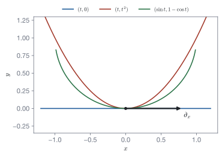
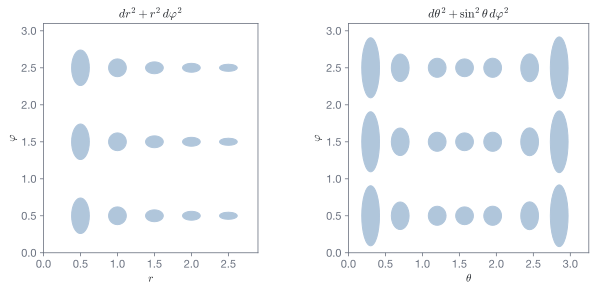
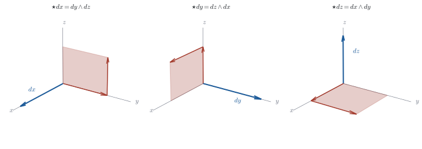
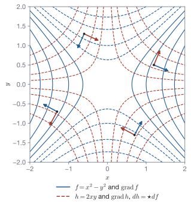
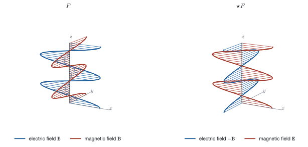

# Differential geometry {#sec-differential-geometry}

Differential geometry is calculus on curved spaces. A manifold is a space covered by charts, open pieces that look like open sets of $\mathbb{R}^n$; on it one defines tangent vectors and vector fields, one-forms, tensors and differential forms; a metric then measures lengths, angles and volumes; a connection differentiates vectors along curves, and its failure to commute is the curvature; and the flows of vector fields describe motions of the manifold, the Killing vectors being those that preserve the metric. The chapter follows this order in five parts: charts and manifolds, vector fields and tensors, metrics, connections and curvature, flows and Killing vectors. The sphere, the torus, the plane in polar coordinates and the group $SU(2)$ are the running examples throughout.

## Charts and manifolds {#sec-charts-manifolds}

A manifold is a space that looks locally like $\mathbb{R}^n$: around every point one can lay down coordinates, but
no single coordinate system need cover the whole space. This part builds that idea in three sections. Charts and
atlases introduces the local coordinate systems, the charts, the collections of them that cover a space, the
atlases, and the transition maps that convert one set of coordinates into another on the overlaps, with the circle
and the sphere as running examples and the stereographic projection as the central construction. Manifolds turns
a space with a smooth atlas into a smooth manifold and defines, chart by chart, the smooth functions, maps and
curves on it, and the product of two manifolds, with the torus and the set $SU(2)$ of unitary $2 \times 2$ matrices
of determinant one, which is the three-sphere, as the new examples. Embeddings and Gram matrices realises manifolds
as surfaces in Euclidean space through parametrisations, studies the velocities of the coordinate curves, singles
out the parametrisations that are embeddings, and collects the inner products of the coordinate velocities in the
Gram matrix. Every statement is followed by ten examples and ten exercises with hidden solutions, each solution
with a proof and a SageMath check; several computations use SageManifolds, the part of SageMath that implements
charts and manifolds. The algebraic identities behind the stereographic atlas, the $SU(2)$ determinant and the two
Gram matrices are stated as propositions and proved. The conventions for indices are those of @sec-conventions.

For more on this topic, see @gadea2013analysis [Ch. 1], @godinho2014introduction [Ch. 1, Ch. 3], @lee2013introduction [Ch. 1-3], @rudolph2013differential [Ch. 1] and @torresdelcastillo2020differentiable [Ch. 1, Ch. 6].

### Charts and atlases {#sec-charts}

A sphere cannot be covered by a single coordinate system without singular points, and on a circle any angle
coordinate necessarily jumps somewhere. The way out is to use several coordinate systems, each valid on a piece,
and to record how they are related on the overlaps. This section defines charts, coordinate curves, atlases,
transition maps and smooth atlases, with the circle and the sphere as running examples, and ends with the
proposition that makes the stereographic atlas of the sphere rigorous [@torresdelcastillo2020differentiable, Sec. 1.1, pp. 2-4; @lee2013introduction, Ch. 1, pp. 4, 12-13].

#### Charts

The first question is what a coordinate system is when the space is not $\mathbb{R}^n$ itself. The answer is a
labelling of the points of a piece of the space by $n$ numbers, one label per point and every label in an open
region used; the picture to keep is a map of a region of the Earth, flat paper labelling points of a curved surface.

:::: {.statement-box}
::: {#def-chart}
#### Chart

A **chart** on a set $M$ is a bijection $x : U \to V$ from a subset $U \subseteq M$, the chart's **domain**,
onto an open subset $V \subseteq \mathbb{R}^n$ (@def-bijection, @def-open-set). It assigns to every point $p \in U$
its $n$ **coordinates** $x^i(p)$, $i = 1, \dots, n$, and the inverse $x^{-1} : V \to U$ parametrises the domain by
coordinates.
:::
::::

The definition asks nothing of $M$ beyond being a set, and nothing of $x$ beyond being a bijection onto an open set:
continuity and smoothness enter only when charts are compared with each other, later in this section, and when $M$
carries a topology, in the next section.

:::: {.callout-note .examples-fold collapse="true" title="Examples"}
The simplest charts are those of Euclidean space itself, where nothing has to be removed. The first example records
the identity and the linear changes of coordinates, which are charts on all of $\mathbb{R}^n$.

::: {#exm-chart-identity}
#### Linear coordinates on $\mathbb{R}^n$

On $M = \mathbb{R}^n$ the identity $\mathbf x \mapsto \mathbf x$ is a chart with domain and image $\mathbb{R}^n$, and so is
its restriction to any open subset. More generally, for an invertible $n \times n$ matrix $\mathbf A$ the map $\mathbf x
\mapsto \mathbf A\mathbf x$ is a bijection of $\mathbb{R}^n$ onto itself (its inverse is $\mathbf y \mapsto \mathbf A^{-1}\mathbf
y$), hence a chart: every choice of basis of $\mathbb{R}^n$ gives a chart whose coordinates are the components in that
basis.
:::

A curve that is the graph of a function can be labelled by the variable of the function. The second example
does this for the parabola, the prototype of the graph charts that will describe every level set later on.

::: {#exm-chart-graph}
#### The graph chart of a parabola

On the parabola $P = \{(X, Y) \in \mathbb{R}^2 : Y = X^2\}$ the projection $x(X, Y) = X$ is a chart with domain $P$ and
image $\mathbb{R}$: it is injective because the point $(X, X^2)$ is determined by $X$, and surjective because every $X$
gives a point of $P$. Its inverse is $X \mapsto (X, X^2)$. In the same way the graph $\{(\mathbf x, f(\mathbf x)) :
\mathbf x \in U\}$ of any map $f$ on an open $U \subseteq \mathbb{R}^n$ has the chart $(\mathbf x, f(\mathbf x)) \mapsto
\mathbf x$ onto $U$.
:::

The simplest curved space is the circle, and its natural coordinate is the angle. The third example shows that the
angle is a chart only after one point is removed, because a full turn would label that point twice; this one
missing point is the whole reason atlases are needed.

::: {#exm-circle-chart}
#### The angle chart on the circle

On the unit circle $S^1 = \{(X, Y) \in \mathbb{R}^2 : X^2 + Y^2 = 1\}$ the angle $\varphi \in (0, 2\pi)$ is a chart
with inverse
$$
\varphi \mapsto (\cos\varphi, \sin\varphi),
$$ {#eq-circle-embedding}
whose domain is the circle minus the point $(1, 0)$. The coordinate $\varphi$ is periodic: $\varphi$ and
$\varphi + 2\pi$ would label the same point, which is why the chart stops short of a full turn. The angle of a plane
pendulum is this coordinate, with the hanging position at $\varphi = 3\pi/2$.
:::

One dimension up, the sphere has the familiar latitude and longitude. The fourth example records them as a chart
and locates exactly where they fail: a half-meridian is missing for the same reason as the point of the circle,
and the two poles are missing for a new reason, that longitude has no value there.

::: {#exm-sphere-chart}
#### Spherical coordinates on the sphere

On the unit sphere $S^2 = \{(X, Y, Z) \in \mathbb{R}^3 : X^2 + Y^2 + Z^2 = 1\}$ the spherical coordinates
$(\theta, \varphi) \in (0, \pi) \times (0, 2\pi)$ form a chart with inverse
$$
(\theta, \varphi) \mapsto (\sin\theta\cos\varphi,\ \sin\theta\sin\varphi,\ \cos\theta),
$$ {#eq-sphere-embedding}
shown in @fig-s2-chart. Its domain misses the two poles $Z = \pm 1$, where $\theta = 0, \pi$ and $\varphi$ is
undefined, and the half-meridian $\varphi = 0$. At the poles the map @eq-sphere-embedding is still defined but
ceases to be a chart: all values of $\varphi$ give the same point.
:::

{#fig-s2-chart width=55%}



A different chart on the same sphere misses a single point instead of a half-meridian and two poles. The fifth
example is the stereographic projection, a construction from a straight line through a pole, whose domain is the
whole sphere minus that pole and whose image is the whole plane; it is the chart on which the rest of the section
is built.

::: {#exm-sphere-stereographic}
#### Stereographic coordinates on the sphere

The **stereographic projection** from the north pole $N = (0, 0, 1)$ sends a point $p \neq N$ of the sphere to the
point $(u, v)$ where the line through $N$ and $p$ meets the plane $Z = 0$ (@fig-stereographic): the line $N + s(p -
N)$ has third component $1 + s(Z - 1)$, which vanishes at $s = 1/(1 - Z)$, so $(u, v) = (X, Y)/(1 - Z)$. Writing
$\rho^2 = u^2 + v^2$, the point
$$
(u, v) \mapsto \left( \frac{2u}{1 + u^2 + v^2},\ \frac{2v}{1 + u^2 + v^2},\ \frac{u^2 + v^2 - 1}{1 + u^2 + v^2} \right),
\qquad (u, v) \in \mathbb{R}^2 ,
$$ {#eq-stereographic}
lies on the sphere, since $4\rho^2 + (\rho^2 - 1)^2 = (\rho^2 + 1)^2$, and is different from $N$; its third
component gives $1 - Z = 2/(1 + \rho^2)$, so its projection is $(2u, 2v)/2 = (u, v)$. Conversely a point $p \neq N$
with projection $(u, v)$ lies on the line through $N$ and $(u, v, 0)$, which meets the sphere only at $N$ and at the
point @eq-stereographic. So the projection is a bijection from $S^2 \setminus \{N\}$ onto $\mathbb{R}^2$, a chart with
inverse @eq-stereographic; as $\rho \to \infty$ the point approaches $N$.
:::

{#fig-stereographic width=60%}

Physics supplies charts that are not angles. The sixth example is the pair of light-cone coordinates on the
Minkowski plane, a linear chart whose coordinate lines are the light rays.

::: {#exm-chart-light-cone}
#### Light-cone coordinates

On the Minkowski plane of points $(t, x)$ (units with $c = 1$) the **light-cone coordinates** $u = t - x$ and $w =
t + x$ form a chart with domain and image $\mathbb{R}^2$; it is the linear chart of @exm-chart-identity with
$\mathbf A = \begin{pmatrix} 1 & -1 \\ 1 & 1 \end{pmatrix}$, $\det\mathbf A = 2$, and inverse $t = (u + w)/2$, $x = (w -
u)/2$. The lines $u = \text{const}$ are the light rays moving right, the lines $w = \text{const}$ those moving left,
and $t^2 - x^2 = uw$.
:::

The momentum of a relativistic particle of mass $m$ lies on a hyperbola, the mass shell, and the natural coordinate
on it is the rapidity. The seventh example shows that the rapidity is a chart on the whole of one branch.

::: {#exm-chart-mass-shell}
#### Rapidity on the mass shell

The upper branch $H = \{(E, p) : E^2 - p^2 = m^2,\ E > 0\}$ of the mass shell of a particle of mass $m > 0$ in one
space dimension has the chart $\eta = \operatorname{artanh}(p/E)$ onto $\mathbb{R}$, with inverse $\eta \mapsto (m\cosh\eta,
m\sinh\eta)$. Indeed $|p| < E$ on $H$, so $\eta$ is defined; $(m\cosh\eta, m\sinh\eta)$ lies on $H$ because
$\cosh^2 - \sinh^2 = 1$; and $\tanh\eta = p/E$ recovers $\eta$. The velocity is $p/E = \tanh\eta$, and a boost adds
a constant to $\eta$.
:::

The harmonic oscillator has a phase plane of positions and momenta, and its motions are circles. The eighth example
labels the phase plane by the energy and an angle, a chart that excludes the origin as polar coordinates do.

::: {#exm-chart-action-angle}
#### Action and angle of the harmonic oscillator

For the oscillator with Hamiltonian $H = (p^2 + x^2)/2$ (unit mass and frequency), the map $(I, \varphi) \mapsto
(x, p) = (\sqrt{2I}\cos\varphi, \sqrt{2I}\sin\varphi)$ on $(0, \infty) \times (0, 2\pi)$ is the inverse of a chart, the
**action-angle chart**, whose domain is the phase plane minus the closed half-line $\{p = 0, x \geq 0\}$: it is the
polar chart with $r = \sqrt{2I}$. The action $I = (x^2 + p^2)/2$ is the energy, so each motion is a coordinate
curve $I = \text{const}$.
:::

A chart is only a labelling, and it does not see corners. The ninth example covers a cone, tip included, by a
single chart, a warning that the definition so far knows nothing about smoothness of the set.

::: {#exm-chart-cone}
#### A chart on a cone

On the cone $K = \{(X, Y, Z) : Z = \sqrt{X^2 + Y^2}\}$ the projection $(X, Y, Z) \mapsto (X, Y)$ is a chart onto
$\mathbb{R}^2$, with inverse $(X, Y) \mapsto (X, Y, \sqrt{X^2 + Y^2})$; it is the graph chart of
@exm-chart-graph for $f(X, Y) = \sqrt{X^2 + Y^2}$. The tip of the cone is the point with coordinates $(0, 0)$, and
nothing in the chart marks it as special: whether the cone is a smooth surface is a question about how it sits in
$\mathbb{R}^3$, which a chart alone cannot answer.
:::

The two conditions of the definition can fail separately. The last example collects maps that look like
coordinates but are not charts, one for each condition.

::: {#exm-chart-not}
#### Maps that are not charts

The angle $\varphi \in [0, 2\pi)$ on the whole circle is a bijection onto $[0, 2\pi)$, which is not open in
$\mathbb{R}$, since no interval around $0$ lies in it. The map $X \mapsto X^2$ on the line is not injective. The height
$Z$ on the upper hemisphere $Z > 0$ maps onto $(0, 1]$, which is not open because it contains $1$ but no interval
around it, and it is not injective either, since a whole parallel has the same height.
:::
::::

:::: {.callout-note .exercises-fold collapse="true" title="Exercises"}
The definition asks for a bijection onto an open set, and the first exercise checks both halves of that condition
on the circle by hand. Reading off the angle of a few given points is the computational part; the argument that
no point is labelled twice and every point of the domain is labelled is the conceptual one.

::: {#exr-chart-circle-inverse}
#### Reading the angle chart

Find the coordinate $\varphi \in (0, 2\pi)$ of the points $(0, 1)$, $(-1, 0)$, $(0, -1)$ and $(\tfrac12, -
\tfrac{\sqrt3}{2})$ of the circle, and show that the angle chart of @exm-circle-chart is a bijection from
$S^1 \setminus \{(1, 0)\}$ onto the open interval $(0, 2\pi)$.
:::

::: {.callout-note .solution collapse="true" title="Solution"}
:::: {.panel-tabset .solution-tabs}
## Proof

$\varphi = \pi/2$, $\pi$, $3\pi/2$ and $5\pi/3$ respectively, since $\cos(5\pi/3) = \tfrac12$ and $\sin(5\pi/3)
= -\tfrac{\sqrt3}{2}$. Let $(X, Y) \in S^1$. Since $X \in [-1, 1]$, there is exactly one $\alpha \in [0, \pi]$ with
$\cos\alpha = X$, and $\sin\alpha = \sqrt{1 - X^2} = |Y|$. The angles in $[0, 2\pi)$ with cosine $X$ are $\alpha$ and
$2\pi - \alpha$, whose sines are $|Y|$ and $-|Y|$; exactly one of them has sine $Y$, except when $Y = 0$, where
$\alpha \in \{0, \pi\}$ and the two candidates coincide modulo $2\pi$. So every point of the circle is $(\cos\varphi,
\sin\varphi)$ for exactly one $\varphi \in [0, 2\pi)$. The value $\varphi = 0$ gives the excluded point $(1, 0)$,
so $\varphi \mapsto (\cos\varphi, \sin\varphi)$ is a bijection from $(0, 2\pi)$ onto $S^1 \setminus \{(1, 0)\}$, and
its inverse is the chart.

## SageMath

Sage evaluates the inverse chart at the four angles and recovers the angles with `atan2`, shifted into $(0, 2\pi)$.

```{.python .sage}
pts = [(0, 1), (-1, 0), (0, -1), (1/2, -sqrt(3)/2)]
for X, Y in pts:
    ph = atan2(Y, X)
    ph = ph + 2*pi if bool(ph <= 0) else ph
    print((X, Y), "-> phi =", ph, "; back:", (cos(ph), sin(ph)) == (X, Y))
```

```{.text .sage-output}
(0, 1) -> phi = 1/2*pi ; back: True
(-1, 0) -> phi = pi ; back: True
(0, -1) -> phi = 3/2*pi ; back: True
(1/2, -1/2*sqrt(3)) -> phi = 5/3*pi ; back: True
```
::::
:::

A linear change of coordinates is the simplest chart one can write down. The second exercise asks for its inverse
and for the image of a square, to see that a chart may distort shapes while remaining a bijection onto an open set.

::: {#exr-chart-linear}
#### A linear chart

Show that $x(X, Y) = (X + Y, X - Y)$ is a chart on $\mathbb{R}^2$, find its inverse, and find the image of the open
unit square $(0, 1)^2$.
:::

::: {.callout-note .solution collapse="true" title="Solution"}
:::: {.panel-tabset .solution-tabs}
## Proof

$x(X, Y) = \mathbf A(X, Y)^\top$ with $\mathbf A = \begin{pmatrix} 1 & 1 \\ 1 & -1 \end{pmatrix}$ and $\det\mathbf A = -2
\neq 0$, so $x$ is a bijection of $\mathbb{R}^2$ onto the open set $\mathbb{R}^2$ (@exm-chart-identity), with inverse
$\mathbf A^{-1} = \tfrac12\mathbf A$: $X = (x^1 + x^2)/2$, $Y = (x^1 - x^2)/2$. A point $(x^1, x^2)$ is the image of a
point of the square exactly when $0 < (x^1 + x^2)/2 < 1$ and $0 < (x^1 - x^2)/2 < 1$, that is $|x^2| < x^1$ and
$|x^2| < 2 - x^1$: the open square with vertices $(0, 0)$, $(1, 1)$, $(2, 0)$, $(1, -1)$, rotated by $45°$ and
scaled by $\sqrt 2$.

## SageMath

Sage inverts the matrix and maps the four corners of the unit square.

```{.python .sage}
A = matrix(QQ, [[1, 1], [1, -1]])
print("det A =", A.det(), "; A^{-1} =", A.inverse().rows())
print("images of the corners:", [tuple(A*vector(QQ, c)) for c in [(0, 0), (1, 0), (1, 1), (0, 1)]])
```

```{.text .sage-output}
det A = -2 ; A^{-1} = [(1/2, 1/2), (1/2, -1/2)]
images of the corners: [(0, 0), (1, 1), (2, 0), (1, -1)]
```
::::
:::

Charts need not be angles. The third exercise uses the two Cartesian coordinates $X, Y$ themselves as a chart on
the upper hemisphere, where the third coordinate is recovered by a square root, and compares the result with the
stereographic chart from the south pole, which also covers the hemisphere, with Sage doing the algebra.

::: {#exr-chart-hemisphere}
#### The hemispherical chart

Show that $(X, Y)$ is a chart on the upper hemisphere $Z > 0$ of $S^2$ with image the open unit disc, write down
its inverse, and compute the south stereographic coordinates $(u', v') = (X, Y)/(1 + Z)$ of its points. Show that
the hemisphere is sent into the open unit disc $u'^2 + v'^2 < 1$ and compute the Jacobian determinant of
$(X, Y) \mapsto (u', v')$.
:::

::: {.callout-note .solution collapse="true" title="Solution"}
:::: {.panel-tabset .solution-tabs}
## Proof

On $Z > 0$ the point is recovered from $(X, Y)$ as $(X, Y, \sqrt{1 - X^2 - Y^2})$, so the map is injective. Its
image is the open disc $X^2 + Y^2 < 1$: a point of the hemisphere has $X^2 + Y^2 = 1 - Z^2 < 1$, and every $(X, Y)$
in the open disc is the image of $(X, Y, \sqrt{1 - X^2 - Y^2})$, which has positive third coordinate. The open disc is
open, so $(X, Y)$ is a chart with inverse $(X, Y) \mapsto (X, Y, \sqrt{1 - X^2 - Y^2})$. Substituting, $u'^2 + v'^2 =
(X^2 + Y^2)/(1 + Z)^2 = (1 - Z^2)/(1 + Z)^2 = (1 - Z)/(1 + Z)$, which is $< 1$ for $Z > 0$. With $Z = \sqrt{1 - X^2 -
Y^2}$, $\partial_XZ = -X/Z$ and $\partial_YZ = -Y/Z$; the Jacobian determinant of $(X, Y) \mapsto (X, Y)/(1 + Z)$
simplifies to $1/(Z(1 + Z)^2)$, finite and positive on the hemisphere.

## SageMath

Sage substitutes the square root, checks the identity for $u'^2 + v'^2$ and simplifies the Jacobian determinant.

```{.python .sage}
X, Y = var("X Y", domain="real")
assume(X**2 + Y**2 < 1)
Z = sqrt(1 - X**2 - Y**2)
print("the inverse chart lands on the sphere:", bool((X**2 + Y**2 + Z**2).simplify_full() == 1))
up = X/(1 + Z); vp = Y/(1 + Z)
print("u'^2 + v'^2 = (1 - Z)/(1 + Z):", bool((up**2 + vp**2 - (1 - Z)/(1 + Z)).simplify_full() == 0))
d = jacobian((up, vp), (X, Y)).det().simplify_full()
print("Jacobian determinant = 1/(Z (1 + Z)^2):", bool((d - 1/(Z*(1 + Z)**2)).simplify_full() == 0))
print("the point (3/5, 0) with Z = 4/5 goes to", (up.subs(X=3/5, Y=0), vp.subs(X=3/5, Y=0)))
forget()
```

```{.text .sage-output}
the inverse chart lands on the sphere: True
u'^2 + v'^2 = (1 - Z)/(1 + Z): True
Jacobian determinant = 1/(Z (1 + Z)^2): True
the point (3/5, 0) with Z = 4/5 goes to (1/3, 0)
```
::::
:::

Polar coordinates on the plane are a chart too, and the fourth exercise asks where. The point of the exercise is
that the origin can never be included, whatever intervals are chosen for $r$ and $\varphi$, and that the same
obstruction reappears for spherical coordinates on space along a whole axis.

::: {#exr-chart-polar}
#### Polar and spherical coordinates as charts

Polar coordinates $(r, \varphi) \in (0, \infty) \times (0, 2\pi)$ have inverse $(r\cos\varphi, r\sin\varphi)$.
Find the domain of this chart on the plane, explain why no choice of intervals makes the origin part of the domain
of a polar chart, and determine on which subset of $\mathbb{R}^3$ the spherical coordinates $(\rho, \theta,
\varphi) \in (0, \infty) \times (0, \pi) \times (0, 2\pi)$, with inverse $\rho$ times @eq-sphere-embedding, form a
chart.
:::

::: {.callout-note .solution collapse="true" title="Solution"}
:::: {.panel-tabset .solution-tabs}
## Proof

A point $(X, Y) \neq (0, 0)$ is $r(\cos\varphi, \sin\varphi)$ with $r = \sqrt{X^2 + Y^2}$ and $(\cos\varphi, \sin\varphi)
= (X, Y)/r$, and by @exr-chart-circle-inverse exactly one $\varphi \in (0, 2\pi)$ works unless $(X, Y)/r = (1, 0)$. So
the map is injective on $(0, \infty) \times (0, 2\pi)$ with image the plane minus the closed half-line $\{Y = 0, X
\geq 0\}$, which is the domain. A polar chart containing the origin would have to assign it a single pair $(0,
\varphi_0)$; but its image is open, so it contains $(0, \varphi)$ for $\varphi$ near $\varphi_0$, and all these pairs
are sent to the origin by the inverse, contradicting injectivity. In space, a point off the $Z$-axis has $\rho > 0$,
$\cos\theta = Z/\rho$ with a unique $\theta \in (0, \pi)$, and $(X, Y) = \rho\sin\theta(\cos\varphi, \sin\varphi)$ with
$\rho\sin\theta > 0$, which fixes $\varphi \in (0, 2\pi)$ unless $Y = 0$, $X > 0$; on the $Z$-axis $\sin\theta = 0$ is
impossible for $\theta \in (0, \pi)$. So the spherical chart has domain $\mathbb{R}^3$ minus the closed half-plane $\{Y =
0, X \geq 0\}$, which contains the $Z$-axis.

## SageMath

Sage recovers $(\rho, \theta, \varphi)$ for a sample point and checks that the inverse chart returns it.

```{.python .sage}
X, Y, Z = 1, -1, 1
rho = sqrt(X**2 + Y**2 + Z**2); th = arccos(Z/rho); ph = atan2(Y, X) + 2*pi
print("(rho, theta, phi) =", (rho, th, ph))
back = [rho*sin(th)*cos(ph), rho*sin(th)*sin(ph), rho*cos(th)]
print("back:", [b.simplify_full() for b in back])
print("phi in (0, 2 pi):", bool(0 < ph < 2*pi), "; theta in (0, pi):", bool(0 < th < pi))
```

```{.text .sage-output}
(rho, theta, phi) = (sqrt(3), arccos(1/3*sqrt(3)), 7/4*pi)
back: [1, -1, 1]
phi in (0, 2 pi): True ; theta in (0, pi): True
```
::::
:::

The ellipse is the circle stretched, and its angle chart is the circle's composed with a stretching. The fifth
exercise computes the chart and the coordinates of a few points, to see that the coordinate need not be the
geometric angle.

::: {#exr-chart-ellipse}
#### An angle chart on an ellipse

For $a, b > 0$ let $\mathcal E = \{(X, Y) : X^2/a^2 + Y^2/b^2 = 1\}$. Show that $t \mapsto (a\cos t, b\sin t)$, $t \in (0,
2\pi)$, is the inverse of a chart on $\mathcal E \setminus \{(a, 0)\}$. For $a = 2$, $b = 1$ find the coordinate $t$ of
the point $(1, \sqrt3/2)$ and compare with the polar angle of that point.
:::

::: {.callout-note .solution collapse="true" title="Solution"}
:::: {.panel-tabset .solution-tabs}
## Proof

The map $(X, Y) \mapsto (X/a, Y/b)$ is a bijection from $\mathcal E$ onto $S^1$ (its inverse is $(X', Y') \mapsto
(aX', bY')$), sending $(a, 0)$ to $(1, 0)$. Composing with the angle chart of @exm-circle-chart, which is a bijection
from $S^1 \setminus \{(1, 0)\}$ onto $(0, 2\pi)$ (@exr-chart-circle-inverse), gives a bijection from $\mathcal E
\setminus \{(a, 0)\}$ onto $(0, 2\pi)$, whose inverse is $t \mapsto (a\cos t, b\sin t)$. For $a = 2$, $b = 1$ the point
$(1, \sqrt3/2)$ goes to $(\tfrac12, \tfrac{\sqrt3}2)$ on the circle, so $t = \pi/3$. Its polar angle is $\arctan(\sqrt3/2)
\approx 0.7137$, smaller than $\pi/3 \approx 1.0472$: the chart coordinate is not the geometric angle.

## SageMath

Sage computes both angles for the given point.

```{.python .sage}
a, b = 2, 1
X, Y = 1, sqrt(3)/2
t = atan2(Y/b, X/a)
print("t =", t, "; back:", (a*cos(t), b*sin(t)) == (X, Y))
print("polar angle:", atan2(Y, X), "=", N(atan2(Y, X), digits=5), " vs t =", N(t, digits=5))
```

```{.text .sage-output}
t = 1/3*pi ; back: True
polar angle: arctan(1/2*sqrt(3)) = 0.71372  vs t = 1.0472
```
::::
:::

The rapidity of @exm-chart-mass-shell turns velocity addition into ordinary addition. The sixth exercise computes
the chart for a few momenta and checks the additivity, which is the reason physicists prefer this coordinate.

::: {#exr-chart-rapidity}
#### Rapidities

For $m = 1$, find the rapidity $\eta$ of the points $(E, p) = (1, 0)$, $(5/4, 3/4)$ and $(5/3, -4/3)$ of the mass
shell. Show that the boost $(E, p) \mapsto (E\cosh\beta + p\sinh\beta, E\sinh\beta + p\cosh\beta)$ maps the
mass shell to itself and reads $\eta \mapsto \eta + \beta$ in the chart.
:::

::: {.callout-note .solution collapse="true" title="Solution"}
:::: {.panel-tabset .solution-tabs}
## Proof

$\eta = \operatorname{artanh}(p/E) = \tfrac12\log\frac{E + p}{E - p}$, so the three points have $\eta = 0$, $\tfrac12\log 4
= \log 2$ and $\tfrac12\log\frac{1/3}{3} = -\log 3$. With $(E, p) = (\cosh\eta, \sinh\eta)$, the addition formulas give
$E\cosh\beta + p\sinh\beta = \cosh(\eta + \beta)$ and $E\sinh\beta + p\cosh\beta = \sinh(\eta + \beta)$; this is the
point of $H$ with rapidity $\eta + \beta$, so the boost maps $H$ to itself and reads $\eta \mapsto \eta + \beta$.

## SageMath

Sage evaluates the rapidities and simplifies the boosted point.

```{.python .sage}
for E, p in [(1, 0), (5/4, 3/4), (5/3, -4/3)]:
    print((E, p), "on the shell:", E**2 - p**2 == 1, "; eta =", (log(SR((E + p)/(E - p)))/2).simplify_log())
eta, beta = var("eta beta", domain="real")
E, p = cosh(eta), sinh(eta)
print("E' = cosh(eta + beta):", bool(E*cosh(beta) + p*sinh(beta) == cosh(eta + beta).expand_trig()))
print("p' = sinh(eta + beta):", bool(E*sinh(beta) + p*cosh(beta) == sinh(eta + beta).expand_trig()))
```

```{.text .sage-output}
(1, 0) on the shell: True ; eta = 0
(5/4, 3/4) on the shell: True ; eta = log(2)
(5/3, -4/3) on the shell: True ; eta = -log(3)
E' = cosh(eta + beta): True
p' = sinh(eta + beta): True
```
::::
:::

The action-angle chart of @exm-chart-action-angle is the polar chart in disguise, and the seventh exercise computes
it on a few phase points. It also shows that a motion of the oscillator moves along a coordinate curve.

::: {#exr-chart-action-angle}
#### Action and angle

Find the action-angle coordinates $(I, \varphi)$ of the phase points $(x, p) = (0, 1)$, $(-2, 0)$ and $(1, -1)$. Show
that the solution of $\dot x = p$, $\dot p = -x$ with $(x, p)(0) = (A, 0)$, $A > 0$, has constant $I$ and angle
$\varphi = 2\pi - t$ for $t \in (0, 2\pi)$.
:::

::: {.callout-note .solution collapse="true" title="Solution"}
:::: {.panel-tabset .solution-tabs}
## Proof

$I = (x^2 + p^2)/2$ and $\varphi$ is the polar angle of $(x, p)$ in $(0, 2\pi)$ (@exr-chart-polar): $(0, 1)$ has $(I,
\varphi) = (\tfrac12, \pi/2)$, $(-2, 0)$ has $(2, \pi)$ and $(1, -1)$ has $(1, 7\pi/4)$. The solution with $(x, p)(0) =
(A, 0)$ is $x = A\cos t$, $p = -A\sin t$: indeed $\dot x = -A\sin t = p$ and $\dot p = -A\cos t = -x$. Then $I = A^2/2$
is constant, and $(x, p) = A(\cos(2\pi - t), \sin(2\pi - t))$ with $2\pi - t \in (0, 2\pi)$ for $t \in (0, 2\pi)$, so
$\varphi = 2\pi - t$: the motion runs along the coordinate curve $I = A^2/2$ with the angle decreasing at unit rate.

## SageMath

Sage computes the coordinates of the three points and checks the equations of motion.

```{.python .sage}
for x0, p0 in [(0, 1), (-2, 0), (1, -1)]:
    ph = atan2(p0, x0); ph = ph + 2*pi if bool(ph <= 0) else ph
    print((x0, p0), "-> (I, phi) =", ((x0**2 + p0**2)/2, ph))
t, A = var("t A", domain="real")
x, p = A*cos(t), -A*sin(t)
print("solves x' = p, p' = -x:", bool(diff(x, t) == p) and bool(diff(p, t) == -x), "; I =", ((x**2 + p**2)/2).simplify_full())
```

```{.text .sage-output}
(0, 1) -> (I, phi) = (1/2, 1/2*pi)
(-2, 0) -> (I, phi) = (2, pi)
(1, -1) -> (I, phi) = (1, 7/4*pi)
solves x' = p, p' = -x: True ; I = 1/2*A^2
```
::::
:::

Charts can be modified in two ways that keep them charts: restricting the domain and changing the coordinates by a
bijection. The eighth exercise proves both, the two operations used constantly in the rest of the chapter.

::: {#exr-chart-restriction}
#### Restricting and recoordinatising charts

Let $x : U \to V$ be a chart on $M$. (a) Show that for every open $V' \subseteq V$, the restriction of $x$ to $U' =
x^{-1}(V')$ is a chart. (b) Show that for every bijection $h : V \to W$ onto an open $W \subseteq \mathbb{R}^n$,
$h \circ x$ is a chart. Apply (a) and (b) to obtain from the angle chart of the circle a chart onto $(0, 1)$.
:::

::: {.callout-note .solution collapse="true" title="Solution"}
:::: {.panel-tabset .solution-tabs}
## Proof

(a) The restriction of the bijection $x$ to $U' = x^{-1}(V')$ is injective, and its image is $x(x^{-1}(V')) = V'$
because $x$ is onto $V \supseteq V'$; $V'$ is open, so the restriction is a chart. (b) A composition of bijections is a
bijection (@def-composition), so $h \circ x$ is a bijection from $U$ onto the open set $W$. For the circle, take $V =
(0, 2\pi)$ and $h(\varphi) = \varphi/2\pi$, a bijection onto the open interval $(0, 1)$; then $h \circ \varphi$ is a
chart on $S^1 \setminus \{(1, 0)\}$ onto $(0, 1)$, with inverse $s \mapsto (\cos 2\pi s, \sin 2\pi s)$. Restricting
instead to $V' = (0, \pi)$ gives a chart on the upper half-circle.

## SageMath

Check on the circle: Sage composes the rescaled chart with its inverse at a few points.

```{.python .sage}
h = lambda ph: ph/(2*pi)
inv = lambda s: (cos(2*pi*s), sin(2*pi*s))
for ph in [pi/3, pi, 7*pi/4]:
    s = h(ph)
    print("phi =", ph, "-> s =", s, "; inverse gives the same point:", inv(s) == (cos(ph), sin(ph)))
```

```{.text .sage-output}
phi = 1/3*pi -> s = 1/6 ; inverse gives the same point: True
phi = pi -> s = 1/2 ; inverse gives the same point: True
phi = 7/4*pi -> s = 7/8 ; inverse gives the same point: True
```
::::
:::

A chart on a set with corners shows how little the definition demands. The ninth exercise builds a chart on the
boundary of a square, which has four corners, by the arc length along it.

::: {#exr-chart-square}
#### A chart on the boundary of a square

Let $Q$ be the boundary of the square $[-1, 1]^2$ and $q_0 = (1, -1)$ one of its corners. Show that the arc length
$s(q) \in (0, 8)$, measured counterclockwise from $q_0$, is a chart on $Q \setminus \{q_0\}$, and write its inverse
on $(0, 2)$ and $(2, 4)$.
:::

::: {.callout-note .solution collapse="true" title="Solution"}
:::: {.panel-tabset .solution-tabs}
## Proof

$Q$ is the union of four sides of length $2$. Define $c : [0, 8) \to Q$ by $c(s) = (1, -1 + s)$ on $[0, 2)$, $(1 - (s -
2), 1)$ on $[2, 4)$, $(-1, 1 - (s - 4))$ on $[4, 6)$ and $(-1 + (s - 6), -1)$ on $[6, 8)$. Each piece is a bijection
from its half-open interval onto one side minus its last corner, and these four sets partition $Q$; so $c$ is a
bijection from $[0, 8)$ onto $Q$ with $c(0) = q_0$. Hence $c$ restricts to a bijection from the open interval $(0, 8)$
onto $Q \setminus \{q_0\}$, and its inverse $s$ is a chart. On $(0, 2)$ the inverse chart is $s \mapsto (1, s - 1)$ and
on $(2, 4)$ it is $s \mapsto (3 - s, 1)$. The corners $(1, 1)$, $(-1, 1)$, $(-1, -1)$ have the ordinary coordinates $2$,
$4$, $6$.

## SageMath

Sage evaluates the piecewise map at a few points and checks that each lands on $Q$ and that the arc length is
recovered.

```{.python .sage}
def c(s):
    if s < 2: return (1, -1 + s)
    if s < 4: return (1 - (s - 2), 1)
    if s < 6: return (-1, 1 - (s - 4))
    return (-1 + (s - 6), -1)
for s in [1/2, 2, 3, 4, 13/2]:
    q = c(s)
    print("s =", s, "->", q, "; on Q:", max(abs(q[0]), abs(q[1])) == 1)
```

```{.text .sage-output}
s = 1/2 -> (1, -1/2) ; on Q: True
s = 2 -> (1, 1) ; on Q: True
s = 3 -> (0, 1) ; on Q: True
s = 4 -> (-1, 1) ; on Q: True
s = 13/2 -> (-1/2, -1) ; on Q: True
```
::::
:::

Stereographic projection of the circle from a point of the circle sends rational points to rational coordinates.
The last exercise uses this to find all the Pythagorean triples, an arithmetic consequence of a chart.

::: {#exr-chart-pythagorean}
#### Pythagorean triples from a chart

Project the circle from $(0, 1)$ to the line $Y = 0$: show that the projection $t = X/(1 - Y)$ is a chart on $S^1
\setminus \{(0, 1)\}$ onto $\mathbb{R}$ with inverse $t \mapsto (2t, t^2 - 1)/(t^2 + 1)$. Deduce that a point of the
circle other than $(0, 1)$ has rational coordinates exactly when its coordinate $t$ is rational, and that $t = m/n$
gives the triple $(2mn, m^2 - n^2, m^2 + n^2)$ with $(2mn)^2 + (m^2 - n^2)^2 = (m^2 + n^2)^2$.
:::

::: {.callout-note .solution collapse="true" title="Solution"}
:::: {.panel-tabset .solution-tabs}
## Proof

This is @exm-sphere-stereographic one dimension down. The line through $(0, 1)$ and $(X, Y) \neq (0, 1)$ meets $Y = 0$
at $t = X/(1 - Y)$. The point $(2t, t^2 - 1)/(t^2 + 1)$ lies on the circle because $4t^2 + (t^2 - 1)^2 = (t^2 +
1)^2$, it differs from $(0, 1)$, and its projection is $\frac{2t/(t^2 + 1)}{2/(t^2 + 1)} = t$. Conversely the line
through $(0, 1)$ and $(t, 0)$ meets the circle only at $(0, 1)$ and at that point, so the projection is a bijection onto
$\mathbb{R}$ with the stated inverse. If $X, Y$ are rational so is $t = X/(1 - Y)$; if $t$ is rational, so are the
rational expressions $2t/(t^2 + 1)$ and $(t^2 - 1)/(t^2 + 1)$. With $t = m/n$, multiplying by $(m^2 + n^2)/n^2$ gives
the point $(2mn, m^2 - n^2)/(m^2 + n^2)$, and the polynomial identity $4m^2n^2 + (m^2 - n^2)^2 = (m^2 + n^2)^2$ is the
triple.

## SageMath

Sage checks the polynomial identity and lists the triples for small $m > n$.

```{.python .sage}
m, n = var("m n")
print("identity:", bool(((2*m*n)**2 + (m**2 - n**2)**2 - (m**2 + n**2)**2).expand() == 0))
print([(2*a*b, a**2 - b**2, a**2 + b**2) for a in range(2, 5) for b in range(1, a) if gcd(a, b) == 1])
t = QQ(2)/3
P = ((2*t)/(t**2 + 1), (t**2 - 1)/(t**2 + 1))
print("t = 2/3 ->", P, "; projection back:", P[0]/(1 - P[1]))
```

```{.text .sage-output}
identity: True
[(4, 3, 5), (6, 8, 10), (12, 5, 13), (8, 15, 17), (24, 7, 25)]
t = 2/3 -> (12/13, -5/13) ; projection back: 2/3
```
::::
:::
::::

#### Coordinate curves

A chart does more than label points: it draws a grid on its domain. The next definition names the lines of that
grid, obtained by letting one coordinate vary while the others are frozen; on a map of the Earth they are the
parallels and meridians.

:::: {.statement-box}
::: {#def-coordinate-curve}
#### Coordinate curve

Let $x : U \to V$ be a chart and $p \in U$. The $i$-th **coordinate curve** through $p$ is the curve along which only
the coordinate $x^i$ varies, the others being held fixed:
$$
t \mapsto x^{-1}(x^1(p), \dots, x^i(p) + t, \dots, x^n(p)),
$$
defined for the $t$ with $(x^1(p), \dots, x^i(p) + t, \dots, x^n(p)) \in V$, a set that contains an open interval
around $t = 0$ because $V$ is open.
:::
::::

*Proof.* The claim is the last one. Since $V$ is open, it contains a ball of some radius $\varepsilon > 0$ around
$x(p)$ (@def-open-set), and the point with $x^i(p) + t$ in the $i$-th place lies in that ball for $|t| < \varepsilon$.
$\square$

:::: {.callout-note .examples-fold collapse="true" title="Examples"}
On $\mathbb{R}^n$ with the identity chart the grid is the familiar one of graph paper. The first example records it,
the case in which every coordinate curve is defined for all $t$.

::: {#exm-coordinate-curves-cartesian}
#### Cartesian coordinate curves

For the identity chart of $\mathbb{R}^n$ the $i$-th coordinate curve through $\mathbf p$ is the line $t \mapsto \mathbf p +
t\mathbf e_i$ parallel to the $i$-th axis, defined for all $t \in \mathbb{R}$, and run at unit speed.
:::

A linear chart tilts the grid. The second example shows that the coordinate curves of $\mathbf x \mapsto \mathbf A\mathbf x$
are lines along the columns of $\mathbf A^{-1}$, not of $\mathbf A$.

::: {#exm-coordinate-curves-linear}
#### Coordinate curves of a linear chart

For the chart $\mathbf y = \mathbf A\mathbf x$ of @exm-chart-identity the inverse is $\mathbf y \mapsto \mathbf A^{-1}\mathbf y$,
so the $i$-th coordinate curve through $\mathbf p$ is $t \mapsto \mathbf A^{-1}(\mathbf A\mathbf p + t\mathbf e_i) = \mathbf p +
t\,\mathbf A^{-1}\mathbf e_i$: the line through $\mathbf p$ along the $i$-th column of $\mathbf A^{-1}$. For the light-cone
chart of @exm-chart-light-cone the columns of $\mathbf A^{-1} = \tfrac12\begin{pmatrix} 1 & 1 \\ -1 & 1 \end{pmatrix}$ are
$\tfrac12(1, -1)$ and $\tfrac12(1, 1)$ in the $(t, x)$-plane: the $u$-curves are light rays moving left and the
$w$-curves light rays moving right.
:::

On a one-dimensional space there is a single coordinate curve through each point. The third example finds it for the
angle chart, where it is the whole domain of the chart.

::: {#exm-coordinate-curves-circle}
#### The circle

For the angle chart of @exm-circle-chart the coordinate curve through the point with angle $\varphi_0$ is $t \mapsto
(\cos(\varphi_0 + t), \sin(\varphi_0 + t))$ for $t \in (-\varphi_0, 2\pi - \varphi_0)$: it runs once around the circle
minus $(1, 0)$, at unit speed, and its image is the whole domain of the chart.
:::

The spherical chart gives the grid everyone has seen on a globe. The fourth example identifies its two families
with the black and grey curves of @fig-s2-chart, and fixes which coordinate is varying along each.

::: {#exm-coordinate-curves-sphere}
#### Parallels and meridians

In the spherical chart the $\theta$-curves are the meridians ($\varphi$ fixed) and the $\varphi$-curves are the
parallels ($\theta$ fixed), the grey and black lines of @fig-s2-chart. The $\theta$-curve through $(\theta_0,
\varphi_0)$ is defined for $t \in (-\theta_0, \pi - \theta_0)$ and runs from pole to pole, the poles themselves
excluded.
:::

The same plane carries two different grids depending on the chart. The fifth example contrasts the rays and
circles of polar coordinates with the straight lines of Cartesian ones, a reminder that coordinate curves belong
to the chart and not to the space.

::: {#exm-coordinate-curves-polar}
#### Rays and circles

In polar coordinates on the plane the $r$-curves are rays from the origin and the $\varphi$-curves are circles
around it, the grid of @fig-jacobian-polar; in Cartesian coordinates both families are straight lines.
:::

For the stereographic chart the grid is less obvious, because it is the image of the Cartesian grid of the plane
under a map that bends lines into circles. The sixth example describes one family and explains the geometric
reason.

::: {#exm-coordinate-curves-stereographic}
#### Stereographic coordinate curves

The $u$-curves of the stereographic chart are the images on the sphere of the horizontal lines $v = c$ of the plane.
Each lies in the plane through $N$ that contains the line $\{v = c, Z = 0\}$, since the points of the sphere that
project onto that line are those on the lines from $N$ to it. That plane is $Y = c(1 - Z)$, and it cuts the sphere in a
circle through the north pole; the curve is that circle minus $N$ (@fig-stereographic).
:::

Physics uses spherical coordinates in space, for instance for the hydrogen atom, where the potential depends on the
radius alone. The seventh example describes the three families of coordinate curves.

::: {#exm-coordinate-curves-spherical-space}
#### Spherical coordinates in space

For the chart $(\rho, \theta, \varphi)$ of @exr-chart-polar on $\mathbb{R}^3$ minus a closed half-plane, the
$\rho$-curves are open rays from the origin, the $\theta$-curves are open half-circles of radius $\rho$ from the
positive to the negative $Z$-axis, and the $\varphi$-curves are horizontal circles of radius $\rho\sin\theta$ minus one
point. For the hydrogen atom the Coulomb potential $-e^2/(4\pi\varepsilon_0\rho)$ is constant along the $\theta$- and
$\varphi$-curves and changes only along the $\rho$-curves.
:::

The light-cone chart has straight coordinate curves, and they are the light rays. The eighth example computes the
coordinate curves through the origin of the Minkowski plane.

::: {#exm-coordinate-curves-light-cone}
#### Light rays as coordinate curves

By @exm-coordinate-curves-linear the $u$-curve through the origin is $t \mapsto (t/2, -t/2)$ in $(t, x)$-coordinates,
the left-moving light ray $x = -t$, and the $w$-curve is $t \mapsto (t/2, t/2)$, the right-moving ray $x = t$. Their
union is the light cone of the origin, the set where $t^2 - x^2 = uw = 0$.
:::

The phase plane of the oscillator has the action-angle chart, whose coordinate curves are the motions and the rays.
The ninth example names them.

::: {#exm-coordinate-curves-action-angle}
#### Energy circles

In the action-angle chart of @exm-chart-action-angle the $\varphi$-curves are the circles $x^2 + p^2 = 2I$ minus one
point, the orbits of the oscillator, and the $I$-curves are the open rays from the origin, run with speed
$d\sqrt{2I}/dI = 1/\sqrt{2I}$, which blows up as $I \to 0$.
:::

A coordinate curve stops where the chart stops. The last example shows curves of finite length that end at the
boundary of the chart's image, the equator of the hemispherical chart.

::: {#exm-coordinate-curves-hemisphere}
#### Coordinate curves that end

For the hemispherical chart $(X, Y)$ of @exr-chart-hemisphere the $X$-curve through $(X_0, Y_0)$ is $t \mapsto (X_0 + t,
Y_0, \sqrt{1 - (X_0 + t)^2 - Y_0^2})$, defined only while $(X_0 + t)^2 < 1 - Y_0^2$: an open arc of the circle of radius
$\sqrt{1 - Y_0^2}$ in the plane $Y = Y_0$, ending at two points of the equator, which are not in the domain.
:::
::::

:::: {.callout-note .exercises-fold collapse="true" title="Exercises"}
A linear chart makes the coordinate curves straight but tilted. The first exercise computes them for the chart of
@exr-chart-linear, a direct application of @exm-coordinate-curves-linear.

::: {#exr-coordinate-curves-linear}
#### Coordinate curves of a linear chart

For the chart $x(X, Y) = (X + Y, X - Y)$ of @exr-chart-linear, write the two coordinate curves through $(1, 0)$ and
check that each keeps one coordinate fixed.
:::

::: {.callout-note .solution collapse="true" title="Solution"}
:::: {.panel-tabset .solution-tabs}
## Proof

$x(1, 0) = (1, 1)$, and $x^{-1}(x^1, x^2) = ((x^1 + x^2)/2, (x^1 - x^2)/2)$. The $1$-curve is $t \mapsto x^{-1}(1 + t, 1)
= (1 + t/2, t/2)$ and the $2$-curve is $t \mapsto x^{-1}(1, 1 + t) = (1 + t/2, -t/2)$, the lines through $(1, 0)$ with
directions $\tfrac12(1, 1)$ and $\tfrac12(1, -1)$, the columns of $\mathbf A^{-1}$. Along the first, $x^2 = X - Y = 1$
stays fixed; along the second, $x^1 = X + Y = 1$ does.

## SageMath

Sage builds both curves and evaluates the chart along them.

```{.python .sage}
t = var("t")
x = lambda X, Y: (X + Y, X - Y)
xinv = lambda a, b: ((a + b)/2, (a - b)/2)
c1 = xinv(1 + t, 1); c2 = xinv(1, 1 + t)
print("1-curve:", c1, "; chart along it:", x(*c1))
print("2-curve:", c2, "; chart along it:", x(*c2))
```

```{.text .sage-output}
1-curve: (1/2*t + 1, 1/2*t) ; chart along it: (t + 1, 1)
2-curve: (1/2*t + 1, -1/2*t) ; chart along it: (1, t + 1)
```
::::
:::

The torus has a chart with two angles, and its coordinate curves are the two kinds of circles one sees on a
doughnut. The second exercise asks the reader to identify both families from the formula alone and to find their
radii.

::: {#exr-coordinate-curves-torus}
#### The coordinate curves of the torus

In the chart $(a, b)$ of the torus with inverse $(a, b) \mapsto ((R + r\cos a)\cos b,\ (R + r\cos a)\sin b,\
r\sin a)$, $0 < r < R$, describe the $a$-curves and the $b$-curves as circles in space, giving the centre, the plane
and the radius of each.
:::

::: {.callout-note .solution collapse="true" title="Solution"}
:::: {.panel-tabset .solution-tabs}
## Proof

An $a$-curve ($b$ fixed) is $a \mapsto (R\cos b, R\sin b, 0) + r(\cos a\,\mathbf n + \sin a\,\mathbf e_3)$ with $\mathbf n =
(\cos b, \sin b, 0)$; since $\mathbf n$ and $\mathbf e_3$ are orthonormal, this is a circle of radius $r$ centred at
$(R\cos b, R\sin b, 0)$ in the vertical plane spanned by $\mathbf n$ and $\mathbf e_3$, a circle around the tube. A
$b$-curve ($a$ fixed) is $b \mapsto (0, 0, r\sin a) + (R + r\cos a)(\cos b, \sin b, 0)$, a horizontal circle of radius
$R + r\cos a > 0$ at height $r\sin a$ centred on the axis, a circle around the axis; its radius ranges from $R - r$ on
the inside to $R + r$ on the outside.

## SageMath

Sage checks the distances from the claimed centres.

```{.python .sage}
a, b, R, r = var("a b R r", domain="real")
P = vector([(R + r*cos(a))*cos(b), (R + r*cos(a))*sin(b), r*sin(a)])
ca = vector([R*cos(b), R*sin(b), 0]); cb = vector([0, 0, r*sin(a)])
print("|P - centre of the a-curve|^2 =", ((P - ca)*(P - ca)).simplify_full())
print("|P - centre of the b-curve|^2 =", ((P - cb)*(P - cb)).simplify_full().factor())
print("the a-curve lies in the plane spanned by n and e3, normal (-sin b, cos b, 0):", (P*vector([-sin(b), cos(b), 0])).simplify_full())
```

```{.text .sage-output}
|P - centre of the a-curve|^2 = r^2
|P - centre of the b-curve|^2 = (r*cos(a) + R)^2
the a-curve lies in the plane spanned by n and e3, normal (-sin b, cos b, 0): 0
```
::::
:::

The velocity of a coordinate curve is a vector, and comparing the velocities of the two families at a point tells
how the grid is shaped there. The third exercise computes them for polar coordinates, finds that the grid is
orthogonal, and reads off from the lengths why the chart must fail at the origin.

::: {#exr-coordinate-curves-polar-velocity}
#### Velocities of the polar coordinate curves

Compute the velocity vectors of the $r$-curve and the $\varphi$-curve of polar coordinates through the point with
coordinates $(r, \varphi)$, show that they are orthogonal, find their lengths, and interpret the length of the
$\varphi$-velocity as $r \to 0$.
:::

::: {.callout-note .solution collapse="true" title="Solution"}
:::: {.panel-tabset .solution-tabs}
## Proof

The $r$-curve is $t \mapsto (r + t)(\cos\varphi, \sin\varphi)$ with velocity $(\cos\varphi, \sin\varphi)$, of
length $1$; the $\varphi$-curve is $t \mapsto r(\cos(\varphi + t), \sin(\varphi + t))$ with velocity $r(-\sin\varphi,
\cos\varphi)$ at $t = 0$, of length $r$. Their dot product is $r(-\cos\varphi\sin\varphi + \sin\varphi\cos\varphi) = 0$.
As $r \to 0$ the $\varphi$-curves are circles shrinking to the origin and their velocity tends to $\mathbf 0$: the chart
degenerates there, exactly as the spherical chart does at the poles where the parallels shrink to a point.

## SageMath

Sage differentiates the two curves at $t = 0$.

```{.python .sage}
r, ph, t = var("r ph t", domain="real")
cr = vector([(r + t)*cos(ph), (r + t)*sin(ph)]); cp = vector([r*cos(ph + t), r*sin(ph + t)])
vr = diff(cr, t).subs(t=0); vp = diff(cp, t).subs(t=0)
print("velocities:", vr, vp)
print("dot product:", (vr*vp).simplify_full(), "; squared lengths:", (vr*vr).simplify_full(), (vp*vp).simplify_full())
```

```{.text .sage-output}
velocities: (cos(ph), sin(ph)) (-r*sin(ph), r*cos(ph))
dot product: 0 ; squared lengths: 1 r^2
```
::::
:::

The hemispherical chart has coordinate curves of finite extent, and the fourth exercise identifies them. It also
computes their velocity at the top of the sphere, where the chart is most faithful.

::: {#exr-coordinate-curves-hemisphere}
#### Coordinate curves of the hemispherical chart

Show that the $X$-curve of the hemispherical chart through $(X_0, Y_0)$ lies on a circle of radius $\sqrt{1 - Y_0^2}$,
and compute the velocities of the $X$- and $Y$-curves through the north pole $(X, Y) = (0, 0)$.
:::

::: {.callout-note .solution collapse="true" title="Solution"}
:::: {.panel-tabset .solution-tabs}
## Proof

The curve $t \mapsto (X_0 + t, Y_0, Z(t))$ with $Z = \sqrt{1 - (X_0 + t)^2 - Y_0^2}$ lies in the plane $Y = Y_0$ and
satisfies $(X_0 + t)^2 + Z^2 = 1 - Y_0^2$, so it lies on the circle of radius $\sqrt{1 - Y_0^2}$ centred at $(0, Y_0,
0)$ in that plane. Through the pole, the $X$-curve is $(t, 0, \sqrt{1 - t^2})$ with velocity $(1, 0, -t/\sqrt{1 -
t^2})$, equal to $(1, 0, 0)$ at $t = 0$; likewise the $Y$-curve has velocity $(0, 1, 0)$. At the pole the two
velocities are orthonormal, the hemispherical chart there is to first order the identity.

## SageMath

Sage differentiates the two curves through the pole.

```{.python .sage}
t, X0, Y0 = var("t X0 Y0", domain="real")
cX = vector([X0 + t, Y0, sqrt(1 - (X0 + t)**2 - Y0**2)])
print("(X - 0)^2 + Z^2 along the X-curve:", (cX[0]**2 + cX[2]**2).simplify_full())
print("velocity of the X-curve at the pole:", diff(cX, t).subs(X0=0, Y0=0, t=0))
cY = vector([0, t, sqrt(1 - t**2)])
print("velocity of the Y-curve at the pole:", diff(cY, t).subs(t=0))
```

```{.text .sage-output}
(X - 0)^2 + Z^2 along the X-curve: -Y0^2 + 1
velocity of the X-curve at the pole: (1, 0, 0)
velocity of the Y-curve at the pole: (0, 1, 0)
```
::::
:::

The claim that stereographic coordinate curves are circles through the pole can be checked exactly. The fifth
exercise does so for one family by exhibiting the plane that contains each curve, and then computes the radius of
the circle, which depends on the frozen coordinate; Sage handles the rational functions.

::: {#exr-coordinate-curves-stereographic-v}
#### Stereographic coordinate curves are circles

Show that the $v$-curve $u = c$ of the north stereographic chart lies on the plane $X = c(1 - Z)$, which passes
through $N$, so that it is a circle through the north pole; find the radius of that circle and identify the curve
for $c = 0$.
:::

::: {.callout-note .solution collapse="true" title="Solution"}
:::: {.panel-tabset .solution-tabs}
## Proof

From @eq-stereographic with $u = c$, $X = 2c/(1 + c^2 + v^2)$ and $1 - Z = 2/(1 + c^2 + v^2)$, so $X = c(1 - Z)$
for every $v$; the plane $X + cZ = c$ contains $N = (0, 0, 1)$. Its unit normal is $(1, 0, c)/\sqrt{1 + c^2}$, so its
distance from the centre of the sphere is $|c|/\sqrt{1 + c^2}$, and by Pythagoras it cuts the sphere in a circle of
radius $\sqrt{1 - c^2/(1 + c^2)} = 1/\sqrt{1 + c^2}$. For $c = 0$ the plane is $X = 0$ and the curve is a great circle
through the poles in the $YZ$-plane; as $|c|$ grows the circles shrink towards the pole. The $u$-curves $v = c$ lie on
$Y = c(1 - Z)$ in the same way.

## SageMath

Sage substitutes the curve into the plane equations and computes the radius.

```{.python .sage}
u, v, c = var("u v c", domain="real")
E = vector([2*u/(1 + u**2 + v**2), 2*v/(1 + u**2 + v**2), (u**2 + v**2 - 1)/(1 + u**2 + v**2)])
Ev = E.subs(u=c); Eu = E.subs(v=c)
print("the v-curve u = c lies on X = c (1 - Z):", bool((Ev[0] - c*(1 - Ev[2])).simplify_full() == 0))
print("the u-curve v = c lies on Y = c (1 - Z):", bool((Eu[1] - c*(1 - Eu[2])).simplify_full() == 0))
d = abs(c)/sqrt(1 + c**2)
print("radius of the circle:", sqrt(1 - d**2).simplify_full())
print("the v-curve tends to N as v -> oo:", tuple(limit(e, v=oo) for e in Ev))
```

```{.text .sage-output}
the v-curve u = c lies on X = c (1 - Z): True
the u-curve v = c lies on Y = c (1 - Z): True
radius of the circle: 1/sqrt(c^2 + 1)
the v-curve tends to N as v -> oo: (0, 0, 1)
```
::::
:::

Spherical coordinates in space have three families of coordinate curves, and the sixth exercise computes their
velocities. The lengths $1$, $\rho$ and $\rho\sin\theta$ are the scale factors of spherical coordinates used throughout
physics.

::: {#exr-coordinate-curves-spherical-space}
#### Velocities in spherical coordinates

Compute the velocities of the $\rho$-, $\theta$- and $\varphi$-curves of spherical coordinates through the point
$(\rho, \theta, \varphi)$, and show that they are mutually orthogonal with lengths $1$, $\rho$ and $\rho\sin\theta$.
:::

::: {.callout-note .solution collapse="true" title="Solution"}
:::: {.panel-tabset .solution-tabs}
## Proof

With $\mathbf P(\rho, \theta, \varphi) = \rho(\sin\theta\cos\varphi, \sin\theta\sin\varphi, \cos\theta)$, the
coordinate curves have velocities $\partial_\rho\mathbf P = (\sin\theta\cos\varphi, \sin\theta\sin\varphi, \cos\theta)$,
$\partial_\theta\mathbf P = \rho(\cos\theta\cos\varphi, \cos\theta\sin\varphi, -\sin\theta)$ and $\partial_\varphi\mathbf
P = \rho\sin\theta(-\sin\varphi, \cos\varphi, 0)$. The three dot products are $\rho(\sin\theta\cos\theta - \cos\theta
\sin\theta) = 0$, $\rho\sin\theta(-\sin\theta\sin\varphi\cos\varphi + \sin\theta\sin\varphi\cos\varphi) = 0$ and
$\rho^2\sin\theta\cos\theta(-\cos\varphi\sin\varphi + \sin\varphi\cos\varphi) = 0$, and the squared lengths are $1$,
$\rho^2$ and $\rho^2\sin^2\theta$ by $\cos^2 + \sin^2 = 1$.

## SageMath

Sage computes the matrix of dot products of the three velocities.

```{.python .sage}
rho, th, ph = var("rho th ph", domain="real")
P = rho*vector([sin(th)*cos(ph), sin(th)*sin(ph), cos(th)])
V = [diff(P, s) for s in (rho, th, ph)]
print(matrix(SR, 3, 3, [(a*b).simplify_full() for a in V for b in V]))
```

```{.text .sage-output}
[              1               0               0]
[              0           rho^2               0]
[              0               0 rho^2*sin(th)^2]
```
::::
:::

The light-cone coordinate curves are light rays, so their velocities have zero Minkowski length. The seventh exercise
checks this and computes the Minkowski product of the two velocities.

::: {#exr-coordinate-curves-light-cone}
#### Null coordinate curves

With the Minkowski product $\eta(\mathbf a, \mathbf b) = a^0b^0 - a^1b^1$ on vectors $(a^0, a^1)$ of the $(t,
x)$-plane, compute the velocities of the $u$- and $w$-curves of the light-cone chart and show that each has $\eta =
0$, while $\eta$ of the pair is $\tfrac12$.
:::

::: {.callout-note .solution collapse="true" title="Solution"}
:::: {.panel-tabset .solution-tabs}
## Proof

By @exm-coordinate-curves-linear the velocities are the columns of $\mathbf A^{-1}$: $\mathbf a = \tfrac12(1, -1)$ for the
$u$-curve and $\mathbf b = \tfrac12(1, 1)$ for the $w$-curve. Then $\eta(\mathbf a, \mathbf a) = \tfrac14(1 - 1) = 0$, $\eta(\mathbf
b, \mathbf b) = 0$ and $\eta(\mathbf a, \mathbf b) = \tfrac14(1 + 1) = \tfrac12$. In these coordinates $t^2 - x^2 = uw$, whose
coefficient matrix has zeros on the diagonal, which is the same statement.

## SageMath

Sage computes $\mathbf A^{-1}$ and the products of its columns.

```{.python .sage}
A = matrix(QQ, [[1, -1], [1, 1]]); eta = diagonal_matrix(QQ, [1, -1])
B = A.inverse(); a, b = B.column(0), B.column(1)
print("velocities:", a, b)
print("eta(a, a), eta(b, b), eta(a, b) =", a*eta*a, b*eta*b, a*eta*b)
```

```{.text .sage-output}
velocities: (1/2, -1/2) (1/2, 1/2)
eta(a, a), eta(b, b), eta(a, b) = 0 0 1/2
```
::::
:::

Coordinate curves of one chart behave like the lines of graph paper: those of one family do not meet, and two
families meet once. The eighth exercise proves this, which needs the injectivity of the chart.

::: {#exr-coordinate-curves-disjoint}
#### Coordinate curves do not cross

Let $x$ be a chart. Show that two $i$-curves through points $p, q$ are either the same curve up to a shift of $t$ or
disjoint, and that the $i$-curve and the $j$-curve through $p$, $i \neq j$, meet only at $p$. Show by the polar map
$(r, \varphi) \mapsto (r\cos\varphi, r\sin\varphi)$ on $[0, \infty) \times (0, 2\pi)$, which is not injective, that both
statements fail without injectivity.
:::

::: {.callout-note .solution collapse="true" title="Solution"}
:::: {.panel-tabset .solution-tabs}
## Proof

In coordinates the $i$-curve through $p$ is the set of points whose coordinates other than $x^i$ equal those of $p$:
the intersection of $V$ with the line $\{x(p) + t\mathbf e_i\}$. Two such lines, through $x(p)$ and $x(q)$, are equal or
disjoint, and $x^{-1}$ is injective, so the curves on $M$ are equal (the second a shift of the first by $x^i(q) -
x^i(p)$) or disjoint. The $i$-line and the $j$-line through $x(p)$ meet only at $x(p)$, since a common point has all
coordinates but the $i$-th equal to those of $p$ and all but the $j$-th too; injectivity of $x^{-1}$ carries this to
$M$. For the polar map, the $r$-curves through $(1, 0.5)$ and $(1, 1)$ are two different rays that both reach the
origin at $r = 0$, and the $\varphi$-"curve" through $(0, 1)$ is a single point lying on every $r$-curve.

## SageMath

Check on the polar map: Sage shows two different rays sharing the image of $r = 0$.

```{.python .sage}
P = lambda r, ph: (r*cos(ph), r*sin(ph))
print("ray phi = 1/2 at r = 0:", P(0, 1/2), "; ray phi = 1 at r = 0:", P(0, 1))
print("the two rays at r = 1 differ:", P(1, 1/2) != P(1, 1))
```

```{.text .sage-output}
ray phi = 1/2 at r = 0: (0, 0) ; ray phi = 1 at r = 0: (0, 0)
the two rays at r = 1 differ: True
```
::::
:::

Rescaling one coordinate changes the speed of its coordinate curves but not the curves as sets. The ninth exercise
proves this and applies it to the action-angle chart and the polar chart.

::: {#exr-coordinate-curves-rescale}
#### Rescaling a coordinate

Let $x$ be a chart onto $V$ and $\lambda \neq 0$, and let $x'$ be $x$ with $x^i$ replaced by $\lambda x^i$ (a chart
by @exr-chart-restriction). Show that the $i$-curve of $x'$ through $p$ is $t \mapsto c(\lambda^{-1}t)$, where $c$ is the
$i$-curve of $x$, and that the other coordinate curves are unchanged. Compare the $I$-curves of the action-angle chart
with the $r$-curves of polar coordinates.
:::

::: {.callout-note .solution collapse="true" title="Solution"}
:::: {.panel-tabset .solution-tabs}
## Proof

$x' = h \circ x$ with $h(\mathbf y) = (y^1, \dots, \lambda y^i, \dots, y^n)$, a bijection of $\mathbb{R}^n$, and $x'^{-1} =
x^{-1} \circ h^{-1}$. The $i$-curve of $x'$ through $p$ is $t \mapsto x^{-1}(h^{-1}(x'(p) + t\mathbf e_i)) = x^{-1}(x(p) +
\lambda^{-1}t\,\mathbf e_i) = c(\lambda^{-1}t)$. For $j \neq i$, $h^{-1}(x'(p) + t\mathbf e_j) = x(p) + t\mathbf e_j$, so the
$j$-curves are unchanged. The action-angle chart is the polar chart with $r$ replaced by $I = r^2/2$, which is not a
rescaling but a bijection of $r$ alone; the same computation shows that the $I$-curves are the $r$-curves as sets, the
rays, traversed with the speed $dr/dI = 1/r$ instead of $1$.

## SageMath

Check on the polar chart with $\lambda = 3$: Sage compares the two $r$-curves.

```{.python .sage}
t, r0, ph0 = var("t r0 ph0")
c = lambda s: vector([(r0 + s)*cos(ph0), (r0 + s)*sin(ph0)])
lam = 3
cp = vector([((lam*r0 + t)/lam)*cos(ph0), ((lam*r0 + t)/lam)*sin(ph0)])   # x'^{-1}(x'(p) + t e_1)
print("i-curve of x' equals c(t/lambda):", bool((cp - c(t/lam)).simplify_full() == 0))
```

```{.text .sage-output}
i-curve of x' equals c(t/lambda): True
```
::::
:::

The parallels and meridians of @exm-coordinate-curves-sphere can be described as circles in space. The last
exercise does so and shows how a meridian leaves the chart at both ends.

::: {#exr-coordinate-curves-sphere-circles}
#### Parallels and meridians as circles

Show that the $\varphi$-curve through $(\theta_0, \varphi_0)$ lies on the circle of radius $\sin\theta_0$ at height
$\cos\theta_0$, and that the $\theta$-curve lies on the great circle in the plane through the $Z$-axis at angle
$\varphi_0$; find the limits of the $\theta$-curve at the ends of its interval.
:::

::: {.callout-note .solution collapse="true" title="Solution"}
:::: {.panel-tabset .solution-tabs}
## Proof

The $\varphi$-curve is $t \mapsto (\sin\theta_0\cos(\varphi_0 + t), \sin\theta_0\sin(\varphi_0 + t), \cos\theta_0)$: its
height is $\cos\theta_0$ and its distance from the $Z$-axis is $\sin\theta_0 > 0$, so it lies on the circle of radius
$\sin\theta_0$ at that height. The $\theta$-curve is $t \mapsto \sin(\theta_0 + t)\,\mathbf n + \cos(\theta_0 + t)\,\mathbf e_3$
with $\mathbf n = (\cos\varphi_0, \sin\varphi_0, 0)$; $\mathbf n$ and $\mathbf e_3$ are orthonormal, so this lies on the unit
circle of the plane they span, a great circle through the poles. It is defined for $t \in (-\theta_0, \pi - \theta_0)$,
and as $t \to -\theta_0$ and $t \to \pi - \theta_0$ it tends to $\mathbf e_3 = N$ and to $-\mathbf e_3 = S$, the two points
the chart misses.

## SageMath

Sage checks the height and radius of the parallel and the limits of the meridian.

```{.python .sage}
t, th0, ph0 = var("t th0 ph0", domain="real")
E = lambda th, ph: vector([sin(th)*cos(ph), sin(th)*sin(ph), cos(th)])
par = E(th0, ph0 + t); mer = E(th0 + t, ph0)
print("parallel: height", par[2], "; squared radius", (par[0]**2 + par[1]**2).simplify_full())
print("meridian at t = -theta0 and t = pi - theta0:", mer.subs(t=-th0), mer.subs(t=pi - th0))
```

```{.text .sage-output}
parallel: height cos(th0) ; squared radius sin(th0)^2
meridian at t = -theta0 and t = pi - theta0: (0, 0, 1) (0, 0, -1)
```
::::
:::
::::

#### Atlases

Since one chart rarely covers a whole space, several are needed, and the next definition asks only that together
their domains leave nothing out. The picture is a book of maps, each page covering a region of the Earth and the
pages together covering all of it.

:::: {.statement-box}
::: {#def-atlas}
#### Atlas

An **atlas** on $M$ is a collection of charts, all with the same $n$, whose domains cover $M$: every point lies in
the domain of at least one chart.
:::
::::

:::: {.callout-note .examples-fold collapse="true" title="Examples"}
At one extreme, a space that is already an open subset of $\mathbb{R}^n$ needs no gluing at all. The first example
records the one-chart atlas of $\mathbb{R}^n$, of which Minkowski space is the case $n = 4$.

::: {#exm-atlas-rn}
#### One chart suffices for $\mathbb{R}^n$

The identity is a chart on $\mathbb{R}^n$ and on any open subset of it, forming an atlas with one chart. Minkowski
space, the set of events $(t, x, y, z)$, has the one-chart atlas of inertial coordinates, and the light-cone chart of
@exm-chart-light-cone is another one-chart atlas of the Minkowski plane.
:::

A curve that is a graph is covered by its graph chart alone. The second example records this for the parabola and
for every graph.

::: {#exm-atlas-graph}
#### Graphs

The graph chart of @exm-chart-graph has the whole parabola as its domain, so it is an atlas with one chart; the same
holds for the graph of any map on an open subset of $\mathbb{R}^n$.
:::

For the circle two angle charts suffice, as long as they miss different points. The third example takes the chart
of @exm-circle-chart together with a shifted copy, the pair drawn in @fig-atlas-circle.

::: {#exm-atlas-circle}
#### Two angle charts cover the circle

The chart $\varphi \in (0, 2\pi)$ misses $(1, 0)$, and the chart $\varphi' \in (-\pi, \pi)$, the angle measured in
$(-\pi, \pi)$, misses $(-1, 0)$; every point of $S^1$ lies in one of the two domains, so they form an atlas of the
circle with two charts.
:::

{#fig-atlas-circle width=85%}

Projection from a point works for the circle as well as for the sphere. The fourth example covers the circle by the
projections from its two poles, the chart of @exr-chart-pythagorean and its mirror image.

::: {#exm-atlas-circle-stereographic}
#### Two stereographic charts of the circle

The projection $t = X/(1 - Y)$ from $(0, 1)$ is a chart on $S^1 \setminus \{(0, 1)\}$ onto $\mathbb{R}$
(@exr-chart-pythagorean), and the projection $t' = X/(1 + Y)$ from $(0, -1)$ is a chart on $S^1 \setminus \{(0, -1)\}$
onto $\mathbb{R}$, by the same computation with $Y$ replaced by $-Y$. The two missed points differ, so the two charts
form an atlas.
:::

For the sphere there are two natural atlases of very different sizes. The fifth example gives the two-chart atlas
of stereographic projections from the two poles and the six-chart atlas of hemispheres.

::: {#exm-atlas-sphere}
#### Two stereographic charts cover the sphere

Projection from the north pole covers $S^2 \setminus \{N\}$ and projection from the south pole, $(u', v') =
(X, Y)/(1 + Z)$, covers $S^2 \setminus \{S\}$, by @exm-sphere-stereographic with $Z$ replaced by $-Z$; together they
form an atlas. Six hemispherical charts, $(X, Y)$ on the hemisphere $Z > 0$ (@exr-chart-hemisphere), $(X, Y)$ on $Z <
0$, and the four analogous charts on $X \gtrless 0$ and $Y \gtrless 0$, form another atlas, since every point of the
sphere has a non-zero coordinate.
:::

Spherical coordinates miss a closed half great circle, and two of them with different axes can cover the sphere. The
sixth example finds such a pair, which shows that the poles of one chart can be handled by another chart of the same
kind.

::: {#exm-atlas-two-spherical}
#### Two spherical charts

The spherical chart of @exm-sphere-chart misses the closed half great circle $C_1 = \{Y = 0, X \geq 0\}$, which contains
both poles. Rotating the axes, the chart with polar axis $\mathbf e_2$, with inverse $(\theta', \varphi') \mapsto (X,
Y, Z) = (-\sin\theta'\cos\varphi', \cos\theta', \sin\theta'\sin\varphi')$ on $(0, \pi) \times (0, 2\pi)$, misses the
points where $\theta' \in \{0, \pi\}$ or $\varphi' = 0$ would be needed: the closed half great circle $C_2 = \{Z = 0, X
\leq 0\}$, which contains its poles $\pm\mathbf e_2$. A point of $C_1 \cap C_2$ has $Y = Z = 0$, so $X = \pm 1$, and $X \geq 0$, $X \leq 0$
exclude both; so $C_1 \cap C_2 = \emptyset$ and the two charts form an atlas.
:::

Stereographic projection works in every dimension, and two charts always suffice for a sphere. The seventh example
records the atlas of $S^n$, which for $n = 3$ will describe the set $SU(2)$ in the next section.

::: {#exm-atlas-sn}
#### The stereographic atlas of $S^n$

On $S^n = \{\mathbf X \in \mathbb{R}^{n+1} : \lVert\mathbf X\rVert = 1\}$ the projection from $N = \mathbf e_{n+1}$,
$\mathbf u = (X^1, \dots, X^n)/(1 - X^{n+1})$, is a bijection from $S^n \setminus \{N\}$ onto $\mathbb{R}^n$ with inverse
$\mathbf u \mapsto (2\mathbf u, \lVert\mathbf u\rVert^2 - 1)/(1 + \lVert\mathbf u\rVert^2)$, by the computation of
@exm-sphere-stereographic with $\rho^2 = \lVert\mathbf u\rVert^2$; the projection from $-N$ is the same with $X^{n+1}$
replaced by $-X^{n+1}$. The two charts form an atlas of $S^n$.
:::

The phase plane of the oscillator is covered by the Cartesian chart alone, but the action-angle chart misses the
origin. The eighth example shows how an atlas can combine charts of different kinds.

::: {#exm-atlas-phase-plane}
#### The phase plane of the oscillator

The action-angle chart of @exm-chart-action-angle misses the closed half-line $\{p = 0, x \geq 0\}$. A second
action-angle chart with angle in $(-\pi, \pi)$ misses $\{p = 0, x \leq 0\}$, and the two together still miss the
origin, where no angle is defined. Adding the Cartesian chart $(x, p)$ gives an atlas of the phase plane with three
charts; the Cartesian chart alone is already an atlas.
:::

A one-chart atlas can cover a set with a corner, since charts know nothing about shape. The ninth example is the
cone of @exm-chart-cone.

::: {#exm-atlas-cone}
#### An atlas of the cone

The chart $(X, Y)$ of @exm-chart-cone has the whole cone as its domain, so it is an atlas with one chart, tip
included: whether this atlas makes the cone a smooth surface in $\mathbb{R}^3$ is not decided by the atlas.
:::

The two requirements of the definition can fail. The last example gives collections of charts that are not atlases.

::: {#exm-atlas-not}
#### Collections that are not atlases

The angle chart of @exm-circle-chart alone is not an atlas of the circle, since it misses $(1, 0)$, and neither is the
spherical chart for the sphere. On the set $\mathbb{R}^2$, the identity chart together with the chart $X$ on the
$X$-axis is not an atlas either: the charts have different $n$.
:::
::::

:::: {.callout-note .exercises-fold collapse="true" title="Exercises"}
The stereographic charts of the circle can be computed by hand. The first exercise asks for the two coordinates of a
few points, a direct use of @exm-atlas-circle-stereographic.

::: {#exr-atlas-circle-stereographic}
#### Stereographic coordinates on the circle

Compute the coordinates $t = X/(1 - Y)$ and $t' = X/(1 + Y)$ of the points $(1, 0)$, $(3/5, 4/5)$ and $(-4/5, -3/5)$ of the
circle, and show that $tt' = 1$ wherever both are defined and non-zero.
:::

::: {.callout-note .solution collapse="true" title="Solution"}
:::: {.panel-tabset .solution-tabs}
## Proof

$(1, 0)$: $t = t' = 1$. $(3/5, 4/5)$: $t = (3/5)/(1/5) = 3$, $t' = (3/5)/(9/5) = 1/3$. $(-4/5, -3/5)$: $t = (-4/5)/(8/5) =
-1/2$, $t' = (-4/5)/(2/5) = -2$. In general $tt' = X^2/((1 - Y)(1 + Y)) = X^2/(1 - Y^2) = 1$, since $X^2 + Y^2 = 1$; both
are defined for $Y \neq \pm 1$, and then $X \neq 0$.

## SageMath

Sage evaluates both charts at the three points.

```{.python .sage}
for X, Y in [(1, 0), (QQ(3)/5, QQ(4)/5), (QQ(-4)/5, QQ(-3)/5)]:
    t, tp = X/(1 - Y), X/(1 + Y)
    print((X, Y), "on the circle:", X**2 + Y**2 == 1, "; t =", t, "; t' =", tp, "; t t' =", t*tp)
```

```{.text .sage-output}
(1, 0) on the circle: True ; t = 1 ; t' = 1 ; t t' = 1
(3/5, 4/5) on the circle: True ; t = 3 ; t' = 1/3 ; t t' = 1
(-4/5, -3/5) on the circle: True ; t = -1/2 ; t' = -2 ; t t' = 1
```
::::
:::

The overlap of two charts is where the real information of an atlas sits, and the second exercise describes it for
the angle charts. It also asks why a single chart that is a homeomorphism cannot do the job, a compactness argument.

::: {#exr-circle-atlas}
#### The overlap of the angle charts

Describe the overlap of the charts $\varphi \in (0, 2\pi)$ and $\varphi' \in (-\pi, \pi)$ on the circle and write
$\varphi'$ in terms of $\varphi$ on each piece. Show that no chart $x$ of the circle with the whole circle as domain is a
homeomorphism onto its image (@def-homeomorphism), so that charts like the angle charts, which are homeomorphisms,
never cover the circle alone.
:::

::: {.callout-note .solution collapse="true" title="Solution"}
:::: {.panel-tabset .solution-tabs}
## Proof

The overlap is the circle minus the two points $(\pm 1, 0)$, two open arcs: the upper arc, where $\varphi \in (0, \pi)$
and $\varphi' = \varphi$, and the lower arc, where $\varphi \in (\pi, 2\pi)$ and $\varphi' = \varphi - 2\pi$, as drawn in
@fig-atlas-circle; on each arc both sides are the angle of the same point in the respective interval. Suppose $x : S^1
\to V$ is a homeomorphism onto an open $V \subseteq \mathbb{R}$. The circle is compact, as a closed and bounded subset of
$\mathbb{R}^2$, so $V = x(S^1)$ is compact (@def-compact), hence closed and bounded. A non-empty subset of $\mathbb{R}$ that
is open, closed and bounded does not exist: its supremum $s$ lies in it because it is closed, and then an interval
around $s$ lies in it because it is open, contradicting $s$ being an upper bound.

## SageMath

Sage evaluates the two charts at a point of each arc and checks the shift.

```{.python .sage}
for ph in [2*pi/3, 5*pi/3]:
    php = atan2(sin(ph), cos(ph))
    print("phi =", ph, "-> phi' =", php, "; phi - phi' =", ph - php)
```

```{.text .sage-output}
phi = 2/3*pi -> phi' = 2/3*pi ; phi - phi' = 0
phi = 5/3*pi -> phi' = -1/3*pi ; phi - phi' = 2*pi
```
::::
:::

The six hemispherical charts of @exm-atlas-sphere form an atlas, and the third exercise asks whether any of them
can be dropped. The answer comes from the six points $\pm\mathbf e_i$.

::: {#exr-atlas-hemispheres}
#### Six hemispheres

List the hemispherical charts whose domain contains the point $(1/\sqrt2, 0, -1/\sqrt2)$, and show that no five of the
six hemispherical charts cover the sphere.
:::

::: {.callout-note .solution collapse="true" title="Solution"}
:::: {.panel-tabset .solution-tabs}
## Proof

The point has $X > 0$, $Y = 0$, $Z < 0$, so it lies in the hemispheres $X > 0$ and $Z < 0$ and in no other: two charts,
$(Y, Z)$ on $X > 0$ and $(X, Y)$ on $Z < 0$. The point $\mathbf e_1 = (1, 0, 0)$ has $Y = Z = 0$ and $X > 0$, so it lies
only in the hemisphere $X > 0$; likewise each of the six points $\pm\mathbf e_i$ lies in exactly one hemisphere, a
different one for each. Dropping any chart leaves its point $\pm\mathbf e_i$ uncovered.

## SageMath

Sage lists, for each of the seven points, the hemispheres containing it.

```{.python .sage}
names = ["X>0", "X<0", "Y>0", "Y<0", "Z>0", "Z<0"]
def hemis(p): return [names[2*i + (0 if p[i] > 0 else 1)] for i in range(3) if p[i] != 0]
pts = [(1/sqrt(2), 0, -1/sqrt(2))] + [tuple(s*vector(QQ, [i == j for j in range(3)])) for i in range(3) for s in (1, -1)]
for p in pts:
    print(p, "->", hemis(p))
```

```{.text .sage-output}
(1/2*sqrt(2), 0, -1/2*sqrt(2)) -> ['X>0', 'Z<0']
(1, 0, 0) -> ['X>0']
(-1, 0, 0) -> ['X<0']
(0, 1, 0) -> ['Y>0']
(0, -1, 0) -> ['Y<0']
(0, 0, 1) -> ['Z>0']
(0, 0, -1) -> ['Z<0']
```
::::
:::

The same atlas can be built in SageManifolds, which is how several later computations on a manifold start. The
fourth exercise introduces the three ingredients, a manifold, open subsets declared to cover it, and a chart on
each, and checks that the two inverse charts land on the circle and miss different points.

::: {#exr-atlas-circle-sagemanifolds}
#### The circle in SageManifolds

Build the circle in SageManifolds as a one-dimensional manifold with two open subsets $U = S^1 \setminus \{(1,
0)\}$ and $V = S^1 \setminus \{(-1, 0)\}$ declared to cover it, a chart $\varphi \in (0, 2\pi)$ on $U$ and a
chart $\varphi' \in (-\pi, \pi)$ on $V$, and the inclusion into $\mathbb{R}^2$ given in each chart by
@eq-circle-embedding. Check that both inverse charts land on $X^2 + Y^2 = 1$, that the points they miss differ,
and find the coordinates of the point $(0, -1)$ in both charts.
:::

::: {.callout-note .solution collapse="true" title="Solution"}
:::: {.panel-tabset .solution-tabs}
## Proof

Both inverse charts are $\varphi \mapsto (\cos\varphi, \sin\varphi)$ on their intervals, which lands on the circle since
$\cos^2 + \sin^2 = 1$. The first misses the point of angle $0$, which is $(1, 0)$, and the second the point of angle
$\pm\pi$, which is $(-1, 0)$; these differ, so every point lies in $U$ or in $V$ and the two charts form an atlas
(@exm-atlas-circle). The point $(0, -1)$ is $(\cos\varphi, \sin\varphi)$ for $\varphi = 3\pi/2 \in (0, 2\pi)$ and for
$\varphi' = -\pi/2 \in (-\pi, \pi)$.

## SageMath

`Manifold(1, "S^1")` with `open_subset`, `declare_union` and `chart` sets up the atlas, and `diff_map` into
$\mathbb{R}^2$ holds the two expressions of the inclusion.

```{.python .sage}
S1 = Manifold(1, "S^1")
U = S1.open_subset("U"); V = S1.open_subset("V")
S1.declare_union(U, V)
cU = U.chart(r"ph:(0,2*pi):\varphi"); cV = V.chart(r"php:(-pi,pi):\varphi'")
ph = cU[0]; php = cV[0]
E2 = Manifold(2, "R^2"); XY = E2.chart("X Y")
incl = S1.diff_map(E2, {(cU, XY): [cos(ph), sin(ph)], (cV, XY): [cos(php), sin(php)]}, name="i")
print("atlas of the circle:", S1.atlas())
for ch in (cU, cV):
    x, y = incl.expr(ch, XY)
    print("inverse of", ch, "lands on X^2 + Y^2 = 1:", bool((x**2 + y**2).simplify_full() == 1))
print("missed points:", (cos(0), sin(0)), (cos(pi), sin(pi)))
p = U.point((3*pi/2,), chart=cU, name="p")
print("p has phi =", p.coord(cU)[0], "and lies at", incl(p).coord(XY), "; phi' = -pi/2 gives", (cos(-pi/2), sin(-pi/2)))
```

```{.text .sage-output}
atlas of the circle: [Chart (U, (ph,)), Chart (V, (php,))]
inverse of Chart (U, (ph,)) lands on X^2 + Y^2 = 1: True
inverse of Chart (V, (php,)) lands on X^2 + Y^2 = 1: True
missed points: (1, 0) (-1, 0)
p has phi = 3/2*pi and lies at (0, -1) ; phi' = -pi/2 gives (0, -1)
```
::::
:::

The two spherical charts of @exm-atlas-two-spherical can be checked on points. The fifth exercise computes the
coordinates of the north pole in the second chart and of a point of $C_2$ in the first.


::: {#exr-atlas-two-spherical}
#### The second spherical chart

For the second spherical chart of @exm-atlas-two-spherical, find the coordinates $(\theta', \varphi')$ of $N = (0, 0,
1)$, and find the spherical coordinates $(\theta, \varphi)$ of the point $(-1, 0, 0) \in C_2$. Show that a point of the
sphere lies outside the domain of the second chart exactly when it lies on $C_2$.
:::

::: {.callout-note .solution collapse="true" title="Solution"}
:::: {.panel-tabset .solution-tabs}
## Proof

Put $X'' = -X$, $Y'' = Z$, $Z'' = Y$. The map $(X, Y, Z) \mapsto (X'', Y'', Z'')$ is a bijection of the sphere onto itself
(it preserves $X^2 + Y^2 + Z^2$ and has the inverse $(X'', Y'', Z'') \mapsto (-X'', Z'', Y'')$), and in the new
coordinates the inverse of the second chart reads $(X'', Y'', Z'') = (\sin\theta'\cos\varphi', \sin\theta'\sin\varphi',
\cos\theta')$, the spherical chart of @exm-sphere-chart. By @exr-chart-polar restricted to the unit sphere, that chart
misses exactly the points with $Y'' = 0$, $X'' \geq 0$, that is $Z = 0$, $X \leq 0$: the set $C_2$. The north pole has
$(X'', Y'', Z'') = (0, 1, 0)$, so $\cos\theta' = 0$ and $(\cos\varphi', \sin\varphi') = (0, 1)$: $(\theta', \varphi') = (\pi/2,
\pi/2)$. The point $(-1, 0, 0)$ has $\cos\theta = 0$ and $(\cos\varphi, \sin\varphi) = (-1, 0)$: $(\theta, \varphi) = (\pi/2,
\pi)$, inside the first chart.

## SageMath

Sage evaluates the two inverse charts at the computed coordinates.

```{.python .sage}
E1 = lambda th, ph: (sin(th)*cos(ph), sin(th)*sin(ph), cos(th))
E2 = lambda th, ph: (-sin(th)*cos(ph), cos(th), sin(th)*sin(ph))
print("second chart at (pi/2, pi/2):", E2(pi/2, pi/2))
print("first chart at (pi/2, pi):", E1(pi/2, pi))
print("second chart at phi' -> 0 traces C_2:", E2(pi/3, 0), E2(2*pi/3, 0))
```

```{.text .sage-output}
second chart at (pi/2, pi/2): (0, 0, 1)
first chart at (pi/2, pi): (-1, 0, 0)
second chart at phi' -> 0 traces C_2: (-1/2*sqrt(3), 1/2, 0) (-1/2*sqrt(3), -1/2, 0)
```
::::
:::

An ellipsoid is a stretched sphere, and an atlas of the sphere stretches with it. The sixth exercise transports the
stereographic atlas, a first instance of building an atlas from a bijection.

::: {#exr-atlas-ellipsoid}
#### An atlas of the ellipsoid

Let $\mathcal E = \{X^2/A^2 + Y^2/B^2 + Z^2/C^2 = 1\}$ with $A, B, C > 0$ and $s(X, Y, Z) = (X/A, Y/B, Z/C)$. Show that if
$x$ is a chart on $S^2$, then $x \circ s$ is a chart on $\mathcal E$, and deduce a two-chart atlas of $\mathcal E$. Write
the north chart explicitly.
:::

::: {.callout-note .solution collapse="true" title="Solution"}
:::: {.panel-tabset .solution-tabs}
## Proof

$s$ maps $\mathcal E$ into $S^2$, since $(X/A)^2 + (Y/B)^2 + (Z/C)^2 = 1$, and $(X', Y', Z') \mapsto (AX', BY', CZ')$ maps
$S^2$ back into $\mathcal E$ and inverts $s$; so $s$ is a bijection $\mathcal E \to S^2$. If $x : U \to V$ is a chart on
$S^2$, then $x \circ s$ is a bijection from $s^{-1}(U)$ onto the open set $V$, a chart. The stereographic charts of
@exm-atlas-sphere cover $S^2$, so their composites with $s$ cover $\mathcal E$: an atlas with two charts. The north chart is
$(u, v) = (X/A, Y/B)/(1 - Z/C)$ on $\mathcal E \setminus \{(0, 0, C)\}$, with inverse $(u, v) \mapsto (2Au, 2Bv, C(u^2 +
v^2 - 1))/(1 + u^2 + v^2)$.

## SageMath

Check on $(A, B, C) = (1, 2, 3)$: Sage verifies that the inverse lands on the ellipsoid and inverts the chart.

```{.python .sage}
u, v = var("u v", domain="real"); A, B, C = 1, 2, 3
P = vector([2*A*u, 2*B*v, C*(u**2 + v**2 - 1)])/(1 + u**2 + v**2)
print("on the ellipsoid:", bool((P[0]**2/A**2 + P[1]**2/B**2 + P[2]**2/C**2).simplify_full() == 1))
print("chart of the point:", ((P[0]/A)/(1 - P[2]/C)).simplify_full(), ((P[1]/B)/(1 - P[2]/C)).simplify_full())
```

```{.text .sage-output}
on the ellipsoid: True
chart of the point: u v
```
::::
:::

The cylinder is a circle times a line, and its atlas is built from the circle's. The seventh exercise constructs it and
anticipates the product construction of the next section.

::: {#exr-atlas-cylinder}
#### An atlas of the cylinder

Show that the two maps $(\cos\varphi, \sin\varphi, z) \mapsto (\varphi, z)$, with $\varphi \in (0, 2\pi)$ and with $\varphi \in
(-\pi, \pi)$, are charts on the cylinder $\{X^2 + Y^2 = 1\} \subseteq \mathbb{R}^3$ and form an atlas. Which points lie in
only one of the two domains?
:::

::: {.callout-note .solution collapse="true" title="Solution"}
:::: {.panel-tabset .solution-tabs}
## Proof

A point $(X, Y, z)$ of the cylinder has $(X, Y) \in S^1$, so by @exr-chart-circle-inverse it is $(\cos\varphi, \sin\varphi, z)$
for exactly one $\varphi \in (0, 2\pi)$ if $(X, Y) \neq (1, 0)$, and for exactly one $\varphi \in (-\pi, \pi)$ if $(X, Y) \neq
(-1, 0)$. So the first map is a bijection from the cylinder minus the line $\{(1, 0, z)\}$ onto the open set $(0, 2\pi)
\times \mathbb{R}$, the second from the cylinder minus the line $\{(-1, 0, z)\}$ onto $(-\pi, \pi) \times \mathbb{R}$. Every
point is missed by at most one of them, so they form an atlas. The points of the two lines $(\pm 1, 0, z)$ lie in only
one domain.

## SageMath

Sage computes both coordinates of a few points.

```{.python .sage}
for X, Y, z in [(0, 1, 2), (-1, 0, 0), (1, 0, -1), (0, -1, 5)]:
    p2 = atan2(Y, X); p1 = p2 + 2*pi if bool(p2 < 0) else p2
    print((X, Y, z), "-> first chart:", (p1, z) if bool(0 < p1 < 2*pi) else "missed", "; second:", (p2, z) if bool(-pi < p2 < pi) else "missed")
```

```{.text .sage-output}
(0, 1, 2) -> first chart: (1/2*pi, 2) ; second: (1/2*pi, 2)
(-1, 0, 0) -> first chart: (pi, 0) ; second: missed
(1, 0, -1) -> first chart: missed ; second: (0, -1)
(0, -1, 5) -> first chart: (3/2*pi, 5) ; second: (-1/2*pi, 5)
```
::::
:::

For the torus the count of charts is a small combinatorial puzzle. The eighth exercise asks the reader to find the
two circles the standard chart misses, to check that the four shifted charts cover the torus, and to show that
three of them never do, which generalises the two-chart count of the circle.

::: {#exr-atlas-torus-four}
#### Four charts for the torus

The chart $(a, b) \in (0, 2\pi)^2$ of the torus of @exr-coordinate-curves-torus misses two circles. Identify
them, show that the four charts obtained by taking $a \in (0, 2\pi)$ or $a' \in (-\pi, \pi)$ together with $b \in
(0, 2\pi)$ or $b' \in (-\pi, \pi)$ cover the torus, and show that no three of them do.
:::

::: {.callout-note .solution collapse="true" title="Solution"}
:::: {.panel-tabset .solution-tabs}
## Proof

A point of the torus determines $a$ and $b$ modulo $2\pi$: $r\sin a$ is its height and $R + r\cos a$ its distance from the
axis, which fix $(\cos a, \sin a)$, and its horizontal direction fixes $(\cos b, \sin b)$. The chart $(a, b)$ misses the
points with $a \equiv 0$ (the outer equator, a circle around the axis) and those with $b \equiv 0$ (the tube circle in
the half-plane $Y = 0$, $X > 0$). The chart $(a', b)$ misses $a \equiv \pi$ or $b \equiv 0$, $(a, b')$ misses $a \equiv 0$
or $b \equiv \pi$, and $(a', b')$ misses $a \equiv \pi$ or $b \equiv \pi$. A point missed by the first two must have $b
\equiv 0$ (since $a \equiv 0$ and $a \equiv \pi$ cannot both hold), and a point missed by the last two must have $b \equiv
\pi$; no point does both, so the four charts cover. Omitting $(a', b')$ leaves the point $a \equiv b \equiv 0$
uncovered, and in the same way omitting any one chart leaves uncovered the point whose angles are the two values that
this chart alone handles: $(\pi, \pi)$ for $(a, b)$, $(0, \pi)$ for $(a', b)$, $(\pi, 0)$ for $(a, b')$.

## SageMath

Sage tests, for the four points with angles in $\{0, \pi\}$, which charts contain them.

```{.python .sage}
charts = {"(a,b)": (0, 0), "(a',b)": (pi, 0), "(a,b')": (0, pi), "(a',b')": (pi, pi)}   # the excluded values of a and b
for pt in [(0, 0), (0, pi), (pi, 0), (pi, pi)]:
    print(pt, "lies in", [k for k, (ea, eb) in charts.items() if pt[0] != ea and pt[1] != eb])
```

```{.text .sage-output}
(0, 0) lies in ["(a',b')"]
(0, pi) lies in ["(a',b)"]
(pi, 0) lies in ["(a,b')"]
(pi, pi) lies in ['(a,b)']
```
::::
:::

Atlases restrict to subsets whenever the charts do. The ninth exercise proves this and applies it to the punctured
sphere and to the circle seen as the equator.

::: {#exr-atlas-restriction}
#### Restricting an atlas

Let $\{x_\alpha : U_\alpha \to V_\alpha\}$ be an atlas of $M$ and $W \subseteq M$ a subset such that every $x_\alpha(U_\alpha \cap
W)$ is open. Show that the restrictions of the $x_\alpha$ to $U_\alpha \cap W$ form an atlas of $W$. Apply this to $W =
S^2 \setminus \{S\}$ with the stereographic atlas, and show that it does not apply to $W$ the equator.
:::

::: {.callout-note .solution collapse="true" title="Solution"}
:::: {.panel-tabset .solution-tabs}
## Proof

The restriction of the injective $x_\alpha$ to $U_\alpha \cap W$ is a bijection onto $x_\alpha(U_\alpha \cap W)$, which is open
by hypothesis, so it is a chart on $W$; the sets $U_\alpha \cap W$ cover $W$ because the $U_\alpha$ cover $M$; and all the
charts have the same $n$. For $W = S^2 \setminus \{S\}$ the north chart has image $\mathbb{R}^2 \setminus \{(0, 0)\}$, open,
and the south chart image $\mathbb{R}^2$, open; so $W$ has a two-chart atlas, and in fact the south chart alone covers it.
For the equator $Z = 0$ the north chart has image the unit circle $u^2 + v^2 = 1$ (@eq-stereographic gives $Z = 0$ exactly
there), which is not open in $\mathbb{R}^2$; the hypothesis fails, and indeed charts of a curve take values in
$\mathbb{R}^1$, not $\mathbb{R}^2$.

## SageMath

Sage checks that the equator is the unit circle in the north chart.

```{.python .sage}
u, v = var("u v", domain="real")
Z = (u**2 + v**2 - 1)/(1 + u**2 + v**2)
print("Z = 0 exactly when", solve(Z == 0, v))
```

```{.text .sage-output}
Z = 0 exactly when [
v == -sqrt(-u^2 + 1),
v == sqrt(-u^2 + 1)
]
```
::::
:::

Two stereographic charts cover every sphere, but hemispheres need many more. The last exercise counts the
hemispherical charts of $S^n$ and shows that none can be dropped, combining @exr-atlas-hemispheres with
@exm-atlas-sn.

::: {#exr-atlas-sn-count}
#### Counting charts on $S^n$

Show that the $2(n + 1)$ hemispherical charts of $S^n$, which drop the coordinate $X^i$ on the hemisphere $\pm X^i > 0$,
form an atlas of $S^n$ in which no chart can be dropped, while the two stereographic charts already form an atlas.
:::

::: {.callout-note .solution collapse="true" title="Solution"}
:::: {.panel-tabset .solution-tabs}
## Proof

On $\pm X^i > 0$, the remaining $n$ coordinates determine the point, with $X^i = \pm(1 - \sum_{j \neq i}(X^j)^2)^{1/2}$, and
they fill the open unit ball of $\mathbb{R}^n$, exactly as in @exr-chart-hemisphere; so each is a chart. Every point of
$S^n$ has some $X^i \neq 0$, so the $2(n + 1)$ charts cover. The point $\pm\mathbf e_i$ has all coordinates but the $i$-th
zero, so it lies only in the hemisphere $\pm X^i > 0$: no chart can be dropped. The two stereographic charts form an atlas
by @exm-atlas-sn.

## SageMath

Check on $S^3$: Sage lists the hemispheres containing each $\pm\mathbf e_i$ and a generic point.

```{.python .sage}
n = 3
def hemis(p): return [("+" if p[i] > 0 else "-") + "X%d" % (i + 1) for i in range(n + 1) if p[i] != 0]
for i in range(n + 1):
    e = vector(QQ, [j == i for j in range(n + 1)])
    print(tuple(e), hemis(e), tuple(-e), hemis(-e))
print("generic point lies in", len(hemis(vector(QQ, [1, -1, 1, 1])/2)), "hemispheres")
```

```{.text .sage-output}
(1, 0, 0, 0) ['+X1'] (-1, 0, 0, 0) ['-X1']
(0, 1, 0, 0) ['+X2'] (0, -1, 0, 0) ['-X2']
(0, 0, 1, 0) ['+X3'] (0, 0, -1, 0) ['-X3']
(0, 0, 0, 1) ['+X4'] (0, 0, 0, -1) ['-X4']
generic point lies in 4 hemispheres
```
::::
:::
::::

#### Transition maps

Where two pages of the book of maps overlap, the same point has two sets of coordinates, and the next definition
names the rule that converts one into the other. Everything that is later required of an atlas is a requirement
on these conversion rules, which are maps between subsets of $\mathbb{R}^n$.

:::: {.statement-box}
::: {#def-transition-map}
#### Transition map

Let $x : U \to V$ and $x' : U' \to V'$ be two charts on $M$ with the same $n$. Their **transition map** is
$$
x' \circ x^{-1} : x(U \cap U') \to x'(U \cap U'),
$$
which converts the coordinates of a point of the overlap in the first chart into its coordinates in the second. It is
a bijection between the images of the overlap in the two charts, with inverse $x \circ x'^{-1}$.
:::
::::

*Proof.* A point of $x(U \cap U')$ is $x(p)$ with $p \in U \cap U'$, and $x' \circ x^{-1}$ sends it to $x'(p) \in
x'(U \cap U')$. The map $x \circ x'^{-1}$ sends $x'(p)$ back to $x(p)$, so the two compositions are inverse to each
other on these sets. $\square$

The images of the overlap need not be open, since a chart is only a bijection; in every atlas of this section they are
open, and the next subsection makes this part of the requirement on an atlas.

:::: {.callout-note .examples-fold collapse="true" title="Examples"}
The simplest transition maps are between linear charts of $\mathbb{R}^n$. The first example finds them as matrices,
the transformation rule of components under a change of basis.

::: {#exm-transition-linear}
#### Between linear charts

For the charts $\mathbf x \mapsto \mathbf A\mathbf x$ and $\mathbf x \mapsto \mathbf B\mathbf x$ of @exm-chart-identity the overlap
is $\mathbb{R}^n$ and the transition map is $\mathbf y \mapsto \mathbf B\mathbf A^{-1}\mathbf y$, a linear bijection of
$\mathbb{R}^n$. From the identity chart to the light-cone chart it is $(t, x) \mapsto (t - x, t + x)$.
:::

A shift by a constant is the next simplest transition map. The second example reads it off the right panel of
@fig-atlas-circle for the two angle charts of the circle, where the shift is zero on one arc of the overlap and
$2\pi$ on the other.

::: {#exm-transition-circle}
#### Between the angle charts

On the overlap of the two angle charts of the circle, $\varphi' = \varphi$ for $\varphi < \pi$ and $\varphi' =
\varphi - 2\pi$ for $\varphi > \pi$ (@fig-atlas-circle): a shift by a constant on each of the two arcs. The images of
the overlap are $(0, \pi) \cup (\pi, 2\pi)$ and $(-\pi, 0) \cup (0, \pi)$, both open.
:::

The stereographic charts of the circle are related by a reciprocal. The third example derives it from
@exr-atlas-circle-stereographic, a one-dimensional preview of the sphere.

::: {#exm-transition-circle-stereographic}
#### Between the stereographic charts of the circle

The overlap of the charts $t = X/(1 - Y)$ and $t' = X/(1 + Y)$ is the circle minus $(0, \pm 1)$, whose image in each chart
is $\mathbb{R} \setminus \{0\}$, since $t = 0$ exactly at $(0, -1)$. There $tt' = X^2/(1 - Y^2) = 1$, so the transition
map is $t \mapsto 1/t$, its own inverse.
:::

For the two stereographic charts of the sphere the transition map is a classical transformation of the plane. The
fourth example derives it and identifies it as the inversion in the unit circle, an involution.

::: {#exm-transition-stereographic}
#### Between the stereographic charts

The overlap of the north and south stereographic charts is $S^2 \setminus \{N, S\}$, whose image in either chart is the
punctured plane, since $(u, v) = (0, 0)$ exactly at $S$. For the point @eq-stereographic, $1 + Z = 2\rho^2/(1 + \rho^2)$
with $\rho^2 = u^2 + v^2$, so its south coordinates are $(X, Y)/(1 + Z) = (2u, 2v)/(2\rho^2)$: the transition map is the
**inversion** in the unit circle, $(u', v') = (u, v)/(u^2 + v^2)$. Its square is the identity, since $(u, v)/\rho^2$ has
squared length $1/\rho^2$ and is sent to $((u, v)/\rho^2)\rho^2 = (u, v)$.
:::

Charts of different kinds can be compared too. The fifth example gives the transition map from spherical to
stereographic coordinates, a trigonometric formula this time, and notes where the equator goes.

::: {#exm-transition-spherical}
#### From spherical to stereographic

On the overlap of the spherical chart and the north stereographic chart, which is the domain of the spherical chart,
substituting @eq-sphere-embedding into $(u, v) = (X, Y)/(1 - Z)$ gives $u = \sin\theta\cos\varphi/(1 - \cos\theta)$ and $v
= \sin\theta\sin\varphi/(1 - \cos\theta)$. Since $\sin\theta/(1 - \cos\theta) = \cot(\theta/2)$, the point has polar
coordinates $(\cot(\theta/2), \varphi)$ in the stereographic plane, and the equator $\theta = \pi/2$ goes to the unit circle
$u^2 + v^2 = 1$.
:::

The Cartesian and polar charts of the plane are the most used pair of all. The sixth example writes their transition
map, which the later examples on smoothness rely on.

::: {#exm-transition-polar}
#### Between polar and Cartesian coordinates

On the plane minus the closed half-line $\{y = 0, x \geq 0\}$ the transition map from the polar chart to the Cartesian
chart is $(r, \varphi) \mapsto (r\cos\varphi, r\sin\varphi)$ from $(0, \infty) \times (0, 2\pi)$ onto the plane minus the
half-line, with inverse $(x, y) \mapsto (\sqrt{x^2 + y^2}, \varphi(x, y))$, $\varphi$ the angle in $(0, 2\pi)$.
:::

Two inertial observers in relative motion use charts related by a Lorentz boost. The seventh example writes the
transition map in light-cone coordinates, where it becomes diagonal.

::: {#exm-transition-boost}
#### Lorentz boosts

The inertial chart of an observer moving with rapidity $\beta$ relative to $(t, x)$ is $(t', x') = (t\cosh\beta -
x\sinh\beta, -t\sinh\beta + x\cosh\beta)$, a linear transition map with determinant $\cosh^2\beta - \sinh^2\beta = 1$.
Its light-cone coordinates are $u' = t' - x' = e^{\beta}u$ and $w' = t' + x' = e^{-\beta}w$: the boost stretches one
light-cone coordinate and shrinks the other, keeping $uw = t^2 - x^2$.
:::

The action-angle chart and the Cartesian chart of the phase plane meet on the domain of the first. The eighth example
writes the transition, which is the polar one with the radius replaced by the action.

::: {#exm-transition-action-angle}
#### From action-angle to Cartesian

The transition map from the action-angle chart of @exm-chart-action-angle to the Cartesian chart $(x, p)$ is $(I, \varphi)
\mapsto (\sqrt{2I}\cos\varphi, \sqrt{2I}\sin\varphi)$ on $(0, \infty) \times (0, 2\pi)$, with inverse $(x, p) \mapsto ((x^2 +
p^2)/2, \varphi(x, p))$. Composing with the inverse of the polar transition of @exm-transition-polar gives the transition
$(I, \varphi) \mapsto (r, \varphi) = (\sqrt{2I}, \varphi)$ between the action-angle and polar charts.
:::

A transition map can be continuous with a continuous inverse and still not be differentiable. The ninth example is
the simplest such case, on the real line.

::: {#exm-transition-cube-root}
#### A transition map with a cube root

On the real line, the identity chart $x$ and the chart $y = x^3$ (a bijection of $\mathbb{R}$ onto itself, with inverse $y
\mapsto y^{1/3}$, the real cube root) have the overlap $\mathbb{R}$ and the transition maps $x \mapsto x^3$ and $y \mapsto
y^{1/3}$. Both are continuous; the second is not differentiable at $0$ (@exm-diffeo-cube).
:::

The images of an overlap need not be open, because a chart is only a bijection. The last example exhibits two charts on
the line whose overlap has a non-open image.

::: {#exm-transition-not-open}
#### An overlap with a non-open image

On $M = \mathbb{R}$ take the identity chart on $U = \mathbb{R}$ and, on $U' = (-\infty, 0]$, the map $y(p) = p - 1$ for $p \in
\{0, -1, -2, \dots\}$ and $y(p) = p$ otherwise. It sends $0, -1, -2, \dots$ to $-1, -2, -3, \dots$ and fixes the other
points, so it is a bijection of $(-\infty, 0]$ onto $(-\infty, 0)$, which is open: a chart. The overlap $U \cap U' =
(-\infty, 0]$ has the image $(-\infty, 0]$ in the identity chart, which is not open, and the transition map is not even
continuous.
:::
::::

:::: {.callout-note .exercises-fold collapse="true" title="Exercises"}
Transition maps between linear charts are matrix products. The first exercise computes one between the light-cone
chart and the chart of @exr-chart-linear.

::: {#exr-transition-linear}
#### A linear transition map

Find the transition map from the chart $(X + Y, X - Y)$ of @exr-chart-linear to the chart $(X - Y, X + Y)$ obtained by
swapping its components, and from the identity chart to each.
:::

::: {.callout-note .solution collapse="true" title="Solution"}
:::: {.panel-tabset .solution-tabs}
## Proof

By @exm-transition-linear the transition from $\mathbf A\mathbf x$ to $\mathbf B\mathbf x$ is $\mathbf B\mathbf A^{-1}$. With $\mathbf A
= \begin{pmatrix} 1 & 1 \\ 1 & -1 \end{pmatrix}$ and $\mathbf B = \begin{pmatrix} 1 & -1 \\ 1 & 1 \end{pmatrix}$, $\mathbf
A^{-1} = \tfrac12\mathbf A$ and $\mathbf B\mathbf A^{-1} = \begin{pmatrix} 0 & 1 \\ 1 & 0 \end{pmatrix}$, the swap $(y^1, y^2)
\mapsto (y^2, y^1)$, as it must be. From the identity the transitions are $\mathbf A$ and $\mathbf B$ themselves.

## SageMath

Sage multiplies the matrices.

```{.python .sage}
A = matrix(QQ, [[1, 1], [1, -1]]); B = matrix(QQ, [[1, -1], [1, 1]])
print("B A^{-1} =", (B*A.inverse()).rows())
```

```{.text .sage-output}
B A^{-1} = [(0, 1), (1, 0)]
```
::::
:::

The reciprocal $t' = 1/t$ of @exm-transition-circle-stereographic can be derived from the inverse charts. The second
exercise does so and finds where the transition map sends the upper half of the circle.

::: {#exr-transition-circle-stereographic}
#### The reciprocal transition

Using the inverse $t \mapsto (2t, t^2 - 1)/(t^2 + 1)$ of the chart $t = X/(1 - Y)$, compute $t' = X/(1 + Y)$ as a function of
$t$, and find the image of the upper half-circle $Y > 0$ in both charts.
:::

::: {.callout-note .solution collapse="true" title="Solution"}
:::: {.panel-tabset .solution-tabs}
## Proof

$1 + Y = 2t^2/(t^2 + 1)$, so $t' = \frac{2t/(t^2 + 1)}{2t^2/(t^2 + 1)} = 1/t$ for $t \neq 0$. The upper half-circle is
where $Y = (t^2 - 1)/(t^2 + 1) > 0$, that is $|t| > 1$; then $|t'| = 1/|t| < 1$. Minus the point $(0, 1)$ itself, which
only the second chart sees (at $t' = 0$), the upper half-circle is $\{|t| > 1\}$ in the first chart and $\{0 < |t'| <
1\}$ in the second.

## SageMath

Sage simplifies $X/(1 + Y)$ along the inverse chart.

```{.python .sage}
t = var("t", domain="real")
X, Y = 2*t/(t**2 + 1), (t**2 - 1)/(t**2 + 1)
print("t' =", (X/(1 + Y)).simplify_full(), "; Y > 0 when", solve(Y > 0, t))
```

```{.text .sage-output}
t' = 1/t ; Y > 0 when [[t < -1], [t > 1]]
```
::::
:::

Two hemispherical charts overlap on a quarter of the sphere, and their transition map involves a square root. The
third exercise asks for the overlap as seen from each chart, for the transition map and for its Jacobian
determinant, all by hand.

::: {#exr-transition-hemispheres}
#### Between two hemispherical charts

Consider the hemispherical charts $(X, Y)$ on $Z > 0$ and $(Y, Z)$ on $X > 0$. Describe the overlap in each
chart, compute the transition map from the first to the second and its Jacobian determinant, and check that the
determinant does not vanish on the overlap.
:::

::: {.callout-note .solution collapse="true" title="Solution"}
:::: {.panel-tabset .solution-tabs}
## Proof

The overlap is the quarter sphere $X > 0$, $Z > 0$. In the first chart it is the half disc $\{X > 0,\ X^2 + Y^2 < 1\}$, in
the second the half disc $\{Z > 0,\ Y^2 + Z^2 < 1\}$, both open. The transition map is $(X, Y) \mapsto (Y, \sqrt{1 - X^2 -
Y^2})$, with Jacobian matrix $\begin{pmatrix} 0 & 1 \\ -X/Z & -Y/Z \end{pmatrix}$, $Z = \sqrt{1 - X^2 - Y^2}$, and
determinant $0 \cdot (-Y/Z) - 1 \cdot (-X/Z) = X/Z$, which is positive on the overlap and tends to $0$ or $\infty$ only on
its boundary, where one of the charts ends.

## SageMath

Sage computes the Jacobian matrix and its determinant.

```{.python .sage}
X, Y = var("X Y", domain="real")
T = (Y, sqrt(1 - X**2 - Y**2))
J = jacobian(T, (X, Y))
print(J); print("det =", J.det().simplify_full())
```

```{.text .sage-output}
[                      0                       1]
[-X/sqrt(-X^2 - Y^2 + 1) -Y/sqrt(-X^2 - Y^2 + 1)]
det = X/sqrt(-X^2 - Y^2 + 1)
```
::::
:::

Transition maps are what SageManifolds' `transition_map` records, and the fourth exercise applies it to the
spherical and stereographic charts. The Jacobian determinant and the image of the equator are the two checks of
the formulas in @exm-transition-spherical.

::: {#exr-sphere-chart-transition}
#### From spherical to stereographic coordinates

Compute the Jacobian determinant of the transition map from the spherical chart to the north stereographic chart,
and find the image of the equator.
:::

::: {.callout-note .solution collapse="true" title="Solution"}
:::: {.panel-tabset .solution-tabs}
## Proof

By @exm-transition-spherical the transition map is $(\theta, \varphi) \mapsto c(\theta)(\cos\varphi, \sin\varphi)$ with $c =
\sin\theta/(1 - \cos\theta) = \cot(\theta/2)$: the composition of $(\theta, \varphi) \mapsto (c(\theta), \varphi)$ with the polar
map. By the chain rule its Jacobian determinant is $c'(\theta)$ times the polar determinant $c$ (@prp-polar-jacobian), that is
$c c' = \cot(\theta/2) \cdot (-\tfrac12\csc^2(\theta/2))$, which equals $-\sin\theta/(1 - \cos\theta)^2$ by the half-angle
formulas $\sin\theta = 2\sin(\theta/2)\cos(\theta/2)$ and $1 - \cos\theta = 2\sin^2(\theta/2)$. It is non-zero on $(0,
\pi)$. Also $u^2 + v^2 = c^2$, which equals $1$ at $\theta = \pi/2$: the equator goes to the unit circle.

## SageMath

SageManifolds declares the two charts and the transition map; the Jacobian determinant is computed from it.

```{.python .sage}
S2 = Manifold(2, "S^2", structure="topological")
A = S2.open_subset("A"); U = S2.open_subset("U")
sph = A.chart(r"th:(0,pi):\theta ph:(0,2*pi):\varphi"); ste = U.chart("u v")
th, ph = sph[:]
tr = sph.transition_map(ste, (sin(th)*cos(ph)/(1 - cos(th)), sin(th)*sin(ph)/(1 - cos(th))))
print("spherical -> stereographic:", tr.display())
print("Jacobian determinant:", jacobian(tr(th, ph), (th, ph)).det().simplify_full().factor())
u, v = tr(th, ph)
print("u^2 + v^2 at the equator:", (u**2 + v**2).subs(th=pi/2).simplify_full())
```

```{.text .sage-output}
spherical -> stereographic: u = -cos(ph)*sin(th)/(cos(th) - 1)
v = -sin(ph)*sin(th)/(cos(th) - 1)
Jacobian determinant: -sin(th)/(cos(th) - 1)^2
u^2 + v^2 at the equator: 1
```
::::
:::

The fifth exercise builds the full stereographic atlas of the sphere in SageManifolds and confirms what
@exm-transition-stereographic derived: the transition map is the inversion, its Jacobian never vanishes, and the
inverse chart lands on the sphere.

::: {#exr-stereographic-transition}
#### The stereographic atlas

Build the sphere with its two stereographic charts in SageManifolds, compute the transition map and its Jacobian
determinant, and check that the north chart's inverse lands on the sphere.
:::

::: {.callout-note .solution collapse="true" title="Solution"}
:::: {.panel-tabset .solution-tabs}
## Proof

By @exm-transition-stereographic the transition map is $(u', v') = (u, v)/\rho^2$ on the punctured plane, $\rho^2 = u^2 +
v^2$. Its partial derivatives are $\partial_u(u/\rho^2) = (v^2 - u^2)/\rho^4$, $\partial_v(u/\rho^2) = -2uv/\rho^4$,
$\partial_u(v/\rho^2) = -2uv/\rho^4$ and $\partial_v(v/\rho^2) = (u^2 - v^2)/\rho^4$, so its Jacobian determinant is $(-(u^2 -
v^2)^2 - 4u^2v^2)/\rho^8 = -1/\rho^4 \neq 0$. The inverse north chart lands on the sphere by @exm-sphere-stereographic.

## SageMath

In SageManifolds the transition map is declared with its inverse, and the determinant is computed.

```{.python .sage}
S2 = Manifold(2, "S^2", structure="topological")
U = S2.open_subset("U"); V = S2.open_subset("V"); S2.declare_union(U, V)
N = U.chart("u v"); S = V.chart("up:u' vp:v'")
u, v = N[:]; up, vp = S[:]
tr = N.transition_map(S, (u/(u**2 + v**2), v/(u**2 + v**2)), intersection_name="W", restrictions1=u**2 + v**2 != 0, restrictions2=up**2 + vp**2 != 0)
tr.set_inverse(up/(up**2 + vp**2), vp/(up**2 + vp**2))
print("transition map:", tr.display())
print("Jacobian determinant:", jacobian(tr(u, v), (u, v)).det().factor())
X = 2*u/(1 + u**2 + v**2); Y = 2*v/(1 + u**2 + v**2); Z = (u**2 + v**2 - 1)/(1 + u**2 + v**2)
print("inverse north chart lands on the sphere:", bool((X**2 + Y**2 + Z**2).simplify_full() == 1))
```

```{.text .sage-output}
transition map: up = u/(u^2 + v^2)
vp = v/(u^2 + v^2)
Jacobian determinant: -1/(u^2 + v^2)^2
inverse north chart lands on the sphere: True
```
::::
:::

The polar transition map has the Jacobian determinant $r$, the factor of every integral in polar coordinates. The sixth
exercise computes it and the Jacobian of the inverse, and checks that the two matrices are inverse to each other.

::: {#exr-transition-polar}
#### The polar transition and its inverse

Compute the Jacobian matrices of the transition map $(r, \varphi) \mapsto (r\cos\varphi, r\sin\varphi)$ and of its inverse
$(x, y) \mapsto (\sqrt{x^2 + y^2}, \varphi)$, and show that their product, at corresponding points, is the identity.
:::

::: {.callout-note .solution collapse="true" title="Solution"}
:::: {.panel-tabset .solution-tabs}
## Proof

$\mathbf J = \begin{pmatrix} \cos\varphi & -r\sin\varphi \\ \sin\varphi & r\cos\varphi \end{pmatrix}$ with $\det\mathbf J = r$. For the
inverse, $\partial_x r = x/r$, $\partial_y r = y/r$, and $\tan\varphi = y/x$ (where $x \neq 0$; elsewhere $\cot\varphi = x/y$)
gives $\partial_x\varphi = -y/r^2$, $\partial_y\varphi = x/r^2$. At $(x, y) = r(\cos\varphi, \sin\varphi)$ the inverse's Jacobian is
$\begin{pmatrix} \cos\varphi & \sin\varphi \\ -\sin\varphi/r & \cos\varphi/r \end{pmatrix}$, and multiplying by $\mathbf J$ gives
$\begin{pmatrix} \cos^2\varphi + \sin^2\varphi & 0 \\ 0 & \sin^2\varphi + \cos^2\varphi \end{pmatrix} = \mathbf I_2$, as the chain
rule applied to the identity map requires.

## SageMath

Sage multiplies the two Jacobians at corresponding points.

```{.python .sage}
r, ph = var("r ph", domain="real"); assume(r > 0)
J = jacobian((r*cos(ph), r*sin(ph)), (r, ph))
Jinv = matrix(SR, [[cos(ph), sin(ph)], [-sin(ph)/r, cos(ph)/r]])
print("det J =", J.det().simplify_full(), "; Jinv J =", (Jinv*J).simplify_full().rows())
forget()
```

```{.text .sage-output}
det J = r ; Jinv J = [(1, 0), (0, 1)]
```
::::
:::

The boost of @exm-transition-boost can be checked in a few lines. The seventh exercise verifies the light-cone form and
the composition rule of boosts, the reason rapidities add.

::: {#exr-transition-boost}
#### Boosts in light-cone coordinates

Show that the boost of @exm-transition-boost reads $(u, w) \mapsto (e^\beta u, e^{-\beta}w)$ in light-cone coordinates, that it
preserves $t^2 - x^2$, and that the boost with rapidity $\beta_1$ followed by the boost with rapidity $\beta_2$ is the boost
with rapidity $\beta_1 + \beta_2$.
:::

::: {.callout-note .solution collapse="true" title="Solution"}
:::: {.panel-tabset .solution-tabs}
## Proof

$u' = t' - x' = t(\cosh\beta + \sinh\beta) - x(\sinh\beta + \cosh\beta) = e^\beta(t - x) = e^\beta u$, and $w' = t' + x' =
t(\cosh\beta - \sinh\beta) + x(\cosh\beta - \sinh\beta) = e^{-\beta}w$. So $u'w' = uw = t^2 - x^2$. Two boosts compose to
$(u, w) \mapsto (e^{\beta_2}e^{\beta_1}u, e^{-\beta_2}e^{-\beta_1}w) = (e^{\beta_1 + \beta_2}u, e^{-(\beta_1 + \beta_2)}w)$, the boost
with rapidity $\beta_1 + \beta_2$.

## SageMath

Sage expands the boosted light-cone coordinates.

```{.python .sage}
t, x, b = var("t x b", domain="real")
ch, sh = (exp(b) + exp(-b))/2, (exp(b) - exp(-b))/2        # cosh b and sinh b
tp = t*ch - x*sh; xp = -t*sh + x*ch
print("u' - e^b u:", ((tp - xp) - exp(b)*(t - x)).expand())
print("w' - e^-b w:", ((tp + xp) - exp(-b)*(t + x)).expand())
print("t'^2 - x'^2:", (tp**2 - xp**2).expand())
```

```{.text .sage-output}
u' - e^b u: 0
w' - e^-b w: 0
t'^2 - x'^2: t^2 - x^2
```
::::
:::

Transition maps compose on triple overlaps, and the eighth exercise proves the rule. It is the consistency condition
that makes the coordinates of an atlas fit together.

::: {#exr-transition-composition}
#### Composing transition maps

Let $x, x', x''$ be three charts with domains $U, U', U''$. Show that on $x(U \cap U' \cap U'')$
$$
x'' \circ x^{-1} = (x'' \circ x'^{-1}) \circ (x' \circ x^{-1}),
$$
and that $x \circ x^{-1}$ is the identity of $x(U)$. Check the rule at the points of angle $\alpha \in (\pi/2, \pi)$ for
the charts $\varphi \in (0, 2\pi)$, $\varphi' \in (-\pi, \pi)$ and $\varphi'' = \varphi' + \pi/2$, the last with values in
$(-\pi/2, 3\pi/2)$ (a chart by @exr-chart-restriction).
:::

::: {.callout-note .solution collapse="true" title="Solution"}
:::: {.panel-tabset .solution-tabs}
## Proof

For $\mathbf a = x(p)$ with $p \in U \cap U' \cap U''$, the right-hand side is $x''(x'^{-1}(x'(x^{-1}(\mathbf a)))) = x''(x'^{-1}(x'(p)))
= x''(p)$, and the left-hand side is $x''(x^{-1}(\mathbf a)) = x''(p)$. Also $x(x^{-1}(\mathbf a)) = \mathbf a$. For the angles, take
$p = (\cos\alpha, \sin\alpha)$ with $\alpha \in (\pi/2, \pi)$: then $\varphi = \alpha$, $\varphi' = \alpha$ and $\varphi'' = \alpha +
\pi/2$, and the transitions $\varphi \mapsto \varphi' = \varphi$ and $\varphi' \mapsto \varphi'' = \varphi' + \pi/2$ compose to
$\varphi \mapsto \varphi + \pi/2$, the transition from $\varphi$ to $\varphi''$ on these points.

## SageMath

Check on the circle at $\alpha = 2\pi/3$: Sage computes the three angles.

```{.python .sage}
al = 2*pi/3
ph = al; php = atan2(sin(al), cos(al)); phpp = php + pi/2
print("phi, phi', phi'' =", ph, php, phpp, "; composite transition phi + pi/2 =", ph + pi/2)
```

```{.text .sage-output}
phi, phi', phi'' = 2/3*pi 2/3*pi 7/6*pi ; composite transition phi + pi/2 = 7/6*pi
```
::::
:::

The two action-angle charts with different angle intervals differ by a shift on half the overlap, exactly like the
angle charts of the circle. The ninth exercise writes their transition and its relation to the polar one.

::: {#exr-transition-action-angle}
#### Two action-angle charts

Let $(I, \varphi)$ be the action-angle chart with $\varphi \in (0, 2\pi)$ and $(I, \varphi')$ the one with $\varphi' \in (-\pi,
\pi)$. Describe the overlap and the transition map, and compute the energy and the angles of the point $(x, p) = (-1,
-1)$.
:::

::: {.callout-note .solution collapse="true" title="Solution"}
:::: {.panel-tabset .solution-tabs}
## Proof

The first chart misses $\{p = 0, x \geq 0\}$ and the second $\{p = 0, x \leq 0\}$, so the overlap is the phase plane minus
the line $p = 0$. On it $I$ is the same in both charts, and $\varphi' = \varphi$ for $p > 0$, $\varphi' = \varphi - 2\pi$ for $p <
0$, as in @exm-transition-circle: the transition map is $(I, \varphi) \mapsto (I, \varphi)$ on $(0, \infty) \times (0, \pi)$ and
$(I, \varphi) \mapsto (I, \varphi - 2\pi)$ on $(0, \infty) \times (\pi, 2\pi)$. The point $(-1, -1)$ has $I = 1$, $\varphi = 5\pi/4$
and $\varphi' = -3\pi/4$.

## SageMath

Sage computes the two angles of the point.

```{.python .sage}
x, p = -1, -1
php = atan2(p, x); ph = php + 2*pi if bool(php < 0) else php
print("I =", (x**2 + p**2)/2, "; phi =", ph, "; phi' =", php, "; phi - phi' =", ph - php)
```

```{.text .sage-output}
I = 1 ; phi = 5/4*pi ; phi' = -3/4*pi ; phi - phi' = 2*pi
```
::::
:::

The stereographic atlas of $S^n$ has the inversion in the unit sphere of $\mathbb{R}^n$ as its transition map. The last
exercise derives it in all dimensions, combining @exm-atlas-sn with the computation of @exm-transition-stereographic.

::: {#exr-transition-sn}
#### The transition map of $S^n$

Show that the transition map between the north and south stereographic charts of $S^n$ is $\mathbf u \mapsto \mathbf
u/\lVert\mathbf u\rVert^2$ on $\mathbb{R}^n \setminus \{\mathbf 0\}$, and that it is its own inverse.
:::

::: {.callout-note .solution collapse="true" title="Solution"}
:::: {.panel-tabset .solution-tabs}
## Proof

The overlap is $S^n \setminus \{\pm N\}$, whose image in either chart is $\mathbb{R}^n \setminus \{\mathbf 0\}$, since $\mathbf u = \mathbf
0$ is $-N$. The inverse north chart gives the point $(2\mathbf u, \lVert\mathbf u\rVert^2 - 1)/(1 + \lVert\mathbf u\rVert^2)$, whose last
coordinate satisfies $1 + X^{n+1} = 2\lVert\mathbf u\rVert^2/(1 + \lVert\mathbf u\rVert^2)$. Its south coordinates are therefore
$(X^1, \dots, X^n)/(1 + X^{n+1}) = 2\mathbf u/(2\lVert\mathbf u\rVert^2) = \mathbf u/\lVert\mathbf u\rVert^2$. Applying the map twice
gives $(\mathbf u/\lVert\mathbf u\rVert^2)/\lVert\mathbf u\rVert^{-2} = \mathbf u$.

## SageMath

Check on $S^3$: Sage computes the south coordinates of the point with north coordinates $(u, v, w)$.

```{.python .sage}
u, v, w = var("u v w", domain="real"); r2 = u**2 + v**2 + w**2
X = [2*u/(1 + r2), 2*v/(1 + r2), 2*w/(1 + r2), (r2 - 1)/(1 + r2)]
print("south coordinates minus the inversion:", [(X[k]/(1 + X[3]) - [u, v, w][k]/r2).simplify_full() for k in range(3)])
```

```{.text .sage-output}
south coordinates minus the inversion: [0, 0, 0]
```
::::
:::
::::

#### Smooth atlases

An atlas lets one transport coordinates from chart to chart, but calculus on the space needs more: a function that
is differentiable in one chart should be differentiable in every overlapping chart. The next definition imposes the
condition that makes this automatic, smoothness of the transition maps, and names the atlases that agree about it.

:::: {.statement-box}
::: {#def-smooth-atlas}
#### Smooth atlas

An atlas is **smooth** if for every two of its charts $x : U \to V$ and $x' : U' \to V'$ the images $x(U \cap U')$ and
$x'(U \cap U')$ are open in $\mathbb{R}^n$ and the transition map $x' \circ x^{-1}$ between them is a diffeomorphism
(@def-diffeomorphism). Two smooth atlases are **compatible** if their union is again a smooth atlas.
:::
::::

Since $x \circ x'^{-1}$ is the inverse of $x' \circ x^{-1}$ (@def-transition-map), an atlas whose overlap images are
open is smooth as soon as every transition map is smooth; and a smooth bijection between open sets whose Jacobian is
invertible everywhere is a diffeomorphism by @thm-inverse-function (3). These are the two tests used in the examples.

:::: {.callout-note .examples-fold collapse="true" title="Examples"}
An atlas with a single chart has only one transition map, the identity of the chart's image. The first example
records that such an atlas is always smooth.

::: {#exm-smooth-atlas-rn}
#### One-chart atlases

For an atlas $\{x\}$ the only transition map is $x \circ x^{-1}$, the identity of the open set $x(U)$, which is a
diffeomorphism. So the identity atlas of $\mathbb{R}^n$, the graph atlas of the parabola and the one-chart atlas of the
cone (@exm-atlas-cone) are smooth.
:::

Linear charts are compatible with each other, which is why the choice of basis never matters in calculus on
$\mathbb{R}^n$. The second example checks this with @exm-transition-linear.

::: {#exm-smooth-atlas-linear}
#### Linear charts are compatible

The transition map between the linear charts $\mathbf A\mathbf x$ and $\mathbf B\mathbf x$ is $\mathbf y \mapsto \mathbf B\mathbf
A^{-1}\mathbf y$ on $\mathbb{R}^n$, linear and hence smooth, with the smooth inverse $\mathbf y \mapsto \mathbf A\mathbf
B^{-1}\mathbf y$. So the set of all linear charts of $\mathbb{R}^n$ is a smooth atlas, compatible with the identity atlas.
:::

A shift by a constant is as smooth as a map can be. The third example disposes of the angle atlas of the circle,
reading off the derivative of the transition map on each piece of the overlap.

::: {#exm-smooth-atlas-circle}
#### The circle

The transition map of @exm-transition-circle is a shift on each of the two open intervals of its domain, with derivative
$1$ and the inverse shift as inverse: the angle atlas of the circle is smooth.
:::

The stereographic atlas of the circle has the reciprocal as its transition map. The fourth example checks that it is
smooth on the overlap images.

::: {#exm-smooth-atlas-circle-stereographic}
#### The stereographic atlas of the circle

The transition map $t \mapsto 1/t$ of @exm-transition-circle-stereographic is smooth on the open set $\mathbb{R} \setminus
\{0\}$ and is its own inverse, so the two stereographic charts of the circle form a smooth atlas.
:::

For the sphere two facts are needed, that the stereographic atlas is smooth and that the spherical chart may be
added to it. The fifth example reads both off the Jacobian determinants computed in @exr-stereographic-transition and
@exr-sphere-chart-transition.

::: {#exm-smooth-atlas-sphere}
#### The sphere

The inversion of @exm-transition-stereographic is a rational map, smooth on the punctured plane, and is its own
inverse, so the stereographic atlas is smooth. The spherical chart is compatible with it: the transition map of
@exm-transition-spherical is smooth on the open domain $(0, \pi) \times (0, 2\pi)$, injective, with Jacobian determinant
$-\sin\theta/(1 - \cos\theta)^2 \neq 0$ (@exr-sphere-chart-transition), so it is a diffeomorphism onto its open image by
@thm-inverse-function (3); the transition to the south chart is its composition with the inversion.
:::

The same holds in every dimension. The sixth example records that the stereographic atlas of $S^n$ is smooth, the fact
used for $S^3$ in the next section.

::: {#exm-smooth-atlas-sn}
#### The spheres $S^n$

The transition map of the stereographic atlas of $S^n$ is $\mathbf u \mapsto \mathbf u/\lVert\mathbf u\rVert^2$ on $\mathbb{R}^n
\setminus \{\mathbf 0\}$ (@exr-transition-sn), a rational map with non-vanishing denominator, hence smooth, and its own
inverse. So the stereographic atlas of $S^n$ is smooth.
:::

Special relativity rests on the equivalence of inertial frames, and in the language of atlases this is compatibility.
The seventh example records that inertial and light-cone charts of Minkowski space form one smooth atlas.

::: {#exm-smooth-atlas-minkowski}
#### Inertial charts of Minkowski space

Inertial charts of the Minkowski plane related by boosts (@exm-transition-boost), and the light-cone charts, are linear
charts of $\mathbb{R}^2$; by @exm-smooth-atlas-linear they are all compatible. The transition maps are linear, so the
smooth structure is the same for every inertial observer.
:::

The action-angle chart is compatible with the Cartesian chart of the phase plane, and the Jacobian determinant of the
transition is $1$. The eighth example shows this, the statement that action and angle are canonical coordinates.

::: {#exm-smooth-atlas-action-angle}
#### Action and angle are compatible with $(x, p)$

The transition map $(I, \varphi) \mapsto (\sqrt{2I}\cos\varphi, \sqrt{2I}\sin\varphi)$ of @exm-transition-action-angle is smooth
on the open set $(0, \infty) \times (0, 2\pi)$ and injective, with Jacobian determinant
$$
\det\begin{pmatrix} \cos\varphi/\sqrt{2I} & -\sqrt{2I}\sin\varphi \\ \sin\varphi/\sqrt{2I} & \sqrt{2I}\cos\varphi \end{pmatrix} =
\cos^2\varphi + \sin^2\varphi = 1 .
$$
By @thm-inverse-function (3) it is a diffeomorphism onto its open image: the action-angle chart and the Cartesian chart
are compatible, and the transition preserves areas in the phase plane.
:::

Smoothness of an atlas does not see corners of the set either. The ninth example returns to the cone, whose one-chart
atlas is smooth although the cone has a tip.

::: {#exm-smooth-atlas-cone}
#### The cone again

By @exm-smooth-atlas-rn the atlas $\{(X, Y)\}$ of the cone is smooth, so the cone with this atlas is a set with a smooth
atlas, indistinguishable from the plane. The tip is invisible because the atlas does not remember how the cone sits in
$\mathbb{R}^3$: a smooth atlas is intrinsic data, and the shape in space is extra information.
:::

Smoothness is a genuine restriction, and the last example shows an atlas that fails it on the simplest possible
space. Two one-chart atlases on the real line are each smooth, but their union is not, and the lesson is that
the same set can carry different smooth structures.

::: {#exm-smooth-atlas-not}
#### An atlas that is not smooth

On the real line, the identity chart and the chart $y = x^3$ each form an atlas, but their union is not smooth: the
transition map $y \mapsto y^{1/3}$ of @exm-transition-cube-root is not differentiable at $0$ (@exm-diffeo-cube). The two
charts define different smooth structures on the same set, and a function smooth for one need not be smooth for the
other.
:::
::::

:::: {.callout-note .exercises-fold collapse="true" title="Exercises"}
The first exercise is a direct check of the definition on two linear charts. It computes both transition maps and
confirms that they are inverse to each other.

::: {#exr-smooth-atlas-linear-check}
#### Two linear charts

Show that the identity chart and the chart $(X + Y, X - Y)$ of $\mathbb{R}^2$ form a smooth atlas, by writing both
transition maps and their Jacobian matrices.
:::

::: {.callout-note .solution collapse="true" title="Solution"}
:::: {.panel-tabset .solution-tabs}
## Proof

The overlap is $\mathbb{R}^2$, open in both charts. The transition maps are $(X, Y) \mapsto (X + Y, X - Y)$ and $(y^1, y^2)
\mapsto ((y^1 + y^2)/2, (y^1 - y^2)/2)$, linear, hence smooth, and inverse to each other; their Jacobian matrices are the
constant matrices $\mathbf A = \begin{pmatrix} 1 & 1 \\ 1 & -1 \end{pmatrix}$ and $\mathbf A^{-1} = \tfrac12\mathbf A$.

## SageMath

Sage computes the two Jacobians and their product.

```{.python .sage}
X, Y, a, b = var("X Y a b")
J1 = jacobian((X + Y, X - Y), (X, Y)); J2 = jacobian(((a + b)/2, (a - b)/2), (a, b))
print(J1.rows(), J2.rows(), (J1*J2).rows())
```

```{.text .sage-output}
[(1, 1), (1, -1)] [(1/2, 1/2), (1/2, -1/2)] [(1, 0), (0, 1)]
```
::::
:::

The angle chart and the stereographic chart of the circle should define the same smooth structure. The second exercise
computes the transition map and shows that its derivative never vanishes.

::: {#exr-smooth-atlas-circle-stereographic}
#### Angle and stereographic charts of the circle

Show that the transition map from the angle chart $\varphi \in (0, 2\pi)$ to the chart $t = X/(1 - Y)$ is $t = \cos\varphi/(1
- \sin\varphi)$ on $(0, \pi/2) \cup (\pi/2, 2\pi)$, that its derivative is $1/(1 - \sin\varphi) > 0$, and conclude that the two
charts are compatible.
:::

::: {.callout-note .solution collapse="true" title="Solution"}
:::: {.panel-tabset .solution-tabs}
## Proof

The overlap is the circle minus $(1, 0)$ and $(0, 1)$; in the angle chart it is $(0, \pi/2) \cup (\pi/2, 2\pi)$, open, and in
the $t$-chart it is $\mathbb{R} \setminus \{1\}$ ($t = 1$ is the point $(1, 0)$), open. Substituting $(X, Y) = (\cos\varphi,
\sin\varphi)$ gives $t = \cos\varphi/(1 - \sin\varphi)$, smooth where $\sin\varphi \neq 1$. Its derivative is $(-\sin\varphi(1 -
\sin\varphi) + \cos^2\varphi)/(1 - \sin\varphi)^2 = (1 - \sin\varphi)/(1 - \sin\varphi)^2 = 1/(1 - \sin\varphi) > 0$. A smooth map of an
open set of $\mathbb{R}$ with non-zero derivative that is injective is a diffeomorphism onto its image (@thm-inverse-function
(3)); the transition map is injective because both charts are. So the two charts are compatible.

## SageMath

Sage differentiates the transition map.

```{.python .sage}
ph = var("ph", domain="real")
t = cos(ph)/(1 - sin(ph))
print("dt/dphi =", diff(t, ph).simplify_full(), "; equals 1/(1 - sin phi):", bool((diff(t, ph) - 1/(1 - sin(ph))).simplify_full() == 0))
```

```{.text .sage-output}
dt/dphi = -1/(sin(ph) - 1) ; equals 1/(1 - sin phi): True
```
::::
:::

Cartesian and polar coordinates on the plane are the first pair of charts every reader has converted between,
and the third exercise checks that they are compatible in the sense just defined. SageManifolds computes the
transition map and its Jacobian; the only subtlety is writing the inverse so that the angle lands in $(0, 2\pi)$.

::: {#exr-smooth-atlas-polar}
#### Cartesian and polar coordinates are compatible

On the plane minus the half-line $\{y = 0, x \geq 0\}$, define the Cartesian chart $(x, y)$ and the polar chart
$(r, \varphi)$ in SageManifolds, give the transition map $(r, \varphi) \mapsto (r\cos\varphi, r\sin\varphi)$ and
its inverse, and compute the Jacobian determinant to show that the two charts form a smooth atlas.
:::

::: {.callout-note .solution collapse="true" title="Solution"}
:::: {.panel-tabset .solution-tabs}
## Proof

The images of the overlap are $(0, \infty) \times (0, 2\pi)$ and the plane minus the half-line, both open. The transition map
is smooth and injective (@exr-chart-polar), with Jacobian matrix $\begin{pmatrix} \cos\varphi & -r\sin\varphi \\ \sin\varphi &
r\cos\varphi \end{pmatrix}$ and determinant $r > 0$ (@prp-polar-jacobian). By @thm-inverse-function (3) it is a diffeomorphism
onto its image, so its inverse $(x, y) \mapsto (\sqrt{x^2 + y^2}, \varphi(x, y))$ is smooth; one formula for the angle in
$(0, 2\pi)$ is $\varphi = \operatorname{atan2}(-y, -x) + \pi$.

## SageMath

SageManifolds declares the two charts on the slit plane with the transition map and its inverse.

```{.python .sage}
P = Manifold(2, "P")
cart = P.chart("x y"); pol = P.chart(r"r:(0,+oo) ph:(0,2*pi):\varphi")
x, y = cart[:]; r, ph = pol[:]
tr = pol.transition_map(cart, (r*cos(ph), r*sin(ph)))
tr.set_inverse(sqrt(x**2 + y**2), atan2(-y, -x) + pi, check=False)
print("polar -> Cartesian:", tr.display())
print("Cartesian -> polar:", tr.inverse().display())
print("Jacobian determinant:", tr.jacobian_det().expr().simplify_full())
print("inverse at (x, y) = (-1, -1):", (sqrt(2), atan2(1, 1) + pi))
```

```{.text .sage-output}
polar -> Cartesian: x = r*cos(ph)
y = r*sin(ph)
Cartesian -> polar: r = sqrt(x^2 + y^2)
ph = pi + arctan2(-y, -x)
Jacobian determinant: r
inverse at (x, y) = (-1, -1): (sqrt(2), 5/4*pi)
```
::::
:::

The non-smooth atlas of @exm-smooth-atlas-not deserves a closer look, because it shows that "smooth function" is
a property of the atlas and not of the set. The fourth exercise asks which functions are smooth for the cubic
chart and then shows that the two smooth structures, though incompatible, are related by a bijection that is smooth
in both directions.

::: {#exr-smooth-atlas-cube}
#### Two smooth structures on the line

Let $\mathbb{R}_x$ be the real line with the identity chart $x$ and $\mathbb{R}_y$ the real line with the single chart $y =
x^3$. Call a function $f$ on the line smooth for a chart $z$ if $f \circ z^{-1}$ is smooth. Show that $p \mapsto x(p)$ is
smooth for $x$ but not for $y$, while $p \mapsto x(p)^3$ is smooth for both. Show that the map $\Phi$ sending $p$ to the
point $q$ with $y(q) = x(p)$ satisfies $y \circ \Phi \circ x^{-1} = \mathrm{id}$, while for the identity map $y \circ
\mathrm{id} \circ x^{-1}(s) = s^3$ has the non-smooth inverse $s \mapsto s^{1/3}$.
:::

::: {.callout-note .solution collapse="true" title="Solution"}
:::: {.panel-tabset .solution-tabs}
## Proof

For the chart $y$, $y^{-1}(s)$ is the point $s^{1/3}$, so $x \circ y^{-1}(s) = s^{1/3}$, which is not differentiable at $s = 0$:
the function $x$ is not smooth for $y$. The function $x^3$ reads $s$ for $y$ and $s^3$ for $x$, both smooth. For $\Phi$,
$y(\Phi(p)) = x(p)$ means $y \circ \Phi \circ x^{-1}(s) = s$, the identity of $\mathbb{R}$; its inverse $x \circ \Phi^{-1} \circ
y^{-1}$ is also the identity. For the identity map, $y \circ x^{-1}(s) = s^3$, smooth, with inverse $x \circ y^{-1}(s) =
s^{1/3}$, not smooth. Explicitly $\Phi(p) = p^{1/3}$: the two structures are carried into each other by the cube root.

## SageMath

Sage shows that the derivative of $s^{1/3}$ blows up at $0$ while $\Phi$ reads as the identity.

```{.python .sage}
s = var("s")
f = s**(1/3)
print("d/ds s^(1/3) =", diff(f, s), "; limit at 0+:", limit(diff(f, s), s=0, dir="+"))
Phi = lambda p: p.nth_root(3)                # the real cube root
print("y(Phi(p)) = Phi(p)^3 for p = 8, -27, 1/8:", [Phi(QQ(p))**3 for p in (8, -27, 1/8)])
```

```{.text .sage-output}
d/ds s^(1/3) = 1/3/s^(2/3) ; limit at 0+: +Infinity
y(Phi(p)) = Phi(p)^3 for p = 8, -27, 1/8: [8, -27, 1/8]
```
::::
:::

Compatibility of the hemispherical charts with the stereographic atlas is the last check needed for the sphere,
after which every chart of the section belongs to one smooth structure. The fifth exercise computes the
transition map, which contains a square root, and shows that its Jacobian determinant is nevertheless finite and
non-zero on the whole overlap.

::: {#exr-smooth-atlas-hemisphere-stereographic}
#### The hemispherical chart is compatible with the stereographic atlas

Compute the transition map from the hemispherical chart $(X, Y)$ on $Z > 0$ to the north stereographic chart, $(u, v) =
(X, Y)/(1 - \sqrt{1 - X^2 - Y^2})$, and its inverse; show that the Jacobian determinant equals $-1/(Z(1 - Z)^2)$ with $Z =
\sqrt{1 - X^2 - Y^2}$, and conclude.
:::

::: {.callout-note .solution collapse="true" title="Solution"}
:::: {.panel-tabset .solution-tabs}
## Proof

The overlap is the upper hemisphere minus $N$, where $0 < Z < 1$: in the hemispherical chart the punctured open disc, in the
stereographic chart the exterior $u^2 + v^2 > 1$ of the unit circle (since $Z > 0$ means $\rho^2 > 1$ in @eq-stereographic),
both open. The inverse transition $(u, v) \mapsto (X, Y) = (2u, 2v)/(1 + u^2 + v^2)$ is rational, hence smooth. The
transition itself is smooth because $Z = \sqrt{1 - X^2 - Y^2}$ is smooth where $X^2 + Y^2 < 1$ and $1 - Z \neq 0$ off the
pole. So both transition maps are smooth, and by the remark after @def-smooth-atlas they are diffeomorphisms. The
determinant $-1/(Z(1 - Z)^2)$, computed below, is finite and non-zero on the overlap, as @def-diffeomorphism (1) requires.

## SageMath

SageManifolds declares the transition map and its inverse; Sage simplifies the Jacobian determinant.

```{.python .sage}
S2 = Manifold(2, "S^2")
H = S2.open_subset("H"); U = S2.open_subset("U")
hem = H.chart("X Y"); ste = U.chart("u v")
X, Y = hem[:]; u, v = ste[:]
Z = sqrt(1 - X**2 - Y**2)
tr = hem.transition_map(ste, (X/(1 - Z), Y/(1 - Z)))
tr.set_inverse(2*u/(1 + u**2 + v**2), 2*v/(1 + u**2 + v**2), check=False)
print("hemisphere -> stereographic:", tr.display())
print("stereographic -> hemisphere:", tr.inverse().display())
d = jacobian(tr(X, Y), (X, Y)).det().simplify_full()
print("det = -1/(Z (1 - Z)^2):", bool((d + 1/(Z*(1 - Z)**2)).simplify_full() == 0))
print("(X, Y) = (3/5, 0) -> (u, v) =", (tr(X, Y)[0].subs(X=3/5, Y=0), tr(X, Y)[1].subs(X=3/5, Y=0)))
```

```{.text .sage-output}
hemisphere -> stereographic: u = -X/(sqrt(-X^2 - Y^2 + 1) - 1)
v = -Y/(sqrt(-X^2 - Y^2 + 1) - 1)
stereographic -> hemisphere: X = 2*u/(u^2 + v^2 + 1)
Y = 2*v/(u^2 + v^2 + 1)
det = -1/(Z (1 - Z)^2): True
(X, Y) = (3/5, 0) -> (u, v) = (3, 0)
```
::::
:::

The phase-plane transition of @exm-smooth-atlas-action-angle has Jacobian determinant $1$, and the sixth exercise
checks it and its consequence for areas. The area of a region of the phase plane equals the area of its image in the
$(I, \varphi)$-plane.

::: {#exr-smooth-atlas-action-angle}
#### Areas in action-angle coordinates

Verify that the Jacobian determinant of $(I, \varphi) \mapsto (\sqrt{2I}\cos\varphi, \sqrt{2I}\sin\varphi)$ is $1$, and use the
change of variables formula (@thm-change-of-variables) to compute the phase-plane area of the region $\{E_1 < (x^2 + p^2)/2
< E_2\}$ minus the half-line.
:::

::: {.callout-note .solution collapse="true" title="Solution"}
:::: {.panel-tabset .solution-tabs}
## Proof

The determinant is computed in @exm-smooth-atlas-action-angle: $\cos^2\varphi + \sin^2\varphi = 1$. The region is the image
of the rectangle $(E_1, E_2) \times (0, 2\pi)$ under the diffeomorphism, so by @thm-change-of-variables its area is
$\int_0^{2\pi}\int_{E_1}^{E_2}1\,dI\,d\varphi = 2\pi(E_2 - E_1)$. This is the area $\pi(2E_2) - \pi(2E_1)$ between the circles
of radii $\sqrt{2E_1}$ and $\sqrt{2E_2}$, as it must be.

## SageMath

Sage computes the determinant and the two areas.

```{.python .sage}
I, ph, E1, E2 = var("I ph E1 E2", domain="positive")
J = jacobian((sqrt(2*I)*cos(ph), sqrt(2*I)*sin(ph)), (I, ph))
print("det =", J.det().simplify_full())
print("area from the chart:", integrate(integrate(1, I, E1, E2), ph, 0, 2*pi), "; from the radii:", (pi*(2*E2) - pi*(2*E1)).expand())
```

```{.text .sage-output}
det = 1
area from the chart: -2*pi*(E1 - E2) ; from the radii: -2*pi*E1 + 2*pi*E2
```
::::
:::

The six hemispherical charts of the sphere have transition maps like the one of @exr-transition-hemispheres. The seventh
exercise shows that they form a smooth atlas, by one argument for all thirty pairs.

::: {#exr-smooth-atlas-hemispheres}
#### The hemispherical atlas is smooth

Show that the transition map between any two hemispherical charts of $S^2$ is smooth on an open set, and conclude that the
six charts form a smooth atlas.
:::

::: {.callout-note .solution collapse="true" title="Solution"}
:::: {.panel-tabset .solution-tabs}
## Proof

Each hemispherical chart drops one coordinate $X^i$ on $\pm X^i > 0$; its inverse is $\mathbf y \mapsto$ the point with the other
two coordinates $\mathbf y$ and $X^i = \pm\sqrt{1 - \lVert\mathbf y\rVert^2}$, smooth on the open unit disc. The transition to
another hemispherical chart applies the inverse and then forgets a coordinate, so it is smooth wherever it is defined. The
overlap of the hemispheres $\pm X^i > 0$ and $\pm X^j > 0$ is described in the first chart by the open conditions
$\lVert\mathbf y\rVert < 1$ and $\pm X^j > 0$, where $X^j$ is a coordinate of $\mathbf y$ when $j \neq i$; when $j = i$ the
two hemispheres are equal or disjoint. So the images are open, the transition maps are smooth in both directions, and by the remark after @def-smooth-atlas they are
diffeomorphisms.

## SageMath

Check on the charts $(X, Y)$ on $Z > 0$ and $(X, Z)$ on $Y < 0$: Sage computes the transition and its Jacobian determinant.

```{.python .sage}
X, Y = var("X Y", domain="real")
T = (X, sqrt(1 - X**2 - Y**2))           # (X, Y) on Z > 0  ->  (X, Z) on Y < 0, on the open set Y < 0
d = jacobian(T, (X, Y)).det().simplify_full()
print("transition:", T, "; det =", d, " (non-zero where Y < 0)")
```

```{.text .sage-output}
transition: (X, sqrt(-X^2 - Y^2 + 1)) ; det = -Y/sqrt(-X^2 - Y^2 + 1)  (non-zero where Y < 0)
```
::::
:::

The remark after @def-smooth-atlas reduces smoothness of an atlas to smoothness of the transition maps. The eighth
exercise proves a further reduction: smoothness is local, and compatibility can be tested through a third atlas.

::: {#exr-smooth-atlas-transitive}
#### Compatibility through a third atlas

Let $\mathcal A$, $\mathcal B$, $\mathcal C$ be smooth atlases on $M$ such that $\mathcal A \cup \mathcal C$ and $\mathcal B \cup
\mathcal C$ are smooth. Show that $\mathcal A \cup \mathcal B$ is smooth.
:::

::: {.callout-note .solution collapse="true" title="Solution"}
:::: {.panel-tabset .solution-tabs}
## Proof

Let $x : U \to V$ in $\mathcal A$ and $y : W \to V'$ in $\mathcal B$, and let $z : U'' \to V''$ range over $\mathcal C$. Each
$z(U \cap U'')$, $z(W \cap U'')$ is open, so $z(U \cap W \cap U'') = z(U \cap U'') \cap z(W \cap U'')$ is open ($z$ is
injective). The transition $z \circ x^{-1}$ is a diffeomorphism from the open set $x(U \cap U'')$ onto $z(U \cap U'')$,
hence continuous, so $x(U \cap W \cap U'') = (z \circ x^{-1})^{-1}(z(U \cap W \cap U''))$ is open. The domains $U''$ cover
$M$, so $x(U \cap W)$ is the union over $z$ of these open sets, hence open; likewise $y(U \cap W)$. On $x(U \cap W \cap
U'')$,
$$
y \circ x^{-1} = (y \circ z^{-1}) \circ (z \circ x^{-1})
$$
by @exr-transition-composition, a composition of smooth maps, so $y \circ x^{-1}$ is smooth on each of the open sets
$x(U \cap W \cap U'')$ that cover $x(U \cap W)$. Smoothness is a property of partial derivatives at each point, so $y \circ
x^{-1}$ is smooth on $x(U \cap W)$. The same holds for $x \circ y^{-1}$, so by the remark after @def-smooth-atlas
$\mathcal A \cup \mathcal B$ is smooth.

## SageMath

Check on the circle with $\mathcal A$ the angle chart $\varphi$, $\mathcal B$ the stereographic chart $t$ and $\mathcal C$ the
second angle chart $\varphi'$: Sage composes the transitions through $\varphi'$.

```{.python .sage}
ph = var("ph", domain="real")
php = ph                                    # on the upper arc phi' = phi
t_of_php = cos(php)/(1 - sin(php))          # t as a function of phi'
print("t through phi':", t_of_php, "; direct:", cos(ph)/(1 - sin(ph)), "; equal:", bool(t_of_php == cos(ph)/(1 - sin(ph))))
```

```{.text .sage-output}
t through phi': -cos(ph)/(sin(ph) - 1) ; direct: -cos(ph)/(sin(ph) - 1) ; equal: True
```
::::
:::

The two spherical charts of @exm-atlas-two-spherical are related by a fixed orthogonal change of axes. The ninth exercise
shows that a chart composed with such a change stays compatible with the stereographic atlas, through the hemispherical
charts.

::: {#exr-smooth-atlas-rotated}
#### Rotated charts

Let $\mathbf Q$ be a $3 \times 3$ matrix with $\mathbf Q^\top\mathbf Q = \mathbf I_3$, so that $\mathbf Q$ maps the sphere to itself.
Show that if $x$ is a hemispherical chart, then $x \circ \mathbf Q$, restricted to the part of its domain where it is
defined, has smooth transition maps with all six hemispherical charts, and deduce with @exr-smooth-atlas-transitive and
@exr-smooth-atlas-hemisphere-stereographic that the rotated stereographic and spherical charts are compatible with the
stereographic atlas.
:::

::: {.callout-note .solution collapse="true" title="Solution"}
:::: {.panel-tabset .solution-tabs}
## Proof

$\lVert\mathbf Q\mathbf X\rVert^2 = \mathbf X^\top\mathbf Q^\top\mathbf Q\mathbf X = \lVert\mathbf X\rVert^2$, so $\mathbf Q$ maps $S^2$ to
itself, bijectively with inverse $\mathbf Q^\top$. For hemispherical charts $x, x'$, the transition from $x'$ to $x \circ \mathbf
Q$ is $\mathbf y \mapsto x(\mathbf Q\,x'^{-1}(\mathbf y))$: the smooth inverse chart $x'^{-1}$ of @exr-smooth-atlas-hemispheres,
followed by a linear map and the forgetting of a coordinate, all smooth; its domain is the preimage of an open set under a
continuous map, hence open. The reverse transition is of the same form with $\mathbf Q^\top$. So the charts $x \circ \mathbf Q$
together with the hemispherical atlas form a smooth atlas $\mathcal C'$. The stereographic atlas is compatible with the
hemispherical atlas (@exr-smooth-atlas-hemisphere-stereographic, and its analogues for the other hemispheres and the
south chart, obtained by the same computation with the coordinates permuted and signs changed), and a chart composed with
$\mathbf Q$ is compatible with the hemispherical atlas by what was just shown; by @exr-smooth-atlas-transitive with $\mathcal C$
the hemispherical atlas, it is compatible with the stereographic atlas. The second spherical chart of
@exm-atlas-two-spherical is the first composed with the orthogonal map $(X, Y, Z) \mapsto (-X, Z, Y)$ (@exr-atlas-two-spherical).

## SageMath

Check on the orthogonal map of @exr-atlas-two-spherical: Sage verifies $\mathbf Q^\top\mathbf Q = \mathbf I_3$ and that $\mathbf Q$
maps the second spherical parametrisation to the first.

```{.python .sage}
th, ph = var("th ph", domain="real")
Q = matrix(QQ, [[-1, 0, 0], [0, 0, 1], [0, 1, 0]])
print("Q^T Q = I:", Q.transpose()*Q == identity_matrix(3))
E2 = vector([-sin(th)*cos(ph), cos(th), sin(th)*sin(ph)])
print("Q E2 =", Q*E2)
```

```{.text .sage-output}
Q^T Q = I: True
Q E2 = (cos(ph)*sin(th), sin(ph)*sin(th), cos(th))
```
::::
:::

An atlas transported by a bijection has the same transition maps. The last exercise uses this to show that the ellipsoid
atlas of @exr-atlas-ellipsoid is smooth, combining that exercise with @exm-smooth-atlas-sphere.

::: {#exr-smooth-atlas-ellipsoid}
#### The ellipsoid atlas is smooth

With $s : \mathcal E \to S^2$ the bijection of @exr-atlas-ellipsoid and $x, x'$ charts on $S^2$, show that the transition map
from $x \circ s$ to $x' \circ s$ equals the transition map from $x$ to $x'$, and conclude that the two-chart atlas of the
ellipsoid is smooth.
:::

::: {.callout-note .solution collapse="true" title="Solution"}
:::: {.panel-tabset .solution-tabs}
## Proof

The domains of $x \circ s$ and $x' \circ s$ are $s^{-1}(U)$ and $s^{-1}(U')$, with overlap $s^{-1}(U \cap U')$, whose image under
$x \circ s$ is $x(U \cap U')$. On it $(x' \circ s) \circ (x \circ s)^{-1} = x' \circ s \circ s^{-1} \circ x^{-1} = x' \circ
x^{-1}$. So the ellipsoid's atlas has the same overlap images and transition maps as the stereographic atlas of the sphere,
which is smooth by @exm-smooth-atlas-sphere.

## SageMath

Check on $(A, B, C) = (1, 2, 3)$: Sage computes the south coordinates of the point with north coordinates $(u, v)$ on the
ellipsoid.

```{.python .sage}
u, v = var("u v", domain="real"); A, B, C = 1, 2, 3
P = vector([2*A*u, 2*B*v, C*(u**2 + v**2 - 1)])/(1 + u**2 + v**2)
south = ((P[0]/A)/(1 + P[2]/C), (P[1]/B)/(1 + P[2]/C))
print("south coordinates:", tuple(e.simplify_full() for e in south))
```

```{.text .sage-output}
south coordinates: (u/(u^2 + v^2), v/(u^2 + v^2))
```
::::
:::
::::

#### The stereographic atlas

The examples of this section rested on a few algebraic facts about the stereographic charts, each checked where it was
first needed: the inverse chart lands on the sphere, the transition map is the inversion, the inversion undoes itself,
and its Jacobian determinant does not vanish. The following proposition collects them, since the whole smooth structure
of the sphere rests on them; each is a polynomial identity in $u$ and $v$ once the denominators $1 + u^2 + v^2$ and $u^2 +
v^2$ are cleared [@lee2013introduction, Problem 1-7; @torresdelcastillo2020differentiable, Example 1.5; @godinho2014introduction, Sec. 1.2, Exercise 7].

:::: {.statement-box}
::: {#prp-stereographic}
#### The stereographic chart

Let $\rho^2 = u^2 + v^2$.

1. The point @eq-stereographic lies on the unit sphere for every $(u, v) \in \mathbb{R}^2$, and the north stereographic
   projection sends it back to $(u, v)$.
2. Its south stereographic coordinates $(X, Y)/(1 + Z)$ are the inversion $(u, v)/\rho^2$, for $(u, v) \neq (0, 0)$.
3. The inversion applied twice is the identity of $\mathbb{R}^2 \setminus \{(0, 0)\}$, and its Jacobian determinant is
   $-1/\rho^4$.

In particular the two stereographic charts form a smooth atlas of $S^2$.
:::
::::

*Proof.* (1) The squared length of @eq-stereographic is $(4u^2 + 4v^2 + (\rho^2 - 1)^2)/(1 + \rho^2)^2$, and $4\rho^2 +
(\rho^2 - 1)^2 = \rho^4 + 2\rho^2 + 1 = (1 + \rho^2)^2$, so it is $1$. Its third component gives $1 - Z = 2/(1 + \rho^2)$, so
$(X, Y)/(1 - Z) = (2u, 2v)/2 = (u, v)$.

(2) Likewise $1 + Z = 2\rho^2/(1 + \rho^2)$, which is non-zero for $\rho \neq 0$, and $(X, Y)/(1 + Z) = (2u, 2v)/(2\rho^2) = (u,
v)/\rho^2$.

(3) The point $(u, v)/\rho^2$ has squared length $\rho^2/\rho^4 = 1/\rho^2$, so its image is $((u, v)/\rho^2)/(1/\rho^2) = (u, v)$.
The partial derivatives are $\partial_u(u/\rho^2) = (v^2 - u^2)/\rho^4$, $\partial_v(u/\rho^2) = \partial_u(v/\rho^2) = -2uv/\rho^4$
and $\partial_v(v/\rho^2) = (u^2 - v^2)/\rho^4$, so the determinant is $(-(u^2 - v^2)^2 - 4u^2v^2)/\rho^8 = -\rho^4/\rho^8 =
-1/\rho^4$.

The overlap $S^2 \setminus \{N, S\}$ has the image $\mathbb{R}^2 \setminus \{(0, 0)\}$ in both charts, by (1) and its mirror
image, which is open; by (2) and (3) the transition maps are the inversion in both directions, a rational map with
non-vanishing denominator, hence smooth. So the atlas is smooth (@def-smooth-atlas). $\square$

:::: {.callout-note .examples-fold collapse="true" title="Examples"}
The proposition becomes concrete on a single point. The first example follows the point with north coordinates $(1, 1)$
through both charts.

::: {#exm-stereographic-points}
#### One point in both charts

For $(u, v) = (1, 1)$, $\rho^2 = 2$ and @eq-stereographic gives $(2/3, 2/3, 1/3)$, on the sphere since $4/9 + 4/9 + 1/9 = 1$.
Its south coordinates are $(2/3, 2/3)/(4/3) = (1/2, 1/2) = (1, 1)/2$, the inversion of $(1, 1)$.
:::

The unit circle of the plane is fixed pointwise by the inversion. The second example finds that it corresponds to the
equator, the one curve on which both stereographic charts assign the same coordinates.

::: {#exm-stereographic-equator}
#### The equator has the same coordinates in both charts

For $(u, v) = (1, 0)$ the point @eq-stereographic is $(1, 0, 0)$, on the equator, and its south coordinates are
$(1, 0)/1 = (1, 0)$: the inversion fixes the unit circle. In general $u^2 + v^2 = 1$ gives $Z = 0$, so the equator
is the unit circle in both charts, and the two charts agree there and nowhere else, since $(u, v) = (u, v)/(u^2 +
v^2)$ forces $u^2 + v^2 = 1$.
:::

The poles are where one chart ends, and the third example checks that the proposition knows this. The origin of
the north chart is the south pole, which the inversion cannot handle, and this is consistent, since the south
pole has no south stereographic coordinates.

::: {#exm-stereographic-poles}
#### The poles and the origin

For $(u, v) = (0, 0)$ the point @eq-stereographic is $(0, 0, -1) = S$, and the inversion is undefined there,
exactly as it should be: $S$ lies outside the domain of the south chart, and the transition map is only defined
on the overlap $S^2 \setminus \{N, S\}$, the punctured plane in either chart. Symmetrically the north pole has
south coordinates $(0, 0)$ and no north coordinates; "far away" in one chart is "near the origin" in the other.
:::

Parallels and meridians have simple images in the stereographic plane. The fourth example finds them from the polar form
of the transition map of @exm-transition-spherical.

::: {#exm-stereographic-parallels}
#### Parallels become circles, meridians become rays

By @exm-transition-spherical the point $(\theta, \varphi)$ has stereographic polar coordinates $(\cot(\theta/2), \varphi)$. So the
parallel $\theta = \theta_0$ becomes the circle of radius $\cot(\theta_0/2)$ around the origin, and the meridian $\varphi = \varphi_0$
becomes the open ray at angle $\varphi_0$. By (2) the south chart sees the same parallel as the circle of radius
$\tan(\theta_0/2)$, the reciprocal.
:::

Rotations about the axis through the poles act simply in the stereographic plane. The fifth example writes them in the
complex coordinate $w = u + iv$.

::: {#exm-stereographic-rotation}
#### Rotations about the polar axis

The rotation by $\alpha$ about the $Z$-axis sends $(X, Y, Z)$ to $(X\cos\alpha - Y\sin\alpha, X\sin\alpha + Y\cos\alpha, Z)$. Its
north coordinates are $(X, Y)/(1 - Z)$ rotated by $\alpha$, so in $w = u + iv$ the rotation is $w \mapsto e^{i\alpha}w$.
:::

The state of a spin-$\tfrac12$ particle is a point of the sphere, and the stereographic coordinate is the ratio of its two
amplitudes. The sixth example makes this precise for the Bloch sphere of quantum mechanics.

::: {#exm-stereographic-bloch}
#### The Bloch sphere

A normalised spin state $\alpha|{\uparrow}\rangle + \beta|{\downarrow}\rangle$, $|\alpha|^2 + |\beta|^2 = 1$, has the Bloch vector $(X,
Y, Z)$ with $X + iY = 2\alpha^*\beta$ and $Z = |\alpha|^2 - |\beta|^2$, a unit vector since $|2\alpha^*\beta|^2 + (|\alpha|^2 - |\beta|^2)^2
= (|\alpha|^2 + |\beta|^2)^2 = 1$. For $\alpha \neq 0$ its south stereographic coordinate is $(X + iY)/(1 + Z) = 2\alpha^*\beta/(2|\alpha|^2)
= \beta/\alpha$: the ratio of amplitudes is the chart, spin up $\beta = 0$ is the north pole $N$ at the origin of the south chart,
and spin down is $S$.
:::

Writing $w = u + iv$ turns the plane into the complex plane and the inversion into a one-line formula. The seventh
example records it, and conjugates the south chart so that the transition map becomes the holomorphic map
$w \mapsto 1/w$.

::: {#exm-stereographic-riemann-sphere}
#### Complex notation and the Riemann sphere

With $w = u + iv$ the inversion is $w' = 1/w^*$, since $1/w^* = w/|w|^2 = (u + iv)/(u^2 + v^2)$. Composing
the south chart with the reflection $v' \mapsto -v'$ turns the transition map into $w \mapsto 1/w$, holomorphic on
$\mathbb{C} \setminus \{0\}$ (@def-holomorphic); the sphere with this pair of complex charts is called the **Riemann
sphere**, and its points are the complex numbers together with one point at infinity, $N$.
:::

The antipodal map exchanges the poles, and in the complex coordinate it has a short formula. The eighth example derives
it from (2).

::: {#exm-stereographic-antipodal}
#### Antipodal points

The antipode $-p$ of the point $p$ with north coordinate $w$ has north coordinates $(-X, -Y)/(1 + Z)$, minus the south
coordinates of $p$; by (2) these are $-w/|w|^2 = -1/w^*$. For the Bloch sphere of @exm-stereographic-bloch, antipodal
points are orthogonal spin states, and indeed $(\alpha, \beta)$ and $(-\beta^*, \alpha^*)$ have ratios $\beta/\alpha$ and $-\alpha^*/\beta^*
= -1/(\beta/\alpha)^*$.
:::

The inversion cannot be extended to the origin, in any way. The ninth example shows that its values near the origin are
unbounded, the reflection of the fact that $N$ has no north coordinates.

::: {#exm-stereographic-unbounded}
#### No extension to the origin

Along the ray $(u, v) = (s, 0)$, $s \to 0^+$, the inversion is $(1/s, 0)$, which leaves every bounded set: no value at the
origin makes it continuous there. On the sphere the points with south coordinates $(s, 0)$ tend to $N$, which is outside the
north chart.
:::

The stereographic chart preserves the shape of small figures but not their size. The last example shows that it is not
an isometry by comparing the lengths of a parallel and of its image.

::: {#exm-stereographic-not-isometry}
#### Lengths are not preserved

The parallel $\theta = \pi/3$ is a circle of radius $\sin(\pi/3) = \sqrt3/2$, of length $\pi\sqrt3$. Its image in the north chart is
the circle of radius $\cot(\pi/6) = \sqrt3$ (@exm-stereographic-parallels), of length $2\pi\sqrt3$, twice as long. The equator,
of length $2\pi$, is the unit circle, of the same length; the chart stretches more and more towards $N$.
:::
::::

:::: {.callout-note .exercises-fold collapse="true" title="Exercises"}
The first exercise checks the three parts of the proposition on a point with rational coordinates. It is the computation
of @exm-stereographic-points for another point.

::: {#exr-stereographic-points}
#### A rational point

Find the point of the sphere with north coordinates $(u, v) = (2, 1)$, check that it lies on the sphere, and compute its
south coordinates and the inversion of those.
:::

::: {.callout-note .solution collapse="true" title="Solution"}
:::: {.panel-tabset .solution-tabs}
## Proof

$\rho^2 = 5$, so @eq-stereographic gives $(4, 2, 4)/6 = (2/3, 1/3, 2/3)$, with $4/9 + 1/9 + 4/9 = 1$. Its south coordinates are
$(2/3, 1/3)/(5/3) = (2/5, 1/5) = (2, 1)/5$, the inversion of $(2, 1)$ by (2), and their inversion is $(2/5, 1/5)/(1/5) = (2,
1)$, by (3).

## SageMath

Sage evaluates the formulas with exact rationals.

```{.python .sage}
u, v = QQ(2), QQ(1); r2 = u**2 + v**2
P = vector([2*u, 2*v, r2 - 1])/(1 + r2)
s = vector([P[0], P[1]])/(1 + P[2])
print("point:", P, "; on the sphere:", P*P == 1, "; south:", s, "; inversion of south:", s/(s*s))
```

```{.text .sage-output}
point: (2/3, 1/3, 2/3) ; on the sphere: True ; south: (2/5, 1/5) ; inversion of south: (2, 1)
```
::::
:::

The second exercise asks for the geometry of the inversion in words: which points it fixes, which it swaps, and
what this means on the sphere. The answers are short consequences of the formula $(u, v)/(u^2 + v^2)$ and of the
third component of @eq-stereographic.

::: {#exr-stereographic-fixed-circle}
#### What the inversion does to the plane

Show that the inversion $(u, v) \mapsto (u, v)/(u^2 + v^2)$ fixes every point of the unit circle, exchanges the
inside and the outside of that circle, and preserves every ray from the origin; translate each statement into one
about the two hemispheres of the sphere.
:::

::: {.callout-note .solution collapse="true" title="Solution"}
:::: {.panel-tabset .solution-tabs}
## Proof

On $u^2 + v^2 = 1$ the formula returns $(u, v)$ itself. A point at distance $\rho$ from the origin is sent to the
point at distance $1/\rho$ on the same ray, since $(u, v)/\rho^2$ is a positive multiple of $(u, v)$ of length
$1/\rho$; so $\rho < 1$ goes to $1/\rho > 1$ and conversely, and rays are preserved. On the sphere, $Z = (\rho^2 -
1)/(\rho^2 + 1)$ is negative for $\rho < 1$: the inside of the unit circle in the north chart is the southern
hemisphere, which the south chart sees as the outside of its unit circle, and the rays are the meridians, which
both charts draw as rays from the origin (@exm-stereographic-parallels).

## SageMath

Sage applies the inversion to a point inside, on and outside the unit circle.

```{.python .sage}
inv = lambda p: p/(p*p)
for p in [vector(QQ, [1/2, 0]), vector(QQ, [3/5, 4/5]), vector(QQ, [3, 4])]:
    q = inv(p)
    print(p, "->", q, "; |p|^2 =", p*p, "; |q|^2 =", q*q, "; q is a positive multiple of p:", q[0]*p[1] == q[1]*p[0] and q*p > 0)
```

```{.text .sage-output}
(1/2, 0) -> (2, 0) ; |p|^2 = 1/4 ; |q|^2 = 4 ; q is a positive multiple of p: True
(3/5, 4/5) -> (3/5, 4/5) ; |p|^2 = 1 ; |q|^2 = 1 ; q is a positive multiple of p: True
(3, 4) -> (3/25, 4/25) ; |p|^2 = 25 ; |q|^2 = 1/25 ; q is a positive multiple of p: True
```
::::
:::

The images of the parallels were found in @exm-stereographic-parallels from the transition map. The third exercise
derives them from the height alone and checks the reciprocal radii in the two charts.

::: {#exr-stereographic-parallels}
#### The radius of a parallel

Show from @eq-stereographic that the parallel at height $Z_0 \in (-1, 1)$ is the circle $\rho^2 = (1 + Z_0)/(1 - Z_0)$ in the north
chart and $\rho'^2 = (1 - Z_0)/(1 + Z_0)$ in the south chart, and that $\rho\rho' = 1$.
:::

::: {.callout-note .solution collapse="true" title="Solution"}
:::: {.panel-tabset .solution-tabs}
## Proof

$Z = (\rho^2 - 1)/(\rho^2 + 1) = Z_0$ is solved by $\rho^2(1 - Z_0) = 1 + Z_0$, that is $\rho^2 = (1 + Z_0)/(1 - Z_0)$, a positive
number for $|Z_0| < 1$; the points of height $Z_0$ are exactly those on this circle. The south chart is the north chart of the
sphere reflected in $Z = 0$, so its formula is the same with $Z_0$ replaced by $-Z_0$. The product of the two squared radii is $1$.
With $Z_0 = \cos\theta_0$, $\rho^2 = (1 + \cos\theta_0)/(1 - \cos\theta_0) = \cot^2(\theta_0/2)$, as in @exm-stereographic-parallels.

## SageMath

Sage solves for $\rho^2$.

```{.python .sage}
r2, Z0 = var("r2 Z0")
print(solve((r2 - 1)/(r2 + 1) == Z0, r2), solve((r2 - 1)/(r2 + 1) == -Z0, r2))
```

```{.text .sage-output}
[
r2 == -(Z0 + 1)/(Z0 - 1)
] [
r2 == -(Z0 - 1)/(Z0 + 1)
]
```
::::
:::

The complex notation of @exm-stereographic-riemann-sphere can be checked symbolically. The fourth exercise
separates real and imaginary parts, computes the two Jacobian determinants, one negative and one positive, and
verifies the Cauchy-Riemann equations for $1/w$, which is why the reflected transition map is holomorphic.

::: {#exr-stereographic-complex}
#### The transition map as a complex function

With $w = u + iv$, check that $1/w^*$ has real and imaginary parts $u/(u^2 + v^2)$ and $v/(u^2 + v^2)$; compute
the Jacobian determinant of the inversion and of the map $w \mapsto 1/w$ (the inversion followed by $v \mapsto -
v$); and verify that $1/w$ satisfies the Cauchy-Riemann equations while $1/w^*$ does not preserve orientation.
:::

::: {.callout-note .solution collapse="true" title="Solution"}
:::: {.panel-tabset .solution-tabs}
## Proof

$1/w^* = w/(ww^*) = (u + iv)/(u^2 + v^2)$. The inversion has Jacobian determinant $-1/(u^2 + v^2)^2 < 0$ by (3), so
it reverses orientation. Composing with the reflection gives $w \mapsto 1/w = (u - iv)/(u^2 + v^2)$, with real part
$P = u/\rho^2$ and imaginary part $Q = -v/\rho^2$. Then $P_u = (v^2 - u^2)/\rho^4 = Q_v$ and $P_v = -2uv/\rho^4 = -Q_u$, the
Cauchy-Riemann equations (@thm-cauchy-riemann), and the Jacobian determinant is $P_uQ_v - P_vQ_u = ((v^2 - u^2)^2 +
4u^2v^2)/\rho^8 = 1/\rho^4 = |f'(w)|^2$ for $f(w) = 1/w$, positive.

## SageMath

Sage separates real and imaginary parts and computes both determinants.

```{.python .sage}
u, v = var("u v", domain="real")
w = u + I*v
print("1/w^* = (u + i v)/(u^2 + v^2):", bool((1/conjugate(w) - (u + I*v)/(u**2 + v**2)).simplify_full() == 0))
inv = (u/(u**2 + v**2), v/(u**2 + v**2)); refl = (u/(u**2 + v**2), -v/(u**2 + v**2))
print("det of the inversion:", jacobian(inv, (u, v)).det().factor())
P, Q = refl
print("Cauchy-Riemann for 1/w:", bool((diff(P, u) - diff(Q, v)).simplify_full() == 0) and bool((diff(P, v) + diff(Q, u)).simplify_full() == 0))
print("det of w -> 1/w:", jacobian(refl, (u, v)).det().factor())
```

```{.text .sage-output}
1/w^* = (u + i v)/(u^2 + v^2): True
det of the inversion: -1/(u^2 + v^2)^2
Cauchy-Riemann for 1/w: True
det of w -> 1/w: (u^2 + v^2)^(-2)
```
::::
:::

Nothing in the construction depends on the radius being one, and the fifth exercise redoes it for a sphere of
radius $a$. The projection formulas acquire factors of $a$, and the transition map becomes the inversion in the
circle of radius $a$, which reduces to the proposition when $a = 1$.

::: {#exr-stereographic-radius}
#### Stereographic projection of a sphere of radius $a$

For the sphere $X^2 + Y^2 + Z^2 = a^2$ and the projection from $N = (0, 0, a)$ onto the plane $Z = 0$, find the
coordinates $(u, v)$ of a point $(X, Y, Z)$, the inverse map, and the transition map to the projection from the
south pole $(0, 0, -a)$.
:::

::: {.callout-note .solution collapse="true" title="Solution"}
:::: {.panel-tabset .solution-tabs}
## Proof

The line $N + s(p - N)$ has third component $a + s(Z - a)$, which vanishes at $s = a/(a - Z)$, so $(u, v) = a(X, Y)/(a - Z)$.
Writing $\rho^2 = u^2 + v^2$, the point $(X, Y, Z) = (2a^2u, 2a^2v, a(\rho^2 - a^2))/(\rho^2 + a^2)$ satisfies $X^2 + Y^2 + Z^2 =
a^2$ since $4a^4\rho^2 + a^2(\rho^2 - a^2)^2 = a^2(\rho^2 + a^2)^2$, and $a - Z = 2a^3/(\rho^2 + a^2)$ shows that its projection is
$(u, v)$; as for the unit sphere, the line through $N$ and $(u, v, 0)$ meets the sphere only at $N$ and at this point, so this is
the inverse. The south projection is $(u', v') = a(X, Y)/(a + Z)$, and $a + Z = 2a\rho^2/(\rho^2 + a^2)$ gives $(u', v') =
a^2(u, v)/\rho^2$: the inversion in the circle of radius $a$, which fixes that circle (the image of the equator) and is again its
own inverse. Setting $a = 1$ recovers the proposition.

## SageMath

Sage checks the inverse map and the transition for symbolic $a$.

```{.python .sage}
u, v, a = var("u v a", domain="positive")
r2 = u**2 + v**2
P = vector([2*a**2*u, 2*a**2*v, a*(r2 - a**2)])/(r2 + a**2)
print("on the sphere of radius a:", bool((P*P).simplify_full() == a**2))
print("north coordinates:", [(a*P[k]/(a - P[2])).simplify_full() for k in range(2)])
print("south coordinates:", [(a*P[k]/(a + P[2])).simplify_full() for k in range(2)])
```

```{.text .sage-output}
on the sphere of radius a: True
north coordinates: [u, v]
south coordinates: [a^2*u/(u^2 + v^2), a^2*v/(u^2 + v^2)]
```
::::
:::

The antipodal formula of @exm-stereographic-antipodal is the sixth exercise. It is a direct consequence of (2), and it shows
that the antipodal map has no fixed point.

::: {#exr-stereographic-antipodal}
#### The antipodal map in the complex coordinate

Show that in the north chart the antipodal map reads $w \mapsto -1/w^*$ on $\mathbb{C} \setminus \{0\}$, and that it has no fixed
point.
:::

::: {.callout-note .solution collapse="true" title="Solution"}
:::: {.panel-tabset .solution-tabs}
## Proof

The north coordinates of $-p = (-X, -Y, -Z)$ are $(-X, -Y)/(1 - (-Z)) = -(X, Y)/(1 + Z)$, minus the south coordinates of $p$; by
(2) these are $-(u, v)/\rho^2$, that is $-w/|w|^2 = -1/w^*$. A fixed point would satisfy $w = -1/w^*$, that is $ww^* = |w|^2 = -1$,
impossible. On the sphere, $p = -p$ forces $p = \mathbf 0$, which is not on the sphere.

## SageMath

Sage computes the north coordinates of the antipode of the point with coordinate $w$.

```{.python .sage}
u, v = var("u v", domain="real"); r2 = u**2 + v**2
X, Y, Z = 2*u/(1 + r2), 2*v/(1 + r2), (r2 - 1)/(1 + r2)
wa = (-X - I*Y)/(1 + Z)
print("north coordinate of -p plus 1/w^*:", (wa + 1/(u - I*v)).simplify_full())
```

```{.text .sage-output}
north coordinate of -p plus 1/w^*: 0
```
::::
:::

The Bloch sphere of @exm-stereographic-bloch is a physics instance of the south chart. The seventh exercise computes the Bloch
vectors and the chart of a few spin states.

::: {#exr-stereographic-bloch}
#### Spin states and their coordinates

Compute the Bloch vector and the ratio $\beta/\alpha$ of the states $(\alpha, \beta) = (1, 0)$, $(1, 1)/\sqrt2$, $(1, i)/\sqrt2$ and
$(\cos\tfrac\theta2, e^{i\varphi}\sin\tfrac\theta2)$, and check that $(X + iY)/(1 + Z) = \beta/\alpha$ in each case.
:::

::: {.callout-note .solution collapse="true" title="Solution"}
:::: {.panel-tabset .solution-tabs}
## Proof

$(1, 0)$: $(X, Y, Z) = (0, 0, 1) = N$, ratio $0$. $(1, 1)/\sqrt2$: $X + iY = 2 \cdot \tfrac12 = 1$, $Z = 0$, so $(1, 0, 0)$, ratio
$1 = 1/(1 + 0)$. $(1, i)/\sqrt2$: $X + iY = i$, $Z = 0$, so $(0, 1, 0)$, ratio $i$. For the last state $X + iY = 2\cos\tfrac\theta2
\sin\tfrac\theta2e^{i\varphi} = \sin\theta e^{i\varphi}$ and $Z = \cos^2\tfrac\theta2 - \sin^2\tfrac\theta2 = \cos\theta$: the point with
spherical coordinates $(\theta, \varphi)$, and $(X + iY)/(1 + Z) = \sin\theta e^{i\varphi}/(1 + \cos\theta) = \tan\tfrac\theta2 e^{i\varphi} =
\beta/\alpha$, by the half-angle formulas.

## SageMath

Sage computes the Bloch vectors and compares the two coordinates.

```{.python .sage}
th, ph = var("th ph", domain="real")
for al, be in [(SR(1), SR(0)), (1/sqrt(2), 1/sqrt(2)), (1/sqrt(2), I/sqrt(2)), (cos(th/2), exp(I*ph)*sin(th/2))]:
    XY = 2*conjugate(al)*be; Z = SR(abs(al)**2 - abs(be)**2)
    d = (XY/(1 + Z) - be/al).simplify_full().trig_reduce().simplify_full()
    print("X + iY =", XY.simplify_full(), "; Z =", Z.simplify_full().trig_reduce(), "; chart minus ratio:", d)
```

```{.text .sage-output}
X + iY = 0 ; Z = 1 ; chart minus ratio: 0
X + iY = 1 ; Z = 0 ; chart minus ratio: 0
X + iY = I ; Z = 0 ; chart minus ratio: 0
X + iY = 2*cos(1/2*th)*e^(I*ph)*sin(1/2*th) ; Z = cos(th) ; chart minus ratio: 0
```
::::
:::

Stereographic projection sends circles to circles, which is why the coordinate curves of @exm-coordinate-curves-stereographic are
circles. The eighth exercise proves it in general.

::: {#exr-stereographic-circles}
#### Circles and lines go to circles

Show that the points of the sphere whose north coordinates satisfy $A(u^2 + v^2) + Bu + Cv + D = 0$, with $(A, B, C, D) \neq 0$, lie
on the plane $A(1 + Z) + BX + CY + D(1 - Z) = 0$. Deduce that circles and lines of the plane are the images of circles on the
sphere, those through $N$ corresponding to the lines ($A = 0$).
:::

::: {.callout-note .solution collapse="true" title="Solution"}
:::: {.panel-tabset .solution-tabs}
## Proof

By (1) a point with north coordinates $(u, v)$ is @eq-stereographic, for which $u = X/(1 - Z)$, $v = Y/(1 - Z)$ and $u^2 + v^2 = (X^2
+ Y^2)/(1 - Z)^2 = (1 - Z^2)/(1 - Z)^2 = (1 + Z)/(1 - Z)$. Multiplying the equation by $1 - Z > 0$ gives $A(1 + Z) + BX + CY + D(1 -
Z) = 0$, the equation of a plane, since its coefficients $(B, C, A - D)$ and constant $A + D$ are not all zero. Conversely a point
of the sphere other than $N$ on this plane satisfies the equation in the plane, by the same computation backwards. The
intersection of a plane with the sphere is a circle, a point or empty, so each circle or line of the plane is the image of a
circle on the sphere minus possibly $N$. The plane passes through $N = (0, 0, 1)$ exactly when $2A = 0$: lines correspond to
circles through $N$.

## SageMath

Sage substitutes @eq-stereographic into the plane equation and compares with the plane-curve equation.

```{.python .sage}
u, v, A, B, C, D = var("u v A B C D", domain="real"); r2 = u**2 + v**2
X, Y, Z = 2*u/(1 + r2), 2*v/(1 + r2), (r2 - 1)/(1 + r2)
plane = A*(1 + Z) + B*X + C*Y + D*(1 - Z)
print("plane equation times (1 + rho^2)/2 minus the circle equation:", (plane*(1 + r2)/2 - (A*r2 + B*u + C*v + D)).simplify_full())
```

```{.text .sage-output}
plane equation times (1 + rho^2)/2 minus the circle equation: 0
```
::::
:::

Rotations of the sphere act on the complex coordinate as rational functions. The ninth exercise computes the half-turn that swaps
the poles, extending @exm-stereographic-rotation.

::: {#exr-stereographic-half-turn}
#### The half-turn about the $X$-axis

Show that the rotation $(X, Y, Z) \mapsto (X, -Y, -Z)$ by $\pi$ about the $X$-axis maps the sphere to itself and reads $w \mapsto
1/w$ in the north chart, on $\mathbb{C} \setminus \{0\}$.
:::

::: {.callout-note .solution collapse="true" title="Solution"}
:::: {.panel-tabset .solution-tabs}
## Proof

The map preserves $X^2 + Y^2 + Z^2$. The image of $p$ has north coordinates $(X, -Y)/(1 + Z)$, the complex conjugate of the south
coordinate $(X + iY)/(1 + Z)$ of $p$. By (2) that south coordinate is $w/|w|^2 = 1/w^*$, and its conjugate is $1/w$.

## SageMath

Sage computes the north coordinate of the rotated point.

```{.python .sage}
u, v = var("u v", domain="real"); r2 = u**2 + v**2
X, Y, Z = 2*u/(1 + r2), 2*v/(1 + r2), (r2 - 1)/(1 + r2)
w2 = (X - I*Y)/(1 + Z)
print("w' - 1/w =", (w2 - 1/(u + I*v)).simplify_full())
```

```{.text .sage-output}
w' - 1/w = 0
```
::::
:::

The quarter-turn about the $Y$-axis moves the poles to the equator, and in the complex coordinate it is a Möbius transformation.
The last exercise computes it and checks that it is holomorphic, combining the proposition with @thm-cauchy-riemann.

::: {#exr-stereographic-mobius}
#### A quarter-turn as a Möbius map

Show that the rotation $(X, Y, Z) \mapsto (Z, Y, -X)$ reads $w \mapsto (w - 1)/(w + 1)$ in the north chart, away from $w = -1$, and
that this map is holomorphic with non-zero derivative.
:::

::: {.callout-note .solution collapse="true" title="Solution"}
:::: {.panel-tabset .solution-tabs}
## Proof

The map is linear with $\mathbf Q^\top\mathbf Q = \mathbf I_3$, so it maps the sphere to itself. The image $q = (Z, Y, -X)$ of the point
@eq-stereographic has north coordinate $w' = (Z + iY)/(1 + X) = (\rho^2 - 1 + 2iv)/(1 + \rho^2 + 2u)$, defined unless $X = -1$, that
is $w = -1$. On the other hand $(w - 1)/(w + 1) = (w - 1)(w^* + 1)/|w + 1|^2$, with numerator $|w|^2 + w - w^* - 1 = \rho^2 - 1 +
2iv$ and denominator $(u + 1)^2 + v^2 = \rho^2 + 2u + 1$: the same. The map $f(w) = (w - 1)/(w + 1)$ is a quotient of polynomials with
non-vanishing denominator, holomorphic on $\mathbb{C} \setminus \{-1\}$ (@def-holomorphic), with $f'(w) = 2/(w + 1)^2 \neq 0$.

## SageMath

Sage compares the two expressions and differentiates $f$.

```{.python .sage}
u, v = var("u v", domain="real"); r2 = u**2 + v**2; w = u + I*v
X, Y, Z = 2*u/(1 + r2), 2*v/(1 + r2), (r2 - 1)/(1 + r2)
print("w' - (w - 1)/(w + 1) =", ((Z + I*Y)/(1 + X) - (w - 1)/(w + 1)).simplify_full())
z = var("z"); print("f'(z) =", diff((z - 1)/(z + 1), z).simplify_full())
```

```{.text .sage-output}
w' - (w - 1)/(w + 1) = 0
f'(z) = 2/(z^2 + 2*z + 1)
```
::::
:::
::::

### Manifolds {#sec-manifolds}

With charts and atlases in hand, a manifold is a space with a smooth atlas whose charts are continuous in both
directions, and everything smooth on it is defined chart by chart. This section defines smooth manifolds, smooth
functions and maps on them, curves, and product manifolds, the construction behind cylinders, tori and every space of
the form "one space times another". The running examples are the circle, the sphere, the torus and the set $SU(2)$,
which is the three-sphere [@godinho2014introduction, Sec. 1.2, Def. 2.1; @lee2013introduction, Ch. 1, pp. 3, 13].

#### Smooth manifolds

The definition that the section has been preparing can now be stated: a manifold is a topological space with a smooth
atlas of homeomorphisms. The two technical conditions added are that the space be Hausdorff, which rules out
pathologies in which two distinct points cannot be separated by open sets, and second countable, which rules out
spaces too large to be covered by countably many charts [@lee2013introduction, Ch. 1, p. 3; @godinho2014introduction, Sec. 1.2, p. 7].

:::: {.statement-box}
::: {#def-manifold}
#### Smooth manifold

A **smooth manifold of dimension $n$** is a topological space $M$ (@def-topological-space) that is Hausdorff
(@def-hausdorff) and **second countable**, that is, its topology has a countable basis (a countable family of open sets
of which every open set is a union), together with a smooth atlas (@def-smooth-atlas) of charts $x : U \to V$ onto open
subsets of $\mathbb{R}^n$ whose domains $U$ are open in $M$ and which are homeomorphisms onto $V$ (@def-homeomorphism).
:::
::::

The point of the definition is that a notion defined through one chart and unchanged under the smooth transition maps
belongs to the manifold itself; the rest of the section defines smooth functions, maps and curves in this way. A subset
of $\mathbb{R}^N$ always carries the subspace topology (@def-subspace-topology), and its charts are then checked to be
homeomorphisms for that topology.

:::: {.callout-note .examples-fold collapse="true" title="Examples"}
The first manifold is Euclidean space itself. The example checks the three conditions, which hold for every open
subset as well.

::: {#exm-manifold-rn}
#### Euclidean space

$\mathbb{R}^n$ is Hausdorff (two points at distance $d$ have disjoint balls of radius $d/2$), second countable (the balls with
rational centres and rational radii form a countable basis, since every open set is the union of those it contains), and
the identity is a homeomorphism: $\mathbb{R}^n$ is a manifold of dimension $n$ with a one-chart atlas. So is every open subset,
with the restricted basis.
:::

Every space of the previous section now qualifies, once its charts are seen to be continuous in both directions. The
second example lists them and checks continuity.

::: {#exm-manifolds-list}
#### Manifolds met so far

The circle (dimension $1$, two angle charts) and the sphere (dimension $2$, two stereographic charts) are subsets of
$\mathbb{R}^2$ and $\mathbb{R}^3$, hence Hausdorff and second countable in the subspace topology: disjoint balls separate two points,
and the intersections with the countable basis of @exm-manifold-rn form a countable basis. The inverse stereographic chart @eq-stereographic is a continuous map into $\mathbb{R}^3$, and the
chart $(X, Y)/(1 - Z)$ is the restriction of a continuous map on $\{Z \neq 1\}$; so the stereographic charts are
homeomorphisms between open subsets, and the sphere is a manifold. For the circle, the angle $\varphi \in (0, 2\pi)$ is a
continuous function of the point, since it equals $\arccos X$ where $Y > 0$, $2\pi - \arccos X$ where $Y < 0$ and $\pi - \arcsin Y$
where $X < 0$, and its inverse $(\cos\varphi, \sin\varphi)$ is continuous.
:::

A graph has a single chart, the projection, which is continuous with a continuous inverse. The third example records the
graphs of continuous and of smooth functions.

::: {#exm-manifold-graph}
#### Graphs

For a continuous $f$ on an open $U \subseteq \mathbb{R}^n$, the graph $\Gamma = \{(\mathbf x, f(\mathbf x))\} \subseteq \mathbb{R}^{n+m}$
with the projection chart of @exm-chart-graph is a manifold of dimension $n$: the projection is continuous and its inverse
$\mathbf x \mapsto (\mathbf x, f(\mathbf x))$ is continuous, and the one-chart atlas is smooth. The parabola is the case $f(X) = X^2$.
:::

Spheres of every dimension are manifolds with two charts. The fourth example records $S^n$, of which $S^1$, $S^2$ and $S^3$ are
the cases used in physics.

::: {#exm-manifold-sn}
#### The spheres $S^n$

$S^n \subseteq \mathbb{R}^{n+1}$ with the stereographic atlas of @exm-atlas-sn, which is smooth by @exm-smooth-atlas-sn, is a
manifold of dimension $n$: both charts and their inverses are given by continuous formulas, exactly as for $S^2$.
:::

The torus is the first genuinely new surface, and the fifth example gives it a chart with two angles whose
domain misses two circles, completed to an atlas by shifted copies exactly as for the circle.

::: {#exm-torus-chart}
#### The torus

The torus is the surface in $\mathbb{R}^3$ swept by a circle of radius $r$ whose centre moves on a circle of
radius $R > r$ in the $XY$-plane. With the angle $a$ around the tube and the angle $b$ around the axis,
$$
(a, b) \mapsto \left( (R + r\cos a)\cos b,\ (R + r\cos a)\sin b,\ r\sin a \right), \qquad a, b \in (0, 2\pi),
$$ {#eq-torus-embedding}
is the inverse of a chart whose domain misses two circles; the four shifted angle charts of @exr-atlas-torus-four complete
the atlas. On each chart the angles are angle charts of the two circles $(\cos a, \sin a)$ and $(\cos b, \sin b)$, which are
continuous functions of the point, so the charts are homeomorphisms, and the transition maps are shifts on each piece: the
torus is a manifold of dimension $2$.
:::

Matrices of quantum mechanics give the next manifold. The set $SU(2)$ of unitary $2 \times 2$ matrices of determinant one
describes the rotations of a spin-$\tfrac12$ particle, and the sixth example shows that it is the three-sphere.

::: {#exm-su2-chart}
#### The set $SU(2)$ as the three-sphere

Let $SU(2) = \{\mathbf U \in \mathbb{C}^{2 \times 2} : \mathbf U^\dagger\mathbf U = \mathbf I,\ \det\mathbf U = 1\}$ (@exm-det-su2). It is
the set of matrices
$$
\mathbf U = \begin{pmatrix} a & -b^* \\ b & a^* \end{pmatrix}, \qquad a, b \in \mathbb{C}, \quad |a|^2 + |b|^2 = 1 .
$$ {#eq-su2-matrix}
Indeed such a matrix has $\det\mathbf U = aa^* + bb^* = |a|^2 + |b|^2 = 1$ and $\mathbf U^\dagger\mathbf U = (|a|^2 + |b|^2)\mathbf I =
\mathbf I$; conversely, for $\mathbf U = \begin{pmatrix} a & c \\ b & d \end{pmatrix}$ unitary of determinant one, $\mathbf U^{-1} =
\mathbf U^\dagger$ and $\mathbf U^{-1} = \begin{pmatrix} d & -c \\ -b & a \end{pmatrix}$ give $d = a^*$, $c = -b^*$, and then $\det\mathbf
U = 1$ is $|a|^2 + |b|^2 = 1$. So $\mathbf U \mapsto (\operatorname{Re} a, \operatorname{Im} a, \operatorname{Re} b, \operatorname{Im} b)$
is a bijection of $SU(2)$ onto $S^3 \subset \mathbb{R}^4$, and with the topology and the atlas carried over from $S^3$
(@exm-manifold-sn), $SU(2)$ is a manifold of dimension $3$. With $\mathbf T_a = -\tfrac i2\sigma_a$, $\sigma_a$ the Pauli matrices,
and the matrix exponential of @def-matrix-exp, the **Euler angles** $(\theta, \varphi, \psi) \in (0, \pi) \times (0, 2\pi) \times
(0, 4\pi)$ parametrise $SU(2)$ by
$$
\mathbf U(\theta, \varphi, \psi) = e^{\varphi\mathbf T_3}\, e^{\theta\mathbf T_1}\, e^{\psi\mathbf T_3} .
$$ {#eq-euler-angles}
Since $\mathbf T_3$ is diagonal, $e^{\varphi\mathbf T_3} = \operatorname{diag}(e^{-i\varphi/2}, e^{i\varphi/2})$; since $\sigma_1^2 = \mathbf I$,
the series of $e^{\theta\mathbf T_1}$ splits into even and odd powers, $e^{\theta\mathbf T_1} = \cos(\theta/2)\mathbf I - i\sin(\theta/2)
\sigma_1$. Multiplying out, @eq-euler-angles is @eq-su2-matrix with $a = \cos(\theta/2)\,e^{-i(\varphi + \psi)/2}$ and $b =
-i\sin(\theta/2)\,e^{i(\varphi - \psi)/2}$. At $\theta = 0, \pi$ only $\varphi \pm \psi$ matters, as for the spherical chart at the poles.
:::

The momentum of a relativistic particle lies on the mass shell, the seventh example's physics case. With the rapidity chart
of @exm-chart-mass-shell it is a one-dimensional manifold.

::: {#exm-manifold-mass-shell}
#### The mass shell

The branch $H = \{E^2 - p^2 = m^2, E > 0\} \subseteq \mathbb{R}^2$ with the rapidity chart $\eta = \operatorname{artanh}(p/E)$ is a
manifold of dimension $1$: $\eta$ is continuous on $H$ (as $|p/E| < 1$ there), its inverse $\eta \mapsto (m\cosh\eta, m\sinh\eta)$ is
continuous, and the one-chart atlas is smooth. It is a graph, $E = \sqrt{m^2 + p^2}$, so @exm-manifold-graph gives the same
manifold with the chart $p$.
:::

The cone of @exm-chart-cone with its one chart satisfies the definition. The eighth example records this: a manifold is
defined by its atlas, and the cone is a manifold, the same as the plane.

::: {#exm-manifold-cone}
#### The cone is a manifold

With the subspace topology, the chart $(X, Y)$ of the cone $K$ is the restriction of a continuous projection, and its inverse
$(X, Y) \mapsto (X, Y, \sqrt{X^2 + Y^2})$ is continuous; it is a homeomorphism onto $\mathbb{R}^2$, and the cone is a manifold of
dimension $2$ by @exm-manifold-graph. Its tip is an ordinary point of this manifold; that the cone is not smooth as a subset
of $\mathbb{R}^3$ is a property of how it sits there.
:::

Without the Hausdorff condition, strange spaces qualify. The ninth example is the line with two origins, locally a line but
with a doubled point [@lee2013introduction, Problem 1-1].

::: {#exm-manifold-two-origins}
#### The line with two origins

Let $M$ be the quotient (@def-quotient-topology) of $\mathbb{R} \times \{0, 1\}$ by $(s, 0) \sim (s, 1)$ for $s \neq 0$. The maps $x_k
: [s, k] \mapsto s$ on $U_k = \{[s, k] : s \in \mathbb{R}\}$, $k = 0, 1$, are charts onto $\mathbb{R}$ with the identity as
transition map on $x_k(U_0 \cap U_1) = \mathbb{R} \setminus \{0\}$, and they are homeomorphisms. But the two origins $[0, 0]$ and
$[0, 1]$ cannot be separated: an open set around either contains the points $[s, k]$ for small $|s|$, and these are the same
points for $k = 0, 1$ when $s \neq 0$. So $M$ is not Hausdorff and not a manifold.
:::

A union of two lines crossing at a point is not locally like a line at the crossing. The last example shows this by counting
components, a topological argument that no chart can get around.

::: {#exm-manifold-cross}
#### The cross is not a manifold

Let $C = \{(X, Y) : XY = 0\}$ with the subspace topology. If $x : U \to V \subseteq \mathbb{R}$ were a homeomorphism from an open
neighbourhood of the origin, take an open interval $I \ni x(0, 0)$ in $V$; then $W = x^{-1}(I)$ is an open set containing the
origin, and $W \setminus \{(0, 0)\}$ is homeomorphic to $I$ minus a point, which has two connected components (@def-connected).
But $W$ contains the four points $(\pm\varepsilon, 0)$, $(0, \pm\varepsilon)$ for small $\varepsilon$, and the four open half-axes are
disjoint and open in $C \setminus \{(0, 0)\}$, so $W \setminus \{(0, 0)\}$ has at least four components. No chart of any dimension
$n \geq 2$ works either, since removing a point from a ball of $\mathbb{R}^n$, $n \geq 2$, leaves it connected. So $C$ is not a manifold.
:::
::::

:::: {.callout-note .exercises-fold collapse="true" title="Exercises"}
The first exercise checks the definition on the simplest sets of the line. It asks which intervals are manifolds with the
identity chart.

::: {#exr-manifold-interval}
#### Intervals

Show that $(0, 1)$ with the identity chart is a manifold of dimension $1$, and that the identity of $[0, 1)$ is not a chart.
:::

::: {.callout-note .solution collapse="true" title="Solution"}
:::: {.panel-tabset .solution-tabs}
## Proof

$(0, 1)$ is open in $\mathbb{R}$, so it is a manifold by @exm-manifold-rn. The identity of $[0, 1)$ is a bijection onto $[0, 1)$, which
is not open: every interval around $0$ contains negative numbers. So it is not a chart (@def-chart).

## SageMath

Sage tests a few points near $0$ for membership in $[0, 1)$.

```{.python .sage}
inside = lambda s: 0 <= s < 1
print([(s, inside(s)) for s in [QQ(-1)/1000, 0, QQ(1)/1000]])
```

```{.text .sage-output}
[(-1/1000, False), (0, True), (1/1000, True)]
```
::::
:::

The angle charts were declared homeomorphisms in @exm-manifolds-list. The second exercise proves it with three local formulas for
the angle.

::: {#exr-manifold-circle-homeo}
#### The angle chart is a homeomorphism

Show that on $S^1 \setminus \{(1, 0)\}$ the angle $\varphi \in (0, 2\pi)$ equals $\arccos X$ where $Y > 0$, $2\pi - \arccos X$ where $Y
< 0$, and $\pi - \arcsin Y$ where $X < 0$, and deduce that the angle chart is a homeomorphism onto $(0, 2\pi)$.
:::

::: {.callout-note .solution collapse="true" title="Solution"}
:::: {.panel-tabset .solution-tabs}
## Proof

For $Y > 0$, $\varphi \in (0, \pi)$ and $\cos\varphi = X$ with $\arccos : [-1, 1] \to [0, \pi]$ inverting $\cos$ there, so $\varphi = \arccos X$.
For $Y < 0$, $\varphi \in (\pi, 2\pi)$ and $2\pi - \varphi \in (0, \pi)$ has cosine $X$, so $\varphi = 2\pi - \arccos X$. For $X < 0$, $\varphi \in
(\pi/2, 3\pi/2)$ and $\pi - \varphi \in (-\pi/2, \pi/2)$ has sine $\sin\varphi = Y$, so $\varphi = \pi - \arcsin Y$. The three open sets cover
$S^1 \setminus \{(1, 0)\}$, and on each the chart is a continuous function of $(X, Y)$; so the chart is continuous (a map
continuous on each set of an open cover is continuous, since preimages of open sets are unions of open sets). Its inverse
$(\cos\varphi, \sin\varphi)$ is continuous, so it is a homeomorphism. The same works for $\varphi' \in (-\pi, \pi)$.

## SageMath

Sage evaluates the three formulas at points of their sets.

```{.python .sage}
for ph in [pi/3, 5*pi/4, 2*pi/3]:
    X, Y = cos(ph), sin(ph)
    print(ph, ":", arccos(X) if bool(Y > 0) else None, (2*pi - arccos(X)).simplify_full() if bool(Y < 0) else None, (pi - arcsin(Y)) if bool(X < 0) else None)
```

```{.text .sage-output}
1/3*pi : 1/3*pi None None
5/4*pi : None 5/4*pi 5/4*pi
2/3*pi : 2/3*pi None 2/3*pi
```
::::
:::

The stereographic charts were declared homeomorphisms by continuity of their formulas. The third exercise makes the argument
precise and checks the two compositions.

::: {#exr-manifold-stereographic-homeo}
#### The stereographic chart is a homeomorphism

Show that the north stereographic chart $s : S^2 \setminus \{N\} \to \mathbb{R}^2$ and its inverse @eq-stereographic are continuous,
and verify that $s \circ s^{-1}$ is the identity on a sample point.
:::

::: {.callout-note .solution collapse="true" title="Solution"}
:::: {.panel-tabset .solution-tabs}
## Proof

$S^2 \setminus \{N\} = S^2 \cap \{Z < 1\}$ is open in $S^2$. The map $(X, Y, Z) \mapsto (X, Y)/(1 - Z)$ is continuous on the open set
$\{Z < 1\}$ of $\mathbb{R}^3$ as a quotient of continuous functions with non-zero denominator, and the restriction of a continuous map
to a subspace is continuous (@def-subspace-topology). The inverse @eq-stereographic is a rational map with denominator $1 + u^2 +
v^2 \geq 1$, continuous into $\mathbb{R}^3$, with values in $S^2$, hence continuous into $S^2$. By @prp-stereographic (1) the two are
inverse bijections, so $s$ is a homeomorphism.

## SageMath

Sage composes the two maps at $(u, v) = (3, -2)$.

```{.python .sage}
u, v = QQ(3), QQ(-2); r2 = u**2 + v**2
P = vector([2*u, 2*v, r2 - 1])/(1 + r2)
print("s(s^{-1}(3, -2)) =", (P[0]/(1 - P[2]), P[1]/(1 - P[2])))
```

```{.text .sage-output}
s(s^{-1}(3, -2)) = (3, -2)
```
::::
:::

The claim that $SU(2)$ consists exactly of the matrices @eq-su2-matrix was proved in @exm-su2-chart, and the fourth exercise
checks it on two matrices, one in the set and one not.

::: {#exr-su2-sphere}
#### $SU(2)$ is the three-sphere

Decide which of $\mathbf U_1 = \tfrac15\begin{pmatrix} 3 & -4i \\ -4i & 3 \end{pmatrix}$ and $\mathbf U_2 = \tfrac15\begin{pmatrix} 3
& 4 \\ 4 & -3 \end{pmatrix}$ lie in $SU(2)$, and give the point of $S^3$ of the one that does.
:::

::: {.callout-note .solution collapse="true" title="Solution"}
:::: {.panel-tabset .solution-tabs}
## Proof

$\mathbf U_1$ has the form @eq-su2-matrix with $a = 3/5$, $b = -4i/5$, since $-b^* = -4i/5$ and $a^* = 3/5$, and $|a|^2 + |b|^2 = 9/25 +
16/25 = 1$: it lies in $SU(2)$, at the point $(3/5, 0, 0, -4/5)$ of $S^3$. $\mathbf U_2$ is real orthogonal but $\det\mathbf U_2 = (-9 -
16)/25 = -1$, so it does not lie in $SU(2)$; correspondingly its diagonal entries $3/5$ and $-3/5$ are not conjugate.

## SageMath

Sage computes $\mathbf U^\dagger\mathbf U$ and the determinants.

```{.python .sage}
U1 = matrix(QQbar, [[3, -4*I], [-4*I, 3]])/5; U2 = matrix(QQbar, [[3, 4], [4, -3]])/5
for U in (U1, U2):
    print("U^dagger U = I:", U.conjugate_transpose()*U == 1, "; det =", U.det())
```

```{.text .sage-output}
U^dagger U = I: True ; det = 1
U^dagger U = I: True ; det = -1
```
::::
:::

Many manifolds arise as open pieces of known ones, and the fifth exercise establishes the general principle and
applies it to the invertible matrices. The argument is that charts restrict to open subsets, and the
application is that a continuous function's non-zero set is open.

::: {#exr-manifold-open-subset}
#### Open subsets are manifolds

Show that an open subset $W$ of a manifold $M$ of dimension $n$ is itself a manifold of dimension $n$. Deduce that the set
$GL(n, \mathbb{R})$ of invertible real $n \times n$ matrices is a manifold of dimension $n^2$, and that the non-zero complex numbers
form a manifold of dimension $2$.
:::

::: {.callout-note .solution collapse="true" title="Solution"}
:::: {.panel-tabset .solution-tabs}
## Proof

Restrict every chart $x : U \to V$ of $M$ to $U \cap W$, which is open in $M$. Since $x$ is a homeomorphism onto $V$, the image $x(U
\cap W)$ is open in $V$, hence in $\mathbb{R}^n$, and the restriction is a homeomorphism onto it. The transition maps of the restricted
charts are restrictions of the original ones to open sets, hence diffeomorphisms; the Hausdorff property passes to subspaces,
and intersecting a countable basis of $M$ with $W$ gives a countable basis of $W$. So $W$ is a manifold of dimension $n$. The
determinant is a polynomial in the entries (@def-determinant), hence continuous, so $GL(n, \mathbb{R}) = \det^{-1}(\mathbb{R} \setminus
\{0\})$ is open in $\mathbb{R}^{n^2}$. Likewise $\mathbb{C} \setminus \{0\} = \mathbb{R}^2 \setminus \{0\}$ is open in the plane.

## SageMath

Check on $2 \times 2$ matrices: a small perturbation of an invertible matrix stays invertible.

```{.python .sage}
A = matrix(QQ, [[1, 2], [3, 4]]); E = matrix(QQ, [[1, -1], [2, 1]])/100
print("det A =", A.det(), "; det(A + E) =", (A + E).det())
```

```{.text .sage-output}
det A = -2 ; det(A + E) = -19597/10000
```
::::
:::

The Hausdorff and countability conditions hold automatically for subsets of Euclidean space. The sixth exercise proves this, which
is used for every example of the chapter.

::: {#exr-manifold-second-countable}
#### Subsets of $\mathbb{R}^N$

Show that every subset $S \subseteq \mathbb{R}^N$ with the subspace topology is Hausdorff and second countable.
:::

::: {.callout-note .solution collapse="true" title="Solution"}
:::: {.panel-tabset .solution-tabs}
## Proof

For $p \neq q$ in $S$ with distance $d$, the balls of radius $d/2$ around them are disjoint open sets of $\mathbb{R}^N$, and their
intersections with $S$ are disjoint open sets of $S$ containing $p$ and $q$. Let $\mathcal B$ be the countable family of balls with
rational centres and rational radii. Every open set $O$ of $\mathbb{R}^N$ is the union of the members of $\mathcal B$ it contains: for
$p \in O$ with $B(p, r) \subseteq O$, pick a rational radius $q < r/2$ and a rational point $c$ with $|c - p| < q$; then $p \in B(c, q)
\subseteq B(p, 2q) \subseteq O$. An open set of $S$ is $O \cap S$, the union of the sets $B \cap S$ with $B \in \mathcal B$, $B \subseteq O$;
so $\{B \cap S : B \in \mathcal B\}$ is a countable basis of $S$.

## SageMath

Check on $p = (\sqrt2, 0)$ in the open unit-radius ball around it: Sage finds a rational ball between $p$ and the boundary.

```{.python .sage}
p = vector([sqrt(2), 0]); r = 1
q = QQ(1)/3; c = vector([QQ(14)/10, 0])
print("|c - p| < q:", bool(norm(c - p) < q), "; B(c, q) inside B(p, r):", bool(norm(c - p) + q < r))
```

```{.text .sage-output}
|c - p| < q: True ; B(c, q) inside B(p, r): True
```
::::
:::

The one-sheeted hyperboloid is two-dimensional de Sitter space, the simplest cosmological spacetime. The seventh exercise builds a
two-chart atlas for it [@rudolph2013differential, Exercise 1.2.3].

::: {#exr-manifold-hyperboloid}
#### The hyperboloid

Let $D = \{(X, Y, Z) : X^2 + Y^2 - Z^2 = 1\}$. Show that $(\varphi, Z) \mapsto (\sqrt{1 + Z^2}\cos\varphi, \sqrt{1 + Z^2}\sin\varphi, Z)$, with
$\varphi \in (0, 2\pi)$ and with $\varphi \in (-\pi, \pi)$, are inverses of two charts that form a smooth atlas of homeomorphisms, so
that $D$ is a manifold of dimension $2$.
:::

::: {.callout-note .solution collapse="true" title="Solution"}
:::: {.panel-tabset .solution-tabs}
## Proof

A point of $D$ has $X^2 + Y^2 = 1 + Z^2 > 0$, so $(X, Y)/\sqrt{1 + Z^2}$ lies on the unit circle, and the map $p \mapsto ((X,
Y)/\sqrt{1 + Z^2}, Z)$ is a homeomorphism of $D$ onto the cylinder $\{X^2 + Y^2 = 1\}$ (the inverse multiplies by $\sqrt{1 + Z^2}$; both are
continuous). Composing with the cylinder charts of @exr-atlas-cylinder, which are homeomorphisms by @exr-manifold-circle-homeo,
gives the two charts, with the same transition maps as the cylinder: a shift of $\varphi$ by $0$ or $2\pi$ on each piece, smooth. $D$
is a subset of $\mathbb{R}^3$, so it is Hausdorff and second countable (@exr-manifold-second-countable).

## SageMath

Sage checks that the inverse charts land on $D$.

```{.python .sage}
ph, Z = var("ph Z", domain="real")
P = vector([sqrt(1 + Z**2)*cos(ph), sqrt(1 + Z**2)*sin(ph), Z])
print("X^2 + Y^2 - Z^2 =", (P[0]**2 + P[1]**2 - P[2]**2).simplify_full())
```

```{.text .sage-output}
X^2 + Y^2 - Z^2 = 1
```
::::
:::

The three-sphere of @exm-su2-chart deserves its own atlas, and the eighth exercise builds the stereographic one in
SageManifolds. It checks that the inverse chart lands on $S^3$ and that the transition map is the inversion in the unit sphere of
$\mathbb{R}^3$.

::: {#exr-manifold-s3-charts}
#### A stereographic atlas for $S^3$

Build $S^3 \subset \mathbb{R}^4$ in SageManifolds with the north stereographic chart $(u, v, w) \mapsto (2u, 2v,
2w, \rho^2 - 1)/(1 + \rho^2)$, $\rho^2 = u^2 + v^2 + w^2$, and the south chart $(X_1, X_2, X_3)/(1 + X_4)$. Check
that the inverse chart lands on $S^3$, compute the transition map and its Jacobian determinant, and conclude that
$S^3$, hence $SU(2)$, is a smooth manifold of dimension $3$.
:::

::: {.callout-note .solution collapse="true" title="Solution"}
:::: {.panel-tabset .solution-tabs}
## Proof

The sum of squares of the four components is $(4\rho^2 + (\rho^2 - 1)^2)/(1 + \rho^2)^2 = 1$. By @exr-transition-sn the south
coordinates of the point are $(u, v, w)/\rho^2$, the inversion in the unit sphere of $\mathbb{R}^3$. Its Jacobian matrix is
$(\rho^2\mathbf I_3 - 2\mathbf u\mathbf u^\top)/\rho^4$, and $\mathbf I_3 - 2\mathbf n\mathbf n^\top$ with $\mathbf n = \mathbf u/\rho$ is a reflection, of
determinant $-1$; so the determinant is $-\rho^6/\rho^{12} = -1/\rho^6 \neq 0$ on the overlap $\rho \neq 0$. By @exm-manifold-sn the
two charts make $S^3$ a manifold of dimension $3$, and by @exm-su2-chart so is $SU(2)$.

## SageMath

SageManifolds holds the two charts and the transition map.

```{.python .sage}
S3 = Manifold(3, "S^3")
U = S3.open_subset("U"); V = S3.open_subset("V"); S3.declare_union(U, V)
N = U.chart("u v w"); S = V.chart("up:u' vp:v' wp:w'")
u, v, w = N[:]; up, vp, wp = S[:]
rho2 = u**2 + v**2 + w**2
E = [2*u/(1 + rho2), 2*v/(1 + rho2), 2*w/(1 + rho2), (rho2 - 1)/(1 + rho2)]
print("lands on S^3:", bool(sum(e**2 for e in E).simplify_full() == 1))
tr = N.transition_map(S, (u/rho2, v/rho2, w/rho2), intersection_name="W", restrictions1=rho2 != 0, restrictions2=up**2 + vp**2 + wp**2 != 0)
tr.set_inverse(up/(up**2 + vp**2 + wp**2), vp/(up**2 + vp**2 + wp**2), wp/(up**2 + vp**2 + wp**2))
print("transition map:", tr.display())
print("Jacobian determinant:", jacobian(tr(u, v, w), (u, v, w)).det().factor())
```

```{.text .sage-output}
lands on S^3: True
transition map: up = u/(u^2 + v^2 + w^2)
vp = v/(u^2 + v^2 + w^2)
wp = w/(u^2 + v^2 + w^2)
Jacobian determinant: -1/(u^2 + v^2 + w^2)^3
```
::::
:::

The line with two origins of @exm-manifold-two-origins satisfies everything but the Hausdorff condition. The ninth exercise proves
that this condition fails.

::: {#exr-manifold-two-origins}
#### The two origins cannot be separated

In the line with two origins, show that every open set containing $[0, 0]$ and every open set containing $[0, 1]$ intersect.
:::

::: {.callout-note .solution collapse="true" title="Solution"}
:::: {.panel-tabset .solution-tabs}
## Proof

Let $q : \mathbb{R} \times \{0, 1\} \to M$ be the quotient map. If $O_0 \ni [0, 0]$ is open, $q^{-1}(O_0)$ is open (@def-quotient-topology)
and contains $(0, 0)$, so it contains $(s, 0)$ for $|s| < \varepsilon_0$. Likewise $q^{-1}(O_1)$ contains $(s, 1)$ for $|s| < \varepsilon_1$. For
$0 < s < \min(\varepsilon_0, \varepsilon_1)$ the point $[s, 0] = [s, 1]$ lies in $O_0 \cap O_1$.

## SageMath

Check on $\varepsilon_0 = 1/10$, $\varepsilon_1 = 1/3$: Sage picks a common point.

```{.python .sage}
e0, e1 = QQ(1)/10, QQ(1)/3
s = min(e0, e1)/2
print("s =", s, "; (s, 0) and (s, 1) are identified since s != 0:", s != 0, "; inside both:", abs(s) < e0 and abs(s) < e1)
```

```{.text .sage-output}
s = 1/20 ; (s, 0) and (s, 1) are identified since s != 0: True ; inside both: True
```
::::
:::

The dimension of a manifold is well defined, at least among smooth charts. The last exercise proves it with the Jacobian, combining
@def-smooth-atlas with @def-diffeomorphism.

::: {#exr-manifold-dimension}
#### The dimension is well defined

Show that if a non-empty open subset of $\mathbb{R}^m$ is diffeomorphic to an open subset of $\mathbb{R}^n$, then $m = n$. Deduce that
if a chart onto an open subset of $\mathbb{R}^m$ and a chart onto an open subset of $\mathbb{R}^n$ have overlapping domains, open overlap
images and smooth transition maps in both directions, then $m = n$.
:::

::: {.callout-note .solution collapse="true" title="Solution"}
:::: {.panel-tabset .solution-tabs}
## Proof

Let $F : U \to V$ be a diffeomorphism, $U \subseteq \mathbb{R}^m$, $V \subseteq \mathbb{R}^n$, and $G = F^{-1}$. By the chain rule
(@thm-chain-rule) applied to $G \circ F = \mathrm{id}_U$ and $F \circ G = \mathrm{id}_V$ at $\mathbf a \in U$, the $m \times n$ matrix
$\mathbf J_G(F(\mathbf a))$ and the $n \times m$ matrix $\mathbf J_F(\mathbf a)$ satisfy $\mathbf J_G\mathbf J_F = \mathbf I_m$ and $\mathbf J_F\mathbf J_G = \mathbf
I_n$. So $\mathbf J_F$ is an injective linear map $\mathbb{R}^m \to \mathbb{R}^n$ and a surjective one, and rank-nullity (@def-linear-map)
gives $m = \dim\mathbb{R}^m = \operatorname{rank}\mathbf J_F = n$. For the two charts, the transition map between the images of a
non-empty overlap is such a diffeomorphism, provided the images are open, so $m = n$.

## SageMath

Check on $F(x) = (x, x^2)$ from $\mathbb{R}$ to $\mathbb{R}^2$: Sage shows its Jacobian has rank $1 < 2$, so it has no smooth inverse onto an
open set.

```{.python .sage}
x = var("x")
J = jacobian((x, x**2), (x,))
print("J =", J.rows(), "; rank", J.rank(), "< 2")
```

```{.text .sage-output}
J = [(1), (2*x)] ; rank 1 < 2
```
::::
:::
::::

#### The determinant of $SU(2)$

The description of $SU(2)$ as a three-sphere rests on one identity, that the determinant of the matrix @eq-su2-matrix is
the squared length of $(a, b) \in \mathbb{C}^2$, and the matrices of this form are moreover closed under products. The
proposition records both for all $a, b$, not only on the unit sphere; the proof expands $2 \times 2$ products
[@torresdelcastillo2020differentiable, Example 7.7, pp. 207-208].

:::: {.statement-box}
::: {#prp-su2-det}
#### The $SU(2)$ matrix form

For $a, b \in \mathbb{C}$ let $\mathbf U(a, b) = \begin{pmatrix} a & -b^* \\ b & a^* \end{pmatrix}$. Then

1. $\det\mathbf U(a, b) = |a|^2 + |b|^2$ and $\mathbf U(a, b)^\dagger\mathbf U(a, b) = (|a|^2 + |b|^2)\mathbf I$;
2. $\mathbf U(a, b)\mathbf U(a', b') = \mathbf U(aa' - b^*b',\ ba' + a^*b')$.

In particular the product of two matrices of $SU(2)$ lies in $SU(2)$, and $|aa' - b^*b'|^2 + |ba' + a^*b'|^2 = (|a|^2 +
|b|^2)(|a'|^2 + |b'|^2)$.
:::
::::

*Proof.* (1) $\det\mathbf U = aa^* - (-b^*)b = |a|^2 + |b|^2$. The product $\mathbf U^\dagger\mathbf U = \begin{pmatrix} a^* & b^* \\ -b &
a \end{pmatrix}\begin{pmatrix} a & -b^* \\ b & a^* \end{pmatrix}$ has diagonal entries $a^*a + b^*b$ and $bb^* + aa^*$ and
off-diagonal entries $-a^*b^* + b^*a^* = 0$ and $-ba + ab = 0$. (2) The product has first column $(aa' - b^*b', ba' + a^*b')$
and second column $(-ab'^* - b^*a'^*, -bb'^* + a^*a'^*)$; with $A = aa' - b^*b'$ and $B = ba' + a^*b'$ the second column is
$(-B^*, A^*)$, since $B^* = b^*a'^* + ab'^*$ and $A^* = a^*a'^* - bb'^*$. The product of two matrices of $SU(2)$ is of the form
@eq-su2-matrix and, by (1) and $\det(\mathbf U\mathbf U') = \det\mathbf U\det\mathbf U'$ (@thm-determinant-product), has $|A|^2 + |B|^2 = 1$;
the identity in the last line is the same multiplicativity for all $a, b, a', b'$. $\square$

:::: {.callout-note .examples-fold collapse="true" title="Examples"}
The simplest matrices of the form are diagonal. The first example takes $b = 0$, where the form is a diagonal matrix of two
conjugate entries.

::: {#exm-su2-det-diagonal}
#### Diagonal matrices

For $b = 0$, $\mathbf U(a, 0) = \operatorname{diag}(a, a^*)$ with $\det = |a|^2$; it lies in $SU(2)$ exactly when $a = e^{i\alpha}$, and then
$\mathbf U(e^{i\alpha}, 0)\mathbf U(e^{i\beta}, 0) = \mathbf U(e^{i(\alpha + \beta)}, 0)$ by (2): the diagonal part of $SU(2)$ is a circle.
:::

The two simplest points of $S^3$ give the two simplest non-diagonal matrices. The second example evaluates the form at $(a, b)
= (1, 0)$ and $(0, 1)$, both with determinant one as the proposition predicts.

::: {#exm-su2-det-identity}
#### The identity and a quarter turn

For $a = 1$, $b = 0$ the matrix is the identity, with $\det = 1 + 0$. For $a = 0$, $b = 1$ it is $\begin{pmatrix} 0 & -1 \\ 1 &
0 \end{pmatrix}$, the rotation of $\mathbb{R}^2$ by a right angle read as a complex matrix, again with $\det = 0 + 1 = 1$; by (2)
its square is $\mathbf U(-1, 0) = -\mathbf I$, so it plays the role of $i$.
:::

The Pauli matrices of spin are Hermitian, and $i$ times them are of the form @eq-su2-matrix. The third example identifies their
parameters.

::: {#exm-su2-det-pauli}
#### Pauli matrices

With $\sigma_1 = \begin{pmatrix} 0 & 1 \\ 1 & 0 \end{pmatrix}$, $\sigma_2 = \begin{pmatrix} 0 & -i \\ i & 0 \end{pmatrix}$, $\sigma_3 =
\operatorname{diag}(1, -1)$: $i\sigma_3 = \mathbf U(i, 0)$, $i\sigma_1 = \begin{pmatrix} 0 & i \\ i & 0 \end{pmatrix} = \mathbf U(0, i)$ and
$i\sigma_2 = \begin{pmatrix} 0 & 1 \\ -1 & 0 \end{pmatrix} = \mathbf U(0, -1)$. All three have determinant $1$ and lie in $SU(2)$, while
$\det\sigma_a = -1$.
:::

The one-parameter families $e^{t\mathbf T_a}$ that build the Euler angles are also of the form @eq-su2-matrix. The fourth example
computes two of them and checks that $\cos^2 + \sin^2 = 1$ is the determinant identity in disguise.

::: {#exm-su2-det-exponentials}
#### The exponentials $e^{t\mathbf T_3}$ and $e^{t\mathbf T_1}$

With $\mathbf T_a = -\tfrac{i}{2}\sigma_a$ (@exm-su2-chart), $e^{t\mathbf T_3} = \operatorname{diag}(e^{-it/2}, e^{it/2})$ is $\mathbf U(e^{-it/2},
0)$, and $e^{t\mathbf T_1} = \begin{pmatrix} \cos(t/2) & -i\sin(t/2) \\ -i\sin(t/2) & \cos(t/2) \end{pmatrix}$ is $\mathbf U(\cos(t/2),
-i\sin(t/2))$; in both cases $\det = |a|^2 + |b|^2 = 1$, by $\cos^2(t/2) + \sin^2(t/2) = 1$ in the second.
:::

A spin-$\tfrac12$ particle rotated by the angle $\theta$ about the unit axis $\mathbf n$ is acted on by a matrix of $SU(2)$. The fifth
example computes its parameters.

::: {#exm-su2-det-spin-rotation}
#### Spin rotations about an axis

For a unit vector $\mathbf n$, $\mathbf R = \cos(\theta/2)\mathbf I - i\sin(\theta/2)(n_1\sigma_1 + n_2\sigma_2 + n_3\sigma_3)$ has entries
$R_{11} = \cos(\theta/2) - in_3\sin(\theta/2)$ and $R_{21} = -i(n_1 + in_2)\sin(\theta/2)$, and the second column is $(-R_{21}^*,
R_{11}^*)$: it is $\mathbf U(a, b)$ with these $a, b$, and $|a|^2 + |b|^2 = \cos^2(\theta/2) + \sin^2(\theta/2)\lVert\mathbf n\rVert^2 = 1$.
:::

A rotation by $2\pi$ returns a vector but not a spinor. The sixth example evaluates the spin rotation at $\theta = 2\pi$ and finds
the matrix $-\mathbf I$.

::: {#exm-su2-det-minus-identity}
#### The rotation by $2\pi$

At $\theta = 2\pi$ the matrix of @exm-su2-det-spin-rotation is $\cos\pi\,\mathbf I = -\mathbf I = \mathbf U(-1, 0)$, for every axis; it lies in
$SU(2)$ and is the antipode of $\mathbf I$ on $S^3$. A spin-$\tfrac12$ state changes sign under a full turn, and only $\theta = 4\pi$
gives $\mathbf I$ back.
:::

The identity holds for every $a, b$, not only on the unit sphere, and the seventh example uses this. Matrices of the
form @eq-su2-matrix with $(a, b) \neq 0$ have positive determinant and can be rescaled onto $SU(2)$.

::: {#exm-su2-det-scaling}
#### Rescaling onto the sphere

For $a = 2$, $b = 1$ the matrix $\begin{pmatrix} 2 & -1 \\ 1 & 2 \end{pmatrix}$ has determinant $5 = |a|^2 + |b|^2$ and is not in $SU(2)$,
but dividing by $\sqrt5$ gives $\mathbf U(2/\sqrt5, 1/\sqrt5)$ with determinant $1$. Every non-zero $(a, b) \in \mathbb{C}^2$ can be rescaled
in this way, so the matrices @eq-su2-matrix with $(a, b) \neq 0$ form the open set $\mathbb{R}^4 \setminus \{0\}$ of parameters, closed
under products by (2), containing $SU(2)$ as its unit sphere.
:::

The product rule (2) gives a multiplication on the points of $S^3$. The eighth example multiplies two explicit matrices and reads
off the product point.

::: {#exm-su2-det-product}
#### A product

For $(a, b) = (0, 1)$ and $(a', b') = (i, 0)$, rule (2) gives $\mathbf U(0 \cdot i - 1 \cdot 0,\ 1 \cdot i + 0) = \mathbf U(0, i)$: the
product of the quarter turn of @exm-su2-det-identity and $i\sigma_3$ is $i\sigma_1$, by @exm-su2-det-pauli. In the other order, $\mathbf
U(i, 0)\mathbf U(0, 1) = \mathbf U(0, -i) = -i\sigma_1$: the product is not commutative.
:::

At the origin of $\mathbb{C}^2$ the form degenerates. The ninth example records that $(a, b) = (0, 0)$ is the only parameter where the
matrix is not invertible.

::: {#exm-su2-det-zero}
#### The degenerate point

$\mathbf U(0, 0)$ is the zero matrix, with determinant $0$; by (1) every other $\mathbf U(a, b)$ has $\det > 0$ and is invertible, with
$\mathbf U(a, b)^{-1} = \mathbf U(a, b)^\dagger/(|a|^2 + |b|^2)$.
:::

The determinant condition alone does not single out the form. The last example shows a matrix of determinant one that is neither
unitary nor of the form @eq-su2-matrix.

::: {#exm-su2-det-not-form}
#### Determinant one is not enough

$\operatorname{diag}(2, \tfrac12)$ has determinant $1$, but its diagonal entries are not conjugate, so it is not of the form, and
$\operatorname{diag}(2, \tfrac12)^\dagger\operatorname{diag}(2, \tfrac12) = \operatorname{diag}(4, \tfrac14) \neq \mathbf I$. Unitarity is
the condition that forces the form, as in @exm-su2-chart.
:::
::::

:::: {.callout-note .exercises-fold collapse="true" title="Exercises"}
The first exercise applies (1) to a matrix with Gaussian-integer entries. It is a direct check of the determinant formula.

::: {#exr-su2-det-numeric}
#### A determinant by the formula

Compute $\det\mathbf U(1 + i, 2)$ by (1) and by expanding, and find the multiple of $\mathbf U(1 + i, 2)$ that lies in $SU(2)$.
:::

::: {.callout-note .solution collapse="true" title="Solution"}
:::: {.panel-tabset .solution-tabs}
## Proof

By (1), $\det = |1 + i|^2 + 4 = 6$. Expanding, $\mathbf U = \begin{pmatrix} 1 + i & -2 \\ 2 & 1 - i \end{pmatrix}$ has $\det = (1 + i)(1 -
i) + 4 = 6$. By (1), $\mathbf U/\sqrt6 = \mathbf U((1 + i)/\sqrt6, 2/\sqrt6)$ has determinant $(2 + 4)/6 = 1$ and lies in $SU(2)$.

## SageMath

Sage expands the determinant.

```{.python .sage}
U = matrix(SR, [[1 + I, -2], [2, 1 - I]])
print("det =", U.det().expand(), "; det(U/sqrt 6) =", (U/sqrt(6)).det().expand())
```

```{.text .sage-output}
det = 6 ; det(U/sqrt 6) = 1
```
::::
:::

The inverse of an $SU(2)$ matrix should again be an $SU(2)$ matrix, and the second exercise finds it explicitly. The
computation is (1) read backwards, and it identifies which point of the three-sphere the inverse corresponds to.

::: {#exr-su2-det-inverse}
#### The inverse in $SU(2)$

For $\mathbf U$ of the form @eq-su2-matrix with $|a|^2 + |b|^2 = 1$, show that $\mathbf U^{-1} = \mathbf U^\dagger$ and write $\mathbf U^{-1}$ in
the form @eq-su2-matrix; which point of $S^3$ is it?
:::

::: {.callout-note .solution collapse="true" title="Solution"}
:::: {.panel-tabset .solution-tabs}
## Proof

By (1), $\mathbf U^\dagger\mathbf U = \mathbf I$, so $\mathbf U^{-1} = \mathbf U^\dagger = \begin{pmatrix} a^* & b^* \\ -b & a \end{pmatrix}$. This is
$\mathbf U(a^*, -b)$, since $-(-b)^* = b^*$ and $(a^*)^* = a$: the point $(\operatorname{Re} a, -\operatorname{Im} a, -\operatorname{Re} b,
-\operatorname{Im} b)$ of $S^3$, the reflection of $(a, b)$ in the first coordinate axis. By (2), $\mathbf U(a, b)\mathbf U(a^*, -b) = \mathbf
U(aa^* + b^*b, ba^* - a^*b) = \mathbf U(1, 0) = \mathbf I$.

## SageMath

Check on $(a, b) = (3/5, 4i/5)$: Sage compares $\mathbf U^{-1}$ with $\mathbf U(a^*, -b)$.

```{.python .sage}
U = lambda a, b: matrix(QQbar, [[a, -b.conjugate()], [b, a.conjugate()]])
a, b = QQbar(3)/5, QQbar(4)*QQbar(I)/5
print("U^{-1} = U(a^*, -b):", U(a, b).inverse() == U(a.conjugate(), -b))
```

```{.text .sage-output}
U^{-1} = U(a^*, -b): True
```
::::
:::

The trace and the eigenvalues of an $SU(2)$ matrix are fixed by $\operatorname{Re} a$. The third exercise computes them, using the
characteristic polynomial (@def-characteristic-polynomial).

::: {#exr-su2-det-trace}
#### Trace and eigenvalues

Show that $\mathbf U \in SU(2)$ has trace $2\operatorname{Re} a$ and characteristic polynomial $\lambda^2 - 2\operatorname{Re}(a)\lambda + 1$, and
that its eigenvalues are $e^{\pm i\alpha}$ with $\cos\alpha = \operatorname{Re} a$.
:::

::: {.callout-note .solution collapse="true" title="Solution"}
:::: {.panel-tabset .solution-tabs}
## Proof

$\operatorname{tr}\mathbf U = a + a^* = 2\operatorname{Re} a$. For a $2 \times 2$ matrix the characteristic polynomial is $\lambda^2 -
(\operatorname{tr}\mathbf U)\lambda + \det\mathbf U$, which is $\lambda^2 - 2\operatorname{Re}(a)\lambda + 1$ by (1). Since $|a| \leq 1$, $\operatorname{Re} a
= \cos\alpha$ for some $\alpha \in [0, \pi]$, and $\lambda^2 - 2\cos\alpha\,\lambda + 1 = (\lambda - e^{i\alpha})(\lambda - e^{-i\alpha})$, because $e^{i\alpha}
+ e^{-i\alpha} = 2\cos\alpha$ and $e^{i\alpha}e^{-i\alpha} = 1$.

## SageMath

Check on $\mathbf U(3/5, 4i/5)$: Sage computes the characteristic polynomial and the eigenvalues.

```{.python .sage}
U = matrix(QQbar, [[3/5, 4*I/5], [4*I/5, 3/5]])
print("char poly:", U.charpoly(), "; eigenvalues:", U.eigenvalues(), "; |lambda| = 1:", [abs(l) for l in U.eigenvalues()])
```

```{.text .sage-output}
char poly: x^2 - 6/5*x + 1 ; eigenvalues: [0.6000000000000000? + 0.8000000000000000?*I, 0.6000000000000000? - 0.8000000000000000?*I] ; |lambda| = 1: [1.000000000000000?, 1.000000000000000?]
```
::::
:::

The Euler-angle formula @eq-euler-angles was multiplied out in @exm-su2-chart. The fourth exercise checks it in Sage, together with
the determinant and unitarity, and shows what happens at $\theta = 0$, where the parametrisation degenerates.

::: {#exr-su2-det-euler}
#### The Euler-angle matrix

With $\mathbf T_a = -\tfrac{i}{2}\sigma_a$, compute the matrix exponentials $e^{\varphi\mathbf T_3}$, $e^{\theta\mathbf T_1}$ and
$e^{\psi\mathbf T_3}$, form the product @eq-euler-angles, and show that it is $\mathbf U(a, b)$ with $a = \cos(\theta/2)\, e^{-i(\varphi +
\psi)/2}$ and $b = -i\sin(\theta/2)\, e^{i(\varphi - \psi)/2}$; verify $\det\mathbf U = 1$ and evaluate $\mathbf U$ at $\theta = 0$.
:::

::: {.callout-note .solution collapse="true" title="Solution"}
:::: {.panel-tabset .solution-tabs}
## Proof

By @exm-su2-det-exponentials, $e^{\varphi\mathbf T_3} = \mathbf U(e^{-i\varphi/2}, 0)$, $e^{\theta\mathbf T_1} = \mathbf U(\cos(\theta/2), -i\sin(\theta/2))$
and $e^{\psi\mathbf T_3} = \mathbf U(e^{-i\psi/2}, 0)$. Rule (2) gives $\mathbf U(e^{-i\varphi/2}, 0)\mathbf U(c, s) = \mathbf U(e^{-i\varphi/2}c,
e^{i\varphi/2}s)$ with $c = \cos(\theta/2)$, $s = -i\sin(\theta/2)$, and then $\mathbf U(e^{-i\varphi/2}c, e^{i\varphi/2}s)\mathbf U(e^{-i\psi/2}, 0) =
\mathbf U(e^{-i(\varphi + \psi)/2}c, e^{i(\varphi - \psi)/2}s)$: the stated $a, b$. By (1) $\det\mathbf U = \cos^2(\theta/2) + \sin^2(\theta/2) =
1$. At $\theta = 0$, $\mathbf U = \operatorname{diag}(e^{-i(\varphi + \psi)/2}, e^{i(\varphi + \psi)/2})$, which depends on $\varphi + \psi$ only.

## SageMath

Sage computes the exponentials exactly and compares entries.

```{.python .sage}
th, ph, ps = var("th ph ps", domain="real")
s1 = matrix(SR, [[0, 1], [1, 0]]); s3 = matrix(SR, [[1, 0], [0, -1]])
T1 = -I/2*s1; T3 = -I/2*s3
simp = lambda e: e.rectform().simplify_full().trig_reduce()
clean = lambda M: M.apply_map(simp)
g = clean(clean((ph*T3).exp())*clean((th*T1).exp())*clean((ps*T3).exp()))
a = cos(th/2)*exp(-I*(ph + ps)/2); b = -I*sin(th/2)*exp(I*(ph - ps)/2)
print("entries a, b, -b^*, a^*:", [bool(simp(g[0, 0] - a) == 0), bool(simp(g[1, 0] - b) == 0), bool(simp(g[0, 1] + conjugate(b)) == 0), bool(simp(g[1, 1] - conjugate(a)) == 0)])
print("det = 1:", bool(simp(g.det() - 1) == 0))
print("at theta = 0:", clean(g.subs(th=0)).rows())
```

```{.text .sage-output}
entries a, b, -b^*, a^*: [True, True, True, True]
det = 1: True
at theta = 0: [(cos(1/2*ph + 1/2*ps) - I*sin(1/2*ph + 1/2*ps), 0), (0, cos(1/2*ph + 1/2*ps) + I*sin(1/2*ph + 1/2*ps))]
```
::::
:::

The product rule (2) is a polynomial identity in eight real variables. The fifth exercise confirms it and the four-square identity
of Euler with Sage, and checks a numerical instance.

::: {#exr-su2-det-product}
#### Products of $SU(2)$ matrices

Verify (2) and the identity $|aa' - b^*b'|^2 + |ba' + a^*b'|^2 = (|a|^2 + |b|^2)(|a'|^2 + |b'|^2)$ symbolically in the real and
imaginary parts, and check $\det(\mathbf U(1 + 2i, 3 - i)\mathbf U(2 + i, 1 + i))$.
:::

::: {.callout-note .solution collapse="true" title="Solution"}
:::: {.panel-tabset .solution-tabs}
## Proof

Both statements are proved in @prp-su2-det. Writing $a = a_1 + ia_2$ and so on, each side of the four-square identity is a polynomial
of degree $4$ in eight real variables, and the proof shows they agree. For the instance, (1) gives $\det\mathbf U(1 + 2i, 3 - i) = 5 +
10 = 15$ and $\det\mathbf U(2 + i, 1 + i) = 5 + 2 = 7$, so the product has determinant $105$ by (2) and (1), or by
@thm-determinant-product.

## SageMath

Sage expands both sides in the real variables.

```{.python .sage}
a1, a2, b1, b2, c1, c2, d1, d2 = var("a1 a2 b1 b2 c1 c2 d1 d2", domain="real")
a = a1 + I*a2; b = b1 + I*b2; ap = c1 + I*c2; bp = d1 + I*d2
U = lambda a, b: matrix(SR, [[a, -conjugate(b)], [b, conjugate(a)]])
A = a*ap - conjugate(b)*bp; B = b*ap + conjugate(a)*bp
print("rule (2):", bool((U(a, b)*U(ap, bp) - U(A, B)).apply_map(lambda e: e.expand()) == 0))
lhs = (A*conjugate(A) + B*conjugate(B)).expand(); rhs = ((a1**2 + a2**2 + b1**2 + b2**2)*(c1**2 + c2**2 + d1**2 + d2**2)).expand()
print("four-square identity:", bool((lhs - rhs).expand() == 0))
print("instance:", (U(1 + 2*I, 3 - I)*U(2 + I, 1 + I)).det().expand())
```

```{.text .sage-output}
rule (2): True
four-square identity: True
instance: 105
```
::::
:::

The matrix $\mathbf U(a, b)$ can be written as a combination of the identity and the Pauli matrices with real coefficients. The
sixth exercise finds the coefficients, the quaternion form of $SU(2)$ used in spin physics.

::: {#exr-su2-det-pauli-basis}
#### The Pauli form

Show that $\mathbf U(a, b) = x_0\mathbf I - i(x_1\sigma_1 + x_2\sigma_2 + x_3\sigma_3)$ with real $x_0 = \operatorname{Re} a$, $x_3 = -\operatorname{Im} a$,
$x_2 = \operatorname{Re} b$, $x_1 = -\operatorname{Im} b$, and that $\det\mathbf U(a, b) = x_0^2 + x_1^2 + x_2^2 + x_3^2$.
:::

::: {.callout-note .solution collapse="true" title="Solution"}
:::: {.panel-tabset .solution-tabs}
## Proof

$x_0\mathbf I - i(x_1\sigma_1 + x_2\sigma_2 + x_3\sigma_3) = \begin{pmatrix} x_0 - ix_3 & -ix_1 - x_2 \\ -ix_1 + x_2 & x_0 + ix_3
\end{pmatrix}$. With the stated values, $x_0 - ix_3 = \operatorname{Re} a + i\operatorname{Im} a = a$, $x_2 - ix_1 = \operatorname{Re} b +
i\operatorname{Im} b = b$, $-x_2 - ix_1 = -(x_2 - ix_1)^* = -b^*$ and $x_0 + ix_3 = a^*$. So the matrix is $\mathbf U(a, b)$, and by (1) its
determinant is $|a|^2 + |b|^2 = x_0^2 + x_3^2 + x_2^2 + x_1^2$.

## SageMath

Sage builds the combination and compares.

```{.python .sage}
x0, x1, x2, x3 = var("x0 x1 x2 x3", domain="real")
s = [matrix(SR, [[0, 1], [1, 0]]), matrix(SR, [[0, -I], [I, 0]]), matrix(SR, [[1, 0], [0, -1]])]
M = x0*identity_matrix(SR, 2) - I*(x1*s[0] + x2*s[1] + x3*s[2])
a = x0 - I*x3; b = x2 - I*x1
print("equals U(a, b):", bool(M == matrix(SR, [[a, -conjugate(b)], [b, conjugate(a)]])), "; det =", M.det().expand())
```

```{.text .sage-output}
equals U(a, b): True ; det = x0^2 + x1^2 + x2^2 + x3^2
```
::::
:::

The real matrices of the form @eq-su2-matrix are the rotation matrices of the plane. The seventh exercise identifies them and the
circle of $S^3$ they fill.

::: {#exr-su2-det-real}
#### Real matrices of the form

Show that $\mathbf U(a, b)$ is real exactly when $a, b \in \mathbb{R}$, that it then lies in $SU(2)$ exactly when it is $\begin{pmatrix}
\cos t & -\sin t \\ \sin t & \cos t \end{pmatrix}$ for some $t$, and that by (2) these satisfy $\mathbf U(\cos s, \sin s)\mathbf U(\cos t,
\sin t) = \mathbf U(\cos(s + t), \sin(s + t))$.
:::

::: {.callout-note .solution collapse="true" title="Solution"}
:::: {.panel-tabset .solution-tabs}
## Proof

The entries are $a, b, -b^*, a^*$, all real exactly when $a$ and $b$ are. Then $|a|^2 + |b|^2 = a^2 + b^2 = 1$ means $(a, b) = (\cos t,
\sin t)$ (@exr-chart-circle-inverse), and $\mathbf U(\cos t, \sin t)$ is the stated rotation matrix. By (2), the product has $a'' =
\cos s\cos t - \sin s\sin t = \cos(s + t)$ and $b'' = \sin s\cos t + \cos s\sin t = \sin(s + t)$.

## SageMath

Sage multiplies two rotation matrices.

```{.python .sage}
s, t = var("s t", domain="real")
R = lambda t: matrix(SR, [[cos(t), -sin(t)], [sin(t), cos(t)]])
print("R(s) R(t) - R(s + t) =", (R(s)*R(t) - R(s + t).apply_map(lambda e: e.expand_trig())).apply_map(lambda e: e.expand()).rows())
```

```{.text .sage-output}
R(s) R(t) - R(s + t) = [(0, 0), (0, 0)]
```
::::
:::

Every non-zero matrix of the form is invertible with an inverse of the same form. The eighth exercise proves this from (1), which
shows that the set of parameters $\mathbb{C}^2 \setminus \{0\}$ is closed under inverses as well as products.

::: {#exr-su2-det-unitary-form}
#### Inverses of the form

Show that for $(a, b) \neq (0, 0)$, $\mathbf U(a, b)^{-1} = \mathbf U(a^*, -b)/(|a|^2 + |b|^2)$, and that this is again of the form
@eq-su2-matrix.
:::

::: {.callout-note .solution collapse="true" title="Solution"}
:::: {.panel-tabset .solution-tabs}
## Proof

$\mathbf U(a, b)^\dagger = \begin{pmatrix} a^* & b^* \\ -b & a \end{pmatrix} = \mathbf U(a^*, -b)$, and by (1) $\mathbf U^\dagger\mathbf U = (|a|^2 +
|b|^2)\mathbf I$ with $|a|^2 + |b|^2 > 0$. So $\mathbf U^{-1} = \mathbf U^\dagger/(|a|^2 + |b|^2) = \mathbf U(a^*/c, -b/c)$ with $c = |a|^2 + |b|^2$
real, which is of the form, since multiplying both parameters by a real number multiplies the matrix by it.

## SageMath

Check on $\mathbf U(1 + i, 2)$: Sage compares the inverse with the formula.

```{.python .sage}
U = lambda a, b: matrix(QQbar, [[a, -b.conjugate()], [b, a.conjugate()]])
a, b = QQbar(1 + I), QQbar(2); c = abs(a)**2 + abs(b)**2
print("inverse matches:", U(a, b).inverse() == U(a.conjugate()/c, -b/c))
```

```{.text .sage-output}
inverse matches: True
```
::::
:::

The distance between two matrices of $SU(2)$ is the distance between their points of $S^3$, up to a factor. The ninth exercise proves
this for the Frobenius norm, the first sign that the identification of @exm-su2-chart respects geometry.

::: {#exr-su2-det-distance}
#### Distances

Show that $\lVert\mathbf U(a, b) - \mathbf U(a', b')\rVert_F^2 = 2(|a - a'|^2 + |b - b'|^2)$, with $\lVert\mathbf M\rVert_F^2 = \sum|M_{ij}|^2$ as in
@def-matrix-exp.
:::

::: {.callout-note .solution collapse="true" title="Solution"}
:::: {.panel-tabset .solution-tabs}
## Proof

$\mathbf U(a, b) - \mathbf U(a', b') = \mathbf U(a - a', b - b')$, since the form is real-linear in $(a, b)$. Its entries have squared moduli
$|a - a'|^2$, $|b - b'|^2$, $|b - b'|^2$, $|a - a'|^2$, which sum to $2(|a - a'|^2 + |b - b'|^2)$; this is twice the squared Euclidean
distance of the two points of $\mathbb{R}^4$.

## SageMath

Check on $\mathbf I$ and $-\mathbf I$: Sage computes the squared Frobenius distance.

```{.python .sage}
M = identity_matrix(QQ, 2) - (-identity_matrix(QQ, 2))
print("||I - (-I)||_F^2 =", sum(e**2 for e in M.list()), "; 2 |(1, 0) - (-1, 0)|^2 =", 2*4)
```

```{.text .sage-output}
||I - (-I)||_F^2 = 8 ; 2 |(1, 0) - (-1, 0)|^2 = 8
```
::::
:::

Conjugating one matrix of $SU(2)$ by another gives a third. The last exercise combines (2) with @exr-su2-det-inverse and
@exr-su2-det-trace to show that conjugation keeps the trace.

::: {#exr-su2-det-conjugation}
#### Conjugation

For $\mathbf U, \mathbf V \in SU(2)$, show that $\mathbf U\mathbf V\mathbf U^\dagger \in SU(2)$ and that it has the same trace and eigenvalues as $\mathbf
V$. Compute $\mathbf U\mathbf V\mathbf U^\dagger$ for $\mathbf U = \mathbf U(0, 1)$ and $\mathbf V = \mathbf U(e^{i\alpha}, 0)$.
:::

::: {.callout-note .solution collapse="true" title="Solution"}
:::: {.panel-tabset .solution-tabs}
## Proof

By @exr-su2-det-inverse, $\mathbf U^\dagger = \mathbf U^{-1} \in SU(2)$, and by (2) applied twice the product $\mathbf U\mathbf V\mathbf U^{-1}$ lies in
$SU(2)$. Its trace is $\operatorname{tr}(\mathbf U\mathbf V\mathbf U^{-1}) = \operatorname{tr}(\mathbf V\mathbf U^{-1}\mathbf U) = \operatorname{tr}\mathbf V$
(@prp-trace-cyclic), and by @exr-su2-det-trace the eigenvalues are determined by the trace. For the example, $\mathbf U(0, 1)^\dagger = \mathbf
U(0, -1)$, and (2) gives $\mathbf U(0, 1)\mathbf U(e^{i\alpha}, 0) = \mathbf U(0 \cdot e^{i\alpha} - 1 \cdot 0,\ 1 \cdot e^{i\alpha} +
0) = \mathbf U(0, e^{i\alpha})$; then $\mathbf U(0, e^{i\alpha})\mathbf U(0, -1) = \mathbf
U(0 - e^{-i\alpha}(-1), 0) = \mathbf U(e^{-i\alpha}, 0)$. The conjugation swaps $e^{i\alpha}$ and $e^{-i\alpha}$ on the diagonal.

## SageMath

Sage multiplies the three matrices for $\alpha = \pi/3$.

```{.python .sage}
al = pi/3
U = matrix(SR, [[0, -1], [1, 0]]); V = matrix(SR, [[exp(I*al), 0], [0, exp(-I*al)]])
W = U*V*U.conjugate_transpose()
print(W.rows(), "; traces equal:", bool(W.trace() == V.trace()))
```

```{.text .sage-output}
[(-1/2*I*sqrt(3) + 1/2, 0), (0, 1/2*I*sqrt(3) + 1/2)] ; traces equal: True
```
::::
:::
::::

#### Functions, maps and curves

A function on a manifold has no formula until a chart is chosen, and the next definition says when such a function
deserves to be called smooth: its formula in every chart must be smooth. The smoothness of the transition maps is
what makes it enough to check one chart around each point.

:::: {.statement-box}
::: {#def-smooth-function}
#### Smooth function on a manifold

A **function** $f : M \to \mathbb{R}$ on a manifold is **smooth** if its expression $f \circ x^{-1}$ in every chart $x : U \to V$ of
the atlas is a smooth function on $V$ (@def-smooth-map). It suffices that every point $p$ lies in the domain of one chart $x$ for
which $f \circ x^{-1}$ is smooth on a neighbourhood of $x(p)$.
:::
::::

*Proof.* Assume the local condition, and let $x' : U' \to V'$ be any chart and $q \in U'$. Take a chart $x$ around $q$ for which $f
\circ x^{-1}$ is smooth on an open $O \ni x(q)$. On the open set $W = (x \circ x'^{-1})^{-1}(O \cap x(U \cap U'))$, which contains
$x'(q)$ because the transition map is continuous on the open set $x'(U \cap U')$,
$$
f \circ x'^{-1} = (f \circ x^{-1}) \circ (x \circ x'^{-1}),
$$
a composition of smooth maps, smooth by the chain rule (@thm-chain-rule). So $f \circ x'^{-1}$ is smooth near each point of $V'$,
hence on $V'$, since smoothness is defined by partial derivatives at each point. $\square$

:::: {.callout-note .examples-fold collapse="true" title="Examples"}
The simplest smooth functions on a subset of $\mathbb{R}^N$ are restrictions of smooth functions of $\mathbb{R}^N$. The first example
shows this whenever the inverse charts are smooth maps into $\mathbb{R}^N$.

::: {#exm-smooth-function-restriction}
#### Restrictions of smooth functions

If $F$ is smooth on $\mathbb{R}^3$, its restriction $f$ to $S^2$ has the expression $f \circ x^{-1} = F \circ x^{-1}$ in a stereographic
chart, a composition of $F$ with the smooth map @eq-stereographic, smooth by the chain rule. So the coordinate functions $X, Y, Z$ and
every polynomial in them are smooth on the sphere.
:::

The coordinates of a chart are smooth functions on its domain, which is itself a manifold (@exr-manifold-open-subset). The second
example checks this.

::: {#exm-smooth-function-coordinates}
#### Coordinates are smooth

For a chart $x : U \to V$, the function $x^i$ on the manifold $U$ has the expression $x^i \circ x^{-1}(\mathbf y) = y^i$ in the chart $x$, a
linear function, smooth. In another chart $x'$ its expression $x^i \circ x'^{-1}$ is the $i$-th component of the transition map, smooth
as well, as the proof above predicts.
:::

The height of a point of the sphere is the next example, a single function with two very different formulas. The third example gives
both, shows that they agree where the charts overlap, and locates the maximum, which happens to be the one point the stereographic
formula does not reach.

::: {#exm-height-function}
#### The height on the sphere

$Z = \cos\theta$ in spherical coordinates and $Z = (u^2 + v^2 - 1)/(1 + u^2 + v^2)$ in stereographic coordinates: both expressions are
smooth. They agree on the overlap, since substituting the polar form $\rho = \cot(\theta/2)$ of @exm-transition-spherical gives $(\cot^2 -
1)/(\cot^2 + 1)(\theta/2) = \cos^2(\theta/2) - \sin^2(\theta/2) = \cos\theta$. Its maximum $Z = 1$ is the north pole.
:::

A coordinate is not automatically a function on the whole manifold, and the fourth example makes the point for the angle on the
circle. The angle is only defined on a chart domain and jumps at the missing point, while its cosine and sine extend smoothly.

::: {#exm-angle-not-function}
#### The angle is not a function on the circle

$\varphi$ is a smooth function on $S^1 \setminus \{(1, 0)\}$, but it has no continuous extension to the circle: it tends to $0$ and to
$2\pi$ on the two sides of $(1, 0)$. The functions $\cos\varphi$ and $\sin\varphi$ are the restrictions of $X$ and $Y$, smooth on the whole
circle. Fields on a circle must therefore be periodic in $\varphi$.
:::

The energy of the oscillator is a function on the phase plane, and in action-angle coordinates it is a coordinate. The fifth example
writes it in the two charts.

::: {#exm-smooth-function-energy}
#### The energy of the oscillator

$H = (x^2 + p^2)/2$ is a polynomial, smooth in the Cartesian chart, and in the action-angle chart $H \circ (\text{inverse chart})(I,
\varphi) = (2I\cos^2\varphi + 2I\sin^2\varphi)/2 = I$, a coordinate function. On the mass shell the energy $E = m\cosh\eta$ and the velocity
$p/E = \tanh\eta$ are smooth in the rapidity chart.
:::

The angular parts of the hydrogen orbitals are functions on the sphere. The sixth example writes two of them in spherical
coordinates, as restrictions of polynomials.

::: {#exm-smooth-function-harmonic}
#### Angular parts of orbitals

The functions $Z$ and $X^2 - Y^2$ restricted to $S^2$ are smooth by @exm-smooth-function-restriction; in spherical coordinates they read
$\cos\theta$ and $\sin^2\theta\cos 2\varphi$, the angular dependence of the hydrogen orbitals $p_z$ and $d_{x^2 - y^2}$.
:::

On $SU(2)$ the trace is the most natural function, and the seventh example writes it in Euler angles. The values $\pm 2$ pick out the
two matrices $\pm\mathbf I$.

::: {#exm-trace-function}
#### The trace on $SU(2)$

$\mathbf U \mapsto \operatorname{tr}\mathbf U = a + a^* = 2\operatorname{Re} a$ is the restriction to $S^3$ of the linear function $2X_1$, smooth
on $SU(2)$; in Euler angles it is $2\cos(\theta/2)\cos((\varphi + \psi)/2)$. It takes the value $2$ only at $\mathbf I$ and $-2$ only at
$-\mathbf I$, since $2\operatorname{Re} a = \pm 2$ with $|a| \leq 1$ forces $a = \pm 1$, $b = 0$.
:::

Smooth functions can vanish on an open set without vanishing everywhere, which analytic functions cannot. The eighth example builds
one on the circle.

::: {#exm-smooth-function-bump}
#### A function vanishing on half the circle

The function $g(y) = e^{-1/y}$ for $y > 0$, $g(y) = 0$ for $y \leq 0$, is smooth on $\mathbb{R}$: for $y > 0$ each derivative is a
polynomial in $1/y$ times $e^{-1/y}$, which tends to $0$ as $y \to 0^+$ because $t^je^{-t} \to 0$ as $t = 1/y \to \infty$, so by induction
every derivative exists at $0$ and equals $0$, matching the zero function on the left. So $g(Y)$ is a smooth function on $S^1$, being $g$ composed with the smooth function $Y$, that vanishes on the closed lower
half-circle and is positive on the upper one.
:::

A function can be smooth away from a point and fail there. The ninth example is the distance from the axis on the sphere, which has a
cone-like singularity at the poles.

::: {#exm-smooth-function-pole}
#### A function that fails at the poles

$f = \sqrt{X^2 + Y^2}$ is smooth on the sphere minus the poles, where it is $\sin\theta$ in the spherical chart. In the south chart, near
$N$ where $w = 0$, its expression is $2|w|/(1 + |w|^2)$, which is not differentiable at $w = 0$ because $|w|$ is not. So $f$ is not
smooth on $S^2$.
:::

Whether a function is smooth depends on the atlas. The last example shows that the height $Z$, smooth on $\mathbb{R}^3$, is not smooth
on the cone with its chart $(X, Y)$.

::: {#exm-smooth-function-cone}
#### The height on the cone

On the cone of @exm-manifold-cone the restriction of $Z$ has the expression $\sqrt{X^2 + Y^2}$ in the chart $(X, Y)$, which is not
differentiable at $(0, 0)$. So $Z$ is not smooth on the cone manifold, although it is smooth on $\mathbb{R}^3$; @exm-smooth-function-restriction
does not apply because the inverse chart $(X, Y) \mapsto (X, Y, \sqrt{X^2 + Y^2})$ is not smooth.
:::
::::

:::: {.callout-note .exercises-fold collapse="true" title="Exercises"}
The first exercise computes the expression of a polynomial in the stereographic chart. It is a direct check of
@exm-smooth-function-restriction.

::: {#exr-smooth-function-check}
#### A product of coordinates

Write $f = XY$ on $S^2$ in the north stereographic chart and in the spherical chart, and check that the two agree at the point $(\theta,
\varphi) = (\pi/2, \pi/4)$.
:::

::: {.callout-note .solution collapse="true" title="Solution"}
:::: {.panel-tabset .solution-tabs}
## Proof

By @eq-stereographic, $XY = 4uv/(1 + u^2 + v^2)^2$; by @eq-sphere-embedding, $XY = \sin^2\theta\cos\varphi\sin\varphi = \tfrac12\sin^2\theta\sin
2\varphi$. At $(\pi/2, \pi/4)$ the second gives $\tfrac12$. That point is $(1/\sqrt2, 1/\sqrt2, 0)$, with $(u, v) = (1/\sqrt2, 1/\sqrt2)$, where
the first gives $4 \cdot \tfrac12/(1 + 1)^2 = \tfrac12$.

## SageMath

Sage evaluates both expressions.

```{.python .sage}
u, v, th, ph = var("u v th ph", domain="real")
fs = 4*u*v/(1 + u**2 + v**2)**2; fp = sin(th)**2*cos(ph)*sin(ph)
print(fs.subs(u=1/sqrt(2), v=1/sqrt(2)), fp.subs(th=pi/2, ph=pi/4))
```

```{.text .sage-output}
1/2 1/2
```
::::
:::

The claims of @exm-angle-not-function can be checked in the second angle chart, and the second exercise does so.
The cosine and sine are smooth on the whole circle because their formulas in the two charts are the same function,
while the angle $\varphi$ acquires a jump in the chart that covers the point it misses.

::: {#exr-smooth-function-circle}
#### Smooth and non-smooth functions on the circle

Show that $\cos\varphi$ and $\sin\varphi$ are smooth functions on the whole circle by writing their expressions in
the chart $\varphi' \in (-\pi, \pi)$, and show that the function $p \mapsto \varphi(p)$, defined on $S^1 \setminus
\{(1, 0)\}$, has no continuous extension to the circle by writing its expression in the chart $\varphi'$ near
$\varphi' = 0$.
:::

::: {.callout-note .solution collapse="true" title="Solution"}
:::: {.panel-tabset .solution-tabs}
## Proof

By @exm-transition-circle, $\varphi = \varphi'$ on the upper arc and $\varphi = \varphi' + 2\pi$ on the lower arc,
so $\cos\varphi = \cos\varphi'$ and $\sin\varphi = \sin\varphi'$ on the whole overlap: in both charts the two
functions are cosine and sine of the coordinate, smooth, and since the charts cover the circle they are smooth
everywhere (@def-smooth-function). The function $\varphi$ reads $\varphi'$ for $\varphi' \in (0, \pi)$ and $\varphi' + 2\pi$ for
$\varphi' \in (-\pi, 0)$: its one-sided limits at $\varphi' = 0$, the point $(1, 0)$, are $0$ and $2\pi$, so no
value at $(1, 0)$ makes it continuous, let alone smooth.

## SageMath

Sage evaluates the expression of $\varphi$ in the chart $\varphi'$ on both sides of $0$.

```{.python .sage}
phi_in_php = lambda t: t if t > 0 else t + 2*pi
print([(t, phi_in_php(t)) for t in [QQ(-1)/100, QQ(1)/100]])
```

```{.text .sage-output}
[(-1/100, 2*pi - 1/100), (1/100, 1/100)]
```
::::
:::

The agreement of the two formulas for the height is a computation with the transition map, and the third exercise performs it in
SageManifolds, whose scalar fields carry one expression per chart and convert between them.

::: {#exr-height-charts}
#### The height in two charts

Define the height $Z$ on the sphere as a SageManifolds scalar field by its spherical expression $\cos\theta$,
obtain its stereographic expression through the transition map, and compare with $(u^2 + v^2 - 1)/(u^2 + v^2 +
1)$.
:::

::: {.callout-note .solution collapse="true" title="Solution"}
:::: {.panel-tabset .solution-tabs}
## Proof

By @exm-transition-spherical the inverse transition map is $\theta = 2\arctan(1/\rho)$, $\varphi$ the polar angle of $(u, v)$, with $\rho =
\sqrt{u^2 + v^2}$. Then $\cos\theta = (1 - \tan^2(\theta/2))/(1 + \tan^2(\theta/2)) = (1 - \rho^{-2})/(1 + \rho^{-2}) = (\rho^2 - 1)/(\rho^2 +
1)$, the stereographic expression of @exm-height-function.

## SageMath

SageManifolds converts the scalar field through the transition map.

```{.python .sage}
S2 = Manifold(2, "S^2"); A = S2.open_subset("A"); U = S2.open_subset("U")
sph = A.chart(r"th:(0,pi):\theta ph:(0,2*pi):\varphi"); ste = U.chart("u v")
th, ph = sph[:]; u, v = ste[:]
tr = sph.transition_map(ste, (sin(th)*cos(ph)/(1 - cos(th)), sin(th)*sin(ph)/(1 - cos(th))))
tr.set_inverse(2*atan(1/sqrt(u**2 + v**2)), atan2(v, u), check=False)
W = A.intersection(U)
Z = W.scalar_field({sph.restrict(W): cos(th)}, name="Z")
print("Z in stereographic coordinates:", Z.expr(ste.restrict(W)).simplify_full())
```

```{.text .sage-output}
Z in stereographic coordinates: (u^2 + v^2 - 1)/(u^2 + v^2 + 1)
```
::::
:::

The trace formula of @exm-trace-function and the location of its extreme values are the subject of the fourth exercise. On the Euler
parametrisation the trace stays strictly between $-2$ and $2$, the values at $\pm\mathbf I$ being reached only at $\theta = 0$.

::: {#exr-smooth-function-trace-su2}
#### The trace in Euler angles

From $a = \cos(\theta/2)\, e^{-i(\varphi + \psi)/2}$ derive $\operatorname{tr}\mathbf U = 2\cos(\theta/2)\cos((\varphi + \psi)/2)$, show that
$|\operatorname{tr}\mathbf U| < 2$ for $0 < \theta < \pi$, and find the matrices with $\operatorname{tr}\mathbf U = \pm 2$.
:::

::: {.callout-note .solution collapse="true" title="Solution"}
:::: {.panel-tabset .solution-tabs}
## Proof

$\operatorname{tr}\mathbf U = a + a^* = 2\operatorname{Re} a = 2\cos(\theta/2)\cos((\varphi + \psi)/2)$. On $0 < \theta < \pi$, $0 < \cos(\theta/2) < 1$ and
$|\cos((\varphi + \psi)/2)| \leq 1$, so $|\operatorname{tr}\mathbf U| < 2$. By @exm-trace-function the value $\pm 2$ is taken only at $\pm\mathbf
I$, which in Euler angles needs $\theta = 0$, outside the parameter domain. The sphere $S^3$ is compact and the trace is continuous, so it
attains its extremes, here at the two points the Euler parametrisation does not reach.

## SageMath

Sage simplifies the trace and evaluates $\mathbf U$ at $\theta = 0$.

```{.python .sage}
th, ph, ps = var("th ph ps", domain="real")
a = cos(th/2)*exp(-I*(ph + ps)/2); b = -I*sin(th/2)*exp(I*(ph - ps)/2)
U = matrix(SR, [[a, -conjugate(b)], [b, conjugate(a)]])
tr = U.trace().rectform().simplify_full()
print("tr U = 2 cos(theta/2) cos((phi + psi)/2):", bool((tr - 2*cos(th/2)*cos((ph + ps)/2)).simplify_full() == 0))
print("at theta = 0, psi = -phi:", U.subs(th=0, ps=-ph).apply_map(lambda e: e.rectform().simplify_full()).rows())
```

```{.text .sage-output}
tr U = 2 cos(theta/2) cos((phi + psi)/2): True
at theta = 0, psi = -phi: [(1, 0), (0, 1)]
```
::::
:::

Sums, products and quotients of smooth functions are smooth on a manifold as on $\mathbb{R}^n$. The fifth exercise proves this from the
definition.

::: {#exr-smooth-function-algebra}
#### The algebra of smooth functions

Show that if $f, g$ are smooth on $M$, so are $f + g$, $fg$, and $f/g$ where $g \neq 0$, and $h \circ f$ for every smooth $h : \mathbb{R} \to
\mathbb{R}$.
:::

::: {.callout-note .solution collapse="true" title="Solution"}
:::: {.panel-tabset .solution-tabs}
## Proof

In a chart $x$, $(f + g) \circ x^{-1} = f \circ x^{-1} + g \circ x^{-1}$ and $(fg) \circ x^{-1} = (f \circ x^{-1})(g \circ x^{-1})$, sums and
products of smooth functions on $V$, smooth by the sum and product rules for partial derivatives; $(f/g) \circ x^{-1}$ is a quotient with
non-vanishing denominator on the open set where $g \neq 0$; and $(h \circ f) \circ x^{-1} = h \circ (f \circ x^{-1})$ is smooth by the chain rule
(@thm-chain-rule).

## SageMath

Check on $f = Z$ and $g = 2 + X$ on $S^2$: Sage writes $f/g$ in the north chart and differentiates it.

```{.python .sage}
u, v = var("u v", domain="real"); r2 = u**2 + v**2
X, Z = 2*u/(1 + r2), (r2 - 1)/(1 + r2)
q = (Z/(2 + X)).simplify_full()
print("f/g =", q, "; d/du at 0:", diff(q, u).subs(u=0, v=0))
```

```{.text .sage-output}
f/g = 1/2*(u^2 + v^2 - 1)/(u^2 + v^2 + u + 1) ; d/du at 0: 1/2
```
::::
:::

The distance from the axis fails to be smooth at the poles, as @exm-smooth-function-pole claimed. The sixth exercise proves that its
square is smooth while the function itself is not.

::: {#exr-smooth-function-pole}
#### The distance from the axis

Show that $X^2 + Y^2$ is smooth on $S^2$, that $\sqrt{X^2 + Y^2}$ reads $2|w|/(1 + |w|^2)$ in the south chart, and that it has no partial
derivative in $u'$ at $w = 0$.
:::

::: {.callout-note .solution collapse="true" title="Solution"}
:::: {.panel-tabset .solution-tabs}
## Proof

$X^2 + Y^2$ is a polynomial, smooth by @exm-smooth-function-restriction. In the south chart the point is @eq-stereographic with $Z$ replaced
by $-Z$, so $X^2 + Y^2 = 4|w|^2/(1 + |w|^2)^2$ and its square root is $2|w|/(1 + |w|^2)$. Along $v' = 0$ this is $2|u'|/(1 + u'^2)$, whose
difference quotient at $0$ is $2|u'|/(u'(1 + u'^2))$, with limits $2$ and $-2$ from the two sides: no derivative.

## SageMath

Sage computes the two one-sided limits.

```{.python .sage}
s = var("s")
q = 2*abs(s)/(s*(1 + s**2))
print(limit(q, s=0, dir="+"), limit(q, s=0, dir="-"))
```

```{.text .sage-output}
2 -2
```
::::
:::

The mass shell carries the energy and the velocity as smooth functions. The seventh exercise expands them in the rapidity, which gives
the non-relativistic limit.

::: {#exr-smooth-function-shell}
#### Energy and velocity on the mass shell

On $H$ with the rapidity chart, write $E$, $p$ and $v = p/E$ as functions of $\eta$, show that they are smooth, and expand $E$ to second
order in $v$ for $m = 1$.
:::

::: {.callout-note .solution collapse="true" title="Solution"}
:::: {.panel-tabset .solution-tabs}
## Proof

By @exm-chart-mass-shell, $E = m\cosh\eta$, $p = m\sinh\eta$ and $v = \tanh\eta$, smooth functions of $\eta$ (exponentials and a quotient
with $\cosh\eta > 0$). Since $\cosh\eta = 1/\sqrt{1 - \tanh^2\eta}$, $E = m/\sqrt{1 - v^2} = m(1 + v^2/2 + O(v^4))$ by the binomial series
(@thm-taylor): rest energy plus the kinetic energy $mv^2/2$.

## SageMath

Sage expands $E$ in $v$.

```{.python .sage}
v = var("v")
print("E =", (1/sqrt(1 - v**2)).taylor(v, 0, 4))
```

```{.text .sage-output}
E = 3/8*v^4 + 1/2*v^2 + 1
```
::::
:::

The height on the cone fails to be smooth at the tip, while its square does not. The eighth exercise proves this, which shows that the
cone's one-chart atlas does not agree with the way the cone sits in space.

::: {#exr-smooth-function-cone}
#### Functions on the cone

On the cone with its chart $(X, Y)$, show that $Z^2$ is smooth and $Z$ is not.
:::

::: {.callout-note .solution collapse="true" title="Solution"}
:::: {.panel-tabset .solution-tabs}
## Proof

$Z^2 = X^2 + Y^2$ on the cone, a polynomial in the chart, smooth. $Z$ reads $\sqrt{X^2 + Y^2}$; along $Y = 0$ it is $|X|$, which has no
derivative at $X = 0$ (the difference quotient $|X|/X$ has limits $\pm 1$), so $Z$ is not smooth at the tip.

## SageMath

Sage computes the one-sided limits of the difference quotient.

```{.python .sage}
X = var("X")
print(limit(abs(X)/X, X=0, dir="+"), limit(abs(X)/X, X=0, dir="-"))
```

```{.text .sage-output}
1 -1
```
::::
:::

The function of @exm-smooth-function-bump is smooth, and the ninth exercise proves it. Every derivative for $y > 0$ is a polynomial in
$1/y$ times $e^{-1/y}$, which tends to $0$ faster than any power.

::: {#exr-smooth-function-bump}
#### A smooth function that vanishes on a half-line

Show that $g(y) = e^{-1/y}$ for $y > 0$, $g(y) = 0$ for $y \leq 0$, is smooth on $\mathbb{R}$, with $g^{(k)}(0) = 0$ for all $k$.
:::

::: {.callout-note .solution collapse="true" title="Solution"}
:::: {.panel-tabset .solution-tabs}
## Proof

For $y > 0$, by induction $g^{(k)}(y) = P_k(1/y)e^{-1/y}$ with a polynomial $P_k$: true for $k = 0$, and the derivative of
$P_k(1/y)e^{-1/y}$ is $(-P_k'(1/y)/y^2 + P_k(1/y)/y^2)e^{-1/y}$, of the same form. With $t = 1/y \to \infty$, $t^je^{-t} \to 0$ for every
$j$, so $g^{(k)}(y) \to 0$ as $y \to 0^+$. Suppose $g^{(k)}(0) = 0$; the difference quotient $(g^{(k)}(y) - 0)/y$ is $0$ for $y < 0$ and
$tP_k(t)e^{-t} \to 0$ for $y \to 0^+$, so $g^{(k+1)}(0) = 0$, and $g^{(k+1)}$ is continuous at $0$. So $g$ is $C^k$ for every $k$.

## SageMath

Sage computes the first derivatives for $y > 0$ and their limits at $0^+$.

```{.python .sage}
y = var("y")
g = exp(-1/y)
print([limit(diff(g, y, k), y=0, dir="+") for k in range(5)])
print("g'' =", diff(g, y, 2).factor())
```

```{.text .sage-output}
[0, 0, 0, 0, 0]
g'' = -(2*y - 1)*e^(-1/y)/y^4
```
::::
:::

Restrictions of smooth functions are smooth whenever the inverse charts are smooth maps, and the cone shows the hypothesis is needed. The
last exercise states the principle and contrasts the sphere with the cone, combining @exm-smooth-function-restriction with
@exr-smooth-function-cone.

::: {#exr-smooth-function-restriction-principle}
#### When restrictions are smooth

Let $M \subseteq \mathbb{R}^N$ be a manifold whose inverse charts are smooth maps into $\mathbb{R}^N$. Show that the restriction of every
smooth $F$ on an open set $W \supseteq M$ is smooth on $M$. Show that the cone with its chart $(X, Y)$ does not satisfy the hypothesis, and
that $S^2$ with the stereographic atlas does.
:::

::: {.callout-note .solution collapse="true" title="Solution"}
:::: {.panel-tabset .solution-tabs}
## Proof

In a chart $x$, $F|_M \circ x^{-1} = F \circ x^{-1}$, a composition of the smooth map $x^{-1} : V \to W$ with $F$, smooth by the chain rule.
The inverse stereographic charts are rational maps with non-vanishing denominators, smooth. The inverse chart of the cone has third
component $\sqrt{X^2 + Y^2}$, not differentiable at the origin, so the hypothesis fails, and indeed the restriction of $Z$ is not smooth
(@exr-smooth-function-cone).

## SageMath

Check on $F = e^{XZ}$: Sage writes its restriction in the north chart and differentiates.

```{.python .sage}
u, v = var("u v", domain="real"); r2 = u**2 + v**2
X, Z = 2*u/(1 + r2), (r2 - 1)/(1 + r2)
f = exp(X*Z)
print("d/du at (1, 0):", diff(f, u).subs(u=1, v=0).simplify_full())
```

```{.text .sage-output}
d/du at (1, 0): 1
```
::::
:::
::::

Maps from one manifold to another are handled the same way as functions: choose a chart on each side and look at
the resulting map between open subsets of Euclidean spaces. The next definition says this and names the maps that
can be undone smoothly, the diffeomorphisms, which are the isomorphisms of the subject.

:::: {.statement-box}
::: {#def-smooth-map-manifolds}
#### Smooth map between manifolds

A continuous map $F : M \to N$ between manifolds of dimensions $m$ and $n$ is **smooth** if for all charts $x : U \to V$ of $M$ and $y :
U' \to V'$ of $N$ its **chart expression** $y \circ F \circ x^{-1}$ is a smooth map on the open set $x(U \cap F^{-1}(U')) \subseteq \mathbb{R}^m$
with values in $\mathbb{R}^n$. A smooth bijection with smooth inverse is a **diffeomorphism** of manifolds, and $M$ and $N$ are then
**diffeomorphic**.
:::
::::

*Proof.* The claim is that the set is open. $F^{-1}(U')$ is open because $F$ is continuous, so $U \cap F^{-1}(U')$ is open in $U$, and its
image under the homeomorphism $x$ is open in $V$, hence in $\mathbb{R}^m$. $\square$

As for functions, it suffices to check one pair of charts around each point, by the argument after @def-smooth-function applied to each
component; a smooth function is a smooth map into $\mathbb{R}$ with its identity chart.

:::: {.callout-note .examples-fold collapse="true" title="Examples"}
The simplest smooth maps are the identity and the constants. The first example records them and the composition rule.

::: {#exm-map-identity}
#### Identities, constants and compositions

The identity of $M$ reads $x' \circ x^{-1}$ in two charts, a transition map, smooth. A constant map has constant chart expressions. If $F :
M \to N$ and $G : N \to P$ are smooth, then $z \circ G \circ F \circ x^{-1} = (z \circ G \circ y^{-1}) \circ (y \circ F \circ x^{-1})$ near each
point, with $y$ a chart around the image, so $G \circ F$ is smooth by the chain rule (@thm-chain-rule).
:::

The second example is the inclusion of a surface into the space around it, whose chart expression is the parametrisation itself. The
components of @eq-sphere-embedding are smooth, and the same holds for every manifold of this part sitting in a Euclidean space.

::: {#exm-map-inclusion}
#### Inclusions

The inclusion $S^2 \to \mathbb{R}^3$ is smooth: in the spherical chart it is @eq-sphere-embedding and in the stereographic chart it is
@eq-stereographic, both smooth. Likewise the inclusions $S^1 \to \mathbb{R}^2$ and $SU(2) = S^3 \to \mathbb{R}^4$.
:::

The third example is smooth and surjective but far from bijective: the line wraps around the circle infinitely often. In the angle chart
it is the identity up to a constant, which shows that smoothness is a local matter and says nothing about how many times a point is
covered.

::: {#exm-map-covering}
#### The circle covered by the line

$\mathbb{R} \to S^1$, $t \mapsto (\cos t, \sin t)$, is smooth: in the angle chart it reads $\varphi = t - 2\pi k$ on each interval $(2\pi k,
2\pi(k + 1))$, and likewise in the second angle chart. It is surjective but not injective, winding the line around the circle infinitely
often; it is the quotient map of @exm-quotient-circle.
:::

Rotations of space restrict to the sphere. The fourth example shows that the rotation about the polar axis is a diffeomorphism, whose
stereographic expression is a rotation of the plane.

::: {#exm-map-rotation}
#### Rotations of the sphere

A $3 \times 3$ matrix $\mathbf R$ with $\mathbf R^\top\mathbf R = \mathbf I_3$ preserves lengths and maps $S^2$ to itself, with inverse $\mathbf
R^\top$; in charts it is the composition of the inverse chart, a linear map and a chart, smooth, so it is a diffeomorphism of $S^2$. For the
rotation about the $Z$-axis by $\alpha$, the stereographic expression is the rotation $(u, v) \mapsto (u\cos\alpha - v\sin\alpha, u\sin\alpha +
v\cos\alpha)$ of the plane (@exm-stereographic-rotation).
:::

The spin state of a spin-$\tfrac12$ particle determines a direction in space, its Bloch vector. The fifth example shows that the map from
$SU(2) = S^3$ to the sphere of directions is smooth, the Hopf map.

::: {#exm-map-hopf}
#### The Hopf map

$h : S^3 \to S^2$, $(a, b) \mapsto (2\operatorname{Re}(a^*b), 2\operatorname{Im}(a^*b), |a|^2 - |b|^2)$ with $(a, b) \in \mathbb{C}^2$, takes values in
$S^2$ by the computation of @exm-stereographic-bloch. Its components are polynomials, and in the south chart of $S^2$ it reads $b/a$ where
$a \neq 0$ (@exm-stereographic-bloch); composed with the smooth inverse charts of $S^3$, both are smooth, so $h$ is smooth. The points
$(e^{i\alpha}a, e^{i\alpha}b)$ all have the same image: $h$ is constant on circles.
:::

The direction of a non-zero vector is a point of the sphere. The sixth example records that the radial projection is smooth; for the
hydrogen atom, it sends the position of the electron to its angular position.

::: {#exm-map-radial}
#### Radial projection

$\mathbb{R}^3 \setminus \{\mathbf 0\} \to S^2$, $\mathbf x \mapsto \mathbf x/\lVert\mathbf x\rVert$, is smooth: composed with the north chart it is
$(X, Y)/(\lVert\mathbf x\rVert - Z)$ on the open set where $\mathbf x/\lVert\mathbf x\rVert \neq N$, a quotient of smooth functions with
non-vanishing denominator.
:::

A Lorentz boost maps the mass shell to itself. The seventh example writes it in the rapidity chart, where it is a translation.

::: {#exm-map-boost-shell}
#### Boosts of the mass shell

The boost $(E, p) \mapsto (E\cosh\beta + p\sinh\beta, E\sinh\beta + p\cosh\beta)$ maps $H$ to $H$ and reads $\eta \mapsto \eta + \beta$ in the
rapidity chart (@exr-chart-rapidity): a diffeomorphism of $H$, with inverse the boost by $-\beta$.
:::

A smooth bijection need not be a diffeomorphism. The eighth example is the cube on the line, whose inverse is not smooth.

::: {#exm-map-cube}
#### A smooth homeomorphism that is not a diffeomorphism

$F : \mathbb{R} \to \mathbb{R}$, $F(s) = s^3$, is smooth and bijective with continuous inverse $s^{1/3}$, which is not differentiable at $0$
(@exm-diffeo-cube): $F$ is not a diffeomorphism. Its derivative $3s^2$ vanishes at $0$, which by @def-diffeomorphism (1) a diffeomorphism
never allows.
:::

Smoothness of a map depends on the atlases on both sides. The ninth example shows that the inclusion of the cone manifold into
$\mathbb{R}^3$ is continuous but not smooth.

::: {#exm-map-cone-inclusion}
#### The inclusion of the cone

With the chart $(X, Y)$ on the cone (@exm-manifold-cone) and the identity chart on $\mathbb{R}^3$, the inclusion reads $(X, Y) \mapsto (X, Y,
\sqrt{X^2 + Y^2})$, continuous but not differentiable at the origin: the inclusion is not smooth, although the cone is a manifold.
:::

Diffeomorphic manifolds can look very different in size. The last example maps the whole plane onto the open unit disc.

::: {#exm-map-disc}
#### The plane and the disc

$F(\mathbf x) = \mathbf x/\sqrt{1 + \lVert\mathbf x\rVert^2}$ maps $\mathbb{R}^2$ onto the open unit disc $D$, with inverse $\mathbf y \mapsto \mathbf
y/\sqrt{1 - \lVert\mathbf y\rVert^2}$, both smooth: $\mathbb{R}^2$ and $D$ are diffeomorphic. Indeed $\lVert F(\mathbf x)\rVert^2 = \lVert\mathbf
x\rVert^2/(1 + \lVert\mathbf x\rVert^2) < 1$, and $1 - \lVert F(\mathbf x)\rVert^2 = 1/(1 + \lVert\mathbf x\rVert^2)$ shows that the second map undoes
the first.
:::
::::

:::: {.callout-note .exercises-fold collapse="true" title="Exercises"}
Inverses of diffeomorphisms and compositions of diffeomorphisms are diffeomorphisms. The first exercise proves this from
@exm-map-identity.

::: {#exr-smooth-map-composition}
#### Composing diffeomorphisms

Show that the inverse of a diffeomorphism of manifolds and the composition of two diffeomorphisms are diffeomorphisms, and that the
rotations of @exm-map-rotation compose to rotations.
:::

::: {.callout-note .solution collapse="true" title="Solution"}
:::: {.panel-tabset .solution-tabs}
## Proof

If $F$ is a diffeomorphism, $F^{-1}$ is smooth with smooth inverse $F$. If $F : M \to N$ and $G : N \to P$ are diffeomorphisms, $G \circ F$ is a
smooth bijection (@exm-map-identity) with inverse $F^{-1} \circ G^{-1}$, smooth by the same rule. For rotations, $(\mathbf R\mathbf
S)^\top(\mathbf R\mathbf S) = \mathbf S^\top\mathbf R^\top\mathbf R\mathbf S = \mathbf I_3$.

## SageMath

Check on two rotations about the $Z$-axis: Sage multiplies them.

```{.python .sage}
a, b = var("a b", domain="real")
Rz = lambda t: matrix(SR, [[cos(t), -sin(t), 0], [sin(t), cos(t), 0], [0, 0, 1]])
print("Rz(a) Rz(b) - Rz(a + b) = 0:", (Rz(a)*Rz(b) - Rz(a + b).apply_map(lambda e: e.expand_trig())).apply_map(lambda e: e.expand()) == 0)
```

```{.text .sage-output}
Rz(a) Rz(b) - Rz(a + b) = 0: True
```
::::
:::

The antipodal map exchanges the poles, so no single stereographic chart can express it everywhere, and the second exercise shows how
the freedom to choose different charts on the two sides resolves this.

::: {#exr-smooth-map-antipodal}
#### The antipodal map in charts

The antipodal map $p \mapsto -p$ of $S^2$ sends $(X, Y, Z)$ to $(-X, -Y, -Z)$. Write it with the north chart on both sides and with
the north chart on the source and the south chart on the target, and explain why the second choice shows directly that the map is a
diffeomorphism.
:::

::: {.callout-note .solution collapse="true" title="Solution"}
:::: {.panel-tabset .solution-tabs}
## Proof

The north coordinates of $-p$ are $(-X, -Y)/(1 + Z)$, minus the south coordinates of $p$, which by @prp-stereographic (2) are $-(u,
v)/(u^2 + v^2)$: smooth only on the punctured plane, because the source point $S$ (the origin) is sent to $N$, which has no north
coordinates. The south coordinates of $-p$ are $(-X, -Y)/(1 - Z) = -(u, v)$, a linear map of the whole plane, smooth with smooth inverse.
The north chart on the source and the south chart on the target are defined at the same points ($p \neq N$ and $-p \neq S$ are the same
condition), so this one expression covers $S^2 \setminus \{N\}$, and the symmetric one covers $S^2 \setminus \{S\}$: the antipodal map is a
diffeomorphism, its own inverse.

## SageMath

Sage computes the south coordinates of the antipode of the point with north coordinates $(u, v)$.

```{.python .sage}
u, v = var("u v", domain="real"); r2 = u**2 + v**2
X, Y, Z = 2*u/(1 + r2), 2*v/(1 + r2), (r2 - 1)/(1 + r2)
print("south coordinates of -p:", ((-X/(1 - Z)).simplify_full(), (-Y/(1 - Z)).simplify_full()))
```

```{.text .sage-output}
south coordinates of -p: (-u, -v)
```
::::
:::

The rotation of @exm-map-rotation can be defined in SageManifolds as a map from the sphere to itself, and the third exercise checks
that it is the restriction of the rotation of space by composing it with the inverse chart.

::: {#exr-smooth-map-rotation-check}
#### A rotation of the sphere in SageManifolds

Define on $S^2 \setminus \{N\}$ the map $(u, v) \mapsto (u\cos\alpha - v\sin\alpha,\ u\sin\alpha + v\cos\alpha)$ as a SageManifolds `diff_map`,
compose it with the inverse stereographic chart @eq-stereographic, and check that the result equals the rotation $\mathbf R_z(\alpha)$ of
$\mathbb{R}^3$ applied to @eq-stereographic. Compute the Jacobian determinant and show that the rotation by $-\alpha$ is the inverse.
:::

::: {.callout-note .solution collapse="true" title="Solution"}
:::: {.panel-tabset .solution-tabs}
## Proof

With $E$ the inverse chart, $E \circ \mathrm{rot}_\alpha$ and $\mathbf R_z(\alpha) \circ E$ agree component by component because $u^2 + v^2$ is
invariant under the plane rotation and the first two components of $E$ transform as the vector $(u, v)$; the Jacobian determinant is
$\cos^2\alpha + \sin^2\alpha = 1$, and $\mathrm{rot}_{-\alpha} \circ \mathrm{rot}_\alpha$ is the identity of the chart. The south pole, the origin of
the chart, is fixed, as a rotation about the $Z$-axis must.

## SageMath

SageManifolds composes the two maps.

```{.python .sage}
al = var("alpha", domain="real")
S2 = Manifold(2, "S^2"); U = S2.open_subset("U"); ste = U.chart("u v"); u, v = ste[:]
E3 = Manifold(3, "R^3"); C = E3.chart("X Y Z")
emb = U.diff_map(E3, {(ste, C): [2*u/(1 + u**2 + v**2), 2*v/(1 + u**2 + v**2), (u**2 + v**2 - 1)/(1 + u**2 + v**2)]}, name="E")
rot = U.diff_map(U, {(ste, ste): [u*cos(al) - v*sin(al), u*sin(al) + v*cos(al)]}, name="rot")
Rz = matrix(SR, [[cos(al), -sin(al), 0], [sin(al), cos(al), 0], [0, 0, 1]])
lhs = vector((emb*rot).expr(ste, C)); rhs = Rz*vector(emb.expr(ste, C))
print("E o rot = R_z(alpha) o E:", all(bool(e.simplify_full() == 0) for e in lhs - rhs))
print("Jacobian determinant of rot:", jacobian(rot.expr(ste, ste), (u, v)).det().simplify_full())
inv = U.diff_map(U, {(ste, ste): [u*cos(al) + v*sin(al), -u*sin(al) + v*cos(al)]}, name="rot_inv")
print("rot(-alpha) o rot(alpha):", [e.simplify_full() for e in (inv*rot).expr(ste, ste)])
```

```{.text .sage-output}
E o rot = R_z(alpha) o E: True
Jacobian determinant of rot: 1
rot(-alpha) o rot(alpha): [u, v]
```
::::
:::

Maps of the circle to itself illustrate the three possibilities, diffeomorphism, smooth non-injective map and orientation-reversing
diffeomorphism. The fourth exercise asks the reader to write each in the angle charts and to decide.

::: {#exr-smooth-map-circle-maps}
#### Maps of the circle

Decide which of the following maps $S^1 \to S^1$ are smooth and which are diffeomorphisms: the rotation $(\cos\varphi, \sin\varphi) \mapsto
(\cos(\varphi + c), \sin(\varphi + c))$, the doubling map $(\cos\varphi, \sin\varphi) \mapsto (\cos 2\varphi, \sin 2\varphi)$, and the reflection
$(X, Y) \mapsto (X, -Y)$. What about $\varphi \mapsto k\varphi$ for an integer $k$?
:::

::: {.callout-note .solution collapse="true" title="Solution"}
:::: {.panel-tabset .solution-tabs}
## Proof

All three are restrictions of polynomial maps $\mathbb{R}^2 \to \mathbb{R}^2$ (by the addition formulas, $\cos(\varphi + c) = X\cos c - Y\sin c$,
$\cos 2\varphi = X^2 - Y^2$, $\sin 2\varphi = 2XY$), so in angle charts they read $\varphi \mapsto \varphi + c$, $2\varphi$, $-\varphi$ up to constant
shifts of $2\pi$ on pieces, smooth. The rotation has the smooth inverse $\varphi \mapsto \varphi - c$: a diffeomorphism. The doubling map sends
$\varphi$ and $\varphi + \pi$ to the same point: smooth, surjective, two-to-one, not a diffeomorphism. The reflection is its own inverse: a
diffeomorphism that reverses the direction of travel. For integer $k$ the map $\varphi \mapsto k\varphi$ is well defined on the circle because
$k(\varphi + 2\pi) = k\varphi + 2\pi k$, smooth, $|k|$-to-one for $k \neq 0$, a diffeomorphism exactly for $k = \pm 1$, and constant for $k = 0$.

## SageMath

Sage checks the polynomial form of the doubling map and its two preimages of one point.

```{.python .sage}
ph = var("ph", domain="real"); X, Y = cos(ph), sin(ph)
print("cos 2phi = X^2 - Y^2:", bool((cos(2*ph) - (X**2 - Y**2)).simplify_full() == 0), "; sin 2phi = 2XY:", bool((sin(2*ph) - 2*X*Y).simplify_full() == 0))
print("phi = pi/6 and 7 pi/6 have the same image:", (cos(pi/3), sin(pi/3)) == (cos(7*pi/3), sin(7*pi/3)))
```

```{.text .sage-output}
cos 2phi = X^2 - Y^2: True ; sin 2phi = 2XY: True
phi = pi/6 and 7 pi/6 have the same image: True
```
::::
:::

The Hopf map of @exm-map-hopf has a one-line expression in the south chart. The fifth exercise derives it and checks the circles of
points with the same image.

::: {#exr-smooth-map-hopf}
#### The Hopf map in charts

Show that $h(a, b)$ lies on $S^2$ and that its south stereographic coordinate is $b/a$ for $a \neq 0$. Show that $h(e^{i\alpha}a, e^{i\alpha}b) =
h(a, b)$, and find $h$ of $(1, 0)$, $(0, 1)$ and $(1, 1)/\sqrt2$.
:::

::: {.callout-note .solution collapse="true" title="Solution"}
:::: {.panel-tabset .solution-tabs}
## Proof

With $X + iY = 2a^*b$ and $Z = |a|^2 - |b|^2$, $X^2 + Y^2 + Z^2 = 4|a|^2|b|^2 + (|a|^2 - |b|^2)^2 = (|a|^2 + |b|^2)^2 = 1$. The south
coordinate is $(X + iY)/(1 + Z) = 2a^*b/(2|a|^2) = b/a$, using $1 + Z = 2|a|^2$. Replacing $(a, b)$ by $(e^{i\alpha}a, e^{i\alpha}b)$ leaves
$a^*b$, $|a|^2$ and $|b|^2$ unchanged. Finally $h(1, 0) = (0, 0, 1)$, $h(0, 1) = (0, 0, -1)$ and $h((1, 1)/\sqrt2) = (1, 0, 0)$.

## SageMath

Sage evaluates $h$ at the three points and checks the phase invariance.

```{.python .sage}
h = lambda a, b: (2*(conjugate(a)*b).real(), 2*(conjugate(a)*b).imag(), abs(a)**2 - abs(b)**2)
print([h(*p) for p in [(1, 0), (0, 1), (1/sqrt(2), 1/sqrt(2))]])
al = pi/5; a, b = (1 + I)/2, (1 - I)/2
print("phase invariance:", all(bool((x - y).simplify_full() == 0) for x, y in zip(h(exp(I*al)*a, exp(I*al)*b), h(a, b))))
```

```{.text .sage-output}
[(0, 0, 1), (0, 0, -1), (1, 0, 0)]
phase invariance: True
```
::::
:::

The diffeomorphism of @exm-map-disc has an explicit Jacobian. The sixth exercise computes it and checks that the inverse undoes the map.

::: {#exr-smooth-map-disc}
#### The plane is diffeomorphic to the disc

For $F(\mathbf x) = \mathbf x/\sqrt{1 + \lVert\mathbf x\rVert^2}$ on $\mathbb{R}^2$, compute $\det\mathbf J_F$ and check that $G(\mathbf y) = \mathbf y/\sqrt{1 -
\lVert\mathbf y\rVert^2}$ satisfies $G \circ F = \mathrm{id}$.
:::

::: {.callout-note .solution collapse="true" title="Solution"}
:::: {.panel-tabset .solution-tabs}
## Proof

With $s = 1 + \lVert\mathbf x\rVert^2$, $\mathbf J_F = s^{-1/2}\mathbf I - s^{-3/2}\mathbf x\mathbf x^\top$. Its eigenvalues are $s^{-1/2}$ on vectors
orthogonal to $\mathbf x$ and $s^{-1/2} - s^{-3/2}\lVert\mathbf x\rVert^2 = s^{-3/2}$ on $\mathbf x$, so $\det\mathbf J_F = s^{-2} > 0$
(@prp-trace-det-eigenvalues). Since $1 - \lVert F(\mathbf x)\rVert^2 = 1/s$, $G(F(\mathbf x)) = (\mathbf x/\sqrt s)\sqrt s = \mathbf x$.

## SageMath

Sage computes the determinant and the composition.

```{.python .sage}
x1, x2 = var("x1 x2", domain="real"); s = 1 + x1**2 + x2**2
F = vector([x1, x2])/sqrt(s)
print("det J_F =", jacobian(F, (x1, x2)).det().simplify_full())
G = F/sqrt(1 - F*F)
print("G(F(x)) =", G.simplify_full())
```

```{.text .sage-output}
det J_F = 1/(x1^4 + x2^4 + 2*(x1^2 + 1)*x2^2 + 2*x1^2 + 1)
G(F(x)) = (x1, x2)
```
::::
:::

The radial projection of @exm-map-radial can be written in stereographic coordinates. The seventh exercise does so and shows that the
result depends on the direction only.

::: {#exr-smooth-map-radial}
#### Radial projection in coordinates

Show that the north stereographic coordinates of $\mathbf x/\lVert\mathbf x\rVert$ are $(X, Y)/(\lVert\mathbf x\rVert - Z)$, and that they are
unchanged when $\mathbf x$ is replaced by $\lambda\mathbf x$, $\lambda > 0$. Compute them for $\mathbf x = (1, 2, 2)$.
:::

::: {.callout-note .solution collapse="true" title="Solution"}
:::: {.panel-tabset .solution-tabs}
## Proof

The point $\mathbf x/r$, $r = \lVert\mathbf x\rVert$, has coordinates $(X/r, Y/r)/(1 - Z/r) = (X, Y)/(r - Z)$. Replacing $\mathbf x$ by $\lambda\mathbf x$
multiplies numerator and denominator by $\lambda$. For $(1, 2, 2)$, $r = 3$ and the coordinates are $(1, 2)/(3 - 2) = (1, 2)$.

## SageMath

Sage evaluates the formula for $\mathbf x$ and $5\mathbf x$.

```{.python .sage}
f = lambda x: (x[0]/(x.norm() - x[2]), x[1]/(x.norm() - x[2]))
x = vector(QQ, [1, 2, 2])
print(f(x), f(5*x))
```

```{.text .sage-output}
(1, 2) (1, 2)
```
::::
:::

The cube of @exm-map-cube is the simplest smooth homeomorphism that is not a diffeomorphism. The eighth exercise proves that no
diffeomorphism can have a vanishing derivative, which is the general reason.

::: {#exr-smooth-map-cube}
#### Diffeomorphisms have invertible Jacobians

Show that if $F : M \to N$ is a diffeomorphism, every chart expression of $F$ has an invertible Jacobian matrix. Deduce again that $s \mapsto
s^3$ is not a diffeomorphism of $\mathbb{R}$.
:::

::: {.callout-note .solution collapse="true" title="Solution"}
:::: {.panel-tabset .solution-tabs}
## Proof

The chart expressions $\hat F = y \circ F \circ x^{-1}$ and $\hat G = x \circ F^{-1} \circ y^{-1}$ are smooth and inverse to each other between
the open sets $x(U \cap F^{-1}(U'))$ and $y(F(U) \cap U')$, so $\hat F$ is a diffeomorphism of open sets and $\mathbf J_{\hat F}$ is invertible by
@def-diffeomorphism (1). For $s \mapsto s^3$ in the identity charts, $\mathbf J = (3s^2)$ vanishes at $s = 0$.

## SageMath

Sage computes the derivative of $s^3$ at $0$.

```{.python .sage}
s = var("s")
print("d(s^3)/ds at 0:", diff(s**3, s).subs(s=0))
```

```{.text .sage-output}
d(s^3)/ds at 0: 0
```
::::
:::

Smooth maps carry smooth functions back to smooth functions. The ninth exercise proves this, the principle behind every change of
variables in a smooth function.

::: {#exr-smooth-map-pullback}
#### Pulling back functions

Show that if $F : M \to N$ is smooth and $f$ is a smooth function on $N$, then $f \circ F$ is smooth on $M$. Apply this to the Hopf map and
the height $Z$ on $S^2$, and write $Z \circ h$ in terms of $(a, b)$.
:::

::: {.callout-note .solution collapse="true" title="Solution"}
:::: {.panel-tabset .solution-tabs}
## Proof

A smooth function is a smooth map into $\mathbb{R}$ with the identity chart, so $f \circ F$ is a composition of smooth maps, smooth by
@exm-map-identity. For the Hopf map, $Z \circ h(a, b) = |a|^2 - |b|^2$, the restriction to $S^3$ of a polynomial on $\mathbb{R}^4$.

## SageMath

Check on $(a, b) = (\cos t, \sin t)$: Sage evaluates $Z \circ h$.

```{.python .sage}
t = var("t", domain="real")
a, b = cos(t), sin(t)
print("Z(h(a, b)) =", (abs(a)**2 - abs(b)**2).simplify_full().trig_reduce())
```

```{.text .sage-output}
Z(h(a, b)) = cos(2*t)
```
::::
:::

The cone with its chart is a manifold, diffeomorphic to the plane, but its inclusion into space is not smooth. The last exercise proves both,
combining @exm-map-cone-inclusion with @exr-smooth-function-cone.

::: {#exr-smooth-map-cone}
#### The cone manifold

Show that the chart $(X, Y)$ is a diffeomorphism from the cone manifold onto $\mathbb{R}^2$, and that the inclusion of the cone into $\mathbb{R}^3$
is not smooth, by applying @exr-smooth-map-pullback to the function $Z$.
:::

::: {.callout-note .solution collapse="true" title="Solution"}
:::: {.panel-tabset .solution-tabs}
## Proof

In the chart $(X, Y)$ on the cone and the identity chart on $\mathbb{R}^2$, the chart map reads as the identity of $\mathbb{R}^2$, and so does its
inverse: it is a diffeomorphism. If the inclusion $\iota$ were smooth, then $Z \circ \iota$, the restriction of the smooth function $Z$ of
$\mathbb{R}^3$, would be smooth by @exr-smooth-map-pullback; but it is not, by @exr-smooth-function-cone.

## SageMath

Sage shows that the expression of $Z \circ \iota$ along $Y = 0$ has different one-sided slopes at the tip.

```{.python .sage}
X = var("X")
f = sqrt(X**2)
print(limit(f/X, X=0, dir="+"), limit(f/X, X=0, dir="-"))
```

```{.text .sage-output}
1 -1
```
::::
:::
::::

Curves are maps from an interval into the manifold, and the next definition fixes what their coordinate expression
and their velocity are. The chain rule it records says that the rate of change of any function along the curve is a linear
combination of its partial derivatives, with the coordinate velocities as coefficients.

:::: {.statement-box}
::: {#def-curve}
#### Curve

A **curve** in $M$ is a smooth map $\gamma : (a, b) \to M$ from an open interval (@def-smooth-map-manifolds), with **coordinate
expression** $x^i(t) = x^i(\gamma(t))$ in a chart $x$ and **coordinate velocity** $\dot x^i = dx^i/dt$. For a smooth function $f$
on $M$ and $t$ with $\gamma(t)$ in the chart's domain,
$$
\frac{d}{dt} f(\gamma(t)) = \frac{dx^i}{dt}\, \frac{\partial f}{\partial x^i} ,
$$ {#eq-velocity}
where $\partial f/\partial x^i$ is the partial derivative of the expression $f \circ x^{-1}$ at $x(\gamma(t))$.
:::
::::

*Proof.* Near $t$, $f \circ \gamma = (f \circ x^{-1}) \circ (x \circ \gamma)$, a composition of the smooth map $t \mapsto (x^1(t), \dots,
x^n(t))$ with the smooth function $f \circ x^{-1}$. The chain rule (@thm-chain-rule) gives the derivative as the product of the
gradient of $f \circ x^{-1}$ with the column of derivatives $dx^i/dt$, which is @eq-velocity with the summation convention. $\square$

:::: {.callout-note .examples-fold collapse="true" title="Examples"}
In $\mathbb{R}^n$ with the identity chart, @eq-velocity is the directional derivative. The first example records this for a straight
line.

::: {#exm-curve-line}
#### Straight lines

$\gamma(t) = \mathbf p + t\mathbf v$ in $\mathbb{R}^n$ has coordinate velocity $\mathbf v$, and @eq-velocity reads $\frac{d}{dt}f(\mathbf p + t\mathbf v) =
v^i\partial_if = \nabla f \cdot \mathbf v$, the directional derivative of $f$ along $\mathbf v$.
:::

The second curve is a parallel of the sphere, along which the height is constant. The example checks @eq-velocity in the case where the
only non-zero coordinate velocity multiplies a vanishing partial derivative.

::: {#exm-parallel-curve}
#### A parallel

$\gamma(t) = (\theta_0, \varphi_0 + t)$ runs along a parallel of the sphere; $\dot x = (0, 1)$, and the height $Z = \cos\theta_0$ is constant
along it, in agreement with @eq-velocity: $\partial_\varphi\cos\theta = 0$.
:::

A meridian is the other coordinate curve, and along it the height does change. The third example computes its rate of change by the
chain rule and finds $-\sin t$, fastest at the equator and zero at the poles.

::: {#exm-meridian-curve}
#### A meridian

$\gamma(t) = (t, \varphi_0)$, $t \in (0, \pi)$, runs from pole to pole along a meridian; $\dot x = (1, 0)$ and the height changes at the rate
$dZ/dt = \partial_\theta\cos\theta = -\sin t$.
:::

Uniform circular motion is a curve on the circle with constant angular velocity. The fourth example, a rotor or a planet on a circular
orbit, writes it in the angle chart.

::: {#exm-curve-circle-motion}
#### Uniform circular motion

$\gamma(t) = (\cos\omega t, \sin\omega t)$ on $S^1$ reads $\varphi = \omega t$ in the angle chart while $\omega t \in (0, 2\pi)$, so $\dot\varphi = \omega$;
for $f = X$, @eq-velocity gives $\omega\,\partial_\varphi\cos\varphi = -\omega\sin\omega t$, the $X$-component of the velocity.
:::

Curves on the torus can close or not depending on an arithmetic condition. The fifth example gives one of each.

::: {#exm-torus-curve}
#### A closed curve on the torus

$\gamma(t) = (t, 2t)$ in the torus chart winds once around the tube and twice around the axis, and since @eq-torus-embedding is
$2\pi$-periodic in both angles, $\gamma(t + 2\pi) = \gamma(t)$ when $\gamma$ is extended to all $t \in \mathbb{R}$: it closes. The curve $(t,
\alpha t)$ with $\alpha$ irrational never returns to its starting point, since that would need $T \in 2\pi\mathbb{Z}$ and $\alpha T \in
2\pi\mathbb{Z}$ with $T \neq 0$, making $\alpha$ rational.
:::

A motion of the oscillator is a curve in the phase plane. The sixth example writes it in both charts and checks @eq-velocity for the
position.

::: {#exm-curve-oscillator}
#### The motion of the oscillator

The solution $x = A\cos t$, $p = -A\sin t$ of @exr-chart-action-angle has coordinate velocity $(\dot x, \dot p) = (p, -x)$ in the Cartesian
chart and $(\dot I, \dot\varphi) = (0, -1)$ in the action-angle chart. For $f = x = \sqrt{2I}\cos\varphi$, @eq-velocity in the second chart gives
$0 \cdot \partial_If + (-1)(-\sqrt{2I}\sin\varphi) = \sqrt{2I}\sin\varphi = p$, as in the first.
:::

An observer with constant proper acceleration follows a hyperbola in the Minkowski plane. The seventh example writes this worldline as a
curve and finds its light-cone coordinates.

::: {#exm-curve-worldline}
#### A uniformly accelerated observer

$\gamma(\tau) = (t, x) = (\sinh\tau, \cosh\tau)$ satisfies $x^2 - t^2 = 1$; its velocity $(\cosh\tau, \sinh\tau)$ has $t$-component greater than
its $x$-component in modulus, so it is timelike, of Minkowski length $\cosh^2\tau - \sinh^2\tau = 1$. In light-cone coordinates $u = t - x =
-e^{-\tau}$ and $w = t + x = e^{\tau}$: the observer never crosses the light ray $u = 0$.
:::

Curves in $SU(2)$ are one-parameter families of matrices. The eighth example takes the family $e^{t\mathbf T_3}$ and differentiates the trace
along it.

::: {#exm-curve-su2}
#### A curve of spin rotations

$\gamma(t) = e^{t\mathbf T_3} = \mathbf U(e^{-it/2}, 0)$ (@exm-su2-det-exponentials) is a curve in $SU(2)$, the point $(\cos(t/2), -\sin(t/2), 0,
0)$ of $S^3$. The trace $2X_1$ is $2\cos(t/2)$ along it, with derivative $-\sin(t/2)$; at $t = 0$ the curve passes $\mathbf I$ with velocity
$(0, -\tfrac12, 0, 0)$, the matrix $-\tfrac i2\sigma_3 = \mathbf T_3$.
:::

A continuous map from an interval need not be a curve. The ninth example has a corner.

::: {#exm-curve-not-smooth}
#### A corner

$t \mapsto (t, |t|)$ is continuous into $\mathbb{R}^2$ but not smooth, since $|t|$ has no derivative at $0$; it is not a curve in the sense of
the definition, although its image is the union of two half-lines.
:::

The same image can be traced by curves with different velocities, one of which may vanish. The last example shows a smooth curve that
stops for an instant.

::: {#exm-curve-stops}
#### A curve that stops

$\gamma(t) = (t^3, 0)$ is a smooth curve in $\mathbb{R}^2$ with image the $X$-axis and velocity $(3t^2, 0)$, zero at $t = 0$: it slows down,
stops at the origin and starts again. The line $t \mapsto (t, 0)$ has the same image and unit velocity, so the velocity belongs to the
curve, not to its image.
:::
::::

:::: {.callout-note .exercises-fold collapse="true" title="Exercises"}
The first exercise checks @eq-velocity in $\mathbb{R}^3$, where both sides can be computed directly. It is the directional derivative of
@exm-curve-line.

::: {#exr-curve-line}
#### The chain rule on a line

For $\gamma(t) = (1 + t, 2 - t, t)$ and $f = XYZ$, compute $\frac{d}{dt}f(\gamma(t))$ at $t = 1$ directly and by @eq-velocity.
:::

::: {.callout-note .solution collapse="true" title="Solution"}
:::: {.panel-tabset .solution-tabs}
## Proof

Directly, $f(\gamma(t)) = (1 + t)(2 - t)t = -t^3 + t^2 + 2t$, with derivative $-3t^2 + 2t + 2$, equal to $1$ at $t = 1$. By @eq-velocity, at
$\gamma(1) = (2, 1, 1)$ the gradient is $(YZ, XZ, XY) = (1, 2, 2)$ and the velocity is $(1, -1, 1)$, with product $1 - 2 + 2 = 1$.

## SageMath

Sage computes both sides.

```{.python .sage}
t, X, Y, Z = var("t X Y Z")
g = vector([1 + t, 2 - t, t]); f = X*Y*Z
direct = diff(f.subs(X=g[0], Y=g[1], Z=g[2]), t).subs(t=1)
chain = (vector([diff(f, w) for w in (X, Y, Z)]).subs(X=2, Y=1, Z=1))*diff(g, t)
print(direct, chain)
```

```{.text .sage-output}
1 1
```
::::
:::

Running along the same path at a different speed changes the velocity but not the path, and the second exercise checks that
@eq-velocity scales accordingly.

::: {#exr-curve-reparametrisation}
#### Reparametrising a curve

For $\tilde\gamma(t) = (\theta_0, \varphi_0 + 2t)$ on the sphere, compute the velocity and the derivative of $f = \sin\theta\cos\varphi$ along
$\tilde\gamma$ both directly and from @eq-velocity. Then show that for a curve $\gamma$ and a smooth function $h$ of one variable, the
reparametrised curve $\gamma \circ h$ has coordinate velocity $h'(t)\, \dot x^i(h(t))$.
:::

::: {.callout-note .solution collapse="true" title="Solution"}
:::: {.panel-tabset .solution-tabs}
## Proof

$\dot x = (0, 2)$, twice the velocity of the parallel of @exm-parallel-curve. Directly, $f(\tilde\gamma(t)) = \sin\theta_0\cos(\varphi_0 +
2t)$ has derivative $-2\sin\theta_0\sin(\varphi_0 + 2t)$; from @eq-velocity, $0 \cdot \partial_\theta f + 2\,\partial_\varphi f = 2\sin\theta_0
\cdot (-\sin\varphi)$ at $\varphi = \varphi_0 + 2t$, the same. For $\gamma \circ h$ the coordinate expression is $x^i(h(t))$, whose derivative
is $h'(t)\, \dot x^i(h(t))$ by the one-variable chain rule.

## SageMath

Sage compares the two derivatives.

```{.python .sage}
t, th0, ph0 = var("t th0 ph0", domain="real")
direct = diff(sin(th0)*cos(ph0 + 2*t), t)
chain = 2*(-sin(th0)*sin(ph0 + 2*t))
print(bool(direct == chain), direct)
```

```{.text .sage-output}
True -2*sin(ph0 + 2*t)*sin(th0)
```
::::
:::

A great circle through the poles leaves the north chart at the pole, and the third exercise follows it in stereographic coordinates
until it does. SageManifolds' curve objects hold the chart expression, and @eq-velocity is checked against the direct derivative of the
height.

::: {#exr-curve-meridian-stereographic}
#### A great circle in the stereographic chart

The great circle $t \mapsto (\cos t, 0, \sin t)$ passes through both poles. Write it in the north stereographic chart for $t \in (-\pi/2,
\pi/2)$, compute its coordinate velocity, check @eq-velocity for the height $Z$ against $dZ/dt = \cos t$, and describe what happens to the
velocity as $t \to \pi/2$.
:::

::: {.callout-note .solution collapse="true" title="Solution"}
:::: {.panel-tabset .solution-tabs}
## Proof

$(u, v) = (\cos t/(1 - \sin t), 0)$, with $du/dt = (-\sin t(1 - \sin t) + \cos^2 t)/(1 - \sin t)^2 = 1/(1 - \sin t)$ and $dv/dt = 0$. With $Z =
(u^2 - 1)/(u^2 + 1)$ on $v = 0$, $\partial_uZ = 4u/(1 + u^2)^2$; substituting $u = \cos t/(1 - \sin t)$, $1 + u^2 = 2/(1 - \sin t)$, so $(du/dt)
\partial_uZ = \frac{1}{1 - \sin t} \cdot \frac{4\cos t/(1 - \sin t)}{4/(1 - \sin t)^2} = \cos t$. At $t = -\pi/2$ the curve passes the south pole $u
= 0$ with $du/dt = \tfrac12$; as $t \to \pi/2$, $u \to \infty$ and $du/dt \to \infty$: the curve is regular in $\mathbb{R}^3$, but the chart ends.

## SageMath

SageManifolds holds the curve; Sage checks the chain rule.

```{.python .sage}
t = var("t", domain="real")
S2 = Manifold(2, "S^2"); U = S2.open_subset("U"); ste = U.chart("u v"); u, v = ste[:]
uc, vc = cos(t)/(1 - sin(t)), 0
gamma = U.curve({ste: [uc, vc]}, (t, -pi/2, pi/2), name="gamma")
print("gamma in the chart:", gamma.coord_expr(ste))
udot = diff(uc, t).simplify_full()
Zexpr = (u**2 + v**2 - 1)/(1 + u**2 + v**2)
chain = (udot*diff(Zexpr, u)).subs(u=uc, v=vc)
print("du/dt =", udot, "; chain rule gives cos t:", bool((chain - cos(t)).simplify_full() == 0))
print("du/dt as t -> pi/2:", limit(udot, t=pi/2, dir="-"), "; at t = -pi/2:", udot.subs(t=-pi/2))
```

```{.text .sage-output}
gamma in the chart: (-cos(t)/(sin(t) - 1), 0)
du/dt = -1/(sin(t) - 1) ; chain rule gives cos t: True
du/dt as t -> pi/2: +Infinity ; at t = -pi/2: 1/2
```
::::
:::

The closed curve of @exm-torus-curve is the fourth exercise, carried out with SageManifolds' curve objects and the embedding of the torus.
Composing the curve with the embedding gives its image in space, and comparing the two endpoints shows that it closes after one period.

::: {#exr-torus-curve}
#### A curve on the torus

With SageManifolds' curve objects, define $\gamma(t) = (t, 2t)$ on the torus with $R = 2$, $r = 1$, compose it with @eq-torus-embedding,
and check that it closes after one period.
:::

::: {.callout-note .solution collapse="true" title="Solution"}
:::: {.panel-tabset .solution-tabs}
## Proof

The velocity in the chart is $(1, 2)$, so over $t \in (0, 2\pi)$ the angle $a$ makes one turn and $b$ makes two. The image in $\mathbb{R}^3$ is
$((2 + \cos t)\cos 2t, (2 + \cos t)\sin 2t, \sin t)$, whose values at $t = 0$ and $t = 2\pi$ coincide at $(3, 0, 0)$, the outer equator point,
because every component is $2\pi$-periodic.

## SageMath

SageManifolds composes the curve with the embedding.

```{.python .sage}
R, r = 2, 1
E3 = Manifold(3, "R^3"); C = E3.chart("X Y Z")
T2 = Manifold(2, "T^2"); ab = T2.chart("a b"); a, b = ab[:]
emb = T2.diff_map(E3, {(ab, C): [(R + r*cos(a))*cos(b), (R + r*cos(a))*sin(b), r*sin(a)]}, name="E")
t = var("t")
gamma = T2.curve({ab: [t, 2*t]}, (t, 0, 2*pi), name="gamma")
image = emb*gamma
P0 = [e.subs(t=0) for e in image.coord_expr(C)]; P1 = [e.subs(t=2*pi) for e in image.coord_expr(C)]
print("endpoints coincide:", P0 == P1, P0)
```

```{.text .sage-output}
endpoints coincide: True [3, 0, 0]
```
::::
:::

The accelerated observer of @exm-curve-worldline moves on a hyperbola. The fifth exercise checks the light-cone form and computes the
derivative of the Minkowski interval along the worldline.

::: {#exr-curve-worldline}
#### The accelerated worldline

For $\gamma(\tau) = (\sinh\tau, \cosh\tau)$ show that $uw = -1$ along it and that $f = t^2 - x^2$ is constant, checking @eq-velocity in the
light-cone chart, where $f = uw$.
:::

::: {.callout-note .solution collapse="true" title="Solution"}
:::: {.panel-tabset .solution-tabs}
## Proof

$u = \sinh\tau - \cosh\tau = -e^{-\tau}$ and $w = \sinh\tau + \cosh\tau = e^\tau$, so $uw = -1$. In the light-cone chart $f = uw$ has $\partial_uf = w$,
$\partial_wf = u$, and the coordinate velocity is $(\dot u, \dot w) = (e^{-\tau}, e^\tau)$; @eq-velocity gives $e^{-\tau}w + e^\tau u = 1 - 1 = 0$.

## SageMath

Sage computes the light-cone coordinates and the chain-rule sum.

```{.python .sage}
tau = var("tau", domain="real")
t, x = sinh(tau), cosh(tau)
u, w = t - x, t + x
print("u w =", (u*w).simplify_full(), "; chain rule:", (diff(u, tau)*w + diff(w, tau)*u).simplify_full())
```

```{.text .sage-output}
u w = -1 ; chain rule: 0
```
::::
:::

The curve $e^{t\mathbf T_1}$ in $SU(2)$ is another one-parameter family. The sixth exercise differentiates the trace along it in two ways.

::: {#exr-curve-su2}
#### The trace along a curve in $SU(2)$

For $\gamma(t) = e^{t\mathbf T_1} = \mathbf U(\cos(t/2), -i\sin(t/2))$ compute $\frac{d}{dt}\operatorname{tr}\gamma(t)$ directly, and by @eq-velocity
with $\operatorname{tr} = 2X_1$ in the coordinates $(X_1, X_2, X_3, X_4)$ of $\mathbb{R}^4$.
:::

::: {.callout-note .solution collapse="true" title="Solution"}
:::: {.panel-tabset .solution-tabs}
## Proof

$\operatorname{tr}\gamma(t) = 2\cos(t/2)$, with derivative $-\sin(t/2)$. The point of $\mathbb{R}^4$ is $(\cos(t/2), 0, 0, -\sin(t/2))$, with velocity
$(-\tfrac12\sin(t/2), 0, 0, -\tfrac12\cos(t/2))$, and $\nabla(2X_1) = (2, 0, 0, 0)$; the product is $-\sin(t/2)$. Here @eq-velocity is applied to the
curve in $\mathbb{R}^4$, which is legitimate since $\operatorname{tr}$ is the restriction of $2X_1$.

## SageMath

Sage computes both derivatives.

```{.python .sage}
t = var("t", domain="real")
P = vector([cos(t/2), 0, 0, -sin(t/2)])
print(diff(2*cos(t/2), t), vector([2, 0, 0, 0])*diff(P, t))
```

```{.text .sage-output}
-sin(1/2*t) -sin(1/2*t)
```
::::
:::

The two curves of @exm-torus-curve differ in whether they close, and the seventh exercise proves the criterion. It is the arithmetic
behind closed orbits on a torus.

::: {#exr-curve-closed}
#### When a torus curve closes

Show that the curve $\gamma(t) = (a_0 + t, b_0 + \alpha t)$, $t \in \mathbb{R}$, on the torus (angles taken modulo $2\pi$) satisfies $\gamma(t + T) =
\gamma(t)$ for some $T > 0$ exactly when $\alpha$ is rational, and find the smallest such $T$ for $\alpha = 2/3$.
:::

::: {.callout-note .solution collapse="true" title="Solution"}
:::: {.panel-tabset .solution-tabs}
## Proof

$\gamma(t + T) = \gamma(t)$ means $T \in 2\pi\mathbb{Z}$ and $\alpha T \in 2\pi\mathbb{Z}$, since a point of the torus determines its angles modulo
$2\pi$ (@exr-atlas-torus-four). If $T = 2\pi k$, $k \geq 1$, and $\alpha T = 2\pi l$, then $\alpha = l/k$ is rational. Conversely, for $\alpha = l/k$
in lowest terms, $T = 2\pi k$ works. For $\alpha = 2/3$ the smallest is $T = 6\pi$: $T = 2\pi k$ needs $2k/3 \in \mathbb{Z}$, so $3 \mid k$.

## SageMath

Sage finds the smallest $k$ for a few rational slopes.

```{.python .sage}
for al in [QQ(2)/3, QQ(5)/4, QQ(3)]:
    k = next(k for k in range(1, 50) if (al*k).is_integer())
    print("alpha =", al, ": T = 2 pi *", k)
```

```{.text .sage-output}
alpha = 2/3 : T = 2 pi * 3
alpha = 5/4 : T = 2 pi * 4
alpha = 3 : T = 2 pi * 1
```
::::
:::

Smooth maps carry curves to curves, and the velocity transforms by the Jacobian. The eighth exercise proves this, the transformation
rule of velocities under a change of manifold.

::: {#exr-curve-composition}
#### Images of curves

Let $F : M \to N$ be smooth and $\gamma$ a curve in $M$. Show that $F \circ \gamma$ is a curve in $N$ and that, in charts $x$ and $y$, its
coordinate velocity is $\mathbf J\dot{\mathbf x}$ with $\mathbf J$ the Jacobian of $y \circ F \circ x^{-1}$ at $x(\gamma(t))$. Check it for the
inclusion of the parallel of @exm-parallel-curve into $\mathbb{R}^3$.
:::

::: {.callout-note .solution collapse="true" title="Solution"}
:::: {.panel-tabset .solution-tabs}
## Proof

$F \circ \gamma$ is smooth as a composition (@exm-map-identity). In charts, $y \circ F \circ \gamma = (y \circ F \circ x^{-1}) \circ (x \circ
\gamma)$, and the chain rule gives its derivative as $\mathbf J\dot{\mathbf x}$. For the parallel, $\dot{\mathbf x} = (0, 1)$ and $\mathbf J$ is the
Jacobian of @eq-sphere-embedding, so the velocity in $\mathbb{R}^3$ is its second column $(-\sin\theta_0\sin\varphi, \sin\theta_0\cos\varphi, 0)$.

## SageMath

Sage multiplies the Jacobian by the coordinate velocity.

```{.python .sage}
th, ph = var("th ph", domain="real")
J = jacobian((sin(th)*cos(ph), sin(th)*sin(ph), cos(th)), (th, ph))
print(J*vector([0, 1]))
```

```{.text .sage-output}
(-sin(ph)*sin(th), cos(ph)*sin(th), 0)
```
::::
:::

Energy is conserved along the motions of the oscillator. The ninth exercise proves it with @eq-velocity in the Cartesian chart.

::: {#exr-curve-oscillator}
#### Conservation of energy

Show with @eq-velocity that $H = (x^2 + p^2)/2$ is constant along every solution of $\dot x = p$, $\dot p = -x$.
:::

::: {.callout-note .solution collapse="true" title="Solution"}
:::: {.panel-tabset .solution-tabs}
## Proof

By @eq-velocity, $\frac{dH}{dt} = \dot x\,\partial_xH + \dot p\,\partial_pH = p \cdot x + (-x)p = 0$, so $H$ is constant on the interval of the solution
(@thm-mean-value).

## SageMath

Check on the solution with $(x, p)(0) = (1, 2)$: Sage solves the system and evaluates $H$.

```{.python .sage}
t = var("t"); x, p = cos(t) + 2*sin(t), -sin(t) + 2*cos(t)
print("solves:", bool(diff(x, t) == p), bool(diff(p, t) == -x), "; H =", ((x**2 + p**2)/2).simplify_full())
```

```{.text .sage-output}
solves: True True ; H = 5/2
```
::::
:::

A smooth curve with a vanishing velocity can trace a smooth curve. The last exercise combines @exm-curve-stops with the graph chart of
@exm-chart-graph.

::: {#exr-curve-velocity-zero}
#### A stopping curve on the parabola

Show that $\gamma(t) = (t^3, t^6)$ is a curve in the parabola $P$ (with its graph chart), compute its coordinate velocity in that chart, and
find where it vanishes. Give a curve with the same image whose velocity never vanishes.
:::

::: {.callout-note .solution collapse="true" title="Solution"}
:::: {.panel-tabset .solution-tabs}
## Proof

$\gamma(t)$ lies on $P$ since $(t^3)^2 = t^6$. In the graph chart $x(X, Y) = X$ its expression is $x(t) = t^3$, smooth, and $\gamma$ is continuous, so
it is a curve with coordinate velocity $3t^2$, zero exactly at $t = 0$. The curve $t \mapsto (t, t^2)$ has the same image and coordinate velocity
$1$.

## SageMath

Sage differentiates the chart expression.

```{.python .sage}
t = var("t")
print("dx/dt =", diff(t**3, t), "; zero at", solve(diff(t**3, t) == 0, t))
```

```{.text .sage-output}
dx/dt = 3*t^2 ; zero at [
t == 0
]
```
::::
:::
::::

#### Products

Two manifolds can be multiplied, and the result has charts made from pairs of charts of the factors. The next
definition records this construction, whose dimension is the sum of the dimensions; the torus as a product of two
circles is the picture to keep [@lee2013introduction, Example 1.8; @godinho2014introduction, Sec. 1.2, Exercise 6].

:::: {.statement-box}
::: {#def-product-manifold}
#### Product manifold

Let $M$ and $N$ be manifolds of dimensions $m$ and $n$. The **product** $M \times N$ is the Cartesian product (@def-product) with the
**product topology**, whose open sets are the unions of sets $O \times O'$ with $O$ open in $M$ and $O'$ open in $N$, and the atlas of
**product charts** $(x, y) : U \times U' \to V \times V' \subseteq \mathbb{R}^{m + n}$, $(p, q) \mapsto (x(p), y(q))$, one for each pair of
charts. It is a manifold of dimension $m + n$, and the projections $\mathrm{pr}_1 : M \times N \to M$ and $\mathrm{pr}_2 : M \times N \to N$
are smooth.
:::
::::

*Proof.* *Topology.* Unions of sets $O \times O'$ are closed under unions, and $(O_1 \times O_1') \cap (O_2 \times O_2') = (O_1 \cap O_2)
\times (O_1' \cap O_2')$, so finite intersections of such unions are again such unions; $\emptyset$ and $M \times N$ are of this form, so
this is a topology. Distinct points $(p, q) \neq (p', q')$ differ in one factor, say $p \neq p'$, and disjoint open $O \ni p$, $O_1 \ni p'$
give disjoint $O \times N$ and $O_1 \times N$. If $\mathcal B$, $\mathcal B'$ are countable bases, the sets $B \times B'$ form a countable
basis, since every $O \times O'$ is a union of them.

*Charts.* $V \times V'$ is open in $\mathbb{R}^{m+n}$, and $(x, y)$ is a bijection onto it, continuous with continuous inverse $(x^{-1},
y^{-1})$ because preimages of products of open sets are products of open sets; the domains $U \times U'$ cover $M \times N$. The
transition map between $(x, y)$ and $(x', y')$ is $(\mathbf a, \mathbf b) \mapsto (x' \circ x^{-1}(\mathbf a), y' \circ y^{-1}(\mathbf b))$ on
$x(U \cap U_1) \times y(U' \cap U_1')$, open, and its components are smooth, so it is smooth; the same holds for its inverse, so the atlas
is smooth (@def-smooth-atlas).

*Projections.* In a product chart and the chart $x$, $\mathrm{pr}_1$ reads $(\mathbf a, \mathbf b) \mapsto \mathbf a$, linear; it is continuous since
$\mathrm{pr}_1^{-1}(O) = O \times N$. Likewise $\mathrm{pr}_2$. $\square$

:::: {.callout-note .examples-fold collapse="true" title="Examples"}
The simplest products are Euclidean spaces and cylinders. The first example gives them, with one chart on the non-compact factor.

::: {#exm-manifold-product-rn}
#### $\mathbb{R}^n$ and cylinders

$\mathbb{R}^{m + n} = \mathbb{R}^m \times \mathbb{R}^n$, the product chart of the identity charts being the identity; the cylinder $S^1 \times \mathbb{R}$
has the two charts $(\varphi, z)$ and $(\varphi', z)$, and $S^2 \times \mathbb{R}$ has the two charts $(u, v, z)$ and $(u', v', z)$.
:::

Products of open sets are open, and the second example records the product of two open subsets of Euclidean spaces as an open subset of
the larger space.

::: {#exm-product-open-subsets}
#### Products of open sets

For open $U \subseteq \mathbb{R}^m$ and $U' \subseteq \mathbb{R}^n$, $U \times U'$ is open in $\mathbb{R}^{m+n}$ and its product manifold structure is that
of an open subset of $\mathbb{R}^{m+n}$: the open square $(0, 2\pi)^2$, the domain of the torus chart, is the product of two intervals.
:::

The third example is the torus seen as a product, where the chart $(a, b)$ of @exm-torus-chart is recognised as the product of two angle
charts. The coordinate square with its edges identified is the product's own picture of itself, next to the embedded surface.

::: {#exm-product-torus}
#### The torus as $S^1 \times S^1$

The map $(\cos a, \sin a, \cos b, \sin b) \mapsto$ @eq-torus-embedding is a bijection from $S^1 \times S^1$ onto the torus, which in the
product chart $(a, b)$ and the torus chart $(a, b)$ reads as the identity; so the torus of @exm-torus-chart is $S^1 \times S^1$, and its four
charts are the product charts. @fig-product-square shows the coordinate square with opposite edges identified, and @fig-product-torus the
embedded torus with the same three curves.
:::

{#fig-product-square width=40%}

{#fig-product-torus width=45%}



Products of many circles are tori of higher dimension. The fourth example counts their charts.

::: {#exm-product-torus-n}
#### The $n$-torus

$T^n = S^1 \times \dots \times S^1$ ($n$ factors), defined by applying the definition $n - 1$ times, is a manifold of dimension $n$ with $2^n$
product charts, the choices of $\varphi$ or $\varphi'$ in each factor; its points are $n$-tuples of angles modulo $2\pi$.
:::

The configuration space of a double pendulum in a plane is a torus. The fifth example identifies it, a physics case of the product.

::: {#exm-product-double-pendulum}
#### The double pendulum

A double pendulum in a vertical plane is described by the two angles of its rods, each a point of $S^1$; its configuration space is $S^1
\times S^1 = T^2$, with the product charts of angles. A configuration with both rods hanging is $(3\pi/2, 3\pi/2)$ in the chart $(\varphi_1,
\varphi_2)$.
:::

A particle on a circle has an angle and an angular momentum, and its phase space is a product. The sixth example records it.

::: {#exm-product-rotor-phase-space}
#### The phase space of a rotor

A rigid rotor in a plane has configuration space $S^1$ and angular momentum $L \in \mathbb{R}$; its phase space is the cylinder $S^1 \times
\mathbb{R}$ with charts $(\varphi, L)$, and the energy $L^2/(2I_0)$, with $I_0$ the moment of inertia, is a smooth function on it, since it reads
$L^2/(2I_0)$ in every product chart.
:::

The punctured plane looks different from a cylinder but is the same manifold. The seventh example writes the diffeomorphism, which is polar
coordinates with $\log r$ as the second coordinate.

::: {#exm-product-punctured-plane}
#### The punctured plane is a cylinder

$\Phi : S^1 \times \mathbb{R} \to \mathbb{R}^2 \setminus \{\mathbf 0\}$, $(p, s) \mapsto e^s p$, is a bijection with inverse $\mathbf x \mapsto
(\mathbf x/\lVert\mathbf x\rVert, \log\lVert\mathbf x\rVert)$. In the product chart $(\varphi, s)$ and the Cartesian chart it reads $(\varphi, s) \mapsto
e^s(\cos\varphi, \sin\varphi)$, smooth, and the inverse is smooth by @exm-map-radial and the smoothness of $\log\lVert\mathbf x\rVert$: $\Phi$ is a
diffeomorphism.
:::

Kaluza-Klein theory starts from a spacetime times a compact internal space. The eighth example writes the product charts, which are the
familiar spacetime coordinates together with angles.

::: {#exm-product-kk}
#### Kaluza-Klein spaces

The five-dimensional space $\mathbb{R}^4 \times S^1$ of Kaluza-Klein theory, Minkowski space times a circle, has product charts $(x^\mu, \varphi)$,
and $\mathbb{R}^4 \times S^2$ has $(x^\mu, \theta, \varphi)$; a smooth function on the product is a function of both sets of coordinates,
periodic in the internal angles.
:::

The static universe of Einstein is time times a three-sphere. The ninth example gives its dimension and its charts.

::: {#exm-product-einstein}
#### The Einstein static universe

$\mathbb{R} \times S^3$ is a manifold of dimension $4$ with the two product charts $(t, u, v, w)$ and $(t, u', v', w')$ built from the
stereographic atlas of $S^3$; its spatial slices $\{t\} \times S^3$ are three-spheres, and by @exm-su2-chart each is a copy of $SU(2)$.
:::

A point is a manifold of dimension $0$, with the chart onto $\mathbb{R}^0 = \{0\}$. The last example, a limit case, shows that multiplying by
a point changes nothing.

::: {#exm-product-point}
#### Products with a point

For the one-point manifold $P = \{q\}$, $M \times P \to M$, $(p, q) \mapsto p$, is the projection $\mathrm{pr}_1$, a smooth bijection whose
inverse $p \mapsto (p, q)$ reads $\mathbf a \mapsto \mathbf a$ in product charts: $M \times P$ is diffeomorphic to $M$, and the dimension is $m + 0$.
:::
::::

:::: {.callout-note .exercises-fold collapse="true" title="Exercises"}
The diffeomorphism of @exm-product-punctured-plane has an explicit Jacobian. The first exercise computes it and the inverse at a point.

::: {#exr-product-punctured-plane}
#### The cylinder and the punctured plane

Compute the Jacobian determinant of $(\varphi, s) \mapsto e^s(\cos\varphi, \sin\varphi)$, and the point of $S^1 \times \mathbb{R}$ corresponding to
$\mathbf x = (-3, 4)$.
:::

::: {.callout-note .solution collapse="true" title="Solution"}
:::: {.panel-tabset .solution-tabs}
## Proof

With the columns ordered $(\varphi, s)$, $\mathbf J = e^s\begin{pmatrix} -\sin\varphi & \cos\varphi \\ \cos\varphi & \sin\varphi \end{pmatrix}$,
so $\det\mathbf J = e^{2s}(-\sin^2\varphi - \cos^2\varphi) = -e^{2s} \neq 0$. For $(-3, 4)$, $\lVert\mathbf x\rVert = 5$, so the point is $((-3/5, 4/5), \log 5)$.

## SageMath

Sage computes the determinant.

```{.python .sage}
ph, s = var("ph s", domain="real")
print("det =", jacobian((exp(s)*cos(ph), exp(s)*sin(ph)), (ph, s)).det().simplify_full())
x = vector(QQ, [-3, 4]); print("point:", x/x.norm(), log(x.norm()))
```

```{.text .sage-output}
det = -e^(2*s)
point: (-3/5, 4/5) log(5)
```
::::
:::

The number of product charts is the product of the numbers of charts of the factors, and the second exercise counts them for a few
products and adds up dimensions.

::: {#exr-product-charts-count}
#### Counting product charts

How many charts does the product atlas of $S^1 \times S^2$ have, if the circle carries its two angle charts and the sphere its two
stereographic charts, and how many does the $n$-torus have? What is the dimension of $S^1 \times S^2 \times SU(2)$? Write one product chart
of $S^1 \times S^2$ with its domain.
:::

::: {.callout-note .solution collapse="true" title="Solution"}
:::: {.panel-tabset .solution-tabs}
## Proof

Each product chart is a pair of charts, so $S^1 \times S^2$ has $2 \cdot 2 = 4$ and $T^n$ has $2^n$ (the four charts of @exr-atlas-torus-four
for $n = 2$). Dimensions add: $1 + 2 + 3 = 6$. One product chart of $S^1 \times S^2$ is $(\varphi, u, v)$ on the domain $(S^1 \setminus \{(1,
0)\}) \times (S^2 \setminus \{N\})$, with image $(0, 2\pi) \times \mathbb{R}^2$, an open subset of $\mathbb{R}^3$.

## SageMath

Sage counts the pairs of charts.

```{.python .sage}
import itertools
print(len(list(itertools.product(["phi", "phi'"], ["N", "S"]))), [2**n for n in range(1, 5)], 1 + 2 + 3)
```

```{.text .sage-output}
4 [2, 4, 8, 16] 6
```
::::
:::

The torus has another home besides $\mathbb{R}^3$: inside the three-sphere, as the set of $SU(2)$ matrices whose two entries have equal
modulus. The third exercise maps the product chart $(a, b)$ into $S^3$ and finds that the two coordinate velocities are orthogonal and of
equal constant length.

::: {#exr-product-clifford-torus}
#### The Clifford torus in $SU(2)$

Show that $(a, b) \mapsto (\cos a, \sin a, \cos b, \sin b)/\sqrt2$ sends the product chart of $S^1 \times S^1$ into $S^3$, that the
corresponding matrix @eq-su2-matrix has $|a| = |b| = 1/\sqrt2$, and compute the inner products of the two velocity vectors $\partial_a$ and
$\partial_b$ of the map. Is the map injective on $(0, 2\pi)^2$?
:::

::: {.callout-note .solution collapse="true" title="Solution"}
:::: {.panel-tabset .solution-tabs}
## Proof

The sum of squares is $(1 + 1)/2 = 1$, so the image lies on $S^3$; the complex entries $(\cos a + i\sin a)/\sqrt2$ and $(\cos b + i\sin b)/\sqrt2$
have squared modulus $1/2$. The velocities $(-\sin a, \cos a, 0, 0)/\sqrt2$ and $(0, 0, -\sin b, \cos b)/\sqrt2$ are orthogonal and each has squared
length $1/2$, at every point, unlike the torus in $\mathbb{R}^3$ (@exr-coordinate-curves-torus), whose $b$-circles have radii depending on $a$. The
map is injective because $(\cos a, \sin a)$ determines $a$ and $(\cos b, \sin b)$ determines $b$ in $(0, 2\pi)$.

## SageMath

Sage computes the matrix of inner products of the two velocities.

```{.python .sage}
a, b = var("a b", domain="real")
E = vector([cos(a), sin(a), cos(b), sin(b)])/sqrt(2)
print("|E|^2 =", (E*E).simplify_full())
J = jacobian(E, (a, b)); print("inner products:", (J.transpose()*J).simplify_full().rows())
```

```{.text .sage-output}
|E|^2 = 1
inner products: [(1/2, 0), (0, 1/2)]
```
::::
:::

Smoothness on a product is checked factor by factor, and the fourth exercise establishes the rule that makes this precise. It ends with
two functions on the torus, one smooth and one not.

::: {#exr-product-functions}
#### Smooth maps into a product

Show that a map $F = (F_1, F_2) : P \to M \times N$ is smooth if and only if $F_1 : P \to M$ and $F_2 : P \to N$ are. Decide whether $f(a, b) =
\cos a\cos b + \sin(a + b)$ and $g(a, b) = a + b$ define smooth functions on the torus.
:::

::: {.callout-note .solution collapse="true" title="Solution"}
:::: {.panel-tabset .solution-tabs}
## Proof

If $F$ is smooth so are $F_1 = \mathrm{pr}_1 \circ F$ and $F_2 = \mathrm{pr}_2 \circ F$ (@exm-map-identity, @def-product-manifold).
Conversely $F$ is continuous, since $F^{-1}(O \times O') = F_1^{-1}(O) \cap F_2^{-1}(O')$, and its chart expression in a product chart is the
pair of chart expressions of $F_1$ and $F_2$, smooth since its components are. The function $f$ is a trigonometric polynomial in $a$ and $b$,
$2\pi$-periodic in each, so it has the same smooth expression in all four product charts: smooth on the torus. The function $g$ is not even
continuous on the torus: in the chart $(a', b)$ it reads $a' + b$ on one half of the overlap and $a' + 2\pi + b$ on the other, jumping by $2\pi$
across the circle $a \equiv 0$, as $\varphi$ does on the circle (@exr-smooth-function-circle).

## SageMath

Sage checks the periodicity of $f$ and the jump of $g$.

```{.python .sage}
a, b = var("a b", domain="real")
f = cos(a)*cos(b) + sin(a + b)
print("f is 2 pi periodic in a and b:", bool((f.subs(a=a + 2*pi) - f).simplify_full() == 0), bool((f.subs(b=b + 2*pi) - f).simplify_full() == 0))
print("g(a + 2 pi, b) - g(a, b) =", (a + 2*pi + b) - (a + b))
```

```{.text .sage-output}
f is 2 pi periodic in a and b: True True
g(a + 2 pi, b) - g(a, b) = 2*pi
```
::::
:::

The two topological conditions of a manifold pass to products, which the proof of the definition used. The fifth exercise checks them
on a pair of points of the torus.

::: {#exr-product-hausdorff}
#### Separating points of a product

For the points $(p, q) = ((1, 0), (1, 0))$ and $(p', q') = ((1, 0), (-1, 0))$ of $S^1 \times S^1$, give disjoint open sets of the product
topology containing them.
:::

::: {.callout-note .solution collapse="true" title="Solution"}
:::: {.panel-tabset .solution-tabs}
## Proof

The points differ in the second factor. The open half-circles $O = \{X > 0\}$ and $O' = \{X < 0\}$ of $S^1$ are disjoint and contain $(1, 0)$
and $(-1, 0)$, so $S^1 \times O$ and $S^1 \times O'$ are disjoint open sets of the product containing the two points, as in the proof of
@def-product-manifold.

## SageMath

Sage tests membership of the two points.

```{.python .sage}
inO = lambda q: q[0] > 0; inOp = lambda q: q[0] < 0
P, Pp = ((1, 0), (1, 0)), ((1, 0), (-1, 0))
print(inO(P[1]), inOp(P[1]), inO(Pp[1]), inOp(Pp[1]))
```

```{.text .sage-output}
True False False True
```
::::
:::

The rotor of @exm-product-rotor-phase-space moves on its phase-space cylinder. The sixth exercise writes its motions as curves and checks that
the energy is constant along them.

::: {#exr-product-rotor}
#### Motions of the rotor

The rotor's equations of motion are $\dot\varphi = L/I_0$, $\dot L = 0$. Write the solution through $(\varphi_0, L_0)$ as a curve in $S^1 \times
\mathbb{R}$ and show with @eq-velocity that $H = L^2/(2I_0)$ is constant along it.
:::

::: {.callout-note .solution collapse="true" title="Solution"}
:::: {.panel-tabset .solution-tabs}
## Proof

The curve is $t \mapsto ((\cos(\varphi_0 + L_0t/I_0), \sin(\varphi_0 + L_0t/I_0)), L_0)$, smooth by @exr-product-functions since both components
are; in a product chart it reads $(\varphi_0 + L_0t/I_0, L_0)$ up to shifts of $2\pi$. By @eq-velocity, $\dot H = \dot\varphi\,\partial_\varphi H + \dot
L\,\partial_LH = (L_0/I_0) \cdot 0 + 0 \cdot L_0/I_0 = 0$.

## SageMath

Sage evaluates the chain rule along the curve.

```{.python .sage}
t, ph0, L0, I0 = var("t ph0 L0 I0")
ph, L = ph0 + L0*t/I0, L0
H = lambda ph, L: L**2/(2*I0)
print("dH/dt =", diff(H(ph, L), t))
```

```{.text .sage-output}
dH/dt = 0
```
::::
:::

Diffeomorphisms of the factors give diffeomorphisms of the product. The seventh exercise proves this, which shows that the product depends
on the factors only up to diffeomorphism.

::: {#exr-product-diffeo}
#### Products of diffeomorphisms

Show that if $F : M \to M'$ and $G : N \to N'$ are diffeomorphisms, then $F \times G : (p, q) \mapsto (F(p), G(q))$ is a diffeomorphism of
$M \times N$ onto $M' \times N'$. Deduce that the punctured plane times $\mathbb{R}$ is diffeomorphic to $S^1 \times \mathbb{R}^2$.
:::

::: {.callout-note .solution collapse="true" title="Solution"}
:::: {.panel-tabset .solution-tabs}
## Proof

$F \times G = (F \circ \mathrm{pr}_1, G \circ \mathrm{pr}_2)$ has smooth components, so it is smooth by @exr-product-functions; its inverse is $F^{-1}
\times G^{-1}$, smooth by the same argument. By @exm-product-punctured-plane, $\mathbb{R}^2 \setminus \{\mathbf 0\}$ is diffeomorphic to $S^1 \times
\mathbb{R}$, so $(\mathbb{R}^2 \setminus \{\mathbf 0\}) \times \mathbb{R}$ is diffeomorphic to $(S^1 \times \mathbb{R}) \times \mathbb{R}$, which is $S^1 \times
\mathbb{R}^2$ with the product chart $(\varphi, s, z)$.

## SageMath

Check on the composite map: Sage computes the Jacobian determinant of $(\varphi, s, z) \mapsto (e^s\cos\varphi, e^s\sin\varphi, z)$.

```{.python .sage}
ph, s, z = var("ph s z", domain="real")
print(jacobian((exp(s)*cos(ph), exp(s)*sin(ph), z), (ph, s, z)).det().simplify_full())
```

```{.text .sage-output}
-e^(2*s)
```
::::
:::

The graph of a smooth map is a copy of its domain inside the product. The eighth exercise proves it [@rudolph2013differential, Exercise 1.6.1].

::: {#exr-product-graph}
#### Graphs in products

For a smooth $F : M \to N$, let $\Gamma = \{(p, F(p))\} \subseteq M \times N$ with the subspace topology. Show that the restrictions of
$\mathrm{pr}_1$ composed with charts of $M$ are charts of a manifold structure on $\Gamma$, and that $p \mapsto (p, F(p))$ is a diffeomorphism
from $M$ onto $\Gamma$.
:::

::: {.callout-note .solution collapse="true" title="Solution"}
:::: {.panel-tabset .solution-tabs}
## Proof

$\mathrm{pr}_1|_\Gamma$ is a bijection onto $M$ with inverse $\iota : p \mapsto (p, F(p))$, which is continuous into $M \times N$ by
@exr-product-functions (both components are smooth, hence continuous). So $\mathrm{pr}_1|_\Gamma$ is a homeomorphism, and the charts $x \circ
\mathrm{pr}_1$ on $\mathrm{pr}_1^{-1}(U) \cap \Gamma$ have the same transition maps as those of $M$; $\Gamma$ is Hausdorff and second countable as a
subspace. In these charts $\iota$ reads as the identity, so it is a diffeomorphism.

## SageMath

Check on $F = \sin$ on $\mathbb{R}$: Sage composes the chart with $\iota$.

```{.python .sage}
p = var("p")
iota = (p, sin(p)); chart = lambda pt: pt[0]
print("chart(iota(p)) =", chart(iota))
```

```{.text .sage-output}
chart(iota(p)) = p
```
::::
:::

The cylinder of @exr-atlas-cylinder sits in $\mathbb{R}^3$, the product $S^1 \times \mathbb{R}$ is defined abstractly, and they are the same manifold.
The ninth exercise proves this, combining @exr-product-functions with the cylinder atlas.

::: {#exr-product-cylinder}
#### The embedded cylinder is a product

Let $C = \{X^2 + Y^2 = 1\} \subseteq \mathbb{R}^3$ with the atlas of @exr-atlas-cylinder. Show that $((X, Y), z) \mapsto (X, Y, z)$ is a
diffeomorphism from $S^1 \times \mathbb{R}$ onto $C$.
:::

::: {.callout-note .solution collapse="true" title="Solution"}
:::: {.panel-tabset .solution-tabs}
## Proof

The map is a bijection, with inverse $(X, Y, z) \mapsto ((X, Y), z)$. In the product chart $(\varphi, z)$ and the chart $(\varphi, z)$ of $C$ it reads
as the identity, and likewise for the charts with $\varphi'$; both directions are continuous as restrictions of continuous maps. So it is a
diffeomorphism.

## SageMath

Sage evaluates the map and its inverse at a point.

```{.python .sage}
F = lambda p, z: (p[0], p[1], z); G = lambda q: ((q[0], q[1]), q[2])
q = F((0, -1), 7); print(q, G(q))
```

```{.text .sage-output}
(0, -1, 7) ((0, -1), 7)
```
::::
:::

The Einstein static universe has two product charts. The last exercise computes the coordinates of an event in both, combining
@exm-product-einstein with @exr-transition-sn.

::: {#exr-product-einstein}
#### An event in the Einstein universe

Find the coordinates $(t, u, v, w)$ and $(t, u', v', w')$ of the event $(t, \mathbf X) = (2, (0, 1, 0, 0))$ of $\mathbb{R} \times S^3$, and check
that the spatial parts are related by the inversion.
:::

::: {.callout-note .solution collapse="true" title="Solution"}
:::: {.panel-tabset .solution-tabs}
## Proof

The north chart of $S^3$ gives $(X_1, X_2, X_3)/(1 - X_4) = (0, 1, 0)$ and the south chart $(X_1, X_2, X_3)/(1 + X_4) = (0, 1, 0)$; so the
coordinates are $(2, 0, 1, 0)$ in both charts. The point lies on the equator $X_4 = 0$, where the inversion $\mathbf u \mapsto \mathbf
u/\lVert\mathbf u\rVert^2$ of @exr-transition-sn fixes $\mathbf u = (0, 1, 0)$, which has length $1$.

## SageMath

Sage computes the two charts and the inversion.

```{.python .sage}
X = vector(QQ, [0, 1, 0, 0])
n = X[:3]/(1 - X[3]); s = X[:3]/(1 + X[3])
print("north:", n, "; south:", s, "; inversion of north:", n/(n*n))
```

```{.text .sage-output}
north: (0, 1, 0) ; south: (0, 1, 0) ; inversion of north: (0, 1, 0)
```
::::
:::
::::

### Embeddings and Gram matrices {#sec-embeddings}

Every example so far was described by a map from coordinates into some $\mathbb{R}^N$ whose image is the
manifold: the circle in the plane, the sphere and the torus in space, $SU(2)$ in $\mathbb{R}^4$. This is the most
concrete way to picture a manifold, and it comes with a way to measure: the lengths and angles of the coordinate
velocities, collected in the Gram matrix. This section defines parametrisations, their coordinate velocities, the
embeddings among them, and the Gram matrix, and computes it for the sphere and for $SU(2)$.

#### Parametrisations and their velocities

The inverse of a chart is a map from coordinates to points, and when the points live in a Euclidean space it is a
map between Euclidean spaces that calculus can handle directly. The next definition names such maps; the picture
is a sheet of coordinate paper being bent into a surface in space.

:::: {.statement-box}
::: {#def-parametrisation}
#### Parametrisation

A **parametrisation** of a subset $S \subseteq \mathbb{R}^N$ is a smooth map $E : V \to \mathbb{R}^N$ from an open set $V \subseteq
\mathbb{R}^n$ (@def-smooth-map) with $E(V) \subseteq S$; it parametrises $S$, or the piece $E(V)$ of it. When $E$ is injective,
$E^{-1} : E(V) \to V$ is a chart on $E(V)$.
:::
::::

*Proof.* If $E$ is injective, it is a bijection from $V$ onto $E(V)$, so its inverse is a bijection from $E(V)$ onto the open set
$V$, a chart (@def-chart). $\square$

The inverses of the charts of @sec-charts that are smooth maps into $\mathbb{R}^N$, such as @eq-circle-embedding, @eq-sphere-embedding
and @eq-stereographic, are parametrisations.

:::: {.callout-note .examples-fold collapse="true" title="Examples"}
The simplest parametrisations are of graphs and lines. The first example records both, which are injective, so that their inverses are
the graph charts of @exm-chart-graph.

::: {#exm-parametrisation-graph}
#### Graphs and lines

For a smooth $f$ on an open $V \subseteq \mathbb{R}^n$, $\mathbf x \mapsto (\mathbf x, f(\mathbf x))$ is an injective parametrisation of the graph of
$f$; the line $t \mapsto \mathbf p + t\mathbf v$, $\mathbf v \neq \mathbf 0$, is an injective parametrisation of a straight line in $\mathbb{R}^N$.
:::

The circle is parametrised by its angle, and the second example notes that the same formula serves two purposes depending on its
domain.

::: {#exm-parametrisation-circle}
#### The circle

@eq-circle-embedding, $\varphi \mapsto (\cos\varphi, \sin\varphi)$ on $(0, 2\pi)$, parametrises the circle minus a point; on all of $\mathbb{R}$
it parametrises the whole circle but is not injective.
:::

The sphere has been parametrised twice, by angles and by the stereographic plane. The third example puts the two side by side and
records what each misses.

::: {#exm-parametrisation-sphere}
#### The sphere, twice

@eq-sphere-embedding parametrises the sphere by spherical coordinates and @eq-stereographic by stereographic coordinates; both are
injective on their domains and their images are the sphere minus a closed half-meridian and minus a point respectively.
:::

The torus formula makes sense for all angles. The fourth example extends it to the whole plane, where it covers the torus infinitely
often.

::: {#exm-parametrisation-torus}
#### The torus, many times over

@eq-torus-embedding on all of $\mathbb{R}^2$ is a parametrisation of the whole torus, $2\pi$-periodic in both angles and so not injective;
restricted to $(0, 2\pi)^2$ it is injective, with image the torus minus two circles.
:::

The Euler angles parametrise $SU(2)$, and the fifth example writes the four real components explicitly, which realises $SU(2)$ as a
three-dimensional surface in $\mathbb{R}^4$.

::: {#exm-parametrisation-su2}
#### $SU(2)$ by Euler angles

By @exm-su2-chart, the Euler angles @eq-euler-angles parametrise $SU(2) = S^3 \subset \mathbb{R}^4$ by the four real numbers
$(\operatorname{Re} a, \operatorname{Im} a, \operatorname{Re} b, \operatorname{Im} b)$ with $a = \cos(\theta/2)\, e^{-i(\varphi + \psi)/2}$ and $b =
-i\sin(\theta/2)\, e^{i(\varphi - \psi)/2}$:
$$
E(\theta, \varphi, \psi) = \left(\cos\tfrac\theta2\cos\tfrac{\varphi + \psi}2,\ -\cos\tfrac\theta2\sin\tfrac{\varphi + \psi}2,\
\sin\tfrac\theta2\sin\tfrac{\varphi - \psi}2,\ -\sin\tfrac\theta2\cos\tfrac{\varphi - \psi}2\right).
$$
:::

The momenta of a massive particle in two space dimensions form a hyperboloid, the mass shell. The sixth example parametrises it by
rapidity and direction, the hyperbolic analogue of spherical coordinates.

::: {#exm-parametrisation-mass-shell}
#### The mass shell in $2 + 1$ dimensions

$E(\eta, \varphi) = m(\cosh\eta, \sinh\eta\cos\varphi, \sinh\eta\sin\varphi)$ on $(0, \infty) \times (0, 2\pi)$ parametrises the upper sheet of
$\{(p^0, p^1, p^2) : (p^0)^2 - (p^1)^2 - (p^2)^2 = m^2\}$, since $\cosh^2 - \sinh^2 = 1$; it misses the rest momentum $(m, 0, 0)$ and the
half-line of momenta along $\varphi = 0$, as spherical coordinates miss a pole and a half-meridian.
:::

A charged particle in a constant magnetic field moves on a helix. The seventh example parametrises its orbit.

::: {#exm-parametrisation-helix}
#### The orbit in a magnetic field

$t \mapsto (R\cos\omega t, R\sin\omega t, v_zt)$ with $v_z \neq 0$ parametrises a helix around the field direction $\mathbf e_3$; it is injective,
since the third coordinate determines $t$, and its image lies on the cylinder of radius $R$. For $v_z = 0$ it is a circle, traversed
infinitely often.
:::

The cone has a parametrisation by polar coordinates that misses the tip. The eighth example contrasts it with the graph map, which is not
smooth at the tip and so is no parametrisation.

::: {#exm-parametrisation-cone}
#### The cone

$(r, \varphi) \mapsto (r\cos\varphi, r\sin\varphi, r)$ on $(0, \infty) \times (0, 2\pi)$ is an injective parametrisation of the cone $Z = \sqrt{X^2 +
Y^2}$ minus the tip and a ray. The map $(X, Y) \mapsto (X, Y, \sqrt{X^2 + Y^2})$ has the whole cone as image but is not differentiable at $(0,
0)$, so it is not a parametrisation in the sense of the definition.
:::

An injective parametrisation can have an image that crosses itself. The ninth example is the figure eight, whose inverse is a chart in the
sense of @def-chart, although the image has a crossing.

::: {#exm-parametrisation-figure-eight}
#### The figure eight

$E(t) = (\sin 2t, \sin t)$ on $(0, 2\pi)$ is smooth and injective: $\sin s = \sin t$ forces $s = t$ or $s = \pi - t$ modulo $2\pi$, and on
the second branch $\sin 2s = -\sin 2t$, so $E(s) = E(t)$ needs $\sin 2t = 0$, that is $t \in \{\pi/2, \pi, 3\pi/2\}$, where the partner $\pi - t$
modulo $2\pi$ is $t$ itself or $0 \notin (0, 2\pi)$. Its image is a figure eight crossing itself at the origin $E(\pi)$, approached also as $t
\to 0$ and $t \to 2\pi$, and $E^{-1}$ is a chart on the image onto $(0, 2\pi)$.
:::

Not every subset of $\mathbb{R}^N$ that looks like a curve has a parametrisation of the expected dimension. The last example, a limit case,
shows that a parametrisation can collapse.

::: {#exm-parametrisation-constant}
#### A collapsing parametrisation

$E(s, t) = (\cos s, \sin s)$ on $\mathbb{R}^2$ is a parametrisation of the circle by two parameters, constant in $t$: it is smooth with image the
circle, but nowhere injective. The number of parameters is not the dimension of the image.
:::
::::

:::: {.callout-note .exercises-fold collapse="true" title="Exercises"}
The first exercise parametrises a paraboloid in two ways, as a graph and in polar coordinates. It is a direct check of the definition
and of the remark that only injective parametrisations give charts.

::: {#exr-parametrisation-paraboloid}
#### The paraboloid

Show that $(X, Y) \mapsto (X, Y, X^2 + Y^2)$ and $(r, \varphi) \mapsto (r\cos\varphi, r\sin\varphi, r^2)$ on $(0, \infty) \times (0, 2\pi)$ both
parametrise the paraboloid $Z = X^2 + Y^2$, are injective, and find the image of the second.
:::

::: {.callout-note .solution collapse="true" title="Solution"}
:::: {.panel-tabset .solution-tabs}
## Proof

Both maps are smooth with values on the paraboloid, since $(r\cos\varphi)^2 + (r\sin\varphi)^2 = r^2$. The first is injective because the first two
components are $(X, Y)$; the second because $(X, Y) = r(\cos\varphi, \sin\varphi)$ determines $(r, \varphi)$ off the closed half-line $\{Y = 0, X \geq
0\}$ (@exr-chart-polar). So the image of the second is the paraboloid minus the points over that half-line, the vertex included.

## SageMath

Sage checks that the second map lands on the paraboloid.

```{.python .sage}
r, ph = var("r ph", domain="real")
E = vector([r*cos(ph), r*sin(ph), r**2])
print("Z - X^2 - Y^2 =", (E[2] - E[0]**2 - E[1]**2).simplify_full())
```

```{.text .sage-output}
Z - X^2 - Y^2 = 0
```
::::
:::

The cylinder is the product of the circle with a line, and its parametrisation combines the angle with a height. The second exercise asks
for its image and for the set it misses, and repeats the observation about domains made for the circle.

::: {#exr-parametrisation-cylinder}
#### The cylinder

Show that $(\varphi, z) \mapsto (\cos\varphi, \sin\varphi, z)$ on $(0, 2\pi) \times \mathbb{R}$ parametrises the cylinder $X^2 + Y^2 = 1$ minus a line,
that it is injective there, and that on $\mathbb{R} \times \mathbb{R}$ it parametrises the whole cylinder without being injective.
:::

::: {.callout-note .solution collapse="true" title="Solution"}
:::: {.panel-tabset .solution-tabs}
## Proof

$\cos^2\varphi + \sin^2\varphi = 1$ puts the image on the cylinder, and every point $(X, Y, z)$ of the cylinder with $(X, Y) \neq (1, 0)$ is
reached exactly once, by the $\varphi \in (0, 2\pi)$ of @exr-chart-circle-inverse and the given $z$; the missing set is the vertical line $X =
1$, $Y = 0$. On $\mathbb{R} \times \mathbb{R}$ the line is covered too, but $(\varphi, z)$ and $(\varphi + 2\pi, z)$ have the same image. The
inverse of the restricted map is the chart $(\varphi, z)$ of @exr-atlas-cylinder.

## SageMath

Sage evaluates the map at $\varphi$ and $\varphi + 2\pi$.

```{.python .sage}
E = lambda ph, z: (cos(ph), sin(ph), z)
print(E(pi/3, 2), E(pi/3 + 2*pi, 2), E(pi/3, 2) == E(pi/3 + 2*pi, 2))
```

```{.text .sage-output}
(1/2, 1/2*sqrt(3), 2) (1/2, 1/2*sqrt(3), 2) True
```
::::
:::

Stretching the sphere along its axes gives an ellipsoid, and the spherical parametrisation stretches with it. The third exercise checks
this and observes that injectivity is inherited from the sphere, since the stretching is an invertible linear map.

::: {#exr-parametrisation-ellipsoid}
#### The ellipsoid

Show that $(\theta, \varphi) \mapsto (A\sin\theta\cos\varphi,\ B\sin\theta\sin\varphi,\ C\cos\theta)$, $A, B, C > 0$, parametrises the ellipsoid
$X^2/A^2 + Y^2/B^2 + Z^2/C^2 = 1$, that it is the spherical parametrisation followed by $\operatorname{diag}(A, B, C)$, and deduce where it is
injective; compute its two coordinate velocities and decide when they are orthogonal.
:::

::: {.callout-note .solution collapse="true" title="Solution"}
:::: {.panel-tabset .solution-tabs}
## Proof

Dividing each component by its semi-axis returns @eq-sphere-embedding, whose squares sum to $1$; so $E = \operatorname{diag}(A, B, C)\, S$ with $S$
the spherical parametrisation, and since the scaling is invertible, $E$ is injective exactly where $S$ is, on $(0, \pi) \times (0, 2\pi)$. The
derivatives are $\partial_\theta E = (A\cos\theta\cos\varphi, B\cos\theta\sin\varphi, -C\sin\theta)$ and $\partial_\varphi E = (-A\sin\theta\sin\varphi,
B\sin\theta\cos\varphi, 0)$, with inner product $(B^2 - A^2)\sin\theta\cos\theta\sin\varphi\cos\varphi$: orthogonal everywhere only when $A = B$.

## SageMath

Sage computes the two derivatives and their inner product.

```{.python .sage}
th, ph = var("th ph", domain="real"); A, B, C = var("A B C", domain="positive")
E = vector([A*sin(th)*cos(ph), B*sin(th)*sin(ph), C*cos(th)])
print("on the ellipsoid:", bool((E[0]**2/A**2 + E[1]**2/B**2 + E[2]**2/C**2).simplify_full() == 1))
J = jacobian(E, (th, ph))
print("inner product:", (J.column(0)*J.column(1)).simplify_full().factor())
```

```{.text .sage-output}
on the ellipsoid: True
inner product: -(A + B)*(A - B)*cos(ph)*cos(th)*sin(ph)*sin(th)
```
::::
:::

The torus formula on all of $\mathbb{R}^2$ covers each point infinitely often, in a regular pattern. The fourth exercise identifies the set of
preimages of a point as a shifted lattice and uses it to say which open sets of the plane give injective parametrisations.

::: {#exr-parametrisation-lattice}
#### Preimages under the torus parametrisation

Show that @eq-torus-embedding, extended to all $(a, b) \in \mathbb{R}^2$, is surjective onto the torus and that the preimage of each point is a
lattice $\{(a + 2\pi m, b + 2\pi n) : m, n \in \mathbb{Z}\}$. Deduce for which open sets $V \subseteq \mathbb{R}^2$ the restriction to $V$ is
injective, and show that no open set containing a closed square of side $2\pi$ works.
:::

::: {.callout-note .solution collapse="true" title="Solution"}
:::: {.panel-tabset .solution-tabs}
## Proof

The formula is $2\pi$-periodic in $a$ and in $b$, so every point of the torus, which is reached for some $(a, b) \in [0, 2\pi)^2$, is reached by
the whole lattice translate. Conversely, if $E(a, b) = E(a', b')$ then $r\sin a = r\sin a'$ and $R + r\cos a = R + r\cos a'$ (the distance from
the axis), so $a' \equiv a$, and then $(\cos b, \sin b) = (\cos b', \sin b')$ gives $b' \equiv b$ modulo $2\pi$. The restriction to $V$ is
injective iff $V$ contains no two points differing by a non-zero element of $2\pi\mathbb{Z}^2$; an open set containing a closed square of side
$2\pi$ contains two points $(a, b)$ and $(a + 2\pi, b)$.

## SageMath

Check on $R = 2$, $r = 1$: Sage evaluates the map at two points of the lattice.

```{.python .sage}
E = lambda a, b: ((2 + cos(a))*cos(b), (2 + cos(a))*sin(b), sin(a))
print(E(1, 2) == E(1 + 2*pi, 2 - 4*pi))
```

```{.text .sage-output}
True
```
::::
:::

The mass shell of @exm-parametrisation-mass-shell is parametrised by rapidity and direction. The fifth exercise checks that the map lands on
the shell and is injective.

::: {#exr-parametrisation-mass-shell}
#### Rapidity and direction

Show that $E(\eta, \varphi) = m(\cosh\eta, \sinh\eta\cos\varphi, \sinh\eta\sin\varphi)$ satisfies $(p^0)^2 - (p^1)^2 - (p^2)^2 = m^2$ and is injective
on $(0, \infty) \times (0, 2\pi)$, and find $(\eta, \varphi)$ for the momentum $(5, 0, 4)$ with $m = 3$.
:::

::: {.callout-note .solution collapse="true" title="Solution"}
:::: {.panel-tabset .solution-tabs}
## Proof

$m^2(\cosh^2\eta - \sinh^2\eta(\cos^2\varphi + \sin^2\varphi)) = m^2$. The first component $m\cosh\eta$ determines $\eta > 0$, since $\cosh$ is
increasing on $(0, \infty)$; then $(\cos\varphi, \sin\varphi) = (p^1, p^2)/(m\sinh\eta)$ determines $\varphi \in (0, 2\pi)$ off $\varphi = 0$. For $(5, 0, 4)$
and $m = 3$: $\cosh\eta = 5/3$, so $\sinh\eta = 4/3$ and $e^\eta = 3$, $\eta = \log 3$; $(\cos\varphi, \sin\varphi) = (0, 1)$, so $\varphi = \pi/2$.

## SageMath

Sage evaluates the parametrisation at $(\log 3, \pi/2)$.

```{.python .sage}
m = 3; eta, ph = log(3), pi/2
print([(m*f).simplify_full() for f in (cosh(eta), sinh(eta)*cos(ph), sinh(eta)*sin(ph))])
```

```{.text .sage-output}
[5, 0, 4]
```
::::
:::

The helix of @exm-parametrisation-helix is the orbit of a charge in a magnetic field. The sixth exercise checks that it solves the equation
of motion for the right angular frequency.

::: {#exr-parametrisation-helix}
#### The cyclotron helix

Show that $\mathbf r(t) = (R\cos\omega t, R\sin\omega t, v_zt)$ solves $m\ddot{\mathbf r} = q\,\dot{\mathbf r} \times \mathbf B$ with $\mathbf B = B\mathbf e_3$
exactly when $\omega = -qB/m$ (for $R \neq 0$).
:::

::: {.callout-note .solution collapse="true" title="Solution"}
:::: {.panel-tabset .solution-tabs}
## Proof

$\dot{\mathbf r} = (-R\omega\sin\omega t, R\omega\cos\omega t, v_z)$ and $\dot{\mathbf r} \times B\mathbf e_3 = B(R\omega\cos\omega t, R\omega\sin\omega t,
0)$ (@def-cross-product). $\ddot{\mathbf r} = -R\omega^2(\cos\omega t, \sin\omega t, 0)$. The equation reads $-mR\omega^2 = qBR\omega$ in the first two
components and $0 = 0$ in the third; for $R\omega \neq 0$ this is $\omega = -qB/m$.

## SageMath

Sage computes the difference of the two sides.

```{.python .sage}
t, R, w, vz, m, q, B = var("t R w vz m q B", domain="real")
r = vector([R*cos(w*t), R*sin(w*t), vz*t])
res = m*diff(r, t, 2) - q*diff(r, t).cross_product(vector([0, 0, B]))
print(res.subs(w=-q*B/m).simplify_full())
```

```{.text .sage-output}
(0, 0, 0)
```
::::
:::

An injective parametrisation gives a chart, but the chart need not be continuous for the subspace topology. The seventh exercise states the
condition under which it is, a homeomorphism onto the image.

::: {#exr-parametrisation-homeo}
#### When the inverse is continuous

Let $E : V \to \mathbb{R}^N$ be an injective parametrisation. Show that $E^{-1}$ is a homeomorphism from $E(V)$ with the subspace topology onto
$V$ exactly when $E$ maps open subsets of $V$ to open subsets of $E(V)$. Check this for the helix, whose inverse is $(X, Y, Z) \mapsto Z/v_z$.
:::

::: {.callout-note .solution collapse="true" title="Solution"}
:::: {.panel-tabset .solution-tabs}
## Proof

$E$ is continuous, so $E : V \to E(V)$ is a continuous bijection; its inverse is continuous exactly when $(E^{-1})^{-1}(W) = E(W)$ is open in $E(V)$
for every open $W \subseteq V$ (@def-continuous-map). For the helix, $E^{-1}$ is the restriction to the image of the continuous function $Z/v_z$ on
$\mathbb{R}^3$, hence continuous.

## SageMath

Sage composes the inverse with the helix.

```{.python .sage}
t, R, w, vz = var("t R w vz")
print("Z/v_z along the helix:", (vz*t)/vz)
```

```{.text .sage-output}
Z/v_z along the helix: t
```
::::
:::

The figure eight of @exm-parametrisation-figure-eight lies on an algebraic curve. The eighth exercise finds its equation.

::: {#exr-parametrisation-figure-eight}
#### The equation of the figure eight

Show that the image of $E(t) = (\sin 2t, \sin t)$, $t \in \mathbb{R}$, is the set $\{X^2 = 4Y^2(1 - Y^2)\}$.
:::

::: {.callout-note .solution collapse="true" title="Solution"}
:::: {.panel-tabset .solution-tabs}
## Proof

$X^2 = 4\sin^2t\cos^2t = 4Y^2(1 - Y^2)$ with $Y = \sin t$. Conversely, given $(X, Y)$ with $X^2 = 4Y^2(1 - Y^2)$, we have $|Y| \leq 1$, so $Y = \sin t$
for some $t$, and then $X^2 = 4\sin^2t\cos^2t$ gives $X = \pm\sin 2t$; replacing $t$ by $\pi - t$ keeps $\sin t$ and changes the sign of $\sin 2t$, so
some $t$ gives $E(t) = (X, Y)$.

## SageMath

Sage substitutes the parametrisation.

```{.python .sage}
t = var("t")
X, Y = sin(2*t), sin(t)
print((X**2 - 4*Y**2*(1 - Y**2)).simplify_full())
```

```{.text .sage-output}
0
```
::::
:::

Changing the coordinates of a parametrisation by a diffeomorphism gives another parametrisation with the same image. The ninth exercise
proves it and identifies the spherical parametrisation as the stereographic one in other coordinates.

::: {#exr-parametrisation-reparametrise}
#### Reparametrising

Show that if $E : V \to \mathbb{R}^N$ is a parametrisation and $h : V' \to V$ is a diffeomorphism of open sets, then $E \circ h$ is a
parametrisation with the same image, injective exactly when $E$ is. Show that @eq-sphere-embedding is @eq-stereographic composed with the
transition map of @exm-transition-spherical.
:::

::: {.callout-note .solution collapse="true" title="Solution"}
:::: {.panel-tabset .solution-tabs}
## Proof

$E \circ h$ is smooth by the chain rule, and $E(h(V')) = E(V)$ because $h$ is onto $V$; since $h$ is a bijection, $E \circ h$ is injective exactly when
$E$ is. A point with spherical coordinates $(\theta, \varphi)$ has stereographic coordinates $T(\theta, \varphi)$, $T$ the transition map, so
@eq-stereographic at $T(\theta, \varphi)$ is the point @eq-sphere-embedding: the two parametrisations satisfy $E_{\text{sph}} = E_{\text{ste}} \circ T$.

## SageMath

Sage composes the stereographic parametrisation with the transition map.

```{.python .sage}
th, ph = var("th ph", domain="real")
u, v = sin(th)*cos(ph)/(1 - cos(th)), sin(th)*sin(ph)/(1 - cos(th)); r2 = u**2 + v**2
Es = vector([2*u/(1 + r2), 2*v/(1 + r2), (r2 - 1)/(1 + r2)])
print((Es - vector([sin(th)*cos(ph), sin(th)*sin(ph), cos(th)])).simplify_full())
```

```{.text .sage-output}
(0, 0, 0)
```
::::
:::

A surface of revolution is parametrised by its profile curve and an angle. The last exercise characterises the image, combining the
definition with @exr-chart-polar.

::: {#exr-parametrisation-revolution}
#### Surfaces of revolution

For smooth $f > 0$ and $g$ on an interval $I$, show that $E(s, \varphi) = (f(s)\cos\varphi, f(s)\sin\varphi, g(s))$ is a parametrisation of $\{(X, Y,
Z) : (\sqrt{X^2 + Y^2}, Z) = (f(s), g(s)) \text{ for some } s \in I\}$, and that it is injective on $I \times (0, 2\pi)$ when $s \mapsto (f(s), g(s))$ is
injective. Recover the sphere, the torus and the cylinder.
:::

::: {.callout-note .solution collapse="true" title="Solution"}
:::: {.panel-tabset .solution-tabs}
## Proof

$E$ is smooth, and $(\sqrt{X^2 + Y^2}, Z) = (f(s), g(s))$ at $E(s, \varphi)$ because $f > 0$; conversely a point of the set with $(\sqrt{X^2 + Y^2}, Z) =
(f(s), g(s))$ has $(X, Y) = f(s)(\cos\varphi, \sin\varphi)$ for some $\varphi$, so it is $E(s, \varphi)$. If $E(s, \varphi) = E(s', \varphi')$, then $(f(s),
g(s)) = (f(s'), g(s'))$, so $s = s'$ when the profile is injective, and $(\cos\varphi, \sin\varphi) = (\cos\varphi', \sin\varphi')$ gives $\varphi = \varphi'$ in
$(0, 2\pi)$. The sphere has $f = \sin s$, $g = \cos s$ on $(0, \pi)$, the torus $f = R + r\cos s$, $g = r\sin s$, and the cylinder $f = 1$, $g = s$.

## SageMath

Check on the torus profile: Sage verifies $(\sqrt{X^2 + Y^2}, Z) = (f, g)$.

```{.python .sage}
s, ph = var("s ph", domain="real"); R, r = 2, 1
f, g = R + r*cos(s), r*sin(s)
E = vector([f*cos(ph), f*sin(ph), g])
print(((E[0]**2 + E[1]**2).simplify_full() - f**2).simplify_full(), E[2] - g)
```

```{.text .sage-output}
0 0
```
::::
:::
::::

Differentiating a parametrisation with respect to each coordinate gives a vector in the ambient space, the velocity
of the corresponding coordinate curve. The next definition arranges these vectors as the columns of the Jacobian
matrix, which from now on carries the local geometry of the parametrised surface.

:::: {.statement-box}
::: {#def-coordinate-velocity}
#### Coordinate velocity

The **coordinate velocities** of a parametrisation $E : V \to \mathbb{R}^N$ at $\mathbf x \in V$ are the columns $\partial_iE(\mathbf x) =
\partial E/\partial x^i$ of its Jacobian matrix $\mathbf J = \mathbf J_E(\mathbf x)$ (@def-jacobian),
$$
J^k{}_i = \frac{\partial E^k}{\partial x^i}, \qquad k = 1, \dots, N,\ i = 1, \dots, n ;
$$ {#eq-jacobian}
$\partial_iE(\mathbf x)$ is the velocity at $t = 0$ of the curve $t \mapsto E(\mathbf x + t\mathbf e_i)$, the image of the $i$-th coordinate line.
When $E^{-1}$ is a chart, this curve is the $i$-th coordinate curve of @def-coordinate-curve.
:::
::::

*Proof.* The derivative at $t = 0$ of $t \mapsto E^k(\mathbf x + t\mathbf e_i)$ is the partial derivative $\partial E^k/\partial x^i(\mathbf x)$
(@def-partial-derivative). For the chart $x = E^{-1}$, the coordinate curve through $E(\mathbf x)$ is $t \mapsto x^{-1}(\mathbf x + t\mathbf e_i) =
E(\mathbf x + t\mathbf e_i)$. $\square$

:::: {.callout-note .examples-fold collapse="true" title="Examples"}
For a graph the coordinate velocities are the standard basis vectors tilted by the partial derivatives. The first example records this.

::: {#exm-velocity-graph}
#### Graphs

For $E(\mathbf x) = (\mathbf x, f(\mathbf x))$ the $i$-th column is $\partial_iE = (\mathbf e_i, \partial_if)$: the $i$-th basis vector of
$\mathbb{R}^n$ followed by the slope of $f$ in that direction. The columns are linearly independent at every point, because their first $n$
components are.
:::

For the circle there is a single coordinate and a single column. The second example computes it and recognises the unit tangent
vector, which is why arc length along the circle equals the angle.

::: {#exm-jacobian-circle}
#### The circle

For @eq-circle-embedding the Jacobian is the single column $\partial_\varphi E = (-\sin\varphi, \cos\varphi)$: the velocity of the point moving
around the circle, orthogonal to the position vector and of unit length.
:::

The sphere has two columns, tangent to the meridian and to the parallel through the point. The third example writes them out and shows
them in a figure at three latitudes, where the parallel's velocity shrinks towards the pole.

::: {#exm-jacobian-sphere}
#### The sphere

For @eq-sphere-embedding the two columns are
$$
\partial_\theta E = (\cos\theta\cos\varphi,\ \cos\theta\sin\varphi,\ -\sin\theta), \qquad
\partial_\varphi E = (-\sin\theta\sin\varphi,\ \sin\theta\cos\varphi,\ 0),
$$ {#eq-sphere-jacobian}
tangent to the meridian and to the parallel through the point (@fig-coordinate-velocities). At the poles $\partial_\varphi E = \mathbf 0$: the
parallel has shrunk to a point.
:::

{#fig-coordinate-velocities width=55%}

The torus's two columns are tangent to the tube circle and to the axis circle, and their lengths are the radii of those circles found in
@exr-coordinate-curves-torus. The fourth example records this; unlike the sphere, neither length ever vanishes.

::: {#exm-jacobian-torus}
#### The torus

For @eq-torus-embedding, $\partial_aE = (-r\sin a\cos b,\ -r\sin a\sin b,\ r\cos a)$ has length $r$ and $\partial_bE = (-(R + r\cos a)\sin b,\ (R +
r\cos a)\cos b,\ 0)$ has length $R + r\cos a$, the radius of the axis circle through the point; their inner product is $r\sin a(R +
r\cos a)(\cos b\sin b - \sin b\cos b) = 0$.
:::

The stereographic parametrisation is regular at the south pole in the simplest possible way. The fifth example evaluates its columns
there.

::: {#exm-velocity-stereographic}
#### The stereographic parametrisation at the origin

Differentiating @eq-stereographic at $(u, v) = (0, 0)$, where $\partial_u(2u/(1 + \rho^2)) = 2$ and the other first-order terms vanish, gives
$\partial_uE = (2, 0, 0)$ and $\partial_vE = (0, 2, 0)$: at the south pole the chart is, to first order, twice the identity of the tangent plane
$Z = -1$.
:::

The Euler angles of $SU(2)$ have three columns in $\mathbb{R}^4$. The sixth example evaluates them at $(\theta, \varphi, \psi) = (\pi/2, 0, 0)$,
from the explicit form of @exm-parametrisation-su2.

::: {#exm-velocity-su2}
#### Euler-angle velocities

At $(\pi/2, 0, 0)$, with $c = \cos(\pi/4) = s = \sin(\pi/4) = 1/\sqrt2$, differentiating the four components gives $\partial_\theta E = \tfrac12(-s, 0,
0, -c)$, $\partial_\varphi E = \tfrac12(0, -c, s, 0)$ and $\partial_\psi E = \tfrac12(0, -c, -s, 0)$: three orthogonal vectors of length $\tfrac12$,
each orthogonal to the point $E = (c, 0, 0, -s)$.
:::

The mass shell's coordinate velocities are orthogonal for the Minkowski product. The seventh example computes them, a physics case in
which the ambient inner product is not Euclidean.

::: {#exm-velocity-mass-shell}
#### Velocities on the mass shell

For $E(\eta, \varphi) = m(\cosh\eta, \sinh\eta\cos\varphi, \sinh\eta\sin\varphi)$, $\partial_\eta E = m(\sinh\eta, \cosh\eta\cos\varphi, \cosh\eta\sin\varphi)$
and $\partial_\varphi E = m(0, -\sinh\eta\sin\varphi, \sinh\eta\cos\varphi)$. With $\eta(\mathbf a, \mathbf b) = a^0b^0 - a^1b^1 - a^2b^2$, both are
$\eta$-orthogonal to $E$ and to each other, with $\eta(\partial_\eta E, \partial_\eta E) = -m^2$: they are spacelike.
:::

A curve stops where its single column vanishes. The eighth example is the cusp, whose velocity vanishes at one parameter.

::: {#exm-velocity-cusp}
#### A cusp

$E(t) = (t^2, t^3)$ has the column $(2t, 3t^2)$, zero at $t = 0$: the image has a cusp at the origin, a point where the curve's direction
reverses.
:::

The cone's polar parametrisation has a coordinate velocity that vanishes as the tip is approached. The ninth example computes it.

::: {#exm-velocity-cone}
#### The cone near the tip

For $(r, \varphi) \mapsto (r\cos\varphi, r\sin\varphi, r)$, $\partial_rE = (\cos\varphi, \sin\varphi, 1)$ has length $\sqrt2$ and $\partial_\varphi E = r(-\sin\varphi,
\cos\varphi, 0)$ has length $r$, tending to $0$ at the tip, where all directions $\partial_rE$ form the cone itself rather than a plane.
:::

The columns can be dependent everywhere. The last example, a counterexample, is the collapsing parametrisation of
@exm-parametrisation-constant.

::: {#exm-velocity-dependent}
#### Dependent columns

For $E(s, t) = (\cos s, \sin s)$, $\partial_sE = (-\sin s, \cos s)$ and $\partial_tE = \mathbf 0$ at every point: the two columns are never linearly
independent, matching the fact that the image is a curve.
:::
::::

:::: {.callout-note .exercises-fold collapse="true" title="Exercises"}
The first exercise computes the coordinate velocities of the graph parametrisation of the paraboloid at a point. It is a direct use of
@exm-velocity-graph.

::: {#exr-velocity-graph-check}
#### The paraboloid

Compute the coordinate velocities of $E(X, Y) = (X, Y, X^2 + Y^2)$ at $(1, 1)$ and the angle between them.
:::

::: {.callout-note .solution collapse="true" title="Solution"}
:::: {.panel-tabset .solution-tabs}
## Proof

$\partial_XE = (1, 0, 2X)$ and $\partial_YE = (0, 1, 2Y)$, at $(1, 1)$ equal to $(1, 0, 2)$ and $(0, 1, 2)$. Their inner product is $4$ and each has
length $\sqrt5$, so the cosine of the angle is $4/5$.

## SageMath

Sage computes the Jacobian and the cosine.

```{.python .sage}
X, Y = var("X Y")
J = jacobian((X, Y, X**2 + Y**2), (X, Y)).subs(X=1, Y=1)
a, b = J.column(0), J.column(1)
print(a, b, (a*b)/(a.norm()*b.norm()))
```

```{.text .sage-output}
(1, 0, 2) (0, 1, 2) 4/5
```
::::
:::

The Jacobian of the polar map is the first one every student computes, and the second exercise asks for it again in the language of
coordinate velocities. Its columns are the vectors found in @exr-coordinate-curves-polar-velocity and its determinant is the $r$ of the
change-of-variables formula.

::: {#exr-velocity-polar}
#### The Jacobian of polar coordinates

Write the Jacobian matrix of $(r, \varphi) \mapsto (r\cos\varphi, r\sin\varphi)$, identify its columns with the velocities of the polar
coordinate curves, find their lengths and the determinant, and relate the determinant to the area of a small coordinate rectangle.
:::

::: {.callout-note .solution collapse="true" title="Solution"}
:::: {.panel-tabset .solution-tabs}
## Proof

$\mathbf J = \begin{pmatrix} \cos\varphi & -r\sin\varphi \\ \sin\varphi & r\cos\varphi \end{pmatrix}$; the first column $\partial_rE = (\cos\varphi,
\sin\varphi)$ is the unit radial vector and the second $\partial_\varphi E = r(-\sin\varphi, \cos\varphi)$ is tangent to the circle of radius $r$, with
lengths $1$ and $r$ and $\det\mathbf J = r$ (@prp-polar-jacobian). The two columns are orthogonal, so the coordinate rectangle of sides $dr$ and
$d\varphi$ is mapped approximately to a rectangle of sides $dr$ and $r\,d\varphi$, of area $r\,dr\,d\varphi = |\det\mathbf J|\,dr\,d\varphi$, the area
element of @thm-change-of-variables.

## SageMath

Sage computes the Jacobian and its determinant.

```{.python .sage}
r, ph = var("r ph", domain="real")
J = jacobian((r*cos(ph), r*sin(ph)), (r, ph))
print(J.rows(), "; det =", J.det().simplify_full(), "; column lengths^2:", [(c*c).simplify_full() for c in J.columns()])
```

```{.text .sage-output}
[(cos(ph), -r*sin(ph)), (sin(ph), r*cos(ph))] ; det = r ; column lengths^2: [1, r^2]
```
::::
:::

The stereographic parametrisation has a Jacobian with no zero columns anywhere, and the third exercise computes it with Sage. The two
columns turn out to be tangent to the sphere, orthogonal and of equal length.

::: {#exr-velocity-stereographic}
#### Coordinate velocities of the stereographic chart

Compute the coordinate velocities $\partial_uE$ and $\partial_vE$ of @eq-stereographic, check that both are orthogonal to the position vector
$E$, that they are orthogonal to each other, and that both have length $2/(1 + u^2 + v^2)$; where is this length largest?
:::

::: {.callout-note .solution collapse="true" title="Solution"}
:::: {.panel-tabset .solution-tabs}
## Proof

With $\rho^2 = u^2 + v^2$ and $d = 1 + \rho^2$: $\partial_uE = (2(d - 2u^2), -4uv, 4u)/d^2$ and $\partial_vE = (-4uv, 2(d - 2v^2), 4v)/d^2$, by the
quotient rule. Differentiating $E \cdot E = 1$ gives $E \cdot \partial_uE = E \cdot \partial_vE = 0$. Directly, $\partial_uE \cdot \partial_vE =
(-8uv(d - 2u^2) - 8uv(d - 2v^2) + 16uv)/d^4 = 8uv(-2d + 2\rho^2 + 2)/d^4 = 0$, and $|\partial_uE|^2 = (4(d - 2u^2)^2 + 16u^2v^2 + 16u^2)/d^4 =
(4d^2 - 16u^2d + 16u^2(u^2 + v^2 + 1))/d^4 = 4/d^2$; likewise for $v$. The length $2/d$ is largest at the origin, where it is $2$, and tends to $0$ as
$\rho \to \infty$.

## SageMath

Sage computes the columns and their inner products.

```{.python .sage}
u, v = var("u v", domain="real"); r2 = u**2 + v**2
E = vector([2*u/(1 + r2), 2*v/(1 + r2), (r2 - 1)/(1 + r2)])
J = jacobian(E, (u, v)); Eu, Ev = J.column(0), J.column(1)
print([(E*Eu).simplify_full(), (E*Ev).simplify_full(), (Eu*Ev).simplify_full(), (Eu*Eu - 4/(1 + r2)**2).simplify_full(), (Ev*Ev - 4/(1 + r2)**2).simplify_full()])
```

```{.text .sage-output}
[0, 0, 0, 0, 0]
```
::::
:::

Surfaces of revolution include the sphere, the torus and the cylinder, and the fourth exercise computes their coordinate velocities once
and for all. The result explains why the coordinate grids of all three were orthogonal.

::: {#exr-velocity-revolution}
#### Surfaces of revolution

For the surface of revolution $(s, \varphi) \mapsto (f(s)\cos\varphi,\ f(s)\sin\varphi,\ g(s))$ with $f > 0$, compute the two coordinate
velocities, show that they are orthogonal and find their lengths. Recover the sphere, the torus and the cylinder.
:::

::: {.callout-note .solution collapse="true" title="Solution"}
:::: {.panel-tabset .solution-tabs}
## Proof

$\partial_sE = (f'\cos\varphi, f'\sin\varphi, g')$ and $\partial_\varphi E = (-f\sin\varphi, f\cos\varphi, 0)$; their inner product is
$-ff'\cos\varphi\sin\varphi + ff'\sin\varphi\cos\varphi = 0$, and the lengths are $\sqrt{f'^2 + g'^2}$ and $f$. For the sphere $f'^2 + g'^2 = \cos^2s +
\sin^2s = 1$ and $f = \sin s$, the lengths of @exm-jacobian-sphere; for the torus $f'^2 + g'^2 = r^2$ and $f = R + r\cos s$, those of
@exm-jacobian-torus; for the cylinder both lengths are $1$.

## SageMath

Sage computes the inner products for general $f$ and $g$.

```{.python .sage}
s, ph = var("s ph", domain="real"); f = function("f")(s); g = function("g")(s)
E = vector([f*cos(ph), f*sin(ph), g]); J = jacobian(E, (s, ph))
print((J.transpose()*J).simplify_full().rows())
```

```{.text .sage-output}
[(diff(f(s), s)^2 + diff(g(s), s)^2, 0), (0, f(s)^2)]
```
::::
:::

Every coordinate velocity of a parametrisation of the sphere is orthogonal to the position vector. The fifth exercise proves this by
differentiating $|E|^2 = 1$, which explains the tangency found in @exr-velocity-stereographic.

::: {#exr-velocity-tangent-sphere}
#### Velocities are tangent to the sphere

Show that for every parametrisation $E$ of a piece of $S^{N-1} \subseteq \mathbb{R}^N$, $E \cdot \partial_iE = 0$ for all $i$. Check it for
@eq-sphere-jacobian.
:::

::: {.callout-note .solution collapse="true" title="Solution"}
:::: {.panel-tabset .solution-tabs}
## Proof

$E \cdot E = 1$ on $V$, so its partial derivative vanishes: $0 = \partial_i(E \cdot E) = 2E \cdot \partial_iE$ by the product rule. For the sphere,
$E \cdot \partial_\theta E = \sin\theta\cos\theta(\cos^2\varphi + \sin^2\varphi) - \cos\theta\sin\theta = 0$ and $E \cdot \partial_\varphi E =
\sin^2\theta(-\cos\varphi\sin\varphi + \sin\varphi\cos\varphi) = 0$.

## SageMath

Sage computes both inner products.

```{.python .sage}
th, ph = var("th ph", domain="real")
E = vector([sin(th)*cos(ph), sin(th)*sin(ph), cos(th)])
print([(E*diff(E, w)).simplify_full() for w in (th, ph)])
```

```{.text .sage-output}
[0, 0]
```
::::
:::

A change of coordinates in the parameter domain mixes the coordinate velocities linearly. The sixth exercise proves the rule, which is the
chain rule in matrix form.

::: {#exr-velocity-chain}
#### Coordinate velocities under a change of parameters

Let $E' = E \circ h$ with $h : V' \to V$ a diffeomorphism. Show that $\mathbf J_{E'}(\mathbf y) = \mathbf J_E(h(\mathbf y))\mathbf J_h(\mathbf y)$, so that
$\partial'_jE' = (\partial h^i/\partial y^j)\,\partial_iE$. Check it for the spherical and stereographic parametrisations at the equator point
$(\theta, \varphi) = (\pi/2, 0)$.
:::

::: {.callout-note .solution collapse="true" title="Solution"}
:::: {.panel-tabset .solution-tabs}
## Proof

This is the chain rule (@thm-chain-rule) for $E \circ h$; reading off the $j$-th column of the product gives $\partial'_jE' = \sum_i(\partial
h^i/\partial y^j)\partial_iE$. With $E = $ @eq-stereographic and $h$ the transition map of @exm-transition-spherical, $E' = $ @eq-sphere-embedding
(@exr-parametrisation-reparametrise). At $(\pi/2, 0)$, $h = (1, 0)$, $\mathbf J_h = \begin{pmatrix} -1 & 0 \\ 0 & 1 \end{pmatrix}$ (from $\rho =
\cot(\theta/2)$, $d\rho/d\theta = -1$ there), and $\mathbf J_E(1, 0)$ has columns $(0, 0, 1)$ and $(0, 1, 0)$; the product has columns $(0, 0, -1)$
and $(0, 1, 0)$, which are $\partial_\theta E$ and $\partial_\varphi E$ of @eq-sphere-jacobian at $(\pi/2, 0)$.

## SageMath

Sage multiplies the two Jacobians at the equator point.

```{.python .sage}
th, ph, u, v = var("th ph u v", domain="real"); r2 = u**2 + v**2
Es = vector([2*u/(1 + r2), 2*v/(1 + r2), (r2 - 1)/(1 + r2)])
h = (sin(th)*cos(ph)/(1 - cos(th)), sin(th)*sin(ph)/(1 - cos(th)))
P = jacobian(Es, (u, v)).subs(u=1, v=0)*jacobian(h, (th, ph)).subs(th=pi/2, ph=0)
print(P.rows(), jacobian(vector([sin(th)*cos(ph), sin(th)*sin(ph), cos(th)]), (th, ph)).subs(th=pi/2, ph=0).rows())
```

```{.text .sage-output}
[(0, 0), (0, 1), (-1, 0)] [(0, 0), (0, 1), (-1, 0)]
```
::::
:::

The Euler-angle velocities of @exm-velocity-su2 are tangent to $S^3$ at every point, not only at the one computed. The seventh exercise
checks this with the general formulas.

::: {#exr-velocity-su2}
#### Euler-angle velocities are tangent to $S^3$

Compute the three columns of the Jacobian of the Euler-angle parametrisation of @exm-parametrisation-su2 and show that each is orthogonal to
$E$ at every point.
:::

::: {.callout-note .solution collapse="true" title="Solution"}
:::: {.panel-tabset .solution-tabs}
## Proof

$E$ takes values in $S^3$ (its squared length is $\cos^2\tfrac\theta2 + \sin^2\tfrac\theta2 = 1$), so by @exr-velocity-tangent-sphere every column
is orthogonal to $E$. The columns themselves are obtained by differentiating the four components; for instance $\partial_\theta E =
\tfrac12(-\sin\tfrac\theta2\cos\tfrac{\varphi + \psi}2, \sin\tfrac\theta2\sin\tfrac{\varphi + \psi}2, \cos\tfrac\theta2\sin\tfrac{\varphi - \psi}2,
-\cos\tfrac\theta2\cos\tfrac{\varphi - \psi}2)$.

## SageMath

Sage computes the columns and their inner products with $E$.

```{.python .sage}
th, ph, ps = var("th ph ps", domain="real")
E = vector([cos(th/2)*cos((ph + ps)/2), -cos(th/2)*sin((ph + ps)/2), sin(th/2)*sin((ph - ps)/2), -sin(th/2)*cos((ph - ps)/2)])
print([(E*diff(E, w)).simplify_full() for w in (th, ph, ps)])
```

```{.text .sage-output}
[0, 0, 0]
```
::::
:::

The mass shell's coordinate velocities are spacelike for the Minkowski product. The eighth exercise computes all their products, the
physics instance of @exm-velocity-mass-shell.

::: {#exr-velocity-mass-shell}
#### Minkowski products on the mass shell

Compute $\eta(\partial_aE, \partial_bE)$ for $a, b \in \{\eta, \varphi\}$ and $\eta(E, \partial_aE)$ for the parametrisation of
@exm-parametrisation-mass-shell.
:::

::: {.callout-note .solution collapse="true" title="Solution"}
:::: {.panel-tabset .solution-tabs}
## Proof

$\eta(E, E) = m^2$ is constant, so as in @exr-velocity-tangent-sphere $\eta(E, \partial_aE) = 0$. From the columns of @exm-velocity-mass-shell,
$\eta(\partial_\eta E, \partial_\eta E) = m^2(\sinh^2\eta - \cosh^2\eta) = -m^2$, $\eta(\partial_\varphi E, \partial_\varphi E) = -m^2\sinh^2\eta$, and
$\eta(\partial_\eta E, \partial_\varphi E) = -m^2\sinh\eta\cosh\eta(-\cos\varphi\sin\varphi + \sin\varphi\cos\varphi) = 0$.

## SageMath

Sage computes the matrix of Minkowski products.

```{.python .sage}
e, ph, m = var("e ph m", domain="real")
E = m*vector([cosh(e), sinh(e)*cos(ph), sinh(e)*sin(ph)]); eta = diagonal_matrix(SR, [1, -1, -1])
J = jacobian(E, (e, ph))
print((J.transpose()*eta*J).simplify_full().rows(), [(E*eta*J.column(k)).simplify_full() for k in range(2)])
```

```{.text .sage-output}
[(-m^2, 0), (0, -m^2*sinh(e)^2)] [0, 0]
```
::::
:::

The speed along the cyclotron helix is constant, and the length of one turn follows. The ninth exercise computes both.

::: {#exr-velocity-helix}
#### Length of one turn of a helix

Compute the length of the coordinate velocity of $t \mapsto (R\cos\omega t, R\sin\omega t, v_zt)$ and the length $\int_0^{2\pi/\omega}|\partial_tE|\,dt$
of one turn ($\omega > 0$).
:::

::: {.callout-note .solution collapse="true" title="Solution"}
:::: {.panel-tabset .solution-tabs}
## Proof

$\partial_tE = (-R\omega\sin\omega t, R\omega\cos\omega t, v_z)$ has length $\sqrt{R^2\omega^2 + v_z^2}$, constant; one turn takes $2\pi/\omega$ and has
length $(2\pi/\omega)\sqrt{R^2\omega^2 + v_z^2} = \sqrt{(2\pi R)^2 + (2\pi v_z/\omega)^2}$, the hypotenuse of a triangle whose sides are the
circumference and the pitch.

## SageMath

Sage computes the speed and integrates it.

```{.python .sage}
t, R, w, vz = var("t R w vz", domain="positive")
V = diff(vector([R*cos(w*t), R*sin(w*t), vz*t]), t)
sp = sqrt((V*V).simplify_full())
print(sp, integrate(sp, t, 0, 2*pi/w))
```

```{.text .sage-output}
sqrt(R^2*w^2 + vz^2) 2*pi*sqrt(R^2*w^2 + vz^2)/w
```
::::
:::

Whether the columns are independent is a rank condition on $\mathbf J$. The last exercise relates the two, combining the definition with
@exm-jacobian-sphere and rank-nullity (@def-linear-map).

::: {#exr-velocity-rank}
#### Independence and rank

Show that the coordinate velocities at $\mathbf x$ are linearly independent exactly when $\mathbf J$ has rank $n$, that is, when $\mathbf h \mapsto \mathbf
J\mathbf h$ is injective. Find the rank of the Jacobian of @eq-sphere-embedding at $\theta = 0$.
:::

::: {.callout-note .solution collapse="true" title="Solution"}
:::: {.panel-tabset .solution-tabs}
## Proof

$\mathbf J\mathbf h = h^i\partial_iE$, so $\mathbf J\mathbf h = \mathbf 0$ with $\mathbf h \neq \mathbf 0$ is a non-trivial linear relation among the columns
(@def-linear-independence); thus the columns are independent iff the kernel is $\{\mathbf 0\}$, iff the image, spanned by the columns, has dimension
$n$ by rank-nullity. At $\theta = 0$, $\partial_\theta E = (\cos\varphi, \sin\varphi, 0) \neq \mathbf 0$ and $\partial_\varphi E = \mathbf 0$, so the rank is $1$.

## SageMath

Sage computes the rank at $\theta = 0$ and at $\theta = \pi/3$.

```{.python .sage}
th, ph = var("th ph", domain="real")
J = jacobian((sin(th)*cos(ph), sin(th)*sin(ph), cos(th)), (th, ph))
print(J.subs(th=0, ph=1).rank(), J.subs(th=pi/3, ph=1).rank())
```

```{.text .sage-output}
1 2
```
::::
:::
::::

#### Embeddings

Not every parametrisation produces a decent surface: the map may fold, cross itself or have a cusp. The next
definition lists the three conditions that exclude these, injectivity, full rank of the Jacobian and continuity
of the inverse, and names the maps that satisfy them; their images are manifolds on which the inverse map is a
chart [@lee2013introduction, Ch. 4, pp. 85-86; @godinho2014introduction, Sec. 1.5].

:::: {.statement-box}
::: {#def-embedding}
#### Embedding

An **embedding** of an open set $V \subseteq \mathbb{R}^n$ into $\mathbb{R}^N$ is a smooth injective map $E : V \to \mathbb{R}^N$ whose Jacobian
has **rank** $n$ (its $n$ columns are linearly independent, @def-linear-independence) at every point, and which is a homeomorphism onto
its image $E(V)$ with the subspace topology. The image is then a manifold of dimension $n$ with the one-chart atlas $\{E^{-1}\}$, and its
inclusion into $\mathbb{R}^N$ is smooth.
:::
::::

*Proof.* $E(V) \subseteq \mathbb{R}^N$ is Hausdorff and second countable (@exr-manifold-second-countable). $E^{-1}$ is a homeomorphism from
$E(V)$ onto the open set $V$, a chart, and a one-chart atlas is smooth (@exm-smooth-atlas-rn); so $E(V)$ is a manifold of dimension $n$
(@def-manifold). In the chart $E^{-1}$ and the identity chart of $\mathbb{R}^N$ the inclusion reads $E$, which is smooth. $\square$

The rank condition is not used in the proof; it is what makes the image a smooth surface in $\mathbb{R}^N$ and not only a manifold with
a chart, as the cone of @exm-manifold-cone shows.

:::: {.callout-note .examples-fold collapse="true" title="Examples"}
The simplest embeddings are linear. The first example characterises them by the rank of their matrix.

::: {#exm-embedding-linear}
#### Linear embeddings

For an $N \times n$ matrix $\mathbf A$ of rank $n$, $E(\mathbf x) = \mathbf A\mathbf x$ is an embedding of $\mathbb{R}^n$: its Jacobian is $\mathbf A$, of rank
$n$, so $E$ is injective (@exr-velocity-rank), and choosing $n$ independent rows gives an invertible $n \times n$ matrix $\mathbf B$ with $\mathbf
x = \mathbf B^{-1}(\text{those rows of } E(\mathbf x))$, a continuous inverse on the image. Its image is an $n$-dimensional linear subspace.
:::

A graph is the image of an embedding, by its graph parametrisation. The second example checks the three conditions.

::: {#exm-embedding-graph}
#### Graphs

$E(\mathbf x) = (\mathbf x, f(\mathbf x))$ for smooth $f$ on an open $V$ is injective, has independent columns by @exm-velocity-graph, and its inverse
is the restriction of the projection $(\mathbf x, \mathbf y) \mapsto \mathbf x$, continuous: an embedding. The parabola and the paraboloid are images
of embeddings.
:::

The spherical parametrisation is the third test case, and the third example shows that the rank condition is exactly what fails at the
poles. Away from them the two columns are orthogonal and non-zero, hence independent.

::: {#exm-embedding-sphere}
#### The spherical chart is an embedding away from the poles

The columns @eq-sphere-jacobian are orthogonal, of lengths $1$ and $\sin\theta$ (@exr-velocity-revolution), so they are linearly independent
exactly where $\sin\theta \neq 0$. On $(0, \pi) \times (0, 2\pi)$ @eq-sphere-embedding is injective, and its inverse is the spherical chart,
continuous because it is the composition of the continuous stereographic chart with the inverse of the transition map of
@exm-transition-spherical, which is continuous by @exm-smooth-atlas-sphere. So it is an embedding; the map extended to $\theta = 0$ is not.
:::

The torus and the stereographic plane are embeddings on their whole domains. The fourth example says why, from the coordinate velocities
computed earlier.

::: {#exm-embedding-torus}
#### The torus and the stereographic map

For the torus @eq-torus-embedding the columns have lengths $r$ and $R + r\cos a$, never zero, and are orthogonal (@exm-jacobian-torus); the
map is injective on $(0, 2\pi)^2$ with continuous inverse (@exm-torus-chart): an embedding. The stereographic inverse @eq-stereographic
has orthogonal columns of length $2/(1 + u^2 + v^2)$ (@exr-velocity-stereographic) and continuous inverse (@exr-manifold-stereographic-homeo): an
embedding of the whole plane, with image the sphere minus a point.
:::

The same holds for spheres of every dimension, including $S^3 = SU(2)$. The fifth example computes the inner products of the columns for
all $n$ at once.

::: {#exm-embedding-sn}
#### The stereographic embedding of $\mathbb{R}^n$

For $E(\mathbf u) = (2\mathbf u, \rho^2 - 1)/d$, $d = 1 + \rho^2$, $\rho^2 = \lVert\mathbf u\rVert^2$, the columns are $\partial_iE = (2\mathbf e_i/d -
4u_i\mathbf u/d^2,\ 4u_i/d^2)$, and
$$
\partial_iE \cdot \partial_jE = \frac{4\delta_{ij}}{d^2} - \frac{16u_iu_j}{d^3} + \frac{16u_iu_j(\rho^2 + 1)}{d^4} = \frac{4\delta_{ij}}{d^2}.
$$
So the columns are orthogonal and non-zero, $E$ has rank $n$, and with the continuous inverse of @exm-manifold-sn it is an embedding of
$\mathbb{R}^n$ onto $S^n$ minus a point; for $n = 3$, onto $SU(2)$ minus the matrix $\mathbf U(0, i) = i\sigma_1$ at the north pole $(0, 0, 0, 1)$.
:::

The mass shell's parametrisation by rapidity and direction is an embedding away from the rest momentum. The sixth example checks the rank.

::: {#exm-embedding-mass-shell}
#### The mass shell

For @exm-parametrisation-mass-shell with $\eta > 0$, $\partial_\varphi E = m\sinh\eta(0, -\sin\varphi, \cos\varphi) \neq \mathbf 0$ and $\partial_\eta E$ has first
component $m\sinh\eta \neq 0$ while $\partial_\varphi E$ has first component $0$, so the columns are independent; the map is injective, and its
inverse $\eta = \operatorname{arcosh}(p^0/m)$, $\varphi$ the polar angle of $(p^1, p^2)$, is continuous. So it is an embedding.
:::

The cone minus its tip and a ray is the image of an embedding, by polar coordinates. The seventh example checks this, while the whole cone is
not the image of any smooth parametrisation at the tip of the graph kind.

::: {#exm-embedding-cone}
#### The cone without its tip

$(r, \varphi) \mapsto (r\cos\varphi, r\sin\varphi, r)$ on $(0, \infty) \times (0, 2\pi)$ has independent columns $(\cos\varphi, \sin\varphi, 1)$ and $r(-\sin\varphi,
\cos\varphi, 0)$, is injective, and has the continuous inverse $(\sqrt{X^2 + Y^2}, \text{polar angle of } (X, Y))$: an embedding. At the tip the
graph map $(X, Y) \mapsto (X, Y, \sqrt{X^2 + Y^2})$ is not smooth (@exm-parametrisation-cone).
:::

The domain matters for an embedding as much as the formula. The eighth example restricts the circle's parametrisation to three intervals.

::: {#exm-embedding-circle-intervals}
#### Three intervals for the circle

$t \mapsto (\cos t, \sin t)$ is an embedding of $(0, 2\pi)$ (the inverse is the angle chart, continuous by @exr-manifold-circle-homeo) and of
$(-1, 1)$, but not of $(0, 3\pi)$, where it is not injective; it has rank one everywhere.
:::

Each of the three conditions can fail on its own, and the ninth example gives one curve for each failure. A cusp appears where the rank
drops, a circle traced repeatedly is where injectivity fails, and a figure eight is a curve whose inverse is not continuous although the
other two conditions hold.

::: {#exm-embedding-not}
#### Maps that are not embeddings

$t \mapsto (t^2, t^3)$ is injective but its Jacobian $(2t, 3t^2)$ vanishes at $t = 0$: the image has a cusp. $t \mapsto (\cos t, \sin t)$ on
$\mathbb{R}$ has rank one everywhere but is not injective. The figure eight $t \mapsto (\sin 2t, \sin t)$ on $(0, 2\pi)$ is injective with rank
one (@exm-parametrisation-figure-eight), but is not a homeomorphism onto its image near the crossing point $E(\pi) = (0, 0)$, which is also
the limit of $E(t)$ as $t \to 0$.
:::

Products of embeddings are embeddings. The last example applies this to two circles, giving the flat torus in $\mathbb{R}^4$ of
@exr-product-clifford-torus.

::: {#exm-embedding-product}
#### The Clifford torus

$E(a, b) = (\cos a, \sin a, \cos b, \sin b)/\sqrt2$ on $(0, 2\pi)^2$ is the product of two embeddings of $(0, 2\pi)$ scaled by $1/\sqrt2$: its
columns are orthogonal and non-zero (@exr-product-clifford-torus), it is injective, and its inverse is a pair of angle charts, continuous. It
embeds the torus minus two circles into $S^3$.
:::
::::

:::: {.callout-note .exercises-fold collapse="true" title="Exercises"}
The first exercise decides two linear maps by the rank of their matrices. It is a direct use of @exm-embedding-linear.

::: {#exr-embedding-linear-check}
#### Two linear maps

Decide whether $\mathbf x \mapsto \mathbf A\mathbf x$ is an embedding of $\mathbb{R}^2$ into $\mathbb{R}^3$ for $\mathbf A = \begin{pmatrix} 1 & 0 \\ 0 & 1 \\ 1 & 1
\end{pmatrix}$ and for $\mathbf A = \begin{pmatrix} 1 & 2 \\ 2 & 4 \\ 0 & 0 \end{pmatrix}$.
:::

::: {.callout-note .solution collapse="true" title="Solution"}
:::: {.panel-tabset .solution-tabs}
## Proof

The first matrix has independent columns $(1, 0, 1)$ and $(0, 1, 1)$, rank $2$: an embedding by @exm-embedding-linear, with inverse given by the
first two components. The second has columns $(1, 2, 0)$ and $(2, 4, 0)$, the second twice the first, rank $1$: not injective, since $(2, -1)$ is
in the kernel.

## SageMath

Sage computes the ranks and a kernel vector.

```{.python .sage}
A1 = matrix(QQ, [[1, 0], [0, 1], [1, 1]]); A2 = matrix(QQ, [[1, 2], [2, 4], [0, 0]])
print(A1.rank(), A2.rank(), A2.right_kernel().basis())
```

```{.text .sage-output}
2 1 [
(1, -1/2)
]
```
::::
:::

A helix is a curve in space that satisfies all three conditions, and the second exercise verifies them one by one. The continuity of the
inverse is the one most often forgotten, and here it follows from the fact that the height coordinate alone recovers the parameter.

::: {#exr-embedding-helix}
#### The helix

Show that $t \mapsto (\cos t, \sin t, t)$ is an embedding of $\mathbb{R}$ into $\mathbb{R}^3$: check injectivity, compute the velocity and its length,
and show that the inverse map from the image to $\mathbb{R}$ is continuous.
:::

::: {.callout-note .solution collapse="true" title="Solution"}
:::: {.panel-tabset .solution-tabs}
## Proof

The third coordinate is $t$ itself, so the map is injective and its inverse is the restriction to the helix of the projection $(X, Y, Z) \mapsto
Z$, continuous; hence the map is a homeomorphism onto its image. The velocity $(-\sin t, \cos t, 1)$ has length $\sqrt2$, so the single column never
vanishes and the rank is $1$. All three conditions of @def-embedding hold; the circle $t \mapsto (\cos t, \sin t)$ of @exm-embedding-not is the same
curve with the height forgotten, and forgetting it destroys injectivity.

## SageMath

Sage computes the speed.

```{.python .sage}
t = var("t", domain="real")
V = diff(vector([cos(t), sin(t), t]), t)
print(V, sqrt((V*V).simplify_full()))
```

```{.text .sage-output}
(-sin(t), cos(t), 1) sqrt(2)
```
::::
:::

An embedding is a property of the map, not of its image, and the third exercise makes this vivid with a parametrisation of a smooth parabola
that is not an embedding. A second parametrisation of the same parabola is one.

::: {#exr-embedding-parabola-cube}
#### A bad parametrisation of a good curve

Show that $t \mapsto (t^3, t^6)$ is injective with image the whole parabola $Y = X^2$, but is not an embedding; then give a parametrisation of
the same parabola that is an embedding. Which condition of @def-embedding fails, and at which point?
:::

::: {.callout-note .solution collapse="true" title="Solution"}
:::: {.panel-tabset .solution-tabs}
## Proof

$t \mapsto t^3$ is a bijection of $\mathbb{R}$, so the map is injective and, as $(t^3)^2 = t^6$, its image is the whole parabola; the inverse $(X, Y)
\mapsto X^{1/3}$ is continuous, so it is a homeomorphism onto the image. The Jacobian $(3t^2, 6t^5)$ vanishes at $t = 0$, so the rank condition fails
at the origin (@exm-curve-stops). The graph map $s \mapsto (s, s^2)$ has the same image and is an embedding by @exm-embedding-graph.

## SageMath

Sage computes the Jacobian at $0$ for both maps.

```{.python .sage}
t = var("t")
print(diff(vector([t**3, t**6]), t).subs(t=0), diff(vector([t, t**2]), t).subs(t=0))
```

```{.text .sage-output}
(0, 0) (1, 0)
```
::::
:::

The graph parametrisation is the model of an embedding, and the fourth exercise proves in general what @exm-embedding-graph checked. The diffeomorphism it constructs straightens the graph into a coordinate plane.

::: {#exr-embedding-graph-proof}
#### Graphs are embedded

For a smooth $f : V \to \mathbb{R}^k$ on an open $V \subseteq \mathbb{R}^n$, show that $E(\mathbf x) = (\mathbf x, f(\mathbf x))$ is an embedding into
$\mathbb{R}^{n+k}$ and that the map $\Phi(\mathbf x, \mathbf y) = (\mathbf x, \mathbf y - f(\mathbf x))$ is a diffeomorphism of $V \times \mathbb{R}^k$ onto itself
sending the graph to $V \times \{\mathbf 0\}$.
:::

::: {.callout-note .solution collapse="true" title="Solution"}
:::: {.panel-tabset .solution-tabs}
## Proof

$E$ is smooth, injective, with columns $(\mathbf e_i, \partial_if)$, independent because their first $n$ components are, and its inverse is the
restriction of the continuous projection to the first $n$ coordinates: an embedding. $\Phi$ is smooth with the smooth inverse $(\mathbf x, \mathbf z)
\mapsto (\mathbf x, \mathbf z + f(\mathbf x))$, and $\Phi(\mathbf x, f(\mathbf x)) = (\mathbf x, \mathbf 0)$; conversely $\Phi(\mathbf x, \mathbf y) \in V \times \{\mathbf 0\}$
means $\mathbf y = f(\mathbf x)$.

## SageMath

Check on $f(x) = x^2$: Sage composes $\Phi$ with its inverse and evaluates $\Phi$ on the graph.

```{.python .sage}
x, y, z = var("x y z")
Phi = lambda x, y: (x, y - x**2); Psi = lambda x, z: (x, z + x**2)
print(Psi(*Phi(x, y)), Phi(x, x**2))
```

```{.text .sage-output}
(x, y) (x, 0)
```
::::
:::

The figure eight of @exm-embedding-not fails the subtlest condition, and the fifth exercise proves the claim. The two one-sided limits at the
ends of the interval show where the inverse breaks down.

::: {#exr-embedding-figure-eight}
#### The figure eight

For $E(t) = (\sin 2t, \sin t)$ on $(0, 2\pi)$, show that the velocity never vanishes and that $E$ is not a homeomorphism onto its image by
computing the limits of $E(t)$ as $t \to 0^+$ and $t \to 2\pi^-$.
:::

::: {.callout-note .solution collapse="true" title="Solution"}
:::: {.panel-tabset .solution-tabs}
## Proof

The velocity $(2\cos 2t, \cos t)$ vanishes only if $\cos t = 0$, but then $\cos 2t = 2\cos^2t - 1 = -1 \neq 0$. $E$ is injective by
@exm-parametrisation-figure-eight. Both ends of the interval tend to $(0, 0) = E(\pi)$, so the points $E(1/k)$ converge to $E(\pi)$ in the image
while their parameters $1/k$ do not converge to $\pi$: $E^{-1}$ is not continuous at $(0, 0)$.

## SageMath

Sage computes the limits at the two ends.

```{.python .sage}
t = var("t", domain="real")
E = vector([sin(2*t), sin(t)])
print(diff(E, t), [limit(e, t=0, dir="+") for e in E], [limit(e, t=2*pi, dir="-") for e in E], E.subs(t=pi))
```

```{.text .sage-output}
(2*cos(2*t), cos(t)) [0, 0] [0, 0] (0, 0)
```
::::
:::

The stereographic embedding of $\mathbb{R}^3$ onto $S^3$ minus a point was computed for all $n$ in @exm-embedding-sn. The sixth exercise checks the
inner products for $n = 3$ symbolically.

::: {#exr-embedding-sn}
#### The stereographic embedding of $\mathbb{R}^3$

Verify with the formula of @exm-embedding-sn that the columns of the inverse north chart of $S^3$ satisfy $\partial_iE \cdot \partial_jE =
4\delta_{ij}/(1 + \rho^2)^2$.
:::

::: {.callout-note .solution collapse="true" title="Solution"}
:::: {.panel-tabset .solution-tabs}
## Proof

This is @exm-embedding-sn for $n = 3$: the middle and last terms cancel because $16u_iu_j(\rho^2 + 1)/d^4 = 16u_iu_j/d^3$ with $d = 1 + \rho^2$.

## SageMath

Sage computes the $3 \times 3$ matrix of inner products.

```{.python .sage}
u, v, w = var("u v w", domain="real"); d = 1 + u**2 + v**2 + w**2
E = vector([2*u/d, 2*v/d, 2*w/d, (d - 2)/d])
J = jacobian(E, (u, v, w))
print(((J.transpose()*J)*d**2/4).simplify_full().rows())
```

```{.text .sage-output}
[(1, 0, 0), (0, 1, 0), (0, 0, 1)]
```
::::
:::

The rapidity-direction map is an embedding for $\eta > 0$, and at $\eta = 0$ it collapses. The seventh exercise computes the rank in both cases,
the hyperbolic analogue of the poles.

::: {#exr-embedding-mass-shell}
#### The rest momentum

Compute the rank of the Jacobian of $E(\eta, \varphi) = m(\cosh\eta, \sinh\eta\cos\varphi, \sinh\eta\sin\varphi)$ for $\eta > 0$ and at $\eta = 0$.
:::

::: {.callout-note .solution collapse="true" title="Solution"}
:::: {.panel-tabset .solution-tabs}
## Proof

For $\eta > 0$ the rank is $2$ by @exm-embedding-mass-shell. At $\eta = 0$, $\partial_\varphi E = \mathbf 0$ and $\partial_\eta E = m(0, \cos\varphi, \sin\varphi)$,
so the rank is $1$: all $\varphi$ give the same point, the rest momentum $(m, 0, 0)$, as $\theta = 0$ does for the sphere.

## SageMath

Sage computes the two ranks for $m = 1$.

```{.python .sage}
e, ph = var("e ph", domain="real")
J = jacobian(vector([cosh(e), sinh(e)*cos(ph), sinh(e)*sin(ph)]), (e, ph))
print(J.subs(e=1, ph=1).rank(), J.subs(e=0, ph=1).rank())
```

```{.text .sage-output}
2 1
```
::::
:::

Embeddings restrict to open subsets and can be precomposed with diffeomorphisms. The eighth exercise proves both, the operations used to move
between the parametrisations of one surface.

::: {#exr-embedding-restriction}
#### Restricting and reparametrising embeddings

Show that if $E : V \to \mathbb{R}^N$ is an embedding, then so is its restriction to any open $V' \subseteq V$, and so is $E \circ h$ for every
diffeomorphism $h : V'' \to V$ of open sets.
:::

::: {.callout-note .solution collapse="true" title="Solution"}
:::: {.panel-tabset .solution-tabs}
## Proof

The restriction is smooth, injective and of rank $n$; its image $E(V')$ is open in $E(V)$ because $E$ is a homeomorphism onto $E(V)$, and the
restriction of the continuous $E^{-1}$ to it is continuous. For $E \circ h$: it is smooth and injective, its Jacobian $\mathbf J_E(h)\mathbf J_h$
(@exr-velocity-chain) has rank $n$ because $\mathbf J_h$ is invertible (@def-diffeomorphism (1)) and $\mathbf J_E$ is injective, and its inverse
$h^{-1} \circ E^{-1}$ is continuous.

## SageMath

Check on $E$ the graph of $x^2$ and $h(s) = s^3 + s$: Sage computes the Jacobian of the composite.

```{.python .sage}
s = var("s")
h = s**3 + s
print("dh/ds =", diff(h, s), "; d(E o h)/ds =", diff(vector([h, h**2]), s).simplify_full())
```

```{.text .sage-output}
dh/ds = 3*s^2 + 1 ; d(E o h)/ds = (3*s^2 + 1, 6*s^5 + 8*s^3 + 2*s)
```
::::
:::

The image of an embedding is a manifold, as the definition claims. The ninth exercise applies this to the helix, combining it with
@exr-embedding-helix and @exr-manifold-second-countable.

::: {#exr-embedding-image-manifold}
#### The helix as a manifold

Show that the helix $H = \{(\cos t, \sin t, t)\}$ is a manifold of dimension $1$ with the chart $Z$, and that the function $X|_H$ is smooth on it.
:::

::: {.callout-note .solution collapse="true" title="Solution"}
:::: {.panel-tabset .solution-tabs}
## Proof

By @exr-embedding-helix the map is an embedding with inverse $Z$, so by @def-embedding $H$ is a manifold with the chart $Z$ and the inclusion is
smooth. The function $X|_H$ is the restriction of the smooth $X$, in the chart $\cos Z$, smooth (@exr-smooth-function-restriction-principle).

## SageMath

Sage writes $X$ in the chart $Z$ at a few heights.

```{.python .sage}
Z = var("Z")
print([cos(Z).subs(Z=z) for z in (0, pi/2, pi)])
```

```{.text .sage-output}
[1, 0, -1]
```
::::
:::

The Clifford torus of @exm-embedding-product sits inside $S^3$, and its embedding can be composed with the identification of $S^3$ with $SU(2)$.
The last exercise proves that it is an embedding by computing the rank and the inverse, combining @def-embedding with @exm-su2-chart.

::: {#exr-embedding-clifford}
#### The Clifford torus is embedded

Show that $E(a, b) = (\cos a, \sin a, \cos b, \sin b)/\sqrt2$ on $(0, 2\pi)^2$ is an embedding into $\mathbb{R}^4$ with image in $S^3$, and write
the corresponding matrices of $SU(2)$.
:::

::: {.callout-note .solution collapse="true" title="Solution"}
:::: {.panel-tabset .solution-tabs}
## Proof

The columns $(-\sin a, \cos a, 0, 0)/\sqrt2$ and $(0, 0, -\sin b, \cos b)/\sqrt2$ are orthogonal and non-zero, rank $2$. The map is injective, and its
inverse sends $(X_1, \dots, X_4)$ to the angles of $\sqrt2(X_1, X_2)$ and $\sqrt2(X_3, X_4)$, continuous by @exr-manifold-circle-homeo. Its image lies
on $S^3$, and the matrices are $\mathbf U(e^{ia}/\sqrt2, e^{ib}/\sqrt2)$ of @prp-su2-det, whose entries all have modulus $1/\sqrt2$.

## SageMath

Sage computes the rank and the determinant of the matrix at a point.

```{.python .sage}
a, b = var("a b", domain="real")
E = vector([cos(a), sin(a), cos(b), sin(b)])/sqrt(2)
print(jacobian(E, (a, b)).subs(a=1, b=2).rank())
U = matrix(SR, [[exp(I*a)/sqrt(2), -exp(-I*b)/sqrt(2)], [exp(I*b)/sqrt(2), exp(-I*a)/sqrt(2)]])
print(U.det().simplify_full())
```

```{.text .sage-output}
2
1
```
::::
:::
::::

#### The Gram matrix

The lengths of the coordinate velocities and the angles between them are what the eye reads off a coordinate grid
drawn on a surface, and the next definition packages them into a matrix of inner products. Its determinant
detects where the columns become dependent, and for surfaces in space its square root is the area factor of the surface
integral [@boskoff2024journey, Sec. 4.3, p. 73; @godinho2014introduction, Sec. 3.1, Prop. 1.4].

:::: {.statement-box}
::: {#def-gram}
#### Gram matrix

The **Gram matrix** of a parametrisation $E : V \to \mathbb{R}^N$ at $\mathbf x \in V$ is the $n \times n$ matrix of inner products of its
coordinate velocities,
$$
G_{ij} = \partial_iE \cdot \partial_jE = \sum_{k=1}^N \frac{\partial E^k}{\partial x^i} \frac{\partial E^k}{\partial x^j}, \qquad \mathbf G = \mathbf J^\top\mathbf J .
$$ {#eq-gram}
Then:

1. $\mathbf G$ is symmetric, and $\mathbf h^\top\mathbf G\mathbf h = \lVert\mathbf J\mathbf h\rVert^2 \geq 0$ for $\mathbf h \in \mathbb{R}^n$;
2. $\det\mathbf G \geq 0$, with $\det\mathbf G > 0$ exactly when the coordinate velocities are linearly independent, the rank condition of
   @def-embedding;
3. for $n = 2$, $N = 3$, $\sqrt{\det\mathbf G} = \lVert\partial_1E \times \partial_2E\rVert$, the length of the normal vector of
   @def-surface-integral, so that the area of $E(D)$ is $\int_D\sqrt{\det\mathbf G}$.
:::
::::

*Proof.* (1) $G_{ji} = \partial_jE \cdot \partial_iE = G_{ij}$, and $\mathbf h^\top\mathbf J^\top\mathbf J\mathbf h = (\mathbf J\mathbf h) \cdot (\mathbf J\mathbf h)$.
(2) Let $\lambda$ be an eigenvalue of $\mathbf G$ over $\mathbb{C}$, with eigenvector $\mathbf h = \mathbf p + i\mathbf q \neq \mathbf 0$, $\mathbf p, \mathbf q$ real.
Since $\mathbf G$ is real symmetric, $\bar{\mathbf h}^\top\mathbf G\mathbf h = \mathbf p^\top\mathbf G\mathbf p + \mathbf q^\top\mathbf G\mathbf q$ (the cross terms
$i\mathbf p^\top\mathbf G\mathbf q - i\mathbf q^\top\mathbf G\mathbf p$ cancel), so by (1) $\lambda\,\bar{\mathbf h}^\top\mathbf h = \lVert\mathbf J\mathbf p\rVert^2 +
\lVert\mathbf J\mathbf q\rVert^2 \geq 0$ with $\bar{\mathbf h}^\top\mathbf h > 0$: every eigenvalue is real and $\geq 0$, and $\det\mathbf G$, their product
(@prp-trace-det-eigenvalues), is $\geq 0$. If the columns are independent, $\mathbf J\mathbf p = \mathbf J\mathbf q = \mathbf 0$ forces $\mathbf h = \mathbf 0$,
so every eigenvalue is $> 0$ and $\det\mathbf G > 0$. If they are dependent, $\mathbf J\mathbf h = \mathbf 0$ for a real $\mathbf h \neq \mathbf 0$, so
$\mathbf G\mathbf h = \mathbf 0$ and $\det\mathbf G = 0$. (3) For $\mathbf a, \mathbf b \in \mathbb{R}^3$, $\lVert\mathbf a
\times \mathbf b\rVert^2 = \lVert\mathbf a\rVert^2\lVert\mathbf b\rVert^2 - (\mathbf a \cdot \mathbf b)^2$ (Lagrange's identity, checked by expanding both
sides in the six components, @def-cross-product); with $\mathbf a = \partial_1E$, $\mathbf b = \partial_2E$ the right-hand side is $G_{11}G_{22} -
G_{12}^2 = \det\mathbf G$, and the area is the integral of $\lVert\mathbf N\rVert$ of @def-surface-integral. $\square$

:::: {.callout-note .examples-fold collapse="true" title="Examples"}
For linear maps the Gram matrix is constant. The first example computes it, including the identity of $\mathbb{R}^n$, whose Gram matrix is the
identity matrix.

::: {#exm-gram-linear}
#### Linear maps

For $E(\mathbf x) = \mathbf A\mathbf x$, $\mathbf J = \mathbf A$ and $\mathbf G = \mathbf A^\top\mathbf A$, the same at every point; for the identity of $\mathbb{R}^n$,
$\mathbf G = \mathbf I_n$. For $\mathbf A$ with orthonormal columns, $\mathbf G = \mathbf I_n$: the map preserves lengths and angles.
:::

For a graph the Gram matrix is the identity plus a rank-one correction. The second example computes it and its determinant.

::: {#exm-gram-graph}
#### Graphs

For $E(\mathbf x) = (\mathbf x, f(\mathbf x))$ with $f$ real-valued, $\partial_iE = (\mathbf e_i, \partial_if)$, so $\mathbf G = \mathbf I_n + \nabla
f\,\nabla f^\top$. Its eigenvalues are $1 + \lVert\nabla f\rVert^2$ on $\nabla f$ and $1$ on the vectors orthogonal to it, so $\det\mathbf G = 1 +
\lVert\nabla f\rVert^2$ (@prp-trace-det-eigenvalues), and the area factor of a graph over the plane is $\sqrt{1 + f_X^2 + f_Y^2}$.
:::

For the circle the Gram matrix is a single number, and the third example finds it equal to one. The consequence is that the angle measures
arc length, the simplest instance of a metric reading off lengths.

::: {#exm-circle-gram}
#### The circle

$\mathbf G = (\partial_\varphi E \cdot \partial_\varphi E) = (1)$, $\det\mathbf G = 1$ everywhere: the angle chart is regular at every point of its
domain, and arc length equals angle.
:::

Polar coordinates are the plane's own curvilinear coordinates. The fourth example records their diagonal Gram matrix, whose determinant
$r^2$ gives the area factor $r$.

::: {#exm-gram-polar}
#### Polar coordinates

From @exr-velocity-polar the columns are orthogonal of lengths $1$ and $r$, so $\mathbf G = \operatorname{diag}(1, r^2)$, $\det\mathbf G = r^2$ and
$\sqrt{\det\mathbf G} = r = |\det\mathbf J|$, as must be for $n = N$, since then $\det\mathbf G = (\det\mathbf J)^2$ (@thm-determinant-product,
@thm-determinant-transpose).
:::

The sphere's Gram matrix is the computation behind the familiar $\sin\theta$ of spherical integrals. The fifth example carries it out entry
by entry from the columns @eq-sphere-jacobian and finds a diagonal matrix whose determinant vanishes at the poles.

::: {#exm-sphere-gram}
#### The sphere

From @eq-sphere-jacobian,
$$
\begin{aligned}
G_{\theta\theta} &= \cos^2\theta\cos^2\varphi + \cos^2\theta\sin^2\varphi + \sin^2\theta = 1, \\
G_{\theta\varphi} &= -\cos\theta\sin\theta\cos\varphi\sin\varphi + \cos\theta\sin\theta\sin\varphi\cos\varphi = 0, \\
G_{\varphi\varphi} &= \sin^2\theta\sin^2\varphi + \sin^2\theta\cos^2\varphi = \sin^2\theta ,
\end{aligned}
$$ {#eq-sphere-gram}
so $\mathbf G = \operatorname{diag}(1, \sin^2\theta)$ and $\det\mathbf G = \sin^2\theta$; the area factor $\sin\theta$ is the one of spherical
integrals.
:::

The torus has a diagonal Gram matrix whose second entry varies around the tube. The sixth example reads it off @exm-jacobian-torus.

::: {#exm-gram-torus}
#### The torus

By @exm-jacobian-torus, $\mathbf G = \operatorname{diag}(r^2, (R + r\cos a)^2)$ and $\sqrt{\det\mathbf G} = r(R + r\cos a) > 0$: the torus parametrisation
is regular everywhere, and the area factor is largest on the outer equator $a = 0$.
:::

The Gram matrix of $SU(2)$ in Euler angles can be evaluated at one point from @exm-velocity-su2. The seventh example does so at $\theta = \pi/2$,
where the three velocities are orthonormal up to a factor.

::: {#exm-su2-gram}
#### $SU(2)$ at one point

At $(\theta, \varphi, \psi) = (\pi/2, 0, 0)$ the three columns of @exm-velocity-su2 are orthogonal of length $\tfrac12$, so $\mathbf G = \tfrac14\mathbf I_3$
and $\det\mathbf G = 1/64$: the Euler parametrisation is regular there.
:::

The mass shell carries two Gram matrices, one for the Euclidean and one for the Minkowski product. The eighth example computes the second,
which is the metric of the hyperbolic plane up to a sign and a factor.

::: {#exm-gram-mass-shell}
#### The mass shell

With the Minkowski product of @exm-velocity-mass-shell, the matrix of products of the columns is $-m^2\operatorname{diag}(1, \sinh^2\eta)$,
negative definite: the mass shell is spacelike, and $\operatorname{diag}(1, \sinh^2\eta)$ is the hyperbolic analogue of the sphere's $\operatorname{diag}(1,
\sin^2\theta)$. The Euclidean Gram matrix is $m^2\operatorname{diag}(\sinh^2\eta + \cosh^2\eta, \sinh^2\eta)$.
:::

Near the tip of the cone the polar Gram matrix degenerates. The ninth example computes it.

::: {#exm-gram-cone}
#### The cone

From @exm-velocity-cone, $\mathbf G = \operatorname{diag}(2, r^2)$ and $\det\mathbf G = 2r^2 \to 0$ as $r \to 0$: the area of the part of the cone over the
unit disc is $\int_0^{2\pi}\int_0^1\sqrt2\,r\,dr\,d\varphi = \sqrt2\pi$.
:::

The determinant detects dependence. The last example, a counterexample, is the collapsing parametrisation of @exm-velocity-dependent.

::: {#exm-gram-dependent}
#### A degenerate Gram matrix

For $E(s, t) = (\cos s, \sin s)$, $\mathbf G = \operatorname{diag}(1, 0)$ and $\det\mathbf G = 0$ everywhere, as (2) predicts for dependent columns.
:::
::::

:::: {.callout-note .exercises-fold collapse="true" title="Exercises"}
The first exercise computes the Gram matrix of a linear map by hand. It is a direct use of @exm-gram-linear.

::: {#exr-gram-linear}
#### A linear Gram matrix

Compute $\mathbf G$ and $\det\mathbf G$ for $E(\mathbf x) = \mathbf A\mathbf x$ with $\mathbf A = \begin{pmatrix} 1 & 0 \\ 0 & 1 \\ 1 & 1 \end{pmatrix}$, and the
area of the image of the unit square.
:::

::: {.callout-note .solution collapse="true" title="Solution"}
:::: {.panel-tabset .solution-tabs}
## Proof

$\mathbf G = \mathbf A^\top\mathbf A = \begin{pmatrix} 2 & 1 \\ 1 & 2 \end{pmatrix}$, $\det\mathbf G = 3$. By (3) the image of the unit square has area
$\int_0^1\int_0^1\sqrt3 = \sqrt3$, the length of $(1, 0, 1) \times (0, 1, 1) = (-1, -1, 1)$.

## SageMath

Sage computes $\mathbf A^\top\mathbf A$ and the cross product.

```{.python .sage}
A = matrix(QQ, [[1, 0], [0, 1], [1, 1]])
print((A.transpose()*A).rows(), (A.transpose()*A).det(), A.column(0).cross_product(A.column(1)).norm())
```

```{.text .sage-output}
[(2, 1), (1, 2)] 3 sqrt(3)
```
::::
:::

The graph Gram matrix of @exm-gram-graph is the second exercise, for the paraboloid. Its determinant is the area factor of the paraboloid
over the plane.

::: {#exr-gram-graph}
#### The paraboloid

Compute the Gram matrix and its determinant for $E(X, Y) = (X, Y, X^2 + Y^2)$.
:::

::: {.callout-note .solution collapse="true" title="Solution"}
:::: {.panel-tabset .solution-tabs}
## Proof

$\nabla f = (2X, 2Y)$, so by @exm-gram-graph $\mathbf G = \begin{pmatrix} 1 + 4X^2 & 4XY \\ 4XY & 1 + 4Y^2 \end{pmatrix}$ and $\det\mathbf G = 1 + 4X^2 +
4Y^2$; expanding, $(1 + 4X^2)(1 + 4Y^2) - 16X^2Y^2 = 1 + 4X^2 + 4Y^2$.

## SageMath

Sage computes $\mathbf J^\top\mathbf J$.

```{.python .sage}
X, Y = var("X Y")
J = jacobian((X, Y, X**2 + Y**2), (X, Y)); G = J.transpose()*J
print(G.rows(), G.det().expand())
```

```{.text .sage-output}
[(4*X^2 + 1, 4*X*Y), (4*X*Y, 4*Y^2 + 1)] 4*X^2 + 4*Y^2 + 1
```
::::
:::

The determinant criterion of the definition can be applied to the sphere without any new computation, and the third exercise asks for the
one-line argument, which needs nothing beyond the determinant of @eq-sphere-gram.

::: {#exr-gram-regular}
#### Where is the spherical chart regular?

Show, from the Gram matrix, that the spherical parametrisation is regular exactly where $\sin\theta \neq 0$, and describe the points where it
fails to be regular.
:::

::: {.callout-note .solution collapse="true" title="Solution"}
:::: {.panel-tabset .solution-tabs}
## Proof

By (2) the columns are independent where $\det\mathbf G \neq 0$, and @eq-sphere-gram gives $\det\mathbf G = \sin^2\theta$, which vanishes exactly at
$\theta = 0, \pi$: the parametrisation fails to be regular exactly at the two poles, where the whole line $\theta = 0$ (or $\theta = \pi$) of the parameter
plane collapses to a single point.

## SageMath

Sage solves $\det\mathbf G = 0$ on $[0, \pi]$.

```{.python .sage}
th = var("th")
print(solve(sin(th)**2 == 0, th, to_poly_solve=True), sin(pi)**2)
```

```{.text .sage-output}
[th == 0] 0
```
::::
:::

SageManifolds computes Gram matrices as pullbacks of the Euclidean metric, and the fourth exercise uses this on the torus and compares with
the direct formula $\mathbf J^\top\mathbf J$.

::: {#exr-torus-gram}
#### The Gram matrix of the torus

Compute the Gram matrix of the torus parametrisation @eq-torus-embedding with SageManifolds, compare with $\mathbf J^\top\mathbf J$, and find where
the parametrisation is regular.
:::

::: {.callout-note .solution collapse="true" title="Solution"}
:::: {.panel-tabset .solution-tabs}
## Proof

By @exm-gram-torus, $G_{aa} = r^2$, $G_{ab} = 0$, $G_{bb} = (R + r\cos a)^2$, and $\det\mathbf G = r^2(R + r\cos a)^2 > 0$ everywhere because $R > r$;
by (2) the parametrisation is regular everywhere.

## SageMath

SageManifolds pulls back the Euclidean inner product of $\mathbb{R}^3$ along the parametrisation.

```{.python .sage}
R, r = var("R r", domain="real"); assume(R > r, r > 0)
E3 = Manifold(3, "R^3", structure="Riemannian"); C = E3.chart("X Y Z"); g3 = E3.metric(); g3[0, 0] = 1; g3[1, 1] = 1; g3[2, 2] = 1
T2 = Manifold(2, "T^2", structure="Riemannian"); ab = T2.chart("a:(0,2*pi) b:(0,2*pi)"); a, b = ab[:]
emb = T2.diff_map(E3, {(ab, C): [(R + r*cos(a))*cos(b), (R + r*cos(a))*sin(b), r*sin(a)]}, name="E")
G = T2.metric(); G.set(emb.pullback(g3))
print(G.display()); print("determinant:", G.determinant().expr().factor())
J = jacobian([(R + r*cos(a))*cos(b), (R + r*cos(a))*sin(b), r*sin(a)], (a, b))
print("J^T J agrees:", ((J.transpose()*J) - matrix([[G[i, j].expr() for j in range(2)] for i in range(2)])).simplify_full() == 0)
forget()
```

```{.text .sage-output}
g = r^2 da⊗da + (r^2*cos(a)^2 + 2*R*r*cos(a) + R^2) db⊗db
determinant: (r*cos(a) + R)^2*r^2
J^T J agrees: True
```
::::
:::

The equal lengths and orthogonality found in @exr-velocity-stereographic mean that the stereographic Gram matrix is a multiple of the identity,
and the fifth exercise computes it. A chart with this property preserves angles.

::: {#exr-stereographic-gram}
#### The Gram matrix of the stereographic parametrisation

Compute the Gram matrix of @eq-stereographic and show that it is a multiple of the identity.
:::

::: {.callout-note .solution collapse="true" title="Solution"}
:::: {.panel-tabset .solution-tabs}
## Proof

By @exr-velocity-stereographic the columns are orthogonal with squared lengths $4/(1 + u^2 + v^2)^2$, so $\mathbf G = \dfrac{4}{(1 + u^2 + v^2)^2}\mathbf
I_2$: the stereographic chart is **conformal**, it preserves angles and scales all lengths at a point by the same factor, which shrinks far
from the origin where the north pole is approached. The determinant $16/(1 + u^2 + v^2)^4$ never vanishes.

## SageMath

SageManifolds pulls back the Euclidean inner product.

```{.python .sage}
E3 = Manifold(3, "R^3", structure="Riemannian"); C = E3.chart("X Y Z")
g3 = E3.metric(); g3[0, 0] = 1; g3[1, 1] = 1; g3[2, 2] = 1
S2 = Manifold(2, "S^2", structure="Riemannian"); ste = S2.chart("u v"); u, v = ste[:]
emb = S2.diff_map(E3, {(ste, C): [2*u/(1 + u**2 + v**2), 2*v/(1 + u**2 + v**2), (u**2 + v**2 - 1)/(1 + u**2 + v**2)]}, name="E")
G = S2.metric(); G.set(emb.pullback(g3))
print("G_uu = G_vv = 4/(1 + u^2 + v^2)^2, G_uv = 0:", bool((G[0, 0].expr() - 4/(1 + u**2 + v**2)**2).simplify_full() == 0) and bool(G[0, 1].expr() == 0))
print("determinant:", G.determinant().expr().factor())
```

```{.text .sage-output}
G_uu = G_vv = 4/(1 + u^2 + v^2)^2, G_uv = 0: True
determinant: 16/(u^2 + v^2 + 1)^4
```
::::
:::

The proof of (2) used eigenvalues; for $n = 2$ there is a direct argument. The sixth exercise gives it, with the Cauchy-Schwarz inequality.

::: {#exr-gram-positive}
#### Two vectors

For $\mathbf a, \mathbf b \in \mathbb{R}^N$ show that $\det\begin{pmatrix} \mathbf a \cdot \mathbf a & \mathbf a \cdot \mathbf b \\ \mathbf a \cdot \mathbf b & \mathbf b
\cdot \mathbf b \end{pmatrix} \geq 0$, with equality exactly when $\mathbf a$ and $\mathbf b$ are linearly dependent.
:::

::: {.callout-note .solution collapse="true" title="Solution"}
:::: {.panel-tabset .solution-tabs}
## Proof

The determinant is $\lVert\mathbf a\rVert^2\lVert\mathbf b\rVert^2 - (\mathbf a \cdot \mathbf b)^2$. If $\mathbf a = \mathbf 0$ it is $0$ and the vectors are
dependent. Otherwise $q(t) = \lVert\mathbf b - t\mathbf a\rVert^2 = \lVert\mathbf a\rVert^2t^2 - 2(\mathbf a \cdot \mathbf b)t + \lVert\mathbf b\rVert^2 \geq 0$ for all
$t$, so its discriminant $4(\mathbf a \cdot \mathbf b)^2 - 4\lVert\mathbf a\rVert^2\lVert\mathbf b\rVert^2$ is $\leq 0$, which is the inequality. Equality means
$q$ has a real root $t$, that is $\mathbf b = t\mathbf a$.

## SageMath

Check on $\mathbf a = (1, 2, 2)$ and $\mathbf b = (2, 4, 4)$, then $\mathbf b = (0, 1, 0)$: Sage computes the determinants.

```{.python .sage}
a = vector(QQ, [1, 2, 2])
for b in (vector(QQ, [2, 4, 4]), vector(QQ, [0, 1, 0])):
    print(matrix(QQ, [[a*a, a*b], [a*b, b*b]]).det())
```

```{.text .sage-output}
0
5
```
::::
:::

Changing coordinates changes the Gram matrix by a definite rule. The seventh exercise proves it from the chain rule, which shows how
$\sqrt{\det\mathbf G}$ transforms like the Jacobian factor of a change of variables.

::: {#exr-gram-transform}
#### The Gram matrix under a change of parameters

Show that for $E' = E \circ h$, with $h$ a diffeomorphism, $\mathbf G'(\mathbf y) = \mathbf J_h^\top\,\mathbf G(h(\mathbf y))\,\mathbf J_h$ and $\det\mathbf G' =
(\det\mathbf J_h)^2\det\mathbf G$. Check it for polar coordinates, with $E$ the identity of $\mathbb{R}^2$.
:::

::: {.callout-note .solution collapse="true" title="Solution"}
:::: {.panel-tabset .solution-tabs}
## Proof

By @exr-velocity-chain, $\mathbf J_{E'} = \mathbf J_E\mathbf J_h$, so $\mathbf G' = \mathbf J_h^\top\mathbf J_E^\top\mathbf J_E\mathbf J_h = \mathbf J_h^\top\mathbf G\mathbf
J_h$; taking determinants (@thm-determinant-product, @thm-determinant-transpose) gives the second formula. With $E = \mathrm{id}$, $\mathbf G = \mathbf
I$ and $h$ the polar map, $\mathbf G' = \mathbf J_h^\top\mathbf J_h = \operatorname{diag}(1, r^2)$ (@exm-gram-polar) and $\det\mathbf G' = r^2 = (\det\mathbf
J_h)^2$.

## SageMath

Sage computes $\mathbf J_h^\top\mathbf J_h$ for the polar map.

```{.python .sage}
r, ph = var("r ph", domain="real")
Jh = jacobian((r*cos(ph), r*sin(ph)), (r, ph))
print((Jh.transpose()*Jh).simplify_full().rows(), (Jh.det()**2).simplify_full())
```

```{.text .sage-output}
[(1, 0), (0, r^2)] r^2
```
::::
:::

Lagrange's identity gives the area factor of a surface in space as the length of a cross product. The eighth exercise verifies the identity
and applies it to the sphere.

::: {#exr-gram-lagrange}
#### Lagrange's identity

Verify $\lVert\mathbf a \times \mathbf b\rVert^2 = \lVert\mathbf a\rVert^2\lVert\mathbf b\rVert^2 - (\mathbf a \cdot \mathbf b)^2$ for $\mathbf a, \mathbf b \in
\mathbb{R}^3$, and compute $\partial_\theta E \times \partial_\varphi E$ for the sphere.
:::

::: {.callout-note .solution collapse="true" title="Solution"}
:::: {.panel-tabset .solution-tabs}
## Proof

$\mathbf a \times \mathbf b = (a_2b_3 - a_3b_2, a_3b_1 - a_1b_3, a_1b_2 - a_2b_1)$; squaring and summing gives $\sum_{i \neq j}a_i^2b_j^2 - 2\sum_{i < j}
a_ia_jb_ib_j$, which is $(\sum a_i^2)(\sum b_j^2) - (\sum a_ib_i)^2$ after expanding both. For the sphere, $\partial_\theta E \times \partial_\varphi E =
\sin\theta(\sin\theta\cos\varphi, \sin\theta\sin\varphi, \cos\theta) = \sin\theta\,E$, of length $\sin\theta = \sqrt{\det\mathbf G}$: the outward normal.

## SageMath

Sage expands the identity and computes the cross product.

```{.python .sage}
a = vector(var("a1 a2 a3")); b = vector(var("b1 b2 b3"))
print(((a.cross_product(b))*(a.cross_product(b)) - ((a*a)*(b*b) - (a*b)**2)).expand())
th, ph = var("th ph", domain="real")
E = vector([sin(th)*cos(ph), sin(th)*sin(ph), cos(th)])
print((diff(E, th).cross_product(diff(E, ph)) - sin(th)*E).simplify_full())
```

```{.text .sage-output}
0
(0, 0, 0)
```
::::
:::

For a curve, the Gram matrix is a single number, the squared speed. The ninth exercise computes it for the cyclotron helix of
@exr-parametrisation-helix.

::: {#exr-gram-helix}
#### The Gram matrix of a curve

Show that for a curve $E : (a, b) \to \mathbb{R}^N$ the Gram matrix is the $1 \times 1$ matrix $\lVert E'\rVert^2$, and compute it for $t \mapsto
(R\cos\omega t, R\sin\omega t, v_zt)$.
:::

::: {.callout-note .solution collapse="true" title="Solution"}
:::: {.panel-tabset .solution-tabs}
## Proof

With $n = 1$, $\mathbf J$ is the single column $E'(t)$, and $\mathbf G = (E' \cdot E')$. For the helix, $\lVert E'\rVert^2 = R^2\omega^2 + v_z^2$, constant
(@exr-velocity-helix); it is non-zero unless $R\omega = v_z = 0$.

## SageMath

Sage computes the $1 \times 1$ matrix.

```{.python .sage}
t, R, w, vz = var("t R w vz", domain="real")
J = jacobian(vector([R*cos(w*t), R*sin(w*t), vz*t]), (t,))
print((J.transpose()*J).simplify_full())
```

```{.text .sage-output}
[R^2*w^2 + vz^2]
```
::::
:::

The area of a curved surface is an integral of $\sqrt{\det\mathbf G}$, by (3). The last exercise computes the area of the paraboloid over the unit
disc, combining @exr-gram-graph with @exm-gram-polar and @thm-change-of-variables.

::: {#exr-gram-paraboloid-area}
#### The area of a paraboloid cap

Compute the area of $\{Z = X^2 + Y^2,\ X^2 + Y^2 \leq 1\}$.
:::

::: {.callout-note .solution collapse="true" title="Solution"}
:::: {.panel-tabset .solution-tabs}
## Proof

By (3) and @exr-gram-graph the area is $\int_{X^2 + Y^2 \leq 1}\sqrt{1 + 4X^2 + 4Y^2}\,dX\,dY$. In polar coordinates, by @thm-change-of-variables with
the factor $r$ of @exm-gram-polar, this is $\int_0^{2\pi}\int_0^1\sqrt{1 + 4r^2}\,r\,dr\,d\varphi = 2\pi \cdot \tfrac{1}{12}(1 + 4r^2)^{3/2}\big|_0^1 =
\tfrac\pi6(5\sqrt5 - 1)$.

## SageMath

Sage integrates in polar coordinates.

```{.python .sage}
r = var("r", domain="positive")
A = 2*pi*integrate(sqrt(1 + 4*r**2)*r, r, 0, 1)
print(A.simplify_full(), bool(A == pi/6*(5*sqrt(5) - 1)), N(A, digits=6))
```

```{.text .sage-output}
1/6*pi*(5*sqrt(5) - 1) True 5.33041
```
::::
:::
::::

#### The Gram matrix of the sphere

The computation of @exm-sphere-gram is short enough to be checked line by line, and it is the Gram matrix used for every
integral over the sphere, so it is stated as a proposition, together with its consequences for lengths and areas. Each entry is a
derivative computation followed by $\cos^2 + \sin^2 = 1$ [@torresdelcastillo2020differentiable, Example 6.4, eq. (6.5)].

:::: {.statement-box}
::: {#prp-sphere-gram}
#### The Gram matrix of the spherical chart

The Gram matrix of @eq-sphere-embedding is $\mathbf G = \operatorname{diag}(1, \sin^2\theta)$, with $\det\mathbf G = \sin^2\theta$, so the parametrisation
is regular exactly away from the poles. The coordinate curves meet at right angles, the curve $t \mapsto (\theta(t), \varphi(t))$ has speed
$\sqrt{\dot\theta^2 + \sin^2\theta\,\dot\varphi^2}$ in $\mathbb{R}^3$, and a region $D$ of the chart's image has area $\int_D\sin\theta\,d\theta\,d\varphi$.
:::
::::

*Proof.* The entries are computed in @exm-sphere-gram from @eq-sphere-jacobian, and $\det\mathbf G = \sin^2\theta$ vanishes exactly at $\theta = 0,
\pi$, so by @def-gram (2) the columns are independent exactly away from the poles. $G_{\theta\varphi} = 0$ is the orthogonality of the coordinate
curves. The velocity of $E(\theta(t), \varphi(t))$ is $\dot\theta\,\partial_\theta E + \dot\varphi\,\partial_\varphi E$ by the chain rule, with squared length
$G_{\theta\theta}\dot\theta^2 + 2G_{\theta\varphi}\dot\theta\dot\varphi + G_{\varphi\varphi}\dot\varphi^2 = \dot\theta^2 + \sin^2\theta\,\dot\varphi^2$. The area is
$\int_D\sqrt{\det\mathbf G}$ by @def-gram (3), and $\sqrt{\sin^2\theta} = \sin\theta$ on $(0, \pi)$. $\square$

:::: {.callout-note .examples-fold collapse="true" title="Examples"}
The matrix $\operatorname{diag}(1, \sin^2\theta)$ is best understood by evaluating it at a few latitudes. The first example does so at the equator
and at a parallel of radius one half.

::: {#exm-sphere-gram-values}
#### The Gram matrix at a few latitudes

At the equator $\theta = \pi/2$, $\mathbf G = \operatorname{diag}(1, 1)$: the two coordinate velocities are orthogonal unit vectors, and the chart is
locally a faithful map there. At $\theta = \pi/6$, $\mathbf G = \operatorname{diag}(1, \tfrac14)$: a step $d\varphi$ along the parallel of radius $\tfrac12$
moves the point only half as far as at the equator. At the poles $G_{\varphi\varphi} \to 0$.
:::

The coordinate grid of the sphere is orthogonal. The second example reads this off the vanishing off-diagonal entry and contrasts it with a
grid that is not.

::: {#exm-sphere-gram-right-angles}
#### Right angles

$G_{\theta\varphi} = 0$, so every meridian crosses every parallel at a right angle. On the ellipsoid of @exr-parametrisation-ellipsoid with $A \neq B$
the corresponding entry $(B^2 - A^2)\sin\theta\cos\theta\sin\varphi\cos\varphi$ is non-zero at most points, and the grid is skew.
:::

The length of a meridian is the simplest length computed from $\mathbf G$. The third example finds half a great circle.

::: {#exm-sphere-gram-meridian}
#### The length of a meridian

Along $t \mapsto (t, \varphi_0)$, $t \in (0, \pi)$, the speed is $\sqrt{1} = 1$, so the meridian has length $\pi$, half the circumference of a great circle.
:::

The square root of the determinant is the area factor, and the fourth example uses it to recover the area of the sphere. The missing
half-meridian and poles have zero area.

::: {#exm-sphere-gram-area}
#### The area of the sphere

$\sqrt{\det\mathbf G} = \sin\theta$, so the area is $\int_0^{2\pi}\!\int_0^\pi \sin\theta\, d\theta\, d\varphi = 2 \cdot 2\pi = 4\pi$; the
missing half-meridian and poles are a set of content zero and do not affect the integral (@def-multiple-integral).
:::

The solid angle of a cone of directions is an area on the unit sphere. The fifth example computes it for a circular cone, as used for the
acceptance of a detector.

::: {#exm-sphere-gram-solid-angle}
#### Solid angle of a cone

The directions within the angle $\alpha$ of the $Z$-axis form the cap $\theta < \alpha$, of area $\int_0^{2\pi}\int_0^\alpha\sin\theta\,d\theta\,d\varphi =
2\pi(1 - \cos\alpha)$: the solid angle of the cone, $\approx \pi\alpha^2$ for small $\alpha$, and $2\pi$ for a hemisphere.
:::

The angular wavefunctions of the hydrogen atom are normalised with the area factor $\sin\theta$. The sixth example normalises the first two.

::: {#exm-sphere-gram-hydrogen}
#### Normalising angular wavefunctions

$\int_{S^2}1 = 4\pi$, so $Y_{00} = 1/\sqrt{4\pi}$ has $\int|Y_{00}|^2 = 1$. For $\cos\theta$, $\int_0^{2\pi}\int_0^\pi\cos^2\theta\sin\theta\,d\theta\,d\varphi = 2\pi
\cdot \tfrac23 = \tfrac{4\pi}3$, so $Y_{10} = \sqrt{3/(4\pi)}\cos\theta$ is normalised.
:::

Scaling the sphere scales the Gram matrix by the square of the radius, and the seventh example records the result for a sphere of radius
$a$.

::: {#exm-sphere-gram-radius}
#### A sphere of radius $a$

The parametrisation $aE$ of the sphere of radius $a$ has Jacobian $a\mathbf J$ and Gram matrix $a^2\mathbf G = \operatorname{diag}(a^2, a^2\sin^2\theta)$,
with $\det = a^4\sin^2\theta$ and area $\int a^2\sin\theta = 4\pi a^2$; every length on the sphere scales by $a$ and every area by $a^2$, while angles
between coordinate curves are unchanged.
:::

Navigation charts use the Mercator coordinate $y = -\log\tan(\theta/2)$ in place of $\theta$. The eighth example computes its Gram matrix, which is
a multiple of the identity.

::: {#exm-sphere-gram-mercator}
#### The Mercator chart

With $\theta = 2\arctan e^{-y}$, $d\theta/dy = -\sin\theta$ (since $\sin\theta = 1/\cosh y$), so by the chain rule the parametrisation in $(\varphi, y)$
has columns $\partial_\varphi E$ and $-\sin\theta\,\partial_\theta E$, orthogonal with squared lengths $\sin^2\theta$ and $\sin^2\theta$: $\mathbf G = \sin^2\theta\,\mathbf
I_2 = \mathbf I_2/\cosh^2y$. The chart is conformal, which is why a constant compass course is a straight line on a Mercator map.
:::

The Gram matrix of the second spherical chart of @exm-atlas-two-spherical has the same form in its own coordinates. The ninth example says why:
the two parametrisations differ by an orthogonal matrix.

::: {#exm-sphere-gram-second-chart}
#### The second spherical chart

The second chart's inverse is $\mathbf Q E(\theta', \varphi')$ with $\mathbf Q^\top\mathbf Q = \mathbf I_3$ (@exr-smooth-atlas-rotated), so its Jacobian is
$\mathbf Q\mathbf J$ and its Gram matrix $\mathbf J^\top\mathbf Q^\top\mathbf Q\mathbf J = \operatorname{diag}(1, \sin^2\theta')$: rotating the sphere does not
change lengths.
:::

At the poles the determinant vanishes, yet nothing goes wrong with areas. The last example, a limit case, explains why.

::: {#exm-sphere-gram-poles}
#### Near the poles

As $\theta \to 0$, $\det\mathbf G \to 0$ and $G_{\varphi\varphi} \to 0$: the parallels shrink to a point. The degeneracy belongs to the chart, not to the
sphere: in the stereographic chart near $S$, $\mathbf G = 4\mathbf I/(1 + \rho^2)^2$ (@exr-stereographic-gram) is invertible at the pole.
:::
::::

:::: {.callout-note .exercises-fold collapse="true" title="Exercises"}
The first exercise evaluates the proposition at one latitude. It is a direct check.

::: {#exr-sphere-gram-direct}
#### At latitude $30°$

Compute $\mathbf G$ at $\theta = \pi/3$ and the length of the parallel there.
:::

::: {.callout-note .solution collapse="true" title="Solution"}
:::: {.panel-tabset .solution-tabs}
## Proof

$\mathbf G = \operatorname{diag}(1, \tfrac34)$. Along $t \mapsto (\pi/3, t)$ the speed is $\sqrt3/2$, so the parallel has length $2\pi \cdot \sqrt3/2 = \pi\sqrt3$.

## SageMath

Sage evaluates the Gram matrix.

```{.python .sage}
th, ph = var("th ph", domain="real")
J = jacobian((sin(th)*cos(ph), sin(th)*sin(ph), cos(th)), (th, ph))
G = (J.transpose()*J).simplify_full().subs(th=pi/3)
print(G.rows(), 2*pi*sqrt(G[1, 1]))
```

```{.text .sage-output}
[(1, 0), (0, 3/4)] sqrt(3)*pi
```
::::
:::

The Gram matrix gives the length of any curve through the speed formula of the proposition, and the second exercise applies it to the
parallels and meridians.

::: {#exr-sphere-gram-lengths}
#### Lengths of parallels and meridians

Using $\mathbf G = \operatorname{diag}(1, \sin^2\theta)$, compute the length of the parallel $\theta = \theta_0$ and of a meridian from pole to pole, and
check the first against the radius of the parallel as a circle in space.
:::

::: {.callout-note .solution collapse="true" title="Solution"}
:::: {.panel-tabset .solution-tabs}
## Proof

Along the parallel $\gamma(t) = (\theta_0, t)$, $t \in (0, 2\pi)$, the speed is $\sqrt{G_{\varphi\varphi}} = \sin\theta_0$, so the length is $2\pi\sin\theta_0$;
the parallel is the circle of radius $\sin\theta_0$ at height $\cos\theta_0$ (@exr-coordinate-curves-sphere-circles), with the same circumference.
Along the meridian the speed is $1$ and the length is $\pi$. The equator is the longest parallel, of length $2\pi$.

## SageMath

Sage integrates the two speeds.

```{.python .sage}
t, th0 = var("t th0", domain="real")
print(integrate(sin(th0), t, 0, 2*pi), integrate(1, t, 0, pi))
```

```{.text .sage-output}
2*pi*sin(th0) pi
```
::::
:::

Areas of regions bounded by parallels follow from the area factor by one integration, and the third exercise computes the area of a polar
cap and of a zone. That a zone's area depends only on its height is a theorem of Archimedes.

::: {#exr-sphere-gram-cap}
#### Caps and zones

Compute from $\sqrt{\det\mathbf G}$ the area of the polar cap $\theta < \theta_0$ and check the cases $\theta_0 = \pi/2$ and $\theta_0 = \pi$. Show that
the area of the zone $\theta_1 < \theta < \theta_2$ depends only on the difference of heights $\cos\theta_1 - \cos\theta_2$.
:::

::: {.callout-note .solution collapse="true" title="Solution"}
:::: {.panel-tabset .solution-tabs}
## Proof

Area of the cap: $\int_0^{2\pi}\!\int_0^{\theta_0}\sin\theta\, d\theta\, d\varphi = 2\pi(1 - \cos\theta_0)$, which is $2\pi$ for the hemisphere and $4\pi$ for the
whole sphere. For the zone, $2\pi\int_{\theta_1}^{\theta_2}\sin\theta\,d\theta = 2\pi(\cos\theta_1 - \cos\theta_2)$: $2\pi$ times the height of the zone, the
area of the band of the circumscribed cylinder between the same two heights.

## SageMath

Sage integrates the area factor.

```{.python .sage}
th, t0, t1, t2 = var("th t0 t1 t2", domain="real")
assume(t0 > 0, t2 > t1)
print(2*pi*integrate(sin(th), th, 0, t0), (2*pi*integrate(sin(th), th, t1, t2)).expand())
forget()
```

```{.text .sage-output}
-2*pi*(cos(t0) - 1) 2*pi*cos(t1) - 2*pi*cos(t2)
```
::::
:::

A Gram matrix is attached to a parametrisation, and changing coordinates changes it by the rule of @exr-gram-transform. The fourth exercise
checks the rule between the stereographic and spherical charts: the conformal Gram matrix of one becomes the diagonal one of the other.

::: {#exr-sphere-gram-transform}
#### Changing coordinates in the Gram matrix

Let $\mathbf J$ be the Jacobian of the transition map $(\theta, \varphi) \mapsto (u, v)$ of @exm-transition-spherical and $\mathbf G_{\text{ste}} = 4\mathbf
I_2/(1 + u^2 + v^2)^2$. Show that $\mathbf J^\top\mathbf G_{\text{ste}}\mathbf J = \operatorname{diag}(1, \sin^2\theta)$ and $\det\mathbf G = (\det\mathbf
J)^2\det\mathbf G_{\text{ste}}$.
:::

::: {.callout-note .solution collapse="true" title="Solution"}
:::: {.panel-tabset .solution-tabs}
## Proof

The spherical parametrisation is the stereographic one composed with the transition map (@exr-parametrisation-reparametrise), so by
@exr-gram-transform its Gram matrix is $\mathbf J^\top\mathbf G_{\text{ste}}\mathbf J$, which the proposition computes as $\operatorname{diag}(1, \sin^2\theta)$.
Explicitly, the transition map is $\rho = \cot(\theta/2)$ with the angle unchanged, so $1 + \rho^2 = 1/\sin^2(\theta/2)$ and the conformal factor is
$4\sin^4(\theta/2)$; with $d\rho/d\theta = -1/(2\sin^2(\theta/2))$ the radial entry becomes $4\sin^4(\theta/2)/(4\sin^4(\theta/2)) = 1$ and the angular one
$4\sin^4(\theta/2)\rho^2 = 4\sin^2(\theta/2)\cos^2(\theta/2) = \sin^2\theta$.

## SageMath

Sage computes the product.

```{.python .sage}
th, ph = var("th ph", domain="real"); u, v = var("u v", domain="real")
tr = (sin(th)*cos(ph)/(1 - cos(th)), sin(th)*sin(ph)/(1 - cos(th)))
J = jacobian(tr, (th, ph))
Gs = (4/(1 + u**2 + v**2)**2*identity_matrix(SR, 2)).subs(u=tr[0], v=tr[1])
print((J.transpose()*Gs*J).simplify_full().rows(), ((J.det())**2*Gs.det() - sin(th)**2).simplify_full())
```

```{.text .sage-output}
[(1, 0), (0, sin(th)^2)] 0
```
::::
:::

The solid angle of the Sun seen from the Earth is a small cap. The fifth exercise computes it, a physics use of @exm-sphere-gram-solid-angle.

::: {#exr-sphere-gram-sun}
#### The solid angle of the Sun

The Sun subtends a half-angle $\alpha \approx 4.65 \times 10^{-3}$ rad. Compute the solid angle it fills and the fraction of the whole sky.
:::

::: {.callout-note .solution collapse="true" title="Solution"}
:::: {.panel-tabset .solution-tabs}
## Proof

By the proposition the cap $\theta < \alpha$ has area $2\pi(1 - \cos\alpha) = 4\pi\sin^2(\alpha/2) \approx \pi\alpha^2 \approx 6.8 \times 10^{-5}$ sr, a fraction
$\sin^2(\alpha/2) \approx 5.4 \times 10^{-6}$ of the $4\pi$ of the sky.

## SageMath

Sage evaluates the formula.

```{.python .sage}
al = 4.65e-3
Om = 2*pi*(1 - cos(al))
print(N(Om, digits=4), N(Om/(4*pi), digits=4))
```

```{.text .sage-output}
0.00006793 5.406e-6
```
::::
:::

A loxodrome crosses every meridian at the same angle, and the speed formula gives its length. The sixth exercise computes it.

::: {#exr-sphere-gram-loxodrome}
#### The length of a loxodrome

A curve $\theta \mapsto (\theta, \varphi(\theta))$ crosses the meridians at the angle $\beta \in [0, \pi/2)$ when $\sin\theta\,d\varphi/d\theta = \tan\beta$.
Show that its length from $\theta_1$ to $\theta_2$ is $(\theta_2 - \theta_1)/\cos\beta$, so that a loxodrome from pole to pole has length $\pi/\cos\beta$.
:::

::: {.callout-note .solution collapse="true" title="Solution"}
:::: {.panel-tabset .solution-tabs}
## Proof

The velocity is $\partial_\theta E + \varphi'\partial_\varphi E$; its angle $\beta$ with the meridian velocity $\partial_\theta E$ has $\cos\beta = 1/\sqrt{1 +
\sin^2\theta\,\varphi'^2}$ by $\mathbf G$, so the condition is $\sin\theta\,\varphi' = \tan\beta$. The speed is then $\sqrt{1 + \tan^2\beta} = 1/\cos\beta$,
constant, and the length is $(\theta_2 - \theta_1)/\cos\beta$; from pole to pole it is $\pi/\cos\beta$, although $\varphi$ grows without bound near the poles.

## SageMath

Check on $\beta = \pi/3$: Sage integrates the speed with $\varphi' = \tan\beta/\sin\theta$.

```{.python .sage}
th = var("th"); be = pi/3
php = tan(be)/sin(th)
print(integrate(sqrt(1 + sin(th)**2*php**2).simplify_full(), th, pi/6, pi/2), (pi/2 - pi/6)/cos(be))
```

```{.text .sage-output}
2/3*pi 2/3*pi
```
::::
:::

Averages over the sphere are integrals with the area factor divided by $4\pi$. The seventh exercise computes the average of $\cos^2\theta$, the
value behind the factor $\tfrac13$ in isotropic averages.

::: {#exr-sphere-gram-average}
#### An isotropic average

Show that the average of $Z^2 = \cos^2\theta$ over the sphere is $\tfrac13$, and deduce the averages of $X^2$ and $Y^2$.
:::

::: {.callout-note .solution collapse="true" title="Solution"}
:::: {.panel-tabset .solution-tabs}
## Proof

$\frac{1}{4\pi}\int_0^{2\pi}\int_0^\pi\cos^2\theta\sin\theta\,d\theta\,d\varphi = \frac{1}{4\pi} \cdot 2\pi \cdot \tfrac23 = \tfrac13$. The rotation $(X, Y, Z) \mapsto (Z,
X, Y)$ maps the sphere to itself and preserves areas (@exm-sphere-gram-second-chart), so the averages of $X^2$ and $Y^2$ equal that of $Z^2$; their sum
is the average of $X^2 + Y^2 + Z^2 = 1$, consistent with $3 \cdot \tfrac13 = 1$.

## SageMath

Sage computes the three averages in spherical coordinates.

```{.python .sage}
th, ph = var("th ph")
avg = lambda f: integrate(integrate(f*sin(th), th, 0, pi), ph, 0, 2*pi)/(4*pi)
print([avg(f) for f in ((sin(th)*cos(ph))**2, (sin(th)*sin(ph))**2, cos(th)**2)])
```

```{.text .sage-output}
[1/3, 1/3, 1/3]
```
::::
:::

The Mercator chart of @exm-sphere-gram-mercator is conformal. The eighth exercise derives its Gram matrix from @exr-gram-transform.

::: {#exr-sphere-gram-mercator}
#### The Mercator Gram matrix

With $h(\varphi, y) = (2\arctan e^{-y}, \varphi)$ mapping Mercator coordinates to $(\theta, \varphi)$, compute $\mathbf J_h^\top\operatorname{diag}(1,
\sin^2\theta)\mathbf J_h$ and show that it is $\mathbf I_2/\cosh^2y$.
:::

::: {.callout-note .solution collapse="true" title="Solution"}
:::: {.panel-tabset .solution-tabs}
## Proof

$\mathbf J_h = \begin{pmatrix} 0 & d\theta/dy \\ 1 & 0 \end{pmatrix}$ with $d\theta/dy = -2e^{-y}/(1 + e^{-2y}) = -1/\cosh y$, and $\sin\theta = \sin(2\arctan
e^{-y}) = 2e^{-y}/(1 + e^{-2y}) = 1/\cosh y$. So the product is $\operatorname{diag}(\sin^2\theta, (d\theta/dy)^2) = \mathbf I_2/\cosh^2y$.

## SageMath

Sage computes the product.

```{.python .sage}
ph, y = var("ph y", domain="real")
th = 2*atan(exp(-y))
Jh = jacobian((th, ph), (ph, y))
G = Jh.transpose()*diagonal_matrix(SR, [1, sin(th)**2])*Jh
ch = (exp(y) + exp(-y))/2
print((G.apply_map(lambda e: e.simplify_full())*ch**2).apply_map(lambda e: e.simplify_full()).rows())
```

```{.text .sage-output}
[(1, 0), (0, 1)]
```
::::
:::

The proposition scales with the radius. The ninth exercise proves the scaling of @exm-sphere-gram-radius for any parametrisation and applies it to
the Earth.

::: {#exr-sphere-gram-radius-a}
#### Scaling

Show that if $E$ has Gram matrix $\mathbf G$, then $aE$ has Gram matrix $a^2\mathbf G$ and area factor $a^n\sqrt{\det\mathbf G}$. Compute the area of the
Earth's northern hemisphere for $a = 6371$ km.
:::

::: {.callout-note .solution collapse="true" title="Solution"}
:::: {.panel-tabset .solution-tabs}
## Proof

$\mathbf J_{aE} = a\mathbf J$, so $\mathbf G_{aE} = a^2\mathbf J^\top\mathbf J$ and $\det(a^2\mathbf G) = a^{2n}\det\mathbf G$. For the hemisphere, $n = 2$ and the area
is $a^2 \cdot 2\pi \approx 2.55 \times 10^8$ km$^2$.

## SageMath

Sage evaluates the area.

```{.python .sage}
a = 6371
print(N(2*pi*a**2, digits=4))
```

```{.text .sage-output}
2.550e8
```
::::
:::

The angular wavefunctions of @exm-sphere-gram-hydrogen are orthogonal for the area integral. The last exercise checks this, combining the
proposition with the normalisations found there.

::: {#exr-sphere-gram-orthogonality}
#### Orthogonal wavefunctions

Show that $\int_{S^2}Y_{00}Y_{10} = 0$ and that $\int_{S^2}\sin\theta\cos\varphi \cdot \cos\theta = 0$, using the area factor of the proposition.
:::

::: {.callout-note .solution collapse="true" title="Solution"}
:::: {.panel-tabset .solution-tabs}
## Proof

$\int_0^\pi\cos\theta\sin\theta\,d\theta = \tfrac12\sin^2\theta\big|_0^\pi = 0$, so the first integral is $\tfrac{\sqrt3}{4\pi}\cdot 2\pi \cdot 0 = 0$. The second
factorises as $\int_0^{2\pi}\cos\varphi\,d\varphi \cdot \int_0^\pi\sin^2\theta\cos\theta\,d\theta = 0 \cdot 0$.

## SageMath

Sage computes both integrals.

```{.python .sage}
th, ph = var("th ph")
I = lambda f: integrate(integrate(f*sin(th), th, 0, pi), ph, 0, 2*pi)
print(I(1/sqrt(4*pi)*sqrt(3/(4*pi))*cos(th)), I(sin(th)*cos(ph)*cos(th)))
```

```{.text .sage-output}
0 0
```
::::
:::
::::

#### The Gram matrix of $SU(2)$

The Gram matrix of the Euler angles has nine entries, each a sum of four products of derivatives of half-angle trigonometric functions,
and it is worth stating once and for all. The proposition records it and its determinant; each entry follows by differentiating the four
components of @exm-parametrisation-su2 and simplifying with the double-angle identity for $\cos\theta$.

:::: {.statement-box}
::: {#prp-su2-gram}
#### The Gram matrix of the Euler angles

The Gram matrix of the Euler-angle parametrisation of $SU(2)$ is
$$
\mathbf G = \frac14 \begin{pmatrix} 1 & 0 & 0 \\ 0 & 1 & \cos\theta \\ 0 & \cos\theta & 1 \end{pmatrix},
$$ {#eq-su2-gram}
with $\det\mathbf G = \sin^2\theta/64$, so the parametrisation is regular exactly where $\sin\theta \neq 0$.
:::
::::

*Proof.* Write $c = \cos\tfrac\theta2$, $s = \sin\tfrac\theta2$, $\alpha = \tfrac{\varphi + \psi}2$, $\beta = \tfrac{\varphi - \psi}2$, so $E = (c\cos\alpha,
-c\sin\alpha, s\sin\beta, -s\cos\beta)$. Then $\partial_\theta E = \tfrac12(-s\cos\alpha, s\sin\alpha, c\sin\beta, -c\cos\beta)$, $\partial_\varphi E =
\tfrac12(-c\sin\alpha, -c\cos\alpha, s\cos\beta, s\sin\beta)$ and $\partial_\psi E = \tfrac12(-c\sin\alpha, -c\cos\alpha, -s\cos\beta, -s\sin\beta)$, since
$\partial_\varphi\alpha = \partial_\varphi\beta = \partial_\psi\alpha = \tfrac12 = -\partial_\psi\beta$. So $G_{\theta\theta} = \tfrac14(s^2 + c^2) = \tfrac14$,
$G_{\varphi\varphi} = G_{\psi\psi} = \tfrac14(c^2 + s^2) = \tfrac14$, $G_{\varphi\psi} = \tfrac14(c^2 - s^2) = \tfrac14\cos\theta$, and $G_{\theta\varphi} = \tfrac14(sc\cos\alpha
\sin\alpha - sc\sin\alpha\cos\alpha + cs\sin\beta\cos\beta - cs\cos\beta\sin\beta) = 0$, likewise $G_{\theta\psi} = 0$. The determinant is $\tfrac1{64}(1 -
\cos^2\theta) = \sin^2\theta/64$, and @def-gram (2) gives the regularity. $\square$

:::: {.callout-note .examples-fold collapse="true" title="Examples"}
The off-diagonal entry disappears at one latitude, and the first example evaluates the matrix there. At $\theta = \pi/2$ the three coordinate
velocities are orthogonal and equally long.

::: {#exm-su2-gram-equator}
#### The Gram matrix at $\theta = \pi/2$

At $\theta = \pi/2$, $\cos\theta = 0$ and $\mathbf G = \tfrac14\mathbf I_3$, in agreement with @exm-su2-gram: the three coordinate velocities are mutually
orthogonal, each of length $\tfrac12$. A step $d\psi$ or $d\varphi$ moves the point of $S^3$ by $\tfrac12 d\psi$, which is why $\psi$ needs the range $(0,
4\pi)$ to go once around a great circle of length $2\pi$.
:::

The diagonal entries are all equal, so the three coordinate curves are run at the same speed. The second example records it.

::: {#exm-su2-gram-lengths}
#### Equal speeds

$G_{\theta\theta} = G_{\varphi\varphi} = G_{\psi\psi} = \tfrac14$: each coordinate curve is run at speed $\tfrac12$ in $\mathbb{R}^4$, at every point.
:::

The $\theta$-curves run from $\mathbf U(e^{-i(\varphi + \psi)/2}, 0)$ to $\mathbf U(0, \cdot)$. The third example computes their length.

::: {#exm-su2-gram-theta-curve}
#### The length of a $\theta$-curve

At speed $\tfrac12$, the $\theta$-curve over $(0, \pi)$ has length $\pi/2$, a quarter of a great circle of $S^3$: from $a$ of modulus $1$ at $\theta = 0$ to $b$ of
modulus $1$ at $\theta = \pi$.
:::

The $\psi$-curves are closed. The fourth example computes the length of a full turn.

::: {#exm-su2-gram-psi-circle}
#### The $\psi$-circles

Over $\psi \in (0, 4\pi)$ at speed $\tfrac12$ the $\psi$-curve has length $2\pi$, the length of a great circle; indeed it is $\mathbf U(e^{-i(\varphi + \psi)/2}c,
-ie^{i(\varphi - \psi)/2}s)$, a circle traced by the phase $e^{-i\psi/2}$ in both entries.
:::

The angle between the $\varphi$- and $\psi$-curves is $\theta$ itself. The fifth example reads it off the matrix.

::: {#exm-su2-gram-angle}
#### The angle between the $\varphi$- and $\psi$-curves

$\cos\angle(\partial_\varphi E, \partial_\psi E) = G_{\varphi\psi}/\sqrt{G_{\varphi\varphi}G_{\psi\psi}} = \cos\theta$: the two curves are orthogonal at $\theta = \pi/2$ and
become parallel and antiparallel as $\theta \to 0$ and $\pi$.
:::

The spin rotations about the $Z$-axis form a $\varphi$-curve at $\theta = 0$, outside the chart. The sixth example computes the length of the closed curve
$e^{t\mathbf T_3}$ directly.

::: {#exm-su2-gram-spin-rotation}
#### The length of a full spin rotation

$t \mapsto e^{t\mathbf T_3} = \mathbf U(e^{-it/2}, 0)$, $t \in [0, 4\pi]$, is the point $(\cos(t/2), -\sin(t/2), 0, 0)$, of speed $\tfrac12$ and length $2\pi$: a
spin-$\tfrac12$ rotation by $4\pi$ is a great circle of $SU(2)$, and the rotation by $2\pi$ reaches the antipode $-\mathbf I$ halfway.
:::

The volume of the three-sphere is computed from $\sqrt{\det\mathbf G}$ exactly as the area of the two-sphere was. The seventh example finds $2\pi^2$.

::: {#exm-su2-gram-volume}
#### The volume of $SU(2)$

$\sqrt{\det\mathbf G} = \sin\theta/8$, so the volume of $SU(2) = S^3$ is $\int_0^{4\pi}\!\int_0^{2\pi}\!\int_0^\pi\frac{\sin\theta}{8}\,d\theta\,d\varphi\,d\psi =
\frac{2}{8} \cdot 2\pi \cdot 4\pi = 2\pi^2$, the volume of the unit three-sphere, with volume defined as the integral of $\sqrt{\det\mathbf G}$ as for areas.
The set the parametrisation misses has content zero.
:::

The eigenvalues of the Gram matrix measure the stretching of the parametrisation in its principal directions. The eighth example computes them.

::: {#exm-su2-gram-eigenvalues}
#### Eigenvalues of the Gram matrix

The eigenvalues of $4\mathbf G$ are $1$, $1 + \cos\theta$ and $1 - \cos\theta$, with eigenvectors $(1, 0, 0)$, $(0, 1, 1)$ and $(0, 1, -1)$ (@def-eigenvalue);
their product is $\sin^2\theta$, confirming $\det\mathbf G = \sin^2\theta/64$. As $\theta \to 0$ the eigenvalue $1 - \cos\theta$ vanishes: the direction
$\partial_\varphi - \partial_\psi$ collapses, which is the statement that only $\varphi + \psi$ matters there (@exr-su2-det-euler).
:::

The degeneration at $\theta = 0$ lowers the rank by one. The ninth example, a limit case, finds the rank there.

::: {#exm-su2-gram-poles}
#### Rank two at $\theta = 0$

At $\theta = 0$, $4\mathbf G$ has the eigenvalues $1, 2, 0$, so it has rank $2$: the parametrisation, extended to $\theta = 0$, sees only a two-parameter
family of directions there, and $\det\mathbf G = 0$.
:::

The angles $\alpha = (\varphi + \psi)/2$ and $\beta = (\varphi - \psi)/2$ of the proof diagonalise the Gram matrix. The last example computes it in the
coordinates $(\theta, \alpha, \beta)$.

::: {#exm-su2-gram-hopf-coordinates}
#### A diagonal form

In the coordinates $(\theta, \alpha, \beta)$, $E = (c\cos\alpha, -c\sin\alpha, s\sin\beta, -s\cos\beta)$ has orthogonal columns of squared lengths $\tfrac14$,
$c^2 = \cos^2\tfrac\theta2$ and $s^2 = \sin^2\tfrac\theta2$, so $\mathbf G = \operatorname{diag}(\tfrac14, \cos^2\tfrac\theta2, \sin^2\tfrac\theta2)$, with determinant
$\tfrac14\cos^2\tfrac\theta2\sin^2\tfrac\theta2 = \sin^2\theta/16$; the factor $4$ relative to @eq-su2-gram is $(\det\mathbf J_h)^2$ for $h(\theta, \alpha,
\beta) = (\theta, \alpha + \beta, \alpha - \beta)$, of determinant $-2$.
:::
::::

:::: {.callout-note .exercises-fold collapse="true" title="Exercises"}
The first exercise computes one entry of the proposition by hand. It is a direct check of the proof's derivative.

::: {#exr-su2-gram-entry}
#### One entry

From the components of @exm-parametrisation-su2 compute $\partial_\theta E$ and $G_{\theta\theta}$ at $(\theta, \varphi, \psi) = (\pi/3, 0, 0)$.
:::

::: {.callout-note .solution collapse="true" title="Solution"}
:::: {.panel-tabset .solution-tabs}
## Proof

With $c = \cos(\pi/6) = \sqrt3/2$, $s = \tfrac12$ and $\alpha = \beta = 0$, $\partial_\theta E = \tfrac12(-s, 0, 0, -c) = (-\tfrac14, 0, 0, -\tfrac{\sqrt3}4)$, of
squared length $\tfrac1{16} + \tfrac3{16} = \tfrac14$.

## SageMath

Sage differentiates the parametrisation.

```{.python .sage}
th, ph, ps = var("th ph ps", domain="real")
E = vector([cos(th/2)*cos((ph + ps)/2), -cos(th/2)*sin((ph + ps)/2), sin(th/2)*sin((ph - ps)/2), -sin(th/2)*cos((ph - ps)/2)])
d = diff(E, th).subs(th=pi/3, ph=0, ps=0)
print(d, d*d)
```

```{.text .sage-output}
(-1/4, 0, 0, -1/4*sqrt(3)) 1/4
```
::::
:::

The lengths and angles encoded in @eq-su2-gram can be read off directly, and the second exercise asks for them. The angle between the $\varphi$-
and $\psi$-curves turns out to be $\theta$ itself.

::: {#exr-su2-gram-angle}
#### Lengths and angles of the Euler coordinate curves

From @eq-su2-gram, find the lengths of the three coordinate velocities and the angle between the $\varphi$- and $\psi$-velocities; what happens to
it as $\theta \to 0$ and $\theta \to \pi$?
:::

::: {.callout-note .solution collapse="true" title="Solution"}
:::: {.panel-tabset .solution-tabs}
## Proof

The diagonal entries are all $\tfrac14$, so the three velocities have length $\tfrac12$. The cosine of the angle is $G_{\varphi\psi}/\sqrt{G_{\varphi\varphi}
G_{\psi\psi}} = (\cos\theta/4)/(1/4) = \cos\theta$, so the angle is $\theta$: the velocities are orthogonal at $\theta = \pi/2$, parallel as $\theta \to 0$ and
antiparallel as $\theta \to \pi$. In both limits the three velocities span only a plane, and $\det\mathbf G \to 0$.

## SageMath

Sage computes the cosine from the matrix.

```{.python .sage}
th = var("th")
G = matrix(SR, [[1, 0, 0], [0, 1, cos(th)], [0, cos(th), 1]])/4
print(G[1, 2]/sqrt(G[1, 1]*G[2, 2]), [sqrt(G[i, i]) for i in range(3)])
```

```{.text .sage-output}
cos(th) [1/2, 1/2, 1/2]
```
::::
:::

The third exercise computes @eq-su2-gram with Sage from the four real components and finds the determinant. The computation rederives the
proposition symbolically, with the half-angle identities handled by trigonometric simplification.

::: {#exr-su2-gram-sage}
#### The Gram matrix of $SU(2)$ in Sage

Compute $\mathbf J^\top\mathbf J$ for the Euler-angle parametrisation with Sage and show that it equals @eq-su2-gram; compute the determinant.
:::

::: {.callout-note .solution collapse="true" title="Solution"}
:::: {.panel-tabset .solution-tabs}
## Proof

The proof of @prp-su2-gram computes the nine entries; the Jacobian is the $4 \times 3$ matrix of the three columns given there.

## SageMath

Sage computes $\mathbf J^\top\mathbf J$ and simplifies.

```{.python .sage}
th, ph, ps = var("th ph ps", domain="real")
E = vector([cos(th/2)*cos((ph + ps)/2), -cos(th/2)*sin((ph + ps)/2), sin(th/2)*sin((ph - ps)/2), -sin(th/2)*cos((ph - ps)/2)])
J = jacobian(E, (th, ph, ps))
G = (J.transpose()*J).apply_map(lambda e: e.trig_reduce().simplify_full())
print(G)
print("det:", G.det().simplify_full(), "; equals sin^2/64:", bool((G.det() - sin(th)**2/64).simplify_full() == 0))
```

```{.text .sage-output}
[        1/4           0           0]
[          0         1/4 1/4*cos(th)]
[          0 1/4*cos(th)         1/4]
det: 1/64*sin(th)^2 ; equals sin^2/64: True
```
::::
:::

The volume of @exm-su2-gram-volume can be split by the range of $\psi$. The fourth exercise shows that halving the range of $\psi$ halves the volume and
that the half contains exactly one of each pair $\pm\mathbf U$.

::: {#exr-su2-gram-volume}
#### Half of $SU(2)$

Compute $\int\sqrt{\det\mathbf G}\,d\theta\,d\varphi\,d\psi$ over $(0, \pi) \times (0, 2\pi) \times (0, 4\pi)$ and over the same box with $\psi \in (0, 2\pi)$. Show
that $\mathbf U(\theta, \varphi, \psi + 2\pi) = -\mathbf U(\theta, \varphi, \psi)$, so that the second box contains exactly one of $\mathbf U$ and $-\mathbf U$ for each
$\mathbf U$ in the image.
:::

::: {.callout-note .solution collapse="true" title="Solution"}
:::: {.panel-tabset .solution-tabs}
## Proof

$\sqrt{\det\mathbf G} = \sin\theta/8$ and $\int_0^\pi\sin\theta\,d\theta = 2$, so the volumes are $\tfrac28 \cdot 2\pi \cdot 4\pi = 2\pi^2$ and $\pi^2$. Replacing $\psi$ by
$\psi + 2\pi$ multiplies $a = \cos(\theta/2)e^{-i(\varphi + \psi)/2}$ and $b = -i\sin(\theta/2)e^{i(\varphi - \psi)/2}$ by $e^{\mp i\pi} = -1$, so $\mathbf U \mapsto
-\mathbf U$. The Euler map is injective on the full box, so for $\mathbf U$ in its image with $\psi \in (0, 2\pi)$, $-\mathbf U$ has $\psi + 2\pi \in (2\pi, 4\pi)$, and
conversely.

## SageMath

Sage integrates and checks the sign change.

```{.python .sage}
th, ph, ps = var("th ph ps", domain="real")
f = sin(th)/8
print(integrate(integrate(integrate(f, th, 0, pi), ph, 0, 2*pi), ps, 0, 4*pi), integrate(integrate(integrate(f, th, 0, pi), ph, 0, 2*pi), ps, 0, 2*pi))
a = cos(th/2)*exp(-I*(ph + ps)/2); b = -I*sin(th/2)*exp(I*(ph - ps)/2)
print(bool((a.subs(ps=ps + 2*pi) + a).simplify_full() == 0), bool((b.subs(ps=ps + 2*pi) + b).simplify_full() == 0))
```

```{.text .sage-output}
2*pi^2 pi^2
True True
```
::::
:::

The diagonal form of @exm-su2-gram-hopf-coordinates follows from the transformation rule. The fifth exercise derives it from @exr-gram-transform.

::: {#exr-su2-gram-hopf}
#### Changing to $(\theta, \alpha, \beta)$

With $h(\theta, \alpha, \beta) = (\theta, \alpha + \beta, \alpha - \beta)$, compute $\mathbf J_h^\top\mathbf G\mathbf J_h$ for @eq-su2-gram and compare with
@exm-su2-gram-hopf-coordinates.
:::

::: {.callout-note .solution collapse="true" title="Solution"}
:::: {.panel-tabset .solution-tabs}
## Proof

$\mathbf J_h = \begin{pmatrix} 1 & 0 & 0 \\ 0 & 1 & 1 \\ 0 & 1 & -1 \end{pmatrix}$. The $(\alpha, \alpha)$ entry is $\tfrac14(1 + 2\cos\theta + 1) = \tfrac12(1 +
\cos\theta) = \cos^2\tfrac\theta2$, the $(\beta, \beta)$ entry $\tfrac14(1 - 2\cos\theta + 1) = \sin^2\tfrac\theta2$, the $(\alpha, \beta)$ entry $\tfrac14(1 - 1) = 0$, and
the $\theta$ entries are unchanged: $\operatorname{diag}(\tfrac14, \cos^2\tfrac\theta2, \sin^2\tfrac\theta2)$, by @exr-gram-transform.

## SageMath

Sage computes the product.

```{.python .sage}
th = var("th")
G = matrix(SR, [[1, 0, 0], [0, 1, cos(th)], [0, cos(th), 1]])/4
Jh = matrix(SR, [[1, 0, 0], [0, 1, 1], [0, 1, -1]])
print((Jh.transpose()*G*Jh).apply_map(lambda e: e.simplify_full()).rows())
```

```{.text .sage-output}
[(1/4, 0, 0), (0, 1/2*cos(th) + 1/2, 0), (0, 0, -1/2*cos(th) + 1/2)]
```
::::
:::

The eigenvalues of @exm-su2-gram-eigenvalues can be checked with Sage. The sixth exercise does so and shows that $\mathbf G$ is positive definite on the
chart.

::: {#exr-su2-gram-eigen}
#### Eigenvalues and positivity

Find the eigenvalues and eigenvectors of $4\mathbf G$ and show that $\mathbf G$ is positive definite for $0 < \theta < \pi$.
:::

::: {.callout-note .solution collapse="true" title="Solution"}
:::: {.panel-tabset .solution-tabs}
## Proof

$4\mathbf G(1, 0, 0)^\top = (1, 0, 0)^\top$, $4\mathbf G(0, 1, \pm 1)^\top = (1 \pm \cos\theta)(0, 1, \pm 1)^\top$. For $0 < \theta < \pi$ all three eigenvalues $1$, $1 \pm
\cos\theta$ are positive, and a symmetric matrix with an orthogonal basis of eigenvectors with positive eigenvalues satisfies $\mathbf h^\top\mathbf G\mathbf h =
\sum\lambda_k\lVert\mathbf h_k\rVert^2 > 0$ for $\mathbf h \neq \mathbf 0$, writing $\mathbf h$ as a sum of its components $\mathbf h_k$ along the eigenvectors.

## SageMath

Check on $\theta = \pi/3$: Sage computes the eigenvalues.

```{.python .sage}
G4 = matrix(QQ, [[1, 0, 0], [0, 1, 1/2], [0, 1/2, 1]])
print(G4.eigenvalues(), G4.is_positive_definite())
```

```{.text .sage-output}
[3/2, 1, 1/2] True
```
::::
:::

A $\theta$-curve at fixed $\varphi$ and $\psi$ runs a quarter great circle. The seventh exercise computes its length directly from the parametrisation
and compares with @exm-su2-gram-theta-curve.

::: {#exr-su2-gram-theta-length}
#### A quarter great circle

For $\varphi = \psi = \pi$, compute the curve $\theta \mapsto E(\theta, \pi, \pi)$, its speed and its length over $(0, \pi)$.
:::

::: {.callout-note .solution collapse="true" title="Solution"}
:::: {.panel-tabset .solution-tabs}
## Proof

With $\alpha = \pi$, $\beta = 0$: $E = (-\cos\tfrac\theta2, 0, 0, -\sin\tfrac\theta2)$, a unit circle in the plane of $\mathbf e_1, \mathbf e_4$ traced at speed $\tfrac12$;
the length over $(0, \pi)$ is $\pi/2$, from $(-1, 0, 0, 0)$, the matrix $-\mathbf I$, to $(0, 0, 0, -1)$.

## SageMath

Sage computes the speed and the length.

```{.python .sage}
th = var("th", domain="real")
E = vector([-cos(th/2), 0, 0, -sin(th/2)])
sp = sqrt((diff(E, th)*diff(E, th)).simplify_full())
print(sp, integrate(sp, th, 0, pi))
```

```{.text .sage-output}
1/2 1/2*pi
```
::::
:::

The rank of the Gram matrix drops at $\theta = 0$. The eighth exercise checks the rank at $\theta = 0$, $\pi/2$ and $\pi$.

::: {#exr-su2-gram-rank}
#### Where the rank drops

Compute the rank of @eq-su2-gram at $\theta = 0$, $\pi/2$ and $\pi$, and explain the answer with the eigenvalues of @exm-su2-gram-eigenvalues.
:::

::: {.callout-note .solution collapse="true" title="Solution"}
:::: {.panel-tabset .solution-tabs}
## Proof

The eigenvalues of $4\mathbf G$ are $1, 1 + \cos\theta, 1 - \cos\theta$: at $\theta = 0$ they are $1, 2, 0$ (rank $2$), at $\pi/2$ all $1$ (rank $3$), at $\pi$ they are
$1, 0, 2$ (rank $2$). A symmetric matrix with an orthogonal eigenbasis has rank equal to the number of non-zero eigenvalues.

## SageMath

Sage computes the three ranks.

```{.python .sage}
th = var("th")
G = matrix(SR, [[1, 0, 0], [0, 1, cos(th)], [0, cos(th), 1]])/4
print([G.subs(th=t).rank() for t in (0, pi/2, pi)])
```

```{.text .sage-output}
[2, 3, 2]
```
::::
:::

The stereographic chart of $S^3$ gives an independent computation of the volume $2\pi^2$. The ninth exercise carries it out, combining @exm-embedding-sn
with @thm-change-of-variables.

::: {#exr-su2-gram-volume-stereographic}
#### The volume through the stereographic chart

Using the Gram matrix $4\mathbf I_3/(1 + \rho^2)^2$ of the stereographic parametrisation of $S^3$ (@exm-embedding-sn), compute the volume of $S^3$ as
$\int_{\mathbb{R}^3}\sqrt{\det\mathbf G}$, and compare with @exm-su2-gram-volume.
:::

::: {.callout-note .solution collapse="true" title="Solution"}
:::: {.panel-tabset .solution-tabs}
## Proof

$\sqrt{\det\mathbf G} = 8/(1 + \rho^2)^3$. In spherical coordinates of $\mathbb{R}^3$, with the volume factor $\rho^2\sin\theta$ (@exr-coordinate-curves-spherical-space:
the three velocities are orthogonal with lengths $1, \rho, \rho\sin\theta$), the integral is $4\pi\int_0^\infty\frac{8\rho^2}{(1 + \rho^2)^3}d\rho$. With $\rho =
\tan t$, $\int_0^\infty\rho^2(1 + \rho^2)^{-3}d\rho = \int_0^{\pi/2}\sin^2t\cos^2t\,dt = \pi/16$, so the volume is $32\pi \cdot \pi/16 = 2\pi^2$, the value of
@exm-su2-gram-volume. The improper integral converges since the integrand is $O(\rho^{-4})$.

## SageMath

Sage integrates the radial integral.

```{.python .sage}
rho = var("rho", domain="positive")
print(4*pi*integrate(8*rho**2/(1 + rho**2)**3, rho, 0, oo))
```

```{.text .sage-output}
2*pi^2
```
::::
:::

The Hopf coordinates make the three-sphere look like a family of tori. The last exercise shows that each slice $\theta = \theta_0$ is a flat torus,
combining @exm-su2-gram-hopf-coordinates with @exr-product-clifford-torus.

::: {#exr-su2-gram-tori}
#### Tori in the three-sphere

Show that for fixed $\theta_0 \in (0, \pi)$ the map $(\alpha, \beta) \mapsto E(\theta_0, \alpha, \beta)$ has the constant Gram matrix $\operatorname{diag}(\cos^2\tfrac{\theta_0}2,
\sin^2\tfrac{\theta_0}2)$, and that for $\theta_0 = \pi/2$ it is the Clifford torus of @exr-product-clifford-torus up to the order and signs of the
coordinates.
:::

::: {.callout-note .solution collapse="true" title="Solution"}
:::: {.panel-tabset .solution-tabs}
## Proof

The columns $\partial_\alpha E$ and $\partial_\beta E$ of @exm-su2-gram-hopf-coordinates are orthogonal with squared lengths $c^2$ and $s^2$, which are constant
when $\theta$ is fixed. At $\theta_0 = \pi/2$, $c = s = 1/\sqrt2$ and $E = (\cos\alpha, -\sin\alpha, \sin\beta, -\cos\beta)/\sqrt2$, which is the Clifford torus $(\cos a, \sin a, \cos b, \sin b)/\sqrt2$ with $a = -\alpha$ and $b = \beta - \pi/2$, since $(\cos b, \sin b) = (\sin\beta, -\cos\beta)$; both have Gram matrix $\tfrac12\mathbf I_2$.

## SageMath

Sage computes the Gram matrix of the slice.

```{.python .sage}
al, be, t0 = var("al be t0", domain="real")
E = vector([cos(t0/2)*cos(al), -cos(t0/2)*sin(al), sin(t0/2)*sin(be), -sin(t0/2)*cos(be)])
J = jacobian(E, (al, be))
print((J.transpose()*J).simplify_full().rows())
```

```{.text .sage-output}
[(cos(1/2*t0)^2, 0), (0, sin(1/2*t0)^2)]
```
::::
:::
::::

## Submanifolds, immersions and submersions {#sec-submanifolds}

Most manifolds of physics are given as subsets of a larger space cut out by equations: the sphere by $\lVert\mathbf x\rVert^2 = 1$,
the mass shell by $E^2 - p^2 = m^2$, the rotation matrices by $\mathbf A^\top\mathbf A = \mathbf I$. This section explains when such a subset
is a manifold in its own right, sitting smoothly in the larger one. It defines the rank of a smooth map, proves the constant rank
theorem from the inverse function theorem, names the immersions, submersions and smooth embeddings, defines embedded submanifolds by
slice charts, proves the regular value theorem, identifies the tangent spaces of submanifolds of $\mathbb{R}^N$ with kernels of Jacobians,
and ends with the standard examples. The level sets of real analysis (@def-regular-value) are the model throughout
[@lee2013introduction, Ch. 4-5; @rudolph2013differential, Sec. 1.5-1.6].

### The rank of a smooth map {#sec-rank}

The Jacobian of a map between open sets of Euclidean spaces depends on coordinates, but its rank does not. The next definition
transfers the rank to maps between manifolds, where it is the number of independent directions in which the map moves points; it
also records that the rank can only jump up near a point.

:::: {.statement-box}
::: {#def-rank}
#### Rank of a smooth map

Let $F : M \to N$ be a smooth map between manifolds of dimensions $m$ and $n$ (@def-smooth-map-manifolds) and $p \in M$. The **rank**
$\operatorname{rank}_pF$ is the rank of the Jacobian matrix of the chart expression $\hat F = y \circ F \circ x^{-1}$ at $x(p)$, for charts $x$
around $p$ and $y$ around $F(p)$. Then:

1. $\operatorname{rank}_pF$ does not depend on the charts, and $\operatorname{rank}_pF \leq \min(m, n)$;
2. if $\operatorname{rank}_pF = r$, then $\operatorname{rank}_qF \geq r$ for all $q$ in a neighbourhood of $p$;
3. for $\mathbf a \in U \subseteq \mathbb{R}^m$ open and $F : U \to \mathbb{R}^n$, $\operatorname{rank}_{\mathbf a}F = \operatorname{rank}\mathbf J_F(\mathbf a)$.

A chart $x'$ on an open subset of $M$ is **compatible** with the atlas if its transition maps with all charts of the atlas are
diffeomorphisms; compatible charts may be used in place of charts of the atlas in every definition of @sec-manifolds.
:::
::::

*Proof.* (1) For other charts $x'$, $y'$, near $x'(p)$, $y' \circ F \circ x'^{-1} = (y' \circ y^{-1}) \circ \hat F \circ (x \circ x'^{-1})$, so by the
chain rule its Jacobian is $\mathbf B\,\mathbf J_{\hat F}\,\mathbf A$ with $\mathbf A$, $\mathbf B$ the Jacobians of the transition maps, invertible by
@def-diffeomorphism (1). Multiplying by invertible matrices does not change the rank, since it maps the image of $\mathbf J_{\hat F}\mathbf A$,
which equals the image of $\mathbf J_{\hat F}$, bijectively onto the image of the product. The rank of an $n \times m$ matrix is at most $\min(m,
n)$. (2) A matrix has rank $\geq r$ exactly when some $r \times r$ submatrix has non-zero determinant. The entries of $\mathbf J_{\hat F}$ are
continuous, so such a determinant, non-zero at $x(p)$, stays non-zero near $x(p)$, and $x^{-1}$ of that neighbourhood is open. (3) Take the
identity charts. For compatible charts: if $x'$ is compatible and $f$ is smooth, $f \circ x'^{-1} = (f \circ x^{-1}) \circ (x \circ x'^{-1})$ is smooth
near each point, and the same composition argument applies to maps; so nothing defined in @sec-manifolds changes. $\square$

:::: {.callout-note .examples-fold collapse="true" title="Examples"}
The simplest maps are linear, and their rank is the rank of their matrix at every point. The first example records this.

::: {#exm-rank-linear}
#### Linear maps

For $F(\mathbf x) = \mathbf A\mathbf x$ with an $n \times m$ matrix $\mathbf A$, $\mathbf J_F = \mathbf A$ at every point, so $\operatorname{rank}_{\mathbf x}F =
\operatorname{rank}\mathbf A$ everywhere: the projection $(x^1, x^2, x^3) \mapsto (x^1, x^2)$ has rank $2$, the inclusion $\mathbf x \mapsto (\mathbf x,
\mathbf 0)$ of $\mathbb{R}^m$ in $\mathbb{R}^n$ has rank $m$, and the zero map rank $0$.
:::

A single function has rank one where its gradient is non-zero and rank zero at its critical points. The second example computes this for
the squared norm.

::: {#exm-rank-norm}
#### The squared norm

$f(\mathbf x) = \lVert\mathbf x\rVert^2$ on $\mathbb{R}^n$ has $\mathbf J_f = 2\mathbf x^\top$, so $\operatorname{rank}_{\mathbf x}f = 1$ for $\mathbf x \neq \mathbf 0$ and
$0$ at the origin, its only critical point (@def-regular-value).
:::

A curve has rank one where its velocity is non-zero. The third example contrasts the circle with the cusp.

::: {#exm-rank-curves}
#### Curves

$t \mapsto (\cos t, \sin t)$ has rank $1$ everywhere; $t \mapsto (t^2, t^3)$ has rank $1$ for $t \neq 0$ and rank $0$ at $t = 0$, where its velocity
vanishes (@exm-velocity-cusp).
:::

The rank can be computed in any charts. The fourth example computes the rank of the height on the sphere in the spherical chart.

::: {#exm-rank-height}
#### The height on the sphere

$Z : S^2 \to \mathbb{R}$ reads $\cos\theta$ in the spherical chart, with Jacobian $(-\sin\theta, 0)$, of rank $1$ on the chart's domain; in the
north chart near the south pole it reads $(\rho^2 - 1)/(\rho^2 + 1)$, with gradient $4(u, v)/(1 + \rho^2)^2$, zero at $S$. So $Z$ has rank $1$
except at the two poles, where it has its maximum and minimum.
:::

The rank of a composition is at most the rank of each factor. The fifth example shows that it can be strictly smaller
[@rudolph2013differential, Exercise 1.5.5].

::: {#exm-rank-composition}
#### Ranks of compositions

$\Phi(t) = (t, t^3, t^3)$ has rank $1$ everywhere and $\Psi(x, y, z) = (y, z)$ has rank $2$, but $\Psi \circ \Phi(t) = (t^3, t^3)$ has rank $0$ at $t =
0$: by the chain rule $\mathbf J_{\Psi \circ \Phi} = \mathbf J_\Psi\mathbf J_\Phi$, whose rank is at most that of each factor.
:::

The Hopf map from $SU(2)$ to the sphere of directions has full rank where both entries are non-zero. The sixth example computes it in
charts, using the bound on the rank of a composition.

::: {#exm-rank-hopf}
#### The Hopf map

Composed with the smooth map $c(t, \varphi) = (\cos t, e^{i\varphi}\sin t)$ into $S^3$, $0 < t < \pi/2$, the Hopf map of @exm-map-hopf reads $(t, \varphi)
\mapsto e^{i\varphi}\tan t$ in the south chart of $S^2$: the polar map with radius $\tan t$, whose Jacobian determinant $\tan t\sec^2t$ is non-zero. By
@exm-rank-composition, $2 = \operatorname{rank}(\mathbf J_h\mathbf J_c) \leq \operatorname{rank}_{c(t, \varphi)}h \leq \dim S^2 = 2$: the Hopf map has rank $2$ at every
point $(a, b)$ with $a, b$ of the form $(\cos t, e^{i\varphi}\sin t)$, and by the phase invariance of @exr-smooth-map-hopf at every point with $ab \neq 0$.
:::

A boost of the mass shell is a diffeomorphism, so its rank equals the dimension. The seventh example records this physics case.

::: {#exm-rank-boost}
#### A boost

The boost $\eta \mapsto \eta + \beta$ of @exm-map-boost-shell has derivative $1$: rank $1 = \dim H$ at every point. By @exr-smooth-map-cube every
diffeomorphism has full rank everywhere.
:::

Energy is a function on phase space, and its rank detects equilibria. The eighth example computes it for the oscillator.

::: {#exm-rank-energy}
#### The energy of the oscillator

$H(x, p) = (x^2 + p^2)/2$ has $\mathbf J_H = (x, p)$, of rank $1$ except at the origin, the equilibrium. Every energy $E > 0$ is a value taken
only at points of rank $1$.
:::

The constant rank theorem will need the rank to be constant near a point, and this can fail. The ninth example gives a map whose rank jumps.

::: {#exm-rank-jump}
#### A rank that jumps

$F(x, y) = (x, xy)$ has $\mathbf J_F = \begin{pmatrix} 1 & 0 \\ y & x \end{pmatrix}$, $\det\mathbf J_F = x$: rank $2$ off the line $x = 0$ and rank $1$ on it.
Near a point of $x = 0$ the rank takes both values, as (2) allows: it can jump up but not down.
:::

The rank need not be the dimension of the image. The last example, a limit case, has rank zero everywhere on a set and a large image
elsewhere.

::: {#exm-rank-zero}
#### Rank zero

A constant map has rank $0$. The function $g(x) = e^{-1/x}$ for $x > 0$, $g(x) = 0$ for $x \leq 0$, of @exm-smooth-function-bump, has rank $0$ on
$(-\infty, 0]$ and rank $1$ on $(0, \infty)$, and its image is $[0, 1)$.
:::
::::

:::: {.callout-note .exercises-fold collapse="true" title="Exercises"}
The first exercise computes the rank of a linear map from its matrix. It is a direct use of @exm-rank-linear.

::: {#exr-rank-matrix}
#### A linear map of rank two

Find the rank of $F(x, y, z) = (x + y, y + z, x - z)$ and a vector in the kernel of $\mathbf J_F$.
:::

::: {.callout-note .solution collapse="true" title="Solution"}
:::: {.panel-tabset .solution-tabs}
## Proof

$\mathbf J_F = \begin{pmatrix} 1 & 1 & 0 \\ 0 & 1 & 1 \\ 1 & 0 & -1 \end{pmatrix}$; the third row is the first minus the second, and the first two rows are
independent, so the rank is $2$ everywhere. $(1, -1, 1)$ is in the kernel: $1 - 1 = 0$, $-1 + 1 = 0$, $1 - 1 = 0$.

## SageMath

Sage computes the rank and the kernel.

```{.python .sage}
A = matrix(QQ, [[1, 1, 0], [0, 1, 1], [1, 0, -1]])
print(A.rank(), A.right_kernel().basis())
```

```{.text .sage-output}
2 [
(1, -1, 1)
]
```
::::
:::

The polar map is a diffeomorphism away from the origin and collapses a line at the origin. The second exercise computes its rank everywhere.

::: {#exr-rank-polar}
#### The rank of the polar map

Find the rank of $(r, \varphi) \mapsto (r\cos\varphi, r\sin\varphi)$ on all of $\mathbb{R}^2$.
:::

::: {.callout-note .solution collapse="true" title="Solution"}
:::: {.panel-tabset .solution-tabs}
## Proof

$\det\mathbf J = r$ (@prp-polar-jacobian), so the rank is $2$ for $r \neq 0$. At $r = 0$, $\mathbf J = \begin{pmatrix} \cos\varphi & 0 \\ \sin\varphi & 0
\end{pmatrix}$ has rank $1$: the line $r = 0$ is collapsed to the origin, and only the radial direction survives.

## SageMath

Sage evaluates the rank at $r = 0$ and $r = 1$.

```{.python .sage}
r, ph = var("r ph")
J = jacobian((r*cos(ph), r*sin(ph)), (r, ph))
print(J.subs(r=0, ph=1).rank(), J.subs(r=1, ph=1).rank())
```

```{.text .sage-output}
1 2
```
::::
:::

Projecting the sphere to the horizontal plane has rank two except on the equator. The third exercise computes it in the spherical chart.

::: {#exr-rank-projection}
#### Projecting the sphere

Find the rank of $p \mapsto (X, Y)$ from $S^2$ to $\mathbb{R}^2$ at the points of the spherical chart's domain.
:::

::: {.callout-note .solution collapse="true" title="Solution"}
:::: {.panel-tabset .solution-tabs}
## Proof

In the spherical chart the map reads $(\sin\theta\cos\varphi, \sin\theta\sin\varphi)$, whose Jacobian is the upper $2 \times 2$ block of
@eq-sphere-jacobian, with determinant $\cos\theta\sin\theta(\cos^2\varphi + \sin^2\varphi) = \sin\theta\cos\theta$. For $0 < \theta < \pi$ this vanishes only at
$\theta = \pi/2$, where the first column $(0, 0)$ vanishes and the second does not: rank $2$ off the equator and $1$ on it.

## SageMath

Sage computes the determinant.

```{.python .sage}
th, ph = var("th ph")
J = jacobian((sin(th)*cos(ph), sin(th)*sin(ph)), (th, ph))
print(J.det().simplify_full(), J.subs(th=pi/2, ph=1).rank())
```

```{.text .sage-output}
cos(th)*sin(th) 1
```
::::
:::

The rank of the height on the sphere was computed in @exm-rank-height in two charts. The fourth exercise checks that the two charts agree on
their overlap, as (1) requires.

::: {#exr-rank-height-charts}
#### The rank in two charts

Show that the gradient of $Z$ in the north chart, $4(u, v)/(1 + \rho^2)^2$, vanishes on the overlap with the spherical chart exactly where the
spherical gradient $(-\sin\theta, 0)$ does, and conclude that both give the same rank there.
:::

::: {.callout-note .solution collapse="true" title="Solution"}
:::: {.panel-tabset .solution-tabs}
## Proof

On the overlap, the domain of the spherical chart, $\rho = \cot(\theta/2) > 0$ (@exm-transition-spherical), so $(u, v) \neq (0, 0)$ and the north
gradient is non-zero; likewise $\sin\theta \neq 0$ for $0 < \theta < \pi$. Both charts give rank $1$ at every point of the overlap.

## SageMath

Sage evaluates both gradients at $\theta = \pi/3$, $\varphi = 1$.

```{.python .sage}
th = pi/3; rho = cot(th/2); u, v = rho*cos(1), rho*sin(1)
print(bool(vector([4*u, 4*v])/(1 + rho**2)**2 != 0), bool(-sin(th) != 0))
```

```{.text .sage-output}
True True
```
::::
:::

The velocity of a relativistic particle is a function on the mass shell. The fifth exercise computes its rank in the rapidity chart.

::: {#exr-rank-velocity}
#### The velocity on the mass shell

Show that $v = p/E$ has rank $1$ at every point of $H$, and find its image.
:::

::: {.callout-note .solution collapse="true" title="Solution"}
:::: {.panel-tabset .solution-tabs}
## Proof

In the rapidity chart $v = \tanh\eta$, with derivative $1/\cosh^2\eta > 0$: rank $1$ everywhere. Its image is $(-1, 1)$, since $\tanh$ is a bijection
of $\mathbb{R}$ onto $(-1, 1)$: no massive particle reaches the speed of light.

## SageMath

Sage differentiates $\tanh$ and computes its limits.

```{.python .sage}
e = var("e")
print(diff(tanh(e), e).simplify_full(), limit(tanh(e), e=oo), limit(tanh(e), e=-oo))
```

```{.text .sage-output}
cosh(e)^(-2) 1 -1
```
::::
:::

The determinant of $2 \times 2$ matrices is a polynomial on $\mathbb{R}^4$. The sixth exercise computes its rank, which is the first step in
showing that the matrices of determinant one form a manifold.

::: {#exr-rank-det}
#### The rank of the determinant

Show that $\det : \mathbb{R}^{2 \times 2} = \mathbb{R}^4 \to \mathbb{R}$, $(a, b, c, d) \mapsto ad - bc$, has rank $1$ at every non-zero matrix and rank $0$ at
the zero matrix.
:::

::: {.callout-note .solution collapse="true" title="Solution"}
:::: {.panel-tabset .solution-tabs}
## Proof

$\nabla\det = (d, -c, -b, a)$, which vanishes exactly when $a = b = c = d = 0$. So the rank is $1$ except at the zero matrix. In particular every
non-zero value, such as $1$, is taken only at points of rank $1$.

## SageMath

Sage computes the gradient.

```{.python .sage}
a, b, c, d = var("a b c d")
print(jacobian(a*d - b*c, (a, b, c, d)))
```

```{.text .sage-output}
[ d -c -b  a]
```
::::
:::

The angular momentum of a particle in the plane is a function on its four-dimensional phase space. The seventh exercise finds where its rank
drops.

::: {#exr-rank-angular-momentum}
#### Angular momentum

Find the rank of $L(x, y, p_x, p_y) = xp_y - yp_x$ on $\mathbb{R}^4$.
:::

::: {.callout-note .solution collapse="true" title="Solution"}
:::: {.panel-tabset .solution-tabs}
## Proof

$\nabla L = (p_y, -p_x, -y, x)$, zero only at the origin of $\mathbb{R}^4$. So $L$ has rank $1$ except at the origin, and every value $L_0$, including $L_0
= 0$ away from the origin, is taken at points of rank $1$.

## SageMath

Sage computes the gradient.

```{.python .sage}
x, y, px, py = var("x y px py")
print(jacobian(x*py - y*px, (x, y, px, py)))
```

```{.text .sage-output}
[ py -px  -y   x]
```
::::
:::

The set where the rank is maximal is open, as (2) shows. The eighth exercise checks this for the map of @exm-rank-jump and shows that the
set of lower rank is closed.

::: {#exr-rank-open-set}
#### Where the rank is largest

For $F(x, y) = (x, xy)$, show that $\{\operatorname{rank}F = 2\}$ is open and $\{\operatorname{rank}F = 1\}$ is closed in $\mathbb{R}^2$, and that the
second has empty interior.
:::

::: {.callout-note .solution collapse="true" title="Solution"}
:::: {.panel-tabset .solution-tabs}
## Proof

By @exm-rank-jump, $\operatorname{rank}F = 2$ exactly where $\det\mathbf J_F = x \neq 0$, the preimage of the open set $\mathbb{R} \setminus \{0\}$ under the
continuous $x$: open. Its complement, the line $x = 0$, where the rank is $1$, is closed; a line contains no disc, so it has empty interior.

## SageMath

Sage computes the rank at points on and near the line.

```{.python .sage}
x, y = var("x y")
J = jacobian((x, x*y), (x, y))
print([J.subs(x=t, y=1).rank() for t in (0, QQ(1)/10**6, -QQ(1)/10**6)])
```

```{.text .sage-output}
[1, 2, 2]
```
::::
:::

The rank of a composition is bounded by the ranks of the factors. The ninth exercise proves the bound used in @exm-rank-composition and the case of
equality.

::: {#exr-rank-composition-bound}
#### The rank of a composition

Show that $\operatorname{rank}_p(G \circ F) \leq \min(\operatorname{rank}_pF, \operatorname{rank}_{F(p)}G)$, with equality to $\operatorname{rank}_pF$ when $G$ is a
diffeomorphism.
:::

::: {.callout-note .solution collapse="true" title="Solution"}
:::: {.panel-tabset .solution-tabs}
## Proof

In charts the Jacobian of $G \circ F$ is $\mathbf B\mathbf A$ with $\mathbf A$, $\mathbf B$ those of $F$, $G$ (chain rule). The image of $\mathbf B\mathbf A$ is the
image under $\mathbf B$ of the image of $\mathbf A$, of dimension at most $\dim\operatorname{im}\mathbf A$ and contained in $\operatorname{im}\mathbf B$. If $G$ is a
diffeomorphism, $\mathbf B$ is invertible (@exr-smooth-map-cube) and maps $\operatorname{im}\mathbf A$ isomorphically, so the ranks are equal.

## SageMath

Check on the maps of @exm-rank-composition at $t = 1$: Sage computes the three ranks.

```{.python .sage}
t, x, y, z = var("t x y z")
JP = jacobian((t, t**3, t**3), (t,)).subs(t=1); JS = jacobian((y, z), (x, y, z))
print(JP.rank(), JS.rank(), (JS*JP).rank())
```

```{.text .sage-output}
1 2 1
```
::::
:::

Ranks add on products. The last exercise proves this, combining the definition with @exr-product-functions, and computes the rank of the energy
of two oscillators.

::: {#exr-rank-product}
#### Ranks of products of maps

For smooth $F : M \to N$ and $G : M' \to N'$, show that $\operatorname{rank}_{(p, p')}(F \times G) = \operatorname{rank}_pF + \operatorname{rank}_{p'}G$. Find the rank of
$(x_1, p_1, x_2, p_2) \mapsto (H_1, H_2) = ((x_1^2 + p_1^2)/2, (x_2^2 + p_2^2)/2)$.
:::

::: {.callout-note .solution collapse="true" title="Solution"}
:::: {.panel-tabset .solution-tabs}
## Proof

In product charts the Jacobian of $F \times G$ is block diagonal with the Jacobians of $F$ and $G$, and the rank of a block diagonal matrix is the sum
of the ranks of its blocks, since its image is the direct sum of their images. The map $(H_1, H_2)$ is $H \times H$ with $H$ of rank $1$ off the origin
of each plane (@exm-rank-energy): rank $2$ when both $(x_1, p_1)$ and $(x_2, p_2)$ are non-zero, $1$ when exactly one is, $0$ at the origin.

## SageMath

Sage computes the rank at three points.

```{.python .sage}
x1, p1, x2, p2 = var("x1 p1 x2 p2")
J = jacobian(((x1**2 + p1**2)/2, (x2**2 + p2**2)/2), (x1, p1, x2, p2))
print([J.subs(x1=a, p1=0, x2=b, p2=0).rank() for a, b in ((1, 1), (1, 0), (0, 0))])
```

```{.text .sage-output}
[2, 1, 0]
```
::::
:::
::::

### The constant rank theorem {#sec-constant-rank}

The inverse function theorem says that a map of full rank between spaces of the same dimension is, near a point, a change of
coordinates. The next theorem extends this to any map whose rank is constant near a point: in suitable charts on both sides it is the
linear map that keeps the first $r$ coordinates and sets the others to zero. The proof follows @lee2013introduction [Thm. 4.12], built on
@thm-inverse-function.

:::: {.statement-box}
::: {#thm-constant-rank}
#### Constant rank theorem

Let $F : M \to N$ be smooth between manifolds of dimensions $m$ and $n$, and suppose $\operatorname{rank}_qF = r$ for all $q$ in an open
neighbourhood of $p$ (@def-rank). Then there are compatible charts $x$ around $p$ and $y$ around $F(p)$, with $x(p) = \mathbf 0$, $y(F(p)) = \mathbf
0$ and $F$ mapping the domain of $x$ into that of $y$, in which
$$
y \circ F \circ x^{-1}(a^1, \dots, a^r, a^{r+1}, \dots, a^m) = (a^1, \dots, a^r, 0, \dots, 0) .
$$ {#eq-constant-rank}
:::
::::

*Proof.* *Reduction.* Choose charts $x_0$ around $p$ and $y_0$ around $F(p)$ with $x_0(p) = \mathbf 0$, $y_0(F(p)) = \mathbf 0$ (compose with
translations), and shrink the domain of $x_0$ to an open set mapped by $F$ into the domain of $y_0$ on which the rank is $r$ ($F$ is
continuous). Then $\hat F = y_0 \circ F \circ x_0^{-1}$ is smooth on an open $U \ni \mathbf 0$ of $\mathbb{R}^m$ with $\hat F(\mathbf 0) = \mathbf 0$ and
$\operatorname{rank}\mathbf J_{\hat F} = r$ on $U$. Some $r \times r$ submatrix of $\mathbf J_{\hat F}(\mathbf 0)$ is invertible; permuting the coordinates of
$\mathbb{R}^m$ and of $\mathbb{R}^n$ (linear changes of chart) we may assume it is the upper left one. Write points of $\mathbb{R}^m$ as $(\mathbf a, \mathbf b)
\in \mathbb{R}^r \times \mathbb{R}^{m-r}$ and $\hat F = (Q, R)$ with $Q$ the first $r$ components, so $\partial_{\mathbf a}Q(\mathbf 0)$ is invertible.

*Straightening the source.* Let $\phi(\mathbf a, \mathbf b) = (Q(\mathbf a, \mathbf b), \mathbf b)$. Its Jacobian at $\mathbf 0$ is $\begin{pmatrix}
\partial_{\mathbf a}Q & \partial_{\mathbf b}Q \\ \mathbf 0 & \mathbf I \end{pmatrix}$, invertible, so by @thm-inverse-function (2) $\phi$ maps an open $U_0 \ni
\mathbf 0$ diffeomorphically onto an open $\tilde U_0 \ni \mathbf 0$; shrinking, take $\tilde U_0 = C_1 \times C_2$ a product of open cubes and $U_0 =
\phi^{-1}(\tilde U_0)$. Write $\phi^{-1}(\mathbf a, \mathbf b) = (A(\mathbf a, \mathbf b), B(\mathbf a, \mathbf b))$. From $\phi \circ \phi^{-1} = \mathrm{id}$, $B(\mathbf
a, \mathbf b) = \mathbf b$ and $Q(A(\mathbf a, \mathbf b), \mathbf b) = \mathbf a$. Hence on $\tilde U_0$
$$
\hat F \circ \phi^{-1}(\mathbf a, \mathbf b) = (\mathbf a, \tilde R(\mathbf a, \mathbf b)), \qquad \tilde R(\mathbf a, \mathbf b) = R(A(\mathbf a, \mathbf b), \mathbf b).
$$

*Using the rank.* The Jacobian of $\hat F \circ \phi^{-1}$ is $\begin{pmatrix} \mathbf I_r & \mathbf 0 \\ \partial_{\mathbf a}\tilde R & \partial_{\mathbf
b}\tilde R \end{pmatrix}$ and has rank $r$, by @exr-rank-composition-bound, since $\phi^{-1}$ is a diffeomorphism. If some entry of $\partial_{\mathbf
b}\tilde R$ were non-zero at a point, its column together with the first $r$ columns would give $r + 1$ independent columns, since the first $r$
columns have the independent upper blocks $\mathbf I_r$ and the extra column has upper block $\mathbf 0$ but a non-zero lower entry. So
$\partial_{\mathbf b}\tilde R = \mathbf 0$ on $\tilde U_0$. For fixed $\mathbf a \in C_1$ the set $\{\mathbf b : (\mathbf a, \mathbf b) \in \tilde U_0\} = C_2$ is
convex, so the mean value inequality of @thm-inverse-function (1), with bound $0$, gives $\tilde R(\mathbf a, \mathbf b) = \tilde R(\mathbf a, \mathbf 0) =:
S(\mathbf a)$, a smooth function of $\mathbf a \in C_1$.

*Straightening the target.* On the open set $W = C_1 \times \mathbb{R}^{n-r}$ let $\psi(\mathbf v, \mathbf w) = (\mathbf v, \mathbf w - S(\mathbf v))$, a
diffeomorphism of $W$ onto itself with inverse $(\mathbf v, \mathbf z) \mapsto (\mathbf v, \mathbf z + S(\mathbf v))$. The image of $\hat F \circ \phi^{-1}$ lies
in $W$, and
$$
\psi \circ \hat F \circ \phi^{-1}(\mathbf a, \mathbf b) = (\mathbf a, S(\mathbf a) - S(\mathbf a)) = (\mathbf a, \mathbf 0) .
$$

*Charts.* Let $x = \phi \circ x_0$ on $x_0^{-1}(U_0)$ and $y = \psi \circ y_0$ on $y_0^{-1}(W)$, the latter shrunk to the domain of $y_0$. Their
transition maps with the charts of the atlas are those of $x_0$, $y_0$ composed with the diffeomorphisms $\phi$, $\psi$, so they are compatible
(@def-rank), $x(p) = \phi(\mathbf 0) = \mathbf 0$, $y(F(p)) = \psi(\mathbf 0) = \mathbf 0$ since $S(\mathbf 0) = \tilde R(\mathbf 0) = \mathbf 0$, and $y \circ F \circ
x^{-1} = \psi \circ \hat F \circ \phi^{-1}$ is @eq-constant-rank. $\square$

For $r = m = n$ the theorem is the inverse function theorem in charts. For $r = n \leq m$, a map of rank $n$ at $p$ has rank $n$ near $p$ by
@def-rank (2), and for $r = m \leq n$ likewise; in these two cases the hypothesis of constant rank holds automatically.

:::: {.callout-note .examples-fold collapse="true" title="Examples"}
For a linear map the charts can be linear. The first example finds them with bases adapted to the kernel and the image.

::: {#exm-constant-rank-linear}
#### Linear maps

For $F(\mathbf x) = \mathbf A\mathbf x$ of rank $r$, choose a basis $\mathbf v_1, \dots, \mathbf v_m$ of $\mathbb{R}^m$ whose last $m - r$ vectors span $\ker\mathbf
A$; then $\mathbf A\mathbf v_1, \dots, \mathbf A\mathbf v_r$ are independent (by rank-nullity they span the image), and complete them to a basis of $\mathbb{R}^n$. In
the coordinates of these two bases $F$ reads $(a^1, \dots, a^m) \mapsto (a^1, \dots, a^r, 0, \dots, 0)$.
:::

The projection $\mathbb{R}^m \to \mathbb{R}^n$, $m \geq n$, is already in the normal form. The second example records it with the identity charts.

::: {#exm-constant-rank-projection}
#### Projections

$(a^1, \dots, a^m) \mapsto (a^1, \dots, a^n)$ has rank $n$ and is @eq-constant-rank with $r = n$; the inclusion $\mathbf a \mapsto (\mathbf a, \mathbf 0)$ is the
case $r = m$.
:::

A circle in the plane is straightened by polar coordinates. The third example writes the normal form of $t \mapsto (\cos t, \sin t)$.

::: {#exm-constant-rank-circle}
#### The circle in the plane

In the chart $y = (\varphi - \pi, r - 1)$ of the plane minus a half-line (polar coordinates shifted so that $(-1, 0) \mapsto \mathbf 0$) and the chart $x = t - \pi$
on $(0, 2\pi)$, the map $t \mapsto (\cos t, \sin t)$ reads $a \mapsto (a, 0)$: rank $1$, $r = m = 1$.
:::

The squared norm has rank one off the origin, and in polar coordinates it is a coordinate. The fourth example writes its normal form.

::: {#exm-constant-rank-norm}
#### The squared norm

In the chart $(s, \varphi) = (r^2 - 1, \varphi - \pi)$ of the plane around $(-1, 0)$ and the chart $z \mapsto z - 1$ of $\mathbb{R}$, $f(\mathbf x) = \lVert\mathbf
x\rVert^2$ reads $(s, \varphi) \mapsto s$: the normal form with $r = n = 1$.
:::

The inclusion of the sphere into space has rank two, and spherical coordinates of space straighten it. The fifth example writes the slice.

::: {#exm-constant-rank-sphere}
#### The sphere in space

In the spherical chart of $S^2$ and the chart $(\theta, \varphi, \rho - 1)$ of $\mathbb{R}^3$ minus a half-plane (@exr-chart-polar), the inclusion reads
$(\theta, \varphi) \mapsto (\theta, \varphi, 0)$; after translating to centre the charts, this is @eq-constant-rank with $r = m = 2$.
:::

The Hopf map has constant rank two where $ab \neq 0$ (@exm-rank-hopf), and Hopf coordinates exhibit its normal form. The sixth example computes
it.

::: {#exm-constant-rank-hopf}
#### The Hopf map in Hopf coordinates

In the coordinates $(\theta, \alpha, \beta)$ of @exm-su2-gram-hopf-coordinates, $a = \cos\tfrac\theta2e^{-i\alpha}$ and $b = -i\sin\tfrac\theta2e^{i\beta}$, so
the south chart of the Hopf map is $b/a = -i\tan\tfrac\theta2\,e^{i(\alpha + \beta)}$: it depends only on $(\theta, \alpha + \beta)$. With the coordinates
$(\theta, \alpha + \beta, \alpha - \beta)$ on $S^3$ and polar coordinates on the plane of $w$, the map reads $(\theta, \gamma, \delta) \mapsto (\tan\tfrac\theta2,
\gamma - \pi/2)$, a diffeomorphism of the first two coordinates followed by forgetting the third: the normal form up to a change of chart.
:::

The oscillator's energy is a coordinate of the action-angle chart. The seventh example notes that this is the normal form of the theorem.

::: {#exm-constant-rank-energy}
#### The energy as a coordinate

In the action-angle chart, $H$ reads $(I, \varphi) \mapsto I$ (@exm-smooth-function-energy), the projection of @exm-constant-rank-projection after
translating $I$ and $\varphi$: the theorem's charts for $H$ are action and angle.
:::

When $r = m = n$ the theorem gives a local diffeomorphism. The eighth example is the velocity on the mass shell, a local diffeomorphism onto
its image.

::: {#exm-constant-rank-velocity}
#### Velocity as a coordinate

$v = \tanh\eta$ has rank $1$ everywhere on $H$ (@exr-rank-velocity); here the theorem is @thm-inverse-function, and $v$ is itself a chart of $H$ onto
$(-1, 1)$.
:::

Constant rank is essential. The ninth example shows a map with no normal form at a point where the rank jumps.

::: {#exm-constant-rank-fails}
#### A map without normal form

$F(x, y) = (x, xy)$ has rank $1$ at the origin but rank $2$ nearby (@exm-rank-jump). A normal form with $r = 1$ would make the image of a
neighbourhood of $\mathbf 0$ lie in $y^{-1}(\mathbb{R} \times \{0\})$, a set with empty interior because $y$ is a homeomorphism. But for every $\varepsilon > 0$,
$F$ maps $\{0 < x < \varepsilon, |y| < 1\}$ onto the open set $\{(x, z) : 0 < x < \varepsilon, |z| < x\}$.
:::

Rank zero is the opposite limit. The last example shows that a map of constant rank zero is locally constant, the normal form with $r = 0$.

::: {#exm-constant-rank-zero}
#### Rank zero

If $\operatorname{rank}F = 0$ near $p$, @eq-constant-rank reads $\mathbf a \mapsto \mathbf 0$: $F$ is constant near $p$. On $(-\infty, 0)$ the function $g$ of
@exm-rank-zero is constant.
:::
::::

:::: {.callout-note .exercises-fold collapse="true" title="Exercises"}
The first exercise finds the bases of @exm-constant-rank-linear for a matrix of rank one. It is a direct application.

::: {#exr-constant-rank-linear}
#### Adapted bases

For $\mathbf A = \begin{pmatrix} 1 & 2 \\ 2 & 4 \end{pmatrix}$ find bases of $\mathbb{R}^2$ in which $\mathbf x \mapsto \mathbf A\mathbf x$ reads $(a^1, a^2) \mapsto (a^1, 0)$.
:::

::: {.callout-note .solution collapse="true" title="Solution"}
:::: {.panel-tabset .solution-tabs}
## Proof

$\ker\mathbf A$ is spanned by $\mathbf v_2 = (2, -1)$; take $\mathbf v_1 = (1, 0)$, with $\mathbf A\mathbf v_1 = (1, 2) =: \mathbf w_1$, and complete with $\mathbf w_2 = (0,
1)$. Then $\mathbf A(a^1\mathbf v_1 + a^2\mathbf v_2) = a^1\mathbf w_1 + 0\,\mathbf w_2$.

## SageMath

Sage checks the matrix of $\mathbf A$ in the two bases.

```{.python .sage}
A = matrix(QQ, [[1, 2], [2, 4]]); V = matrix(QQ, [[1, 2], [0, -1]]); W = matrix(QQ, [[1, 0], [2, 1]])
print((W.inverse()*A*V).rows())
```

```{.text .sage-output}
[(1, 0), (0, 0)]
```
::::
:::

The proof's first step can be carried out by hand for a function of two variables. The second exercise computes $\phi$ for the squared norm near
$(1, 0)$ and checks the normal form.

::: {#exr-constant-rank-phi}
#### The map $\phi$ of the proof

For $f(x, y) = x^2 + y^2$ near $(1, 0)$, $r = 1$, take $Q = f$ and $\phi(x, y) = (x^2 + y^2, y)$. Find $\phi^{-1}$ near $(1, 0)$ and show that $f \circ
\phi^{-1}(a, b) = a$.
:::

::: {.callout-note .solution collapse="true" title="Solution"}
:::: {.panel-tabset .solution-tabs}
## Proof

$\phi(x, y) = (a, b)$ with $x > 0$ gives $y = b$, $x = \sqrt{a - b^2}$, so $\phi^{-1}(a, b) = (\sqrt{a - b^2}, b)$ on $\{a > b^2\}$, an open set containing
$\phi(1, 0) = (1, 0)$. Then $f(\phi^{-1}(a, b)) = a - b^2 + b^2 = a$. Here $\tilde R$ is absent ($n = r = 1$) and $\psi$ is the identity.

## SageMath

Sage composes the maps.

```{.python .sage}
a, b = var("a b")
x, y = sqrt(a - b**2), b
X, Y = var("X Y")
print((x**2 + y**2).simplify_full(), "; det of the Jacobian of phi at (1, 0):", jacobian((X**2 + Y**2, Y), (X, Y)).subs(X=1, Y=0).det())
```

```{.text .sage-output}
a ; det of the Jacobian of phi at (1, 0): 2
```
::::
:::

The case $r = m = n$ of the theorem is the inverse function theorem. The third exercise derives it from the theorem and shows that a map of full rank
is open.

::: {#exr-constant-rank-local-diffeo}
#### Local diffeomorphisms

Show that if $\dim M = \dim N = n$ and $\operatorname{rank}_pF = n$, then $F$ restricts to a diffeomorphism of an open neighbourhood of $p$ onto an open
neighbourhood of $F(p)$.
:::

::: {.callout-note .solution collapse="true" title="Solution"}
:::: {.panel-tabset .solution-tabs}
## Proof

The rank is $n$ near $p$ by @def-rank (2), so the theorem applies with $r = n$: $y \circ F \circ x^{-1}$ is the identity on $x(U)$. Hence $F|_U = y^{-1} \circ
x$ maps $U$ bijectively onto the open set $y^{-1}(x(U))$, with inverse $x^{-1} \circ y$, smooth in charts.

## SageMath

Check on $F(x, y) = (e^x\cos y, e^x\sin y)$: Sage computes the Jacobian determinant, never zero.

```{.python .sage}
x, y = var("x y")
print(jacobian((exp(x)*cos(y), exp(x)*sin(y)), (x, y)).det().simplify_full())
```

```{.text .sage-output}
e^(2*x)
```
::::
:::

A curve that is a graph is straightened by subtracting the graph. The fourth exercise constructs $\psi$ of the proof for the parabola.

::: {#exr-constant-rank-psi}
#### The map $\psi$ of the proof

For $\gamma(t) = (t, t^2)$, $r = m = 1$, the proof has $\phi = \mathrm{id}$, $S(t) = t^2$ and $\psi(v, w) = (v, w - v^2)$. Show that $\psi \circ \gamma(t) = (t, 0)$
and that $\psi$ is a diffeomorphism of $\mathbb{R}^2$.
:::

::: {.callout-note .solution collapse="true" title="Solution"}
:::: {.panel-tabset .solution-tabs}
## Proof

$\psi(t, t^2) = (t, t^2 - t^2) = (t, 0)$. $\psi$ is smooth with the smooth inverse $(v, z) \mapsto (v, z + v^2)$ (@exr-embedding-graph-proof).

## SageMath

Sage composes the maps.

```{.python .sage}
t, v, z = var("t v z")
psi = lambda v, w: (v, w - v**2); psinv = lambda v, z: (v, z + v**2)
print(psi(t, t**2), psi(*psinv(v, z)))
```

```{.text .sage-output}
(t, 0) (v, z)
```
::::
:::

The product $xy$ has rank one off the origin. The fifth exercise finds the normal form near $(1, 1)$ by the proof's recipe.

::: {#exr-constant-rank-xy}
#### The product $xy$

For $f(x, y) = xy$ near $(1, 1)$, show that $\phi(x, y) = (xy, y)$ has a smooth inverse near $(1, 1)$ and that $f \circ \phi^{-1}(a, b) = a$.
:::

::: {.callout-note .solution collapse="true" title="Solution"}
:::: {.panel-tabset .solution-tabs}
## Proof

$\partial_xf = y = 1 \neq 0$ at $(1, 1)$, so take $Q = f$. $\phi(x, y) = (a, b)$ gives $y = b$, $x = a/b$, so $\phi^{-1}(a, b) = (a/b, b)$ on $\{b > 0\}$,
smooth; $f(a/b, b) = a$.

## SageMath

Sage composes.

```{.python .sage}
a, b = var("a b")
print((a/b)*b, jacobian((var("x")*var("y"), var("y")), (var("x"), var("y"))).subs(x=1, y=1).det())
```

```{.text .sage-output}
a 1
```
::::
:::

The Hopf map's normal form of @exm-constant-rank-hopf rests on one computation. The sixth exercise checks it.

::: {#exr-constant-rank-hopf}
#### The Hopf map in Hopf coordinates

With $a = \cos\tfrac\theta2e^{-i\alpha}$ and $b = -i\sin\tfrac\theta2e^{i\beta}$, show that $b/a = -i\tan\tfrac\theta2e^{i(\alpha + \beta)}$ and that $|b/a| =
\tan\tfrac\theta2$.
:::

::: {.callout-note .solution collapse="true" title="Solution"}
:::: {.panel-tabset .solution-tabs}
## Proof

$b/a = -i(\sin\tfrac\theta2/\cos\tfrac\theta2)e^{i\beta}e^{i\alpha}$, and $|-i| = |e^{i(\alpha + \beta)}| = 1$, so $|b/a| = \tan\tfrac\theta2$ for $0 < \theta < \pi$.

## SageMath

Sage simplifies the quotient.

```{.python .sage}
th, al, be = var("th al be", domain="real")
a = cos(th/2)*exp(-I*al); b = -I*sin(th/2)*exp(I*be)
print(bool((b/a + I*tan(th/2)*exp(I*(al + be))).simplify_full() == 0))
```

```{.text .sage-output}
True
```
::::
:::

A map of constant rank zero is locally constant, and on a connected set it is constant. The seventh exercise proves this from the theorem and the
connectedness of an interval.

::: {#exr-constant-rank-zero}
#### Rank zero on a connected set

Show that a smooth $F : M \to N$ with $\operatorname{rank}F = 0$ everywhere is constant on every connected open subset (@def-connected).
:::

::: {.callout-note .solution collapse="true" title="Solution"}
:::: {.panel-tabset .solution-tabs}
## Proof

By the theorem with $r = 0$, each point has a neighbourhood on which $F$ is constant. For $q$ in a connected open $W$, the set $\{w \in W : F(w) =
F(q)\}$ is open by this, and its complement in $W$ is open for the same reason; it is non-empty, so it is all of $W$.

## SageMath

Check on $g$ of @exm-rank-zero: Sage evaluates it on the connected set $(-\infty, 0)$.

```{.python .sage}
g = lambda x: exp(-1/x) if x > 0 else 0
print([g(x) for x in (-5, -1, QQ(-1)/100)])
```

```{.text .sage-output}
[0, 0, 0]
```
::::
:::

The theorem describes the level sets of a map of constant rank. The eighth exercise proves that they are, near each point, given by setting $r$
coordinates to constants.

::: {#exr-constant-rank-fibres}
#### Level sets of constant-rank maps

Under the hypotheses of the theorem, show that in the chart $x$ the level set $F^{-1}(F(p))$ is $\{a^1 = \dots = a^r = 0\} \cap x(U)$, and that the image
$F(U)$ is $y^{-1}(\mathbb{R}^r \times \{\mathbf 0\})$ intersected with $F(U)$.
:::

::: {.callout-note .solution collapse="true" title="Solution"}
:::: {.panel-tabset .solution-tabs}
## Proof

By @eq-constant-rank, $F(x^{-1}(\mathbf a)) = y^{-1}(a^1, \dots, a^r, \mathbf 0)$ and $F(p) = y^{-1}(\mathbf 0)$; since $y$ is injective, $F(x^{-1}(\mathbf a)) = F(p)$
exactly when $a^1 = \dots = a^r = 0$. Every image point is $y^{-1}$ of a point with its last $n - r$ coordinates zero.

## SageMath

Check on $f = xy$ with the chart $\phi$ of @exr-constant-rank-xy: Sage evaluates $f$ on the line $a = 1$.

```{.python .sage}
b = var("b")
print((1/b)*b)
```

```{.text .sage-output}
1
```
::::
:::

Two oscillators have the pair of energies as a map of rank two away from the axes. The ninth exercise combines @exr-rank-product with
@exr-constant-rank-fibres to find the dimension of its level sets.

::: {#exr-constant-rank-oscillators}
#### Level sets of two energies

Show that $(H_1, H_2)$ of @exr-rank-product has rank $2$ near every point of $\{H_1 = E_1, H_2 = E_2\}$ with $E_1, E_2 > 0$, and that this level set is,
near each point, a set of dimension $4 - 2 = 2$; identify it as a product of two circles.
:::

::: {.callout-note .solution collapse="true" title="Solution"}
:::: {.panel-tabset .solution-tabs}
## Proof

On the level set $(x_1, p_1) \neq \mathbf 0$ and $(x_2, p_2) \neq \mathbf 0$, so the rank is $2$ there and nearby (@exr-rank-product). By @exr-constant-rank-fibres the
level set is locally given by two coordinates equal to constants in a chart of $\mathbb{R}^4$: two free coordinates remain. It is the product of the circles of
radii $\sqrt{2E_1}$ and $\sqrt{2E_2}$, a torus, on which the two angles of the action-angle charts are coordinates.

## SageMath

Sage checks that the product of the two circles lies on the level set.

```{.python .sage}
f1, f2, E1, E2 = var("f1 f2 E1 E2", domain="positive")
P = (sqrt(2*E1)*cos(f1), sqrt(2*E1)*sin(f1), sqrt(2*E2)*cos(f2), sqrt(2*E2)*sin(f2))
print(((P[0]**2 + P[1]**2)/2).simplify_full(), ((P[2]**2 + P[3]**2)/2).simplify_full())
```

```{.text .sage-output}
E1 E2
```
::::
:::

A submersion at one point is a submersion nearby, and its image contains a neighbourhood. The last exercise proves this, combining the theorem with
@def-rank (2).

::: {#exr-constant-rank-open}
#### Submersions are open

Show that if $\operatorname{rank}_pF = n = \dim N$, then $F$ maps every neighbourhood of $p$ onto a set containing a neighbourhood of $F(p)$. Check it for
$f = x^2 + y^2$ at $(1, 0)$.
:::

::: {.callout-note .solution collapse="true" title="Solution"}
:::: {.panel-tabset .solution-tabs}
## Proof

The rank is $n$ near $p$ (@def-rank (2)), so the theorem gives charts with $y \circ F \circ x^{-1}(\mathbf a, \mathbf b) = \mathbf a$. A neighbourhood of $p$ contains
$x^{-1}$ of a cube $C_1 \times C_2$ around $\mathbf 0$, whose image is $y^{-1}(C_1)$, open and containing $F(p)$. For $f$ at $(1, 0)$, the points $(\sqrt s, 0)$ with
$|s - 1| < \delta$ have $f = s$, so $f$ takes every value near $1$.

## SageMath

Sage evaluates $f$ at points near $(1, 0)$.

```{.python .sage}
print([(QQ(s), (sqrt(QQ(s)))**2) for s in (9/10, 1, 11/10)])
```

```{.text .sage-output}
[(9/10, 9/10), (1, 1), (11/10, 11/10)]
```
::::
:::
::::

### Immersions, submersions and embeddings {#sec-immersions}

The two extreme values of the rank have names. A map of rank equal to the dimension of its source is an immersion, locally an inclusion; a
map of rank equal to the dimension of its target is a submersion, locally a projection; and an immersion that is a homeomorphism onto its
image is a smooth embedding, extending @def-embedding from open subsets of $\mathbb{R}^n$ to manifolds [@lee2013introduction, Ch. 4, pp. 77-78, 85].

:::: {.statement-box}
::: {#def-immersion}
#### Immersion, submersion, smooth embedding

A smooth map $F : M \to N$ between manifolds of dimensions $m$ and $n$ is an **immersion** if $\operatorname{rank}_pF = m$ at every $p$, a **submersion** if
$\operatorname{rank}_pF = n$ at every $p$, and a **smooth embedding** if it is an immersion that is a homeomorphism onto its image $F(M)$ with the subspace
topology. Then:

1. near each point an immersion reads $\mathbf a \mapsto (\mathbf a, \mathbf 0)$ and a submersion reads $(\mathbf a, \mathbf b) \mapsto \mathbf a$, in suitable compatible
   charts;
2. an immersion is locally injective: every point has a neighbourhood on which it is injective;
3. an embedding $E : V \to \mathbb{R}^N$ of @def-embedding is a smooth embedding of the manifold $V$.
:::
::::

*Proof.* (1) The rank of an immersion is $m$ everywhere, constant, and @thm-constant-rank with $r = m$ gives @eq-constant-rank with no coordinates
dropped; for a submersion $r = n$ and no zeros appear. (2) In the charts of (1), $\mathbf a \mapsto (\mathbf a, \mathbf 0)$ is injective, and $x$, $y^{-1}$ are
injective. (3) $E$ is smooth, of rank $n = \dim V$ by hypothesis, and a homeomorphism onto $E(V)$. $\square$

:::: {.callout-note .examples-fold collapse="true" title="Examples"}
Linear inclusions and projections are the models. The first example records them, with the identity charts as the charts of (1).

::: {#exm-immersion-linear}
#### Inclusions and projections

$\mathbb{R}^m \to \mathbb{R}^n$, $\mathbf a \mapsto (\mathbf a, \mathbf 0)$, $m \leq n$, is an immersion and a smooth embedding; $(\mathbf a, \mathbf b) \mapsto \mathbf a$ is a submersion.
A linear map $\mathbf x \mapsto \mathbf A\mathbf x$ is an immersion exactly when $\mathbf A$ has independent columns, and a submersion when its rows are independent.
:::

A curve is an immersion exactly when its velocity never vanishes. The second example records this for the curves met so far.

::: {#exm-immersion-curves}
#### Curves

A curve $\gamma : (a, b) \to M$ is an immersion iff its coordinate velocity is non-zero at every $t$, since rank $1$ means a non-zero $n \times 1$ Jacobian.
The helix and the circle $t \mapsto (\cos t, \sin t)$ are immersions; $t \mapsto (t^2, t^3)$ is not.
:::

The inclusion of a sphere in space is an embedding. The third example checks the rank in a chart.

::: {#exm-immersion-sphere}
#### The sphere in space

The inclusion $S^2 \to \mathbb{R}^3$ reads @eq-stereographic in the north chart, of rank $2$ by @exr-velocity-stereographic, and likewise in the south chart;
it is a homeomorphism onto its image since $S^2$ carries the subspace topology. So it is a smooth embedding.
:::

A function is a submersion exactly where it has no critical points. The fourth example takes the height on a punctured sphere.

::: {#exm-submersion-function}
#### Functions without critical points

A smooth $f : M \to \mathbb{R}$ is a submersion iff $\operatorname{rank}_pf = 1$ everywhere. By @exm-rank-height the height $Z$ is a submersion on $S^2 \setminus \{N,
S\}$ but not on $S^2$; $\lVert\mathbf x\rVert^2$ is a submersion on $\mathbb{R}^n \setminus \{\mathbf 0\}$ (@exm-rank-norm).
:::

The line wraps around the circle, and the map is both an immersion and a submersion without being an embedding. The fifth example records it.

::: {#exm-immersion-covering}
#### The circle covered by the line

$t \mapsto (\cos t, \sin t)$, $\mathbb{R} \to S^1$, reads $\varphi = t - 2\pi k$ in angle charts, of rank $1$: an immersion and a submersion, a local diffeomorphism by
@exr-constant-rank-local-diffeo, but not injective, so not an embedding.
:::

The direction of a non-zero vector depends on two of its three coordinates. The sixth example shows that the radial projection, which sends the
position of the electron of the hydrogen atom to its angular position, is a submersion.

::: {#exm-submersion-radial}
#### Radial projection

$\pi : \mathbb{R}^3 \setminus \{\mathbf 0\} \to S^2$, $\mathbf x \mapsto \mathbf x/\lVert\mathbf x\rVert$, composed with the inclusion $\iota : S^2 \to \mathbb{R}^3 \setminus \{\mathbf
0\}$ is the identity of $S^2$, of rank $2$. By @exr-rank-composition-bound, $2 = \operatorname{rank}(\pi \circ \iota) \leq \operatorname{rank}\pi \leq 2$: $\pi$ is a submersion.
:::

The figure eight is the image of an injective immersion that is not an embedding (@fig-figure-eight-immersion). The seventh example recalls why.

::: {#exm-immersion-figure-eight}
#### The figure-eight immersion

$\beta(t) = (\sin 2t, \sin t)$ on $(0, 2\pi)$ has non-vanishing velocity (@exr-embedding-figure-eight) and is injective (@exm-parametrisation-figure-eight):
an injective immersion. It is not a smooth embedding, because both ends of the interval approach $\beta(\pi) = \mathbf 0$, so $\beta^{-1}$ is not continuous
there.
:::

{#fig-figure-eight-immersion width=50%}

The mass shell is embedded in momentum space. The eighth example checks it with the graph parametrisation.

::: {#exm-immersion-mass-shell}
#### The mass shell is embedded

$p \mapsto (\sqrt{m^2 + p^2}, p)$ is a graph map, an embedding of $\mathbb{R}$ by @exm-embedding-graph, hence a smooth embedding of $\mathbb{R}$ into $\mathbb{R}^2$ with
image $H$; composed with the rapidity chart it is the smooth embedding $\eta \mapsto (m\cosh\eta, m\sinh\eta)$.
:::

A submersion can fail to be surjective, and an immersion can fail to be injective. The ninth example records both, with the doubling map of the circle
as the immersion.

::: {#exm-immersion-not-injective}
#### Immersions need not be injective

The doubling map $S^1 \to S^1$ of @exr-smooth-map-circle-maps reads $\varphi \mapsto 2\varphi$, of rank $1$: an immersion and a submersion, two-to-one. The
projection $(x, y) \mapsto x$ restricted to the open disc is a submersion onto $(-1, 1)$, not onto $\mathbb{R}$.
:::

A map can be neither an immersion nor a submersion. The last example, a limit case, is the product $xy$ at the origin, where its rank is $0$.

::: {#exm-immersion-neither}
#### Neither

$f(x, y) = xy$ on $\mathbb{R}^2$ has gradient $(y, x)$: rank $1$ off the origin and $0$ at it. It is a submersion on $\mathbb{R}^2 \setminus \{\mathbf 0\}$ and neither an
immersion nor a submersion on $\mathbb{R}^2$.
:::
::::

:::: {.callout-note .exercises-fold collapse="true" title="Exercises"}
The first exercise checks the definition on a curve and a function. It is a direct use of @exm-immersion-curves and @exm-submersion-function.

::: {#exr-immersion-check}
#### An immersion and a submersion

Show that $t \mapsto (t, t^2, t^3)$ is an immersion of $\mathbb{R}$ into $\mathbb{R}^3$ and that $(x, y, z) \mapsto x^2 + y^2 - z^2$ is a submersion on
$\mathbb{R}^3 \setminus \{\mathbf 0\}$.
:::

::: {.callout-note .solution collapse="true" title="Solution"}
:::: {.panel-tabset .solution-tabs}
## Proof

The velocity $(1, 2t, 3t^2)$ has first component $1$. The gradient $(2x, 2y, -2z)$ vanishes only at the origin.

## SageMath

Sage computes the two Jacobians.

```{.python .sage}
t, x, y, z = var("t x y z")
print(diff(vector([t, t**2, t**3]), t), jacobian(x**2 + y**2 - z**2, (x, y, z)))
```

```{.text .sage-output}
(1, 2*t, 3*t^2) [ 2*x  2*y -2*z]
```
::::
:::

The projection of the sphere onto its axis is a submersion except at the poles. The second exercise checks this in two charts.

::: {#exr-submersion-height}
#### The height is a submersion off the poles

Show that $Z : S^2 \to \mathbb{R}$ has rank $1$ exactly at the points other than $N$ and $S$.
:::

::: {.callout-note .solution collapse="true" title="Solution"}
:::: {.panel-tabset .solution-tabs}
## Proof

By @exm-rank-height, in the north chart the gradient $4(u, v)/(1 + \rho^2)^2$ vanishes only at $S$; in the south chart, by the same formula with $Z$ replaced
by $-Z$, only at $N$. Every point lies in one of the charts, and by @def-rank (1) the rank does not depend on the chart.

## SageMath

Sage computes the gradient in the north chart.

```{.python .sage}
u, v = var("u v")
print(jacobian((u**2 + v**2 - 1)/(1 + u**2 + v**2), (u, v)).simplify_full())
```

```{.text .sage-output}
[4*u/(u^4 + v^4 + 2*(u^2 + 1)*v^2 + 2*u^2 + 1) 4*v/(u^4 + v^4 + 2*(u^2 + 1)*v^2 + 2*u^2 + 1)]
```
::::
:::

Compositions of immersions are immersions, and of submersions submersions. The third exercise proves both with the chain rule.

::: {#exr-immersion-composition}
#### Compositions

Show that the composition of two immersions is an immersion and that the composition of two submersions is a submersion.
:::

::: {.callout-note .solution collapse="true" title="Solution"}
:::: {.panel-tabset .solution-tabs}
## Proof

In charts the Jacobian of $G \circ F$ is $\mathbf B\mathbf A$. If $\mathbf A$ ($n \times m$) and $\mathbf B$ ($k \times n$) have trivial kernels, so does $\mathbf B\mathbf A$:
rank $m$. If both are onto, so is $\mathbf B\mathbf A$: rank $k$.

## SageMath

Check on $t \mapsto (t, t^2)$ followed by $(x, y) \mapsto (x, y, x + y)$: Sage computes the composite velocity.

```{.python .sage}
t = var("t")
print(diff(vector([t, t**2, t + t**2]), t))
```

```{.text .sage-output}
(1, 2*t, 2*t + 1)
```
::::
:::

An immersion between manifolds of the same dimension is a submersion, and conversely. The fourth exercise proves it and deduces a local diffeomorphism.

::: {#exr-immersion-same-dimension}
#### Same dimension

Show that if $\dim M = \dim N$, a smooth map is an immersion iff it is a submersion, and that it is then a local diffeomorphism.
:::

::: {.callout-note .solution collapse="true" title="Solution"}
:::: {.panel-tabset .solution-tabs}
## Proof

With $m = n$ both conditions say rank $n$. By @exr-constant-rank-local-diffeo each point then has a neighbourhood mapped diffeomorphically onto an open set.

## SageMath

Check on $F(x, y) = (e^x\cos y, e^x\sin y)$: Sage computes the rank at a point.

```{.python .sage}
x, y = var("x y")
print(jacobian((exp(x)*cos(y), exp(x)*sin(y)), (x, y)).subs(x=0, y=0).rank())
```

```{.text .sage-output}
2
```
::::
:::

The figure eight on the circle is an immersion of a compact manifold with one double point. The fifth exercise checks it.

::: {#exr-immersion-circle-eight}
#### The figure eight as an immersion of the circle

Show that $F : S^1 \to \mathbb{R}^2$, $(X, Y) \mapsto (2XY, Y)$, is an immersion, that $F(1, 0) = F(-1, 0)$, and that $F$ is injective on $S^1 \setminus \{(-1, 0)\}$.
:::

::: {.callout-note .solution collapse="true" title="Solution"}
:::: {.panel-tabset .solution-tabs}
## Proof

In the angle chart $F$ reads $\varphi \mapsto (\sin 2\varphi, \sin\varphi)$, the curve $\beta$, with non-vanishing velocity (@exr-embedding-figure-eight); in the second
angle chart the same formula holds. $F(\pm 1, 0) = (0, 0)$. On $S^1 \setminus \{(-1, 0)\}$, in the chart $\varphi' \in (-\pi, \pi)$, $F(s) = F(t)$ means $\sin s = \sin t$ and $\sin 2s = \sin 2t$.
The first gives $s = t$ or $s \equiv \pi - t$ modulo $2\pi$; on the second branch $\sin 2s = -\sin 2t$, so $\sin 2t = 0$ and $t \in \{0, \pm\pi/2\}$. For $t =
\pm\pi/2$ the partner is $t$ itself, and for $t = 0$ it is $\pi \notin (-\pi, \pi)$. So $F$ is injective there.

## SageMath

Sage evaluates $F$ at the two points.

```{.python .sage}
F = lambda X, Y: (2*X*Y, Y)
print(F(1, 0), F(-1, 0))
```

```{.text .sage-output}
(0, 0) (0, 0)
```
::::
:::

The helix is a smooth embedding of the line. The sixth exercise verifies the definition, using @exr-embedding-helix.

::: {#exr-immersion-helix}
#### The helix

Show that the helix $t \mapsto (\cos t, \sin t, t)$ is a smooth embedding of $\mathbb{R}$, and that its projection to the plane, $t \mapsto (\cos t, \sin t)$, is
an immersion but not an embedding.
:::

::: {.callout-note .solution collapse="true" title="Solution"}
:::: {.panel-tabset .solution-tabs}
## Proof

By @exr-embedding-helix it is an embedding in the sense of @def-embedding, hence a smooth embedding by (3). Its projection has velocity $(-\sin t, \cos t) \neq
\mathbf 0$ but is not injective.

## SageMath

Sage evaluates the projection at $0$ and $2\pi$.

```{.python .sage}
print((cos(0), sin(0)) == (cos(2*pi), sin(2*pi)))
```

```{.text .sage-output}
True
```
::::
:::

Products of immersions are immersions. The seventh exercise proves this with @exr-rank-product and applies it to the torus.

::: {#exr-immersion-product}
#### Products

Show that if $F$ and $G$ are immersions, so is $F \times G$, and that $(a, b) \mapsto ((\cos a, \sin a), (\cos b, \sin b))$ is an immersion of $\mathbb{R}^2$
into $S^1 \times S^1$.
:::

::: {.callout-note .solution collapse="true" title="Solution"}
:::: {.panel-tabset .solution-tabs}
## Proof

By @exr-rank-product the rank of $F \times G$ is $m + m'$, the dimension of the product. Each factor $t \mapsto (\cos t, \sin t)$ is an immersion
(@exm-immersion-covering), so the map is one.

## SageMath

Sage computes the rank of the map into $\mathbb{R}^4$.

```{.python .sage}
a, b = var("a b")
print(jacobian((cos(a), sin(a), cos(b), sin(b)), (a, b)).subs(a=1, b=2).rank())
```

```{.text .sage-output}
2
```
::::
:::

The squared norm restricted to a sphere is constant, so its rank there is zero, while on space it is a submersion off the origin. The eighth exercise
contrasts the two and the role of the domain.

::: {#exr-submersion-restriction}
#### Restricting a submersion

Show that $f = X^2 + Y^2 + Z^2$ is a submersion on $\mathbb{R}^3 \setminus \{\mathbf 0\}$ but that $f \circ \iota$, with $\iota$ the inclusion of $S^2$, has rank $0$
everywhere, while $Z \circ \iota$ has rank $1$ off the poles.
:::

::: {.callout-note .solution collapse="true" title="Solution"}
:::: {.panel-tabset .solution-tabs}
## Proof

The gradient $2\mathbf x$ is non-zero off the origin. On $S^2$, $f \circ \iota = 1$ is constant, of rank $0$. $Z \circ \iota$ is the height, of rank $1$ off the poles by
@exr-submersion-height. A restriction of a submersion need not be a submersion.

## SageMath

Sage writes $f \circ \iota$ in the north chart.

```{.python .sage}
u, v = var("u v"); r2 = u**2 + v**2
print((((2*u)**2 + (2*v)**2 + (r2 - 1)**2)/(1 + r2)**2).simplify_full())
```

```{.text .sage-output}
1
```
::::
:::

An injective immersion of a compact manifold is a smooth embedding. The ninth exercise proves this with the compactness argument used for the
circle.

::: {#exr-immersion-compact}
#### Compact sources

Show that an injective immersion $F : M \to N$ with $M$ compact is a smooth embedding, and deduce that $S^1 \to \mathbb{R}^2$, $p \mapsto 2p$, is one.
:::

::: {.callout-note .solution collapse="true" title="Solution"}
:::: {.panel-tabset .solution-tabs}
## Proof

$F : M \to F(M)$ is a continuous bijection. A closed subset $C$ of the compact $M$ is compact, so $F(C)$ is compact (@def-compact), hence closed in the Hausdorff
space $F(M)$; so $F$ maps closed sets to closed sets, and its inverse is continuous. The map $p \mapsto 2p$ is linear and injective on $S^1$, with velocity
$2(-\sin\varphi, \cos\varphi) \neq \mathbf 0$.

## SageMath

Sage computes the velocity of $\varphi \mapsto 2(\cos\varphi, \sin\varphi)$.

```{.python .sage}
ph = var("ph")
print(diff(2*vector([cos(ph), sin(ph)]), ph))
```

```{.text .sage-output}
(-2*sin(ph), 2*cos(ph))
```
::::
:::

The figure eight of @exm-immersion-figure-eight shows that injectivity and rank do not make an embedding, while compactness does. The last exercise
combines @exr-immersion-circle-eight with @exr-immersion-compact to locate the failure.

::: {#exr-immersion-eight-compact}
#### Why the figure eight fails

Explain why @exr-immersion-compact does not apply to $\beta$ on $(0, 2\pi)$, and why it does not apply to $F$ on $S^1$ either.
:::

::: {.callout-note .solution collapse="true" title="Solution"}
:::: {.panel-tabset .solution-tabs}
## Proof

$(0, 2\pi)$ is not compact: the sequence $t_k = 1/k$ has no convergent subsequence in it, and $\beta(t_k) \to \beta(\pi)$ while $t_k \not\to \pi$. On the compact
$S^1$ the map $F$ is not injective, since $F(1, 0) = F(-1, 0)$. Each hypothesis fails for one of the two maps.

## SageMath

Sage evaluates $\beta$ along $t_k = 1/k$.

```{.python .sage}
print([N(vector([sin(2/k), sin(1/k)]).norm(), digits=4) for k in (10, 100, 1000)])
```

```{.text .sage-output}
[0.2223, 0.02236, 0.002236]
```
::::
:::
::::

### Embedded submanifolds {#sec-embedded-submanifolds}

A subset of a manifold sits smoothly in it when, near each of its points, some chart of the big manifold sees it as a coordinate plane. The next
definition calls such charts slice charts and the subsets embedded submanifolds; it proves that they are manifolds in their own right and that the
images of smooth embeddings are exactly of this kind [@lee2013introduction, Thm. 5.8, Prop. 5.2; @rudolph2013differential, Prop. 1.6.7].

:::: {.statement-box}
::: {#def-embedded-submanifold}
#### Embedded submanifold and slice chart

Let $M$ be a manifold of dimension $m$ and $0 \leq k \leq m$. A subset $S \subseteq M$ is an **embedded submanifold of dimension $k$** if every $p \in S$
lies in the domain $U$ of a compatible chart $x : U \to V$ of $M$ (@def-rank) with
$$
x(U \cap S) = x(U) \cap (\mathbb{R}^k \times \{\mathbf 0\}),
$$
a **slice chart** for $S$. Then:

1. with the subspace topology and the charts $\hat x = (x^1, \dots, x^k)$ restricted to $U \cap S$, $S$ is a manifold of dimension $k$, and the inclusion $S \to M$
   is a smooth embedding (@def-immersion);
2. the image $F(P)$ of a smooth embedding $F : P \to M$ of a manifold of dimension $k$ is an embedded submanifold of dimension $k$, and $F$ is a diffeomorphism of
   $P$ onto it.
:::
::::

*Proof.* (1) $U \cap S$ is open in $S$. The map $\hat x$ is a bijection of $U \cap S$ onto $\hat V = \{\mathbf a \in \mathbb{R}^k : (\mathbf a, \mathbf 0) \in V\}$, which is open in
$\mathbb{R}^k$ as the preimage of $V$ under the continuous $\mathbf a \mapsto (\mathbf a, \mathbf 0)$; it is continuous with continuous inverse $\mathbf a \mapsto x^{-1}(\mathbf a, \mathbf
0)$, a homeomorphism. For two slice charts $x, x'$, $\hat x' \circ \hat x^{-1}(\mathbf a) = $ the first $k$ components of $x' \circ x^{-1}(\mathbf a, \mathbf 0)$, smooth on the
open set $\hat x(U \cap U' \cap S)$, and so is its inverse by symmetry: a smooth atlas. $S$ is Hausdorff and second countable as a subspace of $M$. In the charts $\hat
x$ and $x$ the inclusion reads $\mathbf a \mapsto (\mathbf a, \mathbf 0)$, of rank $k$, and it is a homeomorphism onto its image because $S$ carries the subspace topology.

(2) Let $q = F(p)$. By @def-immersion (1) there are charts $z$ around $p$, $y$ around $q$ with $y \circ F \circ z^{-1}(\mathbf a) = (\mathbf a, \mathbf 0)$ on $z(W)$; shrink $W$ so
that $z(W)$ is an open cube $C$. $F(W)$ is open in $F(P)$, since $F$ is a homeomorphism onto $F(P)$, so $F(W) = F(P) \cap O$ with $O$ open in $M$. On $U = O \cap
y^{-1}(C \times \mathbb{R}^{m-k})$ the chart $y$ satisfies $y(U \cap F(P)) = y(F(W) \cap U) = C \times \{\mathbf 0\} \cap y(U) = y(U) \cap (\mathbb{R}^k \times \{\mathbf 0\})$,
because $y(F(W)) = C \times \{\mathbf 0\}$ and every point of $y(U)$ of the form $(\mathbf a, \mathbf 0)$, $\mathbf a \in C$, is $y(F(z^{-1}(\mathbf a)))$. So $y$ is a slice chart. In
the charts $z$ and $\hat y$, $F$ reads as the identity of $C$, so $F : P \to F(P)$ is a diffeomorphism. $\square$

:::: {.callout-note .examples-fold collapse="true" title="Examples"}
The extreme dimensions are the simplest. The first example records that open subsets have dimension $m$ and that single points have dimension $0$.

::: {#exm-submanifold-open}
#### Open subsets and points

An open $W \subseteq M$ is an embedded submanifold of dimension $m$: every chart restricted to $U \cap W$ is a slice chart with $k = m$. A point $p$ is one of
dimension $0$: a chart centred at $p$, restricted to a small ball, meets $\{p\}$ in $x^{-1}(\mathbf 0)$.
:::

Linear subspaces are the model slices. The second example finds a slice chart for a line in the plane.

::: {#exm-submanifold-linear}
#### Linear subspaces

A $k$-dimensional subspace $L \subseteq \mathbb{R}^m$ has the slice chart $\mathbf x \mapsto \mathbf B^{-1}\mathbf x$, with $\mathbf B$ the matrix of a basis whose first $k$ vectors
span $L$: it sends $L$ onto $\mathbb{R}^k \times \{\mathbf 0\}$. For the line $y = 2x$, $\mathbf B$ has columns $(1, 2)$ and $(0, 1)$.
:::

Graphs are embedded submanifolds, with the slice chart that subtracts the graph. The third example records it from @exr-embedding-graph-proof.

::: {#exm-submanifold-graph}
#### Graphs

For smooth $f : V \to \mathbb{R}^{m-k}$, the chart $\Phi(\mathbf x, \mathbf y) = (\mathbf x, \mathbf y - f(\mathbf x))$ of $V \times \mathbb{R}^{m-k}$ is a slice chart for the graph,
by @exr-embedding-graph-proof. The parabola and the mass shell $E = \sqrt{m^2 + p^2}$ are embedded submanifolds of the plane.
:::

The circle sits in the plane as $r = 1$ in polar coordinates. The fourth example turns this into slice charts.

::: {#exm-submanifold-circle}
#### The circle

On the plane minus a closed half-line, the chart $(\varphi, r - 1)$ is compatible (@exr-smooth-atlas-polar, composed with a translation) and sends $S^1$ minus a point onto $\{r - 1 = 0\}$; reorder the components to $(\varphi, r - 1)$ with the slice coordinate last. Two such charts, with
the half-line chosen in two directions, cover $S^1$, so $S^1$ is an embedded submanifold of dimension $1$.
:::

The sphere sits in space as $\rho = 1$ in spherical coordinates. The fifth example gives slice charts by the same device.

::: {#exm-submanifold-sphere}
#### The sphere

The chart $(\theta, \varphi, \rho - 1)$ of $\mathbb{R}^3$ minus a closed half-plane sends the sphere minus a half-meridian onto $\{\rho - 1 = 0\}$; with rotated
copies (@exm-atlas-two-spherical) the sphere is covered, and $S^2$ is an embedded submanifold of dimension $2$ of $\mathbb{R}^3$.
:::

The torus is the image of a smooth embedding. The sixth example applies (2) to its parametrisation.

::: {#exm-submanifold-torus}
#### The torus

@eq-torus-embedding on $(0, 2\pi)^2$ is an embedding (@exm-embedding-torus), hence a smooth embedding (@def-immersion (3)), and by (2) its image is an embedded
submanifold; with the shifted parametrisations, the whole torus is one.
:::

The mass shell in $2 + 1$ dimensions is an embedded surface of momentum space. The seventh example applies (2) to the rapidity-direction map.

::: {#exm-submanifold-mass-shell}
#### The mass shell in $2 + 1$ dimensions

$(\eta, \varphi) \mapsto m(\cosh\eta, \sinh\eta\cos\varphi, \sinh\eta\sin\varphi)$ is an embedding for $\eta > 0$ (@exm-embedding-mass-shell); together with the graph
map $(p^1, p^2) \mapsto (\sqrt{m^2 + (p^1)^2 + (p^2)^2}, p^1, p^2)$, which covers the rest momentum, it shows that the mass shell is an embedded surface.
:::

$SU(2)$ is the unit sphere of $\mathbb{R}^4$. The eighth example records it as an embedded submanifold of the space of complex $2 \times 2$ matrices.

::: {#exm-submanifold-su2}
#### $SU(2)$ in the space of matrices

The map $(\operatorname{Re}a, \operatorname{Im}a, \operatorname{Re}b, \operatorname{Im}b) \mapsto \mathbf U(a, b)$ is a linear injection of $\mathbb{R}^4$ into $\mathbb{C}^{2 \times 2}
= \mathbb{R}^8$, an embedding by @exm-embedding-linear; composed with the stereographic embeddings of @exm-embedding-sn it is a smooth embedding of open pieces of
$S^3$, so $SU(2)$ is an embedded submanifold of dimension $3$ of $\mathbb{R}^8$.
:::

The image of an injective immersion need not be an embedded submanifold. The ninth example shows that the figure eight has no slice chart at its crossing point.

::: {#exm-submanifold-figure-eight}
#### The figure eight is not embedded

If $x$ were a slice chart at $\mathbf 0$ for the image $S$ of $\beta$, then $x$ restricted to $U \cap S$ would be a homeomorphism onto an open subset of a line, and for a
small open interval $I \ni \hat x(\mathbf 0)$ the set $\hat x^{-1}(I)$, a neighbourhood of $\mathbf 0$ in $S$, minus $\mathbf 0$ would have two components. But every
neighbourhood of $\mathbf 0$ in $S$ contains the four arcs $\beta((\pi - \delta, \pi))$, $\beta((\pi, \pi + \delta))$, $\beta((0, \delta))$, $\beta((2\pi - \delta, 2\pi))$,
which lie in the four open quadrants and are separated by the axes; so it minus $\mathbf 0$ has at least four components.
:::

The cone is a limit case: without its tip it is embedded, and the atlas of @exm-manifold-cone does not make the whole cone an embedded
submanifold. The last example records both facts.

::: {#exm-submanifold-cone}
#### The cone at its tip

The cone minus its tip is an embedded submanifold of dimension $2$ of $\mathbb{R}^3 \setminus \{\mathbf 0\}$, by (2) and @exm-embedding-cone with rotated copies. The whole
cone with the chart $(X, Y)$ is a manifold, but its inclusion into $\mathbb{R}^3$ is not smooth (@exm-map-cone-inclusion), so (1) does not hold for that atlas.
:::
::::

:::: {.callout-note .exercises-fold collapse="true" title="Exercises"}
The first exercise writes a slice chart for a line. It is a direct use of @exm-submanifold-linear.

::: {#exr-submanifold-line}
#### A slice chart for a line

Find a linear slice chart of $\mathbb{R}^2$ for the line $y = 2x$, and check that it sends the line onto the first axis.
:::

::: {.callout-note .solution collapse="true" title="Solution"}
:::: {.panel-tabset .solution-tabs}
## Proof

With $\mathbf B = \begin{pmatrix} 1 & 0 \\ 2 & 1 \end{pmatrix}$, $\mathbf B^{-1} = \begin{pmatrix} 1 & 0 \\ -2 & 1 \end{pmatrix}$ and $\mathbf B^{-1}(x, y) = (x, y - 2x)$,
which is $(x, 0)$ exactly on the line. It is the graph chart $\Phi$ of @exm-submanifold-graph for $f(x) = 2x$.

## SageMath

Sage applies the chart to two points of the line and one off it.

```{.python .sage}
Binv = matrix(QQ, [[1, 0], [-2, 1]])
print([Binv*vector(QQ, p) for p in [(1, 2), (-3, -6), (1, 1)]])
```

```{.text .sage-output}
[(1, 0), (-3, 0), (1, -1)]
```
::::
:::

Polar coordinates give slice charts for circles. The second exercise checks this for a circle of radius $2$.

::: {#exr-submanifold-circle-slice}
#### A circle of radius two

Show that $(x, y) \mapsto (\varphi, r - 2)$ is a slice chart for the circle $x^2 + y^2 = 4$ on the plane minus the closed half-line $\{y = 0, x \geq 0\}$.
:::

::: {.callout-note .solution collapse="true" title="Solution"}
:::: {.panel-tabset .solution-tabs}
## Proof

The polar chart is compatible with the Cartesian chart (@exr-smooth-atlas-polar), and so is its composition with the translation $(r, \varphi) \mapsto (\varphi, r -
2)$. A point lies on the circle exactly when $r = 2$, that is when its second coordinate is $0$.

## SageMath

Sage evaluates the chart at a point of the circle.

```{.python .sage}
x, y = -sqrt(2), sqrt(2)
print((atan2(y, x), sqrt(x**2 + y**2) - 2))
```

```{.text .sage-output}
(3/4*pi, 0)
```
::::
:::

Discrete sets are the embedded submanifolds of dimension zero. The third exercise decides two subsets of the line.

::: {#exr-submanifold-discrete}
#### Dimension zero

Show that $\{1/n : n \geq 1\}$ is an embedded submanifold of dimension $0$ of $\mathbb{R}$, and that $\{0\} \cup \{1/n : n \geq 1\}$ is not.
:::

::: {.callout-note .solution collapse="true" title="Solution"}
:::: {.panel-tabset .solution-tabs}
## Proof

For $p = 1/n$ the interval $U$ of radius $\tfrac12(1/n - 1/(n + 1))$ around $p$ meets the set only in $p$, and $x(t) = t - p$ on $U$ satisfies $x(U \cap S) = \{0\} =
x(U) \cap \mathbb{R}^0$. For the second set, a slice chart at $0$ would give a neighbourhood $U$ of $0$ with $U \cap S$ one point, but every neighbourhood of $0$ contains
$1/n$ for large $n$.

## SageMath

Sage lists the radii of the intervals for the first points.

```{.python .sage}
print([(QQ(1)/n - QQ(1)/(n + 1))/2 for n in range(1, 5)])
```

```{.text .sage-output}
[1/4, 1/12, 1/24, 1/40]
```
::::
:::

Spherical coordinates give slice charts for spheres of any radius. The fourth exercise checks the slice condition for the sphere of radius $a$.

::: {#exr-submanifold-sphere-slice}
#### A sphere of radius $a$

Show that $(\theta, \varphi, \rho - a)$ is a slice chart for $\{\lVert\mathbf x\rVert = a\}$ on $\mathbb{R}^3$ minus the closed half-plane $\{Y = 0, X \geq 0\}$.
:::

::: {.callout-note .solution collapse="true" title="Solution"}
:::: {.panel-tabset .solution-tabs}
## Proof

The spherical chart is a chart of $\mathbb{R}^3$ minus the half-plane (@exr-chart-polar) with smooth transition maps to the identity chart, by the computation of
@exr-coordinate-curves-spherical-space and @thm-inverse-function (3) (the Jacobian determinant is $\rho^2\sin\theta \neq 0$). A point lies on the sphere exactly when
$\rho = a$, the third coordinate $0$.

## SageMath

Sage computes the Jacobian determinant of the spherical map.

```{.python .sage}
rho, th, ph = var("rho th ph")
print(jacobian(rho*vector([sin(th)*cos(ph), sin(th)*sin(ph), cos(th)]), (rho, th, ph)).det().simplify_full())
```

```{.text .sage-output}
rho^2*sin(th)
```
::::
:::

The helix is the image of a smooth embedding, so by (2) it is an embedded curve. The fifth exercise writes a slice chart directly.

::: {#exr-submanifold-helix}
#### A slice chart for the helix

Show that $\Phi(X, Y, Z) = (Z, X - \cos Z, Y - \sin Z)$ is a diffeomorphism of $\mathbb{R}^3$ that sends the helix onto the first axis.
:::

::: {.callout-note .solution collapse="true" title="Solution"}
:::: {.panel-tabset .solution-tabs}
## Proof

$\Phi$ is smooth with the smooth inverse $(t, u, w) \mapsto (u + \cos t, w + \sin t, t)$. A point is on the helix exactly when $X = \cos Z$ and $Y = \sin Z$, that is
when the last two components of $\Phi$ vanish. So $\Phi$ is a slice chart on all of $\mathbb{R}^3$.

## SageMath

Sage composes $\Phi$ with its inverse and with the helix.

```{.python .sage}
X, Y, Z, t = var("X Y Z t")
Phi = lambda X, Y, Z: (Z, X - cos(Z), Y - sin(Z))
print(Phi(cos(t), sin(t), t), Phi(*(var("u") + cos(t), var("w") + sin(t), t)))
```

```{.text .sage-output}
(t, 0, 0) (t, u, w)
```
::::
:::

The hyperboloid of @exr-manifold-hyperboloid is embedded in space. The sixth exercise writes slice charts by straightening the radius.

::: {#exr-submanifold-hyperboloid}
#### The hyperboloid is embedded

Show that on $\{X^2 + Y^2 > 0\}$ minus a closed half-plane, $(\varphi, Z, \sqrt{X^2 + Y^2} - \sqrt{1 + Z^2})$ is a slice chart for $D = \{X^2 + Y^2 - Z^2 = 1\}$.
:::

::: {.callout-note .solution collapse="true" title="Solution"}
:::: {.panel-tabset .solution-tabs}
## Proof

The cylindrical chart $(\varphi, Z, r)$, $r = \sqrt{X^2 + Y^2}$, is compatible (polar coordinates in $(X, Y)$ times $Z$), and $(\varphi, Z, r) \mapsto (\varphi, Z, r - \sqrt{1
+ Z^2})$ is a diffeomorphism of $(0, 2\pi) \times \mathbb{R} \times (0, \infty)$ onto its open image with inverse adding $\sqrt{1 + Z^2}$ back. A point lies on $D$ exactly when
$r^2 = 1 + Z^2$, that is $r = \sqrt{1 + Z^2}$, the third coordinate $0$.

## SageMath

Sage evaluates the third coordinate on the parametrisation of @exr-manifold-hyperboloid.

```{.python .sage}
ph, Z = var("ph Z", domain="real")
X, Y = sqrt(1 + Z**2)*cos(ph), sqrt(1 + Z**2)*sin(ph)
print((sqrt(X**2 + Y**2) - sqrt(1 + Z**2)).simplify_full())
```

```{.text .sage-output}
0
```
::::
:::

Products of embedded submanifolds are embedded. The seventh exercise proves this with product charts.

::: {#exr-submanifold-product}
#### Products

Show that if $S \subseteq M$ and $S' \subseteq M'$ are embedded submanifolds of dimensions $k$ and $k'$, then $S \times S'$ is an embedded submanifold of dimension $k +
k'$ of $M \times M'$, and deduce that the Clifford torus $S^1 \times S^1 \subseteq \mathbb{R}^2 \times \mathbb{R}^2$ is embedded.
:::

::: {.callout-note .solution collapse="true" title="Solution"}
:::: {.panel-tabset .solution-tabs}
## Proof

For slice charts $x$ of $S$ and $x'$ of $S'$, the product chart $(x, x')$, with the coordinates reordered as $(x^1, \dots, x^k, x'^1, \dots, x'^{k'}, \dots)$, sends $(U \cap S)
\times (U' \cap S')$ onto $(x(U) \times x'(U')) \cap (\mathbb{R}^{k+k'} \times \{\mathbf 0\})$ in these coordinates; reordering coordinates is a linear change of chart. For
the torus take $S = S' = S^1$ (@exm-submanifold-circle).

## SageMath

Check on the product of two polar slice charts: Sage evaluates them at a point of $S^1 \times S^1$.

```{.python .sage}
pt = (cos(1), sin(1), cos(2), sin(2))
print([sqrt(pt[0]**2 + pt[1]**2).simplify_full() - 1, sqrt(pt[2]**2 + pt[3]**2).simplify_full() - 1])
```

```{.text .sage-output}
[0, 0]
```
::::
:::

A submanifold of a submanifold is a submanifold. The eighth exercise proves it for the equator of the sphere in space.

::: {#exr-submanifold-equator}
#### The equator

Show that the equator $\{Z = 0\} \cap S^2$ is an embedded submanifold of dimension $1$ of $\mathbb{R}^3$, by a slice chart of the form $(\varphi, \theta - \pi/2, \rho - 1)$.
:::

::: {.callout-note .solution collapse="true" title="Solution"}
:::: {.panel-tabset .solution-tabs}
## Proof

In the spherical chart of space the equator is $\{\rho = 1, \theta = \pi/2\}$; the chart $(\varphi, \theta - \pi/2, \rho - 1)$, a translation and reordering of the spherical
chart, sends it onto $\{(\varphi, 0, 0)\}$. Covering the missed point with a rotated chart, the equator is embedded.

## SageMath

Sage evaluates the chart at a point of the equator.

```{.python .sage}
X, Y, Z = cos(2), sin(2), 0
rho = sqrt(X**2 + Y**2 + Z**2); th = arccos(Z/rho)
print((th - pi/2, (rho - 1).simplify_full()))
```

```{.text .sage-output}
(0, 0)
```
::::
:::

The figure eight was shown not to be embedded in @exm-submanifold-figure-eight by counting components. The ninth exercise checks the four arcs numerically.

::: {#exr-submanifold-eight-arcs}
#### Four arcs at the crossing

Show that for $0 < \delta < \pi/2$ the arcs $\beta((0, \delta))$, $\beta((\pi - \delta, \pi))$, $\beta((\pi, \pi + \delta))$, $\beta((2\pi - \delta, 2\pi))$ lie in the four
different open quadrants.
:::

::: {.callout-note .solution collapse="true" title="Solution"}
:::: {.panel-tabset .solution-tabs}
## Proof

$\beta(t) = (\sin 2t, \sin t)$. For $t \in (0, \delta)$: $2t \in (0, \pi)$, so both components are positive. For $t \in (\pi - \delta, \pi)$: $2t \in (2\pi - 2\delta, 2\pi)$, so $\sin 2t
< 0$, and $\sin t > 0$. For $t \in (\pi, \pi + \delta)$: $\sin 2t > 0$, $\sin t < 0$. For $t \in (2\pi - \delta, 2\pi)$: $\sin 2t < 0$, $\sin t < 0$.

## SageMath

Sage evaluates the signs at the midpoints for $\delta = 1/2$.

```{.python .sage}
d = 1/2
for t in (d/2, pi - d/2, pi + d/2, 2*pi - d/2):
    print(sign(N(sin(2*t))), sign(N(sin(t))))
```

```{.text .sage-output}
1 1
-1 1
1 -1
-1 -1
```
::::
:::

The graph of a smooth map is an embedded submanifold of the product. The last exercise proves this, combining (2) with @exr-product-graph.

::: {#exr-submanifold-graph-map}
#### Graphs of smooth maps

For smooth $F : M \to N$, show that $p \mapsto (p, F(p))$ is a smooth embedding of $M$ into $M \times N$, and deduce that the graph is an embedded submanifold of
dimension $\dim M$.
:::

::: {.callout-note .solution collapse="true" title="Solution"}
:::: {.panel-tabset .solution-tabs}
## Proof

$\iota(p) = (p, F(p))$ is smooth by @exr-product-functions; its composition with $\mathrm{pr}_1$ is the identity, so by @exr-rank-composition-bound its rank is at least
$\dim M$, hence equal: an immersion. By @exr-product-graph it is a homeomorphism onto the graph. So it is a smooth embedding, and (2) applies.

## SageMath

Check on $F = \sin$: Sage computes the rank of $t \mapsto (t, \sin t)$.

```{.python .sage}
t = var("t")
print(jacobian((t, sin(t)), (t,)).subs(t=1).rank())
```

```{.text .sage-output}
1
```
::::
:::
::::

### The regular value theorem {#sec-regular-value-theorem}

The level sets of a smooth function are the most common way to produce manifolds. Real analysis showed that the level set of a regular value is
locally a graph (@def-regular-value); the next theorem promotes this to manifolds and shows that the level set is an embedded submanifold, with a proof
from the constant rank theorem [@lee2013introduction, Cor. 5.14; @rudolph2013differential, Example 1.6.4].

:::: {.statement-box}
::: {#thm-regular-value}
#### Regular value theorem

Let $F : M \to N$ be smooth between manifolds of dimensions $m \geq n$ and $c \in N$. Call $c$ a **regular value** of $F$ if $\operatorname{rank}_pF = n$ at every $p
\in F^{-1}(c)$ (for open $M \subseteq \mathbb{R}^m$ and $N = \mathbb{R}^n$ this is @def-regular-value). If $c$ is a regular value and $S = F^{-1}(c)$ is non-empty, then
$S$ is a closed embedded submanifold of $M$ of dimension $m - n$.
:::
::::

*Proof.* $S$ is closed: $\{c\}$ is closed in the Hausdorff space $N$ (its complement is a union of open sets avoiding $c$), and $F$ is continuous. Let $p \in S$. By
@def-rank (2) the rank is $n$ near $p$, and by @thm-constant-rank there are compatible charts $x$ around $p$ and $y$ around $c$, with $x(p) = \mathbf 0$, $y(c) = \mathbf
0$, in which $y \circ F \circ x^{-1}(\mathbf a, \mathbf b) = \mathbf a$ for $(\mathbf a, \mathbf b) \in \mathbb{R}^n \times \mathbb{R}^{m-n}$. A point $x^{-1}(\mathbf a, \mathbf b)$ of the
domain $U$ of $x$ lies in $S$ exactly when $y(F(x^{-1}(\mathbf a, \mathbf b))) = y(c) = \mathbf 0$, that is $\mathbf a = \mathbf 0$. So the chart $x' = (\mathbf b, \mathbf a)$, $x$ with
its coordinates reordered, satisfies $x'(U \cap S) = x'(U) \cap (\mathbb{R}^{m-n} \times \{\mathbf 0\})$: a slice chart (@def-embedded-submanifold). $\square$

:::: {.callout-note .examples-fold collapse="true" title="Examples"}
For linear maps the level sets are affine subspaces. The first example records them.

::: {#exm-regular-value-linear}
#### Linear maps

If $\mathbf A$ is $n \times m$ of rank $n$, every $\mathbf c$ is a regular value of $\mathbf x \mapsto \mathbf A\mathbf x$, and the level set $\{\mathbf A\mathbf x = \mathbf c\}$ is an
affine subspace of dimension $m - n$, a translate of $\ker\mathbf A$.
:::

The sphere is the standard regular level set. The second example applies the theorem to the squared norm.

::: {#exm-regular-value-sphere}
#### Spheres

$f(\mathbf x) = \lVert\mathbf x\rVert^2$ on $\mathbb{R}^{n+1}$ has rank $1$ off the origin (@exm-rank-norm), so every $c > 0$ is a regular value and $\{\lVert\mathbf x\rVert^2 =
c\}$, the sphere of radius $\sqrt c$, is a closed embedded submanifold of dimension $n$; for $c = 1$ it is $S^n$. The value $0$ is critical, with level set a point.
:::

Hyperbolas are regular level sets of a quadratic form. The third example applies the theorem to $xy$.

::: {#exm-regular-value-hyperbola}
#### Hyperbolas

$f(x, y) = xy$ has rank $1$ off the origin (@exm-immersion-neither), so every $c \neq 0$ is a regular value and $\{xy = c\}$, a hyperbola with two branches, is an
embedded curve; $0$ is a critical value, with level set the cross, which is not a manifold (@exm-manifold-cross).
:::

The level sets of the cubic of @fig-regular-level-set show both behaviours. The fourth example finds the critical values [@lee2013introduction, Problem 5-7].

::: {#exm-regular-value-cubic}
#### A cubic

$F(x, y) = x^3 + xy + y^3$ has $\nabla F = (3x^2 + y, x + 3y^2)$, which vanishes when $y = -3x^2$ and $x + 27x^4 = 0$: at $(0, 0)$ and $(-\tfrac13, -\tfrac13)$, with values
$0$ and $\tfrac1{27}$. Every other value is regular, and its level set is an embedded curve. The level set of $0$ crosses itself at the origin, and that of $\tfrac1{27}$
contains the isolated point $(-\tfrac13, -\tfrac13)$, a local maximum.
:::

{#fig-regular-level-set width=55%}

The mass shell is a regular level set of the Minkowski square. The fifth example applies the theorem in $3 + 1$ dimensions.

::: {#exm-regular-value-mass-shell}
#### The mass shell

$Q(p) = (p^0)^2 - \lVert\mathbf p\rVert^2$ on $\mathbb{R}^4$ has gradient $2(p^0, -\mathbf p)$, zero only at the origin, so every $m^2 > 0$ is a regular value: the mass
shell $Q = m^2$, with its two sheets $p^0 > 0$ and $p^0 < 0$, is a closed embedded submanifold of dimension $3$. The light cone $Q = 0$ contains the critical point $0$.
:::

The energy levels of the oscillator are circles. The sixth example applies the theorem to the Hamiltonian.

::: {#exm-regular-value-oscillator}
#### Energy levels

$H = (x^2 + p^2)/2$ has rank $1$ off the origin (@exm-rank-energy), so every $E > 0$ is a regular value, and the energy surface $H = E$ is the circle of radius $\sqrt{2E}$,
an embedded curve. For two oscillators, $(H_1, H_2)$ has every $(E_1, E_2)$ with $E_1, E_2 > 0$ as a regular value (@exr-rank-product), and the level set is a torus of
dimension $4 - 2 = 2$.
:::

The matrices of determinant one form a level set. The seventh example applies the theorem to the determinant of $2 \times 2$ real matrices.

::: {#exm-regular-value-det}
#### Matrices of determinant one

$\det : \mathbb{R}^4 \to \mathbb{R}$ has rank $1$ at every non-zero matrix (@exr-rank-det), so $1$ is a regular value and $\{\mathbf A \in \mathbb{R}^{2 \times 2} : \det\mathbf A
= 1\}$ is a closed embedded submanifold of dimension $3$ of $\mathbb{R}^4$. It contains the boosts of the Minkowski plane and the rotations of the Euclidean plane.
:::

Two equations cut out a curve when their gradients are independent. The eighth example applies the theorem to a map into $\mathbb{R}^2$.

::: {#exm-regular-value-equator}
#### The equator as a level set

$F(\mathbf x) = (\lVert\mathbf x\rVert^2, Z)$ on $\mathbb{R}^3$ has the Jacobian rows $2\mathbf x^\top$ and $(0, 0, 1)$, independent unless $X = Y = 0$. On $F^{-1}(1, 0)$, $Z
= 0$ and $X^2 + Y^2 = 1$, so the rows are independent: $(1, 0)$ is a regular value, and the equator is an embedded curve of dimension $3 - 2 = 1$.
:::

A level set can be a manifold although the value is critical. The ninth example, a limit case, shows that the theorem gives a sufficient condition only.

::: {#exm-regular-value-not-necessary}
#### A critical value with a smooth level set

$f(x, y) = y^2$ has the critical value $0$, since $\nabla f = (0, 2y)$ vanishes on $y = 0$, but its level set $\{y = 0\}$ is a line, an embedded submanifold. The theorem
says nothing about critical values.
:::

A regular value can have an empty level set, and the theorem then says nothing. The last example records it, together with the dimension count when $m < n$.

::: {#exm-regular-value-empty}
#### Empty level sets

$\lVert\mathbf x\rVert^2 = -1$ has no solution, so $-1$ is a regular value with empty level set (@def-regular-value). If $m < n$ no point can have rank $n$, so only values not
taken are regular: for $t \mapsto (\cos t, \sin t)$, every point off the circle.
:::
::::

:::: {.callout-note .exercises-fold collapse="true" title="Exercises"}
The first exercise decides which values of a quadratic form are regular. It is a direct application of the theorem.

::: {#exr-regular-value-quadric}
#### Hyperboloids

For $f = X^2 + Y^2 - Z^2$ on $\mathbb{R}^3$, find the critical values, and the dimension of the level sets of $1$ and $-1$.
:::

::: {.callout-note .solution collapse="true" title="Solution"}
:::: {.panel-tabset .solution-tabs}
## Proof

$\nabla f = 2(X, Y, -Z)$ vanishes only at the origin, so the only critical value is $f(\mathbf 0) = 0$. The levels $1$ (one sheet, de Sitter space) and $-1$ (two sheets)
are embedded surfaces of dimension $3 - 1 = 2$.

## SageMath

Sage solves $\nabla f = \mathbf 0$.

```{.python .sage}
X, Y, Z = var("X Y Z"); f = X**2 + Y**2 - Z**2
print(solve([diff(f, w) for w in (X, Y, Z)], X, Y, Z))
```

```{.text .sage-output}
[
[X == 0, Y == 0, Z == 0]
]
```
::::
:::

The cubic of @exm-regular-value-cubic has two critical points. The second exercise finds them with Sage and checks the nature of the second.

::: {#exr-regular-value-cubic}
#### Critical points of the cubic

Find the critical points and values of $F = x^3 + xy + y^3$, and show that $(-\tfrac13, -\tfrac13)$ is a strict local maximum.
:::

::: {.callout-note .solution collapse="true" title="Solution"}
:::: {.panel-tabset .solution-tabs}
## Proof

By @exm-regular-value-cubic the critical points are $(0, 0)$ and $(-\tfrac13, -\tfrac13)$ (the other roots of $x(1 + 27x^3) = 0$ are complex), with values $0$ and
$-\tfrac1{27} + \tfrac19 - \tfrac1{27} = \tfrac1{27}$. The Hessian at the second is $\begin{pmatrix} 6x & 1 \\ 1 & 6y \end{pmatrix} = \begin{pmatrix} -2 & 1 \\ 1 & -2
\end{pmatrix}$, negative definite (trace $-4$, determinant $3$), so it is a strict local maximum (@thm-second-derivative-test); near it the level set $\tfrac1{27}$ is
the single point.

## SageMath

Sage solves for the critical points and computes the Hessian.

```{.python .sage}
x, y = var("x y"); F = x**3 + x*y + y**3
cp = solve([diff(F, x), diff(F, y)], x, y)
print([s for s in cp if all(e.rhs().is_real() for e in s)], [F.subs(x=0, y=0), F.subs(x=-1/3, y=-1/3)])
print(F.hessian().subs(x=-1/3, y=-1/3))
```

```{.text .sage-output}
[[x == (-1/3), y == (-1/3)], [x == 0, y == 0]] [0, 1/27]
[-2  1]
[ 1 -2]
```
::::
:::

A map into the plane has a regular value when its two gradients are independent along the level set. The third exercise checks this for the map of
@lee2013introduction [Problem 5-1].

::: {#exr-regular-value-lee}
#### Two equations in four unknowns

Show that $(0, 1)$ is a regular value of $\Phi(x, y, s, t) = (x^2 + y, x^2 + y^2 + s^2 + t^2 + y)$, and that the level set is $\{y = -x^2, x^4 + s^2 + t^2 = 1\}$, an
embedded surface.
:::

::: {.callout-note .solution collapse="true" title="Solution"}
:::: {.panel-tabset .solution-tabs}
## Proof

$\mathbf J_\Phi = \begin{pmatrix} 2x & 1 & 0 & 0 \\ 2x & 2y + 1 & 2s & 2t \end{pmatrix}$. The rows are dependent only if $s = t = 0$ and the minor $2x(2y + 1) - 2x = 4xy$ of the first two columns vanishes. On the level set $y = -x^2$ and $x^4 + s^2 + t^2 = 1$; with $s = t = 0$, $x^4 = 1$, so
$x = \pm 1$, $y = -1$ and $4xy = \mp 4 \neq 0$. So the rank is $2$ on the level set, and by the theorem it is an embedded surface of dimension $4 - 2 = 2$. Substituting
$y = -x^2$ in the second equation gives $x^4 + s^2 + t^2 = 1$.

## SageMath

Sage computes the $2 \times 2$ minors on the points of the level set with $s = t = 0$.

```{.python .sage}
x, y, s, t = var("x y s t")
J = jacobian((x**2 + y, x**2 + y**2 + s**2 + t**2 + y), (x, y, s, t))
print([J.subs(x=a, y=-1, s=0, t=0).rank() for a in (1, -1)], (x**2 + (-x**2)**2 + s**2 + t**2 - x**2).expand())
```

```{.text .sage-output}
[2, 2] x^4 + s^2 + t^2
```
::::
:::

The equator of @exm-regular-value-equator is cut out by two equations. The fourth exercise checks the rank on the level set.

::: {#exr-regular-value-equator}
#### The rank on the equator

Show that $\mathbf J_F$ of $F = (\lVert\mathbf x\rVert^2, Z)$ has rank $2$ at every point of the equator and rank $1$ at $(0, 0, 1)$.
:::

::: {.callout-note .solution collapse="true" title="Solution"}
:::: {.panel-tabset .solution-tabs}
## Proof

The rows are $(2X, 2Y, 2Z)$ and $(0, 0, 1)$; on the equator $(X, Y) \neq (0, 0)$, so the first row has a non-zero entry where the second has $0$: independent. At $(0, 0,
1)$ the first row is $(0, 0, 2)$, twice the second.

## SageMath

Sage computes the ranks.

```{.python .sage}
X, Y, Z = var("X Y Z")
J = jacobian((X**2 + Y**2 + Z**2, Z), (X, Y, Z))
print(J.subs(X=cos(1), Y=sin(1), Z=0).rank(), J.subs(X=0, Y=0, Z=1).rank())
```

```{.text .sage-output}
2 1
```
::::
:::

The torus is a regular level set of a function on space minus the axis. The fifth exercise finds the function and checks the rank.

::: {#exr-regular-value-torus}
#### The torus as a level set

Show that $r^2$ is a regular value of $F(X, Y, Z) = (\sqrt{X^2 + Y^2} - R)^2 + Z^2$ on $\{X^2 + Y^2 > 0\}$, for $0 < r < R$.
:::

::: {.callout-note .solution collapse="true" title="Solution"}
:::: {.panel-tabset .solution-tabs}
## Proof

With $\varrho = \sqrt{X^2 + Y^2}$, $\nabla F = (2(\varrho - R)X/\varrho, 2(\varrho - R)Y/\varrho, 2Z)$, which vanishes only where $Z = 0$ and $\varrho = R$; there $F = 0 \neq
r^2$. So every point of $F^{-1}(r^2)$ has rank $1$, and the torus is an embedded surface. Its points are exactly @eq-torus-embedding, since $(\varrho - R, Z) = r(\cos a,
\sin a)$.

## SageMath

Sage evaluates $F$ on the torus parametrisation.

```{.python .sage}
a, b, R, r = var("a b R r", domain="positive")
X, Y, Z = (R + r*cos(a))*cos(b), (R + r*cos(a))*sin(b), r*sin(a)
varrho = R + r*cos(a)            # positive since R > r; check that it is sqrt(X^2 + Y^2)
print((X**2 + Y**2 - varrho**2).simplify_full(), ((varrho - R)**2 + Z**2).simplify_full())
```

```{.text .sage-output}
0 r^2
```
::::
:::

Angular momentum levels are hypersurfaces of phase space. The sixth exercise applies the theorem to $L$.

::: {#exr-regular-value-angular-momentum}
#### Constant angular momentum

Show that every value $L_0$ of $L = xp_y - yp_x$ is regular on $\mathbb{R}^4 \setminus \{\mathbf 0\}$, and give the dimension of $\{L = L_0\}$. Is $0$ a regular value of $L$ on
$\mathbb{R}^4$?
:::

::: {.callout-note .solution collapse="true" title="Solution"}
:::: {.panel-tabset .solution-tabs}
## Proof

$\nabla L = (p_y, -p_x, -y, x)$ vanishes only at the origin (@exr-rank-angular-momentum), so on $\mathbb{R}^4 \setminus \{\mathbf 0\}$ every value is regular and the level sets
have dimension $3$. On $\mathbb{R}^4$ the value $0 = L(\mathbf 0)$ is critical, while every $L_0 \neq 0$ is regular.

## SageMath

Sage evaluates $L$ at the origin and the gradient at a point of $L = 0$.

```{.python .sage}
x, y, px, py = var("x y px py"); L = x*py - y*px
print(L.subs(x=0, y=0, px=0, py=0), jacobian(L, (x, y, px, py)).subs(x=1, y=0, px=1, py=0))
```

```{.text .sage-output}
0 [ 0 -1  0  1]
```
::::
:::

Level sets of regular values are closed. The seventh exercise checks this on the hyperbola and shows that a closed embedded submanifold need not be compact.

::: {#exr-regular-value-closed}
#### Closed but not compact

Show that $\{xy = 1\}$ is closed in $\mathbb{R}^2$ but not compact, and that its two branches are each embedded submanifolds.
:::

::: {.callout-note .solution collapse="true" title="Solution"}
:::: {.panel-tabset .solution-tabs}
## Proof

It is the preimage of the closed set $\{1\}$ under the continuous $xy$, closed. It contains the points $(n, 1/n)$, unbounded, so it is not compact (a compact subset of
$\mathbb{R}^2$ is bounded). Each branch is the intersection with the open set $\{x > 0\}$ or $\{x < 0\}$, open in the hyperbola, and an open subset of an embedded submanifold
is one (restrict the slice charts).

## SageMath

Sage evaluates the points $(n, 1/n)$.

```{.python .sage}
print([(n, QQ(1)/n, n*(QQ(1)/n)) for n in (1, 10, 100)])
```

```{.text .sage-output}
[(1, 1, 1), (10, 1/10, 1), (100, 1/100, 1)]
```
::::
:::

The proof of the theorem produces a slice chart. The eighth exercise carries out the construction by hand for the unit circle near $(0, 1)$.

::: {#exr-regular-value-slice}
#### The slice chart of the proof

For $f(x, y) = x^2 + y^2$ near $(0, 1)$, show that $(x, y) \mapsto (x, x^2 + y^2 - 1)$ is a chart near $(0, 1)$ and a slice chart for the circle.
:::

::: {.callout-note .solution collapse="true" title="Solution"}
:::: {.panel-tabset .solution-tabs}
## Proof

The Jacobian of $(x, x^2 + y^2 - 1)$ is $\begin{pmatrix} 1 & 0 \\ 2x & 2y \end{pmatrix}$, of determinant $2y = 2$ at $(0, 1)$, so by @thm-inverse-function (2) it is a
diffeomorphism of a neighbourhood $U$ of $(0, 1)$ onto an open set, a compatible chart. A point of $U$ lies on the circle exactly when its second coordinate is $0$.

## SageMath

Sage computes the Jacobian determinant.

```{.python .sage}
x, y = var("x y")
print(jacobian((x, x**2 + y**2 - 1), (x, y)).det())
```

```{.text .sage-output}
2*y
```
::::
:::

The matrices of determinant one contain the Lorentz boosts of the plane. The ninth exercise checks this and the dimension count of @exm-regular-value-det, a physics case.

::: {#exr-regular-value-boosts}
#### Boosts have determinant one

Show that the boost matrices $\begin{pmatrix} \cosh\beta & -\sinh\beta \\ -\sinh\beta & \cosh\beta \end{pmatrix}$ lie in $\{\det = 1\}$, and that $\beta \mapsto$ the boost is an
immersion of $\mathbb{R}$ into this three-dimensional submanifold.
:::

::: {.callout-note .solution collapse="true" title="Solution"}
:::: {.panel-tabset .solution-tabs}
## Proof

$\det = \cosh^2\beta - \sinh^2\beta = 1$. The derivative $\begin{pmatrix} \sinh\beta & -\cosh\beta \\ -\cosh\beta & \sinh\beta \end{pmatrix}$ is never zero, since $\cosh\beta
\geq 1$: an immersion into $\mathbb{R}^4$ with values in the submanifold, hence into it, since in a slice chart the curve has non-zero velocity.

## SageMath

Sage computes the determinant and the derivative.

```{.python .sage}
b = var("b")
B = matrix(SR, [[cosh(b), -sinh(b)], [-sinh(b), cosh(b)]])
print(B.det().simplify_full(), diff(B, b))
```

```{.text .sage-output}
1 [ sinh(b) -cosh(b)]
[-cosh(b)  sinh(b)]
```
::::
:::

The theorem and @exr-constant-rank-fibres both describe level sets. The last exercise combines them for a map of constant rank that is not a submersion.

::: {#exr-regular-value-constant-rank}
#### Level sets of constant-rank maps

Show that if $F$ has constant rank $r$ on $M$, every non-empty level set is an embedded submanifold of dimension $m - r$, and apply this to $F(x, y, z) = (x + y, 2x + 2y)$.
:::

::: {.callout-note .solution collapse="true" title="Solution"}
:::: {.panel-tabset .solution-tabs}
## Proof

By @thm-constant-rank, near $p$ in the level set there are charts with $y \circ F \circ x^{-1}(\mathbf a, \mathbf b) = (\mathbf a, \mathbf 0)$, $\mathbf a \in \mathbb{R}^r$, so as in
the proof above the level set is $\{\mathbf a = \mathbf 0\}$ in the chart: reordering, a slice chart of dimension $m - r$. For $F$, $\mathbf J_F = \begin{pmatrix} 1 & 1 & 0
\\ 2 & 2 & 0 \end{pmatrix}$ has rank $1$ everywhere, so each non-empty level set, a plane $x + y = c$, has dimension $3 - 1 = 2$; the theorem does not apply, since no
value is regular.

## SageMath

Sage computes the rank.

```{.python .sage}
x, y, z = var("x y z")
print(jacobian((x + y, 2*x + 2*y), (x, y, z)).rank())
```

```{.text .sage-output}
1
```
::::
:::
::::

### Tangent spaces of submanifolds {#sec-submanifold-tangent}

A submanifold of $\mathbb{R}^N$ has, at each point, a plane of velocities: the velocities of the curves that stay in it. The proposition below shows
that this set is a subspace of the right dimension, that every parametrisation spans it with its coordinate velocities, and that every defining map
has it as the kernel of its Jacobian; for level sets this is the tangent space of @def-regular-value (2) [@lee2013introduction, Prop. 5.38].

:::: {.statement-box}
::: {#prp-tangent-kernel}
#### Tangent spaces as images and kernels

Let $S \subseteq \mathbb{R}^N$ be an embedded submanifold of dimension $k$ and $\mathbf p \in S$. The **tangent space** $T_{\mathbf p}S$ is the set of velocities
$\boldsymbol\gamma'(0)$ of the smooth curves $\boldsymbol\gamma : (-\varepsilon, \varepsilon) \to \mathbb{R}^N$ with values in $S$ and $\boldsymbol\gamma(0) = \mathbf p$. Then:

1. $T_{\mathbf p}S$ is a linear subspace of $\mathbb{R}^N$ of dimension $k$;
2. for every smooth embedding $E : V \to \mathbb{R}^N$, $V \subseteq \mathbb{R}^k$ open, with $E(V)$ open in $S$ and $E(\mathbf x_0) = \mathbf p$, $T_{\mathbf p}S = \mathbf
   J_E(\mathbf x_0)\mathbb{R}^k$, the span of the coordinate velocities $\partial_iE(\mathbf x_0)$;
3. if $W \subseteq \mathbb{R}^N$ is open, $F : W \to \mathbb{R}^{N-k}$ is smooth, $S \cap W = F^{-1}(\mathbf c)$ and $\operatorname{rank}_{\mathbf p}F = N - k$, then $T_{\mathbf
   p}S = \ker\mathbf J_F(\mathbf p)$.
:::
::::

*Proof.* (1) Let $x$ be a slice chart at $\mathbf p$, a diffeomorphism of an open $U \ni \mathbf p$ onto an open set with $x(U \cap S) = x(U) \cap (\mathbb{R}^k \times \{\mathbf
0\})$, and $\mathbf L = \mathbf J_{x^{-1}}(x(\mathbf p))$, invertible. For a curve $\boldsymbol\gamma$ in $S$ through $\mathbf p$, $x \circ \boldsymbol\gamma$ (for small $t$) has its
last $N - k$ components zero, so its velocity lies in $\mathbb{R}^k \times \{\mathbf 0\}$, and $\boldsymbol\gamma = x^{-1} \circ (x \circ \boldsymbol\gamma)$ gives
$\boldsymbol\gamma'(0) = \mathbf L(x \circ \boldsymbol\gamma)'(0)$ by the chain rule. Conversely for $\mathbf w \in \mathbb{R}^k$, $t \mapsto x^{-1}(x(\mathbf p) + t(\mathbf w, \mathbf 0))$
is, for small $t$, a curve in $S$ with velocity $\mathbf L(\mathbf w, \mathbf 0)$. So $T_{\mathbf p}S = \mathbf L(\mathbb{R}^k \times \{\mathbf 0\})$, of dimension $k$ since $\mathbf L$ is
injective.

(2) For $\mathbf h \in \mathbb{R}^k$, $t \mapsto E(\mathbf x_0 + t\mathbf h)$ is a curve in $S$ through $\mathbf p$ with velocity $\mathbf J_E(\mathbf x_0)\mathbf h$, so the image of
$\mathbf J_E(\mathbf x_0)$ lies in $T_{\mathbf p}S$. It has dimension $k$, since $E$ is an immersion, so by (1) it is all of $T_{\mathbf p}S$.

(3) For a curve in $S \cap W$ through $\mathbf p$, $F(\boldsymbol\gamma(t)) = \mathbf c$, so by the chain rule $\mathbf J_F(\mathbf p)\boldsymbol\gamma'(0) = \mathbf 0$: $T_{\mathbf p}S
\subseteq \ker\mathbf J_F(\mathbf p)$. By rank-nullity (@def-linear-map) the kernel has dimension $N - (N - k) = k$, so by (1) the two are equal. $\square$

For $S = F^{-1}(\mathbf c)$ with $\mathbf c$ a regular value, (3) is the statement of @def-regular-value (2), and @thm-regular-value supplies the slice charts.

:::: {.callout-note .examples-fold collapse="true" title="Examples"}
For a linear subspace the tangent space is the subspace itself. The first example records it.

::: {#exm-tangent-kernel-linear}
#### Subspaces

For $S = \ker\mathbf A$ with $\mathbf A$ of rank $N - k$, (3) with $F(\mathbf x) = \mathbf A\mathbf x$ gives $T_{\mathbf p}S = \ker\mathbf A = S$ at every point; for an affine subspace $\mathbf
p_0 + \ker\mathbf A$ it is the direction space $\ker\mathbf A$.
:::

The tangent spaces of a sphere are orthogonal complements. The second example derives this from (3) with the squared norm.

::: {#exm-tangent-kernel-sphere}
#### The sphere

For $S^n = f^{-1}(1)$, $f = \lVert\mathbf x\rVert^2$, $\mathbf J_f(\mathbf p) = 2\mathbf p^\top$, so $T_{\mathbf p}S^n = \{\mathbf v : \mathbf p \cdot \mathbf v = 0\} = \mathbf p^\perp$.
By (2) it is also the span of @eq-sphere-jacobian at a point of the spherical chart, and those columns are indeed orthogonal to $\mathbf p$
(@exr-velocity-tangent-sphere).
:::

The tangent line of the circle is the line orthogonal to the radius. The third example checks (2) and (3) against each other.

::: {#exm-tangent-kernel-circle}
#### The circle

At $\mathbf p = (\cos\varphi, \sin\varphi)$, (2) gives the span of $(-\sin\varphi, \cos\varphi)$ and (3) with $f = X^2 + Y^2$ the kernel of $2(\cos\varphi, \sin\varphi)$: the
same line.
:::

A graph's tangent space is the graph of the Jacobian. The fourth example derives it from (2).

::: {#exm-tangent-kernel-graph}
#### Graphs

For the graph of $f : V \to \mathbb{R}^{N-k}$ at $(\mathbf x, f(\mathbf x))$, (2) with $E(\mathbf x) = (\mathbf x, f(\mathbf x))$ gives $T = \{(\mathbf h, \mathbf J_f(\mathbf x)\mathbf h)\}$,
the graph of the linear map $\mathbf J_f(\mathbf x)$; (3) with $F(\mathbf x, \mathbf y) = \mathbf y - f(\mathbf x)$ gives the same, $\ker(-\mathbf J_f \;\; \mathbf I)$.
:::

The mass shell's tangent spaces are orthogonal to the momentum for the Minkowski product. The fifth example derives this from (3).

::: {#exm-tangent-kernel-mass-shell}
#### The mass shell

For $Q(p) = (p^0)^2 - \lVert\mathbf p\rVert^2$, $\mathbf J_Q(p) = 2(p^0, -\mathbf p)$, so $T_pH = \{v : p^0v^0 - \mathbf p \cdot \mathbf v = 0\}$: the vectors Minkowski-orthogonal
to $p$. Since $p$ is timelike, these are spacelike, as @exr-velocity-mass-shell found.
:::

The tangent space of the matrices of determinant one at the identity is the space of traceless matrices. The sixth example derives it from (3).

::: {#exm-tangent-kernel-det}
#### Traceless matrices

For $\det$ on $\mathbb{R}^{2 \times 2}$ the gradient at $\mathbf I = (1, 0, 0, 1)$ is $(d, -c, -b, a) = (1, 0, 0, 1)$ (@exr-rank-det), so the tangent space at $\mathbf I$ of
$\{\det = 1\}$ is $\{\mathbf X : X_{11} + X_{22} = 0\}$, the traceless matrices. The boost generator $\begin{pmatrix} 0 & -1 \\ -1 & 0 \end{pmatrix}$, the velocity of the
boosts of @exr-regular-value-boosts at $\beta = 0$, is one of them.
:::

The tangent space of $SU(2)$ at the identity consists of traceless anti-Hermitian matrices. The seventh example computes it from the sphere.

::: {#exm-tangent-kernel-su2}
#### $SU(2)$ at the identity

$\mathbf I$ is the point $(1, 0, 0, 0)$ of $S^3$, so $T_{\mathbf I}S^3 = \{x_0 = 0\}$ by @exm-tangent-kernel-sphere. By @exr-su2-det-pauli-basis these are the matrices $-i(x_1\sigma_1
+ x_2\sigma_2 + x_3\sigma_3)$: traceless and anti-Hermitian. The velocity $\mathbf T_3 = -\tfrac i2\sigma_3$ of the curve $e^{t\mathbf T_3}$ (@exm-curve-su2) is one of them.
:::

Two equations give the intersection of the two kernels. The eighth example computes the tangent line of the equator.

::: {#exm-tangent-kernel-equator}
#### The equator

With $F = (\lVert\mathbf x\rVert^2, Z)$, at $\mathbf p = (\cos\varphi, \sin\varphi, 0)$ the kernel of $\mathbf J_F$ is $\mathbf p^\perp \cap \{v_3 = 0\}$, spanned by $(-\sin\varphi,
\cos\varphi, 0)$: the tangent line of the equator, the intersection of the tangent plane of the sphere with the horizontal plane.
:::

The kernel of a Jacobian can be larger than the tangent space when the rank condition fails. The ninth example, a counterexample, shows it.

::: {#exm-tangent-kernel-critical}
#### When the rank condition fails

The line $S = \{y = 0\}$ is the level set $y^2 = 0$, but $\mathbf J_{y^2} = (0, 2y) = \mathbf 0$ on $S$: the kernel is $\mathbb{R}^2$, while $T_{\mathbf p}S$ is the line. The
hypothesis $\operatorname{rank}_{\mathbf p}F = N - k$ in (3) is needed.
:::

The cone has no tangent plane at its tip, which is why it is not an embedded surface there. The last example, a limit case, finds the velocities of curves
through the tip.

::: {#exm-tangent-kernel-cone}
#### No tangent plane at the tip of the cone

A smooth curve $\boldsymbol\gamma$ in the cone with $\boldsymbol\gamma(0) = \mathbf 0$ has $\gamma_3 = \sqrt{\gamma_1^2 + \gamma_2^2} \geq 0$ with a
minimum at $0$, so $\gamma_3'(0) = 0$, and then $\gamma_1'(0)^2 + \gamma_2'(0)^2 = \lim(\gamma_1^2 + \gamma_2^2)/t^2 = \lim\gamma_3^2/t^2 = 0$: every velocity at the tip is
$\mathbf 0$. By (1) the cone is not an embedded submanifold of dimension $k \geq 1$ near its tip, and not of dimension $0$ since the tip is
not isolated.
:::
::::

:::: {.callout-note .exercises-fold collapse="true" title="Exercises"}
The first exercise computes a tangent plane in two ways. It is a direct check of (2) against (3).

::: {#exr-tangent-kernel-paraboloid}
#### The paraboloid

Find $T_{\mathbf p}S$ for $S = \{Z = X^2 + Y^2\}$ at $\mathbf p = (1, 1, 2)$ from the graph parametrisation and from $F = Z - X^2 - Y^2$.
:::

::: {.callout-note .solution collapse="true" title="Solution"}
:::: {.panel-tabset .solution-tabs}
## Proof

The coordinate velocities at $(1, 1)$ are $(1, 0, 2)$ and $(0, 1, 2)$ (@exr-velocity-graph-check). $\nabla F = (-2X, -2Y, 1) = (-2, -2, 1)$, and both velocities are
orthogonal to it; the kernel of $(-2, -2, 1)$ is $2$-dimensional, so it is their span.

## SageMath

Sage computes the kernel and checks the two velocities.

```{.python .sage}
n = vector(QQ, [-2, -2, 1])
print(matrix(QQ, [n]).right_kernel().basis(), n*vector(QQ, [1, 0, 2]), n*vector(QQ, [0, 1, 2]))
```

```{.text .sage-output}
[
(1, 0, 2),
(0, 1, 2)
] 0 0
```
::::
:::

The tangent plane of the sphere at a point is the orthogonal complement of the point. The second exercise computes a basis at $(1, 1, 1)/\sqrt3$.

::: {#exr-tangent-kernel-sphere-point}
#### A tangent plane of the sphere

Find a basis of $T_{\mathbf p}S^2$ at $\mathbf p = (1, 1, 1)/\sqrt3$.
:::

::: {.callout-note .solution collapse="true" title="Solution"}
:::: {.panel-tabset .solution-tabs}
## Proof

By @exm-tangent-kernel-sphere, $T_{\mathbf p}S^2 = \mathbf p^\perp = \{v_1 + v_2 + v_3 = 0\}$, with basis $(1, -1, 0)$, $(0, 1, -1)$.

## SageMath

Sage computes the kernel.

```{.python .sage}
print(matrix(QQ, [[1, 1, 1]]).right_kernel().basis())
```

```{.text .sage-output}
[
(1, 0, -1),
(0, 1, -1)
]
```
::::
:::

The hyperboloid of de Sitter space has tangent planes orthogonal to the point for the Minkowski product of signature $(+, +, -)$. The third exercise computes one.

::: {#exr-tangent-kernel-hyperboloid}
#### De Sitter tangent planes

For $D = \{X^2 + Y^2 - Z^2 = 1\}$, find $T_{\mathbf p}D$ at $\mathbf p = (1, 0, 0)$ and at $\mathbf p = (\sqrt2, 0, 1)$.
:::

::: {.callout-note .solution collapse="true" title="Solution"}
:::: {.panel-tabset .solution-tabs}
## Proof

$\nabla f = 2(X, Y, -Z)$, non-zero on $D$, so by (3) $T_{\mathbf p}D = \ker(X, Y, -Z)$. At $(1, 0, 0)$: $\{v_1 = 0\}$, spanned by $\mathbf e_2, \mathbf e_3$. At $(\sqrt2, 0, 1)$:
$\{\sqrt2v_1 - v_3 = 0\}$, spanned by $(1, 0, \sqrt2)$ and $\mathbf e_2$.

## SageMath

Sage checks that the two vectors are in the kernel at the second point.

```{.python .sage}
g = vector([sqrt(2), 0, -1])
print(g*vector([1, 0, sqrt(2)]), g*vector([0, 1, 0]))
```

```{.text .sage-output}
0 0
```
::::
:::

The tangent space of the torus from (2) and from (3) must agree. The fourth exercise checks it at a point.

::: {#exr-tangent-kernel-torus}
#### The torus

At the point $E(a, b)$ of @eq-torus-embedding, show that $\partial_aE$ and $\partial_bE$ are orthogonal to $\nabla F$ for $F$ of @exr-regular-value-torus.
:::

::: {.callout-note .solution collapse="true" title="Solution"}
:::: {.panel-tabset .solution-tabs}
## Proof

At $E(a, b)$, $\varrho = R + r\cos a$, $\varrho - R = r\cos a$, so $\nabla F = 2(r\cos a\cos b, r\cos a\sin b, r\sin a) = 2r(\cos a\cos b, \cos a\sin b, \sin a)$, the outward
normal of the tube. Its products with $\partial_aE = r(-\sin a\cos b, -\sin a\sin b, \cos a)$ and $\partial_bE = \varrho(-\sin b, \cos b, 0)$ are $2r^2(-\cos a\sin a + \sin a\cos
a) = 0$ and $0$.

## SageMath

Sage computes both products.

```{.python .sage}
a, b, R, r = var("a b R r")
E = vector([(R + r*cos(a))*cos(b), (R + r*cos(a))*sin(b), r*sin(a)])
n = vector([cos(a)*cos(b), cos(a)*sin(b), sin(a)])
print((n*diff(E, a)).simplify_full(), (n*diff(E, b)).simplify_full())
```

```{.text .sage-output}
0 0
```
::::
:::

The derivative of the determinant at the identity is the trace. The fifth exercise proves it for $2 \times 2$ matrices and recovers @exm-tangent-kernel-det.

::: {#exr-tangent-kernel-trace}
#### The derivative of the determinant

Show that $\frac{d}{dt}\det(\mathbf I + t\mathbf X)\big|_{t=0} = \operatorname{tr}\mathbf X$ for $2 \times 2$ matrices, and deduce that the tangent space of $\{\det = 1\}$ at $\mathbf I$
is the space of traceless matrices.
:::

::: {.callout-note .solution collapse="true" title="Solution"}
:::: {.panel-tabset .solution-tabs}
## Proof

$\det(\mathbf I + t\mathbf X) = (1 + tX_{11})(1 + tX_{22}) - t^2X_{12}X_{21} = 1 + t\operatorname{tr}\mathbf X + O(t^2)$. So $\mathbf J_{\det}(\mathbf I)\mathbf X = \operatorname{tr}\mathbf X$, and by
(3) the tangent space is its kernel.

## SageMath

Sage expands the determinant.

```{.python .sage}
t = var("t"); X = matrix(SR, 2, 2, var("x11 x12 x21 x22"))
print(diff((identity_matrix(2) + t*X).det(), t).subs(t=0), X.trace())
```

```{.text .sage-output}
x11 + x22 x11 + x22
```
::::
:::

Curves in a submanifold have tangent velocities, which is the definition; and every tangent vector is a velocity. The sixth exercise produces a curve with a given
tangent velocity on the sphere.

::: {#exr-tangent-kernel-curve}
#### A curve with a given velocity

For $\mathbf p \in S^2$ and $\mathbf v \in \mathbf p^\perp$, $\mathbf v \neq \mathbf 0$, show that $\boldsymbol\gamma(t) = \cos(t\lVert\mathbf v\rVert)\mathbf p + \sin(t\lVert\mathbf
v\rVert)\mathbf v/\lVert\mathbf v\rVert$ is a curve in $S^2$ with $\boldsymbol\gamma(0) = \mathbf p$ and $\boldsymbol\gamma'(0) = \mathbf v$.
:::

::: {.callout-note .solution collapse="true" title="Solution"}
:::: {.panel-tabset .solution-tabs}
## Proof

With $\mathbf n = \mathbf v/\lVert\mathbf v\rVert$ orthonormal to $\mathbf p$, $\lVert\boldsymbol\gamma\rVert^2 = \cos^2 + \sin^2 = 1$. $\boldsymbol\gamma(0) = \mathbf p$ and
$\boldsymbol\gamma'(0) = \lVert\mathbf v\rVert\mathbf n = \mathbf v$. It is a great circle.

## SageMath

Check on $\mathbf p = \mathbf e_3$, $\mathbf v = (2, 0, 0)$: Sage computes the curve's norm and velocity.

```{.python .sage}
t = var("t")
g = cos(2*t)*vector([0, 0, 1]) + sin(2*t)*vector([1, 0, 0])
print((g*g).simplify_full(), diff(g, t).subs(t=0))
```

```{.text .sage-output}
1 (2, 0, 0)
```
::::
:::

The tangent space at the identity of $SU(2)$ can be found from curves of matrices. The seventh exercise differentiates $e^{t\mathbf T_a}$ and finds three independent
tangent vectors.

::: {#exr-tangent-kernel-su2}
#### Three curves through the identity

Show that the curves $t \mapsto e^{t\mathbf T_a}$, $a = 1, 2, 3$, $\mathbf T_a = -\tfrac i2\sigma_a$, lie in $SU(2)$ and have the independent velocities $\mathbf T_a$ at $t = 0$,
so that they span $T_{\mathbf I}SU(2)$.
:::

::: {.callout-note .solution collapse="true" title="Solution"}
:::: {.panel-tabset .solution-tabs}
## Proof

$\mathbf T_a^2 = -\tfrac14\mathbf I$, so the exponential series splits as $e^{t\mathbf T_a} = \cos(t/2)\mathbf I + 2\sin(t/2)\mathbf T_a$ (@def-matrix-exp), which is $\mathbf U(a, b)$
with $|a|^2 + |b|^2 = \cos^2(t/2) + \sin^2(t/2) = 1$ by @exr-su2-det-pauli-basis. Its derivative at $0$ is $\mathbf T_a$. In the coordinates of
@exr-su2-det-pauli-basis, $\mathbf T_1, \mathbf T_2, \mathbf T_3$ are $\tfrac12\mathbf e_1, \tfrac12\mathbf e_2, \tfrac12\mathbf e_3$ in $\{x_0 = 0\}$, independent; by (1) they span the
three-dimensional $T_{\mathbf I}SU(2)$.

## SageMath

Sage computes the exponential of $t\mathbf T_2$ and its derivative at $0$.

```{.python .sage}
t = var("t", domain="real"); T2 = -I/2*matrix(SR, [[0, -I], [I, 0]])
E = (t*T2).exp().apply_map(lambda e: e.rectform().simplify_full().trig_reduce())
print(E.rows(), diff(E, t).subs(t=0) == T2)
```

```{.text .sage-output}
[(cos(1/2*t), -sin(1/2*t)), (sin(1/2*t), cos(1/2*t))] True
```
::::
:::

Constrained extrema occur where the gradient is orthogonal to the tangent space. The eighth exercise derives this from (3), the geometric content of
@thm-lagrange-multipliers.

::: {#exr-tangent-kernel-lagrange}
#### Lagrange multipliers geometrically

Let $S = F^{-1}(c) \subseteq \mathbb{R}^N$ with $c$ a regular value of $F : W \to \mathbb{R}$, and let $f|_S$ have a local maximum at $\mathbf p$. Show that $\nabla f(\mathbf p)
\perp T_{\mathbf p}S$, and deduce $\nabla f(\mathbf p) = \lambda\nabla F(\mathbf p)$. Find the maximum of $f = X + 2Y + 2Z$ on $S^2$.
:::

::: {.callout-note .solution collapse="true" title="Solution"}
:::: {.panel-tabset .solution-tabs}
## Proof

For a curve $\boldsymbol\gamma$ in $S$ through $\mathbf p$, $f \circ \boldsymbol\gamma$ has a local maximum at $0$, so its derivative $\nabla f(\mathbf p) \cdot \boldsymbol\gamma'(0)$
vanishes: $\nabla f(\mathbf p) \perp T_{\mathbf p}S$. By (3) $T_{\mathbf p}S = \nabla F(\mathbf p)^\perp$, whose orthogonal complement is the line through $\nabla F(\mathbf p)$; so
$\nabla f(\mathbf p) = \lambda\nabla F(\mathbf p)$. On $S^2$, $(1, 2, 2) = 2\lambda\mathbf p$ gives $\mathbf p = \pm(1, 2, 2)/3$, and the maximum is $f((1, 2, 2)/3) = 3$.

## SageMath

Sage solves the Lagrange equations.

```{.python .sage}
X, Y, Z, l = var("X Y Z l")
sol = solve([1 == 2*l*X, 2 == 2*l*Y, 2 == 2*l*Z, X**2 + Y**2 + Z**2 == 1], X, Y, Z, l)
print([(s[0].rhs() + 2*s[1].rhs() + 2*s[2].rhs()) for s in sol])
```

```{.text .sage-output}
[3, -3]
```
::::
:::

The tangent space of the mass shell is spacelike, and its vectors are the velocities of boosted momenta. The ninth exercise computes the velocity of a boost curve,
a physics instance of (3).

::: {#exr-tangent-kernel-boost}
#### Boosts move along the mass shell

For $p = (m, 0)$ on the mass shell in $1 + 1$ dimensions, show that $\beta \mapsto (m\cosh\beta, m\sinh\beta)$ has velocity $(0, m)$ at $\beta = 0$, and that it lies in $T_pH$.
:::

::: {.callout-note .solution collapse="true" title="Solution"}
:::: {.panel-tabset .solution-tabs}
## Proof

The derivative is $(m\sinh\beta, m\cosh\beta)$, $(0, m)$ at $0$. By @exm-tangent-kernel-mass-shell, $T_pH = \{p^0v^0 - p^1v^1 = 0\} = \{mv^0 = 0\}$, which contains $(0, m)$.

## SageMath

Sage differentiates the curve.

```{.python .sage}
b, m = var("b m")
print(diff(vector([m*cosh(b), m*sinh(b)]), b).subs(b=0))
```

```{.text .sage-output}
(0, m)
```
::::
:::

Dimension counting combines the proposition with the regular value theorem. The last exercise computes the tangent space of the torus of two oscillators, combining
(3) with @exm-regular-value-oscillator.

::: {#exr-tangent-kernel-two-oscillators}
#### The invariant torus

For $(H_1, H_2)$ on $\mathbb{R}^4$ and the level set $T = \{H_1 = E_1, H_2 = E_2\}$, $E_1, E_2 > 0$, find $T_{\mathbf p}T$ at $\mathbf p = (\sqrt{2E_1}, 0, \sqrt{2E_2}, 0)$, and check
that the velocity $(\dot x_1, \dot p_1, \dot x_2, \dot p_2) = (p_1, -x_1, p_2, -x_2)$ of the motion lies in it.
:::

::: {.callout-note .solution collapse="true" title="Solution"}
:::: {.panel-tabset .solution-tabs}
## Proof

$\mathbf J = \begin{pmatrix} x_1 & p_1 & 0 & 0 \\ 0 & 0 & x_2 & p_2 \end{pmatrix}$, at $\mathbf p$ equal to $\begin{pmatrix} \sqrt{2E_1} & 0 & 0 & 0 \\ 0 & 0 & \sqrt{2E_2} & 0
\end{pmatrix}$, so by (3) $T_{\mathbf p}T = \{v_1 = v_3 = 0\}$, spanned by $\mathbf e_2, \mathbf e_4$. The velocity at $\mathbf p$ is $(0, -\sqrt{2E_1}, 0, -\sqrt{2E_2})$, in it.

## SageMath

Sage multiplies the Jacobian by the velocity.

```{.python .sage}
E1, E2 = 1, 2
x1, p1, x2, p2 = sqrt(2*E1), 0, sqrt(2*E2), 0
J = matrix(SR, [[x1, p1, 0, 0], [0, 0, x2, p2]])
print(J*vector([p1, -x1, p2, -x2]))
```

```{.text .sage-output}
(0, 0)
```
::::
:::
::::

### Level sets in practice {#sec-level-set-examples}

The theorems of this section are used through a handful of standard computations: spheres and tori as level sets of polynomials, the orthogonal
matrices as the level set of $\mathbf A \mapsto \mathbf A^\top\mathbf A$, and the figure eight as the image of an immersion that is not embedded. The
proposition collects them [@lee2013introduction, Examples 5.9, 5.17, 4.19; @rudolph2013differential, Example 1.2.6, Exercise 1.2.6].

:::: {.statement-box}
::: {#prp-level-set-examples}
#### Standard submanifolds

1. $S^n = \{\lVert\mathbf x\rVert^2 = 1\}$ is a regular level set in $\mathbb{R}^{n+1}$, with $T_{\mathbf p}S^n = \mathbf p^\perp$.
2. For $0 < r < R$, the torus $\{(\sqrt{X^2 + Y^2} - R)^2 + Z^2 = r^2\}$ is a regular level set in $\{X^2 + Y^2 > 0\}$.
3. $O_n = \{\mathbf A \in \mathbb{R}^{n \times n} : \mathbf A^\top\mathbf A = \mathbf I\}$ is a closed embedded submanifold of $\mathbb{R}^{n \times n} = \mathbb{R}^{n^2}$ of dimension $n(n -
   1)/2$, with $T_{\mathbf A}O_n = \{\mathbf X : \mathbf X^\top\mathbf A + \mathbf A^\top\mathbf X = \mathbf 0\}$ and $T_{\mathbf I}O_n = \{\mathbf X : \mathbf X^\top = -\mathbf X\}$. The subset
   $\{\mathbf A^\top\mathbf A = \mathbf I,\ \det\mathbf A = 1\}$ is open in $O_n$, hence an embedded submanifold of the same dimension and tangent space at $\mathbf I$.
4. The map $F : S^1 \to \mathbb{R}^2$, $(X, Y) \mapsto (2XY, Y)$, is an immersion whose image, the figure eight, is not an embedded submanifold of $\mathbb{R}^2$.
:::
::::

*Proof.* (1) is @exm-regular-value-sphere and @exm-tangent-kernel-sphere; (2) is @exr-regular-value-torus.

(3) Let $\mathrm{Sym}_n$ be the space of symmetric $n \times n$ matrices, of dimension $n(n + 1)/2$ (the entries $B_{ij}$, $i \leq j$, are free), identified with
$\mathbb{R}^{n(n+1)/2}$ by these entries, and $\Phi(\mathbf A) = \mathbf A^\top\mathbf A$, a smooth map $\mathbb{R}^{n \times n} \to \mathrm{Sym}_n$ with $O_n = \Phi^{-1}(\mathbf I)$.
Expanding $\Phi(\mathbf A + t\mathbf X)$, its Jacobian at $\mathbf A$ is $\mathbf X \mapsto \mathbf X^\top\mathbf A + \mathbf A^\top\mathbf X$. For $\mathbf A \in O_n$ and $\mathbf B \in
\mathrm{Sym}_n$, $\mathbf X = \tfrac12\mathbf A\mathbf B$ gives $\tfrac12\mathbf B^\top\mathbf A^\top\mathbf A + \tfrac12\mathbf A^\top\mathbf A\mathbf B = \mathbf B$: the Jacobian is onto
$\mathrm{Sym}_n$, of rank $n(n + 1)/2$. So $\mathbf I$ is a regular value, and by @thm-regular-value $O_n$ is a closed embedded submanifold of dimension $n^2 - n(n +
1)/2 = n(n - 1)/2$; by @prp-tangent-kernel (3) its tangent space is the kernel, which at $\mathbf I$ is $\{\mathbf X^\top + \mathbf X = \mathbf 0\}$. For $\mathbf A \in O_n$,
$(\det\mathbf A)^2 = \det(\mathbf A^\top\mathbf A) = 1$ (@thm-determinant-product, @thm-determinant-transpose), so $\{\det\mathbf A = 1\} = O_n \cap \det^{-1}((0, \infty))$, open in
$O_n$ because $\det$ is continuous; restricting slice charts to it shows that it is an embedded submanifold of the same dimension, with the same tangent spaces.

(4) $F$ is an immersion by @exr-immersion-circle-eight. Its image is $\beta((0, 2\pi)) \cup \{F(1, 0)\}$ with $F(1, 0) = (0, 0) = \beta(\pi)$, the image of the figure-eight
curve, which is not an embedded submanifold by @exm-submanifold-figure-eight. $\square$

:::: {.callout-note .examples-fold collapse="true" title="Examples"}
In dimension one the orthogonal matrices are two points. The first example records the smallest case of (3).

::: {#exm-level-set-o1}
#### $n = 1$

$O_1 = \{a : a^2 = 1\} = \{\pm 1\}$, of dimension $1 \cdot 0/2 = 0$, and $\{\det = 1\} = \{1\}$; the tangent space $\{X : 2X = 0\} = \{0\}$.
:::

In dimension two, $O_2$ is a pair of circles. The second example finds them and their tangent lines at the identity.

::: {#exm-level-set-o2}
#### $n = 2$

The columns of $\mathbf A \in O_2$ are orthonormal, so the first is $(\cos t, \sin t)$ and the second $\pm(-\sin t, \cos t)$: $O_2$ is the union of the rotation matrices $\mathbf
R(t)$, of determinant $1$, and the reflections, of determinant $-1$, two circles, of dimension $2 \cdot 1/2 = 1$. $T_{\mathbf I}$ is spanned by $\begin{pmatrix} 0 & -1 \\ 1 & 0
\end{pmatrix} = \mathbf R'(0)$.
:::

In dimension three the matrices of determinant one are the rotations of space. The third example identifies their tangent space at $\mathbf I$ with angular velocities.

::: {#exm-level-set-so3}
#### $n = 3$ and angular velocity

$\{\mathbf A^\top\mathbf A = \mathbf I, \det\mathbf A = 1\}$ has dimension $3$, and $T_{\mathbf I}$ is the antisymmetric $3 \times 3$ matrices, $\mathbf X\mathbf v = \boldsymbol\omega \times \mathbf v$
with $\boldsymbol\omega = (X_{32}, X_{13}, X_{21})$: the velocity of a rotating rigid body at $t = 0$ acts on positions as $\mathbf v \mapsto \boldsymbol\omega \times \mathbf v$, with
$\boldsymbol\omega$ the angular velocity.
:::

The tangent planes of a sphere were computed in @exm-tangent-kernel-sphere. The fourth example evaluates (1) at the north pole.

::: {#exm-level-set-sphere-pole}
#### The tangent plane at the pole

$T_NS^2 = \mathbf e_3^\perp$, the horizontal plane, spanned by the velocities $(1, 0, 0)$ and $(0, 1, 0)$ of the hemispherical chart of @exr-coordinate-curves-hemisphere.
:::

The gradient of the torus function is the outward normal of the tube. The fifth example evaluates it at the outer equator.

::: {#exm-level-set-torus-normal}
#### The torus at the outer equator

At $(R + r, 0, 0)$ the gradient of $F = (\sqrt{X^2 + Y^2} - R)^2 + Z^2$ is $(2r, 0, 0)$ (@exr-tangent-kernel-torus), so the tangent plane is $\{v_1 = 0\}$, spanned by the
two coordinate velocities $(0, 0, r)$ and $(0, R + r, 0)$.
:::

The Lorentz transformations of the Minkowski plane are a level set of the same kind, with the Minkowski form in place of the identity. The sixth example applies the
argument of (3), a physics case.

::: {#exm-level-set-lorentz}
#### Lorentz matrices

With $\eta = \operatorname{diag}(1, -1)$, $\Psi(\Lambda) = \Lambda^\top\eta\Lambda$ maps $\mathbb{R}^{2 \times 2}$ to $\mathrm{Sym}_2$, and for $\Lambda^\top\eta\Lambda = \eta$ and $\mathbf B$
symmetric, $\mathbf X = \tfrac12\Lambda\eta\mathbf B$ satisfies $\mathbf X^\top\eta\Lambda + \Lambda^\top\eta\mathbf X = \mathbf B$, since $\eta^2 = \mathbf I$. So $\eta$ is a regular value,
and $\{\Lambda^\top\eta\Lambda = \eta\}$ has dimension $4 - 3 = 1$; it contains the boosts of @exm-transition-boost. In $1 + 3$ dimensions the same argument gives
dimension $16 - 10 = 6$: three rotations and three boosts.
:::

The configuration space of a rigid body is a set of orthonormal frames. The seventh example computes its dimension from (3).

::: {#exm-level-set-rigid-body}
#### A rigid body

An orientation of a rigid body is an orthonormal frame $(\mathbf e_1', \mathbf e_2', \mathbf e_3')$ with $\mathbf e_3' = \mathbf e_1' \times \mathbf e_2'$, that is a matrix with $\mathbf
A^\top\mathbf A = \mathbf I$ and $\det\mathbf A = 1$: by (3) a manifold of dimension $3$, the three angles of a spinning top.
:::

The figure eight of (4) is drawn in @fig-figure-eight-immersion. The eighth example recalls where the slice charts fail.

::: {#exm-level-set-figure-eight}
#### The figure eight

$F(\cos t, \sin t) = \beta(t)$, so the image of $F$ is the curve of @fig-figure-eight-immersion; every point except the origin has a slice chart, since away from
$t \in \{0, \pi\}$ the curve is locally the image of an embedding (@exr-embedding-restriction), while at the origin four arcs meet.
:::

The cusp is a level set of a critical value. The ninth example, a limit case, shows that the regular value theorem does not apply.

::: {#exm-level-set-cusp}
#### The cusp

The image of $t \mapsto (t^2, t^3)$ is $\{y^2 = x^3\}$, the level set $0$ of $g = y^2 - x^3$, whose gradient $(-3x^2, 2y)$ vanishes at the origin: $0$ is a critical value, and
$t \mapsto (t^2, t^3)$ is not an immersion at $0$ (@exm-velocity-cusp). Neither theorem applies at the cusp.
:::

Not every value of $\Phi$ is regular. The last example, a counterexample, is the zero matrix.

::: {#exm-level-set-critical}
#### A critical value of $\mathbf A \mapsto \mathbf A^\top\mathbf A$

$\Phi^{-1}(\mathbf 0) = \{\mathbf A^\top\mathbf A = \mathbf 0\} = \{\mathbf 0\}$, since $\operatorname{tr}(\mathbf A^\top\mathbf A) = \sum A_{ij}^2$; the Jacobian at $\mathbf 0$ is the zero map, so
$\mathbf 0$ is a critical value, and the level set has dimension $0$, not $n(n - 1)/2$.
:::
::::

:::: {.callout-note .exercises-fold collapse="true" title="Exercises"}
The first exercise checks two matrices against (3). It is a direct computation.

::: {#exr-level-set-check}
#### A rotation and a reflection

Show that $\mathbf R(t) = \begin{pmatrix} \cos t & -\sin t \\ \sin t & \cos t \end{pmatrix}$ and $\operatorname{diag}(1, -1)$ lie in $O_2$, and find their determinants.
:::

::: {.callout-note .solution collapse="true" title="Solution"}
:::: {.panel-tabset .solution-tabs}
## Proof

$\mathbf R^\top\mathbf R = \begin{pmatrix} \cos^2 + \sin^2 & 0 \\ 0 & \sin^2 + \cos^2 \end{pmatrix} = \mathbf I$, $\det\mathbf R = 1$; $\operatorname{diag}(1, -1)^2 = \mathbf I$, determinant $-1$.

## SageMath

Sage computes the products.

```{.python .sage}
t = var("t"); R = matrix(SR, [[cos(t), -sin(t)], [sin(t), cos(t)]]); D = diagonal_matrix(QQ, [1, -1])
print((R.transpose()*R).simplify_full().rows(), R.det().simplify_full(), D.transpose()*D == 1, D.det())
```

```{.text .sage-output}
[(1, 0), (0, 1)] 1 True -1
```
::::
:::

The dimension formula of (3) gives a table. The second exercise computes it and the dimension of $\mathrm{Sym}_n$.

::: {#exr-level-set-dimensions}
#### Dimensions

Compute $\dim\mathrm{Sym}_n$ and $\dim O_n$ for $n = 1, \dots, 4$, and check that the antisymmetric matrices have the dimension $n(n - 1)/2$.
:::

::: {.callout-note .solution collapse="true" title="Solution"}
:::: {.panel-tabset .solution-tabs}
## Proof

$\dim\mathrm{Sym}_n = n(n + 1)/2 = 1, 3, 6, 10$ and $\dim O_n = n^2 - n(n + 1)/2 = 0, 1, 3, 6$. An antisymmetric matrix has zero diagonal and is determined by its
$n(n - 1)/2$ entries above the diagonal.

## SageMath

Sage counts the free entries.

```{.python .sage}
print([(n, n*(n + 1)/2, n**2 - n*(n + 1)/2, len([(i, j) for i in range(n) for j in range(n) if i < j])) for n in range(1, 5)])
```

```{.text .sage-output}
[(1, 1, 0, 0), (2, 3, 1, 1), (3, 6, 3, 3), (4, 10, 6, 6)]
```
::::
:::

The surjectivity of the Jacobian in (3) can be checked at a rotation. The third exercise does so at $\mathbf R(\pi/3)$ for $n = 2$.

::: {#exr-level-set-surjective}
#### The Jacobian is onto

For $\mathbf A = \mathbf R(\pi/3)$ and $\mathbf B = \begin{pmatrix} 1 & 2 \\ 2 & 3 \end{pmatrix}$, check that $\mathbf X = \tfrac12\mathbf A\mathbf B$ satisfies $\mathbf X^\top\mathbf A + \mathbf A^\top\mathbf X =
\mathbf B$.
:::

::: {.callout-note .solution collapse="true" title="Solution"}
:::: {.panel-tabset .solution-tabs}
## Proof

By the proof of (3), $\mathbf X^\top\mathbf A + \mathbf A^\top\mathbf X = \tfrac12\mathbf B^\top\mathbf A^\top\mathbf A + \tfrac12\mathbf A^\top\mathbf A\mathbf B = \tfrac12\mathbf B + \tfrac12\mathbf B =
\mathbf B$, using $\mathbf A^\top\mathbf A = \mathbf I$ and $\mathbf B^\top = \mathbf B$.

## SageMath

Sage computes the left-hand side.

```{.python .sage}
A = matrix(SR, [[cos(pi/3), -sin(pi/3)], [sin(pi/3), cos(pi/3)]]); B = matrix(QQ, [[1, 2], [2, 3]])
X = A*B/2
print((X.transpose()*A + A.transpose()*X).simplify_full())
```

```{.text .sage-output}
[1 2]
[2 3]
```
::::
:::

The tangent space of $O_n$ at any point is a translate of the antisymmetric matrices. The fourth exercise proves it from the kernel description of (3).

::: {#exr-level-set-tangent-A}
#### Tangent spaces away from the identity

Show that $T_{\mathbf A}O_n = \{\mathbf A\mathbf Y : \mathbf Y^\top = -\mathbf Y\}$ for $\mathbf A \in O_n$.
:::

::: {.callout-note .solution collapse="true" title="Solution"}
:::: {.panel-tabset .solution-tabs}
## Proof

$\mathbf A$ is invertible with $\mathbf A^{-1} = \mathbf A^\top$, so every $\mathbf X$ is $\mathbf A\mathbf Y$ with $\mathbf Y = \mathbf A^\top\mathbf X$. Then $\mathbf X^\top\mathbf A + \mathbf A^\top\mathbf X =
\mathbf Y^\top\mathbf A^\top\mathbf A + \mathbf A^\top\mathbf A\mathbf Y = \mathbf Y^\top + \mathbf Y$, which vanishes exactly when $\mathbf Y$ is antisymmetric.

## SageMath

Check on $\mathbf A = \mathbf R(1)$: Sage evaluates the Jacobian on $\mathbf A\mathbf Y$ for an antisymmetric $\mathbf Y$.

```{.python .sage}
A = matrix(SR, [[cos(1), -sin(1)], [sin(1), cos(1)]]); Y = matrix(QQ, [[0, -3], [3, 0]])
X = A*Y
print((X.transpose()*A + A.transpose()*X).simplify_full())
```

```{.text .sage-output}
[0 0]
[0 0]
```
::::
:::

Rotations about a fixed axis form a curve in the rotation matrices. The fifth exercise differentiates it and finds an antisymmetric velocity, as (3) predicts.

::: {#exr-level-set-rotation-curve}
#### A curve of rotations

Show that $\mathbf R_z(t)$, the rotation about the $Z$-axis by $t$, lies in $\{\mathbf A^\top\mathbf A = \mathbf I, \det\mathbf A = 1\}$, and that $\mathbf R_z'(0)$ is antisymmetric with
angular velocity $\mathbf e_3$.
:::

::: {.callout-note .solution collapse="true" title="Solution"}
:::: {.panel-tabset .solution-tabs}
## Proof

$\mathbf R_z(t)$ is block diagonal with $\mathbf R(t)$ and $1$, so $\mathbf R_z^\top\mathbf R_z = \mathbf I$ and $\det = 1$ by @exr-level-set-check. $\mathbf R_z'(0)$ has the entries $X_{12} = -1$,
$X_{21} = 1$ and zeros elsewhere, antisymmetric, with $\boldsymbol\omega = (X_{32}, X_{13}, X_{21}) = (0, 0, 1)$ in the notation of @exm-level-set-so3.

## SageMath

Sage differentiates the rotation.

```{.python .sage}
t = var("t")
Rz = matrix(SR, [[cos(t), -sin(t), 0], [sin(t), cos(t), 0], [0, 0, 1]])
X = diff(Rz, t).subs(t=0)
print(X.rows(), X.transpose() == -X, (Rz.transpose()*Rz).simplify_full() == 1)
```

```{.text .sage-output}
[(0, -1, 0), (1, 0, 0), (0, 0, 0)] True True
```
::::
:::

The boosts are a curve in the Lorentz matrices of @exm-level-set-lorentz. The sixth exercise finds its velocity at $\mathbf I$ and checks it against the kernel.

::: {#exr-level-set-boost}
#### The boost generator

For the boost curve $\Lambda(\beta)$ of @exr-regular-value-boosts, show that $\Lambda^\top\eta\Lambda = \eta$ and that $\mathbf X = \Lambda'(0)$ satisfies $\mathbf X^\top\eta + \eta\mathbf X =
\mathbf 0$.
:::

::: {.callout-note .solution collapse="true" title="Solution"}
:::: {.panel-tabset .solution-tabs}
## Proof

$\Lambda^\top\eta\Lambda$ has entries $\cosh^2 - \sinh^2 = 1$, $-\cosh\sinh + \sinh\cosh = 0$ and $\sinh^2 - \cosh^2 = -1$: it is $\eta$. $\mathbf X = \begin{pmatrix} 0 & -1 \\ -1
& 0 \end{pmatrix}$, $\eta\mathbf X = \begin{pmatrix} 0 & -1 \\ 1 & 0 \end{pmatrix}$, antisymmetric, so $\mathbf X^\top\eta + \eta\mathbf X = (\eta\mathbf X)^\top + \eta\mathbf X = \mathbf 0$.

## SageMath

Sage computes both.

```{.python .sage}
b = var("b"); eta = diagonal_matrix(SR, [1, -1])
L = matrix(SR, [[cosh(b), -sinh(b)], [-sinh(b), cosh(b)]])
X = diff(L, b).subs(b=0)
print((L.transpose()*eta*L).simplify_full().rows(), (X.transpose()*eta + eta*X).rows())
```

```{.text .sage-output}
[(1, 0), (0, -1)] [(0, 0), (0, 0)]
```
::::
:::

The rotation matrices form a compact set. The seventh exercise proves it, which is why a continuous function of the orientation of a rigid body attains its
extremes.

::: {#exr-level-set-compact}
#### Compactness

Show that $O_n$ and $\{\mathbf A^\top\mathbf A = \mathbf I, \det\mathbf A = 1\}$ are compact.
:::

::: {.callout-note .solution collapse="true" title="Solution"}
:::: {.panel-tabset .solution-tabs}
## Proof

$O_n$ is closed by (3). Its columns are unit vectors, so $\sum A_{ij}^2 = \operatorname{tr}(\mathbf A^\top\mathbf A) = n$: it lies in the sphere of radius $\sqrt n$ of $\mathbb{R}^{n^2}$,
bounded. A closed bounded subset of $\mathbb{R}^{n^2}$ is compact. The subset with $\det = 1$ is $O_n \cap \det^{-1}(1)$, closed in the compact $O_n$, hence compact.

## SageMath

Check on a random rotation of $\mathbb{R}^3$: Sage computes the sum of squares of its entries.

```{.python .sage}
th, ph = 1, 2
R = matrix(SR, [[cos(th), -sin(th), 0], [sin(th), cos(th), 0], [0, 0, 1]])*matrix(SR, [[1, 0, 0], [0, cos(ph), -sin(ph)], [0, sin(ph), cos(ph)]])
print(sum(e**2 for e in R.list()).simplify_full())
```

```{.text .sage-output}
3
```
::::
:::

The torus's tangent plane at the outer equator was read off in @exm-level-set-torus-normal. The eighth exercise checks it with the gradient at a general point of the
outer equator.

::: {#exr-level-set-torus-equator}
#### The outer equator

At $\mathbf p = (R + r)(\cos b, \sin b, 0)$ compute $\nabla F$ for the torus function and the tangent plane.
:::

::: {.callout-note .solution collapse="true" title="Solution"}
:::: {.panel-tabset .solution-tabs}
## Proof

With $\varrho = R + r$, $\nabla F = 2(\varrho - R)(\cos b, \sin b, 0) + 2Z\mathbf e_3 = 2r(\cos b, \sin b, 0)$, so $T_{\mathbf p} = \{v_1\cos b + v_2\sin b = 0\}$, spanned by $\mathbf e_3$ and
$(-\sin b, \cos b, 0)$.

## SageMath

Sage computes the gradient.

```{.python .sage}
X, Y, Z, R, r, b = var("X Y Z R r b", domain="positive")
F = (sqrt(X**2 + Y**2) - R)**2 + Z**2
g = vector([diff(F, w) for w in (X, Y, Z)]).subs(X=(R + r)*cos(b), Y=(R + r)*sin(b), Z=0)
print(g.canonicalize_radical().simplify_full())
```

```{.text .sage-output}
(2*r*cos(b), 2*r*sin(b), 0)
```
::::
:::

Two spins have a product of spheres as configuration space, a regular level set of a map into $\mathbb{R}^2$. The ninth exercise applies the theorem.

::: {#exr-level-set-two-spins}
#### Two spin directions

Show that $S^2 \times S^2 \subseteq \mathbb{R}^6$ is the level set of the regular value $(1, 1)$ of $G(\mathbf u, \mathbf v) = (\lVert\mathbf u\rVert^2, \lVert\mathbf v\rVert^2)$, of dimension
$4$, with $T_{(\mathbf u, \mathbf v)} = \mathbf u^\perp \times \mathbf v^\perp$.
:::

::: {.callout-note .solution collapse="true" title="Solution"}
:::: {.panel-tabset .solution-tabs}
## Proof

$\mathbf J_G = \begin{pmatrix} 2\mathbf u^\top & \mathbf 0 \\ \mathbf 0 & 2\mathbf v^\top \end{pmatrix}$ has rank $2$ when $\mathbf u, \mathbf v \neq \mathbf 0$, in particular on the level set.
By @thm-regular-value it is an embedded submanifold of dimension $6 - 2 = 4$, and by @prp-tangent-kernel (3) its tangent space is the kernel, $\{(\mathbf a, \mathbf b) :
\mathbf u \cdot \mathbf a = 0, \mathbf v \cdot \mathbf b = 0\}$.

## SageMath

Sage computes the rank at a point.

```{.python .sage}
u = var("u1 u2 u3"); v = var("v1 v2 v3")
G = (sum(x**2 for x in u), sum(x**2 for x in v))
J = jacobian(G, u + v)
print(J.subs(u1=1, u2=0, u3=0, v1=0, v2=0, v3=1).rank())
```

```{.text .sage-output}
2
```
::::
:::

The two descriptions of $SU(2)$ give the same tangent space at $\mathbf I$. The last exercise compares (1) for $S^3$ with the curves of @exr-tangent-kernel-su2, combining
the proposition with @exm-tangent-kernel-su2.

::: {#exr-level-set-su2}
#### $SU(2)$ as a level set

Show that $SU(2) \cong S^3$ is the regular level set $\lVert\mathbf x\rVert^2 = 1$ in $\mathbb{R}^4$ and that its tangent space at $\mathbf I = (1, 0, 0, 0)$ is spanned by the
coordinates of $\mathbf T_1, \mathbf T_2, \mathbf T_3$.
:::

::: {.callout-note .solution collapse="true" title="Solution"}
:::: {.panel-tabset .solution-tabs}
## Proof

By (1) with $n = 3$, $T_{\mathbf I}S^3 = \{x_0 = 0\}$. In the coordinates of @exr-su2-det-pauli-basis, $\mathbf T_a = -\tfrac i2\sigma_a$ has $x_a = \tfrac12$ and the other
coordinates zero, so $\mathbf T_1, \mathbf T_2, \mathbf T_3$ are $\tfrac12\mathbf e_1, \tfrac12\mathbf e_2, \tfrac12\mathbf e_3$, a basis of $\{x_0 = 0\}$.

## SageMath

Sage reads off the coordinates $(x_0, x_1, x_2, x_3)$ of $\mathbf T_a$ from $a = x_0 - ix_3$, $b = x_2 - ix_1$.

```{.python .sage}
s = [matrix(SR, [[0, 1], [1, 0]]), matrix(SR, [[0, -I], [I, 0]]), matrix(SR, [[1, 0], [0, -1]])]
for k in range(3):
    T = -I/2*s[k]; a, b = T[0, 0], T[1, 0]
    print((a.real(), -b.imag(), b.real(), -a.imag()))
```

```{.text .sage-output}
(0, 1/2, 0, 0)
(0, 0, 1/2, 0)
(0, 0, 0, 1/2)
```
::::
:::
::::


## Vector fields, forms and tensors {#sec-vector-fields-forms-tensors}

A curve on a manifold has a velocity and a function has a rate of change, but neither is an arrow in a fixed space: the manifold need
not sit in any $\mathbb{R}^N$. This section builds the objects that replace arrows. It defines tangent vectors as derivations, proves that
they form a space of the right dimension that agrees with the velocity planes of @sec-submanifold-tangent, and defines the differential of
a smooth map. It then defines vector fields and their Lie bracket, integral curves and frames; covectors, differentials and one-forms;
tensor fields and their operations; and differential forms with the wedge product, the exterior derivative, $d^2 = 0$ and the pullback.
Linear algebra (@sec-tensor-products) supplies the algebra at each point, and the vector calculus of @sec-vector-calculus is the case
of $\mathbb{R}^3$.

For more on this topic, see @emam2021covariant [Ch. 1-2, Ch. 9], @gadea2013analysis [Ch. 2], @godinho2014introduction [Ch. 2], @gray2019student [Ch. 2], @keskivakkuri2022mathematical [Ch. 4], @lee2013introduction [Ch. 3, Ch. 8, Ch. 11-14], @rudolph2013differential [Ch. 2-4] and @torresdelcastillo2020differentiable [Ch. 3].

### Tangent vectors {#sec-tangent-vectors}

The derivative of a function along a curve, @eq-velocity, is a number that does not depend on the chart, although every term on its
right-hand side does. The object that produces this number is a tangent vector. This unit defines tangent vectors as derivations at a
point, shows that they form a vector space with a basis given by any chart, computes how components change with the chart, identifies
velocities of curves with tangent vectors, proves that for a submanifold of $\mathbb{R}^N$ the result is the plane of velocities of
@prp-tangent-kernel, and ends with the differential of a smooth map.

#### Tangent vectors and the tangent space

On a curved surface there are no arrows that can be slid from point to point, but there is still a way to say "in which direction and how
fast": differentiate functions. The definition below takes this operation, a directional derivative at one point, as the tangent vector
itself, and proves the two facts that make it usable: constants have derivative zero, and only the values of a function near the point
matter [@lee2013introduction, Ch. 3, pp. 51-56; @rudolph2013differential, Sec. 1.4; @torresdelcastillo2020differentiable, Sec. 1.2].

:::: {.statement-box}
::: {#def-tangent-vector}
#### Tangent vector

Let $M$ be a manifold, $p \in M$, and $C^\infty(M)$ the space of smooth functions on $M$ (@def-smooth-function). A **tangent vector**
at $p$ (a **derivation at $p$**) is a linear map $X : C^\infty(M) \to \mathbb{R}$ satisfying the **Leibniz rule**
$$
X(fg) = X(f)\,g(p) + f(p)\,X(g) \qquad (f, g \in C^\infty(M)).
$$
Then:

1. $X(c) = 0$ for every constant function $c$;
2. (**locality**) if $f = g$ on an open neighbourhood of $p$, then $X(f) = X(g)$;
3. for every open $W \ni p$ there is $\psi \in C^\infty(M)$ with $\psi = 1$ on a neighbourhood of $p$ and $\psi = 0$ outside a closed set
   contained in $W$; for $f$ smooth on $W$, $\psi f$ (extended by $0$) is in $C^\infty(M)$, and $X(f) := X(\psi f)$ does not depend on
   $\psi$. So a tangent vector at $p$ acts on functions defined only near $p$, still linearly and with the Leibniz rule.
:::
::::

*Proof.* (1) $X(1) = X(1 \cdot 1) = X(1) \cdot 1 + 1 \cdot X(1) = 2X(1)$, so $X(1) = 0$, and $X(c) = cX(1) = 0$ by linearity.

(3) Let $g(t) = e^{-1/t}$ for $t > 0$ and $g(t) = 0$ for $t \leq 0$, smooth by @exr-smooth-function-bump, and $\phi(t) = g(2 - t)/(g(2 - t)
+ g(t - 1))$. The denominator is positive for every $t$ (one of $2 - t$, $t - 1$ is positive), so $\phi$ is smooth (@def-smooth-map (2)),
with $\phi = 1$ for $t \leq 1$ and $\phi = 0$ for $t \geq 2$. Take a chart $x : U \to V$ around $p$ and $r > 0$ with the closed ball
$\bar B(x(p), 2r) \subseteq x(U \cap W)$, and put $h(\mathbf y) = \phi(\lVert\mathbf y - x(p)\rVert^2/r^2)$, smooth on $\mathbb{R}^n$, equal to $1$ on
$B(x(p), r)$ and to $0$ outside $\bar B(x(p), \sqrt2 r)$. Let $\psi = h \circ x$ on $U$ and $\psi = 0$ on $M \setminus U$. The set $K =
x^{-1}(\bar B(x(p), \sqrt2 r))$ is compact (@def-compact), as the image of a compact set under the continuous $x^{-1}$: an open cover of
$K$ pulls back to an open cover of the ball, which has a finite subcover. A compact set in the Hausdorff space $M$ is closed: for $q
\notin K$, separate $q$ from each point of $K$ by disjoint open sets (@def-hausdorff), keep finitely many covering $K$, and the
intersection of the corresponding neighbourhoods of $q$ misses $K$. So $\psi$ is smooth on the open set $U$ and zero on the open set $M
\setminus K$; these two sets cover $M$, so $\psi \in C^\infty(M)$, with $\psi = 1$ on $x^{-1}(B(x(p), r))$ and $\psi = 0$ outside $K
\subseteq W$. The same covering argument shows that $\psi f \in C^\infty(M)$ for $f$ smooth on $W$.

(2) Let $f = g$ on an open $W \ni p$ and take $\psi$ as in (3). Then $\psi(f - g) = 0$ on all of $M$, so by the Leibniz rule $0 =
X(\psi(f - g)) = X(\psi)(f - g)(p) + \psi(p)X(f - g) = X(f) - X(g)$.

For the independence in (3): two such functions $\psi$, $\psi'$ give $\psi f = \psi' f$ near $p$, so $X(\psi f) = X(\psi' f)$ by (2).
Linearity and the Leibniz rule for functions on $W$ follow from those on $M$, since $\psi^2fg$ and $(\psi f)(\psi g)$ agree near $p$
with $\psi fg$. If $f$ is defined on all of $M$, $\psi f = f$ near $p$, so the new $X(f)$ is the old one. $\square$

:::: {.callout-note .examples-fold collapse="true" title="Examples"}
In Euclidean space arrows and directional derivatives can be compared directly. The first example shows that every arrow at a point
gives a tangent vector, which is why the definition is phrased through functions: it keeps exactly what survives on a manifold.

::: {#exm-tangent-rn}
#### In $\mathbb{R}^n$

At $\mathbf a \in \mathbb{R}^n$ and for $\mathbf v \in \mathbb{R}^n$, the directional derivative $D_{\mathbf v}f = \frac{d}{dt}f(\mathbf a + t\mathbf v)|_{t = 0} =
v^i\,\partial_if(\mathbf a)$ (@exm-jacobian-function) is linear in $f$ and obeys the Leibniz rule by the product rule: it is a tangent
vector at $\mathbf a$. Different arrows give different tangent vectors, since $D_{\mathbf v}(x^j) = v^j$ recovers the components.
:::

On the real line there is only one direction. The second example records the tangent vectors at a point of $\mathbb{R}$, the case $n = 1$ of
the first, and the zero vector.

::: {#exm-tv-line}
#### On the line

At $a \in \mathbb{R}$, $f \mapsto c\,f'(a)$ is a tangent vector for every $c \in \mathbb{R}$; for $c = 0$ it is the zero map, which is a
tangent vector at every point. On $f(t) = t^2$ at $a = 3$ it gives $6c$.
:::

A chart turns partial derivatives into tangent vectors. The third example does this for the spherical chart, the case used throughout
the section.

::: {#exm-tangent-partial}
#### Partial derivatives in a chart

For a point $p$ in the domain of the spherical chart $(\theta, \varphi)$ of $S^2$, the maps $f \mapsto \partial_\theta(f \circ x^{-1})(x(p))$ and
$f \mapsto \partial_\varphi(f \circ x^{-1})(x(p))$ are tangent vectors at $p$: linear, and obeying the Leibniz rule because partial
derivatives of the product $(f \circ x^{-1})(g \circ x^{-1})$ do. So is every combination $a\,\partial_\theta + b\,\partial_\varphi$.
:::

A definition by properties is best understood through the operations that fail them. The fourth example shows that linearity alone is
not enough: evaluation and second derivatives are linear maps on functions, and the Leibniz rule is what excludes them.

::: {#exm-tangent-not}
#### What is not a tangent vector

$f \mapsto f(p)$ is linear but $f(p)g(p) \neq f(p)g(p) + f(p)g(p)$ in general, so it violates the Leibniz rule; $f \mapsto
\partial_\theta^2f(p)$ violates it too, since $\partial_\theta^2(fg) = \partial_\theta^2f\,g + 2\,\partial_\theta f\,\partial_\theta g + f\,
\partial_\theta^2g$ has a cross term. Tangent vectors are first-order operators.
:::

A product of manifolds has tangent vectors built from those of the factors. The fifth example differentiates in one factor while
freezing the other, using the product charts of @def-product-manifold.

::: {#exm-tv-product}
#### On a product

If $X$ is a tangent vector at $p \in M$ and $q \in N$, then $f \mapsto X(f(\cdot, q))$ is a tangent vector at $(p, q) \in M \times N$: the
function $f(\cdot, q) = f \circ \iota_q$, with $\iota_q(p') = (p', q)$, is smooth on $M$ because $\iota_q$ reads $\mathbf a \mapsto (\mathbf
a, y(q))$ in product charts, and the Leibniz rule holds in the first slot. On the torus $S^1 \times S^1$ this differentiates along one
circle.
:::

The angle chart of the circle gives its one direction at each point. The sixth example writes the tangent vector at a point of the
circle and evaluates it on the restrictions of the ambient coordinates.

::: {#exm-tv-circle}
#### On the circle

At $p = (\cos\varphi_0, \sin\varphi_0) \in S^1$, $\partial_\varphi$ sends $f$ to $\frac{d}{d\varphi}f(\cos\varphi, \sin\varphi)|_{\varphi_0}$. On the
restrictions of $x$ and $y$ it gives $-\sin\varphi_0$ and $\cos\varphi_0$; on $x^2 + y^2$, which is the constant $1$ on $S^1$, it gives $0$, as
(1) requires.
:::

In relativity the rate of change of a field seen by an observer is a tangent vector. The seventh example writes it at an event of
Minkowski space $\mathbb{R}^4$ with coordinates $x^\mu = (t, \mathbf x)$.

::: {#exm-tv-minkowski}
#### Rates of change at an event

At an event $a \in \mathbb{R}^4$, an observer with four-velocity $u = \gamma(1, \mathbf v)$, $\gamma = (1 - v^2)^{-1/2}$, measures the rate
of change $f \mapsto u^\mu\,\partial_\mu f(a)$ of a field $f$ along his proper time; for $f = t$ it gives $\gamma$, the time dilation
factor, and for $f = x^1$ it gives $\gamma v^1$.
:::

Hamilton's equations give, at each point of phase space, the rate of change of every observable. The eighth example is the harmonic
oscillator with $H = (x^2 + p^2)/2$ in units with mass and frequency $1$.

::: {#exm-tv-oscillator}
#### The time derivative of an observable

At a point $(x_0, p_0)$ of the phase plane, $D(f) = p_0\,\partial_xf - x_0\,\partial_pf$ (derivatives at $(x_0, p_0)$) is a tangent vector:
the rate of change $\dot f = \{f, H\}$ of the observable $f$ along the motion through that point. It gives $D(x) = p_0$, $D(p) = -x_0$
and $D(H) = 0$, conservation of energy.
:::

Curves on $SU(2)$ give tangent vectors at the identity matrix $\mathbf I$. The ninth example uses the curve of diagonal matrices of
@eq-su2-matrix, viewed in $\mathbb{C}^2 \cong \mathbb{R}^4$.

::: {#exm-tv-su2}
#### At the identity of $SU(2)$

The curve $c(t) = \operatorname{diag}(e^{it}, e^{-it})$ lies in $SU(2)$, and $f \mapsto (f \circ c)'(0)$ is a tangent vector at $\mathbf I$.
On the real and imaginary parts of the entry $a$ of @eq-su2-matrix, $\operatorname{Re}a = \cos t$ and $\operatorname{Im}a = \sin t$
along $c$, it gives $0$ and $1$.
:::

At a pole the spherical chart fails, and the meridians all pass through it. The last example shows that the derivative along a meridian
at the pole depends on the meridian, which is why $\partial_\theta$ is not a single tangent vector there.

::: {#exm-tv-pole}
#### Meridian derivatives at the north pole

For each $\varphi_0$, the meridian $\theta \mapsto E(\theta, \varphi_0)$ of @eq-sphere-embedding passes through $N$ at $\theta = 0$, and $X_{\varphi_0}(f)
= \frac{d}{d\theta}f(E(\theta, \varphi_0))|_{\theta = 0}$ is a tangent vector at $N$. On the restriction of $X$ it gives $\cos\varphi_0$, and on
that of $Y$ it gives $\sin\varphi_0$: different meridians give different vectors, and no single "$\partial_\theta$ at $N$" exists.
:::
::::

:::: {.callout-note .exercises-fold collapse="true" title="Exercises"}
The examples checked the Leibniz rule by hand for coordinate derivatives. The first exercise asks for the same check on a concrete
combination and two concrete functions, so that the cross terms of the product rule can be seen to cancel.

::: {#exr-tv-leibniz-check}
#### The Leibniz rule on two functions

For $X = 2\,\partial_\theta - \partial_\varphi$ at the point $p = (\theta, \varphi) = (\pi/3, \pi/4)$ of the sphere and $f = \cos\theta$, $g =
\sin\varphi$, compute $X(f)$, $X(g)$ and $X(fg)$, and check that $X(fg) = X(f)\,g(p) + f(p)\,X(g)$.
:::

::: {.callout-note .solution collapse="true" title="Solution"}
:::: {.panel-tabset .solution-tabs}
## Proof

$X(f) = 2\,\partial_\theta\cos\theta = -2\sin\theta = -\sqrt3$ and $X(g) = -\partial_\varphi\sin\varphi = -\cos\varphi = -\tfrac{\sqrt2}{2}$ at $p$. For
the product $fg = \cos\theta\sin\varphi$,
$$
X(fg) = -2\sin\theta\sin\varphi - \cos\theta\cos\varphi = -\tfrac{\sqrt6}{2} - \tfrac{\sqrt2}{4}.
$$
On the other side, $X(f)\,g(p) + f(p)\,X(g) = -\sqrt3\cdot\tfrac{\sqrt2}{2} + \tfrac12\cdot(-\tfrac{\sqrt2}{2})$, the same number: each term of $X(fg)$
differentiates one factor and evaluates the other at $p$.

## SageMath

Sage evaluates both sides of the Leibniz rule at $p$.

```{.python .sage}
th, ph = var("th ph")
X = lambda h: (2*diff(h, th) - diff(h, ph)).subs(th=pi/3, ph=pi/4)
f, g = cos(th), sin(ph)
lhs = X(f*g); rhs = X(f)*g.subs(ph=pi/4) + f.subs(th=pi/3)*X(g)
print(lhs.simplify_full(), bool((lhs - rhs).simplify_full() == 0))
```

```{.text .sage-output}
-1/2*sqrt(3)*sqrt(2) - 1/4*sqrt(2) True
```
::::
:::

Two consequences of the Leibniz rule are used constantly: a tangent vector differentiates powers and quotients by the familiar rules. The
second exercise derives them from the axioms alone, with (1) of the definition as the base case.

::: {#exr-tv-constants}
#### Powers and quotients

Let $X$ be a tangent vector at $p$ and $f \in C^\infty(M)$. Show that $X(f^k) = kf(p)^{k-1}X(f)$ for $k \geq 1$, and that $X(1/f) = -X(f)/f(p)^2$
if $f$ has no zeros. Evaluate both for $X = \partial_\theta$ at $\theta = \pi/3$ on the sphere and $f = 2 + \cos\theta$, $k = 3$.
:::

::: {.callout-note .solution collapse="true" title="Solution"}
:::: {.panel-tabset .solution-tabs}
## Proof

For $k = 1$ the claim is trivial; if it holds for $k$, then $X(f^{k+1}) = X(f^k)f(p) + f(p)^kX(f) = (k + 1)f(p)^kX(f)$. If $f$ has no zeros,
$1/f$ is smooth and $f \cdot (1/f) = 1$, so by (1) of @def-tangent-vector, $0 = X(f)/f(p) + f(p)X(1/f)$, which gives the quotient rule. For $f =
2 + \cos\theta$ at $\theta = \pi/3$: $f(p) = \tfrac52$, $X(f) = -\sin\theta = -\tfrac{\sqrt3}{2}$, so $X(f^3) = 3 \cdot \tfrac{25}{4} \cdot (-\tfrac{\sqrt3}{2}) =
-\tfrac{75\sqrt3}{8}$ and $X(1/f) = \tfrac{\sqrt3}{2}\cdot\tfrac{4}{25} = \tfrac{2\sqrt3}{25}$.

## SageMath

Check on $f = 2 + \cos\theta$: Sage differentiates $f^3$ and $1/f$ directly and compares with the rules.

```{.python .sage}
th = var("th"); f = 2 + cos(th); p = pi/3
X = lambda h: diff(h, th).subs(th=p)
print(X(f**3), 3*f.subs(th=p)**2*X(f), X(1/f).simplify_full(), (-X(f)/f.subs(th=p)**2).simplify_full())
```

```{.text .sage-output}
-75/8*sqrt(3) -75/8*sqrt(3) 2/25*sqrt(3) 2/25*sqrt(3)
```
::::
:::

Deciding whether a given operator is a tangent vector means testing linearity and the Leibniz rule. The third exercise sorts five
operators at the origin of the plane, which separates the first-order operators from the rest.

::: {#exr-tv-which-operators}
#### Which operators are tangent vectors?

Decide which of the following maps on $C^\infty(\mathbb{R}^2)$ are tangent vectors at $\mathbf 0$: (a) $f \mapsto \partial_xf(\mathbf 0) + 3\,\partial_yf(\mathbf
0)$; (b) $f \mapsto \partial_xf(\mathbf 0)\,\partial_yf(\mathbf 0)$; (c) $f \mapsto \partial_xf(1, 0)$; (d) $f \mapsto \partial_x\partial_yf(\mathbf 0)$; (e) $f \mapsto
\int_0^1\partial_xf(t, 0)\,dt$.
:::

::: {.callout-note .solution collapse="true" title="Solution"}
:::: {.panel-tabset .solution-tabs}
## Proof

(a) is linear and obeys the Leibniz rule at $\mathbf 0$ (@exm-tangent-rn): a tangent vector. (b) is not linear: on $f = x + y$ it gives $1$, on $2f$ it
gives $4$. (c) is a tangent vector at $(1, 0)$, not at $\mathbf 0$: on $f = g = x - 1$ it gives $X(f^2) = 2(x - 1)|_{(1, 0)} = 0$ but $X(f)g(\mathbf 0) +
f(\mathbf 0)X(g) = -1 - 1 = -2$. (d) fails for $f = x$, $g = y$: $\partial_x\partial_y(xy) = 1$ while $X(x)\,0 + 0\,X(y) = 0$. (e) is linear, but for $f = g =
x$: $\int_0^12t\,dt = 1 \neq 0 = 2f(\mathbf 0)X(f)$, so it fails the Leibniz rule; it averages derivatives over a segment instead of taking one at a point.
So only (a) is a tangent vector at $\mathbf 0$.

## SageMath

Sage evaluates the defect $D(fg) - D(f)g(\mathbf 0) - f(\mathbf 0)D(g)$ of (a), (c), (d), (e) on the test pairs of the proof.

```{.python .sage}
x, y, t = var("x y t")
at0 = lambda h: h.subs(x=0, y=0)
ops = {"a": lambda h: at0(diff(h, x) + 3*diff(h, y)),
       "c": lambda h: diff(h, x).subs(x=1, y=0),
       "d": lambda h: at0(diff(h, x, y)),
       "e": lambda h: integrate(diff(h, x).subs(x=t, y=0), t, 0, 1)}
pairs = {"a": (x + y**2, 3*x*y + 1), "c": (x - 1, x - 1), "d": (x, y), "e": (x, x)}
for k, D in ops.items():
    f, g = pairs[k]
    print(k, D(f*g) - D(f)*at0(g) - at0(f)*D(g))
```

```{.text .sage-output}
a 0
c 2
d 1
e 1
```
::::
:::

A product of two functions vanishing at $p$ is invisible to every tangent vector at $p$. The fourth exercise proves this and deduces that a
tangent vector cannot see the second-order part of a function.

::: {#exr-tv-second-order}
#### Second-order terms are invisible

Show that $X(fg) = 0$ for every tangent vector $X$ at $p$ when $f(p) = g(p) = 0$. Deduce that on $\mathbb{R}^2$ at $\mathbf 0$, every tangent vector
gives the same value on $f = 1 + 2x - y + x^2 + 5xy$ as on $1 + 2x - y$.
:::

::: {.callout-note .solution collapse="true" title="Solution"}
:::: {.panel-tabset .solution-tabs}
## Proof

By the Leibniz rule, $X(fg) = X(f)g(p) + f(p)X(g) = 0$. On $\mathbb{R}^2$, $x^2 = x \cdot x$ and $5xy = (5x)\,y$ are products of functions vanishing at
$\mathbf 0$, so $X(x^2 + 5xy) = 0$, and $X(f) = X(1 + 2x - y)$ by linearity; by (1) of @def-tangent-vector this is $2X(x) - X(y)$.

## SageMath

Check on the directional derivatives $D_{\mathbf v}$ at $\mathbf 0$ of @exm-tangent-rn, with $\mathbf v$ symbolic.

```{.python .sage}
x, y, v1, v2 = var("x y v1 v2")
D = lambda h: (v1*diff(h, x) + v2*diff(h, y)).subs(x=0, y=0)
f = 1 + 2*x - y + x**2 + 5*x*y
print(D(f), D(1 + 2*x - y), D(x**2 + 5*x*y))
```

```{.text .sage-output}
2*v1 - v2 2*v1 - v2 0
```
::::
:::

The proof of (3) built a smooth function equal to $1$ near a point and $0$ far away. The fifth exercise checks the one-variable profile
$\phi$ and computes the radius at which the bump switches off.

::: {#exr-tv-bump-profile}
#### The bump profile

For $\phi(t) = g(2 - t)/(g(2 - t) + g(t - 1))$ with $g(t) = e^{-1/t}$ ($t > 0$), $g(t) = 0$ ($t \leq 0$), show that $0 \leq \phi \leq 1$, $\phi = 1$ on $t \leq 1$,
$\phi = 0$ on $t \geq 2$, and that $\phi(3/2) = 1/2$. For $h(\mathbf y) = \phi(\lVert\mathbf y\rVert^2)$ on $\mathbb{R}^2$, on which circle is $h = \tfrac12$?
:::

::: {.callout-note .solution collapse="true" title="Solution"}
:::: {.panel-tabset .solution-tabs}
## Proof

Both terms $g(2 - t)$ and $g(t - 1)$ are $\geq 0$ and not both zero, so $0 \leq \phi \leq 1$. For $t \leq 1$, $g(t - 1) = 0$ and $\phi = 1$; for $t \geq
2$, $g(2 - t) = 0$ and $\phi = 0$. At $t = 3/2$ both arguments are $1/2$, so $\phi = \tfrac12$. Hence $h = \tfrac12$ where $\lVert\mathbf y\rVert^2 = \tfrac32$, the
circle of radius $\sqrt{3/2}$; $h = 1$ on the unit disc and $h = 0$ outside the disc of radius $\sqrt2$.

## SageMath

Sage evaluates $\phi$ at a few points.

```{.python .sage}
g = lambda t: exp(-1/t) if t > 0 else 0
phi = lambda t: g(2 - t)/(g(2 - t) + g(t - 1))
print([phi(QQ(t)) for t in [0, 1, 3/2, 2, 3]], N(phi(1.2), digits=6))
```

```{.text .sage-output}
[1, 1, 1/2, 0, 0] 0.977023
```
::::
:::

The examples used partial derivatives of fixed functions. The sixth exercise lets SageManifolds check the axioms for arbitrary
coefficients and arbitrary functions, and measures exactly how a second derivative fails the Leibniz rule.

::: {#exr-tv-derivations}
#### Derivations with SageManifolds

With SageManifolds, take $X = a\,\partial_\theta + b\,\partial_\varphi$ with arbitrary functions $a, b$ of $(\theta, \varphi)$ and two arbitrary functions $f, g$ on the
domain of the spherical chart. Check the Leibniz rule, $X(1) = 0$, $X(\theta) = a$ and $X(\varphi) = b$, and compute the defect $D(fg) - D(f)g - fD(g)$
of $D = \partial_\theta^2$.
:::

::: {.callout-note .solution collapse="true" title="Solution"}
:::: {.panel-tabset .solution-tabs}
## Proof

At each point $X$ is the combination of the two partial derivatives of @exm-tangent-partial, so it is linear and satisfies the Leibniz rule, and
$X(1) = 0$ by (1) of @def-tangent-vector. On the coordinate functions, $\partial_\theta\theta = 1$, $\partial_\varphi\theta = 0$, so $X(\theta) = a$ and
likewise $X(\varphi) = b$. For $D = \partial_\theta^2$, $D(fg) = D(f)g + 2\,\partial_\theta f\,\partial_\theta g + fD(g)$, so the defect is $2\,\partial_\theta
f\,\partial_\theta g$, not zero in general.

## SageMath

SageManifolds' vector fields act as derivations at every point at once.

```{.python .sage}
S2 = Manifold(2, "S^2"); A = S2.open_subset("A")
sph = A.chart(r"th:(0,pi):\theta ph:(0,2*pi):\varphi"); th, ph = sph[:]
a, b = function("a")(th, ph), function("b")(th, ph)
X = A.vector_field(a, b, name="X")
f = A.scalar_field(function("f")(th, ph)); g = A.scalar_field(function("g")(th, ph))
print(bool((X(f*g) - X(f)*g - f*X(g)).expr().simplify_full() == 0), bool(X(A.scalar_field(1)).expr() == 0))
print(bool(X(A.scalar_field(th)).expr() == a), bool(X(A.scalar_field(ph)).expr() == b))
F, G = f.expr(), g.expr(); D = lambda h: diff(h, th, 2)
print((D(F*G) - D(F)*G - F*D(G)).simplify_full())
```

```{.text .sage-output}
True True
True True
2*diff(f(th, ph), th)*diff(g(th, ph), th)
```
::::
:::

Composing a function with a function of one variable is the chain rule. The seventh exercise proves it for tangent vectors from the axioms,
using a one-variable version of the expansion behind the coordinate basis.

::: {#exr-tv-height-function}
#### Functions of a function

Let $X$ be a tangent vector at $p$, $f \in C^\infty(M)$ and $h$ smooth on $\mathbb{R}$. Show that $X(h \circ f) = h'(f(p))\,X(f)$, using $h(s) = h(c) + (s -
c)k(s)$ with $k(s) = \int_0^1h'(c + u(s - c))\,du$ and $c = f(p)$. Evaluate $X(Z^3)$ for $X = \partial_\theta + 2\,\partial_\varphi$ at $\theta = \pi/3$ on the
sphere, with $Z = \cos\theta$.
:::

::: {.callout-note .solution collapse="true" title="Solution"}
:::: {.panel-tabset .solution-tabs}
## Proof

By the fundamental theorem of calculus (@thm-fundamental-theorem), $h(s) - h(c) = \int_0^1\frac{d}{du}h(c + u(s - c))\,du = (s - c)k(s)$, and $k$ is
smooth by @thm-differentiation-under-integral (2) applied repeatedly, with $k(c) = h'(c)$. Then $h \circ f = h(c) + (f - c)(k \circ f)$, and by
linearity, (1) and the Leibniz rule, $X(h \circ f) = X(f)k(f(p)) + (f(p) - c)X(k \circ f) = h'(f(p))X(f)$. For $Z^3$: $X(Z) = -\sin\theta$, so
$X(Z^3) = 3\cos^2\theta\,(-\sin\theta) = -\tfrac{3\sqrt3}{8}$ at $\theta = \pi/3$.

## SageMath

Check on $h(s) = s^3$ and $h(s) = e^s$: Sage differentiates the composites directly.

```{.python .sage}
th, ph = var("th ph"); Z = cos(th)
X = lambda F: (diff(F, th) + 2*diff(F, ph)).subs(th=pi/3)
print(X(Z**3), (3*Z**2).subs(th=pi/3)*X(Z), bool(X(exp(Z)) == exp(Z).subs(th=pi/3)*X(Z)))
```

```{.text .sage-output}
-3/8*sqrt(3) -3/8*sqrt(3) True
```
::::
:::

The height of the sphere is a function that every tangent vector can be applied to. The eighth exercise finds, at a point away from the
poles, the tangent vectors $a\,\partial_\theta + b\,\partial_\varphi$ along which the height does not change to first order.

::: {#exr-tv-height-general}
#### Which vectors preserve the height?

For $X = a\,\partial_\theta + b\,\partial_\varphi$ at a point of the spherical chart compute $X(Z)$ and $X(Z^2)$, and describe the vectors with $X(Z) = 0$
at a point that is not a pole.
:::

::: {.callout-note .solution collapse="true" title="Solution"}
:::: {.panel-tabset .solution-tabs}
## Proof

$Z = \cos\theta$ in the chart, so $X(Z) = -a\sin\theta$, and by @exr-tv-constants, $X(Z^2) = 2Z\,X(Z) = -2a\sin\theta\cos\theta$. Away from the poles
$\sin\theta \neq 0$, so $X(Z) = 0$ exactly when $a = 0$: the multiples of $\partial_\varphi$, which differentiate along the parallel, where the height
is constant.

## SageMath

Sage solves $X(Z) = 0$ for $a$ with $\theta$ assumed in $(0, \pi)$.

```{.python .sage}
th, ph, a, b = var("th ph a b")
assume(th > 0, th < pi)
X = lambda F: a*diff(F, th) + b*diff(F, ph)
Z = cos(th)
print(X(Z), X(Z**2), solve(X(Z) == 0, a))
forget()
```

```{.text .sage-output}
-a*sin(th) -2*a*cos(th)*sin(th) [
a == 0
]
```
::::
:::

The time derivative of the oscillator in @exm-tv-oscillator is a tangent vector at each point of phase space. The ninth exercise applies it
to quadratic observables and finds those it annihilates.

::: {#exr-tv-oscillator-quadratic}
#### Conserved quadratic observables

For $D = p_0\,\partial_x - x_0\,\partial_p$ at $(x_0, p_0)$, compute $D$ on $x^2$, $p^2$ and $xp$, and show that a quadratic observable $\alpha x^2 + \beta xp
+ \gamma p^2$ is annihilated by $D$ at every point $(x_0, p_0)$ if and only if it is a multiple of the energy $H = (x^2 + p^2)/2$.
:::

::: {.callout-note .solution collapse="true" title="Solution"}
:::: {.panel-tabset .solution-tabs}
## Proof

$D(x^2) = 2x_0p_0$, $D(p^2) = -2p_0x_0$ and $D(xp) = p_0^2 - x_0^2$ (Leibniz rule). So $D(\alpha x^2 + \beta xp + \gamma p^2) = 2(\alpha - \gamma)x_0p_0 +
\beta(p_0^2 - x_0^2)$. This vanishes for all $(x_0, p_0)$ iff the polynomial in $x_0, p_0$ is zero, that is $\beta = 0$ and $\alpha = \gamma$: the multiples
of $x^2 + p^2$.

## SageMath

Sage collects the coefficients of the polynomial $D(f)$ and solves.

```{.python .sage}
x, p, x0, p0, al, be, ga = var("x p x0 p0 al be ga")
D = lambda F: (p0*diff(F, x) - x0*diff(F, p)).subs(x=x0, p=p0)
P = D(al*x**2 + be*x*p + ga*p**2).expand()
eqs = [P.coefficient(x0, 2), P.coefficient(x0, 1).coefficient(p0, 1), P.coefficient(p0, 2)]
print(P, solve(eqs, al, be))
```

```{.text .sage-output}
be*p0^2 + 2*al*p0*x0 - 2*ga*p0*x0 - be*x0^2 [
[al == ga, be == 0]
]
```
::::
:::

Tangent vectors of the two factors combine into tangent vectors of a product. The last exercise proves this, combining the definition with
the product charts of @def-product-manifold, and checks it on $\mathbb{R} \times \mathbb{R}$.

::: {#exr-tv-product-sum}
#### Tangent vectors of a product

Let $X$ be a tangent vector at $p \in M$ and $Y$ one at $q \in N$. Show that $W(f) = X(f(\cdot, q)) + Y(f(p, \cdot))$ is a tangent vector at $(p, q)$, and
compute it on $\mathbb{R} \times \mathbb{R}$ for $X = \partial_x|_1$, $Y = 2\,\partial_y|_{-1}$ and $f = x^2y + e^{xy}$.
:::

::: {.callout-note .solution collapse="true" title="Solution"}
:::: {.panel-tabset .solution-tabs}
## Proof

Both terms are tangent vectors at $(p, q)$ by @exm-tv-product (and its version in the second slot), and a sum of two linear maps with the Leibniz rule at
the same point satisfies it again: $W(fg) = X(f)g + fX(g) + Y(f)g + fY(g)$ with everything evaluated at $(p, q)$. On $\mathbb{R}^2$: $\partial_xf = 2xy +
ye^{xy}$, $\partial_yf = x^2 + xe^{xy}$, so at $(1, -1)$, $W(f) = (-2 - e^{-1}) + 2(1 + e^{-1}) = e^{-1}$.

## SageMath

Sage evaluates $W(f)$.

```{.python .sage}
x, y = var("x y"); f = x**2*y + exp(x*y)
W = (diff(f, x) + 2*diff(f, y)).subs(x=1, y=-1)
print(W.simplify_full())
```

```{.text .sage-output}
e^(-1)
```
::::
:::
::::

All the tangent vectors at one point form a vector space, and the next definition gives it a name. The picture is the tangent plane of
an embedded surface, but the definition needs no ambient space; it also shows that a vector remembers its base point and that only a
neighbourhood of the point matters.

:::: {.statement-box}
::: {#def-tangent-space}
#### Tangent space

The tangent vectors at $p$ form a real vector space (@def-vector-space) $T_pM$, the **tangent space** at $p$, under $(X + Y)(f) = X(f) +
Y(f)$ and $(cX)(f) = cX(f)$. Moreover:

1. for $p \neq q$, $T_pM \cap T_qM = \{0\}$: a non-zero tangent vector belongs to exactly one point;
2. for an open $W \ni p$, with the restricted atlas, the map $T_pW \to T_pM$, $X \mapsto (f \mapsto X(f|_W))$, is a linear isomorphism, so
   $T_pW = T_pM$.
:::
::::

*Proof.* Sums and multiples of linear maps are linear, and $(X + cY)(fg) = (X(f) + cY(f))g(p) + f(p)(X(g) + cY(g))$, so the Leibniz rule
is preserved; the zero map is a tangent vector at every point. The vector space axioms hold because they hold for real-valued maps.

(1) Let $X \in T_pM \cap T_qM$ and take $\psi \in C^\infty(M)$ with $\psi = 1$ near $p$ and $\psi = 0$ on a neighbourhood of $q$ (by
(3) of @def-tangent-vector with $W = M \setminus \{q\}$, open since points are closed in a Hausdorff space). For $f \in C^\infty(M)$, $\psi f =
f$ near $p$, so $X(\psi f) = X(f)$; as a derivation at $q$, $X(\psi f) = X(\psi)f(q) + \psi(q)X(f) = X(\psi)f(q)$. So $X(f) = X(\psi)f(q)$;
for $f = 1$ this gives $X(\psi) = 0$, hence $X = 0$.

(2) The map is linear and its values are derivations at $p$. Conversely, a tangent vector $Y$ at $p$ of $M$ acts on $C^\infty(W)$ by (3)
of @def-tangent-vector, which gives a derivation at $p$ of $W$; the two constructions are inverse to each other, since $\psi(f|_W) = f$
near $p$ for $f \in C^\infty(M)$, and for $g \in C^\infty(W)$, $(\psi g)|_W = g$ near $p$. $\square$

:::: {.callout-note .examples-fold collapse="true" title="Examples"}
The directional derivatives of Euclidean space were the first tangent vectors. The first example shows that the operations of the
definition match the operations on arrows, so the arrows form a subspace of $T_{\mathbf a}\mathbb{R}^n$.

::: {#exm-tangent-space-rn}
#### Arrows inside $T_{\mathbf a}\mathbb{R}^n$

The map $\mathbf v \mapsto D_{\mathbf v}$ of @exm-tangent-rn is linear, $D_{\mathbf v + c\mathbf w} = D_{\mathbf v} + cD_{\mathbf w}$, because $v^i\partial_if$ is
linear in $\mathbf v$; it is injective since $D_{\mathbf v}(x^j) = v^j$. So the arrows at $\mathbf a$ form an $n$-dimensional subspace of
$T_{\mathbf a}\mathbb{R}^n$.
:::

The operations of the definition are pointwise operations on maps. The second example adds two concrete tangent vectors of the sphere
and evaluates the sum on the height.

::: {#exm-tv-space-sum}
#### A sum on the sphere

At $(\theta, \varphi) = (\pi/2, 0)$, $X = \partial_\theta + \partial_\varphi$ and $Y = 2\,\partial_\theta$ give $X + Y = 3\,\partial_\theta + \partial_\varphi$, which on
$Z = \cos\theta$ gives $-3$: the sum of $X(Z) = -1$ and $Y(Z) = -2$.
:::

By (2), only a neighbourhood of the point matters. The third example compares the tangent space of the open upper hemisphere with that
of the sphere at the north pole.

::: {#exm-tv-space-hemisphere}
#### An open hemisphere

The upper hemisphere $W = \{Z > 0\}$ is open in $S^2$, and $T_NW = T_NS^2$. The meridian derivatives $X_{\varphi_0}$ of @exm-tv-pole
only see the meridians near $N$, so they are tangent vectors of $W$ as well as of $S^2$.
:::

The two partial derivatives of the spherical chart are independent tangent vectors. The fourth example proves this by applying a
combination to the two coordinate functions, which are defined near the point.

::: {#exm-tangent-space-sphere}
#### Two independent vectors on the sphere

If $a\,\partial_\theta + b\,\partial_\varphi = 0$ at a point of the spherical chart, applying it to the coordinate functions $\theta$ and $\varphi$,
defined near the point and handled by (3) of @def-tangent-vector, gives $a = 0$ and $b = 0$. So $\partial_\theta$ and $\partial_\varphi$ span a
two-dimensional subspace of $T_pS^2$.
:::

On the circle the angle chart gives one non-zero vector at each point. The fifth example shows that its multiples are distinct vectors,
by testing them on the restriction of $y$.

::: {#exm-tv-space-circle}
#### On the circle

At $(1, 0) \in S^1$, $c\,\partial_\varphi$ gives $c$ on the restriction of $y$ (@exm-tv-circle), so the multiples $c\,\partial_\varphi$ are
pairwise different: $T_{(1, 0)}S^1$ contains a line.
:::

Curves of matrices give tangent vectors to $SU(2)$ at $\mathbf I$, and their velocities form a space of matrices. The sixth example
describes the three-dimensional space of such vectors without anticipating any later structure.

::: {#exm-tangent-space-group}
#### Three directions at the identity of $SU(2)$

For a traceless anti-Hermitian $2 \times 2$ matrix $\mathbf A$, the curve $c_{\mathbf A}(t) = \exp(t\mathbf A)$ lies in $SU(2)$ (its determinant is
$e^{t\operatorname{tr}\mathbf A} = 1$ and it is unitary), and $\mathbf A \mapsto (f \mapsto (f \circ c_{\mathbf A})'(0))$ sends the three matrices $i\sigma_a$ to
three tangent vectors at $\mathbf I$; on the four real coordinates of the entries $a, b$ of @eq-su2-matrix they give independent values.
:::

Spacetime has four directions at each event. The seventh example lists the partial derivatives of an inertial chart of Minkowski space
and combines them into the four-velocity of @exm-tv-minkowski.

::: {#exm-tv-space-minkowski}
#### At an event of spacetime

At $a \in \mathbb{R}^4$, $\partial_t, \partial_1, \partial_2, \partial_3$ are independent tangent vectors (apply a combination to $t, x^1, x^2, x^3$), and the
observer's vector of @exm-tv-minkowski is $\gamma\,\partial_t + \gamma v^i\,\partial_i$. The Minkowski form of @prp-minkowski-values gives it
the value $\gamma^2(1 - v^2) = 1$.
:::

Phase space has two directions at each point, the position and the momentum. The eighth example writes the oscillator's time
derivative as a combination of them and finds where it vanishes.

::: {#exm-tv-space-phase}
#### Phase space

At $(x_0, p_0)$ the operator $D$ of @exm-tv-oscillator is $p_0\,\partial_x - x_0\,\partial_p \in T_{(x_0, p_0)}\mathbb{R}^2$; it is the zero vector exactly
at the equilibrium $(0, 0)$.
:::

Adding vectors at different points has no meaning, and (1) says so. The ninth example shows that adding their components gives an
answer that depends on the chart.

::: {#exm-tv-space-no-sum}
#### Vectors at different points

At $p = (1, 0)$ and $q = (-1, 0)$ of the plane, the vector tangent to the circle through each point, counter-clockwise with unit speed,
is $\partial_y$ at $p$ and $-\partial_y$ at $q$. Adding Cartesian components gives $0$, while both vectors have polar components $(0, 1)$,
whose sum $(0, 2)$ is not zero: neither recipe defines a sum.
:::

A point is a manifold of dimension zero. The last example, a limit case, shows that its tangent space is zero.

::: {#exm-tv-space-point}
#### Dimension zero

On $M = \{p\}$ every function is a constant, so every tangent vector vanishes by (1) of @def-tangent-vector: $T_pM = \{0\}$. The same holds
at each point of a finite set with the discrete topology.
:::
::::

:::: {.callout-note .exercises-fold collapse="true" title="Exercises"}
The operations of the definition preserve the Leibniz rule, and the proof checked this in general. The first exercise checks it on a
concrete pair of vectors and functions of the plane.

::: {#exr-tv-space-axioms}
#### Closure under the operations

At $\mathbf a = (1, 2)$ let $X = \partial_x + \partial_y$ and $Y = 3\,\partial_y$. Check the Leibniz rule for $X - 2Y$ on $f = x^2y$, $g = x
+ y^3$.
:::

::: {.callout-note .solution collapse="true" title="Solution"}
:::: {.panel-tabset .solution-tabs}
## Proof

$X - 2Y = \partial_x - 5\,\partial_y$ at $\mathbf a$. $\partial_xf = 2xy = 4$, $\partial_yf = x^2 = 1$, so $(X - 2Y)(f) = -1$; $\partial_xg = 1$, $\partial_yg =
3y^2 = 12$, so $(X - 2Y)(g) = -59$. With $f(\mathbf a) = 2$, $g(\mathbf a) = 9$: $(X - 2Y)(f)g + f(X - 2Y)(g) = -9 - 118 = -127$, and directly $(X - 2Y)(fg) =
-127$, as the proof predicts.

## SageMath

Sage computes both sides.

```{.python .sage}
x, y = var("x y"); f, g = x**2*y, x + y**3
D = lambda h: (diff(h, x) - 5*diff(h, y)).subs(x=1, y=2)
print(D(f*g), D(f)*g.subs(x=1, y=2) + f.subs(x=1, y=2)*D(g))
```

```{.text .sage-output}
-127 -127
```
::::
:::

The proof of (1) used a function equal to $1$ near one point and $0$ near another. The second exercise carries out the argument on the line
with an explicit function, for a candidate derivation at two points.

::: {#exr-tv-space-two-points}
#### No vector lives at two points

On $\mathbb{R}$, let $X(f) = f'(0)$. Using $\psi(t) = \phi(4t^2)$ with $\phi$ the profile of @exr-tv-bump-profile, show that $X$ is not a tangent vector at
$1$, by finding $f, g$ with $X(fg) \neq X(f)g(1) + f(1)X(g)$.
:::

::: {.callout-note .solution collapse="true" title="Solution"}
:::: {.panel-tabset .solution-tabs}
## Proof

$\psi = 1$ for $|t| \leq \tfrac12$ and $\psi = 0$ for $|t| \geq \tfrac1{\sqrt2}$, so $\psi(1) = 0$ and $\psi = 1$ near $0$. Take $f = \psi$, $g(t) = t$. Then $fg = t$
near $0$, so $X(fg) = 1$, while $X(f)g(1) + f(1)X(g) = 0 \cdot 1 + 0 \cdot 1 = 0$, since $\psi'(0) = 0$ and $\psi(1) = 0$. The argument of (1) in general:
$X(f) = X(\psi)f(1)$ would force $X = 0$.

## SageMath

Check on the polynomial pair $f = 1 - t$, $g = t$, which vanish at $1$ and at $0$: Sage compares $X(fg)$ with the Leibniz rule at $1$.

```{.python .sage}
t = var("t"); X = lambda h: diff(h, t).subs(t=0)
f, g = 1 - t, t
print(X(f*g), X(f)*g.subs(t=1) + f.subs(t=1)*X(g))
```

```{.text .sage-output}
1 -1
```
::::
:::

A combination of coordinate derivatives is evaluated term by term. The third exercise does this for a vector of the plane at one point and
three functions, one of which is a product.

::: {#exr-tv-space-evaluate}
#### Evaluating a combination

At $\mathbf a = (2, -1)$ let $X = 3\,\partial_x - 4\,\partial_y$. Compute $X(x^2 + y^2)$, $X(e^{xy})$ and $X(\sin(\pi x)\,y)$.
:::

::: {.callout-note .solution collapse="true" title="Solution"}
:::: {.panel-tabset .solution-tabs}
## Proof

$X(x^2 + y^2) = 3 \cdot 2x - 4 \cdot 2y = 12 + 8 = 20$. $X(e^{xy}) = (3y - 4x)e^{xy} = -11e^{-2}$. $X(\sin(\pi x)y) = 3\pi\cos(\pi x)y - 4\sin(\pi x) = -3\pi$ at
$x = 2$, $y = -1$.

## SageMath

Sage evaluates the three numbers.

```{.python .sage}
x, y = var("x y")
X = lambda h: (3*diff(h, x) - 4*diff(h, y)).subs(x=2, y=-1)
print(X(x**2 + y**2), X(exp(x*y)), X(sin(pi*x)*y))
```

```{.text .sage-output}
20 -11*e^(-2) -3*pi
```
::::
:::

The vectors of the sphere examples act on functions of the ambient coordinates. The fourth exercise evaluates $\partial_\theta$ and $\partial_\varphi$
on the restrictions of $X, Y, Z$ and recognises the columns of the Jacobian @eq-sphere-jacobian.

::: {#exr-tv-space-ambient}
#### The coordinate vectors on the ambient coordinates

At $(\theta, \varphi)$ in the spherical chart, compute $\partial_\theta$ and $\partial_\varphi$ on the restrictions of $X, Y, Z$, and compare with @eq-sphere-jacobian.
For $W = \partial_\theta + 2\,\partial_\varphi$, compute the triple $(W(X), W(Y), W(Z))$ at $(\pi/3, \pi/4)$.
:::

::: {.callout-note .solution collapse="true" title="Solution"}
:::: {.panel-tabset .solution-tabs}
## Proof

In the chart $(X, Y, Z) = (\sin\theta\cos\varphi, \sin\theta\sin\varphi, \cos\theta)$, so $\partial_\theta$ gives $(\cos\theta\cos\varphi, \cos\theta\sin\varphi,
-\sin\theta)$ and $\partial_\varphi$ gives $(-\sin\theta\sin\varphi, \sin\theta\cos\varphi, 0)$: the two columns of @eq-sphere-jacobian. $W$ gives the first column plus
twice the second; at $(\pi/3, \pi/4)$ this is $(\tfrac{\sqrt2}{4} - \tfrac{\sqrt6}{2}, \tfrac{\sqrt2}{4} + \tfrac{\sqrt6}{2}, -\tfrac{\sqrt3}{2})$.

## SageMath

Sage computes the triple.

```{.python .sage}
th, ph = var("th ph")
E = vector([sin(th)*cos(ph), sin(th)*sin(ph), cos(th)])
W = (E.diff(th) + 2*E.diff(ph)).subs(th=pi/3, ph=pi/4)
print([w.simplify_full() for w in W])
```

```{.text .sage-output}
[-1/2*sqrt(3)*sqrt(2) + 1/4*sqrt(2), 1/2*sqrt(3)*sqrt(2) + 1/4*sqrt(2), -1/2*sqrt(3)]
```
::::
:::

The dimension of a tangent space is the number of independent tangent vectors. The fifth exercise proves that $\partial_x, \partial_y$ and the
radial vector at a point of the plane are dependent, by finding the combination.

::: {#exr-tv-space-dependent}
#### Three vectors in the plane

At $\mathbf a = (3, 4)$ let $R(f) = \frac{d}{dt}f(e^t\mathbf a)|_{t = 0}$. Show that $R$ is a tangent vector and find $\alpha, \beta$ with $R = \alpha\,\partial_x + \beta\,
\partial_y$ at $\mathbf a$.
:::

::: {.callout-note .solution collapse="true" title="Solution"}
:::: {.panel-tabset .solution-tabs}
## Proof

By the chain rule (@thm-chain-rule), $R(f) = \nabla f(\mathbf a)\cdot\frac{d}{dt}e^t\mathbf a|_0 = 3\,\partial_xf(\mathbf a) + 4\,\partial_yf(\mathbf a)$, so $R = D_{\mathbf a}$,
a tangent vector by @exm-tangent-rn, and $\alpha = 3$, $\beta = 4$.

## SageMath

Sage differentiates $f(e^t\mathbf a)$ for an arbitrary $f$.

```{.python .sage}
t, x, y = var("t x y"); f = function("f")
print(diff(f(3*exp(t), 4*exp(t)), t).subs(t=0))
```

```{.text .sage-output}
3*D[0](f)(3, 4) + 4*D[1](f)(3, 4)
```
::::
:::

Part (2) identifies tangent vectors of an open set with those of the manifold. The sixth exercise uses it on the punctured plane, where the
angle is a function near each point although not on the whole space.

::: {#exr-tv-space-angle}
#### The angle near a point

On $M = \mathbb{R}^2 \setminus \{\mathbf 0\}$ the polar angle is not a smooth function, but $\varphi = \arctan(y/x)$ is smooth on the half-plane $W = \{x >
0\}$. Compute $X(\varphi)$ at $(1, 1)$ for $X = 2\,\partial_x + \partial_y$, and explain why the answer is the same for every choice of the angle function near
$(1, 1)$.
:::

::: {.callout-note .solution collapse="true" title="Solution"}
:::: {.panel-tabset .solution-tabs}
## Proof

On $W$, $\partial_x\varphi = -y/(x^2 + y^2)$ and $\partial_y\varphi = x/(x^2 + y^2)$, so at $(1, 1)$, $X(\varphi) = 2(-\tfrac12) + \tfrac12 = -\tfrac12$. By (2) of
@def-tangent-space, $X$ acts on functions on $W$. Two continuous angle functions near $(1, 1)$ differ by a constant multiple of $2\pi$ on a connected
neighbourhood, and constants are killed (@def-tangent-vector (1)), so $X(\varphi)$ does not depend on the choice.

## SageMath

Sage computes $X(\varphi)$ for $\arctan(y/x)$ and for $\arctan(y/x) + 2\pi$.

```{.python .sage}
x, y = var("x y")
X = lambda h: (2*diff(h, x) + diff(h, y)).subs(x=1, y=1)
print(X(arctan(y/x)), X(arctan(y/x) + 2*pi))
```

```{.text .sage-output}
-1/2 -1/2
```
::::
:::

The three directions at the identity of $SU(2)$ in @exm-tangent-space-group can be computed explicitly. The seventh exercise evaluates them on the
four real coordinates of $\mathbb{C}^2 \cong \mathbb{R}^4$.

::: {#exr-tv-space-su2}
#### Three directions on $SU(2)$

For $\mathbf A_a = i\sigma_a$, $a = 1, 2, 3$, and the entries $a = a_1 + ia_2$, $b = b_1 + ib_2$ of the first row of @eq-su2-matrix, compute the values of the tangent
vectors $f \mapsto (f \circ c_{\mathbf A_a})'(0)$ on $a_1, a_2, b_1, b_2$, and show that the three vectors are independent.
:::

::: {.callout-note .solution collapse="true" title="Solution"}
:::: {.panel-tabset .solution-tabs}
## Proof

$(f \circ c)'(0)$ for $f$ a coordinate of the first row is that coordinate of the first row of $\frac{d}{dt}\exp(t\mathbf A)|_0 = \mathbf A$. The first rows are
$(0, i)$ for $i\sigma_1$, $(0, 1)$ for $i\sigma_2$ and $(i, 0)$ for $i\sigma_3$, so on $(a_1, a_2, b_1, b_2)$ the vectors give $(0, 0, 0, 1)$, $(0, 0, 1, 0)$ and $(0,
1, 0, 0)$. These rows are independent, so the three tangent vectors are: a vanishing combination would vanish on the four coordinates.

## SageMath

Sage differentiates the matrix exponentials at $t = 0$.

```{.python .sage}
t = var("t")
s = [matrix(SR, [[0, 1], [1, 0]]), matrix(SR, [[0, -I], [I, 0]]), matrix(SR, [[1, 0], [0, -1]])]
for A in [I*m for m in s]:
    r = (t*A).exp().apply_map(lambda e: diff(e, t)).subs(t=0).row(0)
    print([real(r[0]), imag(r[0]), real(r[1]), imag(r[1])])
```

```{.text .sage-output}
[0, 0, 0, 1]
[0, 0, 1, 0]
[0, 1, 0, 0]
```
::::
:::

Tangent vectors at a point of Minkowski space act on fields. The eighth exercise computes the rate of change of a plane wave seen by a moving
observer, the Doppler shift.

::: {#exr-tv-space-doppler}
#### The Doppler shift

For $f = \cos(\omega(t - x^1))$ and the observer's vector $u = \gamma(\partial_t + v\,\partial_1)$ at the event $t = x^1 = 0$ applied to $\omega(t - x^1)$, show that
the observed angular frequency is $u(\omega(t - x^1)) = \omega\gamma(1 - v) = \omega\sqrt{(1 - v)/(1 + v)}$.
:::

::: {.callout-note .solution collapse="true" title="Solution"}
:::: {.panel-tabset .solution-tabs}
## Proof

$u(\omega(t - x^1)) = \gamma(\omega - v\omega) = \omega\gamma(1 - v)$, and $\gamma(1 - v) = (1 - v)/\sqrt{(1 - v)(1 + v)} = \sqrt{(1 - v)/(1 + v)}$ for $|v| < 1$:
the phase advances more slowly for an observer moving with the wave.

## SageMath

Sage applies $u$ to the phase and simplifies, with $0 < v < 1$ assumed.

```{.python .sage}
t, x1, w, v = var("t x1 w v"); assume(v > 0, v < 1)
g = 1/sqrt(1 - v**2); phase = w*(t - x1)
u = g*(diff(phase, t) + v*diff(phase, x1))
print(bool(((u/w)**2 - (1 - v)/(1 + v)).simplify_full() == 0), bool(u/w > 0))
forget()
```

```{.text .sage-output}
True False
```
::::
:::

Tangent vectors at different points cannot be compared, but the comparison by components can be tested. The ninth exercise works out the
example of the rotation vectors at two points in both charts, showing exactly where the two "sums" differ.

::: {#exr-tv-no-addition}
#### Adding vectors at different points

At $p = (1, 0)$ and $q = (0, 2)$ of the plane, let $X_p = -y\,\partial_x + x\,\partial_y$ evaluated at $p$ and $X_q$ the same expression at $q$. Find their
Cartesian components, and the components $(X^r, X^\varphi)$ obtained from $X^r = (xX^x + yX^y)/r$, $X^\varphi = (-yX^x + xX^y)/r^2$ at each point. Compare the two
"sums".
:::

::: {.callout-note .solution collapse="true" title="Solution"}
:::: {.panel-tabset .solution-tabs}
## Proof

$X_p = \partial_y$ has Cartesian components $(0, 1)$ and $X_q = -2\,\partial_x$ has $(-2, 0)$; their Cartesian "sum" $(-2, 1)$. The polar formulas give $(0, 1)$
at $p$ and $(0, \tfrac{4}{4}) = (0, 1)$ at $q$, with "sum" $(0, 2)$. The vector $(0, 2)$ in polar components at $p$ is $2\,\partial_y$, not $-2\,\partial_x +
\partial_y$: the two recipes disagree, as (1) of @def-tangent-space predicts.

## SageMath

Sage computes the four sets of components.

```{.python .sage}
def comps(x, y):
    Xx, Xy = -y, x; r = sqrt(x**2 + y**2)
    return (Xx, Xy), ((x*Xx + y*Xy)/r, (-y*Xx + x*Xy)/r**2)
print(comps(1, 0), comps(0, 2))
```

```{.text .sage-output}
((0, 1), (0, 1)) ((-2, 0), (0, 1))
```
::::
:::

A tangent vector of an open subset is a tangent vector of the manifold, and conversely. The last exercise proves the restriction map of (2) is
compatible with a smaller open set and checks the two descriptions on a function defined only near the point.

::: {#exr-tv-space-restriction}
#### Restricting twice

Let $W' \subseteq W \subseteq M$ be open with $p \in W'$. Show that the isomorphisms $T_pW' \to T_pW \to T_pM$ of (2) compose to the isomorphism $T_pW' \to
T_pM$. Evaluate $\partial_x|_{(1, 1)}$ on $\log(xy)$, smooth on $W' = \{x, y > 0\}$.
:::

::: {.callout-note .solution collapse="true" title="Solution"}
:::: {.panel-tabset .solution-tabs}
## Proof

$X \in T_pW'$ goes to $f \mapsto X(f|_W|_{W'})$ and then to $f \mapsto X((f|_W)|_{W'}) = X(f|_{W'})$, the direct image. On $W'$, $\partial_x\log(xy) = 1/x = 1$ at
$(1, 1)$; by (2) this is the value of $\partial_x|_{(1, 1)} \in T_{(1, 1)}\mathbb{R}^2$ on any smooth function equal to $\log(xy)$ near $(1, 1)$.

## SageMath

Sage computes the derivative.

```{.python .sage}
x, y = var("x y"); print(diff(log(x*y), x).subs(x=1, y=1))
```

```{.text .sage-output}
1
```
::::
:::
::::


#### Coordinate basis and components

Every tangent vector at a point is a combination of finitely many special ones, and a chart supplies them: the partial derivatives in
its coordinates. The definition below names this basis and proves that it is one, by expanding a function to first order around the point
with a remainder that the Leibniz rule kills; this is where the dimension of the tangent space comes from [@lee2013introduction, Prop. 3.2,
Lemma 3.4, Prop. 3.15; @rudolph2013differential, Prop. 1.4.3].

:::: {.statement-box}
::: {#def-coordinate-basis}
#### Coordinate basis

Let $x : U \to V$ be a chart of $M$ and $p \in U$. The **coordinate basis** vectors at $p$ are the maps
$$
\partial_i|_p = \frac{\partial}{\partial x^i}\Big|_p : f \mapsto \frac{\partial(f \circ x^{-1})}{\partial x^i}(x(p)), \qquad i = 1, \dots, n,
$$
the partial derivatives of the chart expression; $\partial_i|_p$ differentiates along the $i$-th coordinate curve through $p$ (@def-coordinate-curve). They are
tangent vectors at $p$, they form a basis of $T_pM$, and every $X \in T_pM$ is $X = X(x^i)\,\partial_i|_p$. In particular $\dim T_pM = n = \dim M$.
:::
::::

*Proof.* Each $\partial_i|_p$ is linear, and the product rule for the partial derivative of $(f \circ x^{-1})(g \circ x^{-1})$ is the Leibniz rule, so
$\partial_i|_p \in T_pM$. Applied to the coordinate function $x^j$, defined near $p$ (@def-tangent-vector (3)), it gives $\partial(x^j \circ
x^{-1})/\partial x^i = \delta^j_i$. Hence if $a^i\,\partial_i|_p = 0$, applying it to $x^j$ gives $a^j = 0$: the $\partial_i|_p$ are independent.

For spanning, let $\mathbf a = x(p)$, take $r > 0$ with $B(\mathbf a, r) \subseteq V$, and for $f$ smooth near $p$ let $F = f \circ x^{-1}$ on $B(\mathbf a, r)$.
For $\mathbf y$ in the ball the segment from $\mathbf a$ to $\mathbf y$ stays in it, and by the fundamental theorem of calculus and the chain rule
$$
F(\mathbf y) - F(\mathbf a) = \int_0^1\frac{d}{dt}F(\mathbf a + t(\mathbf y - \mathbf a))\,dt = \sum_i(y^i - a^i)\,g_i(\mathbf y), \qquad g_i(\mathbf y) = \int_0^1\partial_iF(\mathbf a + t(\mathbf y -
\mathbf a))\,dt.
$$
The integrand is smooth in $(t, \mathbf y)$, so $g_i$ is smooth by @thm-differentiation-under-integral (2) applied to each derivative in turn, and $g_i(\mathbf a)
= \partial_iF(\mathbf a)$. On $W = x^{-1}(B(\mathbf a, r))$ this reads $f = f(p) + \sum_i(x^i - a^i)(g_i \circ x)$. Apply $X \in T_pM$, acting on functions on $W$
by @def-tangent-space (2): constants give $0$, and the Leibniz rule gives $X((x^i - a^i)(g_i \circ x)) = X(x^i)\,g_i(\mathbf a) + 0 \cdot X(g_i \circ x)$,
since $x^i - a^i$ vanishes at $p$. So $X(f) = X(x^i)\,\partial_iF(\mathbf a) = X(x^i)\,\partial_i|_p f$, that is $X = X(x^i)\,\partial_i|_p$. $\square$

:::: {.callout-note .examples-fold collapse="true" title="Examples"}
In Euclidean space with the identity chart, the coordinate basis is the set of partial derivatives. The first example completes
@exm-tangent-space-rn: every tangent vector at a point of $\mathbb{R}^n$ is a directional derivative.

::: {#exm-basis-rn}
#### Every tangent vector of $\mathbb{R}^n$ is a directional derivative

With the identity chart, $\partial_i|_{\mathbf a} = D_{\mathbf e_i}$, and the theorem gives $X = X(x^i)\,\partial_i|_{\mathbf a} = D_{\mathbf v}$ with $v^i = X(x^i)$. So
$\mathbf v \mapsto D_{\mathbf v}$ is an isomorphism $\mathbb{R}^n \cong T_{\mathbf a}\mathbb{R}^n$ (@exm-tangent-space-rn), and $\dim T_{\mathbf a}\mathbb{R}^n = n$.
:::

On the circle one coordinate gives one basis vector. The second example shows that the two angle charts give the same basis vector on their
overlap, since the angles differ by constants.

::: {#exm-basis-circle}
#### The circle

$T_pS^1$ is one-dimensional with basis $\partial_\varphi|_p$. Where two angle charts overlap, $\varphi' = \varphi + c$ with $c$ constant on each piece
(@exm-transition-circle), so $\partial_{\varphi'}$ and $\partial_\varphi$ are the same derivative.
:::

On the sphere the coordinate basis consists of the derivatives along the meridian and the parallel. The third example relates them to the
columns of the Jacobian of the embedding, the coordinate velocities of the same curves.

::: {#exm-basis-sphere}
#### The basis on the sphere

$\partial_\theta|_p$ and $\partial_\varphi|_p$ differentiate along the meridian and the parallel through $p$. The ambient velocities of these two coordinate curves
are the columns @eq-sphere-jacobian, the coordinate velocities $\partial_\theta E$ and $\partial_\varphi E$ of @def-coordinate-velocity, of lengths $1$ and
$\sin\theta$; on the ambient coordinates, $\partial_\theta|_p$ and $\partial_\varphi|_p$ give exactly these columns (@exr-tv-space-ambient).
:::

The coordinate basis belongs to the chart, not only to the point. The fourth example compares the Cartesian and polar bases of the plane at
the same point.

::: {#exm-basis-polar}
#### The basis in polar coordinates

On the plane in polar coordinates, $\partial_r$ differentiates along the ray through the point and $\partial_\varphi$ along the circle; their coordinate velocities
have lengths $1$ and $r$ (@fig-jacobian-polar). In Cartesian coordinates $\partial_x, \partial_y$ differentiate along the same two directions at every
point: the basis depends on the chart, not only on the point.
:::

The stereographic chart covers the sphere minus the north pole. The fifth example describes its coordinate basis through the coordinate
velocities of the inverse map @eq-stereographic.

::: {#exm-basis-stereographic}
#### The stereographic basis

In the stereographic chart, $\partial_u$ and $\partial_v$ differentiate along the images of the lines $v = \text{const}$ and $u = \text{const}$. Their coordinate
velocities are orthogonal, with equal length $2/(1 + u^2 + v^2)$ (@exr-stereographic-gram): length $1$ on the equator $u^2 + v^2 = 1$, shrinking far from the
origin, where the chart compresses the neighbourhood of the north pole.
:::

A product chart gives a coordinate basis made of the bases of the factors. The sixth example writes it for the torus as a product of two
circles.

::: {#exm-basis-torus}
#### The torus

In a product of angle charts $(a, b)$ on $S^1 \times S^1$, $\partial_a$ and $\partial_b$ are the derivatives along the two circles through the point
(@exm-tv-product), and every tangent vector of the torus is $X(a)\,\partial_a + X(b)\,\partial_b$: $\dim T_pT^2 = 2$.
:::

Inertial coordinates of Minkowski space give a coordinate basis of four vectors. The seventh example expands the observer's vector of
@exm-tv-minkowski in it and recovers its components as its values on the coordinates.

::: {#exm-basis-minkowski}
#### Spacetime

At an event, $\partial_t, \partial_1, \partial_2, \partial_3$ form a basis of $T_a\mathbb{R}^4$. The observer's vector $u$ has $u(t) = \gamma$ and $u(x^i) = \gamma
v^i$, so $u = \gamma\,\partial_t + \gamma v^i\,\partial_i$, as the theorem predicts.
:::

Action and angle coordinates are another chart on the punctured phase plane. The eighth example finds the basis vector along the angle in
polar form, which is the oscillator's time derivative up to sign.

::: {#exm-basis-phase}
#### Polar coordinates on phase space

With $x = r\cos\phi$, $p = r\sin\phi$ on the punctured phase plane, $\partial_\phi$ applied to $x$ and $p$ gives $-p$ and $x$, so $\partial_\phi = -p\,
\partial_x + x\,\partial_p$ by the theorem: the operator $D$ of @exm-tv-oscillator is $-\partial_\phi$, motion clockwise round the energy circles.
:::

The expansion in the proof needs a ball around $\mathbf a$ inside the chart image. The ninth example shows the expansion explicitly for one
function, with the functions $g_i$ computed.

::: {#exm-basis-hadamard}
#### The expansion for a polynomial

For $F(y^1, y^2) = (y^1)^2y^2$ at $\mathbf a = (1, 1)$: $g_1 = \int_0^1 2(1 + t(y^1 - 1))(1 + t(y^2 - 1))\,dt$ and $g_2 = \int_0^1(1 + t(y^1 - 1))^2dt$, with $g_1(\mathbf a)
= 2 = \partial_1F(\mathbf a)$ and $g_2(\mathbf a) = 1 = \partial_2F(\mathbf a)$; the identity $F = 1 + (y^1 - 1)g_1 + (y^2 - 1)g_2$ holds, as expanding both sides in powers of $y^1 - 1$ and $y^2 - 1$ shows.
:::

At the poles the spherical chart fails, and so does its basis. The last example, a limit case, shows that $\partial_\varphi$ tends to zero there
while $\partial_\theta$ has no limit, consistent with @exm-tv-pole.

::: {#exm-basis-pole}
#### Near the poles

On the ambient coordinates, $\partial_\varphi$ gives $(-\sin\theta\sin\varphi, \sin\theta\cos\varphi, 0) \to 0$ as $\theta \to 0$, while $\partial_\theta$ gives
$(\cos\theta\cos\varphi, \cos\theta\sin\varphi, -\sin\theta) \to (\cos\varphi, \sin\varphi, 0)$, which depends on $\varphi$: near $N$ the two vectors are not a
basis coming from a chart around $N$, and a chart around $N$ (stereographic from the south pole) is needed there.
:::
::::

:::: {.callout-note .exercises-fold collapse="true" title="Exercises"}
The theorem says that a tangent vector is determined by its values on the coordinates. The first exercise uses this to expand a given
vector of the plane in the coordinate basis.

::: {#exr-basis-expand}
#### Expanding a vector

At $\mathbf a = (1, 2)$ let $X(f) = \frac{d}{dt}f(1 + t^2 + 3t, 2e^{-t})|_{t = 0}$. Find $X(x)$ and $X(y)$, write $X$ in the basis $\partial_x, \partial_y$, and check
on $f = xy$.
:::

::: {.callout-note .solution collapse="true" title="Solution"}
:::: {.panel-tabset .solution-tabs}
## Proof

$X(x) = (2t + 3)|_0 = 3$ and $X(y) = -2e^{-t}|_0 = -2$, so $X = 3\,\partial_x - 2\,\partial_y$ by @def-coordinate-basis. On $f = xy$: $X(xy) = 3y - 2x = 6 - 2 = 4$, and
directly $\frac{d}{dt}[(1 + t^2 + 3t)2e^{-t}]_0 = 2(3) - 2(1) = 4$.

## SageMath

Sage computes both values of $X(xy)$.

```{.python .sage}
t, x, y = var("t x y")
c = (1 + t**2 + 3*t, 2*exp(-t))
print(diff(c[0]*c[1], t).subs(t=0), (3*y - 2*x).subs(x=1, y=2))
```

```{.text .sage-output}
4 4
```
::::
:::

The proof expanded a function to first order with smooth coefficients. The second exercise carries the expansion out for the polynomial of
@exm-basis-hadamard and checks the identity.

::: {#exr-basis-hadamard}
#### The first-order expansion

For $F(y^1, y^2) = (y^1)^2y^2$ and $\mathbf a = (1, 1)$, compute $g_1$ and $g_2$ of the proof in closed form and verify $F(\mathbf y) = F(\mathbf a) + (y^1 - 1)g_1 + (y^2 - 1)g_2$.
:::

::: {.callout-note .solution collapse="true" title="Solution"}
:::: {.panel-tabset .solution-tabs}
## Proof

With $s = y^1 - 1$, $u = y^2 - 1$: $g_1 = 2\int_0^1(1 + ts)(1 + tu)\,dt = 2(1 + \tfrac{s + u}{2} + \tfrac{su}{3})$ and $g_2 = \int_0^1(1 + ts)^2dt = 1 + s + \tfrac{s^2}{3}$.
Then $1 + sg_1 + ug_2 = 1 + 2s + s^2 + su + \tfrac23s^2u + u + su + \tfrac13s^2u = (1 + s)^2(1 + u)$, which is $F$.

## SageMath

Sage integrates and compares.

```{.python .sage}
t, y1, y2 = var("t y1 y2"); F = y1**2*y2; a = (1, 1)
seg = {y1: a[0] + t*(y1 - a[0]), y2: a[1] + t*(y2 - a[1])}
g = [integrate(diff(F, v).subs(seg), t, 0, 1) for v in (y1, y2)]
print(bool((F.subs(y1=1, y2=1) + (y1 - 1)*g[0] + (y2 - 1)*g[1] - F).expand() == 0), [gi.subs(y1=1, y2=1) for gi in g])
```

```{.text .sage-output}
True [2, 1]
```
::::
:::

The lengths quoted in @exm-basis-stereographic are best checked by computing the coordinate velocities directly. The third exercise does
this with the Jacobian of the inverse stereographic map and finds where the chart stretches or compresses the sphere.

::: {#exr-tv-stereo-basis}
#### The stereographic coordinate velocities

With the inverse stereographic map $E(u, v)$ of @eq-stereographic, compute $\partial_uE$ and $\partial_vE$, check that they are orthogonal to $E$ and to each other,
and find their common length at the origin, on the unit circle and at $(u, v) = (3, 0)$.
:::

::: {.callout-note .solution collapse="true" title="Solution"}
:::: {.panel-tabset .solution-tabs}
## Proof

With $q = 1 + u^2 + v^2$, $\partial_uE = (2(q - 2u^2), -4uv, 4u)/q^2$ and $\partial_vE = (-4uv, 2(q - 2v^2), 4v)/q^2$. Differentiating $E \cdot E = 1$ gives $E \cdot
\partial_uE = E \cdot \partial_vE = 0$, and a direct expansion gives $\partial_uE \cdot \partial_vE = 0$ and $\lVert\partial_uE\rVert^2 = \lVert\partial_vE\rVert^2 = 4/q^2$. The
length $2/q$ is $2$ at the south pole $u = v = 0$, $1$ on the equator and $\tfrac15$ at $(3, 0)$.

## SageMath

Sage computes the coordinate velocities and their dot products.

```{.python .sage}
u, v = var("u v"); q = 1 + u**2 + v**2
E = vector([2*u/q, 2*v/q, (u**2 + v**2 - 1)/q])
Eu, Ev = E.diff(u), E.diff(v)
print([(w).simplify_full() for w in (E*Eu, E*Ev, Eu*Ev)], (Eu*Eu).factor(), [sqrt((Eu*Eu).subs(u=a, v=0)) for a in (0, 1, 3)])
```

```{.text .sage-output}
[0, 0, 0] 4/(u^2 + v^2 + 1)^2 [2, 1, 1/5]
```
::::
:::

The torus is the third running surface, and its chart has a coordinate basis found in two lines. The fourth exercise asks for the coordinate
velocities and their lengths, which differ on the outer and inner equators.

::: {#exr-tv-torus-basis}
#### The coordinate velocities of the torus

For the torus @eq-torus-embedding, $E(a, b) = ((R + r\cos a)\cos b, (R + r\cos a)\sin b, r\sin a)$ with $R > r > 0$, compute $\partial_aE$ and $\partial_bE$, show that
they are orthogonal, and find their lengths. Where is $\partial_bE$ longest?
:::

::: {.callout-note .solution collapse="true" title="Solution"}
:::: {.panel-tabset .solution-tabs}
## Proof

$\partial_aE = (-r\sin a\cos b, -r\sin a\sin b, r\cos a)$ and $\partial_bE = (-(R + r\cos a)\sin b, (R + r\cos a)\cos b, 0)$. Their dot product is $r\sin a(R +
r\cos a)(\cos b\sin b - \sin b\cos b) = 0$. The lengths are $r$ and $R + r\cos a$: the $b$-circles are horizontal circles of radius $R + r\cos a$, longest on the
outer equator $a = 0$ and shortest on the inner one $a = \pi$.

## SageMath

Sage computes the Gram entries.

```{.python .sage}
a, b, R, r = var("a b R r")
E = vector([(R + r*cos(a))*cos(b), (R + r*cos(a))*sin(b), r*sin(a)])
Ea, Eb = E.diff(a), E.diff(b)
print((Ea*Eb).simplify_full(), (Ea*Ea).simplify_full(), (Eb*Eb).simplify_full().factor())
```

```{.text .sage-output}
0 r^2 (r*cos(a) + R)^2
```
::::
:::

The theorem identifies every tangent vector of $\mathbb{R}^n$ with an arrow. The fifth exercise computes the arrow of a tangent vector given only
by its action, from its values on the coordinates.

::: {#exr-basis-arrow}
#### The arrow of a derivation

On $\mathbb{R}^3$ at $\mathbf a = (1, 0, 2)$, a tangent vector $X$ satisfies $X(x^2 + z) = 4$, $X(yz) = 6$ and $X(z^2) = -4$. Find its arrow $\mathbf v$ with $X =
D_{\mathbf v}$.
:::

::: {.callout-note .solution collapse="true" title="Solution"}
:::: {.panel-tabset .solution-tabs}
## Proof

By @exm-basis-rn, $X = D_{\mathbf v}$, and $D_{\mathbf v}f = \nabla f(\mathbf a)\cdot\mathbf v$. The three conditions read $2v^1 + v^3 = 4$, $2v^2 + 0 \cdot v^3 = 6$
($\nabla(yz) = (0, z, y) = (0, 2, 0)$), and $4v^3 = -4$. So $v^3 = -1$, $v^1 = \tfrac52$, $v^2 = 3$.

## SageMath

Sage solves the linear system.

```{.python .sage}
x, y, z = var("x y z"); v = vector(var("v1 v2 v3"))
D = lambda f: vector([diff(f, w) for w in (x, y, z)]).subs(x=1, y=0, z=2)*v
print(solve([D(x**2 + z) == 4, D(y*z) == 6, D(z**2) == -4], list(v)))
```

```{.text .sage-output}
[
[v1 == (5/2), v2 == 3, v3 == -1]
]
```
::::
:::

The dimension of the tangent space was found to be the number of coordinates. The sixth exercise shows that the dimension of a manifold is
therefore well defined, the argument that @def-dimension gives for vector spaces.

::: {#exr-basis-dimension}
#### The dimension is well defined

Suppose a point $p$ has charts $x$ into $\mathbb{R}^n$ and $y$ into $\mathbb{R}^m$ (not assumed compatible a priori, but both in the smooth atlas). Show that $m = n$.
:::

::: {.callout-note .solution collapse="true" title="Solution"}
:::: {.panel-tabset .solution-tabs}
## Proof

By @def-coordinate-basis applied to each chart, $T_pM$ has a basis of $n$ vectors $\partial/\partial x^i|_p$ and one of $m$ vectors $\partial/\partial y^a|_p$. Two
bases of a finite-dimensional vector space have the same number of elements (@def-dimension), so $m = n$.

## SageMath

Check on the transition between polar and Cartesian coordinates at $(1, 1)$: its Jacobian is square and invertible, as it must be.

```{.python .sage}
r, ph = var("r ph")
J = jacobian((r*cos(ph), r*sin(ph)), (r, ph)).subs(r=sqrt(2), ph=pi/4)
print(J.dimensions(), J.det())
```

```{.text .sage-output}
(2, 2) sqrt(2)
```
::::
:::

A chart on the cone gives a coordinate basis away from the vertex. The seventh exercise computes its coordinate velocities and the factor by
which the angular one grows with the height.

::: {#exr-basis-cone}
#### The cone

For the cone parametrised by $E(h, \varphi) = (h\cos\varphi, h\sin\varphi, h)$, $h > 0$, compute $\partial_hE$, $\partial_\varphi E$, their lengths and their dot product.
:::

::: {.callout-note .solution collapse="true" title="Solution"}
:::: {.panel-tabset .solution-tabs}
## Proof

$\partial_hE = (\cos\varphi, \sin\varphi, 1)$, of length $\sqrt2$, and $\partial_\varphi E = (-h\sin\varphi, h\cos\varphi, 0)$, of length $h$; their dot product is $-h\cos\varphi\sin\varphi
+ h\sin\varphi\cos\varphi = 0$. The angular velocity shrinks to $0$ at the vertex, where the chart, and the smooth structure, fail.

## SageMath

Sage computes the three dot products.

```{.python .sage}
h, ph = var("h ph"); E = vector([h*cos(ph), h*sin(ph), h])
Eh, Ep = E.diff(h), E.diff(ph)
print((Eh*Eh).simplify_full(), (Ep*Ep).simplify_full(), (Eh*Ep).simplify_full())
```

```{.text .sage-output}
2 h^2 0
```
::::
:::

A tangent vector of the sphere at a point of the spherical chart is determined by two numbers. The eighth exercise recovers them for the
derivative along a great circle given by its action.

::: {#exr-basis-great-circle}
#### Components from the action

At $p = (\theta, \varphi) = (\pi/2, 0)$, let $X(f) = \frac{d}{dt}f(\cos t, 0, \sin t)|_{t=0}$, the derivative along the great circle through $p$ in the $XZ$-plane.
Find $X(\theta)$ and $X(\varphi)$ and write $X$ in the coordinate basis.
:::

::: {.callout-note .solution collapse="true" title="Solution"}
:::: {.panel-tabset .solution-tabs}
## Proof

Along the curve, $\cos\theta = Z = \sin t$, so $\theta = \pi/2 - t$ near $t = 0$, and $\varphi = 0$. Hence $X(\theta) = -1$, $X(\varphi) = 0$, and $X = -\partial_\theta$:
the curve moves up the meridian $\varphi = 0$ towards the north pole.

## SageMath

Sage differentiates $\arccos(\sin t)$ and $\operatorname{atan2}(0, \cos t)$ at $0$.

```{.python .sage}
t = var("t")
print(diff(arccos(sin(t)), t).subs(t=0), diff(atan2(0*t, cos(t)), t).subs(t=0))
```

```{.text .sage-output}
-1 0
```
::::
:::

The theorem gives a basis at each point, and the components of a fixed vector are its values on the coordinates. The ninth exercise proves that
the coefficients of a vector in the coordinate basis are unique and computes them for a vector on the torus.

::: {#exr-basis-torus-components}
#### Components on the torus

On the torus in the chart $(a, b)$, a tangent vector $X$ at $(a, b) = (0, 0)$ satisfies $X(Z) = 3r$ and $X(Y) = R$ on the ambient coordinates.
Find $X(a)$ and $X(b)$.
:::

::: {.callout-note .solution collapse="true" title="Solution"}
:::: {.panel-tabset .solution-tabs}
## Proof

Write $X = \alpha\,\partial_a + \beta\,\partial_b$ (@def-coordinate-basis), so $X(a) = \alpha$ and $X(b) = \beta$. With $Z = r\sin a$ and $Y = (R + r\cos a)\sin b$, at $(0, 0)$:
$\partial_aZ = r$, $\partial_bZ = 0$, $\partial_aY = 0$, $\partial_bY = R + r$. So $X(Z) = \alpha r = 3r$ and $X(Y) = \beta(R + r) = R$, giving $\alpha = 3$, $\beta = R/(R + r)$; the
components are unique because the coordinate basis is a basis.

## SageMath

Sage solves the system at $(a, b) = (0, 0)$.

```{.python .sage}
a, b, R, r, al, be = var("a b R r al be")
Y, Z = (R + r*cos(a))*sin(b), r*sin(a)
X = lambda f: (al*diff(f, a) + be*diff(f, b)).subs(a=0, b=0)
print(solve([X(Z) == 3*r, X(Y) == R], al, be))
```

```{.text .sage-output}
[
[al == 3, be == R/(R + r)]
]
```
::::
:::

The theorem combines with the product of manifolds to give the tangent space of a product. The last exercise proves that $T_{(p, q)}(M \times N)$ is
the direct sum of the tangent spaces of the factors, by counting dimensions [@lee2013introduction, Prop. 3.14].

::: {#exr-basis-product-manifold}
#### The tangent space of a product

Show that $(X, Y) \mapsto W$, $W(f) = X(f(\cdot, q)) + Y(f(p, \cdot))$ of @exr-tv-product-sum, is a linear isomorphism $T_pM \times T_qN \to T_{(p, q)}(M \times N)$.
:::

::: {.callout-note .solution collapse="true" title="Solution"}
:::: {.panel-tabset .solution-tabs}
## Proof

The map is linear. In product charts $(x, y)$ the coordinate basis of $M \times N$ at $(p, q)$ is $\partial/\partial x^i$, $\partial/\partial y^a$, and
$(\partial/\partial x^i|_p, 0) \mapsto \partial/\partial x^i|_{(p, q)}$, $(0, \partial/\partial y^a|_q) \mapsto \partial/\partial y^a|_{(p, q)}$, since $f(\cdot, q)$ reads
$\mathbf a \mapsto (f \circ (x, y)^{-1})(\mathbf a, y(q))$. A basis goes to a basis, and both spaces have dimension $m + n$ (@def-coordinate-basis), so the map is an
isomorphism.

## SageMath

Check on $\mathbb{R} \times \mathbb{R}^2$ at $(1, (0, 2))$: the images of the three basis pairs act on $x, y, z$ as the identity matrix.

```{.python .sage}
x, y, z = var("x y z"); P = {x: 1, y: 0, z: 2}
basis = [lambda f: diff(f, x).subs(P), lambda f: diff(f, y).subs(P), lambda f: diff(f, z).subs(P)]
print(matrix([[W(c) for c in (x, y, z)] for W in basis]))
```

```{.text .sage-output}
[1 0 0]
[0 1 0]
[0 0 1]
```
::::
:::
::::

Having a basis, each tangent vector becomes a list of numbers, its components. The next definition records how these numbers change when the
chart changes, the transformation law that every later object of the section generalises [@lee2013introduction, Ch. 3, eqs. (3.11)-(3.12);
@gray2019student, Sec. 2.2, eq. (2.17)].

:::: {.statement-box}
::: {#def-components}
#### Components of a tangent vector

In a chart $x$ around $p$, every $X \in T_pM$ is a unique combination
$$
X = X^i\, \partial_i|_p, \qquad X^i = X(x^i), \qquad X(f) = X^i\, \partial_i f ,
$$ {#eq-tangent-vector}
and the $n$ numbers $X^i$ are its **components** in the chart. If $x'$ is another chart around $p$, then, with the Jacobian of the transition map
$x' \circ x^{-1}$ evaluated at $x(p)$,
$$
\partial_i|_p = \frac{\partial x'^j}{\partial x^i}\, \partial'_j|_p, \qquad X'^j = \frac{\partial x'^j}{\partial x^i}\, X^i :
$$ {#eq-vector-transformation}
the components transform with the Jacobian of the transition map, while the vector itself does not change.
:::
::::

*Proof.* Existence and uniqueness of the components are @def-coordinate-basis. Apply it in the chart $x'$ to the vector $\partial_i|_p$: its components there
are $\partial_i|_p(x'^j) = \partial(x'^j \circ x^{-1})/\partial x^i(x(p))$, the entries of the Jacobian of $x' \circ x^{-1}$, which gives the first formula. Then
$X'^j = X(x'^j) = X^i\,\partial_i|_p(x'^j) = \frac{\partial x'^j}{\partial x^i}X^i$. $\square$

:::: {.callout-note .examples-fold collapse="true" title="Examples"}
When the transition map is linear the Jacobian is constant. The first example records the law for two linear charts of $\mathbb{R}^n$, where it is the
change of components of linear algebra.

::: {#exm-components-linear}
#### Linear charts

For $\mathbf x' = \mathbf A\mathbf x$ with $\mathbf A$ invertible, $\partial x'^j/\partial x^i = A^j{}_i$ and $X'^j = A^j{}_iX^i$: the components form a column that is multiplied by
$\mathbf A$, while the basis vectors transform by $\partial_i = A^j{}_i\,\partial'_j$, the inverse rule (@def-tensor-components).
:::

When the transition map is a translation, components do not change. The second example is the circle with its two angle charts, the simplest
case of the law.

::: {#exm-components-circle}
#### Components on the circle

$\partial_\varphi$ has component $1$ in both angle charts, since $\varphi' = \varphi + \text{const}$ on each piece of the overlap (@exm-transition-circle): the Jacobian
of the transition map is $1$.
:::

The third example goes from polar to Cartesian coordinates. The columns of the Jacobian appear directly as the answer, a pattern used throughout
the section.

::: {#exm-components-polar}
#### From polar to Cartesian

With $x = r\cos\varphi$, $y = r\sin\varphi$, the Jacobian of @exm-jacobian-polar gives $\partial_r = \cos\varphi\,\partial_x + \sin\varphi\,\partial_y$ and $\partial_\varphi =
-r\sin\varphi\,\partial_x + r\cos\varphi\,\partial_y = -y\,\partial_x + x\,\partial_y$: the columns of the Jacobian are the Cartesian components of the polar basis
vectors.
:::

The rotation vector of the sphere has constant components in the spherical chart and linear ones in the stereographic chart. The fourth example
applies the law to it, with the derivatives of the transition map computed by hand.

::: {#exm-components-sphere}
#### Components in spherical and stereographic coordinates

On the overlap of the spherical chart and the stereographic chart, $u = \sin\theta\cos\varphi/(1 - \cos\theta)$ and $v = \sin\theta\sin\varphi/(1 - \cos\theta)$, and only
$\cos\varphi$, $\sin\varphi$ depend on $\varphi$; so $\partial u/\partial\varphi = -v$ and $\partial v/\partial\varphi = u$. By @eq-vector-transformation, $\partial_\varphi =
-v\,\partial_u + u\,\partial_v$, the generator of rotations of the $(u, v)$-plane.
:::

The formula of the fourth example can be evaluated at points of the equator. The fifth example does this at two points a quarter turn apart.

::: {#exm-tv-dphi-point}
#### Two points of the equator

At $(\theta, \varphi) = (\pi/2, 0)$, $(u, v) = (1, 0)$, so $\partial_\varphi = \partial_v$; at $(\pi/2, \pi/2)$, $(u, v) = (0, 1)$ and $\partial_\varphi = -\partial_u$. In both cases
the vector is tangent to the unit circle of the chart plane, the image of the equator.
:::

The components $(-v, u)$ do not change the distance from the origin of the chart plane. The sixth example draws this consequence by applying the
vector to $u^2 + v^2$.

::: {#exm-tv-dphi-lean}
#### The rotation vector preserves the chart radius

$\partial_\varphi(u^2 + v^2) = 2u(-v) + 2v\,u = 0$: the rotation vector does not change $\sqrt{u^2 + v^2} = \cot(\theta/2)$, consistent with $\partial_\varphi\theta = 0$ in
the spherical chart. The same holds in any chart of the form $(\rho(\theta)\cos\varphi, \rho(\theta)\sin\varphi)$.
:::

Light-cone coordinates are a linear chart of the Minkowski plane. The seventh example transforms the time direction into them.

::: {#exm-components-lightcone}
#### Light-cone components

With $x^\pm = t \pm x$ on the Minkowski plane, $\partial x^\pm/\partial t = 1$ and $\partial x^\pm/\partial x = \pm1$, so $\partial_t = \partial_+ + \partial_-$ and $\partial_x =
\partial_+ - \partial_-$. The observer's vector $\gamma(\partial_t + v\,\partial_x)$ has light-cone components $\gamma(1 \pm v)$, whose product is $\gamma^2(1 - v^2) = 1$.
:::

On phase space the time derivative of the oscillator has components $(p, -x)$ in Cartesian coordinates. The eighth example transforms it to polar
coordinates, where it has a single constant component.

::: {#exm-components-phase}
#### The oscillator in polar coordinates

With $r = \sqrt{x^2 + p^2}$ and $\phi = \operatorname{atan2}(p, x)$, $D = p\,\partial_x - x\,\partial_p$ has $D^r = (xp - px)/r = 0$ and $D^\phi = (-p \cdot p - x \cdot x)/r^2 = -1$:
$D = -\partial_\phi$, as in @exm-basis-phase. The energy shell $r = \sqrt{2E}$ is preserved.
:::

A list of numbers attached to each chart need not be the components of a vector. The ninth example takes the list $(1, 0)$ in every chart of the
plane and shows that it describes different vectors.

::: {#exm-components-not}
#### A list that is not a vector

Assign to $p = (1, 1)$ the components $(1, 0)$ in Cartesian coordinates and $(1, 0)$ in polar coordinates. The first is $\partial_x$, the second $\partial_r =
\tfrac{1}{\sqrt2}(\partial_x + \partial_y)$: the two lists do not transform into each other by @eq-vector-transformation, so they do not define one vector.
:::

At the origin the polar chart is not a chart, and the law breaks down. The last example, a limit case, shows that the inverse Jacobian blows up
there.

::: {#exm-components-origin}
#### At the origin of polar coordinates

The inverse law gives $\partial_x = \cos\varphi\,\partial_r - \tfrac{\sin\varphi}{r}\,\partial_\varphi$, whose $\partial_\varphi$-component is unbounded as $r \to 0$; the Jacobian
determinant $r$ (@prp-polar-jacobian) vanishes there, and no polar components can be assigned to the vectors at the origin.
:::
::::

:::: {.callout-note .exercises-fold collapse="true" title="Exercises"}
The transformation law can be run at a single point with numbers. The first exercise does this at a point of the plane, from Cartesian to polar
components and back.

::: {#exr-tv-basis-change-tangent}
#### A change of basis in one tangent space

At $(x, y) = (1, 1)$ express $\partial_r$ and $\partial_\varphi$ in the Cartesian basis, write $X = 3\,\partial_x + \partial_y$ in the polar basis, and check the result.
:::

::: {.callout-note .solution collapse="true" title="Solution"}
:::: {.panel-tabset .solution-tabs}
## Proof

At $(1, 1)$, $r = \sqrt2$ and $\varphi = \pi/4$, so by @exm-components-polar $\partial_r = \tfrac{1}{\sqrt2}(\partial_x + \partial_y)$ and $\partial_\varphi = -\partial_x +
\partial_y$. With $r = \sqrt{x^2 + y^2}$, $\varphi = \arctan(y/x)$, @eq-vector-transformation gives $X^r = (xX^x + yX^y)/r = 4/\sqrt2 = 2\sqrt2$ and $X^\varphi = (-yX^x + xX^y)/r^2 =
-1$. Check: $2\sqrt2 \cdot \tfrac{1}{\sqrt2}(\partial_x + \partial_y) - (-\partial_x + \partial_y) = 3\,\partial_x + \partial_y$.

## SageMath

Sage applies the Jacobian of $(x, y) \mapsto (r, \varphi)$.

```{.python .sage}
x, y = var("x y")
J = jacobian((sqrt(x**2 + y**2), arctan(y/x)), (x, y)).subs(x=1, y=1)
print(J*vector([3, 1]))
```

```{.text .sage-output}
(2*sqrt(2), -1)
```
::::
:::

The rotation vector of the sphere is moved to the stereographic chart in the second exercise, by hand from the law and then with SageManifolds.
The partial derivatives of the transition map that enter are those of @exm-components-sphere.

::: {#exr-dphi-stereographic}
#### A vector in another chart

Using @eq-vector-transformation, find the components of $\partial_\varphi$ in the stereographic chart, and confirm with SageManifolds by displaying the
vector field in the stereographic frame.
:::

::: {.callout-note .solution collapse="true" title="Solution"}
:::: {.panel-tabset .solution-tabs}
## Proof

With $X^\theta = 0$, $X^\varphi = 1$: $X^u = \partial u/\partial\varphi = -\sin\theta\sin\varphi/(1 - \cos\theta) = -v$ and $X^v = \partial v/\partial\varphi = u$, so $\partial_\varphi =
-v\,\partial_u + u\,\partial_v$.

## SageMath

SageManifolds changes the frame with the transition map.

```{.python .sage}
S2 = Manifold(2, "S^2")
A = S2.open_subset("A"); U = S2.open_subset("U")
sph = A.chart(r"th:(0,pi):\theta ph:(0,2*pi):\varphi"); ste = U.chart("u v")
th, ph = sph[:]; u, v = ste[:]
tr = sph.transition_map(ste, (sin(th)*cos(ph)/(1 - cos(th)), sin(th)*sin(ph)/(1 - cos(th))))
tr.set_inverse(2*atan(1/sqrt(u**2 + v**2)), atan2(v, u), check=False)
W = A.intersection(U)
X = W.vector_field(name="X"); X[sph.frame().restrict(W), :] = [0, 1]
print(X.display(ste.frame().restrict(W), ste.restrict(W)))
```

```{.text .sage-output}
X = -v ∂/∂u + u ∂/∂v
```
::::
:::

The third exercise runs the law in both directions on the plane. Inverting the Jacobian brings out the factor $1/r$ that marks the failure of polar
coordinates at the origin.

::: {#exr-components-polar}
#### Polar basis vectors in Cartesian components

Express $\partial_r$ and $\partial_\varphi$ in terms of $\partial_x$ and $\partial_y$, and conversely $\partial_x$ and $\partial_y$ in terms of $\partial_r$ and $\partial_\varphi$.
:::

::: {.callout-note .solution collapse="true" title="Solution"}
:::: {.panel-tabset .solution-tabs}
## Proof

By @eq-vector-transformation with $x' = (x, y)$ and $x = (r, \varphi)$: $\partial_r = \cos\varphi\,\partial_x + \sin\varphi\,\partial_y$ and $\partial_\varphi = -r\sin\varphi\,
\partial_x + r\cos\varphi\,\partial_y$. Inverting the Jacobian (@exm-chain-inverse), $\partial_x = \cos\varphi\,\partial_r - \frac{\sin\varphi}{r}\,\partial_\varphi$ and $\partial_y =
\sin\varphi\,\partial_r + \frac{\cos\varphi}{r}\,\partial_\varphi$, defined only for $r > 0$.

## SageMath

Sage inverts the polar Jacobian.

```{.python .sage}
r, ph = var("r ph")
J = jacobian((r*cos(ph), r*sin(ph)), (r, ph))
print(J, J.inverse().simplify_full())
```

```{.text .sage-output}
[   cos(ph) -r*sin(ph)]
[   sin(ph)  r*cos(ph)] [   cos(ph)    sin(ph)]
[-sin(ph)/r  cos(ph)/r]
```
::::
:::

The gradient-like vector $-\sin\theta\,\partial_\theta$ has a simple form in the stereographic chart. The fourth exercise finds it from the law with
SageManifolds, which turns a computation with half-angle formulas into one line.

::: {#exr-tv-gradient-stereographic}
#### The meridian field in the stereographic chart

Find the stereographic components of $X = -\sin\theta\,\partial_\theta$ from @eq-vector-transformation, using $u = \cot(\theta/2)\cos\varphi$, $v = \cot(\theta/2)\sin\varphi$,
and confirm with SageManifolds.
:::

::: {.callout-note .solution collapse="true" title="Solution"}
:::: {.panel-tabset .solution-tabs}
## Proof

$\partial u/\partial\theta = -\cos\varphi/(2\sin^2(\theta/2))$, so $X^u = -\sin\theta\,\partial u/\partial\theta = 2\sin(\theta/2)\cos(\theta/2)\cos\varphi/(2\sin^2(\theta/2)) =
\cot(\theta/2)\cos\varphi = u$, and likewise $X^v = v$: $X = u\,\partial_u + v\,\partial_v$, the radial vector of the plane.

## SageMath

SageManifolds displays $X$ in the stereographic frame.

```{.python .sage}
S2 = Manifold(2, "S^2")
A = S2.open_subset("A"); U = S2.open_subset("U")
sph = A.chart(r"th:(0,pi):\theta ph:(0,2*pi):\varphi"); ste = U.chart("u v")
th, ph = sph[:]; u, v = ste[:]
tr = sph.transition_map(ste, (sin(th)*cos(ph)/(1 - cos(th)), sin(th)*sin(ph)/(1 - cos(th))))
tr.set_inverse(2*atan(1/sqrt(u**2 + v**2)), atan2(v, u), check=False)
W = A.intersection(U)
X = W.vector_field(name="X"); X[sph.frame().restrict(W), :] = [-sin(th), 0]
print(X.display(ste.frame().restrict(W), ste.restrict(W)))
```

```{.text .sage-output}
X = u ∂/∂u + v ∂/∂v
```
::::
:::

The fifth exercise differentiates the transition map in $\theta$ and finds the stereographic components of $\partial_\theta$, which point radially in the
chart plane, towards the origin.

::: {#exr-tv-dtheta-stereographic}
#### The meridian vector in the stereographic chart

Show that $\partial_\theta = -\dfrac{1 + \rho^2}{2\rho}\,(u\,\partial_u + v\,\partial_v)$ with $\rho^2 = u^2 + v^2$, using $\rho = \cot(\theta/2)$.
:::

::: {.callout-note .solution collapse="true" title="Solution"}
:::: {.panel-tabset .solution-tabs}
## Proof

$u = \rho\cos\varphi$, $v = \rho\sin\varphi$ with $\rho = \cot(\theta/2)$, so $\partial_\theta u = \rho'\cos\varphi$ with $\rho' = -1/(2\sin^2(\theta/2)) = -(1 + \rho^2)/2$, and
likewise for $v$. By @eq-vector-transformation, $\partial_\theta = \rho'(\cos\varphi\,\partial_u + \sin\varphi\,\partial_v) = -\tfrac{1 + \rho^2}{2\rho}(u\,\partial_u + v\,\partial_v)$.

## SageMath

Sage checks $\partial_\theta u = -\frac{1 + \rho^2}{2\rho}u$ in spherical coordinates, for $0 < \theta < \pi$.

```{.python .sage}
th, ph = var("th ph"); assume(th > 0, th < pi)
rho = cot(th/2); u = rho*cos(ph)
print(bool((diff(u, th) + (1 + rho**2)/(2*rho)*u).simplify_full() == 0))
forget()
```

```{.text .sage-output}
True
```
::::
:::

The stereographic chart is centred at the south pole, and the rotation vectors about horizontal axes move that point. The sixth exercise finds their
components with SageManifolds and checks that they are polynomials, so regular where the spherical chart is not.

::: {#exr-tv-rotation-stereographic}
#### Three rotation vectors in the stereographic chart

The vectors $K_1 = -\sin\varphi\,\partial_\theta - \cot\theta\cos\varphi\,\partial_\varphi$, $K_2 = \cos\varphi\,\partial_\theta - \cot\theta\sin\varphi\,\partial_\varphi$ and $K_3 =
\partial_\varphi$ have singular components at the poles in the spherical chart. Compute their stereographic components.
:::

::: {.callout-note .solution collapse="true" title="Solution"}
:::: {.panel-tabset .solution-tabs}
## Proof

Write $u = \rho\cos\varphi$, $v = \rho\sin\varphi$ with $\rho = \cot(\theta/2)$, so that $\partial_\theta u = \rho'\cos\varphi$, $\partial_\theta v = \rho'\sin\varphi$ with $\rho' =
-(1 + \rho^2)/2$ (@exr-tv-dtheta-stereographic), $\partial_\varphi u = -v$, $\partial_\varphi v = u$, and $\cot\theta = (\rho^2 - 1)/(2\rho)$ by the double-angle formula. By
@eq-vector-transformation, $K^u = K^\theta\rho'\cos\varphi - K^\varphi\rho\sin\varphi$ and $K^v = K^\theta\rho'\sin\varphi + K^\varphi\rho\cos\varphi$. For $K_1$:
$$
K_1^u = \sin\varphi\cos\varphi\Big(\tfrac{1 + \rho^2}{2} + \tfrac{\rho^2 - 1}{2}\Big) = \rho^2\sin\varphi\cos\varphi = uv, \qquad K_1^v = \tfrac12\big((1 + \rho^2)\sin^2\varphi - (\rho^2 -
1)\cos^2\varphi\big) = \tfrac12(1 - u^2 + v^2).
$$
For $K_2$ the same steps give $K_2^u = -\tfrac12(1 + u^2 - v^2)$ and $K_2^v = -uv$, and $K_3 = -v\,\partial_u + u\,\partial_v$ is @exm-components-sphere. The components are
polynomials; at $u = v = 0$, $K_1 = \tfrac12\partial_v$ and $K_2 = -\tfrac12\partial_u$, while $K_3 = 0$.

## SageMath

SageManifolds computes the three components.

```{.python .sage}
S2 = Manifold(2, "S^2")
A = S2.open_subset("A"); U = S2.open_subset("U")
sph = A.chart(r"th:(0,pi):\theta ph:(0,2*pi):\varphi"); ste = U.chart("u v")
th, ph = sph[:]; u, v = ste[:]
tr = sph.transition_map(ste, (sin(th)*cos(ph)/(1 - cos(th)), sin(th)*sin(ph)/(1 - cos(th))))
tr.set_inverse(2*atan(1/sqrt(u**2 + v**2)), atan2(v, u), check=False)
W = A.intersection(U); fs = sph.frame().restrict(W); fu = ste.frame().restrict(W)
comps = [[-sin(ph), -cos(th)/sin(th)*cos(ph)], [cos(ph), -cos(th)/sin(th)*sin(ph)], [0, 1]]
for c in comps:
    K = W.vector_field(); K[fs, :] = c
    print([k.expr().simplify_full() for k in K[fu, :, ste.restrict(W)]])
```

```{.text .sage-output}
[u*v, -1/2*u^2 + 1/2*v^2 + 1/2]
[-1/2*u^2 + 1/2*v^2 - 1/2, -u*v]
[-v, u]
```
::::
:::

The north stereographic chart misses the north pole; the chart projecting from the south pole misses the south pole. The seventh exercise repeats the
computation of $\partial_\varphi$ in that chart and explains why the answer has the same form.

::: {#exr-tv-south-chart}
#### The south stereographic chart

For $u' = \sin\theta\cos\varphi/(1 + \cos\theta)$, $v' = \sin\theta\sin\varphi/(1 + \cos\theta)$, compute $\partial u'/\partial\varphi$ and $\partial v'/\partial\varphi$ and write
$\partial_\varphi$ in the south chart.
:::

::: {.callout-note .solution collapse="true" title="Solution"}
:::: {.panel-tabset .solution-tabs}
## Proof

The factor $\sin\theta/(1 + \cos\theta)$ does not depend on $\varphi$, so $\partial u'/\partial\varphi = -v'$ and $\partial v'/\partial\varphi = u'$: again $\partial_\varphi = -v'\,
\partial_{u'} + u'\,\partial_{v'}$ (@eq-vector-transformation). Any chart of the form $(\rho(\theta)\cos\varphi, \rho(\theta)\sin\varphi)$ gives this answer (@exm-tv-dphi-lean).

## SageMath

Sage differentiates the south chart.

```{.python .sage}
th, ph = var("th ph"); k = sin(th)/(1 + cos(th))
u1, v1 = k*cos(ph), k*sin(ph)
print(bool(diff(u1, ph) == -v1), bool(diff(v1, ph) == u1))
```

```{.text .sage-output}
True True
```
::::
:::

The transformation law composes: going through a third chart gives the same answer as going directly. The eighth exercise proves this from the chain rule,
which is what makes the components of a vector consistent across an atlas.

::: {#exr-components-compose}
#### Composing transformation laws

For three charts $x, x', x''$ around $p$, show that transforming components from $x$ to $x'$ and then to $x''$ gives the law from $x$ to $x''$. Check on polar
$\to$ Cartesian $\to$ coordinates rotated by $\pi/4$, at $r = 2$, $\varphi = \pi/6$, for $X = \partial_r$.
:::

::: {.callout-note .solution collapse="true" title="Solution"}
:::: {.panel-tabset .solution-tabs}
## Proof

$X''^k = \frac{\partial x''^k}{\partial x'^j}X'^j = \frac{\partial x''^k}{\partial x'^j}\frac{\partial x'^j}{\partial x^i}X^i = \frac{\partial x''^k}{\partial x^i}X^i$ by the chain rule
(@thm-chain-rule) for $x'' \circ x^{-1} = (x'' \circ x'^{-1}) \circ (x' \circ x^{-1})$. Also directly from @def-components: both sides are $X(x''^k)$.

## SageMath

Check on the stated case: Sage multiplies the two Jacobians and compares with the direct one.

```{.python .sage}
r, ph, x, y = var("r ph x y"); c = 1/sqrt(2)
J1 = jacobian((r*cos(ph), r*sin(ph)), (r, ph))
J2 = matrix([[c, c], [-c, c]])
direct = jacobian((c*(r*cos(ph) + r*sin(ph)), c*(-r*cos(ph) + r*sin(ph))), (r, ph))
P = {r: 2, ph: pi/6}
print((J2*J1).subs(P)*vector([1, 0]) == direct.subs(P)*vector([1, 0]))
```

```{.text .sage-output}
True
```
::::
:::

A boost of the Minkowski plane is a linear chart change, and the four-velocity transforms by it. The ninth exercise checks that a boost by $w$ takes the
observer at rest to an observer with velocity $-w$ in the new coordinates.

::: {#exr-components-boost}
#### Boosting an observer

With $t' = \gamma_w(t - wx)$, $x' = \gamma_w(x - wt)$, $\gamma_w = (1 - w^2)^{-1/2}$, transform the components of $u = \partial_t$ and of $u = \gamma(\partial_t + v\,\partial_x)$,
and find the velocity $u^{x'}/u^{t'}$ in the new chart.
:::

::: {.callout-note .solution collapse="true" title="Solution"}
:::: {.panel-tabset .solution-tabs}
## Proof

By @eq-vector-transformation with the constant Jacobian $\gamma_w\begin{pmatrix} 1 & -w \\ -w & 1 \end{pmatrix}$: $\partial_t$ has components $\gamma_w(1, -w)$, velocity $-w$. For
$u = \gamma(1, v)$: $u' = \gamma\gamma_w(1 - wv, v - w)$, velocity $(v - w)/(1 - vw)$, the relativistic subtraction of velocities.

## SageMath

Sage multiplies by the Jacobian and simplifies the ratio.

```{.python .sage}
v, w = var("v w"); gw = 1/sqrt(1 - w**2); g = 1/sqrt(1 - v**2)
J = gw*matrix([[1, -w], [-w, 1]])
u1 = J*vector([g, g*v])
print((u1[1]/u1[0]).simplify_full())
```

```{.text .sage-output}
-(v - w)/(v*w - 1)
```
::::
:::

The rotation vectors of @exr-tv-rotation-stereographic satisfy simple identities in the ambient space. The last exercise combines the transformation law with
@def-coordinate-basis: it checks that $K_a$ acts on the ambient coordinates as the cross product $\mathbf e_a \times \mathbf p$.

::: {#exr-components-cross}
#### Rotation vectors as cross products

Show that $K_a$ applied to the ambient coordinates $(X, Y, Z)$ at a point $\mathbf p$ of the spherical chart gives the components of $\mathbf e_a \times \mathbf p$, for $a =
1, 2, 3$.
:::

::: {.callout-note .solution collapse="true" title="Solution"}
:::: {.panel-tabset .solution-tabs}
## Proof

$K_a$ applied to $(X, Y, Z)$ is $K_a^\theta\,\partial_\theta E + K_a^\varphi\,\partial_\varphi E$ with the columns of @eq-sphere-jacobian (@exr-tv-space-ambient). For $K_3$ this is
$\partial_\varphi E = (-Y, X, 0) = \mathbf e_3 \times \mathbf p$. For $K_1$: $-\sin\varphi(\cos\theta\cos\varphi, \cos\theta\sin\varphi, -\sin\theta) - \cot\theta\cos\varphi(-\sin\theta\sin\varphi,
\sin\theta\cos\varphi, 0) = (0, -\cos\theta, \sin\theta\sin\varphi) = (0, -Z, Y) = \mathbf e_1 \times \mathbf p$; $K_2$ is similar and gives $(Z, 0, -X)$.

## SageMath

Sage compares the three triples with the cross products.

```{.python .sage}
th, ph = var("th ph")
E = vector([sin(th)*cos(ph), sin(th)*sin(ph), cos(th)])
K = [(-sin(ph), -cot(th)*cos(ph)), (cos(ph), -cot(th)*sin(ph)), (0, 1)]
e = identity_matrix(3)
print([bool(((k[0]*E.diff(th) + k[1]*E.diff(ph)) - e[a].cross_product(E)).simplify_full() == 0) for a, k in enumerate(K)])
```

```{.text .sage-output}
[True, True, True]
```
::::
:::
::::


#### Velocities of curves

The most important source of tangent vectors is motion: a point moving along a curve has a velocity at every instant. The next definition makes the
velocity a derivation along the curve, proves that every tangent vector arises this way, and shows that tangent vectors can equally be described as
classes of curves with the same first-order behaviour [@lee2013introduction, pp. 68-72, Problem 3-8; @rudolph2013differential, Sec. 1.4].

:::: {.statement-box}
::: {#def-velocity}
#### Velocity of a curve

The **velocity** of a curve $\gamma : (a, b) \to M$ (@def-curve) at $t$ is the map $\dot\gamma(t) : f \mapsto \frac{d}{dt}f(\gamma(t))$. Then:

1. $\dot\gamma(t) \in T_{\gamma(t)}M$, and in a chart $\dot\gamma(t) = \dot x^i(t)\,\partial_i|_{\gamma(t)}$, with the coordinate velocities $\dot x^i$ of @eq-velocity;
2. every $X \in T_pM$ is the velocity at $t = 0$ of a curve with $\gamma(0) = p$, for instance $\gamma(t) = x^{-1}(x(p) + t(X^1, \dots, X^n))$ for small $|t|$;
3. two curves with $\gamma_1(0) = \gamma_2(0) = p$ have the same velocity at $0$ if and only if their coordinate velocities at $0$ agree in one chart, and then in
   every chart; so $T_pM$ is in bijection with the classes of curves through $p$ under this relation.
:::
::::

*Proof.* (1) $f \circ \gamma$ is smooth, so $\dot\gamma(t)$ is defined, linear in $f$, and obeys the Leibniz rule by the product rule for $\frac{d}{dt}(f(\gamma(t))g(\gamma(t)))$.
Its components are $\dot\gamma(t)(x^i) = \frac{d}{dt}x^i(\gamma(t)) = \dot x^i(t)$ (@def-components), which is @eq-velocity. (2) $x(p) + t(X^1, \dots, X^n)$ lies in the
open set $V = x(U)$ for $|t| < \varepsilon$, and $\gamma$ is smooth since its chart expression is affine; by (1) its velocity at $0$ has components $X^i$, so it is $X$ by
@def-components. (3) By (1) the velocities are equal if and only if their components in a chart are equal, and equal vectors have equal components in every chart.
The relation is therefore an equivalence relation, and $[\gamma] \mapsto \dot\gamma(0)$ is well defined and injective on classes; it is surjective by (2). $\square$

:::: {.callout-note .examples-fold collapse="true" title="Examples"}
In $\mathbb{R}^n$ the velocity of a straight line is its direction. The first example identifies it with the directional derivative of @exm-tangent-rn.

::: {#exm-velocity-line}
#### Straight lines

$\gamma(t) = \mathbf a + t\mathbf v$ has $\dot\gamma(0)f = \frac{d}{dt}f(\mathbf a + t\mathbf v)|_0 = D_{\mathbf v}f$: the velocity is the arrow $\mathbf v$ (@exm-curve-line, @exm-basis-rn).
:::

The coordinate curves of the spherical chart are the parallels and the meridians. Their velocities are the two coordinate basis vectors, the bridge between
curves and the coordinate basis.

::: {#exm-velocity-parallel}
#### Parallel and meridian

The velocity of the parallel $\gamma(t) = (\theta_0, \varphi_0 + t)$ is $\partial_\varphi$, components $(0, 1)$; the velocity of the meridian $(t, \varphi_0)$ is $\partial_\theta$,
components $(1, 0)$ (@exm-parallel-curve, @exm-meridian-curve).
:::

A curve that moves in both coordinates at once has a velocity with two non-zero components. The third example reads them off for a straight line in the chart
and applies the resulting vector to the height function.

::: {#exm-velocity-general}
#### A slanted curve

The velocity of $t \mapsto (\pi/3 + t, \pi/4 + 2t)$ is $\partial_\theta + 2\,\partial_\varphi$, components $(1, 2)$; applied to the height $Z = \cos\theta$ it gives $-\sin(\pi/3) =
-\sqrt3/2$ at $t = 0$, the rate of change of the height along the curve.
:::

The unit circle traversed at unit speed has a velocity of constant component in the angle chart. The fourth example computes it and its values on the ambient
coordinates.

::: {#exm-velocity-circle}
#### The circle

$\gamma(t) = (\cos t, \sin t)$ has $\dot\gamma(t) = \partial_\varphi$ in the angle chart, and on the restrictions of $x, y$ it gives $(-\sin t, \cos t)$, the ambient
velocity.
:::

A curve can stop for an instant without being constant. The fifth example is the cusp, whose velocity vanishes at the cusp point.

::: {#exm-velocity-cusp-zero}
#### A velocity that vanishes

$\gamma(t) = (t^2, t^3)$ in $\mathbb{R}^2$ has $\dot\gamma(t) = 2t\,\partial_x + 3t^2\,\partial_y$, the zero vector at $t = 0$ (@exm-velocity-cusp). A curve with zero velocity
can still trace a non-smooth path.
:::

In relativity a particle's worldline is a curve in spacetime. The sixth example computes its velocity when the worldline is parametrised by proper time.

::: {#exm-velocity-worldline}
#### A worldline

A particle moving with constant velocity $\mathbf v$ has worldline $\tau \mapsto (\gamma\tau, \gamma\mathbf v\tau)$ in proper time $\tau$; its velocity is $u = \gamma\,\partial_t +
\gamma v^i\,\partial_i$, the four-velocity of @exm-tv-minkowski.
:::

The solutions of Hamilton's equations are curves in phase space. The seventh example computes the velocity of the oscillator's orbit through $(x_0, 0)$ and
recovers the operator $D$ of @exm-tv-oscillator.

::: {#exm-velocity-oscillator}
#### An orbit of the oscillator

$\gamma(t) = (x_0\cos t, -x_0\sin t)$ solves $\dot x = p$, $\dot p = -x$, and its velocity at $t$ is $p(t)\,\partial_x - x(t)\,\partial_p$: the operator $D$ at $\gamma(t)$.
:::

Curves in $SU(2)$ have velocities in the tangent spaces of $SU(2)$. The eighth example computes the velocity of the curve of @exm-tv-su2 at an arbitrary time.

::: {#exm-dg-velocity-su2-curve}
#### A curve in $SU(2)$

For $c(t) = \operatorname{diag}(e^{it}, e^{-it})$, $\dot c(t)$ acts on $(\operatorname{Re}a, \operatorname{Im}a)$ as $(-\sin t, \cos t)$, and at $t = \pi/2$, where $c = \operatorname{diag}(i,
-i)$, as $(-1, 0)$.
:::

Different curves can have the same velocity, as (3) says. The ninth example draws three curves of the plane through one point with one velocity.

::: {#exm-velocity-classes}
#### One velocity, many curves

$\gamma_1(t) = (t, 0)$, $\gamma_2(t) = (t, t^2)$ and $\gamma_3(t) = (\sin t, 1 - \cos t)$ all pass through the origin with velocity $\partial_x$ (@fig-velocity-classes): they
differ at second order, which the velocity does not see.

{#fig-velocity-classes width=60%}
:::

The velocity depends on the parametrisation, not only on the path. The last example, a limit case, reverses the parameter.

::: {#exm-velocity-reverse}
#### Reversing a curve

$\tilde\gamma(t) = \gamma(-t)$ traces the same path backwards, and $\dot{\tilde\gamma}(0) = -\dot\gamma(0)$ by the chain rule; a constant curve has velocity zero, and the
path alone does not determine the velocity.
:::
::::

:::: {.callout-note .exercises-fold collapse="true" title="Exercises"}
The slanted curve of the examples is the subject of the first exercise, computed with SageManifolds' curves. It checks that the velocity reproduces the rate of
change of the height along the curve.

::: {#exr-curve-velocity}
#### The velocity of a curve

With SageManifolds, define the curve $\gamma(t) = (\pi/3 + t, \pi/4 + 2t)$ on the sphere, compute its velocity, and check @eq-velocity on the height function.
:::

::: {.callout-note .solution collapse="true" title="Solution"}
:::: {.panel-tabset .solution-tabs}
## Proof

By (1) of @def-velocity, $\dot\gamma(t) = \dot\theta\,\partial_\theta + \dot\varphi\,\partial_\varphi = \partial_\theta + 2\,\partial_\varphi$. On $Z = \cos\theta$ it gives
$-\sin(\pi/3 + t)$, which is $\frac{d}{dt}\cos(\pi/3 + t)$, and $-\sqrt3/2$ at $t = 0$.

## SageMath

SageManifolds computes the velocity of the curve.

```{.python .sage}
S2 = Manifold(2, "S^2"); A = S2.open_subset("A")
sph = A.chart(r"th:(0,pi):\theta ph:(0,2*pi):\varphi"); th, ph = sph[:]
t = var("t")
gamma = A.curve({sph: [pi/3 + t, pi/4 + 2*t]}, (t, -0.1, 0.1), name="gamma")
print(gamma.tangent_vector_field().display())
print(diff(cos(pi/3 + t), t).subs(t=0))
```

```{.text .sage-output}
gamma' = ∂/∂th + 2 ∂/∂ph
-1/2*sqrt(3)
```
::::
:::

A great circle that is not a coordinate curve has a velocity whose components change along it. The second exercise computes them at one point, from the
chart coordinates of the curve, and compares with the ambient derivative.

::: {#exr-tv-great-circle}
#### The velocity of a great circle

The great circle $E(t) = (\cos t, \tfrac{1}{\sqrt2}\sin t, \tfrac{1}{\sqrt2}\sin t)$ lies on the unit sphere. Find its spherical coordinates $(\theta(t), \varphi(t))$ for $0 < t
< \pi/2$, the components of its velocity at $t = \pi/4$, and the value of the velocity on the height $Z$; compare with $\frac{d}{dt}Z(E(t))$.
:::

::: {.callout-note .solution collapse="true" title="Solution"}
:::: {.panel-tabset .solution-tabs}
## Proof

$\cos\theta = Z = \tfrac{1}{\sqrt2}\sin t$ and $\tan\varphi = Y/X = \tfrac{1}{\sqrt2}\tan t$. At $t = \pi/4$ the point is $(\theta, \varphi) = (\pi/3, \arctan\tfrac{1}{\sqrt2})$, and
differentiating, $\dot\theta = -\tfrac{\cos t}{\sqrt2\sin\theta} = -\tfrac{1}{\sqrt3}$ and $\dot\varphi = \tfrac{\sec^2t/\sqrt2}{1 + \tan^2t/2} = \tfrac{2\sqrt2}{3}$. By (1) of
@def-velocity, the value on $Z$ is $-\sin\theta\,\dot\theta = \tfrac{\sqrt3}{2}\cdot\tfrac{1}{\sqrt3} = \tfrac12$, which is $\frac{d}{dt}\tfrac{1}{\sqrt2}\sin t = \tfrac{1}{\sqrt2}\cos t$ at
$t = \pi/4$.

## SageMath

Sage differentiates the chart coordinates of the curve.

```{.python .sage}
t = var("t")
th_t, ph_t = arccos(sin(t)/sqrt(2)), arctan(tan(t)/sqrt(2))
c = [diff(f, t).subs(t=pi/4).simplify_full() for f in (th_t, ph_t)]
print(c, (-sin(th_t)*c[0]).subs(t=pi/4).simplify_full(), diff(sin(t)/sqrt(2), t).subs(t=pi/4))
```

```{.text .sage-output}
[-1/3*sqrt(3), 2/3*sqrt(2)] 1/2 1/2
```
::::
:::

The velocity depends on the parametrisation, not only on the path. The third exercise shows how it rescales under a change of parameter.

::: {#exr-tv-reparametrisation}
#### Reparametrisation

Let $\gamma$ be a curve and $\tilde\gamma(s) = \gamma(\tau(s))$ with $\tau$ smooth. Show that $\dot{\tilde\gamma}(s) = \tau'(s)\,\dot\gamma(\tau(s))$, and compute it for the parallel
$\gamma(t) = (\pi/2, t)$ and $\tau(s) = s^3$.
:::

::: {.callout-note .solution collapse="true" title="Solution"}
:::: {.panel-tabset .solution-tabs}
## Proof

By the chain rule, $\dot{\tilde\gamma}(s)(f) = \frac{d}{ds}f(\gamma(\tau(s))) = \tau'(s)\frac{d}{dt}f(\gamma(t))|_{t = \tau(s)}$, so the velocity is rescaled by $\tau'(s)$, and reversed
when $\tau' < 0$. For the parallel, $\dot{\tilde\gamma}(s) = 3s^2\,\partial_\varphi$, which vanishes at $s = 0$ although the path is the same.

## SageMath

Sage differentiates $f(\gamma(\tau(s)))$ for an arbitrary $f$.

```{.python .sage}
s = var("s"); f = function("f")
print(diff(f(pi/2, s**3), s))
```

```{.text .sage-output}
3*s^2*D[1](f)(1/2*pi, s^3)
```
::::
:::

The curves of @exm-velocity-classes have the same velocity. The fourth exercise checks it in the Cartesian and in the polar chart, as (3) predicts, at a point
away from the origin.

::: {#exr-velocity-same-class}
#### Equal velocities in two charts

Show that $\gamma_1(t) = (1 + t, t)$ and $\gamma_2(t) = (\cos t + \sin t, \sin t + t^2)$ have the same velocity at $t = 0$, by computing their Cartesian and polar coordinate velocities.
:::

::: {.callout-note .solution collapse="true" title="Solution"}
:::: {.panel-tabset .solution-tabs}
## Proof

Both pass through $(1, 0)$. Cartesian: $\dot\gamma_1(0) = (1, 1)$ and $\dot\gamma_2(0) = (-\sin 0 + \cos 0, \cos 0 + 0) = (1, 1)$. Polar: $r = \sqrt{x^2 + y^2}$, $\varphi = \arctan(y/x)$ have
derivatives $(x\dot x + y\dot y)/r = 1$ and $(x\dot y - y\dot x)/r^2 = 1$ at $(1, 0)$ for both, so both have velocity $\partial_r + \partial_\varphi = \partial_x + \partial_y$.

## SageMath

Sage computes the polar coordinate velocities of both curves.

```{.python .sage}
t = var("t")
for c in [(1 + t, t), (cos(t) + sin(t), sin(t) + t**2)]:
    r, p = sqrt(c[0]**2 + c[1]**2), arctan(c[1]/c[0])
    print([diff(f, t).subs(t=0) for f in c], [diff(f, t).subs(t=0) for f in (r, p)])
```

```{.text .sage-output}
[1, 1] [1, 1]
[1, 1] [1, 1]
```
::::
:::

Part (2) builds a curve with a given velocity. The fifth exercise does this on the sphere and checks that the curve has the right velocity.

::: {#exr-velocity-given}
#### A curve with a given velocity

Find a curve on $S^2$ through $p = (\theta, \varphi) = (\pi/2, 0)$ with velocity $3\,\partial_\theta - \partial_\varphi$, and write it in ambient coordinates. What is its velocity on
the ambient coordinate $Z$?
:::

::: {.callout-note .solution collapse="true" title="Solution"}
:::: {.panel-tabset .solution-tabs}
## Proof

By (2) of @def-velocity, $\gamma(t) = (\pi/2 + 3t, -t)$ for $|t| < \pi/6$ (the chart domain needs $0 < \theta < \pi$; taking $\varphi \in (-\pi, \pi)$ for the angle chart near $0$). In
ambient coordinates $\gamma(t) = (\cos 3t\cos t, -\cos 3t\sin t, -\sin 3t)$, and $\dot\gamma(0)Z = \frac{d}{dt}(-\sin 3t)|_0 = -3$, which is $3\,\partial_\theta\cos\theta = -3\sin(\pi/2)$.

## SageMath

Sage differentiates the ambient coordinates.

```{.python .sage}
t = var("t"); th, ph = pi/2 + 3*t, -t
E = vector([sin(th)*cos(ph), sin(th)*sin(ph), cos(th)])
print([e.simplify_full() for e in E], [diff(e, t).subs(t=0) for e in E])
```

```{.text .sage-output}
[4*cos(t)^4 - 3*cos(t)^2, -(4*cos(t)^3 - 3*cos(t))*sin(t), -(4*cos(t)^2 - 1)*sin(t)] [0, -1, -3]
```
::::
:::

The coordinate velocities of a curve change with the chart, and they do so as components of a vector. The sixth exercise proves this from the chain rule,
and so confirms (1) of @def-velocity against @def-components.

::: {#exr-velocity-transform}
#### Coordinate velocities transform as components

Show that the coordinate velocities $\dot x'^j$ of a curve in a second chart satisfy $\dot x'^j = \frac{\partial x'^j}{\partial x^i}\dot x^i$. Check on the circle $(\cos t, \sin t)$ in
Cartesian and polar coordinates.
:::

::: {.callout-note .solution collapse="true" title="Solution"}
:::: {.panel-tabset .solution-tabs}
## Proof

$x'^j(t) = (x'^j \circ x^{-1})(x(t))$, so by the chain rule (@thm-chain-rule) $\dot x'^j = \frac{\partial x'^j}{\partial x^i}\dot x^i$, which is @eq-vector-transformation for the
components $\dot x^i$. For the circle, polar velocities $(\dot r, \dot\varphi) = (0, 1)$ and Cartesian $(-\sin t, \cos t)$; the Jacobian of polar coordinates maps $(0, 1)$ to
$(-r\sin\varphi, r\cos\varphi) = (-\sin t, \cos t)$.

## SageMath

Sage multiplies the polar Jacobian by the polar velocity.

```{.python .sage}
r, ph, t = var("r ph t")
J = jacobian((r*cos(ph), r*sin(ph)), (r, ph)).subs(r=1, ph=t)
print(J*vector([0, 1]), vector([diff(cos(t), t), diff(sin(t), t)]))
```

```{.text .sage-output}
(-sin(t), cos(t)) (-sin(t), cos(t))
```
::::
:::

A curve can have zero velocity at a point and still be injective. The seventh exercise shows this and computes the velocity at every time.

::: {#exr-velocity-zero}
#### A curve that pauses

Compute the velocity of $\gamma(t) = (t^3, t^3)$ and of $\sigma(t) = (t^3, t^5)$ at every $t$. Are they injective? What is the velocity at $t = 0$?
:::

::: {.callout-note .solution collapse="true" title="Solution"}
:::: {.panel-tabset .solution-tabs}
## Proof

$\dot\gamma(t) = 3t^2(\partial_x + \partial_y)$ and $\dot\sigma(t) = 3t^2\,\partial_x + 5t^4\,\partial_y$, both zero at $t = 0$. Both are injective, since $t \mapsto t^3$ is. $\gamma$
traces the diagonal, a smooth path, at a speed that vanishes at $0$; $\sigma$ traces the graph of $y = x^{5/3}$, which is not smooth at the origin. A zero velocity
says nothing about the path.

## SageMath

Sage differentiates both curves.

```{.python .sage}
t = var("t")
print([diff(f, t) for f in (t**3, t**3)], [diff(f, t) for f in (t**3, t**5)])
```

```{.text .sage-output}
[3*t^2, 3*t^2] [3*t^2, 5*t^4]
```
::::
:::

Kepler's circular orbits are curves in the plane of motion. The eighth exercise computes the velocity of the orbit in polar coordinates and its value on the
radius and on the angular momentum.

::: {#exr-velocity-kepler}
#### A circular orbit

For the orbit $\gamma(t) = (R\cos\omega t, R\sin\omega t)$, $R > 0$, compute $\dot\gamma(t)$ in Cartesian and polar components, the values $\dot\gamma(t)(r)$ and $\dot\gamma(t)(\varphi)$,
and the speed $\sqrt{\dot x^2 + \dot y^2}$.
:::

::: {.callout-note .solution collapse="true" title="Solution"}
:::: {.panel-tabset .solution-tabs}
## Proof

$\dot\gamma = -R\omega\sin\omega t\,\partial_x + R\omega\cos\omega t\,\partial_y$, and in polar components $(\dot r, \dot\varphi) = (0, \omega)$, so $\dot\gamma = \omega\,\partial_\varphi$
(@def-velocity (1)). Thus $\dot\gamma(t)(r) = 0$, $\dot\gamma(t)(\varphi) = \omega$, and the speed is $R|\omega|$.

## SageMath

Sage computes the coordinate velocities.

```{.python .sage}
t, R, w = var("t R w"); assume(R > 0)
x, y = R*cos(w*t), R*sin(w*t)
print(diff(sqrt(x**2 + y**2), t).simplify_full(), diff(arctan(y/x), t).simplify_full(), sqrt(diff(x, t)**2 + diff(y, t)**2).simplify_full())
forget()
```

```{.text .sage-output}
0 w R*sqrt(w^2)
```
::::
:::

Part (3) describes tangent vectors as classes of curves. The ninth exercise proves that the relation can be tested on functions instead of on charts, which is
the form of @lee2013introduction [Problem 3-8].

::: {#exr-velocity-relation}
#### Curves with the same velocity

Show that two curves through $p$ have the same velocity at $0$ if and only if $(f \circ \gamma_1)'(0) = (f \circ \gamma_2)'(0)$ for every $f$ smooth near $p$. Check on $\gamma_1 =
(t, t^2)$, $\gamma_2 = (\sin t, t^3)$ and $f = e^{x}\cos y$.
:::

::: {.callout-note .solution collapse="true" title="Solution"}
:::: {.panel-tabset .solution-tabs}
## Proof

The condition says $\dot\gamma_1(0)f = \dot\gamma_2(0)f$ for all such $f$, which is equality of the two derivations (@def-tangent-vector (3), @def-tangent-space (2)). Conversely,
taking $f = x^i$ gives equal coordinate velocities, and (3) of @def-velocity applies. Here both velocities are $\partial_x$ at $\mathbf 0$, and both derivatives of $f$ are
$\partial_xf(\mathbf 0) = 1$.

## SageMath

Sage computes the two derivatives.

```{.python .sage}
t = var("t"); f = lambda x, y: exp(x)*cos(y)
print(diff(f(t, t**2), t).subs(t=0), diff(f(sin(t), t**3), t).subs(t=0))
```

```{.text .sage-output}
1 1
```
::::
:::

A curve in a product is a pair of curves. The last exercise combines (1) with @exr-basis-product-manifold: the velocity of the pair is the pair of velocities.

::: {#exr-velocity-product}
#### Velocities in a product

For curves $\alpha$ in $M$ and $\beta$ in $N$, show that the velocity of $\gamma = (\alpha, \beta)$ in $M \times N$ corresponds to $(\dot\alpha(t), \dot\beta(t))$ under the isomorphism of
@exr-basis-product-manifold. Compute it for the torus knot $t \mapsto ((\cos 2t, \sin 2t), (\cos 3t, \sin 3t))$ in the angle charts.
:::

::: {.callout-note .solution collapse="true" title="Solution"}
:::: {.panel-tabset .solution-tabs}
## Proof

In product charts $(x, y)$, $\gamma$ has coordinate velocities $(\dot x^i, \dot y^a)$, so $\dot\gamma = \dot x^i\,\partial/\partial x^i + \dot y^a\,\partial/\partial y^a$ by (1); the
first sum is the image of $(\dot\alpha, 0)$ and the second that of $(0, \dot\beta)$ in the proof of @exr-basis-product-manifold. For the torus knot the angles are $(2t, 3t)$, and $\dot\gamma =
2\,\partial_a + 3\,\partial_b$.

## SageMath

Sage differentiates the two angles.

```{.python .sage}
t = var("t"); print(diff(2*t, t), diff(3*t, t))
```

```{.text .sage-output}
2 3
```
::::
:::
::::

#### Tangent spaces of submanifolds

A submanifold of $\mathbb{R}^N$ now has two tangent spaces at each point: the abstract one of derivations and the plane of ambient velocities of @prp-tangent-kernel. The
theorem below proves that the derivations' values on the ambient coordinates identify the two, so that every earlier computation with ambient vectors is a computation with
tangent vectors [@lee2013introduction, Prop. 5.37-5.38; @rudolph2013differential, Sec. 1.6].

:::: {.statement-box}
::: {#thm-tangent-submanifold}
#### Tangent vectors of a submanifold are ambient vectors

Let $S \subseteq \mathbb{R}^N$ be an embedded submanifold of dimension $k$ (@def-embedded-submanifold), $p \in S$, and $\iota^1, \dots, \iota^N$ the restrictions to $S$ of the
coordinate functions of $\mathbb{R}^N$. Write $V_pS \subseteq \mathbb{R}^N$ for the space of velocities of @prp-tangent-kernel. Then
$$
\Phi_p : T_pS \to \mathbb{R}^N, \qquad \Phi_p(X) = (X(\iota^1), \dots, X(\iota^N))
$$
is linear and injective with image $V_pS$, and:

1. for a smooth curve $\boldsymbol\gamma$ in $\mathbb{R}^N$ with values in $S$, $\boldsymbol\gamma$ is a curve in $S$ and $\Phi_p(\dot\gamma(0)) = \boldsymbol\gamma'(0)$;
2. for a parametrisation $E$ with $E^{-1}$ a chart of $S$ and $E(\mathbf x_0) = p$, $\Phi_p(\partial_i|_p) = \partial_iE(\mathbf x_0)$, the coordinate velocity of @def-coordinate-velocity;
3. for an open $U \subseteq \mathbb{R}^n$ and $\mathbf a \in U$, $\Phi_{\mathbf a}(\partial_i|_{\mathbf a}) = \mathbf e_i$ and $\Phi_{\mathbf a}^{-1}(\mathbf v) = D_{\mathbf v}$.

So $T_pS$ may be identified with $V_pS$, and from now on $T_pS$ denotes either.
:::
::::

*Proof.* $\Phi_p$ is linear because the operations of @def-tangent-space are pointwise. (1) Let $x$ be a slice chart at $p$ (@def-embedded-submanifold); near $t = 0$, $x \circ
\boldsymbol\gamma$ is smooth with values in $\mathbb{R}^k \times \{\mathbf 0\}$, so the chart expression $\hat x \circ \boldsymbol\gamma$, its first $k$ components, is smooth: $\boldsymbol\gamma$ is a curve
in $S$. Then $\Phi_p(\dot\gamma(0))^m = \frac{d}{dt}\iota^m(\boldsymbol\gamma(t))|_0 = (\gamma^m)'(0)$.

*Image.* By (1), every velocity $\boldsymbol\gamma'(0) \in V_pS$ is $\Phi_p(\dot\gamma(0))$, so $V_pS \subseteq \Phi_p(T_pS)$. Conversely, every $X \in T_pS$ is $\dot\gamma(0)$ for a curve $\gamma$
in $S$ (@def-velocity (2)); composed with the smooth inclusion (@def-embedded-submanifold (1)) it is a smooth curve in $\mathbb{R}^N$ with values in $S$, and $\Phi_p(X) = \boldsymbol\gamma'(0) \in V_pS$.
So $\Phi_p(T_pS) = V_pS$.

*Injectivity.* $\dim T_pS = k$ (@def-coordinate-basis) and $\dim V_pS = k$ (@prp-tangent-kernel (1)). A linear map from a $k$-dimensional space onto a $k$-dimensional space has
kernel of dimension $0$ by rank-nullity (@def-linear-map).

(2) $\partial_i|_p$ is the velocity of the coordinate curve $t \mapsto E(\mathbf x_0 + t\mathbf e_i)$ (@def-velocity (1)), whose ambient velocity is $\partial_iE(\mathbf x_0)$
(@def-coordinate-velocity); apply (1). (3) Take $S = U$, $E$ the identity: $\Phi_{\mathbf a}(\partial_i|_{\mathbf a}) = \mathbf e_i$ by (2), and $\Phi_{\mathbf a}(D_{\mathbf v}) =
(D_{\mathbf v}x^1, \dots) = \mathbf v$. $\square$

:::: {.callout-note .examples-fold collapse="true" title="Examples"}
For an open subset of Euclidean space the theorem is the identification of @exm-basis-rn. The first example records it, the simplest case.

::: {#exm-ts-open}
#### Open subsets of $\mathbb{R}^n$

For $U \subseteq \mathbb{R}^n$ open, $T_{\mathbf a}U = \mathbb{R}^n$ at every point, with $\partial_i|_{\mathbf a} = \mathbf e_i$ and $X = D_{\Phi(X)}$ (3). The tangent spaces of the
punctured plane or of an open ball are all copies of $\mathbb{R}^n$.
:::

A linear subspace is its own tangent space. The second example checks the theorem against @exm-tangent-kernel-linear.

::: {#exm-ts-linear}
#### A plane through the origin

For $S = \{x + y + z = 0\} \subseteq \mathbb{R}^3$ and $E(s, t) = (s, t, -s - t)$, (2) gives $\Phi(\partial_s) = (1, 0, -1)$ and $\Phi(\partial_t) = (0, 1, -1)$, spanning $S$ itself.
:::

For a surface in $\mathbb{R}^3$ the velocity of a curve is also an ordinary arrow, the derivative of the ambient position. The third example connects the two descriptions
through the Jacobian of the embedding, and the figure shows the tangent plane in which all such arrows lie.

::: {#exm-velocity-ambient}
#### Velocities seen in the ambient space

For an embedded surface, a tangent vector $X = X^i\,\partial_i|_p$ is the ambient vector $X^i\partial_iE$, a combination of the coordinate velocities of
@def-coordinate-velocity by (2); it lies in the **tangent plane** spanned by them (@fig-tangent-vectors).

{#fig-tangent-vectors width=55%}
:::

The circle in the plane has a tangent line at each point. The fourth example computes it through $\Phi$ and compares it with the kernel of @prp-tangent-kernel (3).

::: {#exm-ts-circle}
#### The circle

At $(\cos\varphi, \sin\varphi)$, $\Phi(\partial_\varphi) = (-\sin\varphi, \cos\varphi)$, which spans the kernel of $\mathbf J_f = 2(x, y)$ for $f = x^2 + y^2$: the line orthogonal to the
radius.
:::

A graph is a submanifold with a global parametrisation. The fifth example computes its tangent space from (2).

::: {#exm-ts-graph}
#### A graph

For the graph of $h : \mathbb{R}^2 \to \mathbb{R}$ with $E(x, y) = (x, y, h(x, y))$, $\Phi(\partial_x) = (1, 0, \partial_xh)$ and $\Phi(\partial_y) = (0, 1, \partial_yh)$: the tangent plane of
real analysis (@fig-tangent-plane), the kernel of the Jacobian $(-\partial_xh, -\partial_yh, 1)$ of $z - h(x, y)$.
:::

The torus is a regular level set in $\mathbb{R}^3$ (@prp-level-set-examples). The sixth example writes its tangent plane as the span of its coordinate velocities.

::: {#exm-ts-torus}
#### The torus

At the point $E(a, b)$ of @eq-torus-embedding, $T_pT^2$ is spanned by $\partial_aE$ and $\partial_bE$ of @exr-tv-torus-basis; at $(a, b) = (0, 0)$ these are $(0, 0, r)$ and $(0, R + r, 0)$, so
$T_pT^2$ is the plane $X = 0$ there.
:::

$SU(2)$ is the unit sphere in $\mathbb{C}^2 = \mathbb{R}^4$ through the entries $(a, b)$ of its first row. The seventh example computes its tangent space at $\mathbf I$ from the three
vectors of @exr-tv-space-su2.

::: {#exm-ts-su2}
#### The tangent space of $SU(2)$ at $\mathbf I$

At $(a, b) = (1, 0)$, the three tangent vectors of @exm-tangent-space-group map under $\Phi$ to $(0, 0, 0, 1)$, $(0, 0, 1, 0)$ and $(0, 1, 0, 0)$ in the coordinates $(a_1, a_2, b_1,
b_2)$ (@exr-tv-space-su2): $T_{\mathbf I}SU(2)$ is the hyperplane $a_1 = 0$, orthogonal to the point, as for every sphere (@prp-level-set-examples (1)).
:::

The mass shell of a particle of mass $m$ is a hyperbola in the $(E, p)$-plane. The eighth example computes its tangent line with the rapidity chart.

::: {#exm-ts-mass-shell}
#### The mass shell

$H = \{E^2 - p^2 = m^2, E > 0\}$ is parametrised by $\eta \mapsto (m\cosh\eta, m\sinh\eta)$, so $T_pH$ is spanned by $\Phi(\partial_\eta) = (m\sinh\eta, m\cosh\eta) = (p, E)$, the kernel of
$\mathbf J = 2(E, -p)$ of $E^2 - p^2$.
:::

The rotation matrices are an embedded submanifold of the matrices (@prp-level-set-examples (3)). The ninth example identifies the tangent vectors at $\mathbf I$ with antisymmetric
matrices through $\Phi$.

::: {#exm-ts-rotations}
#### Rotation matrices

For the curve $t \mapsto \mathbf R(t)$ of rotations about the $z$-axis by the angle $t$, $\Phi(\dot R(0)) = \mathbf R'(0) = \begin{pmatrix} 0 & -1 & 0 \\ 1 & 0 & 0 \\ 0 & 0 & 0
\end{pmatrix}$, antisymmetric, as every element of $T_{\mathbf I}O_3$ is.
:::

The theorem needs an embedded submanifold. The last example, a counterexample, is the figure eight of @prp-level-set-examples (4): at its crossing point the image has two
tangent lines.

::: {#exm-ts-figure-eight}
#### The figure eight

Along $S^1$, $F(\cos t, \sin t) = (\sin 2t, \sin t)$ passes through the origin at $t = 0$ and $t = \pi$, with ambient velocities $(2\cos 2t, \cos t)$ equal to $(2, 1)$ and $(2,
-1)$ (@fig-figure-eight-immersion). Every curve in the image through $\mathbf 0$ that follows one branch has velocity on one of these lines, so the set of velocities is the union of two
lines, not a subspace: no $V_{\mathbf 0}$ of dimension one exists, and the image is not an embedded submanifold.
:::
::::

:::: {.callout-note .exercises-fold collapse="true" title="Exercises"}
The first exercise computes $\Phi$ for one tangent vector of the sphere and checks that it lies in the tangent plane. It uses SageManifolds' differential of the
inclusion, which computes $\Phi$ directly.

::: {#exr-tv-height-ambient}
#### A vector acting on the three ambient coordinates

With SageManifolds, apply $X = \partial_\theta + 2\,\partial_\varphi$ to the restrictions of $X_{\rm amb}$, $Y_{\rm amb}$, $Z$, compare with $\partial_\theta E + 2\,\partial_\varphi E$, and check
that the result is orthogonal to the position vector.
:::

::: {.callout-note .solution collapse="true" title="Solution"}
:::: {.panel-tabset .solution-tabs}
## Proof

By (2) of @thm-tangent-submanifold, $\Phi(X) = \partial_\theta E + 2\,\partial_\varphi E = (\cos\theta\cos\varphi - 2\sin\theta\sin\varphi, \cos\theta\sin\varphi + 2\sin\theta\cos\varphi,
-\sin\theta)$; its dot product with $E$ is $\sin\theta\cos\theta - \sin\theta\cos\theta + 0 = 0$, as $T_pS^2 = \mathbf p^\perp$ requires (@prp-level-set-examples (1)).

## SageMath

SageManifolds pushes $X$ forward along the inclusion of the chart domain into $\mathbb{R}^3$.

```{.python .sage}
S2 = Manifold(2, "S^2"); A = S2.open_subset("A")
sph = A.chart(r"th:(0,pi):\theta ph:(0,2*pi):\varphi"); th, ph = sph[:]
R3 = Manifold(3, "R3"); C = R3.chart("x y z")
E = A.diff_map(R3, [sin(th)*cos(ph), sin(th)*sin(ph), cos(th)])
p = A.point((pi/3, pi/4))
Xp = A.vector_field(1, 2).at(p)
V = E.differential(p)(Xp)
print(V.display(), bool(sum(V[i]*E.expr()[i].subs(th=pi/3, ph=pi/4) for i in range(3)) == 0))
```

```{.text .sage-output}
(-1/2*sqrt(3)*sqrt(2) + 1/4*sqrt(2)) ∂/∂x + (1/2*sqrt(3)*sqrt(2) + 1/4*sqrt(2)) ∂/∂y - 1/2*sqrt(3) ∂/∂z True
```
::::
:::

The theorem says that $\Phi_p$ takes values orthogonal to $\mathbf p$ on the sphere. The second exercise proves this directly from the Leibniz rule, without curves or charts.

::: {#exr-ts-orthogonal}
#### Orthogonality from the Leibniz rule

For $X \in T_pS^{n}$, show that $\Phi_p(X)\cdot\mathbf p = 0$ by applying $X$ to $\sum_m(\iota^m)^2 = 1$. Check for $X = \partial_u$ of the stereographic chart at $(u, v) = (1, 2)$.
:::

::: {.callout-note .solution collapse="true" title="Solution"}
:::: {.panel-tabset .solution-tabs}
## Proof

$\sum_m(\iota^m)^2$ is the constant $1$ on $S^n$, so $0 = X(\sum_m(\iota^m)^2) = \sum_m 2\iota^m(p)X(\iota^m) = 2\,\mathbf p\cdot\Phi_p(X)$ by @def-tangent-vector (1) and the Leibniz rule. For
the stereographic chart, $\Phi(\partial_u) = \partial_uE$ by (2), and its dot product with $E$ at $(1, 2)$ is $0$.

## SageMath

Check on $\partial_u$ at $(1, 2)$: Sage computes $E \cdot \partial_uE$.

```{.python .sage}
u, v = var("u v"); q = 1 + u**2 + v**2
E = vector([2*u/q, 2*v/q, (u**2 + v**2 - 1)/q])
print((E*E.diff(u)).subs(u=1, v=2).simplify_full(), E.diff(u).subs(u=1, v=2))
```

```{.text .sage-output}
0 (2/9, -2/9, 1/9)
```
::::
:::

The tangent space at the identity of the rotation matrices was computed in @prp-level-set-examples (3) as a kernel. The third exercise recovers it from velocities of curves of
rotations, through (1) of the theorem.

::: {#exr-tv-so-tangent}
#### Tangent vectors of rotation matrices

Differentiate $\mathbf R(t)^\top\mathbf R(t) = \mathbf I$ at $t = 0$ for a curve of orthogonal matrices with $\mathbf R(0) = \mathbf I$, and conclude that $\Phi(\dot R(0))$ is antisymmetric.
Conversely show that $\exp(t\mathbf A)$ is a curve of orthogonal matrices for antisymmetric $\mathbf A$, and give a basis for $n = 3$.
:::

::: {.callout-note .solution collapse="true" title="Solution"}
:::: {.panel-tabset .solution-tabs}
## Proof

With $\mathbf A = \mathbf R'(0) = \Phi(\dot R(0))$ (@thm-tangent-submanifold (1)), differentiating at $t = 0$ gives $\mathbf A^\top + \mathbf A = \mathbf 0$. Conversely, for $\mathbf A^\top = -\mathbf A$,
$\exp(t\mathbf A)^\top\exp(t\mathbf A) = \exp(-t\mathbf A)\exp(t\mathbf A) = \mathbf I$ (@def-matrix-exp), with velocity $\mathbf A$ at $0$. For $n = 3$ the antisymmetric matrices are spanned by the
three matrices $\mathbf L_a$ with entries $(\mathbf L_a)_{bc} = -\epsilon_{abc}$, so $T_{\mathbf I}O_3$ has dimension $3$.

## SageMath

Check on $\mathbf A = \mathbf L_3$: Sage verifies that $\exp(t\mathbf A)$ is orthogonal and differentiates it at $0$.

```{.python .sage}
t = var("t"); A = matrix(SR, [[0, -1, 0], [1, 0, 0], [0, 0, 0]])
R = (t*A).exp()
print((R.T*R).simplify_full() == identity_matrix(3), R.apply_map(lambda e: diff(e, t)).subs(t=0) == A)
```

```{.text .sage-output}
True True
```
::::
:::

The hyperboloid of one sheet is a regular level set. The fourth exercise computes its tangent plane at a point both as a kernel and through a parametrisation, as the theorem
says they must agree.

::: {#exr-ts-hyperboloid}
#### The hyperboloid

For $S = \{x^2 + y^2 - z^2 = 1\}$ and $E(s, \varphi) = (\cosh s\cos\varphi, \cosh s\sin\varphi, \sinh s)$, compute $\partial_sE$, $\partial_\varphi E$ at $(s, \varphi) = (0, 0)$, and check that
they span $\ker\mathbf J_F$ for $F = x^2 + y^2 - z^2$ at $(1, 0, 0)$.
:::

::: {.callout-note .solution collapse="true" title="Solution"}
:::: {.panel-tabset .solution-tabs}
## Proof

$\partial_sE = (\sinh s\cos\varphi, \sinh s\sin\varphi, \cosh s) = (0, 0, 1)$ and $\partial_\varphi E = (-\cosh s\sin\varphi, \cosh s\cos\varphi, 0) = (0, 1, 0)$ at $(0, 0)$. $\mathbf J_F = (2x,
2y, -2z) = (2, 0, 0)$ at $(1, 0, 0)$, whose kernel is the plane $x = 0$, spanned by the two vectors, as @thm-tangent-submanifold (2) and @prp-tangent-kernel (3) predict.

## SageMath

Sage computes the coordinate velocities and the kernel.

```{.python .sage}
s, ph, x, y, z = var("s ph x y z")
E = vector([cosh(s)*cos(ph), cosh(s)*sin(ph), sinh(s)])
J = matrix(QQ, [[2, 0, 0]])
print(E.diff(s).subs(s=0, ph=0), E.diff(ph).subs(s=0, ph=0), J.right_kernel().basis())
```

```{.text .sage-output}
(0, 0, 1) (0, 1, 0) [
(0, 1, 0),
(0, 0, 1)
]
```
::::
:::

A curve that leaves the submanifold has a velocity that need not be tangent. The fifth exercise shows that (1) needs the curve to stay in $S$, with a curve that touches the
sphere at one point.

::: {#exr-ts-leaving}
#### A curve that leaves the sphere

The curve $\boldsymbol\gamma(t) = (1, t, 0)$ touches $S^2$ at $\mathbf p = (1, 0, 0)$ only. Is $\boldsymbol\gamma'(0)$ in $T_{\mathbf p}S^2$? Is $\boldsymbol\sigma'(0)$ for
$\boldsymbol\sigma(t) = (1 - t, t, 0)$?
:::

::: {.callout-note .solution collapse="true" title="Solution"}
:::: {.panel-tabset .solution-tabs}
## Proof

$\boldsymbol\gamma'(0) = (0, 1, 0)$ is orthogonal to $\mathbf p = (1, 0, 0)$, hence in $T_{\mathbf p}S^2 = \mathbf p^\perp$, although $\boldsymbol\gamma$ is not a curve in $S^2$: then it is the
velocity of another curve, $(\cos t, \sin t, 0)$, which stays in $S^2$. $\boldsymbol\sigma'(0) = (-1, 1, 0)$ has dot product $-1$ with $\mathbf p$, so it is not tangent: a curve through
$\mathbf p$ that leaves $S^2$ transversally has no tangent velocity, and (1) would fail without its hypothesis.

## SageMath

Sage computes the two dot products with $\mathbf p$.

```{.python .sage}
p = vector([1, 0, 0])
print(p*vector([0, 1, 0]), p*vector([-1, 1, 0]))
```

```{.text .sage-output}
0 -1
```
::::
:::

The theorem identifies the coordinate basis with the coordinate velocities. The sixth exercise uses this to compute the ambient vector of a tangent vector of the torus given
by its components.

::: {#exr-ts-torus-vector}
#### A vector on the torus

On the torus with $R = 2$, $r = 1$, find $\Phi(X)$ for $X = \partial_a - \partial_b$ at $(a, b) = (\pi/2, \pi/2)$, and its length.
:::

::: {.callout-note .solution collapse="true" title="Solution"}
:::: {.panel-tabset .solution-tabs}
## Proof

By (2), $\Phi(X) = \partial_aE - \partial_bE$. At $(\pi/2, \pi/2)$: $\partial_aE = (-r\sin a\cos b, -r\sin a\sin b, r\cos a) = (0, -1, 0)$ and $\partial_bE = (-(R + r\cos a)\sin b, (R +
r\cos a)\cos b, 0) = (-2, 0, 0)$. So $\Phi(X) = (2, -1, 0)$, of length $\sqrt5$.

## SageMath

Sage evaluates the coordinate velocities.

```{.python .sage}
a, b = var("a b"); R, r = 2, 1
E = vector([(R + r*cos(a))*cos(b), (R + r*cos(a))*sin(b), r*sin(a)])
V = (E.diff(a) - E.diff(b)).subs(a=pi/2, b=pi/2)
print(V, V.norm())
```

```{.text .sage-output}
(2, -1, 0) sqrt(5)
```
::::
:::

Every tangent vector of $\mathbb{R}^n$ is a directional derivative, and the theorem turns it into an arrow. The seventh exercise uses this to compute a derivation on a
function from its arrow.

::: {#exr-ts-arrow-value}
#### From arrow to value

On $U = \mathbb{R}^3 \setminus \{\mathbf 0\}$ let $X \in T_{\mathbf a}U$ with $\Phi(X) = (1, -1, 2)$ at $\mathbf a = (1, 1, 1)$. Compute $X(1/\lVert\mathbf x\rVert)$.
:::

::: {.callout-note .solution collapse="true" title="Solution"}
:::: {.panel-tabset .solution-tabs}
## Proof

By (3), $X = D_{\mathbf v}$ with $\mathbf v = (1, -1, 2)$, and $\nabla(1/\lVert\mathbf x\rVert) = -\mathbf x/\lVert\mathbf x\rVert^3$. So $X(1/\lVert\mathbf x\rVert) = -(1 - 1 + 2)/3^{3/2} = -2/(3\sqrt3)$.

## SageMath

Sage computes the directional derivative.

```{.python .sage}
x, y, z = var("x y z"); f = 1/sqrt(x**2 + y**2 + z**2)
print((vector([diff(f, w) for w in (x, y, z)])*vector([1, -1, 2])).subs(x=1, y=1, z=1).simplify_full())
```

```{.text .sage-output}
-2/9*sqrt(3)
```
::::
:::

The circle is both a level set and the image of a parametrisation. The eighth exercise proves that $\Phi(\partial_\varphi)$ spans the tangent line at every point and computes the
unit tangent.

::: {#exr-ts-circle-proof}
#### The tangent line of the circle

Show that at every point of $S^1$, $T_pS^1$ is spanned by $\Phi(\partial_\varphi) = (-y, x)$, using two angle charts, and that this vector has length $1$.
:::

::: {.callout-note .solution collapse="true" title="Solution"}
:::: {.panel-tabset .solution-tabs}
## Proof

Each point lies in the domain of an angle chart with inverse $E(\varphi) = (\cos\varphi, \sin\varphi)$ (@exm-transition-circle), and by (2), $\Phi(\partial_\varphi) = E'(\varphi) = (-\sin\varphi,
\cos\varphi) = (-y, x)$, the same expression in both charts since they differ by a constant. It is non-zero, so it spans the one-dimensional $T_pS^1$, and $y^2 + x^2 = 1$.

## SageMath

Sage differentiates the parametrisation.

```{.python .sage}
ph = var("ph"); E = vector([cos(ph), sin(ph)])
print(E.diff(ph), (E.diff(ph)*E.diff(ph)).simplify_full())
```

```{.text .sage-output}
(-sin(ph), cos(ph)) 1
```
::::
:::

The theorem applied to $SU(2) \subseteq \mathbb{C}^2$ gives the tangent space at every point, not only at $\mathbf I$. The ninth exercise proves that $T_{(a, b)}SU(2)$ is the real
orthogonal complement of $(a, b)$ and finds three vectors spanning it at every point [@lee2013introduction, Problem 3-6].

::: {#exr-ts-su2-everywhere}
#### Tangent vectors of $SU(2)$ everywhere

Using $(a, b) \mapsto$ point of $S^3 \subseteq \mathbb{C}^2$, show that the curves $t \mapsto (e^{it}a, e^{it}b)$, $t \mapsto (a\cos t - \bar b\sin t, b\cos t + \bar a\sin t)$ lie in $S^3$
and compute their ambient velocities at $t = 0$. Show that these, together with $i$ times the second, are orthogonal to $(a, b)$ in $\mathbb{R}^4$.
:::

::: {.callout-note .solution collapse="true" title="Solution"}
:::: {.panel-tabset .solution-tabs}
## Proof

$|e^{it}a|^2 + |e^{it}b|^2 = 1$. For the second curve, $|a\cos t - \bar b\sin t|^2 + |b\cos t + \bar a\sin t|^2 = (|a|^2 + |b|^2)(\cos^2t + \sin^2t) + 2\sin t\cos t\,
\operatorname{Re}(-ab + ab) = 1$, and the curve $(a\cos t - i\bar b\sin t, b\cos t + i\bar a\sin t)$ is checked the same way. Their velocities at $0$ are $\mathbf v_1 = (ia, ib)$, $\mathbf v_2 =
(-\bar b, \bar a)$ and $\mathbf v_3 = (-i\bar b, i\bar a)$, tangent by @thm-tangent-submanifold (1). The real inner product on $\mathbb{C}^2 = \mathbb{R}^4$ is $\langle z, w\rangle = \operatorname{Re}(z^1\bar
w^1 + z^2\bar w^2)$, and $\langle\mathbf v_1, (a, b)\rangle = \operatorname{Re}(i(|a|^2 + |b|^2)) = 0$, $\langle\mathbf v_2, (a, b)\rangle = \operatorname{Re}(-\bar b\bar a + \bar a\bar b) = 0$,
$\langle\mathbf v_3, (a, b)\rangle = \operatorname{Re}(i(\bar a\bar b - \bar b\bar a)) = 0$. The same computation shows $\langle\mathbf v_j, \mathbf v_k\rangle = \delta_{jk}$, so the three vectors are
independent and span the three-dimensional $T_{(a, b)}S^3$.

## SageMath

Check at $(a, b) = ((1 + i)/2, (1 - i)/2)$: Sage computes the Gram matrix of $(a, b), \mathbf v_1, \mathbf v_2, \mathbf v_3$ in $\mathbb{R}^4$.

```{.python .sage}
a, b = (1 + I)/2, (1 - I)/2
r4 = lambda z, w: vector([real(z), imag(z), real(w), imag(w)])
vs = [r4(a, b), r4(I*a, I*b), r4(-conjugate(b), conjugate(a)), r4(-I*conjugate(b), I*conjugate(a))]
print(matrix([[v*w for w in vs] for v in vs]))
```

```{.text .sage-output}
[1 0 0 0]
[0 1 0 0]
[0 0 1 0]
[0 0 0 1]
```
::::
:::

The theorem combines with the regular value theorem to give the tangent space of any regular level set. The last exercise proves the formula $T_pS = \ker\mathbf J_F(p)$ for
abstract tangent vectors from (1) of the theorem and the chain rule.

::: {#exr-ts-level-set}
#### Tangent vectors of a level set

Let $S = F^{-1}(\mathbf c)$ for a regular value $\mathbf c$ of $F : W \to \mathbb{R}^{N-k}$. Show that $X(F^j|_S) = 0$ for every $X \in T_pS$, and deduce $\Phi_p(T_pS) \subseteq \ker\mathbf J_F(p)$.
Check on the sphere for $X = \partial_\theta + \partial_\varphi$ at $(\pi/4, \pi/3)$.
:::

::: {.callout-note .solution collapse="true" title="Solution"}
:::: {.panel-tabset .solution-tabs}
## Proof

$F^j|_S$ is the constant $c^j$, so $X(F^j|_S) = 0$ (@def-tangent-vector (1)). Writing $X = \dot\gamma(0)$ (@def-velocity (2)), $0 = (F^j \circ \boldsymbol\gamma)'(0) = \nabla F^j(p)\cdot\boldsymbol\gamma'(0)
= (\mathbf J_F(p)\Phi_p(X))^j$ by the chain rule and @thm-tangent-submanifold (1). For the sphere, $F = \lVert\mathbf x\rVert^2$ and $\mathbf J_F = 2\mathbf p^\top$, so $\Phi(X)\cdot\mathbf p = 0$.

## SageMath

Check on the sphere: Sage computes $\mathbf J_F\,\Phi(X)$.

```{.python .sage}
th, ph = var("th ph")
E = vector([sin(th)*cos(ph), sin(th)*sin(ph), cos(th)])
V = (E.diff(th) + E.diff(ph)).subs(th=pi/4, ph=pi/3)
print((2*E.subs(th=pi/4, ph=pi/3)*V).simplify_full())
```

```{.text .sage-output}
0
```
::::
:::
::::

#### The differential of a smooth map

A smooth map moves points, and with them curves and their velocities. The next definition sends a tangent vector at $p$ to one at the image point by letting it act on
functions pulled back along the map; in charts the result is multiplication by the Jacobian, and the chain rule becomes the rule that differentials compose
[@lee2013introduction, pp. 55-63, Prop. 3.6; @rudolph2013differential, Sec. 1.4].

:::: {.statement-box}
::: {#def-pushforward}
#### Differential of a smooth map

Let $F : M \to N$ be a smooth map (@def-smooth-map-manifolds) and $p \in M$. The **differential** (or **pushforward**) of $F$ at $p$ is
$$
dF_p : T_pM \to T_{F(p)}N, \qquad dF_p(X)(f) = X(f \circ F) \quad (f \in C^\infty(N)).
$$
Then:

1. $dF_p$ is well defined and linear;
2. in charts $x$ around $p$ and $y$ around $F(p)$, with chart expression $\hat F = y \circ F \circ x^{-1}$, $dF_p(\partial_i|_p) = \dfrac{\partial\hat F^a}{\partial x^i}(x(p))\,
   \dfrac{\partial}{\partial y^a}\Big|_{F(p)}$: the matrix of $dF_p$ in the coordinate bases is the Jacobian of $\hat F$, so $\operatorname{rank}dF_p = \operatorname{rank}_pF$ (@def-rank);
3. (**chain rule**) $d(G \circ F)_p = dG_{F(p)} \circ dF_p$ for smooth $G : N \to P$, and $d(\mathrm{id}_M)_p = \mathrm{id}$; so $dF_p$ is an isomorphism if $F$ is a diffeomorphism;
4. $dF_p(\dot\gamma(0)) = \frac{d}{dt}(F \circ \gamma)|_{t=0}$, the velocity of the image curve, for every curve with $\gamma(0) = p$;
5. if $M \subseteq \mathbb{R}^m$, $N \subseteq \mathbb{R}^n$ are open, then under @thm-tangent-submanifold (3), $dF_p$ is multiplication by the Jacobian $\mathbf J_F(p)$.
:::
::::

*Proof.* (1) $f \circ F$ is smooth (@def-smooth-map-manifolds), so $X(f \circ F)$ is defined; it is linear in $f$, and $(fg) \circ F = (f \circ F)(g \circ F)$ gives $dF_p(X)(fg) =
dF_p(X)(f)\,g(F(p)) + f(F(p))\,dF_p(X)(g)$. Linearity in $X$ is clear.

(2) The components of $dF_p(\partial_i|_p)$ are its values on $y^a$ (@def-components): $\partial_i|_p(y^a \circ F) = \partial(y^a \circ F \circ x^{-1})/\partial x^i(x(p)) = \partial\hat
F^a/\partial x^i$. The rank of a linear map is the rank of its matrix in any bases, and that of $\mathbf J_{\hat F}$ is $\operatorname{rank}_pF$ by @def-rank.

(3) $d(G \circ F)_p(X)(h) = X(h \circ G \circ F) = dF_p(X)(h \circ G) = dG_{F(p)}(dF_p(X))(h)$, and $d(\mathrm{id})_p(X)(f) = X(f)$. If $F$ has a smooth inverse, the chain rule applied
to $F^{-1} \circ F$ and $F \circ F^{-1}$ shows that $d(F^{-1})_{F(p)}$ is inverse to $dF_p$.

(4) $dF_p(\dot\gamma(0))(f) = \frac{d}{dt}(f \circ F \circ \gamma)|_0$, which is the velocity of $F \circ \gamma$ at $0$ applied to $f$ (@def-velocity).

(5) With the identity charts, (2) says that $dF_p(\partial_i) = \partial_iF^a\,\partial_a$, so $\Phi(dF_p(X)) = \mathbf J_F(p)\Phi(X)$ (@thm-tangent-submanifold (3)). $\square$

:::: {.callout-note .examples-fold collapse="true" title="Examples"}
The simplest maps are linear. The first example records that a linear map is its own differential at every point.

::: {#exm-push-linear}
#### Linear maps

For $F(\mathbf x) = \mathbf A\mathbf x$ from $\mathbb{R}^m$ to $\mathbb{R}^n$, $dF_{\mathbf a}(\mathbf v) = \mathbf A\mathbf v$ at every $\mathbf a$ by (5): a linear map is its own linear approximation.
:::

A constant map kills every tangent vector. The second example records this and the identity map, the two extreme cases of the chain rule.

::: {#exm-push-constant}
#### Constants and the identity

For $F \equiv q$ constant, $f \circ F$ is constant, so $dF_p(X)(f) = 0$ and $dF_p = 0$ (@def-tangent-vector (1)). For $F = \mathrm{id}$, $dF_p = \mathrm{id}$.
:::

The inclusion of a submanifold sends tangent vectors to ambient vectors. The third example shows that its differential is the map $\Phi_p$ of @thm-tangent-submanifold.

::: {#exm-push-inclusion}
#### The inclusion of a submanifold

For the inclusion $\iota : S \to \mathbb{R}^N$, $d\iota_p(X)(x^m) = X(\iota^m)$, so under @thm-tangent-submanifold (3), $d\iota_p = \Phi_p$: injective, as an immersion's differential is
(@def-immersion, (2)).
:::

The polar map turns rectangles into annular sectors. The fourth example pushes the polar basis forward and draws the result.

::: {#exm-push-polar}
#### The polar map

For $P(r, \varphi) = (r\cos\varphi, r\sin\varphi)$, $dP(\partial_r) = \cos\varphi\,\partial_x + \sin\varphi\,\partial_y$ and $dP(\partial_\varphi) = -r\sin\varphi\,\partial_x + r\cos\varphi\,\partial_y$: the
columns of the Jacobian (@fig-pushforward-polar).

{#fig-pushforward-polar width=90%}
:::

A projection from a product forgets one factor. The fifth example computes its differential with the isomorphism of @exr-basis-product-manifold.

::: {#exm-push-projection}
#### Projections

For $\mathrm{pr}_1 : M \times N \to M$, $d(\mathrm{pr}_1)(W)$ of the vector $W$ built from $(X, Y)$ is $X$: on $f \in C^\infty(M)$, $f \circ \mathrm{pr}_1$ does not depend on the second slot, so
$Y$ contributes nothing. On the torus, $d(\mathrm{pr}_1)(\alpha\,\partial_a + \beta\,\partial_b) = \alpha\,\partial_\varphi$.
:::

A function is a smooth map to $\mathbb{R}$, whose tangent spaces are $\mathbb{R}$. The sixth example computes the differential of the height and recovers the rate of change $X(Z)$.

::: {#exm-push-height}
#### The height

For $Z : S^2 \to \mathbb{R}$, $dZ_p(X) = X(Z)\,\frac{d}{ds}$, which under $T_{Z(p)}\mathbb{R} = \mathbb{R}$ is the number $X(Z)$: $-\sin\theta$ for $X = \partial_\theta$ and $0$ for $X = \partial_\varphi$.
:::

A Lorentz boost is a linear diffeomorphism of spacetime. The seventh example pushes the four-velocity of an observer at rest forward and finds a moving observer.

::: {#exm-push-boost}
#### A boost

For the boost $\Lambda(t, x) = (\gamma_w(t + wx), \gamma_w(x + wt))$, $d\Lambda(\partial_t) = \gamma_w(\partial_t + w\,\partial_x)$ by (5): the observer at rest is mapped to one moving with velocity $w$.
:::

Following the oscillator for a time $s$ rotates the phase plane by the angle $s$ clockwise. The eighth example pushes the time derivative $D$ forward by this rotation and finds $D$ again.

::: {#exm-push-oscillator}
#### Evolving the oscillator

$R_s(x, p) = (x\cos s + p\sin s, -x\sin s + p\cos s)$ maps the orbit through each point to itself (@exm-velocity-oscillator), and $dR_s(D_{(x, p)}) = D_{R_s(x, p)}$: by (5) the
rotation matrix applied to $(p, -x)$ gives $(p\cos s - x\sin s, -p\sin s - x\cos s)$, which is $(p', -x')$ at the image point.
:::

The inverse stereographic map is a diffeomorphism of the plane onto the sphere minus a point. The ninth example pushes the basis of the plane to the sphere.

::: {#exm-push-stereo}
#### Inverse stereographic projection

For $E : \mathbb{R}^2 \to S^2 \setminus \{N\}$ of @eq-stereographic, $\Phi(dE(\partial_u)) = \partial_uE$ by (5) and @exm-push-inclusion; these vectors have length $2/(1 + u^2 + v^2)$
(@exr-tv-stereo-basis), and $dE$ is an isomorphism at every point, $E$ being a diffeomorphism.
:::

A smooth homeomorphism need not have an invertible differential. The last example, a counterexample, is the cube map.

::: {#exm-push-cube}
#### A smooth homeomorphism with zero differential

$F(x) = x^3$ on $\mathbb{R}$ is smooth and bijective with continuous inverse, but $dF_0 = 3x^2|_0 = 0$; by (3) it is not a diffeomorphism, since a diffeomorphism has invertible
differentials (@exr-smooth-map-cube).
:::
::::

:::: {.callout-note .exercises-fold collapse="true" title="Exercises"}
The differential in charts is the Jacobian. The first exercise computes it for a map of the positive quadrant and applies it to two vectors [@lee2013introduction, Problem 8-10].

::: {#exr-push-quadrant}
#### A map of the quadrant

For $F(x, y) = (xy, y/x)$ on $\{x, y > 0\}$, compute $dF$ and apply it to $\partial_x$ and $\partial_y$ at $(1, 2)$.
:::

::: {.callout-note .solution collapse="true" title="Solution"}
:::: {.panel-tabset .solution-tabs}
## Proof

By (5) of @def-pushforward, $dF$ is the Jacobian $\begin{pmatrix} y & x \\ -y/x^2 & 1/x \end{pmatrix}$, which at $(1, 2)$ is $\begin{pmatrix} 2 & 1 \\ -2 & 1 \end{pmatrix}$. So $dF(\partial_x) =
2\,\partial_u - 2\,\partial_v$ and $dF(\partial_y) = \partial_u + \partial_v$ in coordinates $(u, v)$ on the target.

## SageMath

Sage computes the Jacobian at $(1, 2)$.

```{.python .sage}
x, y = var("x y"); J = jacobian((x*y, y/x), (x, y)).subs(x=1, y=2)
print(J, J.columns())
```

```{.text .sage-output}
[ 2  1]
[-2  1] [(2, -2), (1, 1)]
```
::::
:::

The chain rule says differentials compose. The second exercise checks it on a composition of two maps of the plane at one point.

::: {#exr-push-chain}
#### The chain rule at a point

For $F(x, y) = (x^2 - y^2, 2xy)$ and $G(u, v) = (e^u\cos v, u + v)$, compute $d(G \circ F)_{(1, 1)}$ directly and as $dG_{F(1, 1)}\,dF_{(1, 1)}$.
:::

::: {.callout-note .solution collapse="true" title="Solution"}
:::: {.panel-tabset .solution-tabs}
## Proof

By (3) and (5) of @def-pushforward, both are products of Jacobians. $F(1, 1) = (0, 2)$, $\mathbf J_F(1, 1) = \begin{pmatrix} 2 & -2 \\ 2 & 2 \end{pmatrix}$, $\mathbf J_G(0, 2) =
\begin{pmatrix} \cos 2 & -\sin 2 \\ 1 & 1 \end{pmatrix}$, and the product is $\begin{pmatrix} 2\cos 2 - 2\sin 2 & -2\cos 2 - 2\sin 2 \\ 4 & 0 \end{pmatrix}$, which is the Jacobian of $G
\circ F$ at $(1, 1)$.

## SageMath

Sage compares the two matrices.

```{.python .sage}
x, y, u, v = var("x y u v")
F = (x**2 - y**2, 2*x*y); G = (exp(u)*cos(v), u + v)
GF = [g.subs(u=F[0], v=F[1]) for g in G]
lhs = jacobian(GF, (x, y)).subs(x=1, y=1)
rhs = jacobian(G, (u, v)).subs(u=0, v=2)*jacobian(F, (x, y)).subs(x=1, y=1)
print(lhs, (lhs - rhs).simplify_full() == 0)
```

```{.text .sage-output}
[ 2*cos(2) - 2*sin(2) -2*cos(2) - 2*sin(2)]
[                   4                    0] True
```
::::
:::

The cylinder is the image of a parametrisation of the plane strip. The third exercise pushes the coordinate basis forward and finds the tangent plane.

::: {#exr-push-cylinder}
#### The cylinder

For $F(s, t) = (\cos s, \sin s, t)$, compute $dF(\partial_s)$ and $dF(\partial_t)$ as ambient vectors and their lengths. What is $\operatorname{rank}dF$?
:::

::: {.callout-note .solution collapse="true" title="Solution"}
:::: {.panel-tabset .solution-tabs}
## Proof

By (5), $dF(\partial_s) = (-\sin s, \cos s, 0)$ and $dF(\partial_t) = (0, 0, 1)$, both of length $1$ and orthogonal, so $\operatorname{rank}dF = 2$ everywhere: $F$ is an immersion.

## SageMath

Sage computes the Jacobian and its rank.

```{.python .sage}
s, t = var("s t"); J = jacobian((cos(s), sin(s), t), (s, t))
print(J.columns(), J.rank())
```

```{.text .sage-output}
[(-sin(s), cos(s), 0), (0, 0, 1)] 2
```
::::
:::

A map with zero differential everywhere is locally constant. The fourth exercise proves this, using the chart description (2) and the mean value theorem
[@lee2013introduction, Problem 3-1].

::: {#exr-push-zero}
#### Zero differential

Let $M$ be connected (@def-connected) and $F : M \to N$ smooth with $dF_p = 0$ for all $p$. Show that $F$ is constant.
:::

::: {.callout-note .solution collapse="true" title="Solution"}
:::: {.panel-tabset .solution-tabs}
## Proof

By (2), the Jacobian of every chart expression vanishes. For $q \in N$ the set $A = F^{-1}(q)$ is closed ($F$ is continuous, points are closed in $N$). It is open: for $p \in A$, take
a chart $x$ around $p$ with $x(U)$ a ball and a chart $y$ around $q$, shrinking $U$ so that $F(U)$ lies in the domain of $y$; $\hat F$ has zero Jacobian on a ball, so it is constant
by the mean value theorem along segments (@thm-mean-value), hence $F = q$ on $U$. If $A \neq \emptyset$, connectedness gives $A = M$.

## SageMath

Check on a map with zero Jacobian: Sage confirms that $(x, y) \mapsto (3, \cos^2x + \sin^2x)$ has zero Jacobian and is constant.

```{.python .sage}
x, y = var("x y"); F = (3, cos(x)**2 + sin(x)**2)
print(jacobian(F, (x, y)).simplify_full(), SR(F[1]).simplify_full())
```

```{.text .sage-output}
[0 0]
[0 0] 1
```
::::
:::

SageManifolds computes differentials of maps between manifolds at points. The fifth exercise pushes $\partial_\theta$ and $\partial_\varphi$ of the sphere forward to $\mathbb{R}^3$ and compares with
the columns of @eq-sphere-jacobian.

::: {#exr-push-sage-sphere}
#### Pushing forward with SageManifolds

With SageManifolds, compute $d\iota_p(\partial_\theta)$ and $d\iota_p(\partial_\varphi)$ at $p = (\pi/2, \pi/3)$ for the inclusion of the spherical chart's domain into $\mathbb{R}^3$, and their
lengths.
:::

::: {.callout-note .solution collapse="true" title="Solution"}
:::: {.panel-tabset .solution-tabs}
## Proof

By @exm-push-inclusion and @thm-tangent-submanifold (2) they are the columns of @eq-sphere-jacobian: at $(\pi/2, \pi/3)$, $(0, 0, -1)$ and $(-\tfrac{\sqrt3}{2}, \tfrac12, 0)$, both of
length $1$ since $\sin\theta = 1$ on the equator.

## SageMath

SageManifolds' `differential` gives the linear map at the point.

```{.python .sage}
S2 = Manifold(2, "S^2"); A = S2.open_subset("A")
sph = A.chart(r"th:(0,pi):\theta ph:(0,2*pi):\varphi"); th, ph = sph[:]
R3 = Manifold(3, "R3"); C = R3.chart("x y z")
E = A.diff_map(R3, [sin(th)*cos(ph), sin(th)*sin(ph), cos(th)])
p = A.point((pi/2, pi/3)); dE = E.differential(p)
print(dE.matrix())
```

```{.text .sage-output}
[           0 -1/2*sqrt(3)]
[           0          1/2]
[          -1            0]
```
::::
:::

The rank of a smooth map at a point is the rank of its differential. The sixth exercise computes both for the map of @exm-rank-jump, where the rank jumps.

::: {#exr-push-rank}
#### The rank of the differential

For $F(x, y) = (x, xy)$, compute $dF$ at $(0, 1)$ and at $(1, 1)$, its kernel at $(0, 1)$, and $\operatorname{rank}_pF$ at both points.
:::

::: {.callout-note .solution collapse="true" title="Solution"}
:::: {.panel-tabset .solution-tabs}
## Proof

$\mathbf J_F = \begin{pmatrix} 1 & 0 \\ y & x \end{pmatrix}$, which is $\begin{pmatrix} 1 & 0 \\ 1 & 0 \end{pmatrix}$ at $(0, 1)$, of rank $1$ with kernel spanned by $\partial_y$, and
$\begin{pmatrix} 1 & 0 \\ 1 & 1 \end{pmatrix}$ at $(1, 1)$, of rank $2$. By (2) of @def-pushforward, these are $\operatorname{rank}_pF$.

## SageMath

Sage computes the ranks and the kernel.

```{.python .sage}
x, y = var("x y"); J = jacobian((x, x*y), (x, y))
A, B = J.subs(x=0, y=1).change_ring(QQ), J.subs(x=1, y=1).change_ring(QQ)
print(A.rank(), A.right_kernel().basis(), B.rank())
```

```{.text .sage-output}
1 [
(0, 1)
] 2
```
::::
:::

The curves of $S^3$ in @exr-ts-su2-everywhere are images of lines under smooth maps. The seventh exercise uses (4) to compute their velocities as pushforwards and shows they never vanish
[@lee2013introduction, Problem 3-6].

::: {#exr-push-s3-curve}
#### A curve on $S^3$ that never stops

For $z = (z^1, z^2) \in S^3$, let $\gamma_z(t) = (e^{it}z^1, e^{it}z^2)$. Show that $\gamma_z$ is a curve in $S^3$ and that its velocity never vanishes.
:::

::: {.callout-note .solution collapse="true" title="Solution"}
:::: {.panel-tabset .solution-tabs}
## Proof

$\gamma_z$ is smooth into $\mathbb{C}^2 = \mathbb{R}^4$ with values in $S^3$, so it is a curve in $S^3$ (@thm-tangent-submanifold (1)), and $\Phi(\dot\gamma_z(t)) = (ie^{it}z^1, ie^{it}z^2)$, of
length $|z^1|^2 + |z^2|^2 = 1$; since $\Phi$ is injective, $\dot\gamma_z(t) \neq 0$. As a pushforward, $\gamma_z = F \circ \ell$ with $\ell(t) = t$ and $F(t) = (e^{it}z^1, e^{it}z^2)$, and $\dot\gamma_z =
dF(\partial_t)$ by (4).

## SageMath

Check at $z = (\tfrac35, \tfrac45 i)$: Sage computes the squared length of the velocity.

```{.python .sage}
t = var("t"); z1, z2 = 3/5, 4*I/5
v = [diff(exp(I*t)*z, t) for z in (z1, z2)]
print(sum(abs(w)**2 for w in v).simplify_full())
```

```{.text .sage-output}
1
```
::::
:::

The chain rule turns the inverse function theorem into a statement about differentials. The eighth exercise proves that a map whose differential is invertible at a point is a
diffeomorphism near it, combining (2) with @thm-inverse-function.

::: {#exr-push-inverse}
#### Invertible differentials

Let $F : M \to N$ be smooth with $dF_p$ invertible. Show that $F$ maps a neighbourhood of $p$ diffeomorphically onto a neighbourhood of $F(p)$. Check that $F(x, y) = (e^x\cos y, e^x\sin y)$
has invertible differential everywhere but is not injective.
:::

::: {.callout-note .solution collapse="true" title="Solution"}
:::: {.panel-tabset .solution-tabs}
## Proof

By (2), the Jacobian of $\hat F = y \circ F \circ x^{-1}$ is invertible at $x(p)$, so by @thm-inverse-function $\hat F$ is a diffeomorphism from an open $O \ni x(p)$ onto an open set. Then $F =
y^{-1} \circ \hat F \circ x$ maps $x^{-1}(O)$ diffeomorphically onto $y^{-1}(\hat F(O))$. For the example, $\det\mathbf J_F = e^{2x} \neq 0$, but $F(x, y + 2\pi) = F(x, y)$: the theorem is local.

## SageMath

Sage computes the Jacobian determinant.

```{.python .sage}
x, y = var("x y"); print(jacobian((exp(x)*cos(y), exp(x)*sin(y)), (x, y)).det().simplify_full())
```

```{.text .sage-output}
e^(2*x)
```
::::
:::

A Lorentz boost maps four-velocities to four-velocities. The ninth exercise composes two boosts with the chain rule and finds the relativistic addition of velocities.

::: {#exr-push-boosts}
#### Composing boosts

With $\Lambda_w$ as in @exm-push-boost, compute $d(\Lambda_{w_2} \circ \Lambda_{w_1})(\partial_t)$ and the resulting velocity.
:::

::: {.callout-note .solution collapse="true" title="Solution"}
:::: {.panel-tabset .solution-tabs}
## Proof

By (3), $d(\Lambda_{w_2} \circ \Lambda_{w_1}) = d\Lambda_{w_2}\,d\Lambda_{w_1}$, the product of the two matrices $\gamma_{w}\begin{pmatrix} 1 & w \\ w & 1 \end{pmatrix}$. Applied to $(1, 0)$ it gives
$\gamma_{w_1}\gamma_{w_2}(1 + w_1w_2, w_1 + w_2)$, velocity $(w_1 + w_2)/(1 + w_1w_2)$.

## SageMath

Sage multiplies the matrices.

```{.python .sage}
w1, w2 = var("w1 w2")
L = lambda w: matrix([[1, w], [w, 1]])/sqrt(1 - w**2)
u = L(w2)*L(w1)*vector([1, 0])
print((u[1]/u[0]).simplify_full())
```

```{.text .sage-output}
(w1 + w2)/(w1*w2 + 1)
```
::::
:::

The theorem on submanifolds and the differential combine in the inverse stereographic map. The last exercise computes the differential of $E : \mathbb{R}^2 \to S^2$ into the stereographic chart
of the south pole, where it is a map between open subsets of $\mathbb{R}^2$.

::: {#exr-push-stereo-south}
#### The transition between stereographic charts

The stereographic chart from the south pole is $(u', v') = (X, Y)/(1 + Z)$. Show that $(u', v') = (u, v)/(u^2 + v^2)$ on the overlap, compute the differential of this transition map at $(1,
1)$, and its determinant.
:::

::: {.callout-note .solution collapse="true" title="Solution"}
:::: {.panel-tabset .solution-tabs}
## Proof

With @eq-stereographic, $1 + Z = 2\rho^2/(1 + \rho^2)$ and $(X, Y) = 2(u, v)/(1 + \rho^2)$, so $(u', v') = (u, v)/\rho^2$. Its Jacobian is $\rho^{-4}\begin{pmatrix} v^2 - u^2 & -2uv \\ -2uv &
u^2 - v^2 \end{pmatrix}$, at $(1, 1)$ equal to $\tfrac14\begin{pmatrix} 0 & -2 \\ -2 & 0 \end{pmatrix}$, with determinant $-\tfrac14 = -\rho^{-4}$: by (3) the differential is invertible, and its
negative determinant shows that the transition has negative Jacobian determinant.

## SageMath

Sage computes the composite and its Jacobian.

```{.python .sage}
u, v = var("u v"); q = 1 + u**2 + v**2
X, Y, Z = 2*u/q, 2*v/q, (u**2 + v**2 - 1)/q
T = [(X/(1 + Z)).simplify_full(), (Y/(1 + Z)).simplify_full()]
J = jacobian(T, (u, v)).subs(u=1, v=1)
print(T, J, J.det())
```

```{.text .sage-output}
[u/(u^2 + v^2), v/(u^2 + v^2)] [   0 -1/2]
[-1/2    0] -1/4
```
::::
:::
::::

### Vector fields {#sec-vector-fields}

A tangent vector lives at one point; a vector field chooses one at every point, smoothly. Vector fields are the infinitesimal motions of a manifold:
the rotation field of the sphere moves every point along its parallel, and the Hamiltonian field of the oscillator moves every state along its orbit.
This unit defines vector fields and their action on functions, their Lie bracket, their integral curves, frames, and the brackets of the three rotation
fields of the sphere.

#### Vector fields and their brackets

A single tangent vector is a directional derivative at one point; choosing one at every point gives an operator that differentiates functions everywhere at
once. The definition below asks that the choice be smooth, shows that this is the same as sending smooth functions to smooth functions, and moves vector
fields along diffeomorphisms; the picture is a field of arrows on the surface, as in the figure after the examples [@lee2013introduction, pp. 174-182;
@rudolph2013differential, Sec. 2.1].

:::: {.statement-box}
::: {#def-vector-field}
#### Vector field

A **vector field** on an open set $W \subseteq M$ is a map $X$ assigning to each $p \in W$ a tangent vector $X_p \in T_pM$ whose components $X^i = X(x^i)$ (@def-components)
are smooth functions on $W \cap U$ for every chart $x : U \to V$. For $f$ smooth on an open subset of $W$ let $X(f)(p) = X_p(f)$. Then:

1. a map $p \mapsto X_p \in T_pM$ is a vector field if and only if $X(f)$ is smooth for every smooth $f$ on every open subset of $W$; in a chart, $X(f) = X^i\,\partial_if$;
2. $f \mapsto X(f)$ is linear and satisfies $X(fg) = X(f)\,g + f\,X(g)$;
3. vector fields on $W$ form a vector space, and $gX$ ($(gX)_p = g(p)X_p$) is a vector field for every $g \in C^\infty(W)$;
4. for a diffeomorphism $F : M \to N$ and a vector field $X$ on $M$, $(F_*X)_{F(p)} = dF_p(X_p)$ defines a vector field $F_*X$ on $N$, the **pushforward** of $X$, with $(F_*X)(f) =
   X(f \circ F) \circ F^{-1}$.
:::
::::

*Proof.* (1) In a chart, $X_p = X^i(p)\,\partial_i|_p$ by @def-components, so $X(f) = X^i\,\partial_i(f \circ x^{-1}) \circ x$, smooth if the $X^i$ are. Conversely, if $X(f)$ is smooth for
every such $f$, take $f = x^i$ on $W \cap U$: $X^i = X(x^i)$ is smooth. (2) Linearity and the Leibniz rule hold at each point by @def-tangent-vector. (3) Sums and products of smooth
components are smooth (@def-smooth-map (2)). (4) For $f$ smooth on an open subset of $N$, $(F_*X)(f)(F(p)) = dF_p(X_p)(f) = X_p(f \circ F)$ by @def-pushforward, so $(F_*X)(f) = X(f \circ
F) \circ F^{-1}$, which is smooth since $X(f \circ F)$ is smooth by (1) and $F^{-1}$ is smooth; by (1), $F_*X$ is a vector field. $\square$

:::: {.callout-note .examples-fold collapse="true" title="Examples"}
On the plane and the circle there are fields without zeros as well as fields with them. The first example lists the constant, radial and rotation fields of
the plane, which serve as test cases for every later notion.

::: {#exm-vector-field-rn}
#### Fields on the plane and the circle

$\partial_x$ (a constant field), $x\,\partial_x + y\,\partial_y$ (the radial field, vanishing at the origin) and $-y\,\partial_x + x\,\partial_y$ (the rotation field of the plane, which is $\partial_\varphi$
in polar coordinates, @exm-components-polar) are vector fields on $\mathbb{R}^2$; $\partial_\varphi$ is a nowhere-vanishing field on the circle, the same in both angle charts
(@exm-basis-circle).
:::

A chart gives vector fields on its domain, one for each coordinate. The second example records this, with the components of $\partial_j$ the constants $\delta^i_j$.

::: {#exm-vf-coordinate}
#### Coordinate fields

On the domain $U$ of a chart, $p \mapsto \partial_j|_p$ has components $\partial_j(x^i) = \delta^i_j$, constant, so $\partial_j$ is a vector field on $U$, acting by $\partial_j(f) = \partial(f \circ
x^{-1})/\partial x^j \circ x$. On the sphere minus the poles and a meridian, $\partial_\theta$ and $\partial_\varphi$ are vector fields.
:::

The first example on the sphere is the field that moves every point along its parallel. Its components are constant in the spherical chart, yet it vanishes at the
poles, a first sign that components alone can mislead.

::: {#exm-vector-field-rotation}
#### The rotation field on the sphere

$\partial_\varphi$, tangent to the parallels, is a vector field on the domain of the spherical chart; as an ambient vector it is $\partial_\varphi E = (-Y, X, 0)$
(@thm-tangent-submanifold (2)), of length $\sin\theta$, and the same formula defines it on all of $S^2$, vanishing at the poles (@fig-sphere-vector-fields).
:::

The second field of the sphere points along the meridians. The fourth example notes that it also vanishes at both poles, where the height has its extreme values.

::: {#exm-vector-field-gradient}
#### The meridian field

$-\sin\theta\,\partial_\theta$ points along the meridians towards the north pole, with ambient vector $-\sin\theta\,\partial_\theta E = (-\sin\theta\cos\theta\cos\varphi,
-\sin\theta\cos\theta\sin\varphi, \sin^2\theta) = (-XZ, -YZ, 1 - Z^2)$, which extends to $S^2$ and vanishes at both poles (@fig-sphere-vector-fields). It raises the height:
$(-\sin\theta\,\partial_\theta)(Z) = \sin^2\theta \geq 0$.

{#fig-sphere-vector-fields width=55%}


:::

The radial field of $\mathbb{R}^n$ measures the degree of homogeneity of functions. The fifth example records this property of the Euler field, adapted from
@lee2013introduction [Problem 8-2].

::: {#exm-vf-euler}
#### The Euler field

$E = x^i\,\partial_i$ on $\mathbb{R}^n$ satisfies $E(x^ix^j) = 2x^ix^j$ and $E(\lVert\mathbf x\rVert) = \lVert\mathbf x\rVert$ off the origin: on a function homogeneous of degree $c$
it gives $c$ times the function.
:::

Hamilton's equations define a vector field on phase space. The sixth example is the harmonic oscillator, whose field generalises the operator $D$ of
@exm-tv-oscillator to all points at once.

::: {#exm-vf-hamiltonian}
#### The Hamiltonian field of the oscillator

$X_H = \partial_pH\,\partial_x - \partial_xH\,\partial_p = p\,\partial_x - x\,\partial_p$ for $H = (x^2 + p^2)/2$. On an observable it gives the time derivative along the motion, and
$X_H(H) = 0$.
:::

Spacetime has vector fields generating translations and boosts. The seventh example writes the two of the Minkowski plane with coordinates $(t, x)$.

::: {#exm-vf-boost}
#### Translations and boosts

$\partial_t$ generates time translations, and $B = x\,\partial_t + t\,\partial_x$ generates boosts: $B(t^2 - x^2) = 2xt - 2tx = 0$, so it preserves the Minkowski interval. $B$ vanishes
only at the origin.
:::

$SU(2)$, as the unit sphere $S^3 \subseteq \mathbb{C}^2$, carries vector fields without zeros, unlike $S^2$. The eighth example writes one through its ambient vector.

::: {#exm-vf-s3}
#### A field without zeros on $S^3$

At $(a, b) \in S^3$, the ambient vector $\mathbf V = (ia, ib)$ is tangent (@exr-ts-su2-everywhere) and of length $1$. In a chart of $S^3$ with inverse $E$, its components $\mathbf X$ solve $\mathbf J_E\mathbf X =
\mathbf V \circ E$ (@thm-tangent-submanifold (2)), so $\mathbf X = \mathbf G^{-1}\mathbf J_E^\top(\mathbf V \circ E)$ with the invertible Gram matrix $\mathbf G$ of @def-gram: smooth. So it is a vector field on $S^3$
that vanishes nowhere.
:::

A diffeomorphism moves vector fields. The ninth example pushes the radial field of the plane forward by the polar map, written in its inverse direction.

::: {#exm-vf-pushforward}
#### Pushing a field forward

For the polar map $P$ from $(0, \infty) \times (-\pi, \pi)$ onto the plane minus the negative $x$-axis, $P_*(r\,\partial_r)$ has, by @exm-push-polar, the Cartesian components $r(\cos\varphi,
\sin\varphi) = (x, y)$: $P_*(r\,\partial_r) = x\,\partial_x + y\,\partial_y$, and $P_*\partial_\varphi = -y\,\partial_x + x\,\partial_y$.
:::

Smooth components in one chart do not give a field on the whole manifold. The last example, a counterexample, is $\partial_\theta$, which has no continuous extension to the poles.

::: {#exm-vf-no-extension}
#### A field that does not extend

$\partial_\theta$ has the ambient vector $(\cos\theta\cos\varphi, \cos\theta\sin\varphi, -\sin\theta)$, of length $1$; near the north pole it tends to $(\cos\varphi, \sin\varphi, 0)$, which depends
on the direction of approach (@exm-basis-pole). So $\partial_\theta$ is a vector field on the chart domain that no vector field on $S^2$ restricts to.
:::
::::

:::: {.callout-note .exercises-fold collapse="true" title="Exercises"}
Vector fields of the plane look different in polar coordinates. The first exercise transforms three of them by @eq-vector-transformation [@lee2013introduction, Problem 8-11].

::: {#exr-vf-polar-components}
#### Fields in polar coordinates

On the right half-plane, write $X = x\,\partial_x + y\,\partial_y$, $Y = x\,\partial_y - y\,\partial_x$ and $Z = (x^2 + y^2)\,\partial_x$ in polar coordinates.
:::

::: {.callout-note .solution collapse="true" title="Solution"}
:::: {.panel-tabset .solution-tabs}
## Proof

With $r = \sqrt{x^2 + y^2}$, $\varphi = \arctan(y/x)$, @eq-vector-transformation gives $X^r = (x^2 + y^2)/r = r$, $X^\varphi = (-yx + xy)/r^2 = 0$, so $X = r\,\partial_r$; $Y^r = (-xy + yx)/r = 0$,
$Y^\varphi = (y^2 + x^2)/r^2 = 1$, so $Y = \partial_\varphi$; and $Z^r = r^2 \cdot x/r = r^2\cos\varphi$, $Z^\varphi = r^2(-y)/r^2 = -r\sin\varphi$, so $Z = r^2\cos\varphi\,\partial_r - r\sin\varphi\,
\partial_\varphi$.

## SageMath

Sage applies the Jacobian of $(x, y) \mapsto (r, \varphi)$ to the three component columns.

```{.python .sage}
x, y = var("x y"); assume(x > 0)
J = jacobian((sqrt(x**2 + y**2), arctan(y/x)), (x, y))
for c in [(x, y), (-y, x), (x**2 + y**2, 0)]:
    print([e.simplify_full() for e in J*vector(c)])
forget()
```

```{.text .sage-output}
[sqrt(x^2 + y^2), 0]
[0, 1]
[sqrt(x^2 + y^2)*x, -y]
```
::::
:::

The Euler field multiplies homogeneous functions by their degree. The second exercise proves this from the chain rule [@lee2013introduction, Problem 8-2].

::: {#exr-vf-euler}
#### Euler's theorem on homogeneous functions

Let $f$ be smooth on $\mathbb{R}^n \setminus \{\mathbf 0\}$ with $f(\lambda\mathbf x) = \lambda^cf(\mathbf x)$ for $\lambda > 0$. Show that $E(f) = cf$ for $E = x^i\,\partial_i$. Check on $f = (x^2 +
y^2)^{-1/2}$.
:::

::: {.callout-note .solution collapse="true" title="Solution"}
:::: {.panel-tabset .solution-tabs}
## Proof

Differentiate $f(\lambda\mathbf x) = \lambda^cf(\mathbf x)$ in $\lambda$ at $\lambda = 1$: by the chain rule the left side gives $x^i\,\partial_if(\mathbf x) = E(f)(\mathbf x)$, the right side $cf(\mathbf x)$.
For $f = (x^2 + y^2)^{-1/2}$, $c = -1$, and $E(f) = -(x^2 + y^2)(x^2 + y^2)^{-3/2} = -f$.

## SageMath

Check on the stated $f$: Sage computes $E(f)/f$.

```{.python .sage}
x, y = var("x y"); f = (x**2 + y**2)**(-1/2)
print(((x*diff(f, x) + y*diff(f, y))/f).simplify_full())
```

```{.text .sage-output}
-1
```
::::
:::

The field $\partial_\varphi$ of the sphere has two partners that rotate about the other two axes. The third exercise computes all three as ambient vectors and finds where each
vanishes.

::: {#exr-vf-rotation-fields}
#### The three rotation fields in $\mathbb{R}^3$

Let $K_1 = -\sin\varphi\,\partial_\theta - \cot\theta\cos\varphi\,\partial_\varphi$, $K_2 = \cos\varphi\,\partial_\theta - \cot\theta\sin\varphi\,\partial_\varphi$ and $K_3 = \partial_\varphi$. Using
@exr-components-cross, show that their ambient vectors $\mathbf e_a \times \mathbf p$ are tangent, and find their lengths and where they vanish.
:::

::: {.callout-note .solution collapse="true" title="Solution"}
:::: {.panel-tabset .solution-tabs}
## Proof

By @exr-components-cross and @thm-tangent-submanifold, $K_a$ is the ambient vector $\mathbf e_a \times \mathbf p$, orthogonal to $\mathbf p$ and hence in $T_{\mathbf p}S^2 = \mathbf p^\perp$. Its squared
length is $\lVert\mathbf e_a\rVert^2\lVert\mathbf p\rVert^2 - (\mathbf e_a\cdot\mathbf p)^2 = 1 - (p^a)^2$, which vanishes exactly at $\mathbf p = \pm\mathbf e_a$, where the $a$-th axis meets the sphere.

## SageMath

Sage computes the squared lengths of $\mathbf e_a \times \mathbf p$.

```{.python .sage}
th, ph = var("th ph"); p = vector([sin(th)*cos(ph), sin(th)*sin(ph), cos(th)])
e = identity_matrix(3)
print([(e[a].cross_product(p)*e[a].cross_product(p)).simplify_full() for a in range(3)])
```

```{.text .sage-output}
[-cos(ph)^2*sin(th)^2 + 1, -sin(ph)^2*sin(th)^2 + 1, sin(th)^2]
```
::::
:::

A vector field acts on functions, and the Leibniz rule holds pointwise everywhere. The fourth exercise applies the rotation field of the plane to a product and sees one factor
drop out because it is invariant.

::: {#exr-vf-leibniz-field}
#### The rotation field on a product

For $X = -y\,\partial_x + x\,\partial_y$, $f = x^2 + y^2$ and $g = x$, compute $X(f)$, $X(g)$ and $X(fg)$, and explain why $X(fg) = f\,X(g)$.
:::

::: {.callout-note .solution collapse="true" title="Solution"}
:::: {.panel-tabset .solution-tabs}
## Proof

$X(f) = -y \cdot 2x + x \cdot 2y = 0$, $X(g) = -y$, and $X(fg) = X(x^3 + xy^2) = -y(3x^2 + y^2) + x \cdot 2xy = -(x^2 + y^2)\,y$. By (2) of @def-vector-field, $X(fg) = X(f)\,g + f\,X(g)
= f\,X(g)$ because $X(f) = 0$: the squared radius is constant along the circles that the field follows.

## SageMath

Sage computes the three functions.

```{.python .sage}
x, y = var("x y"); X = lambda h: -y*diff(h, x) + x*diff(h, y)
f, g = x**2 + y**2, x
print(X(f), X(g), X(f*g).factor())
```

```{.text .sage-output}
0 -y -(x^2 + y^2)*y
```
::::
:::

The pushforward by a diffeomorphism is computed with the Jacobian. The fifth exercise pushes the radial field forward by a map of the quadrant [@lee2013introduction, Problem 8-10].

::: {#exr-vf-pushforward}
#### A pushforward

For $F(x, y) = (xy, y/x) = (u, w)$ on $\{x, y > 0\}$, a diffeomorphism onto $\{u, w > 0\}$ with inverse $(x, y) = (\sqrt{u/w}, \sqrt{uw})$, compute $F_*X$ for $X = x\,\partial_x + y\,\partial_y$.
:::

::: {.callout-note .solution collapse="true" title="Solution"}
:::: {.panel-tabset .solution-tabs}
## Proof

$\mathbf J_F = \begin{pmatrix} y & x \\ -y/x^2 & 1/x \end{pmatrix}$ and $\mathbf J_F\begin{pmatrix} x \\ y \end{pmatrix} = \begin{pmatrix} 2xy \\ 0 \end{pmatrix}$. By (4) of
@def-vector-field, at $F(x, y) = (u, w)$ the components are $(2u, 0)$: $F_*X = 2u\,\partial_u$.

## SageMath

Sage computes the Jacobian times the components and rewrites in $(u, w)$.

```{.python .sage}
x, y, u, w = var("x y u w"); assume(x > 0, y > 0, u > 0, w > 0)
V = jacobian((x*y, y/x), (x, y))*vector([x, y])
print([c.subs(x=sqrt(u/w), y=sqrt(u*w)).simplify_full() for c in V])
forget()
```

```{.text .sage-output}
[2*sqrt(u*w)*sqrt(u/w), 0]
```
::::
:::

A vector field on the sphere can vanish at a single point. The sixth exercise builds one from a constant field of the stereographic chart [@lee2013introduction, Problem 8-13].

::: {#exr-vf-one-zero}
#### A field with exactly one zero

On $S^2 \setminus \{N\}$ let $X = \partial_u$ in the stereographic chart. Using the transition $w' = w/|w|^2$ to the south chart (@exr-push-stereo-south), with $w = u + iv$, show that $X$ has the
components $W(w') = -w'^2 = -(u'^2 - v'^2) - 2iu'v'$, so that $X$ extends to a vector field on $S^2$ vanishing only at $N$.
:::

::: {.callout-note .solution collapse="true" title="Solution"}
:::: {.panel-tabset .solution-tabs}
## Proof

In complex notation the transition is $w' = 1/\bar w$, and its differential sends the vector $V$ (a complex number) at $w$ to $-\bar V/\bar w^2$, since $\frac{d}{dt}1/\overline{w + tV}|_0 = -\bar V/\bar
w^2$. For $V = 1$ this is $-1/\bar w^2 = -w'^2$. So in the south chart $X$ has components $W(w') = -w'^2 = -(u'^2 - v'^2) - 2iu'v'$, polynomials, which extend smoothly to $w' = 0$, the north
pole, with value $0$ there; elsewhere $X$ is $\partial_u \neq 0$.

## SageMath

Sage applies the Jacobian of the transition to $(1, 0)$ and rewrites in south coordinates.

```{.python .sage}
u, v, a, b = var("u v a b"); q = u**2 + v**2
V = jacobian((u/q, v/q), (u, v))*vector([1, 0])
print([c.subs(u=a/(a**2 + b**2), v=b/(a**2 + b**2)).simplify_full() for c in V])
```

```{.text .sage-output}
[-a^2 + b^2, -2*a*b]
```
::::
:::

The three-sphere has three independent vector fields without zeros. The seventh exercise checks this for the fields built from the vectors of @exr-ts-su2-everywhere
[@lee2013introduction, Problem 8-6].

::: {#exr-vf-s3-frame}
#### Three fields on $S^3$

On $\mathbb{R}^4$ with coordinates $(x^1, x^2, x^3, x^4)$, $a = x^1 + ix^2$, $b = x^3 + ix^4$, let $V_1 = -x^2\partial_1 + x^1\partial_2 - x^4\partial_3 + x^3\partial_4$ (the vector $(ia, ib)$), $V_2 =
-x^3\partial_1 + x^4\partial_2 + x^1\partial_3 - x^2\partial_4$ (the vector $(-\bar b, \bar a)$) and $V_3 = -x^4\partial_1 - x^3\partial_2 + x^2\partial_3 + x^1\partial_4$ (the vector $(-i\bar b, i\bar
a)$). Show that at each point of $S^3$ they are tangent, orthonormal, and so restrict to three vector fields on $S^3$ independent at every point.
:::

::: {.callout-note .solution collapse="true" title="Solution"}
:::: {.panel-tabset .solution-tabs}
## Proof

The component columns are linear in $\mathbf x$, $V_k = \mathbf A_k\mathbf x$ with antisymmetric $\mathbf A_k$, so $\mathbf x\cdot V_k = \mathbf x^\top\mathbf A_k\mathbf x = 0$: tangent to $S^3$
(@prp-level-set-examples (1)). Their mutual dot products are $\mathbf x^\top\mathbf A_j^\top\mathbf A_k\mathbf x$, and $\mathbf A_j^\top\mathbf A_k + \mathbf A_k^\top\mathbf A_j = 2\delta_{jk}\mathbf I$, so on
$\lVert\mathbf x\rVert = 1$ they are orthonormal. Their components in a chart of $S^3$ with inverse $E$ are $\mathbf G^{-1}\mathbf J_E^\top(V_k \circ E)$, smooth, as in @exm-vf-s3, so they are vector fields on $S^3$,
independent at every point.

## SageMath

Sage checks the matrix identity $\mathbf A_j^\top\mathbf A_k + \mathbf A_k^\top\mathbf A_j = 2\delta_{jk}\mathbf I$.

```{.python .sage}
A1 = matrix([[0, -1, 0, 0], [1, 0, 0, 0], [0, 0, 0, -1], [0, 0, 1, 0]])
A2 = matrix([[0, 0, -1, 0], [0, 0, 0, 1], [1, 0, 0, 0], [0, -1, 0, 0]])
A3 = matrix([[0, 0, 0, -1], [0, 0, -1, 0], [0, 1, 0, 0], [1, 0, 0, 0]])
A = [A1, A2, A3]
print(all(A[j].T*A[k] + A[k].T*A[j] == 2*(j == k)*identity_matrix(4) for j in range(3) for k in range(3)), [Ak.T == -Ak for Ak in A])
```

```{.text .sage-output}
True [True, True, True]
```
::::
:::

Every Hamiltonian field preserves its Hamiltonian. The eighth exercise proves this for an arbitrary $H$ on the phase plane and checks it on the pendulum.

::: {#exr-vf-hamiltonian}
#### Energy conservation

For $H$ smooth on $\mathbb{R}^2$ and $X_H = \partial_pH\,\partial_x - \partial_xH\,\partial_p$, show that $X_H(H) = 0$. Compute $X_H$ for the pendulum $H = p^2/2 - \cos x$.
:::

::: {.callout-note .solution collapse="true" title="Solution"}
:::: {.panel-tabset .solution-tabs}
## Proof

$X_H(H) = \partial_pH\,\partial_xH - \partial_xH\,\partial_pH = 0$ by (1) of @def-vector-field. For the pendulum, $\partial_pH = p$ and $\partial_xH = \sin x$, so $X_H = p\,\partial_x - \sin x\,\partial_p$.

## SageMath

Sage applies $X_H$ to $H$ for an arbitrary $H$ and computes the pendulum field.

```{.python .sage}
x, p = var("x p"); H = function("H")(x, p)
XH = lambda F, h: diff(h, p)*diff(F, x) - diff(h, x)*diff(F, p)
print(XH(H, H), [diff(p**2/2 - cos(x), p), -diff(p**2/2 - cos(x), x)])
```

```{.text .sage-output}
0 [p, -sin(x)]
```
::::
:::

The boost field of the Minkowski plane preserves the interval. The ninth exercise finds all quadratic forms it preserves.

::: {#exr-vf-boost-field}
#### Quadratic forms preserved by boosts

For $B = x\,\partial_t + t\,\partial_x$, find all $\alpha t^2 + \beta tx + \gamma x^2$ with $B(\alpha t^2 + \beta tx + \gamma x^2) = 0$.
:::

::: {.callout-note .solution collapse="true" title="Solution"}
:::: {.panel-tabset .solution-tabs}
## Proof

$B(t^2) = 2tx$, $B(tx) = x^2 + t^2$, $B(x^2) = 2xt$, so $B(\alpha t^2 + \beta tx + \gamma x^2) = 2(\alpha + \gamma)tx + \beta(t^2 + x^2)$. This vanishes identically iff $\beta = 0$ and $\gamma =
-\alpha$: the multiples of the interval $t^2 - x^2$.

## SageMath

Sage collects coefficients and solves.

```{.python .sage}
t, x, al, be, ga = var("t x al be ga")
P = (x*diff(al*t**2 + be*t*x + ga*x**2, t) + t*diff(al*t**2 + be*t*x + ga*x**2, x)).expand()
print(P, solve([P.coefficient(t, 2), P.coefficient(t, 1).coefficient(x, 1)], be, ga))
```

```{.text .sage-output}
be*t^2 + 2*al*t*x + 2*ga*t*x + be*x^2 [
[be == 0, ga == -al]
]
```
::::
:::

The last exercise proves the hairy ball theorem for smooth fields on $S^2$: every vector field on the sphere vanishes somewhere. It combines the transformation law of
@exr-vf-one-zero with winding numbers of closed curves in $\mathbb{C} \setminus \{0\}$ (@thm-residue (1)).

::: {#exr-hairy-ball}
#### Every vector field on $S^2$ has a zero

Let $X$ be a vector field on $S^2$ with no zero. Write its components in the north and south stereographic charts as complex functions $V(w)$ and $W(w')$, with $w' = 1/\bar w$ on the
overlap. Show that $W(1/\bar w) = -\overline{V(w)}/\bar w^2$, compare the winding numbers around $0$ of $t \mapsto V(e^{it})$ and $t \mapsto W(e^{it})$, and derive a contradiction.
:::

::: {.callout-note .solution collapse="true" title="Solution"}
:::: {.panel-tabset .solution-tabs}
## Proof

*Transformation.* As in @exr-vf-one-zero, the differential of $w \mapsto 1/\bar w$ sends $V$ to $-\bar V/\bar w^2$, so $W(1/\bar w) = -\overline{V(w)}/\bar w^2$ by @eq-vector-transformation.

*Windings vanish.* $V$ is smooth and nowhere zero on $\mathbb{C}$. For $0 < r \leq 1$ let $n(r) = \frac{1}{2\pi i}\int_0^{2\pi}\frac{\frac{d}{dt}V(re^{it})}{V(re^{it})}dt$, the winding number around $0$ of the
closed curve $t \mapsto V(re^{it})$, an integer by @thm-residue (1). The integrand is continuous in $(r, t)$, so $n$ is continuous (@thm-differentiation-under-integral (1)), hence constant
on $(0, 1]$. For small $r$, $|V(re^{it}) - V(0)| < |V(0)|/2$, so the curve lies in a disc not containing $0$, a star-shaped set, and $n(r) = 0$ (@thm-residue (1)). So $n(1) = 0$.
The same argument in the south chart, where $W$ is nowhere zero on the closed unit disc, shows that $t \mapsto W(e^{it})$ has winding number $0$.

*Contradiction.* On $|w| = 1$, $1/\bar w = w$, so $W(e^{it}) = -\overline{a(t)}e^{2it}$ with $a(t) = V(e^{it})$. Then $\frac{(W(e^{it}))'}{W(e^{it})} = \frac{\overline{a'}}{\bar a} + 2i$, and
since $\frac{1}{2\pi i}\int\frac{\overline{a'}}{\bar a} = -\overline{\frac{1}{2\pi i}\int\frac{a'}{a}} = -n(1)$, the winding number of $W(e^{it})$ is $-n(1) + 2 = 2 \neq 0$, a contradiction.
So every vector field on $S^2$ vanishes somewhere; @exm-vector-field-rotation and @exr-vf-one-zero are instances.

## SageMath

Check on $X = \partial_\varphi$, with $V(w) = iw$ (it vanishes at the south pole, so the theorem's contradiction is avoided): Sage computes both winding numbers numerically.

```{.python .sage}
t = var("t")
def winding(c):
    f = (diff(c, t)/c).simplify_full()
    return (numerical_integral(lambda s: imag(CC(f.subs(t=s))), 0, 2*pi)[0]/(2*pi)).round()
a = I*exp(I*t)
W = -conjugate(a)*exp(2*I*t)
print(winding(a), winding(W.simplify_full()))
```

```{.text .sage-output}
1 1
```
::::
:::
::::

Two vector fields can be applied one after the other, but the result is a second-order operator. The next definition shows that the commutator of the two orders is again a
vector field and records its algebraic rules; geometrically, it measures how far the two motions fail to commute [@lee2013introduction, pp. 185-188, Prop. 8.28].

:::: {.statement-box}
::: {#def-lie-bracket}
#### Lie bracket

The **Lie bracket** of two vector fields $X$, $Y$ on $W$ is the vector field $[X, Y]$ with $[X, Y](f) = X(Y(f)) - Y(X(f))$; in a chart
$$
[X, Y]^k = X^l\, \partial_l Y^k - Y^l\, \partial_l X^k .
$$ {#eq-lie-bracket}
Then:

1. the bracket is bilinear over $\mathbb{R}$, antisymmetric, $[Y, X] = -[X, Y]$, and satisfies the **Jacobi identity** $[X, [Y, Z]] + [Y, [Z, X]] + [Z, [X, Y]] = 0$;
2. $[fX, gY] = fg\,[X, Y] + f\,X(g)\,Y - g\,Y(f)\,X$ for smooth $f$, $g$;
3. coordinate fields commute: $[\partial_i, \partial_j] = 0$;
4. for a diffeomorphism $F$, $F_*[X, Y] = [F_*X, F_*Y]$.
:::
::::

*Proof.* In a chart, $X(Y(f)) = X^l\partial_l(Y^k\partial_kf) = X^l\partial_lY^k\,\partial_kf + X^lY^k\,\partial_l\partial_kf$, and similarly for $Y(X(f))$. The second-order terms $X^lY^k\partial_l
\partial_kf$ and $Y^kX^l\partial_k\partial_lf$ are equal by @def-smooth-map (3), so $[X, Y](f) = (X^l\partial_lY^k - Y^l\partial_lX^k)\,\partial_kf$. The coefficients are smooth, so by
@def-vector-field (1) the formula defines a vector field on each chart domain, and these agree on overlaps because $[X, Y](f)$ was defined without charts; its value at $p$ is a tangent vector by
@def-components.

(1) Bilinearity and antisymmetry are clear from the definition. Expanding the Jacobi sum on a function $f$ gives twelve terms $\pm A(B(C(f)))$, one for each ordering $A, B, C$ of $X, Y,
Z$, each appearing once with $+$ and once with $-$. (2) On $h$: $fX(gY(h)) = f\,X(g)\,Y(h) + fg\,X(Y(h))$ and $gY(fX(h)) = g\,Y(f)\,X(h) + gf\,Y(X(h))$ by the Leibniz rule; subtract.
(3) $\partial_i$ has constant components, so @eq-lie-bracket gives $0$. (4) By @def-vector-field (4), $(F_*X)((F_*Y)(f)) = X((F_*Y)(f) \circ F) \circ F^{-1} = X(Y(f \circ F)) \circ F^{-1}$; subtract the
same with $X$, $Y$ exchanged: $[F_*X, F_*Y](f) = [X, Y](f \circ F) \circ F^{-1} = (F_*[X, Y])(f)$. $\square$

:::: {.callout-note .examples-fold collapse="true" title="Examples"}
Coordinate fields always commute, because partial derivatives do. The first example notes this and finds a pair of non-coordinate fields that commute as well.

::: {#exm-bracket-commuting}
#### Commuting fields

$[\partial_\theta, \partial_\varphi] = 0$, as for any two coordinate fields (3); and $[\partial_\varphi, -\sin\theta\,\partial_\theta] = 0$ by @eq-lie-bracket, since the components of
$\partial_\varphi$ are constant and those of $-\sin\theta\,\partial_\theta$ do not depend on $\varphi$.
:::

Multiplying a field by a function changes its brackets. The second example computes the simplest non-zero bracket on the sphere from the chart formula.

::: {#exm-bracket-nonzero}
#### A non-zero bracket

$[\partial_\theta, \sin\theta\,\partial_\varphi] = \cos\theta\,\partial_\varphi$: by @eq-lie-bracket only the term $\partial_\theta(\sin\theta)$ survives, the case $f = 1$, $g = \sin\theta$ of (2).
:::

On the plane the simplest non-commuting pair is a constant field and a shear. The third example computes their bracket from the definition.

::: {#exm-bracket-shear}
#### A constant field and a shear

$[\partial_x, x\,\partial_y](f) = \partial_x(x\,\partial_yf) - x\,\partial_y\partial_xf = \partial_yf$, so $[\partial_x, x\,\partial_y] = \partial_y$: moving right and then shearing differs from shearing and
then moving right by a vertical step.
:::

The rotation and radial fields of the plane commute. The fourth example computes the bracket in Cartesian components and interprets the result.

::: {#exm-bracket-rotation-radial}
#### Rotations commute with dilations

For $X = -y\,\partial_x + x\,\partial_y$ and $Y = x\,\partial_x + y\,\partial_y$, $[X, Y]^x = X(x) - Y(-y) = -y + y = 0$ and $[X, Y]^y = X(y) - Y(x) = x - x = 0$: rotating and dilating can be
done in either order.
:::

Linear vector fields on $\mathbb{R}^n$ have brackets given by commutators of matrices. The fifth example derives the formula from @eq-lie-bracket.

::: {#exm-bracket-linear}
#### Linear fields

For matrices $\mathbf A$, $\mathbf B$ let $X_{\mathbf A} = (\mathbf A\mathbf x)^i\,\partial_i$. Then $[X_{\mathbf A}, X_{\mathbf B}]^k = A^l{}_jx^jB^k{}_l - B^l{}_jx^jA^k{}_l$, so $[X_{\mathbf A}, X_{\mathbf
B}] = X_{\mathbf B\mathbf A - \mathbf A\mathbf B}$: the bracket of fields is the commutator of matrices in reverse order.
:::

The angular momentum operators of quantum mechanics are vector fields on $\mathbb{R}^3$ times $-i\hbar$. The sixth example computes the brackets of the fields $L_a$ with ambient form
$\mathbf e_a \times \mathbf x$.

::: {#exm-bracket-angular}
#### Angular momentum

$L_1 = y\,\partial_z - z\,\partial_y$, $L_2 = z\,\partial_x - x\,\partial_z$, $L_3 = x\,\partial_y - y\,\partial_x$ are the linear fields $X_{\mathbf L_a}$ with $(\mathbf L_a)_{bc} = -\epsilon_{abc}$, and by
@exm-bracket-linear $[L_1, L_2] = X_{\mathbf L_2\mathbf L_1 - \mathbf L_1\mathbf L_2} = -L_3$, and cyclically. With $\hat L_a = -i\hbar L_a$ this is $[\hat L_1, \hat L_2] = i\hbar\hat L_3$, the
commutation relation of the hydrogen atom's angular momentum.
:::

The Hamiltonian field of the oscillator is linear, and so is the Euler field. The seventh example shows that they commute, which says that rescaling phase space does not
change the motion's form.

::: {#exm-bracket-oscillator}
#### Oscillator and dilations

$X_H = p\,\partial_x - x\,\partial_p$ is $X_{\mathbf J}$ with $\mathbf J = \begin{pmatrix} 0 & 1 \\ -1 & 0 \end{pmatrix}$ and the Euler field is $X_{\mathbf I}$, so $[X_H, E] = X_{\mathbf I\mathbf J - \mathbf
J\mathbf I} = 0$.
:::

On the Minkowski plane the boost field does not commute with time translations. The eighth example computes the bracket and finds a space translation.

::: {#exm-bracket-boost}
#### Boosts and translations

$[\partial_t, x\,\partial_t + t\,\partial_x] = \partial_t(x)\,\partial_t + \partial_t(t)\,\partial_x = \partial_x$ by @eq-lie-bracket: boosting mixes time translation into space translation.
:::

A field always commutes with itself and with its constant multiples. The ninth example records these limit cases and a field that commutes with no non-constant multiple of
itself.

::: {#exm-bracket-self}
#### A field and its multiples

$[X, X] = 0$ and $[X, cX] = 0$ by antisymmetry; by (2), $[X, fX] = X(f)\,X$, which is zero only where $X(f) = 0$: $[\partial_x, x\,\partial_x] = \partial_x$.
:::

The bracket at a point depends on more than the values of the fields there. The last example, a counterexample, has $X_p = 0$ and $[X, Y]_p \neq 0$.

::: {#exm-bracket-not-pointwise}
#### The bracket is not pointwise

$X = x\,\partial_x$ vanishes at the origin, but $[\partial_x, X] = \partial_x$ does not. Brackets involve derivatives of components, unlike sums and multiples.
:::
::::

:::: {.callout-note .exercises-fold collapse="true" title="Exercises"}
The first exercise computes brackets on the sphere with SageManifolds, and checks that the chart formula agrees with the definition as a commutator of derivations.

::: {#exr-bracket-fields}
#### Brackets with SageManifolds

Compute $[\partial_\varphi, -\sin\theta\,\partial_\theta]$ and $[\partial_\theta, \sin\theta\,\partial_\varphi]$ with SageManifolds' `bracket`, and check on a generic function that $[X, Y](f) =
X(Y(f)) - Y(X(f))$.
:::

::: {.callout-note .solution collapse="true" title="Solution"}
:::: {.panel-tabset .solution-tabs}
## Proof

By @eq-lie-bracket, as in @exm-bracket-commuting and @exm-bracket-nonzero, the brackets are $0$ and $\cos\theta\,\partial_\varphi$; the action on functions agrees by the proof of
@def-lie-bracket.

## SageMath

SageManifolds' bracket and the commutator of derivations.

```{.python .sage}
S2 = Manifold(2, "S^2"); A = S2.open_subset("A")
sph = A.chart(r"th:(0,pi):\theta ph:(0,2*pi):\varphi"); th, ph = sph[:]
X = A.vector_field(0, 1); Y = A.vector_field(-sin(th), 0)
P = A.vector_field(1, 0); Q = A.vector_field(0, sin(th))
f = A.scalar_field(function("f")(th, ph))
print(X.bracket(Y).display(), P.bracket(Q).display())
print(bool((P(Q(f)) - Q(P(f)) - P.bracket(Q)(f)).expr().simplify_full() == 0))
```

```{.text .sage-output}
0 cos(th) ∂/∂ph
True
```
::::
:::

How does the bracket react when the fields are rescaled by functions? The second exercise applies (2) to recover @exm-bracket-nonzero from $[\partial_\theta, \partial_\varphi] = 0$.

::: {#exr-vf-function-rescaling}
#### Brackets of rescaled fields

Using (2) of @def-lie-bracket, compute $[\partial_\theta, \sin\theta\,\partial_\varphi]$ and $[\sin\varphi\,\partial_\theta, \cos\theta\,\partial_\varphi]$ on the sphere.
:::

::: {.callout-note .solution collapse="true" title="Solution"}
:::: {.panel-tabset .solution-tabs}
## Proof

With $f = 1$, $g = \sin\theta$: $[\partial_\theta, \sin\theta\,\partial_\varphi] = 0 + \cos\theta\,\partial_\varphi - 0$. With $f = \sin\varphi$, $g = \cos\theta$: $[f\partial_\theta, g\partial_\varphi] = fg
\cdot 0 + \sin\varphi(-\sin\theta)\,\partial_\varphi - \cos\theta\cos\varphi\,\partial_\theta$.

## SageMath

Sage evaluates @eq-lie-bracket for the second pair.

```{.python .sage}
th, ph = var("th ph"); c = (th, ph)
br = lambda X, Y: [sum(X[l]*diff(Y[k], c[l]) - Y[l]*diff(X[k], c[l]) for l in range(2)) for k in range(2)]
print(br((sin(ph), 0), (0, cos(th))))
```

```{.text .sage-output}
[-cos(ph)*cos(th), -sin(ph)*sin(th)]
```
::::
:::

The chart formula makes brackets of polynomial fields a routine computation. The third exercise computes three brackets on $\mathbb{R}^3$ [@lee2013introduction, Problem 8-16].

::: {#exr-bracket-r3}
#### Three brackets on $\mathbb{R}^3$

Compute (a) $[y\,\partial_z - 2xy^2\,\partial_y, \partial_y]$, (b) $[x\,\partial_y - y\,\partial_x, y\,\partial_z - z\,\partial_y]$, (c) $[x\,\partial_y - y\,\partial_x, x\,\partial_y + y\,\partial_x]$.
:::

::: {.callout-note .solution collapse="true" title="Solution"}
:::: {.panel-tabset .solution-tabs}
## Proof

By @eq-lie-bracket: (a) $X = (0, -2xy^2, y)$, $Y = (0, 1, 0)$; $[X, Y] = -Y(X) = -(0, -4xy, 1)$, so $[X, Y] = 4xy\,\partial_y - \partial_z$. (b) These are $L_3$ and $L_1$ of
@exm-bracket-angular, and $[L_3, L_1] = -L_2 = x\,\partial_z - z\,\partial_x$. (c) $X = (-y, x, 0)$, $Y = (y, x, 0)$: $[X, Y]^x = X(y) - Y(-y) = x + x = 2x$, $[X, Y]^y = X(x) - Y(x) = -y - y =
-2y$, so $[X, Y] = 2x\,\partial_x - 2y\,\partial_y$.

## SageMath

Sage evaluates @eq-lie-bracket.

```{.python .sage}
x, y, z = var("x y z"); c = (x, y, z)
br = lambda X, Y: [sum(X[l]*diff(Y[k], c[l]) - Y[l]*diff(X[k], c[l]) for l in range(3)) for k in range(3)]
print(br((0, -2*x*y**2, y), (0, 1, 0)), br((-y, x, 0), (0, -z, y)), br((-y, x, 0), (y, x, 0)))
```

```{.text .sage-output}
[0, 4*x*y, -1] [-z, 0, x] [2*x, -2*y, 0]
```
::::
:::

The Jacobi identity was proved by counting terms. The fourth exercise checks it with SageManifolds on three fields of the plane with arbitrary components.

::: {#exr-bracket-jacobi}
#### The Jacobi identity with arbitrary components

With SageManifolds, take three vector fields on $\mathbb{R}^2$ with arbitrary component functions and verify the Jacobi identity and antisymmetry.
:::

::: {.callout-note .solution collapse="true" title="Solution"}
:::: {.panel-tabset .solution-tabs}
## Proof

This is (1) of @def-lie-bracket, proved by expanding the Jacobi sum into twelve third-order terms that cancel in pairs.

## SageMath

SageManifolds computes the Jacobi sum for generic fields.

```{.python .sage}
M = Manifold(2, "R2"); c = M.chart("x y"); x, y = c[:]
F = [M.vector_field(function("a%d" % i)(x, y), function("b%d" % i)(x, y)) for i in range(3)]
X, Y, Z = F
J = X.bracket(Y.bracket(Z)) + Y.bracket(Z.bracket(X)) + Z.bracket(X.bracket(Y))
print(all(bool(J[i].expr().simplify_full() == 0) for i in range(2)), X.bracket(Y) == -Y.bracket(X))
```

```{.text .sage-output}
True True
```
::::
:::

Two fields that vanish at a point have a bracket that vanishes there. The fifth exercise proves this from the chart formula, in contrast with @exm-bracket-not-pointwise.

::: {#exr-bracket-zeros}
#### Common zeros

Show that if $X_p = 0$ and $Y_p = 0$ then $[X, Y]_p = 0$. Check on $X = x\,\partial_x + y^2\,\partial_y$, $Y = xy\,\partial_x - x\,\partial_y$ at the origin.
:::

::: {.callout-note .solution collapse="true" title="Solution"}
:::: {.panel-tabset .solution-tabs}
## Proof

In @eq-lie-bracket, $[X, Y]^k(p) = X^l(p)\,\partial_lY^k(p) - Y^l(p)\,\partial_lX^k(p) = 0$, since $X^l(p) = Y^l(p) = 0$. For the example, both vanish at $\mathbf 0$, and the bracket has
components that vanish there.

## SageMath

Check on the stated pair: Sage computes the bracket and evaluates it at the origin.

```{.python .sage}
x, y = var("x y"); c = (x, y)
br = lambda X, Y: [sum(X[l]*diff(Y[k], c[l]) - Y[l]*diff(X[k], c[l]) for l in range(2)) for k in range(2)]
B = br((x, y**2), (x*y, -x))
print(B, [b.subs(x=0, y=0) for b in B])
```

```{.text .sage-output}
[x*y^2, 2*x*y - x] [0, 0]
```
::::
:::

The coordinate fields of every chart commute. The sixth exercise checks this for the polar fields, computing $[\partial_r, \partial_\varphi]$ from their Cartesian components.

::: {#exr-bracket-polar}
#### The polar fields commute

With $\partial_r = (x\,\partial_x + y\,\partial_y)/r$ and $\partial_\varphi = -y\,\partial_x + x\,\partial_y$ on the punctured plane, compute $[\partial_r, \partial_\varphi]$ in Cartesian components.
:::

::: {.callout-note .solution collapse="true" title="Solution"}
:::: {.panel-tabset .solution-tabs}
## Proof

$\partial_\varphi$ is the rotation field and $\partial_r = r^{-1}E$ with $E$ the radial field. By (2), $[r^{-1}E, X] = r^{-1}[E, X] - X(r^{-1})E = 0$, since $[E, X] = 0$
(@exm-bracket-rotation-radial) and $X(r) = 0$. This agrees with (3) for the polar chart.

## SageMath

Sage evaluates @eq-lie-bracket.

```{.python .sage}
x, y = var("x y"); c = (x, y); r = sqrt(x**2 + y**2)
br = lambda X, Y: [sum(X[l]*diff(Y[k], c[l]) - Y[l]*diff(X[k], c[l]) for l in range(2)) for k in range(2)]
print([b.simplify_full() for b in br((x/r, y/r), (-y, x))])
```

```{.text .sage-output}
[0, 0]
```
::::
:::

The bracket is compatible with diffeomorphisms. The seventh exercise checks (4) for the polar map and the fields $\partial_r$, $\partial_\varphi$ and $r\,\partial_\varphi$.

::: {#exr-bracket-natural}
#### Brackets and the polar map

Compute $[\partial_r, r\,\partial_\varphi]$ in polar coordinates, push both fields forward by the polar map $P$, and verify $P_*[\partial_r, r\,\partial_\varphi] = [P_*\partial_r, P_*(r\,\partial_\varphi)]$.
:::

::: {.callout-note .solution collapse="true" title="Solution"}
:::: {.panel-tabset .solution-tabs}
## Proof

By (2), $[\partial_r, r\,\partial_\varphi] = \partial_\varphi$. By @exm-push-polar, $P_*\partial_r = (x\,\partial_x + y\,\partial_y)/r$ and $P_*(r\,\partial_\varphi) = r(-y\,\partial_x + x\,\partial_y)$; their bracket is,
by (2) with @exr-bracket-polar, $\partial_r(r)\,(-y\,\partial_x + x\,\partial_y) = -y\,\partial_x + x\,\partial_y = P_*\partial_\varphi$, as (4) asserts.

## SageMath

Sage computes the Cartesian bracket.

```{.python .sage}
x, y = var("x y"); c = (x, y); r = sqrt(x**2 + y**2)
br = lambda X, Y: [sum(X[l]*diff(Y[k], c[l]) - Y[l]*diff(X[k], c[l]) for l in range(2)) for k in range(2)]
print([b.simplify_full() for b in br((x/r, y/r), (-r*y, r*x))])
```

```{.text .sage-output}
[-y, x]
```
::::
:::

Linear fields have brackets given by matrix commutators. The eighth exercise proves the formula of @exm-bracket-linear and checks it on two random integer matrices.

::: {#exr-bracket-linear-proof}
#### Brackets of linear fields

Prove $[X_{\mathbf A}, X_{\mathbf B}] = X_{\mathbf B\mathbf A - \mathbf A\mathbf B}$, and verify it for $\mathbf A = \begin{pmatrix} 1 & 2 \\ 0 & -1 \end{pmatrix}$, $\mathbf B = \begin{pmatrix} 0 & 1 \\ 3 & 1
\end{pmatrix}$.
:::

::: {.callout-note .solution collapse="true" title="Solution"}
:::: {.panel-tabset .solution-tabs}
## Proof

$X_{\mathbf A}^l = A^l{}_jx^j$ and $\partial_lX_{\mathbf B}^k = B^k{}_l$. By @eq-lie-bracket, $[X_{\mathbf A}, X_{\mathbf B}]^k = A^l{}_jx^jB^k{}_l - B^l{}_jx^jA^k{}_l = (\mathbf B\mathbf A - \mathbf A\mathbf
B)^k{}_jx^j$.

## SageMath

Check on the stated matrices.

```{.python .sage}
x, y = var("x y"); c = (x, y); v = vector([x, y])
A = matrix([[1, 2], [0, -1]]); B = matrix([[0, 1], [3, 1]])
br = lambda X, Y: vector([sum(X[l]*diff(Y[k], c[l]) - Y[l]*diff(X[k], c[l]) for l in range(2)) for k in range(2)])
print(br(A*v, B*v), (B*A - A*B)*v)
```

```{.text .sage-output}
(-6*x - 4*y, 6*x + 6*y) (-6*x - 4*y, 6*x + 6*y)
```
::::
:::

A bracket applied to a function involves only first derivatives of it, although each of its two terms has second derivatives. The ninth exercise applies $[L_1, L_2]$ to functions on $\mathbb{R}^3$ and confirms $[L_1, L_2] = -L_3$ on them.

::: {#exr-bracket-angular}
#### Angular momentum on functions

With $L_a$ as in @exm-bracket-angular, compute $L_1(L_2(f)) - L_2(L_1(f))$ for an arbitrary $f$ on $\mathbb{R}^3$ and compare with $-L_3(f)$.
:::

::: {.callout-note .solution collapse="true" title="Solution"}
:::: {.panel-tabset .solution-tabs}
## Proof

By @def-lie-bracket the commutator is $[L_1, L_2](f)$, and @exm-bracket-linear gives $[L_1, L_2] = -L_3$; the second derivatives cancel by @def-smooth-map (3).

## SageMath

Sage expands the commutator for an arbitrary $f$.

```{.python .sage}
x, y, z = var("x y z"); f = function("f")(x, y, z)
L1 = lambda h: y*diff(h, z) - z*diff(h, y); L2 = lambda h: z*diff(h, x) - x*diff(h, z); L3 = lambda h: x*diff(h, y) - y*diff(h, x)
print(bool((L1(L2(f)) - L2(L1(f)) + L3(f)).simplify_full() == 0))
```

```{.text .sage-output}
True
```
::::
:::

The three fields of $S^3$ of @exr-vf-s3-frame are linear fields of $\mathbb{R}^4$. The last exercise combines @exm-bracket-linear with their matrices to compute their brackets, which close on the
three fields.

::: {#exr-bracket-s3}
#### Brackets of the fields on $S^3$

Compute $[V_1, V_2]$, $[V_2, V_3]$ and $[V_3, V_1]$ for the fields of @exr-vf-s3-frame as linear fields on $\mathbb{R}^4$, and express them through $V_1, V_2, V_3$.
:::

::: {.callout-note .solution collapse="true" title="Solution"}
:::: {.panel-tabset .solution-tabs}
## Proof

By @exm-bracket-linear, $[V_j, V_k] = X_{\mathbf A_k\mathbf A_j - \mathbf A_j\mathbf A_k}$. Multiplying the $4 \times 4$ matrices of @exr-vf-s3-frame gives $\mathbf A_1\mathbf A_2 = \mathbf A_3 = -\mathbf A_2\mathbf
A_1$, $\mathbf A_2\mathbf A_3 = \mathbf A_1 = -\mathbf A_3\mathbf A_2$ and $\mathbf A_3\mathbf A_1 = \mathbf A_2 = -\mathbf A_1\mathbf A_3$ (the relations $ij = k$ of the quaternions). Hence $[V_1, V_2] = X_{-2\mathbf A_3}
= -2V_3$, $[V_2, V_3] = -2V_1$, $[V_3, V_1] = -2V_2$. For a field $V$ of $\mathbb{R}^4$ tangent to $S^3$ and $f$ smooth on $\mathbb{R}^4$, $(V|_{S^3})(f|_{S^3}) = (V(f))|_{S^3}$ (@thm-tangent-submanifold (1)), and every smooth function on
$S^3$ is near each point the restriction of one on $\mathbb{R}^4$ (compose its expression in a slice chart with the first three slice coordinates); so the brackets of the restrictions are the restrictions of the
brackets, and the relations hold on $S^3$.

## SageMath

Sage computes the matrix commutators.

```{.python .sage}
A1 = matrix([[0, -1, 0, 0], [1, 0, 0, 0], [0, 0, 0, -1], [0, 0, 1, 0]])
A2 = matrix([[0, 0, -1, 0], [0, 0, 0, 1], [1, 0, 0, 0], [0, -1, 0, 0]])
A3 = matrix([[0, 0, 0, -1], [0, 0, -1, 0], [0, 1, 0, 0], [1, 0, 0, 0]])
c = lambda P, Q: Q*P - P*Q
print(c(A1, A2) == -2*A3, c(A2, A3) == -2*A1, c(A3, A1) == -2*A2, A1*A2 == A3, A2*A3 == A1, A3*A1 == A2)
```

```{.text .sage-output}
True True True True True True
```
::::
:::
::::

#### Integral curves and frames

A vector field prescribes a velocity at every point, so one can ask for the curves that follow it. The definition below turns this into a system of ordinary differential equations
in each chart and proves, with the theorem of Picard and Lindelöf, that through every point there is exactly one such curve [@lee2013introduction, pp. 205-212;
@rudolph2013differential, Sec. 2.2].

:::: {.statement-box}
::: {#def-integral-curve}
#### Integral curve

An **integral curve** of a vector field $X$ on $M$ is a curve $\gamma : I \to M$, $I$ an open interval, with $\dot\gamma(t) = X_{\gamma(t)}$ for all $t \in I$. Then:

1. in a chart, $\gamma$ is an integral curve on the times it spends in the chart's domain if and only if its coordinates solve $\dot x^i = X^i(x(t))$;
2. (**existence**) for every $p \in M$ there are $\varepsilon > 0$ and an integral curve $\gamma : (-\varepsilon, \varepsilon) \to M$ with $\gamma(0) = p$;
3. (**uniqueness**) two integral curves defined on the same open interval $I \ni 0$ with the same value at $0$ agree on $I$;
4. a function $f$ is constant along every integral curve if and only if $X(f) = 0$.
:::
::::

*Proof.* (1) By @def-velocity (1), $\dot\gamma(t) = \dot x^i(t)\,\partial_i$, and $X_{\gamma(t)} = X^i(x(t))\,\partial_i$; two vectors are equal iff their components are.

(2) Take a chart $x$ around $p$ and a closed ball $\bar B = \bar B(x(p), b)$ inside its image. The components $\mathbf F = (X^1, \dots, X^n) \circ x^{-1}$ are smooth on $\bar B$, hence bounded by some
$M_0$ with bounded derivatives; by the mean value theorem along segments (@thm-mean-value) $\lVert\mathbf F(\mathbf y_1) - \mathbf F(\mathbf y_2)\rVert \leq L\lVert\mathbf y_1 - \mathbf y_2\rVert$ on the convex set
$\bar B$. By @thm-picard-lindelof (1), $\dot{\mathbf y} = \mathbf F(\mathbf y)$, $\mathbf y(0) = x(p)$ has a solution on $[-h, h]$ with values in $\bar B$, and $\gamma = x^{-1} \circ \mathbf y$ on $(-h, h)$ is an
integral curve by (1).

(3) Let $\gamma_1, \gamma_2 : I \to M$ be integral curves with $\gamma_1(0) = \gamma_2(0)$, and $A = \{t \in I : \gamma_1(t) = \gamma_2(t)\} \ni 0$. $A$ is closed in $I$: if $t \notin A$, disjoint
open sets around $\gamma_1(t)$ and $\gamma_2(t)$ (@def-hausdorff) have preimages under the continuous curves whose intersection is a neighbourhood of $t$ outside $A$. $A$ is open: for $t_0 \in
A$, both curves stay in one chart near $t_0$, their coordinates solve the same system with the same value at $t_0$, and by @thm-picard-lindelof (2), applied on a small box as in (2), they
agree near $t_0$. An open interval is connected (@exm-connected-intervals), so $A = I$.

(4) Along an integral curve, $\frac{d}{dt}f(\gamma(t)) = \dot\gamma(t)f = X(f)(\gamma(t))$. If $X(f) = 0$ this vanishes. Conversely, if $f$ is constant along every integral curve, then at
each $p$, $X(f)(p) = \frac{d}{dt}f(\gamma(t))|_0 = 0$ for the curve of (2). $\square$

:::: {.callout-note .examples-fold collapse="true" title="Examples"}
A constant field of the plane has straight lines as integral curves. The first example is the case where the differential equations integrate at sight.

::: {#exm-integral-constant-field}
#### Constant fields

For $X = a\,\partial_x + b\,\partial_y$, $\dot x = a$, $\dot y = b$ give the lines $t \mapsto (x_0 + at, y_0 + bt)$, defined for all $t$.
:::

The rotation field has the parallels as integral curves. The second example solves its equations in the spherical chart.

::: {#exm-integral-parallel}
#### Parallels

The integral curves of $\partial_\varphi$ are the parallels $t \mapsto (\theta_0, \varphi_0 + t)$: $\dot\theta = 0$, $\dot\varphi = 1$. Following them for a time $t$ rotates the sphere about the
$Z$-axis by the angle $t$.
:::

The meridian field of the sphere moves points towards a zero of the field. The third example shows that such a point is approached but never reached.

::: {#exm-integral-gradient}
#### Meridians

The integral curves of $-\sin\theta\,\partial_\theta$ solve $\dot\theta = -\sin\theta$, $\dot\varphi = 0$: they run along meridians towards the north pole, which they approach as $t \to \infty$
without reaching it, since the pole is a zero of the field and by (3) the constant curve at the pole is the only integral curve through it.
:::

The three fields of the plane have lines, circles and rays as integral curves. The fourth example collects them and draws them.

::: {#exm-integral-plane}
#### Straight lines, circles and rays

The integral curves of $-y\,\partial_x + x\,\partial_y$ are circles about the origin, traversed at angular speed $1$; those of the radial field $x\,\partial_x + y\,\partial_y$ are rays $t \mapsto e^t\mathbf p$
leaving the origin (@fig-integral-curves-plane).

{#fig-integral-curves-plane width=90%}


:::

The Hamiltonian field of the oscillator has the energy circles as integral curves. The fifth example solves the equations and uses (4) to see why.

::: {#exm-integral-oscillator}
#### Orbits of the oscillator

$\dot x = p$, $\dot p = -x$ with $(x, p)(0) = (x_0, p_0)$ give $(x_0\cos t + p_0\sin t, -x_0\sin t + p_0\cos t)$, a clockwise circle; $X_H(H) = 0$ (@exm-vf-hamiltonian), so $H$ is
constant along it by (4).
:::

The boost field has hyperbolas as integral curves. The sixth example computes them through a point of the Minkowski plane.

::: {#exm-integral-boost}
#### Hyperbolas of boosts

For $B = x\,\partial_t + t\,\partial_x$ through $(t, x) = (0, 1)$: $\dot t = x$, $\dot x = t$ give $(\sinh s, \cosh s)$, on the hyperbola $x^2 - t^2 = 1$, which $B$ preserves (@exm-vf-boost).
:::

The field $(ia, ib)$ on $S^3$ has great circles as integral curves. The seventh example writes them, the circles of the Hopf map of @exm-map-hopf.

::: {#exm-integral-s3}
#### Circles on $S^3$

The curve $t \mapsto (e^{it}a, e^{it}b)$ has velocity $(ie^{it}a, ie^{it}b)$ (@exr-push-s3-curve), the field at the point, so it is the integral curve through $(a, b)$; it is periodic with
period $2\pi$.
:::

Integral curves can leave every compact set in finite time. The eighth example is the field $x^2\,\partial_x$ on the line, whose integral curves exist only for a bounded time.

::: {#exm-integral-blowup}
#### Escape in finite time

$\dot x = x^2$, $x(0) = x_0 > 0$, gives $x(t) = x_0/(1 - x_0t)$, defined only for $t < 1/x_0$: (2) gives existence for a short time only, and in general no more is true.
:::

At a zero of the field the integral curve is constant. The ninth example records this and the consequence from (3).

::: {#exm-integral-zero}
#### Zeros of the field

If $X_p = 0$, the constant curve $\gamma(t) = p$ has $\dot\gamma = 0 = X_p$, so it is the integral curve through $p$; by (3) no other integral curve reaches $p$ in finite time. The origin is
such a point for the rotation and radial fields.
:::

Uniqueness needs the field to be smooth, or at least Lipschitz. The last example, a counterexample, is a continuous field of the line with two integral curves through one point.

::: {#exm-integral-nonunique}
#### Non-uniqueness without smoothness

$X = 3|x|^{2/3}\,\partial_x$ is continuous but not a vector field in the smooth sense; $x(t) = 0$ and $x(t) = t^3$ both solve $\dot x = 3|x|^{2/3}$ with $x(0) = 0$, so (3) fails for it.
:::
::::

:::: {.callout-note .exercises-fold collapse="true" title="Exercises"}
The meridian field never reaches the pole, as @exm-integral-gradient asserted. The first exercise solves the differential equation exactly and confirms it.

::: {#exr-integral-curves}
#### Integral curves of the meridian field

Solve $\dot\theta = -\sin\theta$ with $\theta(0) = \pi/2$ and describe the integral curve.
:::

::: {.callout-note .solution collapse="true" title="Solution"}
:::: {.panel-tabset .solution-tabs}
## Proof

Separating variables, $\int d\theta/\sin\theta = \log\tan(\theta/2)$, so $\tan(\theta(t)/2) = e^{-t}$ and $\theta(t) = 2\arctan e^{-t}$: the curve starts on the equator, moves up the meridian, and tends to the
north pole $\theta = 0$ as $t \to \infty$ without reaching it.

## SageMath

Sage checks that $\theta(t) = 2\arctan e^{-t}$ solves the equation.

```{.python .sage}
t = var("t"); th = 2*arctan(exp(-t))
print(bool((diff(th, t) + sin(th)).simplify_full() == 0), th.subs(t=0), limit(th, t=oo))
```

```{.text .sage-output}
True 1/2*pi 0
```
::::
:::

Following all integral curves of a field for the same time gives a map of the plane. The second exercise computes these maps for the radial and rotation fields and checks that following
for time $s$ and then $t$ is following for time $s + t$.

::: {#exr-vf-flows-plane}
#### Moving along integral curves

For the radial field and the rotation field, let $\phi_t(\mathbf p)$ be the point at time $t$ on the integral curve through $\mathbf p$. Find $\phi_t$ and verify $\phi_t \circ \phi_s = \phi_{t + s}$
and $\phi_0 = \mathrm{id}$.
:::

::: {.callout-note .solution collapse="true" title="Solution"}
:::: {.panel-tabset .solution-tabs}
## Proof

For the radial field $\phi_t(x, y) = e^t(x, y)$, and $e^te^s = e^{t+s}$. For the rotation field $\phi_t$ is the rotation by the angle $t$, and rotations by $s$ and $t$ compose to the rotation by
$s + t$ (addition formulas). Alternatively, by (3): $t \mapsto \phi_{t+s}(\mathbf p)$ and $t \mapsto \phi_t(\phi_s(\mathbf p))$ are integral curves with the same value at $t = 0$.

## SageMath

Sage composes the rotation matrices.

```{.python .sage}
s, t = var("s t"); R = lambda a: matrix([[cos(a), -sin(a)], [sin(a), cos(a)]])
print((R(t)*R(s) - R(t + s)).simplify_full())
```

```{.text .sage-output}
[0 0]
[0 0]
```
::::
:::

The integral curves of $K_1$ are rotations about the $X$-axis, which cut across the spherical chart in a complicated way. The third exercise checks that an explicit rotation solves the chart
equations of $K_1$.

::: {#exr-vf-integral-k1}
#### An integral curve of $K_1$

The rotation about the $X$-axis moves $(\tfrac12, \tfrac{\sqrt3}{2}, 0)$ along $(\tfrac12, \tfrac{\sqrt3}{2}\cos t, \tfrac{\sqrt3}{2}\sin t)$. Write this curve in spherical coordinates and verify that it
solves $\dot\theta = -\sin\varphi$, $\dot\varphi = -\cot\theta\cos\varphi$, the equations of $K_1$.
:::

::: {.callout-note .solution collapse="true" title="Solution"}
:::: {.panel-tabset .solution-tabs}
## Proof

$\theta(t) = \arccos(\tfrac{\sqrt3}{2}\sin t)$ and $\varphi(t) = \arctan(\sqrt3\cos t)$. The ambient velocity is $(0, -\tfrac{\sqrt3}{2}\sin t, \tfrac{\sqrt3}{2}\cos t) = (0, -Z, Y) = \mathbf e_1 \times
\mathbf p$, the ambient vector of $K_1$ (@exr-components-cross), so by @thm-tangent-submanifold (1) and (1) of @def-integral-curve the chart coordinates solve the equations of $K_1$.

## SageMath

Sage computes the residuals of the two equations.

```{.python .sage}
t = var("t")
th = arccos(sqrt(3)/2*sin(t)); ph = arctan(sqrt(3)*cos(t))
r1 = (diff(th, t) + sin(ph)).simplify_full(); r2 = (diff(ph, t) + cot(th)*cos(ph)).simplify_full()
print([N(r.subs(t=a)) for r in (r1, r2) for a in (0.1, 0.5, 1.0)])
```

```{.text .sage-output}
[0.000000000000000, 0.000000000000000, 0.000000000000000, 0.000000000000000, 0.000000000000000, 0.000000000000000]
```
::::
:::

Some integral curves exist only for a finite time. The fourth exercise solves an equation of this kind and finds the time of escape.

::: {#exr-integral-escape}
#### Escape to infinity

Find the integral curve of $(1 + x^2)\,\partial_x$ on $\mathbb{R}$ through $0$ and its maximal interval. Is there a vector field on $\mathbb{R}$ with the same integral curves defined for all times?
:::

::: {.callout-note .solution collapse="true" title="Solution"}
:::: {.panel-tabset .solution-tabs}
## Proof

$\dot x = 1 + x^2$, $x(0) = 0$ gives $x = \tan t$ on $(-\pi/2, \pi/2)$, which leaves every bounded set as $t \to \pm\pi/2$; by (3) it cannot be continued. The field $\partial_x$ has the same
image curve, $t \mapsto t$, defined for all times: rescaling a field by a positive function changes the speed, not the paths.

## SageMath

Sage solves the differential equation.

```{.python .sage}
t = var("t"); x = function("x")(t)
print(desolve(diff(x, t) == 1 + x**2, x, ics=[0, 0]))
```

```{.text .sage-output}
arctan(x(t)) == t
```
::::
:::

Rescaling a field by a positive function only reparametrises its integral curves. The fifth exercise proves this, combining (3) with the reparametrisation rule of @exr-tv-reparametrisation.

::: {#exr-integral-rescale}
#### Rescaled fields

Let $f > 0$ be smooth and $\gamma$ an integral curve of $X$. Show that $\sigma(s) = \gamma(\tau(s))$, with $\tau' = f(\gamma(\tau))$, $\tau(0) = 0$, is an integral curve of $fX$. Check on $X =
\partial_x$, $f = 1 + x^2$.
:::

::: {.callout-note .solution collapse="true" title="Solution"}
:::: {.panel-tabset .solution-tabs}
## Proof

By @exr-tv-reparametrisation, $\dot\sigma(s) = \tau'(s)\,\dot\gamma(\tau(s)) = f(\sigma(s))X_{\sigma(s)}$. For $X = \partial_x$, $\gamma(t) = t$ and $\tau' = 1 + \tau^2$, so $\tau = \tan s$ and $\sigma(s) =
\tan s$, the curve of @exr-integral-escape.

## SageMath

Check on the example: Sage verifies that $\tan s$ satisfies $\sigma' = 1 + \sigma^2$.

```{.python .sage}
s = var("s"); print(bool(diff(tan(s), s) == 1 + tan(s)**2))
```

```{.text .sage-output}
True
```
::::
:::

The oscillator's equations are linear, and Sage solves linear systems. The sixth exercise solves them and checks energy conservation along the solution.

::: {#exr-integral-oscillator}
#### Solving Hamilton's equations

Solve $\dot x = p$, $\dot p = -x$ with $(x, p)(0) = (1, 2)$, and check that $H = (x^2 + p^2)/2$ is constant along the solution.
:::

::: {.callout-note .solution collapse="true" title="Solution"}
:::: {.panel-tabset .solution-tabs}
## Proof

By @exm-integral-oscillator, $(x, p) = (\cos t + 2\sin t, -\sin t + 2\cos t)$, and $x^2 + p^2 = \cos^2t + 4\sin^2t + 4\sin t\cos t + \sin^2t + 4\cos^2t - 4\sin t\cos t = 5$, so $H = \tfrac52$, as (4) of
@def-integral-curve with $X_H(H) = 0$ predicts.

## SageMath

Sage solves the system and simplifies $H$.

```{.python .sage}
t = var("t"); x = function("x")(t); p = function("p")(t)
sol = desolve_system([diff(x, t) == p, diff(p, t) == -x], [x, p], ics=[0, 1, 2])
X, P = sol[0].rhs(), sol[1].rhs()
print(X, P, ((X**2 + P**2)/2).simplify_full())
```

```{.text .sage-output}
cos(t) + 2*sin(t) 2*cos(t) - sin(t) 5/2
```
::::
:::

Diffeomorphisms carry integral curves to integral curves. The seventh exercise proves this from @def-pushforward (4) and applies it to the polar map.

::: {#exr-integral-pushforward}
#### Integral curves are carried along

Let $F : M \to N$ be a diffeomorphism and $\gamma$ an integral curve of $X$. Show that $F \circ \gamma$ is an integral curve of $F_*X$. Apply it to $X = \partial_\varphi$ in polar coordinates.
:::

::: {.callout-note .solution collapse="true" title="Solution"}
:::: {.panel-tabset .solution-tabs}
## Proof

$\frac{d}{dt}(F \circ \gamma) = dF_{\gamma(t)}(\dot\gamma(t)) = dF(X_{\gamma(t)}) = (F_*X)_{F(\gamma(t))}$ by @def-pushforward (4) and @def-vector-field (4). The integral curves $(r_0, \varphi_0 + t)$ of
$\partial_\varphi$ go to the circles $(r_0\cos(\varphi_0 + t), r_0\sin(\varphi_0 + t))$, integral curves of $P_*\partial_\varphi = -y\,\partial_x + x\,\partial_y$ (@exm-vf-pushforward).

## SageMath

Sage checks that the image curve solves $\dot x = -y$, $\dot y = x$.

```{.python .sage}
t, r0, p0 = var("t r0 p0"); x, y = r0*cos(p0 + t), r0*sin(p0 + t)
print(bool(diff(x, t) == -y), bool(diff(y, t) == x))
```

```{.text .sage-output}
True True
```
::::
:::

First integrals reduce the integration of a field to a curve. The eighth exercise uses (4) to find the integral curves of the boost field without solving the equations.

::: {#exr-integral-first-integral}
#### Integral curves from a first integral

Show that the integral curves of $B = x\,\partial_t + t\,\partial_x$ lie on the hyperbolas $x^2 - t^2 = c$ and on the lines $x = \pm t$, and solve the equations through $(1, 0)$.
:::

::: {.callout-note .solution collapse="true" title="Solution"}
:::: {.panel-tabset .solution-tabs}
## Proof

$B(x^2 - t^2) = 2xt - 2tx = 0$, so $x^2 - t^2$ is constant along integral curves by (4) of @def-integral-curve; $c = 0$ gives the light lines. Through $(t, x) = (1, 0)$, $c = -1$: $\dot t = x$,
$\dot x = t$ give $(\cosh s, \sinh s)$.

## SageMath

Sage verifies the solution and the first integral.

```{.python .sage}
s = var("s"); t, x = cosh(s), sinh(s)
print(bool(diff(t, s) == x), bool(diff(x, s) == t), (x**2 - t**2).simplify_full())
```

```{.text .sage-output}
True True -1
```
::::
:::

A field with a zero has a constant integral curve there, and uniqueness forbids other curves from reaching it. The ninth exercise proves that an integral curve through a point where $X \neq 0$ has
non-zero velocity for all times.

::: {#exr-integral-never-stop}
#### Integral curves do not stop

Let $\gamma : I \to M$ be an integral curve of $X$ with $X_{\gamma(0)} \neq 0$. Show that $\dot\gamma(t) \neq 0$ for all $t \in I$. Check on the meridian field and the curve of @exr-integral-curves.
:::

::: {.callout-note .solution collapse="true" title="Solution"}
:::: {.panel-tabset .solution-tabs}
## Proof

If $\dot\gamma(t_0) = X_{\gamma(t_0)} = 0$, the constant curve at $\gamma(t_0)$ and $t \mapsto \gamma(t + t_0)$ are integral curves with the same value at $0$ (@exm-integral-zero), so by (3)
$\gamma$ is constant on $I$, and $X_{\gamma(0)} = \dot\gamma(0) = 0$, a contradiction. For the meridian field, $\dot\theta = -\sin\theta(t)$ with $\theta(t) = 2\arctan e^{-t} \in (0, \pi)$, never zero.

## SageMath

Check on the meridian curve: Sage computes $\dot\theta$ and its sign at a few times.

```{.python .sage}
t = var("t"); th = 2*arctan(exp(-t)); d = diff(th, t).simplify_full()
print(d, [N(d.subs(t=a)) < 0 for a in (-5, 0, 5, 20)])
```

```{.text .sage-output}
-2*e^t/(e^(2*t) + 1) [True, True, True, True]
```
::::
:::

The rotation fields of the sphere have circles as integral curves. The last exercise combines (4) with the ambient form of $K_3$ and $K_1$ to find two functions constant along each.

::: {#exr-integral-sphere-first}
#### Conserved quantities of rotations

Show that $Z$ is constant along the integral curves of $K_3$ and $X$ is constant along those of $K_1$, using @exr-components-cross. Deduce that the integral curves of $K_1$ are circles in the planes $X =
\text{const}$.
:::

::: {.callout-note .solution collapse="true" title="Solution"}
:::: {.panel-tabset .solution-tabs}
## Proof

By @exr-components-cross, $K_a$ applied to the ambient coordinates gives the components of $\mathbf e_a \times \mathbf p$; the $a$-th component of $\mathbf e_a \times \mathbf p$ is $0$, so $K_a(p^a) = 0$, and
by (4) of @def-integral-curve $p^a$ is constant along integral curves of $K_a$. For $K_1$, the curves lie in $S^2 \cap \{X = c\}$, a circle for $|c| < 1$.

## SageMath

Sage applies $K_1$ to $X$ and $K_3$ to $Z$ in the spherical chart.

```{.python .sage}
th, ph = var("th ph")
K = lambda a, b, f: a*diff(f, th) + b*diff(f, ph)
print(K(-sin(ph), -cot(th)*cos(ph), sin(th)*cos(ph)).simplify_full(), K(0, 1, cos(th)))
```

```{.text .sage-output}
0 0
```
::::
:::
::::

The coordinate fields are one way of choosing a basis of every tangent space at once; there are others, often better adapted to the geometry. The next definition names such a choice and
shows that a frame with a non-zero bracket cannot come from a chart [@lee2013introduction, pp. 178-180; @keskivakkuri2022mathematical, Sec. 4.3].

:::: {.statement-box}
::: {#def-frame}
#### Frame

A **frame** on an open set $W \subseteq M$ is a family of vector fields $e_1, \dots, e_n$ on $W$ that form a basis of $T_pM$ at every $p \in W$. Then:

1. every vector field $X$ on $W$ is $X = X^a e_a$ with smooth **frame components** $X^a$;
2. there are smooth functions $c_{ab}{}^c$ on $W$, the **structure functions**, with $[e_a, e_b] = c_{ab}{}^c e_c$;
3. the coordinate fields $\partial_1, \dots, \partial_n$ of a chart form a frame on its domain, a **coordinate frame**, with $c_{ab}{}^c = 0$; so a frame with some $[e_a, e_b] \neq 0$ is
   the coordinate frame of no chart, a **non-coordinate frame**.
:::
::::

*Proof.* (1) On a chart domain, write $e_a = E^i{}_a\,\partial_i$; the matrix $\mathbf E = (E^i{}_a)$ has smooth entries and is invertible at every point, so $\mathbf E^{-1}$ has smooth entries
(@def-smooth-map (2), with the cofactor formula over $\det\mathbf E \neq 0$, @thm-determinant-invertible). Then $X^a = (\mathbf E^{-1})^a{}_iX^i$ are smooth, and they do not depend on the chart, being
the unique coefficients of $X_p$ in the basis $e_a|_p$. (2) Apply (1) to the vector field $[e_a, e_b]$ (@def-lie-bracket). (3) The $\partial_i$ form a basis at each point
(@def-coordinate-basis) and commute (@def-lie-bracket (3)). $\square$

:::: {.callout-note .examples-fold collapse="true" title="Examples"}
The simplest frame is the standard one of Euclidean space. The first example records it, a coordinate frame defined everywhere.

::: {#exm-frame-standard}
#### The standard frame

$\partial_1, \dots, \partial_n$ is a frame on all of $\mathbb{R}^n$, with constant frame components $X^a = X^a$: frame components of a field are its Cartesian components.
:::

The circle and the torus carry frames defined everywhere, although no single chart covers them. The second example writes them with the angle charts.

::: {#exm-frame-torus}
#### Global frames on the circle and the torus

$\partial_\varphi$ is the same field in both angle charts of $S^1$ (@exm-basis-circle), so it is a frame on all of $S^1$; on $T^2$, $\partial_a$ and $\partial_b$ form a frame on all of the torus.
:::

The coordinate vectors of the sphere are orthogonal but $\partial_\varphi$ has length $\sin\theta$. Rescaling it gives a frame of unit vectors, and the third example shows that this frame belongs to no
chart.

::: {#exm-frame-orthonormal}
#### The orthonormal frame of the sphere

$e_1 = \partial_\theta$, $e_2 = \sin^{-1}\theta\,\partial_\varphi$ have ambient vectors of unit length that are orthogonal (@fig-coordinate-velocities); they form a non-coordinate frame, since
$[e_1, e_2] = -\cot\theta\,e_2 \neq 0$ by @def-lie-bracket (2).
:::

The plane has its own orthonormal non-coordinate frame. The fourth example compares it with the Cartesian frame and relates the two by a rotation.

::: {#exm-frame-polar}
#### Polar frames

$\partial_r$, $r^{-1}\partial_\varphi$ is a frame on the punctured plane, with $[\partial_r, r^{-1}\partial_\varphi] = -r^{-2}\partial_\varphi$. In the Cartesian frame these fields have components
$(\cos\varphi, \sin\varphi)$ and $(-\sin\varphi, \cos\varphi)$ (@exr-components-polar): the matrix relating the two frames is the rotation by $\varphi$.
:::

$SU(2)$, viewed as $S^3$, carries a frame on all of itself, which $S^2$ cannot (@exr-hairy-ball). The fifth example is the frame of @exr-vf-s3-frame.

::: {#exm-frame-group}
#### A global frame on $S^3$

The three fields $V_1, V_2, V_3$ of @exr-vf-s3-frame are orthonormal at every point of $S^3$, so they form a frame on the whole three-sphere, with constant structure functions: $[V_1, V_2] = -2V_3$ and
cyclically (@exr-bracket-s3).
:::

Light-cone coordinates give a frame of null vectors of the Minkowski plane. The sixth example writes it and compares it with the inertial frame.

::: {#exm-frame-lightcone}
#### A null frame

$\partial_\pm = \tfrac12(\partial_t \pm \partial_x)$ is the coordinate frame of $x^\pm = t \pm x$ (@exm-components-lightcone); on each $\partial_\pm$ the Minkowski form gives $\tfrac14(1 - 1) = 0$.
:::

On punctured phase space, the radial and Hamiltonian fields form a frame adapted to the oscillator. The seventh example computes its structure functions.

::: {#exm-frame-phase}
#### An adapted frame of phase space

On $\mathbb{R}^2 \setminus \{\mathbf 0\}$, $e_1 = x\,\partial_x + p\,\partial_p$ and $e_2 = X_H = p\,\partial_x - x\,\partial_p$ are independent where $x^2 + p^2 \neq 0$, and $[e_1, e_2] = 0$
(@exm-bracket-oscillator): they commute, and in fact $e_1 = r\,\partial_r$, $e_2 = -\partial_\phi$.
:::

Any smooth invertible matrix of functions turns a frame into a frame. The eighth example applies a shear to the standard frame.

::: {#exm-frame-matrix}
#### Changing a frame by a matrix

On $\mathbb{R}^2$, $e_1 = \partial_x$, $e_2 = x\,\partial_x + \partial_y$ is a frame ($\det = 1$), and $[e_1, e_2] = \partial_x = e_1$, so $c_{12}{}^1 = 1$: a non-coordinate frame although its matrix is
unipotent.
:::

A frame on a chart domain need not extend. The ninth example notes that the orthonormal frame of the sphere does not extend to the poles.

::: {#exm-frame-no-extension}
#### A frame that does not extend

$e_1 = \partial_\theta$ has no continuous extension to the poles (@exm-vf-no-extension), so the orthonormal frame of @exm-frame-orthonormal lives on the chart domain only.
:::

The sphere carries no frame at all. The last example, a limit case, deduces this from the hairy ball theorem.

::: {#exm-frame-none-s2}
#### No frame on $S^2$

A frame $e_1, e_2$ on all of $S^2$ would give a vector field $e_1$ without zeros, which @exr-hairy-ball excludes. So every frame of $S^2$ is defined on a proper open subset.
:::
::::

:::: {.callout-note .exercises-fold collapse="true" title="Exercises"}
The orthonormal frame of the sphere is described through ambient lengths and a bracket. The first exercise checks both with SageManifolds.

::: {#exr-vf-orthonormal-frame}
#### The orthonormal frame of the sphere

With SageManifolds, check that $e_1 = \partial_\theta$ and $e_2 = \sin^{-1}\theta\,\partial_\varphi$ have unit ambient length and are orthogonal, and compute $[e_1, e_2]$.
:::

::: {.callout-note .solution collapse="true" title="Solution"}
:::: {.panel-tabset .solution-tabs}
## Proof

The ambient vectors are $\partial_\theta E$ and $\sin^{-1}\theta\,\partial_\varphi E$ (@thm-tangent-submanifold (2)), of lengths $1$ and $1$ and orthogonal by @eq-sphere-gram. By @def-lie-bracket (2),
$[e_1, e_2] = \partial_\theta(\sin^{-1}\theta)\,\partial_\varphi = -\cos\theta/\sin^2\theta\,\partial_\varphi = -\cot\theta\,e_2$.

## SageMath

SageManifolds computes the bracket; plain Sage computes the ambient Gram entries.

```{.python .sage}
S2 = Manifold(2, "S^2"); A = S2.open_subset("A")
sph = A.chart(r"th:(0,pi):\theta ph:(0,2*pi):\varphi"); th, ph = sph[:]
e1 = A.vector_field(1, 0); e2 = A.vector_field(0, 1/sin(th))
E = vector([sin(th)*cos(ph), sin(th)*sin(ph), cos(th)]); a, b = E.diff(th), E.diff(ph)/sin(th)
print([(w).simplify_full() for w in (a*a, b*b, a*b)], e1.bracket(e2).display())
```

```{.text .sage-output}
[1, 1, 0] -cos(th)/sin(th)^2 ∂/∂ph
```
::::
:::

Components of a vector field depend on the frame as much as on the chart. The second exercise rewrites one field in the orthonormal frame and computes its ambient length.

::: {#exr-vf-frame-components}
#### Components in the orthonormal frame

Write $X = \partial_\theta + 2\,\partial_\varphi$ in the frame $e_1, e_2$ of @exm-frame-orthonormal, and compute its ambient length.
:::

::: {.callout-note .solution collapse="true" title="Solution"}
:::: {.panel-tabset .solution-tabs}
## Proof

$\partial_\varphi = \sin\theta\,e_2$, so $X = e_1 + 2\sin\theta\,e_2$, with frame components $(1, 2\sin\theta)$. The frame is orthonormal in $\mathbb{R}^3$, so the squared length is $1 + 4\sin^2\theta$.

## SageMath

Sage computes the squared length of $\partial_\theta E + 2\,\partial_\varphi E$.

```{.python .sage}
th, ph = var("th ph"); E = vector([sin(th)*cos(ph), sin(th)*sin(ph), cos(th)])
V = E.diff(th) + 2*E.diff(ph)
print((V*V).simplify_full())
```

```{.text .sage-output}
4*sin(th)^2 + 1
```
::::
:::

Why can a frame with a non-zero bracket not be a coordinate frame? The third exercise applies the criterion (3) to the polar frame of the plane.

::: {#exr-vf-frame-noncoordinate}
#### Brackets detect non-coordinate frames

Compute $[\partial_r, r^{-1}\partial_\varphi]$ for the polar frame of @exm-frame-polar, and conclude that it is not the coordinate frame of any chart.
:::

::: {.callout-note .solution collapse="true" title="Solution"}
:::: {.panel-tabset .solution-tabs}
## Proof

By @def-lie-bracket (2) with $f = 1$, $g = r^{-1}$: $[\partial_r, r^{-1}\partial_\varphi] = \partial_r(r^{-1})\,\partial_\varphi = -r^{-1}(r^{-1}\partial_\varphi) \neq 0$, so by (3) of @def-frame the frame is
not a coordinate frame.

## SageMath

Sage evaluates @eq-lie-bracket in polar coordinates.

```{.python .sage}
r, ph = var("r ph"); c = (r, ph)
br = lambda X, Y: [sum(X[l]*diff(Y[k], c[l]) - Y[l]*diff(X[k], c[l]) for l in range(2)) for k in range(2)]
print(br((1, 0), (0, 1/r)))
```

```{.text .sage-output}
[0, -1/r^2]
```
::::
:::

Frame components are found by inverting the matrix of the frame. The fourth exercise does this for the sheared frame of @exm-frame-matrix.

::: {#exr-frame-components-matrix}
#### Components by inversion

For the frame $e_1 = \partial_x$, $e_2 = x\,\partial_x + \partial_y$, find the frame components of $X = y\,\partial_x + x^2\,\partial_y$.
:::

::: {.callout-note .solution collapse="true" title="Solution"}
:::: {.panel-tabset .solution-tabs}
## Proof

$\mathbf E = \begin{pmatrix} 1 & x \\ 0 & 1 \end{pmatrix}$, $\mathbf E^{-1} = \begin{pmatrix} 1 & -x \\ 0 & 1 \end{pmatrix}$, so by (1) of @def-frame $(X^1, X^2) = (y - x^3, x^2)$. Check: $(y - x^3)\partial_x + x^2(x\,\partial_x
+ \partial_y) = y\,\partial_x + x^2\,\partial_y$.

## SageMath

Sage solves $\mathbf E\,(X^1, X^2) = (y, x^2)$.

```{.python .sage}
x, y = var("x y"); E = matrix([[1, x], [0, 1]])
print(E.inverse()*vector([y, x**2]))
```

```{.text .sage-output}
(-x^3 + y, x^2)
```
::::
:::

Structure functions measure how far a frame is from a coordinate frame. The fifth exercise computes them for a rotated frame of the plane.

::: {#exr-frame-structure}
#### Structure functions of a rotated frame

For a smooth function $\alpha$, let $e_1 = \cos\alpha\,\partial_x + \sin\alpha\,\partial_y$, $e_2 = -\sin\alpha\,\partial_x + \cos\alpha\,\partial_y$. Show $[e_1, e_2] = -e_1(\alpha)\,e_1 - e_2(\alpha)\,e_2$
and evaluate for $\alpha = \varphi$ on the punctured plane.
:::

::: {.callout-note .solution collapse="true" title="Solution"}
:::: {.panel-tabset .solution-tabs}
## Proof

By @eq-lie-bracket, $[e_1, e_2] = e_1(e_2^k)\partial_k - e_2(e_1^k)\partial_k = e_1(\alpha)(-\cos\alpha, -\sin\alpha) - e_2(\alpha)(-\sin\alpha, \cos\alpha) = -e_1(\alpha)\,e_1 - e_2(\alpha)\,e_2$. For $\alpha =
\varphi$, $e_1 = \partial_r$, $e_2 = r^{-1}\partial_\varphi$, $e_1(\varphi) = 0$, $e_2(\varphi) = r^{-1}$: $[e_1, e_2] = -r^{-1}e_2$, as in @exr-vf-frame-noncoordinate.

## SageMath

Sage checks the formula for an arbitrary $\alpha$.

```{.python .sage}
x, y = var("x y"); c = (x, y); al = function("al")(x, y)
e1 = (cos(al), sin(al)); e2 = (-sin(al), cos(al))
br = lambda X, Y: [sum(X[l]*diff(Y[k], c[l]) - Y[l]*diff(X[k], c[l]) for l in range(2)) for k in range(2)]
d = lambda X, f: sum(X[l]*diff(f, c[l]) for l in range(2))
B = br(e1, e2); R = [-d(e1, al)*e1[k] - d(e2, al)*e2[k] for k in range(2)]
print([bool((B[k] - R[k]).simplify_full() == 0) for k in range(2)])
```

```{.text .sage-output}
[True, True]
```
::::
:::

A change of frame changes components by the inverse matrix. The sixth exercise derives the law and applies it to the Cartesian and polar orthonormal frames.

::: {#exr-frame-change}
#### Changing frames

If $f_b = A^a{}_b\,e_a$ with $\mathbf A$ smooth and invertible, show that the frame components transform as $X'^b = (\mathbf A^{-1})^b{}_aX^a$. Apply it to $X = \partial_x$ and the polar orthonormal frame.
:::

::: {.callout-note .solution collapse="true" title="Solution"}
:::: {.panel-tabset .solution-tabs}
## Proof

$X = X'^bf_b = X'^bA^a{}_be_a$, and by uniqueness of components $X^a = A^a{}_bX'^b$, so $X' = \mathbf A^{-1}X$. For the polar orthonormal frame, $\mathbf A$ is the rotation by $\varphi$ (@exm-frame-polar), so
$\partial_x$ has components $\mathbf A^{-1}(1, 0) = (\cos\varphi, -\sin\varphi)$: $\partial_x = \cos\varphi\,\partial_r - \sin\varphi\,r^{-1}\partial_\varphi$, as in @exr-components-polar.

## SageMath

Sage applies the inverse rotation.

```{.python .sage}
ph = var("ph"); A = matrix([[cos(ph), -sin(ph)], [sin(ph), cos(ph)]])
print((A.inverse()*vector([1, 0])).simplify_full())
```

```{.text .sage-output}
(cos(ph), -sin(ph))
```
::::
:::

The fields of @exr-vf-s3-frame form a frame of $S^3$ with constant structure functions. The seventh exercise computes their structure functions from @exr-bracket-s3 and checks the Jacobi identity
for them.

::: {#exr-frame-s3-structure}
#### Structure functions on $S^3$

From $[V_1, V_2] = -2V_3$ and cyclically, write the structure functions $c_{ab}{}^c$ of the frame $V_a$ and verify $c_{ab}{}^dc_{dc}{}^e + c_{bc}{}^dc_{da}{}^e + c_{ca}{}^dc_{db}{}^e = 0$.
:::

::: {.callout-note .solution collapse="true" title="Solution"}
:::: {.panel-tabset .solution-tabs}
## Proof

$c_{ab}{}^c = -2\epsilon_{abc}$. By antisymmetry the Jacobi identity of @def-lie-bracket (1) can be written $[[V_a, V_b], V_c] + [[V_b, V_c], V_a] + [[V_c, V_a], V_b] = 0$. With constant
structure functions, $[[V_a, V_b], V_c] = c_{ab}{}^d[V_d, V_c] = c_{ab}{}^dc_{dc}{}^eV_e$, so the identity reads $(c_{ab}{}^dc_{dc}{}^e + c_{bc}{}^dc_{da}{}^e + c_{ca}{}^dc_{db}{}^e)V_e = 0$, and the coefficients vanish because
the $V_e$ form a frame.

## SageMath

Sage sums the Jacobi expression over all indices.

```{.python .sage}
eps = lambda a, b, c: sign(Permutation([a + 1, b + 1, c + 1])) if len({a, b, c}) == 3 else 0
C = lambda a, b, c: -2*eps(a, b, c)
print(all(sum(C(a, b, d)*C(d, c, e) + C(b, c, d)*C(d, a, e) + C(c, a, d)*C(d, b, e) for d in range(3)) == 0
          for a in range(3) for b in range(3) for c in range(3) for e in range(3)))
```

```{.text .sage-output}
True
```
::::
:::

A frame determines a chart's coordinate frame only if it commutes. The eighth exercise shows that the frame of @exm-frame-phase is, on a suitable domain, the coordinate frame of the chart
$(\log r, -\phi)$.

::: {#exr-frame-phase-coordinates}
#### A commuting frame from a chart

On $\{x > 0\}$ in phase space, let $s = \log\sqrt{x^2 + p^2}$ and $\psi = -\arctan(p/x)$. Show that $\partial_s = x\,\partial_x + p\,\partial_p$ and $\partial_\psi = p\,\partial_x - x\,\partial_p$.
:::

::: {.callout-note .solution collapse="true" title="Solution"}
:::: {.panel-tabset .solution-tabs}
## Proof

By @def-coordinate-basis, a field is determined by its values on the coordinates. $e_1 = x\,\partial_x + p\,\partial_p$ gives $e_1(s) = (x^2 + p^2)/(x^2 + p^2) = 1$ and $e_1(\psi) = -(x p - p x)/(x^2 + p^2) = 0$;
$e_2 = p\,\partial_x - x\,\partial_p$ gives $e_2(s) = (px - xp)/r^2 = 0$ and $e_2(\psi) = -(-p \cdot p - x \cdot x)/r^2 = 1$. So $e_1 = \partial_s$ and $e_2 = \partial_\psi$, consistent with $[e_1, e_2] = 0$.

## SageMath

Sage applies $e_1, e_2$ to $s$ and $\psi$.

```{.python .sage}
x, p = var("x p"); s = log(sqrt(x**2 + p**2)); psi = -arctan(p/x)
e1 = lambda f: x*diff(f, x) + p*diff(f, p); e2 = lambda f: p*diff(f, x) - x*diff(f, p)
print([e(f).simplify_full() for e in (e1, e2) for f in (s, psi)])
```

```{.text .sage-output}
[1, 0, 0, 1]
```
::::
:::

A global frame exists on the circle, the torus and $S^3$, but not on $S^2$. The ninth exercise shows that a product with a circle inherits a global frame from a global frame of the other factor.

::: {#exr-frame-product}
#### A frame on a product with a circle

Show that a manifold $M$ with a global frame $e_1, \dots, e_n$ and the circle give a global frame on $M \times S^1$. Why does this not help $S^2$ itself?
:::

::: {.callout-note .solution collapse="true" title="Solution"}
:::: {.panel-tabset .solution-tabs}
## Proof

By @exr-basis-product-manifold, $T_{(p, q)}(M \times S^1) = T_pM \times T_qS^1$; the fields $(e_a, 0)$ and $(0, \partial_\varphi)$ are smooth in product charts (their components are those of $e_a$ and of
$\partial_\varphi$) and form a basis at every point. For $S^2$ the extra factor is missing: a frame of $S^2 \times S^1$ need not have the form $(e_a, 0)$, and $S^2$ alone has no frame
(@exm-frame-none-s2).

## SageMath

Check on $M = \mathbb{R}$: the three fields on $\mathbb{R} \times S^1$ in the chart $(x, \varphi)$ have an invertible component matrix.

```{.python .sage}
print(matrix([[1, 0], [0, 1]]).det())
```

```{.text .sage-output}
1
```
::::
:::

The rotation fields and frames meet in the last exercise. It combines (1) of @def-frame with @exr-tv-rotation-stereographic: the fields $K_1$, $K_2$ form a frame near the south pole, and their
structure functions there are found from $[K_1, K_2] = -K_3$.

::: {#exr-frame-rotations}
#### A frame of rotation fields

Show that $K_1$ and $K_2$ form a frame on the open southern hemisphere, and express $K_3 = -v\,\partial_u + u\,\partial_v$ in this frame at $(u, v) = (\tfrac12, 0)$.
:::

::: {.callout-note .solution collapse="true" title="Solution"}
:::: {.panel-tabset .solution-tabs}
## Proof

In the stereographic chart (@exr-tv-rotation-stereographic), $K_1 = uv\,\partial_u + \tfrac12(1 - u^2 + v^2)\partial_v$ and $K_2 = -\tfrac12(1 + u^2 - v^2)\partial_u - uv\,\partial_v$. The
determinant of their component matrix is $-u^2v^2 + \tfrac14(1 + u^2 - v^2)(1 - u^2 + v^2) = \tfrac14\big(1 - (u^2 - v^2)^2 - 4u^2v^2\big) = \tfrac14\big(1 - (u^2 + v^2)^2\big)$, non-zero for $u^2 + v^2 < 1$, the
open southern hemisphere: there they form a frame (@def-frame). At $(1, 0)$, on the equator, the determinant vanishes and $K_3$ has no frame components, so take $(\tfrac12, 0)$ instead: there $K_1 =
\tfrac38\partial_v$, $K_2 = -\tfrac58\partial_u$ and $K_3 = \tfrac12\partial_v = \tfrac43K_1$.

## SageMath

Sage computes the determinant and solves at $(\tfrac12, 0)$.

```{.python .sage}
u, v = var("u v")
Mx = matrix([[u*v, -(1 + u**2 - v**2)/2], [(1 - u**2 + v**2)/2, -u*v]])
print(Mx.det().factor(), (Mx.subs(u=1/2, v=0)).inverse()*vector([0, 1/2]))
```

```{.text .sage-output}
-1/4*(u^2 + v^2 + 1)*(u^2 + v^2 - 1) (4/3, 0)
```
::::
:::
::::

The unit closes with the three rotation fields of the sphere. The proposition below shows that their chart formulas define vector fields on the whole sphere and computes their brackets
together with the two brackets of the examples; it is the bracket table behind the angular momentum of the hydrogen atom [@keskivakkuri2022mathematical, Sec. 4.3; @lee2013introduction, Ch. 8].

:::: {.statement-box}
::: {#prp-brackets-sphere}
#### Brackets of the rotation fields on the sphere

The fields $K_1 = -\sin\varphi\,\partial_\theta - \cot\theta\cos\varphi\,\partial_\varphi$, $K_2 = \cos\varphi\,\partial_\theta - \cot\theta\sin\varphi\,\partial_\varphi$, $K_3 = \partial_\varphi$ on the domain of the
spherical chart extend to vector fields on all of $S^2$, with polynomial components in both stereographic charts; as ambient vectors $K_a = \mathbf e_a \times \mathbf p$. They satisfy
$$
[K_1, K_2] = -K_3, \qquad [K_2, K_3] = -K_1, \qquad [K_3, K_1] = -K_2 ,
$$
and on the spherical chart's domain $[\partial_\varphi, -\sin\theta\,\partial_\theta] = 0$ and $[\partial_\theta, \sin\theta\,\partial_\varphi] = \cos\theta\,\partial_\varphi$.
:::
::::

*Proof.* In the north stereographic chart the $K_a$ have the polynomial components of @exr-tv-rotation-stereographic on the overlap with the spherical chart. Transforming with the Jacobian of $w' = w/|w|^2$
(@exr-push-stereo-south) gives, in the south chart, $K_1 = -u'v'\,\partial_{u'} - \tfrac12(1 - u'^2 + v'^2)\,\partial_{v'}$, $K_2 = \tfrac12(1 + u'^2 - v'^2)\,\partial_{u'} + u'v'\,\partial_{v'}$, $K_3 =
-v'\,\partial_{u'} + u'\,\partial_{v'}$. Define $K_a$ on $S^2 \setminus \{N\}$ and on $S^2 \setminus \{S\}$ by these polynomials; on the overlap both definitions agree with the spherical formulas where those are
defined, and the set where they disagree is closed in the overlap with empty interior, hence empty by continuity. So each $K_a$ is a vector field on $S^2$ (@def-vector-field), and its ambient vector is
$\mathbf e_a \times \mathbf p$ by @exr-components-cross and continuity.

The brackets follow from @eq-lie-bracket in the north chart: for instance with $K_1 = (uv, \tfrac12(1 - u^2 + v^2))$ and $K_2 = (-\tfrac12(1 + u^2 - v^2), -uv)$, $[K_1, K_2]^u = K_1(K_2^u) - K_2(K_1^u) = uv(-u) +
\tfrac12(1 - u^2 + v^2)v - (-\tfrac12(1 + u^2 - v^2)v - uv \cdot u) = v$ and $[K_1, K_2]^v = K_1(-uv) - K_2(\tfrac12(1 - u^2 + v^2)) = \big(-uv^2 - \tfrac12u(1 - u^2 + v^2)\big) -
\big(\tfrac12u(1 + u^2 - v^2) - uv^2\big) = -u$; so $[K_1, K_2] = v\,\partial_u - u\,\partial_v =
-K_3$. The other two are the same computation. The relations hold on $S^2 \setminus \{N\}$, and at $N$ by continuity of both sides. The last two brackets are @exm-bracket-commuting and
@exm-bracket-nonzero. $\square$

:::: {.callout-note .examples-fold collapse="true" title="Examples"}
The second bracket of the proposition is a field whose length varies with the latitude. The first example evaluates it at a few points and reads off where the two fields commute.

::: {#exm-vf-brackets-point}
#### The bracket at a few points

$[\partial_\theta, \sin\theta\,\partial_\varphi] = \cos\theta\,\partial_\varphi$ is $\tfrac12\partial_\varphi$ at $\theta = \pi/3$, $0$ on the equator and $-\tfrac12\partial_\varphi$ at $\theta = 2\pi/3$, with
ambient length $|\cos\theta|\sin\theta$.
:::

The chart formula makes both brackets on the chart domain a two-line computation, since one field of each pair has constant components. The second example carries out the two computations
component by component.

::: {#exm-vf-brackets-lean}
#### The two brackets by components

$\partial_\varphi$ has components $(0, 1)$ and $-\sin\theta\,\partial_\theta$ has $(-\sin\theta, 0)$: in @eq-lie-bracket the second term vanishes and the first is $\partial_\varphi(-\sin\theta, 0) = 0$. For $(1,
0)$ and $(0, \sin\theta)$, only $\partial_\theta(0, \sin\theta) = (0, \cos\theta)$ survives.
:::

The rotation field and the meridian field commute because the meridian field is unchanged by rotations about the axis. The third example explains this through integral curves.

::: {#exm-vf-brackets-symmetry}
#### Commuting fields and symmetry

The integral curves of $\partial_\varphi$ rotate the sphere about the $Z$-axis (@exm-integral-parallel), and the meridian field, which depends only on $\theta$, is carried to itself by these rotations
(@def-lie-bracket (4)): its bracket with $\partial_\varphi$ vanishes, as the proposition says.
:::

The bracket relations of the proposition are those of @exm-bracket-angular restricted to the sphere. The fourth example explains why: the $K_a$ are the restrictions of the angular momentum fields.

::: {#exm-bracket-rotations}
#### The rotation fields and angular momentum

The fields $L_a$ of $\mathbb{R}^3$ have ambient vectors $\mathbf e_a \times \mathbf x$, tangent to every sphere about the origin; on the unit sphere they are the $K_a$, and $[L_1, L_2] = -L_3$
(@exm-bracket-angular) restricts to $[K_1, K_2] = -K_3$, because for fields tangent to $S^2$ the brackets of the restrictions are the restrictions of the brackets (the argument of
@exr-bracket-s3).
:::

Each $K_a$ vanishes at two points. The fifth example lists them, as the hairy ball theorem requires of every field on $S^2$.

::: {#exm-brackets-zeros}
#### The zeros of the rotation fields

$K_a = \mathbf e_a \times \mathbf p$ vanishes exactly at $\pm\mathbf e_a$ (@exr-vf-rotation-fields): $K_3$ at the poles, $K_1$ at $(\pm1, 0, 0)$, $K_2$ at $(0, \pm1, 0)$. Combinations $\omega^aK_a = \boldsymbol\omega
\times \mathbf p$ vanish at $\pm\boldsymbol\omega/\lVert\boldsymbol\omega\rVert$.
:::

At the south pole the stereographic components of $K_1$, $K_2$ are constant to first order. The sixth example evaluates them there.

::: {#exm-brackets-south}
#### At the south pole

At $u = v = 0$, $K_1 = \tfrac12\partial_v$, $K_2 = -\tfrac12\partial_u$ and $K_3 = 0$: near the south pole $K_1$ and $K_2$ are translations of the chart plane, and $K_3$ a rotation about its origin.
:::

On functions of the angle, $K_3$ acts by differentiation in $\varphi$. The seventh example applies it to the functions $e^{im\varphi}$, the angular part of the hydrogen wave functions.

::: {#exm-brackets-harmonics}
#### Eigenfunctions of $K_3$

$K_3(\sin^{|m|}\theta\,e^{im\varphi}) = im\,\sin^{|m|}\theta\,e^{im\varphi}$, so $-iK_3$ has eigenvalue $m$ on these functions: the magnetic quantum number, with $\hat L_3 = -i\hbar K_3$.
:::

The complex combinations $K_\pm = K_1 \pm iK_2$ of the rotation fields act as ladder operators. The eighth example computes their bracket with $K_3$ from the proposition.

::: {#exm-brackets-ladder}
#### Ladder fields

Extending the bracket complex-linearly, $[K_3, K_\pm] = [K_3, K_1] \pm i[K_3, K_2] = -K_2 \pm iK_1 = \pm i(K_1 \pm iK_2) = \pm iK_\pm$; so $K_\pm$ raise and lower the eigenvalue of $-iK_3$ by one.
:::

A combination of rotation fields with constant coefficients is again a rotation field. The ninth example computes its bracket with $K_3$ by bilinearity.

::: {#exm-brackets-combination}
#### Brackets of combinations

$[\omega^aK_a, K_3] = \omega^1[K_1, K_3] + \omega^2[K_2, K_3] = \omega^1K_2 - \omega^2K_1$: the bracket with $K_3$ is the rotation field with axis $\mathbf e_3 \times \boldsymbol\omega = (-\omega^2, \omega^1, 0)$.
:::

Multiplying a rotation field by a function spoils the bracket relations. The last example, a counterexample, rescales $K_3$ by the height.

::: {#exm-brackets-rescaled}
#### A rescaled rotation field

$[K_1, ZK_3] = Z[K_1, K_3] + K_1(Z)K_3 = ZK_2 + YK_3$ by @def-lie-bracket (2), using $K_1(Z) = Y$, the third component of $\mathbf e_1 \times \mathbf p = (0, -Z, Y)$ (@exr-components-cross); it is not a combination of the $K_a$ with constant coefficients.
:::
::::

:::: {.callout-note .exercises-fold collapse="true" title="Exercises"}
The first exercise replaces the functions $\pm\sin\theta$ of the proposition by an arbitrary function of $\theta$, and checks the rule with SageManifolds.

::: {#exr-vf-brackets-general}
#### Arbitrary functions of the latitude

Show that $[\partial_\varphi, f(\theta)\,\partial_\theta] = 0$ and $[\partial_\theta, f(\theta)\,\partial_\varphi] = f'(\theta)\,\partial_\varphi$ for an arbitrary function $f$, and recover the last two brackets of the
proposition.
:::

::: {.callout-note .solution collapse="true" title="Solution"}
:::: {.panel-tabset .solution-tabs}
## Proof

By @def-lie-bracket (2) with $[\partial_\varphi, \partial_\theta] = 0$: $[\partial_\varphi, f\partial_\theta] = \partial_\varphi(f)\,\partial_\theta = 0$ and $[\partial_\theta, f\partial_\varphi] = f'\,\partial_\varphi$. With $f =
-\sin\theta$ and $f = \sin\theta$ these are the brackets of the proposition.

## SageMath

SageManifolds computes both brackets for an arbitrary $f$.

```{.python .sage}
S2 = Manifold(2, "S^2"); A = S2.open_subset("A")
sph = A.chart(r"th:(0,pi):\theta ph:(0,2*pi):\varphi"); th, ph = sph[:]
f = function("f")(th)
print(A.vector_field(0, 1).bracket(A.vector_field(f, 0)).display(), A.vector_field(1, 0).bracket(A.vector_field(0, f)).display())
```

```{.text .sage-output}
0 d(f)/dth ∂/∂ph
```
::::
:::

A bracket is a vector field, so it can be computed in any chart. The second exercise recomputes the first bracket in the stereographic chart, where both fields have linear components.

::: {#exr-vf-brackets-stereographic}
#### The first bracket in the stereographic chart

Using $\partial_\varphi = -v\,\partial_u + u\,\partial_v$ and $-\sin\theta\,\partial_\theta = u\,\partial_u + v\,\partial_v$ (@exr-tv-gradient-stereographic), compute their bracket from @eq-lie-bracket.
:::

::: {.callout-note .solution collapse="true" title="Solution"}
:::: {.panel-tabset .solution-tabs}
## Proof

These are the rotation and radial fields of the plane, which commute (@exm-bracket-rotation-radial): $[X, Y]^u = (-v)\cdot 1 + u \cdot 0 - (u \cdot 0 + v \cdot (-1)) = 0$ and $[X, Y]^v = 0$ likewise.
The bracket vanishes in both charts, as it must for a vector field.

## SageMath

Sage evaluates @eq-lie-bracket.

```{.python .sage}
u, v = var("u v"); c = (u, v)
br = lambda X, Y: [sum(X[l]*diff(Y[k], c[l]) - Y[l]*diff(X[k], c[l]) for l in range(2)) for k in range(2)]
print(br((-v, u), (u, v)))
```

```{.text .sage-output}
[0, 0]
```
::::
:::

The orthonormal frame contains a rescaled $\partial_\varphi$, and its bracket is a case of the second identity. The third exercise generalises to any rescaling and finds the rescalings that commute.

::: {#exr-vf-brackets-frame}
#### Rescaled frames

For $e_1 = \partial_\theta$ and $e_2 = h(\theta)\,\partial_\varphi$ with $h$ nowhere zero, show that $[e_1, e_2] = (h'/h)\,e_2$, recover $-\cot\theta\,e_2$ for $h = 1/\sin\theta$, and find all $h$ for which
the fields commute.
:::

::: {.callout-note .solution collapse="true" title="Solution"}
:::: {.panel-tabset .solution-tabs}
## Proof

By @exr-vf-brackets-general, $[\partial_\theta, h\,\partial_\varphi] = h'\,\partial_\varphi = (h'/h)\,e_2$. For $h = 1/\sin\theta$, $h'/h = -\cot\theta$. The fields commute iff $h' = 0$: $h$ a non-zero
constant.

## SageMath

Sage computes $h'/h$ for $h = 1/\sin\theta$.

```{.python .sage}
th = var("th"); h = 1/sin(th); print((diff(h, th)/h).simplify_full())
```

```{.text .sage-output}
-cos(th)/sin(th)
```
::::
:::

The proposition asserts three bracket relations. The fourth exercise checks them and the Jacobi identity with SageManifolds in the spherical chart.

::: {#exr-vf-so3-brackets}
#### The bracket table

With SageManifolds, compute $[K_1, K_2]$, $[K_2, K_3]$, $[K_3, K_1]$ in the spherical chart and verify the Jacobi identity for $K_1, K_2, K_3$.
:::

::: {.callout-note .solution collapse="true" title="Solution"}
:::: {.panel-tabset .solution-tabs}
## Proof

The relations are those of @prp-brackets-sphere, and the Jacobi identity holds for any three fields (@def-lie-bracket (1)); with the relations it reads $[K_1, -K_1] + [K_2, -K_2] + [K_3, -K_3] = 0$.

## SageMath

SageManifolds computes the brackets.

```{.python .sage}
S2 = Manifold(2, "S^2"); A = S2.open_subset("A")
sph = A.chart(r"th:(0,pi):\theta ph:(0,2*pi):\varphi"); th, ph = sph[:]
K1 = A.vector_field(-sin(ph), -cos(th)/sin(th)*cos(ph)); K2 = A.vector_field(cos(ph), -cos(th)/sin(th)*sin(ph)); K3 = A.vector_field(0, 1)
print(K1.bracket(K2) == -K3, K2.bracket(K3) == -K1, K3.bracket(K1) == -K2)
J = K1.bracket(K2.bracket(K3)) + K2.bracket(K3.bracket(K1)) + K3.bracket(K1.bracket(K2))
print(J == 0)
```

```{.text .sage-output}
True True True
True
```
::::
:::

The proof transformed the stereographic components to the south chart. The fifth exercise checks the result for $K_1$ with the Jacobian of the transition map.

::: {#exr-brackets-south-chart}
#### The rotation fields near the north pole

Verify the south-chart components of $K_1$ in the proof by applying the Jacobian of $w' = w/|w|^2$ to $(uv, \tfrac12(1 - u^2 + v^2))$ and rewriting in $(u', v')$.
:::

::: {.callout-note .solution collapse="true" title="Solution"}
:::: {.panel-tabset .solution-tabs}
## Proof

By @eq-vector-transformation the south components are $\mathbf J(w)K_1(w)$ with $\mathbf J$ the Jacobian of $w/|w|^2$ (@exr-push-stereo-south), rewritten through $w = w'/|w'|^2$; the computation gives $(-u'v', -\tfrac12(1
- u'^2 + v'^2))$, polynomial, so $K_1$ is smooth at $N$, with $K_1 = -\tfrac12\partial_{v'}$ there.

## SageMath

Sage carries out the transformation.

```{.python .sage}
u, v, a, b = var("u v a b"); q = u**2 + v**2
W = jacobian((u/q, v/q), (u, v))*vector([u*v, (1 - u**2 + v**2)/2])
print([w.subs(u=a/(a**2 + b**2), v=b/(a**2 + b**2)).simplify_full() for w in W])
```

```{.text .sage-output}
[-a*b, 1/2*a^2 - 1/2*b^2 - 1/2]
```
::::
:::

The sum $K_1^2 + K_2^2 + K_3^2$ of second-order operators is the angular part of the Laplacian. The sixth exercise computes it in the spherical chart.

::: {#exr-brackets-sum-squares}
#### The sum of squares of the rotation fields

Show that $K_1(K_1(f)) + K_2(K_2(f)) + K_3(K_3(f)) = \Delta_{S^2}f$ with $\Delta_{S^2}f = \frac{1}{\sin\theta}\partial_\theta(\sin\theta\,\partial_\theta f) + \frac{1}{\sin^2\theta}\partial_\varphi^2f$ for every
smooth $f$ on the chart domain, and that $K_3(\Delta_{S^2}f) = \Delta_{S^2}(K_3f)$.
:::

::: {.callout-note .solution collapse="true" title="Solution"}
:::: {.panel-tabset .solution-tabs}
## Proof

$K_1^2f + K_2^2f = \partial_\theta^2f + \cot\theta\,\partial_\theta f + \cot^2\theta\,\partial_\varphi^2f$: expanding, the terms with $\sin\varphi\cos\varphi$ cancel between $K_1^2$ and $K_2^2$ and $\sin^2\varphi + \cos^2\varphi =
1$ collects the rest, with $\partial_\theta\cot\theta$-terms combining into $\cot\theta\,\partial_\theta f$. With $K_3^2f = \partial_\varphi^2f$ and $\cot^2\theta + 1 = 1/\sin^2\theta$ the sum is $\Delta_{S^2}f$.
The coefficients of $\Delta_{S^2}$ do not depend on $\varphi$, so $\partial_\varphi$ commutes with it by @def-smooth-map (3).

## SageMath

Sage expands the sum of squares for an arbitrary $f$.

```{.python .sage}
th, ph = var("th ph"); f = function("f")(th, ph)
K = [(-sin(ph), -cot(th)*cos(ph)), (cos(ph), -cot(th)*sin(ph)), (0, 1)]
act = lambda k, h: k[0]*diff(h, th) + k[1]*diff(h, ph)
S = sum(act(k, act(k, f)) for k in K)
Lop = lambda g: diff(sin(th)*diff(g, th), th)/sin(th) + diff(g, ph, 2)/sin(th)**2
print(bool((S - Lop(f)).simplify_full() == 0), bool((diff(Lop(f), ph) - Lop(diff(f, ph))).simplify_full() == 0))
```

```{.text .sage-output}
True True
```
::::
:::

The ladder relation of @exm-brackets-ladder can be checked on functions. The seventh exercise applies $K_+$ to $\cos\theta$ and finds an eigenfunction of $-iK_3$ with eigenvalue $1$.

::: {#exr-brackets-ladder}
#### Raising $m$

With $K_+ = K_1 + iK_2$, show that $K_+ = ie^{i\varphi}(\partial_\theta + i\cot\theta\,\partial_\varphi)$, compute $K_+(\cos\theta)$, and check that it is an eigenfunction of $-iK_3$ with eigenvalue $1$.
:::

::: {.callout-note .solution collapse="true" title="Solution"}
:::: {.panel-tabset .solution-tabs}
## Proof

$K_1 + iK_2 = (-\sin\varphi + i\cos\varphi)\partial_\theta - \cot\theta(\cos\varphi + i\sin\varphi)\partial_\varphi = ie^{i\varphi}\partial_\theta - \cot\theta\,e^{i\varphi}\partial_\varphi = ie^{i\varphi}(\partial_\theta +
i\cot\theta\,\partial_\varphi)$. Then $K_+(\cos\theta) = -ie^{i\varphi}\sin\theta$, and $-iK_3$ of it is $-i \cdot i \cdot(-ie^{i\varphi}\sin\theta) = 1 \cdot(-ie^{i\varphi}\sin\theta)$: eigenvalue $1$, as
@exm-brackets-ladder predicts from the eigenvalue $0$ of $\cos\theta$.

## SageMath

Sage applies the operators.

```{.python .sage}
th, ph = var("th ph")
Kp = lambda h: (-sin(ph) + I*cos(ph))*diff(h, th) + (-cot(th)*cos(ph) - I*cot(th)*sin(ph))*diff(h, ph)
g = Kp(cos(th))
print(g.simplify_full(), bool((-I*diff(g, ph) - g).simplify_full() == 0))
```

```{.text .sage-output}
(-I*cos(ph) + sin(ph))*sin(th) True
```
::::
:::

The fields $K_a$ act on the ambient coordinates by cross products. The eighth exercise tabulates $K_a(p^b)$ and checks the brackets on these functions.

::: {#exr-brackets-coordinates}
#### The rotation fields on the coordinates

Show that $K_a(p^b) = -\epsilon_{abc}p^c$, and check $[K_1, K_2](p^b) = -K_3(p^b)$ for $b = 1, 2, 3$ directly from this table.
:::

::: {.callout-note .solution collapse="true" title="Solution"}
:::: {.panel-tabset .solution-tabs}
## Proof

$K_a(p^b)$ is the $b$-th component of $\mathbf e_a \times \mathbf p$ (@exr-components-cross), which is $\epsilon_{bac}p^c = -\epsilon_{abc}p^c$. Then $K_1(K_2(p^b)) = -\epsilon_{2bc}K_1(p^c) = \epsilon_{2bc}\epsilon_{1cd}p^d$,
and subtracting the same with $1 \leftrightarrow 2$ and using $\epsilon_{2bc}\epsilon_{1cd} - \epsilon_{1bc}\epsilon_{2cd} = \epsilon_{3bd}$ gives $[K_1, K_2](p^b) = \epsilon_{3bd}p^d = -K_3(p^b)$.

## SageMath

Sage applies the fields to $X, Y, Z$ in the spherical chart.

```{.python .sage}
th, ph = var("th ph"); P = [sin(th)*cos(ph), sin(th)*sin(ph), cos(th)]
K = [(-sin(ph), -cot(th)*cos(ph)), (cos(ph), -cot(th)*sin(ph)), (0, 1)]
act = lambda k, h: k[0]*diff(h, th) + k[1]*diff(h, ph)
print([bool((act(K[0], act(K[1], q)) - act(K[1], act(K[0], q)) + act(K[2], q)).simplify_full() == 0) for q in P])
```

```{.text .sage-output}
[True, True, True]
```
::::
:::

The proposition says the $K_a$ are restrictions of the linear fields $L_a$. The ninth exercise proves that a linear field with antisymmetric matrix is tangent to every sphere about the origin, so its
restriction is a vector field of the sphere.

::: {#exr-brackets-restriction}
#### Antisymmetric linear fields are tangent to spheres

Show that for $\mathbf A^\top = -\mathbf A$, the vector $\mathbf A\mathbf x$ is tangent to the sphere through $\mathbf x$, and that $X_{\mathbf A}(\lVert\mathbf x\rVert^2) = 0$. Check for $\mathbf A = \mathbf L_1$.
:::

::: {.callout-note .solution collapse="true" title="Solution"}
:::: {.panel-tabset .solution-tabs}
## Proof

$X_{\mathbf A}(\lVert\mathbf x\rVert^2) = 2\mathbf x\cdot\mathbf A\mathbf x = 2\mathbf x^\top\mathbf A\mathbf x = 0$, since a number equals its transpose $\mathbf x^\top\mathbf A^\top\mathbf x = -\mathbf x^\top\mathbf A\mathbf x$. So
$\mathbf A\mathbf x \in \mathbf x^\perp = T_{\mathbf x}S$ for the sphere $S$ through $\mathbf x$ (@prp-level-set-examples (1)).

## SageMath

Check on $\mathbf L_1$.

```{.python .sage}
x, y, z = var("x y z"); X = vector([x, y, z]); L1 = matrix([[0, 0, 0], [0, 0, -1], [0, 1, 0]])
print(L1*X, (X*(L1*X)).expand())
```

```{.text .sage-output}
(0, -z, y) 0
```
::::
:::

The last exercise combines the proposition with @def-integral-curve: the integral curves of $K_3 + K_1$ are circles about the axis $(1, 0, 1)/\sqrt2$, and their period is computed from the length of
the axis vector.

::: {#exr-brackets-combined-axis}
#### Rotation about a tilted axis

Show that $K = K_1 + K_3$ has ambient vector $\boldsymbol\omega \times \mathbf p$ with $\boldsymbol\omega = (1, 0, 1)$, that $\boldsymbol\omega\cdot\mathbf p$ is constant along its integral curves, and that these are circles traversed
with period $2\pi/\sqrt2$.
:::

::: {.callout-note .solution collapse="true" title="Solution"}
:::: {.panel-tabset .solution-tabs}
## Proof

By the proposition $K = \mathbf e_1 \times \mathbf p + \mathbf e_3 \times \mathbf p = \boldsymbol\omega \times \mathbf p$, and $K(\boldsymbol\omega\cdot\mathbf p) = \boldsymbol\omega\cdot(\boldsymbol\omega \times \mathbf p) = 0$, so by
(4) of @def-integral-curve the curves lie in planes $\boldsymbol\omega\cdot\mathbf p = c$. The curve $\mathbf p(t) = \exp(t\mathbf W)\mathbf p_0$, with $\mathbf W\mathbf x = \boldsymbol\omega \times \mathbf x$, solves $\dot{\mathbf p} =
\boldsymbol\omega \times \mathbf p$ (@def-matrix-exp), and $\exp(t\mathbf W)$ is the rotation about $\boldsymbol\omega$ by the angle $t\lVert\boldsymbol\omega\rVert = \sqrt2t$, of period $2\pi/\sqrt2$.

## SageMath

Sage checks that $\exp(\tfrac{2\pi}{\sqrt2}\mathbf W) = \mathbf I$.

```{.python .sage}
W = matrix(SR, [[0, -1, 0], [1, 0, -1], [0, 1, 0]])
print((2*pi/sqrt(2)*W).exp().simplify_full())
```

```{.text .sage-output}
[1 0 0]
[0 1 0]
[0 0 1]
```
::::
:::
::::

### Cotangent vectors and one-forms {#sec-one-forms}

A tangent vector eats a function and returns a number; a cotangent vector eats a tangent vector and returns a number. The differential of a function is the basic example,
and one-forms, fields of cotangent vectors, are the objects that gauge potentials turn out to be: the electromagnetic potential $A = A_\mu dx^\mu$ is a one-form, which is why its
components carry a lower index. This unit defines cotangent vectors, the coordinate differentials, the differential of a function and one-forms with their line integrals.

#### Cotangent vectors

Many quantities attached to a point are linear functions of a tangent vector there: a rate of change, a work done along a displacement, a flux. The definition below gives them a
home, the dual space of the tangent space, and the picture to keep is a family of parallel level lines that a vector crosses [@lee2013introduction, pp. 272-276; @rudolph2013differential,
Sec. 2.3].

:::: {.statement-box}
::: {#def-cotangent-vector}
#### Cotangent vector

A **cotangent vector** (or **covector**) at $p$ is a linear functional (@def-linear-functional) $\omega : T_pM \to \mathbb{R}$. The cotangent vectors at $p$ form the **cotangent space**
$T_p^*M$, the dual space (@def-dual-space) of $T_pM$. Then $\dim T_p^*M = n$, and every basis $e_1, \dots, e_n$ of $T_pM$ has a dual basis $e^1, \dots, e^n$ of $T_p^*M$ with $e^a(e_b) = \delta^a_b$, in
which $\omega = \omega(e_a)\,e^a$ and $\omega(X) = \omega_aX^a$.
:::
::::

*Proof.* $T_pM$ has dimension $n$ (@def-coordinate-basis), so its dual has dimension $n$ (@def-dual-space). The dual basis and the expansion are @def-dual-basis: both sides of $\omega =
\omega(e_a)e^a$ take the value $\omega(e_b)$ on $e_b$, and a linear functional is determined by its values on a basis; then $\omega(X) = \omega(X^be_b) = X^b\omega_b$. $\square$

:::: {.callout-note .examples-fold collapse="true" title="Examples"}
In $\mathbb{R}^n$ covectors are rows and vectors are columns, and pairing is matrix multiplication. The first example records this and the identification with dot products that holds in
Euclidean space.

::: {#exm-cotangent-rn}
#### Rows at a point

At a point of $\mathbb{R}^n$, with $T_{\mathbf a}\mathbb{R}^n = \mathbb{R}^n$ (@thm-tangent-submanifold (3)), a covector is a row $(\omega_1, \dots, \omega_n)$ acting on columns, $\omega(\mathbf v) = \omega_iv^i$
(@exm-dual-space-rows); the dot product with a fixed $\mathbf a$, $\mathbf v \mapsto \mathbf a\cdot\mathbf v$, is one, and every covector of $\mathbb{R}^n$ is of this form.
:::

A linear functional on a two-dimensional space is fixed by two numbers. The second example fixes them on the coordinate basis of the sphere and evaluates the covector on a vector.

::: {#exm-cotangent-evaluation}
#### Reading off a cotangent vector

At a point of the sphere, the covector that sends $\partial_\theta$ to $3$ and $\partial_\varphi$ to $-1$ sends $X = 0.4\,\partial_\theta + 0.5\,\partial_\varphi$ (@fig-tangent-vectors) to $1.2 - 0.5 = 0.7$:
a covector is determined by its values on a basis.
:::

Rates of change are the covectors met in practice. The third example names the one attached to a function at a point, which the next subsection makes into the differential.

::: {#exm-cotangent-rate}
#### Rates of change

For $f \in C^\infty(M)$, $X \mapsto X(f)$ is linear in $X$ by @def-tangent-space, hence a cotangent vector at $p$. For the height on the sphere it sends $\partial_\theta$ to $-\sin\theta$ and
$\partial_\varphi$ to $0$.
:::

On the circle the cotangent space is a line. The fourth example writes the covector dual to $\partial_\varphi$ and evaluates it on a multiple.

::: {#exm-cotangent-circle}
#### On the circle

$T_p^*S^1$ is spanned by the covector $e^1$ with $e^1(\partial_\varphi) = 1$; it sends $c\,\partial_\varphi$ to $c$, the angular speed of a velocity.
:::

In mechanics a force at a point is a covector: it eats a displacement and returns work. The fifth example writes a constant force on the plane.

::: {#exm-cotangent-force}
#### Work done by a force

A force $\mathbf F = (F_1, F_2)$ at a point acts on a displacement $\mathbf v$ by $W(\mathbf v) = F_1v^1 + F_2v^2$, a covector; for gravity $\mathbf F = (0, -mg)$ only vertical displacements cost work.
:::

In relativity, energy and momentum combine into a covector at an event. The sixth example pairs it with a four-velocity to get the energy an observer measures.

::: {#exm-cotangent-momentum}
#### Four-momentum as a covector

At an event, $\pi = E\,e^0 - p\,e^1$ (dual to $\partial_t, \partial_x$) paired with the observer's vector $u = \gamma(\partial_t + v\,\partial_x)$ gives $\gamma(E - pv)$, the energy measured by the moving
observer.
:::

On phase space the momentum is itself the component of a covector. The seventh example pairs the covector with components $(p, 0)$ with the Hamiltonian field of the oscillator.

::: {#exm-cotangent-phase}
#### The canonical covector on phase space

At $(x, p)$, the covector $\theta_{(x, p)} = p\,e^x$ (dual to $\partial_x, \partial_p$) sends $X_H = p\,\partial_x - x\,\partial_p$ to $p^2$, twice the kinetic energy.
:::

A non-coordinate basis has its own dual basis. The eighth example computes it for the orthonormal frame of the sphere at a point.

::: {#exm-cotangent-dual-orthonormal}
#### Dual of the orthonormal frame

For $e_1 = \partial_\theta$, $e_2 = \sin^{-1}\theta\,\partial_\varphi$ (@exm-frame-orthonormal) at a point, the dual basis is $e^1$ with values $(1, 0)$ on $(\partial_\theta, \partial_\varphi)$ and $e^2$
with values $(0, \sin\theta)$: rescaling a vector rescales its dual by the inverse factor.
:::

The kernel of a non-zero covector is a hyperplane. The ninth example finds it at a point of the sphere and reads it as the directions in which a function does not change.

::: {#exm-cotangent-kernel}
#### The kernel of a covector

The rate of change of the height (@exm-cotangent-rate) vanishes on $a\,\partial_\theta + b\,\partial_\varphi$ iff $a\sin\theta = 0$: away from the poles its kernel is the line of $\partial_\varphi$,
tangent to the parallel.
:::

A covector at $p$ cannot act on a vector at another point. The last example, a limit case, shows that the zero covector is the only one that is the same at every point.

::: {#exm-cotangent-zero}
#### Covectors at different points

$T_p^*M$ and $T_q^*M$ are duals of spaces with only $0$ in common (@def-tangent-space (1)), so a covector is attached to its point; the zero functional is the only covector that one can name
without choosing a point.
:::
::::

:::: {.callout-note .exercises-fold collapse="true" title="Exercises"}
A covector given by its values on a basis can be applied to any vector by linearity. The first exercise practises this on the sphere and writes the result as a row times a column.

::: {#exr-of-covector-evaluate}
#### Evaluating a covector

At a point of the sphere let $\omega$ be the covector with $\omega(\partial_\theta) = 2$ and $\omega(\partial_\varphi) = 5$. Evaluate it on $\partial_\theta - \partial_\varphi$, on $3\,\partial_\theta + \partial_\varphi$ and on
$0.4\,\partial_\theta + 0.5\,\partial_\varphi$, and find a non-zero vector on which it vanishes.
:::

::: {.callout-note .solution collapse="true" title="Solution"}
:::: {.panel-tabset .solution-tabs}
## Proof

$\omega(X) = (2, 5)(X^\theta, X^\varphi)^\top$ (@def-cotangent-vector): the values are $-3$, $11$ and $3.3$. It vanishes on $5\,\partial_\theta - 2\,\partial_\varphi$ and its multiples, a one-dimensional kernel.

## SageMath

Sage multiplies the row by the columns and computes the kernel.

```{.python .sage}
w = matrix(QQ, [[2, 5]])
print([w*vector(QQ, v) for v in [(1, -1), (3, 1), (2/5, 1/2)]], w.right_kernel().basis())
```

```{.text .sage-output}
[(-3), (11), (33/10)] [
(1, -2/5)
]
```
::::
:::

A basis of tangent vectors determines a dual basis of covectors, also for non-coordinate frames. The second exercise finds the dual of the orthonormal frame of the sphere with
SageManifolds.

::: {#exr-of-dual-frame}
#### The dual of the orthonormal frame

Find the covectors $e^1, e^2$ with $e^a(e_b) = \delta^a_b$ for $e_1 = \partial_\theta$, $e_2 = \sin^{-1}\theta\,\partial_\varphi$, expressed by their values on $\partial_\theta, \partial_\varphi$, and check with
SageManifolds' `coframe`.
:::

::: {.callout-note .solution collapse="true" title="Solution"}
:::: {.panel-tabset .solution-tabs}
## Proof

If $e^2$ has values $(a, b)$ on $(\partial_\theta, \partial_\varphi)$, the conditions $e^2(e_1) = a = 0$ and $e^2(e_2) = b/\sin\theta = 1$ give $(0, \sin\theta)$; similarly $e^1$ has values $(1, 0)$.

## SageMath

SageManifolds computes the dual coframe.

```{.python .sage}
S2 = Manifold(2, "S^2"); A = S2.open_subset("A")
sph = A.chart(r"th:(0,pi):\theta ph:(0,2*pi):\varphi"); th, ph = sph[:]
e = A.vector_frame("e", (A.vector_field(1, 0), A.vector_field(0, 1/sin(th))))
f = e.coframe()
print(f[0].display(), "|", f[1].display())
```

```{.text .sage-output}
e^0 = dth | e^1 = sin(th) dph
```
::::
:::

The pairing $\omega(X)$ is defined without coordinates, so it cannot depend on them. The third exercise proves that the component formula respects this.

::: {#exr-of-pairing-invariant}
#### The pairing does not depend on the basis

Let $e_a$ and $f_b = M^a{}_be_a$ be two bases of $T_pM$ with dual bases $e^a$, $f^b$. Show that $f^b = (\mathbf M^{-1})^b{}_ae^a$, and that $\omega_aX^a$ computed in either basis gives the same number.
:::

::: {.callout-note .solution collapse="true" title="Solution"}
:::: {.panel-tabset .solution-tabs}
## Proof

Write $f^b = N^b{}_ce^c$; then $\delta^b_d = f^b(f_d) = N^b{}_cM^c{}_d$, so $\mathbf N = \mathbf M^{-1}$. The new components are $\omega'_b = \omega(f_b) = M^a{}_b\omega_a$ and $X'^b = (\mathbf M^{-1})^b{}_aX^a$, hence
$\omega'_bX'^b = \omega_aM^a{}_b(\mathbf M^{-1})^b{}_cX^c = \omega_aX^a$.

## SageMath

Check on a random invertible $\mathbf M$: Sage compares the two pairings.

```{.python .sage}
M = matrix(QQ, [[2, 1], [1, 1]]); w = vector(QQ, [3, -1]); X = vector(QQ, [4, 5])
print(w*X, (M.T*w)*(M.inverse()*X))
```

```{.text .sage-output}
7 7
```
::::
:::

A covector is determined by its values on any basis. The fourth exercise finds a covector of the plane from its values on two vectors that are not the coordinate basis.

::: {#exr-cotangent-solve}
#### A covector from two values

At a point of $\mathbb{R}^2$, find $\omega = (\omega_1, \omega_2)$ with $\omega(1, 1) = 3$ and $\omega(1, -1) = 1$.
:::

::: {.callout-note .solution collapse="true" title="Solution"}
:::: {.panel-tabset .solution-tabs}
## Proof

$\omega_1 + \omega_2 = 3$ and $\omega_1 - \omega_2 = 1$ give $\omega = (2, 1)$; it is unique since $(1, 1)$, $(1, -1)$ form a basis (@def-cotangent-vector).

## SageMath

Sage solves the system.

```{.python .sage}
print(matrix(QQ, [[1, 1], [1, -1]]).solve_right(vector(QQ, [3, 1])))
```

```{.text .sage-output}
(2, 1)
```
::::
:::

The four-momentum covector of @exm-cotangent-momentum gives the energy seen by any observer. The fifth exercise finds the observer who sees the least energy.

::: {#exr-cotangent-rest-frame}
#### The rest frame

For $\pi = E\,e^0 - p\,e^1$ with $E = \sqrt{m^2 + p^2}$, minimise $\pi(u) = \gamma(E - pv)$ over $|v| < 1$, and show that the minimum is $m$, at $v = p/E$.
:::

::: {.callout-note .solution collapse="true" title="Solution"}
:::: {.panel-tabset .solution-tabs}
## Proof

$\frac{d}{dv}\frac{E - pv}{\sqrt{1 - v^2}} = \frac{-p(1 - v^2) + (E - pv)v}{(1 - v^2)^{3/2}} = \frac{Ev - p}{(1 - v^2)^{3/2}}$, zero at $v = p/E$, negative before and positive after. There $1 - v^2 = m^2/E^2$, so
$\pi(u) = (E - p^2/E)E/m = m$: the rest mass is the energy in the rest frame.

## SageMath

Sage evaluates the minimum.

```{.python .sage}
v, p, m = var("v p m"); assume(m > 0); E = sqrt(m**2 + p**2)
f = (E - p*v)/sqrt(1 - v**2)
print(diff(f, v).factor(), f.subs(v=p/E).simplify_full())
forget()
```

```{.text .sage-output}
-(sqrt(m^2 + p^2)*v - p)/(sqrt(-v^2 + 1)*(v + 1)*(v - 1)) m
```
::::
:::

A non-zero covector on an $n$-dimensional space has an $(n - 1)$-dimensional kernel. The sixth exercise proves this and finds the kernel of a covector of $\mathbb{R}^3$.

::: {#exr-cotangent-kernel}
#### Kernels are hyperplanes

Show that a non-zero $\omega \in T_p^*M$ has kernel of dimension $n - 1$, and that two covectors with the same kernel are proportional. Find the kernel of $(1, 2, -1)$ on $\mathbb{R}^3$.
:::

::: {.callout-note .solution collapse="true" title="Solution"}
:::: {.panel-tabset .solution-tabs}
## Proof

$\omega \neq 0$ has image $\mathbb{R}$, so by rank-nullity (@def-linear-map) its kernel has dimension $n - 1$. If $\ker\omega = \ker\eta$, pick $v$ with $\omega(v) = 1$; then $\eta - \eta(v)\omega$ vanishes on
$\ker\omega$ and on $v$, which together span, so $\eta = \eta(v)\omega$. The kernel of $(1, 2, -1)$ is spanned by $(1, 0, 1)$ and $(0, 1, 2)$.

## SageMath

Sage computes the kernel.

```{.python .sage}
print(matrix(QQ, [[1, 2, -1]]).right_kernel().basis())
```

```{.text .sage-output}
[
(1, 0, 1),
(0, 1, 2)
]
```
::::
:::

The dual basis of a basis of $\mathbb{R}^n$ consists of the rows of the inverse matrix. The seventh exercise proves this and applies it to the polar basis at a point.

::: {#exr-cotangent-inverse}
#### Dual bases are rows of the inverse

If the basis vectors $e_a$ are the columns of $\mathbf E$, show that the dual basis covectors are the rows of $\mathbf E^{-1}$. Compute the dual of $\partial_r, \partial_\varphi$ at $(r, \varphi) = (2,
\pi/3)$ in Cartesian components.
:::

::: {.callout-note .solution collapse="true" title="Solution"}
:::: {.panel-tabset .solution-tabs}
## Proof

$\mathbf E^{-1}\mathbf E = \mathbf I$ says that row $a$ of $\mathbf E^{-1}$ applied to column $b$ of $\mathbf E$ is $\delta^a_b$. The polar basis has columns $(\cos\varphi, \sin\varphi)$ and $(-r\sin\varphi, r\cos\varphi)$
(@exm-components-polar); at $(2, \pi/3)$ the inverse has rows $(\tfrac12, \tfrac{\sqrt3}{2})$ and $(-\tfrac{\sqrt3}{4}, \tfrac14)$.

## SageMath

Sage inverts the matrix.

```{.python .sage}
r, ph = 2, pi/3
E = matrix(SR, [[cos(ph), -r*sin(ph)], [sin(ph), r*cos(ph)]])
print(E.inverse().simplify_full())
```

```{.text .sage-output}
[         1/2  1/2*sqrt(3)]
[-1/4*sqrt(3)          1/4]
```
::::
:::

The covector of @exm-cotangent-phase pairs with every vector at the point. The eighth exercise computes its values on the radial field and on the Hamiltonian field at a point of phase space.

::: {#exr-cotangent-phase-values}
#### The canonical covector on two fields

At $(x, p) = (1, 2)$, evaluate $\theta = p\,e^x$ on $x\,\partial_x + p\,\partial_p$ and on $X_H$, and find the vectors at that point on which it vanishes.
:::

::: {.callout-note .solution collapse="true" title="Solution"}
:::: {.panel-tabset .solution-tabs}
## Proof

$\theta(a\,\partial_x + b\,\partial_p) = pa = 2a$. On the radial field ($a = 1$) it gives $2$; on $X_H = 2\,\partial_x - \partial_p$ it gives $4$; it vanishes on the multiples of $\partial_p$.

## SageMath

Sage evaluates the row on the columns.

```{.python .sage}
th = vector([2, 0]); print(th*vector([1, 2]), th*vector([2, -1]), matrix([[2, 0]]).right_kernel().basis())
```

```{.text .sage-output}
2 4 [
(0, 1)
]
```
::::
:::

A linear map between tangent spaces has a dual map between cotangent spaces, in the opposite direction. The ninth exercise defines it for a differential and computes it for the polar
map.

::: {#exr-cotangent-transpose}
#### The dual of a differential

For $F : M \to N$ smooth, define $(dF_p)^* : T_{F(p)}^*N \to T_p^*M$ by $(dF_p)^*\omega = \omega \circ dF_p$. Show that in coordinate bases its matrix is the transpose of the Jacobian, and compute the
image of the Cartesian covector $(0, 1)$ under the polar map at $(r, \varphi) = (2, 0)$.
:::

::: {.callout-note .solution collapse="true" title="Solution"}
:::: {.panel-tabset .solution-tabs}
## Proof

$((dF_p)^*\omega)(\partial_i) = \omega(dF_p\partial_i) = \omega_a\,\partial_i\hat F^a$ (@def-pushforward (2)), so the components are $\mathbf J^\top\boldsymbol\omega$. For the polar map at $(2, 0)$, $\mathbf J =
\begin{pmatrix} 1 & 0 \\ 0 & 2 \end{pmatrix}$, and $(0, 1) \mapsto (0, 2)$: the covector reading the $y$-component becomes twice the one reading the $\varphi$-component.

## SageMath

Sage multiplies by the transposed Jacobian.

```{.python .sage}
r, ph = var("r ph"); J = jacobian((r*cos(ph), r*sin(ph)), (r, ph)).subs(r=2, ph=0)
print(J.T*vector([0, 1]))
```

```{.text .sage-output}
(0, 2)
```
::::
:::

The last exercise combines covectors with @thm-tangent-submanifold: for a surface in $\mathbb{R}^3$, every covector of $\mathbb{R}^3$ restricts to the tangent plane, and every covector of the surface arises so.

::: {#exr-cotangent-restrict}
#### Restricting covectors to a surface

For $S \subseteq \mathbb{R}^3$ an embedded surface and $p \in S$, show that $\omega \mapsto \omega|_{T_pS}$ maps $(\mathbb{R}^3)^*$ onto $T_p^*S$ with a one-dimensional kernel. For $S = S^2$ at $\mathbf p =
(0, 0, 1)$, find the kernel.
:::

::: {.callout-note .solution collapse="true" title="Solution"}
:::: {.panel-tabset .solution-tabs}
## Proof

$T_pS \subseteq \mathbb{R}^3$ is a two-dimensional subspace (@thm-tangent-submanifold). Extend a basis $v_1, v_2$ of $T_pS$ to a basis $v_1, v_2, v_3$ of $\mathbb{R}^3$; a covector of $T_pS$ with values $a, b$ on $v_1,
v_2$ is the restriction of the covector with values $a, b, 0$. So the map is onto a two-dimensional space, and by rank-nullity its kernel has dimension $1$: the covectors vanishing on $T_pS$. At the north pole
$T_pS^2 = \{z = 0\}$, and the kernel is spanned by $(0, 0, 1)$.

## SageMath

Sage computes the covectors vanishing on $(1, 0, 0)$ and $(0, 1, 0)$.

```{.python .sage}
print(matrix(QQ, [[1, 0, 0], [0, 1, 0]]).right_kernel().basis())
```

```{.text .sage-output}
[
(0, 0, 1)
]
```
::::
:::
::::

A chart provides a basis of covectors as well as of vectors: the dual basis of the coordinate basis. The next definition introduces it and derives the transformation law of covector
components, the inverse of the law for vectors [@lee2013introduction, Ch. 11, eqs. (11.6)-(11.7); @gray2019student, Sec. 2.2, eq. (2.19)].

:::: {.statement-box}
::: {#def-coordinate-differentials}
#### Coordinate differentials

In a chart the **coordinate differentials** $dx^1|_p, \dots, dx^n|_p$ are the covectors with $dx^i(\partial_j) = \delta^i_j$: the dual basis (@def-dual-basis) of the coordinate basis. Every covector is $\omega =
\omega_i\,dx^i$ with components $\omega_i = \omega(\partial_i)$, and $\omega(X) = \omega_iX^i$. Under a change of chart,
$$
dx'^j = \frac{\partial x'^j}{\partial x^i}\,dx^i, \qquad \omega'_j = \frac{\partial x^i}{\partial x'^j}\, \omega_i ,
$$ {#eq-covector-transformation}
with the inverse Jacobian of @eq-vector-transformation in the second law, so that $\omega_iX^i$ is chart independent.
:::
::::

*Proof.* The first sentences are @def-cotangent-vector for the basis $\partial_i$. Evaluate $dx'^j$ on $\partial_k$: by @eq-vector-transformation, $dx'^j(\partial_k) = dx'^j(\frac{\partial x'^l}{\partial
x^k}\partial'_l) = \frac{\partial x'^j}{\partial x^k}$, which is also the value of $\frac{\partial x'^j}{\partial x^i}dx^i$ on $\partial_k$. For the components, $\omega'_j = \omega(\partial'_j)$, and by
@eq-vector-transformation for the reverse change $\partial'_j = \frac{\partial x^i}{\partial x'^j}\partial_i$, so $\omega'_j = \frac{\partial x^i}{\partial x'^j}\omega_i$. Then $\omega'_jX'^j = \frac{\partial
x^i}{\partial x'^j}\frac{\partial x'^j}{\partial x^k}\omega_iX^k = \omega_iX^i$ by the chain rule. $\square$

:::: {.callout-note .examples-fold collapse="true" title="Examples"}
On the sphere the coordinate differentials read off the two components of a vector. The first example applies them to the vector of @exm-cotangent-evaluation.

::: {#exm-differentials-sphere}
#### $d\theta$ and $d\varphi$

$d\theta$ reads off the $\theta$-component of a tangent vector and $d\varphi$ the $\varphi$-component: $d\theta(X) = 0.4$ and $d\varphi(X) = 0.5$ for the vector of @exm-cotangent-evaluation, and the covector
there is $3\,d\theta - d\varphi$.
:::

In linear coordinates the law is a constant matrix. The second example records it and contrasts it with the law for vectors.

::: {#exm-differentials-linear}
#### Linear charts

For $\mathbf x' = \mathbf A\mathbf x$, $dx'^j = A^j{}_i\,dx^i$ and $\omega'_j = (\mathbf A^{-1})^i{}_j\omega_i$: covector components are multiplied by $(\mathbf A^{-1})^\top$, vector components by $\mathbf A$
(@exm-components-linear).
:::

The polar differentials of the plane are the rows of the inverse Jacobian. The third example writes them in Cartesian form and pairs them with the rotation field.

::: {#exm-differentials-polar}
#### $dr$ and $d\varphi$ on the plane

$dr = (x\,dx + y\,dy)/r$ and $d\varphi = (-y\,dx + x\,dy)/r^2$ by @eq-covector-transformation, the rows of the inverse of the polar Jacobian (@exm-chain-inverse). On $\partial_\varphi = -y\,\partial_x + x\,\partial_y$,
$d\varphi$ gives $1$ and $dr$ gives $0$.
:::

The law is tested on $d\varphi$, moved to the stereographic chart. The fourth example checks that its pairing with $\partial_\varphi$ stays equal to $1$, as the cancellation of Jacobians requires.

::: {#exm-differentials-transformation}
#### $d\varphi$ in stereographic coordinates

By @eq-covector-transformation, $d\varphi = \partial_u\varphi\,du + \partial_v\varphi\,dv = (-v\,du + u\,dv)/(u^2 + v^2)$, with $\varphi = \operatorname{atan2}(v, u)$; paired with $\partial_\varphi = -v\,\partial_u + u\,\partial_v$
(@exm-components-sphere) this gives $(v^2 + u^2)/(u^2 + v^2) = 1$.
:::

On the circle the two angle charts differ by constants. The fifth example shows that $d\varphi$ is the same covector in both charts.

::: {#exm-differentials-circle}
#### $d\varphi$ on the circle

On the overlap of the angle charts $\varphi' = \varphi + c$ with $c$ constant on each piece (@exm-transition-circle), so $d\varphi' = d\varphi$ by @eq-covector-transformation: one covector at every point of
$S^1$, although no single angle function covers the circle.
:::

Light-cone coordinates turn the Minkowski plane's differentials into null combinations. The sixth example writes them.

::: {#exm-differentials-lightcone}
#### Light-cone differentials

With $x^\pm = t \pm x$, $dx^\pm = dt \pm dx$, and $dt = \tfrac12(dx^+ + dx^-)$; the four-momentum $E\,dt - p\,dx$ has light-cone components $\pi_\pm = \tfrac12(E \mp p)$.
:::

On phase space in polar form, the angle differential measures the speed round the energy circles. The seventh example writes it in Cartesian form.

::: {#exm-differentials-phase}
#### The angle on phase space

$d\phi = (-p\,dx + x\,dp)/(x^2 + p^2)$, and on $X_H = p\,\partial_x - x\,\partial_p$ it gives $(-p^2 - x^2)/(x^2 + p^2) = -1$: the oscillator turns clockwise at unit rate.
:::

On the sphere the meridian vector in the stereographic chart was found in @exr-tv-dtheta-stereographic. The eighth example finds the stereographic components of $d\theta$, the dual statement.

::: {#exm-differentials-dtheta}
#### $d\theta$ in the stereographic chart

$\theta = 2\arctan(1/\rho)$, $\rho = \sqrt{u^2 + v^2}$, gives $d\theta = -\frac{2}{1 + \rho^2}\,d\rho = -\frac{2(u\,du + v\,dv)}{\rho(1 + \rho^2)}$; it vanishes on $\partial_\varphi = -v\,\partial_u + u\,\partial_v$.
:::

Covector components have lower indices because they transform with the inverse Jacobian. The ninth example shows what goes wrong if a covector's components are transformed as a vector's.

::: {#exm-differentials-wrong-law}
#### The wrong law

The covector $dx$ at $(r, \varphi) = (1, \pi/2)$ has polar components $(\partial x/\partial r, \partial x/\partial\varphi) = (0, -1)$. Transforming its Cartesian components $(1, 0)$ with the vector law
instead gives $(\cos\varphi, -\sin\varphi/r) = (0, -1)$ by accident here, but at $r = 2$ the vector law gives $(0, -\tfrac12)$ while the correct components are $(0, -2)$.
:::

At the origin the polar chart fails, and so do its differentials. The last example, a limit case, shows that $d\varphi$ has no limit there.

::: {#exm-differentials-origin}
#### $d\varphi$ near the origin

$d\varphi = (-y\,dx + x\,dy)/r^2$ has components of size $1/r$, unbounded as $r \to 0$; no covector at the origin is the limit, consistent with the failure of polar coordinates there (@exm-components-origin).
:::
::::

:::: {.callout-note .exercises-fold collapse="true" title="Exercises"}
The second example of the subsection on components is worked out in the first exercise, from the transformation law, with the pairing checked in both charts.

::: {#exr-covector-transformation}
#### Transforming a covector

Find the components of $d\varphi$ in the stereographic chart from @eq-covector-transformation, and check that $d\varphi(\partial_\varphi) = 1$ in both charts.
:::

::: {.callout-note .solution collapse="true" title="Solution"}
:::: {.panel-tabset .solution-tabs}
## Proof

$\varphi = \operatorname{atan2}(v, u)$ on the overlap, so $\partial\varphi/\partial u = -v/(u^2 + v^2)$ and $\partial\varphi/\partial v = u/(u^2 + v^2)$. Paired with $\partial_\varphi = -v\,\partial_u + u\,\partial_v$:
$v^2/(u^2 + v^2) + u^2/(u^2 + v^2) = 1$, the same as in the spherical chart; the Jacobian factors of @eq-vector-transformation and @eq-covector-transformation cancel.

## SageMath

Sage computes the gradient of the angle and the pairing.

```{.python .sage}
u, v = var("u v"); ph = arctan2(v, u)
g = [diff(ph, w).simplify_full() for w in (u, v)]
print(g, (g[0]*(-v) + g[1]*u).simplify_full())
```

```{.text .sage-output}
[-v/(u^2 + v^2), u/(u^2 + v^2)] 1
```
::::
:::

SageManifolds performs the change of coframe automatically. The second exercise displays both spherical differentials in the stereographic chart and checks two pairings.

::: {#exr-of-coframe-stereographic}
#### The spherical coframe in the stereographic chart

With SageManifolds, display $d\theta$ and $d\varphi$ in the coframe $(du, dv)$ of the stereographic chart, and evaluate both on $\partial_\varphi$.
:::

::: {.callout-note .solution collapse="true" title="Solution"}
:::: {.panel-tabset .solution-tabs}
## Proof

$d\varphi = (-v\,du + u\,dv)/(u^2 + v^2)$ (@exm-differentials-transformation) and $d\theta = -2(u\,du + v\,dv)/((1 + \rho^2)\rho)$ (@exm-differentials-dtheta). Paired with $\partial_\varphi$ they give $1$ and $0$.

## SageMath

SageManifolds converts the coframe.

```{.python .sage}
S2 = Manifold(2, "S^2")
A = S2.open_subset("A"); U = S2.open_subset("U")
sph = A.chart(r"th:(0,pi):\theta ph:(0,2*pi):\varphi"); ste = U.chart("u v")
th, ph = sph[:]; u, v = ste[:]
tr = sph.transition_map(ste, (sin(th)*cos(ph)/(1 - cos(th)), sin(th)*sin(ph)/(1 - cos(th))))
tr.set_inverse(2*atan(1/sqrt(u**2 + v**2)), atan2(v, u), check=False)
W = A.intersection(U); fu = ste.frame().restrict(W); cu = ste.restrict(W)
dth = W.one_form(name="dth"); dth[sph.frame().restrict(W), :] = [1, 0]
dph = W.one_form(name="dph"); dph[sph.frame().restrict(W), :] = [0, 1]
print(dph.display(fu, cu)); print(dth.display(fu, cu))
X = W.vector_field(); X[sph.frame().restrict(W), :] = [0, 1]
print(dph(X).expr(), dth(X).expr())
```

```{.text .sage-output}
dph = -v/(u^2 + v^2) du + u/(u^2 + v^2) dv
dth = -2*u/((u^2 + v^2 + 1)*sqrt(u^2 + v^2)) du - 2*v/((u^2 + v^2 + 1)*sqrt(u^2 + v^2)) dv
1 0
```
::::
:::

The transformation law of covector components was stated; it can also be derived by writing the same covector in both coframes. The third exercise does this for the polar chart.

::: {#exr-of-dual-transform}
#### Deriving the covector law

Write $\omega = 2\,dx + 3\,dy$ in polar coordinates by substituting $dx = \cos\varphi\,dr - r\sin\varphi\,d\varphi$, $dy = \sin\varphi\,dr + r\cos\varphi\,d\varphi$, and compare with @eq-covector-transformation.
:::

::: {.callout-note .solution collapse="true" title="Solution"}
:::: {.panel-tabset .solution-tabs}
## Proof

The substitutions are the first law of @eq-covector-transformation with $x' = (x, y)$, $x = (r, \varphi)$. Then $\omega = (2\cos\varphi + 3\sin\varphi)\,dr + r(3\cos\varphi - 2\sin\varphi)\,d\varphi$, and the
second law gives $\omega_r = \frac{\partial x}{\partial r}2 + \frac{\partial y}{\partial r}3$ and $\omega_\varphi = \frac{\partial x}{\partial\varphi}2 + \frac{\partial y}{\partial\varphi}3$, the same.

## SageMath

Sage applies the transposed Jacobian.

```{.python .sage}
r, ph = var("r ph"); J = jacobian((r*cos(ph), r*sin(ph)), (r, ph))
print(J.T*vector([2, 3]))
```

```{.text .sage-output}
(2*cos(ph) + 3*sin(ph), 3*r*cos(ph) - 2*r*sin(ph))
```
::::
:::

Polar coordinates and their differentials are built into SageManifolds. The fourth exercise computes $dr$ and $d\varphi$ in Cartesian components.

::: {#exr-differentials-polar-sage}
#### Polar differentials with SageManifolds

With SageManifolds, define polar coordinates on the punctured plane and display $dr$ and $d\varphi$ in the Cartesian coframe.
:::

::: {.callout-note .solution collapse="true" title="Solution"}
:::: {.panel-tabset .solution-tabs}
## Proof

By @eq-covector-transformation, $dr = \frac{\partial r}{\partial x}dx + \frac{\partial r}{\partial y}dy = (x\,dx + y\,dy)/r$ and $d\varphi = (-y\,dx + x\,dy)/r^2$ (@exm-differentials-polar).

## SageMath

SageManifolds' transition map converts the coframe.

```{.python .sage}
M = Manifold(2, "M"); U = M.open_subset("U")
c = U.chart("x y"); p = U.chart(r"r:(0,+oo) ph:(0,2*pi):\varphi"); x, y = c[:]; r, ph = p[:]
pc = p.transition_map(c, [r*cos(ph), r*sin(ph)])
pc.set_inverse(sqrt(x**2 + y**2), atan2(y, x), check=False)
print(p.coframe()[0].display(c.frame(), c)); print(p.coframe()[1].display(c.frame(), c))
```

```{.text .sage-output}
dr = x/sqrt(x^2 + y^2) dx + y/sqrt(x^2 + y^2) dy
dph = -y/(x^2 + y^2) dx + x/(x^2 + y^2) dy
```
::::
:::

The two laws are inverse to each other. The fifth exercise proves that the coordinate differentials of the second chart, expanded in the first, form the inverse matrix of the expansion of the basis vectors.

::: {#exr-differentials-inverse}
#### The two laws are inverse

Show that $dx'^j(\partial'_k) = \delta^j_k$ follows from @eq-vector-transformation and @eq-covector-transformation, and check for polar and Cartesian coordinates at $(r, \varphi) = (2, \pi/6)$.
:::

::: {.callout-note .solution collapse="true" title="Solution"}
:::: {.panel-tabset .solution-tabs}
## Proof

$dx'^j = \frac{\partial x'^j}{\partial x^i}dx^i$ and $\partial'_k = \frac{\partial x^l}{\partial x'^k}\partial_l$, so $dx'^j(\partial'_k) = \frac{\partial x'^j}{\partial x^i}\frac{\partial x^i}{\partial x'^k} = \delta^j_k$ by the chain rule:
the matrices are inverse.

## SageMath

Check at $(2, \pi/6)$: Sage multiplies the Jacobian of polar coordinates by its inverse.

```{.python .sage}
r, ph = var("r ph"); J = jacobian((r*cos(ph), r*sin(ph)), (r, ph)).subs(r=2, ph=pi/6)
print((J*J.inverse()).simplify_full())
```

```{.text .sage-output}
[1 0]
[0 1]
```
::::
:::

Light-cone components of covectors are half sums and differences. The sixth exercise transforms the four-momentum and checks that the pairing with a four-velocity is unchanged.

::: {#exr-differentials-lightcone}
#### Pairing in light-cone components

Write $\pi = E\,dt - p\,dx$ and $u = \gamma(\partial_t + v\,\partial_x)$ in light-cone components and check that $\pi_+u^+ + \pi_-u^- = \gamma(E - pv)$.
:::

::: {.callout-note .solution collapse="true" title="Solution"}
:::: {.panel-tabset .solution-tabs}
## Proof

By @exm-differentials-lightcone, $\pi_\pm = \tfrac12(E \mp p)$, and by @exm-components-lightcone, $u^\pm = \gamma(1 \pm v)$. So $\pi_+u^+ + \pi_-u^- = \tfrac{\gamma}{2}((E - p)(1 + v) + (E + p)(1 - v)) =
\gamma(E - pv)$.

## SageMath

Sage expands the pairing.

```{.python .sage}
E, p, v, g = var("E p v g")
print(((E - p)/2*g*(1 + v) + (E + p)/2*g*(1 - v)).expand())
```

```{.text .sage-output}
-g*p*v + E*g
```
::::
:::

A covector of the sphere can be read off from its values on any two independent vectors. The seventh exercise expresses a covector given on the rotation fields in the coordinate coframe.

::: {#exr-differentials-from-values}
#### A covector from its values on rotation fields

At $(\theta, \varphi) = (\pi/2, 0)$, a covector $\omega$ has $\omega(K_2) = 3$ and $\omega(K_3) = -1$. Write it as $\omega_\theta\,d\theta + \omega_\varphi\,d\varphi$.
:::

::: {.callout-note .solution collapse="true" title="Solution"}
:::: {.panel-tabset .solution-tabs}
## Proof

At $(\pi/2, 0)$, $K_2 = \cos\varphi\,\partial_\theta - \cot\theta\sin\varphi\,\partial_\varphi = \partial_\theta$ and $K_3 = \partial_\varphi$, so $\omega_\theta = 3$, $\omega_\varphi = -1$ (@def-coordinate-differentials):
$\omega = 3\,d\theta - d\varphi$.

## SageMath

Sage evaluates the components of $K_2$ at the point.

```{.python .sage}
th, ph = var("th ph"); print([c.subs(th=pi/2, ph=0) for c in (cos(ph), -cot(th)*sin(ph))])
```

```{.text .sage-output}
[1, 0]
```
::::
:::

The law for covectors combines with the chain rule through a third chart. The eighth exercise proves the composition rule, as @exr-components-compose did for vectors.

::: {#exr-differentials-compose}
#### Composing covector laws

Show that transforming covector components from $x$ to $x'$ and then to $x''$ gives the direct law. Check on Cartesian, polar and the chart $(\log r, \varphi)$ for $\omega = dx$ at $(r, \varphi) = (1, 0)$.
:::

::: {.callout-note .solution collapse="true" title="Solution"}
:::: {.panel-tabset .solution-tabs}
## Proof

$\omega''_k = \frac{\partial x'^j}{\partial x''^k}\omega'_j = \frac{\partial x'^j}{\partial x''^k}\frac{\partial x^i}{\partial x'^j}\omega_i = \frac{\partial x^i}{\partial x''^k}\omega_i$ by the chain rule. For $dx$ with $s = \log r$:
$x = e^s\cos\varphi$, so $\omega'' = (\partial x/\partial s, \partial x/\partial\varphi) = (e^s\cos\varphi, -e^s\sin\varphi) = (1, 0)$ at $s = 0$, $\varphi = 0$; through polar, $(\cos\varphi, -r\sin\varphi) = (1, 0)$ and then
$\partial r/\partial s = r = 1$ gives $(1, 0)$.

## SageMath

Sage computes both routes.

```{.python .sage}
s, ph = var("s ph"); direct = [diff(exp(s)*cos(ph), w) for w in (s, ph)]
print([d.subs(s=0, ph=0) for d in direct])
```

```{.text .sage-output}
[1, 0]
```
::::
:::

The covector law explains why gradients have lower indices. The ninth exercise shows that the row of partial derivatives of a function transforms by @eq-covector-transformation.

::: {#exr-differentials-gradient-row}
#### Partial derivatives transform as covector components

For $f$ smooth near $p$, show that $(\partial_1f, \dots, \partial_nf)$ in one chart and $(\partial'_1f, \dots)$ in another are related by @eq-covector-transformation. Check on $f = x^2 - y^2$ in polar coordinates.
:::

::: {.callout-note .solution collapse="true" title="Solution"}
:::: {.panel-tabset .solution-tabs}
## Proof

By the chain rule, $\partial'_jf = \frac{\partial x^i}{\partial x'^j}\partial_if$, which is the second law of @eq-covector-transformation. For $f = x^2 - y^2 = r^2\cos 2\varphi$, $(\partial_rf, \partial_\varphi f) = (2r\cos 2\varphi,
-2r^2\sin 2\varphi)$, and $\mathbf J^\top(2x, -2y)$ gives the same.

## SageMath

Sage compares the two.

```{.python .sage}
r, ph = var("r ph"); x, y = r*cos(ph), r*sin(ph)
J = jacobian((x, y), (r, ph))
print([e.simplify_full() for e in J.T*vector([2*x, -2*y])], [diff(r**2*cos(2*ph), w).simplify_full() for w in (r, ph)])
```

```{.text .sage-output}
[2*(2*cos(ph)^2 - 1)*r, -4*r^2*cos(ph)*sin(ph)] [2*(2*cos(ph)^2 - 1)*r, -4*r^2*cos(ph)*sin(ph)]
```
::::
:::

The last exercise combines the covector law with @prp-sphere-gram: the covectors $d\theta$ and $\sin\theta\,d\varphi$ take the value $1$ on the unit coordinate velocities of the sphere, and in the stereographic
chart both are multiples of $2(du, dv)/(1 + \rho^2)$ rotated.

::: {#exr-differentials-unit}
#### Unit coframe in two charts

For a covector $\omega = a\,d\theta + b\sin\theta\,d\varphi$ at a point of the overlap, show that $a^2 + b^2 = \frac{(1 + \rho^2)^2}{4}(\omega_u^2 + \omega_v^2)$ with its stereographic components
$(\omega_u, \omega_v)$, for $\omega = d\theta$ ($a = 1$, $b = 0$) and $\omega = \sin\theta\,d\varphi$ ($a = 0$, $b = 1$).
:::

::: {.callout-note .solution collapse="true" title="Solution"}
:::: {.panel-tabset .solution-tabs}
## Proof

$d\theta = -2(u\,du + v\,dv)/(\rho(1 + \rho^2))$ (@exm-differentials-dtheta), so $\frac{(1 + \rho^2)^2}{4}(\omega_u^2 + \omega_v^2) = \frac{(1 + \rho^2)^2}{4}\cdot\frac{4\rho^2}{\rho^2(1 + \rho^2)^2} = 1 = a^2$. For
$\sin\theta\,d\varphi = \frac{2\rho}{1 + \rho^2}\cdot\frac{-v\,du + u\,dv}{\rho^2}$, the same computation gives $1 = b^2$. Both have length $1$ for the inverse of the Gram matrix $\operatorname{diag}(4/(1 +
\rho^2)^2)$ of @exr-stereographic-gram.

## SageMath

Sage evaluates both expressions.

```{.python .sage}
u, v = var("u v"); rho = sqrt(u**2 + v**2); k = (1 + rho**2)**2/4
w1 = [-2*u/(rho*(1 + rho**2)), -2*v/(rho*(1 + rho**2))]
w2 = [2*rho/(1 + rho**2)*(-v)/rho**2, 2*rho/(1 + rho**2)*u/rho**2]
print((k*(w1[0]**2 + w1[1]**2)).simplify_full(), (k*(w2[0]**2 + w2[1]**2)).simplify_full())
```

```{.text .sage-output}
1 1
```
::::
:::
::::

#### Differentials and one-forms

Every smooth function produces a covector at each point, its rate of change in every direction. The next definition introduces this differential, the main source of covectors and the reason
they are written $dx^i$, and lists the rules of calculus it obeys [@lee2013introduction, pp. 280-284; @rudolph2013differential, Sec. 2.3].

:::: {.statement-box}
::: {#def-differential}
#### Differential of a function

The **differential** of $f \in C^\infty(W)$ at $p \in W$ is the covector $df_p(X) = X(f)$. Then:

1. in a chart, $df = \partial_if\,dx^i$; the differential of the coordinate function $x^i$ is the coordinate differential $dx^i$ of @def-coordinate-differentials;
2. $d(fg) = f\,dg + g\,df$, $d(h \circ f) = h'(f)\,df$ for $h$ smooth on $\mathbb{R}$, and $d(af + bg) = a\,df + b\,dg$;
3. $df_p(\dot\gamma(0)) = (f \circ \gamma)'(0)$ for every curve through $p$;
4. for smooth $F : M \to N$ and $g \in C^\infty(N)$, $d(g \circ F)_p = dg_{F(p)} \circ dF_p$;
5. $df_p = 0$ if and only if all partial derivatives of $f$ vanish at $p$ in one, hence every, chart.
:::
::::

*Proof.* $X \mapsto X(f)$ is linear by @def-tangent-space. (1) $df(\partial_i) = \partial_if$ are the components (@def-coordinate-differentials); for $f = x^i$, $\partial_jx^i = \delta^i_j$. (2) On $X$: $X(fg) =
f(p)X(g) + g(p)X(f)$ by the Leibniz rule, and $X(h \circ f) = h'(f(p))X(f)$ by @exr-tv-height-function; linearity is clear. (3) @def-velocity. (4) $d(g \circ F)_p(X) = X(g \circ F) = dF_p(X)(g) = dg_{F(p)}(dF_p(X))$ by
@def-pushforward. (5) By (1) the components of $df_p$ are the partial derivatives, and a covector is zero iff its components vanish in a basis. $\square$

:::: {.callout-note .examples-fold collapse="true" title="Examples"}
The height of the sphere has the simplest non-trivial differential. The first example computes it and evaluates it on the two coordinate vectors, which the figure after the examples draws.

::: {#exm-height-differential}
#### The differential of the height

On the sphere $dZ = d(\cos\theta) = -\sin\theta\,d\theta$ by (1): components $(-\sin\theta, 0)$. On $\partial_\varphi$ it gives $0$ (moving along a parallel does not change the height) and on $\partial_\theta$ it
gives $-\sin\theta$ (@fig-height-levels).

{#fig-height-levels width=85%}
:::

The components $(-\sin\theta, 0)$ depend only on the latitude. The second example evaluates $dZ$ at one point on two vectors.

::: {#exm-of-dz-point}
#### At one point

At $\theta = \pi/3$, $dZ = -\tfrac{\sqrt3}{2}\,d\theta$. On $0.4\,\partial_\theta + 0.5\,\partial_\varphi$ it gives $-0.2\sqrt3 \approx -0.346$, and on $\partial_\theta + 2\,\partial_\varphi$ it gives $-\tfrac{\sqrt3}{2}$: the
covector ignores the $\partial_\varphi$-component of every vector.
:::

Pairing a differential with a vector is a finite sum of products. The third example writes it out for $dZ$ and a general vector.

::: {#exm-of-dz-lean}
#### Pairing by components

$dZ(X) = \partial_\theta Z\,X^\theta + \partial_\varphi Z\,X^\varphi = -X^\theta\sin\theta$; the field $\cos\theta\,\partial_\theta - \partial_\varphi$ gives $-\sin\theta\cos\theta$. No new object is needed: the differential
is the pair of partial derivatives and the pairing is the sum.
:::

The coordinate differentials are differentials of functions, the coordinates. The fourth example checks the consistency and notes the subtlety of the angle on the circle.

::: {#exm-differential-coordinate}
#### Differentials of the coordinates

$d\theta$ and $d\varphi$ are the differentials of the coordinate functions, by (1). On the circle $d\varphi$ is a covector at every point (@exm-differentials-circle) although $\varphi$ is not a function on the whole
circle (@exm-angle-not-function): locally it is the differential of an angle, and two angles differ by a constant.
:::

The same differential looks different in the stereographic chart, because its components transform. The fifth example computes it there and checks that it still vanishes on the rotation field.

::: {#exm-differential-stereographic}
#### $dZ$ in the stereographic chart

$Z = (u^2 + v^2 - 1)/(u^2 + v^2 + 1)$ gives $dZ = 4(u\,du + v\,dv)/(1 + u^2 + v^2)^2$ by (1), which vanishes on $-v\,\partial_u + u\,\partial_v$: the same covector field as $-\sin\theta\,d\theta$.
:::

In $\mathbb{R}^n$ the differential is the gradient read as a row. The sixth example records it and the directional derivative it computes.

::: {#exm-differential-rn}
#### Gradients as rows

On $\mathbb{R}^n$, $df = \partial_if\,dx^i$, the row $\nabla f^\top$, and $df(\mathbf v) = \nabla f\cdot\mathbf v$ (@exm-jacobian-function); for $f = \lVert\mathbf x\rVert^2$, $df = 2x^i\,dx^i$.
:::

The energy of the oscillator has a differential that vanishes only at the equilibrium. The seventh example computes it and its value on the Hamiltonian field.

::: {#exm-differential-energy}
#### The energy differential

$dH = x\,dx + p\,dp$ for $H = (x^2 + p^2)/2$; $dH(X_H) = xp - px = 0$, and by (5) $dH = 0$ only at $(0, 0)$, the equilibrium.
:::

The proper time along a worldline is a function whose differential is the four-velocity's dual. The eighth example computes $d\tau$ for the Lorentz-invariant $\tau = \sqrt{t^2 - x^2}$ inside the future light cone.

::: {#exm-differential-proper-time}
#### Proper time from the origin

$\tau = \sqrt{t^2 - x^2}$ on $\{t > |x|\}$ has $d\tau = (t\,dt - x\,dx)/\tau$; on the boost field $B = x\,\partial_t + t\,\partial_x$ it gives $0$, so $\tau$ is constant along boosts.
:::

The differential of a composite is the composite of differentials, by (4). The ninth example applies it to the height restricted from $\mathbb{R}^3$.

::: {#exm-differential-restriction}
#### Restricting a differential

$Z = z \circ \iota$ for the inclusion $\iota : S^2 \to \mathbb{R}^3$, so $dZ_p = dz \circ d\iota_p$: on $X$ it gives the $z$-component of $\Phi_p(X)$ (@exm-push-inclusion), $-\sin\theta$ for $X = \partial_\theta$.
:::

A differential can vanish without the function being constant nearby. The last example, a limit case, is a critical point.

::: {#exm-differential-critical}
#### A critical point

$f = x^2 - y^2$ has $df = 2x\,dx - 2y\,dy$, zero at the origin by (5), although $f$ takes both signs in every neighbourhood: a saddle (@thm-second-derivative-test).
:::
::::

:::: {.callout-note .exercises-fold collapse="true" title="Exercises"}
The first exercise computes the differential of the height with SageManifolds and evaluates it on several vectors.

::: {#exr-differential-height}
#### Differentials with SageManifolds

Compute $dZ$ for $Z = \cos\theta$ with SageManifolds' `differential`, evaluate it on $\partial_\theta$, $\partial_\varphi$ and $X = \tfrac25\partial_\theta + \tfrac12\partial_\varphi$, and check $dZ(X) = X(Z)$.
:::

::: {.callout-note .solution collapse="true" title="Solution"}
:::: {.panel-tabset .solution-tabs}
## Proof

By (1) of @def-differential, $dZ = -\sin\theta\,d\theta$, giving $-\sin\theta$, $0$ and $-\tfrac25\sin\theta$; $dZ(X) = X(Z)$ is the definition.

## SageMath

SageManifolds computes the differential.

```{.python .sage}
S2 = Manifold(2, "S^2"); A = S2.open_subset("A")
sph = A.chart(r"th:(0,pi):\theta ph:(0,2*pi):\varphi"); th, ph = sph[:]
Z = A.scalar_field(cos(th), name="Z"); dZ = Z.differential()
X = A.vector_field(2/5, 1/2)
print(dZ.display(), dZ(A.vector_field(1, 0)).expr(), dZ(A.vector_field(0, 1)).expr(), dZ(X).expr(), dZ(X) == X(Z))
```

```{.text .sage-output}
dZ = -sin(th) dth -sin(th) 0 -2/5*sin(th) True
```
::::
:::

The radius of the plane has a differential that is simple in polar coordinates and less simple in Cartesian ones. The second exercise computes it in both and checks the chain rule on its square.

::: {#exr-of-dr-polar}
#### The differential of the radius

Compute $dr$ for $r = \sqrt{x^2 + y^2}$ on the punctured plane in Cartesian coordinates, evaluate it on $\partial_r$ and $\partial_\varphi$, and check $d(r^2) = 2r\,dr$.
:::

::: {.callout-note .solution collapse="true" title="Solution"}
:::: {.panel-tabset .solution-tabs}
## Proof

By (1), $dr = (x\,dx + y\,dy)/r$. On $\partial_r = (x\,\partial_x + y\,\partial_y)/r$ it gives $1$, on $\partial_\varphi = -y\,\partial_x + x\,\partial_y$ it gives $0$; and $d(r^2) = 2x\,dx + 2y\,dy = 2r\,dr$, which is (2) with $h(s) = s^2$.

## SageMath

Sage computes the pairings.

```{.python .sage}
x, y = var("x y"); r = sqrt(x**2 + y**2); dr = [diff(r, x), diff(r, y)]
print((dr[0]*x/r + dr[1]*y/r).simplify_full(), (dr[0]*(-y) + dr[1]*x).simplify_full(), [(diff(r**2, w) - 2*r*d).simplify_full() for w, d in zip((x, y), dr)])
```

```{.text .sage-output}
1 0 [0, 0]
```
::::
:::

The differential obeys the rules of calculus because tangent vectors do. The third exercise applies the product and chain rules of (2) to functions on the sphere.

::: {#exr-of-leibniz-chain}
#### Product and chain rules

Using (2) of @def-differential, compute $d(Z^2)$, $d(e^Z)$ and $d(Z\sin\varphi)$ on the sphere in the spherical chart.
:::

::: {.callout-note .solution collapse="true" title="Solution"}
:::: {.panel-tabset .solution-tabs}
## Proof

$d(Z^2) = 2Z\,dZ = -2\cos\theta\sin\theta\,d\theta$; $d(e^Z) = e^Z\,dZ = -e^{\cos\theta}\sin\theta\,d\theta$; $d(Z\sin\varphi) = \sin\varphi\,dZ + Z\cos\varphi\,d\varphi = -\sin\theta\sin\varphi\,d\theta + \cos\theta\cos\varphi\,d\varphi$.

## SageMath

Sage computes the partial derivatives.

```{.python .sage}
th, ph = var("th ph"); Z = cos(th)
print([[diff(f, w) for w in (th, ph)] for f in (Z**2, exp(Z), Z*sin(ph))])
```

```{.text .sage-output}
[[-2*cos(th)*sin(th), 0], [-e^cos(th)*sin(th), 0], [-sin(ph)*sin(th), cos(ph)*cos(th)]]
```
::::
:::

The height is one of three ambient coordinates, and each has a differential on the sphere. The fourth exercise computes all three and evaluates them on the three rotation fields.

::: {#exr-of-ambient-differentials}
#### Differentials of the ambient coordinates

With SageManifolds, compute $dX$, $dY$, $dZ$ for the restrictions of the ambient coordinates to the sphere and the nine numbers $dX_b(K_a)$ for the rotation fields of @exr-vf-rotation-fields. Show that $dX_b(K_a) =
-\epsilon_{abc}X_c$.
:::

::: {.callout-note .solution collapse="true" title="Solution"}
:::: {.panel-tabset .solution-tabs}
## Proof

$dX_b(K_a) = K_a(X_b)$, the $b$-th component of $\mathbf e_a \times \mathbf p$ (@exr-components-cross), which is $\epsilon_{bac}X_c = -\epsilon_{abc}X_c$: for instance $dY(K_1) = -Z$ and $dZ(K_1) = Y$.

## SageMath

SageManifolds computes the differentials and the table.

```{.python .sage}
S2 = Manifold(2, "S^2"); A = S2.open_subset("A")
sph = A.chart(r"th:(0,pi):\theta ph:(0,2*pi):\varphi"); th, ph = sph[:]
P = [A.scalar_field(f) for f in (sin(th)*cos(ph), sin(th)*sin(ph), cos(th))]
K = [A.vector_field(-sin(ph), -cos(th)/sin(th)*cos(ph)), A.vector_field(cos(ph), -cos(th)/sin(th)*sin(ph)), A.vector_field(0, 1)]
print(P[2].differential().display())
T = matrix([[P[b].differential()(K[a]).expr().simplify_full() for b in range(3)] for a in range(3)])
print(T)
```

```{.text .sage-output}
-sin(th) dth
[               0         -cos(th)  sin(ph)*sin(th)]
[         cos(th)                0 -cos(ph)*sin(th)]
[-sin(ph)*sin(th)  cos(ph)*sin(th)                0]
```
::::
:::

The differential of the height in the stereographic chart was quoted in @exm-differential-stereographic. The fifth exercise derives it through the radius $\rho$ of the chart plane and checks that it equals $-\sin\theta\,d\theta$.

::: {#exr-of-dz-stereographic}
#### The height differential in the stereographic chart

Using $\rho = \cot(\theta/2)$ and $Z = (\rho^2 - 1)/(\rho^2 + 1)$, derive $dZ = 4\rho\,d\rho/(1 + \rho^2)^2$ and check that it equals $-\sin\theta\,d\theta$.
:::

::: {.callout-note .solution collapse="true" title="Solution"}
:::: {.panel-tabset .solution-tabs}
## Proof

By (2), $dZ = \frac{d}{d\rho}\frac{\rho^2 - 1}{\rho^2 + 1}\,d\rho = \frac{4\rho}{(1 + \rho^2)^2}\,d\rho$, and $\rho\,d\rho = u\,du + v\,dv$. With $d\rho = -d\theta/(2\sin^2(\theta/2))$ and $1 + \rho^2 = 1/\sin^2(\theta/2)$:
$4\rho\,d\rho/(1 + \rho^2)^2 = -2\cot(\theta/2)\sin^2(\theta/2)\,d\theta = -\sin\theta\,d\theta$.

## SageMath

Sage composes and simplifies, for $0 < \theta < \pi$.

```{.python .sage}
th = var("th"); assume(th > 0, th < pi); rho = cot(th/2)
print((4*rho/(1 + rho**2)**2*diff(rho, th) + sin(th)).simplify_full().trig_reduce())
forget()
```

```{.text .sage-output}
0
```
::::
:::

Where does a function on the sphere have zero differential? The sixth exercise finds the critical points of a function in two charts [@lee2013introduction, Problem 11-10].

::: {#exr-differential-critical-sphere}
#### Critical points of the height

Find the points of $S^2$ where $dZ = 0$, using the spherical chart away from the poles and the stereographic charts at the poles.
:::

::: {.callout-note .solution collapse="true" title="Solution"}
:::: {.panel-tabset .solution-tabs}
## Proof

In the spherical chart $dZ = -\sin\theta\,d\theta \neq 0$. In the north chart $dZ = 4(u\,du + v\,dv)/(1 + \rho^2)^2$ (@exm-differential-stereographic), zero only at $u = v = 0$, the south pole; by symmetry, in the south chart
$Z = (1 - \rho'^2)/(1 + \rho'^2)$ and $dZ = -4(u'\,du' + v'\,dv')/(1 + \rho'^2)^2$, zero at the north pole. By (5) the critical points are exactly the poles.

## SageMath

Sage solves $\nabla Z = 0$ in the north chart.

```{.python .sage}
u, v = var("u v"); Z = (u**2 + v**2 - 1)/(u**2 + v**2 + 1)
print(solve([diff(Z, u) == 0, diff(Z, v) == 0], u, v))
```

```{.text .sage-output}
[
[u == 0, v == 0]
]
```
::::
:::

The chain rule (4) lets one compute the differential of a composite in either order. The seventh exercise checks it on the inverse stereographic map and the squared norm [@lee2013introduction, Problem 11-9].

::: {#exr-differential-chain-stereo}
#### A differential through a composition

For $f = x^2 + y^2 + z^2$ on $\mathbb{R}^3$ and $F(u, v)$ the inverse stereographic map @eq-stereographic, compute $d(f \circ F)$ and $df \circ dF$ and verify that both vanish.
:::

::: {.callout-note .solution collapse="true" title="Solution"}
:::: {.panel-tabset .solution-tabs}
## Proof

$f \circ F = 1$ since $F$ maps into the sphere, so $d(f \circ F) = 0$. By (4) this equals $df \circ dF$, whose components are $2F\cdot\partial_uF$ and $2F\cdot\partial_vF$, both $0$ (@exr-tv-stereo-basis).

## SageMath

Sage computes $\nabla f(F)\,\mathbf J_F$.

```{.python .sage}
u, v = var("u v"); q = 1 + u**2 + v**2
F = vector([2*u/q, 2*v/q, (u**2 + v**2 - 1)/q])
print([(2*F*F.diff(w)).simplify_full() for w in (u, v)], (F*F).simplify_full())
```

```{.text .sage-output}
[0, 0] 1
```
::::
:::

Integrating a differential along a curve gives the change of the function. The eighth exercise proves this fundamental theorem for differentials and applies it to the height.

::: {#exr-of-height-ftc}
#### Integrating the differential of the height

For a curve $\gamma : [a, b] \to S^2$ (smooth on an open interval containing $[a, b]$), show that $\int_a^bdZ(\dot\gamma(t))\,dt = Z(\gamma(b)) - Z(\gamma(a))$, and evaluate it for the meridian from the equator to the north pole and for a full parallel.
:::

::: {.callout-note .solution collapse="true" title="Solution"}
:::: {.panel-tabset .solution-tabs}
## Proof

$dZ(\dot\gamma(t)) = \frac{d}{dt}Z(\gamma(t))$ by (3) of @def-differential, so the integral is $Z(\gamma(b)) - Z(\gamma(a))$ by @thm-fundamental-theorem. From the equator ($Z = 0$) to the north pole ($Z = 1$) it is $1$; around
a parallel it is $0$, since the curve is closed.

## SageMath

Sage integrates along the meridian $\theta = \pi/2 - t$, $0 \leq t \leq \pi/2$.

```{.python .sage}
t = var("t"); th = pi/2 - t
print(integrate(-sin(th)*diff(th, t), t, 0, pi/2))
```

```{.text .sage-output}
1
```
::::
:::

A function whose differential vanishes everywhere is locally constant. The ninth exercise proves this from @exr-push-zero and gives the counterexample on a disconnected set.

::: {#exr-differential-zero}
#### Zero differential

Show that $df = 0$ on a connected $M$ implies that $f$ is constant, and give a non-constant $f$ with $df = 0$ on $\mathbb{R} \setminus \{0\}$.
:::

::: {.callout-note .solution collapse="true" title="Solution"}
:::: {.panel-tabset .solution-tabs}
## Proof

$df_p = 0$ means $X(f) = 0$ for all $X$, so $df_p$ as the differential of the map $f : M \to \mathbb{R}$ (@def-pushforward) is zero, and @exr-push-zero gives $f$ constant. On $\mathbb{R} \setminus \{0\}$, $f = 1$ for $x > 0$ and $0$
for $x < 0$ has $df = 0$ but is not constant: the space is not connected.

## SageMath

Sage differentiates the sign function away from $0$.

```{.python .sage}
x = var("x"); print(diff(sign(x), x).subs(x=2), diff(sign(x), x).subs(x=-3))
```

```{.text .sage-output}
0 0
```
::::
:::

The last exercise combines the differential with the Lagrange multipliers of real analysis: at a maximum of $f$ restricted to a level set, $df$ is a multiple of the differential of the defining function
[@lee2013introduction, Problem 11-11].

::: {#exr-differential-lagrange}
#### Lagrange multipliers as differentials

Let $f = x + 2y$ on the circle $g = x^2 + y^2 = 1$. At the maximum of $f|_{S^1}$, show that $d(f|_{S^1}) = 0$ and that $df = \lambda\,dg$ there, using @thm-lagrange-multipliers. Find the point and $\lambda$.
:::

::: {.callout-note .solution collapse="true" title="Solution"}
:::: {.panel-tabset .solution-tabs}
## Proof

$f|_{S^1}$ is smooth on the compact circle, so it has a maximum, where its derivative along the angle vanishes: $d(f|_{S^1}) = 0$ by (5). In the angle chart $f = \cos\varphi + 2\sin\varphi$, maximal where
$\tan\varphi = 2$, at $(1, 2)/\sqrt5$. There $df = dx + 2\,dy$ and $dg = 2x\,dx + 2y\,dy = \tfrac{2}{\sqrt5}(dx + 2\,dy)$, so $\lambda = \sqrt5/2$, as @thm-lagrange-multipliers predicts.

## SageMath

Sage solves the Lagrange system.

```{.python .sage}
x, y, l = var("x y l")
print(solve([1 == 2*l*x, 2 == 2*l*y, x**2 + y**2 == 1], x, y, l))
```

```{.text .sage-output}
[
[x == 1/5*sqrt(5), y == 2/5*sqrt(5), l == 1/2*sqrt(5)],
[x == -1/5*sqrt(5), y == -2/5*sqrt(5), l == -1/2*sqrt(5)]
]
```
::::
:::
::::

A covector at every point, varying smoothly, is a one-form; differentials are examples, but not all one-forms are differentials. The next definition introduces one-forms and their integrals along curves,
which detect the one-forms that are not differentials [@lee2013introduction, pp. 277-279, 287-293; @keskivakkuri2022mathematical, Sec. 4.4].

:::: {.statement-box}
::: {#def-one-form}
#### One-form

A **one-form** on an open set $W \subseteq M$ is a map $\omega$ assigning to each $p \in W$ a covector $\omega_p \in T_p^*M$ whose components $\omega_i = \omega(\partial_i)$ are smooth in every chart, $\omega =
\omega_i\,dx^i$. A one-form $df$ is **exact**. For a curve $\gamma$ defined on an open interval containing $[a, b]$, the **line integral** is $\int_\gamma\omega = \int_a^b\omega_{\gamma(t)}(\dot\gamma(t))\,dt$. Then:

1. $\omega$ is a one-form if and only if $\omega(X)$ is smooth for every vector field $X$ on every open subset of $W$; every $df$ is a one-form;
2. for $\tau : [c, d] \to [a, b]$ smooth with $\tau' > 0$ and onto, $\int_{\gamma \circ \tau}\omega = \int_\gamma\omega$, and reversing the curve changes the sign;
3. (**fundamental theorem**) $\int_\gamma df = f(\gamma(b)) - f(\gamma(a))$; so the integral of an exact one-form along a closed curve is $0$;
4. on an open $U \subseteq \mathbb{R}^n$, $\int_\gamma F_i\,dx^i = \int_\gamma\mathbf F\cdot d\mathbf r$, the line integral of @def-line-integral.
:::
::::

*Proof.* (1) In a chart, $\omega(X) = \omega_iX^i$ is smooth if the components are; conversely $\omega_i = \omega(\partial_i)$ with the coordinate fields of @exm-vf-coordinate. $df$ has the smooth components $\partial_if$
(@def-differential (1)). (2) By @exr-tv-reparametrisation, $\omega(\dot{(\gamma \circ \tau)}(s)) = \tau'(s)\,\omega(\dot\gamma(\tau(s)))$, and the substitution $t = \tau(s)$ (@thm-fundamental-theorem) gives equality; for the
reversal $\tau' = -1$ exchanges the limits. (3) $df(\dot\gamma(t)) = (f \circ \gamma)'(t)$ (@def-differential (3)) and the fundamental theorem of calculus applies. (4) With $T_{\mathbf a}U = \mathbb{R}^n$, $\omega(\dot\gamma)
= F_i(\boldsymbol\gamma)\gamma'^i = \mathbf F(\boldsymbol\gamma)\cdot\boldsymbol\gamma'$. $\square$

:::: {.callout-note .examples-fold collapse="true" title="Examples"}
On $\mathbb{R}^n$ every row of smooth functions is a one-form. The first example lists the exact forms of the coordinates and a form that is not exact.

::: {#exm-one-form-rn}
#### One-forms of the plane

$dx$, $dy$ and $x\,dx + y\,dy = d(\tfrac12(x^2 + y^2))$ are exact one-forms on $\mathbb{R}^2$; $\omega = -y\,dx + x\,dy$ is a one-form whose integral around the unit circle $(\cos t, \sin t)$ is $\int_0^{2\pi}(\sin^2t + \cos^2t)\,dt = 2\pi$,
so by (3) it is not exact.
:::

The first example on the sphere compares two one-forms, one exact and one that cannot be extended to the poles. The second example explains the difference through their components near the poles.

::: {#exm-one-form-sphere}
#### One-forms on the sphere

$dZ = -\sin\theta\,d\theta$ and $\cos\theta\,d\varphi$ are one-forms on the domain of the spherical chart. The first extends to all of $S^2$, being the differential of $Z$; the second does not, since on the
vector $\partial_\varphi/\sin\theta$ of unit length it gives $\cot\theta$, unbounded near the poles.
:::

On the circle the angle form is defined everywhere but is not the differential of a function. The third example proves this with a line integral, the first appearance of topology in the section.

::: {#exm-one-form-circle}
#### The one-form $d\varphi$ on the circle

$d\varphi$ is the same in both angle charts (@exm-differentials-circle), so it is a one-form on all of $S^1$. Along $\gamma(t) = (\cos t, \sin t)$, $0 \leq t \leq 2\pi$, $d\varphi(\dot\gamma) = 1$ and $\int_\gamma d\varphi =
2\pi \neq 0$: by (3) it is not exact, although it is $d$ of an angle on each chart domain.
:::

The electromagnetic potential is a one-form on spacetime, and gauge transformations add exact one-forms to it. The fourth example records this and the invariance of closed-loop integrals.

::: {#exm-one-form-gauge}
#### Gauge potentials

The potential $A = A_\mu\,dx^\mu$ on spacetime is a one-form; a gauge transformation adds $d\lambda$, and by (3) the integral of $A$ around a closed curve, the phase of the Aharonov-Bohm effect, is unchanged.
:::

The canonical form of phase space is a one-form. The fifth example integrates it along an orbit of the oscillator and finds the action.

::: {#exm-one-form-canonical}
#### The action of an orbit

$\theta = p\,dx$ on the phase plane; along the orbit $(\sqrt{2E}\cos t, -\sqrt{2E}\sin t)$, $0 \leq t \leq 2\pi$, $\theta(\dot\gamma) = 2E\sin^2t$, so $\int_\gamma\theta = 2\pi E$, the area enclosed, which is $2\pi$ times the action $E/\omega$ with $\omega = 1$.
:::

A force field is a one-form, and its line integral is work. The sixth example computes the work of gravity along two paths.

::: {#exm-one-form-work}
#### Work of gravity

$\omega = -mg\,dz = d(-mgz)$ is exact; by (3) the work along any curve is $-mg$ times the change in height, whatever the path.
:::

On the torus two independent angle forms are defined everywhere. The seventh example records them.

::: {#exm-one-form-torus}
#### Angle forms on the torus

$da$ and $db$, with the angle charts of $T^2 = S^1 \times S^1$, are one-forms on all of the torus, as on the circle; their integrals around the two circles are $(2\pi, 0)$ and $(0, 2\pi)$.
:::

On the punctured plane the angle form is closed in the sense that it is locally exact. The eighth example writes it in Cartesian form.

::: {#exm-one-form-angle}
#### The angle form of the punctured plane

$\omega = (x\,dy - y\,dx)/(x^2 + y^2)$ is a one-form on $\mathbb{R}^2 \setminus \{\mathbf 0\}$, equal to $d\varphi$ for every local angle function $\varphi$ (@exm-differentials-polar); its integral around the unit circle is $2\pi$.
:::

A one-form can be multiplied by functions and added. The ninth example builds a one-form on the sphere from the differentials of the ambient coordinates.

::: {#exm-one-form-combination}
#### Combinations of differentials

$X\,dY - Y\,dX$ on $S^2$ is a one-form on the whole sphere; in the spherical chart it is $\sin^2\theta\,d\varphi$, smooth at the poles although $d\varphi$ is not.
:::

A pointwise choice of covectors need not be smooth. The last example, a counterexample, has components that jump.

::: {#exm-one-form-not-smooth}
#### A covector field that is not a one-form

$\omega_{(x, y)} = \operatorname{sgn}(x)\,dy$ assigns a covector to every point, but its component jumps at $x = 0$; on the field $\partial_y$ it gives a discontinuous function, so by (1) it is not a one-form.
:::
::::

:::: {.callout-note .exercises-fold collapse="true" title="Exercises"}
The claims of @exm-one-form-circle are made precise in the first exercise, with the integral computed and the argument by contradiction written out.

::: {#exr-dphi-closed}
#### $d\varphi$ is not exact

Show that the one-form $d\varphi$ on the circle has integral $2\pi$ around the circle and conclude that it is not the differential of a function on the circle.
:::

::: {.callout-note .solution collapse="true" title="Solution"}
:::: {.panel-tabset .solution-tabs}
## Proof

Along $\gamma(t) = (\cos t, \sin t)$, $\dot\gamma = \partial_\varphi$ in either angle chart, so $d\varphi(\dot\gamma) = 1$ and $\int_\gamma d\varphi = 2\pi$. If $d\varphi = df$ for a smooth $f$ on $S^1$, (3) of @def-one-form would give
$f(\gamma(2\pi)) - f(\gamma(0)) = 0$.

## SageMath

SageManifolds integrates the pullback of $d\varphi$ along the curve.

```{.python .sage}
S1 = Manifold(1, "S^1"); A = S1.open_subset("A"); c = A.chart(r"ph:(0,2*pi):\varphi"); ph, = c[:]
R = Manifold(1, "R"); T = R.chart("t"); t, = T[:]
om = A.one_form(1, name="dph")
gamma = R.diff_map(A, [t])
print(gamma.pullback(om).display(), integrate(gamma.pullback(om)[0].expr(), t, 0, 2*pi))
```

```{.text .sage-output}
dt 2*pi
```
::::
:::

The rotation form of the plane is written in polar coordinates and integrated around the unit circle in the second exercise.

::: {#exr-of-rotation-form-polar}
#### The rotation one-form of the plane

Show that $\omega = -y\,dx + x\,dy$ is $r^2\,d\varphi$ in polar coordinates, and compute its integral around the unit circle. Is $\omega$ exact on the plane?
:::

::: {.callout-note .solution collapse="true" title="Solution"}
:::: {.panel-tabset .solution-tabs}
## Proof

By @eq-covector-transformation, $\omega_r = -y\cos\varphi + x\sin\varphi = 0$ and $\omega_\varphi = -y(-r\sin\varphi) + x\,r\cos\varphi = r^2$. Along $(\cos t, \sin t)$, $\omega(\dot\gamma) = \sin^2t + \cos^2t = 1$, so the integral is $2\pi \neq 0$,
and by (3) of @def-one-form $\omega$ is not exact.

## SageMath

Sage computes the components and the integral.

```{.python .sage}
r, ph, t = var("r ph t"); x, y = r*cos(ph), r*sin(ph)
J = jacobian((x, y), (r, ph))
print([e.simplify_full() for e in J.T*vector([-y, x])], integrate((-sin(t))*(-sin(t)) + cos(t)*cos(t), t, 0, 2*pi))
```

```{.text .sage-output}
[0, r^2] 2*pi
```
::::
:::

The circle has one non-exact one-form; the torus has two independent ones. The third exercise uses integrals around the two circles to show that no combination of them is exact.

::: {#exr-of-torus-forms}
#### One-forms on the torus

On the torus with angle coordinates $(a, b)$, show that $\lambda\,da + \mu\,db$ is exact only for $\lambda = \mu = 0$.
:::

::: {.callout-note .solution collapse="true" title="Solution"}
:::: {.panel-tabset .solution-tabs}
## Proof

Around the $a$-circle ($b$ fixed) $da$ integrates to $2\pi$ and $db$ to $0$; around the $b$-circle the values are swapped (@exm-one-form-torus). If $\lambda\,da + \mu\,db = df$, both integrals vanish by (3) of @def-one-form,
giving $2\pi\lambda = 2\pi\mu = 0$.

## SageMath

Sage integrates the pulled-back components along the two circles.

```{.python .sage}
t, l, m = var("t l m")
print(integrate(l*1 + m*0, t, 0, 2*pi), integrate(l*0 + m*1, t, 0, 2*pi))
```

```{.text .sage-output}
2*pi*l 2*pi*m
```
::::
:::

Line integrals of exact forms depend only on the endpoints. The fourth exercise decides which of two one-forms on $\mathbb{R}^3$ is exact and computes both integrals along a segment [@lee2013introduction, Problem 11-14].

::: {#exr-one-form-two-forms}
#### Exact or not

For $\omega = -\frac{4z\,dx}{(x^2 + 1)^2} + \frac{2y\,dy}{y^2 + 1} + \frac{2x\,dz}{x^2 + 1}$ and $\eta = -\frac{4xz\,dx}{(x^2 + 1)^2} + \frac{2y\,dy}{y^2 + 1} + \frac{2\,dz}{x^2 + 1}$, compute their integrals along the segment from $\mathbf 0$ to $(1,
1, 1)$, and find a potential for the exact one.
:::

::: {.callout-note .solution collapse="true" title="Solution"}
:::: {.panel-tabset .solution-tabs}
## Proof

$\eta = d\big(2z/(x^2 + 1) + \log(y^2 + 1)\big)$, so by (3) its integral is $1 + \log 2$. For $\omega$, an exact form $df$ would have $\partial_z\omega_x = \partial_z\partial_xf = \partial_x\omega_z$ (@def-smooth-map (3)), but
$\partial_z\omega_x = -4/(x^2 + 1)^2$ and $\partial_x\omega_z = 2(1 - x^2)/(x^2 + 1)^2$ differ: $\omega$ is not exact. Along $(t, t, t)$, $\int\omega = \int_0^1\big(-\frac{4t}{(t^2 + 1)^2} + \frac{2t}{t^2 + 1} +
\frac{2t}{t^2 + 1}\big)dt = -1 + 2\log 2$.

## SageMath

Sage integrates both along the segment.

```{.python .sage}
t = var("t"); x = y = z = t
w = (-4*z/(x**2 + 1)**2 + 2*y/(y**2 + 1) + 2*x/(x**2 + 1))
e = (-4*x*z/(x**2 + 1)**2 + 2*y/(y**2 + 1) + 2/(x**2 + 1))
print(integrate(w, t, 0, 1).simplify_full(), integrate(e, t, 0, 1).simplify_full())
```

```{.text .sage-output}
2*log(2) - 1 log(2) + 1
```
::::
:::

Arc length is not the integral of a one-form. The fifth exercise proves this by comparing a curve with its reversal [@lee2013introduction, Problem 11-13].

::: {#exr-one-form-length}
#### Length is not a line integral

Show that there is no one-form $\omega$ on $\mathbb{R}^2$ with $\int_\gamma\omega = L(\gamma)$ for every curve.
:::

::: {.callout-note .solution collapse="true" title="Solution"}
:::: {.panel-tabset .solution-tabs}
## Proof

By (2) of @def-one-form, reversing a curve changes the sign of $\int_\gamma\omega$, while the length is unchanged and positive for a non-constant curve: $L = -L$ would force $L = 0$.

## SageMath

Check on the segment from $(0, 0)$ to $(1, 0)$ and $\omega = dx$: Sage computes the integrals over the curve and its reversal.

```{.python .sage}
t = var("t"); print(integrate(diff(t, t), t, 0, 1), integrate(diff(1 - t, t), t, 0, 1))
```

```{.text .sage-output}
1 -1
```
::::
:::

The action integral of @exm-one-form-canonical is the area enclosed by the orbit. The sixth exercise computes it for an ellipse in phase space, the orbit of an oscillator with frequency $\omega$.

::: {#exr-one-form-action}
#### Action of an elliptic orbit

For $H = p^2/2 + \omega^2x^2/2$ and the orbit $(\sqrt{2E}\cos\omega t/\omega, -\sqrt{2E}\sin\omega t)$ over one period, compute $\oint p\,dx$.
:::

::: {.callout-note .solution collapse="true" title="Solution"}
:::: {.panel-tabset .solution-tabs}
## Proof

$p\,\dot x = (-\sqrt{2E}\sin\omega t)(-\sqrt{2E}\sin\omega t) = 2E\sin^2\omega t$, and over one period $2\pi/\omega$ the integral is $2E\pi/\omega$, the area $\pi ab$ of the ellipse with semi-axes $\sqrt{2E}/\omega$ and $\sqrt{2E}$.

## SageMath

Sage integrates.

```{.python .sage}
t, E, w = var("t E w"); assume(w > 0, E > 0)
x, p = sqrt(2*E)*cos(w*t)/w, -sqrt(2*E)*sin(w*t)
print(integrate(p*diff(x, t), t, 0, 2*pi/w).simplify_full())
forget()
```

```{.text .sage-output}
2*pi*E/w
```
::::
:::

A one-form evaluated on a vector field gives a function, as (1) says. The seventh exercise computes $\omega(X)$ for a form and a field on the sphere and checks smoothness at the poles.

::: {#exr-one-form-pairing}
#### Pairing with a field

For $\omega = X\,dY - Y\,dX$ on $S^2$ (@exm-one-form-combination) and the rotation fields $K_1, K_3$, compute $\omega(K_3)$ and $\omega(K_1)$ in terms of $X, Y, Z$.
:::

::: {.callout-note .solution collapse="true" title="Solution"}
:::: {.panel-tabset .solution-tabs}
## Proof

By @exr-of-ambient-differentials, $dX(K_3) = -Y$, $dY(K_3) = X$, $dX(K_1) = 0$, $dY(K_1) = -Z$. So $\omega(K_3) = X^2 + Y^2$ and $\omega(K_1) = -XZ$: smooth functions on $S^2$, as (1) requires.

## SageMath

Sage evaluates in the spherical chart.

```{.python .sage}
th, ph = var("th ph"); X, Y, Z = sin(th)*cos(ph), sin(th)*sin(ph), cos(th)
act = lambda a, b, f: a*diff(f, th) + b*diff(f, ph)
for k in [(0, 1), (-sin(ph), -cot(th)*cos(ph))]:
    print((X*act(*k, Y) - Y*act(*k, X)).simplify_full())
```

```{.text .sage-output}
sin(th)^2
-cos(ph)*cos(th)*sin(th)
```
::::
:::

Exact forms have path-independent integrals. The eighth exercise proves the converse on a connected manifold, building the potential by integration along curves.

::: {#exr-one-form-path-independent}
#### Path independence implies exactness

Let $M$ be connected and $\omega$ a one-form whose integral along a curve depends only on the endpoints. Assuming any two points are joined by a curve, show that $f(q) = \int_{p_0}^q\omega$ satisfies $df = \omega$. Check
on $\omega = 2xy\,dx + x^2\,dy$.
:::

::: {.callout-note .solution collapse="true" title="Solution"}
:::: {.panel-tabset .solution-tabs}
## Proof

$f$ is well defined by hypothesis. For $X \in T_qM$, take a curve $\sigma$ with $\sigma(0) = q$, $\dot\sigma(0) = X$ (@def-velocity (2)); then $f(\sigma(s)) = f(q) + \int_0^s\omega(\dot\sigma)\,dt$ by additivity of integrals over
concatenated curves, so $X(f) = \frac{d}{ds}f(\sigma(s))|_0 = \omega(X)$ by @thm-fundamental-theorem. For the example, along the segment from $\mathbf 0$ to $(x, y)$, $f = \int_0^1(2t^2xy\,x + t^2x^2\,y)\,dt = x^2y$.

## SageMath

Check on the example: Sage integrates along segments and differentiates.

```{.python .sage}
t, x, y = var("t x y")
f = integrate(2*(t*x)*(t*y)*x + (t*x)**2*y, t, 0, 1)
print(f, diff(f, x), diff(f, y))
```

```{.text .sage-output}
x^2*y 2*x*y x^2
```
::::
:::

The angle form detects how often a closed curve winds round the origin. The ninth exercise computes its integral along circles that do and do not enclose the origin.

::: {#exr-df-winding}
#### Winding numbers

Compute $\oint\omega$ for $\omega = (x\,dy - y\,dx)/(x^2 + y^2)$ around the unit circle, around the circle of radius $1$ centred at $(3, 0)$, and around the unit circle traversed twice.
:::

::: {.callout-note .solution collapse="true" title="Solution"}
:::: {.panel-tabset .solution-tabs}
## Proof

On the unit circle $\omega(\dot\gamma) = 1$ and the integral is $2\pi$; twice around gives $4\pi$. The circle centred at $(3, 0)$ lies in the half-plane $x > 0$, where $\omega = d\arctan(y/x)$ is exact, so the integral is $0$
by (3) of @def-one-form. In complex notation $\omega$ is the imaginary part of $dz/z$, and the integrals are $2\pi$ times the winding numbers $1$, $0$, $2$ of @thm-residue (1).

## SageMath

Sage integrates along the three curves.

```{.python .sage}
t = var("t")
def I_(x, y, T):
    return integrate(((x*diff(y, t) - y*diff(x, t))/(x**2 + y**2)).simplify_full(), t, 0, T)
print(I_(cos(t), sin(t), 2*pi), N(numerical_integral(lambda s: ((3 + cos(s))*cos(s) + sin(s)**2)/((3 + cos(s))**2 + sin(s)**2), 0, 2*pi)[0], digits=5), I_(cos(t), sin(t), 4*pi))
```

```{.text .sage-output}
2*pi -1.7058e-16 4*pi
```
::::
:::

The last exercise combines (3) with the angle forms of the torus: a one-form of the shape below is exact exactly when its integrals around the two circles vanish, a special case of
@lee2013introduction [Problem 11-17].

::: {#exr-one-form-torus-exact}
#### Exactness on the torus

Let $\omega = \lambda\,da + \mu\,db + dg$ with $g$ smooth on $T^2$. Show that $\omega$ is exact if and only if its integrals around the two circles $b = 0$ and $a = 0$ vanish.
:::

::: {.callout-note .solution collapse="true" title="Solution"}
:::: {.panel-tabset .solution-tabs}
## Proof

The integrals of $dg$ around closed curves vanish by (3) of @def-one-form, so the two integrals are $2\pi\lambda$ and $2\pi\mu$ (@exm-one-form-torus). If they vanish, $\omega = dg$ is exact; if $\omega$ is exact, they vanish by
(3), so $\lambda = \mu = 0$ (@exr-of-torus-forms).

## SageMath

Check on $g = \sin a\cos b$, $\lambda = 1$, $\mu = 0$: Sage integrates around the $a$-circle.

```{.python .sage}
a = var("a"); g = sin(a)*cos(0)
print(integrate(1 + diff(g, a), a, 0, 2*pi))
```

```{.text .sage-output}
2*pi
```
::::
:::
::::

### Tensor fields {#sec-tensor-fields}

Vectors and one-forms have components that transform with the Jacobian of a change of chart and with its inverse. Tensor fields are the general objects with such transformation
laws: at each point a tensor on the tangent space in the sense of @sec-tensor-products, varying smoothly. The Gram matrix of a surface, the field strength of electromagnetism
and the identity map of each tangent space are tensor fields, and this unit fixes the rules they obey: components, their transformation law, products, contractions and symmetry.

#### Tensor fields and their components

Vectors take one covector argument and one-forms take one vector argument; many geometric quantities take several of each. The definition below puts a multilinear map of this
kind at every point and reads off its components by feeding it basis elements, which is how all later tensors are handled [@lee2013introduction, pp. 316-320;
@rudolph2013differential, Sec. 2.5].

:::: {.statement-box}
::: {#def-tensor-field}
#### Tensor field

A **tensor field of type $(r, s)$** on an open $W \subseteq M$ assigns to every $p \in W$ a tensor $T_p$ of type $(r, s)$ on $T_pM$ (@def-tensor-type), a multilinear map of $r$ covectors and
$s$ vectors at $p$, whose **components** in every chart,
$$
T^{i_1 \dots i_r}{}_{j_1 \dots j_s} = T(dx^{i_1}, \dots, dx^{i_r}, \partial_{j_1}, \dots, \partial_{j_s}),
$$ {#eq-tensor-components}
are smooth functions. Then:

1. $T = T^{i_1 \dots i_r}{}_{j_1 \dots j_s}\, \partial_{i_1} \otimes \dots \otimes \partial_{i_r} \otimes dx^{j_1} \otimes \dots \otimes dx^{j_s}$ on the chart domain, and $T(\omega^1, \dots, X_s) =
   T^{i_1 \dots}{}_{j_1 \dots}\,\omega^1_{i_1} \cdots X_s^{j_s}$;
2. $T$ is a tensor field if and only if $T(\omega^1, \dots, \omega^r, X_1, \dots, X_s)$ is smooth for all one-forms $\omega^a$ and vector fields $X_b$ on open subsets of $W$;
3. functions, vector fields and one-forms are the tensor fields of types $(0, 0)$, $(1, 0)$ and $(0, 1)$.
:::
::::

*Proof.* (1) At each point the tensors $\partial_{i_1} \otimes \dots \otimes dx^{j_s}$ form a basis of the type $(r, s)$ tensors, with coefficients the components, by @prp-tensor-dimension and @def-tensor-components
applied to the basis $\partial_i$ and its dual $dx^i$ (@def-coordinate-differentials); the value on general arguments follows by multilinearity. (2) If the components are smooth, the value in (1) is a sum of
products of smooth functions. Conversely, the components are the values on $dx^i$ and $\partial_j$, which are one-forms and vector fields on the chart domain. (3) A type $(1, 0)$ tensor at $p$ is a
vector (@def-tensor-type), with components $T(dx^i) = T^i$; a type $(0, 1)$ tensor is a covector; type $(0, 0)$ is a number at each point. $\square$

:::: {.callout-note .examples-fold collapse="true" title="Examples"}
The first example places the objects of the previous units in the new scheme. Each is a tensor field of a type determined by how many arguments of each kind it takes.

::: {#exm-tensor-low}
#### Vectors, one-forms, functions

A vector field is a tensor field of type $(1, 0)$, a one-form of type $(0, 1)$ and a function of type $(0, 0)$, by (3). On the sphere, $\partial_\varphi$, $dZ$ and $Z$ are tensor fields of these three
types.
:::

The Gram matrix of a chart takes two vectors and returns their ambient inner product. The second example shows that it is a tensor field of type $(0, 2)$.

::: {#exm-tensor-gram}
#### The Gram tensor

For an embedded surface with parametrisation $E$, $G_p(X, Y) = (X^i\partial_iE)\cdot(Y^j\partial_jE)$, the inner product of the ambient vectors (@thm-tangent-submanifold (2)), is bilinear with
components $G_{ij} = \partial_iE\cdot\partial_jE$, the Gram matrix @eq-gram: a tensor field of type $(0, 2)$. On the sphere $G = d\theta \otimes d\theta + \sin^2\theta\,d\varphi \otimes d\varphi$
(@prp-sphere-gram).
:::

A type $(1, 1)$ tensor field takes a covector and a vector, or equivalently maps vectors to vectors. The third example is the identity map of each tangent space.

::: {#exm-tensor-kronecker}
#### The identity tensor

$\delta(\omega, X) = \omega(X)$ is a type $(1, 1)$ tensor field with components $\delta(dx^i, \partial_j) = \delta^i_j$, the identity matrix, in every chart; in SageManifolds it is
`tangent_identity_field`.
:::

On $\mathbb{R}^n$ the Euclidean dot product is a tensor field with constant components. The fourth example records it.

::: {#exm-tensor-euclid}
#### The Euclidean tensor

$\delta_{\mathbb{R}^n}(X, Y) = \mathbf X\cdot\mathbf Y$ with $T_{\mathbf a}\mathbb{R}^n = \mathbb{R}^n$ has components $\delta_{ij}$ in Cartesian coordinates: $\delta_{\mathbb{R}^n} = dx^i \otimes dx^i$ (summed).
:::

A vector field and a one-form give a $(1, 1)$ tensor field, a field of linear maps of rank one. The fifth example writes one on the plane.

::: {#exm-tensor-rank-one}
#### A rank-one field of linear maps

$T(\omega, Y) = \omega(X)\,\alpha(Y)$ for $X = x\,\partial_y$ and $\alpha = dx$ has components $T^i{}_j = X^i\alpha_j$, the only non-zero one $T^y{}_x = x$; it maps $\partial_x$ to $x\,\partial_y$ and $\partial_y$
to $0$.
:::

In electromagnetism the field strength is a tensor field of type $(0, 2)$ on spacetime. The sixth example writes its components through the electric and magnetic fields.

::: {#exm-tensor-field-strength}
#### The field strength

$F = F_{\mu\nu}\,dx^\mu \otimes dx^\nu$ with $F_{0i} = E_i$ and $F_{ij} = -\epsilon_{ijk}B_k$ is a type $(0, 2)$ tensor field on $\mathbb{R}^4$, with $16$ components of which $6$ are independent,
since $F_{\nu\mu} = -F_{\mu\nu}$.
:::

On phase space the canonical bilinear form pairs a displacement in position with one in momentum. The seventh example writes it as a tensor field.

::: {#exm-tensor-phase}
#### The canonical form of phase space

$\Omega = dx \otimes dp - dp \otimes dx$ is a type $(0, 2)$ tensor field on the phase plane with $\Omega(\partial_x, \partial_p) = 1$; for the oscillator's field $X_H = p\,\partial_x - x\,\partial_p$ and a vector $Y$,
$\Omega(Y, X_H) = Y^xX_H^p - Y^pX_H^x = -xY^x - pY^p = -dH(Y)$, Hamilton's equations in one line.
:::

The stress of a deformed medium maps area elements to forces. The eighth example writes the isotropic pressure tensor of a fluid.

::: {#exm-tensor-stress}
#### Pressure in a fluid

At rest, a fluid with pressure $P$ has stress tensor $\sigma = -P\,dx^i \otimes dx^i$ on $\mathbb{R}^3$: on a unit normal $\mathbf n$ and a direction $\mathbf v$ it gives $-P\,\mathbf n\cdot\mathbf v$, the force per area in
direction $\mathbf v$.
:::

Tensor fields can live on a chart domain without extending. The ninth example is the Gram tensor of the sphere in the spherical chart, written with $d\varphi$.

::: {#exm-tensor-chart-only}
#### Components that degenerate

$G = d\theta \otimes d\theta + \sin^2\theta\,d\varphi \otimes d\varphi$ has components $\operatorname{diag}(1, \sin^2\theta)$, degenerate at the poles, while $G$ itself extends to all of $S^2$ as the
restriction of the Euclidean tensor (@exm-tensor-euclid): the degeneracy belongs to the chart.
:::

A pointwise choice of multilinear maps need not be smooth. The last example, a counterexample, has a component that jumps.

::: {#exm-tensor-not-smooth}
#### A tensor that is not smooth

$T_{(x, y)} = |x|\,dx \otimes dy$ has a continuous component that is not differentiable at $x = 0$; by (2) it is not a tensor field on $\mathbb{R}^2$, although it is one on $\{x \neq 0\}$.
:::
::::

:::: {.callout-note .exercises-fold collapse="true" title="Exercises"}
Reading off components by feeding basis elements is mechanical, and SageManifolds does it on request. The first exercise builds a type $(1, 1)$ field on the sphere and evaluates it.

::: {#exr-tf-components}
#### Components of a $(1, 1)$ tensor field

With SageManifolds, define $T = \partial_\varphi \otimes d\theta + \sin\theta\,\partial_\theta \otimes d\varphi$ on the sphere, read off $T^i{}_j$, evaluate $T(d\varphi, \partial_\theta)$ and $T(d\theta,
\partial_\varphi)$, and compute the vector field $T(X)^i = T^i{}_jX^j$ for $X = \partial_\theta + 2\,\partial_\varphi$.
:::

::: {.callout-note .solution collapse="true" title="Solution"}
:::: {.panel-tabset .solution-tabs}
## Proof

By @eq-tensor-components, $T^\varphi{}_\theta = 1$ and $T^\theta{}_\varphi = \sin\theta$, the other two vanish; $T(d\varphi, \partial_\theta) = 1$ and $T(d\theta, \partial_\varphi) = \sin\theta$. Then $T(X) =
2\sin\theta\,\partial_\theta + \partial_\varphi$, and the trace $T^i{}_i$ is $0$.

## SageMath

SageManifolds builds the field from frame and coframe.

```{.python .sage}
S2 = Manifold(2, "S^2"); A = S2.open_subset("A")
sph = A.chart(r"th:(0,pi):\theta ph:(0,2*pi):\varphi"); th, ph = sph[:]
dth, dph = sph.coframe()[0], sph.coframe()[1]; e_th, e_ph = sph.frame()[0], sph.frame()[1]
T = e_ph*dth + sin(th)*e_th*dph
print(T[:], T(dph, e_th).expr(), T(dth, e_ph).expr())
X = A.vector_field(1, 2)
print(T.contract(1, X, 0).display(), T.trace().expr())
```

```{.text .sage-output}
[      0 sin(th)]
[      1       0] 1 sin(th)
2*sin(th) ∂/∂th + ∂/∂ph 0
```
::::
:::

The components of a tensor are its values on basis elements; conversely, they determine its values everywhere. The second exercise evaluates the Gram tensor of the sphere on two vectors.

::: {#exr-tf-bilinear-determined}
#### Components determine the tensor

For $G = d\theta \otimes d\theta + \sin^2\theta\,d\varphi \otimes d\varphi$, evaluate $G(\partial_\theta + \partial_\varphi, \partial_\theta - \partial_\varphi)$, and show that two type $(0, 2)$ fields with the same
components in one chart agree on its domain.
:::

::: {.callout-note .solution collapse="true" title="Solution"}
:::: {.panel-tabset .solution-tabs}
## Proof

By (1) of @def-tensor-field, $G(X, Y) = G_{ij}X^iY^j$, determined by the components. Here $G_{\theta\theta} - G_{\varphi\varphi} = 1 - \sin^2\theta = \cos^2\theta$, the cross terms vanishing since
$G_{\theta\varphi} = 0$.

## SageMath

Sage evaluates the bilinear form.

```{.python .sage}
th = var("th"); G = matrix([[1, 0], [0, sin(th)**2]])
print((vector([1, 1])*G*vector([1, -1])).simplify_full())
```

```{.text .sage-output}
cos(th)^2
```
::::
:::

How many component functions does a tensor field have? The third exercise counts them.

::: {#exr-tf-count}
#### Counting components

Show that a tensor field of type $(r, s)$ on an $n$-dimensional manifold has $n^{r + s}$ components in a chart. How many does a type $(0, 2)$ field have in four dimensions, and a type $(1, 3)$ field?
:::

::: {.callout-note .solution collapse="true" title="Solution"}
:::: {.panel-tabset .solution-tabs}
## Proof

Each of the $r + s$ indices takes $n$ values independently, which is $\dim$ of the type $(r, s)$ tensors (@prp-tensor-dimension). In four dimensions: $16$ and $256$.

## SageMath

Sage counts index lists.

```{.python .sage}
print(len(list(cartesian_product([range(4)]*2))), len(list(cartesian_product([range(4)]*4))))
```

```{.text .sage-output}
16 256
```
::::
:::

The value of a tensor field on vector fields is a function. The fourth exercise computes the Gram tensor of the torus on two coordinate fields and on a combination.

::: {#exr-tf-torus-gram}
#### The Gram tensor of the torus

For the torus @eq-torus-embedding, compute $G_{ij}$, and $G(\partial_a + \partial_b, \partial_a + \partial_b)$.
:::

::: {.callout-note .solution collapse="true" title="Solution"}
:::: {.panel-tabset .solution-tabs}
## Proof

By @exr-tv-torus-basis, $G = r^2\,da \otimes da + (R + r\cos a)^2\,db \otimes db$, and by (1) of @def-tensor-field, $G(\partial_a + \partial_b, \partial_a + \partial_b) = r^2 + (R + r\cos a)^2$.

## SageMath

Sage computes the Gram matrix $\mathbf J^\top\mathbf J$.

```{.python .sage}
a, b, R, r = var("a b R r")
E = vector([(R + r*cos(a))*cos(b), (R + r*cos(a))*sin(b), r*sin(a)])
J = jacobian(E, (a, b)); G = (J.T*J).simplify_full()
print(G, (vector([1, 1])*G*vector([1, 1])).simplify_full())
```

```{.text .sage-output}
[                              r^2                                 0]
[                                0 r^2*cos(a)^2 + 2*R*r*cos(a) + R^2] (cos(a)^2 + 1)*r^2 + 2*R*r*cos(a) + R^2
```
::::
:::

A tensor field is determined by its action on vector fields and one-forms. The fifth exercise proves that a map on vector fields that is linear over smooth functions comes from a tensor field at each point, in the
simplest case.

::: {#exr-tf-function-linear}
#### Linearity over functions

Let $\tau$ send pairs of vector fields on a chart domain to functions, with $\tau(fX, Y) = f\tau(X, Y) = \tau(X, fY)$ and additive in each slot. Show that $\tau(X, Y) = \tau_{ij}X^iY^j$ with $\tau_{ij} = \tau(\partial_i,
\partial_j)$, so $\tau$ is a type $(0, 2)$ tensor field. Why is $(X, Y) \mapsto X(Y(f))$ not of this kind?
:::

::: {.callout-note .solution collapse="true" title="Solution"}
:::: {.panel-tabset .solution-tabs}
## Proof

$X = X^i\partial_i$, $Y = Y^j\partial_j$, and linearity over functions gives $\tau(X, Y) = X^iY^j\tau(\partial_i, \partial_j)$, smooth coefficients; so $\tau$ is given by the tensor with components $\tau_{ij}$
(@def-tensor-field (1)). For $\sigma(X, Y) = X(Y(f))$: $\sigma(X, gY) = X(g)Y(f) + gX(Y(f)) \neq g\sigma(X, Y)$ in general, so it is not linear over functions.

## SageMath

Check on $\mathbb{R}$ with $f = x^2$, $X = Y = \partial_x$, $g = x$: Sage computes $\sigma(X, gY)$ and $g\sigma(X, Y)$.

```{.python .sage}
x = var("x"); f = x**2
print(diff(x*diff(f, x), x), x*diff(f, x, 2))
```

```{.text .sage-output}
4*x 2*x
```
::::
:::

The canonical form of phase space contains Hamilton's equations. The sixth exercise proves the relation of @exm-tensor-phase.

::: {#exr-tf-hamilton}
#### Hamilton's equations from a bilinear form

For $\Omega = dx \otimes dp - dp \otimes dx$ and $X_H = \partial_pH\,\partial_x - \partial_xH\,\partial_p$, show that $\Omega(X_H, Y) = dH(Y)$ for every vector $Y$.
:::

::: {.callout-note .solution collapse="true" title="Solution"}
:::: {.panel-tabset .solution-tabs}
## Proof

$\Omega(X, Y) = X^xY^p - X^pY^x$ (@def-tensor-field (1)). With $X^x = \partial_pH$, $X^p = -\partial_xH$: $\Omega(X_H, Y) = \partial_pH\,Y^p + \partial_xH\,Y^x = dH(Y)$.

## SageMath

Sage expands both sides for an arbitrary $H$.

```{.python .sage}
x, p, Yx, Yp = var("x p Yx Yp"); H = function("H")(x, p)
Xx, Xp = diff(H, p), -diff(H, x)
print(bool(Xx*Yp - Xp*Yx == diff(H, x)*Yx + diff(H, p)*Yp))
```

```{.text .sage-output}
True
```
::::
:::

The field strength tensor has electric and magnetic parts. The seventh exercise evaluates it on the time direction and a spatial direction.

::: {#exr-tf-field-strength}
#### The Lorentz force from the field strength

With $F$ as in @exm-tensor-field-strength, show that $F(\partial_i, u)$ for the four-velocity $u = \gamma(\partial_t + v^j\partial_j)$ equals $-\gamma(E_i + (\mathbf v \times \mathbf B)_i)$.
:::

::: {.callout-note .solution collapse="true" title="Solution"}
:::: {.panel-tabset .solution-tabs}
## Proof

$F(\partial_i, u) = F_{i0}u^0 + F_{ij}u^j = -E_i\gamma - \epsilon_{ijk}B_k\gamma v^j$, and $\epsilon_{ijk}v^jB_k = (\mathbf v \times \mathbf B)_i$. So $F(\partial_i, u) = -\gamma(E_i + (\mathbf v \times \mathbf B)_i)$, the Lorentz force per
charge, up to the sign conventions.

## SageMath

Sage evaluates the components with symbolic fields.

```{.python .sage}
E = vector(var("E1 E2 E3")); B = vector(var("B1 B2 B3")); v = vector(var("v1 v2 v3")); g = var("g")
eps = lambda i, j, k: sign(Permutation([i + 1, j + 1, k + 1])) if len({i, j, k}) == 3 else 0
F = lambda i, j: -eps(i, j, 0)*B[0] - eps(i, j, 1)*B[1] - eps(i, j, 2)*B[2]
vals = [-E[i]*g + sum(F(i, j)*g*v[j] for j in range(3)) for i in range(3)]
print([bool((vals[i] + g*(E + v.cross_product(B))[i]).expand() == 0) for i in range(3)])
```

```{.text .sage-output}
[True, True, True]
```
::::
:::

The identity tensor has the same components in every chart. The eighth exercise checks it in polar coordinates with SageManifolds.

::: {#exr-tf-identity-polar}
#### The identity in polar coordinates

With SageManifolds, display the identity tensor field of the punctured plane in Cartesian and in polar coordinates.
:::

::: {.callout-note .solution collapse="true" title="Solution"}
:::: {.panel-tabset .solution-tabs}
## Proof

$\delta(dx^i, \partial_j) = dx^i(\partial_j) = \delta^i_j$ in every chart (@def-coordinate-differentials), so both displays are the identity matrix.

## SageMath

SageManifolds' identity field in two frames.

```{.python .sage}
M = Manifold(2, "R^2"); cart = M.chart("x y"); x, y = cart[:]
U = M.open_subset("U"); pol = U.chart(r"r:(0,+oo) ph:(0,2*pi):\varphi"); r, ph = pol[:]
tr = pol.transition_map(cart.restrict(U), (r*cos(ph), r*sin(ph))); tr.set_inverse(sqrt(x**2 + y**2), atan2(y, x), check=False)
Id = M.tangent_identity_field()
print(Id[cart.frame(), :], Id.restrict(U)[pol.frame(), :, pol])
```

```{.text .sage-output}
[1 0]
[0 1] [1 0]
[0 1]
```
::::
:::

A tensor field of type $(1, 1)$ maps vector fields to vector fields. The ninth exercise finds the vectors that the rank-one field of @exm-tensor-rank-one maps to zero, and its eigenvectors.

::: {#exr-tf-rank-one-kernel}
#### Kernel and image of a rank-one field

For $T = x\,\partial_y \otimes dx$ on $\mathbb{R}^2$, find at each point the kernel and image of $T_p$ as a linear map, and its eigenvalues.
:::

::: {.callout-note .solution collapse="true" title="Solution"}
:::: {.panel-tabset .solution-tabs}
## Proof

$T(Y) = x\,Y^x\,\partial_y$: for $x \neq 0$ the kernel is spanned by $\partial_y$ and the image too, so $T_p^2 = 0$ and the only eigenvalue is $0$; for $x = 0$, $T_p = 0$.

## SageMath

Sage computes the kernel, image and characteristic polynomial at $x = 2$.

```{.python .sage}
A = matrix(QQ, [[0, 0], [2, 0]])
print(A.right_kernel().basis(), A.column_space().basis(), A.charpoly())
```

```{.text .sage-output}
[
(0, 1)
] [
(0, 1)
] x^2
```
::::
:::

The last exercise combines tensor fields with @thm-tangent-submanifold: the Gram tensor of a surface is the Euclidean tensor applied to the ambient vectors, so it can be computed in any chart from the inverse
parametrisation. It does so for the stereographic chart.

::: {#exr-tf-stereo-gram}
#### The Gram tensor in the stereographic chart

Show that the Gram tensor of $S^2$ in the stereographic chart is $\frac{4}{(1 + u^2 + v^2)^2}(du \otimes du + dv \otimes dv)$, and evaluate it on $(\partial_u, \partial_u)$ at the south pole.
:::

::: {.callout-note .solution collapse="true" title="Solution"}
:::: {.panel-tabset .solution-tabs}
## Proof

$G(\partial_u, \partial_v) = \partial_uE\cdot\partial_vE$ (@exm-tensor-gram), and by @exr-tv-stereo-basis $\partial_uE\cdot\partial_vE = 0$ and $\lVert\partial_uE\rVert^2 = \lVert\partial_vE\rVert^2 = 4/(1 + \rho^2)^2$. At $u = v = 0$,
$G(\partial_u, \partial_u) = 4$.

## SageMath

Sage computes $\mathbf J^\top\mathbf J$ for the inverse stereographic map.

```{.python .sage}
u, v = var("u v"); q = 1 + u**2 + v**2
J = jacobian([2*u/q, 2*v/q, (u**2 + v**2 - 1)/q], (u, v))
G = (J.T*J).simplify_full(); print(G, G.subs(u=0, v=0))
```

```{.text .sage-output}
[4/(u^4 + v^4 + 2*(u^2 + 1)*v^2 + 2*u^2 + 1)                                           0]
[                                          0 4/(u^4 + v^4 + 2*(u^2 + 1)*v^2 + 2*u^2 + 1)] [4 0]
[0 4]
```
::::
:::
::::

The components of a tensor field depend on the chart, and the next definition gives the rule. It combines the transformation laws of vectors and covectors, one Jacobian factor per index
[@gray2019student, Sec. 2.2, eq. (2.24); @lee2013introduction, Problems 12-8 and 12-9].

:::: {.statement-box}
::: {#def-tensor-transformation}
#### Tensor transformation law

Under a change of chart $x \to x'$ the components of a tensor field transform with one Jacobian factor @eq-vector-transformation per upper index and one inverse Jacobian factor
@eq-covector-transformation per lower index:
$$
T'^{i_1 \dots i_r}{}_{j_1 \dots j_s} = \frac{\partial x'^{i_1}}{\partial x^{k_1}} \cdots \frac{\partial x'^{i_r}}{\partial x^{k_r}}\,\frac{\partial x^{l_1}}{\partial x'^{j_1}} \cdots \frac{\partial x^{l_s}}{\partial
x'^{j_s}}\, T^{k_1 \dots k_r}{}_{l_1 \dots l_s} .
$$ {#eq-tensor-transformation}
Conversely, a family of smooth component functions, one family for each chart of an atlas, related by @eq-tensor-transformation on every overlap, defines a tensor field. In particular a pointwise
tensor whose components are smooth in the charts of one atlas is a tensor field.
:::
::::

*Proof.* $T'^{i_1 \dots}{}_{j_1 \dots} = T(dx'^{i_1}, \dots, \partial'_{j_1}, \dots)$; substitute $dx'^i = \frac{\partial x'^i}{\partial x^k}dx^k$ and $\partial'_j = \frac{\partial x^l}{\partial x'^j}\partial_l$
(@eq-covector-transformation, @eq-vector-transformation) and use multilinearity. Conversely, given the families, define $T_p$ in a chart by (1) of @def-tensor-field; in another chart the
law, which is the same substitution read backwards, shows that the definition gives the same multilinear map. Its components in any compatible chart are given by @eq-tensor-transformation from those in a
chart of the atlas, with smooth Jacobians, so they are smooth. $\square$

:::: {.callout-note .examples-fold collapse="true" title="Examples"}
For a linear chart change the law uses constant matrices. The first example writes it in matrix form for types $(1, 1)$ and $(0, 2)$.

::: {#exm-transformation-linear}
#### Linear charts

For $\mathbf x' = \mathbf A\mathbf x$, a type $(1, 1)$ field has component matrix $\mathbf T' = \mathbf A\mathbf T\mathbf A^{-1}$ and a type $(0, 2)$ field $\mathbf T' = \mathbf A^{-\top}\mathbf T\mathbf A^{-1}$: a similarity
and a congruence.
:::

For the identity tensor, the Jacobian factors cancel against each other. The second example derives its invariance from the chain rule.

::: {#exm-transformation-delta}
#### Invariance of the identity

For $\delta^i_j$ the law gives $\frac{\partial x'^i}{\partial x^k}\frac{\partial x^l}{\partial x'^j}\delta^k_l = \frac{\partial x'^i}{\partial x^k}\frac{\partial x^k}{\partial x'^j} = \delta^i_j$ by the chain rule: a Jacobian
times its inverse.
:::

A constant tensor in one chart can have non-constant components in another. The third example computes $dx \otimes dx$ in polar coordinates, the case the figure displays.

::: {#exm-transformation-dxdx}
#### $dx \otimes dx$ in polar coordinates

$dx \otimes dx$ has constant components $\operatorname{diag}(1, 0)$ in Cartesian coordinates; in polar coordinates, with $x = r\cos\varphi$, its components are $T_{rr} = \cos^2\varphi$, $T_{r\varphi} =
-r\sin\varphi\cos\varphi$, $T_{\varphi\varphi} = r^2\sin^2\varphi$ (@fig-tensor-components-polar): the same tensor, different numbers.

{#fig-tensor-components-polar width=95%}
:::

The polar components can be found by substituting the differentials. The fourth example does it in one line from $dx = \cos\varphi\,dr - r\sin\varphi\,d\varphi$.

::: {#exm-tf-dxdx-sage}
#### The components by substitution

$dx \otimes dx = (\cos\varphi\,dr - r\sin\varphi\,d\varphi) \otimes (\cos\varphi\,dr - r\sin\varphi\,d\varphi)$, and multiplying out gives the components of @exm-transformation-dxdx; the symmetry $T_{r\varphi} =
T_{\varphi r}$ is automatic, both factors being the same.
:::

The polar components change from point to point, but $T(X, X)$ does not depend on the chart. The fifth example checks this at one point.

::: {#exm-tf-dxdx-point}
#### At one point

At $(r, \varphi) = (2, \pi/4)$ the polar components are $T_{rr} = \tfrac12$, $T_{r\varphi} = -1$, $T_{\varphi\varphi} = 2$. The vector $X = \partial_r + \partial_\varphi$ has Cartesian components $X^x = \cos\varphi -
r\sin\varphi = -\tfrac{\sqrt2}{2}$, so $T(X, X) = (X^x)^2 = \tfrac12$; in polar components $\tfrac12 - 2 + 2 = \tfrac12$.
:::

The Gram tensor of the sphere has a simple form in two charts. The sixth example transforms it from the spherical to the stereographic chart.

::: {#exm-transformation-gram-sphere}
#### The Gram tensor in two charts

$G = d\theta \otimes d\theta + \sin^2\theta\,d\varphi \otimes d\varphi$ in the spherical chart becomes $\frac{4}{(1 + \rho^2)^2}(du \otimes du + dv \otimes dv)$ in the stereographic chart by
@eq-tensor-transformation, in agreement with @exr-tf-stereo-gram.
:::

Under a boost the field strength mixes electric and magnetic parts. The seventh example applies the law to a pure electric field along $x$.

::: {#exm-transformation-boost}
#### Boosting an electric field

For the boost $t = \gamma(t' + vx')$, $x = \gamma(x' + vt')$ and a field with only $F_{02} = -F_{20} = E$, @eq-tensor-transformation gives $F'_{02} = \frac{\partial t}{\partial t'}F_{02} = \gamma E$ and $F'_{12} =
\frac{\partial t}{\partial x'}F_{02} = \gamma vE$: an observer moving through a pure electric field sees a magnetic component.
:::

On phase space the canonical form keeps its components under the oscillator's rotations. The eighth example checks this with the law.

::: {#exm-transformation-phase}
#### The canonical form under rotations

For the rotation $(x', p') = (x\cos s + p\sin s, -x\sin s + p\cos s)$, the antisymmetric matrix $\begin{pmatrix} 0 & 1 \\ -1 & 0 \end{pmatrix}$ of $\Omega$ is unchanged by the congruence of
@exm-transformation-linear, since a rotation of determinant $1$ preserves it.
:::

Not every indexed quantity is a tensor. The ninth example shows that the matrix of second partial derivatives transforms with an extra term.

::: {#exm-transformation-not}
#### The Hessian is not a tensor

For a function $f$, $H_{ij} = \partial_i\partial_jf$ transforms as $H'_{ij} = \frac{\partial x^k}{\partial x'^i}\frac{\partial x^l}{\partial x'^j}H_{kl} + \frac{\partial^2x^k}{\partial x'^i\partial x'^j}\partial_kf$ by the chain rule:
the last term spoils @eq-tensor-transformation, except at critical points of $f$. The Jacobian of a transition map is not a tensor either: it relates two charts.
:::

At the origin the polar chart is not a chart, and the law cannot be applied there. The last example, a limit case, shows that the polar components of $\partial_x \otimes \partial_x$ blow up.

::: {#exm-transformation-origin}
#### Polar components at the origin

$\partial_x \otimes \partial_x$ has polar component $T^{\varphi\varphi} = \sin^2\varphi/r^2$, unbounded as $r \to 0$: the inverse Jacobian factors of the polar chart blow up at the origin.
:::
::::

:::: {.callout-note .exercises-fold collapse="true" title="Exercises"}
The polar components shown in the figure are derived by hand in the first exercise, from the law with one inverse Jacobian factor per lower index.

::: {#exr-transform-by-hand}
#### The transformation law by hand

Derive the polar components of $T = dx \otimes dx$ from @eq-tensor-transformation.
:::

::: {.callout-note .solution collapse="true" title="Solution"}
:::: {.panel-tabset .solution-tabs}
## Proof

With $T_{xx} = 1$ and the other Cartesian components zero, $T_{ab} = \frac{\partial x}{\partial x^a}\frac{\partial x}{\partial x^b}$ for $x^a \in \{r, \varphi\}$: $\partial x/\partial r = \cos\varphi$ and $\partial
x/\partial\varphi = -r\sin\varphi$ give $T_{rr} = \cos^2\varphi$, $T_{r\varphi} = -r\sin\varphi\cos\varphi$, $T_{\varphi\varphi} = r^2\sin^2\varphi$.

## SageMath

Sage computes $\mathbf J^\top\mathbf T\mathbf J$.

```{.python .sage}
r, ph = var("r ph"); J = jacobian((r*cos(ph), r*sin(ph)), (r, ph))
print((J.T*matrix([[1, 0], [0, 0]])*J).simplify_full())
```

```{.text .sage-output}
[         cos(ph)^2 -r*cos(ph)*sin(ph)]
[-r*cos(ph)*sin(ph)      r^2*sin(ph)^2]
```
::::
:::

A mixed tensor needs one Jacobian and one inverse Jacobian factor. The second exercise computes the polar components of $\partial_x \otimes dy$ with SageManifolds and checks that its trace is the same in both
charts.

::: {#exr-tf-mixed-polar}
#### A mixed tensor in polar coordinates

Predict from @eq-tensor-transformation the polar components of $T = \partial_x \otimes dy$, using $\partial_x = \cos\varphi\,\partial_r - r^{-1}\sin\varphi\,\partial_\varphi$ and $dy = \sin\varphi\,dr + r\cos\varphi\,d\varphi$, and
check with SageManifolds. Compare the traces.
:::

::: {.callout-note .solution collapse="true" title="Solution"}
:::: {.panel-tabset .solution-tabs}
## Proof

Multiplying out, $T^r{}_r = \sin\varphi\cos\varphi$, $T^r{}_\varphi = r\cos^2\varphi$, $T^\varphi{}_r = -\sin^2\varphi/r$ and $T^\varphi{}_\varphi = -\sin\varphi\cos\varphi$. The trace is $0$ in polar coordinates and $T^x{}_x + T^y{}_y = 0$
in Cartesian ones.

## SageMath

SageManifolds changes the frame.

```{.python .sage}
M = Manifold(2, "R^2"); cart = M.chart("x y"); x, y = cart[:]
U = M.open_subset("U"); pol = U.chart(r"r:(0,+oo) ph:(0,2*pi):\varphi"); r, ph = pol[:]
tr = pol.transition_map(cart.restrict(U), (r*cos(ph), r*sin(ph))); tr.set_inverse(sqrt(x**2 + y**2), atan2(y, x), check=False)
T = M.tensor_field(1, 1); T[cart.frame(), 0, 1] = 1
TU = T.restrict(U); TU.display(pol.frame(), pol); c = TU.comp(pol.frame(), pol)
C = matrix(SR, 2, 2, lambda a, b: c[a, b].expr().simplify_full())
print(C, C.trace().simplify_full())
```

```{.text .sage-output}
[ cos(ph)*sin(ph)      r*cos(ph)^2]
[    -sin(ph)^2/r -cos(ph)*sin(ph)] 0
```
::::
:::

The trace agreed in both charts in the previous exercise, and this is no accident. The third exercise proves that the trace and determinant of every type $(1, 1)$ field are functions independent of the chart.

::: {#exr-tf-trace-invariant}
#### Invariants of a $(1, 1)$ tensor field

Show that the component matrix of a $(1, 1)$ tensor field transforms as $\mathbf T' = \mathbf J\mathbf T\mathbf J^{-1}$ with $\mathbf J = \partial x'/\partial x$, and deduce that $\operatorname{tr}\mathbf T$ and $\det\mathbf T$ are the
same in all charts. Why does this fail for a $(0, 2)$ tensor?
:::

::: {.callout-note .solution collapse="true" title="Solution"}
:::: {.panel-tabset .solution-tabs}
## Proof

@eq-tensor-transformation with one upper and one lower index reads $T'^i{}_j = J^i{}_kT^k{}_l(\mathbf J^{-1})^l{}_j$. Hence $\operatorname{tr}\mathbf T' = \operatorname{tr}(\mathbf T\mathbf J^{-1}\mathbf J) = \operatorname{tr}\mathbf T$
(@prp-trace-cyclic) and $\det\mathbf T' = \det\mathbf J\det\mathbf T\det\mathbf J^{-1} = \det\mathbf T$ (@thm-determinant-product). A $(0, 2)$ tensor transforms by $\mathbf T' = \mathbf J^{-\top}\mathbf T\mathbf J^{-1}$, a congruence:
its determinant picks up $(\det\mathbf J)^{-2}$ and its trace changes, as for the Gram tensor of the sphere, with trace $1 + \sin^2\theta$ in one chart and $8/(1 + \rho^2)^2$ in the other.

## SageMath

Check on a random $\mathbf T$ and $\mathbf J$: Sage compares traces and determinants.

```{.python .sage}
T = matrix(QQ, [[1, 2], [3, 4]]); J = matrix(QQ, [[2, 1], [1, 1]])
Tp = J*T*J.inverse(); Tq = J.inverse().T*T*J.inverse()
print(Tp.trace() == T.trace(), Tp.det() == T.det(), Tq.trace(), T.trace())
```

```{.text .sage-output}
True True 7 5
```
::::
:::

The other products of the Cartesian differentials also have polar components. The fourth exercise computes them with SageManifolds.

::: {#exr-tf-dydy-polar}
#### The other products in polar coordinates

With SageManifolds, compute the polar components of $dy \otimes dy$, $dx \otimes dy$ and $dx \otimes dx + dy \otimes dy$.
:::

::: {.callout-note .solution collapse="true" title="Solution"}
:::: {.panel-tabset .solution-tabs}
## Proof

With $dy = \sin\varphi\,dr + r\cos\varphi\,d\varphi$ and @exm-tf-dxdx-sage: $dy \otimes dy$ has components $(\sin^2\varphi, r\sin\varphi\cos\varphi, r\sin\varphi\cos\varphi, r^2\cos^2\varphi)$ row by row; $dx \otimes dy$ has
$(\sin\varphi\cos\varphi, r\cos^2\varphi, -r\sin^2\varphi, -r^2\sin\varphi\cos\varphi)$; the sum $dx \otimes dx + dy \otimes dy$ is $\operatorname{diag}(1, r^2)$.

## SageMath

SageManifolds computes the three.

```{.python .sage}
M = Manifold(2, "R^2"); cart = M.chart("x y"); x, y = cart[:]
U = M.open_subset("U"); pol = U.chart(r"r:(0,+oo) ph:(0,2*pi):\varphi"); r, ph = pol[:]
tr = pol.transition_map(cart.restrict(U), (r*cos(ph), r*sin(ph))); tr.set_inverse(sqrt(x**2 + y**2), atan2(y, x), check=False)
dx, dy = cart.coframe()[0], cart.coframe()[1]
for T in [dy*dy, dx*dy, dx*dx + dy*dy]:
    TU = T.restrict(U); TU.display(pol.frame(), pol); c = TU.comp(pol.frame(), pol)
    print(matrix(SR, 2, 2, lambda a, b: c[a, b].expr().simplify_full()).list())
```

```{.text .sage-output}
[sin(ph)^2, r*cos(ph)*sin(ph), r*cos(ph)*sin(ph), r^2*cos(ph)^2]
[cos(ph)*sin(ph), r*cos(ph)^2, -r*sin(ph)^2, -r^2*cos(ph)*sin(ph)]
[1, 0, 0, r^2]
```
::::
:::

Polar coordinates are not the only curvilinear chart of the plane. The fifth exercise moves $dx \otimes dx$ to the parabolic chart by hand.

::: {#exr-tf-dxdx-parabolic}
#### Parabolic coordinates

In the parabolic chart $x = uv$, $y = \tfrac12(u^2 - v^2)$, find the components of $dx \otimes dx$ and of $dx \otimes dx + dy \otimes dy$.
:::

::: {.callout-note .solution collapse="true" title="Solution"}
:::: {.panel-tabset .solution-tabs}
## Proof

$dx = v\,du + u\,dv$, so $dx \otimes dx$ has components $T_{uu} = v^2$, $T_{uv} = T_{vu} = uv$, $T_{vv} = u^2$. With $dy = u\,du - v\,dv$, $dy \otimes dy$ has $u^2$, $-uv$, $v^2$, and the sum is $(u^2 + v^2)(du \otimes du
+ dv \otimes dv)$.

## SageMath

Sage computes $\mathbf J^\top\mathbf J$ and the first term.

```{.python .sage}
u, v = var("u v"); J = jacobian((u*v, (u**2 - v**2)/2), (u, v))
print(J.T*matrix([[1, 0], [0, 0]])*J, (J.T*J).simplify_full())
```

```{.text .sage-output}
[v^2 u*v]
[u*v u^2] [u^2 + v^2         0]
[        0 u^2 + v^2]
```
::::
:::

The proposition-like computations above are about tensors with two lower indices. The sixth exercise transforms the tensor with two upper indices built from the same direction and contracts the two.

::: {#exr-tf-dxdx-contravariant}
#### Two upper indices

Find the polar components of the type $(2, 0)$ field $\partial_x \otimes \partial_x$, and verify that $T^{ij}S_{ij} = 1$ in both charts for $S = dx \otimes dx$.
:::

::: {.callout-note .solution collapse="true" title="Solution"}
:::: {.panel-tabset .solution-tabs}
## Proof

With $\partial_x = \cos\varphi\,\partial_r - r^{-1}\sin\varphi\,\partial_\varphi$ (@exr-components-polar): $T^{rr} = \cos^2\varphi$, $T^{r\varphi} = T^{\varphi r} = -r^{-1}\sin\varphi\cos\varphi$, $T^{\varphi\varphi} =
r^{-2}\sin^2\varphi$. In polar components $T^{ij}S_{ij} = \cos^4\varphi + 2\sin^2\varphi\cos^2\varphi + \sin^4\varphi = 1$, as in Cartesian ones: the Jacobian factors cancel.

## SageMath

Sage computes the double sum.

```{.python .sage}
r, ph = var("r ph"); c = vector([cos(ph), -sin(ph)/r]); s = vector([cos(ph), -r*sin(ph)])
print(((c*s)**2).simplify_full())
```

```{.text .sage-output}
1
```
::::
:::

The Hessian of a function transforms with an extra term, as @exm-transformation-not says. The seventh exercise computes it for $f = x$ in polar coordinates, where the Cartesian Hessian vanishes.

::: {#exr-tf-hessian}
#### The Hessian in polar coordinates

For $f = x = r\cos\varphi$, compute the matrix of second partial derivatives in polar coordinates and compare with the value $0$ given by @eq-tensor-transformation applied to the Cartesian Hessian.
:::

::: {.callout-note .solution collapse="true" title="Solution"}
:::: {.panel-tabset .solution-tabs}
## Proof

$\partial_r^2f = 0$, $\partial_r\partial_\varphi f = -\sin\varphi$, $\partial_\varphi^2f = -r\cos\varphi$: not zero, although the Cartesian Hessian of the linear function $x$ is zero. The difference is the term $\frac{\partial^2x^k}{\partial
x'^i\partial x'^j}\partial_kf$ of @exm-transformation-not, here the second derivatives of $x = r\cos\varphi$.

## SageMath

Sage computes the polar Hessian.

```{.python .sage}
r, ph = var("r ph"); print(jacobian(jacobian(r*cos(ph), (r, ph))[0], (r, ph)))
```

```{.text .sage-output}
[         0   -sin(ph)]
[  -sin(ph) -r*cos(ph)]
```
::::
:::

The field strength transforms under a boost by the law. The eighth exercise carries out the computation for a pure electric field.

::: {#exr-tf-boost-field}
#### A boosted electric field

For the boost $t = \gamma(t' + vx')$, $x = \gamma(x' + vt')$ (with $y, z$ unchanged) and $F$ with only $F_{02} = -F_{20} = E$, compute $F'_{02}$ and $F'_{12}$.
:::

::: {.callout-note .solution collapse="true" title="Solution"}
:::: {.panel-tabset .solution-tabs}
## Proof

By @eq-tensor-transformation, $F'_{\mu\nu} = \frac{\partial x^\alpha}{\partial x'^\mu}\frac{\partial x^\beta}{\partial x'^\nu}F_{\alpha\beta}$. $\partial t/\partial t' = \gamma$, $\partial t/\partial x' = \gamma v$, $\partial y/\partial y' = 1$: $F'_{02}
= \gamma F_{02} = \gamma E$ and $F'_{12} = \gamma vF_{02} = \gamma vE$: a magnetic component appears.

## SageMath

Sage computes $\mathbf J^\top\mathbf F\mathbf J$.

```{.python .sage}
g, v, E = var("g v E")
J = matrix([[g, g*v, 0, 0], [g*v, g, 0, 0], [0, 0, 1, 0], [0, 0, 0, 1]])
F = matrix(SR, 4, 4); F[0, 2] = E; F[2, 0] = -E
Fp = J.T*F*J; print(Fp[0, 2], Fp[1, 2])
```

```{.text .sage-output}
E*g E*g*v
```
::::
:::

The converse part of the definition builds a tensor field from local data. The ninth exercise uses it to show that the Gram tensors of two charts of the sphere are the same tensor field on the overlap.

::: {#exr-tf-gram-consistent}
#### Gram tensors agree on overlaps

Show that the Gram matrices of two parametrisations $E$, $E'$ of a surface, with $E' = E \circ \phi$ on the overlap, are related by @eq-tensor-transformation, so they define one tensor field. Check for the spherical and
stereographic charts at $\theta = \pi/2$, $\varphi = 0$.
:::

::: {.callout-note .solution collapse="true" title="Solution"}
:::: {.panel-tabset .solution-tabs}
## Proof

$\mathbf J_{E'} = \mathbf J_E\mathbf J_\phi$ by the chain rule, so $\mathbf G' = \mathbf J_\phi^\top\mathbf G\mathbf J_\phi$, which is @eq-tensor-transformation with $\partial x/\partial x' = \mathbf J_\phi$. At the equator point
$(u, v) = (1, 0)$: the stereographic Gram matrix is $\operatorname{diag}(1, 1)$, and the spherical one $\operatorname{diag}(1, 1)$; the Jacobian of $(u, v) \mapsto (\theta, \varphi)$ there is a rotation-reflection
$\begin{pmatrix} -1 & 0 \\ 0 & 1 \end{pmatrix}$, which preserves $\mathbf I$.

## SageMath

Sage computes the Jacobian of $(\theta, \varphi)$ in terms of $(u, v)$ at $(1, 0)$.

```{.python .sage}
u, v = var("u v")
J = jacobian((2*arctan(1/sqrt(u**2 + v**2)), arctan(v/u)), (u, v)).subs(u=1, v=0)
print(J, J.T*diagonal_matrix([1, 1])*J)
```

```{.text .sage-output}
[-1  0]
[ 0  1] [1 0]
[0 1]
```
::::
:::

The last exercise combines the law with @exr-tf-trace-invariant: a type $(1, 1)$ field built from the Gram tensor and its inverse matrix is the identity in every chart.

::: {#exr-tf-gram-inverse}
#### The Gram tensor with its inverse

Let $G^{ij}$ be the entries of $\mathbf G^{-1}$ in each chart. Show that $G^{ij}$ transform as the components of a type $(2, 0)$ field and that $G^{ik}G_{kj} = \delta^i_j$ is the identity tensor. Check on the sphere.
:::

::: {.callout-note .solution collapse="true" title="Solution"}
:::: {.panel-tabset .solution-tabs}
## Proof

From $\mathbf G' = \mathbf A^\top\mathbf G\mathbf A$ with $\mathbf A = \partial x/\partial x'$, $\mathbf G'^{-1} = \mathbf A^{-1}\mathbf G^{-1}\mathbf A^{-\top}$, and $\mathbf A^{-1} = \partial x'/\partial x$: the law for two upper indices.
$G^{ik}G_{kj} = \delta^i_j$ by definition of the inverse, the identity tensor of @exm-tensor-kronecker. On the sphere $\mathbf G^{-1} = \operatorname{diag}(1, \sin^{-2}\theta)$.

## SageMath

Check on the sphere: Sage multiplies $\mathbf G^{-1}\mathbf G$.

```{.python .sage}
th = var("th"); G = diagonal_matrix([1, sin(th)**2])
print(G.inverse(), G.inverse()*G)
```

```{.text .sage-output}
[           1            0]
[           0 sin(th)^(-2)] [1 0]
[0 1]
```
::::
:::
::::

#### Operations on tensor fields

New tensor fields are built from old ones by multiplying them and by contracting indices. The first operation, defined next, multiplies the values pointwise and adds the types
[@lee2013introduction, pp. 306-312; @keskivakkuri2022mathematical, Sec. 3.6].

:::: {.statement-box}
::: {#def-tensor-product-fields}
#### Tensor product of tensor fields

The **tensor product** $T \otimes S$ of tensor fields of types $(r, s)$ and $(r', s')$ is the tensor field of type $(r + r', s + s')$ with
$$
(T \otimes S)(\omega^1, \dots, \omega^{r + r'}, X_1, \dots, X_{s + s'}) = T(\omega^1, \dots, \omega^r, X_1, \dots, X_s)\,S(\omega^{r+1}, \dots, X_{s+s'}),
$$
whose components are the products $T^{\dots}{}_{\dots}\, S^{\dots}{}_{\dots}$ (@def-elementary-tensor). It is bilinear over functions, $(fT) \otimes S = f(T \otimes S) = T \otimes (fS)$, associative, and not
commutative.
:::
::::

*Proof.* At each point the right side is multilinear, a tensor of the stated type; evaluating on basis elements gives the products of components, which are smooth, so by @def-tensor-field it is a tensor field.
Bilinearity over functions and associativity hold because they hold for products of real numbers. For non-commutativity, $(dx \otimes dy)(\partial_x, \partial_y) = 1$ while $(dy \otimes dx)(\partial_x,
\partial_y) = 0$. $\square$

:::: {.callout-note .examples-fold collapse="true" title="Examples"}
Products of coordinate differentials are the building blocks of all $(0, 2)$ fields. The first example writes the Gram tensor of the sphere as a combination of them.

::: {#exm-tensor-product-forms}
#### Products of one-forms

$d\theta \otimes d\theta$ and $d\varphi \otimes d\varphi$ are type $(0, 2)$ fields on the sphere, with single non-zero components $1$ at $(\theta, \theta)$ and $(\varphi, \varphi)$; the Gram tensor
$d\theta \otimes d\theta + \sin^2\theta\,d\varphi \otimes d\varphi$ is a combination of such products.
:::

A vector times a one-form is a $(1, 1)$ field, a linear map of rank one. The second example computes what it does to the coordinate basis.

::: {#exm-tensor-product-vector-form}
#### A vector times a one-form

$\partial_\varphi \otimes d\theta$ has type $(1, 1)$ and the single component $T^\varphi{}_\theta = 1$; as a linear map of each tangent space it sends $\partial_\theta$ to $\partial_\varphi$ and $\partial_\varphi$ to $0$.
:::

The order of the factors matters. The third example compares $dx \otimes dy$ and $dy \otimes dx$ on one pair of vectors.

::: {#exm-tensor-product-order}
#### The order of the factors

$(dx \otimes dy)(\mathbf a, \mathbf b) = a^xb^y$ and $(dy \otimes dx)(\mathbf a, \mathbf b) = a^yb^x$: different for $\mathbf a = (1, 0)$, $\mathbf b = (0, 1)$. Their sum is symmetric and their difference antisymmetric.
:::

A product of two vector fields is a type $(2, 0)$ field. The fourth example writes the square of the rotation field of the plane.

::: {#exm-tensor-product-vectors}
#### The square of a vector field

$X \otimes X$ for $X = -y\,\partial_x + x\,\partial_y$ has components $X^iX^j$: $\begin{pmatrix} y^2 & -xy \\ -xy & x^2 \end{pmatrix}$, of rank one away from the origin.
:::

Multiplying by a function is the tensor product with a type $(0, 0)$ field. The fifth example records this degenerate case.

::: {#exm-tensor-product-function}
#### Products with functions

For $f$ of type $(0, 0)$, $f \otimes T = fT$: the components are multiplied by $f$. So $\sin^2\theta\,d\varphi \otimes d\varphi = (\sin^2\theta) \otimes d\varphi \otimes d\varphi$.
:::

The electromagnetic potential gives tensor fields by products. The sixth example writes $A \otimes A$ for a static potential.

::: {#exm-tensor-product-gauge}
#### Products of potentials

For $A = \phi\,dt - \mathbf A\cdot d\mathbf x$, $A \otimes A$ has components $A_\mu A_\nu$, with $(A \otimes A)_{00} = \phi^2$; it is symmetric. The field strength $F_{\mu\nu} = \partial_\mu A_\nu - \partial_\nu A_\mu$ is not of
this form: it is antisymmetric.
:::

On phase space the canonical form is a difference of two products. The seventh example evaluates both products on the Hamiltonian field and the radial field.

::: {#exm-tensor-product-phase}
#### The canonical form as products

$\Omega = dx \otimes dp - dp \otimes dx$; on $(X_H, E)$ with $E = x\,\partial_x + p\,\partial_p$: $(dx \otimes dp)(X_H, E) = p \cdot p$ and $(dp \otimes dx)(X_H, E) = -x \cdot x$, so $\Omega(X_H, E) = x^2 + p^2 = 2H$.
:::

The Euclidean tensor of $\mathbb{R}^3$ is a sum of three products. The eighth example writes it in spherical coordinates through products of differentials.

::: {#exm-tensor-product-spherical}
#### The Euclidean tensor in spherical coordinates

$dx \otimes dx + dy \otimes dy + dz \otimes dz = dr \otimes dr + r^2\,d\theta \otimes d\theta + r^2\sin^2\theta\,d\varphi \otimes d\varphi$, by substituting the differentials of $x = r\sin\theta\cos\varphi$, etc.,
and multiplying out (@def-tensor-product-fields bilinearity).
:::

A product of tensor fields is decomposable at each point. The ninth example shows that a sum of products need not be, using the determinant of a $(0, 2)$ field on a surface.

::: {#exm-tensor-product-not-decomposable}
#### Sums that are not products

On a surface a product $\alpha \otimes \beta$ of one-forms has component matrix $\alpha_i\beta_j$ of determinant $0$; the Gram tensor of the sphere has determinant $\sin^2\theta \neq 0$, so it is not a product of two
one-forms.
:::

A product with a zero factor is zero, and the product of non-zero tensors is non-zero. The last example, a limit case, records it.

::: {#exm-tensor-product-zero}
#### Zero divisors do not occur

If $T_p \neq 0$ and $S_p \neq 0$, some arguments give non-zero values of each, and then $(T \otimes S)_p$ is their product, non-zero; so $T \otimes S$ vanishes exactly where $T$ or $S$ does.
:::
::::

:::: {.callout-note .exercises-fold collapse="true" title="Exercises"}
A product of a vector and a covector has a component matrix that is an outer product. The first exercise computes one and reads off the linear map it defines.

::: {#exr-tf-product-compute}
#### A rank-one tensor

For $T = (\partial_\theta + 2\,\partial_\varphi) \otimes (d\theta - d\varphi)$ on the sphere, give the components $T^i{}_j$, the images $T(\partial_\theta)$ and $T(\partial_\varphi)$, and the trace.
:::

::: {.callout-note .solution collapse="true" title="Solution"}
:::: {.panel-tabset .solution-tabs}
## Proof

$T^i{}_j = X^i\alpha_j$ with $X = (1, 2)$, $\alpha = (1, -1)$: $T^\theta{}_\theta = 1$, $T^\theta{}_\varphi = -1$, $T^\varphi{}_\theta = 2$, $T^\varphi{}_\varphi = -2$. Then $T(\partial_\theta) = X$ and $T(\partial_\varphi) = -X$, a
map of rank one; the trace is $1 - 2 = -1 = \alpha(X)$.

## SageMath

Sage computes the outer product.

```{.python .sage}
X = vector(QQ, [1, 2]); a = vector(QQ, [1, -1]); T = X.outer_product(a)
print(T, T.columns(), T.trace(), T.rank())
```

```{.text .sage-output}
[ 1 -1]
[ 2 -2] [(1, 2), (-1, -2)] -1 1
```
::::
:::

Products of $(0, 2)$ tensors have four indices. The second exercise squares the Gram tensor of the sphere with SageManifolds and checks that the product of one-forms depends on the order.

::: {#exr-tf-product}
#### The square of the Gram tensor

With SageManifolds, compute $G \otimes G$ for $G = d\theta \otimes d\theta + \sin^2\theta\,d\varphi \otimes d\varphi$, its type and its non-zero components, and compare $d\theta \otimes d\varphi$ with $d\varphi
\otimes d\theta$.
:::

::: {.callout-note .solution collapse="true" title="Solution"}
:::: {.panel-tabset .solution-tabs}
## Proof

$G \otimes G$ has type $(0, 4)$ and $16$ components, of which four are non-zero: $1$, $\sin^2\theta$, $\sin^2\theta$ and $\sin^4\theta$ at $\theta\theta\theta\theta$, $\theta\theta\varphi\varphi$,
$\varphi\varphi\theta\theta$ and $\varphi\varphi\varphi\varphi$ (products of components). The products $d\theta \otimes d\varphi$ and $d\varphi \otimes d\theta$ differ (@exm-tensor-product-order).

## SageMath

SageManifolds computes the product.

```{.python .sage}
S2 = Manifold(2, "S^2"); A = S2.open_subset("A")
sph = A.chart(r"th:(0,pi):\theta ph:(0,2*pi):\varphi"); th, ph = sph[:]
G = A.tensor_field(0, 2); G[0, 0] = 1; G[1, 1] = sin(th)**2
GG = G*G
print(GG.tensor_type(), [(I, GG[I].expr()) for I in cartesian_product([range(2)]*4) if GG[tuple(I)].expr() != 0])
dth, dph = sph.coframe()[0], sph.coframe()[1]; print(dth*dph == dph*dth)
```

```{.text .sage-output}
(0, 4) [((0, 0, 0, 0), 1), ((0, 0, 1, 1), sin(th)^2), ((1, 1, 0, 0), sin(th)^2), ((1, 1, 1, 1), sin(th)^4)]
False
```
::::
:::

The tensor product behaves like a product of numbers in some ways and not in others. The third exercise proves the rules of the definition from the components.

::: {#exr-tf-product-properties}
#### Rules of the tensor product

Show that $\otimes$ is bilinear and associative, and that the component matrix $\alpha_i\beta_j$ of a product of two one-forms on a surface has determinant $0$.
:::

::: {.callout-note .solution collapse="true" title="Solution"}
:::: {.panel-tabset .solution-tabs}
## Proof

Components multiply (@def-tensor-product-fields), which is linear in each factor and associative because multiplication of numbers is. For one-forms on a surface, $\det(\alpha_i\beta_j) = \alpha_1\beta_1\alpha_2\beta_2 -
\alpha_1\beta_2\alpha_2\beta_1 = 0$.

## SageMath

Sage computes the determinant of a symbolic outer product.

```{.python .sage}
a1, a2, b1, b2 = var("a1 a2 b1 b2"); print(vector([a1, a2]).outer_product(vector([b1, b2])).det())
```

```{.text .sage-output}
0
```
::::
:::

The Euclidean tensor in spherical coordinates follows from products of differentials. The fourth exercise verifies @exm-tensor-product-spherical.

::: {#exr-tf-product-spherical}
#### The Euclidean tensor in spherical coordinates

Compute $\mathbf J^\top\mathbf J$ for $(r, \theta, \varphi) \mapsto (r\sin\theta\cos\varphi, r\sin\theta\sin\varphi, r\cos\theta)$, and interpret it as the components of $dx \otimes dx + dy \otimes dy + dz \otimes dz$.
:::

::: {.callout-note .solution collapse="true" title="Solution"}
:::: {.panel-tabset .solution-tabs}
## Proof

$dx^k = \frac{\partial x^k}{\partial y^a}dy^a$, so $\sum_k dx^k \otimes dx^k = \sum_k\frac{\partial x^k}{\partial y^a}\frac{\partial x^k}{\partial y^b}dy^a \otimes dy^b$ by bilinearity: the components are $(\mathbf J^\top\mathbf J)_{ab} =
\operatorname{diag}(1, r^2, r^2\sin^2\theta)$.

## SageMath

Sage computes $\mathbf J^\top\mathbf J$.

```{.python .sage}
r, th, ph = var("r th ph")
J = jacobian((r*sin(th)*cos(ph), r*sin(th)*sin(ph), r*cos(th)), (r, th, ph))
print((J.T*J).simplify_full())
```

```{.text .sage-output}
[            1             0             0]
[            0           r^2             0]
[            0             0 r^2*sin(th)^2]
```
::::
:::

The value of a product on vector fields is the product of the values. The fifth exercise computes the canonical form of phase space on two fields from its two products.

::: {#exr-tf-product-phase}
#### Evaluating the canonical form

Compute $\Omega(X_H, E)$ and $\Omega(E, X_H)$ for $\Omega = dx \otimes dp - dp \otimes dx$, $X_H = p\,\partial_x - x\,\partial_p$ and $E = x\,\partial_x + p\,\partial_p$.
:::

::: {.callout-note .solution collapse="true" title="Solution"}
:::: {.panel-tabset .solution-tabs}
## Proof

$\Omega(X, Y) = X^xY^p - X^pY^x$: $\Omega(X_H, E) = p \cdot p - (-x)x = x^2 + p^2$ and $\Omega(E, X_H) = x(-x) - p \cdot p = -(x^2 + p^2)$, antisymmetric.

## SageMath

Sage evaluates the two products.

```{.python .sage}
x, p = var("x p"); Om = lambda X, Y: X[0]*Y[1] - X[1]*Y[0]
print(Om((p, -x), (x, p)), Om((x, p), (p, -x)))
```

```{.text .sage-output}
p^2 + x^2 -p^2 - x^2
```
::::
:::

A $(1, 1)$ field built as a product composes as a product of matrices. The sixth exercise computes the square of a rank-one field.

::: {#exr-tf-product-square}
#### Composing rank-one maps

For $T = X \otimes \alpha$, show that $T \circ T = \alpha(X)\,T$ as linear maps, and evaluate for $X = \partial_\theta + 2\,\partial_\varphi$, $\alpha = d\theta - d\varphi$.
:::

::: {.callout-note .solution collapse="true" title="Solution"}
:::: {.panel-tabset .solution-tabs}
## Proof

$T(T(Y)) = T(\alpha(Y)X) = \alpha(Y)\alpha(X)X = \alpha(X)T(Y)$. Here $\alpha(X) = 1 - 2 = -1$, so $T \circ T = -T$.

## SageMath

Sage squares the outer product.

```{.python .sage}
T = vector(QQ, [1, 2]).outer_product(vector(QQ, [1, -1])); print(T*T == -T)
```

```{.text .sage-output}
True
```
::::
:::

The pressure tensor of a fluid is a multiple of the Euclidean tensor. The seventh exercise shows that its components are the same in every rotated Cartesian chart.

::: {#exr-tf-product-pressure}
#### Isotropy of pressure

Show that $\sigma = -P\sum_idx^i \otimes dx^i$ has the same components in every chart $\mathbf x' = \mathbf R\mathbf x$ with $\mathbf R^\top\mathbf R = \mathbf I$. Check for the rotation by $\pi/6$ about the $z$-axis.
:::

::: {.callout-note .solution collapse="true" title="Solution"}
:::: {.panel-tabset .solution-tabs}
## Proof

By @exm-transformation-linear, $\boldsymbol\sigma' = \mathbf R^{-\top}(-P\mathbf I)\mathbf R^{-1} = -P(\mathbf R\mathbf R^\top)^{-1} = -P\mathbf I$, since $\mathbf R^{-1} = \mathbf R^\top$.

## SageMath

Check on the stated rotation.

```{.python .sage}
P = var("P"); c, s = cos(pi/6), sin(pi/6)
R = matrix(SR, [[c, -s, 0], [s, c, 0], [0, 0, 1]])
print((R.inverse().T*(-P*identity_matrix(3))*R.inverse()).simplify_full())
```

```{.text .sage-output}
[-P  0  0]
[ 0 -P  0]
[ 0  0 -P]
```
::::
:::

A tensor product of two fields can be written in a new chart either before or after multiplying. The eighth exercise checks on the plane that the two orders agree.

::: {#exr-tf-product-chart}
#### Products commute with changes of chart

Show that the polar components of $X \otimes \alpha$ are the products of the polar components of $X$ and $\alpha$, for $X = \partial_x$ and $\alpha = dy$.
:::

::: {.callout-note .solution collapse="true" title="Solution"}
:::: {.panel-tabset .solution-tabs}
## Proof

By @eq-tensor-transformation, $(X \otimes \alpha)'^i{}_j = \frac{\partial x'^i}{\partial x^k}\frac{\partial x^l}{\partial x'^j}X^k\alpha_l = X'^i\alpha'_j$. With $X' = (\cos\varphi, -\sin\varphi/r)$ and $\alpha' = (\sin\varphi, r\cos\varphi)$
this is the matrix of @exr-tf-mixed-polar.

## SageMath

Sage computes the outer product of the polar components.

```{.python .sage}
r, ph = var("r ph"); print(vector([cos(ph), -sin(ph)/r]).outer_product(vector([sin(ph), r*cos(ph)])))
```

```{.text .sage-output}
[ cos(ph)*sin(ph)      r*cos(ph)^2]
[    -sin(ph)^2/r -cos(ph)*sin(ph)]
```
::::
:::

A $(0, 2)$ field on a surface is a product of one-forms only if its matrix has rank at most one. The ninth exercise decides this for three fields.

::: {#exr-tf-product-decide}
#### Which fields are products?

Decide which of $x^2\,dx \otimes dx + xy\,(dx \otimes dy + dy \otimes dx) + y^2\,dy \otimes dy$, $dx \otimes dx + dy \otimes dy$ and $dx \otimes dy$ are products $\alpha \otimes \beta$ of one-forms on $\mathbb{R}^2$.
:::

::: {.callout-note .solution collapse="true" title="Solution"}
:::: {.panel-tabset .solution-tabs}
## Proof

The first has matrix $\begin{pmatrix} x^2 & xy \\ xy & y^2 \end{pmatrix} = (x, y)^\top(x, y)$, so it is $(x\,dx + y\,dy) \otimes (x\,dx + y\,dy)$. The second has determinant $1 \neq 0$, so it is not a product
(@exr-tf-product-properties). The third is $dx \otimes dy$, a product.

## SageMath

Sage computes the ranks of the matrices at a point.

```{.python .sage}
x, y = 2, 3
print(matrix(QQ, [[x**2, x*y], [x*y, y**2]]).rank(), identity_matrix(2).rank(), matrix(QQ, [[0, 1], [0, 0]]).rank())
```

```{.text .sage-output}
1 2 1
```
::::
:::

The last exercise combines the product with the Gram tensor of @exm-tensor-gram: the Gram tensor of a surface is the sum $\sum_k dE^k \otimes dE^k$ of products of the differentials of the components of the parametrisation.

::: {#exr-tf-gram-sum}
#### The Gram tensor as a sum of products

Show that $G = \sum_k dE^k \otimes dE^k$ for a parametrised surface, and check it for the torus.
:::

::: {.callout-note .solution collapse="true" title="Solution"}
:::: {.panel-tabset .solution-tabs}
## Proof

$dE^k = \partial_iE^k\,dx^i$ (@def-differential (1)), so $\sum_kdE^k \otimes dE^k = \sum_k\partial_iE^k\partial_jE^k\,dx^i \otimes dx^j$, whose components are $\partial_iE\cdot\partial_jE = G_{ij}$ (@eq-gram).

## SageMath

Check on the torus: Sage sums the outer products of the gradients.

```{.python .sage}
a, b, R, r = var("a b R r")
E = [(R + r*cos(a))*cos(b), (R + r*cos(a))*sin(b), r*sin(a)]
S = sum(vector([diff(e, a), diff(e, b)]).outer_product(vector([diff(e, a), diff(e, b)])) for e in E)
print(S.simplify_full())
```

```{.text .sage-output}
[                              r^2                                 0]
[                                0 r^2*cos(a)^2 + 2*R*r*cos(a) + R^2]
```
::::
:::
::::

The second operation sums an upper index against a lower one. The next definition explains why only such pairs may be contracted: the Jacobian factors then cancel, as for the pairing of a covector with a vector
[@lee2013introduction, p. 313; @rudolph2013differential, Sec. 2.5].

:::: {.statement-box}
::: {#def-contraction-fields}
#### Contraction of tensor fields

The **contraction** of a type $(r, s)$ tensor field over its $a$-th upper and $b$-th lower index is the type $(r - 1, s - 1)$ field obtained pointwise as in @def-contraction, with components
$T^{i_1 \dots k \dots i_r}{}_{j_1 \dots k \dots j_s}$ summed over $k$ in the two slots. It does not depend on the chart, so it is a tensor field. The pairing $\omega(X)$ is the contraction of $X \otimes \omega$, and the
trace of a $(1, 1)$ field is its contraction. Summing two lower indices does not give a tensor field.
:::
::::

*Proof.* At each point the contraction is basis independent (@def-contraction), so its value does not depend on the chart; its components are sums of smooth functions, so it is a tensor field (@def-tensor-field).
Directly, in @eq-tensor-transformation the factor $\frac{\partial x'^k}{\partial x^m}\frac{\partial x^l}{\partial x'^k} = \delta^l_m$ cancels for the contracted pair. $(X \otimes \omega)^i{}_i = X^i\omega_i = \omega(X)$. For two lower
indices the factor $\sum_k\frac{\partial x^l}{\partial x'^k}\frac{\partial x^m}{\partial x'^k}$ is not $\delta^{lm}$ in general: for the Gram tensor of the sphere, $G_{\theta\theta} + G_{\varphi\varphi} = 1 + \sin^2\theta$ while $G_{uu} + G_{vv} = 8/(1 + \rho^2)^2$
(@exr-tf-stereo-gram), and at $\theta = \pi/3$, $\rho = \sqrt3$, these are $\tfrac74$ and $\tfrac12$. $\square$

:::: {.callout-note .examples-fold collapse="true" title="Examples"}
The pairing of a one-form with a vector is the basic contraction. The first example identifies it and evaluates one on the sphere.

::: {#exm-contraction-pairing-fields}
#### Pairing a one-form with a vector field

$\omega_iX^i$, the function $\omega(X)$, is the contraction of $X \otimes \omega$; on the sphere, $dZ$ contracted with $\partial_\theta$ gives $-\sin\theta$ (@exm-height-differential).
:::

Contracting a $(1, 1)$ field gives its trace. The second example computes the trace of the identity and of a rank-one field.

::: {#exm-contraction-trace-fields}
#### The trace

The trace $T^i{}_i$ of a $(1, 1)$ field is a function; for $\delta^i_j$ it is the dimension $n$, and for $X \otimes \alpha$ it is $\alpha(X)$ (@exr-tf-product-compute).
:::

The Gram tensor and its inverse matrix contract to the identity. The third example records the partial and the full contraction.

::: {#exm-contraction-metric}
#### Gram contractions

With $G^{ij}$ the inverse of the Gram matrix (@exr-tf-gram-inverse), $G^{ij}G_{jk} = \delta^i_k$ and the full contraction $G^{ij}G_{ij} = n$ in every chart.
:::

A three-index field can be contracted in several ways. The fourth example contracts $\partial_x \otimes dx \otimes dy$ in its two possible ways.

::: {#exm-contraction-two-ways}
#### Two contractions of one field

$S = \partial_x \otimes dx \otimes dy$ has the single component $S^x{}_{xy} = 1$; contracting the upper index with the first lower one gives $dy$, with the second gives $0$.
:::

A $(1, 1)$ field applied to a vector field is a contraction of their product. The fifth example applies a rank-one field.

::: {#exm-contraction-apply}
#### Applying a field of linear maps

$T(Y)^i = T^i{}_jY^j$ is the contraction of $T \otimes Y$ over the lower index of $T$ and the index of $Y$; for $T = \partial_\varphi \otimes d\theta$ and $Y = \partial_\theta$ it gives $\partial_\varphi$.
:::

In electromagnetism the force density is a contraction. The sixth example contracts the field strength with a current.

::: {#exm-contraction-lorentz}
#### Force density

For a current $J = J^\mu\partial_\mu$ (charge and current density), $F_{\mu\nu}J^\nu$ is the contraction of $F \otimes J$: a one-form whose spatial components are, up to sign, $\rho\mathbf E + \mathbf J \times \mathbf B$
(@exr-tf-field-strength for a single charge).
:::

On phase space, contracting the canonical form with the Hamiltonian field gives the differential of the energy. The seventh example writes this as a contraction.

::: {#exm-contraction-hamilton}
#### Hamilton's equations as a contraction

$X_H^i\Omega_{ij} = (dH)_j$ (@exr-tf-hamilton): contracting $\Omega$ with $X_H$ in its first slot gives $dH$.
:::

The trace of a linear map of the plane is the sum of its eigenvalues. The eighth example contracts the field of rotations-and-dilations $\begin{pmatrix} a & -b \\ b & a \end{pmatrix}$.

::: {#exm-contraction-rotation-dilation}
#### Trace of a rotation-dilation field

The constant field $T = a(\partial_x \otimes dx + \partial_y \otimes dy) + b(\partial_y \otimes dx - \partial_x \otimes dy)$ has trace $2a$, the sum of the eigenvalues $a \pm ib$, in every chart.
:::

Contracting a type $(2, 0)$ field with a $(0, 2)$ field over both pairs gives a function. The ninth example computes it for two products.

::: {#exm-contraction-full}
#### A full contraction

$(X \otimes Y)^{ij}(\alpha \otimes \beta)_{ij} = \alpha(X)\beta(Y)$; for $X = Y = \partial_x$ and $\alpha = \beta = dx$ it is $1$, in every chart (@exr-tf-dxdx-contravariant).
:::

Summing two lower indices gives a number in each chart, but different numbers in different charts. The last example, a counterexample, is the trace of the Gram matrix.

::: {#exm-contraction-illegal}
#### A sum that is not a contraction

$G_{\theta\theta} + G_{\varphi\varphi} = 1 + \sin^2\theta$ in the spherical chart, while $G_{uu} + G_{vv} = 8/(1 + \rho^2)^2$ in the stereographic chart: at $\theta = \pi/2$, $\rho = 1$, these are $2$ and $2$, but at
$\theta = \pi/3$ they are $\tfrac74$ and $\tfrac12$.
:::
::::

:::: {.callout-note .exercises-fold collapse="true" title="Exercises"}
The identity tensor and the Gram contractions are checked in the first exercise, with SageManifolds, for the Euclidean tensor of the plane.

::: {#exr-kronecker-polar}
#### The identity tensor and Gram contractions

With SageManifolds, compute the trace of the identity tensor field of the plane, and check $\delta^{ij}\delta_{jk} = \delta^i_k$ and $\delta^{ij}\delta_{ij} = 2$ for the Euclidean tensor and its inverse.
:::

::: {.callout-note .solution collapse="true" title="Solution"}
:::: {.panel-tabset .solution-tabs}
## Proof

The trace of $\delta^i_j$ is $\sum_i\delta^i_i = 2$, and the Euclidean tensor has the identity matrix in Cartesian coordinates, so both contractions are those of the identity matrix with itself: $\delta^i_k$ and $2$
(@def-contraction-fields).

## SageMath

SageManifolds contracts the fields.

```{.python .sage}
M = Manifold(2, "R^2"); cart = M.chart("x y"); x, y = cart[:]
Id = M.tangent_identity_field()
g = M.tensor_field(0, 2); g[0, 0] = 1; g[1, 1] = 1
gi = M.tensor_field(2, 0); gi[0, 0] = 1; gi[1, 1] = 1
print(Id.trace().expr(), gi.contract(1, g, 0) == Id, g.contract(0, 1, gi, 0, 1).expr())
```

```{.text .sage-output}
2 True 2
```
::::
:::

A tensor with several upper or lower indices can be contracted in several ways. The second exercise shows this on a three-index field of the sphere.

::: {#exr-tf-contraction-pairs}
#### Two contractions of one tensor

With SageManifolds, define $S = \partial_\theta \otimes d\theta \otimes d\varphi$ on the sphere and compute $S^i{}_{ik}$ and $S^i{}_{ji}$.
:::

::: {.callout-note .solution collapse="true" title="Solution"}
:::: {.panel-tabset .solution-tabs}
## Proof

The only non-zero component is $S^\theta{}_{\theta\varphi} = 1$. Contracting with the first lower index gives $d\varphi$; with the second gives $0$, since no component has the upper and second lower index equal.

## SageMath

SageManifolds' `trace` with index positions.

```{.python .sage}
S2 = Manifold(2, "S^2"); A = S2.open_subset("A")
sph = A.chart(r"th:(0,pi):\theta ph:(0,2*pi):\varphi"); th, ph = sph[:]
S = A.tensor_field(1, 2); S[0, 0, 1] = 1
print(S.trace(0, 1).display(), S.trace(0, 2).display())
```

```{.text .sage-output}
dph 0
```
::::
:::

Summing two lower indices is a formula in one chart but produces a chart-dependent answer. The third exercise exhibits this on the Gram tensor of the sphere, comparing the spherical and stereographic charts.

::: {#exr-tf-illegal-contraction}
#### A sum that is not a contraction

For $G$ compute $G_{\theta\theta} + G_{\varphi\varphi}$ and $G_{uu} + G_{vv}$ at $\theta = \pi/3$, explain the discrepancy, and give the correct invariant.
:::

::: {.callout-note .solution collapse="true" title="Solution"}
:::: {.panel-tabset .solution-tabs}
## Proof

In the spherical chart $1 + \sin^2\theta = \tfrac74$. There $\rho = \cot(\pi/6) = \sqrt3$, so $G_{uu} + G_{vv} = 8/16 = \tfrac12$ (@exr-tf-stereo-gram). The sum pairs two lower indices, and the inverse Jacobian factors
do not cancel (@def-contraction-fields). The invariant is $G^{ij}G_{ij} = 2$ (@exm-contraction-metric).

## SageMath

Sage evaluates both sums.

```{.python .sage}
th = pi/3; rho = cot(th/2)
print(1 + sin(th)**2, 8/(1 + rho**2)**2)
```

```{.text .sage-output}
7/4 1/2
```
::::
:::

The trace of a $(1, 1)$ field is the same in every chart. The fourth exercise computes it in two charts for a non-constant field.

::: {#exr-contraction-trace-charts}
#### A trace in two charts

For $T = x\,\partial_x \otimes dx + y\,\partial_y \otimes dy$ on the punctured plane, compute its trace in Cartesian and in polar coordinates.
:::

::: {.callout-note .solution collapse="true" title="Solution"}
:::: {.panel-tabset .solution-tabs}
## Proof

In Cartesian coordinates the trace is $x + y$. By @exr-tf-trace-invariant the polar component matrix $\mathbf J\mathbf T\mathbf J^{-1}$ has the same trace, $r(\cos\varphi + \sin\varphi)$.

## SageMath

Sage computes the polar matrix and its trace.

```{.python .sage}
r, ph = var("r ph"); x, y = r*cos(ph), r*sin(ph)
Jxy = jacobian((x, y), (r, ph)); T = diagonal_matrix([x, y])
Tp = (Jxy.inverse()*T*Jxy).simplify_full()
print(Tp.trace().simplify_full())
```

```{.text .sage-output}
r*(cos(ph) + sin(ph))
```
::::
:::

Contraction commutes with products in the evident sense. The fifth exercise proves that contracting $X \otimes \alpha \otimes \beta$ over $X$ and $\alpha$ gives $\alpha(X)\beta$.

::: {#exr-contraction-product}
#### Contracting a product

Show that the contraction of $X \otimes \alpha \otimes \beta$ over the upper index and the first lower index is $\alpha(X)\,\beta$, and over the second is $\beta(X)\,\alpha$. Evaluate for $X = \partial_x + \partial_y$, $\alpha = dx$, $\beta = x\,dy$.
:::

::: {.callout-note .solution collapse="true" title="Solution"}
:::: {.panel-tabset .solution-tabs}
## Proof

The components are $X^i\alpha_j\beta_k$; summing $i = j$ gives $\alpha_iX^i\beta_k = \alpha(X)\beta_k$, and summing $i = k$ gives $\beta(X)\alpha_j$. Here $\alpha(X) = 1$, $\beta(X) = x$: the contractions are $x\,dy$ and $x\,dx$.

## SageMath

Sage builds the three-index array and contracts.

```{.python .sage}
x = var("x"); X = [1, 1]; al = [1, 0]; be = [0, x]
c1 = [sum(X[i]*al[i]*be[k] for i in range(2)) for k in range(2)]
c2 = [sum(X[i]*al[j]*be[i] for i in range(2)) for j in range(2)]
print(c1, c2)
```

```{.text .sage-output}
[0, x] [x, 0]
```
::::
:::

The force density of @exm-contraction-lorentz is a contraction with the field strength. The sixth exercise computes it for a static charge density in an electric field.

::: {#exr-contraction-force}
#### Force on a charge density at rest

For $J = \rho\,\partial_t$ and $F$ with $F_{0i} = E_i$, $F_{ij} = -\epsilon_{ijk}B_k$, compute $F_{\mu\nu}J^\nu$.
:::

::: {.callout-note .solution collapse="true" title="Solution"}
:::: {.panel-tabset .solution-tabs}
## Proof

$F_{\mu\nu}J^\nu = F_{\mu0}\rho$: $F_{00} = 0$ and $F_{i0} = -E_i$, so the contraction is $-\rho E_i\,dx^i$, the electric force density up to the sign convention; the magnetic field does not act on charges at rest.

## SageMath

Sage computes the contraction for symbolic fields.

```{.python .sage}
rho = var("rho"); E = var("E1 E2 E3")
F = matrix(SR, 4, 4);
for i in range(3): F[0, i + 1] = E[i]; F[i + 1, 0] = -E[i]
print(F*vector([rho, 0, 0, 0]))
```

```{.text .sage-output}
(0, -E1*rho, -E2*rho, -E3*rho)
```
::::
:::

A contraction can be applied to a tensor field given in a non-coordinate frame. The seventh exercise shows that the formula $T^a{}_a$ holds in any frame.

::: {#exr-contraction-frame}
#### Contraction in a frame

Show that the trace of a $(1, 1)$ field is $T(e^a, e_a)$ for any frame $e_a$ with dual coframe $e^a$, and compute it for $T = \partial_\varphi \otimes d\theta + \sin\theta\,\partial_\theta \otimes d\varphi$ in the frame
$e_1 = \partial_\theta$, $e_2 = \sin^{-1}\theta\,\partial_\varphi$.
:::

::: {.callout-note .solution collapse="true" title="Solution"}
:::: {.panel-tabset .solution-tabs}
## Proof

The contraction is basis independent at each point (@def-contraction), and in the basis $e_a$ it is $\sum_aT(e^a, e_a)$. With $e^1 = d\theta$, $e^2 = \sin\theta\,d\varphi$ (@exr-of-dual-frame): $T(d\theta, \partial_\theta) = 0$
and $T(\sin\theta\,d\varphi, \sin^{-1}\theta\,\partial_\varphi) = T(d\varphi, \partial_\varphi) = 0$: trace $0$.

## SageMath

Sage computes $\mathbf E^{-1}\mathbf T\mathbf E$ for the frame matrix $\mathbf E$.

```{.python .sage}
th = var("th"); T = matrix([[0, sin(th)], [1, 0]]); E = diagonal_matrix([1, 1/sin(th)])
print((E.inverse()*T*E).simplify_full(), (E.inverse()*T*E).trace())
```

```{.text .sage-output}
[      0       1]
[sin(th)       0] 0
```
::::
:::

The determinant of a $(1, 1)$ field is invariant too, but it is not a contraction. The eighth exercise expresses it through traces in dimension two.

::: {#exr-contraction-det}
#### The determinant from traces

Show that a $2 \times 2$ matrix has $\det\mathbf T = \tfrac12((\operatorname{tr}\mathbf T)^2 - \operatorname{tr}(\mathbf T^2))$, so that $\det$ of a $(1, 1)$ field is built from contractions of $T$ and $T \otimes T$.
:::

::: {.callout-note .solution collapse="true" title="Solution"}
:::: {.panel-tabset .solution-tabs}
## Proof

For eigenvalues $\lambda_1, \lambda_2$ (@prp-trace-det-eigenvalues), $(\lambda_1 + \lambda_2)^2 - (\lambda_1^2 + \lambda_2^2) = 2\lambda_1\lambda_2$. $\operatorname{tr}(\mathbf T^2) = T^i{}_jT^j{}_i$ is a double contraction of $T \otimes T$.

## SageMath

Sage checks the identity on a symbolic matrix.

```{.python .sage}
a, b, c, d = var("a b c d"); T = matrix([[a, b], [c, d]])
print(bool(T.det() == ((T.trace())**2 - (T*T).trace())/2))
```

```{.text .sage-output}
True
```
::::
:::

The pairing of a one-form with a vector field is a contraction, and it changes only by the product rule under rescaling. The ninth exercise checks that contraction is linear over functions.

::: {#exr-contraction-function-linear}
#### Contraction is linear over functions

Show that the contraction of $fT$ is $f$ times the contraction of $T$, and compute the contraction of $Z\,(\partial_\theta \otimes d\theta + \partial_\varphi \otimes d\varphi)$ on the sphere.
:::

::: {.callout-note .solution collapse="true" title="Solution"}
:::: {.panel-tabset .solution-tabs}
## Proof

The components of $fT$ are $f$ times those of $T$, and the sum over the contracted pair is linear. Here $Z\,\delta$ has trace $2Z = 2\cos\theta$.

## SageMath

Sage computes the trace.

```{.python .sage}
th = var("th"); print((cos(th)*identity_matrix(2)).trace())
```

```{.text .sage-output}
2*cos(th)
```
::::
:::

The last exercise combines contraction with @exr-tf-gram-inverse: the length $G^{ij}\omega_i\omega_j$ of a covector, a full contraction, is the same in two charts. It checks this for $dZ$.

::: {#exr-contraction-covector-length}
#### The length of $dZ$

Compute $G^{ij}(dZ)_i(dZ)_j$ in the spherical chart and in the stereographic chart, and show that both equal $1 - Z^2$.
:::

::: {.callout-note .solution collapse="true" title="Solution"}
:::: {.panel-tabset .solution-tabs}
## Proof

Spherical: $G^{\theta\theta} = 1$, $dZ = -\sin\theta\,d\theta$, so the contraction is $\sin^2\theta = 1 - Z^2$. Stereographic: $G^{ij} = \frac{(1 + \rho^2)^2}{4}\delta^{ij}$ and $dZ = 4(u\,du + v\,dv)/(1 + \rho^2)^2$
(@exm-differential-stereographic), so the contraction is $\frac{(1 + \rho^2)^2}{4}\cdot\frac{16\rho^2}{(1 + \rho^2)^4} = \frac{4\rho^2}{(1 + \rho^2)^2} = 1 - Z^2$ with $Z = (\rho^2 - 1)/(\rho^2 + 1)$. The two agree, as a full contraction
must (@def-contraction-fields).

## SageMath

Sage simplifies the stereographic expression minus $1 - Z^2$.

```{.python .sage}
u, v = var("u v"); q = 1 + u**2 + v**2; Z = (u**2 + v**2 - 1)/q
print((q**2/4*(diff(Z, u)**2 + diff(Z, v)**2) - (1 - Z**2)).simplify_full())
```

```{.text .sage-output}
0
```
::::
:::
::::

Many tensor fields of physics are either symmetric or antisymmetric in a pair of indices. The next definition names the two cases and splits every $(0, 2)$ field into them [@lee2013introduction, pp. 313-315;
@keskivakkuri2022mathematical, Sec. 3.6].

:::: {.statement-box}
::: {#def-symmetric-tensor-field}
#### Symmetric tensor field

A type $(0, 2)$ tensor field is **symmetric** if $T(X, Y) = T(Y, X)$, that is $T_{ij} = T_{ji}$ in a chart, and **antisymmetric** if $T(X, Y) = -T(Y, X)$, $T_{ij} = -T_{ji}$. Then:

1. both properties hold in every chart if they hold in one;
2. every $(0, 2)$ field is uniquely the sum of its symmetric part $\tfrac12(T_{ij} + T_{ji})$ and its antisymmetric part $\tfrac12(T_{ij} - T_{ji})$;
3. at each point of an $n$-dimensional manifold the symmetric and antisymmetric tensors form subspaces of dimensions $\tfrac12n(n + 1)$ and $\tfrac12n(n - 1)$.
:::
::::

*Proof.* (1) The conditions are stated without charts, $T(X, Y) = \pm T(Y, X)$ for all vectors, and they are equivalent to $T_{ij} = \pm T_{ji}$ by (1) of @def-tensor-field. (2) $T^{\pm}(X, Y) = \tfrac12(T(X, Y) \pm
T(Y, X))$ are tensor fields (components sums of smooth functions), symmetric and antisymmetric, with sum $T$; a field that is both is zero, since $T = -T$, which gives uniqueness. (3) A symmetric matrix is
fixed by its entries on and above the diagonal, $\tfrac12n(n + 1)$ of them, and an antisymmetric one by those strictly above, $\tfrac12n(n - 1)$; the sum is $n^2$. $\square$

:::: {.callout-note .examples-fold collapse="true" title="Examples"}
Gram tensors are symmetric by construction. The first example checks this and the symmetry of $dx \otimes dx$ in every chart.

::: {#exm-symmetric-metric}
#### Gram tensors are symmetric

$G_{ij} = \partial_iE\cdot\partial_jE$ is symmetric because the dot product is (@def-gram (1)), and $dx \otimes dx$ is symmetric in every chart by (1) (@fig-tensor-components-polar).
:::

The field strength of a gauge potential is antisymmetric. The second example counts its independent components in four dimensions.

::: {#exm-antisymmetric-f}
#### Field strengths are antisymmetric

$F_{\mu\nu} = \partial_\mu A_\nu - \partial_\nu A_\mu$ is antisymmetric, with $\tfrac12 \cdot 4 \cdot 3 = 6$ independent components by (3), the electric and magnetic fields.
:::

A tensor product of two different one-forms is neither. The third example splits it into its symmetric and antisymmetric parts.

::: {#exm-symmetric-decomposition}
#### Decomposing a product

$d\theta \otimes d\varphi$ is neither symmetric nor antisymmetric; its symmetric part is $\tfrac12(d\theta \otimes d\varphi + d\varphi \otimes d\theta)$ and its antisymmetric part $\tfrac12(d\theta \otimes d\varphi - d\varphi
\otimes d\theta)$.
:::

The canonical form of phase space is antisymmetric. The fourth example records it and its single independent component.

::: {#exm-symmetric-phase}
#### The canonical form

$\Omega = dx \otimes dp - dp \otimes dx$ has $\Omega_{xp} = 1 = -\Omega_{px}$: antisymmetric, with $\tfrac12 \cdot 2 \cdot 1 = 1$ independent component.
:::

The stress tensor of a fluid is symmetric. The fifth example notes the physical reason and the count in three dimensions.

::: {#exm-symmetric-stress}
#### Stress is symmetric

A stress tensor of a continuum is symmetric (balance of angular momentum), with $6$ independent components in three dimensions; the pressure tensor $-P\,\delta_{ij}$ is the isotropic case.
:::

A product $\alpha \otimes \alpha$ is always symmetric. The sixth example writes the square of $dZ$.

::: {#exm-symmetric-square}
#### Squares of one-forms

$dZ \otimes dZ = \sin^2\theta\,d\theta \otimes d\theta$ is symmetric; more generally $(\alpha \otimes \alpha)(X, Y) = \alpha(X)\alpha(Y)$ is symmetric for every one-form.
:::

The tensor $T(X, Y) = \alpha(X)\beta(Y) - \alpha(Y)\beta(X)$ is antisymmetric. The seventh example writes it for $dx$, $dy$.

::: {#exm-symmetric-antisym-product}
#### An antisymmetric difference

$dx \otimes dy - dy \otimes dx$ is antisymmetric, with value $a^xb^y - a^yb^x$ on $(\mathbf a, \mathbf b)$: the signed area of the parallelogram spanned by $\mathbf a$ and $\mathbf b$.
:::

On spacetime, the energy-momentum tensor of a dust of particles is symmetric. The eighth example writes it as a product.

::: {#exm-symmetric-dust}
#### Dust

$T = \mu\,u_\flat \otimes u_\flat$, with $u_\flat = \gamma(dt - \mathbf v\cdot d\mathbf x)$ the covector of the four-velocity under the Minkowski form, is symmetric, with $T_{00} = \mu\gamma^2$ the energy density.
:::

The two parts of a $(0, 2)$ field change differently under exchange. The ninth example evaluates a field and its parts on a pair of vectors.

::: {#exm-symmetric-values}
#### Values of the parts

For $T = d\theta \otimes d\varphi + 2\,d\varphi \otimes d\theta$: $T(\partial_\theta, \partial_\varphi) = 1$, $T(\partial_\varphi, \partial_\theta) = 2$; the symmetric part gives $\tfrac32$ in both orders, the antisymmetric part
$-\tfrac12$ and $\tfrac12$.
:::

The splitting needs type $(0, 2)$, or two indices of the same kind. The last example, a counterexample, shows that "symmetry" of a $(1, 1)$ field depends on the chart.

::: {#exm-symmetric-mixed}
#### Symmetry of a mixed tensor is not invariant

$T = \partial_x \otimes dy + \partial_y \otimes dx$ has symmetric matrix $\begin{pmatrix} 0 & 1 \\ 1 & 0 \end{pmatrix}$ in Cartesian coordinates; in the linear chart $x' = 2x$, $y' = y$ its matrix is $\mathbf A\mathbf T\mathbf A^{-1} =
\begin{pmatrix} 0 & 2 \\ \tfrac12 & 0 \end{pmatrix}$, not symmetric.
:::
::::

:::: {.callout-note .exercises-fold collapse="true" title="Exercises"}
The splitting of a field into its parts is practised on a concrete field in the first exercise, together with the evaluation of the field on a pair of vectors in both orders.

::: {#exr-symmetric-parts}
#### Symmetric and antisymmetric parts

Split $T = d\theta \otimes d\varphi + 2\, d\varphi \otimes d\theta$ on the sphere into symmetric and antisymmetric parts, and evaluate $T(\partial_\theta, \partial_\varphi)$ and $T(\partial_\varphi, \partial_\theta)$.
:::

::: {.callout-note .solution collapse="true" title="Solution"}
:::: {.panel-tabset .solution-tabs}
## Proof

$T_{\theta\varphi} = 1$, $T_{\varphi\theta} = 2$; by (2) the symmetric part is $\tfrac32(d\theta \otimes d\varphi + d\varphi \otimes d\theta)$ and the antisymmetric part $-\tfrac12(d\theta \otimes d\varphi - d\varphi \otimes d\theta)$.
$T(\partial_\theta, \partial_\varphi) = 1$ and $T(\partial_\varphi, \partial_\theta) = 2$.

## SageMath

Sage splits the matrix.

```{.python .sage}
T = matrix(QQ, [[0, 1], [2, 0]]); print((T + T.T)/2, (T - T.T)/2)
```

```{.text .sage-output}
[  0 3/2]
[3/2   0] [   0 -1/2]
[ 1/2    0]
```
::::
:::

SageManifolds has the two projections built in. The second exercise applies them to a field with arbitrary components on the plane.

::: {#exr-tf-symmetrize}
#### Symmetrisation with SageManifolds

With SageManifolds, take a type $(0, 2)$ field on the plane with arbitrary components $T_{ij}(x, y)$, compute its `symmetrize()` and `antisymmetrize()`, and check that they add up to $T$.
:::

::: {.callout-note .solution collapse="true" title="Solution"}
:::: {.panel-tabset .solution-tabs}
## Proof

By (2) of @def-symmetric-tensor-field the parts have components $\tfrac12(T_{ij} \pm T_{ji})$, and their sum is $T$.

## SageMath

SageManifolds' symmetrisation.

```{.python .sage}
M = Manifold(2, "R^2"); cart = M.chart("x y"); x, y = cart[:]
T = M.tensor_field(0, 2)
for i in range(2):
    for j in range(2):
        T[i, j] = function("T%d%d" % (i, j))(x, y)
S, A = T.symmetrize(), T.antisymmetrize()
print(S[0, 1].expr(), A[0, 1].expr(), T == S + A)
```

```{.text .sage-output}
1/2*T01(x, y) + 1/2*T10(x, y) 1/2*T01(x, y) - 1/2*T10(x, y) True
```
::::
:::

The definition asserts that symmetry survives changes of chart. The third exercise proves it from the law, with the index computation written out.

::: {#exr-tf-symmetric-dimensions}
#### Symmetry is a property of the tensor

Show from @eq-tensor-transformation that $T_{ij} = T_{ji}$ in one chart implies $T'_{kl} = T'_{lk}$ in any other, and the same for antisymmetry. Check for $dx \otimes dx$ in parabolic coordinates.
:::

::: {.callout-note .solution collapse="true" title="Solution"}
:::: {.panel-tabset .solution-tabs}
## Proof

$T'_{lk} = \frac{\partial x^j}{\partial x'^l}\frac{\partial x^i}{\partial x'^k}T_{ji}$; renaming the summation indices and using $T_{ji} = T_{ij}$ gives $\frac{\partial x^i}{\partial x'^k}\frac{\partial x^j}{\partial x'^l}T_{ij} = T'_{kl}$, and with
$T_{ji} = -T_{ij}$ a minus sign appears. For $dx \otimes dx$ in parabolic coordinates the components $v^2, uv, uv, u^2$ (@exr-tf-dxdx-parabolic) are symmetric.

## SageMath

Check on parabolic coordinates: Sage verifies that $\mathbf J^\top\mathbf T\mathbf J$ is symmetric.

```{.python .sage}
u, v = var("u v"); J = jacobian((u*v, (u**2 - v**2)/2), (u, v)); M = J.T*matrix([[1, 0], [0, 0]])*J
print(M, M.is_symmetric())
```

```{.text .sage-output}
[v^2 u*v]
[u*v u^2] True
```
::::
:::

A field that is antisymmetric vanishes on equal arguments. The fourth exercise proves the converse.

::: {#exr-symmetric-alternating}
#### Antisymmetric means vanishing on equal arguments

Show that a $(0, 2)$ field is antisymmetric if and only if $T(X, X) = 0$ for every vector $X$.
:::

::: {.callout-note .solution collapse="true" title="Solution"}
:::: {.panel-tabset .solution-tabs}
## Proof

If antisymmetric, $T(X, X) = -T(X, X)$, so $T(X, X) = 0$. Conversely, $0 = T(X + Y, X + Y) = T(X, X) + T(X, Y) + T(Y, X) + T(Y, Y) = T(X, Y) + T(Y, X)$.

## SageMath

Check on a symbolic $2 \times 2$ matrix: Sage solves $\mathbf v^\top\mathbf T\mathbf v = 0$ for all $\mathbf v$.

```{.python .sage}
a, b, c, d, s, t = var("a b c d s t"); T = matrix([[a, b], [c, d]]); w = vector([s, t])
P = (w*T*w).expand()
print(solve([P.coefficient(s, 2), P.coefficient(t, 2), P.coefficient(s, 1).coefficient(t, 1)], a, b, c, d))
```

```{.text .sage-output}
[
[a == 0, b == r1, c == -r1, d == 0]
]
```
::::
:::

A symmetric $(0, 2)$ field is determined by its quadratic form. The fifth exercise proves the polarisation identity.

::: {#exr-symmetric-polarisation}
#### Polarisation

For symmetric $T$, show $T(X, Y) = \tfrac14(T(X + Y, X + Y) - T(X - Y, X - Y))$, and recover $G_{\theta\varphi} = 0$ for the Gram tensor of the sphere from lengths of $\partial_\theta \pm \partial_\varphi$.
:::

::: {.callout-note .solution collapse="true" title="Solution"}
:::: {.panel-tabset .solution-tabs}
## Proof

Expanding, the difference is $2T(X, Y) + 2T(Y, X) = 4T(X, Y)$. For the sphere, $G(\partial_\theta \pm \partial_\varphi, \partial_\theta \pm \partial_\varphi) = 1 + \sin^2\theta$ for both signs, so $G_{\theta\varphi} = 0$.

## SageMath

Sage evaluates both lengths with the Gram matrix of the embedding.

```{.python .sage}
th, ph = var("th ph"); E = vector([sin(th)*cos(ph), sin(th)*sin(ph), cos(th)])
a, b = E.diff(th), E.diff(ph)
print(((a + b)*(a + b)).simplify_full(), ((a - b)*(a - b)).simplify_full())
```

```{.text .sage-output}
sin(th)^2 + 1 sin(th)^2 + 1
```
::::
:::

The dimension count (3) is checked by building bases. The sixth exercise lists bases of the symmetric and antisymmetric tensors at a point of $\mathbb{R}^3$.

::: {#exr-symmetric-bases}
#### Bases of the two parts

Give bases of the symmetric and antisymmetric $(0, 2)$ tensors at a point of $\mathbb{R}^3$ built from $dx^i \otimes dx^j$.
:::

::: {.callout-note .solution collapse="true" title="Solution"}
:::: {.panel-tabset .solution-tabs}
## Proof

Symmetric: $dx^i \otimes dx^i$ ($3$) and $dx^i \otimes dx^j + dx^j \otimes dx^i$ for $i < j$ ($3$), $6 = \tfrac12 \cdot 3 \cdot 4$. Antisymmetric: $dx^i \otimes dx^j - dx^j \otimes dx^i$ for $i < j$, $3 = \tfrac12 \cdot 3 \cdot 2$. These are
independent and span by (2) of @def-symmetric-tensor-field.

## SageMath

Sage counts the dimensions of the spaces of symmetric and antisymmetric $3 \times 3$ matrices.

```{.python .sage}
V = MatrixSpace(QQ, 3)
sym = [m for m in V.basis()]; Ssym = span([vector((m + m.T).list()) for m in sym]); Sant = span([vector((m - m.T).list()) for m in sym])
print(Ssym.dimension(), Sant.dimension())
```

```{.text .sage-output}
6 3
```
::::
:::

The Gram tensor is not only symmetric but positive. The seventh exercise checks that this property is chart independent too.

::: {#exr-symmetric-positive}
#### Positivity is chart independent

Show that if $T_{ij}$ is symmetric and positive definite in one chart, it is so in every chart. Check for the Gram tensor of the sphere in the stereographic chart.
:::

::: {.callout-note .solution collapse="true" title="Solution"}
:::: {.panel-tabset .solution-tabs}
## Proof

$T(X, X) > 0$ for $X \neq 0$ is stated without charts, so it holds in every chart; in components $\mathbf T' = \mathbf A^\top\mathbf T\mathbf A$ with $\mathbf A$ invertible, and $\mathbf h^\top\mathbf T'\mathbf h = (\mathbf A\mathbf h)^\top\mathbf T(\mathbf A\mathbf h) >
0$. In the stereographic chart the Gram matrix is $\frac{4}{(1 + \rho^2)^2}\mathbf I$ (@exr-tf-stereo-gram), positive definite.

## SageMath

Sage checks the eigenvalues at a point.

```{.python .sage}
u, v = 1, 2; G = 4/(1 + u**2 + v**2)**2*identity_matrix(QQ, 2); print(G.eigenvalues())
```

```{.text .sage-output}
[1/9, 1/9]
```
::::
:::

The field strength's antisymmetry is preserved by boosts. The eighth exercise checks that the boosted field of @exr-tf-boost-field is antisymmetric.

::: {#exr-symmetric-boost}
#### Boosted field strengths stay antisymmetric

Show that $\mathbf J^\top\mathbf F\mathbf J$ is antisymmetric when $\mathbf F$ is, and check for the boost of @exr-tf-boost-field.
:::

::: {.callout-note .solution collapse="true" title="Solution"}
:::: {.panel-tabset .solution-tabs}
## Proof

$(\mathbf J^\top\mathbf F\mathbf J)^\top = \mathbf J^\top\mathbf F^\top\mathbf J = -\mathbf J^\top\mathbf F\mathbf J$, which is (1) of @def-symmetric-tensor-field in matrix form.

## SageMath

Check on the boost: Sage tests antisymmetry.

```{.python .sage}
g, v, E = var("g v E")
J = matrix([[g, g*v, 0, 0], [g*v, g, 0, 0], [0, 0, 1, 0], [0, 0, 0, 1]])
F = matrix(SR, 4, 4); F[0, 2] = E; F[2, 0] = -E
Fp = J.T*F*J; print(Fp.T == -Fp)
```

```{.text .sage-output}
True
```
::::
:::

The symmetric part of a field gives its quadratic form, the antisymmetric part does not contribute. The ninth exercise proves this and applies it to the field strength.

::: {#exr-dg-symmetric-quadratic}
#### The quadratic form sees only the symmetric part

Show that $T(X, X) = T^+(X, X)$ for the symmetric part $T^+$, and deduce $F(u, u) = 0$ for every four-velocity $u$ and field strength $F$.
:::

::: {.callout-note .solution collapse="true" title="Solution"}
:::: {.panel-tabset .solution-tabs}
## Proof

$T = T^+ + T^-$ with $T^-(X, X) = 0$ (@exr-symmetric-alternating). $F$ is antisymmetric (@exm-antisymmetric-f), so $F(u, u) = 0$: the field does no work on the time direction of the particle itself.

## SageMath

Check on a symbolic antisymmetric $\mathbf F$ and vector $\mathbf u$.

```{.python .sage}
F = matrix(SR, 4, 4, lambda i, j: var("f%d%d" % (min(i, j), max(i, j)))*sign(j - i))
u = vector(var("u0 u1 u2 u3")); print((u*F*u).expand())
```

```{.text .sage-output}
0
```
::::
:::

The last exercise combines the splitting with @def-tensor-product-fields: every symmetric $(0, 2)$ field on a surface is locally a combination of squares of one-forms, by diagonalising its matrix.

::: {#exr-symmetric-diagonalise}
#### Symmetric fields as sums of squares

Show that $T = 2\,dx \otimes dx + (dx \otimes dy + dy \otimes dx) + 2\,dy \otimes dy$ equals $\tfrac32\alpha \otimes \alpha + \tfrac12\beta \otimes \beta$ with $\alpha = dx + dy$, $\beta = dx - dy$ up to normalisation, and find the
exact coefficients.
:::

::: {.callout-note .solution collapse="true" title="Solution"}
:::: {.panel-tabset .solution-tabs}
## Proof

$\alpha \otimes \alpha$ has matrix $\begin{pmatrix} 1 & 1 \\ 1 & 1 \end{pmatrix}$ and $\beta \otimes \beta$ has $\begin{pmatrix} 1 & -1 \\ -1 & 1 \end{pmatrix}$. Solving $a + b = 2$, $a - b = 1$ gives $a = \tfrac32$, $b = \tfrac12$: $T =
\tfrac32\alpha \otimes \alpha + \tfrac12\beta \otimes \beta$, the eigen-decomposition of the matrix $\begin{pmatrix} 2 & 1 \\ 1 & 2 \end{pmatrix}$ with eigenvalues $3, 1$ and unit eigenvectors $(1, \pm1)/\sqrt2$.

## SageMath

Sage checks the decomposition.

```{.python .sage}
T = matrix(QQ, [[2, 1], [1, 2]]); a = vector(QQ, [1, 1]); b = vector(QQ, [1, -1])
print(T == 3/2*a.outer_product(a) + 1/2*b.outer_product(b), T.eigenvalues())
```

```{.text .sage-output}
True [3, 1]
```
::::
:::
::::

### Differential forms {#sec-forms}

The field strength of electromagnetism, the area of a surface, the flux of a current: all are antisymmetric tensor fields, and antisymmetry gives them an algebra of their own, with
a product that antisymmetrises and a derivative that needs no extra structure. This unit defines differential forms, the wedge product and the exterior derivative with $d^2 = 0$, the
pullback of covariant tensors and forms by smooth maps, and closed and exact forms, and works them on the plane, the sphere and $\mathbb{R}^3$, where they become the vector calculus of
@sec-vector-calculus.

#### Forms and the wedge product

Areas, fluxes and volumes are measured by tensors that change sign when two arguments are exchanged, as an oriented area does when its edges are swapped. The definition below names
these alternating tensors and counts their components [@lee2013introduction, pp. 349-355; @rudolph2013differential, Sec. 4.1].

:::: {.statement-box}
::: {#def-differential-form}
#### Differential form

A **$k$-form** on an open $W \subseteq M$ is a tensor field $\omega$ of type $(0, k)$ that is **alternating**: it changes sign when two of its arguments are exchanged. The $k$-forms on $W$ form a
vector space $\Omega^k(W)$; $\Omega^0(W) = C^\infty(W)$ and $\Omega^1(W)$ is the space of one-forms (@def-one-form). Then:

1. $\omega(X_{\sigma(1)}, \dots, X_{\sigma(k)}) = \operatorname{sgn}\sigma\,\omega(X_1, \dots, X_k)$ for every permutation $\sigma$ (@def-permutation-sign), $\omega$ vanishes when two arguments are equal, and its components
   $\omega_{i_1 \dots i_k}$ are antisymmetric in all indices;
2. at each point the alternating $k$-tensors form a space of dimension $\binom nk$, and $0$ for $k > n$; $\omega$ is determined by its components $\omega_{i_1 \dots i_k}$ with $i_1 < \dots < i_k$;
3. for every type $(0, k)$ field $T$, $\operatorname{Alt}T$ is a $k$-form, where $(\operatorname{Alt}T)(X_1, \dots, X_k) = \sum_\sigma\operatorname{sgn}\sigma\,T(X_{\sigma(1)}, \dots, X_{\sigma(k)})$.
:::
::::

*Proof.* (1) A transposition changes the sign of $\omega$ by definition. Sort $(\sigma(1), \dots, \sigma(k))$ into $(1, \dots, k)$ by swaps of two entries; each swap changes the sign of $\omega$ and the sign of the
remaining permutation (@exr-sign-any-swap), so the two signs change equally often, as in the proof of @thm-top-forms. If $X_a = X_b$, exchanging them gives $\omega = -\omega$. The components are values on basis
vectors, so they inherit the antisymmetry.

(2) By (1) a component with two equal indices vanishes, and a component with distinct indices is $\pm$ the component with the indices sorted; by multilinearity $\omega$ is determined by the $\binom nk$ numbers
$\omega_I$, $I = (i_1 < \dots < i_k)$, and the map $\omega \mapsto (\omega_I)_I$ is linear and injective. It is onto: for increasing $J$, $\operatorname{Alt}(dx^{j_1} \otimes \dots \otimes dx^{j_k})$ is alternating by (3),
and its value on $(\partial_{i_1}, \dots, \partial_{i_k})$ for increasing $I$ is $\sum_\sigma\operatorname{sgn}\sigma\,\delta^{j_1}_{i_{\sigma(1)}} \cdots \delta^{j_k}_{i_{\sigma(k)}}$, which is $1$ if $I = J$ (only $\sigma = \mathrm{id}$
contributes) and $0$ otherwise. So these $\binom nk$ tensors realise every list of components. For $k > n$ every list of $k$ indices has a repetition.

(3) $\operatorname{Alt}T$ is alternating by @exr-multilinear-antisymmetrise, at each point; its components are finite sums of components of $T$, hence smooth. $\square$

:::: {.callout-note .examples-fold collapse="true" title="Examples"}
On a surface there are forms of degree zero, one and two only. The first example lists those of the sphere, with the two-form that measures areas.

::: {#exm-form-sphere}
#### Forms on the sphere

On the domain of the spherical chart the one-forms are $a\,d\theta + b\,d\varphi$; a $2$-form has a single independent component, $\omega_{\theta\varphi} = -\omega_{\varphi\theta}$, such as the **area form** with
$\omega_{\theta\varphi} = \sin\theta$; there are no $3$-forms, by (2).
:::

On the plane the basic two-form measures signed areas of parallelograms. The second example writes it as an alternation.

::: {#exm-form-area-plane}
#### Signed area in the plane

$\operatorname{Alt}(dx \otimes dy) = dx \otimes dy - dy \otimes dx$ is a $2$-form on $\mathbb{R}^2$ with value $a^xb^y - a^yb^x$ on $(\mathbf a, \mathbf b)$, the determinant of the two columns: the signed area.
:::

In three dimensions one-forms and two-forms both have three components, which is how vector calculus manages without forms. The third example sets up the dictionary.

::: {#exm-form-rn}
#### Forms on $\mathbb{R}^3$

On $\mathbb{R}^3$, $\dim = \binom3k = 1, 3, 3, 1$ for $k = 0, 1, 2, 3$. A $2$-form $\beta$ has independent components $\beta_{yz}, \beta_{zx}, \beta_{xy}$, which form a vector $\mathbf b$, and then $\beta(\mathbf u, \mathbf v) = \mathbf b
\cdot(\mathbf u \times \mathbf v)$; a $3$-form is a function times the determinant of its three arguments.
:::

In four dimensions two-forms have six components. The fourth example identifies those of the field strength with the electric and magnetic fields.

::: {#exm-form-field-strength}
#### The field strength

$F_{\mu\nu} = \partial_\mu A_\nu - \partial_\nu A_\mu$ is antisymmetric (@exm-antisymmetric-f), a $2$-form on spacetime with $\binom42 = 6$ independent components, the electric and magnetic fields.
:::

A determinant of components is an $n$-form. The fifth example records the top-degree form of $\mathbb{R}^n$, and @thm-top-forms says it is the only one up to a factor.

::: {#exm-form-top-degree}
#### Forms of top degree

$\mu(X_1, \dots, X_n) = \det(X_1, \dots, X_n)$, with columns the components, is an $n$-form on $\mathbb{R}^n$; every $n$-form at a point is a multiple of it (@thm-top-forms).
:::

Antisymmetric $(0, 2)$ fields are exactly the $2$-forms. The sixth example notes that the canonical form of phase space is one.

::: {#exm-form-phase}
#### The canonical $2$-form of phase space

$\Omega = dx \otimes dp - dp \otimes dx$ (@exm-tensor-phase) is antisymmetric, so it is a $2$-form, with $\Omega(X, X) = 0$ for every vector $X$.
:::

The three-sphere carries three one-forms dual to its frame. The seventh example describes them as a coframe of $S^3$.

::: {#exm-form-s3-coframe}
#### A coframe of $S^3$

The frame $V_1, V_2, V_3$ of @exr-vf-s3-frame has a dual coframe $\theta^1, \theta^2, \theta^3$ of one-forms on all of $S^3$, with $\theta^a(V_b) = \delta^a_b$; smooth by @def-frame (1) applied to the coframe matrix.
:::

The alternation of a symmetric tensor is zero. The eighth example records this and the alternation of a product of one-forms.

::: {#exm-form-alt-symmetric}
#### Alternating symmetric tensors

For a symmetric $T$ of type $(0, 2)$, $\operatorname{Alt}T(X, Y) = T(X, Y) - T(Y, X) = 0$; for $\alpha \otimes \beta$, $\operatorname{Alt}(\alpha \otimes \beta) = \alpha \otimes \beta - \beta \otimes \alpha$, twice its antisymmetric part.
:::

Alternation multiplies an alternating tensor by $k!$. The ninth example checks this for $k = 2$.

::: {#exm-form-alt-alternating}
#### Alternation of a form

For a $2$-form $\omega$, $\operatorname{Alt}\omega(X, Y) = \omega(X, Y) - \omega(Y, X) = 2\omega(X, Y)$: $\operatorname{Alt}\omega = 2!\,\omega$, and in general $\operatorname{Alt}\omega = k!\,\omega$ for a $k$-form, by (1).
:::

On a manifold of dimension $n$ there are no non-zero forms of degree above $n$. The last example, a limit case, shows a $3$-form on the plane vanishing.

::: {#exm-form-too-high}
#### Degree above the dimension

On $\mathbb{R}^2$, $\operatorname{Alt}(dx \otimes dy \otimes dx) = 0$: every component has a repeated index among two values, so by (2) all $3$-forms on a surface vanish.
:::
::::

:::: {.callout-note .exercises-fold collapse="true" title="Exercises"}
A two-form is a function of two vectors that changes sign when they are exchanged. The first exercise builds one on $\mathbb{R}^3$ from its components and evaluates it on a pair in both orders.

::: {#exr-df-two-form}
#### A two-form on $\mathbb{R}^3$

Let $\beta$ be the $2$-form on $\mathbb{R}^3$ with $\beta_{xy} = z$, $\beta_{yz} = x$, $\beta_{xz} = 0$. Write its component matrix and evaluate $\beta(X, Y)$, $\beta(Y, X)$, $\beta(X, X)$ for $X = \partial_x + \partial_y$, $Y = \partial_z$.
:::

::: {.callout-note .solution collapse="true" title="Solution"}
:::: {.panel-tabset .solution-tabs}
## Proof

The matrix is antisymmetric (@def-differential-form (1)): rows $(0, z, 0)$, $(-z, 0, x)$, $(0, -x, 0)$. Then $\beta(X, Y) = \beta_{ij}X^iY^j = \beta_{xz} + \beta_{yz} = x$, $\beta(Y, X) = -x$ and $\beta(X, X) = 0$.

## SageMath

SageManifolds builds the $2$-form from its components.

```{.python .sage}
M = Manifold(3, "R^3"); cart = M.chart("x y z"); x, y, z = cart[:]
beta = M.diff_form(2); beta[0, 1] = z; beta[1, 2] = x
X = M.vector_field(1, 1, 0); Y = M.vector_field(0, 0, 1)
print(beta[:], beta(X, Y).expr(), beta(Y, X).expr(), beta(X, X).expr())
```

```{.text .sage-output}
[ 0  z  0]
[-z  0  x]
[ 0 -x  0] x -x 0
```
::::
:::

The definition states that a $k$-form in dimension $n$ has $\binom nk$ independent components. The second exercise lists them for $n = 4$.

::: {#exr-df-count}
#### Counting components of forms

List the dimensions of the spaces of $k$-forms at a point of a four-dimensional manifold, and the increasing index lists for $k = 2$.
:::

::: {.callout-note .solution collapse="true" title="Solution"}
:::: {.panel-tabset .solution-tabs}
## Proof

By (2) of @def-differential-form: $1, 4, 6, 4, 1$ for $k = 0, \dots, 4$ and $0$ for $k > 4$; for $k = 2$ the lists are $01, 02, 03, 12, 13, 23$.

## SageMath

Sage lists the subsets.

```{.python .sage}
print([binomial(4, k) for k in range(6)], [tuple(c) for c in Combinations(range(4), 2)])
```

```{.text .sage-output}
[1, 4, 6, 4, 1, 0] [(0, 1), (0, 2), (0, 3), (1, 2), (1, 3), (2, 3)]
```
::::
:::

On a surface the top degree is two, and every two-form is a function times a fixed one. The third exercise proves this and finds the factor for the alternation of a product.

::: {#exr-df-top-forms}
#### Two-forms on a surface

Show that every $2$-form on a chart domain of a surface is $f\,(d\theta \otimes d\varphi - d\varphi \otimes d\theta)$ for a smooth $f$, and find $f$ for $\operatorname{Alt}(3\,d\theta \otimes d\varphi)$.
:::

::: {.callout-note .solution collapse="true" title="Solution"}
:::: {.panel-tabset .solution-tabs}
## Proof

With $n = k = 2$ there is one independent component, $\omega_{\theta\varphi} = -\omega_{\varphi\theta}$, $\omega_{\theta\theta} = \omega_{\varphi\varphi} = 0$, so $\omega = \omega_{\theta\varphi}(d\theta \otimes d\varphi - d\varphi \otimes d\theta)$ by
@def-tensor-field (1). $\operatorname{Alt}(3\,d\theta \otimes d\varphi) = 3(d\theta \otimes d\varphi - d\varphi \otimes d\theta)$, so $f = 3$.

## SageMath

Sage alternates the component matrix.

```{.python .sage}
T = matrix(QQ, [[0, 3], [0, 0]]); print(T - T.T)
```

```{.text .sage-output}
[ 0  3]
[-3  0]
```
::::
:::

The vector calculus dictionary of @exm-form-rn turns two-forms into vectors. The fourth exercise proves the formula $\beta(\mathbf u, \mathbf v) = \mathbf b\cdot(\mathbf u \times \mathbf v)$.

::: {#exr-df-cross}
#### Two-forms and cross products

Show that a $2$-form on $\mathbb{R}^3$ with $\mathbf b = (\beta_{yz}, \beta_{zx}, \beta_{xy})$ satisfies $\beta(\mathbf u, \mathbf v) = \mathbf b\cdot(\mathbf u \times \mathbf v)$.
:::

::: {.callout-note .solution collapse="true" title="Solution"}
:::: {.panel-tabset .solution-tabs}
## Proof

$\beta(\mathbf u, \mathbf v) = \sum_{i < j}\beta_{ij}(u^iv^j - u^jv^i)$ by antisymmetry, and $u^yv^z - u^zv^y$, $u^zv^x - u^xv^z$, $u^xv^y - u^yv^x$ are the components of $\mathbf u \times \mathbf v$ (@def-cross-product).

## SageMath

Sage checks it with symbolic components.

```{.python .sage}
b = vector(var("bx by bz")); u = vector(var("u1 u2 u3")); v = vector(var("v1 v2 v3"))
B = matrix([[0, b[2], -b[1]], [-b[2], 0, b[0]], [b[1], -b[0], 0]])
print(bool((u*B*v - b*u.cross_product(v)).expand() == 0))
```

```{.text .sage-output}
True
```
::::
:::

Every alternating tensor is determined by its values on increasing lists of basis vectors. The fifth exercise reconstructs a $3$-form on $\mathbb{R}^4$ from one value.

::: {#exr-df-reconstruct}
#### A $3$-form from its components

A $3$-form on $\mathbb{R}^4$ has $\omega_{012} = 1$ and the other increasing components zero. Compute $\omega(\partial_2, \partial_0, \partial_1)$ and $\omega(\mathbf e_0 + \mathbf e_3, \mathbf e_1, \mathbf e_2)$.
:::

::: {.callout-note .solution collapse="true" title="Solution"}
:::: {.panel-tabset .solution-tabs}
## Proof

$(2, 0, 1)$ is a cyclic permutation of $(0, 1, 2)$, even, so $\omega_{201} = 1$ (@def-differential-form (1)). By linearity, $\omega(\mathbf e_0 + \mathbf e_3, \mathbf e_1, \mathbf e_2) = \omega_{012} + \omega_{312} = 1 + \omega_{123} = 1$.

## SageMath

Sage computes the sign of the permutation.

```{.python .sage}
print(Permutation([3, 1, 2]).sign())
```

```{.text .sage-output}
1
```
::::
:::

The canonical form of phase space in higher dimensions is a sum of terms like the one of @exm-form-phase. The sixth exercise counts the independent components of $\Omega = \sum_a(dq^a \otimes dp_a - dp_a \otimes dq^a)$ on
$\mathbb{R}^{2m}$ that are non-zero.

::: {#exr-df-phase-components}
#### The canonical form in $2m$ dimensions

How many of the $\binom{2m}2$ independent components of $\Omega$ are non-zero, and what is $\Omega(\partial_{q^a}, \partial_{p_b})$?
:::

::: {.callout-note .solution collapse="true" title="Solution"}
:::: {.panel-tabset .solution-tabs}
## Proof

$\Omega(\partial_{q^a}, \partial_{p_b}) = \delta_{ab}$, and $\Omega$ vanishes on two $q$'s or two $p$'s; so exactly $m$ of the $\binom{2m}{2} = m(2m - 1)$ independent components are non-zero.

## SageMath

Sage builds the matrix for $m = 3$ and counts.

```{.python .sage}
m = 3; O = block_matrix([[zero_matrix(m), identity_matrix(m)], [-identity_matrix(m), zero_matrix(m)]])
print(sum(1 for i in range(2*m) for j in range(i + 1, 2*m) if O[i, j] != 0), binomial(2*m, 2))
```

```{.text .sage-output}
3 15
```
::::
:::

Alternation turns any tensor into a form. The seventh exercise computes the alternation of a three-index tensor on $\mathbb{R}^3$ and recognises the determinant.

::: {#exr-df-alt-det}
#### Alternation and the determinant

Compute $\operatorname{Alt}(dx \otimes dy \otimes dz)$ on three vectors of $\mathbb{R}^3$ and show that it is the determinant of their components.
:::

::: {.callout-note .solution collapse="true" title="Solution"}
:::: {.panel-tabset .solution-tabs}
## Proof

$\operatorname{Alt}(dx \otimes dy \otimes dz)(\mathbf u, \mathbf v, \mathbf w) = \sum_\sigma\operatorname{sgn}\sigma\,X_{\sigma(1)}^xX_{\sigma(2)}^yX_{\sigma(3)}^z$ with $(X_1, X_2, X_3) = (\mathbf u, \mathbf v, \mathbf w)$, which is the
determinant by the formula of @thm-top-forms (for the transposed matrix, @thm-determinant-transpose).

## SageMath

Sage compares the alternating sum with the determinant.

```{.python .sage}
U = matrix(SR, 3, 3, lambda i, j: var("a%d%d" % (i, j)))
alt = sum(Permutation([s + 1 for s in p]).sign()*U[p[0], 0]*U[p[1], 1]*U[p[2], 2] for p in Permutations(range(3)))
print(bool(alt == U.det()))
```

```{.text .sage-output}
True
```
::::
:::

Forms of degree one and $n - 1$ have the same number of components. The eighth exercise checks the equality $\binom nk = \binom n{n - k}$ and its meaning on $\mathbb{R}^4$.

::: {#exr-df-complementary}
#### Complementary degrees

Show $\binom nk = \binom n{n-k}$ by matching increasing index lists with their complements, and list the matching for $n = 4$, $k = 1$.
:::

::: {.callout-note .solution collapse="true" title="Solution"}
:::: {.panel-tabset .solution-tabs}
## Proof

$I \mapsto \{1, \dots, n\} \setminus I$ is a bijection from $k$-element subsets to $(n - k)$-element subsets, its own inverse. For $n = 4$, $k = 1$: $0 \leftrightarrow 123$, $1 \leftrightarrow 023$, $2 \leftrightarrow 013$, $3 \leftrightarrow 012$.

## SageMath

Sage lists the complements.

```{.python .sage}
S = set(range(4)); print([(tuple(c), tuple(sorted(S - set(c)))) for c in Combinations(range(4), 1)])
```

```{.text .sage-output}
[((0,), (1, 2, 3)), ((1,), (0, 2, 3)), ((2,), (0, 1, 3)), ((3,), (0, 1, 2))]
```
::::
:::

A $k$-form vanishes on linearly dependent arguments. The ninth exercise proves this from (1).

::: {#exr-df-dependent}
#### Forms vanish on dependent vectors

Show that $\omega(X_1, \dots, X_k) = 0$ if $X_1, \dots, X_k$ are linearly dependent, and check for the determinant form on $(\mathbf u, \mathbf v, \mathbf u + 2\mathbf v)$.
:::

::: {.callout-note .solution collapse="true" title="Solution"}
:::: {.panel-tabset .solution-tabs}
## Proof

If, say, $X_k = \sum_{a < k}c^aX_a$, multilinearity gives $\sum_ac^a\omega(X_1, \dots, X_{k-1}, X_a)$, each term with a repeated argument, zero by (1). For the determinant, $\det(\mathbf u, \mathbf v, \mathbf u + 2\mathbf v) = 0$.

## SageMath

Sage computes the determinant.

```{.python .sage}
u = vector(var("u1 u2 u3")); v = vector(var("v1 v2 v3"))
print(matrix([u, v, u + 2*v]).det().expand())
```

```{.text .sage-output}
0
```
::::
:::

The last exercise combines forms with @thm-top-forms: an $n$-form changes under a change of basis by the determinant. It applies this to the area form of the plane in polar coordinates.

::: {#exr-df-top-change}
#### Top forms under a change of chart

Show that the $2$-form $\mu = dx \otimes dy - dy \otimes dx$ has component $\mu_{r\varphi} = r$ in polar coordinates, and that in general $\mu'_{12} = \det(\partial x/\partial x')\,\mu_{12}$.
:::

::: {.callout-note .solution collapse="true" title="Solution"}
:::: {.panel-tabset .solution-tabs}
## Proof

$\mu'_{12} = \mu(\partial'_1, \partial'_2) = \mu_{ij}\frac{\partial x^i}{\partial x'^1}\frac{\partial x^j}{\partial x'^2} = \mu_{12}\det(\partial x/\partial x')$, since $\mu_{ij} = \mu_{12}\epsilon_{ij}$. For polar coordinates the Jacobian
determinant is $r$ (@prp-polar-jacobian).

## SageMath

Sage computes $\mathbf J^\top\boldsymbol\mu\mathbf J$.

```{.python .sage}
r, ph = var("r ph"); J = jacobian((r*cos(ph), r*sin(ph)), (r, ph))
print((J.T*matrix([[0, 1], [-1, 0]])*J).simplify_full())
```

```{.text .sage-output}
[ 0  r]
[-r  0]
```
::::
:::
::::

Forms of different degrees can be multiplied to give a form of the sum of the degrees. The next definition makes the product alternating by construction, proves its rules from the properties
of $\operatorname{Alt}$, and gives the basis of $k$-forms that every computation uses [@lee2013introduction, eq. (14.3), Props. 14.8-14.11; @keskivakkuri2022mathematical, Sec. 4.4].

:::: {.statement-box}
::: {#def-wedge-product}
#### Wedge product

The **wedge product** of a $p$-form $\alpha$ and a $q$-form $\beta$ is the $(p + q)$-form
$$
\alpha \wedge \beta = \frac{1}{p!\,q!}\operatorname{Alt}(\alpha \otimes \beta), \qquad (\alpha \wedge \beta)_{i_1 \dots i_{p+q}} = \frac{1}{p!\,q!}\sum_\sigma \operatorname{sgn}(\sigma)\,
\alpha_{i_{\sigma(1)} \dots i_{\sigma(p)}}\, \beta_{i_{\sigma(p+1)} \dots i_{\sigma(p+q)}} .
$$ {#eq-wedge}
Then:

1. $\wedge$ is bilinear over functions and associative, and $\alpha \wedge \beta = (-1)^{pq}\beta \wedge \alpha$; in particular $\alpha \wedge \alpha = 0$ for a one-form;
2. for one-forms, $\alpha^1 \wedge \dots \wedge \alpha^k(X_1, \dots, X_k) = \det(\alpha^a(X_b))$; so $dx^i \wedge dx^j = dx^i \otimes dx^j - dx^j \otimes dx^i$;
3. in a chart, the $dx^I = dx^{i_1} \wedge \dots \wedge dx^{i_k}$ with $i_1 < \dots < i_k$ form a basis of the $k$-forms at each point, and $\omega = \sum_{I}\omega_I\,dx^I = \frac{1}{k!}\omega_{i_1 \dots i_k}\,dx^{i_1}
   \wedge \dots \wedge dx^{i_k}$.
:::
::::

*Proof.* $\alpha \wedge \beta$ is a $(p + q)$-form by @def-differential-form (3), and bilinear over functions because $\otimes$ and $\operatorname{Alt}$ are.

*A lemma.* For a type $(0, k)$ field $T$ and a type $(0, l)$ field $S$, $\operatorname{Alt}(\operatorname{Alt}T \otimes S) = k!\operatorname{Alt}(T \otimes S)$. Indeed, extending $\tau \in S_k$ to $\tilde\tau \in S_{k+l}$ fixing the last $l$
places, $\operatorname{Alt}(\operatorname{Alt}T \otimes S)(X_1, \dots) = \sum_{\tau}\sum_\sigma\operatorname{sgn}(\sigma\tilde\tau)(T \otimes S)(X_{\sigma\tilde\tau(1)}, \dots)$, using $\operatorname{sgn}(\sigma\tilde\tau) = \operatorname{sgn}\sigma\operatorname{sgn}\tau$
(@exr-sign-multiplicative); for fixed $\tau$, $\sigma\tilde\tau$ runs over $S_{k+l}$ as $\sigma$ does, so each inner sum is $\operatorname{Alt}(T \otimes S)$, and there are $k!$ of them. The same holds in the second slot.

*Associativity.* By the lemma, $(\alpha \wedge \beta) \wedge \gamma = \frac{1}{(p+q)!\,r!}\cdot\frac{1}{p!\,q!}\operatorname{Alt}(\operatorname{Alt}(\alpha \otimes \beta) \otimes \gamma) = \frac{1}{p!\,q!\,r!}\operatorname{Alt}(\alpha \otimes \beta \otimes
\gamma)$, and $\alpha \wedge (\beta \wedge \gamma)$ equals the same.

*Graded commutativity.* $(\beta \otimes \alpha)(X_1, \dots) = (\alpha \otimes \beta)(X_{\pi(1)}, \dots)$ for the permutation $\pi$ moving the last $q$ places in front of the first $p$, which is a product of $pq$
transpositions of neighbours, so $\operatorname{sgn}\pi = (-1)^{pq}$; reindexing the sum in $\operatorname{Alt}$ gives $\operatorname{Alt}(\beta \otimes \alpha) = (-1)^{pq}\operatorname{Alt}(\alpha \otimes \beta)$. For a one-form,
$\alpha \wedge \alpha = -\alpha \wedge \alpha$.

(2) By associativity $\alpha^1 \wedge \dots \wedge \alpha^k = \operatorname{Alt}(\alpha^1 \otimes \dots \otimes \alpha^k)$, whose value is $\sum_\sigma\operatorname{sgn}\sigma\prod_a\alpha^a(X_{\sigma(a)}) = \det(\alpha^a(X_b))$ by the formula of
@thm-top-forms (with @thm-determinant-transpose). (3) By (2), $dx^I(\partial_{j_1}, \dots, \partial_{j_k}) = 1$ for $J = I$ and $0$ for other increasing $J$; so the $dx^I$ are the tensors used in the proof of
@def-differential-form (2), a basis, and the coefficient of $dx^I$ in $\omega$ is $\omega(\partial_{i_1}, \dots) = \omega_I$. In the sum over all index lists each increasing $I$ appears $k!$ times with the same term,
by antisymmetry of $\omega_{i_1 \dots i_k}$ and of $dx^{i_1} \wedge \dots \wedge dx^{i_k}$. $\square$

:::: {.callout-note .examples-fold collapse="true" title="Examples"}
The wedge of the two coordinate differentials of the sphere is the basic two-form there. The first example records its components.

::: {#exm-wedge-sphere}
#### $d\theta \wedge d\varphi$

By (2), $d\theta \wedge d\varphi = d\theta \otimes d\varphi - d\varphi \otimes d\theta$, with $(d\theta \wedge d\varphi)_{\theta\varphi} = 1$ and $(d\theta \wedge d\varphi)_{\varphi\theta} = -1$; $d\theta \wedge d\theta = 0$, and
the area form of @exm-form-sphere is $\sin\theta\,d\theta \wedge d\varphi$.
:::

For one-forms the wedge has a simple component formula. The second example gives it and recognises the cross product of vector calculus.

::: {#exm-wedge-one-forms}
#### Products of one-forms

For $\alpha = a_i\,dx^i$ and $\beta = b_j\,dx^j$, $\alpha \wedge \beta = \sum_{i < j}(a_ib_j - a_jb_i)\,dx^i \wedge dx^j$ by bilinearity and (1): on $\mathbb{R}^3$ the coefficients of $dy \wedge dz$, $dz \wedge dx$, $dx \wedge dy$ are
the components of $\mathbf a \times \mathbf b$.
:::

The wedge is the alternating half of the tensor product. The third example compares it with the symmetric half.

::: {#exm-wedge-symmetric}
#### Wedges versus symmetric products

$dx^i \otimes dx^j = \tfrac12(dx^i \otimes dx^j + dx^j \otimes dx^i) + \tfrac12dx^i \wedge dx^j$: the symmetric part of @def-symmetric-tensor-field (2) plus half the wedge.
:::

On $\mathbb{R}^3$ the wedge of the three coordinate differentials is the determinant form. The fourth example writes it and its value on the standard basis.

::: {#exm-wedge-volume}
#### The volume form of $\mathbb{R}^3$

$dx \wedge dy \wedge dz(\mathbf u, \mathbf v, \mathbf w) = \det(\mathbf u, \mathbf v, \mathbf w)$ by (2), equal to $1$ on $(\mathbf e_1, \mathbf e_2, \mathbf e_3)$ and to the signed volume of the parallelepiped.
:::

The wedge of a one-form with a two-form on $\mathbb{R}^3$ is a triple product. The fifth example identifies it.

::: {#exm-wedge-one-two}
#### A one-form times a two-form

For $\alpha = \mathbf a\cdot d\mathbf x$ and the $2$-form $\beta$ with vector $\mathbf b$ (@exm-form-rn), $\alpha \wedge \beta = (\mathbf a\cdot\mathbf b)\,dx \wedge dy \wedge dz$: for instance $dx \wedge dy \wedge dz$ is $dx \wedge (dy \wedge dz)$ with
$\mathbf a = \mathbf b = \mathbf e_1$.
:::

The canonical form of phase space is a wedge. The sixth example writes it so, in two and in $2m$ dimensions.

::: {#exm-wedge-phase}
#### The canonical form as a wedge

$\Omega = dx \wedge dp$ by (2), and on $\mathbb{R}^{2m}$, $\Omega = \sum_adq^a \wedge dp_a$; its $m$-th wedge power is $m!$ times $dq^1 \wedge dp_1 \wedge \dots \wedge dq^m \wedge dp_m$, a top-degree form (Liouville's volume).
:::

On spacetime the field strength is a sum of wedges. The seventh example writes it through the electric and magnetic fields.

::: {#exm-wedge-field-strength}
#### The field strength as a wedge sum

$F = \frac12F_{\mu\nu}\,dx^\mu \wedge dx^\nu = E_i\,dt \wedge dx^i - (B_1\,dx^2 \wedge dx^3 + B_2\,dx^3 \wedge dx^1 + B_3\,dx^1 \wedge dx^2)$ by (3), with $F_{0i} = E_i$ and $F_{ij} = -\epsilon_{ijk}B_k$.
:::

The wedge of two-forms commutes. The eighth example checks the sign rule for $p = q = 2$ on $\mathbb{R}^4$.

::: {#exm-wedge-two-two}
#### Two-forms commute

$(dx^0 \wedge dx^1) \wedge (dx^2 \wedge dx^3) = (dx^2 \wedge dx^3) \wedge (dx^0 \wedge dx^1)$, as $(-1)^{2 \cdot 2} = 1$; moving $dx^2 \wedge dx^3$ past each of the two one-forms costs two signs.
:::

The square of a two-form need not vanish. The ninth example computes $F \wedge F$ on spacetime.

::: {#exm-wedge-f-squared}
#### $F \wedge F$

For the $F$ of @exm-wedge-field-strength, $F \wedge F = -2\,\mathbf E\cdot\mathbf B\,dt \wedge dx^1 \wedge dx^2 \wedge dx^3$: only the products of an electric with a magnetic term survive, and the wedge square of a two-form is
non-zero exactly when $\mathbf E\cdot\mathbf B \neq 0$.
:::

The normalisation of the wedge is a convention. The last example, a limit case, compares it with the normalisation $\operatorname{Alt}/(p+q)!$ used by some authors.

::: {#exm-wedge-convention}
#### A different normalisation

With $\alpha \barwedge \beta = \frac{1}{(p+q)!}\operatorname{Alt}(\alpha \otimes \beta)$ one gets $dx \barwedge dy = \tfrac12(dx \otimes dy - dy \otimes dx)$, half of $dx \wedge dy$; the two products differ by $\frac{p!\,q!}{(p+q)!}$. SageManifolds
uses the convention of @eq-wedge [@lee2013introduction, Ch. 14].
:::
::::

:::: {.callout-note .exercises-fold collapse="true" title="Exercises"}
The graded rules of the definition are checked in the first exercise on generic one-forms, with SageManifolds.

::: {#exr-wedge-rules}
#### Graded rules

Check on generic one-forms of the plane that $\alpha \wedge \beta = -\beta \wedge \alpha$, $\alpha \wedge \alpha = 0$, and that $\alpha \wedge \beta = (a_1b_2 - a_2b_1)\,dx \wedge dy$.
:::

::: {.callout-note .solution collapse="true" title="Solution"}
:::: {.panel-tabset .solution-tabs}
## Proof

The first two are (1) of @def-wedge-product with $p = q = 1$; the last is @exm-wedge-one-forms with $n = 2$.

## SageMath

SageManifolds' wedge on arbitrary one-forms.

```{.python .sage}
M = Manifold(2, "R^2"); X = M.chart("x y"); x, y = X[:]
a1, a2, b1, b2 = [function(n)(x, y) for n in ["a1", "a2", "b1", "b2"]]
al = M.one_form(a1, a2); be = M.one_form(b1, b2)
print(al.wedge(be) == -be.wedge(al), al.wedge(al) == 0, al.wedge(be)[0, 1].expr())
```

```{.text .sage-output}
True True -a2(x, y)*b1(x, y) + a1(x, y)*b2(x, y)
```
::::
:::

The component formula of @exm-wedge-one-forms can be used by hand and checked by machine. The second exercise computes one wedge both ways and verifies that a one-form commutes with a two-form.

::: {#exr-df-wedge-compute}
#### A wedge product on $\mathbb{R}^3$

Compute $(dx + 2\,dy) \wedge (3\,dx - dz)$ by expanding with $dx \wedge dx = 0$ and $dy \wedge dx = -dx \wedge dy$, and check that $\alpha \wedge \beta = \beta \wedge \alpha$ for a one-form $\alpha$ and a two-form $\beta$ with arbitrary components.
:::

::: {.callout-note .solution collapse="true" title="Solution"}
:::: {.panel-tabset .solution-tabs}
## Proof

$dx \wedge 3\,dx = 0$, $dx \wedge (-dz) = -dx \wedge dz$, $2\,dy \wedge 3\,dx = -6\,dx \wedge dy$ and $2\,dy \wedge (-dz) = -2\,dy \wedge dz$, so the product is $-6\,dx \wedge dy - dx \wedge dz - 2\,dy \wedge dz$; $(-1)^{1 \cdot 2} = 1$
makes a one-form commute with a two-form (@def-wedge-product (1)).

## SageMath

SageManifolds computes both.

```{.python .sage}
M = Manifold(3, "R^3"); cart = M.chart("x y z"); x, y, z = cart[:]
dx, dy, dz = cart.coframe()[:]
print((dx + 2*dy).wedge(3*dx - dz).display())
a = M.one_form(*[function("a%d" % i)(x, y, z) for i in range(3)])
b = M.diff_form(2); b[0, 1], b[0, 2], b[1, 2] = [function("b%d" % i)(x, y, z) for i in range(3)]
print(a.wedge(b) == b.wedge(a))
```

```{.text .sage-output}
-6 dx∧dy - dx∧dz - 2 dy∧dz
True
```
::::
:::

Three one-forms on $\mathbb{R}^3$ wedge to a multiple of the volume form, and the multiple is familiar. The third exercise identifies it [@lee2013introduction, Problem 14-1].

::: {#exr-df-wedge-three}
#### Three one-forms and a determinant

For $\alpha = a_i\,dx^i$, $\beta = b_i\,dx^i$, $\gamma = c_i\,dx^i$ on $\mathbb{R}^3$, show that $\alpha \wedge \beta \wedge \gamma = \det(\mathbf a, \mathbf b, \mathbf c)\,dx \wedge dy \wedge dz$, and deduce that three one-forms wedge to zero iff they are linearly dependent.
:::

::: {.callout-note .solution collapse="true" title="Solution"}
:::: {.panel-tabset .solution-tabs}
## Proof

By (2) of @def-wedge-product, $\alpha \wedge \beta \wedge \gamma(\mathbf e_1, \mathbf e_2, \mathbf e_3) = \det\begin{pmatrix} a_1 & a_2 & a_3 \\ b_1 & b_2 & b_3 \\ c_1 & c_2 & c_3 \end{pmatrix}$, the component on $dx \wedge dy \wedge dz$ (3). It vanishes iff
the rows are dependent (@thm-determinant-invertible).

## SageMath

SageManifolds computes the triple wedge.

```{.python .sage}
M = Manifold(3, "R^3"); cart = M.chart("x y z"); x, y, z = cart[:]
a, b, c = [vector(var("%s1 %s2 %s3" % (s, s, s))) for s in "abc"]
w = M.one_form(*a).wedge(M.one_form(*b)).wedge(M.one_form(*c))
print(bool(w[0, 1, 2].expr() == matrix([a, b, c]).det()))
```

```{.text .sage-output}
True
```
::::
:::

The wedge of two one-forms vanishes exactly when they are proportional. The fourth exercise proves this at a point and finds where it happens for two one-forms of the plane.

::: {#exr-wedge-proportional}
#### When a wedge vanishes

Show that $\alpha \wedge \beta = 0$ at $p$ iff $\alpha_p$, $\beta_p$ are linearly dependent, and find the points where $x\,dx + y\,dy$ and $dx - dy$ have zero wedge.
:::

::: {.callout-note .solution collapse="true" title="Solution"}
:::: {.panel-tabset .solution-tabs}
## Proof

$(\alpha \wedge \beta)(X, Y) = \alpha(X)\beta(Y) - \alpha(Y)\beta(X)$ is the determinant of the $2 \times 2$ matrix with rows the components of $\alpha$, $\beta$ against $X$, $Y$; for $\alpha$, $\beta$ independent, choose $X$, $Y$ dual to them to get $1$. In the plane,
$(x\,dx + y\,dy) \wedge (dx - dy) = (-x - y)\,dx \wedge dy$, zero on the line $y = -x$.

## SageMath

Sage computes the coefficient.

```{.python .sage}
x, y = var("x y"); print(matrix([[x, y], [1, -1]]).det())
```

```{.text .sage-output}
-x - y
```
::::
:::

The wedge square of the field strength gives the invariant $\mathbf E\cdot\mathbf B$. The fifth exercise verifies @exm-wedge-f-squared.

::: {#exr-wedge-f-squared}
#### $F \wedge F$ on spacetime

With SageManifolds, compute $F \wedge F$ for $F = E_i\,dt \wedge dx^i - (B_1\,dx^2 \wedge dx^3 + B_2\,dx^3 \wedge dx^1 + B_3\,dx^1 \wedge dx^2)$ with constant $E_i$, $B_i$.
:::

::: {.callout-note .solution collapse="true" title="Solution"}
:::: {.panel-tabset .solution-tabs}
## Proof

By bilinearity and (1), only $dt \wedge dx^i$ times $dx^j \wedge dx^k$ with $\{i, j, k\} = \{1, 2, 3\}$ survive; each pair appears twice (in both orders, which commute), and $dt \wedge dx^1 \wedge dx^2 \wedge dx^3$ collects $-2(E_1B_1 + E_2B_2 + E_3B_3)$.

## SageMath

SageManifolds computes the wedge.

```{.python .sage}
M = Manifold(4, "R4"); c = M.chart("t x1 x2 x3"); dt, d1, d2, d3 = c.coframe()[:]
E = var("E1 E2 E3"); B = var("B1 B2 B3")
F = E[0]*dt.wedge(d1) + E[1]*dt.wedge(d2) + E[2]*dt.wedge(d3) - (B[0]*d2.wedge(d3) + B[1]*d3.wedge(d1) + B[2]*d1.wedge(d2))
print(F.wedge(F)[0, 1, 2, 3].expr())
```

```{.text .sage-output}
-2*B1*E1 - 2*B2*E2 - 2*B3*E3
```
::::
:::

The basis of (3) expands every form. The sixth exercise expands a two-form of $\mathbb{R}^3$ given by its values on pairs of basis vectors.

::: {#exr-wedge-expand}
#### Expanding a two-form

A $2$-form on $\mathbb{R}^3$ has $\omega(\partial_x, \partial_y) = 2$, $\omega(\partial_z, \partial_x) = 1$, $\omega(\partial_y, \partial_z) = -3$. Write it in the basis $dx^I$ and evaluate it on $(\partial_x + \partial_z, \partial_y)$.
:::

::: {.callout-note .solution collapse="true" title="Solution"}
:::: {.panel-tabset .solution-tabs}
## Proof

By (3), $\omega = 2\,dx \wedge dy + \omega_{xz}\,dx \wedge dz - 3\,dy \wedge dz$ with $\omega_{xz} = -\omega_{zx} = -1$. Then $\omega(\partial_x + \partial_z, \partial_y) = \omega_{xy} + \omega_{zy} = 2 + 3 = 5$.

## SageMath

SageManifolds evaluates it.

```{.python .sage}
M = Manifold(3, "R^3"); c = M.chart("x y z"); dx, dy, dz = c.coframe()[:]
w = 2*dx.wedge(dy) - dx.wedge(dz) - 3*dy.wedge(dz)
print(w(M.vector_field(1, 0, 1), M.vector_field(0, 1, 0)).expr())
```

```{.text .sage-output}
5
```
::::
:::

The wedge power of the canonical form of phase space is a volume form. The seventh exercise computes it for $m = 2$.

::: {#exr-wedge-liouville}
#### Liouville's volume

For $\Omega = dq^1 \wedge dp_1 + dq^2 \wedge dp_2$ on $\mathbb{R}^4$, compute $\Omega \wedge \Omega$.
:::

::: {.callout-note .solution collapse="true" title="Solution"}
:::: {.panel-tabset .solution-tabs}
## Proof

$\Omega \wedge \Omega = 2\,dq^1 \wedge dp_1 \wedge dq^2 \wedge dp_2$: the squares vanish (they contain $dq^a \wedge dq^a$), and the two cross terms are equal since two-forms commute (@exm-wedge-two-two).

## SageMath

SageManifolds computes the square.

```{.python .sage}
M = Manifold(4, "R4"); c = M.chart("q1 p1 q2 p2"); dq1, dp1, dq2, dp2 = c.coframe()[:]
O = dq1.wedge(dp1) + dq2.wedge(dp2); print(O.wedge(O).display())
```

```{.text .sage-output}
(dq1∧dp1+dq2∧dp2)∧(dq1∧dp1+dq2∧dp2) = 2 dq1∧dp1∧dq2∧dp2
```
::::
:::

The wedge of one-forms is computed by a determinant, by (2). The eighth exercise uses this to evaluate a wedge of three one-forms on three vectors.

::: {#exr-wedge-det-eval}
#### A determinant of values

Evaluate $(dx + dy) \wedge (dy + dz) \wedge dz$ on $(\mathbf e_1, \mathbf e_2, \mathbf e_3)$ and on $(\mathbf e_1 + \mathbf e_2, \mathbf e_2, \mathbf e_3)$.
:::

::: {.callout-note .solution collapse="true" title="Solution"}
:::: {.panel-tabset .solution-tabs}
## Proof

By (2) the value is $\det(\alpha^a(X_b))$. On the standard basis: rows $(1, 1, 0)$, $(0, 1, 1)$, $(0, 0, 1)$, determinant $1$. On the second triple: $\alpha^1$ gives $(2, 1, 0)$, $\alpha^2$ gives $(1, 1, 1)$, $\alpha^3$ gives $(0, 0, 1)$, determinant $1$.

## SageMath

Sage computes the two determinants.

```{.python .sage}
A = matrix(QQ, [[1, 1, 0], [0, 1, 1], [0, 0, 1]]); X1 = identity_matrix(QQ, 3); X2 = matrix(QQ, [[1, 0, 0], [1, 1, 0], [0, 0, 1]])
print((A*X1).det(), (A*X2).det())
```

```{.text .sage-output}
1 1
```
::::
:::

The wedge product changes under a change of chart through the transformation of its factors. The ninth exercise computes $dx \wedge dy$ in polar coordinates by wedging the transformed one-forms.

::: {#exr-wedge-polar}
#### $dx \wedge dy$ in polar coordinates

Using $dx = \cos\varphi\,dr - r\sin\varphi\,d\varphi$ and $dy = \sin\varphi\,dr + r\cos\varphi\,d\varphi$, show $dx \wedge dy = r\,dr \wedge d\varphi$.
:::

::: {.callout-note .solution collapse="true" title="Solution"}
:::: {.panel-tabset .solution-tabs}
## Proof

By bilinearity and $dr \wedge dr = d\varphi \wedge d\varphi = 0$: $dx \wedge dy = \cos\varphi\,r\cos\varphi\,dr \wedge d\varphi - r\sin\varphi\sin\varphi\,d\varphi \wedge dr = r(\cos^2\varphi + \sin^2\varphi)\,dr \wedge d\varphi$.

## SageMath

SageManifolds converts the wedge.

```{.python .sage}
M = Manifold(2, "R^2"); cart = M.chart("x y"); x, y = cart[:]
U = M.open_subset("U"); pol = U.chart(r"r:(0,+oo) ph:(0,2*pi):\varphi"); r, ph = pol[:]
tr = pol.transition_map(cart.restrict(U), (r*cos(ph), r*sin(ph))); tr.set_inverse(sqrt(x**2 + y**2), atan2(y, x), check=False)
dx, dy = cart.coframe()[:]; w = dx.wedge(dy).restrict(U)
w.display(pol.frame(), pol); print(w.comp(pol.frame(), pol)[0, 1].expr().simplify_full())
```

```{.text .sage-output}
r
```
::::
:::

The last exercise combines the wedge with @exr-df-two-form's dictionary: on $\mathbb{R}^3$ the wedge of two one-forms corresponds to the cross product, which it proves directly from (2).

::: {#exr-wedge-cross-proof}
#### The wedge is the cross product

For $\alpha = \mathbf a\cdot d\mathbf x$ and $\beta = \mathbf b\cdot d\mathbf x$ on $\mathbb{R}^3$, show that $(\alpha \wedge \beta)(\mathbf u, \mathbf v) = (\mathbf a \times \mathbf b)\cdot(\mathbf u \times \mathbf v)$.
:::

::: {.callout-note .solution collapse="true" title="Solution"}
:::: {.panel-tabset .solution-tabs}
## Proof

By (2), $(\alpha \wedge \beta)(\mathbf u, \mathbf v) = (\mathbf a\cdot\mathbf u)(\mathbf b\cdot\mathbf v) - (\mathbf a\cdot\mathbf v)(\mathbf b\cdot\mathbf u)$, which is $(\mathbf a \times \mathbf b)\cdot(\mathbf u \times \mathbf v)$ by the Binet-Cauchy identity; equivalently,
by @exm-wedge-one-forms the vector of $\alpha \wedge \beta$ is $\mathbf a \times \mathbf b$, and @exr-df-cross applies.

## SageMath

Sage checks the identity symbolically.

```{.python .sage}
a, b, u, v = [vector(var("%s1 %s2 %s3" % (s, s, s))) for s in "abuv"]
print(bool(((a*u)*(b*v) - (a*v)*(b*u) - a.cross_product(b)*u.cross_product(v)).expand() == 0))
```

```{.text .sage-output}
True
```
::::
:::
::::

#### The exterior derivative

The differential of a function is a one-form; the next theorem-definition extends $d$ to forms of every degree. It is built from partial derivatives and the wedge product, it is the only operator with the
rules of a derivative that squares to zero, and the antisymmetry is what makes it independent of the chart [@lee2013introduction, Thm. 14.24; @rudolph2013differential, Sec. 4.2].

:::: {.statement-box}
::: {#def-exterior-derivative}
#### Exterior derivative

On every open $W \subseteq M$ there is a unique family of maps $d : \Omega^k(W) \to \Omega^{k+1}(W)$, the **exterior derivative**, such that:

1. on functions $d$ is the differential of @def-differential;
2. $d$ is $\mathbb{R}$-linear, and $d(\omega|_{W'}) = (d\omega)|_{W'}$ for open $W' \subseteq W$;
3. (**graded Leibniz rule**) $d(\alpha \wedge \beta) = d\alpha \wedge \beta + (-1)^p\alpha \wedge d\beta$ for a $p$-form $\alpha$;
4. $d \circ d = 0$.

In a chart, $d\big(\sum_I\omega_I\,dx^I\big) = \sum_I d\omega_I \wedge dx^I$, and
$$
d\omega = \frac{1}{k!}\, \partial_j \omega_{i_1 \dots i_k}\, dx^j \wedge dx^{i_1} \wedge \dots \wedge dx^{i_k},
\qquad (d\omega)_{i_0 \dots i_k} = \sum_{a = 0}^k (-1)^a\,\partial_{i_a}\omega_{i_0 \dots \hat{i_a} \dots i_k} ,
$$ {#eq-exterior-derivative}
where the hat omits an index. For a one-form, $(d\omega)_{ij} = \partial_i\omega_j - \partial_j\omega_i$.
:::
::::

*Proof.* *The chart operator.* On a chart domain $U$ define $d_x(\sum_I\omega_Idx^I) = \sum_Id\omega_I \wedge dx^I$, using the basis of @def-wedge-product (3). It is linear, it is the differential on functions, and it
commutes with restriction. For (3) it suffices, by bilinearity, to take $\alpha = f\,dx^I$, $\beta = g\,dx^J$: then $\alpha \wedge \beta = fg\,dx^I \wedge dx^J$ (a $\pm$ basis element or zero, and $d_x$ is linear in the
coefficient), and $d_x(\alpha \wedge \beta) = (g\,df + f\,dg) \wedge dx^I \wedge dx^J = d_x\alpha \wedge \beta + (-1)^pf\,dx^I \wedge dg \wedge dx^J$, moving the one-form $dg$ past the $p$ one-forms of $dx^I$
(@def-wedge-product (1)). For (4), $d_x(d_xf) = d_x(\partial_jf\,dx^j) = \partial_i\partial_jf\,dx^i \wedge dx^j = 0$, because $\partial_i\partial_jf$ is symmetric (@def-smooth-map (3)) and $dx^i \wedge dx^j$ antisymmetric; then by
(3), $d_x(d_x(f\,dx^I)) = d_x(df \wedge dx^I) = d_x(df) \wedge dx^I - df \wedge d_x(dx^I) = 0$, since $d_x(dx^I) = 0$ by (3) applied to $dx^I = d_xx^{i_1} \wedge \dots$.

*Uniqueness on a chart domain.* Let $D$ be any operator on forms on an open $V \subseteq U$ with (1)-(4). For $\omega = \sum_I\omega_I\,dx^I$, (2) and (3) give $D\omega = \sum_I(D\omega_I \wedge dx^I + \omega_I D(dx^I))$;
$D\omega_I = d\omega_I$ by (1), and $D(dx^{i_1} \wedge \dots \wedge dx^{i_k}) = 0$ by (3), since $D(dx^i) = D(Dx^i) = 0$ by (1) and (4). So $D\omega = d_x\omega$.

*Existence and uniqueness on $W$.* On the overlap of two chart domains, $d_y$ satisfies (1)-(4), so by uniqueness it equals $d_x$ there. Hence $d\omega$, defined on each chart domain by $d_x$, is a well-defined form
on $W$ with (1)-(4). Any family with (1)-(4) agrees with $d_x$ on each chart domain, by (2) and the uniqueness above, hence everywhere.

*Components.* Expanding $d\omega_I = \partial_j\omega_Idx^j$ and summing over all index lists (each increasing $I$ appearing $k!$ times) gives the first formula. Evaluating it on $(\partial_{i_0}, \dots, \partial_{i_k})$ with
@def-wedge-product (2): $dx^j \wedge dx^{l_1} \wedge \dots(\partial_{i_0}, \dots)$ is $\operatorname{sgn}$ of the permutation taking $(i_0, \dots, i_k)$ to $(j, l_1, \dots)$ when these are rearrangements, so the terms with $j =
i_a$ and $(l_1, \dots, l_k)$ a rearrangement of the other indices contribute $(-1)^a\partial_{i_a}\omega_{i_0 \dots \hat{i_a} \dots i_k}$, each $k!$ times. $\square$

:::: {.callout-note .examples-fold collapse="true" title="Examples"}
The first example computes $d$ on two one-forms of the plane, drawn in the figure, and recognises the formula $\partial_ia_j - \partial_ja_i$. In each case only the antisymmetrised first derivatives of the components survive.

::: {#exm-exterior-one-form}
#### One-forms on the plane

$d(-y\,dx + x\,dy) = 2\,dx \wedge dy$ and $d(x\,dx + y\,dy) = 0$ (@fig-exterior-derivative); for a one-form $a_i\,dx^i$ the components of $da$ are $\partial_ia_j - \partial_ja_i$.

{#fig-exterior-derivative width=90%}
:::

On the sphere the one-form $\cos\theta\,d\varphi$ has a simple exterior derivative. The second example computes it from the one-form formula.

::: {#exm-exterior-sphere}
#### A one-form on the sphere

For $\omega = \cos\theta\,d\varphi$, $(d\omega)_{\theta\varphi} = \partial_\theta\omega_\varphi - \partial_\varphi\omega_\theta = -\sin\theta$, so $d(\cos\theta\,d\varphi) = -\sin\theta\,d\theta \wedge d\varphi$, minus the area form.
:::

In three dimensions $d$ reproduces the three operators of vector calculus. The third example states the dictionary and what $d^2 = 0$ says in it.

::: {#exm-exterior-vector-calculus}
#### Gradient, curl, divergence

On $\mathbb{R}^3$, $df$ has the components of $\nabla f$; for $\alpha = \mathbf F\cdot d\mathbf x$, $d\alpha$ is the $2$-form with vector $\nabla \times \mathbf F$; for the $2$-form $\beta$ with vector $\mathbf G$, $d\beta = (\nabla\cdot\mathbf G)\,dx
\wedge dy \wedge dz$ (@def-grad-div-curl). $d^2 = 0$ encodes $\nabla \times \nabla f = \mathbf 0$ and $\nabla\cdot(\nabla \times \mathbf F) = 0$ (@def-grad-div-curl (3)).
:::

The rule $d^2 = 0$ is easiest to see on an exact one-form. The fourth example computes $d(dZ)$ on the sphere and $d(d(r^2/2))$ on the plane.

::: {#exm-exterior-d-squared}
#### $d^2 = 0$ on two functions

$dZ = -\sin\theta\,d\theta$ has $d(dZ) = (\partial_\theta 0 - \partial_\varphi(-\sin\theta))\,d\theta \wedge d\varphi = 0$; on the plane $d(x\,dx + y\,dy) = (\partial_xy - \partial_yx)\,dx \wedge dy = 0$.
:::

On a manifold of dimension $n$, $d$ of an $n$-form is zero. The fifth example records this for the area form of the sphere.

::: {#exm-exterior-top}
#### Top-degree forms

$d(\sin\theta\,d\theta \wedge d\varphi) = \cos\theta\,d\theta \wedge d\theta \wedge d\varphi = 0$: every $n$-form has $d = 0$, since there are no $(n + 1)$-forms (@def-differential-form (2)).
:::

The homogeneous Maxwell equations say that the field strength has zero exterior derivative. The sixth example writes $dF$ in components.

::: {#exm-exterior-maxwell}
#### The homogeneous Maxwell equations

For $F = dA$, $dF = d(dA) = 0$ by (4); its components $\partial_\lambda F_{\mu\nu} + \partial_\mu F_{\nu\lambda} + \partial_\nu F_{\lambda\mu} = 0$ are $\nabla\cdot\mathbf B = 0$ and $\nabla \times \mathbf E + \partial_t\mathbf B = 0$.
:::

The canonical one-form of phase space has the canonical two-form as its exterior derivative, up to sign. The seventh example computes it.

::: {#exm-exterior-phase}
#### $d(p\,dx)$

$d(p\,dx) = dp \wedge dx = -dx \wedge dp$, so $\Omega = dx \wedge dp = -d(p\,dx)$ is exact; in $2m$ dimensions $\Omega = -d(\sum_ap_a\,dq^a)$.
:::

The Leibniz rule computes $d$ of a product. The eighth example applies it to $f\,dg$.

::: {#exm-exterior-leibniz}
#### $d(f\,dg) = df \wedge dg$

By (3) and (4), $d(f\,dg) = df \wedge dg + f\,d(dg) = df \wedge dg$; for instance $d(x\,dy) = dx \wedge dy$ and $d(Z\,d\varphi) = dZ \wedge d\varphi = -\sin\theta\,d\theta \wedge d\varphi$.
:::

On $\mathbb{R}^3$ the exterior derivative of a two-form is a divergence. The ninth example computes it for the flux form of the radial field.

::: {#exm-exterior-flux}
#### The flux form of the radial field

$\beta = x\,dy \wedge dz + y\,dz \wedge dx + z\,dx \wedge dy$ has vector $\mathbf x$, so $d\beta = (\nabla\cdot\mathbf x)\,dx \wedge dy \wedge dz = 3\,dx \wedge dy \wedge dz$.
:::

A form with zero exterior derivative need not be the derivative of anything. The last example, a limit case, shows this for the angle form of the punctured plane, which has $d\omega = 0$ but a non-zero integral round the origin.

::: {#exm-exterior-angle}
#### The angle form

$\omega = (x\,dy - y\,dx)/(x^2 + y^2)$ has $(d\omega)_{xy} = \partial_x\frac{x}{x^2 + y^2} + \partial_y\frac{y}{x^2 + y^2} = \frac{(y^2 - x^2) + (x^2 - y^2)}{(x^2 + y^2)^2} = 0$, yet its integral around the unit circle is $2\pi$
(@exm-one-form-angle): $d\omega = 0$ does not make $\omega$ exact.
:::
::::

:::: {.callout-note .exercises-fold collapse="true" title="Exercises"}
The dictionary of @exm-exterior-vector-calculus is checked component by component in the first exercise, with SageManifolds.

::: {#exr-forms-r3}
#### Forms on $\mathbb{R}^3$ and vector calculus

Compute $df$ for $f = x^2y + z$, $d$ of the one-forms $yz\,dx + xz\,dy + xy\,dz$ and $-y\,dx + x\,dy$, and $d$ of the $2$-form with vector $(x, y, z)$, and identify them with gradient, curl and divergence.
:::

::: {.callout-note .solution collapse="true" title="Solution"}
:::: {.panel-tabset .solution-tabs}
## Proof

By @eq-exterior-derivative: $df = 2xy\,dx + x^2\,dy + dz$, the gradient; $d(yz\,dx + xz\,dy + xy\,dz) = 0$, since $(yz, xz, xy) = \nabla(xyz)$ has zero curl; $d(-y\,dx + x\,dy) = 2\,dx \wedge dy$, the curl $(0, 0, 2)$; and $d\beta = 3\,dx
\wedge dy \wedge dz$ (@exm-exterior-flux).

## SageMath

SageManifolds computes the exterior derivatives.

```{.python .sage}
M = Manifold(3, "R^3"); X = M.chart("x y z"); x, y, z = X[:]
print(M.scalar_field(x**2*y + z).differential().display())
print(M.one_form(y*z, x*z, x*y).exterior_derivative().display(), "|", M.one_form(-y, x, 0).exterior_derivative().display())
be = M.diff_form(2); be[0, 1] = z; be[0, 2] = -y; be[1, 2] = x
print(be.exterior_derivative().display())
```

```{.text .sage-output}
2*x*y dx + x^2 dy + dz
0 | 2 dx∧dy
3 dx∧dy∧dz
```
::::
:::

The area form of the sphere and the one-form $\cos\theta\,d\varphi$ are combined in the second exercise, which also checks $d^2 = 0$ and the antisymmetry of the wedge on the coordinate differentials.

::: {#exr-area-form}
#### The area form and $\cos\theta\,d\varphi$

With SageManifolds, define the area form $\sin\theta\,d\theta \wedge d\varphi$, compute $d(\cos\theta\,d\varphi)$, and check $d^2 = 0$ and $d\theta \wedge d\varphi = -d\varphi \wedge d\theta$.
:::

::: {.callout-note .solution collapse="true" title="Solution"}
:::: {.panel-tabset .solution-tabs}
## Proof

By @exm-exterior-sphere, $d(\cos\theta\,d\varphi) = -\sin\theta\,d\theta \wedge d\varphi$; $d$ of that is zero, a $3$-form on a surface (@exm-exterior-top); the antisymmetry is @def-wedge-product (1).

## SageMath

SageManifolds computes them.

```{.python .sage}
S2 = Manifold(2, "S^2"); A = S2.open_subset("A")
sph = A.chart(r"th:(0,pi):\theta ph:(0,2*pi):\varphi"); th, ph = sph[:]
area = A.diff_form(2); area[0, 1] = sin(th)
eta = A.one_form(0, cos(th))
dth, dph = sph.coframe()[:]
print(eta.exterior_derivative() == -area, eta.exterior_derivative().exterior_derivative() == 0, dth.wedge(dph) == -dph.wedge(dth))
```

```{.text .sage-output}
True True True
```
::::
:::

The exterior derivative needs no chart-dependent correction. The third exercise tests this by computing $d$ of one form in two charts and comparing the results.

::: {#exr-df-d-chart}
#### The exterior derivative in two charts

Compute $d\omega$ for $\omega = -y\,dx + x\,dy$ in Cartesian coordinates, write $\omega = r^2\,d\varphi$ in polar coordinates and compute $d(r^2\,d\varphi)$ there, and check that the two results are the same $2$-form.
:::

::: {.callout-note .solution collapse="true" title="Solution"}
:::: {.panel-tabset .solution-tabs}
## Proof

$d\omega = 2\,dx \wedge dy$ and $d(r^2\,d\varphi) = 2r\,dr \wedge d\varphi$; they agree since $dx \wedge dy = r\,dr \wedge d\varphi$ (@exr-wedge-polar), as the uniqueness in @def-exterior-derivative requires.

## SageMath

SageManifolds computes $d$ in both charts.

```{.python .sage}
M = Manifold(2, "R^2"); cart = M.chart("x y"); x, y = cart[:]
U = M.open_subset("U"); pol = U.chart(r"r:(0,+oo) ph:(0,2*pi):\varphi"); r, ph = pol[:]
tr = pol.transition_map(cart.restrict(U), (r*cos(ph), r*sin(ph))); tr.set_inverse(sqrt(x**2 + y**2), atan2(y, x), check=False)
om = M.one_form(-y, x)
omp = U.one_form(); omp[pol.frame(), :] = [0, r**2]
print(om.restrict(U) == omp, omp.exterior_derivative() == om.exterior_derivative().restrict(U))
```

```{.text .sage-output}
True True
```
::::
:::

The Leibniz rule (3) is checked in the fourth exercise on generic forms of the plane.

::: {#exr-exterior-leibniz}
#### The graded Leibniz rule

With SageManifolds, check $d(g\alpha) = dg \wedge \alpha + g\,d\alpha$ and $d\alpha = (\partial_xa_2 - \partial_ya_1)\,dx \wedge dy$ for an arbitrary function $g$ and one-form $\alpha = a_1\,dx + a_2\,dy$ on the plane.
:::

::: {.callout-note .solution collapse="true" title="Solution"}
:::: {.panel-tabset .solution-tabs}
## Proof

The first is (3) of @def-exterior-derivative with $p = 0$; the second is @eq-exterior-derivative for a one-form.

## SageMath

SageManifolds with arbitrary components.

```{.python .sage}
M = Manifold(2, "R^2"); X = M.chart("x y"); x, y = X[:]
a1, a2 = function("a1")(x, y), function("a2")(x, y)
al = M.one_form(a1, a2); g = M.scalar_field(function("g")(x, y))
print((g*al).exterior_derivative() == g.differential().wedge(al) + g*al.exterior_derivative(), al.exterior_derivative()[0, 1].expr())
```

```{.text .sage-output}
True -diff(a1(x, y), y) + diff(a2(x, y), x)
```
::::
:::

For one-forms the exterior derivative has a formula without coordinates. The fifth exercise proves it from @eq-exterior-derivative [@lee2013introduction, Prop. 14.29].

::: {#exr-exterior-invariant}
#### $d\omega$ without coordinates

Show that $d\omega(X, Y) = X(\omega(Y)) - Y(\omega(X)) - \omega([X, Y])$ for a one-form $\omega$ and vector fields $X$, $Y$. Check on $\omega = x\,dy$, $X = \partial_x$, $Y = x\,\partial_y$.
:::

::: {.callout-note .solution collapse="true" title="Solution"}
:::: {.panel-tabset .solution-tabs}
## Proof

In a chart, $X(\omega_jY^j) - Y(\omega_iX^i) = X^i\partial_i\omega_jY^j + \omega_jX^i\partial_iY^j - Y^j\partial_j\omega_iX^i - \omega_iY^j\partial_jX^i$, and $\omega([X, Y]) = \omega_k(X^i\partial_iY^k - Y^j\partial_jX^k)$ (@eq-lie-bracket).
Subtracting, $(\partial_i\omega_j - \partial_j\omega_i)X^iY^j = d\omega(X, Y)$. For the example: $d\omega = dx \wedge dy$, value $x$; $X(\omega(Y)) = \partial_x(x^2) = 2x$, $Y(\omega(X)) = 0$, $[X, Y] = \partial_y$ with $\omega(\partial_y) = x$: $2x - 0 - x = x$.

## SageMath

Check on the example: Sage evaluates both sides.

```{.python .sage}
x, y = var("x y")
om = (0, x); X = (1, 0); Y = (0, x)
w = lambda V: om[0]*V[0] + om[1]*V[1]
act = lambda V, f: V[0]*diff(f, x) + V[1]*diff(f, y)
br = [act(X, Y[k]) - act(Y, X[k]) for k in range(2)]
print(act(X, w(Y)) - act(Y, w(X)) - w(br), (diff(om[1], x) - diff(om[0], y))*(X[0]*Y[1] - X[1]*Y[0]))
```

```{.text .sage-output}
x x
```
::::
:::

The rule $d^2 = 0$ is the vector calculus identity $\nabla\cdot(\nabla \times \mathbf F) = 0$ in degree one. The sixth exercise checks it for an arbitrary one-form on $\mathbb{R}^3$.

::: {#exr-exterior-d-squared}
#### $d^2 = 0$ on $\mathbb{R}^3$

With SageManifolds, check $d(d\alpha) = 0$ and $d(df) = 0$ for an arbitrary one-form $\alpha$ and function $f$ on $\mathbb{R}^3$.
:::

::: {.callout-note .solution collapse="true" title="Solution"}
:::: {.panel-tabset .solution-tabs}
## Proof

This is (4) of @def-exterior-derivative, which rests on the symmetry of second partial derivatives (@def-smooth-map (3)).

## SageMath

SageManifolds with arbitrary components.

```{.python .sage}
M = Manifold(3, "R^3"); X = M.chart("x y z"); x, y, z = X[:]
al = M.one_form(*[function("a%d" % i)(x, y, z) for i in range(3)]); f = M.scalar_field(function("f")(x, y, z))
print(al.exterior_derivative().exterior_derivative() == 0, f.differential().exterior_derivative() == 0)
```

```{.text .sage-output}
True True
```
::::
:::

The homogeneous Maxwell equations follow from $F = dA$. The seventh exercise checks $dF = 0$ for an arbitrary potential on spacetime.

::: {#exr-exterior-maxwell}
#### $dF = 0$

With SageManifolds, define an arbitrary one-form $A$ on $\mathbb{R}^4$, compute $F = dA$, and check $dF = 0$ and that the components of $F$ are $\partial_\mu A_\nu - \partial_\nu A_\mu$.
:::

::: {.callout-note .solution collapse="true" title="Solution"}
:::: {.panel-tabset .solution-tabs}
## Proof

By @eq-exterior-derivative, $F_{\mu\nu} = \partial_\mu A_\nu - \partial_\nu A_\mu$, and $dF = d(dA) = 0$ by (4).

## SageMath

SageManifolds with arbitrary components.

```{.python .sage}
M = Manifold(4, "R4"); c = M.chart("t x y z"); X = c[:]
A = M.one_form(*[function("A%d" % i)(*X) for i in range(4)]); F = A.exterior_derivative()
print(F.exterior_derivative() == 0, bool(F[0, 1].expr() == diff(A[1].expr(), X[0]) - diff(A[0].expr(), X[1])))
```

```{.text .sage-output}
True True
```
::::
:::

The exterior derivative of a form with polynomial coefficients is computed by hand from @eq-exterior-derivative. The eighth exercise does this for a two-form on $\mathbb{R}^4$.

::: {#exr-exterior-two-form-r4}
#### A two-form on $\mathbb{R}^4$

Compute $d(x^1x^2\,dx^3 \wedge dx^4 + (x^3)^2\,dx^1 \wedge dx^2)$.
:::

::: {.callout-note .solution collapse="true" title="Solution"}
:::: {.panel-tabset .solution-tabs}
## Proof

By the chart formula, $d(x^1x^2) \wedge dx^3 \wedge dx^4 + d((x^3)^2) \wedge dx^1 \wedge dx^2 = x^2\,dx^1 \wedge dx^3 \wedge dx^4 + x^1\,dx^2 \wedge dx^3 \wedge dx^4 + 2x^3\,dx^3 \wedge dx^1 \wedge dx^2$, and $dx^3 \wedge dx^1 \wedge dx^2 = dx^1 \wedge dx^2 \wedge dx^3$
(an even permutation).

## SageMath

SageManifolds computes $d$.

```{.python .sage}
M = Manifold(4, "R4", start_index=1); c = M.chart("x1 x2 x3 x4"); x1, x2, x3, x4 = c[:]
d1, d2, d3, d4 = c.coframe()[:]
w = x1*x2*d3.wedge(d4) + x3**2*d1.wedge(d2); print(w.exterior_derivative().display())
```

```{.text .sage-output}
2*x3 dx1∧dx2∧dx3 + x2 dx1∧dx3∧dx4 + x1 dx2∧dx3∧dx4
```
::::
:::

The Leibniz rule makes $d$ of a wedge of exact forms zero. The ninth exercise proves it and checks it on $dx \wedge d(xy)$.

::: {#exr-exterior-exact-wedge}
#### Wedges of exact forms

Show that $d(df \wedge dg) = 0$ and that $df \wedge dg = d(f\,dg)$. Check on $f = x$, $g = xy$ on the plane.
:::

::: {.callout-note .solution collapse="true" title="Solution"}
:::: {.panel-tabset .solution-tabs}
## Proof

$d(f\,dg) = df \wedge dg$ (@exm-exterior-leibniz), so $d(df \wedge dg) = d(d(f\,dg)) = 0$ by (4). For $f = x$, $g = xy$: $df \wedge dg = dx \wedge (y\,dx + x\,dy) = x\,dx \wedge dy = d(x\,d(xy))$.

## SageMath

SageManifolds compares the two.

```{.python .sage}
M = Manifold(2, "R^2"); c = M.chart("x y"); x, y = c[:]
f, g = M.scalar_field(x), M.scalar_field(x*y)
print(f.differential().wedge(g.differential()).display(), (f*g.differential()).exterior_derivative() == f.differential().wedge(g.differential()))
```

```{.text .sage-output}
x dx∧dy True
```
::::
:::

The last exercise combines $d$ with @def-pushforward through a change of chart: the component formula of @eq-exterior-derivative transforms correctly because the inhomogeneous second-derivative terms of a covector's derivative cancel in the
antisymmetrisation. It checks this cancellation for a one-form under a general change of chart.

::: {#exr-exterior-cancellation}
#### Why no correction term appears

For a one-form with components $\omega_j$ and $\omega'_l = \frac{\partial x^j}{\partial x'^l}\omega_j$, show that $\partial'_k\omega'_l - \partial'_l\omega'_k = \frac{\partial x^i}{\partial x'^k}\frac{\partial x^j}{\partial x'^l}(\partial_i\omega_j - \partial_j\omega_i)$,
while $\partial'_k\omega'_l$ alone has an extra term.
:::

::: {.callout-note .solution collapse="true" title="Solution"}
:::: {.panel-tabset .solution-tabs}
## Proof

$\partial'_k\omega'_l = \frac{\partial^2x^j}{\partial x'^k\partial x'^l}\omega_j + \frac{\partial x^j}{\partial x'^l}\frac{\partial x^i}{\partial x'^k}\partial_i\omega_j$ by the product and chain rules. The first term is symmetric in $k, l$ (@def-smooth-map (3)) and cancels in
the difference, which leaves the law @eq-tensor-transformation for the components $\partial_i\omega_j - \partial_j\omega_i$ of $d\omega$.

## SageMath

Check on polar coordinates and $\omega = x\,dy$: Sage compares $\partial_r\omega_\varphi - \partial_\varphi\omega_r$ with $\det\mathbf J\,(\partial_x\omega_y - \partial_y\omega_x)$.

```{.python .sage}
r, ph = var("r ph"); x, y = r*cos(ph), r*sin(ph)
J = jacobian((x, y), (r, ph)); w = J.T*vector([0, x])
print((diff(w[1], r) - diff(w[0], ph)).simplify_full(), (J.det()*1).simplify_full())
```

```{.text .sage-output}
r r
```
::::
:::
::::

#### Pullbacks

A smooth map pushes tangent vectors forward; it pulls covariant tensors, and in particular forms, back. The next definition evaluates a tensor at the image point on the pushed vectors, and proves that this
operation respects products, wedges and the exterior derivative, which is what makes forms convenient to compute with [@lee2013introduction, pp. 284-287, 360-366, Prop. 14.26; @rudolph2013differential, Sec. 4.2].

:::: {.statement-box}
::: {#def-pullback-map}
#### Pullback by a smooth map

Let $F : M \to N$ be smooth. The **pullback** of a type $(0, s)$ tensor field $T$ on $N$ is
$$
(F^*T)_p(X_1, \dots, X_s) = T_{F(p)}(dF_p X_1, \dots, dF_p X_s), \qquad F^*f = f \circ F \text{ for functions}.
$$
Then:

1. $F^*T$ is a type $(0, s)$ tensor field on $M$; in charts $x$ around $p$ and $y$ around $F(p)$, with $\hat F = y \circ F \circ x^{-1}$, $(F^*T)_{i_1 \dots i_s} = (T_{a_1 \dots a_s} \circ F)\,\partial_{i_1}\hat F^{a_1} \cdots
   \partial_{i_s}\hat F^{a_s}$;
2. $F^*$ is linear, $F^*(gT) = (g \circ F)\,F^*T$, $F^*(T \otimes S) = F^*T \otimes F^*S$; it maps $k$-forms to $k$-forms, with $F^*(\alpha \wedge \beta) = F^*\alpha \wedge F^*\beta$;
3. $F^*(df) = d(F^*f)$ and, for every form, $F^*(d\omega) = d(F^*\omega)$;
4. $(G \circ F)^* = F^* \circ G^*$ for smooth $G : N \to P$, and $\mathrm{id}^* = \mathrm{id}$;
5. for a parametrisation $E : V \to \mathbb{R}^N$, $E^*\big(\sum_kdx^k \otimes dx^k\big)$ is the Gram tensor with components @eq-gram.
:::
::::

*Proof.* (1) At each point $F^*T$ is multilinear, since $dF_p$ is linear (@def-pushforward). By @def-pushforward (2), $dF_p(\partial_i) = \partial_i\hat F^a\,\partial/\partial y^a$, which gives the component formula; the
components are smooth, so $F^*T$ is a tensor field (@def-tensor-field). (2) Linearity and $F^*(gT) = (g \circ F)F^*T$ are clear, and $F^*(T \otimes S)$ evaluated on $(X_1, \dots)$ is the product of the two values, by
@def-tensor-product-fields. Alternating tensors pull back to alternating ones, and $\operatorname{Alt}$ commutes with $F^*$ (both act slotwise), so $F^*(\alpha \wedge \beta) = \frac{1}{p!q!}F^*\operatorname{Alt}(\alpha \otimes \beta) =
F^*\alpha \wedge F^*\beta$.

(3) $(F^*df)_p(X) = df_{F(p)}(dF_pX) = dF_p(X)(f) = X(f \circ F)$, which is $d(f \circ F)_p(X)$ (@def-differential (4)). For a form, both sides commute with restriction to open sets, so it suffices to work on
$F^{-1}$ of a chart domain of $N$, where $\omega = \sum_I\omega_I\,dy^{i_1} \wedge \dots \wedge dy^{i_k}$. By (2) and the case of functions, $F^*\omega = \sum_I(\omega_I \circ F)\,d(y^{i_1} \circ F) \wedge \dots \wedge d(y^{i_k} \circ F)$.
By the Leibniz rule and $d^2 = 0$ (@def-exterior-derivative), $d(F^*\omega) = \sum_Id(\omega_I \circ F) \wedge d(y^{i_1} \circ F) \wedge \dots = \sum_IF^*(d\omega_I) \wedge F^*(dy^{i_1}) \wedge \dots = F^*(d\omega)$.

(4) $d(G \circ F)_p = dG_{F(p)} \circ dF_p$ (@def-pushforward (3)), so $((G \circ F)^*T)_p(X_1, \dots) = T(dG\,dF X_1, \dots) = (F^*(G^*T))_p(X_1, \dots)$. (5) By (1) with the identity chart of $\mathbb{R}^N$, the components
are $\sum_k\partial_iE^k\,\partial_jE^k = G_{ij}$. $\square$

:::: {.callout-note .examples-fold collapse="true" title="Examples"}
For a linear map the pullback of a covector is multiplication by the transposed matrix. The first example records it.

::: {#exm-pull-linear}
#### Linear maps

For $F(\mathbf x) = \mathbf A\mathbf x$, $F^*(dy^a) = A^a{}_i\,dx^i$ by (1): a covector with row $\boldsymbol\omega$ pulls back to the row $\boldsymbol\omega\mathbf A$.
:::

The pullback of a form along a curve is a form on an interval. The second example shows that line integrals of @def-one-form are integrals of pullbacks.

::: {#exm-pull-curve}
#### Pulling back along a curve

For a curve $\gamma$, $\gamma^*\omega = \omega(\dot\gamma(t))\,dt$ by (1), since $d\gamma(\partial_t) = \dot\gamma$; so $\int_\gamma\omega = \int_a^b(\gamma^*\omega)(\partial_t)\,dt$. For the unit circle and $-y\,dx + x\,dy$, $\gamma^*\omega = dt$.
:::

Polar coordinates are a map from a rectangle to the plane. The third example pulls the Cartesian differentials and the area form back by it.

::: {#exm-pull-polar}
#### Pulling back by the polar map

For $P(r, \varphi) = (r\cos\varphi, r\sin\varphi)$, $P^*dx = \cos\varphi\,dr - r\sin\varphi\,d\varphi$, $P^*dy = \sin\varphi\,dr + r\cos\varphi\,d\varphi$, and by (2) $P^*(dx \wedge dy) = r\,dr \wedge d\varphi$ (@exr-wedge-polar).
:::

The Gram tensor of a parametrised surface is a pullback, by (5). The fourth example recovers the Gram tensor of the sphere this way.

::: {#exm-pull-gram-sphere}
#### The Gram tensor of the sphere as a pullback

For $E(\theta, \varphi)$ of @eq-sphere-embedding, $E^*(dx^2 + dy^2 + dz^2) = d\theta \otimes d\theta + \sin^2\theta\,d\varphi \otimes d\varphi$, writing $dx^2$ for $dx \otimes dx$ (@prp-sphere-gram).
:::

Restricting a form to a submanifold is pulling it back by the inclusion. The fifth example restricts $dz$ to the sphere.

::: {#exm-pull-inclusion}
#### Restriction to a submanifold

For $\iota : S^2 \to \mathbb{R}^3$, $\iota^*dz = d(z \circ \iota) = dZ$ by (3), which reads $-\sin\theta\,d\theta$ in the spherical chart (@exm-height-differential).
:::

Pulling back by a rotation of the plane leaves $dx \wedge dy$ unchanged. The sixth example checks this, and computes the pullback of the Euclidean tensor.

::: {#exm-pull-rotation}
#### Rotations

For the rotation $R_s$ by the angle $s$, $R_s^*(dx \wedge dy) = \det\mathbf R_s\,dx \wedge dy = dx \wedge dy$ and $R_s^*(dx \otimes dx + dy \otimes dy) = dx \otimes dx + dy \otimes dy$, since $\mathbf R_s^\top\mathbf R_s = \mathbf I$.
:::

On phase space, the oscillator's evolution preserves the canonical form. The seventh example deduces it from the determinant of the rotation, as in the sixth.

::: {#exm-pull-oscillator}
#### The oscillator preserves $\Omega$

The evolution $R_s$ of @exm-push-oscillator is a rotation of the $(x, p)$-plane, so $R_s^*(dx \wedge dp) = dx \wedge dp$: following Hamilton's equations preserves phase-space area (Liouville's theorem for one degree of freedom).
:::

A Lorentz boost of the Minkowski plane preserves the interval. The eighth example computes the pullback of $dt \otimes dt - dx \otimes dx$.

::: {#exm-pull-boost}
#### Boosts preserve the interval

For $\Lambda(t, x) = (\gamma(t + vx), \gamma(x + vt))$, $\Lambda^*dt = \gamma(dt + v\,dx)$ and $\Lambda^*dx = \gamma(dx + v\,dt)$, and $\Lambda^*(dt \otimes dt - dx \otimes dx) = \gamma^2(1 - v^2)(dt \otimes dt - dx \otimes dx) = dt \otimes dt - dx \otimes dx$.
:::

A pullback by a map that is not a diffeomorphism can kill forms. The ninth example pulls back the area form by a projection.

::: {#exm-pull-projection}
#### Pulling back by a projection

For $\mathrm{pr}(x, y, z) = (x, y)$, $\mathrm{pr}^*(dx \wedge dy) = dx \wedge dy$ on $\mathbb{R}^3$, a form that vanishes on $\partial_z$; for the map $c(t) = (t, t)$, $c^*(dx \wedge dy) = 0$, as every $2$-form on an interval.
:::

Vector fields cannot be pulled back by a general smooth map. The last example, a counterexample, shows why only covariant tensors were allowed.

::: {#exm-pull-no-vectors}
#### Vectors do not pull back

For the constant map $F : \mathbb{R} \to \mathbb{R}^2$, $F \equiv \mathbf 0$, a vector field $Y$ on $\mathbb{R}^2$ would need a vector at $t$ with $dF_t(X) = Y_{\mathbf 0}$, impossible for $Y_{\mathbf 0} \neq 0$ since $dF_t = 0$; covectors pull back with no such condition.
:::
::::

:::: {.callout-note .exercises-fold collapse="true" title="Exercises"}
Pullbacks of one-forms are computed by substitution. The first exercise pulls back two forms by maps of the plane and checks one with (1) [@lee2013introduction, Problem 11-7].

::: {#exr-pull-substitute}
#### Pullbacks by substitution

Compute $F^*(x\,dy - y\,dx)$ for $F(s, t) = (st, e^t)$ and $G^*(z^2\,dx)$ for $G(s, t) = (s, t, st)$.
:::

::: {.callout-note .solution collapse="true" title="Solution"}
:::: {.panel-tabset .solution-tabs}
## Proof

By (2) and (3), substitute $x = st$, $y = e^t$, $dx = t\,ds + s\,dt$, $dy = e^t\,dt$: $F^*(x\,dy - y\,dx) = st\,e^t\,dt - e^t(t\,ds + s\,dt) = -te^t\,ds + s(t - 1)e^t\,dt$. And $G^*(z^2\,dx) = s^2t^2\,ds$.

## SageMath

SageManifolds' `pullback`.

```{.python .sage}
P = Manifold(2, "P"); c = P.chart("s t"); s, t = c[:]
M = Manifold(2, "M"); d = M.chart("x y"); x, y = d[:]
F = P.diff_map(M, [s*t, exp(t)]); print(F.pullback(M.one_form(-y, x)).display())
N = Manifold(3, "N"); e = N.chart("x y z"); X, Y, Z = e[:]
G = P.diff_map(N, [s, t, s*t]); print(G.pullback(N.one_form(Z**2, 0, 0)).display())
```

```{.text .sage-output}
-t*e^t ds + (s*t - s)*e^t dt
s^2*t^2 ds
```
::::
:::

Pullback commutes with $d$, by (3). The second exercise checks this for a one-form and a two-form [@lee2013introduction, Problem 14-7].

::: {#exr-pull-commutes-d}
#### Pullback commutes with $d$

For $F(u, v) = (u, v, u^2 + v^2)$ and $\omega = y\,dz \wedge dx$ on $\mathbb{R}^3$, and for $\eta = x\,dy$, compute $F^*(d\omega)$, $d(F^*\omega)$, $F^*(d\eta)$ and $d(F^*\eta)$.
:::

::: {.callout-note .solution collapse="true" title="Solution"}
:::: {.panel-tabset .solution-tabs}
## Proof

$d\omega = dy \wedge dz \wedge dx$, which pulls back to a $3$-form on $\mathbb{R}^2$, zero; $F^*\omega = v(2u\,du + 2v\,dv) \wedge du = 2v^2\,dv \wedge du$, with $d$ of it a $3$-form, zero. $d\eta = dx \wedge dy$ pulls back to $du \wedge dv$, and
$F^*\eta = u\,dv$ has $d(u\,dv) = du \wedge dv$. Both agree, as (3) says.

## SageMath

SageManifolds computes all four.

```{.python .sage}
P = Manifold(2, "P"); c = P.chart("u v"); u, v = c[:]
N = Manifold(3, "N"); e = N.chart("x y z"); x, y, z = e[:]; dx, dy, dz = e.coframe()[:]
F = P.diff_map(N, [u, v, u**2 + v**2])
om = y*dz.wedge(dx); et = x*dy
print(F.pullback(om).display(), F.pullback(om.exterior_derivative()) == F.pullback(om).exterior_derivative())
print(F.pullback(et.exterior_derivative()).display(), F.pullback(et).exterior_derivative().display())
```

```{.text .sage-output}
-2*v^2 du∧dv True
du∧dv du∧dv
```
::::
:::

The flux form of the radial field restricts to the area form of the sphere. The third exercise computes the pullback in spherical coordinates [@lee2013introduction, Problem 14-6].

::: {#exr-pull-flux-sphere}
#### The flux form on the sphere

For $\beta = x\,dy \wedge dz + y\,dz \wedge dx + z\,dx \wedge dy$, compute $E^*\beta$ for the spherical parametrisation $E(\theta, \varphi)$ of the unit sphere.
:::

::: {.callout-note .solution collapse="true" title="Solution"}
:::: {.panel-tabset .solution-tabs}
## Proof

By (1), $(E^*\beta)_{\theta\varphi} = \beta(\partial_\theta E, \partial_\varphi E) = E\cdot(\partial_\theta E \times \partial_\varphi E)$ (@exr-df-cross with $\mathbf b = E$), and $\partial_\theta E \times \partial_\varphi E = \sin\theta\,E$, so $E^*\beta =
\sin\theta\,d\theta \wedge d\varphi$.

## SageMath

SageManifolds pulls back.

```{.python .sage}
S2 = Manifold(2, "S^2"); A = S2.open_subset("A"); sph = A.chart(r"th:(0,pi):\theta ph:(0,2*pi):\varphi"); th, ph = sph[:]
E3 = Manifold(3, "R^3"); C = E3.chart("x y z"); x, y, z = C[:]; dx, dy, dz = C.coframe()[:]
beta = x*dy.wedge(dz) + y*dz.wedge(dx) + z*dx.wedge(dy)
E = A.diff_map(E3, [sin(th)*cos(ph), sin(th)*sin(ph), cos(th)])
print(E.pullback(beta).display())
```

```{.text .sage-output}
sin(th) dth∧dph
```
::::
:::

Pullbacks compose in the opposite order to the maps. The fourth exercise checks (4) for two maps of the plane.

::: {#exr-pull-compose}
#### Pullbacks reverse the order

For $F(s, t) = (s + t, st)$ and $G(x, y) = (x^2, y)$, compute $(G \circ F)^*(du)$ and $F^*(G^*du)$ on the target coordinates $(u, w)$ of $G$.
:::

::: {.callout-note .solution collapse="true" title="Solution"}
:::: {.panel-tabset .solution-tabs}
## Proof

$G^*du = d(x^2) = 2x\,dx$ and $F^*(2x\,dx) = 2(s + t)(ds + dt)$. Directly, $G \circ F = ((s + t)^2, st)$ and $(G \circ F)^*du = d((s + t)^2) = 2(s + t)(ds + dt)$.

## SageMath

SageManifolds composes the maps.

```{.python .sage}
P = Manifold(2, "P"); c = P.chart("s t"); s, t = c[:]
M = Manifold(2, "M"); d = M.chart("x y"); x, y = d[:]
Q = Manifold(2, "Q"); e = Q.chart("u w"); u, w = e[:]
F = P.diff_map(M, [s + t, s*t]); G = M.diff_map(Q, [x**2, y])
du = e.coframe()[0]
print((G*F).pullback(du).display(), F.pullback(G.pullback(du)) == (G*F).pullback(du))
```

```{.text .sage-output}
(2*s + 2*t) ds + (2*s + 2*t) dt True
```
::::
:::

The Gram tensor is the pullback of the Euclidean tensor, by (5). The fifth exercise computes it for the torus with SageManifolds.

::: {#exr-pull-torus-gram}
#### The Gram tensor of the torus as a pullback

With SageManifolds, compute $E^*(dx \otimes dx + dy \otimes dy + dz \otimes dz)$ for the torus @eq-torus-embedding with $R = 2$, $r = 1$.
:::

::: {.callout-note .solution collapse="true" title="Solution"}
:::: {.panel-tabset .solution-tabs}
## Proof

By (5) it is the Gram tensor $da \otimes da + (2 + \cos a)^2\,db \otimes db$ of @exr-tf-torus-gram.

## SageMath

SageManifolds pulls back the Euclidean tensor.

```{.python .sage}
T = Manifold(2, "T"); c = T.chart("a b"); a, b = c[:]
E3 = Manifold(3, "R^3"); C = E3.chart("x y z"); dx, dy, dz = C.coframe()[:]
E = T.diff_map(E3, [(2 + cos(a))*cos(b), (2 + cos(a))*sin(b), sin(a)])
G = E.pullback(dx*dx + dy*dy + dz*dz); G.apply_map(lambda e: e.simplify_full()); print(G.display())
```

```{.text .sage-output}
da⊗da + (cos(a)^2 + 4*cos(a) + 4) db⊗db
```
::::
:::

Pulling back a top-degree form multiplies it by the Jacobian determinant. The sixth exercise proves this for maps between open subsets of $\mathbb{R}^n$.

::: {#exr-pull-det}
#### Top forms pull back by the determinant

For $F : U \to \mathbb{R}^n$ smooth, show that $F^*(dy^1 \wedge \dots \wedge dy^n) = \det\mathbf J_F\,dx^1 \wedge \dots \wedge dx^n$. Check for spherical coordinates on $\mathbb{R}^3$.
:::

::: {.callout-note .solution collapse="true" title="Solution"}
:::: {.panel-tabset .solution-tabs}
## Proof

By (2), $F^*(dy^1 \wedge \dots) = dF^1 \wedge \dots \wedge dF^n$ with $dF^a = \partial_iF^a\,dx^i$, and by @exr-df-wedge-three (in dimension $n$, via @def-wedge-product (2)) its value on $(\partial_1, \dots, \partial_n)$ is $\det(\partial_iF^a)$. For spherical
coordinates, $\det\mathbf J = r^2\sin\theta$.

## SageMath

Check on spherical coordinates.

```{.python .sage}
r, th, ph = var("r th ph")
print(jacobian((r*sin(th)*cos(ph), r*sin(th)*sin(ph), r*cos(th)), (r, th, ph)).det().simplify_full())
```

```{.text .sage-output}
r^2*sin(th)
```
::::
:::

The pullback of a function's differential is the differential of the composite. The seventh exercise checks it on the inverse stereographic map [@lee2013introduction, Problem 11-9].

::: {#exr-pull-stereo-df}
#### $F^*df = d(f \circ F)$

For $F$ the inverse stereographic map @eq-stereographic and $f = z$, compute $F^*dz$ and $d(z \circ F)$.
:::

::: {.callout-note .solution collapse="true" title="Solution"}
:::: {.panel-tabset .solution-tabs}
## Proof

$z \circ F = (\rho^2 - 1)/(\rho^2 + 1)$, so by (3) both are $4(u\,du + v\,dv)/(1 + \rho^2)^2$ (@exm-differential-stereographic).

## SageMath

SageManifolds compares them.

```{.python .sage}
P = Manifold(2, "P"); c = P.chart("u v"); u, v = c[:]; q = 1 + u**2 + v**2
N = Manifold(3, "N"); e = N.chart("x y z"); z = e[2]
F = P.diff_map(N, [2*u/q, 2*v/q, (u**2 + v**2 - 1)/q])
print(F.pullback(e.coframe()[2]).display(), F.pullback(e.coframe()[2]) == P.scalar_field((u**2 + v**2 - 1)/q).differential())
```

```{.text .sage-output}
4*u/(u^4 + v^4 + 2*(u^2 + 1)*v^2 + 2*u^2 + 1) du + 4*v/(u^4 + v^4 + 2*(u^2 + 1)*v^2 + 2*u^2 + 1) dv True
```
::::
:::

Boosts preserve the Minkowski interval. The eighth exercise proves it from (1) for a boost of four-dimensional spacetime along $x^1$.

::: {#exr-pull-boost-4d}
#### Boosts in four dimensions

For the boost $\Lambda$ along $x^1$ with velocity $v$, show that $\Lambda^*\eta = \eta$ for $\eta = dt \otimes dt - \sum_i dx^i \otimes dx^i$.
:::

::: {.callout-note .solution collapse="true" title="Solution"}
:::: {.panel-tabset .solution-tabs}
## Proof

By (1), the components of $\Lambda^*\eta$ are $\mathbf J^\top\boldsymbol\eta\mathbf J$ with $\mathbf J$ the boost matrix; $x^2$, $x^3$ are unchanged, and in the $(t, x^1)$ block @exm-pull-boost gives $\boldsymbol\eta$ back since $\gamma^2(1 - v^2) =
1$.

## SageMath

Sage computes $\mathbf J^\top\boldsymbol\eta\mathbf J$.

```{.python .sage}
v = var("v"); g = 1/sqrt(1 - v**2)
J = matrix([[g, g*v, 0, 0], [g*v, g, 0, 0], [0, 0, 1, 0], [0, 0, 0, 1]]); eta = diagonal_matrix([1, -1, -1, -1])
print((J.T*eta*J).simplify_full())
```

```{.text .sage-output}
[ 1  0  0  0]
[ 0 -1  0  0]
[ 0  0 -1  0]
[ 0  0  0 -1]
```
::::
:::

The pullback of the angle form of the punctured plane by a closed curve integrates to the winding number. The ninth exercise computes it for an ellipse.

::: {#exr-pull-winding}
#### The angle form along an ellipse

For $\gamma(t) = (2\cos t, \sin t)$ and $\omega = (x\,dy - y\,dx)/(x^2 + y^2)$, compute $\gamma^*\omega$ and its integral over $[0, 2\pi]$.
:::

::: {.callout-note .solution collapse="true" title="Solution"}
:::: {.panel-tabset .solution-tabs}
## Proof

By (2), $\gamma^*\omega = \frac{2\cos t\cos t + \sin t \cdot 2\sin t}{4\cos^2t + \sin^2t}dt = \frac{2}{4\cos^2t + \sin^2t}dt$, and $\int_0^{2\pi}\frac{2\,dt}{4\cos^2t + \sin^2t} = 2\pi$ (the substitution $\tan t = 2\tan s$ on each quarter):
winding number $1$ (@exm-pull-curve, @thm-residue (1)).

## SageMath

Sage integrates numerically.

```{.python .sage}
print(N(numerical_integral(lambda t: 2/(4*cos(t)**2 + sin(t)**2), 0, 2*pi)[0]/(2*pi), digits=10))
```

```{.text .sage-output}
1.000000000
```
::::
:::

The last exercise combines pullbacks with @exm-pull-polar and the theorem on submanifolds: a two-form of the plane pulls back to a circle of radius $R$ as zero, while the rotation form pulls back to a multiple of $d\varphi$.

::: {#exr-pull-circle}
#### Restricting to a circle

For $\iota_R(\varphi) = (R\cos\varphi, R\sin\varphi)$, compute $\iota_R^*(dx \wedge dy)$, $\iota_R^*(x\,dy - y\,dx)$ and $\iota_R^*(x\,dx + y\,dy)$.
:::

::: {.callout-note .solution collapse="true" title="Solution"}
:::: {.panel-tabset .solution-tabs}
## Proof

$\iota_R^*(dx \wedge dy) = 0$, a $2$-form on a one-dimensional manifold. $\iota_R^*(x\,dy - y\,dx) = R^2(\cos^2\varphi + \sin^2\varphi)\,d\varphi = R^2\,d\varphi$, and $\iota_R^*(x\,dx + y\,dy) = \iota_R^*(d(r^2/2)) = d(R^2/2) = 0$ by (3).

## SageMath

Sage substitutes.

```{.python .sage}
ph, R = var("ph R"); x, y = R*cos(ph), R*sin(ph)
print((x*diff(y, ph) - y*diff(x, ph)).simplify_full(), (x*diff(x, ph) + y*diff(y, ph)).simplify_full())
```

```{.text .sage-output}
R^2 0
```
::::
:::
::::

#### Closed and exact forms

Exact forms are closed because $d^2 = 0$; the converse asks whether a form is a derivative. The next definition names the two notions, proves the converse for one-forms on star-shaped sets, and records the
algebra of closed and exact forms [@lee2013introduction, pp. 367-370, 440-447; @rudolph2013differential, Sec. 4.3].

:::: {.statement-box}
::: {#def-closed-exact}
#### Closed and exact forms

A form $\omega$ with $d\omega = 0$ is **closed**; a form $\omega = d\eta$ for some form $\eta$ is **exact**. Then:

1. exact forms are closed, and the closed and the exact $k$-forms on $W$ are vector spaces, the second contained in the first;
2. if $\alpha$ and $\beta$ are closed, $\alpha \wedge \beta$ is closed; if moreover $\beta = d\eta$ is exact, $\alpha \wedge \beta = \pm d(\alpha \wedge \eta)$ is exact;
3. a one-form $F_i\,dx^i$ on an open $U \subseteq \mathbb{R}^n$ is closed if and only if $\partial_iF_j = \partial_jF_i$; if $U$ is star-shaped with respect to $\mathbf c$, every closed one-form is exact, $\omega = d\phi$ with $\phi(\mathbf x) =
   \int_0^1F_i(\mathbf c + t(\mathbf x - \mathbf c))(x^i - c^i)\,dt$;
4. pullbacks of closed forms are closed, and pullbacks of exact forms are exact.
:::
::::

*Proof.* (1) $d(d\eta) = 0$ (@def-exterior-derivative (4)), and $d$ is linear. (2) $d(\alpha \wedge \beta) = d\alpha \wedge \beta \pm \alpha \wedge d\beta = 0$; and $d(\alpha \wedge \eta) = d\alpha \wedge \eta + (-1)^p\alpha \wedge d\eta = (-1)^p\alpha
\wedge \beta$ (@def-exterior-derivative (3)). (3) By @eq-exterior-derivative, $(d\omega)_{ij} = \partial_iF_j - \partial_jF_i$. On a star-shaped set, @def-line-integral (4) says that $\phi$ is a potential of the vector field $\mathbf F$,
$\nabla\phi = \mathbf F$, which is $d\phi = \omega$ by @def-differential (1). (4) $F^*$ commutes with $d$ (@def-pullback-map (3)). $\square$

:::: {.callout-note .examples-fold collapse="true" title="Examples"}
On $\mathbb{R}^n$ the differentials of functions are exact one-forms. The first example records them and the closed one-forms they exhaust.

::: {#exm-closed-rn}
#### Closed one-forms of $\mathbb{R}^n$

$\mathbb{R}^n$ is star-shaped, so by (3) the closed one-forms are exactly the differentials: $2xy\,dx + x^2\,dy = d(x^2y)$, whereas $y\,dx - x\,dy$ has $d = -2\,dx \wedge dy \neq 0$.
:::

On the circle the angle form is closed but not exact. The second example recalls the integral that proves it and the hole it detects.

::: {#exm-closed-dphi}
#### $d\varphi$ on the circle

$d\varphi$ is closed, as every one-form on a one-dimensional manifold, but not exact, since its integral around the circle is $2\pi$ (@exr-dphi-closed): the circle has a hole, and $d\varphi$ detects it.
:::

On the punctured plane the angle form is closed but not exact, as on the circle. The third example shows that (3) fails because the punctured plane is not star-shaped.

::: {#exm-closed-angle}
#### The angle form of the punctured plane

$\omega = (x\,dy - y\,dx)/(x^2 + y^2)$ is closed (@exm-exterior-angle) and not exact (integral $2\pi$, @exr-df-winding); on the star-shaped half-plane $x > 0$ it is $d\arctan(y/x)$, by (3).
:::

Field strengths are exact, hence closed, and closedness is a physical law. The fourth example writes the homogeneous Maxwell equations this way.

::: {#exm-closed-f}
#### Field strengths

$F = dA$ is exact, hence closed: $dF = 0$ is the Bianchi identity of electromagnetism, the homogeneous Maxwell equations (@exm-exterior-maxwell).
:::

Every top-degree form is closed. The fifth example records this and the area form of the sphere.

::: {#exm-closed-top}
#### Top-degree forms are closed

On an $n$-manifold every $n$-form is closed (@exm-exterior-top); $\sin\theta\,d\theta \wedge d\varphi$ is closed on the sphere's chart domain, where it is $d(-\cos\theta\,d\varphi)$ (@exm-exterior-sphere).
:::

The monopole field on the sphere has two regular potentials whose difference is not exact. The sixth example states it, with the difference detected on the equator.

::: {#exm-closed-monopole}
#### The monopole

$F = g\sin\theta\,d\theta \wedge d\varphi$ is $d(g(1 - \cos\theta)\,d\varphi)$ away from the south pole and $d(-g(1 + \cos\theta)\,d\varphi)$ away from the north pole; the two potentials differ by $2g\,d\varphi$, closed but not exact on the overlap, its
integral round the equator being $4\pi g$ (@exr-dphi-closed).
:::

Exact forms of degree one have path-independent integrals. The seventh example uses (3) to compute a work integral without integrating.

::: {#exm-closed-work}
#### Work in a conservative field

$\omega = (2xy + z)\,dx + x^2\,dy + x\,dz$ is closed on $\mathbb{R}^3$, so $\omega = d(x^2y + xz)$ by (3), and its integral from $\mathbf 0$ to $(1, 1, 1)$ is $2$ along every curve (@def-one-form (3)).
:::

On phase space the canonical two-form is exact. The eighth example records it with (2).

::: {#exm-closed-phase}
#### The canonical form is exact

$\Omega = dx \wedge dp = -d(p\,dx)$ (@exm-exterior-phase) is exact; so is $\Omega \wedge \Omega$ in four dimensions, by (2).
:::

The wedge of two closed forms is closed. The ninth example shows the wedge of two angle forms on the torus.

::: {#exm-closed-torus}
#### Angle forms on the torus

$da$ and $db$ are closed on $T^2$ and not exact (@exr-of-torus-forms); their wedge $da \wedge db$ is closed by (2), as every $2$-form on a surface.
:::

Star-shapedness is needed in (3), but not necessary for exactness. The last example, a limit case, is an annulus on which a closed form is exact anyway.

::: {#exm-closed-annulus}
#### Exact on a non-star-shaped set

On the annulus $1 < r < 2$, which is not star-shaped, $x\,dx + y\,dy = d(r^2/2)$ is exact; but the angle form is closed and not exact there. Exactness of a given closed form depends on its integrals round closed curves.
:::
::::

:::: {.callout-note .exercises-fold collapse="true" title="Exercises"}
Deciding whether a form is closed is a computation; finding a potential is an integration. The first exercise does both for three one-forms on $\mathbb{R}^3$.

::: {#exr-df-closed-check}
#### Closed, exact or neither

Compute $d$ of $\omega_1 = (2xy + z)\,dx + x^2\,dy + x\,dz$, $\omega_2 = y\,dx - x\,dy$ and $\omega_3 = (x\,dy - y\,dx)/(x^2 + y^2)$, and find a function $f$ with $df = \omega_1$.
:::

::: {.callout-note .solution collapse="true" title="Solution"}
:::: {.panel-tabset .solution-tabs}
## Proof

By (3), $d\omega_1 = 0$, and integrating $2xy + z$ in $x$ and checking the other two components gives $f = x^2y + xz$; $d\omega_2 = -2\,dx \wedge dy$, not closed; $d\omega_3 = 0$ where it is defined, off the $z$-axis
(@exm-exterior-angle).

## SageMath

SageManifolds computes the derivatives.

```{.python .sage}
M = Manifold(3, "R^3"); cart = M.chart("x y z"); x, y, z = cart[:]
w = [M.one_form(2*x*y + z, x**2, x), M.one_form(y, -x, 0), M.one_form(-y/(x**2 + y**2), x/(x**2 + y**2), 0)]
print([wi.exterior_derivative().display() for wi in w], M.scalar_field(x**2*y + x*z).differential() == w[0])
```

```{.text .sage-output}
[0, -2 dx∧dy, 0] True
```
::::
:::

The Poincaré lemma (3) for one-forms writes the potential as an integral along rays. The second exercise proves the formula directly on a disc.

::: {#exr-df-poincare-disc}
#### The potential on a disc

Let $\omega = a\,dx + b\,dy$ be closed on a disc centred at the origin. Show that $f(x, y) = \int_0^1\big(x\,a(tx, ty) + y\,b(tx, ty)\big)\,dt$ satisfies $df = \omega$. Check on $a = 2xy$, $b = x^2$.
:::

::: {.callout-note .solution collapse="true" title="Solution"}
:::: {.panel-tabset .solution-tabs}
## Proof

Differentiating under the integral (@thm-differentiation-under-integral (2)), $\partial_xf = \int_0^1(a + tx\,\partial_xa + ty\,\partial_xb)\,dt$ with derivatives at $(tx, ty)$. Using $\partial_xb = \partial_ya$, the integrand is $\frac{d}{dt}\big(t\,a(tx,
ty)\big)$, so $\partial_xf = a(x, y)$; likewise $\partial_yf = b$. For $a = 2xy$, $b = x^2$: $f = \int_0^1 3t^2x^2y\,dt = x^2y$. The disc matters: the segments from the origin must stay in the domain.

## SageMath

Sage evaluates the integral.

```{.python .sage}
t, x, y = var("t x y"); a = lambda X, Y: 2*X*Y; b = lambda X, Y: X**2
print(integrate(x*a(t*x, t*y) + y*b(t*x, t*y), t, 0, 1))
```

```{.text .sage-output}
x^2*y
```
::::
:::

The lemma (3) gives a potential when the domain is star-shaped. The third exercise applies it to a closed one-form with a non-polynomial coefficient.

::: {#exr-closed-potential}
#### A potential by the formula

Show that $\omega = e^y\,dx + (xe^y + 2y)\,dy$ is closed on $\mathbb{R}^2$ and find its potential from (3) with $\mathbf c = \mathbf 0$.
:::

::: {.callout-note .solution collapse="true" title="Solution"}
:::: {.panel-tabset .solution-tabs}
## Proof

$\partial_y(e^y) = e^y = \partial_x(xe^y + 2y)$, closed. $\phi = \int_0^1(e^{ty}x + (txe^{ty} + 2ty)y)\,dt = \int_0^1\frac{d}{dt}(txe^{ty})\,dt + y^2 = xe^y + y^2$.

## SageMath

Sage evaluates the integral and differentiates.

```{.python .sage}
t, x, y = var("t x y")
phi = integrate(exp(t*y)*x + (t*x*exp(t*y) + 2*t*y)*y, t, 0, 1).simplify_full()
print(phi, diff(phi, x), diff(phi, y).simplify_full())
```

```{.text .sage-output}
y^2 + x*e^y e^y x*e^y + 2*y
```
::::
:::

Closed two-forms on star-shaped subsets of $\mathbb{R}^3$ are exact too. The fourth exercise proves this for a constant two-form and finds a potential.

::: {#exr-closed-two-form}
#### A potential for a constant two-form

Show that $\beta = dy \wedge dz$ on $\mathbb{R}^3$ is closed, and that $\eta = \tfrac12(y\,dz - z\,dy)$ and $\eta' = y\,dz$ both satisfy $d\eta = \beta$. What is $\eta - \eta'$?
:::

::: {.callout-note .solution collapse="true" title="Solution"}
:::: {.panel-tabset .solution-tabs}
## Proof

$d\beta = 0$ (constant coefficients). $d(y\,dz) = dy \wedge dz$ and $d(\tfrac12(y\,dz - z\,dy)) = \tfrac12(dy \wedge dz - dz \wedge dy) = dy \wedge dz$. The difference $-\tfrac12(y\,dz + z\,dy) = -\tfrac12d(yz)$ is exact: potentials differ by closed forms.

## SageMath

SageManifolds checks both.

```{.python .sage}
M = Manifold(3, "R^3"); c = M.chart("x y z"); x, y, z = c[:]; dx, dy, dz = c.coframe()[:]
print(M.one_form(0, -z/2, y/2).exterior_derivative() == dy.wedge(dz), M.one_form(0, 0, y).exterior_derivative() == dy.wedge(dz))
```

```{.text .sage-output}
True True
```
::::
:::

The wedge of closed forms is closed, by (2). The fifth exercise checks it and the exactness claim for forms on $\mathbb{R}^3$.

::: {#exr-closed-wedge}
#### Wedges of closed forms

For $\alpha = d(xy)$ and $\beta = d(z^2)$ on $\mathbb{R}^3$, show $\alpha \wedge \beta$ is closed and find $\eta$ with $d\eta = \alpha \wedge \beta$.
:::

::: {.callout-note .solution collapse="true" title="Solution"}
:::: {.panel-tabset .solution-tabs}
## Proof

By (2) with $\beta = d(z^2)$ exact and $\alpha$ closed, $d(\alpha \wedge z^2) = d\alpha \wedge z^2 - \alpha \wedge d(z^2) = -\alpha \wedge \beta$, so $\eta = -z^2\alpha = -z^2(y\,dx + x\,dy)$ works; so does $\eta' = xy\,d(z^2)$, since
$d(xy\,d(z^2)) = d(xy) \wedge d(z^2)$ (@exm-exterior-leibniz).

## SageMath

SageManifolds checks $d(xy\,d(z^2)) = \alpha \wedge \beta$.

```{.python .sage}
M = Manifold(3, "R^3"); c = M.chart("x y z"); x, y, z = c[:]
f, g = M.scalar_field(x*y), M.scalar_field(z**2)
ab = f.differential().wedge(g.differential())
print(ab.exterior_derivative() == 0, (f*g.differential()).exterior_derivative() == ab)
```

```{.text .sage-output}
True True
```
::::
:::

A closed one-form on a star-shaped set has integral zero around every closed curve. The sixth exercise checks this for a closed form along a triangle.

::: {#exr-closed-triangle}
#### A closed curve in a star-shaped set

Integrate $\omega = y\cos(xy)\,dx + x\cos(xy)\,dy$ around the triangle with vertices $(0, 0)$, $(1, 0)$, $(1, 1)$, and explain the result.
:::

::: {.callout-note .solution collapse="true" title="Solution"}
:::: {.panel-tabset .solution-tabs}
## Proof

$\omega = d(\sin xy)$, so by @def-one-form (3) the integral around a closed curve is $0$; the three legs give $0$, $\sin 1$ and $-\sin 1$.

## SageMath

Sage integrates along the three legs.

```{.python .sage}
t = var("t"); w = lambda x, y, dx, dy: y*cos(x*y)*dx + x*cos(x*y)*dy
legs = [(t, 0, 1, 0), (1, t, 0, 1), (1 - t, 1 - t, -1, -1)]
print([integrate(w(*L), t, 0, 1) for L in legs])
```

```{.text .sage-output}
[0, sin(1), -sin(1)]
```
::::
:::

Pullbacks preserve closedness and exactness, by (4). The seventh exercise pulls the angle form back by the polar map and finds it exact on the rectangle.

::: {#exr-closed-pullback}
#### The angle form pulled back

Show that $P^*\omega = d\varphi$ for the polar map $P$ on $(0, \infty) \times \mathbb{R}$ and the angle form $\omega$, and explain why this does not make $\omega$ exact.
:::

::: {.callout-note .solution collapse="true" title="Solution"}
:::: {.panel-tabset .solution-tabs}
## Proof

By @def-pullback-map (2), $P^*\omega = \frac{r\cos\varphi(\sin\varphi\,dr + r\cos\varphi\,d\varphi) - r\sin\varphi(\cos\varphi\,dr - r\sin\varphi\,d\varphi)}{r^2} = d\varphi$, exact on the half-plane $(0, \infty) \times \mathbb{R}$. But $\varphi$ is not a function
on the punctured plane, since $P$ is not injective: exactness of a pullback says nothing about exactness downstairs.

## SageMath

Sage substitutes.

```{.python .sage}
r, ph = var("r ph"); x, y = r*cos(ph), r*sin(ph)
J = jacobian((x, y), (r, ph)); print([e.simplify_full() for e in J.T*vector([-y/(x**2 + y**2), x/(x**2 + y**2)])])
```

```{.text .sage-output}
[0, 1]
```
::::
:::

A closed one-form on the torus is determined up to an exact form by two numbers. The eighth exercise finds them for a form with variable coefficients.

::: {#exr-closed-torus-periods}
#### Periods on the torus

For $\omega = (1 + \cos a)\,da + (2 + \sin b)\,db$ on $T^2$, check $d\omega = 0$, compute the integrals round the two circles, and write $\omega = \lambda\,da + \mu\,db + dg$.
:::

::: {.callout-note .solution collapse="true" title="Solution"}
:::: {.panel-tabset .solution-tabs}
## Proof

$(d\omega)_{ab} = \partial_a(2 + \sin b) - \partial_b(1 + \cos a) = 0$. The integrals are $\int_0^{2\pi}(1 + \cos a)\,da = 2\pi$ and $\int_0^{2\pi}(2 + \sin b)\,db = 4\pi$. So $\omega = da + 2\,db + d(\sin a - \cos b)$, with $\lambda = 1$, $\mu = 2$.

## SageMath

Sage integrates and checks the potential.

```{.python .sage}
a, b = var("a b")
print(integrate(1 + cos(a), a, 0, 2*pi), integrate(2 + sin(b), b, 0, 2*pi), diff(sin(a) - cos(b), a), diff(sin(a) - cos(b), b))
```

```{.text .sage-output}
2*pi 4*pi cos(a) sin(b)
```
::::
:::

The vector calculus form of (3) is the statement that curl-free fields on star-shaped sets are gradients. The ninth exercise applies it to a field on $\mathbb{R}^3$.

::: {#exr-closed-curl-free}
#### Curl-free fields are gradients

Show that $\mathbf F = (y + z, x + z, x + y)$ is curl-free and find its potential, using (3) and @exm-exterior-vector-calculus.
:::

::: {.callout-note .solution collapse="true" title="Solution"}
:::: {.panel-tabset .solution-tabs}
## Proof

$\nabla \times \mathbf F = (1 - 1, 1 - 1, 1 - 1) = \mathbf 0$, so $\omega = \mathbf F\cdot d\mathbf x$ is closed, and by (3) $\phi = \int_0^1t(x(y + z) + y(x + z) + z(x + y))\,dt = xy + yz + zx$.

## SageMath

Sage computes the curl and the potential.

```{.python .sage}
t, x, y, z = var("t x y z"); F = vector([y + z, x + z, x + y])
print(integrate(F.subs(x=t*x, y=t*y, z=t*z)*vector([x, y, z]), t, 0, 1).expand())
```

```{.text .sage-output}
x*y + x*z + y*z
```
::::
:::

The last exercise combines (2) with @exm-closed-monopole: the two potentials of the monopole differ by $2g\,d\varphi$, and adding $\lambda\,d\varphi$ to a potential does not change $F$.

::: {#exr-closed-gauge}
#### Gauge freedom of the monopole potential

Show that $A_\lambda = g(\lambda - \cos\theta)\,d\varphi$ satisfies $dA_\lambda = g\sin\theta\,d\theta \wedge d\varphi$ for every constant $\lambda$, and find the values of $\lambda$ for which $A_\lambda$ vanishes on the rotation field $\partial_\varphi$ at the north
pole and at the south pole.
:::

::: {.callout-note .solution collapse="true" title="Solution"}
:::: {.panel-tabset .solution-tabs}
## Proof

$dA_\lambda = g\,d(\lambda - \cos\theta) \wedge d\varphi = g\sin\theta\,d\theta \wedge d\varphi$, independent of $\lambda$, since $\lambda\,d\varphi$ is closed. $A_\lambda(\partial_\varphi) = g(\lambda - \cos\theta)$ tends to $0$ at $\theta = 0$ iff $\lambda = 1$ and
at $\theta = \pi$ iff $\lambda = -1$: the potentials of @exm-closed-monopole.

## SageMath

Sage computes $dA_\lambda$ and the limits.

```{.python .sage}
th, l, g = var("th l g")
print(diff(g*(l - cos(th)), th), solve(g*(l - cos(0)) == 0, l), solve(g*(l - cos(pi)) == 0, l))
```

```{.text .sage-output}
g*sin(th) [
l == 1
] [
l == -1
]
```
::::
:::
::::

The unit ends with the three form computations on the sphere used throughout, stated as a proposition, together with the global area form they describe. Each is a single component, since two-forms on a surface
have only one, and the last shows that the area form of the chart is the restriction of a form of $\mathbb{R}^3$.

:::: {.statement-box}
::: {#prp-forms-sphere}
#### Forms on the sphere

On the domain of the spherical chart, $(d\theta \wedge d\varphi)_{\theta\varphi} = 1$ and $(d\theta \wedge d\varphi)_{\varphi\theta} = -1$; $d(\cos\theta\,d\varphi) = -\sin\theta\,d\theta \wedge d\varphi$; and $d(dZ) = 0$ for $dZ =
-\sin\theta\,d\theta$. The **area form** $\omega_{S^2} = \iota^*(x\,dy \wedge dz + y\,dz \wedge dx + z\,dx \wedge dy)$ is a $2$-form on all of $S^2$; it reads $\sin\theta\,d\theta \wedge d\varphi$ in the spherical chart and
$-\frac{4}{(1 + u^2 + v^2)^2}\,du \wedge dv$ in the stereographic chart, and it vanishes nowhere.
:::
::::

*Proof.* The first statements are @def-wedge-product (2), @exm-exterior-sphere and @exm-exterior-d-squared. $\omega_{S^2}$ is the pullback by the smooth inclusion of a smooth $2$-form, so it is a $2$-form on $S^2$
(@def-pullback-map). In the spherical chart its component is $E\cdot(\partial_\theta E \times \partial_\varphi E) = \sin\theta$ (@exr-pull-flux-sphere). In the stereographic chart it is $F\cdot(\partial_uF \times \partial_vF)$ for the
inverse map $F$ of @eq-stereographic; the coordinate velocities are orthogonal of length $2/(1 + \rho^2)$ (@exr-tv-stereo-basis), so $\partial_uF \times \partial_vF = \pm\frac{4}{(1 + \rho^2)^2}F$, and the sign is $-$ (at $u = v = 0$,
$F = (0, 0, -1)$ and $\partial_uF \times \partial_vF = (2, 0, 0) \times (0, 2, 0) = (0, 0, 4)$). The two charts cover all of $S^2$ except the north pole, where the south stereographic chart gives, by the same computation, a component of
absolute value $4/(1 + \rho'^2)^2 \neq 0$; so $\omega_{S^2}$ vanishes nowhere. $\square$

:::: {.callout-note .examples-fold collapse="true" title="Examples"}
The component $-\sin\theta$ of $d(\cos\theta\,d\varphi)$ depends on the point. The first example evaluates it and compares it with the area form.

::: {#exm-df-forms-point}
#### Values at a few points

$d(\cos\theta\,d\varphi)_{\theta\varphi} = -\sin\theta$ is $-\tfrac12$ at $\theta = \pi/6$ and $-1$ on the equator. On $(\partial_\theta, \partial_\varphi)$ the area form gives $\sin\theta$, the area of the parallelogram of the coordinate velocities,
and $d(\cos\theta\,d\varphi)$ its negative.
:::

Each statement is a single component, and each follows from the coordinate formulas in one line. The second example carries out the three computations.

::: {#exm-df-forms-lean}
#### The components from the coordinate formulas

For one-forms @eq-wedge reads $(\alpha \wedge \beta)_{ij} = \alpha_i\beta_j - \alpha_j\beta_i$: $(d\theta \wedge d\varphi)_{\theta\varphi} = 1 \cdot 1 - 0 \cdot 0 = 1$. For $\omega = \cos\theta\,d\varphi$, $(d\omega)_{\theta\varphi} =
\partial_\theta\cos\theta - \partial_\varphi 0 = -\sin\theta$; for $dZ$, $\omega_\theta = -\sin\theta$ depends only on $\theta$ and $\omega_\varphi = 0$, so $d(dZ) = 0$.
:::

The one-form $\cos\theta\,d\varphi$ is a potential of minus the area form away from the poles. The third example connects the proposition to the monopole of @exm-closed-monopole.

::: {#exm-df-forms-monopole}
#### The monopole potential

For a monopole of charge $g$, $F = g\,\omega_{S^2}$, and by the proposition $A = -g\cos\theta\,d\varphi$ satisfies $dA = F$ on the chart domain; adding $\pm g\,d\varphi$ gives the potentials regular at the north and south pole.
:::

The area form is the restriction of the flux form of the radial field. The fourth example evaluates it on two tangent vectors through the ambient formula.

::: {#exm-df-forms-ambient}
#### The ambient formula

$\omega_{S^2}(X, Y) = \mathbf p\cdot(\Phi(X) \times \Phi(Y))$ (@exr-df-cross, @thm-tangent-submanifold): at the north pole, on the tangent vectors with ambient vectors $(1, 0, 0)$ and $(0, 1, 0)$, it gives $(0, 0, 1)\cdot(0, 0, 1) = 1$.
:::

The sign of the area form in the stereographic chart is negative. The fifth example explains it through the Jacobian of the transition.

::: {#exm-df-forms-sign}
#### The sign in the stereographic chart

The transition from $(u, v)$ to $(\theta, \varphi)$ has Jacobian determinant $-\frac{2}{\rho(1 + \rho^2)} < 0$ (the transition of @exr-tf-gram-consistent has determinant $-1$ at $(1, 0)$, and the determinant never vanishes on the connected overlap), and by @exr-df-top-change the component of
a $2$-form changes by this determinant: the positive component $\sin\theta$ in one chart becomes a negative one in the other.
:::

The area form is invariant under rotations of the sphere. The sixth example checks it for $K_3$-rotations in the spherical chart.

::: {#exm-df-forms-rotation}
#### Rotations preserve the area form

The rotation $(\theta, \varphi) \mapsto (\theta, \varphi + s)$ pulls $\sin\theta\,d\theta \wedge d\varphi$ back to itself, by @def-pullback-map (1) with Jacobian the identity.
:::

The forms $d\theta$ and $\sin\theta\,d\varphi$ wedge to the area form. The seventh example records this factorisation, a coframe of unit covectors.

::: {#exm-df-forms-coframe}
#### The area form from the unit coframe

With $e^1 = d\theta$, $e^2 = \sin\theta\,d\varphi$ (@exr-of-dual-frame), $e^1 \wedge e^2 = \sin\theta\,d\theta \wedge d\varphi = \omega_{S^2}$, and $\omega_{S^2}(e_1, e_2) = 1$ for the orthonormal frame.
:::

In quantum mechanics the area form appears as the solid-angle element. The eighth example identifies it with $d\Omega$ of the notation tables.

::: {#exm-df-forms-solid-angle}
#### The solid-angle element

The component $\sin\theta$ of $\omega_{S^2}$ is the density of the solid-angle element $d\Omega = \sin\theta\,d\theta\,d\varphi$ used in normalising the angular parts of hydrogen wave functions.
:::

The pullback of the area form by the antipodal map changes its sign. The ninth example computes it in the spherical chart.

::: {#exm-df-forms-antipodal}
#### The antipodal map

$A(\theta, \varphi) = (\pi - \theta, \varphi + \pi)$ pulls $\sin\theta\,d\theta \wedge d\varphi$ back to $\sin\theta\,(-d\theta) \wedge d\varphi = -\omega_{S^2}$: the antipodal map reverses the sign of the area form.
:::

The one-form $\cos\theta\,d\varphi$ does not extend to the poles, although its derivative does. The last example, a limit case, explains why there is no contradiction.

::: {#exm-df-forms-no-global}
#### A potential that does not extend

$d(\cos\theta\,d\varphi) = -\omega_{S^2}$ on the chart domain, and $-\omega_{S^2}$ extends to $S^2$; $\cos\theta\,d\varphi$ does not (@exm-one-form-sphere). Exactness on the chart domain does not give exactness on $S^2$.
:::
::::

:::: {.callout-note .exercises-fold collapse="true" title="Exercises"}
The two regular potentials of the monopole are computed in the first exercise with SageManifolds, the southern one in the stereographic chart centred at the south pole.

::: {#exr-df-north-south}
#### Potentials regular at either pole

With SageManifolds, show that $\eta_N = (1 - \cos\theta)\,d\varphi$ and $\eta_S = -(1 + \cos\theta)\,d\varphi$ both have exterior derivative $\sin\theta\,d\theta \wedge d\varphi$, compute $\eta_N - \eta_S$, and write $\eta_S$ in the stereographic chart.
:::

::: {.callout-note .solution collapse="true" title="Solution"}
:::: {.panel-tabset .solution-tabs}
## Proof

By @prp-forms-sphere and $d(d\varphi) = 0$, both derivatives are $\sin\theta\,d\theta \wedge d\varphi$, and $\eta_N - \eta_S = 2\,d\varphi$. With $d\varphi = (-v\,du + u\,dv)/\rho^2$ (@exm-differentials-transformation) and $1 + \cos\theta = 2\rho^2/(1 + \rho^2)$, $\eta_S =
2(v\,du - u\,dv)/(1 + \rho^2)$, smooth at the south pole $u = v = 0$.

## SageMath

SageManifolds computes them.

```{.python .sage}
S2 = Manifold(2, "S^2"); A = S2.open_subset("A"); U = S2.open_subset("U")
sph = A.chart(r"th:(0,pi):\theta ph:(0,2*pi):\varphi"); ste = U.chart("u v"); th, ph = sph[:]; u, v = ste[:]
tr = sph.transition_map(ste, (sin(th)*cos(ph)/(1 - cos(th)), sin(th)*sin(ph)/(1 - cos(th))))
tr.set_inverse(2*atan(1/sqrt(u**2 + v**2)), atan2(v, u), check=False)
W = A.intersection(U)
eN = A.one_form(0, 1 - cos(th)); eS = A.one_form(0, -1 - cos(th)); area = A.diff_form(2); area[0, 1] = sin(th)
print(eN.exterior_derivative() == area, eS.exterior_derivative() == area, (eN - eS).display())
print(eS.restrict(W).display(ste.frame().restrict(W), ste.restrict(W)))
```

```{.text .sage-output}
True True 2 dph
2*v/(u^2 + v^2 + 1) du - 2*u/(u^2 + v^2 + 1) dv
```
::::
:::

The wedge $d\theta \wedge d\varphi$ is a two-form, so in another chart it is a multiple of $du \wedge dv$. The second exercise finds the multiple.

::: {#exr-df-wedge-stereographic}
#### The area form in the stereographic chart

Using $\theta = 2\arctan(1/\rho)$ and $\varphi$ the polar angle of the chart plane, show that $d\theta \wedge d\varphi = -\dfrac{2}{\rho(1 + \rho^2)}\,du \wedge dv$ and $\sin\theta\,d\theta \wedge d\varphi = -\dfrac{4}{(1 + \rho^2)^2}\,du \wedge dv$.
:::

::: {.callout-note .solution collapse="true" title="Solution"}
:::: {.panel-tabset .solution-tabs}
## Proof

$d\theta = -\frac{2}{1 + \rho^2}\,d\rho$ and $d\rho \wedge d\varphi = \rho^{-1}\,du \wedge dv$ (@exr-wedge-polar), so $d\theta \wedge d\varphi = -\frac{2}{\rho(1 + \rho^2)}\,du \wedge dv$. With $\sin\theta = 2\rho/(1 + \rho^2)$ the area form is $-4(1 + \rho^2)^{-2}\,du
\wedge dv$, as in @prp-forms-sphere; the magnitude is the square of the length $2/(1 + \rho^2)$ of @exr-tv-stereo-basis.

## SageMath

Sage computes the Jacobian determinant of $(u, v) \mapsto (\theta, \varphi)$.

```{.python .sage}
u, v = var("u v"); assume(u > 0, v > 0)
J = jacobian((2*arctan(1/sqrt(u**2 + v**2)), arctan(v/u)), (u, v))
print(J.det().simplify_full())
forget()
```

```{.text .sage-output}
-2*sqrt(u^2 + v^2)/(u^4 + v^4 + (2*u^2 + 1)*v^2 + u^2)
```
::::
:::

The proposition computes $d$ of two specific one-forms. The third exercise gives the formula for a general one-form on the sphere and reads off when it is closed.

::: {#exr-df-general-oneform}
#### The exterior derivative of a general one-form

Show that $d(a\,d\theta + b\,d\varphi) = (\partial_\theta b - \partial_\varphi a)\,d\theta \wedge d\varphi$, recover the proposition for $a = 0$, $b = \cos\theta$ and for $a = -\sin\theta$, $b = 0$, and find all one-forms $b(\theta)\,d\varphi$ whose derivative is the area form.
:::

::: {.callout-note .solution collapse="true" title="Solution"}
:::: {.panel-tabset .solution-tabs}
## Proof

By @eq-exterior-derivative, $(d\omega)_{\theta\varphi} = \partial_\theta b - \partial_\varphi a$. For $b = \cos\theta$ this is $-\sin\theta$; for $a = -\sin\theta$ it is $0$. $d(b\,d\varphi) = \sin\theta\,d\theta \wedge d\varphi$ requires $b' = \sin\theta$, so $b = c - \cos\theta$:
$c = 1$ and $c = -1$ give $\eta_N$ and $\eta_S$ of @exr-df-north-south.

## SageMath

Sage solves $b' = \sin\theta$.

```{.python .sage}
th = var("th"); b = function("b")(th); print(desolve(diff(b, th) == sin(th), b))
```

```{.text .sage-output}
_C - cos(th)
```
::::
:::

The area form of @prp-forms-sphere is the pullback of the flux form. The fourth exercise computes it in the stereographic chart with SageManifolds.

::: {#exr-forms-sphere-stereo-pullback}
#### The area form via the inverse stereographic map

With SageManifolds, compute $F^*(x\,dy \wedge dz + y\,dz \wedge dx + z\,dx \wedge dy)$ for the inverse stereographic map $F$ of @eq-stereographic.
:::

::: {.callout-note .solution collapse="true" title="Solution"}
:::: {.panel-tabset .solution-tabs}
## Proof

By @prp-forms-sphere and @def-pullback-map (4), it is $-\frac{4}{(1 + \rho^2)^2}\,du \wedge dv$.

## SageMath

SageManifolds pulls back.

```{.python .sage}
P = Manifold(2, "P"); c = P.chart("u v"); u, v = c[:]; q = 1 + u**2 + v**2
N = Manifold(3, "N"); e = N.chart("x y z"); x, y, z = e[:]; dx, dy, dz = e.coframe()[:]
F = P.diff_map(N, [2*u/q, 2*v/q, (u**2 + v**2 - 1)/q])
b = F.pullback(x*dy.wedge(dz) + y*dz.wedge(dx) + z*dx.wedge(dy)); print(b[0, 1].expr().factor())
```

```{.text .sage-output}
-4/(u^2 + v^2 + 1)^2
```
::::
:::

The area form is preserved by every rotation of the sphere, not only those about the $Z$-axis. The fifth exercise proves this for rotations of $\mathbb{R}^3$ through the ambient formula.

::: {#exr-forms-sphere-rotations}
#### Rotations preserve the area form

For a rotation matrix $\mathbf R$ ($\mathbf R^\top\mathbf R = \mathbf I$, $\det\mathbf R = 1$), show that $\mathbf R^*\beta = \beta$ for the flux form $\beta$, and deduce that the rotation of $S^2$ preserves $\omega_{S^2}$.
:::

::: {.callout-note .solution collapse="true" title="Solution"}
:::: {.panel-tabset .solution-tabs}
## Proof

$(\mathbf R^*\beta)_{\mathbf x}(\mathbf u, \mathbf v) = \mathbf R\mathbf x\cdot(\mathbf R\mathbf u \times \mathbf R\mathbf v) = \det(\mathbf R\mathbf x, \mathbf R\mathbf u, \mathbf R\mathbf v) = \det\mathbf R\det(\mathbf x, \mathbf u, \mathbf v) = \beta_{\mathbf x}(\mathbf u,
\mathbf v)$ (@thm-determinant-product). The rotation $R$ of $S^2$ satisfies $\iota \circ R = \mathbf R \circ \iota$, so $R^*\omega_{S^2} = R^*\iota^*\beta = \iota^*\mathbf R^*\beta = \omega_{S^2}$ (@def-pullback-map (4)).

## SageMath

Check on a rotation about the $x$-axis: Sage compares the determinants.

```{.python .sage}
s = var("s"); R = matrix([[1, 0, 0], [0, cos(s), -sin(s)], [0, sin(s), cos(s)]])
X = matrix(SR, 3, 3, lambda i, j: var("m%d%d" % (i, j)))
print(bool(((R*X).det() - X.det()).simplify_full() == 0))
```

```{.text .sage-output}
True
```
::::
:::

The proposition's area form is nowhere zero, unlike every vector field on the sphere. The sixth exercise evaluates it on two rotation fields and finds where the value vanishes.

::: {#exr-forms-sphere-rotation-fields}
#### The area form on rotation fields

Compute $\omega_{S^2}(K_1, K_2)$ in terms of the ambient coordinates.
:::

::: {.callout-note .solution collapse="true" title="Solution"}
:::: {.panel-tabset .solution-tabs}
## Proof

By @exm-df-forms-ambient, $\omega_{S^2}(K_1, K_2) = \mathbf p\cdot((\mathbf e_1 \times \mathbf p) \times (\mathbf e_2 \times \mathbf p))$, and $(\mathbf e_1 \times \mathbf p) \times (\mathbf e_2 \times \mathbf p) = (\mathbf p\cdot(\mathbf e_1 \times \mathbf e_2))\,\mathbf p = Z\,\mathbf p$. So the value is $Z$,
zero on the equator, where $K_1$ and $K_2$ are parallel.

## SageMath

Sage computes the triple product.

```{.python .sage}
X, Y, Z = var("X Y Z"); p = vector([X, Y, Z]); e = identity_matrix(3)
v = p*(e[0].cross_product(p)).cross_product(e[1].cross_product(p))
print(v.factor())
```

```{.text .sage-output}
(X^2 + Y^2 + Z^2)*Z
```
::::
:::

The proposition's first statement is the antisymmetry of the wedge. The seventh exercise checks the analogous formulas for the torus area form.

::: {#exr-forms-torus-area}
#### The area form of the torus

For the torus @eq-torus-embedding, show that $\mathbf n\cdot(\partial_aE \times \partial_bE) = -r(R + r\cos a)$ for $\mathbf n = (\cos a\cos b, \cos a\sin b, \sin a)$, the unit vector from the core circle to the point, so that $r(R + r\cos a)\,da \wedge db$, the value of the triple product with $-\mathbf n$, is the torus analogue of the
component $\sin\theta$ of $\omega_{S^2}$.
:::

::: {.callout-note .solution collapse="true" title="Solution"}
:::: {.panel-tabset .solution-tabs}
## Proof

With @exr-tv-torus-basis, $\partial_aE = r(-\sin a\cos b, -\sin a\sin b, \cos a)$ and $\partial_bE = (R + r\cos a)(-\sin b, \cos b, 0)$, whose cross product is $r(R + r\cos a)(-\cos a\cos b, -\cos a\sin b,
-\sin a) = -r(R + r\cos a)\,\mathbf n$. So the triple product with $\mathbf n$ is $-r(R + r\cos a)$, and with $-\mathbf n$ it is $r(R + r\cos a) > 0$: the sign depends on the choice of normal.

## SageMath

Sage computes the cross product.

```{.python .sage}
a, b, R, r = var("a b R r")
E = vector([(R + r*cos(a))*cos(b), (R + r*cos(a))*sin(b), r*sin(a)])
n = vector([cos(a)*cos(b), cos(a)*sin(b), sin(a)])
print((n*E.diff(a).cross_product(E.diff(b))).simplify_full().factor())
```

```{.text .sage-output}
-(r*cos(a) + R)*r
```
::::
:::

The difference of the two monopole potentials is $2g\,d\varphi$. The eighth exercise integrates it round the equator, combining @exr-dphi-closed with the proposition.

::: {#exr-forms-monopole-difference}
#### The difference of the potentials

Compute the integral of $\eta_N - \eta_S$ around the equator $\theta = \pi/2$, and explain why it is not zero although $d(\eta_N - \eta_S) = 0$.
:::

::: {.callout-note .solution collapse="true" title="Solution"}
:::: {.panel-tabset .solution-tabs}
## Proof

$\eta_N - \eta_S = 2\,d\varphi$ (@exr-df-north-south), whose integral along $t \mapsto (\pi/2, t)$, $0 \leq t \leq 2\pi$, is $4\pi$. It is closed but not exact on the overlap $S^2 \setminus \{N, S\}$, as $d\varphi$ on the circle
(@exr-dphi-closed): no single function relates the two potentials.

## SageMath

Sage integrates.

```{.python .sage}
t = var("t"); print(integrate(2, t, 0, 2*pi))
```

```{.text .sage-output}
4*pi
```
::::
:::

The area form pulled back by the inverse stereographic map has a negative coefficient. The ninth exercise checks the sign at a point by evaluating on the coordinate velocities.

::: {#exr-forms-sphere-sign-check}
#### The sign at the south pole

Evaluate $\mathbf p\cdot(\partial_uF \times \partial_vF)$ at $u = v = 0$ and at $(u, v) = (1, 0)$.
:::

::: {.callout-note .solution collapse="true" title="Solution"}
:::: {.panel-tabset .solution-tabs}
## Proof

At $u = v = 0$, $F = (0, 0, -1)$, $\partial_uF = (2, 0, 0)$, $\partial_vF = (0, 2, 0)$, so the value is $(0, 0, -1)\cdot(0, 0, 4) = -4$. At $(1, 0)$, $F = (1, 0, 0)$, $\partial_uF = (0, 0, 1)$, $\partial_vF = (0, 1, 0)$, and the value is $(1,
0, 0)\cdot(-1, 0, 0) = -1 = -4/(1 + 1)^2$, as @prp-forms-sphere predicts.

## SageMath

Sage evaluates both.

```{.python .sage}
u, v = var("u v"); q = 1 + u**2 + v**2; F = vector([2*u/q, 2*v/q, (u**2 + v**2 - 1)/q])
val = F*F.diff(u).cross_product(F.diff(v))
print(val.subs(u=0, v=0), val.subs(u=1, v=0), val.simplify_full().factor())
```

```{.text .sage-output}
-4 -1 -4/(u^2 + v^2 + 1)^2
```
::::
:::

The last exercise combines the proposition with @def-pullback-map and the Hopf map of @exm-map-hopf in its chart form: the pullback of $\omega_{S^2}$ to the coordinates $(t, \varphi)$ of $S^3$ used in @exm-rank-hopf.

::: {#exr-forms-hopf-pullback}
#### Pulling the area form back by the Hopf map

The Hopf map composed with $c(t, \varphi)$ reads $(t, \varphi) \mapsto w = e^{i\varphi}\tan t$ in the south stereographic chart (@exm-rank-hopf). Using the analogue of @prp-forms-sphere in the south chart, $\omega_{S^2} = \pm\frac{4}{(1 + |w|^2)^2}\,du' \wedge dv'$, compute the pullback up to sign.
:::

::: {.callout-note .solution collapse="true" title="Solution"}
:::: {.panel-tabset .solution-tabs}
## Proof

$(u', v') = (\tan t\cos\varphi, \tan t\sin\varphi)$ has Jacobian determinant $\tan t\sec^2t$ (@exm-rank-hopf), and $1 + |w|^2 = \sec^2t$. By @def-pullback-map (1), the pullback is $\pm\frac{4\tan t\sec^2t}{\sec^4t}\,dt \wedge d\varphi = \pm4\sin t\cos t\,dt
\wedge d\varphi = \pm2\sin 2t\,dt \wedge d\varphi$.

## SageMath

Sage computes the Jacobian determinant times the factor.

```{.python .sage}
t, ph = var("t ph"); J = jacobian((tan(t)*cos(ph), tan(t)*sin(ph)), (t, ph))
print((4*J.det()/(1 + tan(t)**2)**2).simplify_full().trig_reduce())
```

```{.text .sage-output}
2*sin(2*t)
```
::::
:::
::::

## Integration on manifolds {#sec-integration-manifolds}

A $k$-form takes $k$ tangent vectors and returns a number, so it is the object one integrates over a $k$-dimensional manifold. To make
this precise three ingredients are needed. A region such as a closed disc or a spherical cap is not a manifold in the sense of
@def-manifold, because of its edge; it is a manifold with boundary. A form must be cut into pieces that each live in one chart; partitions
of unity do the cutting. And the integral of a form changes sign with the order of the coordinates, so the manifold must be oriented.
This section defines the three, then the integral of a compactly supported top-degree form, and proves Stokes' theorem, $\int_M d\omega
= \int_{\partial M}\omega$, with the theorems of Green, Gauss and Stokes of @sec-vector-calculus as special cases. It ends with line
integrals of one-forms on a manifold and the forms whose line integrals depend only on the endpoints. Nothing here needs lengths or angles: the
orientation and the integral depend only on the smooth structure [@lee2013introduction, Ch. 2, 11, 15, 16; @rudolph2013differential,
Sec. 4.2; @keskivakkuri2022mathematical, Sec. 4.4.4].

### Manifolds with boundary {#sec-int-boundary}

The closed disc looks like the plane at its interior points and like a closed half-plane at the points of its edge. This unit models
manifolds on the closed half-space, proves that the edge is well defined and is itself a manifold, gives the regions $\{g \leq 0\}$
that are the usual examples, and defines the vectors that point out of a region.

#### Manifolds with boundary

The model space is the closed upper half-space, and smoothness on it is defined by extension. The definition below states the charts,
and its five parts prove what one needs before integrating: the boundary is the same in every chart, it is a manifold of one dimension
less, regions cut out by a function with non-zero differential qualify, and outward vectors are well defined
[@lee2013introduction, Ch. 1, pp. 24-29, Thm. 1.46; @rudolph2013differential, Def. 4.2.8-4.2.13].

:::: {.statement-box}
::: {#def-int-manifold-boundary}
#### Manifold with boundary

Let $n \geq 1$ and $\mathbb{R}^n_+ = \{\mathbf a \in \mathbb{R}^n : a^n \geq 0\}$, the **closed half-space**, with **boundary** $\partial\mathbb{R}^n_+ = \{a^n = 0\}$
and **interior** $\{a^n > 0\}$. A subset of $\mathbb{R}^n_+$ is **open in $\mathbb{R}^n_+$** if it is the intersection of $\mathbb{R}^n_+$ with an open set
of $\mathbb{R}^n$, and a map on a set $A \subseteq \mathbb{R}^n$ is **smooth** if near each point of $A$ it is the restriction of a smooth map on an
open set of $\mathbb{R}^n$ (@def-smooth-map). A **manifold with boundary** of dimension $n$ is a Hausdorff, second countable space $M$ (as
in @def-manifold) with an atlas of **half-space charts**, homeomorphisms $x : U \to V$ of open sets $U \subseteq M$ onto sets $V$ open in
$\mathbb{R}^n_+$, whose transition maps are smooth. A point $p$ is a **boundary point** if $x(p) \in \partial\mathbb{R}^n_+$ for some chart, and an
**interior point** if $x(p)$ lies in the interior of $\mathbb{R}^n_+$ for some chart; they form $\partial M$ and $\operatorname{Int}M$. Smooth
functions and maps, the coordinate vectors $\partial_i|_p : f \mapsto \partial_i(f \circ x^{-1})(x(p))$ (derivatives of any smooth
extension) spanning $T_pM$, forms, $\wedge$, $d$ and pullbacks are defined by the chart formulas of @sec-vector-fields-forms-tensors,
whose proofs are computations in one chart with the chain rule and apply unchanged. Then:

1. (**invariance of the boundary**) no point is both a boundary and an interior point. For two charts $x$, $y$ around a boundary point
   and $\tau = y \circ x^{-1}$, on $\partial\mathbb{R}^n_+$ one has $\tau^n = 0$, $\partial_j\tau^n = 0$ for $j < n$, $\partial_n\tau^n > 0$, and
   $\det\mathbf J_\tau = \partial_n\tau^n\,\det(\partial_j\tau^i)_{i, j < n}$;
2. $\operatorname{Int}M$ is open and is a manifold of dimension $n$ with the restricted charts; $\partial M$ is closed and is a manifold of
   dimension $n - 1$ with the charts $\bar x = (x^1, \dots, x^{n-1})$ restricted to $U \cap \partial M$, and the inclusion $\iota : \partial M \to M$ is
   smooth with $d\iota(\bar\partial_j) = \partial_j$ for $j < n$. A manifold is a manifold with boundary with $\partial M = \emptyset$;
3. (**regular domains**) if $N$ is a manifold of dimension $n$, $g \in C^\infty(N)$ and $dg_p \neq 0$ at every $p$ with $g(p) = 0$, then $D =
   \{g \leq 0\}$, with the subspace topology, is a manifold with boundary, with $\partial D = \{g = 0\}$ and $\operatorname{Int}D = \{g < 0\}$. Its charts
   are the charts of $N$ on $\{g < 0\}$ and, near $p \in \partial D$, the charts $(y^1, \dots, y^{n-1}, -g)$ for a chart $y$ of $N$ with
   $\partial_n(g \circ y^{-1})(y(p)) \neq 0$, after the coordinates are renumbered. A compact such $D$ is a **compact regular domain**;
4. (**outward vectors**) at $p \in \partial M$, a vector $v = v^i\partial_i|_p$ is **outward-pointing** if $v^n < 0$ in one chart; then
   $v^n < 0$ in every chart. For $D$ as in (3), $v$ is outward-pointing if and only if $dg_p(v) > 0$.
:::
::::

*Proof.* (1) Let $x : U \to V$ and $y : U' \to V'$ be charts around $p$ with $x(p) \in \partial\mathbb{R}^n_+$, and suppose that $y(p)$ lies in the
interior of $\mathbb{R}^n_+$. Then $y(U \cap U')$, open in $\mathbb{R}^n_+$, contains an open ball $B \ni y(p)$ of $\mathbb{R}^n$, and $\sigma = x \circ y^{-1}$ is
smooth on $B$. Its inverse $x(U \cap U') \to y(U \cap U')$ extends near $x(p)$ to a smooth map $\tilde\sigma$ on an open set of $\mathbb{R}^n$, with
$\tilde\sigma \circ \sigma = \mathrm{id}$ near $y(p)$; by the chain rule $\mathbf J_{\tilde\sigma}(x(p))\mathbf J_\sigma(y(p)) = \mathbf I$, so $\mathbf J_\sigma(y(p))$
is invertible. By @thm-inverse-function (2), $\sigma$ maps an open neighbourhood of $y(p)$ onto an open set of $\mathbb{R}^n$ containing $x(p)$. But
$\sigma$ takes values in $\mathbb{R}^n_+$, and every open set of $\mathbb{R}^n$ containing $x(p)$, where $a^n = 0$, contains points with $a^n < 0$. This
contradiction shows that a boundary point is mapped into $\partial\mathbb{R}^n_+$ by every chart, and an interior point into the interior by
every chart. Now let $x$, $y$ be charts around a boundary point and $\tau = y \circ x^{-1}$. It maps boundary points to boundary points, so
$\tau^n(\mathbf a', 0) = 0$ for $(\mathbf a', 0)$ near $x(p)$, and the derivatives of $\tau^n$ along $\partial\mathbb{R}^n_+$ vanish: $\partial_j\tau^n = 0$ for $j <
n$. Since $\tau^n \geq 0$, $\partial_n\tau^n(\mathbf a', 0) = \lim_{h \to 0^+}\tau^n(\mathbf a', h)/h \geq 0$. The last row of $\mathbf J_\tau$ is $(0, \dots,
0, \partial_n\tau^n)$, and expanding the determinant along it gives the product formula. $\mathbf J_\tau$ is invertible, by the chain rule
applied to $\tau$ and to an extension of its inverse at interior points and by continuity at the boundary, so $\partial_n\tau^n \neq 0$, hence $\partial_n\tau^n
> 0$.

(2) $\operatorname{Int}M$ is the union of the open sets $x^{-1}(V \cap \{a^n > 0\})$, so it is open and $\partial M$ is closed. Restricted charts of
$\operatorname{Int}M$ map onto open sets of $\mathbb{R}^n$ and have smooth transition maps; a countable basis of $M$ restricts to one of a subspace,
and subspaces of Hausdorff spaces are Hausdorff. By (1), $x(U \cap \partial M) = V \cap \partial\mathbb{R}^n_+$, so $\bar x$ is a homeomorphism of $U \cap
\partial M$ onto $\{\mathbf a' \in \mathbb{R}^{n-1} : (\mathbf a', 0) \in V\}$, which is open in $\mathbb{R}^{n-1}$, and $\bar y \circ \bar x^{-1}(\mathbf a') = (\tau^1,
\dots, \tau^{n-1})(\mathbf a', 0)$ is smooth. In these charts $\iota$ reads $\mathbf a' \mapsto (\mathbf a', 0)$, which is smooth with the stated
differential. For a manifold, composing each chart with the diffeomorphism $(\mathbf a', a^n) \mapsto (\mathbf a', e^{a^n})$ of $\mathbb{R}^n$ onto the
interior of $\mathbb{R}^n_+$ gives half-space charts with smooth transition maps, and no point is a boundary point.

(3) $\{g < 0\}$ is open in $N$, and the charts of $N$ restricted to it are charts. Let $g(p) = 0$ and $y$ a chart of $N$ at $p$. Some partial
derivative of $g \circ y^{-1}$ at $y(p)$ is non-zero; renumber so that it is $\partial_n$. The map $\Phi(\mathbf a) = (a^1, \dots, a^{n-1}, -g \circ
y^{-1}(\mathbf a))$ has the identity as its first $n - 1$ rows and $-\nabla(g \circ y^{-1})$ as its last row, so $\det\mathbf J_\Phi = -\partial_n(g \circ y^{-1})
\neq 0$ at $y(p)$. By @thm-inverse-function (2), $\Phi$ restricts to a diffeomorphism of an open $U_0 \ni y(p)$ onto an open $W_0$, and $z =
\Phi \circ y$ is a chart of $N$ on $y^{-1}(U_0)$ with $z^n = -g$. So $z$ maps $y^{-1}(U_0) \cap D$, where $g \leq 0$, onto $W_0 \cap \mathbb{R}^n_+$,
open in $\mathbb{R}^n_+$, and the points with $g = 0$ to $\partial\mathbb{R}^n_+$. All transition maps are restrictions of transition maps of $N$, hence
smooth, and $D$ is Hausdorff and second countable as a subspace. By (1), $\partial D = \{g = 0\}$ and $\operatorname{Int}D = \{g < 0\}$.

(4) If $w = \mathbf J_\tau v$ are the components in the chart $y$, then $w^n = \sum_j\partial_j\tau^nv^j = \partial_n\tau^n\,v^n$ by (1), which has the sign
of $v^n$. In the chart $z$ of (3), $v^n = dz^n(v) = -dg_p(v)$. $\square$

The notions of the definition all reduce to the half-space, which is the first example. The interval and the closed ball are the regular
domains met most often, and the figure shows a half-space chart of the disc.

:::: {.callout-note .examples-fold collapse="true" title="Examples"}
The half-space is a manifold with boundary with a single chart, the identity. The first example records its boundary, and the case $n =
1$.

::: {#exm-int-bdry-half-space}
#### The half-space

$\mathbb{R}^n_+$ with the identity chart is a manifold with boundary, with $\partial\mathbb{R}^n_+ = \{a^n = 0\}$, a copy of $\mathbb{R}^{n-1}$, and
$\operatorname{Int}\mathbb{R}^n_+ = \{a^n > 0\}$. For $n = 1$ it is $[0, \infty)$, with boundary the single point $0$; the vector $-\partial_1$ points
outward there.
:::

A closed interval is the simplest compact regular domain, with two boundary points. The second example finds its two charts from (3) and its outward vectors from (4).

::: {#exm-int-bdry-interval}
#### A closed interval

$[a, b] = \{g \leq 0\}$ in $N = \mathbb{R}$ with $g(t) = (t - a)(t - b)$, and $g'(a) = a - b \neq 0$, $g'(b) = b - a \neq 0$. By (3), $[a, b]$ is a manifold
with boundary $\{a, b\}$. Near $b$ the chart $-g$ can be replaced by the simpler $b - t$, and near $a$ by $t - a$: both map into $[0, \infty)$ with
smooth transition maps. By (4), $\partial_t$ is outward at $b$ and $-\partial_t$ at $a$, since $dg(\partial_t) = g'$.
:::

The closed ball is cut out by the norm, whose differential vanishes only at the origin. The third example applies (3) and shows the chart of
the proof near a point of the circle.

::: {#exm-int-bdry-ball}
#### The closed ball

For $g(\mathbf x) = \lVert\mathbf x\rVert^2 - 1$ on $\mathbb{R}^n$, $dg = 2x^i\,dx^i$ vanishes only at $\mathbf 0$, where $g = -1$. So the closed ball
$\bar B^n = \{g \leq 0\}$ is a compact regular domain with $\partial\bar B^n = S^{n-1}$. For $n = 2$, near $p = (0, 1)$ one has $\partial_y g = 2y \neq 0$, and
the chart of (3) is $z = (x, 1 - x^2 - y^2)$ (@fig-int-half-space-chart).

{#fig-int-half-space-chart width=95%}
:::

Regions may have several boundary components, and one function can cut out all of them. The fourth example is an annulus, with its two circles.

::: {#exm-int-bdry-annulus}
#### An annulus

$g = (r^2 - 1)(r^2 - 4)$ with $r^2 = x^2 + y^2$ has $dg = 2(2r^2 - 5)(x\,dx + y\,dy)$, which is non-zero on $r = 1$ and $r = 2$, where $2r^2 - 5 = -3$ and
$3$. So $D = \{1 \leq r \leq 2\} = \{g \leq 0\}$ is a compact regular domain whose boundary is the two circles. On the outer circle $dg(\partial_r) =
2r(2r^2 - 5)$ is positive, so $\partial_r$ points outward; on the inner circle it is negative, and $-\partial_r$, towards the centre, points out of $D$.
:::

The ambient manifold need not be $\mathbb{R}^n$. The fifth example takes a region of the cylinder $S^1 \times \mathbb{R}$, a product of @def-product-manifold.

::: {#exm-int-bdry-cylinder}
#### A finite cylinder

On $N = S^1 \times \mathbb{R}$ let $g(q, t) = t(t - 1)$, with $dg = (2t - 1)\,dt \neq 0$ where $t \in \{0, 1\}$. So $S^1 \times [0, 1] = \{g \leq 0\}$ is a
compact regular domain with boundary $S^1 \times \{0\} \cup S^1 \times \{1\}$, two circles; $\partial_t$ points out at $t = 1$ and $-\partial_t$ at $t = 0$.
:::

On the sphere the polar caps are regular domains of the height function. The sixth example uses the formula $dZ = -\sin\theta\,d\theta$ of
@prp-forms-sphere.

::: {#exm-int-bdry-cap}
#### A polar cap

For $0 < \theta_0 < \pi$, let $g = \cos\theta_0 - Z$ on $S^2$. Since $T_{\mathbf p}S^2 = \{\mathbf v : \mathbf p\cdot\mathbf v = 0\}$ (@prp-tangent-kernel (3)) and $dZ_{\mathbf p}(\mathbf v) = v^3$, $dZ_{\mathbf p} = 0$ only
if $\mathbf p$ is orthogonal to the plane $v^3 = 0$, that is, only at the poles, where $g = \cos\theta_0 \mp 1 \neq 0$. In the spherical chart $dZ =
-\sin\theta\,d\theta$ (@prp-forms-sphere). So the cap $\{Z \geq \cos\theta_0\} = \{\theta \leq \theta_0\}$ is a compact regular domain with boundary the parallel $\theta = \theta_0$, and
$dg(\partial_\theta) = \sin\theta > 0$ makes $\partial_\theta$, pointing away from the north pole, outward.
:::

The solid torus is the region inside the torus of revolution. The seventh example writes it as a regular domain of $\mathbb{R}^3$ with the axis
removed.

::: {#exm-int-bdry-solid-torus}
#### The solid torus

On $N = \{(x, y, z) : x^2 + y^2 > 0\}$, let $g = (\rho - 2)^2 + z^2 - 1$ with $\rho = \sqrt{x^2 + y^2}$, smooth on $N$. Then $dg = 2(\rho - 2)\,d\rho + 2z\,dz$
vanishes only where $\rho = 2$ and $z = 0$, where $g = -1$. So $\{g \leq 0\}$ is a compact regular domain (it lies in $1 \leq \rho \leq 3$, $|z| \leq 1$),
whose boundary is the torus $(\rho - 2)^2 + z^2 = 1$.
:::

In physics, conservation laws are integrated over a slab of spacetime between two times. The eighth example takes the slab of Minkowski space
$\mathbb{R}^4$ with coordinates $(t, x, y, z)$.

::: {#exm-int-bdry-slab}
#### A slab of spacetime

$g = t(t - T)$ with $T > 0$ has $dg = (2t - T)\,dt$, non-zero at $t = 0$ and $t = T$. So the slab $[0, T] \times \mathbb{R}^3 = \{g \leq 0\}$ is a manifold with
boundary (not compact), with boundary the two time slices $\{0\} \times \mathbb{R}^3$ and $\{T\} \times \mathbb{R}^3$. The future-pointing $\partial_t$ is outward on
the later slice, and the past-pointing $-\partial_t$ on the earlier one.
:::

The hypothesis $dg \neq 0$ on $\{g = 0\}$ cannot be dropped from (3). The ninth example, a limit case, is a function whose zero set is not the
boundary of $\{g \leq 0\}$.

::: {#exm-int-bdry-not-regular}
#### A zero set that is not the boundary

For $g = -(x^2 + y^2)$ on $\mathbb{R}^2$, $\{g \leq 0\} = \mathbb{R}^2$, a manifold with empty boundary, while $\{g = 0\} = \{\mathbf 0\}$. Here $dg = 0$ at the origin,
so (3) does not apply, and its conclusion $\partial D = \{g = 0\}$ fails.
:::

The boundary of a manifold with boundary has no boundary of its own, since by (2) it is a manifold. The last example records this for the
ball and the cylinder.

::: {#exm-int-bdry-no-boundary}
#### The boundary has no boundary

$\partial\bar B^3 = S^2$ and $\partial(S^1 \times [0, 1])$, two circles, are manifolds in the sense of @def-manifold, whose charts are the restricted
charts $\bar x$ of (2); so $\partial(\partial M) = \emptyset$ for every manifold with boundary $M$. The closed ball, by contrast, has the
non-empty boundary $S^2$.
:::
::::

:::: {.callout-note .exercises-fold collapse="true" title="Exercises"}
The chart of @exm-int-bdry-ball can be checked by hand. The first exercise computes its Jacobian and the image of the boundary.

::: {#exr-int-bdry-disc-chart}
#### The chart of the disc

For $z(x, y) = (x, 1 - x^2 - y^2)$ on $y > 0$, compute $\det\mathbf J_z$, show that $z$ maps the points of the closed disc with $y > 0$ into $\mathbb{R}^2_+$ and
those of the circle into $\partial\mathbb{R}^2_+$, and find its inverse.
:::

::: {.callout-note .solution collapse="true" title="Solution"}
:::: {.panel-tabset .solution-tabs}
## Proof

$\mathbf J_z$ has rows $(1, 0)$ and $(-2x, -2y)$, so $\det\mathbf J_z = -2y \neq 0$ for $y > 0$. For $x^2 + y^2 \leq 1$, $z^2 = 1 - x^2 - y^2 \geq 0$, with equality
exactly on the circle. If $z = (u, w)$ with $w \geq 0$ and $1 - u^2 - w > 0$, then $x = u$ and $y = \sqrt{1 - u^2 - w}$, a smooth inverse on that set. So $z$
is a diffeomorphism of $\{y > 0\}$ onto $\{1 - u^2 - w > 0\}$, a half-space chart of the disc as in (3).

## SageMath

Sage computes the Jacobian determinant and checks the inverse.

```{.python .sage}
x, y, u, w = var("x y u w")
z = vector([x, 1 - x**2 - y**2])
print(jacobian(z, (x, y)).det())
inv = vector([u, sqrt(1 - u**2 - w)])
print([e.simplify_full() for e in z.subs(x=inv[0], y=inv[1])])
```

```{.text .sage-output}
-2*y
[u, w]
```
::::
:::

The transition maps between two charts of the half-line must satisfy (1). The second exercise checks it on an explicit pair.

::: {#exr-int-bdry-transition}
#### A transition map of the half-line

The maps $x(t) = t$ and $y(t) = t + t^2$ are charts of $[0, \infty)$. Compute $\tau = y \circ x^{-1}$ and its inverse, and check $\tau(0) = 0$ and $\tau'(0) > 0$.
:::

::: {.callout-note .solution collapse="true" title="Solution"}
:::: {.panel-tabset .solution-tabs}
## Proof

$y$ is a continuous strictly increasing bijection of $[0, \infty)$ onto itself, with inverse $s \mapsto (-1 + \sqrt{1 + 4s})/2$, smooth on $s > -\tfrac14$, so on
an open set containing $[0, \infty)$; $y$ itself is a polynomial. So $x$ and $y$ are compatible half-space charts, $\tau(t) = t + t^2$, $\tau(0) = 0$ and
$\tau'(0) = 1 > 0$, as (1) requires with $n = 1$.

## SageMath

Sage solves for the inverse and evaluates the derivative.

```{.python .sage}
t, s = var("t s")
print(solve(t + t**2 == s, t))
print(diff(t + t**2, t).subs(t=0))
```

```{.text .sage-output}
[
t == -1/2*sqrt(4*s + 1) - 1/2,
t == 1/2*sqrt(4*s + 1) - 1/2
]
1
```
::::
:::

For the ball, the test of (4) for outward vectors becomes the sign of an inner product. The third exercise derives it and applies it at a point of the circle.

::: {#exr-int-bdry-ball-outward}
#### Outward vectors of the ball

Show that $\mathbf v \in T_{\mathbf p}\mathbb{R}^n = \mathbb{R}^n$ at $\mathbf p \in S^{n-1}$ points out of $\bar B^n$ if and only if $\mathbf p\cdot\mathbf v > 0$. Which of
$(1, 1)^\top$, $(-1, 2)^\top$, $(1, -1)^\top$ point out of the disc at $\mathbf p = (1/\sqrt2, 1/\sqrt2)^\top$?
:::

::: {.callout-note .solution collapse="true" title="Solution"}
:::: {.panel-tabset .solution-tabs}
## Proof

With $g = \lVert\mathbf x\rVert^2 - 1$, $dg_{\mathbf p}(\mathbf v) = 2p^iv^i = 2\,\mathbf p\cdot\mathbf v$, and (4) says that $\mathbf v$ is outward if and only if this is positive. At the given $\mathbf p$,
$\mathbf p\cdot\mathbf v$ is $\sqrt2$, $1/\sqrt2$ and $0$: the first two point outward, and $(1, -1)^\top$ is tangent to the circle.

## SageMath

Sage evaluates the three inner products.

```{.python .sage}
p = vector([1/sqrt(2), 1/sqrt(2)])
print([p*vector(v) for v in [(1, 1), (-1, 2), (1, -1)]])
```

```{.text .sage-output}
[sqrt(2), 1/2*sqrt(2), 0]
```
::::
:::

A solid ellipsoid is the ball stretched along the axes. The fourth exercise shows that it is a compact regular domain and computes an outward
vector.

::: {#exr-int-bdry-ellipsoid}
#### The solid ellipsoid

For $a, b, c > 0$ show that $E = \{x^2/a^2 + y^2/b^2 + z^2/c^2 \leq 1\}$ is a compact regular domain, and find for which $\lambda$ the vector $(1, \lambda, 0)$ points out
of $E$ at $(a, 0, 0)$ and at $(0, b, 0)$.
:::

::: {.callout-note .solution collapse="true" title="Solution"}
:::: {.panel-tabset .solution-tabs}
## Proof

$g = x^2/a^2 + y^2/b^2 + z^2/c^2 - 1$ has $dg = 2(x/a^2\,dx + y/b^2\,dy + z/c^2\,dz)$, zero only at the origin, where $g = -1$; $E$ is closed and bounded, so compact
(@def-compact), and (3) applies. At $(a, 0, 0)$, $dg(1, \lambda, 0) = 2/a > 0$ for every $\lambda$; at $(0, b, 0)$, $dg(1, \lambda, 0) = 2\lambda/b$, outward if and only if
$\lambda > 0$, by (4).

## SageMath

Sage evaluates $dg$ on the vector at both points.

```{.python .sage}
x, y, z, a, b, c, l = var("x y z a b c l")
g = x**2/a**2 + y**2/b**2 + z**2/c**2 - 1
dg = vector([diff(g, v) for v in (x, y, z)])
print(dg.subs(x=a, y=0, z=0)*vector([1, l, 0]), dg.subs(x=0, y=b, z=0)*vector([1, l, 0]))
```

```{.text .sage-output}
2/a 2*l/b
```
::::
:::

On the polar cap of @exm-int-bdry-cap the outward vector can be read in the spherical chart. The fifth exercise writes it in the ambient
coordinates and checks it against the height.

::: {#exr-int-bdry-cap-outward}
#### Outward on the cap

At the point $(\theta_0, \varphi)$ of the boundary of the cap $\theta \leq \theta_0$, write the ambient vector of $\partial_\theta$ and show that it lowers the height $Z$. Is
$\partial_\varphi$ outward?
:::

::: {.callout-note .solution collapse="true" title="Solution"}
:::: {.panel-tabset .solution-tabs}
## Proof

The ambient vector is $\partial_\theta E = (\cos\theta_0\cos\varphi, \cos\theta_0\sin\varphi, -\sin\theta_0)$, whose $Z$-component $-\sin\theta_0$ is negative: it points
away from the north pole, out of the cap, as $dg(\partial_\theta) = \sin\theta_0 > 0$ says (@exm-int-bdry-cap). $dg(\partial_\varphi) = \partial_\varphi(-\cos\theta) = 0$, so $\partial_\varphi$ is
tangent to the boundary parallel, neither outward nor inward.

## SageMath

Sage differentiates the spherical parametrisation and evaluates $dg$.

```{.python .sage}
th, ph, t0 = var("th ph t0")
E = vector([sin(th)*cos(ph), sin(th)*sin(ph), cos(th)])
print(diff(E, th).subs(th=t0))
g = cos(t0) - cos(th)
print(diff(g, th).subs(th=t0), diff(g, ph))
```

```{.text .sage-output}
(cos(ph)*cos(t0), cos(t0)*sin(ph), -sin(t0))
sin(t0) 0
```
::::
:::

The region below a graph is a regular domain for any smooth function. The sixth exercise proves it and writes the chart of (3).

::: {#exr-int-bdry-graph}
#### The region below a graph

Let $f$ be smooth on $\mathbb{R}^2$. Show that $D = \{z \leq f(x, y)\}$ is a regular domain of $\mathbb{R}^3$ with boundary the graph of $f$, that $(x, y, f(x, y) - z)$ is a
half-space chart on all of $\mathbb{R}^3$, and that $(-\partial_xf, -\partial_yf, 1)$ points outward.
:::

::: {.callout-note .solution collapse="true" title="Solution"}
:::: {.panel-tabset .solution-tabs}
## Proof

$g = z - f$ has $\partial_zg = 1$, so $dg \neq 0$ everywhere and (3) applies, with $\partial D = \{z = f\}$, the graph. The map $\Phi(x, y, z) = (x, y, f - z)$ is a
smooth bijection of $\mathbb{R}^3$ with smooth inverse $(u, v, w) \mapsto (u, v, f(u, v) - w)$, and $\Phi^3 = -g$, so it maps $D$ onto $\mathbb{R}^3_+$ and $\partial D$ onto
$\partial\mathbb{R}^3_+$: one chart covers $D$. For $v = (-\partial_xf, -\partial_yf, 1)$, $dg(v) = \partial_xf^2 + \partial_yf^2 + 1 > 0$, outward by (4).

## SageMath

Check on $f = x^2 - y^3$: Sage computes $\det\mathbf J_\Phi$, the composition with the inverse, and $dg(v)$.

```{.python .sage}
x, y, z, u, v, w = var("x y z u v w")
f = x**2 - y**3
Phi = vector([x, y, f - z]); Inv = vector([u, v, f.subs(x=u, y=v) - w])
print(jacobian(Phi, (x, y, z)).det(), Phi.subs(x=Inv[0], y=Inv[1], z=Inv[2]))
g = z - f; vv = vector([-diff(f, x), -diff(f, y), 1])
print((vector([diff(g, s) for s in (x, y, z)])*vv).expand())
```

```{.text .sage-output}
-1 (u, v, w)
9*y^4 + 4*x^2 + 1
```
::::
:::

Every boundary point is a limit of interior points. The seventh exercise proves that the boundary has no interior in $M$ and that $\operatorname{Int}M$ is
dense.

::: {#exr-int-bdry-dense}
#### The interior is dense

Prove that every neighbourhood of a point $p \in \partial M$ contains interior points, so that $\partial M$ contains no non-empty open set of $M$ and
$\operatorname{Int}M$ is dense in $M$.
:::

::: {.callout-note .solution collapse="true" title="Solution"}
:::: {.panel-tabset .solution-tabs}
## Proof

Let $O \ni p$ be open and $x : U \to V$ a chart at $p$. Then $x(O \cap U)$ is open in $\mathbb{R}^n_+$ and contains $x(p) = (\mathbf a', 0)$, so it contains
$(\mathbf a', h)$ for small $h > 0$, and $x^{-1}(\mathbf a', h) \in O$ is an interior point. So no non-empty open set lies in $\partial M$, and every open set
meeting $M$ meets $\operatorname{Int}M$: $\operatorname{Int}M$ is dense.

## SageMath

Check on $[0, 1]$: the interior points $1/k$ approach the boundary point $0$.

```{.python .sage}
k = var("k")
print([1/j for j in range(1, 6)], limit(1/k, k=oo))
```

```{.text .sage-output}
[1, 1/2, 1/3, 1/4, 1/5] 0
```
::::
:::

A diffeomorphism carries charts to charts, and the argument of (1) then applies to it. The eighth exercise proves that diffeomorphisms preserve
boundaries.

::: {#exr-int-bdry-diffeo}
#### Diffeomorphisms preserve the boundary

Let $F : M \to N$ be a diffeomorphism of manifolds with boundary (a smooth bijection with smooth inverse). Show that $F(\partial M) = \partial N$. Check it on
$F(t) = t + t^2$ from $[0, 1]$ onto $[0, 2]$.
:::

::: {.callout-note .solution collapse="true" title="Solution"}
:::: {.panel-tabset .solution-tabs}
## Proof

If $x$ is a chart of $M$ at $p$, then $x \circ F^{-1}$ is a half-space chart of $N$ at $F(p)$: a homeomorphism of the open set $F(U)$ onto $V$, compatible with
every chart $y$ of $N$ because $y \circ (x \circ F^{-1})^{-1} = y \circ F \circ x^{-1}$ and its inverse are chart expressions of the smooth maps $F$ and $F^{-1}$. So
$p$ is a boundary point of $M$ if and only if $x(p) \in \partial\mathbb{R}^n_+$, if and only if $F(p)$ is a boundary point of $N$, by (1) applied to the chart $x \circ
F^{-1}$. For $F(t) = t + t^2$, $F$ is increasing with $F(0) = 0$, $F(1) = 2$, and $F^{-1}(s) = (\sqrt{1 + 4s} - 1)/2$ is smooth near $[0, 2]$: the boundary points
$0, 1$ go to $0, 2$.

## SageMath

Check on $F(t) = t + t^2$: Sage evaluates $F$ and $F^{-1}$ at the boundary points.

```{.python .sage}
t, s = var("t s")
F = t + t**2; Finv = (sqrt(1 + 4*s) - 1)/2
print(F.subs(t=0), F.subs(t=1), Finv.subs(s=0), Finv.subs(s=2), (F.subs(t=Finv) - s).simplify_full())
```

```{.text .sage-output}
0 2 0 1 0
```
::::
:::

The previous exercise distinguishes spaces by their boundaries, which diffeomorphisms preserve. The ninth exercise shows with it that $\mathbb{R}^2_+$ is not diffeomorphic to $\mathbb{R}^2$.

::: {#exr-int-bdry-not-plane}
#### The half-plane is not the plane

Show that there is no diffeomorphism $F : \mathbb{R}^2_+ \to \mathbb{R}^2$, and that $(x, y) \mapsto (x, e^y)$ is a diffeomorphism of $\mathbb{R}^2$ onto the open half-plane
$\{y > 0\}$ only.
:::

::: {.callout-note .solution collapse="true" title="Solution"}
:::: {.panel-tabset .solution-tabs}
## Proof

By @exr-int-bdry-diffeo, $F(\partial\mathbb{R}^2_+) = \partial\mathbb{R}^2 = \emptyset$, but $\partial\mathbb{R}^2_+$ is the non-empty axis. The map $(x, y) \mapsto (x, e^y)$ is smooth with
smooth inverse $(u, v) \mapsto (u, \log v)$ on $v > 0$, and $e^y > 0$ never reaches the axis: it identifies $\mathbb{R}^2$ with the interior of $\mathbb{R}^2_+$, which is a
manifold without boundary by (2), not with $\mathbb{R}^2_+$.

## SageMath

Check on the map $(x, e^y)$: Sage composes it with the inverse and computes its Jacobian determinant.

```{.python .sage}
x, y, u, v = var("x y u v")
F = vector([x, exp(y)]); G = vector([u, log(v)])
print(F.subs(x=G[0], y=G[1]), jacobian(F, (x, y)).det())
```

```{.text .sage-output}
(u, v) e^y
```
::::
:::

The slab of @exm-int-bdry-slab has two boundary slices. The last exercise combines (3) and (4) with @def-product-manifold for a slab of a general
manifold, the setting of conservation laws on a curved space.

::: {#exr-int-bdry-product-slab}
#### A slab over a manifold

Let $\Sigma$ be a manifold. Show that $[0, T] \times \Sigma$ is a regular domain of $\mathbb{R} \times \Sigma$, with boundary $\{0\} \times \Sigma \cup \{T\} \times \Sigma$, and find the
outward vectors among $\pm\partial_t$ on each piece.
:::

::: {.callout-note .solution collapse="true" title="Solution"}
:::: {.panel-tabset .solution-tabs}
## Proof

$g(t, q) = t(t - T)$ is smooth on the product manifold, since it is $t(t - T)$ composed with the smooth projection $\mathrm{pr}_1$ (@def-product-manifold), and in a
product chart $(t, x)$ its differential is $(2t - T)\,dt$, non-zero at $t \in \{0, T\}$. By (3), $\{g \leq 0\} = [0, T] \times \Sigma$ is a manifold with boundary $\{g =
0\}$, the two slices. By (4), $dg(\partial_t) = 2t - T$ is $T > 0$ at $t = T$ and $-T$ at $t = 0$: $\partial_t$ is outward at $t = T$ and $-\partial_t$ at $t = 0$.

## SageMath

Check on $T = 3$: Sage evaluates $dg(\partial_t) = g'(t)$ at the two slices.

```{.python .sage}
t = var("t"); T = 3
g = t*(t - T)
print(diff(g, t).subs(t=0), diff(g, t).subs(t=T))
```

```{.text .sage-output}
-3 3
```
::::
:::
::::

### Partitions of unity {#sec-int-partitions}

A form on a manifold is described chart by chart, but an integral must be a single number. Partitions of unity cut a global object into pieces
that each live in one chart, and glue local objects into global ones. This unit proves that they exist on every manifold with or without
boundary, using the bump functions of @def-tangent-vector (3) and the second countability of @def-manifold.

#### Partitions of unity

The construction needs smooth functions that are $1$ near a point and $0$ away from it, an exhaustion of the manifold by compact sets, and the
division of locally finite sums. The theorem below states the definitions and proves the five facts used in the rest of the section
[@lee2013introduction, Ch. 2, Lemmas 2.20-2.22, Thm. 2.23, Prop. 2.25; @rudolph2013differential, Def. 1.3.6 and Prop. 1.3.7].

:::: {.statement-box}
::: {#thm-int-partition-unity}
#### Partitions of unity

Let $M$ be a manifold with or without boundary. The **support** $\operatorname{supp}f$ of a function or form $f$ on $M$ is the closure of the set where
$f \neq 0$; $f$ is **compactly supported** if $\operatorname{supp}f$ is compact. A family of subsets of $M$ is **locally finite** if every point has a
neighbourhood meeting only finitely many of them. A **partition of unity subordinate to** an open cover $(U_\alpha)_{\alpha \in A}$ of $M$ is a family of
smooth functions $\rho_\alpha : M \to [0, 1]$ with $\operatorname{supp}\rho_\alpha \subseteq U_\alpha$, whose supports are locally finite, and with $\sum_\alpha\rho_\alpha = 1$. Then:

1. (**bump functions**) for $p \in M$ and an open $W \ni p$ there is $\psi \in C^\infty(M)$ with $0 \leq \psi \leq 1$, $\psi = 1$ on a neighbourhood of $p$, and
   $\operatorname{supp}\psi$ compact and contained in $W$;
2. (**exhaustion**) there are compact sets $K_1 \subseteq K_2 \subseteq \dots$ with $K_k$ contained in the interior $K_{k+1}^\circ$ of $K_{k+1}$ and $\bigcup_kK_k = M$;
3. (**existence**) every open cover of $M$ has a subordinate partition of unity;
4. (**cutting a form**) if $\omega$ is a compactly supported form and $(\rho_\alpha)$ is subordinate to $(U_\alpha)$, only finitely many $\rho_\alpha\omega$ are non-zero, each
   is compactly supported in $U_\alpha$, and $\omega = \sum_\alpha\rho_\alpha\omega$;
5. (**smooth Urysohn lemma**) for a closed $A \subseteq M$ and an open $W \supseteq A$ there is a smooth $\psi : M \to [0, 1]$ with $\psi = 1$ on a neighbourhood
   of $A$ and $\operatorname{supp}\psi \subseteq W$.
:::
::::

*Proof.* (1) Let $\phi$ be the smooth profile of @def-tangent-vector (3), with $0 \leq \phi \leq 1$, $\phi = 1$ on $(-\infty, 1]$ and $\phi = 0$ on $[2, \infty)$. Take
a chart $x : U \to V$ at $p$ and $r > 0$ with $\mathbb{R}^n_+ \cap \bar B(x(p), 2r) \subseteq x(U \cap W)$ (or $\bar B(x(p), 2r) \subseteq x(U \cap W)$ for a chart
onto an open set of $\mathbb{R}^n$), possible because $x(U \cap W)$ is open in $\mathbb{R}^n_+$. Let $h(\mathbf a) = \phi(\lVert\mathbf a - x(p)\rVert^2/r^2)$, smooth on
$\mathbb{R}^n$, and $\psi = h \circ x$ on $U$, $\psi = 0$ on $M \setminus U$. The set $K = x^{-1}(\mathbb{R}^n_+ \cap \bar B(x(p), \sqrt2r))$ is compact, as the image of a
closed bounded set (@def-compact) under the continuous $x^{-1}$, and so closed in the Hausdorff space $M$, as in the proof of @def-tangent-vector (3). So
$\psi$ is smooth on the open $U$ and zero on the open $M \setminus K$, which together cover $M$; it equals $1$ on $x^{-1}(B(x(p), r))$, and $\operatorname{supp}\psi
\subseteq K \subseteq W$ is compact, being closed in $K$.

(2) The construction of (1) with $W = O$ gives, for every open $O \ni p$, an open $P = x^{-1}(B(x(p), r)) \ni p$ whose closure lies in the compact $K
\subseteq O$, so $\bar P$ is compact. Let $\mathcal B$ be a countable basis (@def-manifold). The members of $\mathcal B$ with compact closure still form a basis: for $p
\in O$ choose $P$ as above and $B \in \mathcal B$ with $p \in B \subseteq P$; then $\bar B \subseteq \bar P$ is compact. List them as $B_1, B_2, \dots$ (repeating
if there are finitely many). Let $K_1 = \bar B_1$. Given the compact $K_k$, which the $B_j$ cover, choose $m_k > k$ with $K_k \subseteq B_1 \cup \dots \cup B_{m_k}$
and put $K_{k+1} = \bar B_1 \cup \dots \cup \bar B_{m_k}$, compact as a finite union of compact sets. It contains the open set $B_1 \cup \dots \cup B_{m_k} \supseteq
K_k$, so $K_k \subseteq K_{k+1}^\circ$; and $B_j \subseteq K_{j+1}$, so the $K_k$ cover $M$.

(3) Let $(U_\alpha)$ be an open cover, $K_0 = K_{-1} = \emptyset$, and for $k \geq 1$ let $A_k = K_k \setminus K_{k-1}^\circ$, compact as a closed subset of
$K_k$, and $W_k = K_{k+1}^\circ \setminus K_{k-2}$, open, with $A_k \subseteq W_k$. For each $p \in A_k$ choose $\alpha(p)$ with $p \in U_{\alpha(p)}$ and, by (1),
$\psi_p$ with $\psi_p = 1$ near $p$ and $\operatorname{supp}\psi_p$ compact in $U_{\alpha(p)} \cap W_k$. The open sets $\{\psi_p > 0\}$ cover $A_k$, and finitely
many suffice. Doing this for every $k$ gives a countable family $\psi_1, \psi_2, \dots$ with indices $\alpha(j)$. Every $q \in M$ lies in some $K_m^\circ$, and
$K_m^\circ \subseteq K_{k-2}$ misses $W_k$ for $k \geq m + 2$, so $K_m^\circ$ meets the supports of only finitely many $\psi_j$. Hence $f = \sum_j\psi_j$ is, near
each point, a finite sum of smooth functions, so smooth; and $f > 0$, since $q \in A_k$ for the least $k$ with $q \in K_k$, and some $\psi_j$ chosen for
$A_k$ is positive at $q$. Put $\rho_\alpha = \sum_{j : \alpha(j) = \alpha}\psi_j/f$ (zero if there is no such $j$). These are smooth, with values in $[0,
1]$ and sum $1$. A union of a locally finite family of closed sets is closed, since near each point it is a finite union, so $\operatorname{supp}\rho_\alpha
\subseteq \bigcup_{\alpha(j) = \alpha}\operatorname{supp}\psi_j \subseteq U_\alpha$; and a neighbourhood meeting finitely many $\operatorname{supp}\psi_j$ meets finitely
many $\operatorname{supp}\rho_\alpha$.

(4) Each point of $\operatorname{supp}\omega$ has an open neighbourhood meeting finitely many $\operatorname{supp}\rho_\alpha$; finitely many of these neighbourhoods cover
the compact $\operatorname{supp}\omega$, so only finitely many $\rho_\alpha$ are non-zero somewhere on it. $\operatorname{supp}(\rho_\alpha\omega) \subseteq
\operatorname{supp}\rho_\alpha \cap \operatorname{supp}\omega$ is a closed subset of a compact set, hence compact, and lies in $U_\alpha$; and $\sum_\alpha\rho_\alpha\omega =
(\sum_\alpha\rho_\alpha)\omega = \omega$.

(5) Apply (3) to the cover $\{W, M \setminus A\}$, with functions $\rho_W$ and $\rho'$, and let $\psi = \rho_W = 1 - \rho'$. Then $\operatorname{supp}\psi \subseteq W$,
and $\psi = 1$ on the open set $M \setminus \operatorname{supp}\rho'$, which contains $A$ because $\operatorname{supp}\rho' \subseteq M \setminus A$. $\square$

The proof never uses a formula for the functions, but on the line and the circle they can be written down, and the figure shows one. The examples
then show the role of each hypothesis.

:::: {.callout-note .examples-fold collapse="true" title="Examples"}
The smallest cover consists of one set, the whole manifold. The first example records the trivial partitions of unity that such a cover allows.

::: {#exm-int-pu-trivial}
#### A cover by one set

If $M \in (U_\alpha)$, say $U_{\alpha_0} = M$, then $\rho_{\alpha_0} = 1$ and $\rho_\alpha = 0$ for $\alpha \neq \alpha_0$ is a subordinate partition of unity: the supports
$\operatorname{supp}0 = \emptyset$ lie in every set, and the family is locally finite because only one support is non-empty.
:::

On the line two overlapping half-lines need two functions, built from the profile of @def-tangent-vector (3). The second example writes them.

::: {#exm-int-pu-line}
#### Two half-lines

For the cover $U_1 = (-\infty, 1)$, $U_2 = (-1, \infty)$ of $\mathbb{R}$, let $\rho_1(t) = \phi(2t + 2)$ with the profile $\phi$, so $\rho_1 = 1$ for $t \leq -\tfrac12$ and $\rho_1
= 0$ for $t \geq 0$, and $\rho_2 = 1 - \rho_1$. Then $\operatorname{supp}\rho_1 = (-\infty, 0] \subseteq U_1$ and $\operatorname{supp}\rho_2 = [-\tfrac12, \infty) \subseteq U_2$.
:::

The support is a closure, so it can be larger than the set where a function is non-zero. The third example computes three supports.

::: {#exm-int-pu-support}
#### Supports

On $\mathbb{R}$, $\sin$ vanishes at the points $k\pi$ only, and the closure of their complement is $\mathbb{R}$, so $\operatorname{supp}\sin = \mathbb{R}$; likewise $\operatorname{supp}(t
\mapsto t) = \mathbb{R}$. The bump $g(1 - t^2)$, with $g$ of @exm-smooth-function-bump, is positive exactly on $(-1, 1)$ and has the compact support $[-1, 1]$.
:::

On the circle three arcs suffice, and the functions can be written with the coordinates $(X, Y)$. The fourth example builds the partition of
@fig-int-partition-circle.

::: {#exm-int-pu-circle}
#### Three arcs on the circle

Let $c_j = 2\pi(j - 1)/3$ and $U_j$ the open arc of points at angle less than $\pi/2$ from $c_j$, $j = 1, 2, 3$. With $g$ of @exm-smooth-function-bump, $\psi_j =
g(X\cos c_j + Y\sin c_j - \cos\tfrac{5\pi}{12})$ is smooth on $S^1$ and positive exactly where $\cos(\varphi - c_j) > \cos\tfrac{5\pi}{12}$, an arc of half-width
$\tfrac{5\pi}{12}$ whose closure lies in $U_j$. Every point is within $\tfrac\pi3 < \tfrac{5\pi}{12}$ of some $c_j$, so $\psi_1 + \psi_2 + \psi_3 > 0$, and $\rho_j =
\psi_j/(\psi_1 + \psi_2 + \psi_3)$ is a partition of unity subordinate to the three arcs.

{#fig-int-partition-circle width=95%}
:::

On the sphere the height function separates the two stereographic chart domains. The fifth example builds a partition of unity for them.

::: {#exm-int-pu-sphere}
#### The two stereographic charts

The chart domains are $U_N = S^2 \setminus \{N\}$ and $U_S = S^2 \setminus \{S\}$. Let $\rho_N = \phi(2Z + 2)$, which is $0$ for $Z \geq 0$, and $\rho_S = 1 - \rho_N$, which is
$0$ for $Z \leq -\tfrac12$. Then $\operatorname{supp}\rho_N \subseteq \{Z \leq 0\} \subseteq U_N$ and $\operatorname{supp}\rho_S \subseteq \{Z \geq -\tfrac12\} \subseteq U_S$.
:::

Exhaustions are explicit for Euclidean space and trivial for compact manifolds. The sixth example gives both, and one for an open interval.

::: {#exm-int-pu-exhaustion}
#### Exhaustions

On $\mathbb{R}^n$, $K_k = \bar B(\mathbf 0, k)$ is compact and lies in the interior $B(\mathbf 0, k + 1)$ of $K_{k+1}$. On a compact manifold such as $S^2$ or $T^2$, $K_k =
M$ for all $k$ works. On the open interval $(0, 1)$, $K_k = [\tfrac{1}{k + 2}, 1 - \tfrac{1}{k + 2}]$.
:::

Local finiteness is what makes infinite sums of functions harmless in the proof of (3). The seventh example contrasts two countable families of intervals.

::: {#exm-int-pu-locally-finite}
#### Locally finite or not

The intervals $(k - 1, k + 1)$, $k \in \mathbb{Z}$, are locally finite in $\mathbb{R}$: the neighbourhood $(t - \tfrac12, t + \tfrac12)$ of $t$ meets at most three of them. The
intervals $(-\tfrac1k, \tfrac1k)$ are not: every neighbourhood of $0$ meets all of them.
:::

The harmonic oscillator's phase plane is $\mathbb{R}^2$, and a cut-off in energy is a typical use of (5). The eighth example writes it.

::: {#exm-int-pu-energy-cutoff}
#### An energy cut-off

On the phase plane with $H = \tfrac12(p^2 + x^2)$, the function $\psi = \phi(H/E_0)$ is smooth, equal to $1$ on the closed set $\{H \leq E_0\}$ (where $H/E_0 \leq 1$), and
supported in $\{H \leq 2E_0\}$, inside the open set $W = \{H < 3E_0\}$: an explicit instance of (5) with $A = \{H \leq E_0\}$.
:::

Smooth functions are flexible enough for partitions of unity; polynomials are not. The ninth example, a counterexample, shows that none
exists among polynomials.

::: {#exm-int-pu-no-polynomial}
#### No polynomial partition of unity

For the cover of @exm-int-pu-line, a partition of unity by polynomials would have $\rho_1 = 0$ on $[1, \infty)$, so $\rho_1 = 0$, a polynomial with infinitely many
roots; then $\rho_2 = 1$, which is not $0$ on $(-\infty, -1]$. The flat function $g$ of @exm-smooth-function-bump, which no polynomial or power series can imitate,
is what makes (1) possible.
:::

A cover need not be finite, and then the sum is infinite but locally finite. The last example is a partition of unity of the line by translates of
one bump.

::: {#exm-int-pu-translates}
#### Translates of one bump

Let $\beta(t) = g(1 - t^2)$, positive exactly on $(-1, 1)$. The sum $f(t) = \sum_{k \in \mathbb{Z}}\beta(t - k)$ has at most two non-zero terms near each $t$, so it is smooth, and
it is positive, since every $t$ is within $\tfrac12$ of an integer. So $\rho_k(t) = \beta(t - k)/f(t)$ is a partition of unity subordinate to $(k - 1, k + 1)$, $k \in \mathbb{Z}$,
and $f$ is periodic with period $1$.
:::
::::

:::: {.callout-note .exercises-fold collapse="true" title="Exercises"}
The functions of @exm-int-pu-line are explicit, built from the profile. The first exercise evaluates them at a few points and compares with the supports.

::: {#exr-int-pu-line-check}
#### The two half-lines

With $\phi(t) = g(2 - t)/(g(2 - t) + g(t - 1))$ and $\rho_1(t) = \phi(2t + 2)$, evaluate $\rho_1$ and $\rho_2 = 1 - \rho_1$ at $t = -1, -\tfrac12, -\tfrac14, 0, 1$, and explain which
values are forced by the supports.
:::

::: {.callout-note .solution collapse="true" title="Solution"}
:::: {.panel-tabset .solution-tabs}
## Proof

$2t + 2$ is $0, 1, \tfrac32, 2, 4$ at the five points. $\phi = 1$ on $(-\infty, 1]$ and $0$ on $[2, \infty)$, so $\rho_1 = 1, 1, \phi(\tfrac32), 0, 0$, with $\phi(\tfrac32) =
g(\tfrac12)/(2g(\tfrac12)) = \tfrac12$. The support condition forces $\rho_1(1) = 0$, since $1 \notin U_1$, and $\rho_2(-1) = 0$, since $-1 \notin U_2$; the
construction gives more, $\rho_1 = 0$ on all of $[0, \infty)$, so that $\operatorname{supp}\rho_1 = (-\infty, 0]$ stays inside $U_1$.

## SageMath

Sage evaluates the profile exactly.

```{.python .sage}
g = lambda y: exp(-1/y) if y > 0 else 0
phi = lambda t: g(2 - t)/(g(2 - t) + g(t - 1))
rho1 = lambda t: phi(2*t + 2)
print([rho1(QQ(t)) for t in (-1, -1/2, -1/4, 0, 1)], [1 - rho1(QQ(t)) for t in (-1, -1/2, -1/4, 0, 1)])
```

```{.text .sage-output}
[1, 1, 1/2, 0, 0] [0, 0, 1/2, 1, 1]
```
::::
:::

The profile takes values in $[0, 1]$, which the theorem requires of a partition of unity. The second exercise proves it and computes the profile's
symmetry.

::: {#exr-int-pu-profile}
#### The profile

Show that $0 \leq \phi \leq 1$ and that $\phi(3 - t) = 1 - \phi(t)$, so that $\phi(\tfrac32) = \tfrac12$.
:::

::: {.callout-note .solution collapse="true" title="Solution"}
:::: {.panel-tabset .solution-tabs}
## Proof

$g \geq 0$ and the denominator $g(2 - t) + g(t - 1)$ is positive, so $0 \leq \phi \leq 1$. Replacing $t$ by $3 - t$ exchanges $2 - t$ and $t - 1$, so $\phi(3 - t) = g(t - 1)/(g(t -
1) + g(2 - t)) = 1 - \phi(t)$; at $t = \tfrac32$ this gives $2\phi(\tfrac32) = 1$.

## SageMath

Check on a grid of rational points: Sage compares $\phi(3 - t)$ with $1 - \phi(t)$.

```{.python .sage}
g = lambda y: exp(-1/y) if y > 0 else 0
phi = lambda t: g(2 - t)/(g(2 - t) + g(t - 1))
pts = [QQ(k)/4 for k in range(-4, 17)]
print(all(bool((phi(3 - t) - (1 - phi(t))).simplify_full() == 0) for t in pts), all(0 <= phi(t) <= 1 for t in pts))
```

```{.text .sage-output}
True True
```
::::
:::

Supports are closures, and limit points of zeros can enter them. The third exercise computes the supports of three functions on $\mathbb{R}$.

::: {#exr-int-pu-supports}
#### Three supports

Find the supports of $f_1(t) = \max(0, t)^2$, of $f_2 = g(t)g(1 - t)$ with $g$ of @exm-smooth-function-bump, and of $f_3(t) = t^2\sin(1/t)$ for $t \neq 0$, $f_3(0) = 0$.
Which are compact?
:::

::: {.callout-note .solution collapse="true" title="Solution"}
:::: {.panel-tabset .solution-tabs}
## Proof

$f_1 \neq 0$ exactly on $(0, \infty)$, with closure $[0, \infty)$, not compact. $f_2 \neq 0$ exactly on $(0, 1)$, with support $[0, 1]$, compact. $f_3$ vanishes at $0$ and
at $t = 1/(k\pi)$, a set with empty interior, so the set where $f_3 \neq 0$ is dense and $\operatorname{supp}f_3 = \mathbb{R}$, not compact.

## SageMath

Sage evaluates $f_2$ at points inside and outside $(0, 1)$ and $f_3$ near its zeros.

```{.python .sage}
g = lambda y: exp(-1/y) if y > 0 else 0
f2 = lambda t: g(t)*g(1 - t)
print([f2(QQ(t)) for t in (-1, 0, 1/2, 1, 2)])
print([N(t**2*sin(1/t), digits=3) for t in (1/(3*pi) + 0.001, 1/(3*pi) - 0.001)])
```

```{.text .sage-output}
[0, 0, e^(-4), 0, 0]
[0.000995, -0.000981]
```
::::
:::

On the circle the two stereographic chart domains are the complements of the poles $(0, \pm1)$. The fourth exercise writes a partition of unity for them
with the coordinate $Y$.

::: {#exr-int-pu-circle-two}
#### Two charts of the circle

Let $U_\pm = S^1 \setminus \{(0, \pm1)\}$. Show that $\rho_+ = \phi(2Y + 2)$ and $\rho_- = 1 - \rho_+$ form a partition of unity subordinate to $(U_+, U_-)$, and compute
$\rho_\pm$ at $(1, 0)$, $(0, 1)$ and $(0, -1)$.
:::

::: {.callout-note .solution collapse="true" title="Solution"}
:::: {.panel-tabset .solution-tabs}
## Proof

$\rho_+$ is smooth on $S^1$, as $\phi$ composed with the smooth $2Y + 2$, with values in $[0, 1]$ (@exr-int-pu-profile). It vanishes where $2Y + 2 \geq 2$, that is $Y \geq 0$, so
$\operatorname{supp}\rho_+ \subseteq \{Y \leq 0\} \subseteq U_+$. $\rho_- = 1 - \rho_+$ vanishes where $2Y + 2 \leq 1$, that is $Y \leq -\tfrac12$, so $\operatorname{supp}\rho_-
\subseteq \{Y \geq -\tfrac12\} \subseteq U_-$. At $(1, 0)$, $(0, 1)$, $(0, -1)$, $2Y + 2 = 2, 4, 0$, so $\rho_+ = 0, 0, 1$ and $\rho_- = 1, 1, 0$.

## SageMath

Sage evaluates both at the three points.

```{.python .sage}
g = lambda y: exp(-1/y) if y > 0 else 0
phi = lambda t: g(2 - t)/(g(2 - t) + g(t - 1))
print([(phi(2*Y + 2), 1 - phi(2*Y + 2)) for (X, Y) in [(1, 0), (0, 1), (0, -1)]])
```

```{.text .sage-output}
[(0, 1), (0, 1), (1, 0)]
```
::::
:::

A function defined near a closed set extends to the whole manifold after multiplication by a cut-off. The fifth exercise proves this extension lemma from (5).

::: {#exr-int-pu-extension}
#### Extending functions

Let $A \subseteq M$ be closed, $W \supseteq A$ open and $f \in C^\infty(W)$. Show that there is $F \in C^\infty(M)$ with $F = f$ on $A$ and $\operatorname{supp}F \subseteq W$. Check
it for $M = \mathbb{R}$, $A = [-1, 1]$, $W = (-2, 2)$, $f = 1/(4 - t^2)$.
:::

::: {.callout-note .solution collapse="true" title="Solution"}
:::: {.panel-tabset .solution-tabs}
## Proof

Take $\psi$ as in (5) and $F = \psi f$ on $W$, $F = 0$ on $M \setminus \operatorname{supp}\psi$. The two open sets cover $M$ (since $\operatorname{supp}\psi \subseteq W$), and on their
overlap both definitions give $0$, so $F$ is well defined and smooth. $F = f$ on the neighbourhood of $A$ where $\psi = 1$, and $\operatorname{supp}F \subseteq \operatorname{supp}\psi
\subseteq W$. In the example $\psi(t) = \phi(t^2)$ is $1$ on $[-1, 1]$ and $0$ for $|t| \geq \sqrt2$, so $F = \phi(t^2)/(4 - t^2)$ is smooth on $\mathbb{R}$ although $f$ blows up at
$\pm2$.

## SageMath

Check on the example: Sage evaluates $F$ at points of $A$ and beyond $\sqrt2$.

```{.python .sage}
g = lambda y: exp(-1/y) if y > 0 else 0
phi = lambda t: g(2 - t)/(g(2 - t) + g(t - 1))
F = lambda t: phi(t**2)/(4 - t**2)
print([F(QQ(t)) for t in (0, 1/2, 1)], [F(QQ(t)) for t in (3/2, 19/10)])
```

```{.text .sage-output}
[1/4, 4/15, 1/3] [0, 0]
```
::::
:::

Bump functions with disjoint supports are linearly independent. The sixth exercise uses this to show that $C^\infty(M)$ is infinite-dimensional
[@lee2013introduction, Problem 2-7].

::: {#exr-int-pu-infinite-dimension}
#### Smooth functions are many

Let $M$ be a manifold of dimension $n \geq 1$. Show that $C^\infty(M)$ is infinite-dimensional.
:::

::: {.callout-note .solution collapse="true" title="Solution"}
:::: {.panel-tabset .solution-tabs}
## Proof

In a chart $x : U \to V$ the open set $V$ contains infinitely many points $\mathbf a_1, \mathbf a_2, \dots$ with pairwise disjoint balls $B(\mathbf a_k, r_k)$ inside $V$ (points on a
segment in $V$, with radii smaller than half their distances). By (1) applied with $W = x^{-1}(B(\mathbf a_k, r_k))$ there are $\psi_k \in C^\infty(M)$ with $\psi_k(x^{-1}(\mathbf a_k)) = 1$
and $\operatorname{supp}\psi_k \subseteq x^{-1}(B(\mathbf a_k, r_k))$. If $\sum_{k \leq m}c_k\psi_k = 0$, evaluating at $x^{-1}(\mathbf a_j)$ gives $c_j = 0$, since the other $\psi_k$
vanish there. So $\psi_1, \dots, \psi_m$ are independent for every $m$.

## SageMath

Check on $\mathbb{R}$: Sage forms the matrix of values of three translated bumps at their centres.

```{.python .sage}
g = lambda y: exp(-1/y) if y > 0 else 0
b = lambda t, k: g(1 - 16*(t - k)**2)/g(1)
M = matrix([[b(QQ(j), k) for k in range(3)] for j in range(3)]); print(M, M.rank())
```

```{.text .sage-output}
[1 0 0]
[0 1 0]
[0 0 1] 3
```
::::
:::

The proof of (3) used that a locally finite union of closed sets is closed. The seventh exercise proves this and shows that local finiteness is needed.

::: {#exr-int-pu-closed-union}
#### Locally finite unions

Show that the union of a locally finite family of closed sets is closed, and that the union of the closed sets $\{1/k\}$, $k \geq 1$, in $\mathbb{R}$ is not.
:::

::: {.callout-note .solution collapse="true" title="Solution"}
:::: {.panel-tabset .solution-tabs}
## Proof

Let $C = \bigcup_iC_i$ and $q \notin C$. A neighbourhood $O$ of $q$ meets only $C_{i_1}, \dots, C_{i_m}$, and $O \setminus (C_{i_1} \cup \dots \cup C_{i_m})$ is an open
neighbourhood of $q$ (a finite union of closed sets is closed) that misses $C$. So $M \setminus C$ is open. The points $1/k$ have the limit $0$, which is not among them, so their union is not
closed; and every neighbourhood of $0$ meets infinitely many of them.

## SageMath

Sage computes the limit of $1/k$, which is missing from the set.

```{.python .sage}
k = var("k"); print(limit(1/k, k=oo), 0 in [1/j for j in range(1, 10**4)])
```

```{.text .sage-output}
0 False
```
::::
:::

An exhaustion function measures how far out a point lies. The eighth exercise builds one from a partition of unity [@lee2013introduction, Prop. 2.28].

::: {#exr-int-pu-exhaustion-function}
#### An exhaustion function

Let $(\rho_k)_{k \geq 1}$ be a partition of unity subordinate to the cover by the open sets $K_{k+1}^\circ$ of (2). Show that $f = \sum_kk\rho_k$ is smooth and that $\{f \leq c\}$ is
compact for every $c$. Check that $f(t) = 1 + t^2$ has this property on $\mathbb{R}$.
:::

::: {.callout-note .solution collapse="true" title="Solution"}
:::: {.panel-tabset .solution-tabs}
## Proof

The sum is locally finite, so $f$ is smooth. If $q \notin K_{m+1}$ for an integer $m \ge 1$, then $\rho_k(q) = 0$ for $k \leq m$ (their supports lie in $K_{k+1}^\circ \subseteq K_{m+1}$),
so $f(q) = \sum_{k > m}k\rho_k(q) \geq (m + 1)\sum_k\rho_k(q) = m + 1$. Hence $\{f \leq m\} \subseteq K_{m+1}$; it is closed, so compact as a closed subset of a compact set, and
$\{f \leq c\} \subseteq \{f \leq \lceil c\rceil\}$ is compact for every $c$. For $1 + t^2$, $\{f \leq c\} = [-\sqrt{c - 1}, \sqrt{c - 1}]$ or empty, closed and bounded.

## SageMath

Check on $f(t) = 1 + t^2$: Sage solves $f \le 5$.

```{.python .sage}
t = var("t"); print(solve(1 + t**2 <= 5, t))
```

```{.text .sage-output}
[[t >= -2, t <= 2]]
```
::::
:::

Partitions of unity glue local forms into a global one, which is generally not a potential of anything. The ninth exercise glues the two monopole potentials
of @exm-closed-monopole with @exm-int-pu-sphere and computes the derivative.

::: {#exr-int-pu-monopole-glue}
#### Gluing the monopole potentials

With $A_N = g(1 - \cos\theta)\,d\varphi$, regular away from the south pole, and $A_S = -g(1 + \cos\theta)\,d\varphi$, regular away from the north pole, let $A = \rho_SA_N + \rho_NA_S$ with $\rho_N$,
$\rho_S$ of @exm-int-pu-sphere (note the swap: $\rho_S$ vanishes near the south pole). Show that $A$ is a one-form on all of $S^2$, and that $dA = F + d\rho_N \wedge (A_S - A_N)$, where $F =
g\sin\theta\,d\theta \wedge d\varphi$.
:::

::: {.callout-note .solution collapse="true" title="Solution"}
:::: {.panel-tabset .solution-tabs}
## Proof

$\rho_S A_N$ is smooth away from the south pole and vanishes on $\{Z \leq -\tfrac12\}$, a neighbourhood of it, so extended by $0$ it is smooth on $S^2$; likewise $\rho_NA_S$, which vanishes on
$\{Z \geq 0\}$. With $\rho_S = 1 - \rho_N$, $A = A_N + \rho_N(A_S - A_N)$ where both are defined, and $dA = dA_N + d\rho_N \wedge (A_S - A_N) + \rho_N\,d(A_S - A_N)$ by
@def-exterior-derivative (3). Now $dA_N = F$ and $d(A_S - A_N) = d(-2g\,d\varphi) = 0$ (@exm-closed-monopole), which gives the formula. The correction term $d\rho_N \wedge (-2g\,d\varphi)$ is
supported in the band $-\tfrac12 \leq Z \leq 0$: the glued form is not a potential of $F$.

## SageMath

Sage computes $dA$ in the spherical chart for a symbolic $\rho_N(\theta)$.

```{.python .sage}
th, gg = var("th g"); r = function("r")(th)
A = (1 - r)*gg*(1 - cos(th)) + r*(-gg*(1 + cos(th)))
print((diff(A, th) - (gg*sin(th) + diff(r, th)*(-2*gg))).simplify_full())
```

```{.text .sage-output}
0
```
::::
:::

Partitions of unity transport positivity from the charts to the manifold, since a convex combination of positive numbers is positive. The last exercise combines
(3) with @def-manifold to build a positive function with prescribed local lower bounds.

::: {#exr-int-pu-positive}
#### Positive combinations

Let $(U_\alpha)$ be an open cover, $f_\alpha \in C^\infty(U_\alpha)$ with $f_\alpha > 0$, and $(\rho_\alpha)$ subordinate. Show that $f = \sum_\alpha\rho_\alpha f_\alpha$ is smooth and positive on $M$, and that
$\min_\alpha f_\alpha(p) \leq f(p) \leq \max_\alpha f_\alpha(p)$ over the $\alpha$ with $\rho_\alpha(p) > 0$. Check it on the three arcs of @exm-int-pu-circle with $f_j = j$.
:::

::: {.callout-note .solution collapse="true" title="Solution"}
:::: {.panel-tabset .solution-tabs}
## Proof

Each $\rho_\alpha f_\alpha$, extended by $0$, is smooth on $M$ (it vanishes on the open $M \setminus \operatorname{supp}\rho_\alpha$), and the sum is locally finite, so smooth. At $p$, $f(p)$ is the
average of the $f_\alpha(p)$ with the weights $\rho_\alpha(p) \geq 0$ of sum $1$, so it lies between their minimum and maximum over the $\alpha$ with $\rho_\alpha(p) > 0$, and is positive.
For $f_j = j$ on the three arcs, $f = \rho_1 + 2\rho_2 + 3\rho_3$ takes values in $[1, 3]$.

## SageMath

Check on the three arcs: Sage evaluates $f$ on a grid of angles.

```{.python .sage}
g = lambda y: exp(-1/y) if y > 0 else 0
c0 = cos(5*pi/12); cs = [0, 2*pi/3, 4*pi/3]
def f(t):
    ps = [g(N(cos(t - c)) - N(c0)) for c in cs]; return sum((j + 1)*ps[j] for j in range(3))/sum(ps)
vals = [N(f(2*pi*k/60)) for k in range(60)]
print(min(vals) >= 1 - 1e-12, max(vals) <= 3 + 1e-12, round(min(vals), 6), round(max(vals), 6))
```

```{.text .sage-output}
True True 1.0 3.0
```
::::
:::
::::

### Orientation {#sec-int-orientation}

The integral $\int_0^1f\,dt$ changes sign when the interval is run backwards, and in $n$ dimensions the order of the coordinates plays the same role. An
orientation is a consistent choice of this order at every point. This unit defines orientations of vector spaces and manifolds, proves that they are the
same as nowhere-vanishing top-degree forms, shows that spheres and level sets are orientable and the Möbius band is not, and defines the orientation that a
boundary inherits.

#### Orientations

The determinant of a change of basis has a sign, and an orientation keeps track of it. The definition below states the notions; its six parts prove
the facts used later, including the outward-normal-first rule for boundaries [@lee2013introduction, Ch. 15, Props. 15.3, 15.5, 15.6, 15.24, Example
15.38; @rudolph2013differential, Defs. 4.2.1, 4.2.3, Prop. 4.2.4, Example 4.2.5].

:::: {.statement-box}
::: {#def-int-orientation}
#### Orientation

Let $V$ be a real vector space of dimension $n \geq 1$. Two ordered bases $(b_j)$, $(b'_j)$, with $b'_j = A^i{}_jb_i$, are **equally oriented** if $\det\mathbf A > 0$; an
**orientation** of $V$ is a class of equally oriented bases, and $\mathbb{R}^n$ has the **standard orientation** of $(\mathbf e_1, \dots, \mathbf e_n)$. Let $M$ be a manifold
with or without boundary of dimension $n \geq 1$. An **orientation form** is a nowhere-vanishing $n$-form $\mu$ on $M$, and an **orientation** of $M$ is a class of
orientation forms under $\mu \sim f\mu$ with $f > 0$; $M$ is **orientable** if it has one and **oriented** when one is chosen. A basis $(v_1, \dots, v_n)$ of $T_pM$ is
**positive** if $\mu_p(v_1, \dots, v_n) > 0$. A chart $x$ is **positively** or **negatively oriented**, of **sign** $\varepsilon_x = 1$ or $-1$, if the component
$\mu_{1 \dots n} = \mu(\partial_1, \dots, \partial_n)$ is positive or negative on its whole domain. A local diffeomorphism $F : M \to N$ of oriented manifolds is
**orientation preserving** if $F^*\mu_N = f\mu_M$ with $f > 0$, and **orientation reversing** if $f < 0$. Then:

1. equal orientation is an equivalence relation with exactly two classes; a non-zero alternating $n$-form $\mu$ on $V$ satisfies $\mu(b'_1, \dots, b'_n) = \det\mathbf
   A\,\mu(b_1, \dots, b_n)$, so the bases on which it is positive form one orientation;
2. for charts $x$, $y$ with $\tau = y \circ x^{-1}$, $\mu^{(x)}_{1 \dots n} = (\mu^{(y)}_{1 \dots n} \circ \tau)\det\mathbf J_\tau$. If $M$ has an **oriented atlas**, one whose
   transition maps all have positive Jacobian determinant, then $M$ is orientable. Every point lies in a chart with connected domain, and such a chart is
   positively or negatively oriented. If $n \geq 2$ or $\partial M = \emptyset$, the positively oriented charts of an orientation form an oriented atlas;
3. a connected orientable manifold has exactly two orientations, $[\mu]$ and $[-\mu]$;
4. (**level sets**) if $U \subseteq \mathbb{R}^{n+1}$ is open, $F : U \to \mathbb{R}$ smooth, $c$ a regular value and $S = F^{-1}(c) \neq \emptyset$, then $\iota^*\sigma_F$, with
   $\sigma_F = \sum_i(-1)^{i-1}\partial_iF\,dx^1 \wedge \dots \wedge \widehat{dx^i} \wedge \dots \wedge dx^{n+1}$, is an orientation form on $S$; so $S$ is orientable,
   and in particular $S^n$ is;
5. (**induced orientation**) let $M$ be oriented. For $n \geq 2$, $\partial M$ has a unique orientation, the **induced orientation**, in which a basis $(v_1, \dots,
   v_{n-1})$ of $T_p\partial M$ is positive if and only if $(N, v_1, \dots, v_{n-1})$ is positive for an outward $N$ (@def-int-manifold-boundary (4)), and this does
   not depend on $N$; for a chart $x$ of $M$ with connected domain, the boundary chart $\bar x$ has sign $(-1)^n\varepsilon_x$. For $n = 1$, each $p \in \partial M$ gets the
   sign $\varepsilon(p) = 1$ if the outward vectors at $p$ are positive and $\varepsilon(p) = -1$ otherwise;
6. (**the Möbius band**) $E(s, t) = \big((2 + t\cos\tfrac s2)\cos s, (2 + t\cos\tfrac s2)\sin s, t\sin\tfrac s2\big)$ maps $\mathbb{R} \times (-1, 1)$ onto an embedded
   surface $M \subseteq \mathbb{R}^3$, the **Möbius band**, and restricted to every strip $(a, a + 2\pi) \times (-1, 1)$ it is a diffeomorphism onto an open subset of $M$. The
   Möbius band is not orientable.
:::
::::

*Proof.* (1) If $b' = b\mathbf A$ and $b'' = b'\mathbf B$ in matrix notation, then $b'' = b\mathbf A\mathbf B$, and $\det(\mathbf A\mathbf B) = \det\mathbf A\det\mathbf B$
(@thm-determinant-product), $\det\mathbf I = 1$, $\det\mathbf A^{-1} = 1/\det\mathbf A$: the relation is reflexive, symmetric and transitive. The basis $(-b_1, b_2, \dots, b_n)$ has
$\det = -1$ relative to $b$, so there are at least two classes, and every basis has $\det\mathbf A > 0$ or $< 0$ relative to $b$, so it is equally oriented with $b$ or with
the flipped basis: exactly two. If $T$ is the linear map with $Tb_j = b'_j$, its matrix in the basis $b$ is $\mathbf A$, so $\mu(b'_1, \dots, b'_n) = \det T\,\mu(b_1, \dots,
b_n) = \det\mathbf A\,\mu(b_1, \dots, b_n)$ by @def-determinant. And $\mu(b_1, \dots, b_n) \neq 0$: by multilinearity and alternation every value of $\mu$ is a multiple of it.

(2) At a point, the coordinate bases are related by $\partial^{(x)}_j = \partial_j\tau^i\,\partial^{(y)}_i$ (the chain rule, as in @def-tensor-transformation), so (1) gives the
transformation law. If $\mu$ is an orientation form, every point has a chart with connected domain: restrict a chart to $x^{-1}(B \cap \mathbb{R}^n_+)$ for a ball $B$, a
convex set, so path-connected and connected (@def-path-connected), and connectedness is carried over by the homeomorphism $x^{-1}$. On a connected domain the continuous
non-zero function $\mu_{1 \dots n}$ has constant sign, since $\{\mu_{1 \dots n} > 0\}$ and $\{\mu_{1 \dots n} < 0\}$ would otherwise separate it (@def-connected). If $n \geq 2$ or
$\partial M = \emptyset$, the reflection $r(\mathbf a) = (-a^1, a^2, \dots, a^n)$ preserves $\mathbb{R}^n_+$ (respectively is harmless), and $r \circ x$ is positively oriented
when $x$ is negatively oriented; so the positively oriented charts form an atlas, and by the transformation law their transition maps have $\det\mathbf J_\tau > 0$. (For
$n = 1$ with boundary this fails: near the right end of $[0, 1]$ every half-space chart is decreasing.) Conversely, let $(x_\alpha)$ be an oriented atlas and $(\rho_\alpha)$ a
subordinate partition of unity (@thm-int-partition-unity (3)). Then $\mu = \sum_\alpha\rho_\alpha\,dx_\alpha^1 \wedge \dots \wedge dx_\alpha^n$, each term extended by $0$, is a
smooth $n$-form, and in a chart $x_\beta$ of the atlas its component at $p$ is $\sum_\alpha\rho_\alpha(p)\det\mathbf J_{x_\alpha \circ x_\beta^{-1}} > 0$, a sum of non-negative
terms of which at least one is positive.

(3) For orientation forms $\mu$, $\mu'$, $f = \mu'_{1 \dots n}/\mu_{1 \dots n}$ does not depend on the chart (both components change by the same factor), so it is a smooth,
nowhere-zero function, of constant sign on the connected $M$. So $\mu' \sim \mu$ or $\mu' \sim -\mu$, and $\mu \not\sim -\mu$.

(4) $S$ is an embedded submanifold of dimension $n$ (@thm-regular-value), and $T_{\mathbf p}S = \ker\mathbf J_F(\mathbf p) = \{\mathbf v : \nabla F(\mathbf p)\cdot\mathbf v = 0\}$
(@prp-tangent-kernel (3)). Let $\mathbf v_1, \dots, \mathbf v_n$ be a basis of $T_{\mathbf p}S$. By @def-wedge-product (2), the value of $dx^1 \wedge \dots \wedge \widehat{dx^i}
\wedge \dots \wedge dx^{n+1}$ on them is the determinant of the matrix $[\mathbf v_1, \dots, \mathbf v_n]$ with row $i$ deleted, so by the expansion along the first column
(@exr-det-cofactor), $(\iota^*\sigma_F)(\mathbf v_1, \dots, \mathbf v_n) = \det[\nabla F(\mathbf p), \mathbf v_1, \dots, \mathbf v_n]$. Since $\nabla F(\mathbf p) \neq \mathbf 0$ and
$\nabla F\cdot\nabla F > 0$, $\nabla F(\mathbf p) \notin T_{\mathbf p}S$, the $n + 1$ columns are a basis, and the determinant is non-zero (@thm-determinant-invertible). For
$S^n$ take $F = \lVert\mathbf x\rVert^2$, $c = 1$, with $\nabla F = 2\mathbf x \neq \mathbf 0$ on $S^n$.

(5) $T_p\partial M$ is the span of $\partial_1, \dots, \partial_{n-1}$ in a chart (@def-int-manifold-boundary (2)). If $N$, $N'$ are outward, then $N' = aN + w$ with $a = N'^n/N^n > 0$
and $w \in T_p\partial M$; since $n$ vectors $w, v_1, \dots, v_{n-1}$ of the $(n - 1)$-dimensional $T_p\partial M$ are dependent, $\mu(w, v_1, \dots) = 0$ and $\mu(N', v_1, \dots) =
a\mu(N, v_1, \dots)$: the condition does not depend on $N$. In a chart $x$ with sign $\varepsilon_x$, take $N = -\partial_n$; moving $\partial_n$ past $n - 1$ vectors,
$\mu(-\partial_n, \partial_1, \dots, \partial_{n-1}) = -(-1)^{n-1}\mu_{1 \dots n}$, of sign $(-1)^n\varepsilon_x$, which is the sign of $\bar x$. For $n \geq 2$ these signs are
consistent: for two charts, by @def-int-manifold-boundary (1) the transition map $\bar\tau$ of the boundary charts has $\det\mathbf J_{\bar\tau} = \det\mathbf J_\tau/\partial_n\tau^n$, of
the sign $\varepsilon_x\varepsilon_y$ of $\det\mathbf J_\tau$ (by the transformation law of (2)). So the charts $\bar x$, composed with the reflection $r$ when $(-1)^n\varepsilon_x = -1$,
form an oriented atlas of $\partial M$, a manifold without boundary of dimension $n - 1 \geq 1$; by (2) it comes from an orientation form, whose positive bases are, chart by
chart, the ones described. Uniqueness holds because positivity of every basis is prescribed. For $n = 1$ there is nothing more to prove.

(6) Write $\rho = 2 + t\cos\tfrac s2 \in (1, 3)$, so $E = (\rho\cos s, \rho\sin s, t\sin\tfrac s2)$. Then $E_t = (\cos\tfrac s2\cos s, \cos\tfrac s2\sin s, \sin\tfrac s2)$ is a unit
vector orthogonal to $\mathbf u = (-\sin s, \cos s, 0)$, while $E_s\cdot\mathbf u = \rho \geq 1$; so $E_s$, $E_t$ are independent and $E$ is an immersion. From a point $E(s, t)$
one recovers $\rho = \sqrt{X^2 + Y^2}$, the angle $s$ modulo $2\pi$ from $(X, Y)/\rho$, and $t = (\rho - 2)\cos\tfrac s2 + Z\sin\tfrac s2$, since $(\rho - 2, Z) = t(\cos\tfrac s2, \sin\tfrac
s2)$. On a strip $S_a = (a, a + 2\pi) \times (-1, 1)$ the angle is a continuous function of $(X, Y)$ off the half-plane at angle $a$, so $E_a = E|_{S_a}$ is injective with a
continuous inverse. Moreover $E(s + 2\pi, -t) = E(s, t)$, because $\cos\tfrac{s + 2\pi}2 = -\cos\tfrac s2$ and $\sin\tfrac{s + 2\pi}2 = -\sin\tfrac s2$; so $M = E(\mathbb{R} \times (-1, 1))$ is
$E_a(S_a)$ together with the segment $E(\{a\} \times (-1, 1))$, which is $M$ intersected with the closed half-plane at angle $a$, closed in $M$. So $E_a(S_a)$ is open in $M$, $E_a$ is a
smooth embedding, and by @def-embedded-submanifold (2) $E_a(S_a)$ is an embedded submanifold with $E_a$ a diffeomorphism onto it. The open sets $E_0(S_0)$ and $E_\pi(S_\pi)$ cover $M$,
and a slice chart of $E_a(S_a)$, restricted to an open set $O$ of $\mathbb{R}^3$ with $O \cap M = O \cap E_a(S_a)$, is a slice chart of $M$; so $M$ is an embedded submanifold.

Suppose $\mu$ were an orientation form on $M$. Since $dE$ maps $\partial_s$, $\partial_t$ to a basis of the tangent space, $E^*\mu = f\,ds \wedge dt$ with $f = \mu(dE\,\partial_s, dE\,\partial_t)$
continuous and nowhere zero on the connected $\mathbb{R} \times (-1, 1)$, so of constant sign. For $T(s, t) = (s + 2\pi, -t)$, $E \circ T = E$, so by @def-pullback-map (4) $E^*\mu = T^*E^*\mu =
(f \circ T)\,ds \wedge (-dt)$, that is $f(s, t) = -f(s + 2\pi, -t)$: $f$ takes both signs, a contradiction. $\square$

Orientations are signs of determinants, so the first examples are computations with matrices. The physics examples are the sphere and Minkowski space, and the last
is the Möbius band.

:::: {.callout-note .examples-fold collapse="true" title="Examples"}
In the plane, exchanging the two basis vectors reverses the orientation, while rotating them does not. The first example computes both determinants.

::: {#exm-int-or-plane}
#### Bases of the plane

$(\mathbf e_2, \mathbf e_1)$ has matrix $\begin{pmatrix} 0 & 1 \\ 1 & 0 \end{pmatrix}$ relative to $(\mathbf e_1, \mathbf e_2)$, of determinant $-1$: the opposite orientation. A
rotated basis $(\cos\alpha\,\mathbf e_1 + \sin\alpha\,\mathbf e_2, -\sin\alpha\,\mathbf e_1 + \cos\alpha\,\mathbf e_2)$ has determinant $1$: the same orientation.
:::

On $\mathbb{R}^n$ the standard orientation form is $dx^1 \wedge \dots \wedge dx^n$. The second example finds the sign of the polar chart.

::: {#exm-int-or-polar}
#### The polar chart

On $\mathbb{R}^2$ oriented by $dx \wedge dy$, the inverse of the polar chart is $(r, \varphi) \mapsto (r\cos\varphi, r\sin\varphi)$ on $(0, \infty) \times (0, 2\pi)$, and $dx \wedge dy = r\,dr \wedge d\varphi$
(@def-pullback-map (1)). The component $r > 0$ makes the chart $(r, \varphi)$ positively oriented and $(\varphi, r)$ negatively oriented.
:::

A reflection of one coordinate reverses the orientation of a chart. The third example states it for the half-space and shows why it fails on the half-line.

::: {#exm-int-or-reflection}
#### Reflecting a chart

On $\mathbb{R}^2_+$ with $dx \wedge dy$, the chart $(-x, y)$ has component $-1$: negatively oriented, with the same boundary. On the half-line $[0, \infty)$ no such reflection exists,
since $t \mapsto -t$ leaves the half-line; this is why (2) needs charts of both signs for $n = 1$.
:::

The circle is the level set $x^2 + y^2 = 1$, and (4) gives its orientation form. The fourth example computes it in the angle chart.

::: {#exm-int-or-circle}
#### The circle

For $F = x^2 + y^2$, $\sigma_F = 2x\,dy - 2y\,dx$, and $\tfrac12\iota^*\sigma_F = \iota^*(x\,dy - y\,dx)$ pulls back by $\varphi \mapsto (\cos\varphi, \sin\varphi)$ to $(\cos^2\varphi + \sin^2\varphi)\,d\varphi = d\varphi$
(@def-pullback-map (1)). The angle chart is positively oriented: the circle is run anticlockwise.
:::

On the sphere the area form of @prp-forms-sphere is the form of (4). The fifth example reads the signs of the two charts used throughout.

::: {#exm-int-or-sphere}
#### The sphere

For $F = \lVert\mathbf x\rVert^2$, $\sigma_F = 2(x\,dy \wedge dz + y\,dz \wedge dx + z\,dx \wedge dy)$, so $\omega_{S^2} = \tfrac12\iota^*\sigma_F$ is an orientation form. Its components
$\sin\theta > 0$ and $-4/(1 + u^2 + v^2)^2 < 0$ (@prp-forms-sphere) make the spherical chart positively and the stereographic chart negatively oriented; $(-u, v)$ is
positive.
:::

Products of oriented manifolds are oriented by the wedge of the two forms. The sixth example orients the torus $S^1 \times S^1$ this way.

::: {#exm-int-or-torus}
#### The torus

On $T^2 = S^1 \times S^1$ (@exm-product-torus), $da \wedge db$ is nowhere zero in the angle chart and in the product charts that cover $T^2$, and it is an orientation form. The
chart $(b, a)$ is negatively oriented.
:::

In physics, time reversal and parity change the orientation of spacetime. The seventh example computes their signs on Minkowski space.

::: {#exm-int-or-minkowski}
#### Time reversal and parity

On $\mathbb{R}^4$ with $\mu = dt \wedge dx \wedge dy \wedge dz$, a linear map $\mathbf L$ has $\mathbf L^*\mu = \det\mathbf L\,\mu$ (@def-pullback-map (1) and part (1)). Time reversal
$\operatorname{diag}(-1, 1, 1, 1)$ and parity $\operatorname{diag}(1, -1, -1, -1)$ have determinant $-1$ and reverse the orientation; their product has determinant $1$ and preserves it, and
so does the boost in the $x$-direction, with determinant $\cosh^2u - \sinh^2u = 1$.
:::

In dimension one the boundary is a set of points, and the induced orientation is a sign at each. The eighth example computes the signs for an interval.

::: {#exm-int-or-interval}
#### The ends of an interval

On $[a, b]$ oriented by $dt$, the outward vector at $b$ is $\partial_t$, which is positive, and at $a$ it is $-\partial_t$, which is negative (@exm-int-bdry-interval). So $\varepsilon(b) = 1$ and
$\varepsilon(a) = -1$: the boundary of $[a, b]$ is "$b$ minus $a$".
:::

The rule "outward vector first" orients the two circles of an annulus in opposite senses. The ninth example finds them.

::: {#exm-int-or-annulus}
#### The boundary of the annulus

On $1 \leq r \leq 2$ with $dx \wedge dy = r\,dr \wedge d\varphi$, the outward vector on the outer circle is $\partial_r$, and $(\partial_r, \partial_\varphi)$ is positive: the outer circle is
oriented anticlockwise. On the inner circle the outward vector is $-\partial_r$ (@exm-int-bdry-annulus), and $(-\partial_r, v)$ is positive for $v = -\partial_\varphi$: the inner circle is
oriented clockwise (@fig-int-boundary-orientation). In both cases the region lies to the left.

{#fig-int-boundary-orientation width=50%}
:::

Not every surface is orientable. The last example is the Möbius band of (6), on which the normal $E_s \times E_t$ comes back reversed after one turn.

::: {#exm-int-or-mobius}
#### The Möbius band

Along the core circle $t = 0$, $E_s \times E_t$ is $(0, 0, -2)$ at $s = 0$ and $(0, 0, 2)$ at $s = 2\pi$, at the same point of $M$ (@fig-int-mobius). This is the identity $f(s, t) = -f(s +
2\pi, -t)$ of the proof of (6), seen in the ambient space: no orientation form exists, and the band has one side.

{#fig-int-mobius width=60%}


:::
::::

:::: {.callout-note .exercises-fold collapse="true" title="Exercises"}
Deciding the orientation of a basis amounts to the sign of a determinant, by (1). The first exercise does it for three bases of $\mathbb{R}^3$.

::: {#exr-int-or-bases}
#### Three bases of space

Which of $(\mathbf e_2, \mathbf e_3, \mathbf e_1)$, $(\mathbf e_2, \mathbf e_1, \mathbf e_3)$ and $(\mathbf e_1 + \mathbf e_2, \mathbf e_2 + \mathbf e_3, \mathbf e_3 + \mathbf e_1)$ have the
standard orientation of $\mathbb{R}^3$?
:::

::: {.callout-note .solution collapse="true" title="Solution"}
:::: {.panel-tabset .solution-tabs}
## Proof

By (1) the sign of $\det$ of the matrix with these columns decides. The cyclic permutation has determinant $1$, the transposition $-1$, and the last matrix, with rows
$(1, 0, 1)$, $(1, 1, 0)$, $(0, 1, 1)$, has determinant $1 \cdot 1 - 0 + 1 \cdot 1 = 2$. So the first and the third have the standard orientation.

## SageMath

Sage computes the three determinants.

```{.python .sage}
e = identity_matrix(QQ, 3).columns()
B = [[e[1], e[2], e[0]], [e[1], e[0], e[2]], [e[0] + e[1], e[1] + e[2], e[2] + e[0]]]
print([matrix(b).T.det() for b in B])
```

```{.text .sage-output}
[1, -1, 2]
```
::::
:::

Spherical coordinates are a chart of $\mathbb{R}^3$ minus a half-plane. The second exercise finds the signs of two orderings of the coordinates.

::: {#exr-int-or-spherical}
#### Signs of spherical charts

On $\mathbb{R}^3$ with $dx \wedge dy \wedge dz$, find the signs of the charts $(r, \theta, \varphi)$ and $(r, \varphi, \theta)$, defined on $r > 0$, $0 < \theta < \pi$, $0 < \varphi < 2\pi$.
:::

::: {.callout-note .solution collapse="true" title="Solution"}
:::: {.panel-tabset .solution-tabs}
## Proof

By @def-pullback-map (1), the component of $dx \wedge dy \wedge dz$ in the chart $(r, \theta, \varphi)$ is the Jacobian determinant $r^2\sin\theta > 0$ (@thm-change-of-variables); the chart is
positive. Exchanging $\theta$ and $\varphi$ exchanges two columns and changes the sign: $(r, \varphi, \theta)$ is negative.

## SageMath

Sage computes both Jacobian determinants.

```{.python .sage}
r, th, ph = var("r th ph")
X = (r*sin(th)*cos(ph), r*sin(th)*sin(ph), r*cos(th))
print(jacobian(X, (r, th, ph)).det().simplify_full(), jacobian(X, (r, ph, th)).det().simplify_full())
```

```{.text .sage-output}
r^2*sin(th) -r^2*sin(th)
```
::::
:::

Part (4) orients every regular level set. The third exercise computes the orientation form of a hyperboloid in a parametrisation.

::: {#exr-int-or-hyperboloid}
#### The hyperboloid

For $F = x^2 + y^2 - z^2$ and $c = 1$, write $\sigma_F$ and compute $E^*\sigma_F$ for $E(u, v) = (\cosh u\cos v, \cosh u\sin v, \sinh u)$. Is $(u, v)$ positively oriented?
:::

::: {.callout-note .solution collapse="true" title="Solution"}
:::: {.panel-tabset .solution-tabs}
## Proof

$1$ is a regular value: $\nabla F = (2x, 2y, -2z) = \mathbf 0$ only at the origin, where $F = 0$. $\sigma_F = 2x\,dy \wedge dz - 2y\,dx \wedge dz - 2z\,dx \wedge dy$. By the proof of (4),
the component of $E^*\sigma_F$ is $\det[\nabla F, E_u, E_v]$; the computation gives $2\cosh u - 4\cosh^3u = -2\cosh u\cosh 2u$, which is negative, so $(u, v)$ is negatively oriented
for the orientation of (4), and $(v, u)$ positively.

## SageMath

Sage computes the determinant.

```{.python .sage}
u, v = var("u v")
E = vector([cosh(u)*cos(v), cosh(u)*sin(v), sinh(u)])
gradF = vector([2*E[0], 2*E[1], -2*E[2]])
print(matrix([gradF, diff(E, u), diff(E, v)]).T.det().simplify_full())
```

```{.text .sage-output}
-4*cosh(u)^3 + 2*cosh(u)
```
::::
:::

The boundary chart of the half-space has the sign $(-1)^n$ by (5). The fourth exercise checks it in dimensions two and three.

::: {#exr-int-or-half-space}
#### The boundary of the half-space

With $\mathbb{R}^n_+$ oriented by $dx^1 \wedge \dots \wedge dx^n$, show that $(\mathbf e_1)$ is a positive basis of $\partial\mathbb{R}^2_+$ and $(\mathbf e_1, \mathbf e_2)$ a negative basis of
$\partial\mathbb{R}^3_+$.
:::

::: {.callout-note .solution collapse="true" title="Solution"}
:::: {.panel-tabset .solution-tabs}
## Proof

The outward vector is $-\mathbf e_n$. $\det[-\mathbf e_2, \mathbf e_1] = 1 > 0$, so $(\mathbf e_1)$ is positive on $\partial\mathbb{R}^2_+$; $\det[-\mathbf e_3, \mathbf e_1, \mathbf e_2] = -1 <
0$, so $(\mathbf e_1, \mathbf e_2)$ is negative on $\partial\mathbb{R}^3_+$, in agreement with the sign $(-1)^n$ of (5).

## SageMath

Sage computes the determinants for $n = 2, \dots, 5$.

```{.python .sage}
for n in range(2, 6):
    e = identity_matrix(ZZ, n).columns()
    print(n, matrix([-e[n - 1]] + e[:n - 1]).T.det())
```

```{.text .sage-output}
2 1
3 -1
4 1
5 -1
```
::::
:::

The sphere $S^2$ is the boundary of the ball, and also a level set. The fifth exercise shows that the two orientations agree and that the spherical chart is positive for both.

::: {#exr-int-or-ball-boundary}
#### The boundary of the ball

Show that the spherical chart $(\theta, \varphi)$ is positive for the orientation of $S^2 = \partial\bar B^3$ induced by $dx \wedge dy \wedge dz$, and that the induced orientation is that of
$\omega_{S^2}$.
:::

::: {.callout-note .solution collapse="true" title="Solution"}
:::: {.panel-tabset .solution-tabs}
## Proof

At a point of $S^2$ the outward vector is $\partial_r$ (@exr-int-bdry-ball-outward: $\mathbf p\cdot\partial_r E = 1 > 0$), and $(\partial_r, \partial_\theta, \partial_\varphi)$ is positive in $\mathbb{R}^3$
because $r^2\sin\theta > 0$ (@exr-int-or-spherical). So $(\partial_\theta, \partial_\varphi)$ is positive for the induced orientation (5). It is also positive for $\omega_{S^2}$, whose
component is $\sin\theta > 0$ (@exm-int-or-sphere); two orientation forms of $S^2$ differ by a factor of constant sign, because $S^2$ is connected, being the continuous image of the rectangle $[0, \pi] \times [0, 2\pi]$
(proof of (3)), so they agree everywhere once they agree at one basis.

## SageMath

Check at $(\theta, \varphi) = (1, 2)$: Sage evaluates $\det[\partial_r, \partial_\theta, \partial_\varphi]$ at $r = 1$.

```{.python .sage}
r, th, ph = var("r th ph")
X = vector([r*sin(th)*cos(ph), r*sin(th)*sin(ph), r*cos(th)])
J = jacobian(X, (r, th, ph)).subs(r=1, th=1, ph=2)
print(J.det().simplify_full(), N(J.det()) > 0)
```

```{.text .sage-output}
sin(1) True
```
::::
:::

The antipodal map of the sphere preserves or reverses its orientation according to the parity of the dimension. The sixth exercise proves it
[@lee2013introduction, Problem 15-3].

::: {#exr-int-or-antipodal}
#### The antipodal map

Let $A(\mathbf x) = -\mathbf x$ on $S^n$, $n \geq 1$, oriented by $\iota^*\sigma_F$ with $F = \lVert\mathbf x\rVert^2$. Show that $A$ is orientation preserving if and only if $n$ is odd.
:::

::: {.callout-note .solution collapse="true" title="Solution"}
:::: {.panel-tabset .solution-tabs}
## Proof

On $\mathbb{R}^{n+1}$, $A^*dx^j = -dx^j$ and $\partial_iF \circ A = -2x^i$, so each term of $\sigma_F$ pulls back with the factor $(-1)(-1)^n$: $A^*\sigma_F = (-1)^{n+1}\sigma_F$. Since $A \circ \iota =
\iota \circ A|_{S^n}$, @def-pullback-map (4) gives $(A|_{S^n})^*\iota^*\sigma_F = \iota^*A^*\sigma_F = (-1)^{n+1}\iota^*\sigma_F$. So $A$ preserves the orientation exactly when $n + 1$ is even.

## SageMath

Check on $n = 1, 2, 3$: SageManifolds pulls $\sigma_F$ back by $-\mathrm{id}$ and compares.

```{.python .sage}
for n in (1, 2, 3):
    E = Manifold(n + 1, "R"); c = E.chart(" ".join("x%d" % i for i in range(n + 1))); xs = c[:]
    A = E.diff_map(E, [-x for x in xs]); w = c.coframe()
    def omit(i):
        f = None
        for j in range(n + 1):
            if j != i: f = w[j] if f is None else f.wedge(w[j])
        return f
    sigma = sum((-1)**i*2*xs[i]*omit(i) for i in range(n + 1))
    print(n, A.pullback(sigma) == (-1)**(n + 1)*sigma)
```

```{.text .sage-output}
1 True
2 True
3 True
```
::::
:::

The product of oriented manifolds is oriented by the wedge of the pulled-back forms. The seventh exercise proves it and computes the form on the torus.

::: {#exr-int-or-product}
#### Products

Let $\mu$, $\nu$ be orientation forms on manifolds $M$, $N$ of dimensions $m$, $n$. Show that $\mathrm{pr}_1^*\mu \wedge \mathrm{pr}_2^*\nu$ is an orientation form on $M \times N$ (@def-product-manifold),
and compute it on $S^1 \times S^1$ for $\mu = \nu = \iota^*(x\,dy - y\,dx)$.
:::

::: {.callout-note .solution collapse="true" title="Solution"}
:::: {.panel-tabset .solution-tabs}
## Proof

In a product chart $(x, y)$, $\mathrm{pr}_1^*\mu = \mu_{1 \dots m}(x)\,dx^1 \wedge \dots \wedge dx^m$ and $\mathrm{pr}_2^*\nu = \nu_{1 \dots n}(y)\,dy^1 \wedge \dots \wedge dy^n$ by
@def-pullback-map (1), since $\mathrm{pr}_1$ reads $(x, y) \mapsto x$. Their wedge has the single component $\mu_{1 \dots m}\nu_{1 \dots n} \neq 0$ (@def-wedge-product (3)). On $S^1 \times
S^1$ both forms are $d\varphi$ in the angle charts (@exm-int-or-circle), so the product form is $da \wedge db$, the form of @exm-int-or-torus.

## SageMath

SageManifolds computes the wedge in the angle coordinates of the torus.

```{.python .sage}
T = Manifold(2, "T"); c = T.chart("a b"); a, b = c[:]
mu = T.one_form(-sin(a)*diff(cos(a), a) + cos(a)*diff(sin(a), a), 0)
nu = T.one_form(0, -sin(b)*diff(cos(b), b) + cos(b)*diff(sin(b), b))
print(mu.wedge(nu).display())
```

```{.text .sage-output}
da∧db
```
::::
:::

Orientation forms can be glued across a connected overlap after fixing one sign. The eighth exercise proves this and applies it to the spheres
[@lee2013introduction, Problem 15-1].

::: {#exr-int-or-union}
#### Gluing orientations

Let $M = U \cup V$ with $U$, $V$ open and orientable and $U \cap V$ non-empty and connected. Show that $M$ is orientable. Deduce that $S^n$, $n \geq 2$, is orientable from its
two stereographic charts.
:::

::: {.callout-note .solution collapse="true" title="Solution"}
:::: {.panel-tabset .solution-tabs}
## Proof

Let $\mu_U$, $\mu_V$ be orientation forms. On $U \cap V$, $\mu_V = f\mu_U$ with $f$ smooth and nowhere zero, of constant sign because $U \cap V$ is connected (proof of (3)); replacing
$\mu_V$ by $-\mu_V$ we may take $f > 0$. With a partition of unity $\rho_U$, $\rho_V$ subordinate to $\{U, V\}$ (@thm-int-partition-unity (3)), $\mu = \rho_U\mu_U + \rho_V\mu_V$ (terms extended by
$0$) is smooth. On $U \cap V$ it is $(\rho_U + \rho_Vf)\mu_U$ with a positive factor; on $U \setminus V$, $\rho_V = 0$ and $\mu = \mu_U$; on $V \setminus U$, $\mu = \mu_V$. So $\mu$ vanishes
nowhere. For $S^n$, $U = S^n \setminus \{N\}$ and $V = S^n \setminus \{S\}$ are domains of charts onto $\mathbb{R}^n$, so orientable by $dx^1 \wedge \dots \wedge dx^n$, and $U \cap V$ is mapped by the
chart onto $\mathbb{R}^n \setminus \{\mathbf 0\}$, path-connected for $n \geq 2$ (join two points by a segment, or by two segments through a third point if the segment meets $\mathbf 0$).

## SageMath

Check on $S^2$: Sage computes the Jacobian determinant of the transition $\mathbf a \mapsto \mathbf a/\lVert\mathbf a\rVert^2$ between the two stereographic charts, whose sign is constant on the
overlap.

```{.python .sage}
u, v = var("u v")
tau = vector([u/(u**2 + v**2), v/(u**2 + v**2)])
print(jacobian(tau, (u, v)).det().simplify_full())
```

```{.text .sage-output}
-1/(u^4 + 2*u^2*v^2 + v^4)
```
::::
:::

On the line, the orientation-reversing diffeomorphisms are the decreasing ones, and they cannot avoid a fixed point. The ninth exercise proves it
[@lee2013introduction, Problem 15-12].

::: {#exr-int-or-reversing-line}
#### Reversing the line

Let $F : \mathbb{R} \to \mathbb{R}$ be an orientation-reversing diffeomorphism for $dt$. Show that $F$ has a fixed point. Check on $F(t) = 1 - 2t - t^3$.
:::

::: {.callout-note .solution collapse="true" title="Solution"}
:::: {.panel-tabset .solution-tabs}
## Proof

$F^*dt = F'\,dt$, so $F' < 0$ everywhere and $F$ is decreasing. Then $h(t) = F(t) - t$ satisfies $h(t) \leq F(0) - t$ for $t \geq 0$ and $h(t) \geq F(0) - t$ for $t \leq 0$, so it takes
negative and positive values, and by the intermediate value theorem (@def-continuity (5)) it vanishes somewhere. For $F = 1 - 2t - t^3$, $F' = -2 - 3t^2 < 0$, $F$ is a bijection of $\mathbb{R}$
with smooth inverse by @thm-inverse-function (3), and the fixed point solves $t^3 + 3t - 1 = 0$, near $t = 0.322$.

## SageMath

Check on $F(t) = 1 - 2t - t^3$: Sage finds the real fixed point.

```{.python .sage}
t = var("t")
print(round(find_root(1 - 2*t - t**3 - t, -5, 5), 6), diff(1 - 2*t - t**3, t))
```

```{.text .sage-output}
0.322185 -3*t^2 - 2
```
::::
:::

Cutting the Möbius band along one segment leaves an orientable strip. The last exercise combines the parametrisation of (6) with (2).

::: {#exr-int-or-mobius-cut}
#### Cutting the Möbius band

Show that $M \setminus E(\{0\} \times (-1, 1))$ is orientable, and that a $2$-form $\mu$ on $M$ that is positive on the strip's basis $(dE\,\partial_s, dE\,\partial_t)$ at all points of
$E((0, 2\pi) \times (-1, 1))$ must vanish on the segment $E(\{0\} \times (-1, 1))$.
:::

::: {.callout-note .solution collapse="true" title="Solution"}
:::: {.panel-tabset .solution-tabs}
## Proof

By (6), $E_0$ is a diffeomorphism of $S_0 = (0, 2\pi) \times (-1, 1)$ onto $M \setminus E(\{0\} \times (-1, 1))$, so its inverse is a single chart of that open set, and $(E_0^{-1})^*(ds \wedge dt)$ is
an orientation form. If $\mu$ is a $2$-form on $M$ with $f = \mu(dE\,\partial_s, dE\,\partial_t) > 0$ on $S_0$, then by continuity $f(0, t) \geq 0$ and $f(2\pi, -t) \geq 0$; but $f(0, t) =
-f(2\pi, -t)$ by the identity of the proof of (6). So $f(0, t) = 0$, and $\mu$ vanishes at the points of the segment, where $dE\,\partial_s$, $dE\,\partial_t$ form a basis.

## SageMath

Check on the core point $E(0, 0) = E(2\pi, 0)$: Sage compares the two bases $(E_s, E_t)$ through their cross products.

```{.python .sage}
s, t = var("s t")
E = vector([(2 + t*cos(s/2))*cos(s), (2 + t*cos(s/2))*sin(s), t*sin(s/2)])
n = diff(E, s).cross_product(diff(E, t))
print(n.subs(s=0, t=0), n.subs(s=2*pi, t=0), E.subs(s=0, t=0) == E.subs(s=2*pi, t=0))
```

```{.text .sage-output}
(0, 0, -2) (0, 0, 2) True
```
::::
:::
::::

### The integral of a form and Stokes' theorem {#sec-int-integral}

In a chart a top-degree form is a function times $dx^1 \wedge \dots \wedge dx^n$, and its integral is the multiple integral of that function. The
change of variables theorem makes the result independent of the chart, up to the sign that the orientation fixes, and a partition of unity adds the
pieces. This unit defines the integral, proves the rules that compute it, and proves Stokes' theorem.

#### The integral of a top-degree form

The definition below integrates in one chart at a time. Its first part proves that the result is well defined, using @thm-change-of-variables for
charts onto open sets and a cut-off near the boundary of the half-space; the others give the rules used in computations, in particular integration
through a parametrisation that misses a negligible set, such as spherical coordinates on the sphere [@lee2013introduction, Ch. 16, Props. 16.1-16.8;
@rudolph2013differential, Defs. 4.2.6-4.2.7; @keskivakkuri2022mathematical, Sec. 4.4.4].

:::: {.statement-box}
::: {#def-int-integral}
#### Integral of a form

For a continuous function $h$ with compact support in a set $V$ open in $\mathbb{R}^n$ or in $\mathbb{R}^n_+$, $\int_Vh\,d^nx$ is the multiple integral
(@def-multiple-integral) over a box containing $\operatorname{supp}h$ of $h$ extended by $0$. Let $M$ be an oriented manifold with or without boundary of dimension
$n \geq 1$, and $\omega$ a compactly supported $n$-form. If $\operatorname{supp}\omega$ lies in the domain of a chart $x$ of sign $\varepsilon_x$ (@def-int-orientation),
$$
\int_M\omega = \varepsilon_x\int_{x(U)}\omega_{1 \dots n} \circ x^{-1}\,d^nx ;
$$
in general $\int_M\omega = \sum_\alpha\int_M\rho_\alpha\omega$ for a partition of unity $(\rho_\alpha)$ subordinate to an atlas of charts with connected domains (a finite sum,
@thm-int-partition-unity (4)). For a manifold $M$ of dimension $0$, a set of isolated points with signs $\varepsilon(p)$, $\int_Mf = \sum_p\varepsilon(p)f(p)$ for $f$ of finite
support. Then:

1. (**well defined**) the chart integrals exist, and $\int_M\omega$ depends neither on the atlas nor on the partition of unity;
2. $\int_M$ is linear; reversing the orientation changes its sign; and if $\omega = f\mu$ with $\mu$ in the orientation and $f \geq 0$, then $\int_M\omega \geq 0$;
3. (**diffeomorphism invariance**) for a diffeomorphism $F : N \to M$ of oriented manifolds, $\int_NF^*\omega = \int_M\omega$ if $F$ is orientation preserving and $-\int_M\omega$
   if it is orientation reversing;
4. (**open subsets**) if $\operatorname{supp}\omega$ lies in an open $W \subseteq M$, then $\int_W\omega = \int_M\omega$;
5. (**parametrisations**) let $D \subseteq \mathbb{R}^n$ be closed and bounded with $\partial D$ of content zero, and $E : W \to M$ smooth on an open $W \supseteq D$, such that $E$
   restricted to the interior $D^\circ$ is an orientation-preserving diffeomorphism onto an open subset of $M$, $E(\partial D) \cap E(D^\circ) = \emptyset$, and $\operatorname{supp}\omega
   \subseteq E(D)$. Then
   $$
   \int_M\omega = \int_D(E^*\omega)_{1 \dots n}\,d^nx ;
   $$
6. (**regions of $\mathbb{R}^n$**) for a compact regular domain $D \subseteq \mathbb{R}^n$ oriented by $dx^1 \wedge \dots \wedge dx^n$ and $f$ smooth on an open set containing $D$,
   $\int_Df\,dx^1 \wedge \dots \wedge dx^n$ is the multiple integral over a box $R \supseteq D$ of $f$ on $D$ and $0$ elsewhere, written $\int_Df\,d^nx$.
:::
::::

*Proof.* (1) *Chart integrals exist.* $h = \omega_{1 \dots n} \circ x^{-1}$ is continuous on $V = x(U)$ with the compact support $x(\operatorname{supp}\omega)$. Extended by $0$, it
is continuous off the hyperplane $a^n = 0$ (near a point outside the support it is $0$, the support being closed), it is bounded (@def-compact), and the hyperplane meets a box in
a set of content zero; so it is integrable (@def-multiple-integral (2)).

*Change of variables for compact supports.* Let $\Phi : V \to V'$ be a diffeomorphism of sets open in $\mathbb{R}^n$, or open in $\mathbb{R}^n_+$, and $h'$ continuous with
compact support $K' \subseteq V'$. We show $\int_{V'}h' = \int_V(h' \circ \Phi)\,\lvert\det\mathbf J_\Phi\rvert$. (a) If $V$, $V'$ are open in $\mathbb{R}^n$, $K = \Phi^{-1}(K')$ is compact.
Each point of $K$ is the centre of a closed cube in $V$; finitely many of the open cubes cover $K$, and the union $D$ of the closed cubes is closed and bounded with $\partial D$ in the
union of their faces, of content zero. By @thm-change-of-variables (1), $\int_{\Phi(D)}h' = \int_D(h' \circ \Phi)\lvert\det\mathbf J_\Phi\rvert$; the right side is the integral over
$V$, since the integrand vanishes off $K \subseteq D$, and the left side is $\int_{V'}h'$, since $h'$ vanishes off $K' = \Phi(K) \subseteq \Phi(D)$. (b) In the half-space,
$\Phi$ maps $V \cap \partial\mathbb{R}^n_+$ onto $V' \cap \partial\mathbb{R}^n_+$ and the open set $V^+ = V \cap \{a^n > 0\}$ onto $V'^+$ (as in @def-int-manifold-boundary (1)). Let
$\chi_\epsilon(s) = 1 - \phi(s/\epsilon)$, with the profile $\phi$, so $0 \leq \chi_\epsilon \leq 1$, $\chi_\epsilon = 0$ for $s \leq \epsilon$ and $1$ for $s \geq 2\epsilon$, and let
$h'_\epsilon(\mathbf b) = h'(\mathbf b)\chi_\epsilon(b^n)$, with compact support in $V'^+$. By (a), $\int h'_\epsilon = \int(h'_\epsilon \circ \Phi)\lvert\det\mathbf J_\Phi\rvert$. Let $C$
bound $\lvert h'\rvert$ and $\lvert(h' \circ \Phi)\det\mathbf J_\Phi\rvert$, and let $R'$, $R$ be boxes containing $K'$ and $K = \Phi^{-1}(K')$. Then $\lvert\int h' - \int h'_\epsilon\rvert
\leq C\operatorname{vol}(R' \cap \{b^n \leq 2\epsilon\})$, by @def-multiple-integral (3). The other integrand differs by $(h' \circ \Phi)(1 - \chi_\epsilon(\Phi^n))\lvert\det\mathbf
J_\Phi\rvert$, which vanishes unless $\mathbf a \in K$ and $\Phi^n(\mathbf a) < 2\epsilon$, hence unless $a^n \leq \delta(\epsilon) = \sup\{a^n : \mathbf a \in K, \Phi^n(\mathbf a) \leq
2\epsilon\}$. If $\delta(\epsilon)$ did not tend to $0$, there would be $\delta > 0$ and $\mathbf a_k \in K$ with $\Phi^n(\mathbf a_k) \to 0$ and $a_k^n \geq \delta$; a subsequence
converges in the closed bounded $K$ (Bolzano-Weierstrass, @exr-cauchy-bolzano-weierstrass, in each coordinate) to $\mathbf a$ with $\Phi^n(\mathbf a) = 0$ and $a^n \geq \delta$,
although $\Phi$ maps $V^+$ into $V'^+$. So the second difference is at most $C\operatorname{vol}(R \cap \{a^n \leq \delta(\epsilon)\})$, and both tend to $0$ as $\epsilon \to 0$.

*Independence.* If $\operatorname{supp}\omega$ lies in the domains of two charts $x$, $y$ with $\tau = y \circ x^{-1}$, then $\omega^{(x)}_{1 \dots n} = (\omega^{(y)}_{1 \dots n} \circ
\tau)\det\mathbf J_\tau$ (@def-int-orientation (2)), and $\det\mathbf J_\tau$ has the sign $\varepsilon_x\varepsilon_y$, by the same law for $\mu$. The change of variables with $\Phi =
\tau$ on $x(U \cap U')$ gives $\varepsilon_y\int\omega^{(y)} \circ y^{-1} = \varepsilon_y\int(\omega^{(y)} \circ y^{-1} \circ \tau)\varepsilon_x\varepsilon_y\det\mathbf J_\tau =
\varepsilon_x\int\omega^{(x)} \circ x^{-1}$; the integrals over $x(U)$ and $x(U \cap U')$ agree because the integrand vanishes off $x(\operatorname{supp}\omega)$. So the single-chart
formula does not depend on the chart. For two partitions of unity $(\rho_\alpha)$, $(\sigma_\beta)$ subordinate to two atlases, each $\sigma_\beta\rho_\alpha\omega$ is supported in $U_\alpha \cap
U'_\beta$, so its integral is the same in the charts $x_\alpha$ and $y_\beta$; and since the chart integral is linear (@def-multiple-integral (3)), $\sum_\alpha\int\rho_\alpha\omega =
\sum_\alpha\sum_\beta\int\sigma_\beta\rho_\alpha\omega = \sum_\beta\int\sigma_\beta\omega$, all sums finite. Taking for $(\sigma_\beta)$ a partition of unity containing the function $1$ for a
single chart containing $\operatorname{supp}\omega$ shows that the two definitions agree.

(2) Chart integrals are linear, and reversing the orientation changes every sign $\varepsilon_x$. If $\omega = f\mu$ with $f \geq 0$, then $\varepsilon_x(\rho_\alpha\omega)_{1 \dots n} =
\rho_\alpha f\lvert\mu_{1 \dots n}\rvert \geq 0$ in each chart, and the integrals are $\geq 0$ by monotonicity.

(3) The charts $x \circ F$, $x$ in an atlas of $M$, form an atlas of $N$, and $(\rho_\alpha \circ F)$ is a subordinate partition of unity. In these charts $F$ reads as the identity, so
$(F^*\omega)^{(x \circ F)}_{1 \dots n} = \omega^{(x)}_{1 \dots n} \circ F$ by @def-pullback-map (1), and the chart integrals coincide. The sign of $x \circ F$ for $\mu_N$ is the sign of
$(F^*\mu_M)^{(x \circ F)} = \mu^{(x)}_M \circ F$ times that of the factor $f$ in $F^*\mu_M = f\mu_N$; so it is $\varepsilon_x$ if $F$ preserves the orientation and $-\varepsilon_x$ if it
reverses it.

(4) Take a partition of unity of $W$ subordinate to charts of $M$ with domains in $W$. Only finitely many $\rho_\alpha\omega$ are non-zero; each, extended by $0$, is a form on $M$ compactly
supported in a chart domain, with the same chart integral on $W$ and on $M$, and they add up to $\omega$ on both.

(5) The right side exists, since the integrand is continuous on $W \supseteq D$ (@def-multiple-integral (2)). *If $\operatorname{supp}\omega \subseteq E(D^\circ)$*, the inverse of $E|_{D^\circ}$
is a positively oriented chart containing $\operatorname{supp}\omega$, in which the component of $\omega$ is $(E^*\omega)_{1 \dots n}$ (@def-pullback-map (1)), and the formula is the
single-chart definition. *In general*, fix charts $x_\alpha$, $\alpha \in F$ finite, and functions $\rho_\alpha$ of a partition of unity that are the only ones non-zero on
$\operatorname{supp}\omega$, and put $K_\alpha = \operatorname{supp}\rho_\alpha \cap \operatorname{supp}\omega$, $P_\alpha = E^{-1}(K_\alpha) \cap D$ (compact) and $\Phi_\alpha = x_\alpha \circ E$
on the open $O_\alpha = E^{-1}(U_\alpha) \supseteq P_\alpha$. There is $r_\alpha > 0$ such that the set $N_\alpha$ of points within distance $r_\alpha\sqrt n$ of $P_\alpha$ is compact and lies in
$O_\alpha$; let $\Lambda_\alpha$ bound $\lVert\mathbf J_{\Phi_\alpha}\rVert$ on $N_\alpha$. A cube $Q$ of side $s \leq r_\alpha$ meeting $P_\alpha$ is a convex subset of $N_\alpha$, so by
@thm-inverse-function (1) $\Phi_\alpha(Q)$ lies in a cube of volume $c_\alpha\operatorname{vol}(Q)$, $c_\alpha = (2\sqrt n\Lambda_\alpha)^n$. Let $\delta > 0$. Since $\partial D$ has content zero,
it lies in the interior of a union $B$ of finitely many cubes $Q_i$ of sides at most $\min_\alpha r_\alpha$ and total volume less than $\delta$ (cover $\partial D$ by boxes of small total volume,
subdivide them into cubes of small side, which costs at most a factor $2^n$ in volume for small sides, and double each cube about its centre, which costs $2^n$ again; the open doubled
cubes cover the original ones). $E(D \setminus B^\circ)$ is compact, so $O = M \setminus E(D \setminus B^\circ)$ is open, and it contains $Z = E(\partial D)$, because $D \setminus B^\circ
\subseteq D^\circ$ and $E(D^\circ) \cap Z = \emptyset$. By @thm-int-partition-unity (5) there is a smooth $\chi : M \to [0, 1]$, equal to $1$ near $Z$, with $\operatorname{supp}\chi \subseteq O$.
Now $(1 - \chi)\omega$ has compact support in $E(D) \setminus Z \subseteq E(D^\circ)$, so by the first case $\int_M(1 - \chi)\omega = \int_D(1 - \chi \circ E)(E^*\omega)_{1 \dots n}$. The
function $\chi \circ E$ vanishes at points of $D$ outside $B$ (they are in $D \setminus B^\circ$, mapped outside $O$), so $\lvert\int_D(\chi \circ E)(E^*\omega)_{1 \dots n}\rvert \leq
C\delta$ with $C$ the maximum of $\lvert(E^*\omega)_{1 \dots n}\rvert$ on $D$. Finally, a point of $K_\alpha \cap O$ is $E(\mathbf a)$ with $\mathbf a \in D$, and $\mathbf a \in B$ since
$E(\mathbf a) \in O$; so $x_\alpha(K_\alpha \cap O)$ lies in the union of the cubes $\Phi_\alpha(Q_i)$ with $Q_i$ meeting $P_\alpha$, of total volume at most $c_\alpha\delta$, and
$\lvert\int_M\chi\rho_\alpha\omega\rvert \leq C_\alpha c_\alpha\delta$, with $C_\alpha$ the maximum of $\lvert\omega^{(\alpha)}_{1 \dots n}\rvert$ on $x_\alpha(K_\alpha)$. Adding up,
$\lvert\int_M\omega - \int_D(E^*\omega)_{1 \dots n}\rvert \leq (C + \sum_\alpha C_\alpha c_\alpha)\delta$, for every $\delta > 0$; the constants do not depend on $\delta$.

(6) Write $D = \{g \leq 0\}$. By @def-int-manifold-boundary (3) with $N = \mathbb{R}^n$, $D$ is covered by $D^\circ = \{g < 0\}$, with the identity chart of sign $1$, and by boundary charts
$\Psi$, diffeomorphisms of open sets $U_0 \subseteq \mathbb{R}^n$ onto open $W_0 \subseteq \mathbb{R}^n$ with $\Psi(U_0 \cap D) = W_0 \cap \mathbb{R}^n_+$; take $U_0$ connected, so that $\det\mathbf
J_\Psi$ has a constant sign $\varepsilon$, the sign of the chart. Let $(\rho_\alpha)$ be a partition of unity of $D$ subordinate to these chart domains, finitely many of them non-zero. For a
boundary chart, the component of $\rho f\,dx^1 \wedge \dots \wedge dx^n$ is $(\rho f) \circ \Psi^{-1}\det\mathbf J_{\Psi^{-1}}$, so the chart integral is $\int h$ with $h = (\rho f) \circ
\Psi^{-1}\lvert\det\mathbf J_{\Psi^{-1}}\rvert$, compactly supported in $W_0 \cap \mathbb{R}^n_+$, in a compact set $L$. Cover $L$ by finitely many closed cubes in $W_0$ and let $D_0$ be their union
intersected with $\mathbb{R}^n_+$, closed and bounded with boundary of content zero. By @thm-change-of-variables (1) with $\Phi = \Psi^{-1}$, $\int_{\Psi^{-1}(D_0)}\rho f = \int_{D_0}h$. The
right side is the chart integral, since $h$ vanishes on $\mathbb{R}^n_+$ outside $L \subseteq D_0$. On the left, $\Psi^{-1}(D_0) \subseteq D$ and $\rho f$ vanishes on $D$ outside $\Psi^{-1}(L)$,
so the left side is the box integral of $\rho f$ on $D$, $0$ elsewhere. For the interior chart the same holds trivially. Adding the finitely many terms gives the claim, by linearity. $\square$

In practice (5) and (6) do the computing: (5) reduces an integral over a curve or a surface to an integral over a rectangle, and (6) identifies the integral of $f\,dx^1 \wedge \dots \wedge
dx^n$ over a region with the multiple integral of real analysis.

:::: {.callout-note .examples-fold collapse="true" title="Examples"}
On the line the definition is the ordinary integral. The first example records this and the effect of the orientation.

::: {#exm-int-integral-line}
#### The line

On $\mathbb{R}$ oriented by $dt$, the identity chart is positive, so $\int_{\mathbb{R}}f\,dt = \int f(t)\,dt$ for compactly supported $f$; with the opposite orientation it is $-\int f(t)\,dt$, by
(2). For $f = g(1 - t^2)$, with $g$ of @exm-smooth-function-bump, both are $\pm\int_{-1}^1e^{-1/(1 - t^2)}\,dt$.
:::

A compact regular domain of the line is a union of intervals, and (6) applies. The second example integrates over one.

::: {#exm-int-integral-interval}
#### An interval

By (6), $\int_{[a, b]}f\,dt = \int_a^bf(t)\,dt$ for $[a, b]$ oriented by $dt$ (@exm-int-bdry-interval), the Riemann integral of @def-riemann-integral. So $\int_{[0, \pi]}\sin t\,dt = 2$.
:::

The circle is covered by one angle chart except for a point, and (5) accepts this. The third example integrates the orientation form of @exm-int-or-circle.

::: {#exm-int-integral-circle}
#### The circle

For $E(t) = (\cos t, \sin t)$ on $D = [0, 2\pi]$, $E$ maps $(0, 2\pi)$ diffeomorphically and orientation-preservingly onto $S^1$ minus $(1, 0)$, and $E(\partial D) = \{(1, 0)\}$. By (5),
$\int_{S^1}\iota^*(x\,dy - y\,dx) = \int_0^{2\pi}1\,dt = 2\pi$.
:::

The closed unit disc is a compact regular domain of the plane, and its area is both a multiple integral and an integral through polar coordinates. The fourth example computes it both ways.

::: {#exm-int-integral-disc}
#### The disc

By (6), $\int_{\bar B^2}dx \wedge dy$ is the area $\pi$ of the disc. By (5) with $E(r, \varphi) = (r\cos\varphi, r\sin\varphi)$ on $D = [0, 1] \times [0, 2\pi]$, $E^*(dx \wedge dy) = r\,dr \wedge
d\varphi$ (@exm-int-or-polar), $E$ is an orientation-preserving diffeomorphism of $D^\circ$ onto the open disc minus the segment $[0, 1) \times \{0\}$, and $E(\partial D)$, the segment
and the circle, misses $E(D^\circ)$: $\int_0^{2\pi}\int_0^1r\,dr\,d\varphi = \pi$.
:::

On the sphere, spherical coordinates cover all but a half-meridian, which (5) allows to be missed. The fifth example integrates the orientation form $\omega_{S^2}$.

::: {#exm-int-integral-sphere}
#### The area of the sphere

$E(\theta, \varphi) = (\sin\theta\cos\varphi, \sin\theta\sin\varphi, \cos\theta)$ on $D = [0, \pi] \times [0, 2\pi]$ maps $D^\circ$ onto the sphere minus the closed half-meridian $E(\partial D)$
through $(1, 0, 0)$, positively by @exm-int-or-sphere. By (5) and @prp-forms-sphere, $\int_{S^2}\omega_{S^2} = \int_0^{2\pi}\int_0^\pi\sin\theta\,d\theta\,d\varphi = 4\pi$. The integrand $\sin\theta$
is $\sqrt{\det\mathbf G}$ of @def-gram (3), so the integral is also the area of @def-surface-integral (4).
:::

Integrals of top-degree forms over a surface in $\mathbb{R}^3$ reduce to a parametrisation even when the form is not an orientation form. The sixth example integrates a form that changes sign.

::: {#exm-int-integral-sphere-z}
#### A form that changes sign

$\int_{S^2}Z\,\omega_{S^2} = \int_0^{2\pi}\int_0^\pi\cos\theta\sin\theta\,d\theta\,d\varphi = 0$: the northern hemisphere contributes $\pi$ and the southern $-\pi$. By contrast,
$\int_{S^2}Z^2\omega_{S^2} = 2\pi \cdot \tfrac23 = \tfrac{4\pi}{3}$ is positive, as (2) predicts for $f = Z^2 \geq 0$.
:::

A monopole's field strength is a multiple of the area form, and its integral is the magnetic charge. The seventh example records this physics case.

::: {#exm-int-integral-monopole}
#### The flux of a monopole

For $F = g\,\omega_{S^2}$ (@exm-closed-monopole), $\int_{S^2}F = 4\pi g$ by @exm-int-integral-sphere and (2). The flux does not depend on the potentials, which exist only on parts of the
sphere.
:::

The three-sphere is the set $SU(2)$ of the running examples. The eighth example computes the integral of its orientation form with hyperspherical coordinates.

::: {#exm-int-integral-s3}
#### The three-sphere

On $S^3 \subseteq \mathbb{R}^4$ oriented by $\tfrac12\iota^*\sigma_F$, $F = \lVert\mathbf x\rVert^2$ (@def-int-orientation (4)), use $E(\chi, \theta, \varphi) = (\sin\chi\sin\theta\cos\varphi,
\sin\chi\sin\theta\sin\varphi, \sin\chi\cos\theta, \cos\chi)$ on $[0, \pi]^2 \times [0, 2\pi]$. The component of $E^*(\tfrac12\sigma_F)$ is $\det[E, E_\chi, E_\theta, E_\varphi]$, by the proof of
@def-int-orientation (4), which Sage computes as $-\sin^2\chi\sin\theta$. So $E$ is orientation reversing on $D^\circ$; applying (5) for the opposite orientation and then (2),
$\int_{S^3}\tfrac12\iota^*\sigma_F = \int\sin^2\chi\sin\theta = \tfrac\pi2 \cdot 2 \cdot 2\pi = 2\pi^2$.

```{.python .sage}
c, t, p = var("chi theta phi")
E = vector([sin(c)*sin(t)*cos(p), sin(c)*sin(t)*sin(p), sin(c)*cos(t), cos(c)])
d = matrix([E, diff(E, c), diff(E, t), diff(E, p)]).T.det().simplify_full()
print(d, integrate(integrate(integrate(-d, c, 0, pi), t, 0, pi), p, 0, 2*pi))
```

```{.text .sage-output}
-sin(chi)^2*sin(theta) 2*pi^2
```
:::

The definition needs compact support. The ninth example, a limit case, is a form on the line whose integral would be infinite, and one whose improper integral exists but is not covered.

::: {#exm-int-integral-not-compact}
#### Without compact support

$dt$ on $\mathbb{R}$ has support $\mathbb{R}$, not compact, and $\int_{-k}^kdt = 2k$ grows without bound. $dt/(1 + t^2)$ is not compactly supported either; its improper integral $\pi$ exists,
but the definition does not assign it a value, and (5) does not apply to the unbounded $D = \mathbb{R}$.
:::

The hypothesis $E(\partial D) \cap E(D^\circ) = \emptyset$ of (5) excludes parametrisations that cover a set twice. The last example, a counterexample, shows what goes wrong.

::: {#exm-int-integral-twice}
#### Covering twice

$E(t) = (\cos t, \sin t)$ on $D = [0, 4\pi]$ is not injective on $D^\circ$, so it is not a diffeomorphism there, and the formula of (5) would give $\int_0^{4\pi}dt = 4\pi$, twice the integral
$2\pi$ of @exm-int-integral-circle. Each hypothesis of (5) prevents such double counting.
:::
::::

:::: {.callout-note .exercises-fold collapse="true" title="Exercises"}
Integrals over the circle reduce to integrals in the angle by (5). The first exercise computes three of them, one of which vanishes.

::: {#exr-int-integral-circle-forms}
#### Three forms on the circle

Compute $\int_{S^1}\iota^*(x\,dy)$, $\int_{S^1}\iota^*(y\,dx)$ and $\int_{S^1}\iota^*(dx)$, with the orientation of @exm-int-or-circle.
:::

::: {.callout-note .solution collapse="true" title="Solution"}
:::: {.panel-tabset .solution-tabs}
## Proof

With $E(t) = (\cos t, \sin t)$ on $[0, 2\pi]$ as in @exm-int-integral-circle, $E^*(x\,dy) = \cos^2t\,dt$, $E^*(y\,dx) = -\sin^2t\,dt$ and $E^*(dx) = -\sin t\,dt$ (@def-pullback-map (1)), so by
(5) the integrals are $\pi$, $-\pi$ and $0$.

## SageMath

Sage integrates the three pullbacks.

```{.python .sage}
t = var("t"); x, y = cos(t), sin(t)
print([integrate(f, t, 0, 2*pi) for f in (x*diff(y, t), y*diff(x, t), diff(x, t))])
```

```{.text .sage-output}
[pi, -pi, 0]
```
::::
:::

Moments of the coordinates over the sphere are integrals of a function times the area form. The second exercise computes three of them with the parametrisation of @exm-int-integral-sphere.

::: {#exr-int-integral-sphere-moments}
#### Moments on the sphere

Compute $\int_{S^2}X^2\,\omega_{S^2}$, $\int_{S^2}XY\,\omega_{S^2}$ and $\int_{S^2}(X^2 + Y^2 + Z^2)\,\omega_{S^2}$.
:::

::: {.callout-note .solution collapse="true" title="Solution"}
:::: {.panel-tabset .solution-tabs}
## Proof

By (5), with $X = \sin\theta\cos\varphi$, the first is $\int_0^\pi\sin^3\theta\,d\theta\int_0^{2\pi}\cos^2\varphi\,d\varphi = \tfrac43\pi$. The second contains $\int_0^{2\pi}\cos\varphi\sin\varphi\,d\varphi = 0$.
The third is $\int\omega_{S^2} = 4\pi$, since $X^2 + Y^2 + Z^2 = 1$; it is also the sum of the three equal moments, $3 \cdot \tfrac{4\pi}3$.

## SageMath

Sage integrates in spherical coordinates.

```{.python .sage}
th, ph = var("th ph")
X, Y, Z = sin(th)*cos(ph), sin(th)*sin(ph), cos(th)
I = lambda f: integrate(integrate(f*sin(th), th, 0, pi), ph, 0, 2*pi)
print(I(X**2), I(X*Y), I((X**2 + Y**2 + Z**2).simplify_full()))
```

```{.text .sage-output}
4/3*pi 0 4*pi
```
::::
:::

A surface given as a graph over a disc is the image of one parametrisation. The third exercise integrates a pulled-back form over a cap of a paraboloid.

::: {#exr-int-integral-paraboloid}
#### A cap of a paraboloid

Let $P = \{z = x^2 + y^2 \leq 1\}$, oriented so that $(x, y) \mapsto (x, y, x^2 + y^2)$ preserves the orientation. Compute $\int_P\iota^*(dx \wedge dy)$ and $\int_P\iota^*(z\,dx \wedge dy)$.
:::

::: {.callout-note .solution collapse="true" title="Solution"}
:::: {.panel-tabset .solution-tabs}
## Proof

$P$ is the image of the closed unit disc under the diffeomorphism $E(x, y) = (x, y, x^2 + y^2)$ onto its image, a compact regular domain of the paraboloid. $E^*(dx \wedge dy) = dx \wedge dy$, and
by (3) and (6) $\int_P\iota^*(dx \wedge dy) = \int_{\bar B^2}dx \wedge dy = \pi$. Likewise the second is $\int_{\bar B^2}(x^2 + y^2)\,dx\,dy = \int_0^{2\pi}\int_0^1r^3\,dr\,d\varphi = \tfrac\pi2$.

## SageMath

Sage integrates in polar coordinates.

```{.python .sage}
r, ph = var("r ph")
print(integrate(integrate(r, r, 0, 1), ph, 0, 2*pi), integrate(integrate(r**2*r, r, 0, 1), ph, 0, 2*pi))
```

```{.text .sage-output}
pi 1/2*pi
```
::::
:::

The torus of revolution is covered by one angle parametrisation except for two circles. The fourth exercise integrates a pulled-back two-form over it
[@lee2013introduction, Problem 16-10].

::: {#exr-int-integral-torus}
#### A form on the torus

Let $E(a, b) = ((2 + \cos b)\cos a, (2 + \cos b)\sin a, \sin b)$ on $[0, 2\pi]^2$, orienting the torus. Compute $E^*(z\,dx \wedge dy)$ and $\int_{T^2}\iota^*(z\,dx \wedge dy)$.
:::

::: {.callout-note .solution collapse="true" title="Solution"}
:::: {.panel-tabset .solution-tabs}
## Proof

By @def-pullback-map (1), the component is $z\,(x_ay_b - x_by_a)$, and $x_ay_b - x_by_a = (2 + \cos b)\sin b(\sin^2a + \cos^2a) = (2 + \cos b)\sin b$, so $E^*(z\,dx \wedge dy) = (2 + \cos b)\sin^2b\,da \wedge db$. $E$ maps
$(0, 2\pi)^2$ onto the torus minus two circles (@exm-parametrisation-torus), which form $E(\partial D)$, so by (5) the integral is $2\pi\int_0^{2\pi}(2 + \cos b)\sin^2b\,db = 2\pi \cdot
2\pi = 4\pi^2$.

## SageMath

Sage computes the component and the integral.

```{.python .sage}
a, b = var("a b")
x, y, z = (2 + cos(b))*cos(a), (2 + cos(b))*sin(a), sin(b)
c = (z*(diff(x, a)*diff(y, b) - diff(x, b)*diff(y, a))).simplify_full()
print(c.factor(), integrate(integrate(c, a, 0, 2*pi), b, 0, 2*pi))
```

```{.text .sage-output}
(cos(b) + 2)*sin(b)^2 4*pi^2
```
::::
:::

Diffeomorphism invariance (3) is the change of variables formula in disguise. The fifth exercise checks it on an interval for an explicit substitution.

::: {#exr-int-integral-diffeo}
#### A change of variables on an interval

Let $F(t) = (t + t^2)/2$ on $[0, 1]$ and $\omega = \cos(\pi s)\,ds$ on $[0, 1]$. Show that $F$ is an orientation-preserving diffeomorphism and check $\int_{[0, 1]}F^*\omega = \int_{[0, 1]}\omega$.
:::

::: {.callout-note .solution collapse="true" title="Solution"}
:::: {.panel-tabset .solution-tabs}
## Proof

$F' = (1 + 2t)/2 > 0$, $F(0) = 0$, $F(1) = 1$, and the inverse $s \mapsto (\sqrt{1 + 8s} - 1)/2$ is smooth for $s > -\tfrac18$, so $F$ is a diffeomorphism of $[0, 1]$, orientation preserving since
$F^*ds = F'\,dt$. By (3) the integrals agree: $\int_0^1\cos(\pi F(t))F'(t)\,dt = \int_0^1\cos(\pi s)\,ds = 0$.

## SageMath

Check on the example: Sage computes both integrals.

```{.python .sage}
t, s = var("t s"); F = (t + t**2)/2
print(integrate(cos(pi*F)*diff(F, t), t, 0, 1), integrate(cos(pi*s), s, 0, 1))
```

```{.text .sage-output}
0 0
```
::::
:::

Positivity in (2) is not strict as stated, but it becomes strict when the function is positive somewhere. The sixth exercise proves this.

::: {#exr-int-integral-positive}
#### Strict positivity

Let $\omega = f\mu$ with $\mu$ in the orientation, $f \geq 0$ continuous and compactly supported, and $f(p) > 0$ at some $p$. Show that $\int_M\omega > 0$. Check on $S^2$ with $f = \max(Z, 0)^2$.
:::

::: {.callout-note .solution collapse="true" title="Solution"}
:::: {.panel-tabset .solution-tabs}
## Proof

Choose a partition of unity in which $\rho_\alpha(p) > 0$ for some $\alpha$. Every term of the sum is $\geq 0$ by (2), and in the chart $x_\alpha$ the integrand $\varepsilon_x(\rho_\alpha f\mu)_{1 \dots n} \circ
x^{-1} = (\rho_\alpha f) \circ x^{-1}\lvert\mu_{1 \dots n} \circ x^{-1}\rvert$ is continuous, non-negative and positive at $x_\alpha(p)$, so it exceeds some $c > 0$ on a small cube around $x_\alpha(p)$ (or a half-cube,
at the boundary), and its integral is at least $c$ times the volume of that cube (@def-multiple-integral (3)). For $f = \max(Z, 0)^2$ (a $C^1$ function; the argument uses only continuity) the integral is
$2\pi\int_0^{\pi/2}\cos^2\theta\sin\theta\,d\theta = \tfrac{2\pi}3 > 0$.

## SageMath

Check on the example: Sage integrates over the northern hemisphere, where $f \neq 0$.

```{.python .sage}
th = var("th"); print(2*pi*integrate(cos(th)**2*sin(th), th, 0, pi/2))
```

```{.text .sage-output}
2/3*pi
```
::::
:::

Reversing the orientation multiplies every chart sign by $-1$. The seventh exercise checks (2) and (3) together on the sphere with the antipodal map of @exr-int-or-antipodal.

::: {#exr-int-integral-antipodal}
#### The antipodal map and the integral

Show that $\int_{S^2}A^*\omega = -\int_{S^2}\omega$ for $A(\mathbf x) = -\mathbf x$ and every $2$-form $\omega$ on $S^2$, and check it for $\omega = (1 + Z)\,\omega_{S^2}$.
:::

::: {.callout-note .solution collapse="true" title="Solution"}
:::: {.panel-tabset .solution-tabs}
## Proof

$A$ is a diffeomorphism of $S^2$, its own inverse, and orientation reversing by @exr-int-or-antipodal with $n = 2$; (3) gives the formula. For $\omega = (1 + Z)\omega_{S^2}$, $A^*\omega = (1 - Z)A^*\omega_{S^2} =
-(1 - Z)\omega_{S^2}$, and $\int(1 - Z)\omega_{S^2} = 4\pi = \int(1 + Z)\omega_{S^2}$ (@exm-int-integral-sphere-z), so the two sides are $-4\pi$ and $-4\pi$.

## SageMath

Check on the example: Sage integrates $(1 \pm Z)\sin\theta$.

```{.python .sage}
th, ph = var("th ph")
I = lambda f: integrate(integrate(f*sin(th), th, 0, pi), ph, 0, 2*pi)
print(-I(1 - cos(th)), -I(1 + cos(th)))
```

```{.text .sage-output}
-4*pi -4*pi
```
::::
:::

A manifold with two components integrates as the sum of its parts. The eighth exercise proves the additivity from the definition.

::: {#exr-int-integral-disjoint}
#### Disjoint unions

Let $M = M_1 \cup M_2$ with $M_1$, $M_2$ open and disjoint. Show that $\int_M\omega = \int_{M_1}\omega + \int_{M_2}\omega$ for compactly supported $\omega$, and compute $\int\,dx \wedge dy$ over the union of the
closed discs of radius $1$ about $(0, 0)$ and $(3, 0)$.
:::

::: {.callout-note .solution collapse="true" title="Solution"}
:::: {.panel-tabset .solution-tabs}
## Proof

$M_1$ and $M_2$ are open and closed, each the complement of the other. $\omega = \omega_1 + \omega_2$ with $\omega_i$ equal to $\omega$ on $M_i$ and $0$ on the other part, smooth since the parts are open; $\operatorname{supp}\omega_i =
\operatorname{supp}\omega \cap M_i$ is compact (closed in a compact set) and lies in $M_i$. By (2) and (4), $\int_M\omega = \int_M\omega_1 + \int_M\omega_2 = \int_{M_1}\omega + \int_{M_2}\omega$. Each closed disc is a compact regular domain
with $\int dx \wedge dy = \pi$ by (6), and in their union each disc is open (its complement, the other disc, is closed), so the integral is $\pi + \pi = 2\pi$.

## SageMath

Check on the two discs: Sage adds the two areas in polar coordinates.

```{.python .sage}
r, ph = var("r ph"); A = integrate(integrate(r, r, 0, 1), ph, 0, 2*pi); print(A + A)
```

```{.text .sage-output}
2*pi
```
::::
:::

The two-torus also sits in $\mathbb{R}^4$ as $S^1 \times S^1$. The ninth exercise integrates a form of $\mathbb{R}^4$ over it [@lee2013introduction, Problem 16-2].

::: {#exr-int-integral-clifford}
#### The torus in four dimensions

On $T^2 = \{(w, x, y, z) : w^2 + x^2 = y^2 + z^2 = 1\}$, oriented by the angles $(a, b)$ with $(w, x, y, z) = (\cos a, \sin a, \cos b, \sin b)$ (@exr-int-or-product), compute $\int_{T^2}\iota^*(xz\,dw \wedge dy)$
and $\int_{T^2}\iota^*(xyz\,dw \wedge dy)$.
:::

::: {.callout-note .solution collapse="true" title="Solution"}
:::: {.panel-tabset .solution-tabs}
## Proof

$dw \wedge dy$ pulls back to $(-\sin a\,da) \wedge (-\sin b\,db) = \sin a\sin b\,da \wedge db$. By (5) on $[0, 2\pi]^2$, whose boundary maps to two circles disjoint from the image of the interior, the first integral
is $\int\sin^2a\sin^2b = \pi^2$ and the second $\int\sin^2a\cos b\sin^2b = \pi \cdot 0 = 0$.

## SageMath

Sage integrates the two components.

```{.python .sage}
a, b = var("a b")
w, x, y, z = cos(a), sin(a), cos(b), sin(b)
c = diff(w, a)*diff(y, b) - diff(w, b)*diff(y, a)
I = lambda f: integrate(integrate(f, a, 0, 2*pi), b, 0, 2*pi)
print(I(x*z*c), I(x*y*z*c))
```

```{.text .sage-output}
pi^2 0
```
::::
:::

The flux of a monopole through a polar cap is a fraction of its charge. The last exercise combines the cap of @exm-int-bdry-cap with (5) and @exm-int-integral-monopole.

::: {#exr-int-integral-monopole-cap}
#### Flux through a cap

Compute $\int_C g\,\omega_{S^2}$ over the cap $C = \{\theta \leq \theta_0\}$ with the orientation of $S^2$, and check that it tends to $4\pi g$ as $\theta_0 \to \pi$.
:::

::: {.callout-note .solution collapse="true" title="Solution"}
:::: {.panel-tabset .solution-tabs}
## Proof

$C$ is a compact regular domain of $S^2$ (@exm-int-bdry-cap), oriented by the restriction $\iota^*\omega_{S^2}$, which vanishes nowhere on $C$. Apply (5) with $D = [0, \theta_0] \times [0, 2\pi]$ and the spherical $E$: $E$ maps $D^\circ$ onto the
cap minus the pole, its boundary parallel and a meridian arc, and $E(\partial D)$, the pole, the parallel and the arc, misses $E(D^\circ)$. So the flux is $g\int_0^{2\pi}\int_0^{\theta_0}\sin\theta\,d\theta\,d\varphi =
2\pi g(1 - \cos\theta_0)$, which tends to $4\pi g$.

## SageMath

Sage integrates and takes the limit.

```{.python .sage}
th, t0, gg = var("th t0 g"); assume(0 < t0, t0 < pi)
f = 2*pi*gg*integrate(sin(th), th, 0, t0); print(f, limit(f, t0=pi))
```

```{.text .sage-output}
-2*pi*g*(cos(t0) - 1) 4*pi*g
```
::::
:::
::::

#### Stokes' theorem

Integrating a derivative over a region gives the boundary values; for forms this becomes a single theorem in every dimension. The proof
reduces it, by a partition of unity, to a form supported in one chart, where it is the fundamental theorem of calculus in one variable. Its
special cases are the fundamental theorem itself and the theorems of Green, Gauss and Stokes of @sec-vector-calculus
[@lee2013introduction, Thm. 16.11, Thm. 16.17; @rudolph2013differential, Thm. 4.2.14; @keskivakkuri2022mathematical, Thm. 4.14; @godinho2014introduction, Sec. 2.5].

:::: {.statement-box}
::: {#thm-stokes}
#### Stokes' theorem

Let $M$ be an oriented manifold with boundary of dimension $n \geq 1$, with $\partial M$ carrying the induced orientation (@def-int-orientation (5)), and let $\omega$ be a
compactly supported $(n - 1)$-form on $M$. Then
$$
\int_Md\omega = \int_{\partial M}\iota^*\omega ,
$$ {#eq-stokes}
written $\int_{\partial M}\omega$, and read as $0$ if $\partial M = \emptyset$. In particular:

1. (**no boundary**) if $\partial M = \emptyset$, then $\int_Md\omega = 0$;
2. (**fundamental theorem**) for $M = [a, b]$ oriented by $dt$ and $f$ smooth near $[a, b]$, $\int_a^bf'(t)\,dt = f(b) - f(a)$;
3. (**Green**) for a compact regular domain $D \subseteq \mathbb{R}^2$ and $P$, $Q$ smooth on an open set containing $D$, $\iint_D(\partial_xQ - \partial_yP)\,dx\,dy = \int_{\partial D}(P\,dx +
   Q\,dy)$; if $\partial D = \boldsymbol\gamma([a, b])$ for a curve $\boldsymbol\gamma$ as in @def-int-integral (5), with $D$ on its left, the right side is $\oint_{\boldsymbol\gamma}P\,dx + Q\,dy$ of
   @def-line-integral;
4. (**Gauss**) for a compact regular domain $D \subseteq \mathbb{R}^3$ and $\mathbf F$ smooth on an open set containing $D$, with $\beta_{\mathbf F} = F^1\,dy \wedge dz + F^2\,dz \wedge dx + F^3\,dx \wedge
   dy$, $\iiint_D\nabla\cdot\mathbf F\,d^3x = \int_{\partial D}\beta_{\mathbf F}$; for a parametrisation $\Phi$ of $\partial D$ as in @def-int-integral (5) whose normal $\Phi_u \times \Phi_v$ points out of
   $D$, the right side is the flux $\iint\mathbf F(\Phi)\cdot(\Phi_u \times \Phi_v)\,du\,dv$ of @def-surface-integral;
5. (**Stokes**) for a compact oriented $2$-manifold with boundary $S$, a smooth $\Phi : S \to \mathbb{R}^3$ and $\mathbf F$ smooth on an open set containing $\Phi(S)$, with $\alpha_{\mathbf F} = F^i\,dx^i$,
   $\int_S\Phi^*\beta_{\nabla \times \mathbf F} = \int_{\partial S}\Phi^*\alpha_{\mathbf F}$: the flux of the curl through the surface is the circulation round its boundary.
:::
::::

*Proof.* *Step 1: one chart.* Let $\operatorname{supp}\omega$ lie in the domain of a chart $x : U \to V$ with connected domain and sign $\varepsilon$ (@def-int-orientation (2)), and write, in the
chart, $\omega = \sum_i\omega_i\,dx^1 \wedge \dots \wedge \widehat{dx^i} \wedge \dots \wedge dx^n$ (@def-wedge-product (3)). By @def-exterior-derivative, $d\omega = \sum_i\partial_j\omega_i\,dx^j \wedge
dx^1 \wedge \dots \wedge \widehat{dx^i} \wedge \dots$, where only $j = i$ survives, and moving $dx^i$ past $i - 1$ one-forms gives
$$
d\omega = \sum_i(-1)^{i-1}\partial_i\omega_i\,dx^1 \wedge \dots \wedge dx^n .
$$
The functions $\omega_i \circ x^{-1}$, extended by $0$, are smooth on $\mathbb{R}^n_+$ (respectively $\mathbb{R}^n$), since they vanish near every point outside the compact $x(\operatorname{supp}\omega)$.
Choose $A > 0$ with $x(\operatorname{supp}\omega) \subseteq (-A, A)^{n-1} \times [0, A)$ for a chart onto a set open in $\mathbb{R}^n_+$, and inside $(-A, A)^n$ for a chart onto a set open in $\mathbb{R}^n$ or
in the interior of $\mathbb{R}^n_+$. By Fubini's theorem (@def-multiple-integral (4)), integrate the term $\partial_i\omega_i$ first in $a^i$. For $i < n$, and for $i = n$ in the second case, $\int_{-A}^A\partial_i\omega_i\,da^i
= 0$ by the fundamental theorem of calculus, because $\omega_i$ vanishes at $\pm A$. For $i = n$ in the first case, $\int_0^A\partial_n\omega_n\,da^n = -\omega_n(\mathbf a', 0)$. So $\int_Md\omega = 0$ in
the second case, where $\operatorname{supp}\omega$ misses $\partial M$ and the right side of @eq-stokes is $0$ too; and in the first case
$$
\int_Md\omega = \varepsilon(-1)^{n-1}\Big(-\int_{\mathbb{R}^{n-1}}\omega_n(\mathbf a', 0)\,d^{n-1}a'\Big) = (-1)^n\varepsilon\int_{\mathbb{R}^{n-1}}\omega_n(\mathbf a', 0)\,d^{n-1}a' .
$$
On the other side, $\iota$ reads $\mathbf a' \mapsto (\mathbf a', 0)$ in the charts $\bar x$ and $x$, so $\iota^*dx^n = 0$ and $\iota^*dx^j = d\bar x^j$ for $j < n$ (@def-pullback-map (1)); only the
term $i = n$ survives, $\iota^*\omega = \omega_n(\mathbf a', 0)\,d\bar x^1 \wedge \dots \wedge d\bar x^{n-1}$, with support in the compact $\operatorname{supp}\omega \cap \partial M$. The chart $\bar x$ has the
sign $(-1)^n\varepsilon$ (@def-int-orientation (5)), so $\int_{\partial M}\iota^*\omega$ is the same number. For $n = 1$, $\omega = f$ is a function, the left side is $\varepsilon\int_0^Af'\,da = -\varepsilon
f(p)$ for the boundary point $p = x^{-1}(0)$, and $p$ has the sign $\varepsilon(p) = -\varepsilon$, since the outward vector $-\partial_1$ is positive exactly when $\varepsilon = -1$; so the right side
$\varepsilon(p)f(p)$ agrees.

*Step 2: the general case.* Let $(\rho_\alpha)$ be a partition of unity subordinate to an atlas of charts with connected domains. Only finitely many $\rho_\alpha\omega$ are non-zero, each supported in
one chart, and $\omega = \sum_\alpha\rho_\alpha\omega$ (@thm-int-partition-unity (4)). Since $d$, $\iota^*$ and the integrals are linear (@def-int-integral (2)), Step 1 gives $\int_Md\omega =
\sum_\alpha\int_Md(\rho_\alpha\omega) = \sum_\alpha\int_{\partial M}\iota^*(\rho_\alpha\omega) = \int_{\partial M}\iota^*\omega$.

(1) is the case $\partial M = \emptyset$. (2) $[a, b]$ is a compact regular domain (@exm-int-bdry-interval), so $f$ is compactly supported on it. The outward vectors are $\partial_t$ at $b$, positive, and
$-\partial_t$ at $a$, negative, so $\varepsilon(b) = 1$ and $\varepsilon(a) = -1$; and $\int_{[a, b]}f'\,dt = \int_a^bf'(t)\,dt$ by @def-int-integral (6). (3) $d(P\,dx + Q\,dy) = (\partial_xQ -
\partial_yP)\,dx \wedge dy$ (@eq-exterior-derivative), and @def-int-integral (6) turns the left side of @eq-stokes into the double integral. For $\boldsymbol\gamma$ as stated, @def-int-integral (5)
with $n = 1$ gives $\int_{\partial D}\omega = \int_a^b(\boldsymbol\gamma^*\omega)_1\,dt = \int_a^b(P\gamma_1' + Q\gamma_2')\,dt$, the line integral; and $\boldsymbol\gamma$ preserves the induced orientation
when $(\mathbf N, \boldsymbol\gamma')$ is positive for an outward $\mathbf N$, that is, when $\boldsymbol\gamma'$ is $\mathbf N$ turned anticlockwise and $D$ lies on its left. (4) $d(F^1\,dy \wedge dz) = \partial_xF^1\,dx
\wedge dy \wedge dz$ and cyclically, so $d\beta_{\mathbf F} = \nabla\cdot\mathbf F\,dx \wedge dy \wedge dz$ (@exm-exterior-vector-calculus), and @def-int-integral (6) gives the left side. By
@def-pullback-map (1) and @def-wedge-product (2), $(\Phi^*dy \wedge dz)_{uv} = \partial_u\Phi^2\partial_v\Phi^3 - \partial_v\Phi^2\partial_u\Phi^3 = (\Phi_u \times \Phi_v)^1$, and cyclically, so $(\Phi^*\beta_{\mathbf F})_{uv} =
\mathbf F(\Phi)\cdot(\Phi_u \times \Phi_v)$; and $(\Phi_u, \Phi_v)$ is positive for the induced orientation when $\det[\mathbf N, \Phi_u, \Phi_v] > 0$ for an outward $\mathbf N$. Write $\Phi_u \times \Phi_v = c\mathbf N + \mathbf w$ with
$\mathbf w$ tangent to $\partial D$; then $0 < \lVert\Phi_u \times \Phi_v\rVert^2 = \det[\Phi_u \times \Phi_v, \Phi_u, \Phi_v] = c\det[\mathbf N, \Phi_u, \Phi_v]$, so the condition holds exactly when $c > 0$, that is, when
$\Phi_u \times \Phi_v$ points out of $D$ (@def-int-manifold-boundary (4)). Then @def-int-integral (5) gives the flux. (5) $d\alpha_{\mathbf F} = \beta_{\nabla \times \mathbf F}$
(@exm-exterior-vector-calculus) and $\Phi^*$ commutes with $d$ (@def-pullback-map (3)), so $\Phi^*\beta_{\nabla \times \mathbf F} = d(\Phi^*\alpha_{\mathbf F})$, and @eq-stokes applies on the compact $S$. $\square$

The three classical theorems were proved in @sec-vector-calculus for restricted classes of regions: @thm-green for regions that are elementary in both directions, or finite unions of
them; @thm-divergence for images of boxes; @thm-stokes-surface for parametrised surfaces over Green regions. They need only $C^1$ data, and they allow corners, as in a square or a cube. Parts (3)
to (5) need smooth data and smooth boundaries, and no corners; in exchange they hold for every compact region with smooth boundary, whatever its shape or the number of its holes, without
cutting it into elementary pieces, and (5) for every compact oriented surface, not only for one image of a plane region. Neither version contains the other; on regions with smooth boundaries
the theorem here is the more general, and its proof is shorter because the difficulty has moved into the partition of unity.

:::: {.callout-note .examples-fold collapse="true" title="Examples"}
In dimension one the theorem is the fundamental theorem of calculus. The first example checks the signs on an instance.

::: {#exm-int-stokes-ftc}
#### Dimension one

For $f = t^3$ on $[0, 2]$, $\int_{[0, 2]}df = \int_0^23t^2\,dt = 8$, and $\int_{\partial[0, 2]}f = \varepsilon(2)f(2) + \varepsilon(0)f(0) = 8 - 0$: the boundary is "$2$ minus $0$" (@exm-int-or-interval).
:::

In two dimensions Stokes' theorem is Green's theorem. The second example checks it on the unit disc for the rotation form.

::: {#exm-stokes-circle}
#### The circle and the disc

For $\omega = -y\,dx + x\,dy$ on the unit disc, $\int_D d\omega = \int_D 2\,dx\,dy = 2\pi$ and $\int_{S^1}\omega =
\int_0^{2\pi}(\sin^2\varphi + \cos^2\varphi)\,d\varphi = 2\pi$, by (3) with $\boldsymbol\gamma(\varphi) = (\cos\varphi, \sin\varphi)$, which has the disc on its left: Green's theorem, the two-dimensional case of Stokes.
:::

Since $d(x\,dy - y\,dx) = 2\,dx \wedge dy$, the area of a region is a boundary integral. The third example computes the area of an ellipse this way.

::: {#exm-int-stokes-area}
#### The area of an ellipse

For a compact regular domain $D$ of the plane, (3) gives $\operatorname{vol}(D) = \tfrac12\int_{\partial D}(x\,dy - y\,dx)$. For $x^2/a^2 + y^2/b^2 \leq 1$, with $\boldsymbol\gamma(t) = (a\cos t, b\sin t)$,
$\tfrac12\int_0^{2\pi}(ab\cos^2t + ab\sin^2t)\,dt = \pi ab$.
:::

Regions with holes are covered without cutting. The fourth example applies (3) to an annulus with the angle form, which is closed.

::: {#exm-int-stokes-annulus}
#### The annulus and the angle form

On $D = \{1 \leq r \leq 2\}$, $\omega = (x\,dy - y\,dx)/r^2$ has $d\omega = 0$ (@exm-exterior-angle), so $\int_{\partial D}\omega = 0$. Indeed, with the orientations of @exm-int-or-annulus the outer circle
contributes $2\pi$ and the inner circle, run clockwise, $-2\pi$.
:::

On a manifold without boundary integrals of exact forms vanish. The fifth example draws this consequence and lists its uses.

::: {#exm-stokes-exact}
#### Integrals of exact forms

For an exact form $\omega = d\eta$ on a compact manifold without boundary, $\int_M\omega = 0$ by (1). This is the argument of @exm-closed-dphi, now for every dimension: $d\varphi$ on the circle has
integral $2\pi$ and so cannot be exact. In field theory it is why a total derivative added to a Lagrangian density integrates to zero over a closed space.
:::

On the sphere the area form plays the same role in degree two. The sixth example uses Stokes' theorem to show it is not exact, and explains why the one-form $\cos\theta\,d\varphi$ is no
counterexample.

::: {#exm-closed-area}
#### The area form of the sphere

$\sin\theta\,d\theta \wedge d\varphi$ is closed (every two-form on a two-dimensional manifold is) but not exact:
if it were $d\eta$, its integral $4\pi$ over the sphere (@exm-int-integral-sphere), which has no boundary, would vanish by @thm-stokes (1). The one-form $\cos\theta\,d\varphi$ has $d(\cos\theta\,d\varphi) =
-\sin\theta\,d\theta \wedge d\varphi$ but is defined only away from the poles (@exr-area-form), which is why no contradiction arises.
:::

In physics, Gauss's law says that the electric flux through a closed surface measures the enclosed charge. The seventh example shows with (4) that the Coulomb flux is the same through every
sphere about the charge.

::: {#exm-int-stokes-gauss-shell}
#### The Coulomb field

$\mathbf E = \mathbf x/\lVert\mathbf x\rVert^3$ has $\nabla\cdot\mathbf E = 0$ on $\mathbb{R}^3 \setminus \{\mathbf 0\}$. On the shell $D = \{1 \leq r \leq R\}$, a compact regular domain, (4) gives $\int_{\partial D}\beta_{\mathbf E} = 0$.
The outer sphere, oriented by its outward normal, contributes the flux $\iint R^{-2}R^2\sin\theta = 4\pi$, and the inner sphere, whose outward normal for $D$ points towards the origin, $-4\pi$: the flux $4\pi$
through a sphere about the charge does not depend on its radius.
:::

Ampère's law relates the circulation of the magnetic field round a loop to the current through it. The eighth example checks (5) inside a straight wire.

::: {#exm-int-stokes-ampere}
#### Inside a wire

A uniform current density $J\mathbf e_3$ in a wire produces, inside it, $\mathbf B = \tfrac{\mu_0J}2(-y, x, 0)$, with $\nabla \times \mathbf B = \mu_0J\mathbf e_3$. For the disc $S$ of radius $a$ in the plane
$z = 0$ and $\Phi$ its inclusion, (5) gives $\int_S\Phi^*\beta_{\nabla \times \mathbf B} = \mu_0J\pi a^2 = \mu_0I$ and $\oint\mathbf B\cdot d\mathbf r = \tfrac{\mu_0J}2a^2 \cdot 2\pi$, the same.
:::

A form that is singular inside the region spoils the theorem in a controlled way. The ninth example measures the discrepancy on a polar cap of the sphere and locates it at the pole.

::: {#exm-stokes-cap}
#### The cap and its boundary

For the polar cap $\theta \leq \theta_0$ with boundary the parallel $\theta = \theta_0$, oriented by increasing $\varphi$ (the outward $\partial_\theta$ comes first), $\int_{\text{cap}}d(\cos\theta\,d\varphi) =
-2\pi(1 - \cos\theta_0)$ and $\int_{\text{parallel}}\cos\theta\,d\varphi = 2\pi\cos\theta_0$; the two differ by $2\pi$. On the band $\theta_1 \leq \theta \leq \theta_0$, where the form is smooth, (1) holds:
both sides are $2\pi(\cos\theta_0 - \cos\theta_1)$, the inner parallel being run with decreasing $\varphi$. As $\theta_1 \to 0$ its contribution $-2\pi\cos\theta_1$ tends to $-2\pi$: the missing $2\pi$ sits at the pole,
where $\cos\theta\,d\varphi$ is singular.
:::

The theorem as proved needs a smooth boundary. The last example, a limit case, shows that a square is not a regular domain, although @thm-green (1) applies to it directly.

::: {#exm-int-stokes-square}
#### Corners

Suppose $[0, 1]^2 = \{g \leq 0\}$ near the corner $\mathbf 0$ for a smooth $g$. Then $g = 0$ on both edges near $\mathbf 0$, so $g(x, 0) = 0$ for small $x \geq 0$ and $\partial_xg(\mathbf 0) = 0$, and likewise
$\partial_yg(\mathbf 0) = 0$: $dg = 0$ at the corner, and @def-int-manifold-boundary (3) does not apply. The square is covered by @thm-green (1), and the version of Stokes' theorem for manifolds with corners
is not proved here.
:::
::::

:::: {.callout-note .exercises-fold collapse="true" title="Exercises"}
Green's theorem (3) is checked most simply on the disc. The first exercise does this for a form with polynomial coefficients, computing both sides.

::: {#exr-int-stokes-green-check}
#### Green on the disc

For $\omega = -x^2y\,dx + xy^2\,dy$ on the closed unit disc, compute $d\omega$, $\int_Dd\omega$ and $\int_{\partial D}\omega$.
:::

::: {.callout-note .solution collapse="true" title="Solution"}
:::: {.panel-tabset .solution-tabs}
## Proof

$d\omega = (\partial_x(xy^2) + \partial_y(x^2y))\,dx \wedge dy = (x^2 + y^2)\,dx \wedge dy$, and $\int_D = \int_0^{2\pi}\int_0^1r^3\,dr\,d\varphi = \tfrac\pi2$. On the circle, $\boldsymbol\gamma^*\omega = (\cos^2t\sin^2t + \cos^2t\sin^2t)\,dt$, with
integral $2 \cdot \tfrac\pi4 = \tfrac\pi2$, as (3) predicts.

## SageMath

Sage computes both sides.

```{.python .sage}
x, y, r, ph, t = var("x y r ph t")
P, Q = -x**2*y, x*y**2
dw = diff(Q, x) - diff(P, y)
lhs = integrate(integrate(dw.subs(x=r*cos(ph), y=r*sin(ph))*r, r, 0, 1), ph, 0, 2*pi)
g = (cos(t), sin(t))
rhs = integrate(P.subs(x=g[0], y=g[1])*diff(g[0], t) + Q.subs(x=g[0], y=g[1])*diff(g[1], t), t, 0, 2*pi)
print(dw, lhs.simplify_full(), rhs)
```

```{.text .sage-output}
x^2 + y^2 1/2*pi 1/2*pi
```
::::
:::

The second exercise checks Green's theorem for a one-form whose exterior derivative is not constant, computing both sides with SageManifolds. The disc integral is done in polar coordinates.

::: {#exr-df-green}
#### Green's theorem for a cubic form

For $\alpha = -y^3\,dx + x^3\,dy$ on the unit disc compute $d\alpha$, its integral over the disc in polar coordinates
and the integral of $\alpha$ around the circle, with SageManifolds.
:::

::: {.callout-note .solution collapse="true" title="Solution"}
:::: {.panel-tabset .solution-tabs}
## Proof

$d\alpha = 3(x^2 + y^2)\,dx \wedge dy = 3r^3\,dr \wedge d\varphi$ (@exm-int-or-polar), so by @def-int-integral (5) $\int_Dd\alpha = 2\pi \cdot \tfrac34 = \tfrac{3\pi}{2}$; around the circle $\alpha$ pulls back
to $(\sin^4t + \cos^4t)\,dt$, whose integral is also $\tfrac{3\pi}{2}$, as (3) requires.

## SageMath

SageManifolds computes $d\alpha$, its polar component, and both integrals.

```{.python .sage}
M = Manifold(2, "R^2"); cart = M.chart("x y"); x, y = cart[:]
U = M.open_subset("U"); pol = U.chart(r"r:(0,+oo) ph:(0,2*pi):\varphi"); r, ph = pol[:]
tr = pol.transition_map(cart.restrict(U), (r*cos(ph), r*sin(ph))); tr.set_inverse(sqrt(x**2 + y**2), atan2(y, x), check=False)
fc, fp = cart.frame().restrict(U), pol.frame()
al = M.one_form(-y**3, x**3, name="alpha")
da = al.exterior_derivative()
print("d alpha =", da.display())
da.restrict(U).display(fp, pol)
dap = da.restrict(U).comp(fp, pol)[0, 1].expr().simplify_full()
print("d alpha in polar coordinates: (", dap, ") dr ^ dphi")
print("integral of d alpha over the disc:", integrate(integrate(dap, r, 0, 1), ph, 0, 2*pi))
S1 = Manifold(1, "I"); T = S1.chart("t:(0,2*pi)"); t = T[0]
gamma = S1.diff_map(M, {(T, cart): [cos(t), sin(t)]})
print("integral of alpha around the circle:", integrate(gamma.pullback(al)[0].expr(), t, 0, 2*pi))
```

```{.text .sage-output}
d alpha = dalpha = (3*x^2 + 3*y^2) dx∧dy
d alpha in polar coordinates: ( 3*r^3 ) dr ^ dphi
integral of d alpha over the disc: 3/2*pi
integral of alpha around the circle: 3/2*pi
```
::::
:::

In three dimensions Stokes' theorem is the divergence theorem. The third exercise checks it on the unit ball, pulling back a two-form to the sphere with SageManifolds.

::: {#exr-df-ball}
#### The divergence theorem on the ball

For $\beta = x\,dy \wedge dz + y\,dz \wedge dx + z\,dx \wedge dy$ on $\mathbb{R}^3$ compute $d\beta$ and its integral over
the unit ball, and with SageManifolds the pullback of $\beta$ to the unit sphere and its integral.
:::

::: {.callout-note .solution collapse="true" title="Solution"}
:::: {.panel-tabset .solution-tabs}
## Proof

$d\beta = 3\,dx \wedge dy \wedge dz$, so $\int_Bd\beta = 3 \cdot \tfrac{4\pi}{3} = 4\pi$ by @def-int-integral (6). The pullback to the sphere is the area form $\sin\theta\,d\theta \wedge d\varphi$
(@prp-forms-sphere), with integral $4\pi$ (@exm-int-integral-sphere), and the spherical chart is positive for the induced orientation (@exr-int-or-ball-boundary): $\beta$ is the flux form $\beta_{\mathbf F}$ of the
radial field $\mathbf F = (x, y, z)^\top$, whose divergence is $3$, and (4) holds.

## SageMath

SageManifolds computes $d\beta$ and the pullback, and Sage integrates.

```{.python .sage}
S2 = Manifold(2, "S^2"); A = S2.open_subset("A")
sph = A.chart(r"th:(0,pi):\theta ph:(0,2*pi):\varphi"); th, ph = sph[:]
E3 = Manifold(3, "R^3"); C = E3.chart("x y z"); x, y, z = C[:]
dx, dy, dz = C.coframe()[:]
beta = x*dy.wedge(dz) + y*dz.wedge(dx) + z*dx.wedge(dy)
print("d beta =", beta.exterior_derivative().display())
print("integral over the ball: 3 x volume =", 3*4*pi/3)
emb = A.diff_map(E3, {(sph, C): [sin(th)*cos(ph), sin(th)*sin(ph), cos(th)]}, name="E")
pb = emb.pullback(beta)
print("pullback to the sphere:", pb.display())
print("integral over the sphere:", integrate(integrate(pb[0, 1].expr(), ph, 0, 2*pi), th, 0, pi))
```

```{.text .sage-output}
d beta = 3 dx∧dy∧dz
integral over the ball: 3 x volume = 4*pi
pullback to the sphere: sin(th) dth∧dph
integral over the sphere: 4*pi
```
::::
:::

The volume of the solid torus is a boundary integral by (4). The fourth exercise computes it this way and compares with @exr-int-integral-torus [@lee2013introduction, Problem 16-10].

::: {#exr-int-stokes-torus}
#### The volume of the solid torus

Let $D$ be the solid torus of @exm-int-bdry-solid-torus. Show that $\operatorname{vol}(D) = \int_{\partial D}\iota^*(z\,dx \wedge dy)$ and evaluate it with the parametrisation of @exr-int-integral-torus.
:::

::: {.callout-note .solution collapse="true" title="Solution"}
:::: {.panel-tabset .solution-tabs}
## Proof

$d(z\,dx \wedge dy) = dz \wedge dx \wedge dy = dx \wedge dy \wedge dz$, so by @eq-stokes and @def-int-integral (6) $\operatorname{vol}(D) = \int_{\partial D}\iota^*(z\,dx \wedge dy)$. The normal $E_a \times E_b$ of
$E(a, b) = ((2 + \cos b)\cos a, (2 + \cos b)\sin a, \sin b)$ is $(2 + \cos b)(\cos b\cos a, \cos b\sin a, \sin b)$, a positive multiple of the outward direction from the core circle, so $E$ preserves the induced
orientation (proof of (4)), and @exr-int-integral-torus gives $\int_0^{2\pi}\int_0^{2\pi}(2 + \cos b)\sin^2b\,da\,db = 4\pi^2$, the volume $2\pi \cdot 2 \cdot \pi \cdot 1^2$ of a tube of radius $1$ round a circle of
radius $2$.

## SageMath

Sage computes the normal and the integral.

```{.python .sage}
a, b = var("a b")
E = vector([(2 + cos(b))*cos(a), (2 + cos(b))*sin(a), sin(b)])
n = diff(E, a).cross_product(diff(E, b)).simplify_full()
c = (E[2]*n[2]).simplify_full()
print(n, integrate(integrate(c, a, 0, 2*pi), b, 0, 2*pi))
```

```{.text .sage-output}
(cos(a)*cos(b)^2 + 2*cos(a)*cos(b), cos(b)^2*sin(a) + 2*cos(b)*sin(a), (cos(b) + 2)*sin(b)) 4*pi^2
```
::::
:::

The polar cap of @exm-stokes-cap gave a discrepancy because $\cos\theta\,d\varphi$ is singular at the pole. The fifth exercise repeats the computation with a one-form that is regular there, and also reads the
theorem in dimension one.

::: {#exr-df-cap-regular}
#### The cap with a regular potential

Show that $\eta = (1 - \cos\theta)\,d\varphi$ extends smoothly to the north pole and that $d\eta = \sin\theta\,d\theta
\wedge d\varphi$. Verify Stokes' theorem on the cap $\theta \le \theta_0$, and explain why the case $n = 1$ of the
theorem is the fundamental theorem of calculus.
:::

::: {.callout-note .solution collapse="true" title="Solution"}
:::: {.panel-tabset .solution-tabs}
## Proof

On the sphere minus the poles, $1 - \cos\theta = 1 - Z$ and $d\varphi = (X\,dY - Y\,dX)/(X^2 + Y^2)$, since $\varphi$ is the polar angle of $(X, Y)$ (@exr-closed-pullback), with $X^2 + Y^2 = 1 - Z^2 = (1 - Z)(1 + Z)$. So $\eta = \iota^*\big((x\,dy - y\,dx)/(1 + z)\big)$,
the restriction of a form that is smooth wherever $z \neq -1$, in particular at the north pole. $d\eta = \partial_\theta(1 - \cos\theta)\,d\theta \wedge d\varphi = \sin\theta\,d\theta \wedge d\varphi$. Over the cap,
$\int\sin\theta\,d\theta\,d\varphi = 2\pi(1 - \cos\theta_0)$ (@exr-int-integral-monopole-cap with $g = 1$), and round the boundary parallel, oriented by increasing $\varphi$, $\int_0^{2\pi}(1 - \cos\theta_0)\,d\varphi$ is the same:
no discrepancy. For $n = 1$, $M = [a, b]$ has boundary $\{b\}$ with a plus sign and $\{a\}$ with a minus sign, and $\int_a^bdf = f(b) - f(a)$, which is (2).

## SageMath

Check on the cap: Sage compares the two sides and the identity $\eta = (x\,dy - y\,dx)/(1 + z)$ on the sphere.

```{.python .sage}
th, ph, t0 = var("th ph t0"); assume(0 < t0, t0 < pi)
X, Y, Z = sin(th)*cos(ph), sin(th)*sin(ph), cos(th)
coef = ((X*diff(Y, ph) - Y*diff(X, ph))/(1 + Z)).simplify_full()
print(coef, (coef - (1 - cos(th))).simplify_full())
print(integrate(integrate(sin(th), th, 0, t0), ph, 0, 2*pi), integrate(1 - cos(t0), ph, 0, 2*pi))
```

```{.text .sage-output}
sin(th)^2/(cos(th) + 1) 0
-2*pi*(cos(t0) - 1) -2*pi*(cos(t0) - 1)
```
::::
:::

The solid-angle form is closed on punctured space but not exact. The sixth exercise proves both with Stokes' theorem [@lee2013introduction, Problem 16-9].

::: {#exr-int-stokes-solid-angle}
#### The solid-angle form

Let $\Omega = \lVert\mathbf x\rVert^{-3}(x\,dy \wedge dz + y\,dz \wedge dx + z\,dx \wedge dy)$ on $\mathbb{R}^3 \setminus \{\mathbf 0\}$. Show that $d\Omega = 0$, that $\int_{S^2}\Omega = 4\pi$, and that $\Omega$ is not exact.
:::

::: {.callout-note .solution collapse="true" title="Solution"}
:::: {.panel-tabset .solution-tabs}
## Proof

$\Omega = \beta_{\mathbf E}$ for the Coulomb field of @exm-int-stokes-gauss-shell, so $d\Omega = \nabla\cdot\mathbf E\,dx \wedge dy \wedge dz = 0$; directly, $\partial_x(x r^{-3}) = r^{-3} - 3x^2r^{-5}$, and the three terms add to
$3r^{-3} - 3r^2r^{-5} = 0$. On $S^2$, $\Omega$ restricts to $\omega_{S^2}$, with integral $4\pi$ (@exm-int-integral-sphere). If $\Omega = d\eta$ on $\mathbb{R}^3 \setminus \{\mathbf 0\}$, then $\iota^*\Omega = d(\iota^*\eta)$
(@def-pullback-map (3)), and its integral over the compact $S^2$, which has no boundary, would vanish by (1).

## SageMath

SageManifolds computes $d\Omega$.

```{.python .sage}
M = Manifold(3, "R3"); c = M.chart("x y z"); x, y, z = c[:]; dx, dy, dz = c.coframe()[:]
r3 = (x**2 + y**2 + z**2)**(3/2)
Om = (x/r3)*dy.wedge(dz) + (y/r3)*dz.wedge(dx) + (z/r3)*dx.wedge(dy)
print(Om.exterior_derivative().display())
```

```{.text .sage-output}
0
```
::::
:::

A compact oriented manifold cannot be retracted smoothly onto its boundary. The seventh exercise proves this with an orientation form of the boundary [@lee2013introduction, Problem 16-4].

::: {#exr-int-stokes-no-retraction}
#### No retraction onto the boundary

Let $M$ be a compact oriented manifold with boundary of dimension $n \geq 2$ and $\partial M \neq \emptyset$. Show that there is no smooth $r : M \to \partial M$ with $r \circ \iota = \mathrm{id}_{\partial M}$. Check the key
identity on $M = \bar B^2$.
:::

::: {.callout-note .solution collapse="true" title="Solution"}
:::: {.panel-tabset .solution-tabs}
## Proof

Let $\nu$ be an orientation form of the induced orientation of $\partial M$, compact as a closed subset of $M$. By @exr-int-integral-positive, $\int_{\partial M}\nu > 0$. If $r$ existed, $\nu = (r \circ
\iota)^*\nu = \iota^*(r^*\nu)$ (@def-pullback-map (4)), and by @eq-stokes $\int_{\partial M}\nu = \int_Md(r^*\nu) = \int_Mr^*(d\nu)$. But $d\nu$ is an $n$-form on the $(n - 1)$-manifold $\partial M$, so $d\nu = 0$
(@def-differential-form (2)), and the integral vanishes: a contradiction. On $\bar B^2$ with $\nu = \iota^*(x\,dy - y\,dx)$, $\int_{S^1}\nu = 2\pi$, while a retraction would make $\nu = \iota^*(r^*\nu)$ with $r^*\nu$ a closed one-form on the disc, whose
boundary integral vanishes by (3).

## SageMath

Check on the disc: Sage integrates $\nu$ over the circle and computes $d(x\,dy - y\,dx) \neq 0$, so $x\,dy - y\,dx$ itself is not closed on the disc.

```{.python .sage}
t = var("t"); print(integrate(cos(t)**2 + sin(t)**2, t, 0, 2*pi))
M = Manifold(2, "R2"); c = M.chart("x y"); x, y = c[:]
print(M.one_form(-y, x).exterior_derivative().display())
```

```{.text .sage-output}
2*pi
2 dx∧dy
```
::::
:::

Integration by parts in several variables is Stokes' theorem applied to a product. The eighth exercise derives the formula and checks it on the disc.

::: {#exr-int-stokes-by-parts}
#### Integration by parts

For a compact regular domain $D \subseteq \mathbb{R}^2$ and smooth $f$, $g$, show that $\iint_Df\,\partial_xg\,dx\,dy = \int_{\partial D}fg\,dy - \iint_Dg\,\partial_xf\,dx\,dy$. Check it on the unit disc with $f = x^3$, $g = 1$.
:::

::: {.callout-note .solution collapse="true" title="Solution"}
:::: {.panel-tabset .solution-tabs}
## Proof

$d(fg\,dy) = \partial_x(fg)\,dx \wedge dy = (f\,\partial_xg + g\,\partial_xf)\,dx \wedge dy$, and (3) with $P = 0$, $Q = fg$ gives the formula. For $f = x^3$, $g = 1$: the left side is $0$, and $\iint3x^2 = 3 \cdot \tfrac\pi4$ equals
$\oint x^3\,dy = \int_0^{2\pi}\cos^4t\,dt = \tfrac{3\pi}4$.

## SageMath

Check on the disc: Sage computes both sides.

```{.python .sage}
r, ph, t = var("r ph t")
print(integrate(integrate(3*(r*cos(ph))**2*r, r, 0, 1), ph, 0, 2*pi), integrate(cos(t)**3*cos(t), t, 0, 2*pi))
```

```{.text .sage-output}
3/4*pi 3/4*pi
```
::::
:::

Local conservation of charge becomes a global balance by (4). The ninth exercise derives the balance and checks it on an expanding flow.

::: {#exr-int-stokes-continuity}
#### Conservation of charge

Let $\rho(t, \mathbf x)$ and $\mathbf J(t, \mathbf x)$ be smooth with $\partial_t\rho + \nabla\cdot\mathbf J = 0$, and $D \subseteq \mathbb{R}^3$ a compact regular domain. Show that $\frac{d}{dt}\iiint_D\rho\,d^3x = -\int_{\partial D}\beta_{\mathbf J}$.
Check it for $\rho = 3e^{-t}$, $\mathbf J = e^{-t}(x, y, z)^\top$ on the unit ball.
:::

::: {.callout-note .solution collapse="true" title="Solution"}
:::: {.panel-tabset .solution-tabs}
## Proof

Let $Q(t) = \iiint_D\rho$. The difference quotient $(\rho(t + h, \mathbf x) - \rho(t, \mathbf x))/h = \partial_t\rho(t + \vartheta h, \mathbf x)$ (mean value theorem, @thm-mean-value) converges to $\partial_t\rho(t, \mathbf x)$
uniformly on $D$ as $h \to 0$, because $\partial_t\rho$ is uniformly continuous on the compact $[t - 1, t + 1] \times D$; so $Q'(t) = \iiint_D\partial_t\rho$ by the bound of @def-multiple-integral (3). This is $-\iiint_D\nabla\cdot\mathbf
J = -\int_{\partial D}\beta_{\mathbf J}$ by (4). In the example $\nabla\cdot\mathbf J = 3e^{-t} = -\partial_t\rho$, $Q = 4\pi e^{-t}$, and the outward flux through the unit sphere is $e^{-t} \cdot 4\pi$ (@exr-df-ball): $Q' =
-4\pi e^{-t}$.

## SageMath

Check on the example: Sage computes $Q'$ and the flux.

```{.python .sage}
t, th, ph = var("t th ph")
Q = 3*exp(-t)*4*pi/3
flux = integrate(integrate(exp(-t)*sin(th), th, 0, pi), ph, 0, 2*pi)
print(diff(Q, t), -flux)
```

```{.text .sage-output}
-4*pi*e^(-t) -4*pi*e^(-t)
```
::::
:::

A monopole field has potentials only on the two caps. The last exercise combines @eq-stokes on the two hemispheres, with their opposite boundary orientations, and @exm-int-integral-monopole: the potentials must differ round the equator by the total flux.

::: {#exr-int-stokes-monopole-patches}
#### Two potentials of the monopole

Let $A_N$ be smooth on the closed northern hemisphere $H_N$ and $A_S$ on the closed southern $H_S$, with $dA_N = F$ on $H_N$ and $dA_S = F$ on $H_S$, $F = g\,\omega_{S^2}$. Show that $\int_{\text{eq}}(A_N - A_S) = 4\pi g$,
the equator being oriented as the boundary of $H_N$. Check it for $A_N = g(1 - \cos\theta)\,d\varphi$, $A_S = -g(1 + \cos\theta)\,d\varphi$.
:::

::: {.callout-note .solution collapse="true" title="Solution"}
:::: {.panel-tabset .solution-tabs}
## Proof

$H_N = \{Z \geq 0\}$ and $H_S = \{Z \leq 0\}$ are compact regular domains of $S^2$ (@exm-int-bdry-cap with $\theta_0 = \tfrac\pi2$, and its mirror image), with common boundary the equator. The outward vectors are $\partial_\theta$ for $H_N$
and $-\partial_\theta$ for $H_S$, so the induced orientations of the equator are opposite (@def-int-orientation (5)). By @eq-stokes, $\int_{H_N}F = \int_{\text{eq}}A_N$ and $\int_{H_S}F = -\int_{\text{eq}}A_S$. Adding, and using that
the two hemispheres together give $\int_{S^2}F = 4\pi g$ (each is $2\pi g$ by @exr-int-integral-monopole-cap), $\int_{\text{eq}}(A_N - A_S) = 4\pi g$. In the example $A_N - A_S = 2g\,d\varphi$, with integral $4\pi g$ round the
equator run with increasing $\varphi$.

## SageMath

Check on the example: Sage integrates $A_N - A_S$ along $\theta = \pi/2$.

```{.python .sage}
th, ph, gg = var("th ph g")
AN, AS = gg*(1 - cos(th)), -gg*(1 + cos(th))
print(integrate((AN - AS).subs(th=pi/2), ph, 0, 2*pi))
```

```{.text .sage-output}
4*pi*g
```
::::
:::
::::

### Line integrals and conservative fields {#sec-int-line-integrals}

The line integral of a one-form along a curve was defined in @def-one-form, with its invariance under reparametrisation and the fundamental theorem.
Work done by a force, a phase acquired along a path and the circulation of a field are such integrals, and the question that matters in physics is
whether they depend on the path. This unit extends the integral to curves with corners and answers the question on any connected manifold.

#### Conservative one-forms

The theorem below allows piecewise smooth curves, since a closed path in physics often has corners, and proves that path independence, vanishing
circulation and exactness are the same property. Its last part says that closedness is the local form of the same property
[@lee2013introduction, Ch. 11, Props. 11.34-11.38, Thms. 11.39, 11.42, Cor. 11.50].

:::: {.statement-box}
::: {#thm-int-conservative}
#### Conservative one-forms

Let $M$ be a manifold and $\omega$ a one-form on $M$. A **piecewise smooth curve** is a continuous $\gamma : [a, b] \to M$ with a partition $a = t_0 < \dots < t_m = b$ such that each
restriction $\gamma|_{[t_{k-1}, t_k]}$ is the restriction of a curve on an open interval (@def-curve); its integral is $\int_\gamma\omega = \sum_k\int_{\gamma|_{[t_{k-1}, t_k]}}\omega$, with the
line integrals of @def-one-form, and it is **closed** if $\gamma(a) = \gamma(b)$. $\omega$ is **conservative** if $\int_\gamma\omega = 0$ for every closed piecewise smooth curve. Then:

1. $\int_\gamma\omega$ does not depend on the partition, is unchanged by a reparametrisation $\gamma \circ \tau$ with $\tau$ smooth, onto and with $\tau' > 0$, changes sign when the curve is
   reversed, and is additive when one curve is followed by another; for a smooth $F : N \to M$, $\int_{F \circ \gamma}\omega = \int_\gamma F^*\omega$;
2. (**fundamental theorem**) $\int_\gamma df = f(\gamma(b)) - f(\gamma(a))$;
3. if $M$ is connected, any two of its points are joined by a piecewise smooth curve;
4. if $M$ is connected, the following are equivalent: $\omega$ is exact; $\int_\gamma\omega$ depends only on the endpoints of $\gamma$; $\omega$ is conservative. Two potentials, $df = dh = \omega$,
   differ by a constant;
5. an exact one-form is closed, and a closed one-form is **locally exact**: every point has a neighbourhood on which $\omega = df$.
:::
::::

*Proof.* (1) Adding a point $t_*$ to a partition splits one integral $\int_{t_{k-1}}^{t_k}$ into two, which add up; two partitions have a common refinement, their union, so they give the
same sum. For $\gamma \circ \tau$, the points $\tau^{-1}(t_k)$ partition $[c, d]$, and on each piece @def-one-form (2) applies; reversal is the same with $\tau$ decreasing, which changes each
sign. Following $\gamma$ by a curve $\delta$ that starts at $\gamma(b)$, reparametrised to $[b, b + \ell]$ by a translation, gives a piecewise smooth curve whose partition is the union of the
two, so the integrals add. For $F$, on each piece $(F^*\omega)(\dot\gamma) = \omega(dF\,\dot\gamma) = \omega(\tfrac{d}{dt}(F \circ \gamma))$ by the definition of the pullback (@def-pullback-map) and the
chain rule for velocities (@def-pushforward).

(2) By @def-one-form (3) on each piece, the sum telescopes to $f(\gamma(t_m)) - f(\gamma(t_0))$.

(3) Fix $p$, and let $A$ be the set of points joined to $p$ by a piecewise smooth curve; $p \in A$ by the constant curve. If $q \in M$ and $x : U \to V$ is a chart at $q$ with a ball $B \subseteq V$
about $x(q)$, every $q' \in x^{-1}(B)$ is joined to $q$ by the smooth curve $t \mapsto x^{-1}((1 - t)x(q) + tx(q'))$. So if $q \in A$, then $x^{-1}(B) \subseteq A$ by following one curve by the other;
and if $q \notin A$, then $x^{-1}(B) \cap A = \emptyset$, since $q' \in A$ would put $q$ in $A$. So $A$ and $M \setminus A$ are open, and $A = M$ because $M$ is connected (@def-connected).

(4) If $\omega = df$, (2) gives path independence. If the integral depends only on the endpoints, a closed curve from $p$ to $p$ has the integral of the constant curve, $0$. If $\omega$ is conservative
and $\gamma_1$, $\gamma_2$ run from $p$ to $q$, then $\gamma_1$ followed by $\gamma_2$ reversed is closed, so $0 = \int_{\gamma_1}\omega - \int_{\gamma_2}\omega$ by (1). Finally, assume path independence, fix $p$, and
let $f(q) = \int_\gamma\omega$ for any piecewise smooth $\gamma$ from $p$ to $q$, which exists by (3). In a chart $x$ at $q$ with a ball $B$ as above, write $w_j = \omega_j \circ x^{-1}$. For $\mathbf a \in B$
and small $h$, follow a curve from $p$ to $x^{-1}(\mathbf a)$ by the segment $s \mapsto x^{-1}(\mathbf a + s\mathbf e_j)$, $0 \leq s \leq h$; by path independence $f \circ x^{-1}(\mathbf a + h\mathbf e_j) - f \circ
x^{-1}(\mathbf a) = \int_0^hw_j(\mathbf a + s\mathbf e_j)\,ds$ (for $h < 0$ the segment is reversed). Dividing by $h$ and letting $h \to 0$, the fundamental theorem of calculus gives $\partial_j(f \circ
x^{-1}) = w_j$, which is smooth; so $f$ is smooth, with $df = \omega_j\,dx^j = \omega$ (@def-differential). If $df = dh$, then $f - h$ has the same values at the two ends of every curve by (2), and is constant by (3).

(5) If $\omega = df$, then $d\omega = d(df) = 0$ (@def-exterior-derivative (4)). If $d\omega = 0$ and $x$ is a chart at $p$ with a ball $B$ about $x(p)$, then $(x^{-1})^*\omega = w_j\,da^j$ is closed on the
star-shaped $B$ (@def-pullback-map (3)), so $(x^{-1})^*\omega = d\phi$ by @def-closed-exact (3), and $\omega = x^*d\phi = d(\phi \circ x)$ on $x^{-1}(B)$. $\square$

The examples first compute line integrals of exact forms and then show forms that are closed but not conservative; physics supplies the gravitational field and the field of a current.

:::: {.callout-note .examples-fold collapse="true" title="Examples"}
For an exact form the line integral is read off the potential. The first example does it for a polynomial potential.

::: {#exm-int-cons-gradient}
#### An exact form

$\omega = 2xy\,dx + x^2\,dy = d(x^2y)$ on $\mathbb{R}^2$, so by (2) $\int_\gamma\omega = 1$ for every piecewise smooth $\gamma$ from $(0, 0)$ to $(1, 1)$, along the diagonal or along the parabola $y = x^2$
alike.
:::

Curves with corners are the usual closed paths. The second example integrates around the boundary of a square, which is piecewise smooth.

::: {#exm-int-cons-square}
#### Around a square

The boundary of $[0, 1]^2$, run anticlockwise, is a closed piecewise smooth curve with four pieces. For $\omega = x\,dy$ only the right edge contributes, $\int_0^11\,dt = 1$, the area of the square,
as in @thm-green (3); so $x\,dy$ is not conservative.
:::

The angle form is closed but not conservative on the punctured plane. The third example locates the difference between (4) and (5).

::: {#exm-int-cons-angle}
#### The angle form

$\omega = (x\,dy - y\,dx)/(x^2 + y^2)$ is closed (@exm-exterior-angle), so locally exact by (5): on the half-plane $x > 0$ it is $d\arctan(y/x)$. Its integral round the unit circle is $2\pi$
(@exr-df-winding), so it is not conservative and, by (4), not exact on the punctured plane.
:::

On the torus there are two independent closed curves. The fourth example computes the integrals of the angle forms along them.

::: {#exm-int-cons-torus}
#### The angle forms of the torus

On $T^2 = S^1 \times S^1$, $da$ has integral $2\pi$ along the circle $b = \text{const}$ and $0$ along $a = \text{const}$, and $db$ the reverse. Both are closed (@exm-closed-torus) and not exact by (4).
:::

Newtonian gravity is the standard conservative force. The fifth example computes its potential on punctured space, which is not star-shaped.

::: {#exm-int-cons-gravity}
#### Gravity

The work form of $\mathbf F = -GMm\,\mathbf x/\lVert\mathbf x\rVert^3$ is $\omega = F_i\,dx^i = d(GMm/\lVert\mathbf x\rVert)$ on $\mathbb{R}^3 \setminus \{\mathbf 0\}$, since $\partial_i\lVert\mathbf x\rVert^{-1} =
-x^i\lVert\mathbf x\rVert^{-3}$. By (4) it is conservative, although its domain is not star-shaped, and the work from radius $r_1$ to $r_2$ is $GMm(1/r_2 - 1/r_1)$ along every path.
:::

The magnetic field of a straight current is curl-free outside the wire but not conservative. The sixth example is Ampère's law in this form.

::: {#exm-int-cons-current}
#### The field of a line current

Outside a wire along the $z$-axis carrying the current $I$, $\mathbf B = \frac{\mu_0I}{2\pi}\frac{(-y, x, 0)}{x^2 + y^2}$, and $\mathbf B\cdot d\mathbf x$ is $\frac{\mu_0I}{2\pi}$ times the angle form, closed by
@exm-int-cons-angle. Its circulation round the wire is $\mu_0I \neq 0$, so it is not exact on the complement of the axis.
:::

A closed form can become exact after pulling back to a larger space. The seventh example pulls the angle form of the circle back to the line.

::: {#exm-int-cons-lift}
#### Pulling back to the line

For $p(t) = (\cos t, \sin t)$, $p^*(\iota^*(x\,dy - y\,dx)) = dt$, which is exact on $\mathbb{R}$. By (1), the integral of the angle form along $p \circ \delta$ is $\int_\delta dt$, the change of the angle along
$\delta$: a closed curve round the circle once lifts to a path from $t_0$ to $t_0 + 2\pi$.
:::

In the phase plane of the harmonic oscillator the one-form $p\,dx$ is not closed, and its integral round an orbit is the action. The eighth example computes it.

::: {#exm-int-cons-action}
#### The action of an orbit

On the phase plane, $d(p\,dx) = dp \wedge dx \neq 0$, so $p\,dx$ is not conservative by (5) and (4). Round the orbit $x = A\cos t$, $p = -A\sin t$ of $H = \tfrac12(p^2 + x^2)$, run with increasing $t$ (clockwise
in the $(x, p)$-plane), $\oint p\,dx = \int_0^{2\pi}A^2\sin^2t\,dt = \pi A^2 = 2\pi E$, the area enclosed by the orbit.
:::

Connectedness matters in the last claim of (4). The ninth example, a limit case, takes a manifold with two components.

::: {#exm-int-cons-disconnected}
#### Two components

On $M = (0, 1) \cup (2, 3)$, the function $f = 0$ on $(0, 1)$ and $1$ on $(2, 3)$ has $df = 0$ but is not constant, and no curve joins the two components: potentials differ by a constant on each component
only.
:::

The integral along a curve depends on the curve, not only on its image. The last example, a counterexample, runs a circle twice.

::: {#exm-int-cons-twice}
#### Running a circle twice

For the angle form, $\gamma(t) = (\cos t, \sin t)$ on $[0, 4\pi]$ has $\int_\gamma\omega = 4\pi$, twice the integral over $[0, 2\pi]$, and the reversed curve $-4\pi$: the line integral counts how often and in which
direction the image is run, unlike the integral over the oriented circle of @def-int-integral.
:::
::::

:::: {.callout-note .exercises-fold collapse="true" title="Exercises"}
Path independence can be seen by integrating along two curves with the same ends. The first exercise does it for an exact form.

::: {#exr-int-cons-two-paths}
#### Two paths

Compute $\int_\gamma(y\,dx + x\,dy)$ from $(0, 0)$ to $(1, 1)$ along the diagonal and along the broken line through $(1, 0)$.
:::

::: {.callout-note .solution collapse="true" title="Solution"}
:::: {.panel-tabset .solution-tabs}
## Proof

$y\,dx + x\,dy = d(xy)$, so both integrals are $1$ by (2). Directly: along the diagonal $\int_0^12t\,dt = 1$; along the broken line, the first piece $(t, 0)$ gives $0$ and the second $(1, t)$ gives $\int_0^11\,dt = 1$.

## SageMath

Sage integrates along the three pieces.

```{.python .sage}
t = var("t")
w = lambda x, y, dx, dy: y*dx + x*dy
print(integrate(w(t, t, 1, 1), t, 0, 1), integrate(w(t, 0, 1, 0), t, 0, 1) + integrate(w(1, t, 0, 1), t, 0, 1))
```

```{.text .sage-output}
1 1
```
::::
:::

A form that is not closed has path-dependent integrals, by (4) and (5). The second exercise compares the same two paths for $x\,dy$.

::: {#exr-int-cons-not-closed}
#### Path dependence

Compute $\int_\gamma x\,dy$ along the two paths of @exr-int-cons-two-paths, and explain the difference with Green's theorem.
:::

::: {.callout-note .solution collapse="true" title="Solution"}
:::: {.panel-tabset .solution-tabs}
## Proof

Along the diagonal $\int_0^1t\,dt = \tfrac12$; along the broken line $0 + \int_0^11\,dt = 1$. The broken line followed by the reversed diagonal bounds the triangle below the diagonal, run anticlockwise, and its
integral $1 - \tfrac12$ is the triangle's area $\iint_T1\,dx\,dy$, by @thm-green (1) with $d(x\,dy) = dx \wedge dy$.

## SageMath

Sage integrates along both paths.

```{.python .sage}
t = var("t")
print(integrate(t, t, 0, 1), integrate(0, t, 0, 1) + integrate(1, t, 0, 1))
```

```{.text .sage-output}
1/2 1
```
::::
:::

The proof of (4) constructs the potential by integrating from a base point. The third exercise follows it for a form on $\mathbb{R}^3$, integrating along the coordinate axes.

::: {#exr-int-cons-potential}
#### A potential by integration

Show that $\omega = (y + z)\,dx + (x + z)\,dy + (x + y + 2z)\,dz$ is closed, and find $f$ with $df = \omega$ by integrating along the broken line $(0, 0, 0) \to (x, 0, 0) \to (x, y, 0) \to (x, y, z)$.
:::

::: {.callout-note .solution collapse="true" title="Solution"}
:::: {.panel-tabset .solution-tabs}
## Proof

$\partial_y(y + z) = 1 = \partial_x(x + z)$, $\partial_z(y + z) = 1 = \partial_x(x + y + 2z)$, $\partial_z(x + z) = 1 = \partial_y(x + y + 2z)$, so $d\omega = 0$, and $\omega$ is exact on the star-shaped $\mathbb{R}^3$
(@def-closed-exact (3)); by (4) the integral from $\mathbf 0$ is a potential. The three legs give $\int_0^x0\,ds = 0$, $\int_0^yx\,ds = xy$ and $\int_0^z(x + y + 2s)\,ds = (x + y)z + z^2$, so $f = xy + yz + zx + z^2$.

## SageMath

Sage integrates along the legs and differentiates the result.

```{.python .sage}
x, y, z, s = var("x y z s")
f = integrate(0, s, 0, x) + integrate(x + 0*s, s, 0, y) + integrate(x + y + 2*s, s, 0, z)
print(f.expand(), [diff(f, v).expand() for v in (x, y, z)])
```

```{.text .sage-output}
x*y + x*z + y*z + z^2 [y + z, x + z, x + y + 2*z]
```
::::
:::

The pullback formula of (1) turns a line integral on one manifold into one on another. The fourth exercise checks it for the polar map.

::: {#exr-int-cons-pullback}
#### Pulling back a line integral

Let $P(r, \varphi) = (r\cos\varphi, r\sin\varphi)$ and $\delta(t) = (2, t)$, $0 \leq t \leq \pi$. Compute $\int_{P \circ \delta}(x\,dy - y\,dx)$ directly and as $\int_\delta P^*(x\,dy - y\,dx)$.
:::

::: {.callout-note .solution collapse="true" title="Solution"}
:::: {.panel-tabset .solution-tabs}
## Proof

$P \circ \delta(t) = (2\cos t, 2\sin t)$, a half-circle of radius $2$, and $x\,dy - y\,dx$ pulls back to $4\,dt$, with integral $4\pi$. On the other side $P^*(x\,dy - y\,dx) = r^2\,d\varphi$ (@exr-closed-pullback), and
along $\delta$, $r = 2$ and $\dot\varphi = 1$: $\int_0^\pi4\,dt = 4\pi$, as (1) says.

## SageMath

Sage computes both integrals.

```{.python .sage}
t, r, ph = var("t r ph")
x, y = 2*cos(t), 2*sin(t)
direct = integrate(x*diff(y, t) - y*diff(x, t), t, 0, pi)
X, Y = r*cos(ph), r*sin(ph)
pb = (X*diff(Y, ph) - Y*diff(X, ph)).simplify_full()
print(direct, pb, integrate(pb.subs(r=2), t, 0, pi))
```

```{.text .sage-output}
4*pi r^2 4*pi
```
::::
:::

On the sphere, a one-form that is not closed cannot be exact. The fifth exercise tests a rotation form restricted to the sphere.

::: {#exr-int-cons-sphere}
#### A rotation form on the sphere

Let $\omega = \iota^*(x\,dy - y\,dx)$ on $S^2$. Compute $d\omega$ in the spherical chart and $\int\omega$ round the equator and round the parallel $\theta = \theta_0$. Is $\omega$ exact?
:::

::: {.callout-note .solution collapse="true" title="Solution"}
:::: {.panel-tabset .solution-tabs}
## Proof

In the spherical chart $\omega = \sin^2\theta\,d\varphi$, so $d\omega = 2\sin\theta\cos\theta\,d\theta \wedge d\varphi$, non-zero off the equator; $\omega$ is not closed, hence not exact by (5). Round the parallel, with
increasing $\varphi$, $\int\omega = 2\pi\sin^2\theta_0$, which is $2\pi$ on the equator: a non-zero integral round a closed curve, which also shows directly, by (4), that $\omega$ is not exact.

## SageMath

Sage computes the component and $d$ of it.

```{.python .sage}
th, ph = var("th ph")
X, Y = sin(th)*cos(ph), sin(th)*sin(ph)
c = (X*diff(Y, ph) - Y*diff(X, ph)).simplify_full()
print(c, diff(c, th), integrate(c, ph, 0, 2*pi))
```

```{.text .sage-output}
sin(th)^2 2*cos(th)*sin(th) 2*pi*sin(th)^2
```
::::
:::

The integrals along the two circles of the torus decide whether a constant-coefficient form is exact. The sixth exercise proves it.

::: {#exr-int-cons-torus-exact}
#### Exact forms on the torus

Show that $\lambda\,da + \mu\,db$ with constants $\lambda$, $\mu$ is exact on $T^2$ only if $\lambda = \mu = 0$, and that $(1 + \cos a)\,da$ is not exact, while $\cos a\,da$ is.
:::

::: {.callout-note .solution collapse="true" title="Solution"}
:::: {.panel-tabset .solution-tabs}
## Proof

By (4), an exact form has integral $0$ round the circles $t \mapsto (t, b_0)$ and $t \mapsto (a_0, t)$, which give $2\pi\lambda$ and $2\pi\mu$; so $\lambda = \mu = 0$. $(1 + \cos a)\,da$ has integral $2\pi$ round the first
circle, so it is not exact; $\cos a\,da = d(\sin a)$, with $\sin a$ a smooth function on $T^2$ (the coordinate $Y$ of the first factor composed with $\mathrm{pr}_1$).

## SageMath

Sage integrates round the first circle.

```{.python .sage}
a = var("a"); print(integrate(1 + cos(a), a, 0, 2*pi), integrate(cos(a), a, 0, 2*pi))
```

```{.text .sage-output}
2*pi 0
```
::::
:::

A function with zero differential is constant on a connected manifold. The seventh exercise proves this from (2) and (3), and gives a function on a disconnected set where it fails.

::: {#exr-int-cons-locally-constant}
#### Zero differential

Let $M$ be connected and $df = 0$. Show that $f$ is constant. Show that $f(t) = \arctan t + \arctan(1/t)$ has $f' = 0$ on $\mathbb{R} \setminus \{0\}$ but is not constant.
:::

::: {.callout-note .solution collapse="true" title="Solution"}
:::: {.panel-tabset .solution-tabs}
## Proof

For $p$, $q \in M$ take a piecewise smooth $\gamma$ from $p$ to $q$ (3); then $f(q) - f(p) = \int_\gamma df = 0$ by (2). For the example, $f' = \frac{1}{1 + t^2} - \frac{1}{t^2}\frac{1}{1 + 1/t^2} = 0$,
but $f(1) = \tfrac\pi2$ and $f(-1) = -\tfrac\pi2$: $\mathbb{R} \setminus \{0\}$ is not connected, and $f$ is constant on each half-line only.

## SageMath

Check on the example: Sage computes $f'$ and the values at $\pm1$.

```{.python .sage}
t = var("t"); f = arctan(t) + arctan(1/t)
print(diff(f, t).simplify_full(), f.subs(t=1), f.subs(t=-1))
```

```{.text .sage-output}
0 1/2*pi -1/2*pi
```
::::
:::

On the circle a one-form is exact exactly when its integral round the circle vanishes. The eighth exercise proves this by pulling back to the line, as in @exm-int-cons-lift.

::: {#exr-int-cons-circle}
#### Exact forms on the circle

Let $\omega$ be a one-form on $S^1$ and $p(t) = (\cos t, \sin t)$. Show that $\omega$ is exact if and only if $\int_0^{2\pi}(p^*\omega)_1\,dt = 0$. Apply it to $\omega = \iota^*(x^2\,dy)$.
:::

::: {.callout-note .solution collapse="true" title="Solution"}
:::: {.panel-tabset .solution-tabs}
## Proof

If $\omega = df$, the integral is $f(p(2\pi)) - f(p(0)) = 0$ by (2). Conversely, write $p^*\omega = h(t)\,dt$, with $h$ smooth and $2\pi$-periodic since $p(t + 2\pi) = p(t)$, and let $F(t) = \int_0^th$. If $\int_0^{2\pi}h =
0$, then $F(t + 2\pi) = F(t)$, so $f(p(t)) = F(t)$ defines a function on $S^1$; it is smooth, because near each point $f = F \circ \varphi$ for a smooth local inverse $\varphi$ of $p$, an angle chart. Then
$p^*df = d(f \circ p) = dF = h\,dt = p^*\omega$, and since $dp_t$ is an isomorphism at every $t$, $df = \omega$. For $\omega = \iota^*(x^2\,dy)$, $h = \cos^3t$, with integral $0$: $\omega$ is exact, $\omega = d(\sin t - \tfrac13\sin^3t) =
d(Y - \tfrac13Y^3)$.

## SageMath

Sage integrates $h$ and checks the potential.

```{.python .sage}
t, s = var("t s"); h = cos(t)**2*diff(sin(t), t)
F = h.subs(t=s).integral(s).subs(s=t) - h.subs(t=s).integral(s).subs(s=0)
print(integrate(h, t, 0, 2*pi), F, (diff(sin(t) - sin(t)**3/3, t) - h).simplify_full())
```

```{.text .sage-output}
0 -1/3*sin(t)^3 + sin(t) 0
```
::::
:::

Work along a closed orbit is zero in a conservative field. The ninth exercise checks this for a Kepler ellipse and computes the work between two radii.

::: {#exr-int-cons-kepler}
#### Work along an orbit

For the gravitational form $\omega = d(k/\lVert\mathbf x\rVert)$ in the plane $z = 0$, compute $\oint\omega$ round the ellipse $(2\cos t - 1, \sqrt3\sin t)$, and the work from $(1, 0)$ to $(0, 3)$.
:::

::: {.callout-note .solution collapse="true" title="Solution"}
:::: {.panel-tabset .solution-tabs}
## Proof

The ellipse misses the origin (its focus): $\lVert\mathbf x\rVert = 2 - \cos t \geq 1$. By (2), the closed integral is $0$, and the work is $k(1/3 - 1) = -\tfrac{2k}3$ along every path in the punctured plane, by
@exm-int-cons-gravity.

## SageMath

Sage integrates along the ellipse numerically and evaluates the potential.

```{.python .sage}
t, k = var("t k")
x, y = 2*cos(t) - 1, sqrt(3)*sin(t)
f = 1/sqrt(x**2 + y**2)
print(numerical_integral(diff(f, t), 0, 2*pi)[0].__abs__() < 1e-12, k*(1/3 - 1))
```

```{.text .sage-output}
True -2/3*k
```
::::
:::

A closed one-form has the same integral round the two boundary circles of an annulus. The last exercise combines (1) with @thm-stokes (3) and the orientations of @exm-int-or-annulus.

::: {#exr-int-cons-annulus}
#### Closed forms on an annulus

Let $\omega$ be a closed one-form on an open set containing $D = \{1 \leq r \leq 2\}$, and let $\gamma_R(t) = (R\cos t, R\sin t)$ on $[0, 2\pi]$. Show that $\int_{\gamma_2}\omega = \int_{\gamma_1}\omega$, and check it for
$\omega = (x\,dy - y\,dx)/r^2 + d(xy)$.
:::

::: {.callout-note .solution collapse="true" title="Solution"}
:::: {.panel-tabset .solution-tabs}
## Proof

By @thm-stokes (3), $0 = \int_Dd\omega = \int_{\partial D}\omega$. With the induced orientations, the outer circle is run by $\gamma_2$ and the inner one by $\gamma_1$ reversed (@exm-int-or-annulus), and @def-int-integral
(5) turns each boundary integral into a line integral, so $0 = \int_{\gamma_2}\omega - \int_{\gamma_1}\omega$ by (1). For the example, $d(xy)$ contributes $0$ round each circle by (2), and the angle form $2\pi$ round each.

## SageMath

Check on the example: Sage integrates round both circles.

```{.python .sage}
t, R = var("t R")
x, y = R*cos(t), R*sin(t)
w = (x*diff(y, t) - y*diff(x, t))/(x**2 + y**2) + diff(x*y, t)
print([integrate(w.subs(R=Rv).simplify_full(), t, 0, 2*pi) for Rv in (1, 2)])
```

```{.text .sage-output}
[2*pi, 2*pi]
```
::::
:::
::::

## Metrics {#sec-metrics}

A metric assigns lengths and angles to tangent vectors, and with it a manifold becomes a geometry: distances, areas
and volumes, orthogonality, and the conversion between vectors and one-forms all follow from one symmetric tensor
field. The section has four parts. The metric defines metrics and their signature, proves that every manifold carries a
Riemannian metric, and introduces the line element, the inverse metric and Minkowski space. Induced metrics and the
running examples obtains the metrics of the circle, the sphere, the torus and $SU(2)$ as Gram matrices of embeddings,
and defines product metrics. Lengths, angles and volumes measures curves and angles, converts vectors into one-forms
and back, and builds the Riemannian volume form of an oriented manifold. Isometries and the hyperbolic plane compares
metrics by the maps that preserve them, defines flat metrics, and studies the Poincaré half-plane and disc. The
signature convention throughout is $(+, -, -, -)$: the Minkowski metric is $\operatorname{diag}(1, -1, -1, -1)$,
timelike vectors have positive norm, and the internal factor of a product metric enters with a minus sign.

For more on this topic, see @lee2013introduction [Chs. 13, 15], @rudolph2013differential [Sec. 4.4],
@keskivakkuri2022mathematical [Secs. 5.1-5.2, 5.13], @carroll1997 [Ch. 2], @torresdelcastillo2020differentiable
[Sec. 6.1], @godinho2014introduction [Sec. 3.1] and @needham2021visual [Chs. 4-6].

### The metric {#sec-metric}

Of all tensor fields, the metric is the one that turns a manifold into a geometry: it assigns lengths to tangent
vectors and angles between them. This unit defines the metric and its signature, proves with a partition of unity that
every manifold has a Riemannian metric, introduces the line element and the inverse metric, and ends with Minkowski
space, the metric of special relativity.

#### The metric and its signature

A symmetric bilinear form on a single vector space was defined in @sec-linear-algebra; a metric is such a form on
every tangent space at once, varying smoothly with the point. The one condition added to symmetry is
non-degeneracy, which is what allows the metric to be inverted and indices to be moved up and down. The definition
states the components, their transformation law, and the test for positivity in a chart
[@lee2013introduction, Ch. 13, pp. 327-328, 343; @keskivakkuri2022mathematical, Sec. 5.1, pp. 170-171].

:::: {.statement-box}
::: {#def-metric}
#### Metric

Let $M$ be a manifold of dimension $n$. A **metric** (or **pseudo-Riemannian metric**) on $M$ is a symmetric tensor field $g$ of type
$(0, 2)$ (@def-symmetric-tensor-field) such that at every $p \in M$ the symmetric bilinear form $g_p$ on $T_pM$ is non-degenerate
(@def-nondegenerate). It is **Riemannian** if every $g_p$ is positive definite, $g_p(v, v) > 0$ for $v \neq 0$ (@def-signature). The pair
$(M, g)$ is a **pseudo-Riemannian**, or **Riemannian**, manifold, and $g(X, Y)$ is the **inner product** of tangent vectors $X$, $Y$ at the
same point. Then:

1. in a chart $x$, $g = g_{ij}\,dx^i \otimes dx^j$ with smooth components $g_{ij} = g(\partial_i, \partial_j) = g_{ji}$, $g(X, Y) = g_{ij}X^iY^j$,
   and $g_p$ is non-degenerate if and only if $\det\big(g_{ij}(p)\big) \neq 0$;
2. (**transformation law**) for charts $x$, $y$ with $\mathbf J = (\partial x^i/\partial y^k)$ on the overlap, the component matrices satisfy
   $g^{(y)} = \mathbf J^\top g^{(x)}\mathbf J$, that is $g^{(y)}_{kl} = \frac{\partial x^i}{\partial y^k}\frac{\partial x^j}{\partial y^l}\,g^{(x)}_{ij}$, and
   $\det g^{(y)} = (\det\mathbf J)^2\det g^{(x)}$; so $\det g \neq 0$ at $p$ in one chart if and only if it holds in every chart at $p$;
3. conversely, on a chart domain $U$, smooth functions $g_{ij} = g_{ji}$ with $\det(g_{ij}) \neq 0$ everywhere define a metric on $U$; in
   particular a constant invertible symmetric matrix is a metric on every open subset of $\mathbb{R}^n$, and the restriction of a metric to
   an open subset is a metric;
4. $g$ is Riemannian if and only if, around every point, the matrix $\big(g_{ij}(p)\big)$ of one chart is positive definite, $\mathbf h^\top
   (g_{ij}(p))\mathbf h > 0$ for $\mathbf h \neq \mathbf 0$.
:::
::::

*Proof.* (1) By @def-tensor-field (1), $g = g_{ij}\,dx^i \otimes dx^j$ with smooth $g_{ij} = g(\partial_i, \partial_j)$, symmetric by
@def-symmetric-tensor-field, and bilinearity gives $g(X, Y) = g_{ij}X^iY^j$. The matrix of $g_p$ in the basis $\partial_i|_p$ is
$(g_{ij}(p))$, and by @def-nondegenerate the form is non-degenerate exactly when this matrix is invertible, that is when its
determinant is non-zero.

(2) By @eq-tensor-transformation with two lower indices, $g^{(y)}_{kl} = \frac{\partial x^i}{\partial y^k}\frac{\partial x^j}{\partial
y^l}g^{(x)}_{ij}$, which is the $(k, l)$ entry of $\mathbf J^\top g^{(x)}\mathbf J$. The determinant of a product is the product of the
determinants and $\det\mathbf J^\top = \det\mathbf J$ (@thm-determinant-product, @thm-determinant-transpose). The transition map is a
diffeomorphism, so $\det\mathbf J \neq 0$ and the two determinants vanish at the same points.

(3) The pointwise tensors $g_{ij}(p)\,dx^i \otimes dx^j$ have smooth components in the single chart of $U$, so they form a tensor field
(@def-tensor-transformation); it is symmetric, and non-degenerate by (1). On an open subset of $\mathbb{R}^n$ the identity chart has
constant components. The restriction of $g$ to an open $W$ has the components of $g$ in the restricted charts, so (1) applies.

(4) A basis change $\mathbf h \mapsto \mathbf J\mathbf h$ gives $\mathbf h^\top\mathbf J^\top g^{(x)}\mathbf J\mathbf h = (\mathbf J\mathbf h)^\top g^{(x)}
(\mathbf J\mathbf h)$, and $\mathbf J\mathbf h \neq \mathbf 0$ for $\mathbf h \neq \mathbf 0$, so positive definiteness of the component matrix holds in
every chart at $p$ if it holds in one. In components $g_p(v, v) = g_{ij}(p)v^iv^j$, so it is the positive definiteness of $g_p$. $\square$

The examples start with the dot product and with metrics on a line, where there is one component. They continue with
non-constant and Lorentzian metrics on the plane and in physics, and end with symmetric tensor fields that fail one of the
two conditions.

:::: {.callout-note .examples-fold collapse="true" title="Examples"}
The first metric is the dot product of Euclidean space, whose components are the identity matrix in Cartesian
coordinates. Written in polar coordinates the same inner product acquires a non-constant component, and the figure
shows why: the coordinate vector $\partial_\varphi$ grows with the distance from the origin.

::: {#exm-metric-euclidean}
#### The Euclidean metric

On $\mathbb{R}^n$ in Cartesian coordinates, $g_{ij} = \delta_{ij}$: $g(X, Y)$ is the dot product, a Riemannian metric by (3) and (4). On the
plane, the polar chart $x = r\cos\varphi$, $y = r\sin\varphi$ ($r > 0$, $0 < \varphi < 2\pi$) has $\mathbf J = \begin{pmatrix} \cos\varphi &
-r\sin\varphi \\ \sin\varphi & r\cos\varphi \end{pmatrix}$, and by (2) the polar components are $\mathbf J^\top\mathbf J = \operatorname{diag}(1,
r^2)$: $g_{rr} = 1$, $g_{\varphi\varphi} = r^2$, $g_{r\varphi} = 0$, with determinant $r^2 = (\det\mathbf J)^2$ (@fig-polar-grid). The
components depend on the chart, the metric does not.

{#fig-polar-grid width=45%}
:::

On a one-dimensional manifold a metric has a single component, and the only condition is that it never vanish. The
second example lists the metrics of the line and of an interval.

::: {#exm-met-line-metrics}
#### Metrics on the line

On $\mathbb{R}$ with the coordinate $t$, $g = f(t)\,dt \otimes dt$ is a metric exactly when the smooth function $f$ has no zero, by (1). It is
Riemannian when $f > 0$, for instance $dt^2$ or $e^{2t}\,dt^2$, and $-dt^2$ is a metric that is not Riemannian. The tensor field
$t^2\,dt \otimes dt$ is a metric on $(0, \infty)$ and on $(-\infty, 0)$, but not on $\mathbb{R}$, since it vanishes at $t = 0$.
:::

A constant matrix gives a metric by (3), and the positivity test (4) is a statement about its eigenvalues. The third
example takes a symmetric matrix with a cross term.

::: {#exm-met-constant-matrix}
#### A constant metric with a cross term

On $\mathbb{R}^2$ let $g = 2\,dx \otimes dx + dx \otimes dy + dy \otimes dx + dy \otimes dy$, with matrix $\begin{pmatrix} 2 & 1 \\ 1 & 1
\end{pmatrix}$ and determinant $1$. It is a metric by (3), and Riemannian by (4): $\mathbf h^\top g\mathbf h = 2h_1^2 + 2h_1h_2 + h_2^2 = h_1^2 +
(h_1 + h_2)^2 > 0$ for $\mathbf h \neq \mathbf 0$. The vectors $\partial_x$ and $\partial_y$ have $g(\partial_x, \partial_x) = 2$, $g(\partial_y,
\partial_y) = 1$ and $g(\partial_x, \partial_y) = 1$.
:::

The components of a metric may vary from point to point even in Cartesian coordinates. The fourth example is a
Riemannian metric on the plane that stretches the $x$-direction away from the axis $x = 0$.

::: {#exm-met-variable}
#### A metric with a variable component

$g = (1 + x^2)\,dx \otimes dx + dy \otimes dy$ on $\mathbb{R}^2$ has $\det g = 1 + x^2 \geq 1$, and $\mathbf h^\top g\mathbf h = (1 + x^2)h_1^2 + h_2^2
> 0$ for $\mathbf h \neq \mathbf 0$: a Riemannian metric. Under the change of chart $u = \tfrac12\big(x\sqrt{1 + x^2} + \operatorname{arsinh}x\big)$,
$v = y$, with $du = \sqrt{1 + x^2}\,dx$, it becomes $du \otimes du + dv \otimes dv$, so it is the Euclidean metric in disguise.
:::

Nothing in the definition requires the inner product to be positive, only that it be non-degenerate. The metric of
special relativity is the standard example of a metric that is not: it assigns positive, zero and negative values to
different vectors, and it is the metric of every spacetime factor in later chapters.

::: {#exm-metric-minkowski}
#### The Minkowski metric

On $\mathbb{R}^4$ with coordinates $(t, x, y, z)$, $\eta = \operatorname{diag}(1, -1, -1, -1)$ is a metric by (3): it is constant, symmetric and
has $\det\eta = -1 \neq 0$. It is not Riemannian, since $\eta(X, X)$ is positive for $X = \partial_t$, zero for $X = \partial_t + \partial_x$ and negative
for $X = \partial_x$. It is the metric of special relativity, and of the spacetime factor of every Kaluza-Klein product.
:::

The sixth example is a metric on a manifold that is not a vector space, the sphere. Its components are the Gram
matrix of the spherical chart, and they show the typical behaviour of a metric in a chart that does not cover the
whole manifold: a component degenerates exactly where the chart does.

::: {#exm-metric-sphere}
#### The round metric

On the domain $0 < \theta < \pi$, $0 < \varphi < 2\pi$ of the spherical chart of $S^2$, $g = d\theta \otimes d\theta + \sin^2\theta\, d\varphi \otimes d\varphi$,
the Gram matrix of the spherical chart (@prp-sphere-gram), is a Riemannian metric by (3) and (4): $g_{\theta\theta} = 1$, $g_{\varphi\varphi} =
\sin^2\theta > 0$ there. Its determinant $\sin^2\theta$ tends to zero at the poles, which the chart does not reach.
:::

An expanding universe in one space dimension has a spatial metric that grows with time. The seventh example is the
corresponding spacetime metric, which is not constant in any obvious chart.

::: {#exm-met-expanding}
#### An expanding spacetime

On $(0, \infty) \times \mathbb{R}$ with coordinates $(t, x)$, $g = dt \otimes dt - a(t)^2\,dx \otimes dx$ with a smooth $a > 0$ has $\det g = -a(t)^2 < 0$, so
it is a metric by (3). For $a(t) = t$ the distance between the worldlines $x = 0$ and $x = 1$ along a slice $t = \text{const}$ is $\int_0^1 a(t)\,dx = t$,
growing linearly: the spatial slices stretch with time.
:::

A component may vanish on the edge of the domain of a chart without anything happening to the geometry. The eighth
example is the metric of an accelerated observer, defined only on a half-plane.

::: {#exm-met-rindler}
#### The Rindler chart

On $\{(\tau, \xi) : \xi > 0\}$, $g = \xi^2\,d\tau \otimes d\tau - d\xi \otimes d\xi$ has $\det g = -\xi^2 \neq 0$, a metric by (3). The map $(\tau, \xi)
\mapsto (t, x) = (\xi\sinh\tau, \xi\cosh\tau)$ satisfies $dt^2 - dx^2 = \xi^2d\tau^2 - d\xi^2$ (by (2), with $\mathbf J^\top\operatorname{diag}(1, -1)\mathbf J$),
so it is the two-dimensional Minkowski metric on the wedge $x > |t|$. The degeneration at $\xi = 0$ belongs to the chart.
:::

Non-degeneracy must hold at every point, and one zero of the determinant is enough to fail. The ninth example is a
symmetric tensor field that is a metric on two half-planes and not on the plane.

::: {#exm-met-degenerate-line}
#### Degenerate along a line

$T = x^2\,dx \otimes dx + dy \otimes dy$ on $\mathbb{R}^2$ is symmetric with $\det T = x^2$, which vanishes on the line $x = 0$: there $T(\partial_x, Y) = 0$
for every $Y$, so $T_p$ is degenerate and $T$ is not a metric on $\mathbb{R}^2$. On each half-plane $x > 0$ and $x < 0$ it is a Riemannian metric, by
(3) and (4).
:::

Non-degeneracy alone is not enough either: the symmetry condition can fail for an invertible matrix. The last example is
the area form of the plane read as a tensor field of type $(0, 2)$.

::: {#exm-met-antisymmetric}
#### Non-degenerate but not symmetric

$\omega = dx \otimes dy - dy \otimes dx$ on $\mathbb{R}^2$ has matrix $\begin{pmatrix} 0 & 1 \\ -1 & 0 \end{pmatrix}$, of determinant $1$, so it is
non-degenerate at every point; but $\omega(\partial_x, \partial_y) = 1 = -\omega(\partial_y, \partial_x)$, so it is antisymmetric, not a metric. It
also has $\omega(X, X) = 0$ for every $X$.
:::
::::

The exercises begin with recognising metrics and computing inner products, convert the polar metric with
SageManifolds, and prove the closure properties of metrics under sums, scalings and pullbacks by diffeomorphisms.

:::: {.callout-note .exercises-fold collapse="true" title="Exercises"}
The two conditions of the definition, symmetry and non-degeneracy, are best learned on candidates that fail them in
different ways. The first exercise gives four symmetric tensor fields on the plane and asks which are metrics.

::: {#exr-metric-which-are-metrics}
#### Which symmetric tensor fields are metrics?

Decide which of $dx \otimes dx + dy \otimes dy$, $dx \otimes dy + dy \otimes dx$, $x^2\,dx \otimes dx + dy \otimes dy$ and $dx \otimes dx - dy \otimes dy$
are metrics on $\mathbb{R}^2$, and for those that are, say whether they are Riemannian.
:::

::: {.callout-note .solution collapse="true" title="Solution"}
:::: {.panel-tabset .solution-tabs}
## Proof

All four are symmetric. The matrices are $\begin{pmatrix} 1 & 0 \\ 0 & 1 \end{pmatrix}$, $\begin{pmatrix} 0 & 1 \\ 1 & 0 \end{pmatrix}$,
$\begin{pmatrix} x^2 & 0 \\ 0 & 1 \end{pmatrix}$ and $\begin{pmatrix} 1 & 0 \\ 0 & -1 \end{pmatrix}$ with determinants $1$, $-1$, $x^2$ and $-1$. By
(1), the third is degenerate along $x = 0$ (@exm-met-degenerate-line) and is not a metric on $\mathbb{R}^2$. The other three are metrics by (3). The
first is Riemannian, $g(X, X) = (X^x)^2 + (X^y)^2 > 0$ for $X \neq 0$. The second gives $g(X, X) = 2X^xX^y$, which is $-2$ for $X = \partial_x -
\partial_y$, and the fourth gives $(X^x)^2 - (X^y)^2$, which is $-1$ for $X = \partial_y$: neither is Riemannian.

## SageMath

Sage computes the determinants and the eigenvalues of the four matrices.

```{.python .sage}
x = var("x")
mats = {"dx2 + dy2": matrix(SR, [[1, 0], [0, 1]]), "dxdy + dydx": matrix(SR, [[0, 1], [1, 0]]),
        "x^2 dx2 + dy2": matrix(SR, [[x**2, 0], [0, 1]]), "dx2 - dy2": matrix(SR, [[1, 0], [0, -1]])}
for name, G in mats.items():
    print(name, ": det =", G.det(), "; eigenvalues", G.eigenvalues())
```

```{.text .sage-output}
dx2 + dy2 : det = 1 ; eigenvalues [1, 1]
dxdy + dydx : det = -1 ; eigenvalues [-1, 1]
x^2 dx2 + dy2 : det = x^2 ; eigenvalues [x^2, 1]
dx2 - dy2 : det = -1 ; eigenvalues [-1, 1]
```
::::
:::

A metric evaluates on pairs of vectors through its components. The second exercise computes inner products for the
metric of @exm-met-constant-matrix and finds a vector orthogonal to $\partial_x$.

::: {#exr-met-inner-products}
#### Inner products from components

For $g = 2\,dx \otimes dx + dx \otimes dy + dy \otimes dx + dy \otimes dy$ on $\mathbb{R}^2$, compute $g(X, Y)$ for $X = \partial_x + 2\partial_y$ and $Y = 3\partial_x -
\partial_y$, compute $g(X, X)$, and find all $Z$ with $g(\partial_x, Z) = 0$.
:::

::: {.callout-note .solution collapse="true" title="Solution"}
:::: {.panel-tabset .solution-tabs}
## Proof

By (1), $g(X, Y) = \mathbf X^\top g\,\mathbf Y$ with $\mathbf X = (1, 2)^\top$, $\mathbf Y = (3, -1)^\top$: $g\mathbf Y = (5, 2)^\top$ and $g(X, Y) = 5 + 4 = 9$.
Likewise $g\mathbf X = (4, 3)^\top$ and $g(X, X) = 4 + 6 = 10$. For $Z = a\partial_x + b\partial_y$, $g(\partial_x, Z) = 2a + b = 0$, so $Z = a(\partial_x - 2\partial_y)$
with $a \in \mathbb{R}$: the vectors orthogonal to $\partial_x$ form a line, which is not the $y$-axis.

## SageMath

Sage evaluates the bilinear form with the matrix of components.

```{.python .sage}
G = matrix(QQ, [[2, 1], [1, 1]])
X = vector(QQ, [1, 2]); Y = vector(QQ, [3, -1])
print("g(X, Y) =", X * G * Y, "; g(X, X) =", X * G * X)
print("vectors orthogonal to d_x:", (G * vector(QQ, [1, 0])).column().transpose().right_kernel().basis())
```

```{.text .sage-output}
g(X, Y) = 9 ; g(X, X) = 10
vectors orthogonal to d_x: [
(1, -2)
]
```
::::
:::

The transformation law (2) can be checked on a familiar chart. The third exercise transforms the Euclidean metric to the
polar chart and back, and confirms that the zero of the polar determinant belongs to the chart.

::: {#exr-metric-chart-independence}
#### The transformation law on the polar chart

With $\mathbf J = \partial(x, y)/\partial(r, \varphi)$, compute $\mathbf J^\top\mathbf J$ and $\det\mathbf J$, and deduce the polar components and determinant of the
Euclidean metric from (2). Then transform $\operatorname{diag}(1, r^2)$ back with $\mathbf K = \partial(r, \varphi)/\partial(x, y)$ and check that the result is
the identity. Where is $\det g_{\text{polar}}$ zero, and is the metric degenerate there?
:::

::: {.callout-note .solution collapse="true" title="Solution"}
:::: {.panel-tabset .solution-tabs}
## Proof

$\mathbf J = \begin{pmatrix} \cos\varphi & -r\sin\varphi \\ \sin\varphi & r\cos\varphi \end{pmatrix}$ has $\det\mathbf J = r$ and $\mathbf J^\top\mathbf J =
\operatorname{diag}(1, r^2)$, so by (2) $g_{\text{polar}} = \operatorname{diag}(1, r^2)$ and $\det g_{\text{polar}} = r^2 \cdot 1$. The inverse
transition has $\mathbf K = \mathbf J^{-1} = \begin{pmatrix} \cos\varphi & \sin\varphi \\ -\sin\varphi/r & \cos\varphi/r \end{pmatrix}$, and
$\mathbf K^\top\operatorname{diag}(1, r^2)\mathbf K$ has entries $\cos^2\varphi + \sin^2\varphi = 1$ on the diagonal and $\cos\varphi\sin\varphi -
\sin\varphi\cos\varphi = 0$ off it: the identity. The determinant $r^2$ vanishes only at $r = 0$, which is not in the domain of the polar chart;
in the Cartesian chart the metric has determinant $1$ at the origin, so it is non-degenerate there.

## SageMath

Sage computes both products and simplifies them.

```{.python .sage}
r, ph = var("r ph")
J = jacobian([r*cos(ph), r*sin(ph)], [r, ph])
gp = (J.transpose() * J).simplify_full()
print("J^T J =", gp.list(), "; det J =", J.det().simplify_full())
K = J.inverse().simplify_full()
print("K^T diag(1, r^2) K =", (K.transpose() * gp * K).simplify_full().list())
```

```{.text .sage-output}
J^T J = [1, 0, 0, r^2] ; det J = r
K^T diag(1, r^2) K = [1, 0, 0, 1]
```
::::
:::

The polar components can be produced by SageManifolds rather than by hand: one declares the metric in the Cartesian
chart and asks for its components in the polar one. The fourth exercise does this, together with the determinant.

::: {#exr-polar-metric}
#### The polar metric with SageManifolds

Declare the Euclidean metric of the plane in Cartesian coordinates, display it in polar coordinates, and compute its
determinant there. Check (2) by comparing with $(\det\mathbf J)^2$.
:::

::: {.callout-note .solution collapse="true" title="Solution"}
:::: {.panel-tabset .solution-tabs}
## Proof

By @exr-metric-chart-independence, $g = dr \otimes dr + r^2\,d\varphi \otimes d\varphi$ in the polar chart, with determinant $r^2$. The Jacobian of the
transition has $\det\mathbf J = r$, and $r^2 = (\det\mathbf J)^2 \cdot 1$, the determinant rule of (2) with the Cartesian determinant $1$.

## SageMath

SageManifolds changes the frame of the metric from the Cartesian to the polar chart.

```{.python .sage}
M = Manifold(2, "R^2", structure="Riemannian")
cart = M.chart("x y"); x, y = cart[:]
U = M.open_subset("U"); pol = U.chart(r"r:(0,+oo) ph:(0,2*pi):\varphi"); r, ph = pol[:]
tr = pol.transition_map(cart.restrict(U), (r*cos(ph), r*sin(ph)))
tr.set_inverse(sqrt(x**2 + y**2), atan2(y, x), check=False)
g = M.metric("g"); g[0, 0] = 1; g[1, 1] = 1
gU = g.restrict(U)
print("polar components:", gU.display(pol.frame(), pol))
print("determinant:", gU.determinant(pol.frame()).expr(pol), "; (det J)^2 =", tr.jacobian_det()**2)
```

```{.text .sage-output}
polar components: g = dr⊗dr + r^2 dph⊗dph
determinant: r^2 ; (det J)^2 = r^2
```
::::
:::

Elliptic coordinates are the natural chart for problems with two foci, and the metric in them has a common factor. The
fifth exercise computes it with the transformation law.

::: {#exr-met-elliptic}
#### Elliptic coordinates

For $x = \cosh u\cos v$, $y = \sinh u\sin v$ with $u > 0$, $0 < v < 2\pi$, compute the components of the Euclidean metric in the chart
$(u, v)$ and its determinant. Where would the chart fail?
:::

::: {.callout-note .solution collapse="true" title="Solution"}
:::: {.panel-tabset .solution-tabs}
## Proof

$\mathbf J = \begin{pmatrix} \sinh u\cos v & -\cosh u\sin v \\ \cosh u\sin v & \sinh u\cos v \end{pmatrix}$. By (2), $g_{uu} = \sinh^2u\cos^2v +
\cosh^2u\sin^2v = \sinh^2u + \sin^2v$ (using $\cosh^2u = 1 + \sinh^2u$), $g_{vv} = \cosh^2u\sin^2v + \sinh^2u\cos^2v = \sinh^2u + \sin^2v$, and
$g_{uv} = -\sinh u\cosh u\cos v\sin v + \cosh u\sinh u\sin v\cos v = 0$. So $g = (\sinh^2u + \sin^2v)(du \otimes du + dv \otimes dv)$, with
determinant $(\sinh^2u + \sin^2v)^2$. It vanishes only where $\sinh u = 0$ and $\sin v = 0$, that is at $u = 0$, $v \in \{0, \pi\}$, the foci
$(\pm1, 0)$, which $u > 0$ excludes.

## SageMath

Sage forms $\mathbf J^\top\mathbf J$ and simplifies it.

```{.python .sage}
u, v = var("u v")
J = jacobian([cosh(u)*cos(v), sinh(u)*sin(v)], [u, v])
G = (J.transpose() * J).simplify_full()
print("components:", G.list())
print("g_uu - (sinh^2 u + sin^2 v) =", (G[0, 0] - sinh(u)**2 - sin(v)**2).simplify_full())
print("determinant factored:", G.det().simplify_full().factor())
```

```{.text .sage-output}
components: [cosh(u)^2*sin(v)^2 + cos(v)^2*sinh(u)^2, 0, 0, cosh(u)^2*sin(v)^2 + cos(v)^2*sinh(u)^2]
g_uu - (sinh^2 u + sin^2 v) = 0
determinant factored: (cosh(u)^2*sin(v)^2 + cos(v)^2*sinh(u)^2)^2
```
::::
:::

For a $2 \times 2$ matrix the positivity test (4) reduces to two inequalities. The sixth exercise proves this and applies
it to a metric with variable components.

::: {#exr-met-positive-two}
#### Positivity of a $2 \times 2$ metric

Show that a symmetric matrix $\begin{pmatrix} a & b \\ b & c \end{pmatrix}$ is positive definite if and only if $a > 0$ and $ac - b^2 > 0$. Deduce for
which real $\lambda$ the tensor field $dx \otimes dx + \lambda y\,(dx \otimes dy + dy \otimes dx) + (1 + y^2)\,dy \otimes dy$ is a Riemannian metric on
$\mathbb{R}^2$.
:::

::: {.callout-note .solution collapse="true" title="Solution"}
:::: {.panel-tabset .solution-tabs}
## Proof

If the matrix is positive definite, $a = (1, 0)\mathbf A(1, 0)^\top > 0$, and with $\mathbf h = (-b, a)^\top \neq \mathbf 0$, $\mathbf h^\top\mathbf A\mathbf h =
ab^2 - 2ab^2 + a^2c = a(ac - b^2) > 0$, so $ac - b^2 > 0$. Conversely, for $a > 0$, completing the square gives $ah_1^2 + 2bh_1h_2 + ch_2^2 =
a(h_1 + bh_2/a)^2 + (ac - b^2)h_2^2/a$, a sum of non-negative terms that vanishes only if $h_2 = 0$ and then $h_1 = 0$. For the tensor field,
$a = 1 > 0$ and $ac - b^2 = 1 + y^2 - \lambda^2y^2 = 1 + (1 - \lambda^2)y^2$. This is positive for every $y$ exactly when $\lambda^2 \leq 1$; for
$\lambda^2 > 1$ it is negative at large $|y|$. So by (4) the field is a Riemannian metric on $\mathbb{R}^2$ if and only if $|\lambda| \leq 1$.

## SageMath

Check on $\lambda = 1$ and $\lambda = 2$: Sage computes $ac - b^2$ and its value at $y = 1$.

```{.python .sage}
y, lam = var("y lam")
for l in [1, 2]:
    d = (1 + y**2) - (l*y)**2
    print("lambda =", l, ": ac - b^2 =", d.expand(), "; at y = 1:", d.subs(y=1))
```

```{.text .sage-output}
lambda = 1 : ac - b^2 = 1 ; at y = 1: 1
lambda = 2 : ac - b^2 = -3*y^2 + 1 ; at y = 1: -2
```
::::
:::

Metrics can be added and rescaled, but only some combinations stay non-degenerate. The seventh exercise proves the rules
for sums and multiples.

::: {#exr-met-sums-multiples}
#### Sums and multiples of metrics

Let $g$, $h$ be metrics on $M$ and $f$ a smooth function. Show that $fg$ is a metric if and only if $f$ has no zero, that $g + h$ is a Riemannian
metric if $g$ and $h$ are, and that the sum of two metrics need not be a metric.
:::

::: {.callout-note .solution collapse="true" title="Solution"}
:::: {.panel-tabset .solution-tabs}
## Proof

$fg$ is a symmetric $(0, 2)$ field with components $fg_{ij}$ and determinant $f^n\det g$ in a chart; by (1) it is non-degenerate at $p$ exactly when
$f(p) \neq 0$. If $g$, $h$ are Riemannian, $g + h$ is symmetric and $(g + h)_p(v, v) = g_p(v, v) + h_p(v, v) > 0$ for $v \neq 0$; positive definiteness
implies non-degeneracy, since $g_p(v, w) = 0$ for all $w$ gives $g_p(v, v) = 0$, so $v = 0$. Finally $g = dx \otimes dx - dy \otimes dy$ and $h = -g$ are
metrics on $\mathbb{R}^2$ with $g + h = 0$, which is not.

## SageMath

Check on $g = \operatorname{diag}(1, -1)$, $h = \operatorname{diag}(-1, 1)$ and on two positive matrices: Sage adds and takes determinants.

```{.python .sage}
g = diagonal_matrix(QQ, [1, -1]); h = -g
A = matrix(QQ, [[2, 1], [1, 1]]); B = matrix(QQ, [[1, 0], [0, 3]])
print("det(g + h) =", (g + h).det(), "; eigenvalues of A + B:", (A + B).change_ring(AA).eigenvalues())
```

```{.text .sage-output}
det(g + h) = 0 ; eigenvalues of A + B: [4.618033988749895?, 2.381966011250106?]
```
::::
:::

A diffeomorphism carries a metric on its target back to its source. The eighth exercise proves that the pullback is a
metric, and of the same kind.

::: {#exr-met-pullback-diffeo}
#### Pullback by a diffeomorphism

Let $F : M \to N$ be a diffeomorphism and $h$ a metric on $N$. Show that $F^*h$ (@def-pullback-map) is a metric on $M$, Riemannian if $h$ is. Compute
$F^*h$ for $F(u, v) = (u, v + u^2)$ and $h = dx \otimes dx + dy \otimes dy$ on $\mathbb{R}^2$.
:::

::: {.callout-note .solution collapse="true" title="Solution"}
:::: {.panel-tabset .solution-tabs}
## Proof

By @def-pullback-map (1), $F^*h$ is a $(0, 2)$ tensor field with matrix $\mathbf J_{\hat F}^\top(h \circ F)\mathbf J_{\hat F}$ in charts; it is symmetric
because $h$ is. $dF_p$ is invertible, since $F^{-1} \circ F = \mathrm{id}$ gives $d(F^{-1})_{F(p)}dF_p = \mathrm{id}$, so $\det\mathbf J_{\hat F} \neq 0$ and
$\det F^*h = (\det\mathbf J_{\hat F})^2\det h \neq 0$. If $h$ is Riemannian, $(F^*h)_p(v, v) = h(dF_pv, dF_pv) > 0$ for $v \neq 0$, since $dF_pv \neq 0$.
For $F(u, v) = (u, v + u^2)$, $F^*dx = du$ and $F^*dy = dv + 2u\,du$ (@def-pullback-map (3)), so $F^*h = (1 + 4u^2)\,du \otimes du + 2u\,(du \otimes dv
+ dv \otimes du) + dv \otimes dv$, with determinant $1$.

## SageMath

Sage computes $\mathbf J^\top\mathbf J$ for the given map.

```{.python .sage}
u, v = var("u v")
J = jacobian([u, v + u**2], [u, v])
G = J.transpose() * J
print("F^*h =", G.list(), "; det =", G.det())
```

```{.text .sage-output}
F^*h = [4*u^2 + 1, 2*u, 2*u, 1] ; det = 1
```
::::
:::

The graph of a function carries the metric of the surface it describes, which can be written on the plane of the chart.
The ninth exercise builds it from tensor products and checks that it is Riemannian.

::: {#exr-met-graph}
#### The metric $\delta + df \otimes df$

For a smooth $f$ on $\mathbb{R}^2$ show that $g = dx \otimes dx + dy \otimes dy + df \otimes df$ (@def-tensor-product-fields) is a Riemannian metric
with $\det g = 1 + f_x^2 + f_y^2$. Write it out for $f = xy$.
:::

::: {.callout-note .solution collapse="true" title="Solution"}
:::: {.panel-tabset .solution-tabs}
## Proof

$df = f_x\,dx + f_y\,dy$, so $df \otimes df$ has components $f_if_j$, symmetric, and $g_{ij} = \delta_{ij} + f_if_j$. Then $g(X, X) = (X^x)^2 + (X^y)^2 +
(df(X))^2 > 0$ for $X \neq 0$, so $g$ is Riemannian by (4). The determinant is $(1 + f_x^2)(1 + f_y^2) - f_x^2f_y^2 = 1 + f_x^2 + f_y^2$. For $f = xy$,
$f_x = y$, $f_y = x$ and $g = (1 + y^2)\,dx \otimes dx + xy\,(dx \otimes dy + dy \otimes dx) + (1 + x^2)\,dy \otimes dy$, with determinant $1 + x^2 + y^2$.

## SageMath

Sage builds $\mathbf I + \nabla f\,\nabla f^\top$ for $f = xy$.

```{.python .sage}
x, y = var("x y")
f = x*y
df = vector([diff(f, x), diff(f, y)])
G = identity_matrix(SR, 2) + df.column() * df.row()
print("g =", G.list(), "; det =", G.det().expand())
```

```{.text .sage-output}
g = [y^2 + 1, x*y, x*y, x^2 + 1] ; det = x^2 + y^2 + 1
```
::::
:::

Not every coordinate expression with a vanishing determinant hides a degenerate metric. The last exercise combines (2)
with the stereographic chart and shows that the round metric is regular at the south pole, which the spherical chart misses.

::: {#exr-met-sphere-both-charts}
#### The round metric at a pole

The round metric has components $4\,\delta_{ij}/(1 + u^2 + v^2)^2$ in the stereographic chart $(u, v) = (X, Y)/(1 - Z)$ of
@eq-stereographic (@exr-stereographic-gram). Show that at $u = v = 0$, the south pole, it is non-degenerate, and that on the overlap with the
spherical chart, where $u + iv = \cot(\theta/2)\,e^{i\varphi}$, its determinant is related to $\sin^2\theta$ as (2) predicts.
:::

::: {.callout-note .solution collapse="true" title="Solution"}
:::: {.panel-tabset .solution-tabs}
## Proof

At $u = v = 0$ the matrix is $\operatorname{diag}(4, 4)$, of determinant $16 \neq 0$, so by (1) the metric is non-degenerate there. A point of the
spherical chart is $(\sin\theta\cos\varphi, \sin\theta\sin\varphi, \cos\theta)$, so $(u, v) = \rho(\cos\varphi, \sin\varphi)$ with $\rho = \sin\theta/(1 -
\cos\theta) = \cot(\theta/2)$. Then $\mathbf J = \partial(u, v)/\partial(\theta, \varphi)$ has $\det\mathbf J = \rho\,d\rho/d\theta = -\tfrac12\cot(\theta/2)\csc^2(\theta/2)$,
and $1 + \rho^2 = \csc^2(\theta/2)$. By (2), $\det g^{(\theta, \varphi)} = (\det\mathbf J)^2 \cdot 16/(1 + \rho^2)^4 = \tfrac14\cot^2(\theta/2)\csc^4(\theta/2)
\cdot 16\sin^8(\theta/2) = 4\cos^2(\theta/2)\sin^2(\theta/2) = \sin^2\theta$, the determinant of @exm-metric-sphere.

## SageMath

Sage transforms the stereographic components to the spherical chart.

```{.python .sage}
th, ph = var("th ph")
rho = cot(th/2)
J = jacobian([rho*cos(ph), rho*sin(ph)], [th, ph])
Gst = 4/(1 + rho**2)**2 * identity_matrix(SR, 2)
G = (J.transpose() * Gst * J).simplify_full()
print("spherical components:", [e.trig_reduce().simplify_full() for e in G.list()])
print("matrix at the pole u = v = 0:", (4*identity_matrix(QQ, 2)).list())
```

```{.text .sage-output}
spherical components: [1, 0, 0, sin(th)^2]
matrix at the pole u = v = 0: [4, 0, 0, 4]
```
::::
:::
::::

Since a metric is non-degenerate, Sylvester's law gives at every point a basis in which it is $\operatorname{diag}(\pm1)$, and what remains to
classify is how many signs are positive. The next definition applies the signature of @sec-linear-algebra pointwise, names the Lorentzian
case, and proves that the signature cannot jump on a connected manifold [@lee2013introduction, Ch. 13, pp. 343-344;
@rudolph2013differential, Def. 4.4.1; @keskivakkuri2022mathematical, Sec. 5.1, pp. 171-172].

:::: {.statement-box}
::: {#def-signature-metric}
#### Signature of a metric

The **signature** of a metric $g$ at $p$ is the signature $(p_+, q)$ of $g_p$ (@def-signature), the numbers of $+1$ and $-1$ in a diagonal form,
with $p_+ + q = n$. The metric is **Lorentzian** if its signature is $(1, n - 1)$ at every point. A non-zero tangent vector $X$ is **timelike**,
**spacelike** or **null** if $g(X, X) > 0$, $< 0$ or $= 0$. Then:

1. $p_+$ is the largest dimension of a subspace of $T_pM$ on which $g_p$ is positive definite, and $q$ the largest dimension of one on which it is
   negative definite; in every chart, $\operatorname{sgn}\det(g_{ij}(p)) = (-1)^q$;
2. (**constancy**) every point has a neighbourhood on which the signature is constant, so on a connected manifold it is the same at every point;
3. $g$ is Riemannian exactly when its signature is $(n, 0)$, and then it has no null vectors; a Lorentzian metric with $n \geq 2$ has null vectors at
   every point; $-g$ is a metric of signature $(q, p_+)$.
:::
::::

*Proof.* (1) Let $e_1, \dots, e_n$ be a basis with $g_p(e_a, e_b) = \pm\delta_{ab}$, with $p_+$ plus signs on $P = \operatorname{span}(e_1, \dots, e_{p_+})$ and $q$
minus signs on $Q = \operatorname{span}(e_{p_+ + 1}, \dots, e_n)$. On $P$, $g_p(v, v) = \sum_a(v^a)^2 > 0$ for $v \neq 0$. If $W$ is a subspace on which $g_p$ is
positive definite and $\dim W > p_+$, then $\dim W + \dim Q > n$, so $W \cap Q$ contains some $v \neq 0$, with $g_p(v, v) > 0$ (in $W$) and $g_p(v, v) =
-\sum_a(v^a)^2 < 0$ (in $Q$), a contradiction. The same argument with the signs exchanged gives the claim for $q$. If $\mathbf P$ is the matrix whose
columns are the components of the $e_a$ in a chart, then $\mathbf P^\top(g_{ij}(p))\mathbf P = \operatorname{diag}(\pm1)$, and
@thm-determinant-product gives $(\det\mathbf P)^2\det(g_{ij}(p)) = (-1)^q$, so the sign of $\det(g_{ij}(p))$ is $(-1)^q$.

(2) Let $p_0$ have signature $(p_+, q)$, and let $v_1, \dots, v_{p_+}$ span a subspace on which $g_{p_0}$ is positive definite. In a chart around $p_0$, let
$V_a = v_a^i\partial_i$ with the constant components of $v_a$, and let $\mathbf A(p) = \big(g_p(V_a, V_b)\big)_{a, b}$, a continuous matrix function. On the
compact unit sphere $\lVert\mathbf c\rVert = 1$ of $\mathbb{R}^{p_+}$ the continuous function $\mathbf c^\top\mathbf A(p_0)\mathbf c$ is positive and attains a minimum
$m > 0$. For every unit $\mathbf c$, $|\mathbf c^\top(\mathbf A(p) - \mathbf A(p_0))\mathbf c| \leq \sum_{a, b}|A_{ab}(p) - A_{ab}(p_0)|$, which is less than $m$ for $p$
near $p_0$; then $\mathbf c^\top\mathbf A(p)\mathbf c > 0$, so $g_p$ is positive definite on $\operatorname{span}(V_a|_p)$, of dimension $p_+$. By (1), the
positive count at $p$ is at least $p_+$, and in the same way the negative count is at least $q$. The two counts add up to $n = p_+ + q$, so both are
equal to those at $p_0$. Hence for each pair $(p_+, q)$ the set of points with that signature is open; these disjoint open sets cover $M$, and on a
connected $M$ only one of them is non-empty.

(3) Positive definite means $p_+ = n$ by (1), and then $g(X, X) > 0$ for every $X \neq 0$. For a Lorentzian metric, $e_1 \pm e_2$ in the basis of (1)
has $g(e_1 \pm e_2, e_1 \pm e_2) = 1 - 1 = 0$. In the same basis $-g$ is $\operatorname{diag}(\mp1)$, with the counts exchanged. $\square$

The examples go from metrics on the line and the plane to the Lorentzian metrics of physics, and end with tensor fields that change
signature: they are degenerate somewhere, or live on a disconnected manifold.

:::: {.callout-note .examples-fold collapse="true" title="Examples"}
Riemannian metrics are the ones that measure genuine lengths, and the first example shows that every embedded manifold carries one. The
argument is a single line: the Gram matrix is positive because it computes the squared Euclidean length of an ambient velocity.

::: {#exm-signature-riemannian}
#### Riemannian examples

The Euclidean metric has signature $(n, 0)$. So does the Gram matrix $\mathbf G = \mathbf J^\top\mathbf J$ of a regular parametrisation
(@def-gram), since $\mathbf h^\top\mathbf G\mathbf h = \lVert\mathbf J\mathbf h\rVert^2 > 0$ for $\mathbf h \neq \mathbf 0$ when the columns of $\mathbf J$ are
independent. The circle, the sphere, the torus and $SU(2)$ all carry such metrics, from their parametrisations in @sec-manifolds.
:::

On a line there are only two signatures, and the sign of the single component decides. The second example records them.

::: {#exm-met-signature-line}
#### Signatures on the line

For $g = f(t)\,dt \otimes dt$ with $f$ nowhere zero on an interval, the signature is $(1, 0)$ if $f > 0$ and $(0, 1)$ if $f < 0$. On an interval, a
connected set, $f$ cannot change sign without vanishing, which is (2) in dimension one; in dimension one the Lorentzian signature $(1, 0)$ is the
Riemannian one.
:::

The plane has three non-degenerate signatures. The third example realises each by a constant metric and shows that a matrix without diagonal
entries can still be Lorentzian.

::: {#exm-met-signature-plane}
#### The three signatures of the plane

On $\mathbb{R}^2$, $dx \otimes dx + dy \otimes dy$ has signature $(2, 0)$, $-dx \otimes dx - dy \otimes dy$ has $(0, 2)$, and both $dx \otimes dx - dy \otimes
dy$ and $dx \otimes dy + dy \otimes dx$ have $(1, 1)$. For the last, $\det = -1 < 0$ gives $q$ odd by (1), so $q = 1$; in the basis $\partial_x \pm
\partial_y$ its matrix is $\operatorname{diag}(2, -2)$.
:::

Lorentzian metrics are the metrics of spacetime, and the fourth example collects some that appear later. It also shows how the sign
convention for a product metric is fixed: the internal directions are counted negative so that the enlarged metric still has exactly one
positive direction.

::: {#exm-signature-lorentzian}
#### Lorentzian examples

The Minkowski metric $\eta$ has signature $(1, 3)$, and so does the de Sitter metric of @sec-einstein-equations. A Kaluza-Klein metric
$\eta_{\mu\nu}dx^\mu dx^\nu - R^2d\varphi^2$ on $\mathbb{R}^4 \times S^1$, with the circle direction counted negative, has diagonal entries of signs $(+, -, -,
-, -)$ and signature $(1, 4)$: Lorentzian in five dimensions.
:::

The metric of a spherical star or black hole is diagonal in the Schwarzschild chart, with a factor $1 - 2m/r$ that changes sign. The fifth
example computes its signature on both sides of $r = 2m$ [@carroll1997, Ch. 7].

::: {#exm-met-schwarzschild}
#### The Schwarzschild metric

On $\{(t, r, \theta, \varphi) : r > 0, r \neq 2m, 0 < \theta < \pi\}$ with $m > 0$,
$$
g = \Big(1 - \frac{2m}{r}\Big)dt^2 - \Big(1 - \frac{2m}{r}\Big)^{-1}dr^2 - r^2\big(d\theta^2 + \sin^2\theta\,d\varphi^2\big)
$$
is diagonal with $\det g = -r^4\sin^2\theta < 0$. For $r > 2m$ the signs are $(+, -, -, -)$ and $\partial_t$ is timelike; for $0 < r < 2m$ they are $(-, +, -, -)$,
still signature $(1, 3)$, but now $\partial_r$ is timelike and $\partial_t$ spacelike. At $r = 2m$ the components blow up and the chart fails.
:::

The universe on large scales is modelled by a metric whose spatial part is scaled by a function of time. The sixth example checks that it is
Lorentzian for every scale factor.

::: {#exm-met-flrw}
#### An expanding universe with Euclidean slices

On $(0, \infty) \times \mathbb{R}^3$, $g = dt^2 - a(t)^2(dx^2 + dy^2 + dz^2)$ with $a > 0$ is diagonal with signs $(+, -, -, -)$: signature $(1, 3)$ at every
point, $\det g = -a^6 < 0$ as (1) requires. A comoving observer $(x, y, z) = \text{const}$ has velocity $\partial_t$, timelike with $g(\partial_t, \partial_t)
= 1$.
:::

In a Lorentzian spacetime the null vectors at a point are the directions of light rays. The seventh example finds them for the radial
directions of the Schwarzschild metric.

::: {#exm-met-schwarzschild-null}
#### Radial light rays near a black hole

At a point with $r > 2m$, a radial vector $X = \partial_t + v\,\partial_r$ has $g(X, X) = (1 - 2m/r) - v^2(1 - 2m/r)^{-1}$, which vanishes for $v = \pm(1 -
2m/r)$. The coordinate speed of radial light is $|dr/dt| = 1 - 2m/r$, equal to $1$ far away and tending to $0$ as $r \to 2m$, where the chart breaks
down.
:::

A zero eigenvalue of the component matrix does not necessarily mean a degenerate metric, because the matrix belongs to a chart. The eighth
example makes this distinction on the sphere, where a second chart shows the metric to be regular at the point where the first chart gives
up.

::: {#exm-metric-signature-degenerate}
#### Where a chart fails

As $\theta \to 0$ the matrix $\operatorname{diag}(1, \sin^2\theta)$ of the round metric tends to $\operatorname{diag}(1, 0)$; the metric is not degenerate at the
pole, the spherical chart does not reach it. In the stereographic chart, which covers the south pole, the components are $4\,\delta_{ij}/(1 + u^2 +
v^2)^2$ (@exr-stereographic-gram), positive definite everywhere (@exr-met-sphere-both-charts).
:::

The constancy (2) needs non-degeneracy at every point. The ninth example is a symmetric tensor field whose signature changes across a line,
where it degenerates.

::: {#exm-met-signature-change}
#### A signature change

$T = x\,dx \otimes dx + dy \otimes dy$ on $\mathbb{R}^2$ has signature $(2, 0)$ on $x > 0$ and $(1, 1)$ on $x < 0$. It is not a metric on $\mathbb{R}^2$: $\det T = x$
vanishes on the line $x = 0$, and that is where the signature changes.
:::

The constancy (2) also needs connectedness. The last example is a metric whose signature differs on the two pieces of a disconnected
manifold.

::: {#exm-met-disconnected}
#### Two components

On $M = \mathbb{R} \setminus \{0\}$, $g = (t/|t|)\,dt \otimes dt$ is smooth and nowhere degenerate, so it is a metric, of signature $(1, 0)$ on $t > 0$ and $(0, 1)$
on $t < 0$. Each component, $(0, \infty)$ and $(-\infty, 0)$, is connected and has constant signature, as (2) says.
:::
::::

The exercises start with null vectors and signatures of constant matrices, compute the Schwarzschild determinant, and prove facts about
signatures in two dimensions and about a moving string in Minkowski space.

:::: {.callout-note .exercises-fold collapse="true" title="Exercises"}
Vectors of zero norm are the hallmark of indefinite signature, and in Minkowski space they form the light cone. The first exercise finds
them in the $(t, x)$ plane and asks why a Riemannian metric has none.

::: {#exr-null-vectors}
#### Null vectors of the Minkowski metric

Find all vectors $X = a\,\partial_t + b\,\partial_x$ with $\eta(X, X) = 0$, and show that a Riemannian metric has no non-zero null vectors.
:::

::: {.callout-note .solution collapse="true" title="Solution"}
:::: {.panel-tabset .solution-tabs}
## Proof

$\eta(X, X) = a^2 - b^2 = 0$ if and only if $b = \pm a$: the two null lines $X = a(\partial_t \pm \partial_x)$, the light cone of @fig-minkowski-cone. For a
Riemannian metric $g(X, X) > 0$ whenever $X \neq 0$, by (3), so $g(X, X) = 0$ forces $X = 0$.

## SageMath

Sage solves $a^2 - b^2 = 0$ for $b$.

```{.python .sage}
a, b = var("a b")
print(solve(a**2 - b**2 == 0, b))
```

```{.text .sage-output}
[
b == -a,
b == a
]
```
::::
:::

For a constant metric the signature is a matter of linear algebra, and Sage computes it from the matrix. The second exercise runs this on
the Minkowski metric, on its five-dimensional extension and on three $2 \times 2$ matrices with cross terms, one of which is not a metric.

::: {#exr-signature-sage}
#### Signatures with Sage

Find the signatures of $\eta = \operatorname{diag}(1, -1, -1, -1)$, of $\operatorname{diag}(1, -1, -1, -1, -1)$ and of $\begin{pmatrix} 1 & 2 \\ 2 & 1
\end{pmatrix}$, $\begin{pmatrix} 2 & 1 \\ 1 & 2 \end{pmatrix}$, $\begin{pmatrix} 1 & 2 \\ 2 & 4 \end{pmatrix}$, and classify each as Riemannian,
Lorentzian or degenerate.
:::

::: {.callout-note .solution collapse="true" title="Solution"}
:::: {.panel-tabset .solution-tabs}
## Proof

The diagonal matrices have signatures $(1, 3)$ and $(1, 4)$, both Lorentzian. $\begin{pmatrix} 1 & 2 \\ 2 & 1 \end{pmatrix}$ has determinant $-3 < 0$,
so $q$ is odd by (1) and the signature is $(1, 1)$, Lorentzian. $\begin{pmatrix} 2 & 1 \\ 1 & 2 \end{pmatrix}$ has $a = 2 > 0$ and determinant $3 > 0$,
so it is positive definite (@exr-met-positive-two), Riemannian. $\begin{pmatrix} 1 & 2 \\ 2 & 4 \end{pmatrix}$ has determinant $0$: degenerate, not a
metric (@exm-signature-degenerate).

## SageMath

`QuadraticForm(QQ, 2*G).signature_vector()` returns the numbers of positive, negative and zero entries of a diagonal form.

```{.python .sage}
def signature(G):
    return QuadraticForm(QQ, 2 * G).signature_vector()
for G in [diagonal_matrix(QQ, [1, -1, -1, -1]), diagonal_matrix(QQ, [1, -1, -1, -1, -1]),
          matrix(QQ, [[1, 2], [2, 1]]), matrix(QQ, [[2, 1], [1, 2]]), matrix(QQ, [[1, 2], [2, 4]])]:
    print(G.list(), ": (p, q, z) =", signature(G), "; det =", G.det())
```

```{.text .sage-output}
[1, 0, 0, 0, 0, -1, 0, 0, 0, 0, -1, 0, 0, 0, 0, -1] : (p, q, z) = (1, 3, 0) ; det = -1
[1, 0, 0, 0, 0, 0, -1, 0, 0, 0, 0, 0, -1, 0, 0, 0, 0, 0, -1, 0, 0, 0, 0, 0, -1] : (p, q, z) = (1, 4, 0) ; det = 1
[1, 2, 2, 1] : (p, q, z) = (1, 1, 0) ; det = -3
[2, 1, 1, 2] : (p, q, z) = (2, 0, 0) ; det = 3
[1, 2, 2, 4] : (p, q, z) = (1, 0, 1) ; det = 0
```
::::
:::

In two dimensions the sign of the determinant almost decides the signature. The third exercise uses (1) to classify a line element with a
cross term and no $dx^2$ term.

::: {#exr-met-signature-two}
#### Signatures in two dimensions

Show that a metric on a surface has signature $(1, 1)$ at $p$ if and only if $\det(g_{ij}(p)) < 0$ in a chart, and that if $\det > 0$ the signature is
$(2, 0)$ or $(0, 2)$ according to the sign of $g_{11}(p)$. Classify $dt \otimes dt - dt \otimes dx - dx \otimes dt$ and $-dt \otimes dt + dt \otimes dx + dx \otimes
dt - 2\,dx \otimes dx$.
:::

::: {.callout-note .solution collapse="true" title="Solution"}
:::: {.panel-tabset .solution-tabs}
## Proof

By (1), $\operatorname{sgn}\det = (-1)^q$ with $q \in \{0, 1, 2\}$, so $\det < 0$ exactly when $q = 1$. If $\det > 0$, then $q \in \{0, 2\}$; $g_{11} = g(\partial_1,
\partial_1)$ is positive for $q = 0$ and negative for $q = 2$, since then $g$ or $-g$ is positive definite. The first field has matrix $\begin{pmatrix} 1 &
-1 \\ -1 & 0 \end{pmatrix}$ with determinant $-1$: signature $(1, 1)$. The second has $\begin{pmatrix} -1 & 1 \\ 1 & -2 \end{pmatrix}$ with determinant $1 > 0$
and $g_{11} = -1 < 0$: signature $(0, 2)$, negative definite.

## SageMath

Sage confirms with the signature vector.

```{.python .sage}
for G in [matrix(QQ, [[1, -1], [-1, 0]]), matrix(QQ, [[-1, 1], [1, -2]])]:
    print(G.list(), ": det =", G.det(), "; (p, q, z) =", QuadraticForm(QQ, 2*G).signature_vector())
```

```{.text .sage-output}
[1, -1, -1, 0] : det = -1 ; (p, q, z) = (1, 1, 0)
[-1, 1, 1, -2] : det = 1 ; (p, q, z) = (0, 2, 0)
```
::::
:::

The Schwarzschild metric of @exm-met-schwarzschild is diagonal, so its determinant and signature are read off the diagonal. The fourth
exercise computes them with SageManifolds in both regions.

::: {#exr-met-schwarzschild-det}
#### The Schwarzschild determinant

Declare the Schwarzschild metric with SageManifolds, compute $\det g$, and evaluate the signs of the diagonal entries at $r = 4m$ and $r = m$.
:::

::: {.callout-note .solution collapse="true" title="Solution"}
:::: {.panel-tabset .solution-tabs}
## Proof

The metric is diagonal, so $\det g = (1 - 2m/r) \cdot \big(-(1 - 2m/r)^{-1}\big) \cdot (-r^2) \cdot (-r^2\sin^2\theta) = -r^4\sin^2\theta$. At $r = 4m$, $1 - 2m/r =
\tfrac12$ and the diagonal is $(\tfrac12, -2, -16m^2, -16m^2\sin^2\theta)$, signs $(+, -, -, -)$; at $r = m$, $1 - 2m/r = -1$ and the diagonal is $(-1, 1, -m^2,
-m^2\sin^2\theta)$, signs $(-, +, -, -)$. Both have one positive sign, signature $(1, 3)$, as $\det < 0$ requires by (1).

## SageMath

SageManifolds computes the determinant and Sage evaluates the diagonal.

```{.python .sage}
M = Manifold(4, "M", structure="Lorentzian", signature="negative")
X = M.chart(r"t r:(0,+oo) th:(0,pi):\theta ph:(0,2*pi):\varphi"); t, r, th, ph = X[:]
m = var("m"); assume(m > 0)
g = M.metric("g")
g[0, 0] = 1 - 2*m/r; g[1, 1] = -1/(1 - 2*m/r); g[2, 2] = -r**2; g[3, 3] = -r**2*sin(th)**2
print("det g =", g.determinant().expr().simplify_full())
for r0 in [4*m, m]:
    print("r =", r0, ":", [g[i, i].expr().subs(r=r0).simplify_full() for i in range(4)])
```

```{.text .sage-output}
det g = -r^4*sin(th)^2
r = 4*m : [1/2, -2, -16*m^2, -16*m^2*sin(th)^2]
r = m : [-1, 1, -m^2, -m^2*sin(th)^2]
```
::::
:::

Changing the sign of a metric exchanges the two counts, which is how formulas pass between the two sign conventions of physics. The fifth
exercise checks this and its effect on the determinant.

::: {#exr-met-signature-negation}
#### Changing the sign convention

Show that if $g$ has signature $(p_+, q)$ then $-g$ has signature $(q, p_+)$ and $\det(-g) = (-1)^n\det g$, and that $X$ is timelike for $g$ exactly when it
satisfies $(-g)(X, X) < 0$. What is the signature of $-\eta$ on $\mathbb{R}^4$?
:::

::: {.callout-note .solution collapse="true" title="Solution"}
:::: {.panel-tabset .solution-tabs}
## Proof

In a basis with $g_p = \operatorname{diag}(\pm1)$ the matrix of $-g_p$ is $\operatorname{diag}(\mp1)$, with the numbers of $+1$ and $-1$ exchanged, so by
Sylvester's law (@def-signature) its signature is $(q, p_+)$. Each of the $n$ rows of the component matrix changes sign, so $\det(-g) = (-1)^n\det g$.
$(-g)(X, X) = -g(X, X)$ is negative exactly when $g(X, X)$ is positive. For $-\eta = \operatorname{diag}(-1, 1, 1, 1)$ the signature is $(3, 1)$, the
convention $(-, +, +, +)$, and timelike vectors have negative norm in it.

## SageMath

Check on $\eta$: Sage computes both signatures and determinants.

```{.python .sage}
eta = diagonal_matrix(QQ, [1, -1, -1, -1])
for G in [eta, -eta]:
    print(G.diagonal(), ": (p, q, z) =", QuadraticForm(QQ, 2*G).signature_vector(), "; det =", G.det())
```

```{.text .sage-output}
[1, -1, -1, -1] : (p, q, z) = (1, 3, 0) ; det = -1
[-1, 1, 1, 1] : (p, q, z) = (3, 1, 0) ; det = -1
```
::::
:::

A one-parameter family of constant metrics passes from Riemannian to Lorentzian through a degenerate member. The sixth exercise locates the
transition.

::: {#exr-met-signature-family}
#### A family of constant metrics

For $\varepsilon \in \mathbb{R}$ let $g_\varepsilon = dx \otimes dx + \varepsilon\,(dx \otimes dy + dy \otimes dx) + dy \otimes dy$ on $\mathbb{R}^2$. For which $\varepsilon$ is
it a metric, and of which signature?
:::

::: {.callout-note .solution collapse="true" title="Solution"}
:::: {.panel-tabset .solution-tabs}
## Proof

$\det g_\varepsilon = 1 - \varepsilon^2$. For $|\varepsilon| < 1$ the determinant is positive and $g_{11} = 1 > 0$, so by @exr-met-signature-two the signature is
$(2, 0)$: Riemannian. For $|\varepsilon| > 1$ the determinant is negative and the signature is $(1, 1)$. At $\varepsilon = \pm1$ the determinant vanishes, $g_{\pm1}(\partial_x
\mp \partial_y, \cdot) = 0$, and $g_{\pm1}$ is not a metric. The signature changes only through the degenerate values, as (2) leads one to expect.

## SageMath

Sage tabulates the determinant and the signature for five values.

```{.python .sage}
for e in [0, QQ(1)/2, 1, 2, -3]:
    G = matrix(QQ, [[1, e], [e, 1]])
    print("eps =", e, ": det =", G.det(), "; (p, q, z) =", QuadraticForm(QQ, 2*G).signature_vector())
```

```{.text .sage-output}
eps = 0 : det = 1 ; (p, q, z) = (2, 0, 0)
eps = 1/2 : det = 3/4 ; (p, q, z) = (2, 0, 0)
eps = 1 : det = 0 ; (p, q, z) = (1, 0, 1)
eps = 2 : det = -3 ; (p, q, z) = (1, 1, 0)
eps = -3 : det = -8 ; (p, q, z) = (1, 1, 0)
```
::::
:::

In two Lorentzian dimensions there are exactly two null directions at each point. The seventh exercise finds them for a general constant
metric.

::: {#exr-met-null-directions}
#### The two null directions

Let $g = a\,dt^2 + 2b\,dt\,dx + c\,dx^2$ with constants and $ac - b^2 < 0$. Show that the null vectors form exactly two lines, and find them for $a = 1$,
$b = 1$, $c = -3$.
:::

::: {.callout-note .solution collapse="true" title="Solution"}
:::: {.panel-tabset .solution-tabs}
## Proof

$g(X, X) = aT^2 + 2bTY + cY^2$ for $X = T\partial_t + Y\partial_x$. If $c \neq 0$, a null $X \neq 0$ has $T \neq 0$ (else $cY^2 = 0$ forces $Y = 0$), and $Y/T$ solves
$c\lambda^2 + 2b\lambda + a = 0$, whose discriminant $4(b^2 - ac)$ is positive: two distinct roots, two lines. If $c = 0$, then $b \neq 0$, and $T(aT + 2bY) =
0$ gives the lines $T = 0$ and $aT + 2bY = 0$. For $a = b = 1$, $c = -3$: $-3\lambda^2 + 2\lambda + 1 = 0$ gives $\lambda = 1$ and $\lambda = -\tfrac13$, the
null lines spanned by $\partial_t + \partial_x$ and $3\partial_t - \partial_x$.

## SageMath

Sage solves the quadratic and checks both vectors.

```{.python .sage}
lam = var("lam")
print(solve(-3*lam**2 + 2*lam + 1 == 0, lam))
G = matrix(QQ, [[1, 1], [1, -3]])
print([vector(QQ, v) * G * vector(QQ, v) for v in [(1, 1), (3, -1)]])
```

```{.text .sage-output}
[
lam == 1,
lam == (-1/3)
]
[0, 0]
```
::::
:::

The field of @exm-met-signature-change has different signatures at $(-1, 0)$ and $(1, 0)$. The eighth exercise shows that every curve between the
two points meets the degenerate line, which is the content of (2) for this example.

::: {#exr-signature-constant}
#### A signature change forces degeneracy

For $T = x\,dx \otimes dx + dy \otimes dy$, show that every continuous curve $\gamma : [0, 1] \to \mathbb{R}^2$ from $(-1, 0)$ to $(1, 0)$ passes through a point where
$T$ is degenerate. Deduce from (2) that a metric on a connected manifold cannot be Riemannian at one point and Lorentzian at another.
:::

::: {.callout-note .solution collapse="true" title="Solution"}
:::: {.panel-tabset .solution-tabs}
## Proof

$\det T = x$, so $t \mapsto \det T(\gamma(t)) = x(\gamma(t))$ is continuous, equal to $-1$ at $t = 0$ and $1$ at $t = 1$. By the intermediate value theorem
it vanishes at some $t_0$, where $T$ is degenerate. For a metric on a connected manifold, (2) says the signature is constant, and $(n, 0) \neq (1, n
- 1)$ for $n \geq 2$, so it cannot take both values.

## SageMath

Check on the curve $\gamma(t) = (2t - 1, \sin\pi t)$: Sage finds where $\det T$ vanishes along it.

```{.python .sage}
t = var("t")
x_of_t = 2*t - 1
print("det T along the curve:", x_of_t, "; zero at t =", solve(x_of_t == 0, t), "; point:", (x_of_t.subs(t=1/2), sin(pi*t).subs(t=1/2)))
```

```{.text .sage-output}
det T along the curve: 2*t - 1 ; zero at t = [
t == (1/2)
] ; point: (0, 1)
```
::::
:::

The metric of a connected chart domain has a determinant of constant sign, and in two dimensions that nearly fixes the signature. The ninth
exercise proves it.

::: {#exr-met-determinant-sign}
#### A determinant of constant sign

Let $g$ be a metric on a connected surface. Show that $\det g$ has the same sign at all points of a chart with connected domain, and that if $\det g >
0$ there, then $g$ is Riemannian or $-g$ is. Which applies to $g = (2 + \cos x)\,dx^2 + 2\,dx\,dy + dy^2$ on $\mathbb{R}^2$?
:::

::: {.callout-note .solution collapse="true" title="Solution"}
:::: {.panel-tabset .solution-tabs}
## Proof

By (2) the signature is constant on $M$, and by (1) $\operatorname{sgn}\det g = (-1)^q$ at every point of every chart, so the sign is the same throughout
(connectedness of the domain is not even needed once $M$ is connected). If $\det g > 0$ then $q \in \{0, 2\}$ is constant, so $g$ is positive definite
everywhere or negative definite everywhere. For the example, $\det g = 2 + \cos x - 1 = 1 + \cos x$, which vanishes at $x = \pi$: it is not a metric on
$\mathbb{R}^2$. On the strip $-\pi < x < \pi$ the determinant is positive and $g_{11} = 2 + \cos x > 0$, so it is Riemannian there.

## SageMath

Sage computes the determinant and its zeros in $[0, 2\pi]$.

```{.python .sage}
x = var("x")
G = matrix(SR, [[2 + cos(x), 1], [1, 1]])
d = G.det()
print("det =", d, "; zeros:", solve(d == 0, x), "; value at x = 0:", d.subs(x=0))
```

```{.text .sage-output}
det = cos(x) + 1 ; zeros: [
x == pi
] ; value at x = 0: 2
```
::::
:::

A string moving in Minkowski space sweeps out a surface, and the metric it inherits decides whether the motion is possible. The last
exercise pulls back $\eta$ (@def-pullback-map) to the world sheet of a straight string moving with speed $v$.

::: {#exr-met-world-sheet}
#### The world sheet of a moving string

For $F(\tau, s) = (\tau, s, v\tau, 0)$, a string along the $x$-axis moving with speed $v$ in the $y$-direction, compute $F^*\eta$. For which $v$ is it a Lorentzian
metric on $\mathbb{R}^2$, and what is it for $|v| = 1$?
:::

::: {.callout-note .solution collapse="true" title="Solution"}
:::: {.panel-tabset .solution-tabs}
## Proof

By @def-pullback-map (3), $F^*dt = d\tau$, $F^*dx = ds$, $F^*dy = v\,d\tau$, $F^*dz = 0$, so $F^*\eta = d\tau^2 - ds^2 - v^2d\tau^2 = (1 - v^2)\,d\tau^2 - ds^2$. Its
determinant is $-(1 - v^2)$. For $|v| < 1$ it is negative and the diagonal signs are $(+, -)$: Lorentzian. For $|v| > 1$ both entries are negative: a
negative definite metric, a world sheet with no timelike direction. For $|v| = 1$ it is $-ds^2$, degenerate, not a metric: the string moves at the speed
of light.

## SageMath

Sage forms $\mathbf J^\top\eta\mathbf J$ with a symbolic speed.

```{.python .sage}
tau, s, v = var("tau s v")
J = jacobian([tau, s, v*tau, 0], [tau, s])
eta = diagonal_matrix(SR, [1, -1, -1, -1])
G = J.transpose() * eta * J
print("F^* eta =", G.list(), "; det =", G.det())
```

```{.text .sage-output}
F^* eta = [-v^2 + 1, 0, 0, -1] ; det = v^2 - 1
```
::::
:::
::::

#### Existence of metrics

Every chart carries the Euclidean metric of its coordinates, and the question is whether these local metrics can be glued into one on the
whole manifold. For Riemannian metrics the answer is yes, because positive definite forms can be averaged with positive weights; a
partition of unity supplies the weights. The theorem below proves this, and then builds a Lorentzian metric out of a Riemannian one and a
vector field without zeros [@lee2013introduction, Prop. 13.3, Ch. 13, pp. 329, 344; @rudolph2013differential, Prop. 4.4.2].

:::: {.statement-box}
::: {#thm-met-riemannian-existence}
#### Existence of Riemannian metrics

Let $M$ be a manifold of dimension $n$.

1. (**averaging**) let $(\rho_\alpha)$ be a partition of unity subordinate to an open cover $(U_\alpha)$ (@thm-int-partition-unity), and $h_\alpha$ a Riemannian
   metric on $U_\alpha$ for each $\alpha$. Then $g = \sum_\alpha\rho_\alpha h_\alpha$, with each term extended by $0$ outside $U_\alpha$, is a Riemannian metric on $M$. In
   particular, if $g_1, \dots, g_k$ are Riemannian metrics on $M$ and $f_1, \dots, f_k \geq 0$ are smooth with $\sum_af_a > 0$ everywhere, then $\sum_af_ag_a$ is
   a Riemannian metric;
2. (**existence**) $M$ has a Riemannian metric;
3. (**a Lorentzian metric from a vector field**) if $g$ is a Riemannian metric and $X$ a vector field with no zero, then
   $$
   g_X = \frac{2}{g(X, X)}\,g(X, \cdot) \otimes g(X, \cdot) - g
   $$
   is a Lorentzian metric. $X$ is timelike for it, with $g_X(X, X) = g(X, X)$, and every non-zero vector $g$-orthogonal to $X$ is spacelike.
:::
::::

*Proof.* (1) Fix $\alpha$. The field $\rho_\alpha h_\alpha$ is smooth on $U_\alpha$, and $0$ is smooth on the open set $M \setminus \operatorname{supp}\rho_\alpha$; on the overlap
$U_\alpha \setminus \operatorname{supp}\rho_\alpha$ both are $0$, and the two open sets cover $M$ since $\operatorname{supp}\rho_\alpha \subseteq U_\alpha$. So the extended term is a
smooth symmetric $(0, 2)$ field on $M$. Every point has a neighbourhood $W$ meeting only finitely many supports, so on $W$ the sum is a finite sum of
smooth symmetric fields, hence smooth and symmetric. At $p \in M$, $g_p(v, v) = \sum_\alpha\rho_\alpha(p)\,(h_\alpha)_p(v, v)$, where only the terms with $\rho_\alpha(p) >
0$, hence $p \in U_\alpha$, contribute; each is $\geq 0$, and since $\sum_\alpha\rho_\alpha(p) = 1$ at least one $\rho_\alpha(p)$ is positive, with $(h_\alpha)_p(v, v) > 0$ for $v \neq 0$.
So $g_p$ is positive definite, and a positive definite form is non-degenerate: $g_p(v, w) = 0$ for all $w$ gives $g_p(v, v) = 0$, so $v = 0$. The
second statement is the same argument with finitely many global terms: at each $p$ some $f_a(p) > 0$.

(2) Let $(U_\alpha, x_\alpha)$ be an atlas. On $U_\alpha$, $h_\alpha = \sum_idx_\alpha^i \otimes dx_\alpha^i$ has the identity matrix as its components, so it is a Riemannian
metric on $U_\alpha$ by @def-metric (3), (4). By @thm-int-partition-unity (3) there is a partition of unity subordinate to $(U_\alpha)$, and (1) applies.

(3) $g(X, X) > 0$ is smooth, so $g_X$ is a smooth symmetric $(0, 2)$ field (@def-tensor-product-fields). At $p$, $\omega = g_p(X_p, \cdot)$ is a non-zero
covector since $\omega(X_p) > 0$, so its kernel $W = \{Y : g(X, Y) = 0\}$ has dimension $n - 1$ and does not contain $X_p$. The restriction of $g_p$ to $W$ is
positive definite, so by Sylvester's law (@def-signature) $W$ has a basis $e_2, \dots, e_n$ with $g(e_a, e_b) = \delta_{ab}$. Let $e_1 = X_p/\sqrt{g(X, X)}$. Then
$g_X(e_1, e_1) = 2g(X, e_1)^2/g(X, X) - 1 = 2 - 1 = 1$, $g_X(e_1, e_a) = 2g(X, e_1)g(X, e_a)/g(X, X) - 0 = 0$ and $g_X(e_a, e_b) = 0 - \delta_{ab}$ for $a, b \geq 2$. So
the matrix of $g_X$ in the basis $e_1, \dots, e_n$ is $\operatorname{diag}(1, -1, \dots, -1)$: $g_X$ is non-degenerate of signature $(1, n - 1)$. Finally
$g_X(X, X) = 2g(X, X) - g(X, X) = g(X, X)$, and for $0 \neq Y \in W$, $g_X(Y, Y) = -g(Y, Y) < 0$. $\square$

The examples run the construction (1) on one and two charts, on the circle and on the sphere, then build Lorentzian metrics with (3) on the
plane, on spacetime and on the torus, and end with the two hypotheses that cannot be dropped.

:::: {.callout-note .examples-fold collapse="true" title="Examples"}
When one chart covers the whole manifold, the partition of unity is the constant $1$ and the construction returns the Euclidean metric of
the chart. The first example records this for $\mathbb{R}^n$.

::: {#exm-met-exist-one-chart}
#### One chart

On $\mathbb{R}^n$ with the atlas $\{\mathrm{id}\}$, the partition of unity is $\rho = 1$ and (2) produces $g = \sum_idx^i \otimes dx^i$, the Euclidean metric. With the
atlas $\{\mathbf x \mapsto 2\mathbf x\}$ it produces $\sum_id(2x^i) \otimes d(2x^i) = 4\sum_idx^i \otimes dx^i$ instead: the metric of (2) depends on the atlas.
:::

The averaging (1) with global metrics is a convex combination. The second example averages the dot product of the plane with the constant
metric of @exm-met-constant-matrix.

::: {#exm-met-exist-convex}
#### A convex combination

For $0 \leq s \leq 1$, $g_s = (1 - s)(dx^2 + dy^2) + s(2\,dx^2 + 2\,dx\,dy + dy^2)$ has matrix $\begin{pmatrix} 1 + s & s \\ s & 1 \end{pmatrix}$, with $g_{11} = 1 + s
> 0$ and determinant $1 + s - s^2 \geq 1 > 0$ on $[0, 1]$. It is Riemannian for every $s$ (@exr-met-positive-two), as (1) with $f_1 = 1 - s$, $f_2 = s$ predicts.
:::

On the circle two angle charts suffice, and on their overlaps the two angles differ by constants. The third example shows that the
construction then gives the same metric for every partition of unity.

::: {#exm-met-exist-circle}
#### The circle

Cover $S^1$ by the angle charts $\varphi_1 \in (0, 2\pi)$ and $\varphi_2 \in (-\pi, \pi)$. On each component of the overlap $\varphi_2 = \varphi_1$ or $\varphi_2 = \varphi_1 - 2\pi$, so
$d\varphi_1 = d\varphi_2$ there, and $h_1 = d\varphi_1^2$, $h_2 = d\varphi_2^2$ agree on the overlap. For every partition of unity $(\rho_1, \rho_2)$, $g = \rho_1h_1 + \rho_2h_2 =
d\varphi^2$, the metric with $g(\partial_\varphi, \partial_\varphi) = 1$.
:::

When the local metrics disagree on the overlaps, the glued metric depends on the partition of unity. The fourth example shows this on the line
with two charts whose metrics differ by a factor $4$.

::: {#exm-met-exist-two-charts}
#### Two charts of the line

Cover $\mathbb{R}$ by $U_1 = (-\infty, 1)$ with the chart $x$ and $U_2 = (-1, \infty)$ with the chart $y = 2x$. Then $h_1 = dx^2$ and $h_2 = dy^2 = 4\,dx^2$, and for a
partition of unity $\rho_1 + \rho_2 = 1$ the result is $g = (\rho_1 + 4\rho_2)\,dx^2$, whose component is $1$ for $x \leq -1$, $4$ for $x \geq 1$ and lies between
$1$ and $4$ in between, with values that depend on the choice of $\rho_2$.
:::

The sphere is covered by the two stereographic charts, and each gives the Euclidean metric of its plane. The fifth example shows that the
result of (2) is the round metric multiplied by a positive function.

::: {#exm-met-exist-sphere}
#### The sphere from two stereographic charts

In the stereographic chart from the north pole the round metric is $4(du^2 + dv^2)/(1 + u^2 + v^2)^2$ (@exr-stereographic-gram), so $h_N = du^2 + dv^2 =
\tfrac14(1 + u^2 + v^2)^2\,g_{\text{round}}$, and in the same way $h_S = \tfrac14(1 + u'^2 + v'^2)^2\,g_{\text{round}}$ in the chart from the south pole. The
construction gives $g = \lambda\,g_{\text{round}}$ with $\lambda = \tfrac14\big(\rho_N(1 + u^2 + v^2)^2 + \rho_S(1 + u'^2 + v'^2)^2\big) > 0$, a positive multiple of the round metric
that depends on the partition of unity.
:::

The construction (3) turns the Euclidean plane and a constant vector field into Minkowski space. The sixth example carries it out.

::: {#exm-met-exist-minkowski}
#### Minkowski space from the plane

On $\mathbb{R}^2$ with $g = dt^2 + dx^2$ and $X = \partial_t$, $g(X, \cdot) = dt$ and $g(X, X) = 1$, so $g_X = 2\,dt^2 - (dt^2 + dx^2) = dt^2 - dx^2$, the two-dimensional
Minkowski metric. In the same way $X = \partial_t$ on $\mathbb{R}^4$ turns $\delta$ into $\eta$.
:::

A different vector field tilts the light cones. The seventh example takes a constant field that is not a coordinate vector, the velocity of a
moving observer.

::: {#exm-met-exist-tilted}
#### Tilted light cones

On $\mathbb{R}^2$ with $g = dt^2 + dx^2$ and $X = \partial_t + v\,\partial_x$, $g(X, \cdot) = dt + v\,dx$ and $g(X, X) = 1 + v^2$, so
$$
g_X = \frac{2(dt + v\,dx)^2}{1 + v^2} - dt^2 - dx^2 = \frac{(1 - v^2)\,dt^2 + 4v\,dt\,dx - (1 - v^2)\,dx^2}{1 + v^2} .
$$
Its determinant is $-1$, and $X$ is timelike with $g_X(X, X) = 1 + v^2$. The light cone is tilted towards $X$.
:::

A compact manifold can carry a Lorentzian metric if it has a vector field without zeros. The eighth example puts one on the torus.

::: {#exm-met-exist-torus}
#### A Lorentzian torus

On $T^2$ with angle coordinates $(a, b)$, the field $\partial_a$ has no zero and $g = da^2 + db^2$ is a Riemannian metric (it is well defined since the transition
maps are translations). By (3), $g_X = da^2 - db^2$ is a Lorentzian metric on the compact torus. Each circle $b = \text{const}$ is then a closed curve
whose velocity $\partial_a$ is timelike everywhere.
:::

Positive definite forms average to positive definite forms, but indefinite ones do not. The ninth example shows that the averaging (1) fails
for Lorentzian metrics [@lee2013introduction, Ch. 13, p. 344].

::: {#exm-met-exist-lorentz-fails}
#### Averaging Lorentzian metrics fails

On $\mathbb{R}^2$ both $dt^2 - dx^2$ and $dx^2 - dt^2$ have signature $(1, 1)$, by @exm-met-signature-plane. Their average with weights $\tfrac12$ is the zero
tensor, and the weights $\tfrac23$, $\tfrac13$ give $\tfrac13(dt^2 - dx^2)$, again Lorentzian: the result depends on the weights and can be degenerate.
:::

The hypothesis $\sum_af_a > 0$ in (1) is needed. The last example has weights that vanish together at one point.

::: {#exm-met-exist-weights-vanish}
#### Weights that vanish together

On $\mathbb{R}$, $f_1 = f_2 = x^2$ and $g_1 = dx^2$, $g_2 = 4\,dx^2$ give $f_1g_1 + f_2g_2 = 5x^2\,dx^2$, which vanishes at $x = 0$ and is not a metric on $\mathbb{R}$
(@exm-met-line-metrics).
:::
::::

The exercises compute the glued metrics of the examples, prove the two parts of the construction (3) and the need for the hypotheses, and
apply (3) to a cylinder and to the three-sphere.

:::: {.callout-note .exercises-fold collapse="true" title="Exercises"}
The convex combination of @exm-met-exist-convex can be checked with the $2 \times 2$ test. The first exercise does it for a general pair of
positive matrices.

::: {#exr-met-exist-convex-check}
#### Convex combinations of positive matrices

Show directly that $(1 - s)\mathbf A + s\mathbf B$ is positive definite for $0 \leq s \leq 1$ if $\mathbf A$, $\mathbf B$ are symmetric positive definite, and check it
for $\mathbf A = \mathbf I_2$, $\mathbf B = \begin{pmatrix} 2 & 1 \\ 1 & 1 \end{pmatrix}$ at $s = \tfrac12$.
:::

::: {.callout-note .solution collapse="true" title="Solution"}
:::: {.panel-tabset .solution-tabs}
## Proof

For $\mathbf h \neq \mathbf 0$, $\mathbf h^\top((1 - s)\mathbf A + s\mathbf B)\mathbf h = (1 - s)\mathbf h^\top\mathbf A\mathbf h + s\,\mathbf h^\top\mathbf B\mathbf h$, a combination with
non-negative coefficients, not both zero, of two positive numbers: it is positive. At $s = \tfrac12$ the matrix is $\begin{pmatrix} 3/2 & 1/2 \\ 1/2 & 1
\end{pmatrix}$ with $g_{11} = \tfrac32 > 0$ and determinant $\tfrac32 - \tfrac14 = \tfrac54 > 0$, positive definite by @exr-met-positive-two.

## SageMath

Sage computes the matrix and its signature.

```{.python .sage}
A = identity_matrix(QQ, 2); B = matrix(QQ, [[2, 1], [1, 1]])
C = (A + B) / 2
print(C.list(), "; det =", C.det(), "; (p, q, z) =", QuadraticForm(QQ, 2*C).signature_vector())
```

```{.text .sage-output}
[3/2, 1/2, 1/2, 1] ; det = 5/4 ; (p, q, z) = (2, 0, 0)
```
::::
:::

The metric of @exm-met-exist-two-charts can be computed for an explicit partition of unity built from $e^{-1/t}$. The second exercise evaluates
its component at a few points.

::: {#exr-met-exist-line-values}
#### The glued metric on the line

Let $\psi(t) = e^{-1/t}$ for $t > 0$ and $\psi(t) = 0$ for $t \leq 0$, and $\rho_2(x) = \psi(x + \tfrac12)/\big(\psi(x + \tfrac12) + \psi(\tfrac12 - x)\big)$, $\rho_1 = 1 - \rho_2$. Check that
$(\rho_1, \rho_2)$ is subordinate to $U_1 = (-\infty, 1)$, $U_2 = (-1, \infty)$, and evaluate the component $g_{xx} = \rho_1 + 4\rho_2$ at $x = -1, 0, \tfrac14, 1$.
:::

::: {.callout-note .solution collapse="true" title="Solution"}
:::: {.panel-tabset .solution-tabs}
## Proof

The denominator is positive, since at every $x$ one of $x + \tfrac12$, $\tfrac12 - x$ is positive, so $\rho_2$ is smooth with values in $[0, 1]$. For $x \leq -\tfrac12$,
$\psi(x + \tfrac12) = 0$ and $\rho_2 = 0$; for $x \geq \tfrac12$, $\psi(\tfrac12 - x) = 0$ and $\rho_2 = 1$. So $\operatorname{supp}\rho_2 = [-\tfrac12, \infty) \subseteq U_2$ and
$\operatorname{supp}\rho_1 = (-\infty, \tfrac12] \subseteq U_1$. Then $g_{xx}(-1) = 1$, $g_{xx}(1) = 4$, and at $x = 0$, $\rho_2 = \tfrac12$ by symmetry, so $g_{xx}(0) = \tfrac52$.
At $x = \tfrac14$, $\rho_2 = e^{-4/3}/(e^{-4/3} + e^{-4}) = 1/(1 + e^{-8/3})$, and $g_{xx} = 1 + 3\rho_2 \approx 3.80$.

## SageMath

Sage evaluates the partition of unity and the component.

```{.python .sage}
def psi(t):
    return exp(-1/t) if t > 0 else 0
def rho2(x):
    return psi(x + 1/2) / (psi(x + 1/2) + psi(1/2 - x))
for x0 in [-1, 0, QQ(1)/4, 1]:
    print("x =", x0, ": rho2 =", rho2(x0), "; g_xx =", N(1 + 3*rho2(x0), digits=5))
```

```{.text .sage-output}
x = -1 : rho2 = 0 ; g_xx = 1.0000
x = 0 : rho2 = 1/2 ; g_xx = 2.5000
x = 1/4 : rho2 = e^(-4/3)/(e^(-4/3) + e^(-4)) ; g_xx = 3.8051
x = 1 : rho2 = 1 ; g_xx = 4.0000
```
::::
:::

The factor relating the stereographic plane metric to the round metric, used in @exm-met-exist-sphere, can be computed directly. The third
exercise pulls back the round metric and finds it.

::: {#exr-met-exist-sphere-factor}
#### The factor on the sphere

With the parametrisation @eq-stereographic of the sphere, compute its Gram matrix and show that $du^2 + dv^2 = \lambda\,g_{\text{round}}$ in this chart with
$\lambda = \tfrac14(1 + u^2 + v^2)^2$. What is $\lambda$ at the south pole and how does it behave towards the north pole?
:::

::: {.callout-note .solution collapse="true" title="Solution"}
:::: {.panel-tabset .solution-tabs}
## Proof

The Gram matrix is $4\mathbf I_2/(1 + u^2 + v^2)^2$ (@exr-stereographic-gram), and it is the matrix of $g_{\text{round}}$ in this chart. So $du^2 + dv^2$, with matrix
$\mathbf I_2$, is $\tfrac14(1 + u^2 + v^2)^2$ times it. At the south pole $u = v = 0$, $\lambda = \tfrac14$; towards the north pole $u^2 + v^2 \to \infty$ and $\lambda \to \infty$,
so the chart's Euclidean metric is much larger there than the round one.

## SageMath

Sage computes the Gram matrix and the ratio.

```{.python .sage}
u, v = var("u v")
w = 1 + u**2 + v**2
E = vector([2*u/w, 2*v/w, (u**2 + v**2 - 1)/w])
J = jacobian(E, [u, v])
G = (J.transpose() * J).simplify_full()
print("Gram matrix:", G.list())
print("lambda = 1/G_uu =", (1/G[0, 0]).factor(), "; at the south pole:", (1/G[0, 0]).subs(u=0, v=0))
```

```{.text .sage-output}
Gram matrix: [4/(u^4 + v^4 + 2*(u^2 + 1)*v^2 + 2*u^2 + 1), 0, 0, 4/(u^4 + v^4 + 2*(u^2 + 1)*v^2 + 2*u^2 + 1)]
lambda = 1/G_uu = 1/4*(u^2 + v^2 + 1)^2 ; at the south pole: 1/4
```
::::
:::

The tilted metric of @exm-met-exist-tilted has a light cone that leans towards $X$. The fourth exercise finds the null directions and checks
that $X$ lies between them.

::: {#exr-met-exist-tilted-null}
#### The light cone of a tilted metric

For $v = \tfrac12$ in @exm-met-exist-tilted, write $g_X$ as a matrix, find the null vectors $\partial_t + \lambda\,\partial_x$, and check that $X = \partial_t + \tfrac12\partial_x$ has
$g_X(X, X) = \tfrac54$.
:::

::: {.callout-note .solution collapse="true" title="Solution"}
:::: {.panel-tabset .solution-tabs}
## Proof

With $v = \tfrac12$, $1 - v^2 = \tfrac34$ and $1 + v^2 = \tfrac54$, so $g_X = \frac45\begin{pmatrix} 3/4 & 1 \\ 1 & -3/4 \end{pmatrix} = \begin{pmatrix} 3/5 & 4/5 \\ 4/5 & -3/5
\end{pmatrix}$. For $Y = \partial_t + \lambda\partial_x$, $g_X(Y, Y) = \tfrac35 + \tfrac85\lambda - \tfrac35\lambda^2 = 0$ gives $3\lambda^2 - 8\lambda - 3 = 0$, $\lambda = 3$ or $\lambda =
-\tfrac13$. And $g_X(X, X) = \tfrac35 + \tfrac45 - \tfrac{3}{20} = \tfrac54 = 1 + v^2$, as (3) states. The slope $\tfrac12$ of $X$ lies between $-\tfrac13$ and $3$: $X$ points
inside the cone.

## SageMath

Sage builds $g_X$ from the formula of (3).

```{.python .sage}
g = identity_matrix(QQ, 2); X = vector(QQ, [1, QQ(1)/2])
w = g * X
gX = 2 * w.column() * w.row() / (X * g * X) - g
lam = var("lam")
print("g_X =", gX.list(), "; null slopes:", solve(vector([1, lam]) * gX * vector([1, lam]) == 0, lam), "; g_X(X, X) =", X * gX * X)
```

```{.text .sage-output}
g_X = [3/5, 4/5, 4/5, -3/5] ; null slopes: [
lam == (-1/3),
lam == 3
] ; g_X(X, X) = 5/4
```
::::
:::

The construction (3) keeps the inner products with $X$ and reverses the sign on the orthogonal complement. The fifth exercise proves both
statements for arbitrary vectors.

::: {#exr-met-exist-lorentz-identities}
#### Two identities of the construction

In (3), show that $g_X(X, Y) = g(X, Y)$ for every $Y$, and that $g_X(Y, Z) = -g(Y, Z)$ whenever $g(X, Y) = 0$ or $g(X, Z) = 0$. Deduce that $X$ is $g_X$-orthogonal to
exactly the vectors that are $g$-orthogonal to it.
:::

::: {.callout-note .solution collapse="true" title="Solution"}
:::: {.panel-tabset .solution-tabs}
## Proof

$g_X(X, Y) = 2g(X, X)g(X, Y)/g(X, X) - g(X, Y) = g(X, Y)$. If $g(X, Y) = 0$ or $g(X, Z) = 0$, the first term $2g(X, Y)g(X, Z)/g(X, X)$ vanishes and $g_X(Y, Z) = -g(Y, Z)$.
By the first identity $g_X(X, Y) = 0$ if and only if $g(X, Y) = 0$.

## SageMath

Check on $\mathbb{R}^3$ with $g = \operatorname{diag}(1, 2, 3)$ and $X = (1, 1, 1)^\top$: Sage compares both sides for random vectors.

```{.python .sage}
g = diagonal_matrix(QQ, [1, 2, 3]); X = vector(QQ, [1, 1, 1])
gX = 2 * (g*X).column() * (g*X).row() / (X*g*X) - g
set_random_seed(1)
Y = random_vector(QQ, 3); Z = vector(QQ, [2, -1, 0])            # g(X, Z) = 2 - 2 + 0 = 0
print("g_X(X, Y) == g(X, Y):", X*gX*Y == X*g*Y, "; g(X, Z) =", X*g*Z, "; g_X(Y, Z) == -g(Y, Z):", Y*gX*Z == -(Y*g*Z))
```

```{.text .sage-output}
g_X(X, Y) == g(X, Y): True ; g(X, Z) = 0 ; g_X(Y, Z) == -g(Y, Z): True
```
::::
:::

The weights in (1) must not vanish together, and they need not be a partition of unity. The sixth exercise proves the exact condition.

::: {#exr-met-exist-weights}
#### When a weighted sum is a metric

Let $g_1, \dots, g_k$ be Riemannian and $f_1, \dots, f_k \geq 0$ smooth. Show that $\sum_af_ag_a$ is a Riemannian metric if and only if $\sum_af_a > 0$ everywhere, and that it
is then also $\big(\sum_af_a\big)\,\tilde g$ for the Riemannian metric $\tilde g = \sum_a\big(f_a/\sum_bf_b\big)g_a$.
:::

::: {.callout-note .solution collapse="true" title="Solution"}
:::: {.panel-tabset .solution-tabs}
## Proof

If $\sum_af_a(p) > 0$, (1) gives positive definiteness at $p$. If $\sum_af_a(p) = 0$, then every $f_a(p) = 0$ since $f_a \geq 0$, and the sum is the zero form at $p$,
degenerate. When $F = \sum_bf_b > 0$, the functions $f_a/F$ are smooth, non-negative and sum to $1$, so $\tilde g$ is Riemannian by (1), and $F\tilde g = \sum_af_ag_a$.

## SageMath

Check on $f_1 = x^2$, $f_2 = 1 - x$ on $(-\infty, 1)$: Sage finds where the sum of weights vanishes.

```{.python .sage}
x = var("x")
F = x**2 + (1 - x)
print("sum of weights:", F, "; real zeros:", [s for s in solve(F == 0, x) if s.rhs().is_real()], "; minimum value:", F.subs(x=1/2))
```

```{.text .sage-output}
sum of weights: x^2 - x + 1 ; real zeros: [] ; minimum value: 3/4
```
::::
:::

Besides Riemannian ones, every manifold has negative definite metrics, and $\mathbb{R}^n$ has metrics of every signature. The seventh exercise
proves both.

::: {#exr-met-exist-signatures}
#### Metrics of other signatures

Show that every manifold has a metric of signature $(0, n)$, and that $\mathbb{R}^n$ has a metric of every signature $(p_+, q)$ with $p_+ + q = n$. Write one of signature
$(2, 2)$ on $\mathbb{R}^4$.
:::

::: {.callout-note .solution collapse="true" title="Solution"}
:::: {.panel-tabset .solution-tabs}
## Proof

By (2) there is a Riemannian $g$, and $-g$ has signature $(0, n)$ by @def-signature-metric (3). On $\mathbb{R}^n$ the constant matrix $\operatorname{diag}(1, \dots, 1, -1,
\dots, -1)$ with $p_+$ entries $+1$ and $q$ entries $-1$ is a metric by @def-metric (3), of signature $(p_+, q)$. On $\mathbb{R}^4$: $dx_1^2 + dx_2^2 - dx_3^2 -
dx_4^2$.

## SageMath

Sage lists the signatures of the diagonal metrics on $\mathbb{R}^4$.

```{.python .sage}
for p in range(5):
    G = diagonal_matrix(QQ, [1]*p + [-1]*(4 - p))
    print("p_+ =", p, ":", QuadraticForm(QQ, 2*G).signature_vector())
```

```{.text .sage-output}
p_+ = 0 : (0, 4, 0)
p_+ = 1 : (1, 3, 0)
p_+ = 2 : (2, 2, 0)
p_+ = 3 : (3, 1, 0)
p_+ = 4 : (4, 0, 0)
```
::::
:::

A Lorentzian metric on a cylinder whose time runs around the circle has closed timelike curves. The eighth exercise builds it with (3).

::: {#exr-met-exist-cylinder}
#### Closed timelike curves on a cylinder

On $\mathbb{R} \times S^1$ with coordinates $(z, \varphi)$, apply (3) to $g = dz^2 + d\varphi^2$ and $X = \partial_\varphi$. Show that every circle $z = z_0$ is a closed curve with
timelike velocity, and find the null directions.
:::

::: {.callout-note .solution collapse="true" title="Solution"}
:::: {.panel-tabset .solution-tabs}
## Proof

$g(X, \cdot) = d\varphi$ and $g(X, X) = 1$, so $g_X = 2\,d\varphi^2 - dz^2 - d\varphi^2 = d\varphi^2 - dz^2$, well defined on the cylinder since $d\varphi$ is. The circle
$\varphi \mapsto (z_0, \varphi)$ has velocity $\partial_\varphi$ with $g_X(\partial_\varphi, \partial_\varphi) = 1 > 0$: a closed timelike curve, which no observer in Minkowski space can follow.
The null vectors are $a(\partial_\varphi \pm \partial_z)$.

## SageMath

Sage forms $g_X$ and solves for null slopes.

```{.python .sage}
g = identity_matrix(QQ, 2); X = vector(QQ, [0, 1])          # components in the order (z, phi)
gX = 2 * (g*X).column() * (g*X).row() / (X*g*X) - g
lam = var("lam")
print("g_X =", gX.list(), "; null vectors d_phi + lam d_z:", solve(vector([lam, 1]) * gX * vector([lam, 1]) == 0, lam))
```

```{.text .sage-output}
g_X = [-1, 0, 0, 1] ; null vectors d_phi + lam d_z: [
lam == -1,
lam == 1
]
```
::::
:::

The three-sphere, and with it $SU(2)$, has a vector field without zeros: multiplication by $i$ in $\mathbb{C}^2$. The ninth exercise combines this with
(2) and (3) to put a Lorentzian metric on it.

::: {#exr-met-exist-s3}
#### A Lorentzian metric on the three-sphere

For $p = (x_1, y_1, x_2, y_2) \in S^3 \subset \mathbb{R}^4$, let $V(p) = (-y_1, x_1, -y_2, x_2)$, the vector $i(z_1, z_2)$ for $z_k = x_k + iy_k$. Show that $V(p) \in T_pS^3$,
that it has no zero, and conclude that $S^3$ has a Lorentzian metric. Does the same argument work on $S^1$?
:::

::: {.callout-note .solution collapse="true" title="Solution"}
:::: {.panel-tabset .solution-tabs}
## Proof

$S^3 = F^{-1}(1)$ for $F = \lVert\mathbf x\rVert^2$, so $T_pS^3 = \{\mathbf v : \mathbf p \cdot \mathbf v = 0\}$ (@prp-tangent-kernel (3)). Here $\mathbf p \cdot V(p) = -x_1y_1 +
y_1x_1 - x_2y_2 + y_2x_2 = 0$, and $\lVert V(p)\rVert = \lVert\mathbf p\rVert = 1$, so $V$ is a vector field on $S^3$ (its components are restrictions of smooth functions)
with no zero. By (2), $S^3$ has a Riemannian metric $g$, and by (3) $g_V$ is Lorentzian. On $S^1 = \{x_1^2 + y_1^2 = 1\}$ the same field $(-y_1, x_1)$ is
tangent and has no zero, so $S^1$ has a Lorentzian metric too, which in dimension one is a Riemannian metric.

## SageMath

Check at a random point: Sage evaluates $\mathbf p \cdot V(p)$ and $\lVert V(p)\rVert^2$.

```{.python .sage}
x1, y1, x2, y2 = var("x1 y1 x2 y2")
p = vector([x1, y1, x2, y2]); V = vector([-y1, x1, -y2, x2])
print("p . V =", (p*V).expand(), "; |V|^2 - |p|^2 =", (V*V - p*p).expand())
```

```{.text .sage-output}
p . V = 0 ; |V|^2 - |p|^2 = 0
```
::::
:::

A metric given near a closed set can be extended to the whole manifold without changing it there. The last exercise combines (1) with the smooth
Urysohn lemma of @thm-int-partition-unity (5).

::: {#exr-met-exist-extension}
#### Extending a metric from a neighbourhood

Let $h$ be a Riemannian metric on an open $U \subseteq M$ and $A \subseteq U$ closed in $M$. Show that $M$ has a Riemannian metric equal to $h$ on a neighbourhood of $A$. Apply
it to $h = (1 + x^2)\,dx^2$ on $U = (-2, 2) \subseteq \mathbb{R}$ and $A = [-1, 1]$.
:::

::: {.callout-note .solution collapse="true" title="Solution"}
:::: {.panel-tabset .solution-tabs}
## Proof

By @thm-int-partition-unity (5) there is a smooth $\psi : M \to [0, 1]$ with $\psi = 1$ on a neighbourhood $W$ of $A$ and $\operatorname{supp}\psi \subseteq U$. Then $\rho_1 = \psi$ and
$\rho_2 = 1 - \psi$ form a partition of unity subordinate to the cover $(U, M \setminus A)$: taking $W$ open, $\{\psi < 1\}$ lies in the closed set $M \setminus W$, so
$\operatorname{supp}(1 - \psi) \subseteq M \setminus W \subseteq M \setminus A$. With a Riemannian $g_0$ on $M$ from (2), (1) applied to $h$ on $U$ and $g_0$ on
$M \setminus A$ gives $g = \psi h + (1 - \psi)g_0$, Riemannian, and equal to $h$ on $W$. On $\mathbb{R}$ with $g_0 = dx^2$, $g = (1 + \psi x^2)\,dx^2$ for a $\psi$ equal to $1$
near $[-1, 1]$ and supported in $(-2, 2)$.

## SageMath

Check on $\psi$ built from $e^{-1/t}$, equal to $1$ on $[-1.2, 1.2]$ and $0$ outside $(-1.8, 1.8)$: Sage evaluates the component of $g$.

```{.python .sage}
def phi(t):
    return exp(-1/t) if t > 0 else 0
def step(t):                      # 0 for t <= 0, 1 for t >= 1
    return phi(t) / (phi(t) + phi(1 - t))
def psi(x):
    return step((1.8 - abs(x)) / 0.6)
for x0 in [0, 1, 1.5, 1.9]:
    print("x =", x0, ": psi =", N(psi(x0), digits=4), "; g_xx =", N(1 + psi(x0)*x0**2, digits=4))
```

```{.text .sage-output}
x = 0 : psi = 1.000 ; g_xx = 1.000
x = 1 : psi = 1.000 ; g_xx = 2.000
x = 1.50000000000000 : psi = 0.5000 ; g_xx = 2.125
x = 1.90000000000000 : psi = 0.0000 ; g_xx = 1.000
```
::::
:::
::::

#### Line element and inverse metric

Writing a metric as a tensor with $\otimes$ signs is precise but cumbersome, and the physics literature almost always writes it as a quadratic
expression in the coordinate differentials instead. The next definition fixes what this shorthand means, in particular how a cross term is
to be read, and proves that it loses no information [@carroll1997, Ch. 2; @keskivakkuri2022mathematical, Sec. 5.1].

:::: {.statement-box}
::: {#def-line-element}
#### Line element

The **line element** $ds^2 = g_{ij}\,dx^i dx^j$ of a metric is the shorthand that lists its components as the coefficients of a quadratic
expression in the coordinate differentials, with $dx^i dx^j$ standing for the symmetrised product $\tfrac12(dx^i \otimes dx^j + dx^j \otimes dx^i)$
and $(dx^i)^2 = dx^i \otimes dx^i$. Then:

1. a quadratic expression $\sum_{i \leq j}c_{ij}\,dx^idx^j$ is the line element of the symmetric field with $g_{ii} = c_{ii}$ and $g_{ij} = g_{ji} = \tfrac12c_{ij}$ for
   $i < j$: a cross term $c_{ij}\,dx^idx^j$ counts both orderings;
2. $ds^2(X) = g_{ij}X^iX^j = g(X, X)$, and $ds^2$ determines $g$ by **polarisation**, $g(X, Y) = \tfrac12\big(ds^2(X + Y) - ds^2(X) - ds^2(Y)\big)$;
3. (**substitution**) the line element in a chart $y$ is obtained by substituting $dx^i = \frac{\partial x^i}{\partial y^k}dy^k$ and expanding; the
   coefficients obtained are the components $g^{(y)}_{kl}$ of @def-metric (2).
:::
::::

*Proof.* (1) $\sum_{i \leq j}c_{ij}\,dx^idx^j = \sum_ic_{ii}\,dx^i \otimes dx^i + \sum_{i < j}\tfrac12c_{ij}(dx^i \otimes dx^j + dx^j \otimes dx^i)$, whose $(i, i)$ component
is $c_{ii}$ and whose $(i, j)$ and $(j, i)$ components are $\tfrac12c_{ij}$. (2) With $dx^i(X) = X^i$, $dx^idx^j$ evaluated on $(X, X)$ is $\tfrac12(X^iX^j +
X^jX^i) = X^iX^j$, so $ds^2(X) = g_{ij}X^iX^j = g(X, X)$ (@def-metric (1)). Expanding $g(X + Y, X + Y)$ by bilinearity and symmetry gives $g(X, X) + 2g(X, Y) +
g(Y, Y)$, which is polarisation (@def-symmetric-form). (3) Substituting, $g_{ij}\,dx^idx^j = g_{ij}\frac{\partial x^i}{\partial y^k}\frac{\partial x^j}{\partial
y^l}\,dy^kdy^l$, since the symmetrised product is bilinear. The coefficient of $dy^kdy^l$, collected with (1), is $\frac{\partial x^i}{\partial
y^k}\frac{\partial x^j}{\partial y^l}g_{ij}$, symmetric in $(k, l)$, which is $g^{(y)}_{kl}$ by @def-metric (2). $\square$

The examples are the line elements of the running spaces, of coordinates on $\mathbb{R}^3$ and of spacetimes with cross terms, and two
expressions that are not metrics.

:::: {.callout-note .examples-fold collapse="true" title="Examples"}
The first example is the Euclidean plane again, now written in the new notation in both charts. Comparing the two expressions shows that the
line element encodes the metric, not the coordinates: the same object appears with constant coefficients in one chart and with $r^2$ in the
other.

::: {#exm-line-element-polar}
#### Polar coordinates

$ds^2 = dr^2 + r^2d\varphi^2$ encodes $g_{rr} = 1$, $g_{\varphi\varphi} = r^2$, $g_{r\varphi} = 0$ (@exm-metric-euclidean). By (3), substituting $dx = \cos\varphi\,dr
- r\sin\varphi\,d\varphi$ and $dy = \sin\varphi\,dr + r\cos\varphi\,d\varphi$ into $dx^2 + dy^2$ gives it back: the cross terms $\mp2r\sin\varphi\cos\varphi\,dr\,d\varphi$
cancel.
:::

The line elements of the sphere, of a sphere of any radius and of Minkowski space are the three that will be written most often. Note in
the last one the signs of our convention: one plus for time, three minus signs for space.

::: {#exm-line-element-sphere}
#### Spheres and Minkowski space

$ds^2 = d\theta^2 + \sin^2\theta\,d\varphi^2$ is the unit sphere (@exm-metric-sphere), $ds^2 = R^2(d\theta^2 + \sin^2\theta\,d\varphi^2)$ the sphere of radius $R$, and
$ds^2 = dt^2 - dx^2 - dy^2 - dz^2$ Minkowski space.
:::

A line element with a cross term is where the convention (1) matters, and the Gram matrix of the Euler angles of $SU(2)$ provides one. The
third example reads off the matrix entries, with the factor of $2$ in the cross term split between the two off-diagonal positions.

::: {#exm-line-element-cross}
#### A cross term

The Gram matrix @eq-su2-gram of the Euler angles (@prp-su2-gram) is the matrix of the line element $ds^2 = \tfrac14(d\theta^2 + d\varphi^2 + d\psi^2 +
2\cos\theta\,d\varphi\,d\psi)$: by (1), $g_{\varphi\varphi} = g_{\psi\psi} = \tfrac14$ and $g_{\varphi\psi} = g_{\psi\varphi} = \tfrac14\cos\theta$. The cross term
$2g_{\varphi\psi}\,d\varphi\,d\psi$ counts both orderings.
:::

The polar line element reappears inside the line elements of $\mathbb{R}^3$ in coordinates adapted to an axis or to a centre. The fourth
example lists the two standard ones.

::: {#exm-met-le-space}
#### Cylindrical and spherical coordinates

In cylindrical coordinates $(r, \varphi, z)$ the Euclidean metric of $\mathbb{R}^3$ is $ds^2 = dr^2 + r^2d\varphi^2 + dz^2$, with matrix $\operatorname{diag}(1, r^2, 1)$;
the polar block sits inside. In spherical coordinates $(\rho, \theta, \varphi)$ it is $ds^2 = d\rho^2 + \rho^2(d\theta^2 + \sin^2\theta\,d\varphi^2)$, with $\rho^2$ times
the round line element in the angular block, since the coordinate velocities $\partial_\rho$, $\partial_\theta$, $\partial_\varphi$ of the spherical map are orthogonal with squared
lengths $1$, $\rho^2$ and $\rho^2\sin^2\theta$.
:::

Minkowski space in spherical spatial coordinates has the round metric in its angular block. The fifth example writes it out.

::: {#exm-met-le-minkowski-spherical}
#### Minkowski space around a point

With $x = r\sin\theta\cos\varphi$, $y = r\sin\theta\sin\varphi$, $z = r\cos\theta$, the substitution (3) turns $dt^2 - dx^2 - dy^2 - dz^2$ into $ds^2 = dt^2 - dr^2 -
r^2(d\theta^2 + \sin^2\theta\,d\varphi^2)$, the spatial part being minus the spherical line element of @exm-met-le-space. For $m = 0$ this is the Schwarzschild metric of
@exm-met-schwarzschild.
:::

A cross term between time and space appears when the time coordinate is adapted to light rays. The sixth example is the Schwarzschild metric
in ingoing Eddington-Finkelstein coordinates, whose components stay finite at $r = 2m$ [@carroll1997, Ch. 7].

::: {#exm-met-le-eddington}
#### Eddington-Finkelstein coordinates

On $\{(v, r, \theta, \varphi) : r > 0, 0 < \theta < \pi\}$,
$$
ds^2 = \Big(1 - \frac{2m}{r}\Big)dv^2 - 2\,dv\,dr - r^2(d\theta^2 + \sin^2\theta\,d\varphi^2)
$$
has $g_{vv} = 1 - 2m/r$, $g_{vr} = g_{rv} = -1$, $g_{rr} = 0$ by (1). The $(v, r)$ block has determinant $-1$, so $\det g = -r^4\sin^2\theta \neq 0$ at every $r > 0$,
including $r = 2m$: a metric on the whole region.
:::

A conformal time coordinate makes the expanding universe a rescaled Minkowski space. The seventh example writes its line element.

::: {#exm-met-le-conformal-time}
#### Conformal time

For $ds^2 = dt^2 - a(t)^2dx^2$ (@exm-met-expanding), the new time $\eta = \int dt/a(t)$ has $d\eta = dt/a$, so by (3) $ds^2 = a^2\,(d\eta^2 - dx^2)$, with $a$ now a
function of $\eta$. For $a(t) = t$, $\eta = \log t$ and $ds^2 = e^{2\eta}(d\eta^2 - dx^2)$ on all of $\mathbb{R}^2$.
:::

The Kaluza-Klein line element is a perfect square in the internal direction, and expanding it produces cross terms. The eighth example reads
off its matrix in five dimensions.

::: {#exm-met-le-kk}
#### The Kaluza-Klein line element

On $\mathbb{R}^4 \times S^1$, $ds^2 = \eta_{\mu\nu}dx^\mu dx^\nu - R^2(d\varphi + A_\mu dx^\mu)^2$ with functions $A_\mu(x)$ expands to $(\eta_{\mu\nu} - R^2A_\mu A_\nu)\,dx^\mu
dx^\nu - 2R^2A_\mu\,dx^\mu d\varphi - R^2d\varphi^2$. By (1), $g_{\mu\nu} = \eta_{\mu\nu} - R^2A_\mu A_\nu$, $g_{\mu\varphi} = -R^2A_\mu$ and $g_{\varphi\varphi} = -R^2$.
:::

Not every quadratic expression is a metric. The ninth example is a perfect square in two dimensions, which has a null direction that pairs to
zero with everything.

::: {#exm-met-le-square}
#### A perfect square

$ds^2 = (dx + dy)^2 = dx^2 + 2\,dx\,dy + dy^2$ has matrix $\begin{pmatrix} 1 & 1 \\ 1 & 1 \end{pmatrix}$ of determinant $0$: the vector $\partial_x - \partial_y$ has
$g(\partial_x - \partial_y, Y) = 0$ for all $Y$. It is not a metric on $\mathbb{R}^2$.
:::

The line element only sees symmetric tensors. The last example writes a non-symmetric tensor field in this notation and loses its
antisymmetric part.

::: {#exm-met-le-antisymmetric}
#### An antisymmetric part is invisible

$T = dx \otimes dx + 2\,dx \otimes dy + dy \otimes dy$ is not symmetric. Its values $T(X, X) = (X^x)^2 + 2X^xX^y + (X^y)^2$ are those of the line element $dx^2 + 2\,dx\,dy +
dy^2$, so polarisation (2) applied to them returns the symmetric part $dx^2 + 2\,dx\,dy + dy^2$ of $T$, not $T$; the antisymmetric part $dx \otimes dy - dy \otimes dx$
contributes $0$ to every $T(X, X)$.
:::
::::

The exercises translate between line elements and matrices, change coordinates by substitution, relate the Schwarzschild and
Eddington-Finkelstein charts, and prove that some quadratic expressions can never be metrics.

:::: {.callout-note .exercises-fold collapse="true" title="Exercises"}
Translating between a line element and a matrix of components is the first thing to practise. The first exercise gives two line elements
with cross terms, one Riemannian and one Lorentzian, and asks for their matrices, determinants and signatures.

::: {#exr-line-element-read-off}
#### Reading off the components

Write down the component matrices of $ds^2 = 4\,du^2 + 6\,du\,dv + 9\,dv^2$ and of $ds^2 = dt^2 - 2\,dt\,dx$, compute their determinants and decide whether each is
Riemannian or Lorentzian.
:::

::: {.callout-note .solution collapse="true" title="Solution"}
:::: {.panel-tabset .solution-tabs}
## Proof

By (1) the cross term $6\,du\,dv$ gives $g_{uv} = 3$, so the first matrix is $\begin{pmatrix} 4 & 3 \\ 3 & 9 \end{pmatrix}$ with determinant $36 - 9 = 27 > 0$ and
$g_{uu} = 4 > 0$: Riemannian (@exr-met-signature-two). The second has $g_{tt} = 1$, $g_{tx} = -1$, $g_{xx} = 0$, matrix $\begin{pmatrix} 1 & -1 \\ -1 & 0
\end{pmatrix}$ with determinant $-1 < 0$: Lorentzian, although no $dx^2$ term appears.

## SageMath

Sage computes the determinants and signatures.

```{.python .sage}
for G in [matrix(QQ, [[4, 3], [3, 9]]), matrix(QQ, [[1, -1], [-1, 0]])]:
    print(G.list(), ": det =", G.det(), "; (p, q, z) =", QuadraticForm(QQ, 2*G).signature_vector())
```

```{.text .sage-output}
[4, 3, 3, 9] : det = 27 ; (p, q, z) = (2, 0, 0)
[1, -1, -1, 0] : det = -1 ; (p, q, z) = (1, 1, 0)
```
::::
:::

The opposite direction, from a matrix to a line element, doubles the off-diagonal entries. The second exercise practises it on a $3 \times 3$
matrix.

::: {#exr-met-le-write}
#### From a matrix to a line element

Write the line element of the metric with matrix $\begin{pmatrix} 1 & 2 & 0 \\ 2 & 3 & 1 \\ 0 & 1 & 1 \end{pmatrix}$ in coordinates $(x, y, z)$, and evaluate it on
$X = \partial_x - \partial_y + \partial_z$.
:::

::: {.callout-note .solution collapse="true" title="Solution"}
:::: {.panel-tabset .solution-tabs}
## Proof

By (1), $ds^2 = dx^2 + 4\,dx\,dy + 3\,dy^2 + 2\,dy\,dz + dz^2$, each off-diagonal entry appearing twice in the cross term. By (2), $ds^2(X) = 1 - 4 + 3 - 2 + 1 =
-1$, which is $\mathbf X^\top g\,\mathbf X$ for $\mathbf X = (1, -1, 1)^\top$.

## SageMath

Sage expands the quadratic form with symbols for the differentials.

```{.python .sage}
dx, dy, dz = var("dx dy dz")
G = matrix(QQ, [[1, 2, 0], [2, 3, 1], [0, 1, 1]])
w = vector([dx, dy, dz])
print("ds^2 =", (w * G * w).expand(), "; ds^2(X) =", vector(QQ, [1, -1, 1]) * G * vector(QQ, [1, -1, 1]))
```

```{.text .sage-output}
ds^2 = dx^2 + 4*dx*dy + 3*dy^2 + 2*dy*dz + dz^2 ; ds^2(X) = -1
```
::::
:::

A change of coordinates is carried out on a line element by substituting the differentials, and SageManifolds does the substitution as a
pullback. The third exercise applies this to the parabolic coordinates of the plane, where the result is a multiple of $du^2 + dv^2$.

::: {#exr-line-element-parabolic}
#### Parabolic coordinates

With SageManifolds, find the line element of the Euclidean plane in the parabolic coordinates $x = uv$, $y = \tfrac12(u^2 - v^2)$ ($u, v > 0$), and its determinant.
Is the chart orthogonal, that is, is $g_{uv} = 0$?
:::

::: {.callout-note .solution collapse="true" title="Solution"}
:::: {.panel-tabset .solution-tabs}
## Proof

By (3), $dx = v\,du + u\,dv$ and $dy = u\,du - v\,dv$ give $dx^2 + dy^2 = (v^2 + u^2)\,du^2 + 2(uv - uv)\,du\,dv + (u^2 + v^2)\,dv^2 = (u^2 + v^2)(du^2 + dv^2)$. So
$g_{uv} = 0$, the chart is orthogonal, and $\det g = (u^2 + v^2)^2$, which vanishes only at the origin, outside the chart domain.

## SageMath

SageManifolds pulls back the Euclidean metric.

```{.python .sage}
M = Manifold(2, "R^2", structure="Riemannian"); cart = M.chart("x y")
g = M.metric("g"); g[0, 0] = 1; g[1, 1] = 1
P = Manifold(2, "P", structure="Riemannian"); par = P.chart("u:(0,+oo) v:(0,+oo)"); u, v = par[:]
Phi = P.diff_map(M, {(par, cart): [u*v, (u**2 - v**2)/2]})
h = P.metric("h"); h.set(Phi.pullback(g))
print("line element:", h.display())
print("determinant:", h.determinant().expr().factor())
```

```{.text .sage-output}
line element: h = (u^2 + v^2) du⊗du + (u^2 + v^2) dv⊗dv
determinant: (u^2 + v^2)^2
```
::::
:::

Spherical coordinates on $\mathbb{R}^3$ give a diagonal line element with two non-constant entries. The fourth exercise obtains it with
SageManifolds by pulling back the Cartesian metric, and does the same for cylindrical coordinates.

::: {#exr-polar-metric-spherical}
#### Spherical coordinates with SageManifolds

Compute the Euclidean metric of $\mathbb{R}^3$ in spherical coordinates $(\rho, \theta, \varphi)$, with $x = \rho\sin\theta\cos\varphi$, $y = \rho\sin\theta\sin\varphi$, $z =
\rho\cos\theta$, and in cylindrical coordinates; give the matrices and determinants.
:::

::: {.callout-note .solution collapse="true" title="Solution"}
:::: {.panel-tabset .solution-tabs}
## Proof

By (3), the columns of the Jacobian of the spherical map are $\partial_\rho = (\sin\theta\cos\varphi, \sin\theta\sin\varphi, \cos\theta)$, $\partial_\theta = \rho(\cos\theta\cos\varphi,
\cos\theta\sin\varphi, -\sin\theta)$ and $\partial_\varphi = \rho\sin\theta(-\sin\varphi, \cos\varphi, 0)$, mutually orthogonal with squared lengths $1$, $\rho^2$, $\rho^2\sin^2\theta$. So
$ds^2 = d\rho^2 + \rho^2d\theta^2 + \rho^2\sin^2\theta\,d\varphi^2$ with $\det g = \rho^4\sin^2\theta$. For cylindrical coordinates the columns $(\cos\varphi, \sin\varphi, 0)$, $r(-\sin\varphi,
\cos\varphi, 0)$, $(0, 0, 1)$ give $dr^2 + r^2d\varphi^2 + dz^2$ with $\det g = r^2$.

## SageMath

SageManifolds pulls back the Cartesian metric through both maps.

```{.python .sage}
E3 = Manifold(3, "R^3", structure="Riemannian"); cart = E3.chart("x y z")
delta = E3.metric("delta"); delta[0, 0] = 1; delta[1, 1] = 1; delta[2, 2] = 1
S = Manifold(3, "S", structure="Riemannian"); sph = S.chart(r"rho:(0,+oo):\rho th:(0,pi):\theta ph:(0,2*pi):\varphi"); rho, th, ph = sph[:]
Phi = S.diff_map(E3, {(sph, cart): [rho*sin(th)*cos(ph), rho*sin(th)*sin(ph), rho*cos(th)]})
g = S.metric("g"); g.set(Phi.pullback(delta))
print("spherical:", g.display(), "; det =", g.determinant().expr().simplify_full())
C = Manifold(3, "C", structure="Riemannian"); cyl = C.chart(r"r:(0,+oo) ph:(0,2*pi):\varphi z"); r, phc, z = cyl[:]
Psi = C.diff_map(E3, {(cyl, cart): [r*cos(phc), r*sin(phc), z]})
gc = C.metric("g"); gc.set(Psi.pullback(delta))
print("cylindrical:", gc.display(), "; det =", gc.determinant().expr().simplify_full())
```

```{.text .sage-output}
spherical: g = drho⊗drho + rho^2 dth⊗dth + rho^2*sin(th)^2 dph⊗dph ; det = rho^4*sin(th)^2
cylindrical: g = dr⊗dr + r^2 dph⊗dph + dz⊗dz ; det = r^2
```
::::
:::

The four line elements met so far on $\mathbb{R}^2$ and $\mathbb{R}^3$ are diagonal, and the pattern of their determinants is general. The fifth
exercise formulates it for an orthogonal chart in terms of scale factors.

::: {#exr-orthogonal-chart-scale-factors}
#### Orthogonal charts and scale factors

For $ds^2 = h_1^2\,(dx^1)^2 + \dots + h_n^2\,(dx^n)^2$ with positive functions $h_i$ (the **scale factors**), give $g(\partial_i, \partial_j)$ and the determinant, and
identify the scale factors of the polar, cylindrical, spherical and round line elements.
:::

::: {.callout-note .solution collapse="true" title="Solution"}
:::: {.panel-tabset .solution-tabs}
## Proof

By (1), $g(\partial_i, \partial_j) = h_i^2\delta_{ij}$, so the coordinate vectors are mutually orthogonal with $g(\partial_i, \partial_i) = h_i^2$, and the determinant of
the diagonal matrix is $h_1^2\cdots h_n^2$. Polar: $(h_r, h_\varphi) = (1, r)$; cylindrical: $(1, r, 1)$; spherical: $(1, \rho, \rho\sin\theta)$; round: $(1, \sin\theta)$.

## SageMath

Sage computes the determinants of the four diagonal matrices.

```{.python .sage}
r, rho, th = var("r rho th")
for name, h in [("polar", [1, r]), ("cylindrical", [1, r, 1]), ("spherical", [1, rho, rho*sin(th)]), ("round", [1, sin(th)])]:
    print(name, ": det =", diagonal_matrix(SR, [e**2 for e in h]).det())
```

```{.text .sage-output}
polar : det = r^2
cylindrical : det = r^2
spherical : det = rho^4*sin(th)^2
round : det = sin(th)^2
```
::::
:::

The polarisation (2) recovers a bilinear form from its values on single vectors, but only its symmetric part. The sixth exercise proves this
for an arbitrary matrix of coefficients.

::: {#exr-line-element-symmetrised}
#### What polarisation recovers

Let $c_{ij}$ be any real numbers and $Q(X) = c_{ij}X^iX^j$. Show that $B(X, Y) = \tfrac12\big(Q(X + Y) - Q(X) - Q(Y)\big)$ has matrix $\tfrac12(c_{ij} + c_{ji})$, and that $Q$
vanishes identically exactly when $c$ is antisymmetric. Check it on $c = \begin{pmatrix} 1 & 2 \\ 0 & 1 \end{pmatrix}$ (@exm-met-le-antisymmetric).
:::

::: {.callout-note .solution collapse="true" title="Solution"}
:::: {.panel-tabset .solution-tabs}
## Proof

$Q(X + Y) = c_{ij}(X^i + Y^i)(X^j + Y^j) = Q(X) + Q(Y) + c_{ij}(X^iY^j + Y^iX^j)$, so $B(X, Y) = \tfrac12(c_{ij} + c_{ji})X^iY^j$. If $Q = 0$ then $B = 0$, so $c_{ij} + c_{ji} = 0$;
conversely for antisymmetric $c$, $c_{ij}X^iX^j = -c_{ji}X^iX^j = -c_{ij}X^iX^j$ after renaming the indices, so $Q = 0$. For the given $c$, the symmetric part is
$\begin{pmatrix} 1 & 1 \\ 1 & 1 \end{pmatrix}$, the matrix of $dx^2 + 2\,dx\,dy + dy^2$.

## SageMath

Check on the given matrix: Sage polarises $Q$ symbolically.

```{.python .sage}
x1, x2, y1, y2 = var("x1 x2 y1 y2")
c = matrix(QQ, [[1, 2], [0, 1]])
Q = lambda v: (v * c * v).expand()
X = vector([x1, x2]); Y = vector([y1, y2])
B = ((Q(X + Y) - Q(X) - Q(Y)) / 2).expand()
print("B(X, Y) =", B, "; symmetric part:", ((c + c.transpose())/2).list())
```

```{.text .sage-output}
B(X, Y) = x1*y1 + x2*y1 + x1*y2 + x2*y2 ; symmetric part: [1, 1, 1, 1]
```
::::
:::

The Eddington-Finkelstein chart of @exm-met-le-eddington is related to the Schwarzschild chart by a change of the time coordinate. The seventh
exercise performs the substitution (3) [@carroll1997, Ch. 7].

::: {#exr-met-le-eddington}
#### From Schwarzschild to Eddington-Finkelstein

For $r > 2m$ let $r_* = r + 2m\log(r/2m - 1)$ and $v = t + r_*$. Show that $dr_*/dr = (1 - 2m/r)^{-1}$, and that substituting $dt = dv - (1 - 2m/r)^{-1}dr$ into
the Schwarzschild line element of @exm-met-schwarzschild gives the line element of @exm-met-le-eddington.
:::

::: {.callout-note .solution collapse="true" title="Solution"}
:::: {.panel-tabset .solution-tabs}
## Proof

$dr_*/dr = 1 + 2m/(r - 2m) = r/(r - 2m) = (1 - 2m/r)^{-1}$. Write $f = 1 - 2m/r$. Then $f\,dt^2 = f\,(dv - f^{-1}dr)^2 = f\,dv^2 - 2\,dv\,dr + f^{-1}dr^2$, and adding
$-f^{-1}dr^2$ from the Schwarzschild line element cancels the last term: $ds^2 = f\,dv^2 - 2\,dv\,dr - r^2(d\theta^2 + \sin^2\theta\,d\varphi^2)$.

## SageMath

Sage substitutes in the $(t, r)$ part with symbols for the differentials.

```{.python .sage}
r, m, dv, dr = var("r m dv dr")
f = 1 - 2*m/r
rs = r + 2*m*log(r/(2*m) - 1)
print("dr_*/dr - 1/f =", (diff(rs, r) - 1/f).simplify_full())
dt = dv - dr/f
print("ds^2 (t, r part) =", (f*dt**2 - dr**2/f).expand().simplify_full().collect(dv))
```

```{.text .sage-output}
dr_*/dr - 1/f = 0
ds^2 (t, r part) = -dv^2*(2*m/r - 1) - 2*dr*dv
```
::::
:::

The determinant of the Kaluza-Klein metric of @exm-met-le-kk does not depend on the functions $A_\mu$. The eighth exercise proves this by row
operations and draws the consequence for the signature.

::: {#exr-met-le-kk-det}
#### The Kaluza-Klein determinant

Show that the five-dimensional metric of @exm-met-le-kk has $\det g = -R^2\det\eta = R^2$, whatever the $A_\mu$, and that its signature is $(1, 4)$.
:::

::: {.callout-note .solution collapse="true" title="Solution"}
:::: {.panel-tabset .solution-tabs}
## Proof

In the coordinates $(x^\mu, \varphi)$, the matrix is $g = \begin{pmatrix} \eta - R^2\mathbf a\mathbf a^\top & -R^2\mathbf a \\ -R^2\mathbf a^\top & -R^2 \end{pmatrix}$ with $\mathbf a =
(A_\mu)$. For $\mathbf P = \begin{pmatrix} \mathbf I_4 & \mathbf 0 \\ -\mathbf a^\top & 1 \end{pmatrix}$, of determinant $1$, a direct multiplication gives $\mathbf P^\top g\mathbf P
= \operatorname{diag}(\eta, -R^2)$, the matrix in the basis $\partial_\mu - A_\mu\partial_\varphi$, $\partial_\varphi$. So $\det g = \det\eta \cdot (-R^2) = R^2$, and by Sylvester's law
(@def-signature) the signature is that of $\operatorname{diag}(1, -1, -1, -1, -R^2)$, $(1, 4)$.

## SageMath

Check on symbolic $A_\mu$: Sage computes the determinant and the congruence.

```{.python .sage}
R = var("R"); A = vector(var("A0 A1 A2 A3"))
eta = diagonal_matrix(SR, [1, -1, -1, -1])
g = block_matrix([[eta - R**2 * A.column() * A.row(), -R**2 * A.column()], [-R**2 * A.row(), matrix([[-R**2]])]], subdivide=False)
P = block_matrix([[identity_matrix(SR, 4), zero_matrix(SR, 4, 1)], [-A.row(), matrix([[1]])]], subdivide=False)
D = (P.transpose() * g * P).simplify_full()
print("det g =", g.det().simplify_full(), "; P^T g P is diag(eta, -R^2):", D == diagonal_matrix(SR, [1, -1, -1, -1, -R**2]))
```

```{.text .sage-output}
det g = R^2 ; P^T g P is diag(eta, -R^2): True
```
::::
:::

A perfect square is never a metric in more than one dimension. The ninth exercise proves this and finds the null direction.

::: {#exr-met-le-rank-one}
#### Squares are not metrics

Let $\omega = a_i\,dx^i$ be a one-form on a manifold of dimension $n \geq 2$. Show that the symmetric field with line element $\omega^2 = a_ia_j\,dx^idx^j$ is
degenerate at every point. Find the vectors that pair to zero with everything for $\omega = dx + 2\,dy$.
:::

::: {.callout-note .solution collapse="true" title="Solution"}
:::: {.panel-tabset .solution-tabs}
## Proof

By (2), the field is $T(X, Y) = \omega(X)\,\omega(Y)$. At a point, the kernel of $\omega_p$ is a subspace of dimension at least $n - 1 \geq 1$, and every $X \neq 0$ in it has
$T(X, Y) = 0$ for all $Y$: $T_p$ is degenerate. For $\omega = dx + 2\,dy$ the kernel is spanned by $2\partial_x - \partial_y$, and the matrix $\begin{pmatrix} 1 & 2 \\ 2 & 4
\end{pmatrix}$ annihilates $(2, -1)^\top$.

## SageMath

Sage computes the matrix $\mathbf a\mathbf a^\top$ and its kernel.

```{.python .sage}
a = vector(QQ, [1, 2])
T = a.column() * a.row()
print("matrix:", T.list(), "; det:", T.det(), "; kernel:", T.right_kernel().basis())
```

```{.text .sage-output}
matrix: [1, 2, 2, 4] ; det: 0 ; kernel: [
(1, -1/2)
]
```
::::
:::

By Sylvester's law a line element is, at each point, a sum and difference of squares of independent linear forms. The last exercise finds the
squares for a Riemannian and for a Lorentzian line element by completing squares.

::: {#exr-met-le-squares}
#### Completing squares

Write $4\,du^2 + 6\,du\,dv + 9\,dv^2$ as $(\theta^1)^2 + (\theta^2)^2$ and $dt^2 - 2\,dt\,dx$ as $(\theta^1)^2 - (\theta^2)^2$, with constant one-forms $\theta^a$, and check
with @def-signature that the numbers of plus and minus signs are the signatures found in @exr-line-element-read-off.
:::

::: {.callout-note .solution collapse="true" title="Solution"}
:::: {.panel-tabset .solution-tabs}
## Proof

$4\,du^2 + 6\,du\,dv + 9\,dv^2 = (2\,du + \tfrac32dv)^2 + \tfrac{27}{4}dv^2$, so $\theta^1 = 2\,du + \tfrac32dv$, $\theta^2 = \tfrac{3\sqrt3}{2}dv$. And $dt^2 - 2\,dt\,dx = (dt - dx)^2
- dx^2$, so $\theta^1 = dt - dx$, $\theta^2 = dx$. In each case the $\theta^a$ are independent, so in the dual basis of vectors the matrix is $\operatorname{diag}(1, 1)$ and
$\operatorname{diag}(1, -1)$: signatures $(2, 0)$ and $(1, 1)$, as before.

## SageMath

Sage expands the sums of squares.

```{.python .sage}
du, dv, dt, dx = var("du dv dt dx")
print(((2*du + 3/2*dv)**2 + 27/4*dv**2).expand(), "|", ((dt - dx)**2 - dx**2).expand())
```

```{.text .sage-output}
4*du^2 + 6*du*dv + 9*dv^2 | dt^2 - 2*dt*dx
```
::::
:::
::::

Non-degeneracy was built into the definition of a metric for one purpose: to be able to invert it. The inverse matrix of the components is
itself a tensor field, of the opposite type, and it is the tool that converts one-forms back into vectors. The
definition proves that it is a tensor and records the rules for blocks and multiples [@torresdelcastillo2020differentiable, Sec. 6.1, eq.
(6.6); @lee2013introduction, Ch. 13, p. 341].

:::: {.statement-box}
::: {#def-inverse-metric}
#### Inverse metric

The **inverse metric** of a metric $g$ has, in a chart, the components $g^{ij}$ of the inverse matrix of $(g_{ij})$, $g^{ik}g_{kj} = \delta^i_j$. Then:

1. the $g^{ij}$ are smooth and symmetric, and under a change of chart $g^{(y)\,kl} = \frac{\partial y^k}{\partial x^i}\frac{\partial y^l}{\partial x^j}\,g^{(x)\,ij}$, that is
   $(g^{(y)})^{-1} = \mathbf J^{-1}(g^{(x)})^{-1}\mathbf J^{-\top}$; so $g^{-1} = g^{ij}\,\partial_i \otimes \partial_j$ is a symmetric tensor field of type $(2, 0)$;
2. at each point, $g^{-1}$ is a non-degenerate symmetric bilinear form on $T^*_pM$ of the same signature as $g_p$;
3. if $\lambda$ is a function with no zero, $(\lambda g)^{-1} = \lambda^{-1}g^{-1}$; if the matrix of $g$ is block diagonal, so is that of $g^{-1}$, with the inverse blocks;
   and for $n = 2$, $g^{-1} = \frac{1}{\det g}\begin{pmatrix} g_{22} & -g_{12} \\ -g_{12} & g_{11} \end{pmatrix}$.
:::
::::

*Proof.* (1) By Cramer's rule (@exr-det-cramer) each entry of the inverse matrix is a quotient of a polynomial in the $g_{ij}$ by $\det g \neq 0$, so it is
smooth; and $(g^{-1})^\top = (g^\top)^{-1} = g^{-1}$. Inverting $g^{(y)} = \mathbf J^\top g^{(x)}\mathbf J$ (@def-metric (2)) gives $(g^{(y)})^{-1} = \mathbf
J^{-1}(g^{(x)})^{-1}\mathbf J^{-\top}$, and $\mathbf J^{-1} = (\partial y^k/\partial x^i)$ is the Jacobian of the inverse transition (chain rule). This is
@eq-tensor-transformation for two upper indices, so by @def-tensor-transformation the $g^{ij}$ are the components of a $(2, 0)$ tensor field, symmetric since
$g^{ij} = g^{ji}$.

(2) Let $\mathbf P$ be the matrix of a basis in which $g_p$ is $\mathbf D = \operatorname{diag}(\pm1)$, $\mathbf P^\top g\mathbf P = \mathbf D$. Then $\mathbf P^{-1}g^{-1}\mathbf
P^{-\top} = \mathbf D^{-1} = \mathbf D$, so in the basis of covectors whose components are the rows of $\mathbf P^{-1}$ the form $g^{-1}_p$ is $\mathbf D$: it is
non-degenerate with the same numbers of signs.

(3) $(\lambda g)(\lambda^{-1}g^{-1}) = \mathbf I$. For $g = \operatorname{diag}(\mathbf A, \mathbf B)$, $\operatorname{diag}(\mathbf A^{-1}, \mathbf B^{-1})$ multiplies it to the identity
block by block, and the inverse is unique. The $2 \times 2$ formula is checked by multiplication: the product is $\frac{1}{\det g}\operatorname{diag}(g_{11}g_{22} -
g_{12}^2, g_{11}g_{22} - g_{12}^2) = \mathbf I$. $\square$

The examples invert the metrics met so far, from the line to diagonal and non-diagonal metrics of the plane, the sphere and spacetime, and
end with what happens where a chart degenerates.

:::: {.callout-note .examples-fold collapse="true" title="Examples"}
On a line the inverse metric is the reciprocal of the one component. The first example records it, with the sign rule of (2).

::: {#exm-met-inv-line}
#### The line

For $g = f(t)\,dt^2$ with $f$ nowhere zero, $g^{-1} = f^{-1}\,\partial_t \otimes \partial_t$. It has the sign of $f$, as (2) requires, and grows where $f$ is small.
:::

Most metrics met in practice are diagonal in a well-chosen chart, and then the inverse is immediate. The second example lists the inverses
of the running diagonal metrics, including the Minkowski metric, which is its own inverse because its entries are $\pm1$.

::: {#exm-inverse-diagonal}
#### Diagonal metrics

For a diagonal metric the inverse is the diagonal of reciprocals, by (3) with $1 \times 1$ blocks: $g^{rr} = 1$, $g^{\varphi\varphi} = 1/r^2$ for polar coordinates
(@exm-metric-euclidean), $g^{\theta\theta} = 1$, $g^{\varphi\varphi} = 1/\sin^2\theta$ for the sphere (@exm-metric-sphere), and $\eta^{\mu\nu} = \operatorname{diag}(1, -1, -1,
-1)$ for Minkowski space.
:::

A constant metric with a cross term has a constant inverse with a cross term of the opposite sign. The third example inverts the metric of
@exm-met-constant-matrix with the $2 \times 2$ formula.

::: {#exm-met-inv-constant}
#### A constant cross term

$g = \begin{pmatrix} 2 & 1 \\ 1 & 1 \end{pmatrix}$ has $\det g = 1$ and $g^{-1} = \begin{pmatrix} 1 & -1 \\ -1 & 2 \end{pmatrix}$ by (3). The diagonal entries of the inverse are
not the reciprocals of those of $g$: $g^{xx} = 1 \neq \tfrac12$.
:::

With a cross term the inverse mixes components, and the $2 \times 2$ formula shows how: the off-diagonal entries change sign and everything is
divided by the determinant. The fourth example inverts the lower block of the Euler-angle Gram matrix of @prp-su2-gram and notes where the
inverse ceases to exist.

::: {#exm-inverse-cross}
#### A $2 \times 2$ block with a cross term

For $\begin{pmatrix} 1 & \cos\theta \\ \cos\theta & 1 \end{pmatrix}$ the inverse is $\frac{1}{\sin^2\theta}\begin{pmatrix} 1 & -\cos\theta \\ -\cos\theta & 1 \end{pmatrix}$, which
exists where $\sin\theta \neq 0$; with the factor $\tfrac14$ and the $\theta\theta$ block of @eq-su2-gram, (3) gives the whole inverse of the Euler-angle metric.
:::

A metric proportional to the identity is the simplest non-constant case, and its inverse is the reciprocal multiple. The fifth example records
this for the stereographic chart of the sphere.

::: {#exm-inverse-conformal}
#### A multiple of the identity

For $g_{ij} = \Omega^2\delta_{ij}$ (the stereographic metric, with $\Omega = 2/(1 + u^2 + v^2)$), (3) gives $g^{ij} = \Omega^{-2}\delta^{ij} = \tfrac14(1 + u^2 + v^2)^2\delta^{ij}$.
:::

The inverse of a Lorentzian metric has the Lorentzian signature too. The sixth example inverts the two-dimensional Rindler metric and the
Minkowski metric in spherical coordinates.

::: {#exm-met-inv-rindler}
#### Rindler and spherical Minkowski

The Rindler metric $\xi^2d\tau^2 - d\xi^2$ of @exm-met-rindler has $g^{-1} = \xi^{-2}\,\partial_\tau \otimes \partial_\tau - \partial_\xi \otimes \partial_\xi$. Minkowski space in
spherical coordinates (@exm-met-le-minkowski-spherical) has $g^{-1} = \operatorname{diag}(1, -1, -r^{-2}, -r^{-2}\sin^{-2}\theta)$. Both have one positive entry, as (2)
says.
:::

The Schwarzschild metric is diagonal, and its inverse has the factor $1 - 2m/r$ moved from one entry to the other. The seventh example writes it.

::: {#exm-met-inv-schwarzschild}
#### The Schwarzschild inverse

For the metric of @exm-met-schwarzschild, $g^{tt} = (1 - 2m/r)^{-1}$, $g^{rr} = -(1 - 2m/r)$, $g^{\theta\theta} = -r^{-2}$ and $g^{\varphi\varphi} = -r^{-2}\sin^{-2}\theta$. The
component $g^{rr}$ is smooth across $r = 2m$, although $g_{rr}$ is not.
:::

In Eddington-Finkelstein coordinates the metric has a vanishing diagonal entry, and the inverse has one in the other place. The eighth example
inverts the $(v, r)$ block with the $2 \times 2$ formula.

::: {#exm-met-inv-eddington}
#### The Eddington-Finkelstein inverse

The $(v, r)$ block $\begin{pmatrix} f & -1 \\ -1 & 0 \end{pmatrix}$, $f = 1 - 2m/r$, of @exm-met-le-eddington has determinant $-1$ and inverse $\begin{pmatrix} 0 & -1 \\ -1 & -f
\end{pmatrix}$ by (3): $g^{vv} = 0$, $g^{vr} = -1$, $g^{rr} = -f$, all smooth at $r = 2m$. With the angular block, $g^{-1}$ is defined on all of $r > 0$.
:::

The Kaluza-Klein metric is not block diagonal, but its inverse is simple. The ninth example states it; the check is a multiplication.

::: {#exm-met-inv-kk}
#### The Kaluza-Klein inverse

For the metric of @exm-met-le-kk, with $A^\mu = \eta^{\mu\nu}A_\nu$, the inverse has $g^{\mu\nu} = \eta^{\mu\nu}$, $g^{\mu\varphi} = -A^\mu$ and $g^{\varphi\varphi} = -R^{-2} + A_\mu A^\mu$.
Indeed the row $(\mu)$ times the column $(\varphi)$ gives $\eta^{\mu\nu}(-R^2A_\nu) + (-A^\mu)(-R^2) = 0$, and the row $(\varphi)$ times the column $(\varphi)$ gives
$(-A^\nu)(-R^2A_\nu) + (-R^{-2} + A_\nu A^\nu)(-R^2) = 1$; the other products are checked in the same way.
:::

The inverse requires a non-zero determinant, and where a chart degenerates the inverse components blow up. The last example shows what goes
wrong at the origin of the polar chart.

::: {#exm-polar-metric-lean}
#### The inverse and the origin

For $r \neq 0$, $\operatorname{diag}(1, r^2)\operatorname{diag}(1, 1/r^2) = \mathbf I_2$. At $r = 0$ the matrix $\operatorname{diag}(1, 0)$ has no inverse: for every matrix $\mathbf M$
the product $\mathbf M\operatorname{diag}(1, 0)$ has zero second column. The component $g^{\varphi\varphi} = 1/r^2$ blows up as $r \to 0$, where all values of $\varphi$ label
the same point; the metric itself is regular there, with Cartesian inverse $\delta^{ij}$.
:::
::::

The exercises invert metrics with cross terms by hand and with SageManifolds, check the transformation law (1) and the Kaluza-Klein inverse,
and derive the formulas for the derivatives of the inverse and of the determinant.

:::: {.callout-note .exercises-fold collapse="true" title="Exercises"}
The $2 \times 2$ block of the Euler-angle metric comes with a factor $\tfrac14$, and the first exercise asks for the inverse with that factor
included and for the values of $\theta$ where it does not exist.

::: {#exr-cross-term-inverse}
#### Inverting a cross term

Invert $g = \tfrac14\begin{pmatrix} 1 & \cos\theta \\ \cos\theta & 1\end{pmatrix}$ and state where the inverse exists.
:::

::: {.callout-note .solution collapse="true" title="Solution"}
:::: {.panel-tabset .solution-tabs}
## Proof

$\det g = \tfrac{1}{16}(1 - \cos^2\theta) = \tfrac{1}{16}\sin^2\theta$, and by (3), $g^{-1} = \frac{4}{\sin^2\theta}\begin{pmatrix} 1 & -\cos\theta \\ -\cos\theta & 1
\end{pmatrix}$, which exists for $\sin\theta \neq 0$. At $\theta = 0$ the two rows of $g$ coincide, and the Euler angles degenerate.

## SageMath

Sage inverts the symbolic matrix.

```{.python .sage}
th = var("th")
g = matrix(SR, [[1, cos(th)], [cos(th), 1]]) / 4
print("det =", g.det().simplify_full(), "; inverse * sin^2 =", (g.inverse() * sin(th)**2).simplify_full().list())
```

```{.text .sage-output}
det = 1/16*sin(th)^2 ; inverse * sin^2 = [4, -4*cos(th), -4*cos(th), 4]
```
::::
:::

A constant $3 \times 3$ metric can be inverted exactly. The second exercise inverts the metric of @exr-met-le-write and checks $g^{ik}g_{kj} =
\delta^i_j$.

::: {#exr-met-inv-three}
#### A $3 \times 3$ inverse

Invert $g = \begin{pmatrix} 1 & 2 & 0 \\ 2 & 3 & 1 \\ 0 & 1 & 1 \end{pmatrix}$, check $g^{ik}g_{kj} = \delta^i_j$, and give the signature of $g$ and of $g^{-1}$.
:::

::: {.callout-note .solution collapse="true" title="Solution"}
:::: {.panel-tabset .solution-tabs}
## Proof

Expanding along the first row, $\det g = 1 \cdot (3 - 1) - 2 \cdot (2 - 0) = -2$. The cofactors give $g^{-1} = \begin{pmatrix} -1 & 1 & -1 \\ 1 & -1/2 & 1/2 \\ -1 & 1/2 &
1/2 \end{pmatrix}$, and multiplying, the first row of $g^{-1}g$ is $(-1 + 2, -2 + 3 - 1, 1 - 1) = (1, 0, 0)$, and likewise for the others. Completing squares, $ds^2 =
(dx + 2\,dy)^2 - (dy - dz)^2 + 2\,dz^2$, so the signature of $g$ is $(2, 1)$ (@def-signature), and $g^{-1}$ has the same signature by (2).

## SageMath

Sage inverts the matrix and computes both signatures.

```{.python .sage}
g = matrix(QQ, [[1, 2, 0], [2, 3, 1], [0, 1, 1]]); gi = g.inverse()
print("det =", g.det(), "; inverse:", gi.rows(), "; g^-1 g == I:", gi*g == 1)
print("signatures:", QuadraticForm(QQ, 2*g).signature_vector(), QuadraticForm(QQ, 2*gi).signature_vector())
```

```{.text .sage-output}
det = -2 ; inverse: [(-1, 1, -1), (1, -1/2, 1/2), (-1, 1/2, 1/2)] ; g^-1 g == I: True
signatures: (2, 1, 0) (2, 1, 0)
```
::::
:::

SageManifolds inverts a metric with `.inverse()`. The third exercise applies it to the two constant metrics of @exr-line-element-read-off, the
Lorentzian one being instructive because its inverse has a non-zero $xx$ entry although the metric itself has none.

::: {#exr-inverse-metric-check}
#### Inverses with SageManifolds

Declare $ds^2 = 4\,du^2 + 6\,du\,dv + 9\,dv^2$ and $ds^2 = dt^2 - 2\,dt\,dx$ as metrics in SageManifolds, compute their inverses, and check $g^{ik}g_{kj} = \delta^i_j$.
:::

::: {.callout-note .solution collapse="true" title="Solution"}
:::: {.panel-tabset .solution-tabs}
## Proof

By (3), the first has $g^{-1} = \tfrac{1}{27}\begin{pmatrix} 9 & -3 \\ -3 & 4 \end{pmatrix}$, and the second $g^{-1} = \frac{1}{-1}\begin{pmatrix} 0 & 1 \\ 1 & 1
\end{pmatrix} = \begin{pmatrix} 0 & -1 \\ -1 & -1 \end{pmatrix}$: the inverse acquires an $xx$ entry.

## SageMath

SageManifolds computes both inverses and multiplies back.

```{.python .sage}
M = Manifold(2, "M", structure="Riemannian"); X = M.chart("u v")
g = M.metric("g"); g[0, 0] = 4; g[0, 1] = 3; g[1, 1] = 9
print("inverse:", g.inverse().display(), "; g^{-1} g = 1:", g.inverse()[:] * g[:] == identity_matrix(2))
N = Manifold(2, "N", structure="Lorentzian", signature="negative"); Y = N.chart("t x")
h = N.metric("h"); h[0, 0] = 1; h[0, 1] = -1
print("inverse:", h.inverse().display(), "; h^{-1} h = 1:", h.inverse()[:] * h[:] == identity_matrix(2))
```

```{.text .sage-output}
inverse: inv_g = 1/3 ∂/∂u⊗∂/∂u - 1/9 ∂/∂u⊗∂/∂v - 1/9 ∂/∂v⊗∂/∂u + 4/27 ∂/∂v⊗∂/∂v ; g^{-1} g = 1: True
inverse: inv_h = -∂/∂t⊗∂/∂x - ∂/∂x⊗∂/∂t - ∂/∂x⊗∂/∂x ; h^{-1} h = 1: True
```
::::
:::

The inverse of the spherical-coordinate metric is diagonal, and its entries are the reciprocals of the squared scale factors. The fourth
exercise computes it with SageManifolds.

::: {#exr-met-inv-spherical}
#### The inverse in spherical coordinates

Compute the inverse of $d\rho^2 + \rho^2d\theta^2 + \rho^2\sin^2\theta\,d\varphi^2$ and the full contraction $g^{ij}g_{ij}$.
:::

::: {.callout-note .solution collapse="true" title="Solution"}
:::: {.panel-tabset .solution-tabs}
## Proof

By (3) with $1 \times 1$ blocks, $g^{-1} = \operatorname{diag}(1, \rho^{-2}, \rho^{-2}\sin^{-2}\theta)$. The contraction is $g^{ij}g_{ij} = \delta^i_i = 3$, since $g^{ij}g_{ji} =
\delta^i_i$ and $g_{ij} = g_{ji}$.

## SageMath

SageManifolds inverts the metric and Sage sums the contraction.

```{.python .sage}
M = Manifold(3, "M", structure="Riemannian"); X = M.chart(r"rho:(0,+oo) th:(0,pi) ph:(0,2*pi)"); rho, th, ph = X[:]
g = M.metric("g"); g[0, 0] = 1; g[1, 1] = rho**2; g[2, 2] = rho**2*sin(th)**2
gi = g.inverse()
print("inverse:", gi.display())
print("g^ij g_ij =", sum(gi[i, j].expr()*g[i, j].expr() for i in range(3) for j in range(3)).simplify_full())
```

```{.text .sage-output}
inverse: inv_g = ∂/∂rho⊗∂/∂rho + rho^(-2) ∂/∂th⊗∂/∂th + 1/(rho^2*sin(th)^2) ∂/∂ph⊗∂/∂ph
g^ij g_ij = 3
```
::::
:::

The transformation law (1) can be tested on the polar chart, starting from the constant inverse in Cartesian coordinates. The fifth exercise
does so.

::: {#exr-inverse-metric-tensor}
#### The inverse metric transforms as a $(2, 0)$ tensor

Starting from $g^{-1} = \delta^{ij}$ in Cartesian coordinates, compute $\mathbf K\mathbf K^\top$ with $\mathbf K = \partial(r, \varphi)/\partial(x, y)$, and check that it is the inverse
of $\operatorname{diag}(1, r^2)$, as (1) states.
:::

::: {.callout-note .solution collapse="true" title="Solution"}
:::: {.panel-tabset .solution-tabs}
## Proof

$\mathbf K = \mathbf J^{-1} = \begin{pmatrix} \cos\varphi & \sin\varphi \\ -\sin\varphi/r & \cos\varphi/r \end{pmatrix}$ (@exr-metric-chart-independence). Then $\mathbf K\mathbf K^\top$ has
entries $\cos^2\varphi + \sin^2\varphi = 1$, $(-\cos\varphi\sin\varphi + \sin\varphi\cos\varphi)/r = 0$ and $(\sin^2\varphi + \cos^2\varphi)/r^2 = 1/r^2$: it is $\operatorname{diag}(1,
1/r^2)$, the inverse of $\operatorname{diag}(1, r^2)$.

## SageMath

Sage computes $\mathbf K\mathbf K^\top$ in polar variables.

```{.python .sage}
r, ph = var("r ph")
K = jacobian([r*cos(ph), r*sin(ph)], [r, ph]).inverse()
print("K K^T =", (K * K.transpose()).simplify_full().list())
```

```{.text .sage-output}
K K^T = [1, 0, 0, r^(-2)]
```
::::
:::

Multiplying a metric by a constant scales lengths, and the inverse scales the other way. The sixth exercise proves the general rule for a
function and applies it to a sphere of radius $R$.

::: {#exr-met-inv-scaling}
#### Scaling a metric

Show that $\det(\lambda g) = \lambda^n\det g$ and $(\lambda g)^{-1} = \lambda^{-1}g^{-1}$ for a nowhere-zero function $\lambda$. Give the determinant and the inverse of $R^2(d\theta^2 +
\sin^2\theta\,d\varphi^2)$.
:::

::: {.callout-note .solution collapse="true" title="Solution"}
:::: {.panel-tabset .solution-tabs}
## Proof

Each of the $n$ rows of $(\lambda g_{ij})$ is $\lambda$ times a row of $(g_{ij})$, and the determinant is linear in each row, so $\det(\lambda g) = \lambda^n\det g$; the inverse is
(3). For the sphere of radius $R$, $n = 2$ and $\lambda = R^2$: $\det = R^4\sin^2\theta$ and $g^{-1} = R^{-2}\operatorname{diag}(1, \sin^{-2}\theta)$.

## SageMath

Sage checks both on the sphere of radius $R$.

```{.python .sage}
R, th = var("R th")
g = R**2 * diagonal_matrix(SR, [1, sin(th)**2])
print("det =", g.det(), "; inverse =", g.inverse().list())
```

```{.text .sage-output}
det = R^4*sin(th)^2 ; inverse = [R^(-2), 0, 0, 1/(R^2*sin(th)^2)]
```
::::
:::

Contractions of the metric with its inverse give numbers and the inverse back. The seventh exercise proves the two identities that are used
most.

::: {#exr-met-inv-contractions}
#### Contractions of $g$ and $g^{-1}$

Show that $g^{ij}g_{ij} = n$ and $g^{ia}g_{ab}g^{bj} = g^{ij}$, and that both sides of each identity are chart independent.
:::

::: {.callout-note .solution collapse="true" title="Solution"}
:::: {.panel-tabset .solution-tabs}
## Proof

$g^{ij}g_{ij} = g^{ij}g_{ji} = \delta^i_i = n$, by symmetry of $g$. $g^{ia}g_{ab}g^{bj} = \delta^i_bg^{bj} = g^{ij}$. The left sides are contractions of the tensor fields $g^{-1}
\otimes g$ and $g^{-1} \otimes g \otimes g^{-1}$ (@def-contraction-fields), so they are tensor fields, of types $(0, 0)$ and $(2, 0)$; the right sides are the constant $n$ and
the tensor field $g^{-1}$ of (1).

## SageMath

Check on the metric of @exm-met-le-eddington with $\theta$, $\varphi$ fixed: Sage computes both contractions for the $(v, r)$ block.

```{.python .sage}
r, m = var("r m")
g = matrix(SR, [[1 - 2*m/r, -1], [-1, 0]]); gi = g.inverse()
print("g^ij g_ij =", sum(gi[i, j]*g[i, j] for i in range(2) for j in range(2)).simplify_full(), "; g^-1 g g^-1 == g^-1:", (gi*g*gi - gi).simplify_full() == 0)
```

```{.text .sage-output}
g^ij g_ij = 2 ; g^-1 g g^-1 == g^-1: True
```
::::
:::

The Kaluza-Klein inverse of @exm-met-inv-kk can be verified with symbolic $A_\mu$. The eighth exercise does this and reads off the value of
$g^{\varphi\varphi}$.

::: {#exr-met-inv-kk-check}
#### Checking the Kaluza-Klein inverse

Verify that the matrix of @exm-met-inv-kk is the inverse of the metric of @exm-met-le-kk for all $A_\mu$, by computing the product in block form.
:::

::: {.callout-note .solution collapse="true" title="Solution"}
:::: {.panel-tabset .solution-tabs}
## Proof

In block form, with $\mathbf a = (A_\mu)$ and $\mathbf a^\sharp = \eta^{-1}\mathbf a = (A^\mu)$, $g = \begin{pmatrix} \eta - R^2\mathbf a\mathbf a^\top & -R^2\mathbf a \\ -R^2\mathbf a^\top &
-R^2 \end{pmatrix}$ and $\mathbf H = \begin{pmatrix} \eta^{-1} & -\mathbf a^\sharp \\ -\mathbf a^{\sharp\top} & -R^{-2} + \mathbf a^\top\mathbf a^\sharp \end{pmatrix}$. The top left block of
$g\mathbf H$ is $(\eta - R^2\mathbf a\mathbf a^\top)\eta^{-1} + R^2\mathbf a\mathbf a^{\sharp\top} = \mathbf I - R^2\mathbf a\mathbf a^{\sharp\top} + R^2\mathbf a\mathbf a^{\sharp\top} = \mathbf I$, using
$\mathbf a^\top\eta^{-1} = \mathbf a^{\sharp\top}$. The top right block is $-(\eta - R^2\mathbf a\mathbf a^\top)\mathbf a^\sharp - R^2\mathbf a(-R^{-2} + \mathbf a^\top\mathbf a^\sharp) = -\mathbf a +
R^2\mathbf a(\mathbf a^\top\mathbf a^\sharp) + \mathbf a - R^2\mathbf a(\mathbf a^\top\mathbf a^\sharp) = \mathbf 0$. The bottom blocks are $-R^2\mathbf a^\top\eta^{-1} + R^2\mathbf a^{\sharp\top} =
\mathbf 0$ and $R^2\mathbf a^\top\mathbf a^\sharp + 1 - R^2\mathbf a^\top\mathbf a^\sharp = 1$. So $g\mathbf H = \mathbf I$.

## SageMath

Sage multiplies the two $5 \times 5$ matrices with symbolic $A_\mu$.

```{.python .sage}
R = var("R"); A = vector(var("A0 A1 A2 A3"))
eta = diagonal_matrix(SR, [1, -1, -1, -1]); Au = eta.inverse() * A
g = block_matrix([[eta - R**2 * A.column() * A.row(), -R**2 * A.column()], [-R**2 * A.row(), matrix([[-R**2]])]], subdivide=False)
H = block_matrix([[eta.inverse(), -Au.column()], [-Au.row(), matrix([[-1/R**2 + A*Au]])]], subdivide=False)
print("g H == I:", (g * H).simplify_full() == identity_matrix(5))
```

```{.text .sage-output}
g H == I: True
```
::::
:::

Differentiating the identity $g^{ik}g_{kj} = \delta^i_j$ gives the derivative of the inverse. The ninth exercise derives the formula and checks it on
the sphere.

::: {#exr-met-inv-derivative}
#### The derivative of the inverse

Show that $\partial_kg^{ij} = -g^{ia}(\partial_kg_{ab})g^{bj}$ in a chart, and check it for $g^{\varphi\varphi}$ of the round metric.
:::

::: {.callout-note .solution collapse="true" title="Solution"}
:::: {.panel-tabset .solution-tabs}
## Proof

Differentiate $g^{ia}g_{ab} = \delta^i_b$ by the product rule: $(\partial_kg^{ia})g_{ab} + g^{ia}\partial_kg_{ab} = 0$. Multiply by $g^{bj}$ and sum over $b$: $\partial_kg^{ij} =
-g^{ia}(\partial_kg_{ab})g^{bj}$. For the sphere, $g^{\varphi\varphi} = 1/\sin^2\theta$ has $\partial_\theta g^{\varphi\varphi} = -2\cos\theta/\sin^3\theta$, and the right side is
$-(1/\sin^2\theta)(2\sin\theta\cos\theta)(1/\sin^2\theta)$, the same.

## SageMath

Check on the round metric: Sage compares both sides for every index.

```{.python .sage}
th = var("th")
g = diagonal_matrix(SR, [1, sin(th)**2]); gi = g.inverse()
lhs = gi.apply_map(lambda e: diff(e, th)); rhs = -gi * g.apply_map(lambda e: diff(e, th)) * gi
print("d_theta g^-1 == -g^-1 (d_theta g) g^-1:", (lhs - rhs).simplify_full() == 0)
```

```{.text .sage-output}
d_theta g^-1 == -g^-1 (d_theta g) g^-1: True
```
::::
:::

The derivative of $\log|\det g|$ is a contraction with the inverse metric, a formula that appears in every divergence in coordinates. The last
exercise proves it.

::: {#exr-met-inv-det-derivative}
#### The derivative of the determinant

Show that $\frac{d}{d\varepsilon}\det(\mathbf I + \varepsilon\mathbf C)\big|_{\varepsilon = 0} = \operatorname{tr}\mathbf C$, and deduce $\partial_k\log|\det g| = g^{ij}\partial_kg_{ij}$. Check it on the round
metric and on the Schwarzschild metric.
:::

::: {.callout-note .solution collapse="true" title="Solution"}
:::: {.panel-tabset .solution-tabs}
## Proof

In the Leibniz formula for $\det(\mathbf I + \varepsilon\mathbf C)$, a permutation other than the identity moves at least two indices, so its term contains at least two
off-diagonal factors $\varepsilon C_{ij}$ and is $O(\varepsilon^2)$. The identity contributes $\prod_i(1 + \varepsilon C_{ii}) = 1 + \varepsilon\operatorname{tr}\mathbf C + O(\varepsilon^2)$. Now
$g(x + h\mathbf e_k) = g(x)\big(\mathbf I + h\,g^{-1}\partial_kg + O(h^2)\big)$, so $\det g(x + h\mathbf e_k) = \det g(x)\,(1 + h\operatorname{tr}(g^{-1}\partial_kg) + O(h^2))$, and
$\partial_k\log|\det g| = \operatorname{tr}(g^{-1}\partial_kg) = g^{ij}\partial_kg_{ji} = g^{ij}\partial_kg_{ij}$. For the sphere, $\partial_\theta\log\sin^2\theta = 2\cot\theta =
\sin^{-2}\theta \cdot 2\sin\theta\cos\theta$. For Schwarzschild, with $f = 1 - 2m/r$ and $f' = 2m/r^2$, $\log|\det g| = \log(r^4\sin^2\theta)$ has $r$-derivative $4/r$, and
$g^{ij}\partial_rg_{ij} = f^{-1}f' + (-f)(f'/f^2) + (-r^{-2})(-2r) + (-r^{-2}\sin^{-2}\theta)(-2r\sin^2\theta) = 0 + 2/r + 2/r = 4/r$.

## SageMath

Check on both metrics: Sage compares $\partial\log|\det g|$ with $\operatorname{tr}(g^{-1}\partial g)$.

```{.python .sage}
r, th, m = var("r th m")
f = 1 - 2*m/r
for g, v in [(diagonal_matrix(SR, [1, sin(th)**2]), th),
             (diagonal_matrix(SR, [f, -1/f, -r**2, -r**2*sin(th)**2]), r)]:
    lhs = diff(log(abs(g.det())), v)
    rhs = (g.inverse() * g.apply_map(lambda e: diff(e, v))).trace()
    print("variable", v, ":", rhs.simplify_full(), "; difference:", (lhs - rhs).simplify_full())
```

```{.text .sage-output}
variable th : 2*cos(th)/sin(th) ; difference: 0
variable r : 4/r ; difference: 0
```
::::
:::
::::

#### Minkowski space

The Minkowski metric is constant, so everything about it is linear algebra, but that linear algebra differs from the Euclidean one in
instructive ways: the Cauchy-Schwarz inequality is reversed for timelike vectors, and the vectors orthogonal to a timelike vector are all
spacelike. The proposition collects these facts and the linear maps that preserve $\eta$ [@carroll1997, Ch. 1; @keskivakkuri2022mathematical,
Sec. 5.1, p. 171; @rudolph2013differential, Sec. 4.4].

:::: {.statement-box}
::: {#prp-minkowski-metric}
#### Minkowski space

Let $n \geq 2$. **Minkowski space** $\mathbb{R}^{1, n-1}$ is $\mathbb{R}^n$ with coordinates $(t, x^1, \dots, x^{n-1})$ and the metric $\eta = \operatorname{diag}(1, -1, \dots, -1)$.
Write $\mathbf v = (v^0, \bar{\mathbf v})$ with $\bar{\mathbf v} \in \mathbb{R}^{n-1}$, so that $\eta(\mathbf v, \mathbf w) = v^0w^0 - \bar{\mathbf v}\cdot\bar{\mathbf w}$; a timelike $\mathbf v$
is **future-pointing** if $v^0 > 0$. Then:

1. $\eta$ is a Lorentzian metric with $\det\eta = (-1)^{n-1}$; for $n = 4$, $\det\eta = -1$;
2. if $\mathbf v$ is timelike, every non-zero $\mathbf w$ with $\eta(\mathbf v, \mathbf w) = 0$ is spacelike, so $\eta$ is negative definite on the orthogonal complement of $\mathbf v$;
3. (**reversed Cauchy-Schwarz**) if $\mathbf v$ is timelike, then $\eta(\mathbf v, \mathbf w)^2 \geq \eta(\mathbf v, \mathbf v)\,\eta(\mathbf w, \mathbf w)$ for every $\mathbf w$, with equality
   exactly when $\mathbf w$ is a multiple of $\mathbf v$; if $\mathbf v$, $\mathbf w$ are both future-pointing timelike, $\eta(\mathbf v, \mathbf w) \geq \sqrt{\eta(\mathbf v, \mathbf v)\,\eta(\mathbf w,
   \mathbf w)} > 0$;
4. a linear map $\mathbf v \mapsto \Lambda\mathbf v$ preserves $\eta$, $\eta(\Lambda\mathbf v, \Lambda\mathbf w) = \eta(\mathbf v, \mathbf w)$ for all $\mathbf v$, $\mathbf w$, if and only if
   $\Lambda^\top\eta\Lambda = \eta$; then $\det\Lambda = \pm1$, and $\Lambda$ maps timelike, null and spacelike vectors to vectors of the same kind.
:::
::::

*Proof.* (1) $\eta$ is constant, symmetric and diagonal with one entry $+1$ and $n - 1$ entries $-1$, so it is a metric of signature $(1, n - 1)$ by
@def-metric (3) and @def-signature-metric, and its determinant is the product $(-1)^{n-1}$ of the diagonal entries.

(2) Let $(v^0)^2 > |\bar{\mathbf v}|^2$ and $v^0w^0 = \bar{\mathbf v}\cdot\bar{\mathbf w}$. If $\bar{\mathbf w} = \mathbf 0$, then $v^0w^0 = 0$ with $v^0 \neq 0$, so $\mathbf w = \mathbf 0$.
Otherwise, by the Cauchy-Schwarz inequality in $\mathbb{R}^{n-1}$ (@thm-cauchy-schwarz), $|v^0|\,|w^0| = |\bar{\mathbf v}\cdot\bar{\mathbf w}| \leq |\bar{\mathbf v}|\,|\bar{\mathbf w}| <
|v^0|\,|\bar{\mathbf w}|$, so $|w^0| < |\bar{\mathbf w}|$ and $\eta(\mathbf w, \mathbf w) = (w^0)^2 - |\bar{\mathbf w}|^2 < 0$.

(3) Let $\lambda = \eta(\mathbf v, \mathbf w)/\eta(\mathbf v, \mathbf v)$ and $\mathbf u = \mathbf w - \lambda\mathbf v$, so that $\eta(\mathbf v, \mathbf u) = 0$. By (2), $\eta(\mathbf u, \mathbf u) \leq
0$ with equality only for $\mathbf u = \mathbf 0$. Expanding, $\eta(\mathbf w, \mathbf w) = \lambda^2\eta(\mathbf v, \mathbf v) + \eta(\mathbf u, \mathbf u) \leq \lambda^2\eta(\mathbf v, \mathbf v) =
\eta(\mathbf v, \mathbf w)^2/\eta(\mathbf v, \mathbf v)$, which is the inequality, with equality exactly when $\mathbf u = \mathbf 0$, $\mathbf w = \lambda\mathbf v$. If both are future-pointing
timelike, $v^0 > |\bar{\mathbf v}|$ and $w^0 > |\bar{\mathbf w}|$, so $\eta(\mathbf v, \mathbf w) \geq v^0w^0 - |\bar{\mathbf v}|\,|\bar{\mathbf w}| > 0$, and taking the positive square
root of the inequality gives the bound.

(4) $\eta(\Lambda\mathbf v, \Lambda\mathbf w) = \mathbf v^\top\Lambda^\top\eta\Lambda\mathbf w$, and two matrices $\mathbf A$, $\mathbf B$ with $\mathbf v^\top\mathbf A\mathbf w = \mathbf v^\top\mathbf B\mathbf w$
for all $\mathbf v$, $\mathbf w$ are equal (take $\mathbf v = \mathbf e_i$, $\mathbf w = \mathbf e_j$). Taking determinants, $(\det\Lambda)^2\det\eta = \det\eta$, so $\det\Lambda = \pm1$, and
$\eta(\Lambda\mathbf v, \Lambda\mathbf v) = \eta(\mathbf v, \mathbf v)$ keeps the sign; $\Lambda$ is invertible, so $\Lambda\mathbf v \neq \mathbf 0$ for $\mathbf v \neq \mathbf 0$. $\square$

The examples count signs, picture the Minkowski plane, classify vectors and apply the reversed inequalities to observers, then pass to
boosts and rotations, five dimensions, and the cases where the hypotheses fail.

:::: {.callout-note .examples-fold collapse="true" title="Examples"}
The determinant of a diagonal matrix is the product of its entries, and here $n - 1$ of them are $-1$. The first example draws the
consequence for the volume element of spacetime.

::: {#exm-minkowski-det-sign}
#### The sign of the determinant

$\det\eta = 1 \cdot (-1)^3 = -1$ on $\mathbb{R}^{1, 3}$. By @def-signature-metric (1), every Lorentzian metric in four dimensions has $\det g < 0$ in every chart, which is
why the physics literature writes $\sqrt{-g}$, with $g = \det g_{\mu\nu}$, where a positive quantity is needed.
:::

In two dimensions the whole geometry can be drawn. The second example describes the light cone, the two families of hyperbolas and a pair of
orthogonal vectors, shown in the figure.

::: {#exm-met-mink-plane}
#### The Minkowski plane

On $\mathbb{R}^{1, 1}$ the null vectors lie on the lines $t = \pm x$; the unit timelike vectors form the hyperbola $t^2 - x^2 = 1$ and the unit spacelike vectors the
hyperbola $x^2 - t^2 = 1$. The vector $\mathbf v = (\cosh a, \sinh a)$ and $\mathbf w = (\sinh a, \cosh a)$, in components $(t, x)$, have $\eta(\mathbf v, \mathbf w) = \cosh a\sinh a -
\sinh a\cosh a = 0$: orthogonal vectors are mirror images in the light cone (@fig-met-minkowski-orthogonal), and $\mathbf w$ is spacelike, as (2) says.

{#fig-met-minkowski-orthogonal width=50%}
:::

Every non-zero vector is timelike, null or spacelike, and the sign of one number decides. The third example classifies four vectors of
$\mathbb{R}^{1, 3}$.

::: {#exm-met-mink-classify}
#### Classifying vectors

$\mathbf e_0 = (1, 0, 0, 0)$ is timelike with $\eta(\mathbf e_0, \mathbf e_0) = 1$; $(1, 1, 0, 0)$ is null; $(1, 2, 0, 0)$ is spacelike with $\eta = -3$; $(3, 1, 2, 0)$ is timelike with
$\eta = 9 - 1 - 4 = 4$. The orthogonal complement of $\mathbf e_0$ is $\{v^0 = 0\}$, the space of an observer at rest, on which $\eta = -|\bar{\mathbf v}|^2$ is negative definite.
:::

A boost mixes time and one space direction and preserves $\eta$. The fourth example verifies (4) for a boost and computes its determinant, where
the identity $\cosh^2 - \sinh^2 = 1$ appears.

::: {#exm-minkowski-boost}
#### Boosts preserve the metric

The boost $\Lambda = \begin{pmatrix} \cosh\xi & \sinh\xi \\ \sinh\xi & \cosh\xi \end{pmatrix}$ of $\mathbb{R}^{1, 1}$, with **rapidity** $\xi$, has $\Lambda^\top\eta\Lambda = \begin{pmatrix} \cosh^2\xi -
\sinh^2\xi & 0 \\ 0 & \sinh^2\xi - \cosh^2\xi \end{pmatrix} = \eta$ and $\det\Lambda = \cosh^2\xi - \sinh^2\xi = 1$, as (4) requires. It maps $\mathbf e_0$ to $(\cosh\xi, \sinh\xi)$, the
unit timelike vector of an observer moving with velocity $\tanh\xi$.
:::

Rotations of space and reflections preserve $\eta$ too. The fifth example lists them with their determinants $\pm1$.

::: {#exm-met-mink-rotations}
#### Rotations and reflections

For a $3 \times 3$ matrix $\mathbf R$ with $\mathbf R^\top\mathbf R = \mathbf I_3$, $\Lambda = \operatorname{diag}(1, \mathbf R)$ has $\Lambda^\top\eta\Lambda = \operatorname{diag}(1, -\mathbf
R^\top\mathbf R) = \eta$, with $\det\Lambda = \det\mathbf R = \pm1$. Time reversal $\operatorname{diag}(-1, 1, 1, 1)$ and parity $\operatorname{diag}(1, -1, -1, -1)$ preserve $\eta$ and have
determinants $-1$ and $-1$; time reversal maps future-pointing vectors to past-pointing ones.
:::

The four-velocity of an observer moving with velocity $\bar{\mathbf u}$ is $\gamma(1, \bar{\mathbf u})$ with $\gamma = (1 - |\bar{\mathbf u}|^2)^{-1/2}$. The sixth example applies
the reversed inequality (3) to two observers.

::: {#exm-met-mink-gamma}
#### The Lorentz factor

For $\mathbf v = \mathbf e_0$ and $\mathbf w = \gamma(1, \bar{\mathbf u})$, both unit future-pointing timelike, (3) gives $\eta(\mathbf v, \mathbf w) = \gamma \geq 1$, with equality only for
$\bar{\mathbf u} = \mathbf 0$. The Euclidean inequality $|\mathbf v\cdot\mathbf w| \leq 1$ for unit vectors is reversed: the "angle" between two observers is a rapidity $\xi$ with
$\cosh\xi = \gamma$.
:::

The reversed Cauchy-Schwarz inequality gives a reversed triangle inequality, the geometric content of the twin paradox. The seventh
example states it for two legs of a journey.

::: {#exm-met-mink-twins}
#### The twin paradox

For future-pointing timelike $\mathbf v$, $\mathbf w$, write $\tau(\mathbf v) = \sqrt{\eta(\mathbf v, \mathbf v)}$, the proper time along the displacement $\mathbf v$. Then $\tau(\mathbf v + \mathbf
w)^2 = \tau(\mathbf v)^2 + 2\eta(\mathbf v, \mathbf w) + \tau(\mathbf w)^2 \geq (\tau(\mathbf v) + \tau(\mathbf w))^2$ by (3): the twin who stays at home, along $\mathbf v + \mathbf w$, ages
more than the one who travels out along $\mathbf v$ and back along $\mathbf w$. For $\mathbf v = (5, 4)$, $\mathbf w = (5, -4)$: $\tau(\mathbf v) = \tau(\mathbf w) = 3$ and $\tau(\mathbf v + \mathbf w) = 10
> 6$.
:::

Adding a fifth, spacelike direction flips the sign of the determinant, which is easy to overlook. The eighth example computes the determinant
of the five-dimensional Kaluza-Klein metric.

::: {#exm-minkowski-five}
#### Five dimensions

The metric $\operatorname{diag}(1, -1, -1, -1, -R^2)$ on $\mathbb{R}^4 \times S^1$ has determinant $(-1)^3 \cdot (-R^2) = R^2 > 0$: with four negative directions the determinant is
positive, as $(-1)^q$ with $q = 4$ requires, and $\sqrt{-\det g}$ would be imaginary. In odd dimension one writes $\sqrt{|\det g|}$.
:::

Null vectors are orthogonal to themselves, and (2) says nothing about them. The ninth example shows which null vectors are orthogonal to each
other.

::: {#exm-met-mink-null-orthogonal}
#### Orthogonal null vectors

If $\mathbf\ell$ and $\mathbf k$ are null and $\eta(\mathbf\ell, \mathbf k) = 0$, then $\mathbf\ell + \mathbf k$ has $\eta(\mathbf\ell + \mathbf k, \mathbf\ell + \mathbf k) = 0$. In $\mathbb{R}^{1, 1}$, $(1, 1)$ and
$(1, -1)$ have $\eta = 1 - (-1) = 2 \neq 0$; orthogonal null vectors are parallel, for instance $(1, 1)$ and $(2, 2)$.
:::

The reversed inequality (3) needs a timelike $\mathbf v$. The last example shows that for two spacelike vectors the ordinary Cauchy-Schwarz direction can
hold instead.

::: {#exm-met-mink-spacelike-cs}
#### Two spacelike vectors

For $\mathbf v = \partial_x$ and $\mathbf w = \partial_y$ in $\mathbb{R}^{1, 3}$, $\eta(\mathbf v, \mathbf w)^2 = 0 < 1 = \eta(\mathbf v, \mathbf v)\,\eta(\mathbf w, \mathbf w)$: the inequality of (3) fails. On the
negative definite space $\{v^0 = 0\}$, $-\eta$ is an inner product, and its own Cauchy-Schwarz inequality holds.
:::
::::

The exercises check determinants and boosts with Sage, rewrite the metric in light-cone coordinates, compose boosts, and prove the reversed
triangle inequality and properties of the maps that preserve $\eta$.

:::: {.callout-note .exercises-fold collapse="true" title="Exercises"}
Sage computes determinants and signatures of constant metrics exactly, and symbolic entries are no obstacle. The first exercise checks the
determinant of $\eta$, a boost and the five-dimensional metric with a symbolic radius.

::: {#exr-minkowski-det-sage}
#### Determinants with Sage

Compute $\det\eta$ and the signature of $\eta$ on $\mathbb{R}^{1, 3}$; check that $\Lambda^\top\eta\Lambda = \eta$ and $\det\Lambda = 1$ for a boost of rapidity $\xi$ along $x$; and compute the
determinant of $\operatorname{diag}(1, -1, -1, -1, -R^2)$.
:::

::: {.callout-note .solution collapse="true" title="Solution"}
:::: {.panel-tabset .solution-tabs}
## Proof

$\det\eta = -1$ and the signature is $(1, 3)$ by (1). For the boost, the $(t, x)$ block of $\Lambda^\top\eta\Lambda$ is that of @exm-minkowski-boost, and the $(y, z)$ block is
$-\mathbf I_2$, so $\Lambda^\top\eta\Lambda = \eta$, and $\det\Lambda = \cosh^2\xi - \sinh^2\xi = 1$. The five-dimensional metric has determinant $R^2$ (@exm-minkowski-five).

## SageMath

Sage computes the three determinants and the boosted metric.

```{.python .sage}
eta = diagonal_matrix(QQ, [1, -1, -1, -1])
print("det eta =", eta.det(), "; signature:", QuadraticForm(QQ, 2*eta).signature_vector())
xi = var("xi")
L = matrix(SR, [[cosh(xi), sinh(xi), 0, 0], [sinh(xi), cosh(xi), 0, 0], [0, 0, 1, 0], [0, 0, 0, 1]])
print("Lambda^T eta Lambda == eta:", (L.transpose()*eta*L).simplify_full() == eta, "; det Lambda =", L.det().simplify_full())
R = var("R")
print("det diag(1, -1, -1, -1, -R^2) =", diagonal_matrix(SR, [1, -1, -1, -1, -R**2]).det())
```

```{.text .sage-output}
det eta = -1 ; signature: (1, 3, 0)
Lambda^T eta Lambda == eta: True ; det Lambda = 1
det diag(1, -1, -1, -1, -R^2) = R^2
```
::::
:::

The reversed inequality (3) can be tested on explicit vectors. The second exercise does it for a timelike and a spacelike vector and for two
future-pointing timelike vectors.

::: {#exr-met-mink-cs-check}
#### Testing the reversed inequality

For $\mathbf v = (2, 1, 0, 0)$, $\mathbf w = (1, 3, 1, 0)$ and $\mathbf u = (3, 0, 2, 0)$ in $\mathbb{R}^{1, 3}$, compute $\eta(\mathbf v, \mathbf w)^2 - \eta(\mathbf v, \mathbf v)\eta(\mathbf w, \mathbf w)$ and
$\eta(\mathbf v, \mathbf u) - \sqrt{\eta(\mathbf v, \mathbf v)\eta(\mathbf u, \mathbf u)}$, and compare with (3).
:::

::: {.callout-note .solution collapse="true" title="Solution"}
:::: {.panel-tabset .solution-tabs}
## Proof

$\eta(\mathbf v, \mathbf v) = 4 - 1 = 3$, $\eta(\mathbf w, \mathbf w) = 1 - 9 - 1 = -9$, $\eta(\mathbf v, \mathbf w) = 2 - 3 = -1$, so the first difference is $1 + 27 = 28 \geq 0$. $\eta(\mathbf u, \mathbf u) = 9 - 4 =
5$ and $\eta(\mathbf v, \mathbf u) = 6$, and $6 - \sqrt{15} \approx 2.13 > 0$. Both agree with (3): $\mathbf v$ is timelike, and $\mathbf v$, $\mathbf u$ are both future-pointing timelike.

## SageMath

Sage evaluates the two differences.

```{.python .sage}
eta = diagonal_matrix(QQ, [1, -1, -1, -1]); ip = lambda a, b: vector(QQ, a) * eta * vector(QQ, b)
v, w, u = (2, 1, 0, 0), (1, 3, 1, 0), (3, 0, 2, 0)
print(ip(v, w)**2 - ip(v, v)*ip(w, w), "|", ip(v, u) - sqrt(ip(v, v)*ip(u, u)), "=", N(ip(v, u) - sqrt(ip(v, v)*ip(u, u)), digits=4))
```

```{.text .sage-output}
28 | -sqrt(15) + 6 = 2.127
```
::::
:::

Non-degeneracy does not require any diagonal entry to be non-zero, as the light-cone coordinates of Minkowski space show. The third exercise
rewrites the metric in them and inverts it.

::: {#exr-minkowski-lightcone}
#### Light-cone coordinates

With $u = t - x$ and $v = t + x$, write $ds^2 = dt^2 - dx^2 - dy^2 - dz^2$ in the coordinates $(u, v, y, z)$, give the component matrix, its determinant and its inverse, and
check the determinant against @def-metric (2).
:::

::: {.callout-note .solution collapse="true" title="Solution"}
:::: {.panel-tabset .solution-tabs}
## Proof

$dt^2 - dx^2 = (dt - dx)(dt + dx) = du\,dv$, so $ds^2 = du\,dv - dy^2 - dz^2$ with $g_{uv} = g_{vu} = \tfrac12$ and $g_{uu} = g_{vv} = 0$ (@def-line-element (1)). The matrix is block
diagonal with blocks $\begin{pmatrix} 0 & \tfrac12 \\ \tfrac12 & 0 \end{pmatrix}$ and $-\mathbf I_2$, so $\det g = -\tfrac14$, and the inverse has blocks $\begin{pmatrix} 0 & 2 \\ 2 & 0
\end{pmatrix}$ and $-\mathbf I_2$ (@def-inverse-metric (3)). With $t = (u + v)/2$, $x = (v - u)/2$, $\mathbf J = \partial(t, x, y, z)/\partial(u, v, y, z)$ has $\det\mathbf J = \tfrac14 +
\tfrac14 = \tfrac12$, and $(\det\mathbf J)^2\det\eta = -\tfrac14$. The coordinate vectors $\partial_u$, $\partial_v$ are null.

## SageMath

Sage forms $\mathbf J^\top\eta\mathbf J$.

```{.python .sage}
u, v, y, z = var("u v y z")
J = jacobian([(u + v)/2, (v - u)/2, y, z], [u, v, y, z])
G = J.transpose() * diagonal_matrix(QQ, [1, -1, -1, -1]) * J
print("g =", G.rows(), "; det =", G.det(), "; inverse:", G.inverse().rows())
```

```{.text .sage-output}
g = [(0, 1/2, 0, 0), (1/2, 0, 0, 0), (0, 0, -1, 0), (0, 0, 0, -1)] ; det = -1/4 ; inverse: [(0, 2, 0, 0), (2, 0, 0, 0), (0, 0, -1, 0), (0, 0, 0, -1)]
```
::::
:::

The sign of $\det\eta$ follows the parity of the dimension. The fourth exercise tabulates it and connects it with @def-signature-metric (1).

::: {#exr-minkowski-det-sign}
#### The sign of the determinant in every dimension

Show that $\det\eta = (-1)^{n-1}$ on $\mathbb{R}^{1, n-1}$, so that a Lorentzian metric has negative determinant in even and positive determinant in odd dimension in every chart.
Check $n = 2, \dots, 6$.
:::

::: {.callout-note .solution collapse="true" title="Solution"}
:::: {.panel-tabset .solution-tabs}
## Proof

$\eta$ is diagonal with $n - 1$ entries $-1$, so $\det\eta = (-1)^{n-1}$, which is (1). For a Lorentzian metric $q = n - 1$, and by @def-signature-metric (1), $\operatorname{sgn}\det g =
(-1)^{n-1}$ in every chart: negative for $n$ even, positive for $n$ odd. For $n = 4$, $\det\eta = -1$, and for $n = 5$ it is $+1$ (@exm-minkowski-five).

## SageMath

Sage lists the determinants.

```{.python .sage}
print([(n, diagonal_matrix(QQ, [1] + [-1]*(n - 1)).det()) for n in range(2, 7)])
```

```{.text .sage-output}
[(2, -1), (3, 1), (4, -1), (5, 1), (6, -1)]
```
::::
:::

Boosts along the same axis compose by adding rapidities. The fifth exercise proves this with the addition formulas of the hyperbolic functions.

::: {#exr-met-mink-boost-compose}
#### Composing boosts

Show that $\Lambda(\xi_1)\Lambda(\xi_2) = \Lambda(\xi_1 + \xi_2)$ for the boosts of @exm-minkowski-boost, and that $\Lambda(\xi)^{-1} = \Lambda(-\xi)$.
:::

::: {.callout-note .solution collapse="true" title="Solution"}
:::: {.panel-tabset .solution-tabs}
## Proof

The product has diagonal entries $\cosh\xi_1\cosh\xi_2 + \sinh\xi_1\sinh\xi_2 = \cosh(\xi_1 + \xi_2)$ and off-diagonal entries $\cosh\xi_1\sinh\xi_2 + \sinh\xi_1\cosh\xi_2 =
\sinh(\xi_1 + \xi_2)$, the addition formulas. With $\xi_2 = -\xi_1$ the product is $\Lambda(0) = \mathbf I_2$.

## SageMath

Sage expands the product.

```{.python .sage}
a, b = var("a b")
L = lambda x: matrix(SR, [[cosh(x), sinh(x)], [sinh(x), cosh(x)]])
print("L(a) L(b) - L(a + b) =", (L(a)*L(b) - L(a + b)).apply_map(lambda e: e.expand_trig().simplify_full()).list())
```

```{.text .sage-output}
L(a) L(b) - L(a + b) = [0, 0, 0, 0]
```
::::
:::

The velocity of a boost is $\tanh\xi$, and adding rapidities gives the relativistic addition of velocities. The sixth exercise derives it.

::: {#exr-met-mink-velocities}
#### Adding velocities

With $u_k = \tanh\xi_k$, show that the boost $\Lambda(\xi_1 + \xi_2)$ has velocity $(u_1 + u_2)/(1 + u_1u_2)$, and that this lies in $(-1, 1)$ for $u_1, u_2 \in (-1, 1)$. Evaluate it for $u_1 =
u_2 = 0.9$.
:::

::: {.callout-note .solution collapse="true" title="Solution"}
:::: {.panel-tabset .solution-tabs}
## Proof

$\tanh(\xi_1 + \xi_2) = (\tanh\xi_1 + \tanh\xi_2)/(1 + \tanh\xi_1\tanh\xi_2)$, the addition formula obtained by dividing those of @exr-met-mink-boost-compose. Since $\tanh$ maps
$\mathbb{R}$ onto $(-1, 1)$, every $u_k \in (-1, 1)$ is $\tanh\xi_k$, and the sum is $\tanh(\xi_1 + \xi_2) \in (-1, 1)$. For $u_1 = u_2 = 0.9$: $1.8/1.81 \approx 0.9945$.

## SageMath

Sage simplifies $\tanh(\xi_1 + \xi_2)$ and evaluates the example.

```{.python .sage}
a, b = var("a b")
print((tanh(a + b) - (tanh(a) + tanh(b))/(1 + tanh(a)*tanh(b))).expand_trig().simplify_full(), "|", N(1.8/1.81, digits=5))
```

```{.text .sage-output}
0 | 0.99448
```
::::
:::

The orthogonal complement of a timelike vector is a space for the observer moving with it. The seventh exercise finds it for a moving observer
and checks (2).

::: {#exr-met-mink-complement}
#### The space of a moving observer

For $\mathbf v = (2, 1, 0, 0)$ in $\mathbb{R}^{1, 3}$, find a basis of $\{\mathbf w : \eta(\mathbf v, \mathbf w) = 0\}$ and the matrix of $\eta$ on it, and check that it is negative definite.
:::

::: {.callout-note .solution collapse="true" title="Solution"}
:::: {.panel-tabset .solution-tabs}
## Proof

$\eta(\mathbf v, \mathbf w) = 2w^0 - w^1 = 0$, so a basis is $\mathbf a = (1, 2, 0, 0)$, $\mathbf b = (0, 0, 1, 0)$, $\mathbf c = (0, 0, 0, 1)$. Then $\eta(\mathbf a, \mathbf a) = 1 - 4 = -3$, $\eta(\mathbf b, \mathbf b)
= \eta(\mathbf c, \mathbf c) = -1$, and all mixed products vanish. The matrix $\operatorname{diag}(-3, -1, -1)$ is negative definite, as (2) states.

## SageMath

Sage computes the kernel of $\mathbf v^\top\eta$ and the restricted matrix.

```{.python .sage}
eta = diagonal_matrix(QQ, [1, -1, -1, -1]); v = vector(QQ, [2, 1, 0, 0])
B = matrix(QQ, [(1, 2, 0, 0), (0, 0, 1, 0), (0, 0, 0, 1)])
print("all orthogonal to v:", B * eta * v == 0, "; restricted matrix:", (B * eta * B.transpose()).list())
```

```{.text .sage-output}
all orthogonal to v: True ; restricted matrix: [-3, 0, 0, 0, -1, 0, 0, 0, -1]
```
::::
:::

The twin paradox of @exm-met-mink-twins is a reversed triangle inequality. The eighth exercise proves it with its case of equality.

::: {#exr-met-mink-reverse-triangle}
#### The reversed triangle inequality

For future-pointing timelike $\mathbf v$, $\mathbf w$, show that $\mathbf v + \mathbf w$ is future-pointing timelike and that $\tau(\mathbf v + \mathbf w) \geq \tau(\mathbf v) + \tau(\mathbf w)$, $\tau = \sqrt{\eta(\cdot,
\cdot)}$, with equality exactly when $\mathbf w$ is a positive multiple of $\mathbf v$.
:::

::: {.callout-note .solution collapse="true" title="Solution"}
:::: {.panel-tabset .solution-tabs}
## Proof

$v^0 + w^0 > |\bar{\mathbf v}| + |\bar{\mathbf w}| \geq |\bar{\mathbf v} + \bar{\mathbf w}|$ by the triangle inequality in $\mathbb{R}^{n-1}$, so $\mathbf v + \mathbf w$ is future-pointing timelike. By (3),
$\eta(\mathbf v, \mathbf w) \geq \tau(\mathbf v)\tau(\mathbf w)$, so $\tau(\mathbf v + \mathbf w)^2 = \tau(\mathbf v)^2 + 2\eta(\mathbf v, \mathbf w) + \tau(\mathbf w)^2 \geq (\tau(\mathbf v) + \tau(\mathbf w))^2$. Equality
forces equality in (3), so $\mathbf w = \lambda\mathbf v$, and $w^0 > 0$ gives $\lambda > 0$; conversely $\tau((1 + \lambda)\mathbf v) = (1 + \lambda)\tau(\mathbf v)$.

## SageMath

Check on $\mathbf v = (5, 4)$, $\mathbf w = (5, -4)$ and on $\mathbf w = 2\mathbf v$ in $\mathbb{R}^{1, 1}$: Sage compares both sides.

```{.python .sage}
eta = diagonal_matrix(QQ, [1, -1]); tau = lambda a: sqrt(vector(QQ, a) * eta * vector(QQ, a))
for v, w in [((5, 4), (5, -4)), ((5, 4), (10, 8))]:
    s = tuple(vector(v) + vector(w))
    print(v, w, ": tau(v + w) =", tau(s), "; tau(v) + tau(w) =", tau(v) + tau(w))
```

```{.text .sage-output}
(5, 4) (5, -4) : tau(v + w) = 10 ; tau(v) + tau(w) = 6
(5, 4) (10, 8) : tau(v + w) = 9 ; tau(v) + tau(w) = 9
```
::::
:::

The maps that preserve $\eta$ have an inverse given by transposition with $\eta$, and their time-time entry is at least $1$ in size. The ninth
exercise proves both.

::: {#exr-met-mink-lorentz-inverse}
#### Inverse and time component of a Lorentz map

Let $\Lambda^\top\eta\Lambda = \eta$. Show that $\Lambda^{-1} = \eta\Lambda^\top\eta$ and $\Lambda\eta\Lambda^\top = \eta$, and that $(\Lambda^0{}_0)^2 = 1 + \sum_{i \geq 1}(\Lambda^i{}_0)^2 \geq 1$.
:::

::: {.callout-note .solution collapse="true" title="Solution"}
:::: {.panel-tabset .solution-tabs}
## Proof

$\eta^2 = \mathbf I$, so $(\eta\Lambda^\top\eta)\Lambda = \eta(\Lambda^\top\eta\Lambda) = \eta^2 = \mathbf I$, and $\Lambda^{-1} = \eta\Lambda^\top\eta$. Then $\Lambda\eta\Lambda^\top\eta = \Lambda\Lambda^{-1} = \mathbf
I$, so $\Lambda\eta\Lambda^\top = \eta$. The $(0, 0)$ entry of $\Lambda^\top\eta\Lambda = \eta$ is $\eta(\Lambda\mathbf e_0, \Lambda\mathbf e_0) = (\Lambda^0{}_0)^2 - \sum_{i \geq 1}(\Lambda^i{}_0)^2 = 1$.

## SageMath

Check on the product of a boost and a rotation: Sage verifies the three identities.

```{.python .sage}
xi, al = var("xi al")
B = matrix(SR, [[cosh(xi), sinh(xi), 0], [sinh(xi), cosh(xi), 0], [0, 0, 1]])
Rz = matrix(SR, [[1, 0, 0], [0, cos(al), -sin(al)], [0, sin(al), cos(al)]])
L = B * Rz; eta = diagonal_matrix(SR, [1, -1, -1])
print((eta*L.transpose()*eta*L).simplify_full() == 1, (L*eta*L.transpose()).simplify_full() == eta, (L[0, 0]**2 - L[1, 0]**2 - L[2, 0]**2).simplify_full())
```

```{.text .sage-output}
True True 1
```
::::
:::

The unit timelike vectors of the Minkowski plane form a hyperbola, and boosts slide along it. The last exercise combines (3) and (4) to show that
the inner product of two points of the hyperbola is the hyperbolic cosine of their rapidity difference.

::: {#exr-met-mink-hyperbola}
#### Rapidity as a hyperbolic angle

For $\mathbf v = (\cosh a, \sinh a)$ and $\mathbf w = (\cosh b, \sinh b)$ in $\mathbb{R}^{1, 1}$, show that $\eta(\mathbf v, \mathbf w) = \cosh(a - b)$, that $\Lambda(b - a)\mathbf v = \mathbf w$, and
deduce again that $\eta(\mathbf v, \mathbf w) \geq 1$.
:::

::: {.callout-note .solution collapse="true" title="Solution"}
:::: {.panel-tabset .solution-tabs}
## Proof

$\eta(\mathbf v, \mathbf w) = \cosh a\cosh b - \sinh a\sinh b = \cosh(a - b)$. By @exr-met-mink-boost-compose, $\mathbf v = \Lambda(a)\mathbf e_0$, so $\Lambda(b - a)\mathbf v = \Lambda(b)\mathbf e_0
= \mathbf w$. And $\cosh(a - b) \geq 1$, the bound of (3) for unit vectors, with equality only for $a = b$; by (4), $\eta(\mathbf v, \mathbf w) = \eta(\mathbf e_0, \Lambda(b - a)\mathbf e_0)$
depends only on $b - a$.

## SageMath

Sage simplifies the inner product.

```{.python .sage}
a, b = var("a b")
v = vector([cosh(a), sinh(a)]); w = vector([cosh(b), sinh(b)])
print((v * diagonal_matrix([1, -1]) * w - cosh(a - b)).expand_trig().simplify_full())
```

```{.text .sage-output}
0
```
::::
:::
::::

### Induced metrics and the running examples {#sec-induced-metrics}

Every manifold sitting inside Euclidean space inherits a metric from it, and this is where the metrics of the circle, the sphere, the torus
and $SU(2)$ come from. This unit defines induced metrics as pullbacks, identifies them with the Gram matrices of @sec-submanifolds, records
the round metric of the sphere in two charts, and defines product metrics.

#### Induced metrics

A curve drawn on an embedded surface is also a curve in the ambient space, and its ambient velocity has a Euclidean length that can be
computed from the surface coordinates alone. The definition packages this as a metric on the surface, the pullback of the ambient metric,
and proves that its components are the Gram matrix [@lee2013introduction, Ch. 13, pp. 330-334; @keskivakkuri2022mathematical, Sec. 5.2].

:::: {.statement-box}
::: {#def-induced-metric}
#### Induced metric

Let $F : M \to N$ be an immersion (@def-immersion) and $h$ a metric on $N$. The **induced metric**, or **pullback metric**, is $F^*h$ (@def-pullback-map),
$(F^*h)_p(X, Y) = h(dF_pX, dF_pY)$. For an embedded submanifold $S \subseteq N$ (@def-embedded-submanifold) with inclusion $\iota$, the **induced metric on $S$** is
$\iota^*h$. Then:

1. if $h$ is Riemannian, $F^*h$ is a Riemannian metric on $M$; in charts its matrix is $\mathbf J^\top(h \circ F)\mathbf J$, $\mathbf J$ the Jacobian of $F$;
2. (**Gram matrix**) for an embedded submanifold $S \subseteq \mathbb{R}^N$ with the Euclidean metric $\delta$, and a parametrisation $E$ with $E^{-1}$ a chart of $S$, the
   components of $\iota^*\delta$ in this chart are the Gram matrix $\mathbf G = \mathbf J_E^\top\mathbf J_E$ of @def-gram, and $\iota^*\delta(X, Y) = X \cdot Y$ for $X, Y \in T_pS
   \subseteq \mathbb{R}^N$ (@thm-tangent-submanifold);
3. for a curve $\gamma$ in $M$, $(F^*h)(\dot\gamma, \dot\gamma) = h(\dot\beta, \dot\beta)$ with $\beta = F \circ \gamma$: the induced metric measures velocities in the ambient space;
4. if $h$ is not Riemannian, $F^*h$ is a symmetric $(0, 2)$ field that may be degenerate; it is a metric exactly where its determinant in charts is non-zero.
:::
::::

*Proof.* (1) By @def-pullback-map (1), $F^*h$ is a $(0, 2)$ tensor field with components $(h_{ab} \circ F)\,\partial_i\hat F^a\,\partial_j\hat F^b$, the entries of $\mathbf
J^\top(h \circ F)\mathbf J$; it is symmetric because $h$ is. Since $F$ is an immersion, $dF_p$ has rank $\dim M$ (@def-pushforward (2)) and is injective, so for $v \neq 0$, $dF_pv \neq 0$ and $(F^*h)_p(v, v) =
h(dF_pv, dF_pv) > 0$. Positive definiteness implies non-degeneracy, as in @thm-met-riemannian-existence (1).

(2) The inclusion $\iota$ is a smooth embedding by @def-embedded-submanifold (1), in particular an immersion. In the chart $x = E^{-1}$ of $S$ and the identity chart of
$\mathbb{R}^N$, $\hat\iota = \iota \circ x^{-1} = E$, so the formula of (1) gives the components $\delta_{ab}\,\partial_iE^a\,\partial_jE^b = \partial_iE \cdot \partial_jE = G_{ij}$. By
@thm-tangent-submanifold (2), $\partial_i$ is the ambient vector $\partial_iE$, and bilinearity gives $\iota^*\delta(X, Y) = X \cdot Y$.

(3) $dF(\dot\gamma(t)) = \dot\beta(t)$ by @def-pushforward (4), and the definition of $F^*h$ applies.

(4) The proof of (1) shows that $F^*h$ is a symmetric tensor field; non-degeneracy is the determinant condition of @def-metric (1). $\square$

The examples are the circle, curves and planes in space, the sphere, the torus and $SU(2)$, two classical surfaces, and in Minkowski space a
worldline, a null plane and a map that is not an immersion.

:::: {.callout-note .examples-fold collapse="true" title="Examples"}
The simplest embedded manifold is the circle, whose induced metric has a single constant component. The first example computes it for the unit
circle and for a circle of radius $R$, where the arc length coordinate makes the component equal to one.

::: {#exm-circle-metric}
#### The circle

The angle parametrisation $\varphi \mapsto (\cos\varphi, \sin\varphi)$ has Gram matrix $1$ (@exm-circle-gram), so by (2) the induced metric is $ds^2 = d\varphi^2$. A circle of radius $R$,
$\varphi \mapsto (R\cos\varphi, R\sin\varphi)$, has $ds^2 = R^2d\varphi^2$, which is $dy^2$ in the coordinate $y = R\varphi \in (0, 2\pi R)$.
:::

A curve in the plane that is a graph has a one-component induced metric that grows with the slope. The second example computes it.

::: {#exm-met-ind-graph-curve}
#### A graph in the plane

For $E(x) = (x, f(x))$, $\partial_xE = (1, f'(x))$, so by (2) the induced metric is $(1 + f'(x)^2)\,dx^2$. For the parabola $f = x^2$ it is $(1 + 4x^2)\,dx^2$, equal to $dx^2$ only at the
vertex.
:::

A plane through the origin in $\mathbb{R}^3$, parametrised linearly, has constant Gram matrix. The third example shows that it is the matrix of dot
products of the two spanning vectors.

::: {#exm-met-ind-plane}
#### A plane in space

For independent $\mathbf a, \mathbf b \in \mathbb{R}^3$ and $E(u, v) = u\mathbf a + v\mathbf b$, $\partial_uE = \mathbf a$ and $\partial_vE = \mathbf b$, so $g = (\mathbf a\cdot\mathbf a)\,du^2 + 2(\mathbf
a\cdot\mathbf b)\,du\,dv + (\mathbf b\cdot\mathbf b)\,dv^2$. For $\mathbf a = (1, 0, 1)$, $\mathbf b = (0, 1, 1)$: $2\,du^2 + 2\,du\,dv + 2\,dv^2$, with determinant $3$.
:::

The sphere's Gram matrix was computed in @sec-submanifolds, and here it is collected with its determinant and inverse as the round metric that
every later chapter uses. The fourth example also reads off the component of the parallels, which shrinks to zero where the chart degenerates.

::: {#exm-sphere-metric}
#### The round sphere

By @prp-sphere-gram and (2), the induced metric of $S^2$ in the spherical chart is
$$
ds^2 = d\theta^2 + \sin^2\theta\,d\varphi^2, \qquad
g = \begin{pmatrix} 1 & 0 \\ 0 & \sin^2\theta \end{pmatrix}, \qquad
g^{-1} = \begin{pmatrix} 1 & 0 \\ 0 & 1/\sin^2\theta \end{pmatrix}, \qquad
\det g = \sin^2\theta ,
$$ {#eq-sphere-metric}
the **round metric**. A sphere of radius $R$ has $ds^2 = R^2(d\theta^2 + \sin^2\theta\,d\varphi^2)$. The component $g(\partial_\varphi, \partial_\varphi) = \sin^2\theta$ shrinks to zero at
the poles, where the chart degenerates.
:::

The torus is the first running example whose metric is not a constant times a sphere, and its component $g_{bb}$ depends on the position around
the tube. The fifth example records it with its determinant; the figure shows the two families of coordinate circles.

::: {#exm-torus-metric}
#### The torus

For the torus $E(a, b) = ((R + r\cos a)\cos b, (R + r\cos a)\sin b, r\sin a)$ with $0 < r < R$, the Gram matrix of @exr-torus-gram gives $ds^2 = r^2da^2 + (R + r\cos
a)^2db^2$ with $\det g = r^2(R + r\cos a)^2$ (@fig-torus-embedding).

{#fig-torus-embedding width=55%}


:::

The set $SU(2)$ is the three-sphere, and its Euler angles of @exm-su2-chart give a parametrisation in $\mathbb{R}^4$ whose Gram matrix is the metric. The
sixth example records it, the only running example with a cross term, together with its determinant and inverse.

::: {#exm-su2-metric}
#### The metric of $SU(2)$

The entries of $\mathbf U(\theta, \varphi, \psi)$ in @eq-euler-angles are (@exm-su2-chart)
$$
a = \cos\tfrac{\theta}{2}\,e^{-i(\varphi+\psi)/2}, \qquad b = -i\sin\tfrac{\theta}{2}\,e^{i(\varphi-\psi)/2},
$$ {#eq-su2-euler-entries}
so the parametrisation $(\operatorname{Re}a, \operatorname{Im}a, \operatorname{Re}b, \operatorname{Im}b)$ of $S^3 \subseteq \mathbb{R}^4$ is
$$
E = \left( \cos\tfrac{\theta}{2}\cos\tfrac{\varphi+\psi}{2},\ -\cos\tfrac{\theta}{2}\sin\tfrac{\varphi+\psi}{2},\
\sin\tfrac{\theta}{2}\sin\tfrac{\varphi-\psi}{2},\ -\sin\tfrac{\theta}{2}\cos\tfrac{\varphi-\psi}{2} \right).
$$ {#eq-su2-embedding}
Its Gram matrix is @eq-su2-gram (@prp-su2-gram), so by (2)
$$
ds^2 = \tfrac14\left(d\theta^2 + d\varphi^2 + d\psi^2 + 2\cos\theta\,d\varphi\,d\psi\right), \qquad
g = \frac14\begin{pmatrix} 1 & 0 & 0 \\ 0 & 1 & \cos\theta \\ 0 & \cos\theta & 1 \end{pmatrix},
$$ {#eq-su2-metric}
the metric of the unit three-sphere in these coordinates. Its determinant is $\tfrac{1}{64}\sin^2\theta$, and by @def-inverse-metric (3), with the $\theta\theta$ block and the
block of @exm-inverse-cross,
$$
g^{-1} = \frac{4}{\sin^2\theta}\begin{pmatrix} \sin^2\theta & 0 & 0 \\ 0 & 1 & -\cos\theta \\ 0 & -\cos\theta & 1 \end{pmatrix}
$$ {#eq-su2-inverse}
on the chart domain $\sin\theta \neq 0$.
:::

A soap film between two rings takes the shape of a catenoid, the surface of revolution of the curve $x = \cosh z$. The seventh example computes its
induced metric, a multiple of $dt^2 + d\vartheta^2$.

::: {#exm-met-ind-catenoid}
#### The catenoid

For $E(t, \vartheta) = (\cosh t\cos\vartheta, \cosh t\sin\vartheta, t)$, $\partial_tE = (\sinh t\cos\vartheta, \sinh t\sin\vartheta, 1)$ and $\partial_\vartheta E = (-\cosh t\sin\vartheta, \cosh
t\cos\vartheta, 0)$ are orthogonal with squared lengths $\sinh^2t + 1 = \cosh^2t$ and $\cosh^2t$. So $ds^2 = \cosh^2t\,(dt^2 + d\vartheta^2)$.
:::

In Minkowski space the induced metric of a worldline measures the proper time of the observer. The eighth example pulls back $\eta$ to the
worldline of a uniformly moving particle.

::: {#exm-met-ind-worldline}
#### A worldline

For $F(\tau) = (\tau, v\tau, 0, 0)$ with $|v| < 1$, $\dot\beta = (1, v, 0, 0)$, so by (3) $F^*\eta = (1 - v^2)\,d\tau^2$, a Riemannian metric on the line although $\eta$ is not
Riemannian; it is positive because the worldline is timelike. A slice $t = \text{const}$ of $\mathbb{R}^{1, 3}$ inherits $-(dx^2 + dy^2 + dz^2)$, negative definite.
:::

A surface tangent to the light cone inherits a degenerate field, as (4) allows. The ninth example is a null plane of $\mathbb{R}^{1, 2}$.

::: {#exm-met-ind-null-plane}
#### A null plane

For $F(u, y) = (u, u, y)$ into $\mathbb{R}^{1, 2}$ with $\eta = dt^2 - dx^2 - dy^2$, $F^*dt = F^*dx = du$, so $F^*\eta = du^2 - du^2 - dy^2 = -dy^2$. The vector $\partial_u$, mapped to
the null vector $(1, 1, 0)$, pairs to zero with everything: $F^*\eta$ is degenerate at every point and is not a metric.
:::

The hypothesis that $F$ be an immersion matters even for a Riemannian $h$. The last example is a curve with a cusp.

::: {#exm-met-ind-cusp}
#### A cusp

$F(t) = (t^2, t^3)$ has $F'(t) = (2t, 3t^2)$, which vanishes at $t = 0$: $F$ is not an immersion. The pullback $F^*\delta = (4t^2 + 9t^4)\,dt^2$ is degenerate at $t = 0$, and
is a Riemannian metric only on $t \neq 0$.
:::
::::

The exercises compute induced metrics of curves, graphs and surfaces of revolution, of $SU(2)$ in $\mathbb{R}^4$, and of a hyperboloid in Minkowski
space, and relate two minimal surfaces and a torus inside the three-sphere.

:::: {.callout-note .exercises-fold collapse="true" title="Exercises"}
A helix winds around a cylinder and climbs at a constant rate. The first exercise computes its induced metric and the coordinate in which it
becomes $ds^2$.

::: {#exr-met-ind-helix}
#### The helix

For $E(t) = (\cos t, \sin t, ct)$, compute the induced metric, and find a coordinate $s = s(t)$ in which it is $ds^2$.
:::

::: {.callout-note .solution collapse="true" title="Solution"}
:::: {.panel-tabset .solution-tabs}
## Proof

$E'(t) = (-\sin t, \cos t, c)$ has $|E'|^2 = 1 + c^2$, so by (2) the induced metric is $(1 + c^2)\,dt^2$. With $s = \sqrt{1 + c^2}\,t$, $ds = \sqrt{1 + c^2}\,dt$ and the metric is $ds^2$.

## SageMath

Sage computes the squared speed.

```{.python .sage}
t, c = var("t c")
E = vector([cos(t), sin(t), c*t]); dE = diff(E, t)
print("Gram:", (dE*dE).simplify_full())
```

```{.text .sage-output}
Gram: c^2 + 1
```
::::
:::

Any surface can be written locally as a graph $z = f(x, y)$, and the induced metric of a graph has a classical form. The second exercise derives it
and the surface-area integrand of @def-gram (3).

::: {#exr-induced-metric-graph}
#### The metric of a graph

For the graph $(x, y) \mapsto (x, y, f(x, y))$, compute the induced metric and its determinant, and show that the area of the graph over a region $D$ is
$\int_D\sqrt{1 + f_x^2 + f_y^2}\,dx\,dy$. Apply it to the paraboloid $f = \tfrac12(x^2 + y^2)$ over the unit disc.
:::

::: {.callout-note .solution collapse="true" title="Solution"}
:::: {.panel-tabset .solution-tabs}
## Proof

$\partial_xE = (1, 0, f_x)$ and $\partial_yE = (0, 1, f_y)$, so by (2) $ds^2 = (1 + f_x^2)\,dx^2 + 2f_xf_y\,dx\,dy + (1 + f_y^2)\,dy^2$ with $\det g = (1 + f_x^2)(1 + f_y^2) - f_x^2f_y^2 =
1 + f_x^2 + f_y^2$; by @def-gram (3) the area is $\int_D\sqrt{1 + f_x^2 + f_y^2}\,dx\,dy$. For the paraboloid $f_x^2 + f_y^2 = x^2 + y^2 = \rho^2$, and in polar coordinates the area is
$\int_0^{2\pi}\int_0^1\sqrt{1 + \rho^2}\,\rho\,d\rho\,d\varphi = \tfrac{2\pi}{3}(2\sqrt2 - 1)$. Since $\det g \geq 1$, a graph chart is always regular.

## SageMath

Sage computes the determinant and the area integral.

```{.python .sage}
x, y, rho, ph = var("x y rho ph")
f = (x**2 + y**2)/2
J = jacobian([x, y, f], [x, y]); G = J.transpose()*J
print("det g =", G.det().simplify_full())
A = integrate(integrate(sqrt(1 + rho**2)*rho, rho, 0, 1), ph, 0, 2*pi)
print("area =", A.simplify_full(), "=", N(A, digits=6))
```

```{.text .sage-output}
det g = x^2 + y^2 + 1
area = 2/3*pi*(2*sqrt(2) - 1) = 3.82945
```
::::
:::

The cylinder and the cone are the two surfaces of revolution a sheet of paper can be rolled into. The third exercise computes both induced
metrics with SageManifolds and compares their components.

::: {#exr-induced-metric-cylinder-cone}
#### Cylinder and cone

With SageManifolds, pull back the Euclidean metric of $\mathbb{R}^3$ to the cylinder $(u, \varphi) \mapsto (R\cos\varphi, R\sin\varphi, u)$ and to the cone $(s, \varphi) \mapsto (s\cos\varphi,
s\sin\varphi, s)$, $s > 0$; give the induced metrics and their determinants. Show that the substitution $\rho = \sqrt2\,s$, $\alpha = \varphi/\sqrt2$ turns the cone metric into $d\rho^2 +
\rho^2d\alpha^2$.
:::

::: {.callout-note .solution collapse="true" title="Solution"}
:::: {.panel-tabset .solution-tabs}
## Proof

For the cylinder, $\partial_u = (0, 0, 1)$ and $\partial_\varphi = R(-\sin\varphi, \cos\varphi, 0)$ give $ds^2 = du^2 + R^2d\varphi^2$, with constant components and $\det g = R^2$. For the
cone, $\partial_s = (\cos\varphi, \sin\varphi, 1)$ and $\partial_\varphi = s(-\sin\varphi, \cos\varphi, 0)$ give $2\,ds^2 + s^2d\varphi^2$ (here $ds^2$ means $(ds)^2$ for the coordinate
$s$), with $\det g = 2s^2$. With $\rho = \sqrt2\,s$ and $\alpha = \varphi/\sqrt2$, $d\rho^2 = 2\,ds^2$ and $\rho^2d\alpha^2 = s^2d\varphi^2$, so the cone metric is $d\rho^2 + \rho^2d\alpha^2$, the
polar form of @exm-line-element-polar, with $\alpha$ ranging over $(0, \sqrt2\pi)$ only.

## SageMath

SageManifolds pulls back $\delta$ through both maps.

```{.python .sage}
E3 = Manifold(3, "R^3", structure="Riemannian"); cart = E3.chart("x y z")
delta = E3.metric("delta"); delta[0, 0] = 1; delta[1, 1] = 1; delta[2, 2] = 1
R = var("R"); assume(R > 0)
C = Manifold(2, "Cyl", structure="Riemannian"); Xc = C.chart(r"u ph:(0,2*pi):\varphi"); u, ph = Xc[:]
gc = C.metric("g"); gc.set(C.diff_map(E3, {(Xc, cart): [R*cos(ph), R*sin(ph), u]}).pullback(delta))
print("cylinder:", gc.display(), "; det =", gc.determinant().expr().simplify_full())
K = Manifold(2, "Cone", structure="Riemannian"); Xk = K.chart(r"s:(0,+oo) ph:(0,2*pi):\varphi"); s, phk = Xk[:]
gk = K.metric("g"); gk.set(K.diff_map(E3, {(Xk, cart): [s*cos(phk), s*sin(phk), s]}).pullback(delta))
print("cone:", gk.display(), "; det =", gk.determinant().expr().simplify_full())
```

```{.text .sage-output}
cylinder: g = du⊗du + R^2 dph⊗dph ; det = R^2
cone: g = 2 ds⊗ds + s^2 dph⊗dph ; det = 2*s^2
```
::::
:::

The sphere is one of many surfaces obtained by rotating a profile curve about an axis, and all of them have metrics of the same shape. The fourth
exercise derives the general formula with SageManifolds and specialises it to four surfaces.

::: {#exr-surface-of-revolution}
#### Surfaces of revolution

For $(t, \varphi) \mapsto (f(t)\cos\varphi, f(t)\sin\varphi, h(t))$ with $f > 0$, compute the induced metric and its determinant for symbolic $f$ and $h$, and specialise to the
sphere ($f = \sin t$, $h = \cos t$), the cylinder ($f = R$, $h = t$), the cone ($f = h = t$) and the torus ($f = R + r\cos t$, $h = r\sin t$).
:::

::: {.callout-note .solution collapse="true" title="Solution"}
:::: {.panel-tabset .solution-tabs}
## Proof

$\partial_t = (f'\cos\varphi, f'\sin\varphi, h')$ and $\partial_\varphi = f(-\sin\varphi, \cos\varphi, 0)$ are orthogonal with squared lengths $f'^2 + h'^2$ and $f^2$, so by (2) $ds^2 = (f'^2 +
h'^2)\,dt^2 + f^2\,d\varphi^2$ and $\det g = f^2(f'^2 + h'^2)$. The sphere gives $dt^2 + \sin^2t\,d\varphi^2$, the cylinder $dt^2 + R^2d\varphi^2$, the cone $2\,dt^2 + t^2\,d\varphi^2$ and the
torus $r^2dt^2 + (R + r\cos t)^2d\varphi^2$ of @exm-torus-metric.

## SageMath

SageManifolds pulls back $\delta$ with symbolic profile functions.

```{.python .sage}
E3 = Manifold(3, "R^3", structure="Riemannian"); cart = E3.chart("x y z")
delta = E3.metric("delta"); delta[0, 0] = 1; delta[1, 1] = 1; delta[2, 2] = 1
S = Manifold(2, "S", structure="Riemannian"); X = S.chart(r"t ph:(0,2*pi):\varphi"); t, ph = X[:]
f = function("f")(t); h = function("h")(t)
g = S.metric("g"); g.set(S.diff_map(E3, {(X, cart): [f*cos(ph), f*sin(ph), h]}).pullback(delta))
print("metric:", g.display()); print("determinant:", g.determinant().expr().simplify_full())
R, r = var("R r")
for name, F, H in [("sphere", sin(t), cos(t)), ("cylinder", R, t), ("cone", t, t), ("torus", R + r*cos(t), r*sin(t))]:
    print(name, ": g_tt =", (diff(F, t)**2 + diff(H, t)**2).simplify_full(), "; g_phph =", F**2)
```

```{.text .sage-output}
metric: g = ((d(f)/dt)^2 + (d(h)/dt)^2) dt⊗dt + f(t)^2 dph⊗dph
determinant: f(t)^2*diff(f(t), t)^2 + f(t)^2*diff(h(t), t)^2
sphere : g_tt = 1 ; g_phph = sin(t)^2
cylinder : g_tt = 1 ; g_phph = R^2
cone : g_tt = 2 ; g_phph = t^2
torus : g_tt = r^2 ; g_phph = (r*cos(t) + R)^2
```
::::
:::

The Gram matrix of @eq-su2-embedding can be computed by SageManifolds as a pullback of the Euclidean metric of $\mathbb{R}^4$. The fifth exercise does
this, which requires the half-angle products to be reduced to $\cos\theta$.

::: {#exr-su2-metric-sage}
#### The $SU(2)$ metric as a pullback

With SageManifolds, pull back the Euclidean metric of $\mathbb{R}^4$ through @eq-su2-embedding, check that the image lies on the unit sphere, and compare the result with
@eq-su2-metric; then compute the determinant and the inverse.
:::

::: {.callout-note .solution collapse="true" title="Solution"}
:::: {.panel-tabset .solution-tabs}
## Proof

The squares of the four components of $E$ sum to $\cos^2\tfrac\theta2 + \sin^2\tfrac\theta2 = 1$. By (2) the induced metric is the Gram matrix, which is @eq-su2-gram (@prp-su2-gram),
that is @eq-su2-metric; expanding along the first row, its determinant is $\tfrac14 \cdot \tfrac1{16}(1 - \cos^2\theta) = \sin^2\theta/64$, and its inverse is @eq-su2-inverse.

## SageMath

SageManifolds computes the pullback; `trig_reduce` turns the half-angle products into $\cos\theta$.

```{.python .sage}
E4 = Manifold(4, "R^4", structure="Riemannian"); cart = E4.chart("x1 x2 x3 x4")
delta = E4.metric("delta")
for i in range(4): delta[i, i] = 1
G = Manifold(3, "SU2", structure="Riemannian"); U = G.open_subset("U")
X = U.chart(r"th:(0,pi):\theta ph:(0,2*pi):\varphi ps:(0,4*pi):\psi"); th, ph, ps = X[:]
Phi = U.diff_map(E4, {(X, cart): [cos(th/2)*cos((ph + ps)/2), -cos(th/2)*sin((ph + ps)/2), sin(th/2)*sin((ph - ps)/2), -sin(th/2)*cos((ph - ps)/2)]})
print("on the unit sphere:", bool(sum(c**2 for c in Phi.expr()).simplify_full() == 1))
pb = Phi.pullback(delta); g = U.metric("g")
for i in range(3):
    for j in range(i, 3):
        g[i, j] = pb[i, j].expr().trig_reduce().simplify_full()
print("induced metric:", g.display())
print("determinant:", g.determinant().expr().simplify_full())
print("inverse:", g.inverse().display())
```

```{.text .sage-output}
on the unit sphere: True
induced metric: g = 1/4 dth⊗dth + 1/4 dph⊗dph + 1/4*cos(th) dph⊗dps + 1/4*cos(th) dps⊗dph + 1/4 dps⊗dps
determinant: 1/64*sin(th)^2
inverse: inv_g = 4 ∂/∂th⊗∂/∂th + 4/sin(th)^2 ∂/∂ph⊗∂/∂ph - 4*cos(th)/sin(th)^2 ∂/∂ph⊗∂/∂ps - 4*cos(th)/sin(th)^2 ∂/∂ps⊗∂/∂ph + 4/sin(th)^2 ∂/∂ps⊗∂/∂ps
```
::::
:::

The $3 \times 3$ determinant of the metric is a short computation by hand. The sixth exercise asks for it and for the points where it vanishes.

::: {#exr-su2-det}
#### The determinant of the $SU(2)$ metric

Compute the determinant of @eq-su2-metric by hand and find the points of the chart's closure where it vanishes.
:::

::: {.callout-note .solution collapse="true" title="Solution"}
:::: {.panel-tabset .solution-tabs}
## Proof

Expanding along the first row, $\det g = \tfrac14\det\begin{pmatrix} \tfrac14 & \tfrac14\cos\theta \\ \tfrac14\cos\theta & \tfrac14 \end{pmatrix} = \tfrac14\cdot\tfrac{1}{16}(1 - \cos^2\theta) =
\tfrac{1}{64}\sin^2\theta$. It vanishes exactly at $\theta = 0$ and $\theta = \pi$, where $\partial_\varphi$ and $\pm\partial_\psi$ have the same ambient velocity and the Euler angles degenerate.

## SageMath

Sage computes the determinant of the matrix.

```{.python .sage}
th = var("th")
g = matrix(SR, [[1, 0, 0], [0, 1, cos(th)], [0, cos(th), 1]]) / 4
print(g.det().simplify_full(), "; zeros:", solve(g.det() == 0, th))
```

```{.text .sage-output}
1/64*sin(th)^2 ; zeros: [
th == pi,
th == 0
]
```
::::
:::

The catenoid and the helicoid look different in space, but their induced metrics have the same components in suitable charts. The seventh exercise
finds the charts [@lee2013introduction, Problem 13-9].

::: {#exr-met-ind-helicoid}
#### Helicoid and catenoid

Compute the induced metric of the helicoid $E(s, \vartheta) = (s\cos\vartheta, s\sin\vartheta, \vartheta)$, and show that with $s = \sinh t$ it becomes $\cosh^2t\,(dt^2 + d\vartheta^2)$, the
metric of the catenoid in @exm-met-ind-catenoid.
:::

::: {.callout-note .solution collapse="true" title="Solution"}
:::: {.panel-tabset .solution-tabs}
## Proof

$\partial_sE = (\cos\vartheta, \sin\vartheta, 0)$ and $\partial_\vartheta E = (-s\sin\vartheta, s\cos\vartheta, 1)$ are orthogonal with squared lengths $1$ and $1 + s^2$, so $g = ds^2 + (1 +
s^2)\,d\vartheta^2$. With $s = \sinh t$, $ds = \cosh t\,dt$ and $1 + s^2 = \cosh^2t$ (@def-line-element (3)), so $g = \cosh^2t\,dt^2 + \cosh^2t\,d\vartheta^2$.

## SageMath

Sage computes the Gram matrix of the helicoid in the coordinates $(t, \vartheta)$.

```{.python .sage}
t, th = var("t th")
E = vector([sinh(t)*cos(th), sinh(t)*sin(th), th])
J = jacobian(E, [t, th])
print((J.transpose()*J).simplify_full().list())
```

```{.text .sage-output}
[cosh(t)^2, 0, 0, cosh(t)^2]
```
::::
:::

The definition allows any ambient metric, and the induced metric then need not be Riemannian. The eighth exercise pulls back the three-dimensional
Minkowski metric to two hyperboloids.

::: {#exr-induced-metric-hyperboloid}
#### Induced metric from a Lorentzian ambient space

Pull back $ds^2 = dt^2 - dx^2 - dy^2$ to the hyperboloid $t^2 - x^2 - y^2 = 1$ parametrised by $(\psi, \varphi) \mapsto (\cosh\psi, \sinh\psi\cos\varphi, \sinh\psi\sin\varphi)$, $\psi > 0$. What is
the signature of the induced metric, and what happens for $t^2 - x^2 - y^2 = -1$, parametrised by $(\sinh\psi, \cosh\psi\cos\varphi, \cosh\psi\sin\varphi)$?
:::

::: {.callout-note .solution collapse="true" title="Solution"}
:::: {.panel-tabset .solution-tabs}
## Proof

$dt = \sinh\psi\,d\psi$, $dx = \cosh\psi\cos\varphi\,d\psi - \sinh\psi\sin\varphi\,d\varphi$, $dy = \cosh\psi\sin\varphi\,d\psi + \sinh\psi\cos\varphi\,d\varphi$, and $dt^2 - dx^2 - dy^2 =
(\sinh^2\psi - \cosh^2\psi)\,d\psi^2 - \sinh^2\psi\,d\varphi^2 = -(d\psi^2 + \sinh^2\psi\,d\varphi^2)$. The induced metric is negative definite, signature $(0, 2)$: every tangent vector to
this hyperboloid is spacelike, and $-g = d\psi^2 + \sinh^2\psi\,d\varphi^2$ is the round line element with $\sin$ replaced by $\sinh$. The second gives $d\psi^2 - \cosh^2\psi\,d\varphi^2$,
Lorentzian of signature $(1, 1)$: two-dimensional de Sitter space (@sec-einstein-equations).

## SageMath

Sage forms $\mathbf J^\top\eta\mathbf J$ for both parametrisations.

```{.python .sage}
ps, ph = var("ps ph")
eta = diagonal_matrix(SR, [1, -1, -1])
for E in [[cosh(ps), sinh(ps)*cos(ph), sinh(ps)*sin(ph)], [sinh(ps), cosh(ps)*cos(ph), cosh(ps)*sin(ph)]]:
    J = jacobian(E, [ps, ph])
    print((J.transpose()*eta*J).simplify_full().list())
```

```{.text .sage-output}
[-1, 0, 0, -sinh(ps)^2]
[1, 0, 0, -cosh(ps)^2]
```
::::
:::

An induced metric can be induced in stages, through a chain of submanifolds. The ninth exercise proves that the stages do not matter and applies it
to the equator of the sphere.

::: {#exr-met-ind-stages}
#### Inducing in stages

Let $F : M \to N$ and $G : N \to P$ be immersions and $h$ a Riemannian metric on $P$. Show that $G \circ F$ is an immersion and $(G \circ F)^*h = F^*(G^*h)$. Deduce that the equator
$\varphi \mapsto (\pi/2, \varphi)$ of the spherical chart inherits $d\varphi^2$, whether from $\mathbb{R}^3$ or from the round metric.
:::

::: {.callout-note .solution collapse="true" title="Solution"}
:::: {.panel-tabset .solution-tabs}
## Proof

$d(G \circ F)_p = dG_{F(p)}dF_p$ is a composition of injective maps, hence injective. By @def-pullback-map (4), $(G \circ F)^* = F^* \circ G^*$. For the equator, $F(\varphi) = (\pi/2,
\varphi)$ into the chart of $S^2$ and $G$ the spherical parametrisation: $F^*(d\theta^2 + \sin^2\theta\,d\varphi^2) = 0 + \sin^2(\pi/2)\,d\varphi^2 = d\varphi^2$, and directly $G \circ F(\varphi) = (\cos\varphi,
\sin\varphi, 0)$ has squared speed $1$.

## SageMath

Sage computes the speed of the equator in $\mathbb{R}^3$ and the pulled-back component.

```{.python .sage}
ph, th = var("ph th")
eq = vector([cos(ph), sin(ph), 0])
print("ambient:", (diff(eq, ph)*diff(eq, ph)).simplify_full(), "; from the round metric:", (sin(th)**2).subs(th=pi/2))
```

```{.text .sage-output}
ambient: 1 ; from the round metric: 1
```
::::
:::

A torus also lies inside the three-sphere, and there its induced metric has constant components. The last exercise combines (2) with
@exr-met-ind-stages [@lee2013introduction, Problem 13-8].

::: {#exr-met-ind-clifford}
#### A torus in the three-sphere

Show that $E(a, b) = \tfrac{1}{\sqrt2}(\cos a, \sin a, \cos b, \sin b)$ lies on $S^3$ and is an immersion, and compute its induced metric from $\mathbb{R}^4$. Compare with the torus of
@exm-torus-metric.
:::

::: {.callout-note .solution collapse="true" title="Solution"}
:::: {.panel-tabset .solution-tabs}
## Proof

$|E|^2 = \tfrac12(\cos^2a + \sin^2a + \cos^2b + \sin^2b) = 1$. $\partial_aE = \tfrac{1}{\sqrt2}(-\sin a, \cos a, 0, 0)$ and $\partial_bE = \tfrac{1}{\sqrt2}(0, 0, -\sin b, \cos b)$ are orthogonal
with squared lengths $\tfrac12$, so $E$ is an immersion and by (2) the induced metric is $\tfrac12(da^2 + db^2)$, with constant components. By @exr-met-ind-stages it is also
the metric induced from the metric of $S^3$. The torus in $\mathbb{R}^3$ has the non-constant component $(R + r\cos a)^2$.

## SageMath

Sage computes the Gram matrix.

```{.python .sage}
a, b = var("a b")
E = vector([cos(a), sin(a), cos(b), sin(b)]) / sqrt(2)
J = jacobian(E, [a, b])
print("|E|^2 =", (E*E).simplify_full(), "; Gram:", (J.transpose()*J).simplify_full().list())
```

```{.text .sage-output}
|E|^2 = 1 ; Gram: [1/2, 0, 0, 1/2]
```
::::
:::
::::

#### The round metric

The round metric of the sphere is the metric every later chapter uses, and it needs two charts: the spherical chart is convenient but misses the
poles, the stereographic charts cover everything but one point each. The proposition gives the components, determinants and inverses in both,
and the examples and exercises evaluate, rescale and transform them [@lee2013introduction, Problem 13-4; @keskivakkuri2022mathematical, Sec. 5.2,
p. 178].

:::: {.statement-box}
::: {#prp-sphere-metric}
#### The round metric, its determinant and its inverse

Let $g$ be the metric of $S^2 \subseteq \mathbb{R}^3$ induced from the Euclidean metric (@def-induced-metric), the **round metric**. Then:

1. in the spherical chart ($0 < \theta < \pi$, $0 < \varphi < 2\pi$) its matrix is $\operatorname{diag}(1, \sin^2\theta)$, its determinant $\sin^2\theta$ and its inverse
   $\operatorname{diag}(1, 1/\sin^2\theta)$;
2. in the stereographic chart $(u, v) = (X, Y)/(1 - Z)$ of @eq-stereographic its matrix is $4\,\delta_{ij}/(1 + u^2 + v^2)^2$, with determinant $16/(1 + u^2 + v^2)^4$ and
   inverse $\tfrac14(1 + u^2 + v^2)^2\delta^{ij}$, at every point of the chart, the south pole $u = v = 0$ included;
3. on the overlap the two matrices are related by @def-metric (2), with $u + iv = \cot(\theta/2)\,e^{i\varphi}$; and the sphere of radius $R$ has $R^2$ times these
   matrices, $R^4$ times the determinants and $R^{-2}$ times the inverses.
:::
::::

*Proof.* (1) By @def-induced-metric (2) the matrix is the Gram matrix $\operatorname{diag}(1, \sin^2\theta)$ of @prp-sphere-gram; its determinant is the product of the
entries and its inverse the diagonal of reciprocals (@def-inverse-metric (3)), defined since $\sin\theta > 0$ on the chart.

(2) Let $w = 1 + u^2 + v^2$ and $E = (2u, 2v, u^2 + v^2 - 1)/w$. Then $\partial_uE = \big(2(w - 2u^2), -4uv, 4u\big)/w^2$ and $\partial_vE = \big(-4uv, 2(w - 2v^2), 4v\big)/w^2$. With
$w - 2u^2 = 1 - u^2 + v^2$, $w^4|\partial_uE|^2 = 4(1 - u^2 + v^2)^2 + 16u^2v^2 + 16u^2 = 4\big((1 + v^2 - u^2)^2 + 4u^2(1 + v^2)\big) = 4(1 + v^2 + u^2)^2 = 4w^2$, so $|\partial_uE|^2 =
4/w^2$, and $|\partial_vE|^2 = 4/w^2$ by the symmetry $u \leftrightarrow v$. Also $w^4\,\partial_uE\cdot\partial_vE = uv\big(-8(w - 2u^2) - 8(w - 2v^2) + 16\big) = uv(-16w + 16w) = 0$. So the
Gram matrix is $4\mathbf I_2/w^2$, and the determinant and inverse follow from @def-inverse-metric (3).

(3) Both matrices are components of the same tensor field $\iota^*\delta$ in two charts, so @def-metric (2) relates them; the point $(\sin\theta\cos\varphi, \sin\theta\sin\varphi, \cos\theta)$
has $(u, v) = \sin\theta/(1 - \cos\theta)\,(\cos\varphi, \sin\varphi) = \cot(\theta/2)(\cos\varphi, \sin\varphi)$. For the sphere of radius $R$ the parametrisations are $R$ times these, so the
Gram matrices are $R^2$ times these; each of the two rows is multiplied by $R^2$, so the determinant by $R^4$, and the inverse by $R^{-2}$
(@def-inverse-metric (3)). $\square$

The examples evaluate the round metric, rescale it, compare the two charts, relate it to the circle, the three-sphere and the Earth, and end with
a metric on the chart domain that is not the round one.

:::: {.callout-note .examples-fold collapse="true" title="Examples"}
The component $\sin^2\theta$ is $1$ on the equator and shrinks towards the poles, and the inverse component grows correspondingly. The first example
evaluates both at two latitudes.

::: {#exm-sphere-metric-latitudes}
#### The round metric at a few latitudes

On the equator $\theta = \pi/2$ the matrix is the identity: $\partial_\theta$ and $\partial_\varphi$ have $g(\partial_\theta, \partial_\theta) = g(\partial_\varphi, \partial_\varphi) = 1$ and $g(\partial_\theta,
\partial_\varphi) = 0$. At $\theta = \pi/6$ the matrix is $\operatorname{diag}(1, \tfrac14)$ with inverse $\operatorname{diag}(1, 4)$. The determinant $\sin^2\theta$ takes the values $1$ and $\tfrac14$,
and tends to zero towards the poles, where the chart degenerates (@exm-metric-signature-degenerate). The vectors $v = a\,\partial_\theta + b\,\partial_\varphi$ with $g(v, v) = a^2 + \sin^2\theta\,b^2
= s^2$ form an ellipse in the chart plane with semi-axes $s$ and $s/\sin\theta$, elongated towards the poles; in the polar chart of the plane the ellipses $a^2 + r^2b^2 = s^2$ flatten as $r$ grows
(@fig-metric-ellipses).

{#fig-metric-ellipses width=90%}


:::

Multiplying a metric by a constant is the simplest modification, and it changes determinant and inverse by fixed powers of that constant. The second
example applies (3) to a sphere of radius $R$.

::: {#exm-sphere-metric-radius}
#### The sphere of radius $R$

The metric $R^2(d\theta^2 + \sin^2\theta\,d\varphi^2)$ has matrix $R^2\operatorname{diag}(1, \sin^2\theta)$, determinant $R^4\sin^2\theta$ and inverse $R^{-2}\operatorname{diag}(1,
1/\sin^2\theta)$. By @def-gram (3), $\sqrt{\det g} = R^2\sin\theta$ integrates to the area $4\pi R^2$ over the chart.
:::

The hypothesis $\sin\theta \neq 0$ in (1) belongs to the chart, not to the metric. The third example evaluates the stereographic components of (2) at the
pole the spherical chart misses.

::: {#exm-sphere-metric-stereographic}
#### The same metric in the stereographic chart

At $u = v = 0$, the south pole, (2) gives the matrix $\operatorname{diag}(4, 4)$ with determinant $16$ and inverse $\tfrac14\mathbf I_2$: finite and non-zero. As $u^2 + v^2 \to \infty$,
towards the north pole, the components tend to $0$; that pole is covered by the stereographic chart from the south pole, $(u', v') = (X, Y)/(1 + Z)$, in which the matrix has the
same form $4\,\delta_{ij}/(1 + u'^2 + v'^2)^2$ by the symmetry $Z \mapsto -Z$.
:::

The circle is the one-dimensional sphere, and its round metric has one component. The fourth example writes it in the angle chart and in the
stereographic chart of $S^1$.

::: {#exm-met-sph-circle}
#### The round circle

For $S^1 \subseteq \mathbb{R}^2$ the angle chart gives $d\varphi^2$ (@exm-circle-metric). The stereographic chart $u = X/(1 - Y)$ has inverse $E(u) = (2u, u^2 - 1)/(1 + u^2)$, with $E'(u)
= (2(1 - u^2), 4u)/(1 + u^2)^2$ and $|E'|^2 = 4/(1 + u^2)^2$: the metric is $4\,du^2/(1 + u^2)^2$, the analogue of (2).
:::

The three-sphere has a chart like the spherical one, with one more angle. The fifth example writes its metric, which is the spatial metric of a closed
universe.

::: {#exm-met-sph-three}
#### The three-sphere

$E(\chi, \theta, \varphi) = (\sin\chi\sin\theta\cos\varphi, \sin\chi\sin\theta\sin\varphi, \sin\chi\cos\theta, \cos\chi)$, $0 < \chi, \theta < \pi$, has Gram matrix $\operatorname{diag}(1, \sin^2\chi,
\sin^2\chi\sin^2\theta)$: writing $E = (\sin\chi\,\mathbf n, \cos\chi)$ with $\mathbf n$ the unit vector of the spherical chart, $\partial_\chi E = (\cos\chi\,\mathbf n, -\sin\chi)$ is a unit vector
orthogonal to $\partial_\theta E = (\sin\chi\,\partial_\theta\mathbf n, 0)$ and $\partial_\varphi E = (\sin\chi\,\partial_\varphi\mathbf n, 0)$, because $\mathbf n\cdot\partial_\theta\mathbf n = \mathbf n\cdot\partial_\varphi\mathbf n = 0$.
So $ds^2 = d\chi^2 + \sin^2\chi\,(d\theta^2 + \sin^2\theta\,d\varphi^2)$. A closed universe of radius $a$ has spatial metric $a^2$ times this.
:::

On the Earth, of radius about $6371\,\mathrm{km}$, the components carry units of length squared. The sixth example evaluates them at the latitude of
$45°$.

::: {#exm-met-sph-earth}
#### The Earth

With $R = 6371\,\mathrm{km}$ and colatitude $\theta = \pi/4$, $g_{\theta\theta} = R^2 \approx 4.06 \times 10^7\,\mathrm{km}^2$ and $g_{\varphi\varphi} = R^2\sin^2\theta = R^2/2$. A change of longitude by
$d\varphi$ moves a point by $R\sin\theta\,d\varphi \approx 4505\,\mathrm{km} \cdot d\varphi$, against $6371\,\mathrm{km} \cdot d\varphi$ on the equator.
:::

A chart in which the round metric is a multiple of $dx^2 + dy^2$ draws all angles correctly, which is why navigators use it. The seventh example is the
Mercator chart.

::: {#exm-met-sph-mercator}
#### The Mercator chart

With $x = \varphi$ and $y = -\log\tan(\theta/2)$, $dy = -d\theta/\sin\theta$, and $\tan(\theta/2) = e^{-y}$ gives $\sin\theta = 2e^{-y}/(1 + e^{-2y}) = \operatorname{sech}y$, so by @def-line-element (3) the round metric is
$\operatorname{sech}^2y\,(dx^2 + dy^2)$ on $0 < x < 2\pi$, $y \in \mathbb{R}$. The factor $\operatorname{sech}^2y$ tends to $0$ towards the poles, $y \to \pm\infty$: the chart
enlarges the polar regions.
:::

The components of the round metric do not depend on $\varphi$. The eighth example relates this to the rotations about the axis.

::: {#exm-met-sph-rotations}
#### Rotations about the axis

A rotation by $\alpha$ about the $Z$-axis maps the point with coordinates $(\theta, \varphi)$ to $(\theta, \varphi + \alpha)$. Its Jacobian in the chart is the identity, and the components at
the image are $\operatorname{diag}(1, \sin^2\theta)$ again, so by @def-metric (2) the rotation carries the matrix of $g$ at a point to the matrix of $g$ at the image point.
:::

The stereographic chart from the south pole is related to the one from the north pole by an inversion. The ninth example states the transition and
the form of the metric.

::: {#exm-met-sph-transition}
#### The two stereographic charts

On the overlap $u^2 + v^2 > 0$, $(u', v') = (u, v)/(u^2 + v^2)$, since $(X, Y)/(1 + Z) \cdot (X, Y)/(1 - Z)$ has $|u|\,|u'| = (X^2 + Y^2)/(1 - Z^2) = 1$ and the same direction. The reflection $Z \mapsto -Z$
preserves the dot product and exchanges the two charts, so the metric is $4(du'^2 + dv'^2)/(1 + u'^2 + v'^2)^2$ in the new chart.
:::

A metric on the domain of the spherical chart need not be the restriction of a metric on the sphere. The last example is the metric that treats
$\theta$ and $\varphi$ alike.

::: {#exm-met-sph-not-round}
#### A metric that does not extend

$d\theta^2 + d\varphi^2$ is a Riemannian metric on the chart domain, but it is not the round metric: $g(\partial_\varphi, \partial_\varphi) = 1$ at every $\theta$, while for the round metric this component is $\sin^2\theta$,
which tends to $0$ at the poles.
:::
::::

The exercises compute the round metric as a pullback in several charts, derive the height and Mercator charts, the metric of the three-sphere and
of $S^n$, and show why the metric of the last example does not extend.

:::: {.callout-note .exercises-fold collapse="true" title="Exercises"}
The stereographic components of (2) can be derived by SageManifolds. The first exercise pulls back the Euclidean metric through the inverse
stereographic projection and evaluates the result at the south pole.

::: {#exr-sphere-metric-stereographic}
#### The round metric in the stereographic chart

With the inverse stereographic projection $E(u, v) = \big(2u, 2v, u^2 + v^2 - 1\big)/(1 + u^2 + v^2)$, compute with SageManifolds the induced metric, its determinant and its
inverse, and evaluate the matrix at $u = v = 0$.
:::

::: {.callout-note .solution collapse="true" title="Solution"}
:::: {.panel-tabset .solution-tabs}
## Proof

By (2) the induced metric is $4\,\delta_{ij}/(1 + u^2 + v^2)^2$, with determinant $16/(1 + u^2 + v^2)^4$ and inverse $\tfrac14(1 + u^2 + v^2)^2\delta^{ij}$; at $u = v = 0$, whose image is
the pole $(0, 0, -1)$, the matrix is $\operatorname{diag}(4, 4)$ with determinant $16$.

## SageMath

SageManifolds pulls back $\delta$ and simplifies.

```{.python .sage}
E3 = Manifold(3, "R^3", structure="Riemannian"); cart = E3.chart("x y z")
delta = E3.metric("delta"); delta[0, 0] = 1; delta[1, 1] = 1; delta[2, 2] = 1
S = Manifold(2, "S", structure="Riemannian"); st = S.chart("u v"); u, v = st[:]
w = 1 + u**2 + v**2
g = S.metric("g"); g.set(S.diff_map(E3, {(st, cart): [2*u/w, 2*v/w, (u**2 + v**2 - 1)/w]}).pullback(delta))
print("g_uu =", g[0, 0].expr().factor(), "; g_uv =", g[0, 1].expr().simplify_full(), "; g_vv - g_uu =", (g[1, 1].expr() - g[0, 0].expr()).simplify_full())
print("determinant:", g.determinant().expr().factor(), "; g^uu:", g.inverse()[0, 0].expr().factor())
print("at u = v = 0:", [g[i, j].expr().subs(u=0, v=0) for i in range(2) for j in range(2)])
```

```{.text .sage-output}
g_uu = 4/(u^2 + v^2 + 1)^2 ; g_uv = 0 ; g_vv - g_uu = 0
determinant: 16/(u^2 + v^2 + 1)^4 ; g^uu: 1/4*(u^2 + v^2 + 1)^2
at u = v = 0: [4, 0, 0, 4]
```
::::
:::

Another chart of the sphere uses the height $z = \cos\theta$ in place of the colatitude, and in it the round metric has determinant $1$. The second exercise
derives it and the area of a zone, a theorem of Archimedes.

::: {#exr-sphere-metric-height-chart}
#### The height chart

Write the round metric in the coordinates $(z, \varphi)$ with $z = \cos\theta$, and compute its determinant and inverse. With @def-gram (3), what is the area of the zone between the
heights $z_1 < z_2$?
:::

::: {.callout-note .solution collapse="true" title="Solution"}
:::: {.panel-tabset .solution-tabs}
## Proof

$dz = -\sin\theta\,d\theta$ and $\sin^2\theta = 1 - z^2$, so $d\theta^2 = dz^2/(1 - z^2)$ and by @def-line-element (3)
$$
ds^2 = \frac{dz^2}{1 - z^2} + (1 - z^2)\,d\varphi^2 , \qquad \det g = 1 , \qquad g^{-1} = \operatorname{diag}\big(1 - z^2, 1/(1 - z^2)\big) .
$$
The chart is the inverse of $(z, \varphi) \mapsto (\sqrt{1 - z^2}\cos\varphi, \sqrt{1 - z^2}\sin\varphi, z)$, whose Gram determinant is $1$, so the area of the zone is $\int_0^{2\pi}\int_{z_1}^{z_2}dz\,d\varphi
= 2\pi(z_2 - z_1)$: proportional to its height. For $z_1 = -1$, $z_2 = 1$ this is $4\pi$.

## SageMath

Sage computes the Gram matrix of the height parametrisation.

```{.python .sage}
z, ph = var("z ph"); assume(z > -1, z < 1)
E = vector([sqrt(1 - z**2)*cos(ph), sqrt(1 - z**2)*sin(ph), z])
J = jacobian(E, [z, ph]); G = (J.transpose()*J).simplify_full()
print("g =", G.list(), "; det =", G.det().simplify_full())
```

```{.text .sage-output}
g = [-1/(z^2 - 1), 0, 0, -z^2 + 1] ; det = 1
```
::::
:::

The transformation law relates the two charts of (3). The third exercise checks it by transforming the stereographic components to the spherical
chart.

::: {#exr-met-sph-transition-check}
#### The two charts agree

With $u + iv = \cot(\theta/2)e^{i\varphi}$ and $\mathbf J = \partial(u, v)/\partial(\theta, \varphi)$, compute $\mathbf J^\top\big(4\mathbf I_2/(1 + u^2 + v^2)^2\big)\mathbf J$ and compare with (1).
:::

::: {.callout-note .solution collapse="true" title="Solution"}
:::: {.panel-tabset .solution-tabs}
## Proof

With $\rho = \cot(\theta/2)$, $\partial_\theta(u, v) = \rho'(\cos\varphi, \sin\varphi)$ with $\rho' = -\tfrac12\csc^2(\theta/2)$, and $\partial_\varphi(u, v) = \rho(-\sin\varphi, \cos\varphi)$; these are
orthogonal with squared lengths $\rho'^2$ and $\rho^2$. With $1 + \rho^2 = \csc^2(\theta/2)$, the factor is $4\sin^4(\theta/2)$, so the transformed matrix is $\operatorname{diag}\big(4\sin^4(\theta/2)
\cdot \tfrac14\csc^4(\theta/2), 4\sin^4(\theta/2)\cot^2(\theta/2)\big) = \operatorname{diag}\big(1, 4\sin^2(\theta/2)\cos^2(\theta/2)\big) = \operatorname{diag}(1, \sin^2\theta)$.

## SageMath

Sage transforms the components.

```{.python .sage}
th, ph = var("th ph")
rho = cot(th/2)
J = jacobian([rho*cos(ph), rho*sin(ph)], [th, ph])
G = (J.transpose() * (4/(1 + rho**2)**2) * J).simplify_full()
print([e.trig_reduce().simplify_full() for e in G.list()])
```

```{.text .sage-output}
[1, 0, 0, sin(th)^2]
```
::::
:::

Scaling the sphere scales its metric. The fourth exercise checks (3) for the radius by pulling back $\delta$ through the parametrisation of the sphere of
radius $R$.

::: {#exr-met-sph-radius}
#### The sphere of radius $R$

Compute the Gram matrix of $E_R(\theta, \varphi) = R(\sin\theta\cos\varphi, \sin\theta\sin\varphi, \cos\theta)$, its determinant and inverse, and the area of the sphere from @def-gram (3).
:::

::: {.callout-note .solution collapse="true" title="Solution"}
:::: {.panel-tabset .solution-tabs}
## Proof

$\mathbf J_{E_R} = R\,\mathbf J_{E_1}$, so the Gram matrix is $R^2\operatorname{diag}(1, \sin^2\theta)$, with determinant $R^4\sin^2\theta$ and inverse $R^{-2}\operatorname{diag}(1, 1/\sin^2\theta)$. The
area is $\int_0^{2\pi}\int_0^\pi R^2\sin\theta\,d\theta\,d\varphi = 4\pi R^2$; the poles and the meridian $\varphi = 0$ missed by the chart do not change the integral, by the content-zero
condition of @def-gram (3).

## SageMath

Sage computes the Gram matrix and the area integral.

```{.python .sage}
R, th, ph = var("R th ph"); assume(R > 0)
E = R*vector([sin(th)*cos(ph), sin(th)*sin(ph), cos(th)])
J = jacobian(E, [th, ph]); G = (J.transpose()*J).simplify_full()
print("G =", G.list(), "; det =", G.det().simplify_full(), "; inverse =", G.inverse().simplify_full().list())
print("area =", integrate(integrate(R**2*sin(th), th, 0, pi), ph, 0, 2*pi))
```

```{.text .sage-output}
G = [R^2, 0, 0, R^2*sin(th)^2] ; det = R^4*sin(th)^2 ; inverse = [R^(-2), 0, 0, 1/(R^2*sin(th)^2)]
area = 4*pi*R^2
```
::::
:::

The metric of the three-sphere in @exm-met-sph-three is a Gram matrix with one more angle. The fifth exercise computes it with SageManifolds.

::: {#exr-met-sph-three}
#### The metric of the three-sphere

Pull back the Euclidean metric of $\mathbb{R}^4$ through $E(\chi, \theta, \varphi) = (\sin\chi\sin\theta\cos\varphi, \sin\chi\sin\theta\sin\varphi, \sin\chi\cos\theta, \cos\chi)$, and give the
determinant.
:::

::: {.callout-note .solution collapse="true" title="Solution"}
:::: {.panel-tabset .solution-tabs}
## Proof

Write $E = (\sin\chi\,\mathbf n(\theta, \varphi), \cos\chi)$ with $\mathbf n$ the unit vector of the spherical chart of $S^2$. Then $\partial_\chi E = (\cos\chi\,\mathbf n, -\sin\chi)$, $\partial_\theta E =
(\sin\chi\,\partial_\theta\mathbf n, 0)$, $\partial_\varphi E = (\sin\chi\,\partial_\varphi\mathbf n, 0)$. Since $|\mathbf n| = 1$, $\mathbf n\cdot\partial_\theta\mathbf n = \mathbf n\cdot\partial_\varphi\mathbf n =
0$, so $\partial_\chi E$ is orthogonal to the others and $|\partial_\chi E|^2 = \cos^2\chi + \sin^2\chi = 1$; the other entries are $\sin^2\chi$ times those of (1). So $ds^2 = d\chi^2 +
\sin^2\chi\,(d\theta^2 + \sin^2\theta\,d\varphi^2)$, with determinant $\sin^4\chi\sin^2\theta$.

## SageMath

SageManifolds pulls back the Euclidean metric.

```{.python .sage}
E4 = Manifold(4, "R^4", structure="Riemannian"); cart = E4.chart("x1 x2 x3 x4")
d = E4.metric("d")
for i in range(4): d[i, i] = 1
S = Manifold(3, "S3", structure="Riemannian"); X = S.chart(r"ch:(0,pi):\chi th:(0,pi):\theta ph:(0,2*pi):\varphi"); ch, th, ph = X[:]
F = S.diff_map(E4, {(X, cart): [sin(ch)*sin(th)*cos(ph), sin(ch)*sin(th)*sin(ph), sin(ch)*cos(th), cos(ch)]})
g = S.metric("g"); g.set(F.pullback(d))
print(g.display()); print("det =", g.determinant().expr().simplify_full())
```

```{.text .sage-output}
g = dch⊗dch + sin(ch)^2 dth⊗dth + sin(ch)^2*sin(th)^2 dph⊗dph
det = sin(ch)^4*sin(th)^2
```
::::
:::

The Mercator chart of @exm-met-sph-mercator is found by asking for a new colatitude coordinate that makes the metric a multiple of the Euclidean one. The sixth
exercise derives it.

::: {#exr-met-sph-mercator}
#### Deriving the Mercator chart

Find $y = y(\theta)$ with $dy = -d\theta/\sin\theta$, show that $\sin\theta = \operatorname{sech}y$, and conclude that the round metric is $\operatorname{sech}^2y\,(d\varphi^2 + dy^2)$.
:::

::: {.callout-note .solution collapse="true" title="Solution"}
:::: {.panel-tabset .solution-tabs}
## Proof

An antiderivative of $1/\sin\theta$ is $\log\tan(\theta/2)$, so $y = -\log\tan(\theta/2)$, decreasing from $+\infty$ to $-\infty$ on $(0, \pi)$. With $\tan(\theta/2) = e^{-y}$, $\sin\theta =
2\tan(\theta/2)/(1 + \tan^2(\theta/2)) = 2e^{-y}/(1 + e^{-2y}) = \operatorname{sech}y$. Then $d\theta^2 = \sin^2\theta\,dy^2$, and by @def-line-element (3), $d\theta^2 + \sin^2\theta\,d\varphi^2 =
\sin^2\theta\,(dy^2 + d\varphi^2) = \operatorname{sech}^2y\,(d\varphi^2 + dy^2)$.

## SageMath

Sage checks the derivative and the identity $\sin\theta = \operatorname{sech}y$.

```{.python .sage}
th = var("th"); assume(th > 0, th < pi)
y = -log(tan(th/2))
print("dy/dth + 1/sin(th) =", (diff(y, th) + 1/sin(th)).simplify_full().trig_reduce().simplify_full(), "; sin(th) - sech(y) =", (sin(th) - 1/cosh(y)).simplify_full().trig_reduce())
```

```{.text .sage-output}
dy/dth + 1/sin(th) = 0 ; sin(th) - sech(y) = 0
```
::::
:::

Rotations of $\mathbb{R}^3$ preserve the dot product, so they preserve the Gram matrices of the sphere. The seventh exercise proves this for any
parametrisation.

::: {#exr-met-sph-rotation}
#### Rotations preserve the Gram matrix

Let $\mathbf R$ be a $3 \times 3$ matrix with $\mathbf R^\top\mathbf R = \mathbf I_3$ and $E$ a parametrisation of a piece of $S^2$. Show that $\mathbf RE$ is again a parametrisation of a piece
of $S^2$ with the same Gram matrix, and check it for the rotation by $\alpha$ about the $X$-axis.
:::

::: {.callout-note .solution collapse="true" title="Solution"}
:::: {.panel-tabset .solution-tabs}
## Proof

$|\mathbf RE|^2 = E^\top\mathbf R^\top\mathbf RE = |E|^2 = 1$, so $\mathbf RE$ lies on $S^2$. Its Jacobian is $\mathbf R\mathbf J_E$, and $(\mathbf R\mathbf J_E)^\top(\mathbf R\mathbf J_E) = \mathbf
J_E^\top\mathbf R^\top\mathbf R\mathbf J_E = \mathbf J_E^\top\mathbf J_E$. Injectivity, the rank and the homeomorphism property carry over since $\mathbf R$ is invertible.

## SageMath

Check on the spherical parametrisation and a rotation about the $X$-axis: Sage compares the Gram matrices.

```{.python .sage}
th, ph, al = var("th ph al")
E = vector([sin(th)*cos(ph), sin(th)*sin(ph), cos(th)])
Rx = matrix(SR, [[1, 0, 0], [0, cos(al), -sin(al)], [0, sin(al), cos(al)]])
J = jacobian(E, [th, ph]); JR = jacobian(Rx*E, [th, ph])
print(((JR.transpose()*JR) - (J.transpose()*J)).simplify_full() == 0)
```

```{.text .sage-output}
True
```
::::
:::

The two stereographic charts of @exm-met-sph-transition are related by an inversion of the plane. The eighth exercise checks that the transformation law
turns one form of the metric into the other.

::: {#exr-met-sph-inversion}
#### The inversion between the stereographic charts

For $(u', v') = (u, v)/(u^2 + v^2)$, compute $\mathbf J = \partial(u', v')/\partial(u, v)$ and show that $\mathbf J^\top\mathbf J = \mathbf I_2/(u^2 + v^2)^2$. Deduce from @def-metric (2) that
$4(du'^2 + dv'^2)/(1 + u'^2 + v'^2)^2 = 4(du^2 + dv^2)/(1 + u^2 + v^2)^2$.
:::

::: {.callout-note .solution collapse="true" title="Solution"}
:::: {.panel-tabset .solution-tabs}
## Proof

With $\rho^2 = u^2 + v^2$, $\mathbf J = \rho^{-4}\begin{pmatrix} v^2 - u^2 & -2uv \\ -2uv & u^2 - v^2 \end{pmatrix}$, whose columns are orthogonal with squared length $(u^2 + v^2)^2/\rho^8 = \rho^{-4}$.
So $\mathbf J^\top\mathbf J = \rho^{-4}\mathbf I_2$. With $1 + u'^2 + v'^2 = 1 + \rho^{-2} = (1 + \rho^2)/\rho^2$, the pulled-back matrix is $\rho^{-4} \cdot 4\rho^4/(1 + \rho^2)^2\,\mathbf I_2 = 4\mathbf
I_2/(1 + \rho^2)^2$.

## SageMath

Sage computes $\mathbf J^\top\mathbf J$ and the transformed metric.

```{.python .sage}
u, v = var("u v")
up, vp = u/(u**2 + v**2), v/(u**2 + v**2)
J = jacobian([up, vp], [u, v])
print("J^T J * rho^4 =", (J.transpose()*J*(u**2 + v**2)**2).simplify_full().list())
G = (J.transpose() * (4/(1 + up**2 + vp**2)**2) * J).simplify_full()
print("transformed:", [e.factor() for e in G.list()])
```

```{.text .sage-output}
J^T J * rho^4 = [1, 0, 0, 1]
transformed: [4/(u^2 + v^2 + 1)^2, 0, 0, 4/(u^2 + v^2 + 1)^2]
```
::::
:::

The metric $d\theta^2 + d\varphi^2$ of @exm-met-sph-not-round is regular on the chart domain but blows up towards the poles. The ninth exercise proves that it cannot be the
restriction of a metric on $S^2$.

::: {#exr-met-sph-no-extension}
#### Why $d\theta^2 + d\varphi^2$ does not extend

In the stereographic chart from the north pole, $u + iv = \rho e^{i\varphi}$ with $\rho = \cot(\theta/2)$. Show that $d\theta^2 + d\varphi^2$ has $g(\partial_v, \partial_v) = 1/\rho^2$ at the
points $v = 0$, $u = \rho > 0$, and conclude that it is not the restriction of a metric on $S^2$, whose components would be continuous at the south pole $u = v = 0$.
:::

::: {.callout-note .solution collapse="true" title="Solution"}
:::: {.panel-tabset .solution-tabs}
## Proof

Near a point with $v = 0$, $u > 0$, the functions $\rho = \sqrt{u^2 + v^2}$ and $\varphi$ are smooth, with $\partial_v\rho = v/\rho = 0$ and $\partial_v\varphi = u/\rho^2 = 1/\rho$ there. Since $\theta$
is a function of $\rho$ alone, $\partial_v\theta = 0$, and $g(\partial_v, \partial_v) = (\partial_v\theta)^2 + (\partial_v\varphi)^2 = \rho^{-2}$, which tends to $\infty$ as $\rho \to 0$. A metric on $S^2$ has
smooth components in the stereographic chart, bounded near $u = v = 0$; so $d\theta^2 + d\varphi^2$ is not the restriction of one.

## SageMath

Check along $u = 0.1, 0.01, 0.001$, $v = 0$: Sage evaluates $g(\partial_v, \partial_v) = (\partial_v\theta)^2 + (\partial_v\varphi)^2$.

```{.python .sage}
u, v = var("u v")
theta = 2*arccot(sqrt(u**2 + v**2)); phi = atan2(v, u)
gvv = diff(theta, v)**2 + diff(phi, v)**2
print([N(gvv.subs(u=a, v=0), digits=6) for a in [0.1, 0.01, 0.001]])
```

```{.text .sage-output}
[100.000, 10000.0, 1.00000e6]
```
::::
:::

The round metric of every sphere is built from that of the sphere of one dimension less. The last exercise proves the recursion that produces @exm-met-sph-three from
(1).

::: {#exr-met-sph-recursion}
#### The round metric of $S^n$

Let $E' : V \to S^{n-1} \subseteq \mathbb{R}^n$ be a parametrisation with Gram matrix $\mathbf G'$, and $E(\chi, \mathbf x) = (\sin\chi\,E'(\mathbf x), \cos\chi) \in \mathbb{R}^{n+1}$ for $0 < \chi < \pi$.
Show that $E$ parametrises a piece of $S^n$ with Gram matrix $\operatorname{diag}(1, \sin^2\chi\,\mathbf G')$, that is $ds^2 = d\chi^2 + \sin^2\chi\,ds'^2$.
:::

::: {.callout-note .solution collapse="true" title="Solution"}
:::: {.panel-tabset .solution-tabs}
## Proof

$|E|^2 = \sin^2\chi|E'|^2 + \cos^2\chi = 1$. $\partial_\chi E = (\cos\chi\,E', -\sin\chi)$ and $\partial_iE = (\sin\chi\,\partial_iE', 0)$. Since $|E'|^2 = 1$, $E'\cdot\partial_iE' = 0$, so $\partial_\chi E\cdot\partial_iE
= 0$; $|\partial_\chi E|^2 = \cos^2\chi + \sin^2\chi = 1$; and $\partial_iE\cdot\partial_jE = \sin^2\chi\,G'_{ij}$. The Gram matrix is $\operatorname{diag}(1, \sin^2\chi\,\mathbf G')$, of determinant
$\sin^{2(n-1)}\chi\det\mathbf G' > 0$, so the coordinate velocities are independent; injectivity holds since $\cos\chi$ determines $\chi$ and then $E'(\mathbf x)$ determines $\mathbf x$.

## SageMath

Check on $n = 2$ with $E'(\varphi) = (\cos\varphi, \sin\varphi)$: Sage computes the Gram matrix of $E(\chi, \varphi)$.

```{.python .sage}
ch, ph = var("ch ph")
E = vector([sin(ch)*cos(ph), sin(ch)*sin(ph), cos(ch)])
J = jacobian(E, [ch, ph])
print((J.transpose()*J).simplify_full().list())
```

```{.text .sage-output}
[1, 0, 0, sin(ch)^2]
```
::::
:::
::::

#### Product metrics

When a manifold is a product, metrics on the two factors combine by addition, and the result has a block-diagonal matrix with no cross terms. The
definition makes this precise with the projections and records how determinants, inverses and signatures combine [@lee2013introduction, Example
13.2; @rudolph2013differential, Sec. 4.4].

:::: {.statement-box}
::: {#def-product-metric}
#### Product metric

Let $(M, g_M)$ and $(N, g_N)$ be manifolds of dimensions $m$ and $n$ with metrics, and $\mathrm{pr}_1$, $\mathrm{pr}_2$ the projections of $M \times N$ (@def-product-manifold). The **product
metric** is $g = \mathrm{pr}_1^*g_M + \mathrm{pr}_2^*g_N$, written $g_M + g_N$; in product charts $(x, y)$, $ds^2 = g_{\mu\nu}(x)\,dx^\mu dx^\nu + h_{ab}(y)\,dy^ady^b$. Then:

1. $g$ is a metric on $M \times N$; in product charts its matrix is block diagonal, $\operatorname{diag}\big(g_M(x), g_N(y)\big)$, each block depending only on its own coordinates, with
   $\det g = \det g_M \det g_N$;
2. its inverse is block diagonal with blocks $g_M^{-1}$, $g_N^{-1}$, and its signature is $(p_M + p_N, q_M + q_N)$, the sum of the signatures of the factors;
3. the product of two Riemannian metrics is Riemannian; if $g_M$ is Lorentzian and $g_N$ Riemannian, then $g_M - g_N$, the product metric of $g_M$ and $-g_N$, is Lorentzian of signature
   $(1, m + n - 1)$, while $g_M + g_N$ has signature $(1 + n, m - 1)$.
:::
::::

*Proof.* (1) In product charts $\mathrm{pr}_1$ reads $(\mathbf x, \mathbf y) \mapsto \mathbf x$, with Jacobian $(\mathbf I_m\ \mathbf 0)$, so by @def-pullback-map (1) $\mathrm{pr}_1^*g_M$ has matrix $\operatorname{diag}(g_M(\mathbf
x), \mathbf 0)$; likewise $\mathrm{pr}_2^*g_N$ has $\operatorname{diag}(\mathbf 0, g_N(\mathbf y))$. Their sum is a smooth symmetric field with the block matrix of (1), and the determinant of a block-diagonal
matrix is the product of the determinants of the blocks (expand along the rows of the first block by the Leibniz formula, in which a permutation mixing the blocks meets a zero entry). It is
non-zero, so $g$ is a metric by @def-metric (1).

(2) The inverse is @def-inverse-metric (3). If $\mathbf P$ and $\mathbf Q$ diagonalise the blocks to $\operatorname{diag}(\pm1)$, then $\operatorname{diag}(\mathbf P, \mathbf Q)$ diagonalises $g$, and the signs
are those of the two blocks together (@def-signature).

(3) Two signatures $(m, 0)$ and $(n, 0)$ add to $(m + n, 0)$. $-g_N$ has signature $(0, n)$ by @def-signature-metric (3), so $g_M - g_N$ has $(1, m - 1) + (0, n) = (1, m + n - 1)$, and $g_M + g_N$ has
$(1, m - 1) + (n, 0) = (1 + n, m - 1)$. $\square$

The examples build products of lines, circles and spheres, the Kaluza-Klein ground states and two static spacetimes, and end with three block-diagonal
metrics that are not products and a sign convention that fails.

:::: {.callout-note .examples-fold collapse="true" title="Examples"}
The plane is the product of two lines, and its Euclidean metric is the product metric. The first example records this, the base case of every
product.

::: {#exm-met-prod-plane}
#### The plane

$\mathbb{R} \times \mathbb{R}$ with $g_M = dx^2$ and $g_N = dy^2$ has the product metric $dx^2 + dy^2$, the Euclidean metric of $\mathbb{R}^2$. In the same way $\mathbb{R}^n = \mathbb{R} \times \dots \times \mathbb{R}$ with
$\delta$, and Minkowski space is $(\mathbb{R}, dt^2) \times (\mathbb{R}^3, -\delta)$.
:::

The cylinder and the torus with constant components are products of one-dimensional metrics, and the embedded torus is not, although its matrix is
diagonal. The second example makes the distinction, which lies in the dependence of a block on the other factor's coordinate.

::: {#exm-product-cylinder}
#### Cylinder and product torus

$dz^2 + R^2d\varphi^2$ on $\mathbb{R} \times S^1$ and $r_1^2da^2 + r_2^2db^2$ on $S^1 \times S^1$ are product metrics of one-dimensional metrics. The torus metric $r^2da^2 + (R + r\cos a)^2db^2$ of
@exm-torus-metric is not a product metric, since its $bb$ block depends on $a$.
:::

A product of a sphere and a circle is the internal space of some higher-dimensional theories. The third example writes its metric and determinant.

::: {#exm-met-prod-s2s1}
#### $S^2 \times S^1$

With radii $R$ and $\rho$, $ds^2 = R^2(d\theta^2 + \sin^2\theta\,d\varphi^2) + \rho^2d\psi^2$ in the product of the spherical chart and an angle chart. By (1), $\det g = R^4\sin^2\theta \cdot \rho^2$,
and the inverse is $\operatorname{diag}(R^{-2}, R^{-2}\sin^{-2}\theta, \rho^{-2})$ by (2).
:::

The product metrics that matter most for Kaluza-Klein theory are those of Minkowski space with a compact internal space, and here the sign convention
for the internal block is fixed. The fourth example writes down the two ground states.

::: {#exm-metric-product-kk}
#### Kaluza-Klein ground states

The ground state of five-dimensional Kaluza-Klein theory is the product metric $\eta_{\mu\nu}dx^\mu dx^\nu - R^2d\varphi^2$ on $\mathbb{R}^4 \times S^1$, and that of the theories on $S^2$ is
$\eta_{\mu\nu}dx^\mu dx^\nu - R^2(d\theta^2 + \sin^2\theta\,d\varphi^2)$ on $\mathbb{R}^4 \times S^2$. The internal block enters with a minus sign so that the whole metric has one positive direction, by
(3) and the convention of @sec-conventions-indices; adding cross terms $A_\mu\,dx^\mu\,d\varphi$ (@exm-met-le-kk) leaves the class of product metrics.
:::

A static spacetime whose space does not change is a product of a time line and a Riemannian space. The fifth example is the general form and its signature.

::: {#exm-met-prod-ultrastatic}
#### Static spacetimes

For a Riemannian manifold $(N, h)$ of dimension $3$, $dt^2 - h$ on $\mathbb{R} \times N$ is the product of $(\mathbb{R}, dt^2)$ and $(N, -h)$, Lorentzian of signature $(1, 3)$ by (3). The observers at rest,
$t \mapsto (t, y_0)$, have velocity $\partial_t$ with $g(\partial_t, \partial_t) = 1$.
:::

Einstein's first cosmological model was a static universe whose space is a three-sphere. The sixth example writes its metric with the round metric of
@exm-met-sph-three.

::: {#exm-met-prod-einstein}
#### The Einstein static universe

On $\mathbb{R} \times S^3$, $ds^2 = dt^2 - a^2\big(d\chi^2 + \sin^2\chi\,(d\theta^2 + \sin^2\theta\,d\varphi^2)\big)$ with a constant radius $a$, a product metric of signature $(1, 3)$, with $\det g =
-a^6\sin^4\chi\sin^2\theta$ by (1).
:::

The torus of @exr-met-ind-clifford inside $S^3$ has constant components $\tfrac12(da^2 + db^2)$. The seventh example identifies it as a product.

::: {#exm-met-prod-clifford}
#### A product torus in the three-sphere

The circles $a \mapsto \tfrac{1}{\sqrt2}(\cos a, \sin a)$ and $b \mapsto \tfrac{1}{\sqrt2}(\cos b, \sin b)$ have induced metrics $\tfrac12da^2$ and $\tfrac12db^2$, and the torus $E(a, b) = \tfrac{1}{\sqrt2}(\cos a,
\sin a, \cos b, \sin b)$ carries their product metric $\tfrac12(da^2 + db^2)$: the Gram matrix of a product of parametrisations is block diagonal.
:::

A block-diagonal metric whose blocks depend on the other factor's coordinates is almost a product, and the name for it is a warped product. The eighth
example gives the form that appears in brane-world models and notes why it falls outside the definition.

::: {#exm-product-warped}
#### Warped products

$ds^2 = e^{2A(y)}\,\eta_{\mu\nu}dx^\mu dx^\nu - dy^2$ is block diagonal but the first block depends on $y$: a **warped product**, not a product metric. The Schwarzschild metric of
@exm-met-schwarzschild is another: its angular block $-r^2(d\theta^2 + \sin^2\theta\,d\varphi^2)$ depends on $r$.
:::

The expanding universe has a block-diagonal metric too, with the spatial block scaled by time. The ninth example places it among the warped products.

::: {#exm-met-prod-flrw}
#### The expanding universe is not a product

$dt^2 - a(t)^2(dx^2 + dy^2 + dz^2)$ of @exm-met-flrw is block diagonal, but the spatial block depends on $t$ unless $a$ is constant; for constant $a$ it is the product of $(\mathbb{R}, dt^2)$
and $(\mathbb{R}^3, -a^2\delta)$.
:::

The sign of the internal block is not a matter of taste. The last example shows what the other sign does to a Kaluza-Klein metric.

::: {#exm-met-prod-wrong-sign}
#### The wrong sign

$\eta_{\mu\nu}dx^\mu dx^\nu + R^2d\varphi^2$ on $\mathbb{R}^4 \times S^1$ has diagonal signs $(+, -, -, -, +)$ and signature $(2, 3)$ by (3): two time directions, not a Lorentzian metric. Its determinant
is $-R^2$, negative in five dimensions, which by @def-signature-metric (1) already shows that $q$ is odd and the signature is not $(1, 4)$.
:::
::::

The exercises compute determinants, inverses and signatures of products, prove that products of embeddings induce product metrics, and treat warped
products and products of three factors.

:::: {.callout-note .exercises-fold collapse="true" title="Exercises"}
A product metric can be written down from its factors. The first exercise does this for a line and the round sphere and reads off the matrix.

::: {#exr-met-prod-write}
#### Writing a product metric

Write the product metric of $(\mathbb{R}, 2\,dt^2)$ and $(S^2, d\theta^2 + \sin^2\theta\,d\varphi^2)$ in the product chart, with its matrix, determinant and signature.
:::

::: {.callout-note .solution collapse="true" title="Solution"}
:::: {.panel-tabset .solution-tabs}
## Proof

$ds^2 = 2\,dt^2 + d\theta^2 + \sin^2\theta\,d\varphi^2$, matrix $\operatorname{diag}(2, 1, \sin^2\theta)$, determinant $2\sin^2\theta$ by (1), and signature $(3, 0)$ by (3).

## SageMath

Sage builds the block matrix.

```{.python .sage}
th = var("th")
g = block_diagonal_matrix(matrix(SR, [[2]]), diagonal_matrix(SR, [1, sin(th)**2]))
print(g.list(), "; det =", g.det())
```

```{.text .sage-output}
[2, 0, 0, 0, 1, 0, 0, 0, sin(th)^2] ; det = 2*sin(th)^2
```
::::
:::

The determinant rule (1) is the whole content of volume factors on product spaces. The second exercise applies it to the two Kaluza-Klein ground states,
keeping track of the signs that the minus in front of the internal block introduces.

::: {#exr-product-metric-determinant}
#### Determinants of the ground states

Compute $\det g$ and $\sqrt{|\det g|}$ for $\eta_{\mu\nu}dx^\mu dx^\nu - R^2d\varphi^2$ on $\mathbb{R}^4 \times S^1$ and for $\eta_{\mu\nu}dx^\mu dx^\nu - R^2(d\theta^2 + \sin^2\theta\,d\varphi^2)$ on $\mathbb{R}^4 \times
S^2$.
:::

::: {.callout-note .solution collapse="true" title="Solution"}
:::: {.panel-tabset .solution-tabs}
## Proof

By (1), on $\mathbb{R}^4 \times S^1$, $\det g = \det\eta \cdot (-R^2) = R^2 > 0$ and $\sqrt{|\det g|} = R$. On $\mathbb{R}^4 \times S^2$ the internal block $-R^2\operatorname{diag}(1, \sin^2\theta)$ has determinant
$R^4\sin^2\theta$, so $\det g = -R^4\sin^2\theta < 0$ (six dimensions, five negative directions, @exr-minkowski-det-sign) and $\sqrt{|\det g|} = R^2\sin\theta$. In both cases $\sqrt{|\det g|}$ is
the product of $\sqrt{|\det\eta|} = 1$ and $\sqrt{|\det g_N|}$ of the internal block.

## SageMath

Sage computes both determinants.

```{.python .sage}
R, th = var("R th")
eta = diagonal_matrix(SR, [1, -1, -1, -1])
g5 = block_diagonal_matrix(eta, matrix(SR, [[-R**2]])); g6 = block_diagonal_matrix(eta, -R**2*diagonal_matrix(SR, [1, sin(th)**2]))
print("det g5 =", g5.det(), "; det g6 =", g6.det())
```

```{.text .sage-output}
det g5 = R^2 ; det g6 = -R^4*sin(th)^2
```
::::
:::

SageManifolds handles Lorentzian metrics in any dimension. The third exercise uses it to invert the five-dimensional product metric and a warped metric
with an arbitrary warp function.

::: {#exr-product-metric-inverse}
#### Inverting product and warped metrics

Declare $\eta_{\mu\nu}dx^\mu dx^\nu - R^2d\varphi^2$ and $e^{2A(w)}\eta_{\mu\nu}dx^\mu dx^\nu - dw^2$ as Lorentzian metrics in SageManifolds, and compute their determinants and inverses.
:::

::: {.callout-note .solution collapse="true" title="Solution"}
:::: {.panel-tabset .solution-tabs}
## Proof

By (1) and (2) the product metric has determinant $R^2$ and inverse $\operatorname{diag}(1, -1, -1, -1, -1/R^2)$. The warped metric is diagonal, with determinant $e^{8A}\cdot(-1)\cdot(-1) = e^{8A(w)}$
and inverse $\operatorname{diag}(e^{-2A}, -e^{-2A}, -e^{-2A}, -e^{-2A}, -1)$ (@def-inverse-metric (3)).

## SageMath

SageManifolds computes both.

```{.python .sage}
M5 = Manifold(5, "M5", structure="Lorentzian", signature="negative"); X = M5.chart(r"t x y z ph:(0,2*pi):\varphi")
R = var("R")
g = M5.metric("g"); g[0, 0] = 1; g[1, 1] = -1; g[2, 2] = -1; g[3, 3] = -1; g[4, 4] = -R**2
print("det g =", g.determinant().expr(), "; inverse:", g.inverse().display())
W = Manifold(5, "W", structure="Lorentzian", signature="negative"); Y = W.chart("t x y z w"); w = Y[:][4]
A = function("A")(w)
h = W.metric("h"); h[0, 0] = exp(2*A); h[1, 1] = -exp(2*A); h[2, 2] = -exp(2*A); h[3, 3] = -exp(2*A); h[4, 4] = -1
print("det h =", h.determinant().expr().simplify_full(), "; inverse:", h.inverse().display())
```

```{.text .sage-output}
det g = R^2 ; inverse: inv_g = ∂/∂t⊗∂/∂t - ∂/∂x⊗∂/∂x - ∂/∂y⊗∂/∂y - ∂/∂z⊗∂/∂z - 1/R^2 ∂/∂ph⊗∂/∂ph
det h = e^(8*A(w)) ; inverse: inv_h = e^(-2*A(w)) ∂/∂t⊗∂/∂t - e^(-2*A(w)) ∂/∂x⊗∂/∂x - e^(-2*A(w)) ∂/∂y⊗∂/∂y - e^(-2*A(w)) ∂/∂z⊗∂/∂z - ∂/∂w⊗∂/∂w
```
::::
:::

How do signatures combine under products? The fourth exercise checks (3) on all sign choices for a Lorentzian and a Riemannian factor in low dimension.

::: {#exr-product-signature}
#### Signatures of products

Show that the product of Riemannian metrics is Riemannian and that $g_M - g_N$ with $g_M$ Lorentzian of signature $(1, m - 1)$ and $g_N$ Riemannian is Lorentzian. Find the signatures of $\eta \pm
R^2d\varphi^2$ on $\mathbb{R}^4 \times S^1$ and of $\eta \pm R^2(d\theta^2 + \sin^2\theta\,d\varphi^2)$ on $\mathbb{R}^4 \times S^2$.
:::

::: {.callout-note .solution collapse="true" title="Solution"}
:::: {.panel-tabset .solution-tabs}
## Proof

Both claims are (3). With the minus sign the signatures are $(1, 4)$ and $(1, 5)$; with the plus sign $(2, 3)$ and $(3, 3)$, by adding $(1, 3)$ to $(1, 0)$ or $(2, 0)$. This is why the internal
block carries a minus sign in our convention.

## SageMath

Sage computes the four signatures at $R = 1$, $\theta = \pi/2$.

```{.python .sage}
eta = diagonal_matrix(QQ, [1, -1, -1, -1])
for k in [1, 2]:
    for s in [-1, 1]:
        G = block_diagonal_matrix(eta, s*identity_matrix(QQ, k))
        print("internal dim", k, ", sign", s, ":", QuadraticForm(QQ, 2*G).signature_vector())
```

```{.text .sage-output}
internal dim 1 , sign -1 : (1, 4, 0)
internal dim 1 , sign 1 : (2, 3, 0)
internal dim 2 , sign -1 : (1, 5, 0)
internal dim 2 , sign 1 : (3, 3, 0)
```
::::
:::

The proof of (1) uses that the projections pull back metrics to blocks. The fifth exercise checks it on the projections of $\mathbb{R}^2 \times S^2$.

::: {#exr-met-prod-projections}
#### Pullbacks by the projections

On $\mathbb{R}^2 \times S^2$ with coordinates $(x, y, \theta, \varphi)$, compute the matrices of $\mathrm{pr}_1^*(dx^2 + dy^2)$ and $\mathrm{pr}_2^*(d\theta^2 + \sin^2\theta\,d\varphi^2)$, and show that neither is a
metric on the product, while their sum is.
:::

::: {.callout-note .solution collapse="true" title="Solution"}
:::: {.panel-tabset .solution-tabs}
## Proof

The Jacobian of $\mathrm{pr}_1$ is $(\mathbf I_2\ \mathbf 0)$, so $\mathrm{pr}_1^*(dx^2 + dy^2)$ has matrix $\operatorname{diag}(1, 1, 0, 0)$; likewise $\mathrm{pr}_2^*$ gives $\operatorname{diag}(0, 0, 1, \sin^2\theta)$.
Both have determinant $0$: $\partial_\theta$ pairs to zero with everything under the first, $\partial_x$ under the second. Their sum $\operatorname{diag}(1, 1, 1, \sin^2\theta)$ has determinant $\sin^2\theta
\neq 0$.

## SageMath

Sage forms $\mathbf J^\top\mathbf G\mathbf J$ for both projections.

```{.python .sage}
th = var("th")
J1 = matrix(QQ, [[1, 0, 0, 0], [0, 1, 0, 0]]); J2 = matrix(QQ, [[0, 0, 1, 0], [0, 0, 0, 1]])
A = J1.transpose()*identity_matrix(QQ, 2)*J1; B = J2.transpose()*diagonal_matrix(SR, [1, sin(th)**2])*J2
print(A.diagonal(), B.diagonal(), "; dets:", A.det(), B.det(), (A + B).det())
```

```{.text .sage-output}
[1, 1, 0, 0] [0, 0, 1, sin(th)^2] ; dets: 0 0 sin(th)^2
```
::::
:::

A product of embeddings induces the product metric. The sixth exercise proves it with Gram matrices.

::: {#exr-met-prod-embeddings}
#### Products of embeddings

Let $E_1 : V_1 \to \mathbb{R}^{N_1}$ and $E_2 : V_2 \to \mathbb{R}^{N_2}$ be parametrisations with Gram matrices $\mathbf G_1$, $\mathbf G_2$. Show that $E(\mathbf x, \mathbf y) = (E_1(\mathbf x), E_2(\mathbf y))$
has Gram matrix $\operatorname{diag}(\mathbf G_1, \mathbf G_2)$, and apply it to the torus of @exm-met-prod-clifford.
:::

::: {.callout-note .solution collapse="true" title="Solution"}
:::: {.panel-tabset .solution-tabs}
## Proof

The Jacobian of $E$ is $\operatorname{diag}(\mathbf J_1, \mathbf J_2)$, so $\mathbf J^\top\mathbf J = \operatorname{diag}(\mathbf J_1^\top\mathbf J_1, \mathbf J_2^\top\mathbf J_2)$. By @def-induced-metric (2), the induced
metric is the product metric of the two induced metrics. For the torus, $\mathbf G_1 = \mathbf G_2 = \tfrac12$ and the metric is $\tfrac12(da^2 + db^2)$.

## SageMath

Sage computes the Gram matrix of the product of two circles of radius $1/\sqrt2$.

```{.python .sage}
a, b = var("a b")
E = vector([cos(a), sin(a), cos(b), sin(b)]) / sqrt(2)
J = jacobian(E, [a, b])
print((J.transpose()*J).simplify_full().list())
```

```{.text .sage-output}
[1/2, 0, 0, 1/2]
```
::::
:::

The determinant and inverse of a warped product are computed block by block, with the warp factor as a scale. The seventh exercise does this for the
Schwarzschild metric.

::: {#exr-met-prod-warped}
#### The Schwarzschild metric as a warped product

Write the Schwarzschild metric as $g_2 - r^2\,g_{S^2}$ with $g_2 = f\,dt^2 - f^{-1}dr^2$, $f = 1 - 2m/r$, and compute $\det g$ and $g^{-1}$ block by block.
:::

::: {.callout-note .solution collapse="true" title="Solution"}
:::: {.panel-tabset .solution-tabs}
## Proof

The matrix is $\operatorname{diag}(g_2, -r^2g_{S^2})$, block diagonal although the second block depends on $r$. The determinant of a block-diagonal matrix is the product of those of the blocks, so $\det g =
(-1) \cdot r^4\sin^2\theta = -r^4\sin^2\theta$, using $\det(-r^2g_{S^2}) = r^4\det g_{S^2}$. The inverse is $\operatorname{diag}(g_2^{-1}, -r^{-2}g_{S^2}^{-1})$ by @def-inverse-metric (3), with $g_2^{-1}
= \operatorname{diag}(f^{-1}, -f)$.

## SageMath

Sage computes the determinant and inverse of the block matrix.

```{.python .sage}
r, m, th = var("r m th")
f = 1 - 2*m/r
g = block_diagonal_matrix(diagonal_matrix(SR, [f, -1/f]), -r**2*diagonal_matrix(SR, [1, sin(th)**2]))
print("det =", g.det().simplify_full(), "; inverse diagonal:", [e.simplify_full() for e in g.inverse().diagonal()])
```

```{.text .sage-output}
det = -r^4*sin(th)^2 ; inverse diagonal: [-r/(2*m - r), (2*m - r)/r, -1/r^2, -1/(r^2*sin(th)^2)]
```
::::
:::

The definition is for two factors, and products of three factors can be formed in two orders. The eighth exercise shows that both give the same metric.

::: {#exr-met-prod-associative}
#### Three factors

Show that $(g_1 + g_2) + g_3$ on $(M_1 \times M_2) \times M_3$ and $g_1 + (g_2 + g_3)$ on $M_1 \times (M_2 \times M_3)$ have the same matrix $\operatorname{diag}(g_1, g_2, g_3)$ in product charts, and
write the metric of the three-torus $S^1 \times S^1 \times S^1$ with radii $r_1, r_2, r_3$.
:::

::: {.callout-note .solution collapse="true" title="Solution"}
:::: {.panel-tabset .solution-tabs}
## Proof

By (1) applied twice, both are block diagonal with the blocks $g_1$, $g_2$, $g_3$ in this order, in the charts $(x_1, x_2, x_3)$, which identify both products with the same set of triples.
The three-torus gets $r_1^2da^2 + r_2^2db^2 + r_3^2dc^2$, with determinant $r_1^2r_2^2r_3^2$.

## SageMath

Sage compares the two nested block matrices.

```{.python .sage}
r1, r2, r3 = var("r1 r2 r3")
A = block_diagonal_matrix(block_diagonal_matrix(matrix([[r1**2]]), matrix([[r2**2]])), matrix([[r3**2]]))
B = block_diagonal_matrix(matrix([[r1**2]]), block_diagonal_matrix(matrix([[r2**2]]), matrix([[r3**2]])))
print(A == B, A.det())
```

```{.text .sage-output}
True r1^2*r2^2*r3^2
```
::::
:::

The Einstein static universe of @exm-met-prod-einstein is a product of a line and a three-sphere. The ninth exercise computes its determinant and inverse with
SageManifolds.

::: {#exr-met-prod-einstein}
#### The Einstein static universe

Declare $dt^2 - a^2\big(d\chi^2 + \sin^2\chi\,(d\theta^2 + \sin^2\theta\,d\varphi^2)\big)$ in SageManifolds, and compute its determinant and inverse.
:::

::: {.callout-note .solution collapse="true" title="Solution"}
:::: {.panel-tabset .solution-tabs}
## Proof

By (1), $\det g = 1 \cdot \det(-a^2g_{S^3}) = (-a^2)^3\sin^4\chi\sin^2\theta = -a^6\sin^4\chi\sin^2\theta$, and by (2) the inverse is $\operatorname{diag}(1, -a^{-2}, -a^{-2}\sin^{-2}\chi,
-a^{-2}\sin^{-2}\chi\sin^{-2}\theta)$.

## SageMath

SageManifolds computes both.

```{.python .sage}
M = Manifold(4, "M", structure="Lorentzian", signature="negative")
X = M.chart(r"t ch:(0,pi):\chi th:(0,pi):\theta ph:(0,2*pi):\varphi"); t, ch, th, ph = X[:]
a = var("a")
g = M.metric("g"); g[0, 0] = 1; g[1, 1] = -a**2; g[2, 2] = -a**2*sin(ch)**2; g[3, 3] = -a**2*sin(ch)**2*sin(th)**2
print("det =", g.determinant().expr()); print("inverse:", g.inverse().display())
```

```{.text .sage-output}
det = -a^6*sin(ch)^4*sin(th)^2
inverse: inv_g = ∂/∂t⊗∂/∂t - 1/a^2 ∂/∂ch⊗∂/∂ch - 1/(a^2*sin(ch)^2) ∂/∂th⊗∂/∂th - 1/(a^2*sin(ch)^2*sin(th)^2) ∂/∂ph⊗∂/∂ph
```
::::
:::

A product of manifolds can carry metrics that are not products. The last exercise combines (1) with @thm-met-riemannian-existence (1) to show that a positive
combination of a product metric and another Riemannian metric is Riemannian but in general not a product.

::: {#exr-met-prod-not-product}
#### A Riemannian metric on a product that is not a product

On $\mathbb{R} \times \mathbb{R}$ let $g = dx^2 + dx\,dy + dy^2$. Show that it is Riemannian and that it is not a product metric of metrics on the two factors in the
product chart $(x, y)$.
:::

::: {.callout-note .solution collapse="true" title="Solution"}
:::: {.panel-tabset .solution-tabs}
## Proof

The matrix is $\begin{pmatrix} 1 & 1/2 \\ 1/2 & 1 \end{pmatrix}$, with $g_{11} = 1 > 0$ and determinant $\tfrac34 > 0$: Riemannian (@exr-met-positive-two). It is also the combination $\tfrac12(dx^2 + dy^2) + \tfrac12(dx + dy)^2$ of a Riemannian metric and a non-negative field, positive definite as in
@thm-met-riemannian-existence (1). A product metric has $g(\partial_x, \partial_y) = 0$ by (1), while here $g(\partial_x, \partial_y) = \tfrac12$.

## SageMath

Sage checks the decomposition and the signature.

```{.python .sage}
G = matrix(QQ, [[1, 1/2], [1/2, 1]])
v = vector(QQ, [1, 1])
print(G == identity_matrix(QQ, 2)/2 + v.column()*v.row()/2, "; (p, q, z) =", QuadraticForm(QQ, 2*G).signature_vector(), "; g(d_x, d_y) =", G[0, 1])
```

```{.text .sage-output}
True ; (p, q, z) = (2, 0, 0) ; g(d_x, d_y) = 1/2
```
::::
:::
::::

### Lengths, angles and volumes {#sec-lengths-volumes}

With a metric in hand one can measure: lengths of curves, angles between vectors, areas and volumes. The metric also converts vectors into
one-forms and back, the index gymnastics that every physics formula uses. This unit defines these operations, proves that they are independent
of the choices made, and ends with the Riemannian volume form of an oriented manifold and the integral of functions against it.

#### Lengths and angles

A curve has a velocity vector at each instant, and the metric assigns that vector a size; adding up the sizes along the curve gives its length.
The definition writes this as an integral and proves the facts that make it geometric: independence of the chart and of the parametrisation, and
the existence of the arc-length parameter [@lee2013introduction, Ch. 13, pp. 337-338, Problem 13-5; @keskivakkuri2022mathematical, Sec. 5.1.1].

:::: {.statement-box}
::: {#def-curve-length}
#### Length of a curve

Let $(M, g)$ be a manifold with a metric. A **curve segment** $\gamma : [a, b] \to M$ is the restriction of a curve (@def-curve) on an open interval containing $[a, b]$; a
**piecewise smooth** curve is a continuous $\gamma : [a, b] \to M$ with $a = t_0 < t_1 < \dots < t_k = b$ such that each $\gamma|_{[t_{i-1}, t_i]}$ is a curve segment. Its
**length** is
$$
L(\gamma) = \sum_{i=1}^k\int_{t_{i-1}}^{t_i}\sqrt{|g(\dot\gamma, \dot\gamma)|}\, dt , \qquad \sqrt{|g(\dot\gamma, \dot\gamma)|} = \sqrt{|g_{ij}\,\dot x^i \dot x^j|}\ \text{in a chart} .
$$ {#eq-curve-length}
For a Lorentzian metric and a curve with timelike velocity, $L(\gamma)$ is the **proper time** along it. For a Riemannian metric, $|\dot\gamma| = \sqrt{g(\dot\gamma, \dot\gamma)}$ is the
**speed**. Then:

1. the integrand is a continuous function of $t$ on each $[t_{i-1}, t_i]$, defined without charts, and equal to the chart expression in every chart;
2. (**additivity**) $L(\gamma) = L(\gamma|_{[a, c]}) + L(\gamma|_{[c, b]})$ for $a < c < b$, and the length does not depend on the choice of the points $t_i$;
3. (**reparametrisation**) if $\phi : [c, d] \to [a, b]$ is a bijection, the restriction of a smooth map on an open interval with $\phi' \neq 0$, then $L(\gamma \circ \phi) =
   L(\gamma)$, whether $\phi$ is increasing or decreasing;
4. (**arc length**) if $g$ is Riemannian and $\gamma$ is a curve segment with $\dot\gamma(t) \neq 0$ for all $t$, then $s(t) = \int_a^t|\dot\gamma(\tau)|\,d\tau$ is an increasing smooth
   bijection of $[a, b]$ onto $[0, L(\gamma)]$, and $\sigma = \gamma \circ s^{-1}$ has speed $|\dot\sigma| = 1$;
5. (**induced metrics**) for a curve in an embedded submanifold $S \subseteq \mathbb{R}^N$ with the induced metric, $L(\gamma) = \int_a^b\lVert\boldsymbol\beta'(t)\rVert\,dt$ with $\boldsymbol\beta = \iota \circ \gamma$: the
   Euclidean length of the curve in $\mathbb{R}^N$.
:::
::::

*Proof.* (1) $g(\dot\gamma, \dot\gamma)$ is the value of $g$ on the velocity, defined without charts. In a chart, $\dot\gamma = \dot x^i\partial_i$ (@def-velocity (1)) and $g(\dot\gamma, \dot\gamma) =
g_{ij}(x(t))\,\dot x^i\dot x^j$ (@def-metric (1)), a continuous function of $t$; so is its absolute value and the square root of that.

(2) The integral is additive over intervals, and inserting a point $c$ in a piece $[t_{i-1}, t_i]$ splits its integral into two; two choices of points have a common refinement, which gives
both the same value.

(3) Let $\tilde\gamma = \gamma \circ \phi$. By @def-pushforward (4) and the chain rule, $\dot{\tilde\gamma}(s) = \phi'(s)\,\dot\gamma(\phi(s))$, so $\sqrt{|g(\dot{\tilde\gamma}, \dot{\tilde\gamma})|} =
|\phi'(s)|\,f(\phi(s))$ with $f = \sqrt{|g(\dot\gamma, \dot\gamma)|}$. If $\phi' > 0$, the substitution rule (@thm-fundamental-theorem (4)) gives $\int_c^df(\phi(s))\phi'(s)\,ds =
\int_a^bf(t)\,dt$. If $\phi' < 0$, then $\phi(c) = b$, $\phi(d) = a$, and $\int_c^df(\phi(s))(-\phi'(s))\,ds = -\int_b^af = \int_a^bf$. For a piecewise smooth $\gamma$, the points
$\phi^{-1}(t_i)$ subdivide $[c, d]$, and the same holds on each piece.

(4) The speed $|\dot\gamma| = \sqrt{g(\dot\gamma, \dot\gamma)}$ is smooth, being the square root of a smooth positive function. By @thm-fundamental-theorem (1), $s' = |\dot\gamma| > 0$, so $s$ is
smooth and strictly increasing, with $s(a) = 0$ and $s(b) = L(\gamma)$, hence a bijection onto $[0, L(\gamma)]$; its inverse is smooth with $(s^{-1})'(u) = 1/s'(s^{-1}(u))$
(@thm-inverse-function). Then $\dot\sigma(u) = (s^{-1})'(u)\,\dot\gamma(s^{-1}(u))$ has size $|\dot\gamma|/s' = 1$.

(5) By @def-induced-metric (3), $g(\dot\gamma, \dot\gamma) = \delta(\boldsymbol\beta', \boldsymbol\beta') = \lVert\boldsymbol\beta'\rVert^2$. $\square$

The examples measure segments, circles, parallels and helices, check a reparametrisation, compute proper times in Minkowski space, and end with a
light ray and a curve that runs over itself.

:::: {.callout-note .examples-fold collapse="true" title="Examples"}
The first lengths to compute are those of coordinate curves in the plane, where the answer is known and checks the formula. Along a circle only
$g_{\varphi\varphi} = r^2$ contributes, along a ray only $g_{rr} = 1$.

::: {#exm-length-circle}
#### Circles in the plane

For the circle $r = r_0$, $\varphi = t$ in polar coordinates, $g(\dot\gamma, \dot\gamma) = r_0^2$ and $L = \int_0^{2\pi}r_0\,dt = 2\pi r_0$, the circle being covered by the polar chart except
for one point, which does not change the integral. A ray $r = t$, $\varphi = \varphi_0$, $t \in [1, R]$, has length $R - 1$.
:::

A straight segment has the Euclidean length of its displacement. The second example computes it from @eq-curve-length.

::: {#exm-met-len-segment}
#### A segment

For $\boldsymbol\gamma(t) = \mathbf p + t(\mathbf q - \mathbf p)$, $t \in [0, 1]$, in $\mathbb{R}^n$ with $\delta$, $\boldsymbol\gamma' = \mathbf q - \mathbf p$ and $L = \int_0^1\lVert\mathbf q - \mathbf p\rVert\,dt =
\lVert\mathbf q - \mathbf p\rVert$. With $\mathbf p = (0, 0)$, $\mathbf q = (3, 4)$, $L = 5$.
:::

On the sphere the coordinate curves are parallels and meridians, and their lengths show the component $\sin^2\theta$ at work. Two parallels that make the
same full turn in $\varphi$ have different lengths.

::: {#exm-length-sphere}
#### Parallels and meridians

On the unit sphere the parallel $\varphi \mapsto (\theta_0, \varphi)$ has $g(\dot\gamma, \dot\gamma) = \sin^2\theta_0$ and length $2\pi\sin\theta_0$, and a meridian $\theta \mapsto (\theta,
\varphi_0)$, $\theta \in [\varepsilon, \pi - \varepsilon]$, has length $\pi - 2\varepsilon$, tending to $\pi$. The parallel $\theta_0 = \pi/3$ has length $\sqrt3\,\pi$, shorter than the
equator, although both are full turns in $\varphi$.
:::

For a curve that is not a coordinate line both components enter and the integral is usually numerical. The fourth example compares the length of a
slanted curve with the Euclidean distance between its endpoints in the chart.

::: {#exm-length-slanted}
#### A slanted curve

The curve $(\theta, \varphi) = (\pi/2 + 0.3t, t)$, $t \in [0, 1]$, on the sphere has length $\int_0^1\sqrt{0.09 + \sin^2(\pi/2 + 0.3t)}\,dt \approx 1.0297$, less than the chart distance
$\sqrt{1.09} \approx 1.044$ because $g_{\varphi\varphi} = \sin^2\theta < 1$ away from the equator.
:::

A helix climbs while it turns, and its speed is constant. The fifth example computes the length of one turn, by (5), from its embedding in $\mathbb{R}^3$.

::: {#exm-met-len-helix}
#### One turn of a helix

$\boldsymbol\beta(t) = (\cos t, \sin t, ct)$ has $\lVert\boldsymbol\beta'\rVert = \sqrt{1 + c^2}$, so one turn, $t \in [0, 2\pi]$, has length $2\pi\sqrt{1 + c^2}$: the hypotenuse of the
right triangle with legs $2\pi$ and $2\pi c$ obtained by unrolling the cylinder.
:::

A curve traversed at a different pace has the same length. The sixth example checks (3) on the unit circle with a parameter that slows down at the start.

::: {#exm-met-len-reparam}
#### A reparametrised circle

$\gamma(t) = (\cos t^2, \sin t^2)$, $t \in [1, \sqrt{1 + 2\pi}]$, has speed $2t$, so $L = \int_1^{\sqrt{1 + 2\pi}}2t\,dt = 2\pi$, the same as for $\tau \mapsto (\cos\tau, \sin\tau)$,
$\tau \in [1, 1 + 2\pi]$: here $\tau = \phi(t) = t^2$ with $\phi' = 2t > 0$, as in (3).
:::

The absolute value in @eq-curve-length is there for Lorentzian metrics, where the length of a timelike curve is the time measured by a clock carried along
it. The seventh example computes it for uniform motion, obtaining time dilation.

::: {#exm-met-len-dilation}
#### Time dilation

In $\mathbb{R}^{1, 3}$ the worldline $\gamma(t) = (t, vt, 0, 0)$, $t \in [0, T]$, $|v| < 1$, has $\eta(\dot\gamma, \dot\gamma) = 1 - v^2 > 0$ and proper time $T\sqrt{1 - v^2}$, less than the coordinate
time $T$ of the observer at rest. For $v = 0.6$ and $T = 10$: $8$.
:::

The tube circles and the axis circles of the torus have different lengths, read off from the two components of its metric. The eighth example computes
them.

::: {#exm-met-len-torus}
#### Circles on the torus

On the torus of @exm-torus-metric, a tube circle $a \mapsto (a, b_0)$ has speed $r$ and length $2\pi r$, and an axis circle $b \mapsto (a_0, b)$ has speed $R + r\cos a_0$ and length $2\pi(R + r\cos
a_0)$: longest on the outer equator $a_0 = 0$ and shortest on the inner one, $a_0 = \pi$.
:::

A light ray has length zero, whatever its extent in space. The ninth example is the limit $|v| \to 1$ of @exm-met-len-dilation.

::: {#exm-met-len-null}
#### A light ray

$\gamma(t) = (t, t, 0, 0)$, $t \in [0, T]$, has $\eta(\dot\gamma, \dot\gamma) = 0$ and $L(\gamma) = 0$: no proper time elapses along a light ray, and a curve of positive coordinate extent has length
zero, which cannot happen for a Riemannian metric and a curve with non-zero velocity.
:::

The length belongs to the parametrised curve, not to its image. The last example runs twice around a circle.

::: {#exm-met-len-twice}
#### Running around twice

$\gamma(t) = (\cos t, \sin t)$, $t \in [0, 4\pi]$, has length $4\pi$, although its image is the unit circle; by (2) it is the sum of the lengths $2\pi$ of the two turns. The map $t \mapsto 2t$
from $[0, 2\pi]$ onto $[0, 4\pi]$ relates it to the curve $(\cos 2t, \sin 2t)$, $t \in [0, 2\pi]$, of the same length $4\pi$, as (3) says.
:::
::::

The exercises compute lengths on the plane, the sphere and the torus, proper times of moving and accelerated observers, and the arc length of a helix,
and prove that segments and meridians are the shortest curves between their endpoints.

:::: {.callout-note .exercises-fold collapse="true" title="Exercises"}
SageManifolds represents curves as maps from an interval and provides their velocity fields, so @eq-curve-length can be evaluated directly. The first
exercise computes three lengths of the examples, one exactly and two numerically.

::: {#exr-curve-length}
#### Lengths of curves on the sphere

With SageManifolds, compute from @eq-curve-length the lengths of the parallel $\theta = \pi/3$, of the meridian from $\theta = 0.01$ to $\theta = \pi - 0.01$, and of the curve $(\pi/2 + 0.3t,
t)$, $t \in [0, 1]$.
:::

::: {.callout-note .solution collapse="true" title="Solution"}
:::: {.panel-tabset .solution-tabs}
## Proof

The parallel has constant speed $\sin(\pi/3) = \sqrt3/2$ and length $\sqrt3\,\pi$; the meridian has speed $1$ and length $\pi - 0.02 \approx 3.1216$; the slanted curve has speed $\sqrt{0.09 +
\cos^2(0.3t)}$, whose integral is evaluated numerically (@exm-length-slanted).

## SageMath

SageManifolds builds the curves and integrates their speeds.

```{.python .sage}
S2 = Manifold(2, "S^2", structure="Riemannian"); A = S2.open_subset("A")
sph = A.chart(r"th:(0,pi):\theta ph:(0,2*pi):\varphi"); th, ph = sph[:]
g = A.metric("g"); g[0, 0] = 1; g[1, 1] = sin(th)**2
t = var("t")
def speed(curve):
    v = curve.tangent_vector_field()
    return sqrt(g.along(curve)(v, v).expr()).simplify_full()
par = A.curve({sph: [pi/3, t]}, (t, 0, 2*pi))
print("parallel:", integrate(speed(par), t, 0, 2*pi))
mer = A.curve({sph: [t, 1]}, (t, 0.01, pi - 0.01))
print("meridian:", N(integrate(speed(mer), t, 0.01, pi - 0.01), digits=6))
sl = A.curve({sph: [pi/2 + 0.3*t, t]}, (t, 0, 1))
print("slanted:", N(numerical_integral(speed(sl), 0, 1)[0], digits=6), "; chart distance:", N(sqrt(1.09), digits=6))
```

```{.text .sage-output}
parallel: sqrt(3)*pi
meridian: 3.12159
slanted: 1.02974 ; chart distance: 1.04403
```
::::
:::

The length does not depend on the chart, by (1). The second exercise computes the length of a segment in polar coordinates and compares with the
Cartesian value.

::: {#exr-met-len-polar-segment}
#### A segment in polar coordinates

The segment from $(1, 0)$ to $(0, 1)$ in $\mathbb{R}^2$ is $r(t) = 1/(\cos t + \sin t)$, $\varphi(t) = t$, $t \in [0, \pi/2]$, in the polar chart. Compute its length with $dr^2 + r^2d\varphi^2$ and
compare with $\sqrt2$.
:::

::: {.callout-note .solution collapse="true" title="Solution"}
:::: {.panel-tabset .solution-tabs}
## Proof

The line $x + y = 1$ is $r(\cos\varphi + \sin\varphi) = 1$. With $c = \cos t + \sin t$, $\dot r = -(\cos t - \sin t)/c^2$, and $\dot r^2 + r^2 = ((\cos t - \sin t)^2 + c^2)/c^4 = 2/c^4$, using
$(\cos t - \sin t)^2 + (\cos t + \sin t)^2 = 2$. So $L = \sqrt2\int_0^{\pi/2}dt/(\cos t + \sin t)^2$. Since $\frac{d}{dt}\frac{\sin t}{\cos t + \sin t} = \frac{1}{(\cos t + \sin t)^2}$, the
integral is $1 - 0 = 1$, and $L = \sqrt2$, the Cartesian length, as (1) requires.

## SageMath

Sage integrates the polar speed.

```{.python .sage}
t = var("t")
r = 1/(cos(t) + sin(t))
sp2 = (diff(r, t)**2 + r**2).simplify_full()
print("speed^2 - 2/c^4 =", (sp2 - 2/(cos(t) + sin(t))**4).simplify_full(), "; length =", integrate(sqrt(sp2), t, 0, pi/2).simplify_full())
```

```{.text .sage-output}
speed^2 - 2/c^4 = 0 ; length = sqrt(2)
```
::::
:::

The torus has two families of coordinate circles and a diagonal curve that winds once in each direction. The third exercise computes all of them from the
metric of @exm-torus-metric, the diagonal numerically.

::: {#exr-curve-length-torus}
#### Lengths on the torus

For the torus with $R = 2$, $r = \tfrac45$, compute the length of a tube circle, of the outer and inner axis circles $a = 0$ and $a = \pi$, and of the diagonal curve $a = b = t$, $t \in [0, 2\pi]$.
:::

::: {.callout-note .solution collapse="true" title="Solution"}
:::: {.panel-tabset .solution-tabs}
## Proof

By @exm-met-len-torus the tube circle has length $2\pi r = 8\pi/5$, the outer axis circle $2\pi(R + r) = 28\pi/5$ and the inner one $2\pi(R - r) = 12\pi/5$. The diagonal has speed $\sqrt{r^2 + (R +
r\cos t)^2}$, and its length is a numerical integral, about $13.605$, against the chart length $2\sqrt2\,\pi \approx 8.886$.

## SageMath

SageManifolds integrates the speeds.

```{.python .sage}
R, r = 2, QQ(4)/5
T = Manifold(2, "T^2", structure="Riemannian"); X = T.chart("a:(0,2*pi) b:(0,2*pi)"); a, b = X[:]
g = T.metric("g"); g[0, 0] = r**2; g[1, 1] = (R + r*cos(a))**2
t = var("t")
def speed(curve):
    v = curve.tangent_vector_field()
    return sqrt(g.along(curve)(v, v).expr()).simplify_full()
for name, c in [("tube", [t, 1]), ("outer", [0, t]), ("inner", [pi, t])]:
    print(name, ":", integrate(speed(T.curve({X: c}, (t, 0, 2*pi))), t, 0, 2*pi))
print("diagonal:", N(numerical_integral(speed(T.curve({X: [t, t]}, (t, 0, 2*pi))), 0, 2*pi)[0], digits=6))
```

```{.text .sage-output}
tube : 8/5*pi
outer : 28/5*pi
inner : 12/5*pi
diagonal: 13.6047
```
::::
:::

A traveller who goes out and comes back ages less than one who stays at home. The fourth exercise computes the proper times along a piecewise smooth
worldline and checks the inequality of @exm-met-mink-twins.

::: {#exr-proper-time}
#### Proper time and the twin paradox

In $\mathbb{R}^{1, 1}$, compute the proper time of the worldline $(t, vt)$, $t \in [0, T]$, with $|v| < 1$, and of the piecewise smooth worldline that goes from $(0, 0)$ to $(5, 4)$ and then to $(10,
0)$ along straight segments. Compare with the worldline $(t, 0)$, $t \in [0, 10]$. What happens for $|v| = 1$?
:::

::: {.callout-note .solution collapse="true" title="Solution"}
:::: {.panel-tabset .solution-tabs}
## Proof

$\dot\gamma = (1, v)$ and $\eta(\dot\gamma, \dot\gamma) = 1 - v^2$, so the proper time is $T\sqrt{1 - v^2}$. The piecewise worldline has pieces with velocities $(5, 4)$ and $(5, -4)$ on $t \in [0, 1]$
and $[1, 2]$ (parametrised linearly), each of proper time $\sqrt{25 - 16} = 3$; by (2) the total is $6$, while the worldline at rest has $10$. For $|v| = 1$ the worldline is null and its proper time
is $0$.

## SageMath

Sage computes the proper times.

```{.python .sage}
v, T = var("v T"); assume(v > -1, v < 1, T > 0)
print("uniform:", integrate(sqrt(1 - v**2), var("t"), 0, T))
eta = diagonal_matrix(QQ, [1, -1])
legs = [vector(QQ, [5, 4]), vector(QQ, [5, -4])]
print("out and back:", sum(sqrt(w*eta*w) for w in legs), "; at rest:", sqrt(vector(QQ, [10, 0])*eta*vector(QQ, [10, 0])))
```

```{.text .sage-output}
uniform: sqrt(-v^2 + 1)*T
out and back: 6 ; at rest: 10
```
::::
:::

Every regular curve can be run at unit speed. The fifth exercise finds the arc-length parameter (4) of a helix and checks the unit speed.

::: {#exr-met-len-arclength}
#### Arc length of the helix

For $\boldsymbol\beta(t) = (\cos t, \sin t, ct)$, compute $s(t)$ and $\boldsymbol\sigma = \boldsymbol\beta \circ s^{-1}$, and check that $\lVert\boldsymbol\sigma'\rVert = 1$.
:::

::: {.callout-note .solution collapse="true" title="Solution"}
:::: {.panel-tabset .solution-tabs}
## Proof

The speed is $\sqrt{1 + c^2}$ (@exm-met-len-helix), so $s(t) = \sqrt{1 + c^2}\,t$ and $s^{-1}(u) = u/\sqrt{1 + c^2}$. With $k = 1/\sqrt{1 + c^2}$, $\boldsymbol\sigma(u) = (\cos ku, \sin ku, cku)$, and
$\lVert\boldsymbol\sigma'\rVert^2 = k^2(\sin^2ku + \cos^2ku + c^2) = k^2(1 + c^2) = 1$.

## SageMath

Sage computes the speed of $\boldsymbol\sigma$.

```{.python .sage}
u, c = var("u c")
k = 1/sqrt(1 + c**2)
s = vector([cos(k*u), sin(k*u), c*k*u])
print((diff(s, u)*diff(s, u)).simplify_full())
```

```{.text .sage-output}
1
```
::::
:::

The catenary is the curve of a hanging chain, and its arc length has a closed form. The sixth exercise computes it with (5).

::: {#exr-met-len-catenary}
#### The catenary

Compute the length of the curve $y = \cosh x$, $0 \leq x \leq a$, and its arc-length parameter.
:::

::: {.callout-note .solution collapse="true" title="Solution"}
:::: {.panel-tabset .solution-tabs}
## Proof

$\boldsymbol\beta(x) = (x, \cosh x)$ has $\lVert\boldsymbol\beta'\rVert^2 = 1 + \sinh^2x = \cosh^2x$, so $L = \int_0^a\cosh x\,dx = \sinh a$ and $s(x) = \sinh x$, with inverse $x = \operatorname{arsinh}s$.

## SageMath

Sage integrates the speed.

```{.python .sage}
x, a = var("x a"); assume(a > 0)
b = vector([x, cosh(x)])
print("speed^2 =", (diff(b, x)*diff(b, x)).simplify_full(), "; length =", integrate(cosh(x), x, 0, a))
```

```{.text .sage-output}
speed^2 = cosh(x)^2 ; length = sinh(a)
```
::::
:::

A uniformly accelerated observer moves on a hyperbola of Minkowski space. The seventh exercise computes its proper time and compares it with the coordinate time.

::: {#exr-met-len-accelerated}
#### An accelerated observer

For $\gamma(t) = (t, \sqrt{1 + t^2})$ in $\mathbb{R}^{1, 1}$, $t \in [0, T]$, show that the velocity is timelike and compute the proper time. Evaluate it for $T = 1$ and $T = 100$.
:::

::: {.callout-note .solution collapse="true" title="Solution"}
:::: {.panel-tabset .solution-tabs}
## Proof

$\dot\gamma = (1, t/\sqrt{1 + t^2})$ has $\eta(\dot\gamma, \dot\gamma) = 1 - t^2/(1 + t^2) = 1/(1 + t^2) > 0$. The proper time is $\int_0^T dt/\sqrt{1 + t^2} = \operatorname{arsinh}T$: about $0.881$
for $T = 1$ and $5.30$ for $T = 100$, growing only logarithmically.

## SageMath

Sage integrates and evaluates.

```{.python .sage}
t, T = var("t T"); assume(T > 0)
x = sqrt(1 + t**2)
f = (1 - diff(x, t)**2).simplify_full()
tau = integrate(sqrt(f), t, 0, T)
print("eta(v, v) =", f, "; proper time =", tau, ";", [N(tau.subs(T=v), digits=4) for v in [1, 100]])
```

```{.text .sage-output}
eta(v, v) = 1/(t^2 + 1) ; proper time = arcsinh(T) ; [0.8814, 5.298]
```
::::
:::

A straight segment is the shortest piecewise smooth curve between its endpoints. The eighth exercise proves this with a projection
[@lee2013introduction, Problem 13-10].

::: {#exr-met-len-shortest-segment}
#### Segments are shortest

Let $\boldsymbol\gamma : [a, b] \to \mathbb{R}^n$ be piecewise smooth from $\mathbf p$ to $\mathbf q \neq \mathbf p$, and $\mathbf e = (\mathbf q - \mathbf p)/\lVert\mathbf q - \mathbf p\rVert$. Show that $L(\boldsymbol\gamma)
\geq \int_a^b\boldsymbol\gamma'\cdot\mathbf e\,dt = \lVert\mathbf q - \mathbf p\rVert$, the length of the segment.
:::

::: {.callout-note .solution collapse="true" title="Solution"}
:::: {.panel-tabset .solution-tabs}
## Proof

By the Cauchy-Schwarz inequality (@thm-cauchy-schwarz), $\lVert\boldsymbol\gamma'\rVert \geq \boldsymbol\gamma'\cdot\mathbf e$ on each piece. Integrating and adding the pieces, $L(\boldsymbol\gamma) \geq
\sum_i[\boldsymbol\gamma\cdot\mathbf e]_{t_{i-1}}^{t_i} = (\mathbf q - \mathbf p)\cdot\mathbf e = \lVert\mathbf q - \mathbf p\rVert$ by @thm-fundamental-theorem (2), and $\lVert\mathbf q - \mathbf p\rVert$ is the length of the
segment (@exm-met-len-segment).

## SageMath

Check on the curve $\boldsymbol\gamma(t) = (t, \sin\pi t)$ from $(0, 0)$ to $(1, 0)$: Sage compares its length with $1$.

```{.python .sage}
t = var("t")
g = vector([t, sin(pi*t)])
print(N(numerical_integral(sqrt(diff(g, t)*diff(g, t)), 0, 1)[0], digits=6), ">= 1")
```

```{.text .sage-output}
2.30489 >= 1
```
::::
:::

The same idea shows that a meridian is the shortest curve between two points on it. The ninth exercise uses that the round metric is at least $d\theta^2$.

::: {#exr-met-len-meridian}
#### Meridians are shortest

Let $\gamma(t) = (\theta(t), \varphi(t))$, $t \in [a, b]$, be a piecewise smooth curve in the spherical chart from $(\theta_1, \varphi_0)$ to $(\theta_2, \varphi_0)$. Show that $L(\gamma) \geq |\theta_2 -
\theta_1|$, the length of the meridian segment between the two points.
:::

::: {.callout-note .solution collapse="true" title="Solution"}
:::: {.panel-tabset .solution-tabs}
## Proof

$g(\dot\gamma, \dot\gamma) = \dot\theta^2 + \sin^2\theta\,\dot\varphi^2 \geq \dot\theta^2$, so $L(\gamma) \geq \int_a^b|\dot\theta|\,dt \geq \big|\int_a^b\dot\theta\,dt\big| = |\theta_2 - \theta_1|$. The
meridian $t \mapsto (t, \varphi_0)$ between the points has speed $1$ and length $|\theta_2 - \theta_1|$.

## SageMath

Check on $(\theta, \varphi) = (\pi/4 + t\pi/2, 1 + \tfrac12\sin\pi t)$, $t \in [0, 1]$: Sage compares its length with $\pi/2$.

```{.python .sage}
t = var("t")
th = pi/4 + t*pi/2; ph = 1 + sin(pi*t)/2
sp = sqrt(diff(th, t)**2 + sin(th)**2*diff(ph, t)**2)
print(N(numerical_integral(sp, 0, 1)[0], digits=6), ">=", N(pi/2, digits=6))
```

```{.text .sage-output}
1.82320 >= 1.57080
```
::::
:::

Curves that make the length stationary satisfy the Euler-Lagrange equation of the length functional. The last exercise applies @thm-euler-lagrange to
curves on the sphere written as graphs $\theta = y(\varphi)$, and finds that the equator is such a curve.

::: {#exr-met-len-euler-lagrange}
#### The equator makes the length stationary

For curves $\varphi \mapsto (y(\varphi), \varphi)$, $\varphi \in [0, 1]$, in the spherical chart, the length is $J[y] = \int_0^1\sqrt{y'^2 + \sin^2y}\,d\varphi$. Write the Euler-Lagrange equation of
@thm-euler-lagrange and show that $y = \pi/2$ solves it, while $y = \theta_0$ with $0 < \theta_0 < \pi$, $\theta_0 \neq \pi/2$, does not.
:::

::: {.callout-note .solution collapse="true" title="Solution"}
:::: {.panel-tabset .solution-tabs}
## Proof

Here $L(x, y, y') = \sqrt{y'^2 + \sin^2y}$, of class $C^1$ where $y'^2 + \sin^2y > 0$, with $\partial_{y'}L = y'/L$ and $\partial_yL = \sin y\cos y/L$. For a constant $y = \theta_0$, $\partial_{y'}L = 0$
along the curve, so @eq-el-equation reads $0 = \sin\theta_0\cos\theta_0/\sin\theta_0 = \cos\theta_0$. This holds exactly for $\theta_0 = \pi/2$: the equator is an extremal, and the other parallels
are not.

## SageMath

Sage evaluates both sides of the Euler-Lagrange equation on constant curves.

```{.python .sage}
x, y0, p = var("x y0 p")
L = sqrt(p**2 + sin(y0)**2)
lhs = 0                                            # d/dx of dL/dp vanishes along a constant curve
rhs = diff(L, y0).subs(p=0).simplify_full()
print("dL/dy on y = theta_0:", rhs, "; zero for theta_0 = pi/2:", rhs.subs(y0=pi/2), "; at pi/3:", rhs.subs(y0=pi/3))
```

```{.text .sage-output}
dL/dy on y = theta_0: cos(y0)*sin(y0)/sqrt(sin(y0)^2) ; zero for theta_0 = pi/2: 0 ; at pi/3: 1/2
```
::::
:::
::::

Once vectors have norms, the Euclidean formula for the cosine of an angle carries over verbatim to a Riemannian metric, and the Cauchy-Schwarz
inequality makes it meaningful. Multiplying the metric by a positive function changes all lengths at a point by the same factor and leaves the angles
alone, which is the definition of a conformal change. The definition below records both, and proves that equal angles force conformal metrics
[@lee2013introduction, Ch. 13, pp. 328-329; @needham2021visual, Ch. 4].

:::: {.statement-box}
::: {#def-angle}
#### Angle between vectors

Let $g$ be a Riemannian metric. The **norm** of $X \in T_pM$ is $|X| = \sqrt{g(X, X)}$, and the **angle** $\angle(X, Y) \in [0, \pi]$ between non-zero $X, Y \in T_pM$ is given by
$\cos\angle(X, Y) = g(X, Y)/(|X|\,|Y|)$. For a metric of any signature, $X$ and $Y$ are **orthogonal** if $g(X, Y) = 0$, and a basis $e_1, \dots, e_n$ of $T_pM$ is
**orthonormal** if $g(e_a, e_b) = \pm\delta_{ab}$. Two metrics are **conformal** if $\tilde g = \Omega^2g$ for a smooth $\Omega > 0$; a chart is **conformal** if $g_{ij} = \Omega^2\delta_{ij}$ in it;
and a diffeomorphism $F : (M, g) \to (N, h)$ is **conformal** if $F^*h = \Omega^2g$. Then:

1. (**Cauchy-Schwarz**) $|g(X, Y)| \leq |X|\,|Y|$, with equality exactly when $X$ and $Y$ are linearly dependent, so the angle is well defined; $|X| = 0$ only for $X = 0$;
2. every $T_pM$ has an orthonormal basis, and in one, $g(X, Y) = \sum_a\pm X^aY^a$ with the signs of the signature;
3. (**conformal metrics**) if $\tilde g = \Omega^2g$, then $|X|_{\tilde g} = \Omega|X|_g$, $\angle_{\tilde g} = \angle_g$, orthogonality and null vectors are the same for both, and $L_{\tilde g}(\gamma) =
   \int\Omega(\gamma(t))\,|\dot\gamma|_g\,dt$ for Riemannian $g$; conversely, if two Riemannian metrics have the same angles at $p$, then $\tilde g_p = \lambda g_p$ for some $\lambda > 0$;
4. in a conformal chart the angle between $X$ and $Y$ is the Euclidean angle between their component vectors $\mathbf X$, $\mathbf Y$, and a conformal diffeomorphism preserves angles,
   $\angle_h(dF\,X, dF\,Y) = \angle_g(X, Y)$.
:::
::::

*Proof.* (1) $g_p$ is a positive definite symmetric bilinear form, an inner product on the real vector space $T_pM$ (@def-inner-product), and @thm-cauchy-schwarz (1) gives the inequality and its
case of equality. So $g(X, Y)/(|X||Y|) \in [-1, 1]$ has a unique $\arccos$ in $[0, \pi]$. $|X| = 0$ means $g(X, X) = 0$, so $X = 0$.

(2) By Sylvester's law (@def-signature) there is a basis in which the matrix of $g_p$ is $\operatorname{diag}(\pm1)$, with no zeros since $g_p$ is non-degenerate; then $g(X, Y) = \sum_a\pm X^aY^a$.

(3) $\tilde g(X, Y) = \Omega^2g(X, Y)$, so $|X|_{\tilde g} = \Omega|X|_g$, the factor $\Omega^2$ cancels in the cosine, and $\tilde g(X, Y) = 0$ exactly when $g(X, Y) = 0$; the length formula is
@eq-curve-length with $\sqrt{\tilde g(\dot\gamma, \dot\gamma)} = \Omega\,|\dot\gamma|_g$. Conversely, let $e_a$ be a $g$-orthonormal basis at $p$. For $a \neq b$, $\angle_g(e_a, e_b) = \pi/2$, so
$\tilde g(e_a, e_b) = 0$; and $e_a + e_b$, $e_a - e_b$ are $g$-orthogonal, since $g(e_a + e_b, e_a - e_b) = 1 - 1 = 0$, so $0 = \tilde g(e_a + e_b, e_a - e_b) = \tilde g(e_a, e_a) - \tilde g(e_b, e_b)$.
Thus $\tilde g(e_a, e_b) = \lambda\delta_{ab}$ with $\lambda = \tilde g(e_1, e_1) > 0$, which is $\tilde g_p = \lambda g_p$.

(4) In a conformal chart $g(X, Y) = \Omega^2\,\mathbf X\cdot\mathbf Y$, and by (3) the cosine is $\mathbf X\cdot\mathbf Y/(\lVert\mathbf X\rVert\lVert\mathbf Y\rVert)$. For a conformal $F$, $h(dF\,X, dF\,Y) =
(F^*h)(X, Y) = \Omega^2g(X, Y)$, and the factor cancels again. $\square$

The examples compute angles in orthogonal and non-orthogonal charts, give orthonormal bases, show conformal charts of the sphere and conformal maps of the
plane, carry conformality to Lorentzian metrics, and end with a map that changes angles.

:::: {.callout-note .examples-fold collapse="true" title="Examples"}
In a chart with a diagonal metric the coordinate vectors are orthogonal, though not in general of unit norm. The first example records this for the sphere
and the plane and names the property.

::: {#exm-angle-coordinate}
#### Orthogonal coordinates

$\partial_\theta$ and $\partial_\varphi$ are orthogonal on the sphere since $g_{\theta\varphi} = 0$, with norms $1$ and $\sin\theta$; $\partial_r$ and $\partial_\varphi$ are orthogonal on the plane, with
norms $1$ and $r$. A chart with $g_{ij} = 0$ for $i \neq j$ is an **orthogonal** chart.
:::

The angle between two vectors depends on the metric, not only on their components. The second example compares the Euclidean angle with the angle for the
constant metric of @exm-met-constant-matrix.

::: {#exm-met-ang-constant}
#### The same components, another angle

For $X = \partial_x$ and $Y = \partial_x + \partial_y$, the Euclidean angle is $\pi/4$. With $g = 2\,dx^2 + 2\,dx\,dy + dy^2$, $g(X, Y) = 2 + 1 = 3$, $|X| = \sqrt2$ and $|Y|^2 = 2 + 2 + 1 = 5$, so
$\cos\angle(X, Y) = 3/\sqrt{10}$ and the angle is about $0.322$, smaller than $\pi/4 \approx 0.785$.
:::

An off-diagonal component means that two coordinate directions are not perpendicular, and the cosine of the angle between them is the normalised cross
term. The third example reads this off for $SU(2)$, where the angle varies from a right angle to zero across the chart.

::: {#exm-angle-su2}
#### Non-orthogonal coordinates

For the metric @eq-su2-metric of $SU(2)$, $g(\partial_\varphi, \partial_\psi) = \tfrac14\cos\theta$ and $|\partial_\varphi| = |\partial_\psi| = \tfrac12$, so $\cos\angle(\partial_\varphi, \partial_\psi) =
\cos\theta$: the angle between the two directions is $\theta$ itself. They are orthogonal only on $\theta = \pi/2$ and become parallel as $\theta \to 0$, where the Euler angles degenerate.
:::

In an orthogonal chart, dividing each coordinate vector by its norm gives an orthonormal basis at every point. The fourth example does this for polar
coordinates.

::: {#exm-met-ang-polar-frame}
#### An orthonormal basis in polar coordinates

At a point with $r > 0$, $e_r = \partial_r$ and $e_\varphi = r^{-1}\partial_\varphi$ have $g(e_r, e_r) = 1$, $g(e_\varphi, e_\varphi) = r^{-2}r^2 = 1$ and $g(e_r, e_\varphi) = 0$: an orthonormal basis, as (2)
promises. In Cartesian components $e_r = (\cos\varphi, \sin\varphi)$ and $e_\varphi = (-\sin\varphi, \cos\varphi)$, the familiar unit vectors.
:::

A chart in which the metric is a multiple of the identity shows all angles correctly. The fifth example states this for the stereographic chart, where it is
the reason maps of the globe based on it preserve the shapes of small regions.

::: {#exm-angle-conformal}
#### Conformal charts preserve angles

In the stereographic chart $g_{ij} = \Omega^2\delta_{ij}$ with $\Omega = 2/(1 + u^2 + v^2)$ (@prp-sphere-metric (2)): the chart is conformal, and by (4) angles on the sphere equal the
Euclidean angles in the chart plane, while lengths are scaled by $\Omega$.
:::

The Mercator chart of @exm-met-sph-mercator is conformal too. The sixth example draws the consequence that made it the chart of navigators.

::: {#exm-met-ang-mercator}
#### Courses of constant bearing

In the Mercator chart $(x, y)$ the round metric is $\operatorname{sech}^2y\,(dx^2 + dy^2)$, conformal. A course that crosses every meridian $x = \text{const}$ at the same angle $\alpha$ has velocity at
Euclidean angle $\alpha$ to $\partial_y$ in the chart, by (4); so on the chart it is a straight line of slope $\cot\alpha$, which a navigator can draw with a ruler.
:::

Orthogonality makes sense for any signature, although angles do not. The seventh example recalls the Minkowski plane, where orthogonal vectors are mirror
images in the light cone.

::: {#exm-met-ang-minkowski}
#### Orthogonality in Minkowski space

In $\mathbb{R}^{1, 1}$, $\eta(\mathbf v, \mathbf w) = 0$ for $\mathbf v = (\cosh a, \sinh a)$ and $\mathbf w = (\sinh a, \cosh a)$ (@exm-met-mink-plane); the basis $\mathbf v$, $\mathbf w$ is orthonormal in the sense
of the definition, with $\eta(\mathbf v, \mathbf v) = 1$ and $\eta(\mathbf w, \mathbf w) = -1$. The vector $(1, 1)$ is orthogonal to itself.
:::

Conformal rescaling of a Lorentzian metric keeps the null vectors, so it keeps the light cones. The eighth example is the expanding universe in conformal time.

::: {#exm-met-ang-conformal-time}
#### Light cones of an expanding universe

In conformal time the metric of @exm-met-le-conformal-time is $a^2(d\eta^2 - dx^2)$, conformal to the Minkowski metric $d\eta^2 - dx^2$. By (3) the null vectors are the same, $\partial_\eta \pm \partial_x$: light
rays move on the lines $x = \pm\eta + \text{const}$, as in Minkowski space, although the expansion changes all proper times.
:::

A dilation of $\mathbb{R}^n$ changes every length by the same factor and keeps every angle. The ninth example checks that it is a conformal map that is not length
preserving.

::: {#exm-met-ang-dilation}
#### Dilations

$F(\mathbf x) = \lambda\mathbf x$ with $\lambda > 0$ has $\mathbf J = \lambda\mathbf I$ and $F^*\delta = \lambda^2\delta$ (@def-pullback-map (1)): conformal with $\Omega = \lambda$. Angles between vectors are
unchanged, lengths of curves are multiplied by $\lambda$.
:::

Not every linear map preserves angles. The last example is a stretch in one direction, which is not conformal.

::: {#exm-met-ang-stretch}
#### A stretch changes angles

$F(x, y) = (2x, y)$ has $F^*\delta = 4\,dx^2 + dy^2$, which is not a multiple of $\delta$. The vectors $(1, 1)$ and $(1, -1)$ are orthogonal, but their images $(2, 1)$ and $(2, -1)$ have cosine $3/5$:
by (3), metrics with the same angles at a point are proportional there, and these are not.
:::
::::

The exercises compute angles and orthonormal bases, follow an angle across the sphere, study conformal rescalings, the inversion and the stereographic projection,
and prove that holomorphic maps are conformal.

:::: {.callout-note .exercises-fold collapse="true" title="Exercises"}
The angle between two vectors is computed from three inner products. The first exercise practises it with a metric with a cross term.

::: {#exr-met-ang-compute}
#### Computing an angle

For $g = 4\,du^2 + 6\,du\,dv + 9\,dv^2$, compute $|\partial_u|$, $|\partial_v|$ and $\angle(\partial_u, \partial_v)$, and find a non-zero $Y$ orthogonal to $\partial_u$.
:::

::: {.callout-note .solution collapse="true" title="Solution"}
:::: {.panel-tabset .solution-tabs}
## Proof

$|\partial_u| = 2$, $|\partial_v| = 3$ and $g(\partial_u, \partial_v) = 3$, so $\cos\angle = 3/6 = \tfrac12$ and the angle is $\pi/3$. $Y = a\partial_u + b\partial_v$ has $g(\partial_u, Y) = 4a + 3b$, zero for $Y
= 3\partial_u - 4\partial_v$.

## SageMath

Sage computes the norms, the angle and the orthogonal vector.

```{.python .sage}
G = matrix(QQ, [[4, 3], [3, 9]]); eu = vector(QQ, [1, 0]); ev = vector(QQ, [0, 1])
print(sqrt(eu*G*eu), sqrt(ev*G*ev), arccos((eu*G*ev)/sqrt((eu*G*eu)*(ev*G*ev))), "; Y:", (G*eu).column().transpose().right_kernel().basis())
```

```{.text .sage-output}
2 3 1/3*pi ; Y: [
(1, -4/3)
]
```
::::
:::

Two vectors with constant components can have an angle that varies from point to point, because the metric varies. The second exercise follows the angle
between $\partial_\theta + \partial_\varphi$ and $\partial_\theta - \partial_\varphi$ across the sphere.

::: {#exr-angle-sphere-vectors}
#### An angle that depends on the point

On the unit sphere, compute with SageManifolds the cosine of the angle between $X = \partial_\theta + \partial_\varphi$ and $Y = \partial_\theta - \partial_\varphi$ as a function of $\theta$, evaluate it at $\theta =
\pi/6, \pi/4, \pi/2$, and find where $X$ and $Y$ are orthogonal.
:::

::: {.callout-note .solution collapse="true" title="Solution"}
:::: {.panel-tabset .solution-tabs}
## Proof

$g(X, Y) = 1 - \sin^2\theta = \cos^2\theta$ and $|X| = |Y| = \sqrt{1 + \sin^2\theta}$, so $\cos\angle(X, Y) = \cos^2\theta/(1 + \sin^2\theta)$: $\tfrac35$ at $\pi/6$, $\tfrac13$ at $\pi/4$ and $0$ on the equator,
the only place where the two are orthogonal.

## SageMath

SageManifolds evaluates the metric on the two fields.

```{.python .sage}
S2 = Manifold(2, "S^2", structure="Riemannian"); A = S2.open_subset("A")
sph = A.chart(r"th:(0,pi):\theta ph:(0,2*pi):\varphi"); th, ph = sph[:]
g = A.metric("g"); g[0, 0] = 1; g[1, 1] = sin(th)**2
X = A.vector_field(1, 1); Y = A.vector_field(1, -1)
c = (g(X, Y) / sqrt(g(X, X) * g(Y, Y))).expr().simplify_full()
print("cos =", c, ";", [c.subs(th=t0).simplify_full() for t0 in [pi/6, pi/4, pi/2]], "; zeros:", solve(cos(th) == 0, th))
```

```{.text .sage-output}
cos = cos(th)^2/(sin(th)^2 + 1) ; [3/5, 1/3, 0] ; zeros: [
th == 1/2*pi
]
```
::::
:::

The cross term of the $SU(2)$ metric means $\partial_\varphi$ and $\partial_\psi$ are not orthogonal, but one can subtract the projection of one onto the other. The
third exercise constructs the orthogonal complement of $\partial_\psi$ in the $(\varphi, \psi)$ plane.

::: {#exr-angle-su2-orthogonal}
#### Orthogonalising the Euler directions

From @eq-su2-metric, find the vector $H = \partial_\varphi + c\,\partial_\psi$ orthogonal to $\partial_\psi$, compute $|H|$, and show that $\partial_\theta$, $H$ and $\partial_\psi$ are mutually orthogonal.
:::

::: {.callout-note .solution collapse="true" title="Solution"}
:::: {.panel-tabset .solution-tabs}
## Proof

$g(H, \partial_\psi) = \tfrac14(\cos\theta + c) = 0$ gives $c = -\cos\theta$, $H = \partial_\varphi - \cos\theta\,\partial_\psi$, and $|H|^2 = \tfrac14(1 - 2\cos^2\theta + \cos^2\theta) = \tfrac14\sin^2\theta$, so $|H| =
\tfrac12\sin\theta$. $g_{\theta\varphi} = g_{\theta\psi} = 0$ gives $g(\partial_\theta, H) = g(\partial_\theta, \partial_\psi) = 0$. Dividing by the norms, $2\partial_\theta$, $2H/\sin\theta$, $2\partial_\psi$ is an
orthonormal basis where $\sin\theta \neq 0$.

## SageMath

Sage evaluates the inner products with the matrix of @eq-su2-metric.

```{.python .sage}
th = var("th")
G = matrix(SR, [[1, 0, 0], [0, 1, cos(th)], [0, cos(th), 1]]) / 4
dth, H, dps = vector(SR, [1, 0, 0]), vector(SR, [0, 1, -cos(th)]), vector(SR, [0, 0, 1])
print([(a*G*b).simplify_full() for a, b in [(H, dps), (dth, H), (dth, dps)]], "; |H|^2 =", (H*G*H).simplify_full())
```

```{.text .sage-output}
[0, 0, 0] ; |H|^2 = 1/4*sin(th)^2
```
::::
:::

Orthonormal bases are found by the Gram-Schmidt process, with the metric in place of the dot product. The fourth exercise runs it on a constant metric.

::: {#exr-met-ang-gram-schmidt}
#### Gram-Schmidt for a metric

For $g = 4\,du^2 + 6\,du\,dv + 9\,dv^2$, find an orthonormal basis $e_1 = \partial_u/|\partial_u|$, $e_2$ of $\mathbb{R}^2$, and write $g$ in the dual basis.
:::

::: {.callout-note .solution collapse="true" title="Solution"}
:::: {.panel-tabset .solution-tabs}
## Proof

$e_1 = \tfrac12\partial_u$. The vector $Y = \partial_v - g(\partial_v, e_1)e_1 = \partial_v - \tfrac32 \cdot \tfrac12\partial_u = \partial_v - \tfrac34\partial_u$ is orthogonal to $e_1$, with $|Y|^2 = 9 - 2 \cdot \tfrac34
\cdot 3 + \tfrac9{16} \cdot 4 = 9 - \tfrac92 + \tfrac94 = \tfrac{27}{4}$, so $e_2 = \tfrac{2}{3\sqrt3}(\partial_v - \tfrac34\partial_u)$. In the dual basis $\theta^1, \theta^2$, $g = (\theta^1)^2 + (\theta^2)^2$ by (2);
these are the forms of @exr-met-le-squares.

## SageMath

Sage checks that the two vectors are orthonormal.

```{.python .sage}
G = matrix(QQ, [[4, 3], [3, 9]])
e1 = vector([1/2, 0]); e2 = 2/(3*sqrt(3)) * vector([-3/4, 1])
print([SR(a*G*b).simplify_full() for a, b in [(e1, e1), (e1, e2), (e2, e2)]])
```

```{.text .sage-output}
[1, 0, 1]
```
::::
:::

The observation about the stereographic chart is an instance of a general fact about conformal rescalings. The fifth exercise proves it and applies it to the
Mercator chart.

::: {#exr-angle-conformal}
#### Conformal rescalings

Show that replacing $g$ by $\tilde g = \Omega^2g$ leaves every angle unchanged and multiplies the length of every curve by $\Omega$ along it. Deduce that in a chart with $g_{ij} = \Omega^2\delta_{ij}$ the
angle at which two curves cross equals the angle at which their chart images cross, and compute the length of the parallel $y = y_0$ of the Mercator chart $\operatorname{sech}^2y\,(dx^2 + dy^2)$.
:::

::: {.callout-note .solution collapse="true" title="Solution"}
:::: {.panel-tabset .solution-tabs}
## Proof

By (3), $\tilde g(X, Y)/\sqrt{\tilde g(X, X)\tilde g(Y, Y)} = g(X, Y)/\sqrt{g(X, X)g(Y, Y)}$, and $L_{\tilde g}(\gamma) = \int\Omega(\gamma(t))|\dot\gamma|_g\,dt$. Two curves cross at the angle between their velocities,
and by (4) in a conformal chart that is the Euclidean angle between the component vectors, the angle of the chart images. The parallel $x \mapsto (x, y_0)$, $x \in [0, 2\pi]$, has speed
$\operatorname{sech}y_0$ and length $2\pi\operatorname{sech}y_0 = 2\pi\sin\theta_0$, while its chart image has length $2\pi$ at every latitude: the chart stretches the parallels by $\cosh y_0$.

## SageMath

Check on the Mercator chart: Sage computes the length of the parallel $y = y_0$.

```{.python .sage}
x, y0 = var("x y0")
print("length:", integrate(sqrt(1/cosh(y0)**2), x, 0, 2*pi).simplify_full())
```

```{.text .sage-output}
length: 2*pi/cosh(y0)
```
::::
:::

Replacing the radius by its logarithm turns the polar metric into a multiple of a cylinder metric. The sixth exercise carries out the substitution and finds the
conformal factor.

::: {#exr-log-polar}
#### Log-polar coordinates

With $r = e^u$, write the polar metric in the coordinates $(u, \varphi)$. Show that it is conformal to the product metric $du^2 + d\varphi^2$ of the cylinder $\mathbb{R} \times S^1$
(@exm-product-cylinder), with $\Omega = e^u$.
:::

::: {.callout-note .solution collapse="true" title="Solution"}
:::: {.panel-tabset .solution-tabs}
## Proof

$dr = e^u\,du$, so by @def-line-element (3) $dr^2 + r^2d\varphi^2 = e^{2u}du^2 + e^{2u}d\varphi^2 = e^{2u}(du^2 + d\varphi^2)$, defined for every $u$ since $r = e^u > 0$. By (3) the punctured plane and the
cylinder have the same angles, and lengths differ by the factor $e^u = r$.

## SageMath

Sage transforms the polar metric.

```{.python .sage}
u, ph = var("u ph")
J = jacobian([exp(u), ph], [u, ph])
print((J.transpose() * diagonal_matrix([1, exp(u)**2]) * J).simplify_full().list())
```

```{.text .sage-output}
[e^(2*u), 0, 0, e^(2*u)]
```
::::
:::

The converse in (3) says that equal angles force proportional metrics. The seventh exercise checks it by finding two vectors whose angle changes for two
non-proportional metrics.

::: {#exr-met-ang-not-proportional}
#### Different angles for non-proportional metrics

For $g = dx^2 + dy^2$ and $\tilde g = dx^2 + 4\,dy^2$ on $\mathbb{R}^2$, follow the proof of (3) at a point: compute $\tilde g(e_1 + e_2, e_1 - e_2)$ for the $g$-orthonormal $e_1 = \partial_x$, $e_2 = \partial_y$, and give
the two angles between $e_1 + e_2$ and $e_1 - e_2$.
:::

::: {.callout-note .solution collapse="true" title="Solution"}
:::: {.panel-tabset .solution-tabs}
## Proof

$\tilde g(e_1 + e_2, e_1 - e_2) = 1 - 4 = -3 \neq 0$, while $g(e_1 + e_2, e_1 - e_2) = 0$. For $g$ the angle is $\pi/2$; for $\tilde g$, $|e_1 \pm e_2|_{\tilde g}^2 = 5$ and $\cos\angle = -\tfrac35$, an angle of about
$2.214$. So the two metrics do not have the same angles, as (3) predicts for non-proportional metrics.

## SageMath

Sage computes both cosines.

```{.python .sage}
a, b = vector(QQ, [1, 1]), vector(QQ, [1, -1])
for G in [identity_matrix(QQ, 2), diagonal_matrix(QQ, [1, 4])]:
    c = (a*G*b)/sqrt((a*G*a)*(b*G*b)); print("cos =", c, "; angle =", N(arccos(c), digits=4))
```

```{.text .sage-output}
cos = 0 ; angle = 1.571
cos = -3/5 ; angle = 2.214
```
::::
:::

The inversion of $\mathbb{R}^n \setminus \{\mathbf 0\}$ in the unit sphere turns the space inside out and preserves angles. The eighth exercise proves it in every dimension, extending
the computation of @exr-met-sph-inversion.

::: {#exr-met-ang-inversion}
#### The inversion is conformal

For $F(\mathbf x) = \mathbf x/\lVert\mathbf x\rVert^2$ on $\mathbb{R}^n \setminus \{\mathbf 0\}$, show that $\mathbf J_F = \lVert\mathbf x\rVert^{-2}(\mathbf I - 2\mathbf P)$ with $\mathbf P = \mathbf x\mathbf x^\top/\lVert\mathbf x\rVert^2$, and that $F^*\delta =
\lVert\mathbf x\rVert^{-4}\delta$.
:::

::: {.callout-note .solution collapse="true" title="Solution"}
:::: {.panel-tabset .solution-tabs}
## Proof

$\partial_j(x^i/\rho^2) = \delta^i_j/\rho^2 - 2x^ix^j/\rho^4$ with $\rho = \lVert\mathbf x\rVert$, which is the stated matrix. $\mathbf P$ is symmetric with $\mathbf P^2 = \mathbf x(\mathbf x^\top\mathbf x)\mathbf
x^\top/\rho^4 = \mathbf P$, so $(\mathbf I - 2\mathbf P)^\top(\mathbf I - 2\mathbf P) = \mathbf I - 4\mathbf P + 4\mathbf P^2 = \mathbf I$, and $\mathbf J_F^\top\mathbf J_F = \rho^{-4}\mathbf I$: by @def-pullback-map (1),
$F^*\delta = \rho^{-4}\delta$, conformal with $\Omega = \rho^{-2}$.

## SageMath

Check on $n = 3$: Sage computes $\lVert\mathbf x\rVert^4\mathbf J^\top\mathbf J$.

```{.python .sage}
x = vector(var("x1 x2 x3")); r2 = x*x
J = jacobian(x/r2, list(x))
print((r2**2 * J.transpose()*J).simplify_full() == identity_matrix(3))
```

```{.text .sage-output}
True
```
::::
:::

The stereographic projection from the sphere to the plane is a conformal map, which is how @exm-angle-conformal can be read. The ninth exercise identifies
the factor from @prp-sphere-metric.

::: {#exr-met-ang-stereographic-map}
#### Stereographic projection is conformal

Let $P : S^2 \setminus \{N\} \to \mathbb{R}^2$ be the stereographic projection, $P(X, Y, Z) = (X, Y)/(1 - Z)$, a diffeomorphism. Show that $P^*\delta = \Omega^2\,g_{\text{round}}$ with $\Omega = (1 + u^2 + v^2)/2$
evaluated at $P$, and compute $\Omega$ at the south pole and on the equator.
:::

::: {.callout-note .solution collapse="true" title="Solution"}
:::: {.panel-tabset .solution-tabs}
## Proof

In the chart $P$ itself, $P$ reads as the identity, so $P^*\delta$ has the components $\delta_{ij}$ there, while the round metric has $4\delta_{ij}/(1 + u^2 + v^2)^2$ by @prp-sphere-metric (2). So $P^*\delta =
\tfrac14(1 + u^2 + v^2)^2\,g_{\text{round}}$, conformal with $\Omega = (1 + u^2 + v^2)/2$. At the south pole $u = v = 0$ and $\Omega = \tfrac12$; on the equator $Z = 0$, $u^2 + v^2 = 1$ and $\Omega = 1$.

## SageMath

Sage evaluates $\Omega$ at the two points.

```{.python .sage}
Om = lambda X, Y, Z: (1 + (X**2 + Y**2)/(1 - Z)**2)/2
print("south pole:", Om(0, 0, -1), "; equator:", Om(1, 0, 0))
```

```{.text .sage-output}
south pole: 1/2 ; equator: 1
```
::::
:::

Holomorphic functions with non-zero derivative are the conformal maps of the plane that preserve orientation. The last exercise combines (4) with the
Cauchy-Riemann equations of @thm-cauchy-riemann.

::: {#exr-met-ang-holomorphic}
#### Holomorphic maps are conformal

Let $f = u + iv$ be holomorphic on an open $D \subseteq \mathbb{C}$ with $f' \neq 0$, and $F(x, y) = (u, v)$. Show that $F^*\delta = |f'|^2\delta$, so $F$ is conformal on $D$ wherever it is a diffeomorphism. Check it for
$f(z) = z^2$ on $\{x > 0\}$.
:::

::: {.callout-note .solution collapse="true" title="Solution"}
:::: {.panel-tabset .solution-tabs}
## Proof

By @thm-cauchy-riemann (1), $\mathbf J_F = \begin{pmatrix} a & -b \\ b & a \end{pmatrix}$ with $a + ib = f'$, so $\mathbf J_F^\top\mathbf J_F = (a^2 + b^2)\mathbf I = |f'|^2\mathbf I$, and $F^*\delta = |f'|^2\delta$ by
@def-pullback-map (1). For $f = z^2$, $u = x^2 - y^2$, $v = 2xy$, $|f'|^2 = 4(x^2 + y^2)$, positive on $x > 0$, where $f$ is injective since $z^2 = w^2$ means $z = \pm w$.

## SageMath

Sage computes $\mathbf J^\top\mathbf J$ for $f = z^2$.

```{.python .sage}
x, y = var("x y")
J = jacobian([x**2 - y**2, 2*x*y], [x, y])
print((J.transpose()*J).simplify_full().list())
```

```{.text .sage-output}
[4*x^2 + 4*y^2, 0, 0, 4*x^2 + 4*y^2]
```
::::
:::
::::

#### Index gymnastics

A metric pairs a vector with every other vector, and fixing the first argument produces a linear functional, that is, a one-form. The definition
names this operation, proves that it is an isomorphism at each point, the first of the two **musical isomorphisms**, and extends it to tensors
[@lee2013introduction, Ch. 13, pp. 341-342; @keskivakkuri2022mathematical, Sec. 5.1.2; @carroll1997, Ch. 1].

:::: {.statement-box}
::: {#def-lowering}
#### Lowering an index

Let $g$ be a metric. For a vector field $X$, the one-form $X^\flat = g(X, \cdot)$ has components $X_i = g_{ij}X^j$: the metric **lowers the index**. Then:

1. $X^\flat$ is a one-form, and at each $p$ the map $\flat : T_pM \to T^*_pM$, $X \mapsto g(X, \cdot)$, is a linear isomorphism; $(fX)^\flat = fX^\flat$ for functions $f$;
2. $X^\flat(Y) = Y^\flat(X) = g(X, Y)$, so $X$ and $Y$ are orthogonal exactly when $X^\flat(Y) = 0$;
3. for a tensor field $T$ of type $(r, s)$ with $r \geq 1$, lowering its first upper index, $T_i{}^{\dots}{}_{\dots} = g_{ik}T^{k\dots}{}_{\dots}$, gives a tensor field of type $(r - 1, s + 1)$, and $T$
   is recovered from it: $T^{l\dots}{}_{\dots} = g^{li}T_i{}^{\dots}{}_{\dots}$. The same holds for any upper index.
:::
::::

*Proof.* (1) The components $g_{ij}X^j$ are smooth, and they are the components of the contraction of $g \otimes X$ over the index of $X$ and the first index of $g$
(@def-tensor-product-fields, @def-contraction-fields), a tensor field of type $(0, 1)$, which is $g(X, \cdot)$. The map $\flat$ is linear; if $X^\flat = 0$ then $g(X, Y) = 0$ for all $Y$,
so $X = 0$ by non-degeneracy (@def-nondegenerate). An injective linear map between spaces of the same dimension $n$ (@def-dual-space) is an isomorphism. Bilinearity gives $(fX)^\flat =
fX^\flat$.

(2) $X^\flat(Y) = g(X, Y) = g(Y, X) = Y^\flat(X)$ by symmetry.

(3) $g_{ik}T^{k\dots}{}_{\dots}$ is a contraction of $g \otimes T$, a tensor field by @def-contraction-fields, of type $(r - 1, s + 1)$. Multiplying by $g^{li}$ and summing over $i$ gives
$g^{li}g_{ik}T^{k\dots} = \delta^l_kT^{k\dots} = T^{l\dots}$ (@def-inverse-metric). $\square$

The examples lower indices in Euclidean space, Minkowski space, polar coordinates, on the sphere and on $SU(2)$, and for four-velocities and a null vector, and end with a
degenerate field for which lowering is not injective.

:::: {.callout-note .examples-fold collapse="true" title="Examples"}
Why is the distinction between upper and lower indices invisible in elementary vector calculus? The first example answers: with the identity metric the two sets of
components coincide.

::: {#exm-lowering-euclidean}
#### Euclidean space

With $g_{ij} = \delta_{ij}$, lowering does nothing to the numbers, $X_i = X^i$: this is why in Euclidean space the position of an index is invisible. The one-form $X^\flat$ is
$\mathbf v \mapsto \mathbf X\cdot\mathbf v$, the dot product with $\mathbf X$.
:::

In Minkowski space lowering an index flips the sign of the spatial components. The second example records the effect on a unit spacelike vector and on the unit
timelike one.

::: {#exm-lowering-minkowski}
#### Lowering with the Minkowski metric

For $X^\mu = (0, 1, 0, 0)$, $X_\mu = (0, -1, 0, 0)$: the signs of the space components flip, which is why $\eta_{\mu\nu}X^\mu X^\nu = X_\mu X^\mu = -1$ for a unit spacelike vector and $+1$ for the
unit timelike vector $(1, 0, 0, 0)$ (@exm-nondegenerate-lowering).
:::

In polar coordinates the coordinate vector $\partial_\varphi$ has norm $r$, and its lowered form carries the factor $r^2$. The third example computes the lowered forms of the
two coordinate vectors.

::: {#exm-met-low-polar}
#### Polar coordinates

With $g = \operatorname{diag}(1, r^2)$, $(\partial_r)^\flat = dr$ and $(\partial_\varphi)^\flat = r^2\,d\varphi$. As soon as the metric is not the identity, the components $X_i$ and $X^i$ differ: for $X =
\partial_\varphi$, $X^\varphi = 1$ and $X_\varphi = r^2$.
:::

On the sphere lowering multiplies the $\varphi$ component by $\sin^2\theta$. The fourth example computes the one-form of the rotation field and reads its value on a vector
as an inner product.

::: {#exm-lowering-rotation}
#### Lowering the rotation field

On the sphere, $\partial_\varphi$, with components $(0, 1)$, becomes the one-form $\sin^2\theta\,d\varphi$: its value on a vector $Y$ is $g(\partial_\varphi, Y) = \sin^2\theta\,Y^\varphi$, by (2).
:::

With a cross term, lowering mixes components. The fifth example lowers the coordinate vectors of the constant metric of @exm-met-constant-matrix.

::: {#exm-met-low-cross}
#### A constant cross term

For $g = 2\,dx^2 + 2\,dx\,dy + dy^2$, $(\partial_x)^\flat = 2\,dx + dy$ and $(\partial_y)^\flat = dx + dy$: each lowered form has a component along the other coordinate.
:::

On $SU(2)$ the cross term of @eq-su2-metric mixes the $\varphi$ and $\psi$ directions. The sixth example lowers the two coordinate vectors.

::: {#exm-met-low-su2}
#### Lowering on $SU(2)$

With @eq-su2-metric, $(\partial_\psi)^\flat = \tfrac14(\cos\theta\,d\varphi + d\psi)$ and $(\partial_\varphi)^\flat = \tfrac14(d\varphi + \cos\theta\,d\psi)$, and $(\partial_\theta)^\flat = \tfrac14\,d\theta$.
:::

In relativity the four-velocity and the four-momentum of a particle are vectors, and their lowered forms are the covectors that pair with them. The seventh example
lowers them.

::: {#exm-met-low-four-velocity}
#### Four-velocity and four-momentum

For a particle moving with velocity $\bar{\mathbf u}$, $u^\mu = \gamma(1, \bar{\mathbf u})$ with $\gamma = (1 - |\bar{\mathbf u}|^2)^{-1/2}$, so $u_\mu = \gamma(1, -\bar{\mathbf u})$ and $u_\mu u^\mu = \gamma^2(1 -
|\bar{\mathbf u}|^2) = 1$. For $p^\mu = mu^\mu = (E, \bar{\mathbf p})$, $p_\mu p^\mu = E^2 - |\bar{\mathbf p}|^2 = m^2$.
:::

Lowering one index of the identity tensor gives the metric itself. The eighth example records this, the content of $g_{ij} = g_{ik}\delta^k_j$.

::: {#exm-met-low-identity}
#### The metric is the lowered identity

The identity tensor $\delta^i{}_j\,\partial_i \otimes dx^j$ of type $(1, 1)$, which maps each vector to itself, has lowered form $g_{ik}\delta^k{}_j = g_{ij}$ by (3): the metric.
:::

A null coordinate vector can have a lowered form with no component along its own direction. The ninth example is $\partial_r$ in Eddington-Finkelstein coordinates.

::: {#exm-met-low-eddington}
#### A null coordinate vector

For the metric of @exm-met-le-eddington, $g_{rr} = 0$ and $g_{vr} = -1$, so $(\partial_r)^\flat = -dv$: it annihilates $\partial_r$ itself, so by (2) $\partial_r$ is orthogonal to itself, a null vector, at every
$r > 0$.
:::

Lowering is an isomorphism because the metric is non-degenerate. The last example shows what fails for a degenerate symmetric field.

::: {#exm-met-low-degenerate}
#### A degenerate field

For $T = x^2\,dx^2 + dy^2$ (@exm-met-degenerate-line), $T(\partial_x, \cdot) = x^2\,dx$, which is $0$ at $x = 0$: the map $X \mapsto T(X, \cdot)$ is not injective there, and the covector $dx$ at $(0,
y)$ is not $T(X, \cdot)$ for any $X$.
:::
::::

The exercises lower the indices of four-vectors and tensors, compute with SageManifolds on the plane, the sphere and $SU(2)$, and relate lowering to orthogonality,
to induced metrics and to the energy-momentum tensor of dust.

:::: {.callout-note .exercises-fold collapse="true" title="Exercises"}
Lowering with $\eta$ is a sign flip of three components, and the invariant $X_\mu X^\mu$ then sorts vectors into timelike, null and spacelike. The first exercise
practises this on three four-vectors.

::: {#exr-lowering-minkowski-components}
#### Lowering four-vectors

Lower the indices of $X^\mu = (3, 1, 2, 0)$, $Y^\mu = (1, 1, 0, 0)$ and $Z^\mu = (1, 2, 2, 0)$ with $\eta$, compute $X_\mu X^\mu$, $Y_\mu Y^\mu$, $Z_\mu Z^\mu$ and classify the three vectors.
:::

::: {.callout-note .solution collapse="true" title="Solution"}
:::: {.panel-tabset .solution-tabs}
## Proof

$X_\mu = (3, -1, -2, 0)$, $Y_\mu = (1, -1, 0, 0)$, $Z_\mu = (1, -2, -2, 0)$. By (2) the invariants are $\eta(X, X) = 9 - 1 - 4 = 4 > 0$ (timelike), $1 - 1 = 0$ (null) and $1 - 4 - 4 = -7 < 0$
(spacelike).

## SageMath

Sage lowers with $\eta$ and contracts.

```{.python .sage}
eta = diagonal_matrix(QQ, [1, -1, -1, -1])
for v in [(3, 1, 2, 0), (1, 1, 0, 0), (1, 2, 2, 0)]:
    v = vector(QQ, v); print(v, "->", eta*v, "; X_mu X^mu =", (eta*v)*v)
```

```{.text .sage-output}
(3, 1, 2, 0) -> (3, -1, -2, 0) ; X_mu X^mu = 4
(1, 1, 0, 0) -> (1, -1, 0, 0) ; X_mu X^mu = 0
(1, 2, 2, 0) -> (1, -2, -2, 0) ; X_mu X^mu = -7
```
::::
:::

Lowering is a matrix times a column of components. The second exercise does it with the metric of @exr-line-element-read-off.

::: {#exr-met-low-compute}
#### Lowering with a cross term

For $g = 4\,du^2 + 6\,du\,dv + 9\,dv^2$ and $X = \partial_u + 2\partial_v$, compute $X^\flat$, $X^\flat(X)$ and $X^\flat(3\partial_u - 4\partial_v)$.
:::

::: {.callout-note .solution collapse="true" title="Solution"}
:::: {.panel-tabset .solution-tabs}
## Proof

$X_u = 4 \cdot 1 + 3 \cdot 2 = 10$ and $X_v = 3 \cdot 1 + 9 \cdot 2 = 21$, so $X^\flat = 10\,du + 21\,dv$. Then $X^\flat(X) = 10 + 42 = 52 = g(X, X)$, and $X^\flat(3\partial_u - 4\partial_v) = 30 - 84 = -54$.

## SageMath

Sage multiplies by the matrix.

```{.python .sage}
G = matrix(QQ, [[4, 3], [3, 9]]); X = vector(QQ, [1, 2])
Xf = G*X
print("X^flat =", Xf, "; X^flat(X) =", Xf*X, "; X^flat(3, -4) =", Xf*vector(QQ, [3, -4]))
```

```{.text .sage-output}
X^flat = (10, 21) ; X^flat(X) = 52 ; X^flat(3, -4) = -54
```
::::
:::

SageManifolds lowers an index with `down`. The third exercise does so in polar coordinates and checks $X^\flat(Y) = g(X, Y)$ on a pair of vector fields.

::: {#exr-lowering-polar}
#### Lowering in polar coordinates

With SageManifolds and the polar metric, lower the indices of $\partial_\varphi$ and of $X = \partial_r + \partial_\varphi$, and check that $X^\flat(Y) = g(X, Y)$ for $Y = r\,\partial_r - \partial_\varphi$.
:::

::: {.callout-note .solution collapse="true" title="Solution"}
:::: {.panel-tabset .solution-tabs}
## Proof

$(\partial_\varphi)^\flat = r^2\,d\varphi$ and $X^\flat = dr + r^2\,d\varphi$; on $Y$ both $X^\flat(Y)$ and $g(X, Y)$ give $r - r^2$, as (2) requires.

## SageMath

SageManifolds lowers the indices and evaluates.

```{.python .sage}
M = Manifold(2, "R^2", structure="Riemannian"); U = M.open_subset("U")
pol = U.chart(r"r:(0,+oo) ph:(0,2*pi):\varphi"); r, ph = pol[:]
g = U.metric("g"); g[0, 0] = 1; g[1, 1] = r**2
dph = U.vector_field(0, 1); X = U.vector_field(1, 1); Y = U.vector_field(r, -1)
print("d_phi lowered:", dph.down(g).display(), "; X lowered:", X.down(g).display())
print("X^flat(Y) =", X.down(g)(Y).expr(), "; g(X, Y) =", g(X, Y).expr())
```

```{.text .sage-output}
d_phi lowered: r^2 dph ; X lowered: dr + r^2 dph
X^flat(Y) = -r^2 + r ; g(X, Y) = -r^2 + r
```
::::
:::

On the sphere the rotation field and the meridian field are lowered with the factor $\sin^2\theta$ in one component only. The fourth exercise does both with
SageManifolds.

::: {#exr-met-low-sphere}
#### Lowering on the sphere

With SageManifolds and the round metric, lower the indices of $\partial_\varphi$ and of $-\sin\theta\,\partial_\theta$, and check (2) on the pair.
:::

::: {.callout-note .solution collapse="true" title="Solution"}
:::: {.panel-tabset .solution-tabs}
## Proof

$(\partial_\varphi)^\flat = \sin^2\theta\,d\varphi$ (@exm-lowering-rotation) and $(-\sin\theta\,\partial_\theta)^\flat = -\sin\theta\,d\theta$. Each annihilates the other field, so by (2) the two fields are
orthogonal.

## SageMath

SageManifolds lowers the indices.

```{.python .sage}
S2 = Manifold(2, "S^2", structure="Riemannian"); A = S2.open_subset("A")
sph = A.chart(r"th:(0,pi):\theta ph:(0,2*pi):\varphi"); th, ph = sph[:]
g = A.metric("g"); g[0, 0] = 1; g[1, 1] = sin(th)**2
R = A.vector_field(0, 1); Mf = A.vector_field(-sin(th), 0)
print(R.down(g).display(), "|", Mf.down(g).display(), "| cross values:", R.down(g)(Mf).expr(), Mf.down(g)(R).expr())
```

```{.text .sage-output}
sin(th)^2 dph | -sin(th) dth | cross values: 0 0
```
::::
:::

The definition says that the same contraction lowers any index of any tensor. The fifth exercise lowers the index of a $(1, 1)$ tensor and proves injectivity
from non-degeneracy.

::: {#exr-lowering-tensor}
#### Lowering indices of tensors

Lower the upper index of a tensor $T^i{}_j$ of type $(1, 1)$ to obtain $T_{ij}$, and compute it for $T^i{}_j = \operatorname{diag}(1, 2)$ in polar coordinates. Show that $T_{ij} = 0$ forces $T^i{}_j = 0$.
:::

::: {.callout-note .solution collapse="true" title="Solution"}
:::: {.panel-tabset .solution-tabs}
## Proof

$T_{ij} = g_{ik}T^k{}_j$. With $g = \operatorname{diag}(1, r^2)$ and $T = \operatorname{diag}(1, 2)$, $T_{ij} = \operatorname{diag}(1, 2r^2)$. If $T_{ij} = 0$, then $T^l{}_j = g^{li}T_{ij} = 0$ by (3).

## SageMath

Sage multiplies the matrices.

```{.python .sage}
r = var("r")
g = diagonal_matrix(SR, [1, r**2]); T = diagonal_matrix(SR, [1, 2])
print("T_ij =", (g*T).list(), "; recovered:", (g.inverse()*g*T).list())
```

```{.text .sage-output}
T_ij = [1, 0, 0, 2*r^2] ; recovered: [1, 0, 0, 2]
```
::::
:::

On $SU(2)$ lowering mixes the $\varphi$ and $\psi$ components. The sixth exercise lowers the three coordinate vectors with SageManifolds and checks
@exm-met-low-su2.

::: {#exr-met-low-su2}
#### Lowering on $SU(2)$ with SageManifolds

With @eq-su2-metric in SageManifolds, lower the indices of $\partial_\theta$, $\partial_\varphi$ and $\partial_\psi$, and evaluate $(\partial_\psi)^\flat(\partial_\varphi)$.
:::

::: {.callout-note .solution collapse="true" title="Solution"}
:::: {.panel-tabset .solution-tabs}
## Proof

The rows of the matrix @eq-su2-metric are the lowered forms: $\tfrac14\,d\theta$, $\tfrac14(d\varphi + \cos\theta\,d\psi)$ and $\tfrac14(\cos\theta\,d\varphi + d\psi)$. By (2), $(\partial_\psi)^\flat(\partial_\varphi) =
g_{\psi\varphi} = \tfrac14\cos\theta$.

## SageMath

SageManifolds lowers the three coordinate fields.

```{.python .sage}
G = Manifold(3, "SU2", structure="Riemannian"); U = G.open_subset("U")
X = U.chart(r"th:(0,pi):\theta ph:(0,2*pi):\varphi ps:(0,4*pi):\psi"); th, ph, ps = X[:]
g = U.metric("g"); g[0, 0] = 1/4; g[1, 1] = 1/4; g[2, 2] = 1/4; g[1, 2] = cos(th)/4
e = [U.vector_field(*[1 if k == i else 0 for k in range(3)]) for i in range(3)]
for v in e: print(v.down(g).display())
print("(d_psi)^flat(d_phi) =", e[2].down(g)(e[1]).expr())
```

```{.text .sage-output}
1/4 dth
1/4 dph + 1/4*cos(th) dps
1/4*cos(th) dph + 1/4 dps
(d_psi)^flat(d_phi) = 1/4*cos(th)
```
::::
:::

The one-form $X^\flat$ annihilates exactly the vectors orthogonal to $X$. The seventh exercise proves this and identifies its kernel.

::: {#exr-met-low-kernel}
#### The kernel of $X^\flat$

Let $X \neq 0$ at $p$. Show that $\ker X^\flat_p = \{Y : g(X, Y) = 0\}$ has dimension $n - 1$, and that for a Riemannian metric $X^\flat(X) = |X|^2 > 0$, so $X \notin \ker X^\flat$. Give an example in
$\mathbb{R}^{1, 1}$ where $X \in \ker X^\flat$.
:::

::: {.callout-note .solution collapse="true" title="Solution"}
:::: {.panel-tabset .solution-tabs}
## Proof

By (2), $X^\flat(Y) = g(X, Y)$. By (1), $X^\flat \neq 0$, so its kernel is a hyperplane, of dimension $n - 1$ by rank-nullity (@def-linear-map). For a Riemannian metric $X^\flat(X) = g(X, X) =
|X|^2 > 0$. In $\mathbb{R}^{1, 1}$, the null vector $X = (1, 1)$ has $X^\flat = dt - dx$ and $X^\flat(X) = 0$.

## SageMath

Check in $\mathbb{R}^{1, 1}$: Sage computes the kernel of $X^\flat$ for the null vector.

```{.python .sage}
eta = diagonal_matrix(QQ, [1, -1]); X = vector(QQ, [1, 1])
print("X^flat =", eta*X, "; kernel:", (eta*X).column().transpose().right_kernel().basis())
```

```{.text .sage-output}
X^flat = (1, -1) ; kernel: [
(1, 1)
]
```
::::
:::

In an orthonormal basis the matrix of lowering is $\operatorname{diag}(\pm1)$. The eighth exercise proves this and identifies the matrix of $\flat$ in any basis.

::: {#exr-met-low-matrix}
#### The matrix of lowering

Show that in the bases $(e_a)$ of $T_pM$ and the dual basis $(\theta^a)$ of $T^*_pM$, the matrix of $\flat$ is $(g(e_a, e_b))$, and that it is $\operatorname{diag}(\pm1)$ in an orthonormal basis (@def-angle (2)).
Write $\flat$ for $\mathbb{R}^{1, 3}$ in the standard basis.
:::

::: {.callout-note .solution collapse="true" title="Solution"}
:::: {.panel-tabset .solution-tabs}
## Proof

$e_b^\flat(e_a) = g(e_b, e_a)$, so $e_b^\flat = g(e_a, e_b)\,\theta^a$ (@def-coordinate-differentials, dual basis components), and the $b$-th column of the matrix is $(g(e_a, e_b))_a$. In an orthonormal basis this is
$\pm\delta_{ab}$. For $\mathbb{R}^{1, 3}$ the standard basis is orthonormal and the matrix is $\eta$: $\mathbf e_0 \mapsto dt$ and $\mathbf e_i \mapsto -dx^i$.

## SageMath

Check on the orthonormal basis $e_1 = \tfrac12\partial_u$, $e_2$ of @exr-met-ang-gram-schmidt: Sage computes the matrix $(g(e_a, e_b))$.

```{.python .sage}
G = matrix(QQ, [[4, 3], [3, 9]])
E = matrix(SR, [[1/2, 0], [-1/(2*sqrt(3)), 2/(3*sqrt(3))]]).transpose()      # columns e_1, e_2
print((E.transpose()*G*E).simplify_full().list())
```

```{.text .sage-output}
[1, 0, 0, 1]
```
::::
:::

On a submanifold of $\mathbb{R}^N$ with the induced metric, lowering is the dot product with the ambient vector, restricted to tangent vectors. The ninth exercise
proves this and checks it on the sphere.

::: {#exr-met-low-induced}
#### Lowering on a submanifold

Let $S \subseteq \mathbb{R}^N$ carry the induced metric, and let $X \in T_pS \subseteq \mathbb{R}^N$ have ambient components $\mathbf X = (X^1, \dots, X^N)$. Show that $X^\flat = \iota^*(X^a\,dx^a)$ at $p$, the pullback
of the constant one-form. Check it for $\partial_\varphi$ on the sphere, whose ambient vector is $(-Y, X, 0)$.
:::

::: {.callout-note .solution collapse="true" title="Solution"}
:::: {.panel-tabset .solution-tabs}
## Proof

For $Y \in T_pS$, $\iota^*(X^a\,dx^a)(Y) = X^a\,dx^a(d\iota\,Y) = \mathbf X\cdot\mathbf Y = g(X, Y) = X^\flat(Y)$ by @def-induced-metric (2). For the sphere, with $X = \sin\theta\cos\varphi$, $Y = \sin\theta\sin\varphi$,
$\iota^*(-Y\,dX + X\,dY) = -\sin\theta\sin\varphi\,d(\sin\theta\cos\varphi) + \sin\theta\cos\varphi\,d(\sin\theta\sin\varphi)$. The $d\theta$ terms cancel, and the $d\varphi$ terms give $\sin^2\theta(\sin^2\varphi +
\cos^2\varphi)\,d\varphi = \sin^2\theta\,d\varphi$, as in @exm-lowering-rotation.

## SageMath

Sage pulls back $-Y\,dX + X\,dY$ to the spherical chart.

```{.python .sage}
th, ph = var("th ph")
X, Y = sin(th)*cos(ph), sin(th)*sin(ph)
form = [(-Y*diff(X, v) + X*diff(Y, v)).simplify_full() for v in [th, ph]]
print("components (d theta, d phi):", form)
```

```{.text .sage-output}
components (d theta, d phi): [0, sin(th)^2]
```
::::
:::

In relativity the energy-momentum tensor of dust is $T^{\mu\nu} = \rho\,u^\mu u^\nu$. The last exercise lowers its indices with (3) and computes its trace.

::: {#exr-met-low-dust}
#### The energy-momentum tensor of dust

For $T^{\mu\nu} = \rho\,u^\mu u^\nu$ with $u^\mu = \gamma(1, v, 0, 0)$ on $\mathbb{R}^{1, 3}$, compute $T^\mu{}_\nu$ and $T_{\mu\nu}$, and the trace $T^\mu{}_\mu$.
:::

::: {.callout-note .solution collapse="true" title="Solution"}
:::: {.panel-tabset .solution-tabs}
## Proof

By (3), $T^\mu{}_\nu = \rho\,u^\mu u_\nu$ and $T_{\mu\nu} = \rho\,u_\mu u_\nu$, with $u_\nu = \gamma(1, -v, 0, 0)$. The trace is the contraction $T^\mu{}_\mu = \rho\,u^\mu u_\mu = \rho$, using $u_\mu u^\mu = 1$
(@exm-met-low-four-velocity): independent of $v$, as a contraction must be.

## SageMath

Sage builds the matrices and the trace.

```{.python .sage}
rho, v = var("rho v"); gam = 1/sqrt(1 - v**2)
eta = diagonal_matrix(SR, [1, -1, -1, -1]); u = gam*vector(SR, [1, v, 0, 0])
Tup = rho*u.column()*u.row()
print("T^mu_nu trace:", (Tup*eta).trace().simplify_full(), "; T_00 =", (eta*Tup*eta)[0, 0].simplify_full())
```

```{.text .sage-output}
T^mu_nu trace: rho ; T_00 = -rho/(v^2 - 1)
```
::::
:::
::::

The inverse metric undoes the lowering: multiplying the components of a one-form by $g^{ij}$ produces a vector field. The definition below names this operation,
the second musical isomorphism, proves that it inverts lowering, and defines the gradient, whose direction is that of steepest increase
[@lee2013introduction, Ch. 13, pp. 342-343, Problem 13-21; @torresdelcastillo2020differentiable, Sec. 6.1, eqs. (6.6)-(6.9)].

:::: {.statement-box}
::: {#def-raising}
#### Raising an index

Let $g$ be a metric. For a one-form $\omega$, the vector field $\omega^\sharp = g^{ij}\omega_j\,\partial_i$ **raises the index** of $\omega$. The **gradient** of a function $f$ is $\operatorname{grad}f =
(df)^\sharp$, with components $g^{ij}\partial_jf$. The **inner product of one-forms** is $g^{-1}(\omega, \theta) = g^{ij}\omega_i\theta_j$. Then:

1. $\omega^\sharp$ is the unique vector field with $g(\omega^\sharp, Y) = \omega(Y)$ for every $Y$; at each point $\sharp$ is the inverse of $\flat$: $(\omega^\sharp)^\flat = \omega$ and $(X^\flat)^\sharp = X$;
2. $g(\operatorname{grad}f, Y) = Y(f)$ for every $Y$; so $\operatorname{grad}f$ is orthogonal to every vector $Y$ with $df(Y) = 0$, in particular to the tangent vectors of a level set $f^{-1}(c)$ that is an
   embedded submanifold;
3. (**steepest ascent**) if $g$ is Riemannian and $df_p \neq 0$, then $Y(f) \leq |\operatorname{grad}f|$ for every unit vector $Y \in T_pM$, with equality only for $Y = \operatorname{grad}f/|\operatorname{grad}f|$;
4. $g^{-1}(\omega, \theta) = g(\omega^\sharp, \theta^\sharp)$ and $g^{-1}(X^\flat, Y^\flat) = g(X, Y)$.
:::
::::

*Proof.* (1) The components $g^{ij}\omega_j$ are smooth and form a contraction of $g^{-1} \otimes \omega$, a vector field (@def-inverse-metric (1), @def-contraction-fields). Then $g(\omega^\sharp, Y) =
g_{ki}g^{ij}\omega_jY^k = \delta_k^j\omega_jY^k = \omega(Y)$. If $Z$ also has $g(Z, Y) = \omega(Y)$ for all $Y$, then $g(Z - \omega^\sharp, Y) = 0$ for all $Y$, and $Z = \omega^\sharp$ by non-degeneracy. The equation
$g(\omega^\sharp, \cdot) = \omega$ says $(\omega^\sharp)^\flat = \omega$; and $X^\flat = g(X, \cdot)$ shows that $X$ has the defining property of $(X^\flat)^\sharp$, so $(X^\flat)^\sharp = X$ by uniqueness.

(2) By (1), $g(\operatorname{grad}f, Y) = df(Y) = Y(f)$. If $S = f^{-1}(c)$ is an embedded submanifold and $Y \in T_pS$ is the velocity of a curve $\gamma$ in $S$, then $f \circ \gamma$ is constant and $Y(f) = 0$
(@def-velocity).

(3) By (2) and the Cauchy-Schwarz inequality of @def-angle (1), $Y(f) = g(\operatorname{grad}f, Y) \leq |\operatorname{grad}f|\,|Y| = |\operatorname{grad}f|$, with equality exactly when $Y$ is a non-negative multiple of
$\operatorname{grad}f$, which is non-zero since $df_p \neq 0$; for a unit vector this is $Y = \operatorname{grad}f/|\operatorname{grad}f|$.

(4) $g(\omega^\sharp, \theta^\sharp) = g_{ij}g^{ia}\omega_ag^{jb}\theta_b = \delta^a_jg^{jb}\omega_a\theta_b = g^{ab}\omega_a\theta_b$. With $\omega = X^\flat$, $\theta = Y^\flat$ and (1), this is $g(X, Y)$. $\square$

The examples raise indices in Euclidean and polar coordinates, on the sphere and with a cross term, compute gradients in Minkowski and Schwarzschild spacetime, and
end with a Lorentzian gradient that is null.

:::: {.callout-note .examples-fold collapse="true" title="Examples"}
In Cartesian coordinates of Euclidean space the gradient has the familiar components. The first example records this, the reason the definition generalises the
gradient of calculus.

::: {#exm-met-raise-euclid}
#### The Euclidean gradient

With $g^{ij} = \delta^{ij}$, $\operatorname{grad}f = \partial_if\,\partial_i$, the vector of partial derivatives. For $f = x^2 + 2y^2$ at $(1, 1)$ it is $(2, 4)$, and by (3) the largest rate of increase along a unit
vector is $|(2, 4)| = 2\sqrt5$.
:::

Raising the coordinate one-form $d\varphi$ gives a multiple of the coordinate vector $\partial_\varphi$, because $g^{\varphi\varphi} \neq 1$. The second example computes the factor on the sphere.

::: {#exm-raising-dphi}
#### Raising $d\varphi$

On the sphere $d\varphi$ has components $(0, 1)$ and its raised version is $g^{\varphi\varphi}\partial_\varphi = \sin^{-2}\theta\,\partial_\varphi$, the rotation field rescaled; lowering it again returns $d\varphi$, by (1).
:::

In polar coordinates the inverse metric contributes a factor $1/r^2$ to the $\varphi$ component of a gradient. The third example computes two gradients there.

::: {#exm-raising-polar-gradient}
#### A gradient in polar coordinates

For $f = r^2$ on the plane, $df = 2r\,dr$ and $\operatorname{grad}f = 2r\,\partial_r$; for $f = \varphi$, $df = d\varphi$ and $\operatorname{grad}f = r^{-2}\partial_\varphi$, whose norm $1/r$ is the rate at which the angle
changes per unit length along a circle.
:::

The most important one-form to raise is the differential of a function. The fourth example computes the gradient of the height on the sphere and identifies it as a
field drawn in an earlier section.

::: {#exm-raising-gradient}
#### The gradient of the height

On the sphere, $dZ = -\sin\theta\,d\theta$ (@prp-forms-sphere) becomes $\operatorname{grad}Z = -\sin\theta\,\partial_\theta$, since $g^{\theta\theta} = 1$; it points towards the north pole along the meridians, the
field of @fig-sphere-vector-fields, and it is orthogonal to the parallels, the level sets of $Z$, as (2) says.
:::

With a cross term, raising mixes components. The fifth example raises $dx$ and $dy$ with the inverse of @exm-met-inv-constant.

::: {#exm-met-raise-cross}
#### Raising with a cross term

For $g = 2\,dx^2 + 2\,dx\,dy + dy^2$, $g^{-1} = \begin{pmatrix} 1 & -1 \\ -1 & 2 \end{pmatrix}$, so $(dx)^\sharp = \partial_x - \partial_y$ and $(dy)^\sharp = -\partial_x + 2\partial_y$. Check: $g(\partial_x - \partial_y,
\partial_x) = 2 - 1 = 1 = dx(\partial_x)$ and $g(\partial_x - \partial_y, \partial_y) = 1 - 1 = 0 = dx(\partial_y)$.
:::

The phase of a plane wave has a gradient whose raised form is the wave four-vector. The sixth example computes it in Minkowski space.

::: {#exm-met-raise-wave}
#### The wave four-vector

For $f = \omega t - k_xx - k_yy - k_zz$, $\partial_\mu f = (\omega, -k_x, -k_y, -k_z)$ and $\operatorname{grad}f = (\omega, k_x, k_y, k_z)$, the wave four-vector. By (4), $\eta(\operatorname{grad}f, \operatorname{grad}f) = \omega^2
- |\bar{\mathbf k}|^2$, which vanishes for a light wave, $\omega = |\bar{\mathbf k}|$.
:::

Inside a black hole the radius decreases along every timelike curve. The seventh example shows the first sign of this: the gradient of $r$ is timelike there.

::: {#exm-met-raise-schwarzschild}
#### The gradient of the radius

In the Schwarzschild chart, $dr$ raised with @exm-met-inv-schwarzschild is $\operatorname{grad}r = g^{rr}\partial_r = -(1 - 2m/r)\,\partial_r$, with $g(\operatorname{grad}r, \operatorname{grad}r) = g^{rr} = -(1 - 2m/r)$ by (4). For
$r > 2m$ it is spacelike; for $r < 2m$ it is timelike.
:::

A null hypersurface has a null gradient. The eighth example raises $dv$ in Eddington-Finkelstein coordinates.

::: {#exm-met-raise-eddington}
#### A null gradient

With the inverse of @exm-met-inv-eddington, $(dv)^\sharp = g^{vv}\partial_v + g^{vr}\partial_r = -\partial_r$, and $g^{-1}(dv, dv) = g^{vv} = 0$: the gradient of $v$ is the null vector $-\partial_r$, and the level sets $v =
\text{const}$ are surfaces of radially ingoing light rays.
:::

The norm of a one-form can be computed with the inverse metric or by raising its index, and by (4) the two agree. The ninth example checks this on $dZ$.

::: {#exm-raise-lower-gradient-norm}
#### The norm of $dZ$

$g^{ij}\partial_iZ\,\partial_jZ = g^{\theta\theta}\sin^2\theta = \sin^2\theta$, and $g(\operatorname{grad}Z, \operatorname{grad}Z) = g_{\theta\theta}\sin^2\theta = \sin^2\theta$ too. It is $1$ on the equator, where the height changes
fastest, and $0$ at the poles.
:::

The steepest-ascent property (3) needs a Riemannian metric. The last example is a function on Minkowski space whose gradient is null, so it is no direction of fastest
increase.

::: {#exm-met-raise-null-gradient}
#### A gradient of zero norm

For $f = t - x$ on $\mathbb{R}^{1, 1}$, $df = dt - dx \neq 0$ and $\operatorname{grad}f = \partial_t + \partial_x$, with $\eta(\operatorname{grad}f, \operatorname{grad}f) = 0$. The unit timelike vectors $(\cosh a, \sinh a)$ give
$Y(f) = \cosh a - \sinh a = e^{-a}$, which is unbounded as $a \to -\infty$: no maximum exists.
:::
::::

The exercises raise indices by hand and with SageManifolds on the sphere, the plane, Minkowski space and $SU(2)$, prove the identities for norms and contractions, and
treat steepest ascent and gradients on a submanifold.

:::: {.callout-note .exercises-fold collapse="true" title="Exercises"}
Raising is a multiplication by the inverse matrix. The first exercise does it with the metric of @exr-line-element-read-off.

::: {#exr-met-raise-compute}
#### Raising with a cross term

For $g = 4\,du^2 + 6\,du\,dv + 9\,dv^2$, compute $(10\,du + 21\,dv)^\sharp$ and check that it is the vector $X$ of @exr-met-low-compute.
:::

::: {.callout-note .solution collapse="true" title="Solution"}
:::: {.panel-tabset .solution-tabs}
## Proof

$g^{-1} = \tfrac{1}{27}\begin{pmatrix} 9 & -3 \\ -3 & 4 \end{pmatrix}$, so the components are $\tfrac{1}{27}(90 - 63, -30 + 84) = (1, 2)$: $\partial_u + 2\partial_v$, whose lowered form was $10\,du + 21\,dv$, as (1)
requires.

## SageMath

Sage multiplies by the inverse.

```{.python .sage}
G = matrix(QQ, [[4, 3], [3, 9]])
print(G.inverse() * vector(QQ, [10, 21]))
```

```{.text .sage-output}
(1, 2)
```
::::
:::

The SageManifolds methods `up` and `down` implement raising and lowering. The second exercise applies them on the sphere and verifies that they are mutually
inverse.

::: {#exr-raise-index}
#### Raising and lowering with SageManifolds

Raise the index of $dZ = -\sin\theta\,d\theta$ with the round metric using `up`, compute the norm of the gradient, and check that lowering then raising returns $\partial_\varphi$.
:::

::: {.callout-note .solution collapse="true" title="Solution"}
:::: {.panel-tabset .solution-tabs}
## Proof

$(dZ)^\sharp$ has components $g^{\theta\theta}(-\sin\theta) = -\sin\theta$ and $0$: the gradient $-\sin\theta\,\partial_\theta$ of @exm-raising-gradient, with norm $\sin\theta$. Lowering $\partial_\varphi$ gives
$\sin^2\theta\,d\varphi$, and raising it gives $\sin^{-2}\theta \cdot \sin^2\theta\,\partial_\varphi = \partial_\varphi$, as (1) states.

## SageMath

SageManifolds raises and lowers.

```{.python .sage}
S2 = Manifold(2, "S^2", structure="Riemannian"); A = S2.open_subset("A")
sph = A.chart(r"th:(0,pi):\theta ph:(0,2*pi):\varphi"); th, ph = sph[:]; assume(sin(th) > 0)
g = A.metric("g"); g[0, 0] = 1; g[1, 1] = sin(th)**2
gradZ = A.scalar_field(cos(th)).differential().up(g)
print("grad Z:", gradZ.display(), "; norm:", sqrt(g(gradZ, gradZ).expr()).simplify_full())
dph = A.vector_field(0, 1)
print("down then up returns d_phi:", dph.down(g).up(g) == dph)
```

```{.text .sage-output}
grad Z: -sin(th) ∂/∂th ; norm: sin(th)
down then up returns d_phi: True
```
::::
:::

A gradient computed in polar coordinates must agree with the Cartesian one, and the function $x = r\cos\varphi$ is the test case. The third exercise computes three
polar gradients and their norms.

::: {#exr-raising-gradient-polar}
#### Gradients in polar coordinates

With SageManifolds and the polar metric, compute the gradients of $f = r^2$, $f = \varphi$ and $f = r\cos\varphi$ and their norms. Why must the last gradient have norm $1$?
:::

::: {.callout-note .solution collapse="true" title="Solution"}
:::: {.panel-tabset .solution-tabs}
## Proof

$\operatorname{grad}(r^2) = 2r\,\partial_r$ with norm $2r$; $\operatorname{grad}\varphi = r^{-2}\partial_\varphi$ with norm $1/r$; $\operatorname{grad}(r\cos\varphi) = \cos\varphi\,\partial_r - (\sin\varphi/r)\,\partial_\varphi$ with norm
$\sqrt{\cos^2\varphi + \sin^2\varphi} = 1$. The last function is the Cartesian coordinate $x$, whose gradient is $\partial_x$, of norm $1$, and the norm is chart independent.

## SageMath

SageManifolds computes the three gradients.

```{.python .sage}
M = Manifold(2, "R^2", structure="Riemannian"); U = M.open_subset("U")
pol = U.chart(r"r:(0,+oo) ph:(0,2*pi):\varphi"); r, ph = pol[:]
g = U.metric("g"); g[0, 0] = 1; g[1, 1] = r**2
for name, expr in [("r^2", r**2), ("phi", ph), ("r cos(phi)", r*cos(ph))]:
    gr = U.scalar_field(expr).differential().up(g)
    print(name, ":", gr.display(), "; norm =", sqrt(g(gr, gr).expr()).simplify_full())
```

```{.text .sage-output}
r^2 : 2*r ∂/∂r ; norm = 2*r
phi : r^(-2) ∂/∂ph ; norm = 1/r
r cos(phi) : cos(ph) ∂/∂r - sin(ph)/r ∂/∂ph ; norm = 1
```
::::
:::

In Minkowski space raising the index of a differential flips the spatial components, and the norm of the gradient can have either sign or vanish. The fourth
exercise applies this to the phase of a massive wave.

::: {#exr-raising-minkowski-gradient}
#### Gradients in Minkowski space

For $f = \omega t - kx$ on $\mathbb{R}^{1, 3}$, compute $\operatorname{grad}f$ and $\eta(\operatorname{grad}f, \operatorname{grad}f)$. For which $(\omega, k)$ is it timelike, null or spacelike, and what is the relation for a field of
mass $m$, $\omega^2 - k^2 = m^2$?
:::

::: {.callout-note .solution collapse="true" title="Solution"}
:::: {.panel-tabset .solution-tabs}
## Proof

$\partial_\mu f = (\omega, -k, 0, 0)$ and $\operatorname{grad}f = \eta^{\mu\nu}\partial_\nu f\,\partial_\mu = (\omega, k, 0, 0)$, with $\eta(\operatorname{grad}f, \operatorname{grad}f) = \omega^2 - k^2$ by (4). It is timelike for $|\omega|
> |k|$, null for $|\omega| = |k| \neq 0$, spacelike for $|\omega| < |k|$. For a field of mass $m > 0$, $\omega^2 - k^2 = m^2 > 0$: the gradient is timelike.

## SageMath

Sage raises with $\eta$.

```{.python .sage}
w, k = var("w k")
eta = diagonal_matrix(SR, [1, -1, -1, -1]); df = vector(SR, [w, -k, 0, 0])
gr = eta.inverse()*df
print("grad f =", gr, "; norm =", gr*eta*gr)
```

```{.text .sage-output}
grad f = (w, k, 0, 0) ; norm = -k^2 + w^2
```
::::
:::

On $SU(2)$ the metric has a cross term, so raising mixes the $\varphi$ and $\psi$ components, and the inverse @eq-su2-inverse is needed. The fifth exercise performs
both operations with SageManifolds.

::: {#exr-raise-lower-su2}
#### Raising and lowering on $SU(2)$

With @eq-su2-metric in SageManifolds, raise the index of the one-form $d\psi$, check that lowering then raising returns $\partial_\psi$, and compute $g^{-1}(d\psi, d\psi)$.
:::

::: {.callout-note .solution collapse="true" title="Solution"}
:::: {.panel-tabset .solution-tabs}
## Proof

The $\psi$ column of @eq-su2-inverse gives $(d\psi)^\sharp = \frac{4}{\sin^2\theta}(-\cos\theta\,\partial_\varphi + \partial_\psi)$, and $g^{-1}(d\psi, d\psi) = g^{\psi\psi} = 4/\sin^2\theta$. By (1) lowering then raising is the
identity.

## SageMath

SageManifolds raises and lowers.

```{.python .sage}
G = Manifold(3, "SU2", structure="Riemannian"); U = G.open_subset("U")
X = U.chart(r"th:(0,pi):\theta ph:(0,2*pi):\varphi ps:(0,4*pi):\psi"); th, ph, ps = X[:]; assume(sin(th) > 0)
g = U.metric("g"); g[0, 0] = 1/4; g[1, 1] = 1/4; g[2, 2] = 1/4; g[1, 2] = cos(th)/4
w = U.one_form(0, 0, 1)
print("raised d psi:", w.up(g).display())
dps = U.vector_field(0, 0, 1)
print("down then up:", dps.down(g).up(g) == dps, "; g^psipsi =", g.inverse()[2, 2].expr().simplify_full())
```

```{.text .sage-output}
raised d psi: -4*cos(th)/sin(th)^2 ∂/∂ph + 4/sin(th)^2 ∂/∂ps
down then up: True ; g^psipsi = 4/sin(th)^2
```
::::
:::

Lowering and raising preserve all the metric information. The sixth exercise proves the identities that express this.

::: {#exr-raise-lower-norms}
#### Norms and inner products are preserved

Show that $g^{-1}(X^\flat, X^\flat) = g(X, X)$ for every vector $X$, that $g(X, Y) = X^\flat(Y) = Y^\flat(X)$, and that $\omega(\theta^\sharp) = \theta(\omega^\sharp) = g^{-1}(\omega, \theta)$.
:::

::: {.callout-note .solution collapse="true" title="Solution"}
:::: {.panel-tabset .solution-tabs}
## Proof

The first is (4) with $Y = X$. The second is @def-lowering (2). For the third, $\omega(\theta^\sharp) = \omega_ig^{ij}\theta_j = g^{-1}(\omega, \theta)$, which is symmetric in $\omega$, $\theta$ since $g^{ij} = g^{ji}$.

## SageMath

Check on the round metric at $\theta = \pi/3$: Sage evaluates both sides for two covectors.

```{.python .sage}
G = diagonal_matrix(SR, [1, sin(pi/3)**2]); Gi = G.inverse()
w, t = vector(SR, [1, 2]), vector(SR, [3, -1])
print(w*(Gi*t), t*(Gi*w), w*Gi*t, "| X = (1, 1):", (G*vector([1, 1]))*Gi*(G*vector([1, 1])), vector([1, 1])*G*vector([1, 1]))
```

```{.text .sage-output}
1/3 1/3 1/3 | X = (1, 1): 7/4 7/4
```
::::
:::

The index operations apply to tensors of any type. The seventh exercise raises the indices of the metric itself and shows that the full contraction of a $(0, 2)$
tensor with $g^{-1}$ is chart independent.

::: {#exr-raise-lower-tensor}
#### Raising indices of the metric

Show that raising both indices of $g_{ij}$ gives $g^{ij}$ and raising one gives $\delta^i_j$. For a $(0, 2)$ tensor $T_{ij}$, show that its trace $g^{ij}T_{ij}$ is chart independent, and compute it for $T = dx^2 +
dy^2$ in polar coordinates.
:::

::: {.callout-note .solution collapse="true" title="Solution"}
:::: {.panel-tabset .solution-tabs}
## Proof

$g^{ik}g^{jl}g_{kl} = g^{ik}\delta^j_k = g^{ij}$, and $g^{ik}g_{kj} = \delta^i_j$. $g^{ij}T_{ij}$ is the double contraction of $g^{-1} \otimes T$, a function (@def-contraction-fields). Explicitly, with $g' =
\mathbf J^\top g\mathbf J$ and $T' = \mathbf J^\top T\mathbf J$, $\operatorname{tr}(g'^{-1}T') = \operatorname{tr}(\mathbf J^{-1}g^{-1}T\mathbf J) = \operatorname{tr}(g^{-1}T)$ by @prp-trace-cyclic. In polar coordinates
$T$ is the metric itself, $\operatorname{diag}(1, r^2)$, and the trace is $1 + r^{-2}r^2 = 2$, the dimension.

## SageMath

Sage computes the trace in both charts.

```{.python .sage}
r = var("r")
g = diagonal_matrix(SR, [1, r**2]); T = g
print("polar:", (g.inverse()*T).trace(), "; Cartesian:", (identity_matrix(2)*identity_matrix(2)).trace())
```

```{.text .sage-output}
polar: 2 ; Cartesian: 2
```
::::
:::

The gradient gives the direction of steepest increase, and its norm the rate. The eighth exercise checks (3) on the height function of the sphere.

::: {#exr-met-raise-steepest}
#### Steepest ascent on the sphere

At a point of colatitude $\theta$ with $0 < \theta < \pi$, find the unit vector $Y = a\,\partial_\theta + b\,\partial_\varphi$ that maximises $Y(Z)$ for $Z = \cos\theta$, and the maximum. Compare with (3).
:::

::: {.callout-note .solution collapse="true" title="Solution"}
:::: {.panel-tabset .solution-tabs}
## Proof

$Y(Z) = -a\sin\theta$ and $|Y|^2 = a^2 + b^2\sin^2\theta = 1$. The maximum of $-a\sin\theta$ with $a^2 \leq 1$ is $\sin\theta$, at $a = -1$, $b = 0$: $Y = -\partial_\theta$. By (3) the maximum is $|\operatorname{grad}Z| =
\sin\theta$, attained at $\operatorname{grad}Z/|\operatorname{grad}Z| = -\sin\theta\,\partial_\theta/\sin\theta = -\partial_\theta$.

## SageMath

Check at $\theta = \pi/3$: Sage maximises $Y(Z)$ over the unit vectors $Y = \cos s\,\partial_\theta + (\sin s/\sin\theta)\,\partial_\varphi$.

```{.python .sage}
s = var("s"); th0 = pi/3
YZ = -cos(s)*sin(th0)
print("maximum over a grid:", max(N(YZ.subs(s=k*pi/180)) for k in range(360)), "; |grad Z| =", N(sin(th0)))
```

```{.text .sage-output}
maximum over a grid: 0.866025403784439 ; |grad Z| = 0.866025403784439
```
::::
:::

The gradient is orthogonal to level sets. The ninth exercise checks (2) on the spheres $r = \text{const}$ of $\mathbb{R}^3$ and on the circles of the polar chart.

::: {#exr-met-raise-level-sets}
#### Gradients are normal to level sets

Show that $\operatorname{grad}(x^2 + y^2 + z^2) = 2\mathbf x$ is orthogonal to $T_{\mathbf p}S^2$ at every $\mathbf p$ of the unit sphere, and that in polar coordinates $\operatorname{grad}r = \partial_r$ is orthogonal to the
circles $r = \text{const}$.
:::

::: {.callout-note .solution collapse="true" title="Solution"}
:::: {.panel-tabset .solution-tabs}
## Proof

In Cartesian coordinates $\operatorname{grad}f = \partial_if\,\partial_i = 2(x, y, z)$. By @prp-tangent-kernel (3), $T_{\mathbf p}S^2 = \{\mathbf v : \mathbf p\cdot\mathbf v = 0\}$, so $2\mathbf p\cdot\mathbf v = 0$ for tangent
$\mathbf v$, as (2) predicts. In polar coordinates, $dr$ raised with $\operatorname{diag}(1, r^{-2})$ is $\partial_r$, and the circle $\varphi \mapsto (r_0, \varphi)$ has velocity $\partial_\varphi$, with $g(\partial_r,
\partial_\varphi) = 0$.

## SageMath

Check at the point $\mathbf p = (1, 2, 2)/3$: Sage computes the gradient and its dot products with a basis of the tangent space.

```{.python .sage}
p = vector(QQ, [1, 2, 2])/3
grad = 2*p
T = matrix(QQ, [p]).right_kernel().basis()
print("tangent basis:", T, "; dot products:", [grad*v for v in T])
```

```{.text .sage-output}
tangent basis: [
(1, 0, -1/2),
(0, 1, -1)
] ; dot products: [0, 0]
```
::::
:::

On a submanifold with the induced metric, the gradient of the restriction of a linear function is the tangential part of a constant vector. The last exercise proves
this with @exr-met-low-induced and checks it on the height of the sphere.

::: {#exr-met-raise-induced-gradient}
#### Gradients on the sphere

Let $f(\mathbf x) = \mathbf a\cdot\mathbf x$ on $\mathbb{R}^3$ and $h = f \circ \iota$ on $S^2$ with the round metric. Show that $\operatorname{grad}h$ at $\mathbf p$ is the ambient vector $\mathbf a - (\mathbf a\cdot\mathbf p)\mathbf p$.
Check that for $\mathbf a = \mathbf e_3$ it is $-\sin\theta\,\partial_\theta$.
:::

::: {.callout-note .solution collapse="true" title="Solution"}
:::: {.panel-tabset .solution-tabs}
## Proof

$\mathbf w = \mathbf a - (\mathbf a\cdot\mathbf p)\mathbf p$ has $\mathbf p\cdot\mathbf w = \mathbf a\cdot\mathbf p - \mathbf a\cdot\mathbf p = 0$, so it lies in $T_{\mathbf p}S^2$ (@prp-tangent-kernel (3)). For tangent $\mathbf v$, by
@def-induced-metric (2), $g(\mathbf w, \mathbf v) = \mathbf w\cdot\mathbf v = \mathbf a\cdot\mathbf v = dh(\mathbf v)$, since $\mathbf p\cdot\mathbf v = 0$ and $dh(\mathbf v) = \frac{d}{dt}\mathbf a\cdot\boldsymbol\gamma(t) = \mathbf a\cdot\mathbf
v$ for a curve with velocity $\mathbf v$. By the uniqueness in (1), $\mathbf w = \operatorname{grad}h$. For $\mathbf a = \mathbf e_3$, $\mathbf w = \mathbf e_3 - \cos\theta\,\mathbf p = (-\cos\theta\sin\theta\cos\varphi,
-\cos\theta\sin\theta\sin\varphi, \sin^2\theta)$, which is $-\sin\theta$ times $\partial_\theta\mathbf p = (\cos\theta\cos\varphi, \cos\theta\sin\varphi, -\sin\theta)$.

## SageMath

Sage compares $\mathbf e_3 - (\mathbf e_3\cdot\mathbf p)\mathbf p$ with $-\sin\theta\,\partial_\theta\mathbf p$.

```{.python .sage}
th, ph = var("th ph")
p = vector([sin(th)*cos(ph), sin(th)*sin(ph), cos(th)]); e3 = vector([0, 0, 1])
w = e3 - (e3*p)*p
print((w + sin(th)*diff(p, th)).simplify_full())
```

```{.text .sage-output}
(0, 0, 0)
```
::::
:::
::::

#### Volumes

Integrating a function over a manifold needs a measure, and the metric supplies one through the square root of its determinant. On an oriented manifold this
measure is an $n$-form, the Riemannian volume form, characterised by the value $1$ on positive orthonormal bases, and the integral of functions is the integral
of forms of @def-int-integral. The definition proves its chart formula and its independence of all choices [@lee2013introduction, Ch. 15, Props. 15.29 and
15.31, pp. 388-390; @rudolph2013differential, Def. 4.4.4; @carroll1997, Ch. 2].

:::: {.statement-box}
::: {#def-volume-element}
#### Volume element and Riemannian volume form

Let $(M, g)$ be a manifold of dimension $n \geq 1$ with a metric. In a chart, the **volume element** is $\sqrt{|\det g|}\,d^nx$. If $M$ is oriented (@def-int-orientation), the
**Riemannian volume form** $\operatorname{vol}_g$ is the $n$-form with $\operatorname{vol}_g(e_1, \dots, e_n) = 1$ for every positive orthonormal basis (@def-angle (2)) of every tangent space. For a
continuous compactly supported $f$, the **integral** of $f$ is $\int_Mf\operatorname{vol}_g$, and for compact $M$ the **volume** is $\operatorname{vol}(M) = \int_M\operatorname{vol}_g$. Then:

1. (**existence and chart formula**) $\operatorname{vol}_g$ exists and is unique; in a positively oriented chart $\operatorname{vol}_g = \sqrt{|\det g|}\,dx^1 \wedge \dots \wedge dx^n$, and $\operatorname{vol}_g$ is an orientation
   form of the given orientation;
2. (**integrals in a chart**) if $\operatorname{supp}f$ lies in the domain $U$ of a chart $x$, positively or negatively oriented, then $\int_Mf\operatorname{vol}_g = \int_{x(U)}(f \circ x^{-1})\sqrt{|\det g|}\,d^nx$; and the
   right side does not depend on the chart, even when $M$ is not oriented;
3. (**properties**) $f \mapsto \int_Mf\operatorname{vol}_g$ is linear, does not depend on the orientation, and is positive for $f \geq 0$ with $f(p) > 0$ somewhere;
4. (**parametrisations**) if $E : W \to M$ and $D \subseteq W$ are as in @def-int-integral (5) and $\operatorname{supp}f \subseteq E(D)$, then $\int_Mf\operatorname{vol}_g = \int_D(f \circ E)\sqrt{|\det g_E|}\,d^nx$ with
   $g_E$ the matrix of $E^*g$; for an embedded submanifold of $\mathbb{R}^N$ with the induced metric, $\sqrt{|\det g_E|} = \sqrt{\det\mathbf G}$ is the area element of @def-gram (3).
:::
::::

*Proof.* (1) Let $p \in M$. By @def-int-orientation (2) there is a chart with connected domain around $p$ that is positively or negatively oriented; replacing $x^1$ by $-x^1$ if needed, it is
positively oriented. Let $e_a = A^i{}_a\partial_i$ be a positive orthonormal basis at $p$. Then $\mathbf A^\top g\mathbf A = \operatorname{diag}(\pm1)$, so $(\det\mathbf A)^2|\det g| = 1$. By @def-int-orientation (1),
$\mu(e_1, \dots, e_n) = \det\mathbf A\,\mu(\partial_1, \dots, \partial_n)$ for an orientation form $\mu$; both values of $\mu$ are positive, so $\det\mathbf A > 0$ and $\det\mathbf A = 1/\sqrt{|\det g|}$. By
@def-wedge-product (2), $dx^1 \wedge \dots \wedge dx^n(e_1, \dots, e_n) = \det\mathbf A$, so $\nu = \sqrt{|\det g|}\,dx^1 \wedge \dots \wedge dx^n$ takes the value $1$ on every positive orthonormal basis.
An $n$-form at $p$ is determined by its value on one basis (@def-int-orientation (1)), so any two $n$-forms with the defining property agree. Hence the forms $\nu$ of two positively
oriented charts agree on the overlap, they define a smooth $n$-form $\operatorname{vol}_g$ on $M$, which is unique, nowhere zero, and positive on the positive bases $\partial_1, \dots, \partial_n$: an
orientation form of the orientation.

(2) In a negatively oriented chart the same computation gives $\det\mathbf A < 0$ and $\operatorname{vol}_g = -\sqrt{|\det g|}\,dx^1 \wedge \dots \wedge dx^n$; with the sign $\varepsilon_x = -1$ of @def-int-integral, the
two signs cancel, and in both cases $\int_Mf\operatorname{vol}_g = \int_{x(U)}(f \circ x^{-1})\sqrt{|\det g|}\,d^nx$. For two charts $x$, $y$ on $U$ with $\tau = x \circ y^{-1}$, $\det g^{(y)} = (\det\mathbf
J_\tau)^2\det g^{(x)} \circ \tau$ by @def-metric (2), and the change of variables @thm-change-of-variables (applied on a closed box around the support and its image) gives $\int_{x(U)}(f \circ
x^{-1})\sqrt{|\det g^{(x)}|}\,d^nx = \int_{y(U)}(f \circ y^{-1})\sqrt{|\det g^{(x)}| \circ \tau}\,|\det\mathbf J_\tau|\,d^ny = \int_{y(U)}(f \circ y^{-1})\sqrt{|\det g^{(y)}|}\,d^ny$. No orientation enters.

(3) Linearity is @def-int-integral (2). Reversing the orientation replaces the positive orthonormal bases by the negative ones, so $\operatorname{vol}_g$ by $-\operatorname{vol}_g$, and the integral of a form by its
negative (@def-int-integral (2)): the two signs cancel. If $f \geq 0$, $f\operatorname{vol}_g$ is a non-negative multiple of an orientation form and its integral is $\geq 0$ (@def-int-integral (2)). If moreover
$f(p) > 0$, take a positively oriented chart around $p$ and a bump function $\psi$ supported in its domain with $\psi = 1$ near $p$ (@thm-int-partition-unity (1)); then $\int_Mf\operatorname{vol}_g \geq
\int_M\psi f\operatorname{vol}_g$, since $(1 - \psi)f \geq 0$, and by (2) the latter is the multiple integral of a continuous non-negative function that is positive near $x(p)$, hence positive.

(4) By @def-int-integral (5), $\int_Mf\operatorname{vol}_g = \int_D(E^*(f\operatorname{vol}_g))_{1 \dots n}\,d^nx$, and on $D^\circ$, $E$ is an orientation preserving diffeomorphism, so by (1) applied to the chart $E^{-1}$,
$E^*\operatorname{vol}_g = \sqrt{|\det g_E|}\,dx^1 \wedge \dots \wedge dx^n$. For the induced metric $g_E = \mathbf G$ by @def-induced-metric (2). $\square$

The examples compute volume elements on the line, in the plane and space, on the sphere, the torus and $SU(2)$, in Kaluza-Klein and Schwarzschild spacetimes, and end with the
non-orientable Möbius band.

:::: {.callout-note .examples-fold collapse="true" title="Examples"}
On a line the volume form is the square root of the one component times $dt$. The first example records it, with the orientation of increasing $t$.

::: {#exm-met-vol-line}
#### The line

For $g = f(t)\,dt^2$ on an interval, oriented by $dt$, $\operatorname{vol}_g = \sqrt{|f|}\,dt$, and the volume of $[a, b]$ is $\int_a^b\sqrt{|f|}\,dt$, the length of @eq-curve-length for the curve $t \mapsto t$. For $e^{2t}dt^2$ on
$[0, 1]$ it is $e - 1$.
:::

The first volume element of calculus is the factor $r$ of polar integrals. The second example identifies the two: the metric determinant of a chart of Euclidean space and
the Jacobian of the chart carry the same information.

::: {#exm-volume-polar}
#### Polar coordinates

$\sqrt{\det g} = r$, so $\operatorname{vol}_g = r\,dr \wedge d\varphi$ in the polar chart, positively oriented for $dx \wedge dy$, and $dV = r\,dr\,d\varphi$: the Jacobian of polar coordinates of @fig-jacobian-polar.
The metric determinant and the Jacobian determinant of @sec-calculus are the same information, since $\det g = (\det\mathbf J)^2$.
:::

In space, spherical coordinates give the volume element of every radial integral. The third example writes it.

::: {#exm-met-vol-spherical}
#### Spherical coordinates

From $\det g = \rho^4\sin^2\theta$ (@exr-polar-metric-spherical), $\operatorname{vol}_g = \rho^2\sin\theta\,d\rho \wedge d\theta \wedge d\varphi$ for the orientation in which the chart $(\rho, \theta, \varphi)$ is positive, which is that of
$dx \wedge dy \wedge dz$, since its Jacobian determinant is $\rho^2\sin\theta > 0$.
:::

On a curved surface there is no ambient Jacobian to appeal to, and the volume element from the metric is the definition of area. The fourth example computes the area of the
sphere.

::: {#exm-volume-sphere}
#### The sphere

Orient $S^2$ so that the spherical chart, whose domain is connected, is positive (@def-int-orientation (3)). Then $\operatorname{vol}_g = \sin\theta\,d\theta \wedge d\varphi$, and by (4) with $D = [0, \pi] \times [0, 2\pi]$,
$\operatorname{vol}(S^2) = \int_0^\pi\int_0^{2\pi}\sin\theta\,d\varphi\,d\theta = 4\pi$; for radius $R$, $4\pi R^2$.
:::

The torus has a volume element that varies around the tube, and its area nevertheless has a simple closed form. The fifth example computes it.

::: {#exm-met-vol-torus}
#### The torus

For @exm-torus-metric, $\sqrt{\det g} = r(R + r\cos a)$, and by (4), $\operatorname{vol}(T^2) = \int_0^{2\pi}\int_0^{2\pi}r(R + r\cos a)\,da\,db = 4\pi^2Rr$: the outer half, where $R + r\cos a > R$, is compensated
by the inner half.
:::

The three-sphere with the metric of $SU(2)$ has a volume that depends on the range of the Euler angle $\psi$. The sixth example computes it over the range $(0, 4\pi)$ of
@exm-su2-chart.

::: {#exm-met-vol-su2}
#### The volume of $SU(2)$

From @eq-su2-metric, $\sqrt{\det g} = \tfrac18\sin\theta$, and with $D = [0, \pi] \times [0, 2\pi] \times [0, 4\pi]$, (4) gives
$$
\operatorname{vol}(SU(2)) = \int_0^{4\pi}\!\!\int_0^{2\pi}\!\!\int_0^\pi\tfrac18\sin\theta\,d\theta\,d\varphi\,d\psi = \tfrac18 \cdot 2 \cdot 2\pi \cdot 4\pi = 2\pi^2 ,
$$
the volume of the unit three-sphere.
:::

For a product metric the determinant factorises, and integrating over a compact internal space multiplies the volume element by the internal volume. The seventh example records
this for a circle of radius $R$, the origin of the rescaling of coupling constants in Kaluza-Klein theories.

::: {#exm-volume-kk}
#### Kaluza-Klein volumes

For the product metric $g_{\mu\nu}dx^\mu dx^\nu - R^2d\varphi^2$ on $M_4 \times S^1$, $\det g_5 = -R^2\det g_4$ by @def-product-metric (1) and $\sqrt{|\det g_5|} = R\sqrt{-\det g_4}$. Integrating a function
independent of $\varphi$ over the circle multiplies the four-dimensional integral by $2\pi R$: this is how the five-dimensional Newton constant becomes the four-dimensional one.
:::

In four Lorentzian dimensions $\det g < 0$, and the volume element is $\sqrt{-\det g}\,d^4x$. The eighth example computes it for Minkowski space in two charts and for the
Schwarzschild metric.

::: {#exm-met-vol-spacetime}
#### Spacetime volume elements

$\sqrt{-\det\eta} = 1$ in Cartesian coordinates; in the spherical chart of @exm-met-le-minkowski-spherical it is $r^2\sin\theta$. For the Schwarzschild metric $-\det g = r^4\sin^2\theta$
(@exm-met-schwarzschild), so the volume element is $r^2\sin\theta\,dt\,dr\,d\theta\,d\varphi$, the same as for Minkowski space in spherical coordinates, although the metrics differ.
:::

A conformal rescaling multiplies the volume element by a power of the factor. The ninth example shows it for the stereographic chart of the sphere.

::: {#exm-met-vol-stereographic}
#### The area in the stereographic chart

By @prp-sphere-metric (2), $\sqrt{\det g} = 4/(1 + u^2 + v^2)^2$, and the chart covers the sphere minus the north pole, so $\operatorname{vol}(S^2) = \int_{\mathbb{R}^2}4\,du\,dv/(1 + u^2 + v^2)^2 = \int_0^{2\pi}\int_0^\infty
4\rho\,d\rho\,d\varphi/(1 + \rho^2)^2 = 2\pi \cdot 2 = 4\pi$, as in @exm-volume-sphere.
:::

The volume form needs an orientation, but the volume element does not. The last example is the Möbius band, which has a volume element and an area but no volume form.

::: {#exm-met-vol-moebius}
#### The Möbius band

The Möbius band of @def-int-orientation (6) with the metric induced from $\mathbb{R}^3$ is not orientable, so it has no Riemannian volume form: by (1) such a form would be an orientation form.
The volume element $\sqrt{\det\mathbf G}\,ds\,dt$ is still defined in every chart, and by (2) the integral $\int(f \circ E)\sqrt{\det\mathbf G}\,ds\,dt$ of a function supported in the image of one
strip $(a, a + 2\pi) \times (-1, 1)$ does not depend on the strip.
:::
::::

The exercises compute volume elements, areas and volumes, check the defining property of $\operatorname{vol}_g$ on an orthonormal basis, compute a spatial volume of the
Schwarzschild geometry, and prove how volume forms change under rescalings and pullbacks.

:::: {.callout-note .exercises-fold collapse="true" title="Exercises"}
For a constant metric the volume element is a constant. The first exercise computes it for the metric of @exr-line-element-read-off and the area of the unit square in it.

::: {#exr-met-vol-constant}
#### A constant volume element

For $g = 4\,du^2 + 6\,du\,dv + 9\,dv^2$ on $\mathbb{R}^2$, oriented by $du \wedge dv$, find $\operatorname{vol}_g$ and the area of $[0, 1]^2$.
:::

::: {.callout-note .solution collapse="true" title="Solution"}
:::: {.panel-tabset .solution-tabs}
## Proof

$\det g = 27$, so by (1) $\operatorname{vol}_g = 3\sqrt3\,du \wedge dv$, and by (2) the area of the square is $\int_0^1\int_0^1 3\sqrt3\,du\,dv = 3\sqrt3$.

## SageMath

Sage computes the square root of the determinant.

```{.python .sage}
G = matrix(QQ, [[4, 3], [3, 9]])
print("sqrt det g =", sqrt(G.det()))
```

```{.text .sage-output}
sqrt det g = 3*sqrt(3)
```
::::
:::

The sphere of radius $R$ brings together everything measured so far: its volume element gives the area, its components give the lengths of parallels and meridians, and its
vanishing cross term gives the angle between the coordinate vectors. The second exercise computes all of these with SageManifolds.

::: {#exr-sphere-area}
#### Lengths and areas on the sphere of radius $R$

From the round metric scaled by $R^2$, compute the area of the sphere, the length of the parallel at colatitude $\theta$, the length of a meridian, and the angle between $\partial_\theta$ and
$\partial_\varphi$.
:::

::: {.callout-note .solution collapse="true" title="Solution"}
:::: {.panel-tabset .solution-tabs}
## Proof

$\sqrt{\det g} = R^2\sin\theta$: area $4\pi R^2$ by (4); parallel $\int_0^{2\pi}\sqrt{g_{\varphi\varphi}}\,d\varphi = 2\pi R\sin\theta$ and meridian $\int_0^\pi\sqrt{g_{\theta\theta}}\,d\theta = \pi R$
(@def-curve-length); the coordinate fields are orthogonal since $g_{\theta\varphi} = 0$ (@def-angle).

## SageMath

SageManifolds computes all four.

```{.python .sage}
R = var("R"); assume(R > 0)
S2 = Manifold(2, "S^2", structure="Riemannian"); A = S2.open_subset("A")
sph = A.chart(r"th:(0,pi):\theta ph:(0,2*pi):\varphi"); th, ph = sph[:]; assume(sin(th) > 0)
g = A.metric("g"); g[0, 0] = R**2; g[1, 1] = R**2*sin(th)**2
vol = sqrt(g.determinant().expr()).simplify_full()
print("volume element:", vol, "; area:", integrate(integrate(vol, ph, 0, 2*pi), th, 0, pi))
dth = A.vector_field(1, 0); dph = A.vector_field(0, 1)
print("parallel:", integrate(sqrt(g(dph, dph).expr()), ph, 0, 2*pi), "; meridian:", integrate(sqrt(g(dth, dth).expr()), th, 0, pi), "; g(d_th, d_ph) =", g(dth, dph).expr())
```

```{.text .sage-output}
volume element: R^2*sin(th) ; area: 4*pi*R^2
parallel: 2*pi*R*sin(th) ; meridian: pi*R ; g(d_th, d_ph) = 0
```
::::
:::

The torus area of @exm-met-vol-torus is the same for the torus of @exm-torus-metric and for the product torus of the same radii, although the two metrics differ. The third exercise
verifies both with SageManifolds.

::: {#exr-volume-torus}
#### The area of the torus

With SageManifolds, compute the volume element and the area of the torus $r^2da^2 + (R + r\cos a)^2db^2$ and of the product torus $r^2da^2 + R^2db^2$. Why do the areas agree?
:::

::: {.callout-note .solution collapse="true" title="Solution"}
:::: {.panel-tabset .solution-tabs}
## Proof

$\sqrt{\det g} = r(R + r\cos a)$ for the first and $rR$ for the second; both integrate to $4\pi^2Rr$ over $[0, 2\pi]^2$ because $\int_0^{2\pi}\cos a\,da = 0$: the outer half of the first torus is
stretched exactly as much as the inner half is compressed.

## SageMath

SageManifolds computes both determinants and Sage the areas.

```{.python .sage}
R, r = var("R r"); assume(R > r, r > 0)
T = Manifold(2, "T^2", structure="Riemannian"); X = T.chart("a:(0,2*pi) b:(0,2*pi)"); a, b = X[:]
g1 = T.metric("g1"); g1[0, 0] = r**2; g1[1, 1] = (R + r*cos(a))**2
g2 = T.metric("g2"); g2[0, 0] = r**2; g2[1, 1] = R**2
for G, v in [(g1, r*(R + r*cos(a))), (g2, r*R)]:
    print("det g =", G.determinant().expr().factor(), "; v^2 - det g =", (v**2 - G.determinant().expr()).simplify_full(), "; area:", integrate(integrate(v, b, 0, 2*pi), a, 0, 2*pi).factor())
```

```{.text .sage-output}
det g = (r*cos(a) + R)^2*r^2 ; v^2 - det g = 0 ; area: 4*pi^2*R*r
det g = R^2*r^2 ; v^2 - det g = 0 ; area: 4*pi^2*R*r
```
::::
:::

The volume element changes by the Jacobian determinant under a change of chart, and the coordinate measure by its inverse. The fourth exercise checks (2) on the plane.

::: {#exr-volume-chart-independence}
#### Chart independence of the volume element

Verify that $\sqrt{\det g}\,d^2x$ is $dx\,dy$ in Cartesian and $r\,dr\,d\varphi$ in polar coordinates, and that the integrals of $f = e^{-x^2 - y^2}$ over the disc of radius $1$ agree in the two charts.
:::

::: {.callout-note .solution collapse="true" title="Solution"}
:::: {.panel-tabset .solution-tabs}
## Proof

$\det g = 1$ in Cartesian and $r^2$ in polar coordinates, with $|\det\mathbf J| = r$, so the factors $r$ cancel as in the proof of (2). In polar coordinates the integral is $\int_0^{2\pi}\int_0^1e^{-r^2}r\,dr\,d\varphi =
\pi(1 - e^{-1})$; in Cartesian coordinates it is $\int_{-1}^1\int_{-\sqrt{1 - x^2}}^{\sqrt{1 - x^2}}e^{-x^2 - y^2}\,dy\,dx$, which evaluates numerically to the same number, about $1.9859$.

## SageMath

Sage computes both integrals.

```{.python .sage}
x, y, r, ph = var("x y r ph")
polar = integrate(integrate(exp(-r**2)*r, r, 0, 1), ph, 0, 2*pi)
cart = numerical_integral(lambda X: numerical_integral(lambda Y: exp(-X**2 - Y**2), -sqrt(1 - X**2), sqrt(1 - X**2))[0], -1, 1)[0]
print("polar:", polar, "=", N(polar, digits=6), "; Cartesian:", N(cart, digits=6))
```

```{.text .sage-output}
polar: -pi*(e^(-1) - 1) = 1.98587 ; Cartesian: 1.98587
```
::::
:::

The volume of a ball is an integral in spherical coordinates. The fifth exercise computes it with the volume element of @exm-met-vol-spherical.

::: {#exr-met-vol-ball}
#### The volume of a ball

Compute the volume of the closed ball of radius $a$ in $\mathbb{R}^3$, a compact regular domain, from $\rho^2\sin\theta$.
:::

::: {.callout-note .solution collapse="true" title="Solution"}
:::: {.panel-tabset .solution-tabs}
## Proof

By (4) with the spherical parametrisation on $D = [0, a] \times [0, \pi] \times [0, 2\pi]$, injective on the interior, the volume is $\int_0^{2\pi}\int_0^\pi\int_0^a\rho^2\sin\theta\,d\rho\,d\theta\,d\varphi = \tfrac{a^3}{3}
\cdot 2 \cdot 2\pi = \tfrac43\pi a^3$.

## SageMath

Sage integrates the volume element.

```{.python .sage}
rho, th, ph, a = var("rho th ph a"); assume(a > 0)
print(integrate(integrate(integrate(rho**2*sin(th), rho, 0, a), th, 0, pi), ph, 0, 2*pi))
```

```{.text .sage-output}
4/3*pi*a^3
```
::::
:::

The three-sphere has two charts in this section, the Euler angles and the angles of @exm-met-sph-three. The sixth exercise computes the volume in the second and compares
with @exm-met-vol-su2.

::: {#exr-met-vol-s3}
#### The volume of the three-sphere

Compute $\operatorname{vol}(S^3)$ from $d\chi^2 + \sin^2\chi\,(d\theta^2 + \sin^2\theta\,d\varphi^2)$, and the volume of the three-sphere of radius $a$.
:::

::: {.callout-note .solution collapse="true" title="Solution"}
:::: {.panel-tabset .solution-tabs}
## Proof

$\sqrt{\det g} = \sin^2\chi\sin\theta$, and by (4) $\operatorname{vol}(S^3) = \int_0^\pi\sin^2\chi\,d\chi\int_0^\pi\sin\theta\,d\theta\int_0^{2\pi}d\varphi = \tfrac\pi2 \cdot 2 \cdot 2\pi = 2\pi^2$, the value of
@exm-met-vol-su2, as (2) requires: both are the same integral. For radius $a$ the metric is multiplied by $a^2$, the volume element by $a^3$, and the volume is $2\pi^2a^3$.

## SageMath

Sage integrates the volume element.

```{.python .sage}
ch, th, ph = var("ch th ph")
print(integrate(integrate(integrate(sin(ch)**2*sin(th), ch, 0, pi), th, 0, pi), ph, 0, 2*pi))
```

```{.text .sage-output}
2*pi^2
```
::::
:::

The defining property of $\operatorname{vol}_g$ can be checked on an orthonormal basis. The seventh exercise does this with the basis of @exr-met-ang-gram-schmidt.

::: {#exr-met-vol-frame}
#### The volume form on an orthonormal basis

For $g = 4\,du^2 + 6\,du\,dv + 9\,dv^2$ and $\operatorname{vol}_g = 3\sqrt3\,du \wedge dv$, evaluate $\operatorname{vol}_g(e_1, e_2)$ for $e_1 = \tfrac12\partial_u$, $e_2 = \tfrac{2}{3\sqrt3}(\partial_v - \tfrac34\partial_u)$. Is the basis
positive?
:::

::: {.callout-note .solution collapse="true" title="Solution"}
:::: {.panel-tabset .solution-tabs}
## Proof

By @def-wedge-product (2), $du \wedge dv(e_1, e_2) = \det\begin{pmatrix} 1/2 & -1/(2\sqrt3) \\ 0 & 2/(3\sqrt3) \end{pmatrix} = \tfrac{1}{3\sqrt3}$, so $\operatorname{vol}_g(e_1, e_2) = 3\sqrt3 \cdot \tfrac{1}{3\sqrt3} = 1$: the
basis is orthonormal (@exr-met-ang-gram-schmidt) and positive, as (1) requires.

## SageMath

Sage computes the determinant of the components.

```{.python .sage}
E = matrix(SR, [[1/2, -1/(2*sqrt(3))], [0, 2/(3*sqrt(3))]])      # columns e_1, e_2
print((3*sqrt(3)*E.det()).simplify_full())
```

```{.text .sage-output}
1
```
::::
:::

Outside a star the spatial geometry is not Euclidean, and a shell of given coordinate radii has more volume than in Euclidean space. The eighth exercise computes it for the
Schwarzschild metric.

::: {#exr-met-vol-schwarzschild}
#### The volume of a spherical shell

On a slice $t = \text{const}$, $r > 2m$, the Schwarzschild metric induces the negative definite metric $-\big((1 - 2m/r)^{-1}dr^2 + r^2(d\theta^2 + \sin^2\theta\,d\varphi^2)\big)$. Find the volume element of its
negative and the volume of the shell $3m < r < 4m$, and compare with $\tfrac43\pi(64 - 27)m^3$.
:::

::: {.callout-note .solution collapse="true" title="Solution"}
:::: {.panel-tabset .solution-tabs}
## Proof

The Riemannian metric $(1 - 2m/r)^{-1}dr^2 + r^2(d\theta^2 + \sin^2\theta\,d\varphi^2)$ has $\sqrt{\det} = r^2\sin\theta/\sqrt{1 - 2m/r}$, and by (4) the volume is $4\pi\int_{3m}^{4m}r^2(1 - 2m/r)^{-1/2}dr$. Since $(1 -
2m/r)^{-1/2} > 1$, it exceeds $4\pi\int_{3m}^{4m}r^2dr = \tfrac43\pi \cdot 37m^3$. With $r = mx$ it is $4\pi m^3\int_3^4x^2(1 - 2/x)^{-1/2}dx$, about $1.53$ times $\tfrac43\pi \cdot 37m^3$.

## SageMath

Sage evaluates the integral numerically in units of $m$.

```{.python .sage}
x = var("x")
V = 4*pi*numerical_integral(x**2/sqrt(1 - 2/x), 3, 4)[0]; eucl = 4/3*pi*37
print("volume / m^3 =", N(V, digits=6), "; Euclidean value =", N(eucl, digits=6), "; ratio =", N(V/eucl, digits=4))
```

```{.text .sage-output}
volume / m^3 = 236.778 ; Euclidean value = 154.985 ; ratio = 1.528
```
::::
:::

Rescaling a metric rescales its volume form by a power of the factor. The ninth exercise proves it for conformal metrics (@def-angle) and applies it to spheres.

::: {#exr-met-vol-conformal}
#### Volume forms of conformal metrics

For $\tilde g = \Omega^2g$ with $\Omega > 0$, show that $\operatorname{vol}_{\tilde g} = \Omega^n\operatorname{vol}_g$ for the same orientation. Deduce the area of the sphere of radius $R$ and the volume of the three-sphere of
radius $a$ from those of the unit spheres.
:::

::: {.callout-note .solution collapse="true" title="Solution"}
:::: {.panel-tabset .solution-tabs}
## Proof

In a positively oriented chart, $\det\tilde g = \Omega^{2n}\det g$, so by (1) $\operatorname{vol}_{\tilde g} = \Omega^n\sqrt{|\det g|}\,dx^1 \wedge \dots \wedge dx^n = \Omega^n\operatorname{vol}_g$. For a constant $\Omega = R$ on
$S^2$ the area is $R^2 \cdot 4\pi$, and for $\Omega = a$ on $S^3$ the volume is $a^3 \cdot 2\pi^2$.

## SageMath

Check on the stereographic metric, $\Omega = 2/(1 + u^2 + v^2)$ times the Euclidean one: Sage compares $\sqrt{\det\tilde g}$ with $\Omega^2$.

```{.python .sage}
u, v = var("u v")
Om = 2/(1 + u**2 + v**2)
print((sqrt((Om**2*identity_matrix(SR, 2)).det()) - Om**2).simplify_full())
```

```{.text .sage-output}
0
```
::::
:::

A diffeomorphism that carries one metric to another carries volume forms and integrals along. The last exercise combines (1) with the diffeomorphism invariance of
@def-int-integral (3).

::: {#exr-met-vol-pullback}
#### Volume forms under pullback

Let $F : M \to N$ be an orientation preserving diffeomorphism of oriented manifolds with $F^*h = g$. Show that $F^*\operatorname{vol}_h = \operatorname{vol}_g$ and $\int_M(f \circ F)\operatorname{vol}_g = \int_Nf\operatorname{vol}_h$. Check it for the
rotation $(\theta, \varphi) \mapsto (\theta, \varphi + \alpha)$ of the round sphere.
:::

::: {.callout-note .solution collapse="true" title="Solution"}
:::: {.panel-tabset .solution-tabs}
## Proof

$dF_p$ maps a positive $g$-orthonormal basis $e_a$ to a basis with $h(dF\,e_a, dF\,e_b) = g(e_a, e_b) = \pm\delta_{ab}$, positive since $F$ preserves orientation; so $(F^*\operatorname{vol}_h)(e_1, \dots, e_n) =
\operatorname{vol}_h(dF\,e_1, \dots, dF\,e_n) = 1$, and by the uniqueness in (1), $F^*\operatorname{vol}_h = \operatorname{vol}_g$. Then $F^*(f\operatorname{vol}_h) = (f \circ F)\operatorname{vol}_g$ (@def-pullback-map (2)), and @def-int-integral (3) gives
the integrals. For the rotation, the chart expression is a translation in $\varphi$ with Jacobian $\mathbf I$, and $\sin\theta\,d\theta \wedge d\varphi$ pulls back to itself.

## SageMath

Check on the rotation: Sage computes $(\sqrt{\det g} \circ F)\det\mathbf J_F$.

```{.python .sage}
th, ph, al = var("th ph al")
F = [th, ph + al]
J = jacobian(F, [th, ph])
print((sin(F[0]) * J.det() - sin(th)).simplify_full())
```

```{.text .sage-output}
0
```
::::
:::
::::

### Isometries and the hyperbolic plane {#sec-met-isometries}

Two metrics are the same geometry if a diffeomorphism carries one to the other. This unit defines such maps, isometries, proves that they preserve everything the
metric measures, defines flat metrics as those that are locally isometric to a constant one, and studies the hyperbolic plane in two isometric models.

#### Isometries

A map of a manifold to itself that preserves all inner products is a symmetry of the metric, and a map between two manifolds that does so shows that they carry
the same geometry. The definition names these maps and proves that they preserve lengths, angles and volumes [@lee2013introduction, Ch. 13, pp. 332-333;
@keskivakkuri2022mathematical, Sec. 5.13].

:::: {.statement-box}
::: {#def-isometry}
#### Isometry

Let $(M, g)$ and $(N, h)$ be manifolds with metrics. A diffeomorphism $F : M \to N$ is an **isometry** if $F^*h = g$, that is $h(dF\,X, dF\,Y) = g(X, Y)$ for all tangent vectors; in charts,
$\mathbf J^\top(h \circ F)\mathbf J = g$ with $\mathbf J$ the Jacobian of $F$. A smooth $F : M \to N$ is a **local isometry** if every point has an open neighbourhood $U$ such that $F|_U$ is an isometry of $U$ onto an
open subset of $N$. The two manifolds are **isometric** if there is an isometry between them. Then:

1. the identity is an isometry, and compositions and inverses of isometries are isometries; in particular the set of isometries of $(M, g)$ onto itself is closed under composition and
   inverses;
2. a local isometry preserves inner products, norms, angles, orthogonality, orthonormal bases and the signature, and the lengths of curves: $L_h(F \circ \gamma) = L_g(\gamma)$;
3. an orientation preserving isometry of oriented manifolds satisfies $F^*\operatorname{vol}_h = \operatorname{vol}_g$ and $\int_M(f \circ F)\operatorname{vol}_g = \int_Nf\operatorname{vol}_h$; an orientation reversing one gives
   $F^*\operatorname{vol}_h = -\operatorname{vol}_g$ and the same equality of integrals; so isometric compact oriented manifolds have equal volumes;
4. on $\mathbb{R}^n$ with a constant metric $\mathbf C$, an affine map $\mathbf x \mapsto \Lambda\mathbf x + \mathbf b$ is an isometry if and only if $\Lambda^\top\mathbf C\Lambda = \mathbf C$; for $\mathbf C = \mathbf I$ these are
   the rigid motions, $\Lambda^\top\Lambda = \mathbf I$, and for $\mathbf C = \eta$ the Lorentz maps of @prp-minkowski-metric (4) followed by translations.
:::
::::

*Proof.* (1) $\mathrm{id}^*g = g$. If $F^*h = g$ and $G^*k = h$, then $(G \circ F)^*k = F^*(G^*k) = F^*h = g$ (@def-pullback-map (4)). For the inverse, $(F^{-1})^*g = (F^{-1})^*F^*h = (F \circ F^{-1})^*h = h$,
and $F^{-1}$ is a diffeomorphism.

(2) At each point $h(dF\,X, dF\,Y) = g(X, Y)$, and $dF_p$ is a linear isomorphism (@def-pushforward (3)). Norms and angles are defined from inner products (@def-angle), an orthonormal basis is
mapped to a basis with the same inner products, hence orthonormal, and the signature is read off an orthonormal basis (@def-signature-metric). For a curve, $\frac{d}{dt}(F \circ \gamma) =
dF(\dot\gamma)$ (@def-pushforward (4)), so $h$ of the image velocity equals $g(\dot\gamma, \dot\gamma)$, and the integrands of @eq-curve-length agree on each piece.

(3) By (2), $dF_p$ maps a positive $g$-orthonormal basis $e_a$ to an $h$-orthonormal basis, positive if $F$ preserves orientation and negative if it reverses it (@def-int-orientation). So
$(F^*\operatorname{vol}_h)(e_1, \dots, e_n) = \operatorname{vol}_h(dF\,e_1, \dots, dF\,e_n) = \pm1$, and by the uniqueness in @def-volume-element (1), $F^*\operatorname{vol}_h = \pm\operatorname{vol}_g$. Then $F^*(f\operatorname{vol}_h) =
\pm(f \circ F)\operatorname{vol}_g$ (@def-pullback-map (2)), and @def-int-integral (3) gives $\int_M(f \circ F)\operatorname{vol}_g = \int_Nf\operatorname{vol}_h$ in both cases, the two signs cancelling for a reversing $F$.
With $f = 1$, the volumes agree.

(4) The Jacobian of $\mathbf x \mapsto \Lambda\mathbf x + \mathbf b$ is $\Lambda$, so the isometry condition is $\Lambda^\top\mathbf C\Lambda = \mathbf C$; such $\Lambda$ is invertible since $\det\mathbf C \neq 0$, so the map
is a diffeomorphism. $\square$

The examples are the isometries of the line, the plane, the sphere and $SU(2)$, the Lorentz maps of Minkowski space, charts and coverings that are isometries or local
isometries, and a dilation, which is not.

:::: {.callout-note .examples-fold collapse="true" title="Examples"}
On the line with $dt^2$ an isometry must preserve the size of the derivative. The first example lists the affine ones.

::: {#exm-met-iso-line}
#### Isometries of the line

$t \mapsto t + c$ and $t \mapsto -t + c$ are isometries of $(\mathbb{R}, dt^2)$, since $F^*dt^2 = (F')^2dt^2 = dt^2$; the dilation $t \mapsto 2t$ gives $4\,dt^2$ and is not one. By (4) with $n = 1$, these are all
the affine isometries.
:::

The isometries of the Euclidean plane include translations and rotations, and a dilation is excluded. The second example records this and names the isometries of
Minkowski space.

::: {#exm-isometry-translations}
#### Translations and rotations of the plane

Translations $(x, y) \mapsto (x + a, y + b)$ and rotations by a matrix $\mathbf R$ with $\mathbf R^\top\mathbf R = \mathbf I$ are isometries of the Euclidean plane by (4); the dilation $(x, y) \mapsto (2x, 2y)$ is a
diffeomorphism that multiplies the metric by $4$, not an isometry. Lorentz maps and translations are isometries of Minkowski space.
:::

Rotations of space preserve the dot product of ambient vectors, and the round metric is induced by it. The third example shows that they are isometries of the sphere.

::: {#exm-isometry-rotations}
#### Rotations of the sphere

Every $3 \times 3$ matrix $\mathbf R$ with $\mathbf R^\top\mathbf R = \mathbf I$ maps $S^2$ to itself and is an isometry of the round metric: for a parametrisation $E$, the Gram matrix of $\mathbf RE$ is $\mathbf
J^\top\mathbf R^\top\mathbf R\mathbf J = \mathbf J^\top\mathbf J$ (@exr-met-sph-rotation). The rotation about the $Z$-axis by $\alpha$ is $(\theta, \varphi) \mapsto (\theta, \varphi + \alpha)$ in the chart, under
which $d\theta^2 + \sin^2\theta\,d\varphi^2$ is manifestly unchanged.
:::

A chart can itself be an isometry, onto an open set with the metric of the chart. The fourth example is the polar chart.

::: {#exm-met-iso-polar}
#### The polar chart as an isometry

$F(r, \varphi) = (r\cos\varphi, r\sin\varphi)$ is a diffeomorphism of $(0, \infty) \times (0, 2\pi)$ onto the plane minus the ray $\{y = 0, x \geq 0\}$, and $F^*(dx^2 + dy^2) = dr^2 + r^2d\varphi^2$
(@exm-metric-euclidean): an isometry between the strip with the polar metric and the slit plane with the Euclidean metric.
:::

The antipodal map exchanges every point of the sphere with the opposite one. The fifth example checks that it is an isometry that reverses orientation.

::: {#exm-met-iso-antipodal}
#### The antipodal map

$A(\mathbf x) = -\mathbf x$ maps $S^2$ to itself, and $(-\mathbf I)^\top(-\mathbf I) = \mathbf I$, so it is an isometry as in @exm-isometry-rotations. In the spherical chart it reads $(\theta, \varphi) \mapsto (\pi - \theta, \varphi + \pi)$, with Jacobian
$\operatorname{diag}(-1, 1)$, so it pulls back $\sin\theta\,d\theta \wedge d\varphi$ to $\sin(\pi - \theta) \cdot (-1)\,d\theta \wedge d\varphi$: it reverses the orientation of @exm-volume-sphere and maps
$\operatorname{vol}_g$ to $-\operatorname{vol}_g$, as (3) says.
:::

Multiplication of $SU(2)$ matrices by a fixed one is a linear map of $\mathbb{R}^4$ that preserves the norm. The sixth example shows that it is an isometry of the metric
@eq-su2-metric.

::: {#exm-isometry-su2}
#### Left and right multiplication on $SU(2)$

For a fixed $\mathbf V \in SU(2)$, the maps $\mathbf U \mapsto \mathbf V\mathbf U$ and $\mathbf U \mapsto \mathbf U\mathbf V$ send $SU(2)$ to itself (a product of unitary matrices of determinant one is one), and in
the coordinates $(\operatorname{Re}a, \operatorname{Im}a, \operatorname{Re}b, \operatorname{Im}b)$ of @eq-su2-matrix they are real-linear maps of $\mathbb{R}^4$: the first column of $\mathbf V\mathbf U$ is $\mathbf V(a, b)^\top$, and $|a'|^2 + |b'|^2 = (a,
b)^*\mathbf V^\dagger\mathbf V(a, b)^\top = |a|^2 + |b|^2$ since $\mathbf V$ is unitary (likewise for $\mathbf U\mathbf V$ with the rows). A
linear map preserving the norm preserves the dot product (polarisation), so it is a matrix $\mathbf Q$ with $\mathbf Q^\top\mathbf Q = \mathbf I$, and as in @exm-isometry-rotations it is an isometry of the induced
metric @eq-su2-metric.
:::

The Lorentz maps of @prp-minkowski-metric (4) are the linear isometries of Minkowski space. The seventh example writes a boost as an isometry and follows a worldline.

::: {#exm-met-iso-boost}
#### A boost as an isometry

The boost $\Lambda$ of rapidity $\xi$ of @exm-minkowski-boost satisfies $\Lambda^\top\eta\Lambda = \eta$, so by (4) it is an isometry of $\mathbb{R}^{1, 1}$. It maps the worldline $t \mapsto (t, 0)$ of an observer at rest to
$t \mapsto t(\cosh\xi, \sinh\xi)$, and by (2) the proper times agree: both are $T$ on $[0, T]$.
:::

A local isometry need not be injective. The eighth example rolls the plane onto a cylinder.

::: {#exm-met-iso-cylinder}
#### Rolling the plane onto a cylinder

$F(x, y) = (\cos x, \sin x, y)$ from $\mathbb{R}^2$ onto the cylinder $X^2 + Y^2 = 1$ has $\partial_xF = (-\sin x, \cos x, 0)$ and $\partial_yF = (0, 0, 1)$, orthonormal, so $F^*\delta = dx^2 + dy^2$. Restricted
to each strip $(a, a + 2\pi) \times \mathbb{R}$ it is an isometry onto an open subset of the cylinder with its induced metric: a local isometry, not an isometry, since $F(x + 2\pi, y) = F(x, y)$.
:::

The helicoid and the catenoid of @exr-met-ind-helicoid have the same metric in suitable charts, although they look different in space. The ninth example turns this into
a local isometry.

::: {#exm-met-iso-helicoid}
#### Helicoid and catenoid

The map sending the point $(\sinh t\cos\vartheta, \sinh t\sin\vartheta, \vartheta)$ of the helicoid to the point $(\cosh t\cos\vartheta, \cosh t\sin\vartheta, t)$ of the catenoid is, in the charts $(t, \vartheta)$, the
identity, and both metrics are $\cosh^2t\,(dt^2 + d\vartheta^2)$ there (@exm-met-ind-catenoid, @exr-met-ind-helicoid). It is a local isometry, not injective since $\vartheta$ and $\vartheta + 2\pi$ give the
same point of the catenoid [@lee2013introduction, Problem 13-9].
:::

A map that preserves angles but not lengths is conformal, not an isometry. The last example is the dilation of @exm-met-ang-dilation once more.

::: {#exm-met-iso-dilation}
#### A conformal map that is not an isometry

$F(\mathbf x) = 2\mathbf x$ on $\mathbb{R}^n$ has $F^*\delta = 4\delta \neq \delta$. It preserves angles but doubles the length of every curve, so by (2) it is not even a local isometry; on the unit sphere it maps
onto the sphere of radius $2$, of area $16\pi \neq 4\pi$.
:::
::::

The exercises check isometries of the sphere, the line and Minkowski space, prove the closure properties and the preservation of lengths and orthonormal bases, and show
that two spheres of different radii are not isometric.

:::: {.callout-note .exercises-fold collapse="true" title="Exercises"}
Checking whether a given map is an isometry is a substitution into the line element. The first exercise contrasts a reflection of the sphere that is an isometry with a
compression of the colatitude that is not.

::: {#exr-isometry-check}
#### Checking an isometry

Show that $(\theta, \varphi) \mapsto (\pi - \theta, \varphi)$ (reflection in the equatorial plane) is an isometry of the round metric on the chart domain, and that $(\theta, \varphi) \mapsto (\theta/2, \varphi)$ is not.
:::

::: {.callout-note .solution collapse="true" title="Solution"}
:::: {.panel-tabset .solution-tabs}
## Proof

Under $\theta' = \pi - \theta$, $d\theta' = -d\theta$ and $\sin\theta' = \sin\theta$, so $d\theta'^2 + \sin^2\theta'\,d\varphi^2 = d\theta^2 + \sin^2\theta\,d\varphi^2$: an isometry, the restriction of the reflection $Z \mapsto -Z$
of $\mathbb{R}^3$. Under $\theta' = \theta/2$, $d\theta'^2 = \tfrac14d\theta^2$: the $\theta\theta$ component changes, so it is not an isometry.

## SageMath

Sage pulls back the round metric through both maps.

```{.python .sage}
th, ph = var("th ph")
g = lambda t: diagonal_matrix(SR, [1, sin(t)**2])
for F in [[pi - th, ph], [th/2, ph]]:
    J = jacobian(F, [th, ph])
    print(F, ":", (J.transpose()*g(F[0])*J - g(th)).simplify_full().list())
```

```{.text .sage-output}
[pi - th, ph] : [0, 0, 0, 0]
[1/2*th, ph] : [-3/4, 0, 0, sin(1/2*th)^2 - sin(th)^2]
```
::::
:::

On the line the isometry condition is a differential equation for the map. The second exercise solves it.

::: {#exr-met-iso-line}
#### All isometries of the line

Show that a smooth $F : \mathbb{R} \to \mathbb{R}$ with $F^*dt^2 = dt^2$ is $F(t) = \pm t + c$, and that these are isometries.
:::

::: {.callout-note .solution collapse="true" title="Solution"}
:::: {.panel-tabset .solution-tabs}
## Proof

$F^*dt^2 = F'(t)^2dt^2$, so $F'^2 = 1$. $F'$ is continuous with values in $\{1, -1\}$, so by the intermediate value theorem it is constant, and $F(t) = \pm t + c$. These are diffeomorphisms with inverse $\pm(t - c)$,
hence isometries.

## SageMath

Sage solves $F'^2 = 1$ for an affine $F = at + c$.

```{.python .sage}
a, c, t = var("a c t")
print(solve(diff(a*t + c, t)**2 == 1, a))
```

```{.text .sage-output}
[
a == -1,
a == 1
]
```
::::
:::

For a constant metric and a linear map the isometry condition is the matrix identity of (4). The third exercise verifies it with Sage for a boost and a rotation, and
finds how a dilation fails it.

::: {#exr-isometry-boost}
#### Lorentz transformations as isometries

With Sage, check that a boost of rapidity $\xi$ along $x$ and a rotation by $\alpha$ about $z$ satisfy $\Lambda^\top\eta\Lambda = \eta$, compute $\Lambda^\top\eta\Lambda$ for the dilation $\Lambda = \lambda\mathbf I$, and find the image
of $(1, 0, 0, 0)$ under the boost with its norm.
:::

::: {.callout-note .solution collapse="true" title="Solution"}
:::: {.panel-tabset .solution-tabs}
## Proof

By (4) the condition is $\Lambda^\top\eta\Lambda = \eta$, which holds for the boost (using $\cosh^2\xi - \sinh^2\xi = 1$) and for the rotation (using $\cos^2\alpha + \sin^2\alpha = 1$), while the dilation gives $\lambda^2\eta$.
The boost sends $(1, 0, 0, 0)$ to $(\cosh\xi, \sinh\xi, 0, 0)$, of norm $\cosh^2\xi - \sinh^2\xi = 1$, as (2) requires.

## SageMath

Sage evaluates $\Lambda^\top\eta\Lambda$ for the three maps.

```{.python .sage}
eta = diagonal_matrix(SR, [1, -1, -1, -1])
xi, al, lam = var("xi al lam")
boost = matrix(SR, [[cosh(xi), sinh(xi), 0, 0], [sinh(xi), cosh(xi), 0, 0], [0, 0, 1, 0], [0, 0, 0, 1]])
rot = matrix(SR, [[1, 0, 0, 0], [0, cos(al), -sin(al), 0], [0, sin(al), cos(al), 0], [0, 0, 0, 1]])
for name, L in [("boost", boost), ("rotation", rot), ("dilation", lam*identity_matrix(SR, 4))]:
    print(name, ":", (L.transpose()*eta*L).simplify_full().diagonal())
v = boost*vector(SR, [1, 0, 0, 0]); print("image:", v, "; norm:", (v*eta*v).simplify_full())
```

```{.text .sage-output}
boost : [1, -1, -1, -1]
rotation : [1, -1, -1, -1]
dilation : [lam^2, -lam^2, -lam^2, -lam^2]
image: (cosh(xi), sinh(xi), 0, 0) ; norm: 1
```
::::
:::

The definition asserts that isometries compose and invert. The fourth exercise checks this on the product torus, where the answer depends on whether the two radii are
equal.

::: {#exr-isometry-group}
#### Compositions and inverses of isometries

On the product torus $r_1^2da^2 + r_2^2db^2$ (@exm-product-cylinder), which of $(a, b) \mapsto (a + \alpha, b + \beta)$, $(a, b) \mapsto (-a, b)$ and $(a, b) \mapsto (b, a)$ are isometries? Check (1) on the
composition of the first two.
:::

::: {.callout-note .solution collapse="true" title="Solution"}
:::: {.panel-tabset .solution-tabs}
## Proof

Translations leave $da$, $db$ unchanged and are isometries for all $\alpha$, $\beta$; they are well defined on the torus since they commute with the shifts by $2\pi$. The reflection $(-a, b)$ is an isometry since $d(-a)^2 =
da^2$. The swap $(b, a)$ sends the metric to $r_1^2db^2 + r_2^2da^2$, an isometry exactly when $r_1 = r_2$. The composition $(a, b) \mapsto (-a + \alpha, b + \beta)$ has Jacobian $\operatorname{diag}(-1, 1)$, and
$\operatorname{diag}(-1, 1)\operatorname{diag}(r_1^2, r_2^2)\operatorname{diag}(-1, 1) = \operatorname{diag}(r_1^2, r_2^2)$: an isometry, as (1) states.

## SageMath

Sage evaluates $\mathbf J^\top g\mathbf J$ for the swap and the composition.

```{.python .sage}
r1, r2 = var("r1 r2")
g = diagonal_matrix(SR, [r1**2, r2**2])
for name, J in [("swap", matrix([[0, 1], [1, 0]])), ("reflection then translation", diagonal_matrix([-1, 1]))]:
    print(name, ":", (J.transpose()*g*J).list())
```

```{.text .sage-output}
swap : [r2^2, 0, 0, r1^2]
reflection then translation : [r1^2, 0, 0, r2^2]
```
::::
:::

Isometries preserve lengths by (2). The fifth exercise checks it on a curve on the sphere and its rotated image.

::: {#exr-met-iso-length}
#### A rotated curve has the same length

Let $\boldsymbol\beta(t) = (\cos t, \sin t, 0)$ for $t \in [0, \pi/2]$ on $S^2$ and $\mathbf R$ the rotation by $\pi/4$ about the $X$-axis. Compute the lengths of $\boldsymbol\beta$ and $\mathbf R\boldsymbol\beta$ from
@def-curve-length (5).
:::

::: {.callout-note .solution collapse="true" title="Solution"}
:::: {.panel-tabset .solution-tabs}
## Proof

$\lVert\boldsymbol\beta'\rVert = 1$, so $L = \pi/2$. $(\mathbf R\boldsymbol\beta)' = \mathbf R\boldsymbol\beta'$ has $\lVert\mathbf R\boldsymbol\beta'\rVert = \lVert\boldsymbol\beta'\rVert$ since $\mathbf R^\top\mathbf R = \mathbf I$, so $L(\mathbf
R\boldsymbol\beta) = \pi/2$ too, as (2) states for the isometry $\mathbf R$ of @exm-isometry-rotations.

## SageMath

Sage computes both speeds.

```{.python .sage}
t = var("t"); c, s = cos(pi/4), sin(pi/4)
R = matrix(SR, [[1, 0, 0], [0, c, -s], [0, s, c]])
b = vector([cos(t), sin(t), 0]); Rb = R*b
print([(diff(v, t)*diff(v, t)).simplify_full() for v in [b, Rb]], "; length:", integrate(1, t, 0, pi/2))
```

```{.text .sage-output}
[1, 1] ; length: 1/2*pi
```
::::
:::

Left multiplication on $SU(2)$, used in @exm-isometry-su2, is a linear map of $\mathbb{R}^4$ that preserves the norm. The sixth exercise proves this and checks it for one
matrix.

::: {#exr-met-iso-su2}
#### Left multiplication preserves the norm

For $\mathbf V = \begin{pmatrix} c & -d^* \\ d & c^* \end{pmatrix}$ with $|c|^2 + |d|^2 = 1$ and $\mathbf U$ as in @eq-su2-matrix, show that the first column $(a', b')$ of $\mathbf V\mathbf U$ is $\mathbf V(a, b)^\top$, that
$|a'|^2 + |b'|^2 = |a|^2 + |b|^2$, and that $\mathbf V\mathbf U$ is again of the form @eq-su2-matrix. Check on $c = d = 1/\sqrt2$.
:::

::: {.callout-note .solution collapse="true" title="Solution"}
:::: {.panel-tabset .solution-tabs}
## Proof

The first column of $\mathbf V\mathbf U$ is $\mathbf V$ applied to the first column $(a, b)^\top$ of $\mathbf U$, a real-linear map of $\mathbb{C}^2 = \mathbb{R}^4$. $\mathbf V$ is unitary, $\mathbf V^\dagger\mathbf V = (|c|^2 +
|d|^2)\mathbf I = \mathbf I$, so $|a'|^2 + |b'|^2 = (a, b)^*\mathbf V^\dagger\mathbf V(a, b)^\top = |a|^2 + |b|^2$. $\mathbf V\mathbf U$ is unitary with determinant $\det\mathbf V\det\mathbf U = 1$, so by @exm-su2-chart
it has the form @eq-su2-matrix with entries $a'$, $b'$.

## SageMath

Check on $c = d = 1/\sqrt2$: Sage compares the norms and the form of the product.

```{.python .sage}
a1, a2, b1, b2 = var("a1 a2 b1 b2", domain="real")
a, b = a1 + I*a2, b1 + I*b2
U = matrix(SR, [[a, -b.conjugate()], [b, a.conjugate()]]); c = d = 1/sqrt(2)
V = matrix(SR, [[c, -d], [d, c]])
W = V*U; ap, bp = W[0, 0], W[1, 0]
nsq = lambda z: (z*z.conjugate()).expand()
print("norm change:", (nsq(ap) + nsq(bp) - nsq(a) - nsq(b)).simplify_full(), "; form:", (W[0, 1] + bp.conjugate()).simplify_full(), (W[1, 1] - ap.conjugate()).simplify_full())
```

```{.text .sage-output}
norm change: 0 ; form: 0 0
```
::::
:::

The rolling map of @exm-met-iso-cylinder is a local isometry. The seventh exercise checks that each strip maps isometrically, and computes the image of a straight line of the plane.

::: {#exr-met-iso-cylinder}
#### Lines of the plane on the cylinder

Show that $F(x, y) = (\cos x, \sin x, y)$ restricted to $(0, 2\pi) \times \mathbb{R}$ is an isometry onto the cylinder minus a line, and that the image of the line $y = cx$, $x \in [0, 2\pi]$, is a turn of a helix of length
$2\pi\sqrt{1 + c^2}$.
:::

::: {.callout-note .solution collapse="true" title="Solution"}
:::: {.panel-tabset .solution-tabs}
## Proof

$F$ is injective on the strip, its image is the cylinder minus the line $X = 1$, $Y = 0$, and its inverse $(X, Y, Z) \mapsto (\operatorname{atan2}(Y, X) \bmod 2\pi, Z)$ is smooth there; with $F^*\delta = dx^2 + dy^2$
(@exm-met-iso-cylinder) it is an isometry. The image of $y = cx$ is $(\cos x, \sin x, cx)$, a helix, and by (2) its length is that of the segment, $\int_0^{2\pi}\sqrt{1 + c^2}\,dx = 2\pi\sqrt{1 + c^2}$, as in
@exm-met-len-helix.

## SageMath

Sage computes $F^*\delta$ and the speed of the helix.

```{.python .sage}
x, y, c = var("x y c")
F = vector([cos(x), sin(x), y]); J = jacobian(F, [x, y])
h = F.subs(y=c*x)
print((J.transpose()*J).simplify_full().list(), "; helix speed^2:", (diff(h, x)*diff(h, x)).simplify_full())
```

```{.text .sage-output}
[1, 0, 0, 1] ; helix speed^2: c^2 + 1
```
::::
:::

Isometric manifolds have the same volume by (3). The eighth exercise uses this to show that spheres of different radii are not isometric, although they are conformal.

::: {#exr-met-iso-spheres}
#### Spheres of different radii

Show that the unit sphere and the sphere of radius $2$, with their induced metrics, are not isometric, and that $\mathbf x \mapsto 2\mathbf x$ between them is conformal.
:::

::: {.callout-note .solution collapse="true" title="Solution"}
:::: {.panel-tabset .solution-tabs}
## Proof

Both are compact and orientable (@def-int-orientation (4)). For a diffeomorphism $F$ between them and orientation forms $\mu$, $\mu'$, $F^*\mu' = f\mu$ with $f$ continuous and nowhere zero,
so $f$ has one sign on the connected sphere and $F$ is orientation preserving or reversing; if $F$ were an isometry, by (3) the areas $4\pi$ and $16\pi$
(@exm-volume-sphere) would agree. So no isometry exists. The map $\mathbf x \mapsto 2\mathbf x$ has Jacobian $2\mathbf I$, so it pulls back the induced metric of the large sphere to $4$ times that of the
unit sphere (@def-induced-metric (2)): conformal with $\Omega = 2$ (@def-angle).

## SageMath

Sage computes the two areas from the Gram determinants.

```{.python .sage}
th, ph = var("th ph"); assume(th > 0, th < pi)
for R0 in [1, 2]:
    E = R0*vector([sin(th)*cos(ph), sin(th)*sin(ph), cos(th)]); J = jacobian(E, [th, ph])
    d = (J.transpose()*J).det().simplify_full()
    print("R =", R0, ": det G =", d, "; area =", integrate(integrate(sqrt(d).simplify_full(), th, 0, pi), ph, 0, 2*pi))
```

```{.text .sage-output}
R = 1 : det G = sin(th)^2 ; area = 4*pi
R = 2 : det G = 16*sin(th)^2 ; area = 16*pi
```
::::
:::

An isometry maps orthonormal bases to orthonormal bases, and for a linear map of $\mathbb{R}^n$ the converse holds. The ninth exercise proves both.

::: {#exr-met-iso-orthonormal}
#### Isometries and orthonormal bases

Show that a linear map $\Lambda : \mathbb{R}^n \to \mathbb{R}^n$ that maps one $\delta$-orthonormal basis to a $\delta$-orthonormal basis satisfies $\Lambda^\top\Lambda = \mathbf I$, so it is an isometry by (4). Check on the
basis $e_r$, $e_\varphi$ of @exm-met-ang-polar-frame at $\varphi = \pi/6$, mapped to $\mathbf e_1$, $\mathbf e_2$.
:::

::: {.callout-note .solution collapse="true" title="Solution"}
:::: {.panel-tabset .solution-tabs}
## Proof

Let $\mathbf B$ have the orthonormal basis as columns, so $\mathbf B^\top\mathbf B = \mathbf I$, and $\mathbf C = \Lambda\mathbf B$ the images, with $\mathbf C^\top\mathbf C = \mathbf I$. Then $\mathbf B^\top\Lambda^\top\Lambda\mathbf B = \mathbf
I$, and multiplying by $\mathbf B$ on the left and $\mathbf B^\top$ on the right, using $\mathbf B\mathbf B^\top = \mathbf I$ ($\mathbf B^{-1} = \mathbf B^\top$), gives $\Lambda^\top\Lambda = \mathbf I$. For the example,
$\Lambda = \mathbf B^{-1} = \mathbf B^\top$ with $\mathbf B$ the rotation by $\pi/6$.

## SageMath

Sage builds $\Lambda$ and checks $\Lambda^\top\Lambda = \mathbf I$.

```{.python .sage}
p = pi/6
B = matrix(SR, [[cos(p), -sin(p)], [sin(p), cos(p)]])      # columns e_r, e_phi
L = B.inverse()
print((L.transpose()*L).simplify_full() == identity_matrix(2), (L*B).simplify_full().list())
```

```{.text .sage-output}
True [1, 0, 0, 1]
```
::::
:::

The rigid motions of (4) are affine. The last exercise shows that an affine map of the plane preserves the lengths of all segments only if its linear part is orthogonal,
combining (2) with @exm-met-len-segment.

::: {#exr-met-iso-affine}
#### Affine maps that preserve lengths

Let $F(\mathbf x) = \mathbf A\mathbf x + \mathbf b$ on $\mathbb{R}^n$ map every segment to a segment of the same length. Show that $\mathbf A^\top\mathbf A = \mathbf I$, and test $\mathbf A = \begin{pmatrix} 1 & 1 \\ 0 & 1
\end{pmatrix}$.
:::

::: {.callout-note .solution collapse="true" title="Solution"}
:::: {.panel-tabset .solution-tabs}
## Proof

The segment from $\mathbf p$ to $\mathbf p + \mathbf v$ is mapped to the segment from $F(\mathbf p)$ to $F(\mathbf p) + \mathbf A\mathbf v$, so by @exm-met-len-segment $\lVert\mathbf A\mathbf v\rVert = \lVert\mathbf v\rVert$ for every
$\mathbf v$. By polarisation $\mathbf A\mathbf v\cdot\mathbf A\mathbf w = \mathbf v\cdot\mathbf w$, that is $\mathbf v^\top\mathbf A^\top\mathbf A\mathbf w = \mathbf v^\top\mathbf w$ for all $\mathbf v$, $\mathbf w$, so $\mathbf A^\top\mathbf A
= \mathbf I$. The shear has $\mathbf A\mathbf e_2 = (1, 1)$ of length $\sqrt2 \neq 1$: it is not an isometry.

## SageMath

Sage computes $\mathbf A^\top\mathbf A$ for the shear.

```{.python .sage}
A = matrix(QQ, [[1, 1], [0, 1]])
print((A.transpose()*A).list(), "; |A e2|^2 =", (A*vector([0, 1]))*(A*vector([0, 1])))
```

```{.text .sage-output}
[1, 1, 1, 2] ; |A e2|^2 = 2
```
::::
:::
::::

#### Flat metrics

Some metrics have non-constant components only because of the chart, and a better chart makes them constant. The definition names this situation and proves that it
means being locally isometric to Euclidean or Minkowski space, that every one-dimensional metric qualifies, and that products and pullbacks by local isometries keep it
[@lee2013introduction, Ch. 13, p. 332, Problems 13-6, 13-7].

:::: {.statement-box}
::: {#def-flat-metric}
#### Flat metric

A metric $g$ on $M$ is **flat** if every point of $M$ lies in the domain of a chart in which the components $g_{ij}$ are constant. Write $\eta_{p, q} = \operatorname{diag}(1, \dots, 1, -1, \dots, -1)$ with $p$
entries $1$ and $q$ entries $-1$. Then:

1. (**normal form**) $g$ is flat if and only if every point has a neighbourhood isometric (@def-isometry) to an open subset of $(\mathbb{R}^n, \eta_{p, q})$, where $(p, q)$ is the signature of $g$ at that point; for
   a Riemannian metric, to an open subset of Euclidean space;
2. every metric on a one-dimensional manifold is flat;
3. open subsets and products of manifolds with flat metrics are flat; if $F : M \to N$ is a local isometry and $N$ is flat, then $M$ is flat.
:::
::::

*Proof.* (1) If the components are a constant matrix $\mathbf C$ in a chart $x$, Sylvester's law (@def-signature) gives an invertible $\mathbf P$ with $\mathbf P^\top\mathbf C\mathbf P = \eta_{p, q}$. The chart $y = \mathbf
P^{-1}x$ has $x = \mathbf Py$, so by @def-metric (2) its components are $\mathbf P^\top\mathbf C\mathbf P = \eta_{p, q}$. Then $y$ is a diffeomorphism of its domain $U$ onto the open set $y(U)$ with $y^*\eta_{p, q} = g$, an
isometry. Conversely, if $F : U \to F(U) \subseteq \mathbb{R}^n$ is an isometry, then $F$ is a chart, and the components of $g$ in it are those of $\eta_{p, q}$, constant.

(2) Around each point take a chart $t$ on an interval, with $g = f(t)\,dt^2$ and $f$ without zeros. Let $s(t) = \int_{t_0}^t\sqrt{|f(\tau)|}\,d\tau$, smooth with $s' = \sqrt{|f|} > 0$ (@thm-fundamental-theorem (1)), so
$s$ is a chart (@thm-inverse-function). By @def-line-element (3), $g = f\,dt^2 = \pm(\sqrt{|f|}\,dt)^2 = \pm ds^2$, with constant component $\pm1$.

(3) A chart with constant components restricts to an open subset. For a product, product charts of flat charts have the constant block matrix of @def-product-metric (1). For a local isometry
$F$, let $p \in M$, $U \ni p$ open with $F|_U$ an isometry onto an open $F(U)$, and $y$ a chart around $F(p)$ with constant components $h_{ab}$, shrunk to lie in $F(U)$. Then $y \circ F$ is a chart of $M$ near $p$,
and since $F^*h = g$, the components of $g$ in it are $h_{ab}$, constant. $\square$

The examples are Euclidean and Minkowski space, the plane in polar coordinates, metrics on the line, circles, cylinders and tori, constant metrics with cross terms, the cone,
and two charts of Minkowski space adapted to accelerated observers and to an expanding universe.

:::: {.callout-note .examples-fold collapse="true" title="Examples"}
The constant metrics are flat by definition. The first example lists the two that matter most.

::: {#exm-met-flat-model}
#### Euclidean and Minkowski space

$(\mathbb{R}^n, \delta)$ and $(\mathbb{R}^{1, n-1}, \eta)$ are flat, with constant components in the identity chart, and so is every open subset of them by (3). They are the models of (1): $\delta = \eta_{n, 0}$ and $\eta =
\eta_{1, n-1}$.
:::

The polar metric is the standard example of a flat metric that does not look flat. The second example points to the Cartesian chart, where the components are constant.

::: {#exm-flat-plane}
#### The plane in polar coordinates

The polar metric $dr^2 + r^2d\varphi^2$ is flat although its components are not constant: by @exm-metric-euclidean it is the Euclidean metric $dx^2 + dy^2$ in another chart. Flatness is a property of the
metric, not of the chart.
:::

Every metric on a line is flat by (2), but the chart that shows it may need to be found. The third example finds it for an exponential component.

::: {#exm-met-flat-exponential}
#### An exponential metric on the line

For $g = e^{2t}\,dt^2$ on $\mathbb{R}$, $s = e^t$ has $ds = e^t\,dt$, so $g = ds^2$ on the image $s \in (0, \infty)$: $(\mathbb{R}, e^{2t}dt^2)$ is isometric to $((0, \infty), ds^2)$, an open subset of the Euclidean line,
not to the whole line.
:::

The circle and the cylinder are flat, although the cylinder sits bent in space. The fourth example uses (2) and (3).

::: {#exm-flat-circle}
#### Circles and cylinders

The circle with $ds^2 = R^2d\varphi^2$ is flat by (2): in the chart $y = R\varphi$ the component is $1$. The cylinder $\mathbb{R} \times S^1$ with $dz^2 + R^2d\varphi^2$ is the product of two flat metrics, hence flat by (3);
the local isometry of @exm-met-iso-cylinder from the plane shows the same.
:::

A manifold can carry a flat metric even when its picture in three-dimensional space suggests otherwise. The fifth example is the torus with constant components.

::: {#exm-flat-torus}
#### The flat torus

The **flat torus** is $S^1 \times S^1$ with $ds^2 = r_1^2da^2 + r_2^2db^2$, the product of two flat circles, flat by (3). It is not isometric to $\mathbb{R}^2$, since it is compact and an isometry is a homeomorphism.
The torus of @exm-torus-metric in $\mathbb{R}^3$ carries a different metric, with the non-constant $g_{bb} = (R + r\cos a)^2$; the flat torus is the internal space of toroidal Kaluza-Klein reductions.
:::

A constant metric with a cross term is flat, and completing squares finds the chart of (1). The sixth example does this for @exm-met-constant-matrix.

::: {#exm-met-flat-cross}
#### Removing a cross term

$2\,dx^2 + 2\,dx\,dy + dy^2 = dx^2 + (dx + dy)^2$, so in the coordinates $u = x$, $v = x + y$ the metric is $du^2 + dv^2$: the linear map $(x, y) \mapsto (x, x + y)$ is an isometry of $(\mathbb{R}^2, g)$ onto the
Euclidean plane, as in the proof of (1).
:::

The cone without its apex is flat, as unrolling a paper cone shows. The seventh example uses the substitution of @exr-induced-metric-cylinder-cone.

::: {#exm-met-flat-cone}
#### The cone

The cone metric $2\,ds^2 + s^2d\varphi^2$, $s > 0$, becomes $d\rho^2 + \rho^2d\alpha^2$ with $\rho = \sqrt2\,s$, $\alpha = \varphi/\sqrt2$, the polar metric, which is Euclidean in the chart $(\rho\cos\alpha,
\rho\sin\alpha)$. So every point of the cone without its apex has a chart with constant components: the cone is flat there.
:::

An observer with constant acceleration uses the Rindler chart of @exm-met-rindler. The eighth example records that it is flat, being a piece of Minkowski space.

::: {#exm-met-flat-rindler}
#### The Rindler wedge

$\xi^2d\tau^2 - d\xi^2$ on $\xi > 0$ is $dt^2 - dx^2$ in the chart $(t, x) = (\xi\sinh\tau, \xi\cosh\tau)$ (@exm-met-rindler): a flat Lorentzian metric, isometric to the wedge $x > |t|$ of $\mathbb{R}^{1, 1}$ by (1).
:::

An expanding universe in one dimension with scale factor $a(t) = t$ is a piece of Minkowski space too, in a chart adapted to observers flying apart. The ninth example
is this Milne universe.

::: {#exm-met-flat-milne}
#### The Milne universe

On $t > 0$, $dt^2 - t^2dx^2$ is $dT^2 - dX^2$ in the chart $T = t\cosh x$, $X = t\sinh x$: $dT^2 - dX^2 = (\cosh x\,dt + t\sinh x\,dx)^2 - (\sinh x\,dt
+ t\cosh x\,dx)^2 = dt^2 - t^2dx^2$. It is flat, isometric to the region $T > |X|$ of $\mathbb{R}^{1, 1}$. The worldlines $x = \text{const}$ are the
straight lines $X = T\tanh x$ through the origin.
:::

Flatness is local: a flat manifold need not be isometric to an open subset of $\mathbb{R}^n$ as a whole. The last example compares the cylinder with the plane.

::: {#exm-met-flat-local}
#### Locally but not globally Euclidean

The flat torus of @exm-flat-torus is flat, so every point has a neighbourhood isometric to an open set of the plane. The whole torus is not isometric to an open subset of $\mathbb{R}^2$: an
isometry is a homeomorphism, and the image of the compact torus would be a compact, hence closed, subset of $\mathbb{R}^2$ that is also open and non-empty, so all of $\mathbb{R}^2$, which is not compact.
:::
::::

The exercises find charts with constant components for the polar, cone, parabolic, Milne and exponential metrics, bring constant metrics to normal form, use local isometries
and holomorphic maps, and compare the flat torus with the tori in $\mathbb{R}^3$ and $S^3$.

:::: {.callout-note .exercises-fold collapse="true" title="Exercises"}
The flatness of the polar metric is shown by exhibiting the Cartesian chart. The first exercise does it by substitution and by the transformation law.

::: {#exr-polar-flat}
#### The polar metric is flat

Show that the polar metric is the Euclidean metric in another chart, by substituting $dx$, $dy$ in $dx^2 + dy^2$, and check the result with Sage.
:::

::: {.callout-note .solution collapse="true" title="Solution"}
:::: {.panel-tabset .solution-tabs}
## Proof

With $x = r\cos\varphi$, $y = r\sin\varphi$, $dx^2 + dy^2 = (\cos\varphi\,dr - r\sin\varphi\,d\varphi)^2 + (\sin\varphi\,dr + r\cos\varphi\,d\varphi)^2 = dr^2 + r^2d\varphi^2$ (@def-line-element (3)). So around each point of
$r > 0$ the Cartesian chart has constant components, and the polar metric is flat.

## SageMath

Sage expands the substitution with symbols for the differentials.

```{.python .sage}
r, ph, dr, dph = var("r ph dr dph")
dx = cos(ph)*dr - r*sin(ph)*dph; dy = sin(ph)*dr + r*cos(ph)*dph
print((dx**2 + dy**2).expand().simplify_full())
```

```{.text .sage-output}
dph^2*r^2 + dr^2
```
::::
:::

The proof of (1) brings a constant metric to the form $\eta_{p, q}$ by a linear change of coordinates. The second exercise does this for a Riemannian metric with a cross term.

::: {#exr-met-flat-normal-form}
#### A normal form

For $g = 4\,du^2 + 6\,du\,dv + 9\,dv^2$, find a linear chart $(X, Y)$ with $g = dX^2 + dY^2$, using the squares of @exr-met-le-squares.
:::

::: {.callout-note .solution collapse="true" title="Solution"}
:::: {.panel-tabset .solution-tabs}
## Proof

$g = (2\,du + \tfrac32dv)^2 + \tfrac{27}{4}dv^2$, so $X = 2u + \tfrac32v$, $Y = \tfrac{3\sqrt3}{2}v$ give $dX^2 + dY^2 = g$. The map $(u, v) \mapsto (X, Y)$ is linear with determinant $3\sqrt3 \neq 0$, an isometry of $(\mathbb{R}^2,
g)$ onto the Euclidean plane.

## SageMath

Sage computes $\mathbf J^\top\mathbf J$ for the new coordinates.

```{.python .sage}
u, v = var("u v")
J = jacobian([2*u + 3/2*v, 3*sqrt(3)/2*v], [u, v])
print((J.transpose()*J).simplify_full().list())
```

```{.text .sage-output}
[4, 3, 3, 9]
```
::::
:::

The cone was found to be flat in @exm-met-flat-cone, and the chart covers the unrolled cone, a sector of the plane. The third exercise determines the sector.

::: {#exr-flat-cone-chart}
#### Unrolling the cone

For the cone metric $2\,ds^2 + s^2d\varphi^2$, $0 < \varphi < 2\pi$, give the coordinates $(X, Y)$ with constant components. What range does the polar angle $\alpha = \varphi/\sqrt2$ cover, and what does this say about
the cone?
:::

::: {.callout-note .solution collapse="true" title="Solution"}
:::: {.panel-tabset .solution-tabs}
## Proof

With $\rho = \sqrt2\,s$ and $\alpha = \varphi/\sqrt2$, the metric is $d\rho^2 + \rho^2d\alpha^2$, and $X = \rho\cos\alpha$, $Y = \rho\sin\alpha$ give $dX^2 + dY^2$ (@exr-polar-flat). As $\varphi$ runs over $(0, 2\pi)$, $\alpha$
runs over $(0, \sqrt2\,\pi)$: the cone without one generator is isometric to a sector of the plane of angle $\sqrt2\,\pi$, and the whole cone is that sector with its two edges glued. The missing angle $(2 -
\sqrt2)\pi$ is concentrated at the apex.

## SageMath

Sage checks the substitution and evaluates the angle of the sector.

```{.python .sage}
s, ph = var("s ph")
X = sqrt(2)*s*cos(ph/sqrt(2)); Y = sqrt(2)*s*sin(ph/sqrt(2))
J = jacobian([X, Y], [s, ph])
print((J.transpose()*J).simplify_full().list(), "; sector angle:", N(sqrt(2)*pi, digits=5))
```

```{.text .sage-output}
[2, 0, 0, s^2] ; sector angle: 4.4429
```
::::
:::

The flat torus and the tori in $\mathbb{R}^3$ and $S^3$ are three metrics on the same manifold. The fourth exercise compares them.

::: {#exr-flat-torus-vs-embedded}
#### Three tori

Show that the flat torus $r_1^2da^2 + r_2^2db^2$ and the torus $\tfrac12(da^2 + db^2)$ in $S^3$ of @exr-met-ind-clifford are flat, and that the torus of @exm-torus-metric has non-constant components in its chart.
Compute the three areas, and decide whether the flat torus with $r_1 = r_2 = 1/\sqrt2$ is isometric to the torus in $S^3$.
:::

::: {.callout-note .solution collapse="true" title="Solution"}
:::: {.panel-tabset .solution-tabs}
## Proof

The first two have constant components in the angle charts, so they are flat. The third has $g_{bb} = (R + r\cos a)^2$, not constant in this chart (whether some other chart makes it constant is not decided by the
tools of this section). The areas are $4\pi^2r_1r_2$, $2\pi^2$ and $4\pi^2Rr$ (@exm-met-vol-torus). For $r_1 = r_2 = 1/\sqrt2$ the identity map in the angle coordinates pulls back $\tfrac12(da^2 + db^2)$ to itself:
the two are the same metric, hence isometric.

## SageMath

Sage computes the three areas.

```{.python .sage}
a, b, r1, r2, R, r = var("a b r1 r2 R r")
ar = lambda v: integrate(integrate(v, a, 0, 2*pi), b, 0, 2*pi)
print(ar(r1*r2), ar(1/2), ar(r*(R + r*cos(a))).factor())
```

```{.text .sage-output}
4*pi^2*r1*r2 2*pi^2 4*pi^2*R*r
```
::::
:::

By (2) every metric on a line is flat. The fifth exercise finds the charts for three of them.

::: {#exr-met-flat-line}
#### Flat charts on the line

Find charts with constant components for $(1 + t^2)\,dt^2$ on $\mathbb{R}$, $dt^2/t^2$ on $(0, \infty)$ and $-\cosh^2t\,dt^2$ on $\mathbb{R}$.
:::

::: {.callout-note .solution collapse="true" title="Solution"}
:::: {.panel-tabset .solution-tabs}
## Proof

By the proof of (2), $s = \int\sqrt{|f|}\,dt$: $s = \tfrac12(t\sqrt{1 + t^2} + \operatorname{arsinh}t)$ for the first, with $g = ds^2$; $s = \log t$ for the second, with $g = ds^2$ on $s \in \mathbb{R}$; $s = \sinh t$ for the third,
with $g = -ds^2$.

## SageMath

Sage checks $s'^2 = |f|$ in the three cases.

```{.python .sage}
t = var("t"); assume(t > 0)
for f, s in [(1 + t**2, (t*sqrt(1 + t**2) + arcsinh(t))/2), (1/t**2, log(t)), (cosh(t)**2, sinh(t))]:
    print((diff(s, t)**2 - f).simplify_full())
```

```{.text .sage-output}
0
0
0
```
::::
:::

The Milne chart of @exm-met-flat-milne relates an expanding universe to Minkowski space. The sixth exercise performs the substitution.

::: {#exr-met-flat-milne}
#### The Milne chart

With $T = t\cosh x$, $X = t\sinh x$ for $t > 0$, compute $dT^2 - dX^2$, and show that the map $(t, x) \mapsto (T, X)$ is a diffeomorphism onto $T > |X|$.
:::

::: {.callout-note .solution collapse="true" title="Solution"}
:::: {.panel-tabset .solution-tabs}
## Proof

$dT = \cosh x\,dt + t\sinh x\,dx$, $dX = \sinh x\,dt + t\cosh x\,dx$, and $dT^2 - dX^2 = (\cosh^2x - \sinh^2x)(dt^2 - t^2dx^2) + 2t\cosh x\sinh x(1 - 1)\,dt\,dx = dt^2 - t^2dx^2$. Since $T^2 - X^2 =
t^2$ and $X/T = \tanh x$, the inverse is $t = \sqrt{T^2 - X^2}$, $x = \operatorname{artanh}(X/T)$, smooth on $T > |X|$; the Jacobian determinant is $t > 0$.

## SageMath

Sage computes $\mathbf J^\top\eta\mathbf J$.

```{.python .sage}
t, x = var("t x")
J = jacobian([t*cosh(x), t*sinh(x)], [t, x])
print((J.transpose()*diagonal_matrix([1, -1])*J).simplify_full().list(), "; det J =", J.det().simplify_full())
```

```{.text .sage-output}
[1, 0, 0, -t^2] ; det J = t
```
::::
:::

The parabolic line element of @exr-line-element-parabolic is a multiple of $du^2 + dv^2$ and is flat. The seventh exercise identifies the chart with constant components.

::: {#exr-met-flat-parabolic}
#### Parabolic coordinates are flat

Show that $(u^2 + v^2)(du^2 + dv^2)$ on $u, v > 0$ is flat, with the chart $x = uv$, $y = \tfrac12(u^2 - v^2)$, and check that this chart is injective there.
:::

::: {.callout-note .solution collapse="true" title="Solution"}
:::: {.panel-tabset .solution-tabs}
## Proof

By @exr-line-element-parabolic, $dx^2 + dy^2 = (u^2 + v^2)(du^2 + dv^2)$, so the components are constant in the chart $(x, y)$. For injectivity,
$x^2 + y^2 = \tfrac14(u^2 + v^2)^2$ determines $u^2 + v^2$, and with $u^2 - v^2 = 2y$ it determines $u^2$ and $v^2$, hence $u, v > 0$. The Jacobian determinant is $-(u^2 + v^2) \neq 0$, so the map is a diffeomorphism
onto its image.

## SageMath

Sage computes the Jacobian determinant and recovers $u^2$, $v^2$.

```{.python .sage}
u, v = var("u v")
x, y = u*v, (u**2 - v**2)/2
print("det J =", jacobian([x, y], [u, v]).det(), "; x^2 + y^2 =", (x**2 + y**2).factor())
```

```{.text .sage-output}
det J = -u^2 - v^2 ; x^2 + y^2 = 1/4*(u^2 + v^2)^2
```
::::
:::

By (3) a manifold that maps by a local isometry into a flat one is flat. The eighth exercise uses the inverse of the rolling map to show that the cylinder is flat.

::: {#exr-met-flat-local-isometry}
#### The cylinder by a local isometry

Use the isometries of strips of @exr-met-iso-cylinder, $F|_{(a, a + 2\pi) \times \mathbb{R}}$, to show that the cylinder with its induced metric is flat. Which values of $a$ are needed to cover it?
:::

::: {.callout-note .solution collapse="true" title="Solution"}
:::: {.panel-tabset .solution-tabs}
## Proof

For each $a$, the inverse of $F|_{(a, a + 2\pi) \times \mathbb{R}}$ is an isometry of the cylinder minus the line at angle $a$ onto a strip of the Euclidean plane, so it is a chart with the constant components $\delta_{ij}$.
Two values, for instance $a = 0$ and $a = \pi$, give charts covering the whole cylinder. So the cylinder is flat, as in @exm-flat-circle.

## SageMath

Check on the point $(1, 0, 5)$: Sage evaluates the inverse chart for $a = -\pi$ (the chart for $a = 0$ misses this point).

```{.python .sage}
X, Y, Z = 1, 0, 5
print("angle in (-pi, pi):", atan2(Y, X), "; chart value:", (atan2(Y, X), Z))
```

```{.text .sage-output}
angle in (-pi, pi): 0 ; chart value: (0, 5)
```
::::
:::

A holomorphic function with non-zero derivative pulls back the Euclidean metric to a conformal multiple of it, by @exr-met-ang-holomorphic. The ninth exercise reads this backwards to show that
some conformal metrics are flat.

::: {#exr-met-flat-holomorphic}
#### Flat metrics from holomorphic maps

Show that $e^{2x}(dx^2 + dy^2)$ on $\mathbb{R}^2$ is flat, using $f(z) = e^z$, and find the image of the strip $0 < y < 2\pi$ under $f$.
:::

::: {.callout-note .solution collapse="true" title="Solution"}
:::: {.panel-tabset .solution-tabs}
## Proof

$f = e^z$ has $|f'|^2 = |e^z|^2 = e^{2x}$, so by @exr-met-ang-holomorphic $F^*\delta = e^{2x}\delta$ for $F(x, y) = (e^x\cos y, e^x\sin y)$. On every strip $a < y < a + 2\pi$, $F$ is injective, and it is a local
diffeomorphism since $\det\mathbf J_F = |f'|^2 > 0$; so it is a chart with constant components $\delta_{ij}$, and the metric is flat. The strip $0 < y < 2\pi$ is mapped onto the plane minus the ray $\{y = 0, x
\geq 0\}$: this is the log-polar substitution of @exr-log-polar.

## SageMath

Sage computes $\mathbf J^\top\mathbf J$ for $F$.

```{.python .sage}
x, y = var("x y")
J = jacobian([exp(x)*cos(y), exp(x)*sin(y)], [x, y])
print((J.transpose()*J).simplify_full().list())
```

```{.text .sage-output}
[e^(2*x), 0, 0, e^(2*x)]
```
::::
:::

A two-dimensional Lorentzian metric with constant components can always be brought to $dt^2 - dx^2$, and the light-cone form $du\,dv$ is an example. The last exercise combines (1) with
@exr-met-null-directions.

::: {#exr-met-flat-lightcone}
#### The light-cone form

Show that $g = du\,dv$ on $\mathbb{R}^2$ is a flat Lorentzian metric, and find a linear chart in which it is $dt^2 - dx^2$. Which lines are null?
:::

::: {.callout-note .solution collapse="true" title="Solution"}
:::: {.panel-tabset .solution-tabs}
## Proof

The matrix $\begin{pmatrix} 0 & 1/2 \\ 1/2 & 0 \end{pmatrix}$ has determinant $-\tfrac14 < 0$: Lorentzian by @exr-met-signature-two, with constant components. With $t = (u + v)/2$, $x = (v - u)/2$, $dt^2 - dx^2 =
\tfrac14\big((du + dv)^2 - (dv - du)^2\big) = du\,dv$. The null lines are $u = \text{const}$ and $v = \text{const}$, the coordinate axes directions $\partial_v$ and $\partial_u$, as in @exr-met-null-directions with
$a = c = 0$.

## SageMath

Sage expands $dt^2 - dx^2$.

```{.python .sage}
du, dv = var("du dv")
dt, dx = (du + dv)/2, (dv - du)/2
print((dt**2 - dx**2).expand())
```

```{.text .sage-output}
du*dv
```
::::
:::
::::

#### The hyperbolic plane

The plane and the round sphere look the same at every point and in every direction. A third surface with this property, the hyperbolic plane of Lobachevsky and Bolyai, has a
simple chart: the upper half-plane with a rescaled Euclidean metric. Since everything about it is contained in its line element, it is introduced here as a metric, with its
isometries and the lengths of vertical segments, following @boskoff2024journey [Secs. 4.13 and 7.1].

:::: {.statement-box}
::: {#def-hyp-half-plane}
#### Poincaré half-plane

The **Poincaré half-plane** is the open set $\mathbb{H}^2 = \{(x, y) \in \mathbb{R}^2 : y > 0\}$ with the metric
$$
ds^2 = \frac{dx^2 + dy^2}{y^2} ;
$$ {#eq-hyp-half-plane}
with $z = x + iy$ it reads $ds^2 = |dz|^2/(\operatorname{Im}z)^2$. Then:

1. it is a Riemannian metric, conformal to the Euclidean one with $\Omega = 1/y$, so its angles are Euclidean angles (@def-angle (4)), and its area element is $dx\,dy/y^2$;
2. (**isometries**) for real $a, b, c, d$ with $ad - bc = 1$, the map $z \mapsto (az + b)/(cz + d)$ is an isometry of $\mathbb{H}^2$ onto itself, and so is the reflection $(x, y) \mapsto (-x, y)$; in particular the
   translations $z \mapsto z + b$, the dilations $z \mapsto \lambda z$ ($\lambda > 0$) and the inversion $z \mapsto -1/z$;
3. (**the boundary is far away**) every piecewise smooth curve from a point with $y = y_1$ to a point with $y = y_0 < y_1$ has length at least $\log(y_1/y_0)$, with equality for the vertical segment; so curves
   reaching closer and closer to the line $y = 0$ have unbounded length.
:::
::::

*Proof.* (1) The components $\delta_{ij}/y^2$ are smooth on $y > 0$ and positive definite, so by @def-metric (3), (4) the metric is Riemannian; it is $\Omega^2\delta$ with $\Omega = 1/y$, and $\sqrt{\det g} = 1/y^2$
(@def-volume-element).

(2) Let $w = (az + b)/(cz + d)$. For $z \in \mathbb{H}^2$, $cz + d \neq 0$ (if $c \neq 0$, since $\operatorname{Im}z \neq 0$; if $c = 0$, since $d \neq 0$). Multiplying numerator and denominator by $c\bar z + d$, $w = (ac|z|^2
+ bd + adz + bc\bar z)/|cz + d|^2$, whose imaginary part is $(ad - bc)y/|cz + d|^2 = y/|cz + d|^2 > 0$. So the map sends $\mathbb{H}^2$ into $\mathbb{H}^2$; the map with $(d, -b, -c, a)$, also of determinant $1$, is
its inverse, so it is a bijection of $\mathbb{H}^2$, smooth with smooth inverse. It is holomorphic with $dw/dz = (a(cz + d) - c(az + b))/(cz + d)^2 = 1/(cz + d)^2 \neq 0$, so by @thm-cauchy-riemann (1) its
Jacobian is $|w'|$ times a rotation, and the pullback of $(du^2 + dv^2)/v^2$, $w = u + iv$, is $|w'|^2(dx^2 + dy^2)/(\operatorname{Im}w)^2 = |cz + d|^{-4}(dx^2 + dy^2)|cz + d|^4/y^2 = (dx^2 + dy^2)/y^2$
(@def-pullback-map (1)). The reflection has Jacobian $\operatorname{diag}(-1, 1)$ and preserves $y$. Translations, dilations and the inversion are the matrices $\begin{pmatrix} 1 & b \\ 0 & 1 \end{pmatrix}$,
$\begin{pmatrix} \sqrt\lambda & 0 \\ 0 & 1/\sqrt\lambda \end{pmatrix}$ and $\begin{pmatrix} 0 & -1 \\ 1 & 0 \end{pmatrix}$.

(3) For $\gamma(t) = (x(t), y(t))$, $\sqrt{g(\dot\gamma, \dot\gamma)} = \sqrt{\dot x^2 + \dot y^2}/y \geq |\dot y|/y$, so $L(\gamma) \geq \int|\dot y|/y\,dt \geq \big|\int\dot y/y\,dt\big| = \log(y_1/y_0)$ on each piece and,
adding, on the whole curve (@thm-fundamental-theorem (2)). The vertical segment has $\dot x = 0$ and $\dot y$ of one sign, so both inequalities are equalities. As $y_0 \to 0$ the bound tends to $\infty$. $\square$

The examples measure vectors and segments, show the pseudosphere and two physical appearances of the metric, apply the isometries (2), and end with maps that are not
isometries.

:::: {.callout-note .examples-fold collapse="true" title="Examples"}
The factor $1/y^2$ makes the norm of a fixed coordinate vector depend on the height. The first example evaluates it.

::: {#exm-met-hyp-norms}
#### Norms in the half-plane

$|\partial_x| = |\partial_y| = 1/y$: at $y = 1$ the coordinate vectors have norm $1$, at $y = 10$ norm $\tfrac1{10}$, and at $y = 10^{-3}$ norm $1000$. A Euclidean square of side $\varepsilon$ at height $y$ has area about
$\varepsilon^2/y^2$.
:::

Lengths depend on the height. The second example measures a vertical segment, a horizontal one and a circular arc between the same two points, and finds that the
straight segment is not the shortest of them.

::: {#exm-hyp-lengths}
#### Lengths in the half-plane

The vertical segment from $(x_0, y_1)$ to $(x_0, y_2)$ has length $\int_{y_1}^{y_2}dy/y = \log(y_2/y_1)$. The horizontal segment from $(-1, 1)$ to $(1, 1)$ has length $2$. The arc of the circle $x = \sqrt2\cos\vartheta$,
$y = \sqrt2\sin\vartheta$, $\pi/4 \leq \vartheta \leq 3\pi/4$, joining the same points has speed $1/\sin\vartheta$ and length $\log\tan(3\pi/8) - \log\tan(\pi/8) = 2\log(1 + \sqrt2) \approx 1.763$, shorter: the arc
bulges upwards, where the metric is smaller (@fig-met-hyp-lengths).

{#fig-met-hyp-lengths width=60%}
:::

The metric was found by Beltrami on a surface of revolution, the pseudosphere, whose profile is the tractrix. The third example shows that a chart of the pseudosphere is a
strip of the half-plane [@boskoff2024journey, Ex. 4.13.2].

::: {#exm-hyp-pseudosphere}
#### The pseudosphere

The pseudosphere $(\sin\sigma\cos\varphi, \sin\sigma\sin\varphi, \cos\sigma + \log\tan(\sigma/2))$, $0 < \sigma < \pi/2$, is a surface of revolution with $f = \sin\sigma$, $h = \cos\sigma + \log\tan(\sigma/2)$. Since $h' = -\sin\sigma + 1/\sin\sigma
= \cos^2\sigma/\sin\sigma$, $f'^2 + h'^2 = \cos^2\sigma + \cos^4\sigma/\sin^2\sigma = \cot^2\sigma$, and by @exr-surface-of-revolution its metric is $\cot^2\sigma\,d\sigma^2 + \sin^2\sigma\,d\varphi^2$. With $x = \varphi$, $y =
1/\sin\sigma$, $dy = -\cos\sigma\,d\sigma/\sin^2\sigma$, so $dy^2/y^2 = \cot^2\sigma\,d\sigma^2$ and $dx^2/y^2 = \sin^2\sigma\,d\varphi^2$: the pseudosphere is the half-strip $0 < x < 2\pi$, $y > 1$ of $\mathbb{H}^2$, with the
edges glued.
:::

Angles in the half-plane are Euclidean angles, by (1). The fourth example computes one.

::: {#exm-met-hyp-angle}
#### An angle

At $i = (0, 1)$, the vertical line $x = 0$ has velocity $\partial_y$ and the unit circle $|z| = 1$ has velocity $\partial_x$: they meet at a right angle, for the metric @eq-hyp-half-plane as for $\delta$, since the factor $1/y^2$
cancels from the cosine. At $(1/\sqrt2, 1/\sqrt2)$ the circle meets the ray $y = x$ at a right angle too.
:::

The isometries (2) act transitively on points. The fifth example moves $i$ to any point.

::: {#exm-hyp-isometries}
#### Isometries of the half-plane

The translations $(x, y) \mapsto (x + a, y)$, the reflection $(x, y) \mapsto (-x, y)$, the dilations $(x, y) \mapsto (\lambda x, \lambda y)$ and the inversion $z \mapsto -1/z$, that is $(x, y) \mapsto (-x, y)/(x^2 + y^2)$,
are isometries by (2). The composition $z \mapsto y_0z + x_0$ of a dilation and a translation maps $i$ to $x_0 + iy_0$: every point looks like every other.
:::

By (3) the boundary line is infinitely far from every point. The sixth example computes the length of a vertical segment that approaches it.

::: {#exm-met-hyp-boundary}
#### The boundary is infinitely far

The vertical segment from $(0, 1)$ to $(0, \varepsilon)$ has length $\log(1/\varepsilon)$: $\approx 2.3$ for $\varepsilon = 0.1$, $\approx 23$ for $\varepsilon = 10^{-10}$. No curve from $i$ reaches $y = 0$ with finite
length, by (3).
:::

The unbounded half-strip above $y = 1$ has finite area. The seventh example computes it with the area element of (1).

::: {#exm-met-hyp-strip-area}
#### A finite area at infinity

The half-strip $0 < x < 1$, $y > 1$ has area $\int_0^1\int_1^\infty dy\,dx/y^2 = 1$, although it is unbounded in the chart; the strip $0 < x < 1$, $0 < y < 1$ near the boundary has infinite area.
:::

In string theory and in holography the same metric appears with other names. The eighth example is the Euclidean anti-de Sitter plane in its Poincaré chart.

::: {#exm-met-hyp-ads}
#### Euclidean anti-de Sitter space

The Euclidean anti-de Sitter plane of radius $\ell$ in the Poincaré chart is $\ell^2(d\tau^2 + dz^2)/z^2$ on $z > 0$: $\ell^2$ times @eq-hyp-half-plane. By (2) the dilation $(\tau, z) \mapsto (\lambda\tau, \lambda z)$ is an
isometry, which in holography is the scale invariance of the boundary theory at $z = 0$.
:::

Not every Möbius map preserves the half-plane. The ninth example takes one with determinant $-1$.

::: {#exm-met-hyp-wrong-sign}
#### A Möbius map with $ad - bc = -1$

$z \mapsto -z$, with matrix $\operatorname{diag}(-1, 1)$, maps $i$ to $-i$, out of $\mathbb{H}^2$: by the computation of (2), $\operatorname{Im}w = (ad - bc)y/|cz + d|^2$ is negative. Composed with the reflection $z \mapsto -\bar z$
it gives $z \mapsto \bar z$, which also leaves $\mathbb{H}^2$.
:::

Translations along the boundary are isometries, translations away from it are not. The last example checks the vertical shift.

::: {#exm-met-hyp-vertical-shift}
#### A vertical shift is not an isometry

$F(x, y) = (x, y + 1)$ maps $\mathbb{H}^2$ into itself with Jacobian $\mathbf I$, and $F^*g = (dx^2 + dy^2)/(y + 1)^2 \neq g$: it shrinks lengths, and it is not onto. By (3), the vertical segment from $1$ to $2$ has
length $\log 2$, its image from $2$ to $3$ length $\log\tfrac32$.
:::
::::

The exercises compute areas and lengths, verify the Möbius isometries and the inversion with SageManifolds, derive the pseudosphere metric, and find with the Euler-Lagrange
equation the curves that make the length stationary.

:::: {.callout-note .exercises-fold collapse="true" title="Exercises"}
A Euclidean computation in the chart gives hyperbolic lengths once the factor $1/y$ is included. The first exercise checks the lengths of @exm-hyp-lengths.

::: {#exr-met-hyp-lengths-check}
#### Two lengths between the same points

Compute the lengths of the horizontal segment and of the circular arc of @exm-hyp-lengths from @eq-curve-length.
:::

::: {.callout-note .solution collapse="true" title="Solution"}
:::: {.panel-tabset .solution-tabs}
## Proof

The segment $(t, 1)$, $t \in [-1, 1]$, has speed $1$ and length $2$. The arc has $\sqrt{\dot x^2 + \dot y^2} = \sqrt2$ and $y = \sqrt2\sin\vartheta$, so speed $1/\sin\vartheta$, and length $\int_{\pi/4}^{3\pi/4}d\vartheta/\sin\vartheta =
[\log\tan(\vartheta/2)]_{\pi/4}^{3\pi/4} = \log\frac{\tan(3\pi/8)}{\tan(\pi/8)} = \log(1 + \sqrt2)^2$, since $\tan(3\pi/8) = 1 + \sqrt2$ and $\tan(\pi/8) = \sqrt2 - 1$.

## SageMath

Sage integrates both speeds.

```{.python .sage}
t = var("t")
arc = integrate(1/sin(t), t, pi/4, 3*pi/4)
print("segment:", integrate(1, t, -1, 1), "; arc:", arc.simplify_full(), "=", N(arc, digits=6), "; 2 log(1 + sqrt 2) =", N(2*log(1 + sqrt(2)), digits=6))
```

```{.text .sage-output}
segment: 2 ; arc: log(1/2*sqrt(2)*(sqrt(2) + 1)) - log(1/2*sqrt(2)*(sqrt(2) - 1)) = 1.76275 ; 2 log(1 + sqrt 2) = 1.76275
```
::::
:::

The boundary is infinitely far away, but a region reaching it need not have infinite area. The second exercise computes three areas with the area element of (1).

::: {#exr-hyp-areas}
#### Areas in the half-plane

Compute the areas of the half-strip $|x| < 1$, $y > 1$, of the region $|x| < 1$, $x^2 + y^2 > 1$, whose three corners $-1$, $1$, $\infty$ lie on the boundary, and of the region $|x| < 1$, $0 < y < 1$.
:::

::: {.callout-note .solution collapse="true" title="Solution"}
:::: {.panel-tabset .solution-tabs}
## Proof

With $dA = dx\,dy/y^2$: the half-strip has area $\int_{-1}^1\int_1^\infty dy\,dx/y^2 = 2$. For the second region the inner integral is $\int_{\sqrt{1 - x^2}}^\infty dy/y^2 = 1/\sqrt{1 - x^2}$, and $\int_{-1}^1dx/\sqrt{1 - x^2}
= \pi$. The third has area $\int_{-1}^1\int_\varepsilon^1dy\,dx/y^2 = 2(1 - \varepsilon)/\varepsilon \to \infty$ as $\varepsilon \to 0$.

## SageMath

Sage computes the three integrals.

```{.python .sage}
x, y, eps = var("x y eps"); assume(x > -1, x < 1, eps > 0, eps < 1)
dA = 1/y**2
print("half-strip:", integrate(integrate(dA, y, 1, oo), x, -1, 1))
print("three corners at the boundary:", integrate(integrate(dA, y, sqrt(1 - x**2), oo).simplify_full(), x, -1, 1))
low = integrate(integrate(dA, y, eps, 1), x, -1, 1)
print("near the boundary:", low.simplify_full(), "; limit:", limit(low, eps=0, dir="+"))
```

```{.text .sage-output}
half-strip: 2
three corners at the boundary: pi
near the boundary: -2*(eps - 1)/eps ; limit: +Infinity
```
::::
:::

The isometries of (2) can be checked in real coordinates with SageManifolds. The third exercise does this for a general real Möbius map of determinant one.

::: {#exr-hyp-moebius}
#### Möbius maps are isometries

Let $w = (az + b)/(cz + d)$ with real $a, b, c, d$ and $ad - bc = 1$. Check with SageManifolds that its real form pulls back @eq-hyp-half-plane to itself, and identify the translations, dilations and the inversion of
@exm-hyp-isometries among these maps. Do $\pm\begin{pmatrix} a & b \\ c & d \end{pmatrix}$ give the same map?
:::

::: {.callout-note .solution collapse="true" title="Solution"}
:::: {.panel-tabset .solution-tabs}
## Proof

By (2) the map is an isometry. The translation by $b$ is $\begin{pmatrix} 1 & b \\ 0 & 1 \end{pmatrix}$, the dilation by $\lambda = a^2$ is $\operatorname{diag}(a, 1/a)$, and the inversion is $\begin{pmatrix} 0 & -1 \\ 1 & 0
\end{pmatrix}$. Multiplying all four entries by $-1$ multiplies numerator and denominator by $-1$: the same map.

## SageMath

SageManifolds pulls back the metric through the real form, with $d = (1 + bc)/a$.

```{.python .sage}
H = Manifold(2, "H", structure="Riemannian"); X = H.chart("x y:(0,+oo)"); x, y = X[:]
g = H.metric("g"); g[0, 0] = 1/y**2; g[1, 1] = 1/y**2
a, b, c = var("a b c", domain="real"); assume(a != 0)
d = (1 + b*c)/a
w = (a*(x + I*y) + b)/(c*(x + I*y) + d)
F = H.diff_map(H, {(X, X): [w.real().simplify_full(), w.imag().simplify_full()]})
pb = F.pullback(g)
print("pullback equals g:", all(bool((pb[i, j].expr() - g[i, j].expr()).simplify_full() == 0) for i in range(2) for j in range(2)))
```

```{.text .sage-output}
pullback equals g: True
```
::::
:::

The tractrix is the curve whose tangent segment, from the point of contact to the axis, has constant length. The fourth exercise derives the coordinate velocities of the
pseudosphere of @exm-hyp-pseudosphere and checks this property of its profile [@boskoff2024journey, Ex. 4.3.3].

::: {#exr-hyp-tractrix}
#### The tractrix and the pseudosphere

For $E(\sigma, \varphi) = (\sin\sigma\cos\varphi, \sin\sigma\sin\varphi, \cos\sigma + \log\tan(\sigma/2))$, $0 < \sigma < \pi/2$, compute the coordinate velocities and the induced metric. Show that the tangent line to the profile $\varphi = 0$
at the point with parameter $\sigma$ meets the axis $X = 0$ at distance $1$ from that point.
:::

::: {.callout-note .solution collapse="true" title="Solution"}
:::: {.panel-tabset .solution-tabs}
## Proof

With $\frac{d}{d\sigma}\log\tan(\sigma/2) = 1/\sin\sigma$, $\partial_\sigma E = (\cos\sigma\cos\varphi, \cos\sigma\sin\varphi, \cos^2\sigma/\sin\sigma)$ and $\partial_\varphi E = (-\sin\sigma\sin\varphi, \sin\sigma\cos\varphi, 0)$. So
$g_{\sigma\sigma} = \cos^2\sigma + \cos^4\sigma/\sin^2\sigma = \cot^2\sigma$, $g_{\sigma\varphi} = 0$, $g_{\varphi\varphi} = \sin^2\sigma$. On the profile the point is $(\sin\sigma, \cos\sigma + \log\tan(\sigma/2))$ in the $(X, Z)$ plane, with
tangent direction $(\cos\sigma, \cos^2\sigma/\sin\sigma) = (\cos\sigma/\sin\sigma)(\sin\sigma, \cos\sigma)$, along the unit vector $(\sin\sigma, \cos\sigma)$. Moving by $-1$ along it changes $X$ by $-\sin\sigma$, reaching the axis:
the tangent segment has length $1$.

## SageMath

Sage computes the Gram matrix.

```{.python .sage}
s, ph = var("s ph"); assume(s > 0, s < pi/2)
E = vector([sin(s)*cos(ph), sin(s)*sin(ph), cos(s) + log(tan(s/2))])
J = jacobian(E, [s, ph])
print([e.simplify_full().trig_reduce().simplify_full() for e in (J.transpose()*J).list()])
```

```{.text .sage-output}
[cos(s)^2/sin(s)^2, 0, 0, sin(s)^2]
```
::::
:::

The bound (3) says that vertical segments are the shortest curves between points on the same vertical line. The fifth exercise checks it on a detour.

::: {#exr-met-hyp-vertical-shortest}
#### A detour is longer

Compare the length $\log 4$ of the vertical segment from $i$ to $4i$ with that of the curve $(\tfrac12\sin\pi t, 1 + 3t)$, $t \in [0, 1]$, which joins the same points.
:::

::: {.callout-note .solution collapse="true" title="Solution"}
:::: {.panel-tabset .solution-tabs}
## Proof

By (3) every curve from height $1$ to height $4$ has length at least $\log 4 \approx 1.386$, with equality only for the vertical segment (where $\dot x = 0$). The detour has $\dot x = \tfrac\pi2\cos\pi t \neq 0$ for $t \neq
\tfrac12$, so its length is strictly larger; numerically about $1.485$.

## SageMath

Sage integrates the speed of the detour.

```{.python .sage}
t = var("t")
x, y = sin(pi*t)/2, 1 + 3*t
L = numerical_integral(sqrt(diff(x, t)**2 + diff(y, t)**2)/y, 0, 1)[0]
print("detour:", N(L, digits=5), "; vertical:", N(log(4), digits=5))
```

```{.text .sage-output}
detour: 1.4847 ; vertical: 1.3863
```
::::
:::

The inversion $z \mapsto -1/z$ is the isometry of (2) that exchanges $0$ and $\infty$. The sixth exercise checks it with SageManifolds and finds its fixed point.

::: {#exr-met-hyp-inversion}
#### The inversion

Write $z \mapsto -1/z$ in real coordinates, check with SageManifolds that it preserves @eq-hyp-half-plane, and find its fixed points in $\mathbb{H}^2$.
:::

::: {.callout-note .solution collapse="true" title="Solution"}
:::: {.panel-tabset .solution-tabs}
## Proof

$-1/z = -\bar z/|z|^2$, so $(x, y) \mapsto (-x, y)/(x^2 + y^2)$, an isometry by (2) with the matrix $\begin{pmatrix} 0 & -1 \\ 1 & 0 \end{pmatrix}$. A fixed point has $z^2 = -1$, so $z = i$ in $\mathbb{H}^2$.

## SageMath

SageManifolds pulls back the metric.

```{.python .sage}
H = Manifold(2, "H", structure="Riemannian"); X = H.chart("x y:(0,+oo)"); x, y = X[:]
g = H.metric("g"); g[0, 0] = 1/y**2; g[1, 1] = 1/y**2
F = H.diff_map(H, {(X, X): [-x/(x**2 + y**2), y/(x**2 + y**2)]})
print("preserves g:", (F.pullback(g) - g).display(), "; fixed points:", solve(var("z")**2 == -1, var("z")))
```

```{.text .sage-output}
preserves g: 0 ; fixed points: [
z == -I,
z == I
]
```
::::
:::

Every point of $\mathbb{H}^2$ can be moved to every other by an isometry. The seventh exercise proves this and finds an isometry that also fixes a direction.

::: {#exr-met-hyp-transitive}
#### Moving points around

Show that for every $z_0 = x_0 + iy_0 \in \mathbb{H}^2$ there is an isometry of the form (2) mapping $i$ to $z_0$, and give its matrix. Which isometry maps $2i$ to $1 + i$?
:::

::: {.callout-note .solution collapse="true" title="Solution"}
:::: {.panel-tabset .solution-tabs}
## Proof

$z \mapsto y_0z + x_0$ has matrix $\frac{1}{\sqrt{y_0}}\begin{pmatrix} y_0 & x_0 \\ 0 & 1 \end{pmatrix}$, of determinant $1$, and maps $i$ to $x_0 + iy_0$. To map $2i$ to $1 + i$, first map $2i$ to $i$ by $z \mapsto z/2$, then $i$ to
$1 + i$ by $z \mapsto z + 1$: the composition $z \mapsto z/2 + 1$, an isometry by @def-isometry (1).

## SageMath

Sage evaluates the maps.

```{.python .sage}
x0, y0 = var("x0 y0")
print((y0*I + x0).expand(), "|", 2*I/2 + 1)
```

```{.text .sage-output}
x0 + I*y0 | I + 1
```
::::
:::

Curves that make the length stationary satisfy the Euler-Lagrange equation of the length functional. The eighth exercise applies @thm-euler-lagrange to curves $x = u(y)$ and finds two
families of solutions.

::: {#exr-met-hyp-euler-lagrange}
#### Stationary curves in the half-plane

For curves $y \mapsto (u(y), y)$, $y \in [y_1, y_2]$, the length is $J[u] = \int_{y_1}^{y_2}\sqrt{1 + u'^2}/y\,dy$. Write the Euler-Lagrange equation and show that the vertical lines $u = x_0$ and the semicircles $u =
x_0 + \sqrt{R^2 - y^2}$, $y < R$, solve it.
:::

::: {.callout-note .solution collapse="true" title="Solution"}
:::: {.panel-tabset .solution-tabs}
## Proof

$L(y, u, u') = \sqrt{1 + u'^2}/y$ does not depend on $u$, so @eq-el-equation reads $\frac{d}{dy}\big(u'/(y\sqrt{1 + u'^2})\big) = 0$: $u'/(y\sqrt{1 + u'^2})$ is constant. For $u = x_0$ it is $0$. For the
semicircle, $u' = -y/\sqrt{R^2 - y^2}$ and $1 + u'^2 = R^2/(R^2 - y^2)$, so $u'/(y\sqrt{1 + u'^2}) = (-y/\sqrt{R^2 - y^2})/(yR/\sqrt{R^2 - y^2}) = -1/R$, constant.

## SageMath

Sage evaluates $u'/(y\sqrt{1 + u'^2})$ on the semicircle.

```{.python .sage}
y, R, x0 = var("y R x0"); assume(R > 0, y > 0, y < R)
u = x0 + sqrt(R**2 - y**2); up = diff(u, y)
print((up/(y*sqrt(1 + up**2))).simplify_full())
```

```{.text .sage-output}
-1/R
```
::::
:::

Angles are Euclidean in the half-plane, by (1). The ninth exercise computes the angle at which a semicircle meets a vertical line.

::: {#exr-met-hyp-angle}
#### A semicircle and a vertical line

Compute the angle at which the semicircle $|z - 1| = \sqrt2$ meets the vertical line $x = 0$ at $i$, first with @eq-hyp-half-plane and then with $\delta$.
:::

::: {.callout-note .solution collapse="true" title="Solution"}
:::: {.panel-tabset .solution-tabs}
## Proof

At $i$ the vertical line has velocity $\partial_y$; the circle $(1 + \sqrt2\cos s, \sqrt2\sin s)$ passes through $i$ at $s = 3\pi/4$ with velocity $\sqrt2(-\sin s, \cos s) = (-1, -1)$. With the half-plane metric at $y = 1$,
$g = \delta$, so the cosine is $(-1)/\sqrt2$, an angle of $3\pi/4$ between the two velocities, the lines meeting at $\pi/4$. With $\delta$ the same, as (1) predicts at every height.

## SageMath

Sage computes the cosine with both metrics at $i$.

```{.python .sage}
v, w = vector([0, 1]), vector([-1, -1])
for G in [identity_matrix(2)/1**2, identity_matrix(2)]:
    print((v*G*w)/sqrt((v*G*v)*(w*G*w)))
```

```{.text .sage-output}
-1/2*sqrt(2)
-1/2*sqrt(2)
```
::::
:::

The inversion in the unit circle is not holomorphic, but it is an isometry. The last exercise obtains it by composing two isometries of (2) and checks it with SageManifolds.

::: {#exr-met-hyp-reflection-circle}
#### The reflection in the unit circle

Show that $z \mapsto 1/\bar z$ is the composition of $z \mapsto -1/z$ and the reflection $z \mapsto -\bar z$, hence an isometry of $\mathbb{H}^2$ by @def-isometry (1), and that it fixes every point of the unit circle.
:::

::: {.callout-note .solution collapse="true" title="Solution"}
:::: {.panel-tabset .solution-tabs}
## Proof

$-\overline{(-1/z)} = 1/\bar z$, so $z \mapsto 1/\bar z$ is the inversion followed by the reflection $(x, y) \mapsto (-x, y)$, both isometries by (2). For $|z| = 1$, $1/\bar z = z\bar z/\bar z = z$. In real coordinates
it is $(x, y) \mapsto (x, y)/(x^2 + y^2)$.

## SageMath

SageManifolds pulls back the metric through $(x, y)/(x^2 + y^2)$.

```{.python .sage}
H = Manifold(2, "H", structure="Riemannian"); X = H.chart("x y:(0,+oo)"); x, y = X[:]
g = H.metric("g"); g[0, 0] = 1/y**2; g[1, 1] = 1/y**2
F = H.diff_map(H, {(X, X): [x/(x**2 + y**2), y/(x**2 + y**2)]})
print("preserves g:", (F.pullback(g) - g).display())
```

```{.text .sage-output}
preserves g: 0
```
::::
:::
::::

The half-plane treats the boundary point at infinity differently from the points of the real axis. A Möbius map that sends the half-plane onto the unit disc removes this
asymmetry, and the proposition records the metric it produces, the disc model in which the rotations about the centre are manifest isometries [@boskoff2024journey, Secs. 7.1-7.2].

:::: {.statement-box}
::: {#prp-hyp-disc}
#### The Poincaré disc

The map $w = (z - i)/(z + i)$ is a diffeomorphism of $\mathbb{H}^2$ onto the unit disc $\mathbb{D} = \{|w| < 1\}$, with inverse $z = i(1 + w)/(1 - w)$, and it carries @eq-hyp-half-plane to
$$
ds^2 = \frac{4\,(du^2 + dv^2)}{(1 - u^2 - v^2)^2} , \qquad w = u + iv .
$$ {#eq-hyp-disc}
The unit disc with this metric, the **Poincaré disc**, is therefore isometric to the Poincaré half-plane; its rotations $w \mapsto e^{i\alpha}w$ are isometries.
:::
::::

*Proof.* $|z - i| < |z + i|$ exactly when $z$ is closer to $i$ than to $-i$, that is when $y > 0$, so the map sends $\mathbb{H}^2$ into $\mathbb{D}$. Solving $w(z + i) = z - i$ gives $z = i(1 + w)/(1 - w)$, defined for $w \neq
1$, and for $|w| < 1$, $\operatorname{Im}z = \operatorname{Re}\frac{1 + w}{1 - w} = \frac{1 - |w|^2}{|1 - w|^2} > 0$; so the map is a bijection of $\mathbb{H}^2$ onto $\mathbb{D}$, holomorphic in both directions, hence a
diffeomorphism. Its derivative is $dw/dz = 2i/(z + i)^2$, so $|dw/dz| = 2/|z + i|^2$, and $1 - |w|^2 = (|z + i|^2 - |z - i|^2)/|z + i|^2 = 4y/|z + i|^2$. By @thm-cauchy-riemann (1) the Jacobian of the map is $\begin{pmatrix} a & -b \\ b & a
\end{pmatrix}$ with $a + ib = dw/dz$, so $\mathbf J^\top\mathbf J = |dw/dz|^2\mathbf I$ and the pullback of the Euclidean metric is $|dw/dz|^2(dx^2 + dy^2)$ (@def-pullback-map (1)), so the pullback of @eq-hyp-disc is
$$
\frac{4|dw/dz|^2}{(1 - |w|^2)^2}(dx^2 + dy^2) = \frac{4 \cdot 4/|z + i|^4}{16y^2/|z + i|^4}(dx^2 + dy^2) = \frac{dx^2 + dy^2}{y^2} .
$$
So the inverse map is an isometry of $\mathbb{D}$ onto $\mathbb{H}^2$ (@def-isometry (1)). A rotation preserves $du^2 + dv^2$ and $u^2 + v^2$, so it preserves @eq-hyp-disc. $\square$

The examples follow points and lines through the map, rewrite the disc metric around its centre, connect it with the hyperboloid and with relativistic velocities, and end
with the boundary, where the map does not extend.

:::: {.callout-note .examples-fold collapse="true" title="Examples"}
The centre of the disc is the image of $i$, and the metric there is four times the Euclidean one. The first example evaluates it.

::: {#exm-met-disc-centre}
#### The centre

$z = i$ goes to $w = 0$, where @eq-hyp-disc is $4(du^2 + dv^2)$: the coordinate vectors have norm $2$. At $|w| = \tfrac12$ the factor is $4/(3/4)^2 = 64/9$, and it grows without bound towards the circle $|w| = 1$.
:::

The imaginary axis of the half-plane passes through $i$ and is mapped onto a diameter. The second example follows it.

::: {#exm-hyp-disc-diameter}
#### The imaginary axis becomes a diameter

$z = iy$ goes to $w = (y - 1)/(y + 1)$, real: the imaginary axis is mapped onto the diameter $(-1, 1)$, with $y \to 0$ and $y \to \infty$ at its two ends. The length of the segment from $0$ to $\rho$ along the diameter is
$\int_0^\rho 2\,dr/(1 - r^2) = \log\frac{1 + \rho}{1 - \rho}$, and with $\rho = (y - 1)/(y + 1)$ this is $\log y$, the length of the vertical segment from $i$ to $iy$ (@exm-hyp-lengths), as an isometry requires
(@def-isometry (2)).
:::

The disc metric depends only on the Euclidean distance from the centre, so polar coordinates suit it. The third example rewrites it with the length of the radial segment
as the radial coordinate.

::: {#exm-hyp-disc-polar}
#### Polar coordinates about the centre

In polar coordinates $u + iv = \rho e^{i\varphi}$, @eq-hyp-disc is $4(d\rho^2 + \rho^2d\varphi^2)/(1 - \rho^2)^2$. With $\rho = \tanh(\psi/2)$, $d\rho = \tfrac12(1 - \rho^2)\,d\psi$ and $2\rho/(1 - \rho^2) = \sinh\psi$, so
$$
ds^2 = d\psi^2 + \sinh^2\psi\,d\varphi^2 ,
$$
the round metric $d\theta^2 + \sin^2\theta\,d\varphi^2$ with $\sin$ replaced by $\sinh$. Here $\psi$ is the length of the radial segment from the centre, and the circle $\psi = \text{const}$ has length $2\pi\sinh\psi$, which grows
exponentially, against $2\pi\psi$ in the plane.
:::

The metric $d\psi^2 + \sinh^2\psi\,d\varphi^2$ already appeared on a hyperboloid in Minkowski space (@exr-induced-metric-hyperboloid). The fourth example connects the two through a
projection, the counterpart of the stereographic projection of the sphere [@boskoff2024journey, Sec. 7.2].

::: {#exm-hyp-hyperboloid}
#### The hyperboloid model

On the upper sheet of $t^2 - x^2 - y^2 = 1$, parametrised by $(\cosh\psi, \sinh\psi\cos\varphi, \sinh\psi\sin\varphi)$, minus the induced Minkowski metric is $d\psi^2 + \sinh^2\psi\,d\varphi^2$
(@exr-induced-metric-hyperboloid). The line from $(-1, 0, 0)$ through a point of the sheet meets the plane $t = 0$ at $(u, v) = (x, y)/(1 + t) = \tanh(\psi/2)(\cos\varphi, \sin\varphi)$, since $\sinh\psi/(1 + \cosh\psi) =
\tanh(\psi/2)$; this is the substitution of @exm-hyp-disc-polar, so the projection is an isometry of the sheet, with minus the induced metric, onto the Poincaré disc.
:::

The rotations of the disc are the isometries that fix the centre. The fifth example identifies a rotation by a half-turn with the inversion of the half-plane.

::: {#exm-met-disc-rotation}
#### A half-turn

$w \mapsto -w$ is an isometry of @eq-hyp-disc. Through the map of the proposition it becomes, on $\mathbb{H}^2$, $z \mapsto i(1 - w)/(1 + w)$ with $w = (z - i)/(z + i)$, that is $z \mapsto i \cdot 2i/(2z) = -1/z$: the inversion of
@exm-hyp-isometries, which fixes $i$.
:::

The boundary circle is infinitely far from the centre, as the boundary line was for the half-plane. The sixth example measures the radial segment.

::: {#exm-met-disc-boundary}
#### The boundary circle is far away

The radial segment from $0$ to $\rho$ has length $\log\frac{1 + \rho}{1 - \rho}$ (@exm-hyp-disc-diameter): $\approx 2.94$ for $\rho = 0.9$, $\approx 7.6$ for $\rho = 0.999$, and unbounded as $\rho \to 1$.
:::

The disc metric is conformal to the Euclidean one, so its angles are those of the drawing. The seventh example draws the images of the vertical lines and of the horizontal
line $y = 1$ of the half-plane.

::: {#exm-met-disc-picture}
#### The half-plane drawn in the disc

The vertical lines $x = c$ are mapped to arcs of circles through $w = 1$ that meet the boundary circle at right angles, and the horizontal lines $y = c$ to circles inside the disc tangent to it at $w = 1$
(@fig-met-poincare-disc). The angles between these curves are the Euclidean angles of the drawing, by @def-angle (4), since $ds^2 = \Omega^2(du^2 + dv^2)$ with $\Omega = 2/(1 - u^2 - v^2)$.

{#fig-met-poincare-disc width=50%}
:::

In special relativity the four-velocities of observers form the unit hyperboloid of @exm-hyp-hyperboloid, so the set of velocities of a plane is a hyperbolic plane. The eighth
example shows that its radial coordinate is the rapidity.

::: {#exm-met-disc-velocities}
#### Velocity space

An observer moving with velocity $\bar{\mathbf u}$, $|\bar{\mathbf u}| < 1$, in a plane has four-velocity $\gamma(1, \bar{\mathbf u})$, a point of the sheet with $\cosh\psi = \gamma$, so $\tanh\psi = |\bar{\mathbf u}|$: the
radial coordinate $\psi$ is the rapidity of @exm-minkowski-boost. The projection sends it to the point $\gamma\bar{\mathbf u}/(1 + \gamma)$ of the disc.
:::

The conformal factor $\Omega$ depends only on $|w|$, so the area of a disc about the centre is a radial integral. The ninth example computes it.

::: {#exm-met-disc-area}
#### The area of a disc

The disc $|w| < \rho$ has area $\int_0^{2\pi}\int_0^\rho 4r\,dr\,d\varphi/(1 - r^2)^2 = 2\pi\big[2/(1 - r^2)\big]_0^\rho = 4\pi\rho^2/(1 - \rho^2)$, by @def-volume-element (2), which tends to $\infty$ as $\rho \to 1$.
:::

The map of the proposition does not extend to the boundary as an isometry. The last example shows what happens to the boundary line.

::: {#exm-met-disc-boundary-map}
#### The boundary line goes to the circle

For real $z = x$, $|x - i| = |x + i|$, so $w$ lies on the unit circle, and $x \to \pm\infty$ gives $w \to 1$: the boundary line goes to the circle minus $w = 1$. Neither boundary belongs to the manifolds, and the
metrics @eq-hyp-half-plane and @eq-hyp-disc are not defined there.
:::
::::

The exercises compute circumferences, areas, lengths and images of points in the disc, check the rotations about $i$ and the pullback with SageManifolds, and relate the
rapidity to the radial length.

:::: {.callout-note .exercises-fold collapse="true" title="Exercises"}
The images of a few points show how the map compresses the half-plane. The first exercise computes them.

::: {#exr-met-disc-points}
#### Images of points

Compute the images of $i$, $2i$, $1 + i$ and $-1 + i$ under $w = (z - i)/(z + i)$, and their Euclidean distances from the centre.
:::

::: {.callout-note .solution collapse="true" title="Solution"}
:::: {.panel-tabset .solution-tabs}
## Proof

$i \mapsto 0$; $2i \mapsto i/(3i) = \tfrac13$; $1 + i \mapsto 1/(1 + 2i) = (1 - 2i)/5$, of modulus $1/\sqrt5$; $-1 + i \mapsto -1/(-1 + 2i) = (1 + 2i)/5$, also of modulus $1/\sqrt5$, the mirror image.

## SageMath

Sage evaluates the map.

```{.python .sage}
i = SR(I); w = lambda z: (z - i)/(z + i)
for z in [i, 2*i, 1 + i, -1 + i]:
    print(z, "->", w(z).simplify_full(), "; |w| =", abs(w(z)).simplify_full())
```

```{.text .sage-output}
I -> 0 ; |w| = 0
2*I -> 1/3 ; |w| = 1/3
I + 1 -> -2/5*I + 1/5 ; |w| = 1/5*sqrt(5)
I - 1 -> 2/5*I + 1/5 ; |w| = 1/5*sqrt(5)
```
::::
:::

The circumference of a small circle measures how the metric departs from the Euclidean one. The second exercise makes this quantitative with the polar form of
@exm-hyp-disc-polar and compares with the sphere.

::: {#exr-hyp-circles}
#### Circles and discs

Compute the circumference $C(\psi)$ and the area $A(\psi)$ of the disc $\psi' < \psi$ in the metric $d\psi^2 + \sinh^2\psi\,d\varphi^2$, and the same for the unit sphere with $d\psi^2 + \sin^2\psi\,d\varphi^2$. Show that
$\lim_{\psi \to 0}3(2\pi\psi - C(\psi))/(\pi\psi^3)$ is $-1$ in the first case and $1$ in the second.
:::

::: {.callout-note .solution collapse="true" title="Solution"}
:::: {.panel-tabset .solution-tabs}
## Proof

$C = 2\pi\sinh\psi$ and $A = \int_0^{2\pi}\int_0^\psi\sinh\psi'\,d\psi'\,d\varphi = 2\pi(\cosh\psi - 1)$; on the sphere $C = 2\pi\sin\psi$ and $A = 2\pi(1 - \cos\psi)$, the cap of @exr-sphere-gram-cap. Since $\sinh\psi = \psi
+ \psi^3/6 + O(\psi^5)$ and $\sin\psi = \psi - \psi^3/6 + O(\psi^5)$, $3(2\pi\psi - C)/(\pi\psi^3) \to 3(\mp 2\pi/6)/\pi = \mp1$. The circles of the hyperbolic plane are longer than in the Euclidean plane, those of the
sphere shorter, already at third order.

## SageMath

Sage computes the limits.

```{.python .sage}
p, q = var("p q"); assume(q > 0)
for name, C in [("hyperbolic", 2*pi*sinh(p)), ("sphere", 2*pi*sin(p))]:
    print(name, ":", limit(3*(2*pi*p - C)/(pi*p**3), p=0), "; area:", integrate(C, p, 0, q).simplify_full())
```

```{.text .sage-output}
hyperbolic : -1 ; area: -2*pi + 2*pi*cosh(q)
sphere : 1 ; area: 2*pi - 2*pi*cos(q)
```
::::
:::

A rotation of the disc is an isometry, and through the proposition it corresponds to an isometry of the half-plane fixing $i$. The third exercise identifies it among the Möbius
maps of @def-hyp-half-plane (2).

::: {#exr-hyp-disc-rotations}
#### Rotations about $i$

Writing the map $z \mapsto w$ as the matrix $\begin{pmatrix} 1 & -i \\ 1 & i \end{pmatrix}$ acting by $z \mapsto (az + b)/(cz + d)$, show that the rotation $w \mapsto e^{i\alpha}w$ corresponds on $\mathbb{H}^2$ to
$$
z \mapsto \frac{\cos(\alpha/2)\,z + \sin(\alpha/2)}{-\sin(\alpha/2)\,z + \cos(\alpha/2)} ,
$$
that it fixes $i$, and that $\alpha = \pi$ gives the inversion $z \mapsto -1/z$.
:::

::: {.callout-note .solution collapse="true" title="Solution"}
:::: {.panel-tabset .solution-tabs}
## Proof

Composition of Möbius maps is multiplication of their matrices, and a matrix and its non-zero multiples give the same map. The rotation is $\operatorname{diag}(e^{i\alpha/2}, e^{-i\alpha/2})$, and $\begin{pmatrix} 1 & -i \\ 1 &
i\end{pmatrix}^{-1} = \frac{1}{2i}\begin{pmatrix} i & i \\ -1 & 1\end{pmatrix}$. Multiplying out, $\frac{1}{2i}\begin{pmatrix} i & i \\ -1 & 1\end{pmatrix}\begin{pmatrix} e^{i\alpha/2} & -ie^{i\alpha/2} \\
e^{-i\alpha/2} & ie^{-i\alpha/2}\end{pmatrix} = \begin{pmatrix} \cos(\alpha/2) & \sin(\alpha/2) \\ -\sin(\alpha/2) & \cos(\alpha/2)\end{pmatrix}$, a real matrix of determinant one, an isometry by @def-hyp-half-plane (2). It
fixes $i$ since $\cos(\alpha/2)i + \sin(\alpha/2) = i(-\sin(\alpha/2)i + \cos(\alpha/2))$. For $\alpha = \pi$ the matrix is $\begin{pmatrix} 0 & 1 \\ -1 & 0\end{pmatrix}$, the map $z \mapsto -1/z$.

## SageMath

Sage multiplies the three matrices.

```{.python .sage}
al = var("al", domain="real")
C = matrix(SR, [[1, -I], [1, I]]); Rot = diagonal_matrix(SR, [exp(I*al/2), exp(-I*al/2)])
M = (C.inverse()*Rot*C).simplify_full()
print([e.simplify_trig() for e in M.list()])
print("fixes i:", ((M[0, 0]*I + M[0, 1])/(M[1, 0]*I + M[1, 1])).simplify_full())
```

```{.text .sage-output}
[cos(1/2*al), sin(1/2*al), -sin(1/2*al), cos(1/2*al)]
fixes i: I
```
::::
:::

The computation behind the proposition can be handed to SageManifolds, which pulls a metric back along a map between two manifolds. The fourth exercise does this and evaluates
the length between two points in both models.

::: {#exr-hyp-disc-sage}
#### The disc metric by pullback

With SageManifolds define $\mathbb{H}^2$ and $\mathbb{D}$ with their charts, the map $w = (z - i)/(z + i)$ in real coordinates, and pull back @eq-hyp-disc. Compare the result with @eq-hyp-half-plane, and compute the
length of the vertical segment from $i$ to $2i$ and of its image.
:::

::: {.callout-note .solution collapse="true" title="Solution"}
:::: {.panel-tabset .solution-tabs}
## Proof

In real coordinates the map is $u = (x^2 + y^2 - 1)/(x^2 + (y + 1)^2)$, $v = -2x/(x^2 + (y + 1)^2)$, and by the proposition the pullback is $(dx^2 + dy^2)/y^2$. The segment from $i$ to $2i$ has length $\log 2$
(@exm-hyp-lengths), and its image, the segment from $0$ to $\tfrac13$ (@exr-met-disc-points), has length $\int_0^{1/3}2\,dr/(1 - r^2) = \log\frac{4/3}{2/3} = \log 2$.

## SageMath

SageManifolds pulls back the disc metric.

```{.python .sage}
H = Manifold(2, "H", structure="Riemannian"); XH = H.chart("x y:(0,+oo)"); x, y = XH[:]
D = Manifold(2, "D", structure="Riemannian"); XD = D.chart("u v"); u, v = XD[:]
gD = D.metric("gD"); gD[0, 0] = 4/(1 - u**2 - v**2)**2; gD[1, 1] = 4/(1 - u**2 - v**2)**2
w = (x + I*y - I)/(x + I*y + I)
C = H.diff_map(D, {(XH, XD): [w.real().simplify_full(), w.imag().simplify_full()]})
gH = H.metric("gH"); gH.set(C.pullback(gD))
print("pullback:", gH.display())
r = var("r")
print("lengths:", integrate(2/(1 - r**2), r, 0, QQ(1)/3).simplify_log(), integrate(1/y, y, 1, 2))
```

```{.text .sage-output}
pullback: gH = y^(-2) dx⊗dx + y^(-2) dy⊗dy
lengths: log(2) log(2)
```
::::
:::

The area of a disc about the centre was computed in @exm-met-disc-area in the Euclidean radius $\rho$. The fifth exercise rewrites it in the radial length $\psi$ and compares with the
plane.

::: {#exr-met-disc-area}
#### Areas in terms of the radial length

With $\rho = \tanh(\psi/2)$, show that $4\pi\rho^2/(1 - \rho^2) = 2\pi(\cosh\psi - 1)$, and compare with $\pi\psi^2$ for small and large $\psi$.
:::

::: {.callout-note .solution collapse="true" title="Solution"}
:::: {.panel-tabset .solution-tabs}
## Proof

$\rho^2/(1 - \rho^2) = \sinh^2(\psi/2)$, since $1 - \tanh^2 = \operatorname{sech}^2$, so the area is $4\pi\sinh^2(\psi/2) = 2\pi(\cosh\psi - 1)$, as in @exr-hyp-circles. For small $\psi$ it is $\pi\psi^2 + O(\psi^4)$,
the Euclidean value; for large $\psi$ it is about $\pi e^\psi$, much larger.

## SageMath

Sage simplifies the difference and expands for small $\psi$.

```{.python .sage}
p = var("p")
rho = tanh(p/2)
print((4*pi*rho**2/(1 - rho**2) - 2*pi*(cosh(p) - 1)).exponentialize().simplify_full(), "|", (2*pi*(cosh(p) - 1)).taylor(p, 0, 4))
```

```{.text .sage-output}
0 | 1/12*pi*p^4 + pi*p^2
```
::::
:::

The projection of @exm-hyp-hyperboloid can be checked by computing the Gram matrix of its inverse. The sixth exercise does this in Minkowski space.

::: {#exr-met-disc-hyperboloid}
#### The hyperboloid projects to the disc

For $E(u, v) = \big(1 + \rho^2, 2u, 2v\big)/(1 - \rho^2)$, $\rho^2 = u^2 + v^2 < 1$, show that $E$ lies on the upper sheet of $t^2 - x^2 - y^2 = 1$, that it inverts the projection $(t, x, y) \mapsto (x, y)/(1 + t)$, and that
$-E^*\eta = 4(du^2 + dv^2)/(1 - \rho^2)^2$.
:::

::: {.callout-note .solution collapse="true" title="Solution"}
:::: {.panel-tabset .solution-tabs}
## Proof

$t^2 - x^2 - y^2 = ((1 + \rho^2)^2 - 4\rho^2)/(1 - \rho^2)^2 = 1$ and $t > 0$. Then $1 + t = 2/(1 - \rho^2)$ and $(x, y)/(1 + t) = (u, v)$. So $E$ is the inverse of the projection $P$, and
$E^*(-\eta) = (P^{-1})^*(-\eta)$. In the coordinates $(\psi, \varphi)$ of the sheet, $-\eta$ induces $d\psi^2 + \sinh^2\psi\,d\varphi^2$ (@exr-induced-metric-hyperboloid), and $P$ reads $(\psi, \varphi) \mapsto
\tanh(\psi/2)(\cos\varphi, \sin\varphi)$ (@exm-hyp-hyperboloid), under which @eq-hyp-disc is also $d\psi^2 + \sinh^2\psi\,d\varphi^2$ (@exm-hyp-disc-polar). So the two metrics agree on the disc minus the
centre, and, their components in $(u, v)$ being continuous, at the centre too.

## SageMath

Sage computes $-\mathbf J^\top\eta\mathbf J$.

```{.python .sage}
u, v = var("u v"); r2 = u**2 + v**2
E = vector([1 + r2, 2*u, 2*v])/(1 - r2)
J = jacobian(E, [u, v]); eta = diagonal_matrix([1, -1, -1])
print("on the sheet:", (E*eta*E).simplify_full(), "; -E^* eta:", [e.factor() for e in (-(J.transpose()*eta*J)).simplify_full().list()])
```

```{.text .sage-output}
on the sheet: 1 ; -E^* eta: [4/(u^2 + v^2 - 1)^2, 0, 0, 4/(u^2 + v^2 - 1)^2]
```
::::
:::

The rapidity of an observer is the radial length of its point in the disc. The seventh exercise checks this with the formula of @exm-met-disc-boundary.

::: {#exr-met-disc-rapidity}
#### Rapidity as radial length

For an observer with speed $|\bar{\mathbf u}| = \tanh\xi$, show that the point $\gamma\bar{\mathbf u}/(1 + \gamma)$ of @exm-met-disc-velocities has $\rho = \tanh(\xi/2)$, and that the radial length $\log\frac{1 + \rho}{1 - \rho}$
from the centre is $\xi$. Evaluate it for $|\bar{\mathbf u}| = 0.6$.
:::

::: {.callout-note .solution collapse="true" title="Solution"}
:::: {.panel-tabset .solution-tabs}
## Proof

$\gamma = \cosh\xi$ and $\gamma|\bar{\mathbf u}| = \sinh\xi$, so $\rho = \sinh\xi/(1 + \cosh\xi) = \tanh(\xi/2)$. Then $\frac{1 + \rho}{1 - \rho} = \frac{\cosh(\xi/2) + \sinh(\xi/2)}{\cosh(\xi/2) - \sinh(\xi/2)} = e^{\xi}$, and
the radial length is $\xi$. For $|\bar{\mathbf u}| = 0.6$, $\gamma = 1.25$, $\rho = 0.75/2.25 = \tfrac13$ and $\xi = \log 2 \approx 0.693 = \operatorname{artanh}0.6$.

## SageMath

Sage evaluates both sides for $0.6$.

```{.python .sage}
u = QQ(3)/5; gam = 1/sqrt(1 - u**2); rho = gam*u/(1 + gam)
print("rho =", rho, "; radial length =", log((1 + rho)/(1 - rho)), "; artanh(0.6) =", arctanh(u).simplify_full(), N(arctanh(u), digits=5))
```

```{.text .sage-output}
rho = 1/3 ; radial length = log(2) ; artanh(0.6) = log(2) 0.69315
```
::::
:::

The radial length of @exm-hyp-disc-diameter grows like the logarithm of the distance to the boundary. The eighth exercise checks the formula with the substitution of
@exm-hyp-disc-polar.

::: {#exr-met-disc-radial}
#### The radial length

Show that the radial segment from $0$ to $\rho$ has length $\psi = 2\operatorname{artanh}\rho = \log\frac{1 + \rho}{1 - \rho}$, and invert to $\rho = \tanh(\psi/2)$.
:::

::: {.callout-note .solution collapse="true" title="Solution"}
:::: {.panel-tabset .solution-tabs}
## Proof

Along $r \mapsto (r, 0)$ the speed is $2/(1 - r^2)$, so $\psi = \int_0^\rho 2\,dr/(1 - r^2) = [\log\frac{1 + r}{1 - r}]_0^\rho = 2\operatorname{artanh}\rho$, using the partial fractions $\frac{2}{1 - r^2} = \frac{1}{1 - r} +
\frac{1}{1 + r}$. Solving, $\rho = \tanh(\psi/2)$.

## SageMath

Sage integrates and compares.

```{.python .sage}
r, rho = var("r rho"); assume(rho > 0, rho < 1)
psi = integrate(2/(1 - r**2), r, 0, rho)
print(psi, "; minus 2 artanh(rho) at rho = 1/2, 9/10:", [abs(N((psi - 2*arctanh(rho)).subs(rho=c), prec=100)) < 1e-25 for c in [1/2, 9/10]])
```

```{.text .sage-output}
log(rho + 1) - log(-rho + 1) ; minus 2 artanh(rho) at rho = 1/2, 9/10: [True, True]
```
::::
:::

The map of the proposition is holomorphic, so @exr-met-ang-holomorphic gives the conformal factor of the pullback of the Euclidean metric directly. The ninth exercise computes it.

::: {#exr-met-disc-conformal-factor}
#### The conformal factor of the map

Show that $w = (z - i)/(z + i)$ pulls back $du^2 + dv^2$ to $4(dx^2 + dy^2)/|z + i|^4$, and evaluate the factor at $z = i$ and at $z = 2i$.
:::

::: {.callout-note .solution collapse="true" title="Solution"}
:::: {.panel-tabset .solution-tabs}
## Proof

$w' = 2i/(z + i)^2$, so $|w'|^2 = 4/|z + i|^4$, and by @exr-met-ang-holomorphic the pullback is $|w'|^2(dx^2 + dy^2)$. At $z = i$, $|2i|^4 = 16$ and the factor is $\tfrac14$; at $z = 2i$, $|3i|^4 = 81$ and it is
$\tfrac{4}{81}$.

## SageMath

Sage computes $\mathbf J^\top\mathbf J$ for the real form and evaluates it.

```{.python .sage}
x, y = var("x y", domain="real")
w = (x + I*y - I)/(x + I*y + I)
J = jacobian([w.real().simplify_full(), w.imag().simplify_full()], [x, y])
G = (J.transpose()*J).simplify_full()
print("factor:", G[0, 0].factor(), "; at i:", G[0, 0].subs(x=0, y=1), "; at 2i:", G[0, 0].subs(x=0, y=2))
```

```{.text .sage-output}
factor: 4/(x^2 + y^2 + 2*y + 1)^2 ; at i: 1/4 ; at 2i: 4/81
```
::::
:::

An isometry of one model gives an isometry of the other by composition with the map of the proposition. The last exercise proves this with @def-isometry (1) and finds the isometry of
$\mathbb{D}$ that corresponds to the dilation $z \mapsto 2z$.

::: {#exr-met-disc-transfer}
#### Moving isometries between the models

Let $\Phi : \mathbb{H}^2 \to \mathbb{D}$ be the map of the proposition and $F$ an isometry of $\mathbb{H}^2$. Show that $\Phi \circ F \circ \Phi^{-1}$ is an isometry of $\mathbb{D}$. Compute it for $F(z) = 2z$, and find the image of $0$.
:::

::: {.callout-note .solution collapse="true" title="Solution"}
:::: {.panel-tabset .solution-tabs}
## Proof

$\Phi$, $F$ and $\Phi^{-1}$ are isometries (between the appropriate manifolds), so their composition is one by @def-isometry (1). For $F(z) = 2z$, $\Phi^{-1}(w) = i(1 + w)/(1 - w)$, $F$ doubles it, and $\Phi$ gives
$\frac{2i(1 + w)/(1 - w) - i}{2i(1 + w)/(1 - w) + i} = \frac{2(1 + w) - (1 - w)}{2(1 + w) + (1 - w)} = \frac{1 + 3w}{3 + w}$. It maps $0$ to $\tfrac13$, the image of $2i$ (@exr-met-disc-points).

## SageMath

Sage composes the three maps.

```{.python .sage}
w = var("w")
Phi = lambda z: (z - I)/(z + I); Phiinv = lambda u: I*(1 + u)/(1 - u)
G = Phi(2*Phiinv(w)).simplify_full()
print(G, "; image of 0:", G.subs(w=0))
```

```{.text .sage-output}
(3*w + 1)/(w + 3) ; image of 0: 1/3
```
::::
:::
::::

## The Hodge star and the codifferential {#sec-hodge-star}

A metric measures tangent vectors, and through the inverse metric it also measures one-forms. This section extends the measurement to forms of every degree and
uses it, together with the volume form, to pair $k$-forms with $(n - k)$-forms: the Hodge star. With the star the exterior derivative acquires a partner of degree
$-1$, the codifferential, which is its adjoint for the integral of @def-int-integral, and the two combine into the Hodge Laplacian. The section has three parts. The
inner product of forms and the Hodge star defines the pointwise inner product of $k$-forms, computes its signature, and constructs the star with its chart formula
and its square. The codifferential and the Hodge Laplacian defines both operators, proves the adjointness with Stokes' theorem, and studies harmonic forms. Vector
calculus and Maxwell's equations recovers the gradient, divergence, curl and Laplacian in curvilinear coordinates from $d$ and $\star$, and writes Maxwell's
equations on Minkowski space as two equations for one two-form. The signature convention is that of @sec-metrics.

For more on this topic, see @rudolph2013differential [Secs. 4.5-4.6], @lee2013introduction [Problems 16-18 to 16-22], @keskivakkuri2022mathematical [Problem 4.21] and
@carroll1997 [Ch. 1, pp. 23-24].

### The inner product of forms and the Hodge star {#sec-hod-inner-star}

On a manifold with a metric the components of a form can be raised with the inverse metric, and a full contraction of one form with another is a function. This
unit defines that function, the inner product of $k$-forms, and the Hodge star it induces on an oriented manifold.

#### The inner product of $k$-forms

The inverse metric is an inner product on one-forms (@def-raising). For forms of higher degree the natural inner product contracts all indices, and it is computed
most easily in an orthonormal coframe, where the basic forms $e^I$ are orthonormal up to sign. The definition proves this and counts the signs, which give the
signature of the inner product [@lee2013introduction, Problem 16-18 (a); @rudolph2013differential, Sec. 4.4, Eq. (4.4.7)].

:::: {.statement-box}
::: {#def-hod-inner-product}
#### Inner product of forms

Let $(M, g)$ be a manifold of dimension $n$ with a metric of signature $(p_+, q)$ (@def-signature-metric). For $k$-forms $\alpha$, $\beta$ on an open $W \subseteq M$, $1 \leq k \leq n$, raise the
indices of $\beta$ with the inverse metric, $\beta^{i_1 \dots i_k} = g^{i_1j_1} \cdots g^{i_kj_k}\beta_{j_1 \dots j_k}$ (@def-lowering (3)), and put
$$
\langle\alpha, \beta\rangle_g = \frac{1}{k!}\,\alpha_{i_1 \dots i_k}\beta^{i_1 \dots i_k} ;
$$ {#eq-hod-inner-product}
for functions, $\langle f, h\rangle_g = fh$. This is the **inner product** of $\alpha$ and $\beta$, and $\langle\alpha, \alpha\rangle_g$ is the **squared norm** of $\alpha$. Then:

1. $\langle\alpha, \beta\rangle_g$ is a smooth function that does not depend on the chart; it is symmetric and bilinear over functions, $\langle\alpha, \beta\rangle_g = \sum_I\alpha_I\beta^I$ with the sum over
   increasing multi-indices $I = (i_1 < \dots < i_k)$, and for $k = 1$ it is the inner product $g^{-1}(\alpha, \beta)$ of one-forms of @def-raising;
2. (**decomposable forms**) for one-forms $\alpha^a$, $\beta^b$ at a point, $\langle\alpha^1 \wedge \dots \wedge \alpha^k, \beta^1 \wedge \dots \wedge \beta^k\rangle_g = \det\big(g^{-1}(\alpha^a, \beta^b)\big)_{a, b = 1}^k$;
3. (**orthonormal coframes**) let $e_1, \dots, e_n$ be an orthonormal basis of $T_pM$ (@def-angle (2)), $g(e_a, e_a) = \varepsilon_a \in \{1, -1\}$, and $e^1, \dots, e^n$ its dual basis,
   $e^a(e_b) = \delta^a_b$. Then $g^{-1}(e^a, e^b) = \varepsilon_a\delta^{ab}$, and the $e^I = e^{i_1} \wedge \dots \wedge e^{i_k}$, $I$ increasing, form a basis of the alternating $k$-tensors at $p$ with
   $\langle e^I, e^J\rangle_g = 0$ for $I \neq J$ and $\langle e^I, e^I\rangle_g = \varepsilon_I := \varepsilon_{i_1} \cdots \varepsilon_{i_k}$;
4. (**signature**) at each point the inner product of $k$-forms is non-degenerate, of signature $(\binom nk - N_k, N_k)$ with $N_k = \sum_{j \text{ odd}}\binom qj\binom{p_+}{k - j}$; it is positive
   definite when $g$ is Riemannian.
:::
::::

*Proof.* (1) The components $\alpha_{i_1 \dots i_k}$ are those of a type $(0, k)$ tensor field, and raising all indices of $\beta$ gives a type $(k, 0)$ field (@def-lowering (3), applied $k$
times). The expression @eq-hod-inner-product is the contraction of their tensor product over $k$ pairs of indices, so it does not depend on the chart (@def-contraction-fields), and
it is a sum of products of smooth functions. Since $g^{ij} = g^{ji}$, $\alpha_{i_1 \dots i_k}g^{i_1j_1} \cdots g^{i_kj_k}\beta_{j_1 \dots j_k}$ is symmetric under $\alpha \leftrightarrow \beta$, and it is bilinear over
functions. A term with two equal indices vanishes, and the $k!$ orderings of $k$ distinct indices give equal terms, since $\alpha_{\dots}$ and $\beta^{\dots}$ both change by
$\operatorname{sgn}\sigma$ under a permutation $\sigma$ (@def-differential-form (1)); so the sum is $k!\sum_I\alpha_I\beta^I$. For $k = 1$ it is $\alpha_ig^{ij}\beta_j = g^{-1}(\alpha, \beta)$.

(2) By @def-wedge-product (2), the components of $\alpha^1 \wedge \dots \wedge \alpha^k$ are $\det(\alpha^a{}_{i_b}) = \sum_\sigma\operatorname{sgn}\sigma\prod_b\alpha^{\sigma(b)}{}_{i_b}$ (@def-determinant). Raising the indices
of $\beta^1 \wedge \dots \wedge \beta^k$ acts on each factor, so its raised components are $\sum_\tau\operatorname{sgn}\tau\prod_bB^{\tau(b)\,i_b}$ with $B^{c\,i} = g^{ij}\beta^c{}_j$. Summing over the indices,
$\sum_i\alpha^a{}_iB^{c\,i} = g^{-1}(\alpha^a, \beta^c) =: G^{ac}$, and
$$
\langle\alpha^1 \wedge \dots \wedge \alpha^k, \beta^1 \wedge \dots \wedge \beta^k\rangle_g = \frac{1}{k!}\sum_{\sigma, \tau}\operatorname{sgn}\sigma\operatorname{sgn}\tau\prod_bG^{\sigma(b)\tau(b)} = \frac{1}{k!}\sum_\sigma\sum_\tau\operatorname{sgn}(\tau\sigma^{-1})\prod_aG^{a\,\tau\sigma^{-1}(a)}
= \det\mathbf G ,
$$
since for each of the $k!$ permutations $\sigma$ the inner sum over $\tau\sigma^{-1}$ is the Leibniz formula for $\det\mathbf G$.

(3) The one-form $e_a^\flat$ takes the value $g(e_a, e_b) = \varepsilon_a\delta_{ab}$ on $e_b$, so $e^a = \varepsilon_ae_a^\flat$, and by @def-raising (4), $g^{-1}(e^a, e^b) = \varepsilon_a\varepsilon_bg(e_a, e_b) = \varepsilon_a\delta^{ab}$. By (2),
$\langle e^I, e^J\rangle_g$ is the determinant of the matrix $(\varepsilon_{i_a}\delta^{i_aj_b})$. If $I \neq J$, some $i_a$ is not in $J$ and that row is zero; if $I = J$ the matrix is $\operatorname{diag}(\varepsilon_{i_1}, \dots,
\varepsilon_{i_k})$. If $\sum_Ic_Ie^I = 0$, the inner product with $e^J$ gives $\varepsilon_Jc_J = 0$; so the $\binom nk$ forms $e^I$ are linearly independent, and since the alternating $k$-tensors at
$p$ have dimension $\binom nk$ (@def-differential-form (2)), they are a basis.

(4) In the basis of (3) the matrix of the inner product is $\operatorname{diag}(\varepsilon_I)$, which is invertible, so the inner product is non-degenerate, and its signature is the number of
$\varepsilon_I = 1$ and of $\varepsilon_I = -1$ (@def-signature). By @def-angle (2), $q$ of the $\varepsilon_a$ are $-1$. $\varepsilon_I = -1$ exactly when $I$ contains an odd number $j$ of the $q$ negative
indices, and there are $\binom qj\binom{p_+}{k - j}$ such $I$. If $g$ is Riemannian, $q = 0$, every $\varepsilon_I = 1$, and $\langle\alpha, \alpha\rangle_g = \sum_I\alpha_I^2$ in the coframe, which is positive for
$\alpha \neq 0$. $\square$

The examples compute inner products in Euclidean space, in polar coordinates and on the sphere, find the squared norm of the volume form, move to Minkowski space,
where some forms have negative or zero squared norm, and end with a sum of squares that is not an inner product.

:::: {.callout-note .examples-fold collapse="true" title="Examples"}
In degrees zero and one the definition gives nothing new. The first example records the two cases and the Euclidean value of $\langle dx, dx\rangle_g$.

::: {#exm-hod-ip-low-degree}
#### Degrees zero and one

For functions $\langle f, h\rangle_g = fh$, and for one-forms $\langle\alpha, \beta\rangle_g = g^{ij}\alpha_i\beta_j$ by (1). On Euclidean $\mathbb{R}^3$, $g^{ij} = \delta^{ij}$, so $\langle dx^i, dx^j\rangle_g = \delta^{ij}$ and
$\langle\mathbf F\cdot d\mathbf x, \mathbf G\cdot d\mathbf x\rangle_g = \mathbf F\cdot\mathbf G$: on one-forms the inner product is the dot product of the component vectors.
:::

On Euclidean space the coordinate coframe is orthonormal, so the inner product of two forms is the sum of the products of their components. The second example
applies this to two-forms on $\mathbb{R}^3$.

::: {#exm-hod-ip-euclidean}
#### Two-forms on $\mathbb{R}^3$

The coframe $dx$, $dy$, $dz$ is dual to the orthonormal basis $\mathbf e_1, \mathbf e_2, \mathbf e_3$, so by (3) $dx \wedge dy$, $dy \wedge dz$, $dz \wedge dx$ are orthonormal. For $\beta = a\,dy \wedge dz + b\,dz \wedge dx +
c\,dx \wedge dy$, $\langle\beta, \beta\rangle_g = a^2 + b^2 + c^2$, the squared length of the vector $(a, b, c)^\top$ that @thm-stokes (4) attaches to $\beta$.
:::

In a non-orthonormal chart the inverse metric enters. The third example computes the inner products of the polar coordinate forms and shows that the area form
$r\,dr \wedge d\varphi$ has norm one.

::: {#exm-hod-ip-polar}
#### Polar coordinates

With $g = dr^2 + r^2d\varphi^2$, $g^{-1} = \operatorname{diag}(1, r^{-2})$, so $\langle dr, dr\rangle_g = 1$, $\langle dr, d\varphi\rangle_g = 0$, $\langle d\varphi, d\varphi\rangle_g = r^{-2}$, and by (2)
$\langle dr \wedge d\varphi, dr \wedge d\varphi\rangle_g = \det\operatorname{diag}(1, r^{-2}) = r^{-2}$. Hence $dr$, $r\,d\varphi$ is an orthonormal coframe and $r\,dr \wedge d\varphi = dx \wedge dy$ has squared norm $1$.
:::

The sphere is the first curved case. The fourth example computes the norm of $d\theta \wedge d\varphi$ and of the area form of @prp-forms-sphere.

::: {#exm-hod-ip-sphere}
#### Forms on the sphere

For the round metric, $g^{-1} = \operatorname{diag}(1, 1/\sin^2\theta)$ (@prp-sphere-metric (1)), so $\langle d\theta \wedge d\varphi, d\theta \wedge d\varphi\rangle_g = 1/\sin^2\theta$, which blows up at the poles, where the chart
degenerates. The area form $\sin\theta\,d\theta \wedge d\varphi$ has squared norm $\sin^2\theta/\sin^2\theta = 1$ at every point of the chart.
:::

The volume form is a top-degree form, and its squared norm is a sign that depends only on the signature. The fifth example computes it from (2) and the chart
formula of @def-volume-element.

::: {#exm-hod-ip-volume}
#### The squared norm of the volume form

On an oriented $(M, g)$, $\operatorname{vol}_g = \sqrt{|\det g|}\,dx^1 \wedge \dots \wedge dx^n$ in a positive chart (@def-volume-element (1)). By (2), $\langle dx^1 \wedge \dots \wedge dx^n, dx^1 \wedge \dots \wedge dx^n\rangle_g =
\det(g^{ij}) = 1/\det g$, so $\langle\operatorname{vol}_g, \operatorname{vol}_g\rangle_g = |\det g|/\det g = (-1)^q$ by @def-signature-metric (1). Equally, $\operatorname{vol}_g = e^1 \wedge \dots \wedge e^n$ for a positive orthonormal
coframe, and (3) gives $\varepsilon_1 \cdots \varepsilon_n = (-1)^q$.
:::

In Minkowski space the inverse metric is indefinite, and so is the inner product of one-forms. The sixth example computes it on the coordinate forms and finds a
non-zero form of squared norm zero.

::: {#exm-hod-ip-minkowski-one}
#### One-forms on Minkowski space

On $\mathbb{R}^{1, 3}$ (@prp-minkowski-metric), $\eta^{-1} = \operatorname{diag}(1, -1, -1, -1)$, so $\langle dt, dt\rangle_\eta = 1$ and $\langle dx^i, dx^i\rangle_\eta = -1$: the signature is $(1, 3)$, as (4) gives with $k = 1$.
The form $dt + dx$ is non-zero with $\langle dt + dx, dt + dx\rangle_\eta = 1 - 1 = 0$; it is a null one-form, the lowered index of the null vector $\partial_t - \partial_x$.
:::

For two-forms on Minkowski space the signs of the coordinate forms are mixed. The seventh example lists them and checks the count of (4).

::: {#exm-hod-ip-minkowski-two}
#### Two-forms on Minkowski space

By (3) with the coframe $dt, dx, dy, dz$ and signs $(1, -1, -1, -1)$, the three forms $dt \wedge dx^i$ have $\varepsilon_I = -1$ and the three $dx^i \wedge dx^j$ have $\varepsilon_I = 1$. The signature is $(3, 3)$, and
(4) gives $N_2 = \binom31\binom11 = 3$.
:::

The field strength of electromagnetism is a two-form on Minkowski space, and its squared norm is the Lorentz invariant built from the electric and magnetic
fields. The eighth example computes it from the signs of the seventh.

::: {#exm-hod-ip-field-strength}
#### The invariant of the field strength

For $F = E_i\,dt \wedge dx^i - (B_1\,dx^2 \wedge dx^3 + B_2\,dx^3 \wedge dx^1 + B_3\,dx^1 \wedge dx^2)$ (@exm-wedge-field-strength), the six forms are orthogonal with squared norms $\mp1$ as in
@exm-hod-ip-minkowski-two, so $\langle F, F\rangle_\eta = -|\mathbf E|^2 + |\mathbf B|^2$. It is positive for a magnetic field and negative for an electric one, and $\tfrac12F_{\mu\nu}F^{\mu\nu} = |\mathbf B|^2 -
|\mathbf E|^2$ is @eq-hod-inner-product.
:::

Counting the signs in every degree gives a table with a symmetry between degree $k$ and degree $n - k$ up to an exchange of the two numbers. The ninth example writes
the table for Minkowski space.

::: {#exm-hod-ip-signature-table}
#### Signatures in every degree

For $(p_+, q) = (1, 3)$, (4) gives the signatures $(1, 0)$, $(1, 3)$, $(3, 3)$, $(3, 1)$, $(0, 1)$ for $k = 0, 1, 2, 3, 4$; in degree $3$, $N_3 = \binom33\binom10 = 1$, the form $dx \wedge dy \wedge dz$. For a
Riemannian metric every degree has signature $(\binom nk, 0)$.
:::

The raised indices are essential. The last example shows that the sum of the squares of the lower components is not chart independent, even on the Euclidean
plane.

::: {#exm-hod-ip-naive-sum}
#### Squares of the components are not an invariant

$dx \wedge dy = r\,dr \wedge d\varphi$ has the single component $1$ in Cartesian and $r$ in polar coordinates, so the sum of the squared lower components is $1$ in one chart and $r^2$ in the other. The
inner product corrects this with $\det(g^{ij}) = r^{-2}$ (@exm-hod-ip-polar) and gives $1$ in both; the naive sum is an invariant only in orthonormal coordinates.
:::
::::

The exercises compute inner products of one-forms and two-forms, in constant and spherical metrics, prove the Lagrange identity from (2), count the signs for every
Lorentzian metric, and show how the inner product changes under rescalings and isometries.

:::: {.callout-note .exercises-fold collapse="true" title="Exercises"}
The first computations need only the Euclidean coframe. The first exercise computes two inner products on $\mathbb{R}^3$.

::: {#exr-hod-ip-r3}
#### Inner products on $\mathbb{R}^3$

On Euclidean $\mathbb{R}^3$, compute $\langle dx + 2\,dy, 3\,dx - dz\rangle_g$ and $\langle dx \wedge dy + dy \wedge dz, dx \wedge dy - 5\,dz \wedge dx\rangle_g$.
:::

::: {.callout-note .solution collapse="true" title="Solution"}
:::: {.panel-tabset .solution-tabs}
## Proof

By (1) and (3), the coordinate forms are orthonormal. So $\langle dx + 2\,dy, 3\,dx - dz\rangle_g = 1 \cdot 3 + 2 \cdot 0 + 0 \cdot (-1) = 3$, and $\langle dx \wedge dy + dy \wedge dz, dx \wedge dy - 5\,dz \wedge dx\rangle_g = 1 \cdot 1 = 1$,
since $dy \wedge dz$ and $dz \wedge dx$ are orthogonal to the other forms.

## SageMath

SageManifolds contracts the lower components with the raised ones, as in @eq-hod-inner-product.

```{.python .sage}
E = EuclideanSpace(3); X.<x,y,z> = E.cartesian_coordinates(); g = E.metric()
dx, dy, dz = X.coframe()
ip1 = lambda a, b: (a['_i']*b.up(g)['^i']).expr()
ip2 = lambda a, b: (a['_ij']*b.up(g)['^ij']/2).expr()
print(ip1(dx + 2*dy, 3*dx - dz), ip2(dx.wedge(dy) + dy.wedge(dz), dx.wedge(dy) - 5*dz.wedge(dx)))
```

```{.text .sage-output}
3 1
```
::::
:::

A constant non-diagonal metric is the simplest case in which (2) is needed. The second exercise uses the metric of @exr-met-vol-constant.

::: {#exr-hod-ip-constant}
#### A constant metric

For $g = 4\,du^2 + 6\,du\,dv + 9\,dv^2$ on $\mathbb{R}^2$, compute $\langle du, du\rangle_g$, $\langle du, dv\rangle_g$ and $\langle du \wedge dv, du \wedge dv\rangle_g$, and check that $\operatorname{vol}_g = 3\sqrt3\,du \wedge dv$ has
squared norm $1$.
:::

::: {.callout-note .solution collapse="true" title="Solution"}
:::: {.panel-tabset .solution-tabs}
## Proof

The matrix of $g$ is $\begin{pmatrix} 4 & 3 \\ 3 & 9\end{pmatrix}$ with determinant $27$, so $g^{-1} = \tfrac{1}{27}\begin{pmatrix} 9 & -3 \\ -3 & 4\end{pmatrix}$ (@def-inverse-metric (3)). By (1), $\langle du, du\rangle_g = \tfrac13$ and
$\langle du, dv\rangle_g = -\tfrac19$; by (2), $\langle du \wedge dv, du \wedge dv\rangle_g = \det g^{-1} = \tfrac{1}{27}$, and $\langle\operatorname{vol}_g, \operatorname{vol}_g\rangle_g = 27 \cdot \tfrac{1}{27} = 1$, as @exm-hod-ip-volume requires.

## SageMath

Sage inverts the matrix and takes the determinant of the inverse.

```{.python .sage}
G = matrix(QQ, [[4, 3], [3, 9]]); Gi = G.inverse()
print("<du,du> =", Gi[0, 0], "; <du,dv> =", Gi[0, 1], "; <du^dv,du^dv> =", Gi.det(), "; |vol|^2 =", (3*sqrt(3))**2*Gi.det())
```

```{.text .sage-output}
<du,du> = 1/3 ; <du,dv> = -1/9 ; <du^dv,du^dv> = 1/27 ; |vol|^2 = 1
```
::::
:::

Spherical coordinates of space are orthogonal, so their coordinate forms are orthogonal, but not of norm one. The third exercise computes the norms of the
coordinate two-forms and of the coordinate three-form.

::: {#exr-hod-ip-spherical}
#### Spherical coordinates

In the chart $(r, \theta, \varphi)$ of Euclidean $\mathbb{R}^3$, compute the squared norms of $dr \wedge d\theta$, $d\theta \wedge d\varphi$, $d\varphi \wedge dr$ and $dr \wedge d\theta \wedge d\varphi$.
:::

::: {.callout-note .solution collapse="true" title="Solution"}
:::: {.panel-tabset .solution-tabs}
## Proof

The metric is $\operatorname{diag}(1, r^2, r^2\sin^2\theta)$, so $g^{-1} = \operatorname{diag}(1, r^{-2}, r^{-2}\sin^{-2}\theta)$, and the coordinate one-forms are orthogonal. By (2), the squared norm of $dx^i \wedge dx^j$
is $g^{ii}g^{jj}$: $r^{-2}$, $r^{-4}\sin^{-2}\theta$ and $r^{-2}\sin^{-2}\theta$; that of $dr \wedge d\theta \wedge d\varphi$ is $\det g^{-1} = r^{-4}\sin^{-2}\theta$, the inverse of $\det g$ as in @exm-hod-ip-volume.

## SageMath

SageManifolds computes the four contractions in the spherical chart.

```{.python .sage}
E = EuclideanSpace(3, coordinates='spherical'); S.<r,th,ph> = E.spherical_coordinates(); g = E.metric()
dr, dth, dph = S.coframe()
n2 = lambda a: (a['_ij']*a.up(g)['^ij']/2).expr().simplify_full()
print(n2(dr.wedge(dth)), "|", n2(dth.wedge(dph)), "|", n2(dph.wedge(dr)), "|", ((dr.wedge(dth).wedge(dph))['_ijk']*(dr.wedge(dth).wedge(dph)).up(g)['^ijk']/6).expr().simplify_full())
```

```{.text .sage-output}
r^(-2) | 1/(r^4*sin(th)^2) | 1/(r^2*sin(th)^2) | 1/(r^4*sin(th)^2)
```
::::
:::

For two one-forms on Euclidean $\mathbb{R}^3$, (2) is a classical identity of vector algebra. The fourth exercise derives it.

::: {#exr-hod-ip-lagrange}
#### The Lagrange identity

For $\mathbf a, \mathbf b \in \mathbb{R}^3$ let $\alpha = \mathbf a\cdot d\mathbf x$ and $\beta = \mathbf b\cdot d\mathbf x$. Show that $\langle\alpha \wedge \beta, \alpha \wedge \beta\rangle_g = |\mathbf a|^2|\mathbf b|^2 - (\mathbf a\cdot\mathbf b)^2$ and that this is $|\mathbf a \times \mathbf b|^2$.
:::

::: {.callout-note .solution collapse="true" title="Solution"}
:::: {.panel-tabset .solution-tabs}
## Proof

By (2) and @exm-hod-ip-low-degree, $\langle\alpha \wedge \beta, \alpha \wedge \beta\rangle_g = \det\begin{pmatrix} \mathbf a\cdot\mathbf a & \mathbf a\cdot\mathbf b \\ \mathbf b\cdot\mathbf a & \mathbf b\cdot\mathbf b\end{pmatrix} = |\mathbf a|^2|\mathbf b|^2 - (\mathbf a\cdot\mathbf b)^2$. On the other hand, the
components of $\alpha \wedge \beta$ are $(\alpha \wedge \beta)_{ij} = a_ib_j - a_jb_i$ (@def-wedge-product (2)), so $\alpha \wedge \beta = c_1\,dy \wedge dz + c_2\,dz \wedge dx + c_3\,dx \wedge dy$ with $\mathbf c = \mathbf a \times \mathbf b$,
and by @exm-hod-ip-euclidean its squared norm is $|\mathbf a \times \mathbf b|^2$.

## SageMath

Check on symbolic vectors: Sage compares the two sides.

```{.python .sage}
a = vector(SR, var("a1 a2 a3")); b = vector(SR, var("b1 b2 b3"))
print(bool(((a*a)*(b*b) - (a*b)**2).expand() == (a.cross_product(b)*a.cross_product(b)).expand()))
```

```{.text .sage-output}
True
```
::::
:::

The inner product is defined by components, and (1) says that it does not depend on the chart. The fifth exercise checks this for a two-form on the plane in
Cartesian and in polar coordinates.

::: {#exr-hod-ip-chart}
#### The same inner product in two charts

On Euclidean $\mathbb{R}^2$, let $\beta = (x^2 + y^2)\,dx \wedge dy$. Compute $\langle\beta, \beta\rangle_g$ in Cartesian and in polar coordinates.
:::

::: {.callout-note .solution collapse="true" title="Solution"}
:::: {.panel-tabset .solution-tabs}
## Proof

In Cartesian coordinates the component is $x^2 + y^2$ and $g^{-1} = \mathbf I$, so $\langle\beta, \beta\rangle_g = (x^2 + y^2)^2$. In polar coordinates $\beta = r^3\,dr \wedge d\varphi$, and by @exm-hod-ip-polar the squared norm is
$r^6 \cdot r^{-2} = r^4$, the same function.

## SageMath

SageManifolds computes the contraction in each chart.

```{.python .sage}
E = EuclideanSpace(2); C.<x,y> = E.cartesian_coordinates(); P.<r,ph> = E.polar_coordinates(); g = E.metric()
b = E.diff_form(2); b[C.frame(), 1, 2, C] = x**2 + y**2
n2 = (b['_ij']*b.up(g)['^ij']/2)
print(n2.expr(C), "|", n2.expr(P).simplify_full())
```

```{.text .sage-output}
x^4 + 2*x^2*y^2 + y^4 | r^4
```
::::
:::

On the sphere the coordinate coframe is not orthonormal, but rescaling one of its forms makes it so. The sixth exercise builds the orthonormal coframe of the
spherical chart and checks (3).

::: {#exr-hod-ip-sphere-coframe}
#### An orthonormal coframe on the sphere

On the round sphere, show that $e^1 = d\theta$, $e^2 = \sin\theta\,d\varphi$ is the dual basis of an orthonormal basis, and compute $\langle e^1, e^2\rangle_g$, $\langle e^2, e^2\rangle_g$ and $\langle e^1 \wedge e^2, e^1 \wedge e^2\rangle_g$.
:::

::: {.callout-note .solution collapse="true" title="Solution"}
:::: {.panel-tabset .solution-tabs}
## Proof

The basis $e_1 = \partial_\theta$, $e_2 = \partial_\varphi/\sin\theta$ is orthonormal, since $g = \operatorname{diag}(1, \sin^2\theta)$, and its dual basis is $d\theta$, $\sin\theta\,d\varphi$. By (3), $\langle e^1, e^2\rangle_g = 0$,
$\langle e^2, e^2\rangle_g = 1$ and $\langle e^1 \wedge e^2, e^1 \wedge e^2\rangle_g = 1$; directly, $\langle e^2, e^2\rangle_g = \sin^2\theta \cdot g^{\varphi\varphi} = 1$.

## SageMath

SageManifolds computes the three inner products on the sphere chart.

```{.python .sage}
S2 = Manifold(2, "S2", structure="Riemannian"); X.<th,ph> = S2.chart(r"th:(0,pi) ph:(0,2*pi)")
g = S2.metric(); g[0, 0] = 1; g[1, 1] = sin(th)**2
e1 = S2.one_form(1, 0); e2 = S2.one_form(0, sin(th))
ip1 = lambda a, b: (a['_i']*b.up(g)['^i']).expr().simplify_full()
w = e1.wedge(e2)
print(ip1(e1, e2), ip1(e2, e2), (w['_ij']*w.up(g)['^ij']/2).expr().simplify_full())
```

```{.text .sage-output}
0 1 1
```
::::
:::

The count of (4) has a closed form for a Lorentzian metric, where only one sign is positive. The seventh exercise derives it.

::: {#exr-hod-ip-lorentzian-count}
#### Signatures for a Lorentzian metric

For a Lorentzian metric of dimension $n$, show that the inner product of $k$-forms has signature $(\binom{n-1}{k}, \binom{n-1}{k-1})$ for even $k$ and $(\binom{n-1}{k-1}, \binom{n-1}{k})$ for odd $k$. Check it against
@exm-hod-ip-signature-table.
:::

::: {.callout-note .solution collapse="true" title="Solution"}
:::: {.panel-tabset .solution-tabs}
## Proof

Take an orthonormal basis with $\varepsilon_1 = 1$ and $\varepsilon_a = -1$ for $a \geq 2$ (@def-angle (2)). For increasing $I$, $\varepsilon_I = (-1)^m$ where $m$ is the number of indices of $I$ other than $1$. The
$\binom{n-1}{k-1}$ multi-indices containing $1$ have $m = k - 1$, and the $\binom{n-1}{k}$ others have $m = k$. For even $k$ the first are negative and the second positive, for odd $k$ the reverse, and by (3)
and (4) these are the signatures. For $n = 4$: $k = 2$ gives $(3, 3)$ and $k = 3$ gives $(\binom32, \binom33) = (3, 1)$, as in @exm-hod-ip-signature-table.

## SageMath

Check on $n = 4$ and $n = 6$: Sage counts the signs of all $\varepsilon_I$ and compares with the formula.

```{.python .sage}
from itertools import combinations
def sig(n, k):
    eps = [1] + [-1]*(n - 1)
    s = [prod(eps[i] for i in I) for I in combinations(range(n), k)]
    return (s.count(1), s.count(-1))
form = lambda n, k: (binomial(n-1, k), binomial(n-1, k-1)) if k % 2 == 0 else (binomial(n-1, k-1), binomial(n-1, k))
print([sig(4, k) for k in range(5)], all(sig(n, k) == form(n, k) for n in [4, 6] for k in range(1, n + 1)))
```

```{.text .sage-output}
[(1, 0), (1, 3), (3, 3), (3, 1), (0, 1)] True
```
::::
:::

Rescaling a metric by a conformal factor rescales the inverse metric by the inverse factor. The eighth exercise follows the factor through
@eq-hod-inner-product.

::: {#exr-hod-ip-conformal}
#### Conformal rescaling

For $\tilde g = \Omega^2g$ with $\Omega > 0$, show that $\langle\alpha, \beta\rangle_{\tilde g} = \Omega^{-2k}\langle\alpha, \beta\rangle_g$ for $k$-forms. Check it for $dr \wedge d\varphi$ and the metric $4(dr^2 + r^2d\varphi^2)$.
:::

::: {.callout-note .solution collapse="true" title="Solution"}
:::: {.panel-tabset .solution-tabs}
## Proof

By @def-inverse-metric (3), $\tilde g^{ij} = \Omega^{-2}g^{ij}$, so raising the $k$ indices of $\beta$ with $\tilde g$ gives $\Omega^{-2k}$ times the raised components with $g$, and @eq-hod-inner-product gives the claim. For
$\Omega = 2$ and $k = 2$, $\langle dr \wedge d\varphi, dr \wedge d\varphi\rangle_{\tilde g} = 2^{-4}r^{-2}$ by @exm-hod-ip-polar.

## SageMath

Check on the rescaled polar metric: Sage computes $\det\tilde g^{-1}$, which is the squared norm by (2).

```{.python .sage}
r = var("r"); assume(r > 0)
Gt = 4*diagonal_matrix(SR, [1, r**2])
print(Gt.inverse().det(), "=", 2**(-4)*r**(-2))
```

```{.text .sage-output}
1/16/r^2 = 1/16/r^2
```
::::
:::

A two-form on Minkowski space can be non-zero and have squared norm zero, like the null one-forms of @exm-hod-ip-minkowski-one. The ninth exercise finds one as a
wedge of a null and a spacelike one-form.

::: {#exr-hod-ip-null-two-form}
#### A null two-form

On $\mathbb{R}^{1, 3}$, compute $\langle(dt - dz) \wedge dx, (dt - dz) \wedge dx\rangle_\eta$ with (2). Which electric and magnetic fields does this form describe in the notation of @exm-hod-ip-field-strength, and is the
result consistent with $|\mathbf B|^2 - |\mathbf E|^2$?
:::

::: {.callout-note .solution collapse="true" title="Solution"}
:::: {.panel-tabset .solution-tabs}
## Proof

$\langle dt - dz, dt - dz\rangle_\eta = 1 - 1 = 0$, $\langle dt - dz, dx\rangle_\eta = 0$ and $\langle dx, dx\rangle_\eta = -1$, so by (2) the squared norm is $\det\begin{pmatrix} 0 & 0 \\ 0 & -1\end{pmatrix} = 0$. The form is
$dt \wedge dx - dz \wedge dx = E_1\,dt \wedge dx - B_2\,dz \wedge dx$ with $E_1 = 1$, $B_2 = 1$ and the other components zero, so $|\mathbf B|^2 - |\mathbf E|^2 = 0$, as @exm-hod-ip-field-strength requires.

## SageMath

SageManifolds contracts the form with its raised version on Minkowski space.

```{.python .sage}
M = Manifold(4, "M", structure="Lorentzian", signature=-2); X.<t,x,y,z> = M.chart()
g = M.metric(); g[0, 0], g[1, 1], g[2, 2], g[3, 3] = 1, -1, -1, -1
dt, dx, dy, dz = X.coframe()
w = (dt - dz).wedge(dx)
print(w.display(), "; squared norm:", (w['_ij']*w.up(g)['^ij']/2).expr())
```

```{.text .sage-output}
(dt-dz)∧dx = dt∧dx + dx∧dz ; squared norm: 0
```
::::
:::

An isometry carries orthonormal bases to orthonormal bases, and so it should carry the inner product of forms along. The last exercise proves this with (3) and
@def-isometry.

::: {#exr-hod-ip-isometry}
#### Isometries preserve the inner product

Let $F : (M, g) \to (N, h)$ be an isometry. Show that $\langle F^*\alpha, F^*\beta\rangle_g = \langle\alpha, \beta\rangle_h \circ F$ for $k$-forms $\alpha$, $\beta$ on $N$. Check it for the rotation $(\theta, \varphi) \mapsto (\theta, \varphi + c)$ of the
sphere and $\alpha = \beta = \cos\varphi\,d\theta \wedge d\varphi$.
:::

::: {.callout-note .solution collapse="true" title="Solution"}
:::: {.panel-tabset .solution-tabs}
## Proof

Let $p \in M$ and $e_1, \dots, e_n$ an orthonormal basis of $T_pM$. Since $h(dF\,e_a, dF\,e_b) = g(e_a, e_b)$, the $f_a = dF\,e_a$ are an orthonormal basis of $T_{F(p)}N$ with the same signs $\varepsilon_a$. Their dual
basis $f^a$ satisfies $(F^*f^a)(e_b) = f^a(dF\,e_b) = \delta^a_b$, so $F^*f^a = e^a$, and $F^*f^I = e^I$ by @def-pullback-map (2). Writing $\alpha = \sum_I\alpha_If^I$ and $\beta = \sum_I\beta_If^I$ at $F(p)$, $F^*\alpha =
\sum_I\alpha_Ie^I$ and $F^*\beta = \sum_I\beta_Ie^I$ at $p$, and by (3) both inner products are $\sum_I\varepsilon_I\alpha_I\beta_I$. For the rotation, $F^*\alpha = \cos(\varphi + c)\,d\theta \wedge d\varphi$, whose squared
norm $\cos^2(\varphi + c)/\sin^2\theta$ is that of $\alpha$ at the image point.

## SageMath

Check on the rotation of the sphere: Sage pulls back and compares the two squared norms.

```{.python .sage}
S2 = Manifold(2, "S2", structure="Riemannian"); X.<th,ph> = S2.chart(r"th:(0,pi) ph:(0,2*pi)")
g = S2.metric(); g[0, 0] = 1; g[1, 1] = sin(th)**2
c = var("c"); F = S2.diff_map(S2, [th, ph + c])
a = S2.diff_form(2); a[0, 1] = cos(ph)
n2 = lambda w: (w['_ij']*w.up(g)['^ij']/2).expr()
print(bool((n2(F.pullback(a)) - n2(a).subs(ph=ph + c)).simplify_full() == 0))
```

```{.text .sage-output}
True
```
::::
:::
::::

#### The Hodge star

On an oriented manifold the volume form turns the wedge product of a $k$-form with an $(n - k)$-form into a function, and the inner product of two $k$-forms is a
function too. The Hodge star matches the two: it is the unique map that turns the inner product into a wedge product with the volume form. The definition proves
its existence, its value on an orthonormal coframe, its chart formula and its square [@lee2013introduction, Problem 16-18 (c)-(e); @rudolph2013differential, Def. 4.5.1 and
Prop. 4.5.3; @carroll1997, Eqs. (1.87)-(1.88)]. Rudolph and Schmidt put a factor $(-1)^q$ in the definition, so their star is $(-1)^q$ times the one below.

:::: {.statement-box}
::: {#def-hod-star}
#### Hodge star

Let $(M, g)$ be an oriented manifold of dimension $n \geq 1$ with a metric of signature $(p_+, q)$ and volume form $\operatorname{vol}_g$ (@def-volume-element), and $0 \leq k \leq n$. The **Hodge star** of a
$k$-form $\beta$ on an open $W \subseteq M$ is the $(n - k)$-form $\star\beta$ with
$$
\alpha \wedge \star\beta = \langle\alpha, \beta\rangle_g\operatorname{vol}_g
$$ {#eq-hod-star}
at every $p \in W$ and for every alternating $k$-tensor $\alpha$ at $p$ (@def-hod-inner-product). Write $\epsilon_{i_1 \dots i_n}$ for the sign of the permutation $(i_1, \dots, i_n)$ of $(1, \dots, n)$, and $0$
when two indices are equal. Then:

1. (**existence and uniqueness**) for every $k$-form $\beta$ there is exactly one such $(n - k)$-form, and $\beta \mapsto \star\beta$ is linear over functions. If $e_1, \dots, e_n$ is a positive orthonormal basis
   of $T_pM$ with dual basis $e^a$, signs $\varepsilon_a$ and $\varepsilon_I$ as in @def-hod-inner-product (3), $I$ is increasing and $I^c$ is the increasing complement, then $\star e^I = \varepsilon_I\sigma_Ie^{I^c}$, where
   $\sigma_I = \pm1$ is defined by $e^I \wedge e^{I^c} = \sigma_Ie^1 \wedge \dots \wedge e^n$;
2. $\star1 = \operatorname{vol}_g$ and $\star\operatorname{vol}_g = (-1)^q$;
3. (**the square**) on $k$-forms $\star\star = (-1)^{k(n-k)+q}$, so $\star$ is invertible at each point; moreover $\langle\star\alpha, \star\beta\rangle_g = (-1)^q\langle\alpha, \beta\rangle_g$ and $\alpha \wedge \star\beta = \beta \wedge \star\alpha$;
4. (**chart formula**) in a positively oriented chart,
   $$
   (\star\beta)_{j_1 \dots j_{n-k}} = \frac{\sqrt{|\det g|}}{k!}\,\beta^{i_1 \dots i_k}\epsilon_{i_1 \dots i_kj_1 \dots j_{n-k}} ;
   $$ {#eq-hod-star-chart}
5. (**orientation**) reversing the orientation replaces $\star$ by $-\star$.
:::
::::

*Proof.* *Uniqueness.* Let $\eta$ be an alternating $(n - k)$-tensor at $p$ with $\alpha \wedge \eta = 0$ for every alternating $k$-tensor $\alpha$ at $p$. Choose an orthonormal basis at $p$ and write
$\eta = \sum_J\eta_Je^J$ over increasing $J$ with $|J| = n - k$ (@def-hod-inner-product (3)). For $J' \neq J$, $J'$ meets the complement $J^c$, and $e^{J^c} \wedge e^{J'}$ contains a repeated one-form, so it
vanishes (@def-wedge-product (1)). Hence $0 = e^{J^c} \wedge \eta = \pm\eta_Je^1 \wedge \dots \wedge e^n$, and $e^1 \wedge \dots \wedge e^n \neq 0$, since its value on $e_1, \dots, e_n$ is $1$ (@def-wedge-product (2)). So every $\eta_J = 0$.
If two $(n - k)$-forms satisfy @eq-hod-star, their difference is such an $\eta$ at every point.

(4) and existence. In a positively oriented chart, let $\gamma$ have the components on the right of @eq-hod-star-chart. They are smooth and antisymmetric in $j_1, \dots, j_{n-k}$, so $\gamma$ is an $(n - k)$-form on
the chart domain. For an alternating $k$-tensor $\alpha$ at a point, @eq-wedge gives, with all index tuples summed,
$$
(\alpha \wedge \gamma)_{1 \dots n} = \frac{1}{k!\,(n - k)!}\sum_{i, j}\epsilon_{ij}\,\alpha_i\gamma_j = \frac{\sqrt{|\det g|}}{(k!)^2(n - k)!}\sum_{i, l}\alpha_i\beta^l\sum_j\epsilon_{ij}\epsilon_{lj} ,
$$
where $i$, $l$ run over $k$-tuples and $j$ over $(n - k)$-tuples. The inner sum vanishes unless the entries of $l$ are distinct and $i = (l_{\pi(1)}, \dots, l_{\pi(k)})$ for a permutation $\pi$; then $j$ runs over
the $(n - k)!$ orderings of the complement and each term is $\epsilon_{ij}\epsilon_{lj} = \operatorname{sgn}\pi$. Since $\alpha_{l_{\pi(1)} \dots l_{\pi(k)}} = \operatorname{sgn}\pi\,\alpha_l$, the double sum is $(n - k)!\,k!\sum_l\alpha_l\beta^l$, and
$(\alpha \wedge \gamma)_{1 \dots n} = \sqrt{|\det g|}\,\tfrac{1}{k!}\alpha_l\beta^l = \sqrt{|\det g|}\,\langle\alpha, \beta\rangle_g$. The $n$-form $\operatorname{vol}_g = \sqrt{|\det g|}\,dx^1 \wedge \dots \wedge dx^n$ (@def-volume-element (1)) has the same
component, and an $n$-form is determined by it (@def-differential-form (2)), so $\gamma$ satisfies @eq-hod-star. By uniqueness the $\gamma$ of two charts agree on the overlap, and they define the smooth
form $\star\beta$; @eq-hod-star-chart is linear over functions in $\beta$.

(1) The remaining claim is the coframe formula. Both sides of @eq-hod-star are bilinear, so it suffices to take $\alpha = e^J$, $\beta = e^I$. As in the uniqueness step, $e^J \wedge \varepsilon_I\sigma_Ie^{I^c} = 0$
for $J \neq I$, and for $J = I$ it is $\varepsilon_I\sigma_I^2e^1 \wedge \dots \wedge e^n = \varepsilon_I\operatorname{vol}_g$, because $e^1 \wedge \dots \wedge e^n$ and $\operatorname{vol}_g$ both take the value $1$ on the positive orthonormal basis
$e_1, \dots, e_n$ and an $n$-form at $p$ is determined by one value. By @def-hod-inner-product (3) the right side of @eq-hod-star is $\delta_{IJ}\varepsilon_I\operatorname{vol}_g$ too, and uniqueness gives $\star e^I =
\varepsilon_I\sigma_Ie^{I^c}$.

(2) For $k = 0$, @eq-hod-star reads $f\star1 = f\operatorname{vol}_g$. For $k = n$, $\operatorname{vol}_g = e^1 \wedge \dots \wedge e^n$, $I^c = \emptyset$ and $\sigma_I = 1$, so $\star\operatorname{vol}_g = \varepsilon_1 \cdots \varepsilon_n = (-1)^q$ by
@def-angle (2).

(3) By (1), $\star\star e^I = \varepsilon_I\sigma_I\varepsilon_{I^c}\sigma_{I^c}e^I$. Here $\varepsilon_I\varepsilon_{I^c} = \varepsilon_1 \cdots \varepsilon_n = (-1)^q$, and $e^{I^c} \wedge e^I = (-1)^{k(n-k)}e^I \wedge e^{I^c}$ (@def-wedge-product (1))
gives $\sigma_{I^c} = (-1)^{k(n-k)}\sigma_I$; so $\star\star e^I = (-1)^{k(n-k)+q}e^I$, and $\star\star = (-1)^{k(n-k)+q}$ by linearity. The symmetry of the inner product gives $\alpha \wedge \star\beta = \langle\alpha, \beta\rangle_g\operatorname{vol}_g =
\beta \wedge \star\alpha$. Finally, with @eq-hod-star for the $(n - k)$-forms $\star\alpha$, $\star\beta$,
$$
\langle\star\alpha, \star\beta\rangle_g\operatorname{vol}_g = \star\alpha \wedge \star\star\beta = (-1)^{k(n-k)+q}\star\alpha \wedge \beta = (-1)^q\beta \wedge \star\alpha = (-1)^q\langle\alpha, \beta\rangle_g\operatorname{vol}_g .
$$

(5) Reversing the orientation replaces $\operatorname{vol}_g$ by $-\operatorname{vol}_g$ (@def-volume-element (3)), and $\alpha \wedge (-\star\beta) = \langle\alpha, \beta\rangle_g(-\operatorname{vol}_g)$; by uniqueness the new star is $-\star$. $\square$

The examples compute the star on the line, the plane and space, relate it to quarter turns, harmonic conjugates and the cross product, compute it in polar
coordinates, on the sphere and on Minkowski space, and end with the Möbius band, where it does not exist.

:::: {.callout-note .examples-fold collapse="true" title="Examples"}
In one and two dimensions the star can be read off from (1). The first example does this for the Euclidean line and plane.

::: {#exm-hod-star-plane}
#### The line and the plane

On $\mathbb{R}$, $\star1 = dx$ and $\star dx = 1$. On Euclidean $\mathbb{R}^2$ with $dx \wedge dy$ positive, (1) gives $\star dx = dy$ and $\star dy = -dx$ (since $dy \wedge dx = -dx \wedge dy$), and $\star(dx \wedge dy) = 1$.
So $\star(a\,dx + b\,dy) = -b\,dx + a\,dy$: on one-forms the star is the quarter turn $(a, b) \mapsto (-b, a)$, and $\star\star = -1$, as (3) gives with $k(n - k) = 1$.
:::

In three Euclidean dimensions the star exchanges one-forms and two-forms, and every square is $+1$. The second example lists the basis forms and draws them.

::: {#exm-hod-star-r3}
#### Euclidean space

On $\mathbb{R}^3$ with $dx \wedge dy \wedge dz$ positive, (1) gives $\star dx = dy \wedge dz$, $\star dy = dz \wedge dx$, $\star dz = dx \wedge dy$ and, by (3) with $k(n - k) = 2$, $\star(dy \wedge dz) = dx$ and cyclically,
$\star1 = dx \wedge dy \wedge dz$ and $\star(dx \wedge dy \wedge dz) = 1$. A one-form, drawn as the vector with the same components, is turned into the oriented unit square orthogonal to it, as
@fig-hodge-basis-r3 shows.

{#fig-hodge-basis-r3 width=95%}
:::

The quarter turn of one-forms on the plane turns the differential of a function into a form that is closed exactly when the function is harmonic. The third example
shows this and draws the level curves of the two functions involved.

::: {#exm-hod-star-quarter-turn}
#### Harmonic conjugates

For $f$ on $\mathbb{R}^2$, $\star df = -f_y\,dx + f_x\,dy$ by @exm-hod-star-plane, and $d\star df = (f_{xx} + f_{yy})\,dx \wedge dy$ (@eq-exterior-derivative). So $\star df$ is closed exactly when $\Delta f = 0$, and then on the
star-shaped plane $\star df = dh$ for a function $h$ (@def-closed-exact (3)): $h_x = -f_y$, $h_y = f_x$. For $f = x^2 - y^2$, $\star df = 2y\,dx + 2x\,dy = d(2xy)$, and the level curves of $f$ and $h = 2xy$ cross at
right angles, @fig-hodge-quarter-turn.

{#fig-hodge-quarter-turn width=70%}
:::

In curvilinear coordinates the coordinate forms are not orthonormal, and the star rescales them. The fourth example computes it in polar coordinates from the
orthonormal coframe of @exm-hod-ip-polar.

::: {#exm-hod-star-polar}
#### Polar coordinates

$e^1 = dr$, $e^2 = r\,d\varphi$ is a positive orthonormal coframe, so $\star dr = r\,d\varphi$ and $\star(r\,d\varphi) = -dr$, that is $\star d\varphi = -r^{-1}dr$; and $\star1 = r\,dr \wedge d\varphi$, $\star(dr \wedge d\varphi) = r^{-1}$. In
Cartesian terms $\star dr = \star\big(\tfrac xr\,dx + \tfrac yr\,dy\big) = \tfrac1r(x\,dy - y\,dx) = r\,d\varphi$, as @exm-hod-star-plane requires.
:::

The cross product of two vectors is a one-form built from two one-forms, and the star is what makes it one. The fifth example identifies it.

::: {#exm-hod-star-cross-product}
#### The cross product

For $\alpha = \mathbf a\cdot d\mathbf x$, $\beta = \mathbf b\cdot d\mathbf x$ on $\mathbb{R}^3$, $\alpha \wedge \beta = c_1\,dy \wedge dz + c_2\,dz \wedge dx + c_3\,dx \wedge dy$ with $\mathbf c = \mathbf a \times \mathbf b$ (@exr-hod-ip-lagrange), so by
@exm-hod-star-r3, $\star(\alpha \wedge \beta) = (\mathbf a \times \mathbf b)\cdot d\mathbf x$ [@carroll1997, Eq. (1.90)]. Reversing the orientation changes the sign by (5), which is why the cross product is an axial vector.
:::

On the round sphere the orthonormal coframe is $d\theta$, $\sin\theta\,d\varphi$ (@exr-hod-ip-sphere-coframe). The sixth example computes the star in the spherical chart.

::: {#exm-hod-star-sphere}
#### The sphere

With the spherical chart positive, $\star d\theta = \sin\theta\,d\varphi$ and $\star(\sin\theta\,d\varphi) = -d\theta$, so $\star d\varphi = -d\theta/\sin\theta$; $\star1 = \sin\theta\,d\theta \wedge d\varphi$, the area form, and
$\star(\sin\theta\,d\theta \wedge d\varphi) = 1$. For the height function, $\star dZ = \star(-\sin\theta\,d\theta) = -\sin^2\theta\,d\varphi$.
:::

In Lorentzian signature the signs change. The seventh example computes the star on two-dimensional Minkowski space, where it squares to $+1$ on one-forms.

::: {#exm-hod-star-minkowski-two}
#### Two-dimensional Minkowski space

On $\mathbb{R}^{1, 1}$ with $dt \wedge dx$ positive and signs $(1, -1)$, (1) gives $\star dt = dx$ and $\star dx = \varepsilon_I\sigma_I\,dt = (-1)(-1)\,dt = dt$ (here $I = \{2\}$ and $dx \wedge dt = -dt \wedge dx$); $\star1 = dt \wedge dx$ and $\star(dt \wedge dx) = -1$.
Now $\star\star = (-1)^{1 + 1} = 1$ on one-forms, and the null forms are eigenforms: $\star(dt + dx) = dt + dx$, $\star(dt - dx) = -(dt - dx)$.
:::

On four-dimensional Minkowski space the star of a two-form squares to $-1$. The eighth example computes it on the six coordinate two-forms.

::: {#exm-hod-star-minkowski-four}
#### Two-forms on Minkowski space

On $\mathbb{R}^{1, 3}$ with $dt \wedge dx \wedge dy \wedge dz$ positive, (1) gives $\star(dt \wedge dx) = -dy \wedge dz$ ($\varepsilon_I = -1$, $\sigma_I = 1$) and $\star(dy \wedge dz) = dt \wedge dx$, and cyclically:
$\star(dt \wedge dx^i) = -\tfrac12\epsilon_{ijk}\,dx^j \wedge dx^k$, $\star\big(\tfrac12\epsilon_{ijk}\,dx^j \wedge dx^k\big) = dt \wedge dx^i$. So $\star\star = -1$ on two-forms, as (3) gives with $k(n - k) + q = 4 + 3$, and no
real two-form other than $0$ satisfies $\star\omega = \pm\omega$.
:::

In four Euclidean dimensions the same degree behaves the other way: the square is $+1$, and two-forms split into eigenforms. The ninth example finds them
[@lee2013introduction, Problem 16-20].

::: {#exm-hod-star-euclidean-four}
#### Self-dual two-forms on $\mathbb{R}^4$

On Euclidean $\mathbb{R}^4$, (1) gives $\star(dx^1 \wedge dx^2) = dx^3 \wedge dx^4$, $\star(dx^1 \wedge dx^3) = -dx^2 \wedge dx^4$, $\star(dx^1 \wedge dx^4) = dx^2 \wedge dx^3$, and $\star\star = 1$ on two-forms. The **self-dual** forms
$\omega = \star\omega$ are spanned by $dx^1 \wedge dx^2 + dx^3 \wedge dx^4$, $dx^1 \wedge dx^3 - dx^2 \wedge dx^4$, $dx^1 \wedge dx^4 + dx^2 \wedge dx^3$, and the **anti-self-dual** ones $\star\omega = -\omega$ by the same with the sign
of the second term reversed.
:::

The star needs an orientation, and (5) shows that it changes sign with it. The last example is the Möbius band, which has a metric but no Hodge star on functions.

::: {#exm-hod-star-moebius}
#### No star on the Möbius band

On the Möbius band of @def-int-orientation (6) with the induced metric, a star satisfying @eq-hod-star on a neighbourhood of every point would give $\star1$, a nowhere vanishing two-form with value
$\pm1$ on orthonormal bases, that is an orientation form, and the band has none. Locally, on each strip, the star exists for either of the two orientations of the strip, and the two choices
differ by a sign (5).
:::
::::

The exercises compute stars in Euclidean, spherical and Minkowski coordinates, prove that the star is a rotation of one-forms in two dimensions and how it
rescales under conformal changes, split two-forms on $\mathbb{R}^4$, and combine the star with isometries and with the Cauchy-Riemann equations.

:::: {.callout-note .exercises-fold collapse="true" title="Exercises"}
The Euclidean star is linear and determined by @exm-hod-star-r3. The first exercise applies it to three forms with constant and with variable coefficients.

::: {#exr-hod-star-r3-compute}
#### Stars on $\mathbb{R}^3$

On Euclidean $\mathbb{R}^3$, compute $\star(2\,dx - dz)$, $\star(dx \wedge dy + 3\,dy \wedge dz)$ and $\star(x\,dx \wedge dy \wedge dz)$.
:::

::: {.callout-note .solution collapse="true" title="Solution"}
:::: {.panel-tabset .solution-tabs}
## Proof

By linearity over functions (1) and @exm-hod-star-r3: $\star(2\,dx - dz) = 2\,dy \wedge dz - dx \wedge dy$, $\star(dx \wedge dy + 3\,dy \wedge dz) = dz + 3\,dx$, and $\star(x\,dx \wedge dy \wedge dz) = x$.

## SageMath

SageManifolds computes the three duals with `hodge_dual`, which uses @eq-hod-star-chart.

```{.python .sage}
E = EuclideanSpace(3); X.<x,y,z> = E.cartesian_coordinates(); g = E.metric()
dx, dy, dz = X.coframe()
for w in [2*dx - dz, dx.wedge(dy) + 3*dy.wedge(dz), x*dx.wedge(dy).wedge(dz)]:
    print(w.hodge_dual(g).display())
```

```{.text .sage-output}
-dx∧dy + 2 dy∧dz
3 dx + dz
E^3 → ℝ
(x, y, z) ↦ x
```
::::
:::

On $\mathbb{R}^4$ the star maps one-forms to three-forms and two-forms to two-forms. The second exercise computes both from (1) [@lee2013introduction, Problem 16-19].

::: {#exr-hod-star-r4}
#### Stars on $\mathbb{R}^4$

On Euclidean $\mathbb{R}^4$, compute $\star dx^i$ for $i = 1, \dots, 4$ and $\star(dx^2 \wedge dx^4)$.
:::

::: {.callout-note .solution collapse="true" title="Solution"}
:::: {.panel-tabset .solution-tabs}
## Proof

All $\varepsilon_I = 1$, so $\star e^I = \sigma_Ie^{I^c}$. Moving $dx^i$ to the front of $dx^1 \wedge \dots \wedge dx^4$ takes $i - 1$ transpositions, so $\sigma_{\{i\}} = (-1)^{i-1}$: $\star dx^1 = dx^2 \wedge dx^3 \wedge dx^4$,
$\star dx^2 = -dx^1 \wedge dx^3 \wedge dx^4$, $\star dx^3 = dx^1 \wedge dx^2 \wedge dx^4$, $\star dx^4 = -dx^1 \wedge dx^2 \wedge dx^3$. For $I = \{2, 4\}$, $dx^2 \wedge dx^4 \wedge dx^1 \wedge dx^3 = -dx^1 \wedge dx^2 \wedge dx^3 \wedge dx^4$ (the
permutation $(2, 4, 1, 3)$ has three inversions), so $\star(dx^2 \wedge dx^4) = -dx^1 \wedge dx^3$.

## SageMath

SageManifolds computes the five duals.

```{.python .sage}
E = EuclideanSpace(4); X = E.cartesian_coordinates(); g = E.metric(); d = X.coframe()
for i in range(4):
    print(d[i+1].hodge_dual(g).display())
print(d[2].wedge(d[4]).hodge_dual(g).display())
```

```{.text .sage-output}
*dx1 = dx2∧dx3∧dx4
*dx2 = -dx1∧dx3∧dx4
*dx3 = dx1∧dx2∧dx4
*dx4 = -dx1∧dx2∧dx3
*(dx2∧dx4) = -dx1∧dx3
```
::::
:::

In spherical coordinates of space the orthonormal coframe is $dr$, $r\,d\theta$, $r\sin\theta\,d\varphi$. The third exercise computes the stars of the coordinate one-forms.

::: {#exr-hod-star-spherical}
#### Spherical coordinates

In the chart $(r, \theta, \varphi)$ of Euclidean $\mathbb{R}^3$, positive for $dx \wedge dy \wedge dz$ (@exm-met-vol-spherical), compute $\star dr$, $\star d\theta$, $\star d\varphi$ and $\star1$.
:::

::: {.callout-note .solution collapse="true" title="Solution"}
:::: {.panel-tabset .solution-tabs}
## Proof

With $e^1 = dr$, $e^2 = r\,d\theta$, $e^3 = r\sin\theta\,d\varphi$, positive and orthonormal, (1) and @exm-hod-star-r3 give $\star e^1 = e^2 \wedge e^3$, $\star e^2 = e^3 \wedge e^1$, $\star e^3 = e^1 \wedge e^2$. So
$\star dr = r^2\sin\theta\,d\theta \wedge d\varphi$, $\star d\theta = r^{-1}\star e^2 = \sin\theta\,d\varphi \wedge dr$, $\star d\varphi = (r\sin\theta)^{-1}\star e^3 = (\sin\theta)^{-1}\,dr \wedge d\theta$, and $\star1 = r^2\sin\theta\,dr \wedge d\theta \wedge d\varphi$
(2).

## SageMath

SageManifolds computes the four duals in the spherical chart.

```{.python .sage}
E = EuclideanSpace(3, coordinates='spherical'); S.<r,th,ph> = E.spherical_coordinates(); g = E.metric()
for w in S.coframe():
    print(w.hodge_dual(g).display(S.frame(), S))
print(g.volume_form().display(S.frame(), S))
```

```{.text .sage-output}
*dr = r^2*sin(th) dth∧dph
*dth = -sin(th) dr∧dph
*dph = 1/sin(th) dr∧dth
eps_g = r^2*sin(th) dr∧dth∧dph
```
::::
:::

The chart formula @eq-hod-star-chart can be used without an orthonormal coframe. The fourth exercise applies it to the top-degree form of polar coordinates and to
$dr$.

::: {#exr-hod-star-chart-formula}
#### The chart formula in polar coordinates

Use @eq-hod-star-chart to compute $\star(dr \wedge d\varphi)$ and $\star dr$ in polar coordinates, and compare with @exm-hod-star-polar.
:::

::: {.callout-note .solution collapse="true" title="Solution"}
:::: {.panel-tabset .solution-tabs}
## Proof

$\sqrt{\det g} = r$ and $g^{-1} = \operatorname{diag}(1, r^{-2})$. For $\beta = dr \wedge d\varphi$, $\beta^{r\varphi} = -\beta^{\varphi r} = r^{-2}$, and $\star\beta = \tfrac{r}{2}(\beta^{r\varphi}\epsilon_{r\varphi} + \beta^{\varphi r}\epsilon_{\varphi r}) =
\tfrac r2 \cdot 2r^{-2} = r^{-1}$. For $\beta = dr$, $\beta^r = 1$, $\beta^\varphi = 0$, so $(\star dr)_\varphi = r\,\beta^r\epsilon_{r\varphi} = r$ and $(\star dr)_r = r\,\beta^r\epsilon_{rr} = 0$: $\star dr = r\,d\varphi$. Both agree with
@exm-hod-star-polar.

## SageMath

Sage evaluates @eq-hod-star-chart with explicit sums over the indices.

```{.python .sage}
r = var("r"); assume(r > 0)
Gi = diagonal_matrix(SR, [1, r**-2]); sq = r
eps = lambda *I: Permutation([i + 1 for i in I]).sign() if len(set(I)) == len(I) else 0
b2 = matrix(SR, [[0, 1], [-1, 0]]); b2up = Gi*b2*Gi.T
print("star(dr^dphi) =", sq/2*sum(b2up[i, j]*eps(i, j) for i in range(2) for j in range(2)))
b1up = Gi*vector(SR, [1, 0])
print("star(dr) components:", [sq*sum(b1up[i]*eps(i, j) for i in range(2)) for j in range(2)])
```

```{.text .sage-output}
star(dr^dphi) = 1/r
star(dr) components: [0, r]
```
::::
:::

The sign of $\star\star$ depends on the degree and the signature. The fifth exercise lists it in every degree for Minkowski space and for Euclidean $\mathbb{R}^4$.

::: {#exr-hod-star-square-signs}
#### The square in every degree

Compute $\star\star$ on $k$-forms, $k = 0, \dots, 4$, for $\mathbb{R}^{1, 3}$ and for Euclidean $\mathbb{R}^4$, and check the case $k = 1$ on $\star\star dt$.
:::

::: {.callout-note .solution collapse="true" title="Solution"}
:::: {.panel-tabset .solution-tabs}
## Proof

By (3), $\star\star = (-1)^{k(4-k)+q}$ with $k(4 - k) = 0, 3, 4, 3, 0$. For $q = 3$ this gives $-1, 1, -1, 1, -1$; for $q = 0$ it gives $1, -1, 1, -1, 1$. Directly, $\star dt = dx \wedge dy \wedge dz$ ($\varepsilon_I = 1$, $\sigma_I = 1$)
and $\star(dx \wedge dy \wedge dz) = \varepsilon_I\sigma_Idt$ with $\varepsilon_I = -1$ and $dx \wedge dy \wedge dz \wedge dt = -dt \wedge dx \wedge dy \wedge dz$, so $\sigma_I = -1$ and $\star\star dt = dt$.

## SageMath

SageManifolds applies the star twice to a basis form of each degree on Minkowski space.

```{.python .sage}
M = Manifold(4, "M", structure="Lorentzian", signature=-2); X.<t,x,y,z> = M.chart()
g = M.metric(); g[0, 0], g[1, 1], g[2, 2], g[3, 3] = 1, -1, -1, -1
dt, dx, dy, dz = X.coframe()
forms = [dt, dt.wedge(dx), dt.wedge(dx).wedge(dy)]
print("k = 1, 2, 3:", [bool(w.hodge_dual(g).hodge_dual(g) == s*w) for w, s in zip(forms, [1, -1, 1])], "; k = 4:", bool(g.volume_form().hodge_dual(g).hodge_dual(g) == -g.volume_form()))
```

```{.text .sage-output}
k = 1, 2, 3: [True, True, True] ; k = 4: True
```
::::
:::

On an oriented surface with a Riemannian metric the star of a one-form has the same length and is orthogonal to it. The sixth exercise proves that it is the
rotation by a right angle in the positive sense.

::: {#exr-hod-star-rotation}
#### A quarter turn on every surface

Let $(M, g)$ be an oriented Riemannian surface and $\alpha$ a non-zero one-form at $p$. Show that $\langle\star\alpha, \star\alpha\rangle_g = \langle\alpha, \alpha\rangle_g$, $\langle\alpha, \star\alpha\rangle_g = 0$, and that $\alpha \wedge \star\alpha$ is a positive multiple of
$\operatorname{vol}_g$. Check it for $\alpha = dZ$ on the sphere.
:::

::: {.callout-note .solution collapse="true" title="Solution"}
:::: {.panel-tabset .solution-tabs}
## Proof

By (3) with $q = 0$, $\langle\star\alpha, \star\alpha\rangle_g = \langle\alpha, \alpha\rangle_g$. By @eq-hod-star with $\alpha$ replaced by $\star\alpha$, $\langle\star\alpha, \alpha\rangle_g\operatorname{vol}_g = \star\alpha \wedge \star\alpha = 0$ (@def-wedge-product (1)), so the two are
orthogonal; and $\alpha \wedge \star\alpha = \langle\alpha, \alpha\rangle_g\operatorname{vol}_g$ with $\langle\alpha, \alpha\rangle_g > 0$ (@def-hod-inner-product (4)). For $dZ = -\sin\theta\,d\theta$, $\star dZ = -\sin^2\theta\,d\varphi$ (@exm-hod-star-sphere),
$\langle dZ, \star dZ\rangle_g = 0$ since $g^{\theta\varphi} = 0$, both have squared norm $\sin^2\theta$, and $dZ \wedge \star dZ = \sin^3\theta\,d\theta \wedge d\varphi = \sin^2\theta\operatorname{vol}_g$.

## SageMath

Check on $dZ$ on the sphere: SageManifolds computes the star and the three quantities.

```{.python .sage}
S2 = Manifold(2, "S2", structure="Riemannian"); X.<th,ph> = S2.chart(r"th:(0,pi) ph:(0,2*pi)")
g = S2.metric(); g[0, 0] = 1; g[1, 1] = sin(th)**2
a = S2.one_form(-sin(th), 0); sa = a.hodge_dual(g)
ip = lambda u, v: (u['_i']*v.up(g)['^i']).expr().simplify_full()
print(sa.display(), "|", ip(sa, sa), ip(a, a), ip(a, sa), "|", (a.wedge(sa)[0, 1]/g.volume_form()[0, 1]).expr().simplify_full())
```

```{.text .sage-output}
-sin(th)^2 dph | sin(th)^2 sin(th)^2 0 | sin(th)^2
```
::::
:::

Rescaling the metric changes the volume form by $\Omega^n$ and the inner product of $k$-forms by $\Omega^{-2k}$. The seventh exercise combines the two into the
rescaling of the star, which is invariant in the middle degree.

::: {#exr-hod-star-conformal}
#### The star under conformal rescaling

For $\tilde g = \Omega^2g$, $\Omega > 0$, with the same orientation, show that $\tilde\star\beta = \Omega^{n-2k}\star\beta$ for $k$-forms. Deduce that the star of one-forms on a surface and of two-forms on a
four-manifold depends only on the conformal class of the metric. Check it on the stereographic chart of the sphere.
:::

::: {.callout-note .solution collapse="true" title="Solution"}
:::: {.panel-tabset .solution-tabs}
## Proof

By @exr-met-vol-conformal, $\operatorname{vol}_{\tilde g} = \Omega^n\operatorname{vol}_g$, and by @exr-hod-ip-conformal, $\langle\alpha, \beta\rangle_{\tilde g} = \Omega^{-2k}\langle\alpha, \beta\rangle_g$. So $\alpha \wedge \Omega^{n-2k}\star\beta = \Omega^{n-2k}\langle\alpha, \beta\rangle_g\operatorname{vol}_g
= \langle\alpha, \beta\rangle_{\tilde g}\operatorname{vol}_{\tilde g}$, and the uniqueness in (1) gives $\tilde\star\beta = \Omega^{n-2k}\star\beta$. For $n = 2k$ the factor is $1$. On the stereographic chart the round metric is
$\Omega^2(du^2 + dv^2)$ with $\Omega = 2/(1 + u^2 + v^2)$ (@prp-sphere-metric (2)), so on one-forms its star is the Euclidean quarter turn: $\star du = dv$, $\star dv = -du$ for the orientation $du \wedge dv$.

## SageMath

Check on the stereographic chart: SageManifolds computes the star of $du$ and $dv$ for the round metric.

```{.python .sage}
P = Manifold(2, "P", structure="Riemannian"); X.<u,v> = P.chart()
g = P.metric(); g[0, 0] = g[1, 1] = 4/(1 + u**2 + v**2)**2
du, dv = X.coframe()
print(du.hodge_dual(g).display(), "|", dv.hodge_dual(g).display(), "| star(du^dv) =", du.wedge(dv).hodge_dual(g).expr().factor())
```

```{.text .sage-output}
*du = dv | *dv = -du | star(du^dv) = 1/4*(u^2 + v^2 + 1)^2
```
::::
:::

On $\mathbb{R}^4$ the square of the star on two-forms is $+1$, and every two-form splits along its two eigenvalues. The eighth exercise proves the splitting
[@lee2013introduction, Problem 16-20 (a)].

::: {#exr-hod-star-self-dual-split}
#### Self-dual and anti-self-dual parts

On an oriented Riemannian four-manifold, show that every two-form $\omega$ is uniquely $\omega_+ + \omega_-$ with $\star\omega_\pm = \pm\omega_\pm$, and that $\langle\omega_+, \omega_-\rangle_g = 0$. Split $dx^1 \wedge dx^2$ on
Euclidean $\mathbb{R}^4$.
:::

::: {.callout-note .solution collapse="true" title="Solution"}
:::: {.panel-tabset .solution-tabs}
## Proof

By (3), $\star\star = (-1)^{4+0} = 1$ on two-forms. Put $\omega_\pm = \tfrac12(\omega \pm \star\omega)$; then $\star\omega_\pm = \tfrac12(\star\omega \pm \omega) = \pm\omega_\pm$ and $\omega_+ + \omega_- = \omega$. If $\omega = \theta_+ + \theta_-$ is another such
splitting, $\star\omega = \theta_+ - \theta_-$, so $\theta_\pm = \tfrac12(\omega \pm \star\omega) = \omega_\pm$. By (3), $\langle\omega_+, \omega_-\rangle_g = \langle\star\omega_+, \star\omega_-\rangle_g = -\langle\omega_+, \omega_-\rangle_g$, so it is $0$.
For $\omega = dx^1 \wedge dx^2$, $\omega_\pm = \tfrac12(dx^1 \wedge dx^2 \pm dx^3 \wedge dx^4)$ by @exm-hod-star-euclidean-four.

## SageMath

Check on $dx^1 \wedge dx^2$: SageManifolds forms the two parts and tests their eigen-equations.

```{.python .sage}
E = EuclideanSpace(4); X = E.cartesian_coordinates(); g = E.metric(); d = X.coframe()
w = d[1].wedge(d[2]); wp = (w + w.hodge_dual(g))/2; wm = (w - w.hodge_dual(g))/2
print(wp.display(), "|", bool(wp.hodge_dual(g) == wp), bool(wm.hodge_dual(g) == -wm), (wp['_ij']*wm.up(g)['^ij']/2).expr())
```

```{.text .sage-output}
1/2 dx1∧dx2 + 1/2 dx3∧dx4 | True True 0
```
::::
:::

An isometry preserves inner products of forms (@exr-hod-ip-isometry) and, if it preserves the orientation, the volume form (@exr-met-vol-pullback). The ninth exercise
combines the two into the invariance of the star.

::: {#exr-hod-star-isometry}
#### Isometries commute with the star

Let $F : (M, g) \to (N, h)$ be an orientation preserving isometry of oriented manifolds. Show that $F^*(\star\beta) = \star F^*\beta$, and that an orientation reversing isometry gives $F^*\star\beta = -\star F^*\beta$. Check
both on $\mathbb{R}^2$ with a rotation and the reflection $(x, y) \mapsto (x, -y)$, for $\beta = dx$.
:::

::: {.callout-note .solution collapse="true" title="Solution"}
:::: {.panel-tabset .solution-tabs}
## Proof

Let $\alpha$ be a $k$-form on $N$. By @def-pullback-map (2), @eq-hod-star, @exr-hod-ip-isometry and @exr-met-vol-pullback,
$F^*\alpha \wedge F^*(\star\beta) = F^*(\langle\alpha, \beta\rangle_h\operatorname{vol}_h) = (\langle\alpha, \beta\rangle_h \circ F)\operatorname{vol}_g = \langle F^*\alpha, F^*\beta\rangle_g\operatorname{vol}_g$. Since $dF_p$ is invertible, every alternating
$k$-tensor at $p$ is $(F^*\alpha)_p$ for some $\alpha$ (take constant coefficients in a chart around $F(p)$, cut off by a bump function, @thm-int-partition-unity (1)), so $F^*\star\beta$ satisfies the defining
property of $\star F^*\beta$ and the uniqueness in (1) gives equality. If $F$ reverses the orientation, $F^*\operatorname{vol}_h = -\operatorname{vol}_g$ (apply the orientation preserving case to the opposite orientation of $M$ and (5)),
and the sign changes. For a rotation by $c$, $F^*dx = \cos c\,dx - \sin c\,dy$, whose star is $\cos c\,dy + \sin c\,dx = F^*dy = F^*\star dx$. For the reflection $F^*dx = dx$ and $F^*\star dx = F^*dy = -dy = -\star dx$.

## SageMath

Check on the two maps of the plane: SageManifolds compares $F^*\star dx$ with $\star F^*dx$.

```{.python .sage}
E = Manifold(2, "R2", structure="Riemannian"); X.<x,y> = E.chart(); g = E.metric(); g[0, 0] = g[1, 1] = 1
dx, dy = X.coframe(); c = var("c")
R = E.diff_map(E, [cos(c)*x - sin(c)*y, sin(c)*x + cos(c)*y]); S = E.diff_map(E, [x, -y])
print(bool(R.pullback(dx.hodge_dual(g)) == R.pullback(dx).hodge_dual(g)), bool(S.pullback(dx.hodge_dual(g)) == -S.pullback(dx).hodge_dual(g)))
```

```{.text .sage-output}
True True
```
::::
:::

The harmonic conjugate of @exm-hod-star-quarter-turn is the imaginary part of a holomorphic function. The last exercise writes the Cauchy-Riemann equations of
@thm-cauchy-riemann as one equation between one-forms.

::: {#exr-hod-star-cauchy-riemann}
#### The Cauchy-Riemann equations

For $C^1$ functions $u$, $v$ on an open $D \subseteq \mathbb{R}^2 = \mathbb{C}$, show that $f = u + iv$ satisfies the Cauchy-Riemann equations if and only if $dv = \star du$, and that then $d\star du = 0$ and
$d\star dv = 0$. Check it for $f = e^z$.
:::

::: {.callout-note .solution collapse="true" title="Solution"}
:::: {.panel-tabset .solution-tabs}
## Proof

By @exm-hod-star-plane, $\star du = -u_y\,dx + u_x\,dy$, and $dv = v_x\,dx + v_y\,dy$. They are equal if and only if $v_x = -u_y$ and $v_y = u_x$, the Cauchy-Riemann equations of @thm-cauchy-riemann (1). Then
$d\star du = d(dv) = 0$ (@def-exterior-derivative (4)), and $\star dv = \star\star du = -du$ (3), so $d\star dv = -d(du) = 0$: by @exm-hod-star-quarter-turn, $u$ and $v$ are harmonic where they are $C^2$. For
$e^z$, $u = e^x\cos y$, $v = e^x\sin y$.

## SageMath

Check on $e^z$: Sage compares $\star du$ with $dv$ componentwise.

```{.python .sage}
x, y = var("x y"); u = exp(x)*cos(y); v = exp(x)*sin(y)
star_du = (-diff(u, y), diff(u, x)); dv = (diff(v, x), diff(v, y))
print([bool(a == b) for a, b in zip(star_du, dv)], (diff(u, x, 2) + diff(u, y, 2)).simplify_full())
```

```{.text .sage-output}
[True, True] 0
```
::::
:::
::::

### The codifferential and the Hodge Laplacian {#sec-hod-codifferential}

The exterior derivative raises the degree of a form by one; conjugating it with the star gives an operator that lowers the degree by one. This unit defines that
operator, the codifferential, proves that it is the adjoint of $d$ for the integral of forms, computes it in a chart as a divergence, and combines the two operators
into the Hodge Laplacian and its harmonic forms.

#### The codifferential

The sign in front of $\star d\star$ is chosen so that the codifferential is the adjoint of $d$: the integral of $\langle d\alpha, \beta\rangle_g$ equals that of $\langle\alpha, \delta\beta\rangle_g$, the analogue of
integration by parts. The definition proves this with Stokes' theorem, shows that the adjointness determines $\delta$, and derives the chart formula as a divergence
[@rudolph2013differential, Def. 4.5.5 and Prop. 4.5.6; @lee2013introduction, Problem 16-22].

:::: {.statement-box}
::: {#def-hod-codifferential}
#### Codifferential

Let $(M, g)$ be an oriented manifold of dimension $n$ with a metric of signature $(p_+, q)$, without boundary. The **codifferential** $\delta : \Omega^k(W) \to \Omega^{k-1}(W)$, $1 \leq k \leq n$, on an open $W \subseteq M$, is
$$
\delta\beta = (-1)^{n(k+1)+1+q}\star d\star\beta ,
$$ {#eq-hod-codifferential}
and $\delta f = 0$ for functions. A form with $\delta\beta = 0$ is **coclosed**. Then:

1. $\delta$ is $\mathbb{R}$-linear, $\delta(\beta|_{W'}) = (\delta\beta)|_{W'}$ for open $W' \subseteq W$, $\delta \circ \delta = 0$, and $\delta$ does not change when the orientation is reversed;
2. (**adjointness**) for a $(k - 1)$-form $\alpha$ and a $k$-form $\beta$ on $W$, $d(\alpha \wedge \star\beta) = \langle d\alpha, \beta\rangle_g\operatorname{vol}_g - \langle\alpha, \delta\beta\rangle_g\operatorname{vol}_g$; so if $\alpha$ or $\beta$ is compactly supported in $W$,
   $$
   \int_W\langle d\alpha, \beta\rangle_g\operatorname{vol}_g = \int_W\langle\alpha, \delta\beta\rangle_g\operatorname{vol}_g ;
   $$ {#eq-hod-adjoint}
3. (**uniqueness**) if a $k$-form $\eta$ on $W$ satisfies $\int_W\langle\alpha, \eta\rangle_g\operatorname{vol}_g = 0$ for every compactly supported $k$-form $\alpha$ on $W$, then $\eta = 0$; so $\delta\beta$ is the only $(k - 1)$-form with
   @eq-hod-adjoint for all compactly supported $\alpha$;
4. (**divergence formula**) in a chart, with indices raised by the inverse metric,
   $$
   (\delta\beta)^{i_2 \dots i_k} = -\frac{1}{\sqrt{|\det g|}}\,\partial_j\big(\sqrt{|\det g|}\,\beta^{j\,i_2 \dots i_k}\big) ;
   $$ {#eq-hod-codifferential-chart}
   in particular $\delta\beta = -\frac{1}{\sqrt{|\det g|}}\partial_j\big(\sqrt{|\det g|}\,g^{jl}\beta_l\big)$ for a one-form.
:::
::::

*Proof.* (1) $d$ and $\star$ are $\mathbb{R}$-linear and commute with restrictions (@def-exterior-derivative (2), and $\star$ is defined pointwise), so $\delta$ is too. By @def-hod-star (3), $\star\star = \pm1$ on every
degree, so $\delta\delta\beta = \pm\star d\star\star d\star\beta = \pm\star dd\star\beta = 0$ (@def-exterior-derivative (4)). Reversing the orientation replaces $\star$ by $-\star$ (@def-hod-star (5)), and $\star d\star$ contains two stars.

(2) By the graded Leibniz rule (@def-exterior-derivative (3)), $d(\alpha \wedge \star\beta) = d\alpha \wedge \star\beta + (-1)^{k-1}\alpha \wedge d\star\beta$, and $d\alpha \wedge \star\beta = \langle d\alpha, \beta\rangle_g\operatorname{vol}_g$ by @eq-hod-star. The
form $d\star\beta$ has degree $n - k + 1$, on which $\star\star = s := (-1)^{(n-k+1)(k-1)+q}$ (@def-hod-star (3)); so $d\star\beta = s\star(\star d\star\beta)$, and by @eq-hod-star, $\alpha \wedge d\star\beta = s\langle\alpha, \star d\star\beta\rangle_g\operatorname{vol}_g$.
Modulo $2$, $(k - 1) + (n - k + 1)(k - 1) = (k - 1)(n - k + 2) \equiv (k - 1)n - (k - 1)k \equiv n(k + 1)$, since $(k - 1)k$ is even; hence $(-1)^{k-1}s = (-1)^{n(k+1)+q}$ and
$$
(-1)^{k-1}\alpha \wedge d\star\beta = (-1)^{n(k+1)+q}\langle\alpha, \star d\star\beta\rangle_g\operatorname{vol}_g = -\langle\alpha, \delta\beta\rangle_g\operatorname{vol}_g .
$$
If $\alpha$ or $\beta$ is compactly supported in $W$, so is $\alpha \wedge \star\beta$, and $W$, an open subset of $M$, is an oriented manifold without boundary; @thm-stokes (1) gives $\int_Wd(\alpha \wedge \star\beta) = 0$.

(3) Suppose $\eta_p \neq 0$ for some $p \in W$. Take a chart $x$ around $p$ with domain $U \subseteq W$, and let $c_I$ be the raised components $\eta^I$ at the points of $U$ (@def-hod-inner-product (1)); they are smooth
and not all zero at $p$, since raising indices is invertible (@def-raising (1)). Let $\psi \geq 0$ be a bump function with $\psi(p) = 1$ and compact support in $U$ (@thm-int-partition-unity (1)), and let
$\alpha = \psi\sum_Ic_I\,dx^I$, extended by $0$. Then $\langle\alpha, \eta\rangle_g = \psi\sum_Ic_I\eta^I = \psi\sum_I(\eta^I)^2 \geq 0$, and it is positive at $p$, so $\int_W\langle\alpha, \eta\rangle_g\operatorname{vol}_g > 0$ by @def-volume-element (3), a
contradiction. If $\gamma$ also satisfies @eq-hod-adjoint for all $\alpha$, then $\eta = \gamma - \delta\beta$ has $\int_W\langle\alpha, \eta\rangle_g\operatorname{vol}_g = 0$ for all $\alpha$, so $\gamma = \delta\beta$.

(4) Let $U$ be the domain of a chart, with the orientation for which the chart is positive (by (1) this does not change $\delta$, and by restriction it suffices to work on $U$). For a $(k - 1)$-form $\alpha$ with
compact support in $U$, @eq-exterior-derivative gives $(d\alpha)_{i_1 \dots i_k} = \sum_{a=1}^k(-1)^{a-1}\partial_{i_a}\alpha_{i_1 \dots \hat{i_a} \dots i_k}$; moving $i_a$ to the front of $\beta^{i_1 \dots i_k}$ costs the same sign, so the $k$
terms of $\tfrac{1}{k!}(d\alpha)_{i_1 \dots i_k}\beta^{i_1 \dots i_k}$ are equal and
$$
\langle d\alpha, \beta\rangle_g = \frac{1}{(k - 1)!}\,\partial_j\alpha_{i_2 \dots i_k}\,\beta^{j\,i_2 \dots i_k} .
$$
Let $\gamma$ be the $(k - 1)$-form whose raised components are the right side of @eq-hod-codifferential-chart. By @def-volume-element (2),
$$
\int_U\langle d\alpha, \beta\rangle_g\operatorname{vol}_g - \int_U\langle\alpha, \gamma\rangle_g\operatorname{vol}_g = \frac{1}{(k - 1)!}\int_{x(U)}\partial_j\big(\alpha_{i_2 \dots i_k}\sqrt{|\det g|}\,\beta^{j\,i_2 \dots i_k}\big)\,d^nx = 0 ,
$$
because for a compactly supported $C^1$ function $\phi$ on the open set $x(U) \subseteq \mathbb{R}^n$, $\partial_j\phi\,d^nx = d\big((-1)^{j-1}\phi\,dx^1 \wedge \dots \wedge \widehat{dx^j} \wedge \dots \wedge dx^n\big)$ has integral $0$ by @thm-stokes (1).
With (2), $\int_U\langle\alpha, \delta\beta - \gamma\rangle_g\operatorname{vol}_g = 0$ for all such $\alpha$, and (3) gives $\delta\beta = \gamma$. For a one-form, $\beta^j = g^{jl}\beta_l$. $\square$

The examples compute the codifferential of one-forms and two-forms on Euclidean space, in polar coordinates, on the sphere and on Minkowski space, check
$\delta^2 = 0$ and the adjointness on the circle, and end with two cases where @eq-hod-adjoint fails: a boundary and a form without compact support.

:::: {.callout-note .examples-fold collapse="true" title="Examples"}
On Euclidean space the codifferential of a one-form is the negative of the divergence of its components. The first example reads this off from (4).

::: {#exm-hod-cod-euclidean-one}
#### One-forms on $\mathbb{R}^n$

With $g = \delta$, (4) gives $\delta(F_i\,dx^i) = -\sum_i\partial_iF_i$; on $\mathbb{R}^3$, $\delta(\mathbf F\cdot d\mathbf x) = -\nabla\cdot\mathbf F$ (@def-grad-div-curl). Directly from @eq-hod-codifferential with $n = 3$, $k = 1$, $q = 0$, the sign is
$(-1)^{7} = -1$, and $\star d\star(\mathbf F\cdot d\mathbf x) = \star d\beta_{\mathbf F} = \nabla\cdot\mathbf F$ by @exm-hod-star-r3 and @exm-exterior-vector-calculus.
:::

On two-forms of $\mathbb{R}^3$ the codifferential is a curl. The second example computes it from @eq-hod-codifferential.

::: {#exm-hod-cod-euclidean-two}
#### Two-forms on $\mathbb{R}^3$

For $k = 2$, $n = 3$, $q = 0$ the sign is $(-1)^{10} = 1$. With $\beta_{\mathbf G} = G_1\,dy \wedge dz + G_2\,dz \wedge dx + G_3\,dx \wedge dy$, $\star\beta_{\mathbf G} = \mathbf G\cdot d\mathbf x$, $d(\mathbf G\cdot d\mathbf x) = \beta_{\nabla \times \mathbf G}$
(@exm-exterior-vector-calculus), and $\star\beta_{\nabla \times \mathbf G} = (\nabla \times \mathbf G)\cdot d\mathbf x$, so $\delta\beta_{\mathbf G} = (\nabla \times \mathbf G)\cdot d\mathbf x$.
:::

In polar coordinates the factor $\sqrt{\det g} = r$ enters the divergence. The third example computes the codifferential of the two coordinate one-forms with
functions as coefficients.

::: {#exm-hod-cod-polar}
#### Polar coordinates

With $\sqrt{\det g} = r$ and $g^{-1} = \operatorname{diag}(1, r^{-2})$, (4) gives $\delta(f\,dr) = -\tfrac1r\partial_r(rf)$ and $\delta(h\,d\varphi) = -\tfrac1r\partial_\varphi(r \cdot r^{-2}h) = -r^{-2}\partial_\varphi h$. For $dr = d(r)$,
$\delta dr = -1/r$; for $d\varphi$ on the plane minus a ray, $\delta d\varphi = 0$.
:::

On the round sphere $\sqrt{\det g} = \sin\theta$. The fourth example writes the codifferential of a one-form in the spherical chart and applies it to $dZ$.

::: {#exm-hod-cod-sphere}
#### The sphere

By (4), $\delta(a\,d\theta + b\,d\varphi) = -\frac{1}{\sin\theta}\big(\partial_\theta(\sin\theta\,a) + \partial_\varphi(b/\sin\theta)\big)$. For $dZ = -\sin\theta\,d\theta$, $\delta dZ = \frac{1}{\sin\theta}\partial_\theta(\sin^2\theta) = 2\cos\theta = 2Z$.
:::

The identity $\delta^2 = 0$ of (1) is, on $\mathbb{R}^3$, a classical identity of vector calculus. The fifth example identifies it.

::: {#exm-hod-cod-delta-squared}
#### $\delta^2 = 0$ on $\mathbb{R}^3$

For a two-form, $\delta\beta_{\mathbf G} = (\nabla \times \mathbf G)\cdot d\mathbf x$ (@exm-hod-cod-euclidean-two) and $\delta$ of that is $-\nabla\cdot(\nabla \times \mathbf G)$ (@exm-hod-cod-euclidean-one), which vanishes by @def-grad-div-curl (3):
$\delta^2 = 0$ is $\nabla\cdot(\nabla \times \mathbf G) = 0$, read through the star.
:::

On Minkowski space $\sqrt{|\det\eta|} = 1$, and the divergence formula uses the raised components $A^\mu = \eta^{\mu\nu}A_\nu$. The sixth example writes the codifferential of a
one-form.

::: {#exm-hod-cod-minkowski}
#### One-forms on Minkowski space

For $A = A_\mu\,dx^\mu$ on $\mathbb{R}^{1, 3}$, (4) gives $\delta A = -\partial_\mu A^\mu = -(\partial_tA^0 + \nabla\cdot\bar{\mathbf A})$ with $A^0 = A_0$ and $\bar{\mathbf A} = (A^1, A^2, A^3) = -(A_1, A_2, A_3)$. The condition $\delta A = 0$
is the Lorenz condition $\partial_\mu A^\mu = 0$ of electromagnetism [@rudolph2013differential, Eq. (4.6.12)].
:::

The volume form is the star of $1$, and the codifferential undoes nothing on it. The seventh example computes $\delta$ on top-degree forms.

::: {#exm-hod-cod-top-degree}
#### Top-degree forms

For an $n$-form $f\operatorname{vol}_g$, $\star(f\operatorname{vol}_g) = (-1)^qf$ (@def-hod-star (2)), so $\delta(f\operatorname{vol}_g) = \pm\star df$: a volume form with constant coefficient is coclosed. On the round sphere,
$\delta(\cos\theta\sin\theta\,d\theta \wedge d\varphi) = (-1)^{2 \cdot 3 + 1}\star d\cos\theta = \star(\sin\theta\,d\theta) = \sin^2\theta\,d\varphi$ by @exm-hod-star-sphere.
:::

On the circle with $\operatorname{vol} = d\varphi$, the adjointness is integration by parts for periodic functions. The eighth example writes it out.

::: {#exm-hod-cod-circle}
#### Integration by parts on the circle

On $S^1$ with the metric $d\varphi^2$, $\delta(h\,d\varphi) = -h'$ by (4), and @eq-hod-adjoint reads $\int_0^{2\pi}f'h\,d\varphi = -\int_0^{2\pi}fh'\,d\varphi$ for periodic $f$, $h$. For $f = \sin\varphi$, $h = \sin\varphi$, both sides are
$\int_0^{2\pi}\cos\varphi\sin\varphi\,d\varphi = 0$; for $f = \cos\varphi$, $h = \sin\varphi$, both are $-\pi$.
:::

The assumption $\partial M = \emptyset$ cannot be dropped. The ninth example computes both sides of @eq-hod-adjoint on an interval and finds the boundary term that (2)
predicts.

::: {#exm-hod-cod-boundary}
#### A boundary term

On the open interval $(0, 1)$ with $g = dx^2$, take $\alpha = 1$ and $\beta = x\,dx$, which extend smoothly to $[0, 1]$ but are not compactly supported in $(0, 1)$. Then $d\alpha = 0$, so the integral of
$\langle d\alpha, \beta\rangle_g$ is $0$, while $\delta\beta = -1$ by (4) and the integral of $\langle\alpha, \delta\beta\rangle_g$ is $-1$. By (2) the difference is the integral of $d(\alpha \wedge \star\beta) = d(x) = dx$, which @thm-stokes on
$[0, 1]$ turns into the boundary value $x|_0^1 = 1$.
:::

The support condition cannot be dropped either. The last example is a form on the line, without compact support, for which the two sides of @eq-hod-adjoint differ.

::: {#exm-hod-cod-support}
#### Without compact support

On $\mathbb{R}$ take $\alpha = 1$ and $\beta = \tanh x\,dx$. Then $\langle d\alpha, \beta\rangle_g = 0$, but $\delta\beta = -\operatorname{sech}^2x$ has $\int_{\mathbb{R}}\delta\beta\,dx = -2$. Neither form is compactly supported, and
$\alpha \wedge \star\beta = \tanh x$ tends to $\pm1$ at $\pm\infty$: the boundary term has moved to infinity.
:::
::::

The exercises compute codifferentials in Cartesian, spherical and Minkowski coordinates, simplify the sign, prove $\delta^2 = 0$ and a product rule from the
adjointness, check @eq-hod-adjoint on the sphere, and show how $\delta$ behaves under conformal rescaling and on non-oriented charts.

:::: {.callout-note .exercises-fold collapse="true" title="Exercises"}
The divergence formula reduces the codifferential on Euclidean space to partial derivatives. The first exercise computes it for a one-form and for a two-form on
$\mathbb{R}^3$.

::: {#exr-hod-cod-r3}
#### Codifferentials on $\mathbb{R}^3$

Compute $\delta(x^2\,dx + yz\,dy + dz)$ and $\delta(xy\,dx \wedge dy)$ on Euclidean $\mathbb{R}^3$.
:::

::: {.callout-note .solution collapse="true" title="Solution"}
:::: {.panel-tabset .solution-tabs}
## Proof

By @exm-hod-cod-euclidean-one, $\delta(x^2\,dx + yz\,dy + dz) = -(2x + z)$. By (4) with $g = \delta$, $(\delta\beta)_i = -\partial_j\beta_{ji}$: for $\beta = xy\,dx \wedge dy$, $\beta_{12} = xy = -\beta_{21}$, so $(\delta\beta)_1 = -\partial_y\beta_{21} =
x$, $(\delta\beta)_2 = -\partial_x\beta_{12} = -y$ and $\delta\beta = x\,dx - y\,dy$, which is $(\nabla \times \mathbf G)\cdot d\mathbf x$ for $\mathbf G = (0, 0, xy)$, as @exm-hod-cod-euclidean-two says.

## SageMath

SageManifolds evaluates @eq-hod-codifferential with `hodge_dual` and `exterior_derivative`.

```{.python .sage}
E = EuclideanSpace(3); X.<x,y,z> = E.cartesian_coordinates(); g = E.metric(); dx, dy, dz = X.coframe()
delta = lambda b, k: (-1)**(3*(k + 1) + 1)*b.hodge_dual(g).exterior_derivative().hodge_dual(g)
print(delta(x**2*dx + y*z*dy + dz, 1).expr(), "|", delta(x*y*dx.wedge(dy), 2).display())
```

```{.text .sage-output}
-2*x - z | x dx - y dy
```
::::
:::

A radial one-form $f(r)\,dr$ on space has a codifferential with the factor $r^2$ of the volume element. The second exercise computes it and finds the radial forms
that are coclosed.

::: {#exr-hod-cod-radial}
#### Radial one-forms

In spherical coordinates of $\mathbb{R}^3$, show that $\delta(f(r)\,dr) = -r^{-2}(r^2f)'$, and find all $f$ with $\delta(f\,dr) = 0$ on $r > 0$.
:::

::: {.callout-note .solution collapse="true" title="Solution"}
:::: {.panel-tabset .solution-tabs}
## Proof

$\sqrt{\det g} = r^2\sin\theta$ and $g^{rr} = 1$, so by (4), $\delta(f\,dr) = -\frac{1}{r^2\sin\theta}\partial_r(r^2\sin\theta f) = -r^{-2}(r^2f)'$. It vanishes exactly when $r^2f$ is constant, $f = c/r^2$: the Coulomb
field.

## SageMath

SageManifolds computes $\delta(f\,dr)$ in the spherical chart.

```{.python .sage}
E = EuclideanSpace(3, coordinates='spherical'); S.<r,th,ph> = E.spherical_coordinates(); g = E.metric()
delta = lambda b: -b.hodge_dual(g).exterior_derivative().hodge_dual(g)
f = function("f")
print(delta(E.one_form(f(r), 0, 0, frame=S.frame())).expr(S).simplify_full(), "|", delta(E.one_form(1/r**2, 0, 0, frame=S.frame())).expr(S).simplify_full())
```

```{.text .sage-output}
-(r*diff(f(r), r) + 2*f(r))/r | 0
```
::::
:::

The exponent $n(k + 1) + 1 + q$ simplifies in the cases that occur most. The third exercise works them out.

::: {#exr-hod-cod-sign}
#### The sign

Show that for a Riemannian metric $\delta = -\star d\star$ in even dimension and $\delta = (-1)^k\star d\star$ on $k$-forms in odd dimension, and that on four-dimensional Minkowski space $\delta = \star d\star$ in every
degree.
:::

::: {.callout-note .solution collapse="true" title="Solution"}
:::: {.panel-tabset .solution-tabs}
## Proof

For $q = 0$ and even $n$, $n(k + 1) + 1$ is odd. For odd $n$, $n(k + 1) + 1 \equiv k + 2 \equiv k$ modulo $2$. For $n = 4$, $q = 3$: $4(k + 1) + 1 + 3$ is even.

## SageMath

Sage tabulates the sign for small $n$, $k$ and $q$ and compares with the three rules.

```{.python .sage}
s = lambda n, k, q: (-1)**(n*(k + 1) + 1 + q)
print(all(s(n, k, 0) == -1 for n in [2, 4, 6] for k in range(1, n + 1)), all(s(n, k, 0) == (-1)**k for n in [1, 3, 5] for k in range(1, n + 1)), [s(4, k, 3) for k in range(1, 5)])
```

```{.text .sage-output}
True True [1, 1, 1, 1]
```
::::
:::

On two-dimensional Minkowski space a two-form is a function times $dt \wedge dx$. The fourth exercise computes its codifferential twice, from @eq-hod-codifferential and
from (4).

::: {#exr-hod-cod-minkowski-two}
#### A two-form on $\mathbb{R}^{1, 1}$

On $\mathbb{R}^{1, 1}$, compute $\delta(E\,dt \wedge dx)$ for a function $E(t, x)$, from @eq-hod-codifferential with @exm-hod-star-minkowski-two and from (4).
:::

::: {.callout-note .solution collapse="true" title="Solution"}
:::: {.panel-tabset .solution-tabs}
## Proof

Here $n = 2$, $k = 2$, $q = 1$, and the sign is $(-1)^{6+1+1} = 1$. $\star(E\,dt \wedge dx) = -E$, $d(-E) = -E_t\,dt - E_x\,dx$, and $\star$ of that is $-E_t\,dx - E_x\,dt$. So $\delta(E\,dt \wedge dx) = -E_x\,dt -
E_t\,dx$. From (4): $\beta^{tx} = \eta^{tt}\eta^{xx}E = -E$, so $(\delta\beta)^x = -\partial_t\beta^{tx} = E_t$ and $(\delta\beta)^t = -\partial_x\beta^{xt} = -E_x$; lowering, $(\delta\beta)_t = -E_x$ and $(\delta\beta)_x = -E_t$.

## SageMath

SageManifolds computes $\star d\star$ on $\mathbb{R}^{1, 1}$.

```{.python .sage}
M = Manifold(2, "M", structure="Lorentzian"); X.<t,x> = M.chart()
g = M.metric(); g[0, 0], g[1, 1] = 1, -1
E = function("E")(t, x); b = M.diff_form(2); b[0, 1] = E
print(b.hodge_dual(g).exterior_derivative().hodge_dual(g).display())
```

```{.text .sage-output}
-d(E)/dx dt - d(E)/dt dx
```
::::
:::

The identity $\delta^2 = 0$ was proved in (1) from $d^2 = 0$ and $\star\star = \pm1$. The fifth exercise proves it again from the adjointness and the uniqueness of (3).

::: {#exr-hod-cod-delta-squared}
#### $\delta^2 = 0$ by adjointness

Using (2) and (3), show that $\delta\delta\beta = 0$ for every $k$-form $\beta$, $k \geq 2$. Check it for $\beta = xy\,z^2\,dx \wedge dy + \sin x\,dy \wedge dz$ on $\mathbb{R}^3$.
:::

::: {.callout-note .solution collapse="true" title="Solution"}
:::: {.panel-tabset .solution-tabs}
## Proof

For a compactly supported $(k - 2)$-form $\alpha$, @eq-hod-adjoint applied twice gives $\int\langle\alpha, \delta(\delta\beta)\rangle_g\operatorname{vol}_g = \int\langle d\alpha, \delta\beta\rangle_g\operatorname{vol}_g = \int\langle dd\alpha, \beta\rangle_g\operatorname{vol}_g = 0$, since
$d\alpha$ is compactly supported and $dd\alpha = 0$. By (3), $\delta\delta\beta = 0$.

## SageMath

Check on the given two-form: SageManifolds applies $\delta$ twice.

```{.python .sage}
E = EuclideanSpace(3); X.<x,y,z> = E.cartesian_coordinates(); g = E.metric(); dx, dy, dz = X.coframe()
delta = lambda b, k: (-1)**(3*(k + 1) + 1)*b.hodge_dual(g).exterior_derivative().hodge_dual(g)
b = x*y*z**2*dx.wedge(dy) + sin(x)*dy.wedge(dz)
print(delta(b, 2).display(), "|", delta(delta(b, 2), 1).expr())
```

```{.text .sage-output}
x*z^2 dx - y*z^2 dy | 0
```
::::
:::

The codifferential is not a derivation: on a product it produces an extra inner product. The sixth exercise proves the product rule for one-forms from the
divergence formula.

::: {#exr-hod-cod-product-rule}
#### A product rule

For a function $f$ and a one-form $\beta$, show that $\delta(f\beta) = f\delta\beta - \langle df, \beta\rangle_g$. Deduce $\delta(f\,df) = -f\Delta f - |\nabla f|^2$ on Euclidean $\mathbb{R}^n$, and check it for $f = x^2y$ on $\mathbb{R}^2$.
:::

::: {.callout-note .solution collapse="true" title="Solution"}
:::: {.panel-tabset .solution-tabs}
## Proof

By (4), $\delta(f\beta) = -\frac{1}{\sqrt{|\det g|}}\partial_j(f\sqrt{|\det g|}\,g^{jl}\beta_l) = f\delta\beta - \partial_jf\,g^{jl}\beta_l = f\delta\beta - \langle df, \beta\rangle_g$ (@def-hod-inner-product (1)). With $\beta = df$ on $\mathbb{R}^n$,
$\delta df = -\Delta f$ (@exm-hod-cod-euclidean-one) and $\langle df, df\rangle_g = |\nabla f|^2$. For $f = x^2y$: $\Delta f = 2y$, $|\nabla f|^2 = 4x^2y^2 + x^4$, so $\delta(f\,df) = -2x^2y^2 - 4x^2y^2 - x^4 = -6x^2y^2 - x^4$.

## SageMath

Check on $f = x^2y$: Sage computes $-\partial_i(f\partial_if)$ directly.

```{.python .sage}
x, y = var("x y"); f = x**2*y
lhs = -(diff(f*diff(f, x), x) + diff(f*diff(f, y), y))
print(lhs.expand(), "|", bool(lhs == -f*(diff(f, x, 2) + diff(f, y, 2)) - (diff(f, x)**2 + diff(f, y)**2)))
```

```{.text .sage-output}
-x^4 - 6*x^2*y^2 | True
```
::::
:::

On a compact manifold without boundary @eq-hod-adjoint holds for all forms. The seventh exercise checks it on the round sphere for a function and the one-form
$\sin\theta\,d\theta = -dZ$.

::: {#exr-hod-cod-adjoint-sphere}
#### Adjointness on the sphere

On the round $S^2$, let $\alpha = \cos\theta$ and $\beta = \sin\theta\,d\theta$. Compute both sides of @eq-hod-adjoint.
:::

::: {.callout-note .solution collapse="true" title="Solution"}
:::: {.panel-tabset .solution-tabs}
## Proof

$d\alpha = -\sin\theta\,d\theta$, so $\langle d\alpha, \beta\rangle_g = -\sin^2\theta$, and with @def-volume-element (4), $\int_{S^2}\langle d\alpha, \beta\rangle_g\operatorname{vol}_g = -\int_0^{2\pi}\int_0^\pi\sin^3\theta\,d\theta\,d\varphi = -\tfrac{8\pi}{3}$. By
@exm-hod-cod-sphere, $\delta\beta = -\delta dZ = -2\cos\theta$, and $\int_{S^2}\cos\theta(-2\cos\theta)\sin\theta\,d\theta\,d\varphi = -2 \cdot 2\pi \cdot \tfrac23 = -\tfrac{8\pi}{3}$. Both forms are smooth on all of $S^2$, since $\alpha = Z$ and
$\beta = -dZ$, and $S^2$ is compact without boundary, so (2) applies.

## SageMath

Sage integrates both sides with the volume element $\sin\theta$.

```{.python .sage}
th, ph = var("th ph")
lhs = integrate(integrate(-sin(th)**2*sin(th), th, 0, pi), ph, 0, 2*pi)
db = -(1/sin(th))*diff(sin(th)*sin(th), th)
rhs = integrate(integrate(cos(th)*db*sin(th), th, 0, pi), ph, 0, 2*pi)
print(lhs, rhs)
```

```{.text .sage-output}
-8/3*pi -8/3*pi
```
::::
:::

With $\alpha = 1$, @eq-hod-adjoint says that the codifferential of a compactly supported one-form has integral zero. The eighth exercise derives this and the
statement that the divergence of a vector field integrates to zero.

::: {#exr-hod-cod-integral-zero}
#### Total divergences integrate to zero

Let $M$ be oriented without boundary and $\beta$ a compactly supported one-form. Show that $\int_M\delta\beta\,\operatorname{vol}_g = 0$, and that $\int_M\frac{1}{\sqrt{|\det g|}}\partial_i(\sqrt{|\det g|}X^i)\operatorname{vol}_g = 0$ for a compactly
supported vector field $X$. Check the first on $S^2$ for $\beta = \cos\varphi\sin^2\theta\,d\theta$.
:::

::: {.callout-note .solution collapse="true" title="Solution"}
:::: {.panel-tabset .solution-tabs}
## Proof

The constant function $\alpha = 1$ is not compactly supported, but $\beta$ is, so @eq-hod-adjoint applies and gives $\int\langle\alpha, \delta\beta\rangle_g\operatorname{vol}_g = \int\langle d1, \beta\rangle_g\operatorname{vol}_g = 0$. For $X$, put
$\beta = X^\flat$, compactly supported, with $g^{jl}\beta_l = X^j$ (@def-raising (1)); by (4), $\delta X^\flat = -\frac{1}{\sqrt{|\det g|}}\partial_i(\sqrt{|\det g|}X^i)$ in every chart, so the second integral is $-\int\delta X^\flat\operatorname{vol}_g = 0$.
For the check, $\delta\beta = -\frac{1}{\sin\theta}\partial_\theta(\cos\varphi\sin^3\theta) = -3\cos\varphi\sin\theta\cos\theta$, and $\int_0^{2\pi}\cos\varphi\,d\varphi = 0$.

## SageMath

Check on the given form: Sage integrates $\delta\beta$ against $\sin\theta$.

```{.python .sage}
th, ph = var("th ph")
db = -(1/sin(th))*diff(sin(th)*cos(ph)*sin(th)**2, th)
print(db.simplify_full(), "|", integrate(integrate(db*sin(th), th, 0, pi), ph, 0, 2*pi))
```

```{.text .sage-output}
-3*cos(ph)*cos(th)*sin(th) | 0
```
::::
:::

On a surface the star of one-forms is conformally invariant (@exr-hod-star-conformal), and the star of two-forms is not. The ninth exercise deduces how $\delta$ on
one-forms changes under rescaling and applies it to the sphere.

::: {#exr-hod-cod-conformal}
#### Conformal rescaling on a surface

For $\tilde g = \Omega^2g$ on an oriented Riemannian surface, show that $\tilde\delta\beta = \Omega^{-2}\delta\beta$ for one-forms. Deduce $\delta\beta = -\tfrac14(1 + u^2 + v^2)^2(\partial_u\beta_u + \partial_v\beta_v)$ for the round metric in the
stereographic chart, and check it against (4).
:::

::: {.callout-note .solution collapse="true" title="Solution"}
:::: {.panel-tabset .solution-tabs}
## Proof

For $n = 2$, $q = 0$, $\delta = -\star d\star$ (@exr-hod-cod-sign). By @exr-hod-star-conformal, $\tilde\star = \star$ on one-forms and $\tilde\star = \Omega^{-2}\star$ on two-forms, so $\tilde\delta\beta = -\tilde\star d\tilde\star\beta =
-\Omega^{-2}\star d\star\beta = \Omega^{-2}\delta\beta$. The stereographic metric is $\Omega^2$ times the Euclidean one with $\Omega^{-2} = \tfrac14(1 + u^2 + v^2)^2$ (@prp-sphere-metric (2)), and the Euclidean $\delta\beta$ is
$-(\partial_u\beta_u + \partial_v\beta_v)$. From (4): $\sqrt{\det g} = \Omega^2$ and $g^{jl} = \Omega^{-2}\delta^{jl}$, so $\delta\beta = -\Omega^{-2}\partial_j(\Omega^2\Omega^{-2}\beta_j)$, the same.

## SageMath

Check on the stereographic chart: SageManifolds computes $-\star d\star\beta$ for an arbitrary one-form.

```{.python .sage}
P = Manifold(2, "P", structure="Riemannian"); X.<u,v> = P.chart()
g = P.metric(); g[0, 0] = g[1, 1] = 4/(1 + u**2 + v**2)**2
a, b = function("a")(u, v), function("b")(u, v); beta = P.one_form(a, b)
d = -beta.hodge_dual(g).exterior_derivative().hodge_dual(g)
print(bool((d.expr() + (1 + u**2 + v**2)**2/4*(diff(a, u) + diff(b, v))).simplify_full() == 0))
```

```{.text .sage-output}
True
```
::::
:::

The divergence formula was proved in positively oriented charts, but (1) says that $\delta$ ignores the orientation. The last exercise draws the consequence for
negatively oriented charts and for manifolds without an orientation.

::: {#exr-hod-cod-no-orientation}
#### Charts of either orientation

Show that @eq-hod-codifferential-chart holds in every chart of an oriented $M$, positively or negatively oriented. Deduce that on any manifold with a metric, oriented or not, the right side of
@eq-hod-codifferential-chart defines the same form in all charts, and compute $\delta dZ$ on the sphere in the stereographic chart, which is negatively oriented for the orientation of the spherical chart
(@prp-forms-sphere).
:::

::: {.callout-note .solution collapse="true" title="Solution"}
:::: {.panel-tabset .solution-tabs}
## Proof

A negatively oriented chart is positive for the opposite orientation of its domain, and by (1) $\delta$ is the same for both orientations, so (4) applies. On a manifold $M$ without orientation, every
chart domain $U$ is orientable (by its chart), and on the overlap of two chart domains both expressions equal $\delta\beta$ for an orientation of the (oriented) overlap, by (1) and the first part; so they
agree. In the stereographic chart, $Z = (u^2 + v^2 - 1)/(u^2 + v^2 + 1)$ (@eq-stereographic), and @exr-hod-cod-conformal gives $\delta dZ = -\tfrac14(1 + \rho^2)^2\Delta_{u,v}Z$ with $\rho^2 = u^2 + v^2$; this is
$2Z$, as in the spherical chart (@exm-hod-cod-sphere).

## SageMath

Sage computes $-\tfrac14(1 + \rho^2)^2\Delta Z$ in the stereographic chart and compares with $2Z$.

```{.python .sage}
u, v = var("u v"); Z = (u**2 + v**2 - 1)/(u**2 + v**2 + 1)
dZ = -(1 + u**2 + v**2)**2/4*(diff(Z, u, 2) + diff(Z, v, 2))
print((dZ - 2*Z).simplify_full())
```

```{.text .sage-output}
0
```
::::
:::
::::

#### The Hodge Laplacian and harmonic forms

The exterior derivative and the codifferential each square to zero, but their anticommutator does not: it is a second-order operator that maps $k$-forms to
$k$-forms. On functions on Euclidean space it is the negative of the Laplacian, and on forms it acts as the negative Laplacian on each component. The definition
proves these formulas, the commutation with $d$, $\delta$ and $\star$, and the integral identity that makes harmonic forms on a compact Riemannian manifold closed and
coclosed [@rudolph2013differential, Def. 4.5.5 (2), Ex. 4.5.9 and Sec. II.2.7; @lee2013introduction, Problem 16-22].

:::: {.statement-box}
::: {#def-hod-laplacian}
#### Hodge Laplacian and harmonic forms

Let $(M, g)$ be an oriented manifold of dimension $n$ without boundary, with a metric of signature $(p_+, q)$. The **Hodge Laplacian** on $k$-forms, $0 \leq k \leq n$, is
$$
\Delta_H = d\delta + \delta d : \Omega^k(W) \to \Omega^k(W) ,
$$ {#eq-hod-laplacian}
with $\delta$ of @def-hod-codifferential, and a $k$-form $\omega$ with $\Delta_H\omega = 0$ is **harmonic**. Then:

1. $\Delta_H$ is $\mathbb{R}$-linear, commutes with restrictions to open subsets and does not depend on the orientation; $d\Delta_H = \Delta_Hd$ and $\delta\Delta_H = \Delta_H\delta$; for a $k$-form $\beta$,
   $\star\delta\beta = (-1)^kd\star\beta$ and $\delta\star\beta = (-1)^{k+1}\star d\beta$, and $\star\Delta_H = \Delta_H\star$;
2. (**functions**) $\Delta_Hf = \delta df = -\frac{1}{\sqrt{|\det g|}}\partial_i\big(\sqrt{|\det g|}\,g^{ij}\partial_jf\big)$ in a chart; on Euclidean $\mathbb{R}^n$, $\Delta_Hf = -\Delta f$, and on Minkowski space $\mathbb{R}^{1, n-1}$,
   $\Delta_Hf = -\Box f$ with $\Box = \eta^{\mu\nu}\partial_\mu\partial_\nu$;
3. (**flat charts**) in a chart in which $g_{ij} = \delta_{ij}$, in particular on open subsets of Euclidean $\mathbb{R}^n$, $\Delta_H\big(\sum_I\omega_I\,dx^I\big) = -\sum_I(\Delta\omega_I)\,dx^I$;
4. (**integral identity**) for a compactly supported $k$-form $\omega$ on $M$,
   $$
   \int_M\langle\Delta_H\omega, \omega\rangle_g\operatorname{vol}_g = \int_M\langle d\omega, d\omega\rangle_g\operatorname{vol}_g + \int_M\langle\delta\omega, \delta\omega\rangle_g\operatorname{vol}_g ;
   $$
   if $g$ is Riemannian, a compactly supported $\omega$ is harmonic if and only if $d\omega = 0$ and $\delta\omega = 0$, and on a compact connected $M$ the harmonic functions are the constants.
:::
::::

*Proof.* (1) Linearity, locality and the independence of the orientation hold for $d$ and $\delta$ (@def-exterior-derivative, @def-hod-codifferential (1)), so for $\Delta_H$. Since $dd = 0$ and $\delta\delta = 0$,
$d\Delta_H = d\delta d = \Delta_Hd$ and $\delta\Delta_H = \delta d\delta = \Delta_H\delta$. Write $c_k = (-1)^{n(k+1)+1+q}$ and $s_m = (-1)^{m(n-m)+q}$ for the value of $\star\star$ on $m$-forms (@def-hod-star (3)). Then
$\star\delta\beta = c_k\star\star d\star\beta = c_ks_{n-k+1}d\star\beta$, and modulo $2$, $n(k + 1) + 1 + (n - k + 1)(k - 1) \equiv n(k + 1) + 1 + n(k - 1) + (k - 1) \equiv k$, using $(k - 1)^2 \equiv k - 1$. Likewise
$\delta\star\beta = c_{n-k}\star d\star\star\beta = c_{n-k}s_k\star d\beta$, and $n(n - k + 1) + 1 + k(n - k) \equiv n(n + 1) + 1 + k^2 \equiv k + 1$. For $k = 0$ or $k = n$ both identities read $0 = 0$. Now for a $k$-form $\beta$,
the $(k - 1)$-form $\gamma = \delta\beta$ has $\star d\gamma = (-1)^k\delta\star\gamma$ and $\star\gamma = (-1)^kd\star\beta$, so $\star d\delta\beta = \delta d\star\beta$; and the $(k + 1)$-form $d\beta$ has $\star\delta d\beta = (-1)^{k+1}d\star d\beta =
d\delta\star\beta$, since $\star d\beta = (-1)^{k+1}\delta\star\beta$. Adding, $\star\Delta_H\beta = \Delta_H\star\beta$.

(2) $\delta f = 0$, so $\Delta_Hf = \delta df$, and @eq-hod-codifferential-chart with $\beta_l = \partial_lf$ gives the formula. With $g = \delta$ it is $-\sum_i\partial_i^2f$, and with $g = \eta$, $\sqrt{|\det\eta|} = 1$ and the
formula is $-\eta^{\mu\nu}\partial_\mu\partial_\nu f$.

(3) With $g_{ij} = \delta_{ij}$, raised and lowered components agree and @eq-hod-codifferential-chart reads $(\delta\omega)_{i_2 \dots i_k} = -\partial_j\omega_{j\,i_2 \dots i_k}$. By @eq-exterior-derivative,
$$
\begin{aligned}
(\delta d\omega)_{i_1 \dots i_k} &= -\partial_j\Big(\partial_j\omega_{i_1 \dots i_k} + \sum_{a=1}^k(-1)^a\partial_{i_a}\omega_{j\,i_1 \dots \hat{i_a} \dots i_k}\Big) = -\Delta\omega_{i_1 \dots i_k} - \sum_{a=1}^k(-1)^a\partial_{i_a}\partial_j\omega_{j\,i_1 \dots \hat{i_a} \dots i_k},\\
(d\delta\omega)_{i_1 \dots i_k} &= \sum_{a=1}^k(-1)^{a-1}\partial_{i_a}(\delta\omega)_{i_1 \dots \hat{i_a} \dots i_k} = -\sum_{a=1}^k(-1)^{a-1}\partial_{i_a}\partial_j\omega_{j\,i_1 \dots \hat{i_a} \dots i_k} ,
\end{aligned}
$$
and the two sums cancel. So $(\Delta_H\omega)_{i_1 \dots i_k} = -\Delta\omega_{i_1 \dots i_k}$, which is the claim by @def-wedge-product (3).

(4) $\delta\omega$ and $d\omega$ are compactly supported. @eq-hod-adjoint with $\alpha = \delta\omega$, $\beta = \omega$ gives $\int\langle d\delta\omega, \omega\rangle_g\operatorname{vol}_g = \int\langle\delta\omega, \delta\omega\rangle_g\operatorname{vol}_g$, and with $\alpha = \omega$,
$\beta = d\omega$ and the symmetry of the inner product, $\int\langle\delta d\omega, \omega\rangle_g\operatorname{vol}_g = \int\langle d\omega, d\omega\rangle_g\operatorname{vol}_g$; add. If $g$ is Riemannian and $\Delta_H\omega = 0$, the two integrals on the right
are integrals of continuous functions $\geq 0$ (@def-hod-inner-product (4)) with sum $0$; by @def-volume-element (3) each integrand vanishes everywhere, so $d\omega = 0$ and $\delta\omega = 0$. The converse is
@eq-hod-laplacian. On a compact $M$ every function is compactly supported, and a harmonic $f$ has $df = 0$, so $f$ is constant on a connected $M$ (@exr-differential-zero); constants are harmonic. $\square$

The integral identity has a converse direction that is much deeper. On a compact oriented Riemannian manifold without boundary every $k$-form is, uniquely, the sum of an exact form $d\alpha$,
a coexact form $\delta\beta$ and a harmonic form (the Hodge decomposition); its proof needs the theory of elliptic differential operators and is not given here
[@rudolph2013differential, Thm. II.2.7.2].

The examples compute the Hodge Laplacian on the line, in polar and spherical coordinates, on the sphere, on one-forms of space and on Minkowski space, find
harmonic forms on the flat torus and on compact manifolds, and end with two harmonic functions that are not closed: one without compact support, one for a
Lorentzian metric.

:::: {.callout-note .examples-fold collapse="true" title="Examples"}
On the line the Hodge Laplacian is minus the second derivative, with the sign that makes it positive. The first example computes it on functions and one-forms.

::: {#exm-hod-lap-line}
#### The line

On $\mathbb{R}$, (3) gives $\Delta_Hf = -f''$ and $\Delta_H(f\,dx) = -f''\,dx$. So $\Delta_H\cos kx = k^2\cos kx$: the eigenvalues of $\Delta_H$ on these functions are $k^2 \geq 0$, while those of $\Delta = d^2/dx^2$ are
$-k^2$, as the convention that $-\Delta$ is the positive operator says.
:::

In polar coordinates the formula of (2) contains the factor $r$ of the volume element. The second example writes it out and finds a radial harmonic function.

::: {#exm-hod-lap-polar}
#### Polar coordinates

With $\sqrt{\det g} = r$ and $g^{-1} = \operatorname{diag}(1, r^{-2})$, (2) gives $\Delta_Hf = -\tfrac1r\partial_r(r\,\partial_rf) - \tfrac{1}{r^2}\partial_\varphi^2f$. A radial $f(r)$ is harmonic if and only if $rf'$ is constant,
$f = a\ln r + b$; and $\Delta_H(r^m\cos m\varphi) = -(m^2 - m^2)r^{m-2}\cos m\varphi = 0$.
:::

In spherical coordinates of space, (2) gives the Laplacian that real analysis derived from scale factors. The third example compares the two.

::: {#exm-hod-lap-spherical}
#### Spherical coordinates

With $\sqrt{\det g} = r^2\sin\theta$ and $g^{-1} = \operatorname{diag}(1, r^{-2}, r^{-2}\sin^{-2}\theta)$, (2) gives
$$
\Delta_Hf = -\frac{1}{r^2}\partial_r(r^2\partial_rf) - \frac{1}{r^2\sin\theta}\partial_\theta(\sin\theta\,\partial_\theta f) - \frac{1}{r^2\sin^2\theta}\partial_\varphi^2f ,
$$
the negative of the spherical Laplacian of @prp-curvilinear-operators (2). Here it comes from the metric alone, without scale factors or unit vectors.
:::

On the round sphere, (2) gives the angular part of the spherical Laplacian. The fourth example writes it and finds an eigenfunction.

::: {#exm-hod-lap-sphere}
#### The sphere

On $S^2$, $\Delta_Hf = -\frac{1}{\sin\theta}\partial_\theta(\sin\theta\,\partial_\theta f) - \frac{1}{\sin^2\theta}\partial_\varphi^2f$, the negative of the Laplacian $\Delta_{S^2}$ of the unit sphere. For the height $Z = \cos\theta$,
$\Delta_HZ = \delta dZ = 2Z$ (@exm-hod-cod-sphere): $Z$ is an eigenfunction with eigenvalue $2 = l(l + 1)$ for $l = 1$.
:::

On one-forms of Euclidean space, (3) says that the Hodge Laplacian acts on each component. The fifth example computes it for one form and checks it against
@eq-hod-laplacian.

::: {#exm-hod-lap-one-form-r3}
#### A one-form on $\mathbb{R}^3$

For $\omega = xy^2\,dz$, (3) gives $\Delta_H\omega = -\Delta(xy^2)\,dz = -2x\,dz$. From @eq-hod-laplacian: $\delta\omega = -\partial_z(xy^2) = 0$, and $d\omega = y^2\,dx \wedge dz + 2xy\,dy \wedge dz = \beta_{\mathbf G}$ with
$\mathbf G = (2xy, -y^2, 0)$; by @exm-hod-cod-euclidean-two, $\delta d\omega = (\nabla \times \mathbf G)\cdot d\mathbf x = (0, 0, -2x)\cdot d\mathbf x = -2x\,dz$.
:::

On Minkowski space the Hodge Laplacian of a function is the negative of the d'Alembertian, so harmonic functions are solutions of the wave equation. The sixth
example gives one [@rudolph2013differential, Ex. 4.5.9].

::: {#exm-hod-lap-minkowski}
#### The wave operator

On $\mathbb{R}^{1, 3}$, (2) gives $\Delta_Hf = -\Box f = -(\partial_t^2 - \nabla^2)f$. The plane wave $f = \cos(t - x)$ has $\partial_t^2f = \nabla^2f = -f$, so it is harmonic; Rudolph and Schmidt use the
signature $(+, -, -, -)$ too and find the same sign.
:::

On the flat torus the coordinate forms are global and the metric is constant. The seventh example lists harmonic forms and a form that is not harmonic.

::: {#exm-hod-lap-torus}
#### The flat torus

On $T^2 = S^1 \times S^1$ with the product metric $da^2 + db^2$ (@def-product-metric), the forms $da$, $db$ and $da \wedge db$ are defined on all of $T^2$, and by (3) on the chart domains every form with constant
coefficients is harmonic. The form $\cos a\,da$ has $\Delta_H(\cos a\,da) = \cos a\,da \neq 0$; it is closed, but $\delta(\cos a\,da) = \sin a \neq 0$, as (4) requires.
:::

On a compact manifold the integral identity forces harmonic functions to be constant. The eighth example applies it to the sphere and the torus.

::: {#exm-hod-lap-constants}
#### Harmonic functions on compact manifolds

On $S^2$ and on $T^2$, with the round and the flat metric, every harmonic function is constant by (4). So the eigenvalue $0$ of $\Delta_H$ on functions has only the constants as eigenfunctions,
and the eigenfunction $Z$ of @exm-hod-lap-sphere has a positive eigenvalue.
:::

The integral identity needs compact support. The ninth example is a harmonic function on the plane that is neither constant nor closed.

::: {#exm-hod-lap-noncompact}
#### Without compact support

On $\mathbb{R}^2$, $f = x^2 - y^2$ has $\Delta_Hf = -\Delta f = 0$, but $df = 2x\,dx - 2y\,dy \neq 0$. The integral of $\langle df, df\rangle_g = 4(x^2 + y^2)$ over the plane is infinite, and (4) does not apply. On a compact
manifold no such function exists.
:::

For a Lorentzian metric the inner product is indefinite, and the second half of (4) fails even on a compact manifold. The last example is a harmonic function on a
Lorentzian torus.

::: {#exm-hod-lap-lorentz-torus}
#### A Lorentzian torus

On $T^2$ with coordinates $t, x$ of period $2\pi$ and the Lorentzian metric $dt^2 - dx^2$, $f = \sin(t + x)$ has $\Delta_Hf = -(\partial_t^2 - \partial_x^2)f = 0$ by (2), but $df \neq 0$. The identity of (4) still
holds: $\int\langle df, df\rangle_g\operatorname{vol}_g = \int_0^{2\pi}\int_0^{2\pi}(\cos^2(t + x) - \cos^2(t + x))\,dt\,dx = 0$, since $df$ is null at every point.
:::
::::

The exercises compute Hodge Laplacians of functions and forms, find eigenfunctions on the sphere, prove the commutation rules and the positivity of the spectrum,
find all harmonic one-forms on the flat torus, and combine the operator with the wave equation and with conformal rescaling.

:::: {.callout-note .exercises-fold collapse="true" title="Exercises"}
The functions $r^2$ and $1/r$ are the simplest radial functions of space. The first exercise computes their Hodge Laplacians with (2) and (3).

::: {#exr-hod-lap-radial}
#### Two radial functions

On Euclidean $\mathbb{R}^3$, compute $\Delta_H(x^2 + y^2 + z^2)$ and, for $r > 0$, $\Delta_H(1/r)$.
:::

::: {.callout-note .solution collapse="true" title="Solution"}
:::: {.panel-tabset .solution-tabs}
## Proof

By (2), $\Delta_H(x^2 + y^2 + z^2) = -(2 + 2 + 2) = -6$. In spherical coordinates (@exm-hod-lap-spherical), $\Delta_H(1/r) = -r^{-2}\partial_r(r^2 \cdot (-r^{-2})) = 0$.

## SageMath

SageManifolds computes $\delta d$ of both functions with `hodge_dual`.

```{.python .sage}
E = EuclideanSpace(3); X.<x,y,z> = E.cartesian_coordinates(); g = E.metric()
lapH = lambda f: -E.scalar_field(f).differential().hodge_dual(g).exterior_derivative().hodge_dual(g)
print(lapH(x**2 + y**2 + z**2).expr(), "|", lapH(1/sqrt(x**2 + y**2 + z**2)).expr().simplify_full())
```

```{.text .sage-output}
-6 | 0
```
::::
:::

On one-forms of the plane, (3) can be checked against @eq-hod-laplacian. The second exercise computes both sides for a one-form with polynomial coefficients.

::: {#exr-hod-lap-plane-one-form}
#### A one-form on the plane

On Euclidean $\mathbb{R}^2$, compute $\Delta_H(xy\,dx + x^2\,dy)$ from @eq-hod-laplacian and from (3).
:::

::: {.callout-note .solution collapse="true" title="Solution"}
:::: {.panel-tabset .solution-tabs}
## Proof

$\delta\omega = -(\partial_x(xy) + \partial_y(x^2)) = -y$ (@exm-hod-cod-euclidean-one), so $d\delta\omega = -dy$. $d\omega = (2x - x)\,dx \wedge dy = x\,dx \wedge dy$, and $(\delta\beta)_i = -\partial_j\beta_{ji}$ gives
$\delta(x\,dx \wedge dy) = -\partial_y(-x)\,dx - \partial_x(x)\,dy = -dy$. So $\Delta_H\omega = -2\,dy$, and (3) gives $-\Delta(xy)\,dx - \Delta(x^2)\,dy = -2\,dy$.

## SageMath

SageManifolds evaluates $d\delta + \delta d$ with $\delta = -\star d\star$ on the plane.

```{.python .sage}
P = Manifold(2, "R2", structure="Riemannian"); X.<x,y> = P.chart(); g = P.metric(); g[0, 0] = g[1, 1] = 1
dx, dy = X.coframe()
delta = lambda b: -b.hodge_dual(g).exterior_derivative().hodge_dual(g)
w = x*y*dx + x**2*dy
print((delta(w).differential() + delta(w.exterior_derivative())).display())
```

```{.text .sage-output}
-2 dy
```
::::
:::

The eigenfunctions of the Laplacian of the sphere with $l = 1$ and $l = 2$ include $X$ and $3Z^2 - 1$. The third exercise checks their eigenvalues with the formula of
@exm-hod-lap-sphere.

::: {#exr-hod-lap-sphere-eigen}
#### Eigenfunctions on the sphere

Show that $\Delta_H(\sin\theta\cos\varphi) = 2\sin\theta\cos\varphi$ and $\Delta_H(3\cos^2\theta - 1) = 6(3\cos^2\theta - 1)$ on the round sphere.
:::

::: {.callout-note .solution collapse="true" title="Solution"}
:::: {.panel-tabset .solution-tabs}
## Proof

For $f = \sin\theta\cos\varphi$: $\frac{1}{\sin\theta}\partial_\theta(\sin\theta\cos\theta)\cos\varphi = \frac{\cos^2\theta - \sin^2\theta}{\sin\theta}\cos\varphi$ and $\frac{1}{\sin^2\theta}\partial_\varphi^2f = -\frac{\cos\varphi}{\sin\theta}$; their sum is
$\frac{\cos^2\theta - \sin^2\theta - 1}{\sin\theta}\cos\varphi = -2\sin\theta\cos\varphi$, so $\Delta_Hf = 2f$. For $h = 3\cos^2\theta - 1$, $\partial_\theta h = -6\cos\theta\sin\theta$, and $\frac{1}{\sin\theta}\partial_\theta(-6\cos\theta\sin^2\theta) =
-6(2\cos^2\theta - \sin^2\theta) = -6(3\cos^2\theta - 1)$, so $\Delta_Hh = 6h$.

## SageMath

SageManifolds computes $\delta d$ on the sphere chart.

```{.python .sage}
S2 = Manifold(2, "S2", structure="Riemannian"); X.<th,ph> = S2.chart(r"th:(0,pi) ph:(0,2*pi)")
g = S2.metric(); g[0, 0] = 1; g[1, 1] = sin(th)**2
lapH = lambda f: -S2.scalar_field(f).differential().hodge_dual(g).exterior_derivative().hodge_dual(g)
for f in [sin(th)*cos(ph), 3*cos(th)**2 - 1]:
    print((lapH(f).expr()/f).simplify_full())
```

```{.text .sage-output}
2
6
```
::::
:::

The commutation of $\Delta_H$ with $d$ shows that $d$ maps harmonic forms to harmonic forms. The fourth exercise proves it and checks it on an example.

::: {#exr-hod-lap-commute}
#### $d$ and $\delta$ preserve harmonic forms

Show that if $\omega$ is harmonic, so are $d\omega$ and $\delta\omega$. Check it on $\mathbb{R}^2$ for $\omega = (x^3 - 3xy^2)\,dx$.
:::

::: {.callout-note .solution collapse="true" title="Solution"}
:::: {.panel-tabset .solution-tabs}
## Proof

By (1), $\Delta_Hd\omega = d\Delta_H\omega = 0$ and $\Delta_H\delta\omega = \delta\Delta_H\omega = 0$. For the example, $\Delta(x^3 - 3xy^2) = 6x - 6x = 0$, so $\omega$ is harmonic by (3); $d\omega = 6xy\,dx \wedge dy$ and
$\delta\omega = -(3x^2 - 3y^2)$, and both have harmonic coefficients, so they are harmonic by (3).

## SageMath

Check on the given form: Sage computes the Laplacians of the coefficients of $\omega$, $d\omega$ and $\delta\omega$.

```{.python .sage}
x, y = var("x y"); L = lambda f: diff(f, x, 2) + diff(f, y, 2)
w = x**3 - 3*x*y**2
dw = -diff(w, y); dlt = -diff(w, x)          # d(w dx) = -w_y dx^dy, delta(w dx) = -w_x
print(L(w), L(dw), L(dlt))
```

```{.text .sage-output}
0 0 0
```
::::
:::

The star commutes with $\Delta_H$ by (1), so it maps harmonic $k$-forms to harmonic $(n - k)$-forms. The fifth exercise uses this on a compact surface.

::: {#exr-hod-lap-star}
#### The star of a harmonic form

Show that $\star\omega$ is harmonic when $\omega$ is. Deduce that on a compact connected oriented Riemannian surface without boundary the harmonic two-forms are the constant multiples of $\operatorname{vol}_g$, and
check that $\cos\theta\operatorname{vol}_g$ is not harmonic on $S^2$.
:::

::: {.callout-note .solution collapse="true" title="Solution"}
:::: {.panel-tabset .solution-tabs}
## Proof

$\Delta_H\star\omega = \star\Delta_H\omega = 0$ by (1). A two-form on a surface is $f\operatorname{vol}_g = f\star1 = \star f$ (@def-hod-star (2)), and since $\star$ is invertible, $\star f$ is harmonic if and only if $f$ is,
that is (4) if and only if $f$ is constant. For $f = \cos\theta$ on $S^2$, $\Delta_H(\cos\theta\operatorname{vol}_g) = \star\Delta_H\cos\theta = 2\cos\theta\operatorname{vol}_g \neq 0$ by @exm-hod-lap-sphere.

## SageMath

Check on $S^2$: SageManifolds computes $d\delta$ of $\cos\theta\operatorname{vol}_g$ (here $d$ of it is zero) and compares with $2\cos\theta\operatorname{vol}_g$.

```{.python .sage}
S2 = Manifold(2, "S2", structure="Riemannian"); X.<th,ph> = S2.chart(r"th:(0,pi) ph:(0,2*pi)")
g = S2.metric(); g[0, 0] = 1; g[1, 1] = sin(th)**2
w = cos(th)*g.volume_form()
dlt = -w.hodge_dual(g).exterior_derivative().hodge_dual(g)
print(bool(dlt.exterior_derivative() == 2*w))
```

```{.text .sage-output}
True
```
::::
:::

The integral identity says that $\Delta_H$ is a positive operator on a compact Riemannian manifold. The sixth exercise deduces that its eigenvalues are non-negative and
checks the circle.

::: {#exr-hod-lap-positive}
#### Non-negative eigenvalues

Let $M$ be compact without boundary with a Riemannian metric, and $\Delta_H\omega = \lambda\omega$ for a non-zero $k$-form $\omega$ and $\lambda \in \mathbb{R}$. Show that $\lambda \geq 0$, with $\lambda = 0$ only for harmonic $\omega$. Find
the eigenvalues of $\cos m\varphi$ on $S^1$.
:::

::: {.callout-note .solution collapse="true" title="Solution"}
:::: {.panel-tabset .solution-tabs}
## Proof

By (4), $\lambda\int\langle\omega, \omega\rangle_g\operatorname{vol}_g = \int\langle d\omega, d\omega\rangle_g\operatorname{vol}_g + \int\langle\delta\omega, \delta\omega\rangle_g\operatorname{vol}_g \geq 0$, and $\int\langle\omega, \omega\rangle_g\operatorname{vol}_g > 0$ by @def-hod-inner-product (4) and
@def-volume-element (3); so $\lambda \geq 0$, and $\lambda = 0$ means $\Delta_H\omega = 0$. On $S^1$ with $d\varphi^2$, $\Delta_H\cos m\varphi = -\partial_\varphi^2\cos m\varphi = m^2\cos m\varphi$ (2), and both sides of (4) are $m^2\pi$ for $m \geq 1$.

## SageMath

Check on $\cos 3\varphi$: Sage computes the eigenvalue and the two integrals of (4).

```{.python .sage}
ph = var("ph"); m = 3; f = cos(m*ph)
lam = (-diff(f, ph, 2)/f).simplify_full()
print(lam, integrate(lam*f**2, ph, 0, 2*pi), integrate(diff(f, ph)**2, ph, 0, 2*pi))
```

```{.text .sage-output}
9 9*pi 9*pi
```
::::
:::

On the flat torus, (3) and (4) together determine all harmonic one-forms. The seventh exercise finds them.

::: {#exr-hod-lap-torus-harmonic}
#### Harmonic one-forms on the flat torus

On $T^2$ with the metric $da^2 + db^2$, show that every harmonic one-form is $c_1\,da + c_2\,db$ with constants $c_1$, $c_2$.
:::

::: {.callout-note .solution collapse="true" title="Solution"}
:::: {.panel-tabset .solution-tabs}
## Proof

Every one-form is $\omega = A\,da + B\,db$ with smooth functions $A$, $B$ on $T^2$, since $da$, $db$ are a global coframe (@exm-hod-lap-torus). The angle charts have $g_{ij} = \delta_{ij}$ and cover $T^2$, so by (3)
$\Delta_H\omega = -(\Delta A)\,da - (\Delta B)\,db = (\Delta_HA)\,da + (\Delta_HB)\,db$. If $\omega$ is harmonic, $A$ and $B$ are harmonic functions on the compact connected $T^2$, hence constant by (4); and constant
coefficients give harmonic forms.

## SageMath

Check on a non-constant form: SageManifolds computes $\Delta_H$ of $\sin(a + 2b)\,da$ and finds the eigenvalue $5$, not $0$.

```{.python .sage}
T = Manifold(2, "T", structure="Riemannian"); X.<a,b> = T.chart(r"a:(0,2*pi) b:(0,2*pi)"); g = T.metric(); g[0, 0] = g[1, 1] = 1
delta = lambda w: -w.hodge_dual(g).exterior_derivative().hodge_dual(g)
w = T.one_form(sin(a + 2*b), 0)
L = delta(w).differential() + delta(w.exterior_derivative())
print("db component:", L[1].expr(), "; eigenvalue:", (L[0]/w[0]).expr().simplify_full())
```

```{.text .sage-output}
db component: 0 ; eigenvalue: 5
```
::::
:::

On Minkowski space the metric is constant, and the computation of (3) carries over with raised indices. The eighth exercise derives the wave operator on one-forms.

::: {#exr-hod-lap-wave}
#### The wave operator on one-forms

On $\mathbb{R}^{1, 3}$, show that $\Delta_HA = -(\Box A_\nu)\,dx^\nu$ for a one-form $A = A_\nu\,dx^\nu$.
:::

::: {.callout-note .solution collapse="true" title="Solution"}
:::: {.panel-tabset .solution-tabs}
## Proof

Write $\partial^\mu = \eta^{\mu\lambda}\partial_\lambda$. With $\sqrt{|\det\eta|} = 1$ and constant $\eta$, lowering @eq-hod-codifferential-chart gives $(\delta\beta)_\nu = -\partial^\mu\beta_{\mu\nu}$ for a two-form and $\delta A = -\partial^\mu A_\mu$.
For $\beta = dA$, $\beta_{\mu\nu} = \partial_\mu A_\nu - \partial_\nu A_\mu$, so $(\delta dA)_\nu = -\Box A_\nu + \partial_\nu\partial^\mu A_\mu$, while $(d\delta A)_\nu = -\partial_\nu\partial^\mu A_\mu$. The sum is $-\Box A_\nu$.

## SageMath

Check on arbitrary components: SageManifolds computes $d\delta A + \delta dA$ with $\delta = \star d\star$ (@exr-hod-cod-sign) and compares with $-\Box A_\nu$.

```{.python .sage}
M = Manifold(4, "M", structure="Lorentzian", signature=-2); X.<t,x,y,z> = M.chart()
g = M.metric(); g[0, 0], g[1, 1], g[2, 2], g[3, 3] = 1, -1, -1, -1
A = M.one_form(*[function("A%d" % i)(t, x, y, z) for i in range(4)])
delta = lambda w: w.hodge_dual(g).exterior_derivative().hodge_dual(g)
L = delta(A).differential() + delta(A.exterior_derivative())
box = lambda f: diff(f, t, 2) - diff(f, x, 2) - diff(f, y, 2) - diff(f, z, 2)
print(all(bool((L[i] + box(A[i].expr())).expr() == 0) for i in range(4)))
```

```{.text .sage-output}
True
```
::::
:::

On a surface the codifferential of one-forms rescales by $\Omega^{-2}$ (@exr-hod-cod-conformal), and so does the Laplacian of functions. The ninth exercise proves it and
finds an eigenfunction in the stereographic chart.

::: {#exr-hod-lap-conformal}
#### The Laplacian in the stereographic chart

For $\tilde g = \Omega^2g$ on an oriented Riemannian surface, show that $\tilde\Delta_Hf = \Omega^{-2}\Delta_Hf$ for functions. In the stereographic chart of the round sphere, check that $X = 2u/(1 + u^2 + v^2)$ has
eigenvalue $2$.
:::

::: {.callout-note .solution collapse="true" title="Solution"}
:::: {.panel-tabset .solution-tabs}
## Proof

$\tilde\Delta_Hf = \tilde\delta df = \Omega^{-2}\delta df = \Omega^{-2}\Delta_Hf$ by @exr-hod-cod-conformal. The round metric is $\Omega^2(du^2 + dv^2)$ with $\Omega^{-2} = \tfrac14(1 + u^2 + v^2)^2$, so its Hodge Laplacian is
$-\tfrac14(1 + u^2 + v^2)^2(\partial_u^2 + \partial_v^2)$, by (2) for the Euclidean plane. For $X = 2u/(1 + \rho^2)$ the computation gives $2X$, as for $\sin\theta\cos\varphi$ in @exr-hod-lap-sphere-eigen.

## SageMath

Sage applies the rescaled Euclidean Laplacian to $X$.

```{.python .sage}
u, v = var("u v"); X = 2*u/(1 + u**2 + v**2)
print((-(1 + u**2 + v**2)**2/4*(diff(X, u, 2) + diff(X, v, 2))/X).simplify_full())
```

```{.text .sage-output}
2
```
::::
:::

The integral identity turns an eigenvalue into a ratio of two integrals. The last exercise computes the ratio for the height function of the sphere and for a
function that is not an eigenfunction.

::: {#exr-hod-lap-rayleigh}
#### A ratio of integrals

On the round $S^2$, compute $R(f) = \int\langle df, df\rangle_g\operatorname{vol}_g/\int f^2\operatorname{vol}_g$ for $f = Z$ and for $f = Z + Z^2 - \tfrac13$. Explain with (4) why $R(Z) = 2$.
:::

::: {.callout-note .solution collapse="true" title="Solution"}
:::: {.panel-tabset .solution-tabs}
## Proof

By (4) with $\omega = Z$ and $\delta Z = 0$, $\int\langle dZ, dZ\rangle_g\operatorname{vol}_g = \int Z\Delta_HZ\operatorname{vol}_g = 2\int Z^2\operatorname{vol}_g$ (@exm-hod-lap-sphere), so $R(Z) = 2$; directly, $\int\sin^2\theta\sin\theta = \tfrac43$ and
$\int\cos^2\theta\sin\theta = \tfrac23$, times $2\pi$ each. For $f = Z + Z^2 - \tfrac13$, $\langle df, df\rangle_g = (1 + 2Z)^2(1 - Z^2)$, and with $\int_{S^2}h(Z)\operatorname{vol}_g = 2\pi\int_{-1}^1h(z)\,dz$ the integrals are $2\pi\cdot\tfrac{12}{5}$ and
$2\pi\cdot\tfrac{38}{45}$; $R(f) = \tfrac{54}{19}$, between the eigenvalues $2$ and $6$ of @exr-hod-lap-sphere-eigen.

## SageMath

Sage computes both ratios with the substitution $z = \cos\theta$.

```{.python .sage}
z = var("z")
R = lambda f: integrate(diff(f, z)**2*(1 - z**2), z, -1, 1)/integrate(f**2, z, -1, 1)
print(R(z), R(z + z**2 - 1/3))
```

```{.text .sage-output}
2 54/19
```
::::
:::
::::

### Vector calculus and Maxwell's equations {#sec-hod-applications}

The exterior derivative, the star and the conversion between vectors and one-forms are defined without coordinates, so any formula built from them holds in every
chart. This unit uses this twice: for the operators of vector calculus in curvilinear coordinates, and for Maxwell's equations on Minkowski space.

#### Vector calculus from $d$ and $\star$

In @sec-calculus the gradient, divergence, curl and Laplacian in orthogonal coordinates were derived from scale factors and unit vectors (@prp-curvilinear-operators).
Here they are written as compositions of $d$, $\star$, $\flat$ and $\sharp$; in Cartesian coordinates these compositions are the operators of @def-grad-div-curl, and in an orthogonal chart they
produce the scale-factor formulas by a computation with one orthonormal coframe [@rudolph2013differential, Ex. 4.5.8 and Problem 4.5.4; @lee2013introduction, Problem 16-21].

:::: {.statement-box}
::: {#prp-hod-vector-calculus}
#### Vector calculus in orthogonal coordinates

Let $U \subseteq \mathbb{R}^3$ be open, with the Euclidean metric and the orientation of $dx \wedge dy \wedge dz$, and let $(u_1, u_2, u_3)$ be a positively oriented chart on $U$ whose coordinate vectors $\partial_i$ are
orthogonal, with **scale factors** $h_i = |\partial_i|$ and unit vectors $\hat{\mathbf e}_i = \partial_i/h_i$. For functions $f$ and vector fields $\mathbf F = F_1\hat{\mathbf e}_1 + F_2\hat{\mathbf e}_2 + F_3\hat{\mathbf e}_3$ on $U$ put
$$
\operatorname{grad}f = (df)^\sharp, \qquad \operatorname{div}\mathbf F = \star d\star\mathbf F^\flat, \qquad \operatorname{curl}\mathbf F = (\star d\mathbf F^\flat)^\sharp, \qquad \operatorname{div}\operatorname{grad}f = \star d\star df .
$$ {#eq-hod-vector-calculus}
Then:

1. (**the dictionary**) $e^i = h_i\,du_i$ is a positive orthonormal coframe, $\mathbf F^\flat = \sum_ih_iF_i\,du_i$, $\star\mathbf F^\flat = h_2h_3F_1\,du_2 \wedge du_3 + h_3h_1F_2\,du_3 \wedge du_1 + h_1h_2F_3\,du_1 \wedge du_2$, and
   $\star1 = h_1h_2h_3\,du_1 \wedge du_2 \wedge du_3$; in Cartesian coordinates $\mathbf F^\flat = \alpha_{\mathbf F}$ and $\star\mathbf F^\flat = \beta_{\mathbf F}$ are the forms of @thm-stokes (4)-(5);
2. (**gradient**) $\operatorname{grad}f = \sum_i\frac{1}{h_i}\frac{\partial f}{\partial u_i}\hat{\mathbf e}_i$;
3. (**divergence**) $\operatorname{div}\mathbf F = -\delta\mathbf F^\flat = \frac{1}{h_1h_2h_3}\Big(\frac{\partial(h_2h_3F_1)}{\partial u_1} + \frac{\partial(h_3h_1F_2)}{\partial u_2} + \frac{\partial(h_1h_2F_3)}{\partial u_3}\Big)$;
4. (**curl**) $\operatorname{curl}\mathbf F$ has the $\hat{\mathbf e}_1$-component $\frac{1}{h_2h_3}\Big(\frac{\partial(h_3F_3)}{\partial u_2} - \frac{\partial(h_2F_2)}{\partial u_3}\Big)$, and cyclically;
5. (**Laplacian**) $\operatorname{div}\operatorname{grad}f = -\Delta_Hf = \frac{1}{h_1h_2h_3}\sum_i\frac{\partial}{\partial u_i}\Big(\frac{h_1h_2h_3}{h_i^2}\frac{\partial f}{\partial u_i}\Big)$.

In Cartesian coordinates the four operators are $\nabla f$, $\nabla\cdot\mathbf F$, $\nabla \times \mathbf F$ and $\Delta f$ of @def-grad-div-curl, and in every such chart they are given by the formulas of @prp-curvilinear-operators.
:::
::::

*Proof.* (1) The metric in the chart is $\operatorname{diag}(h_1^2, h_2^2, h_3^2)$, so $\hat{\mathbf e}_1, \hat{\mathbf e}_2, \hat{\mathbf e}_3$ is an orthonormal basis with dual basis $e^i = h_i\,du_i$, and it is positive because the chart is. By
@def-hod-star (1) with all signs $+1$, $\star e^1 = e^2 \wedge e^3$, $\star e^2 = e^3 \wedge e^1$, $\star e^3 = e^1 \wedge e^2$, $\star(e^2 \wedge e^3) = e^1$ and cyclically, $\star1 = e^1 \wedge e^2 \wedge e^3$ and $\star(e^1 \wedge e^2 \wedge e^3) = 1$. Since
$\mathbf F^\flat(\hat{\mathbf e}_j) = g(\mathbf F, \hat{\mathbf e}_j) = F_j$ (@def-lowering), $\mathbf F^\flat = \sum_jF_je^j = \sum_jh_jF_j\,du_j$, and $\star\mathbf F^\flat = F_1e^2 \wedge e^3 + F_2e^3 \wedge e^1 + F_3e^1 \wedge e^2$, which is the stated form. In
Cartesian coordinates $h_i = 1$, and these are $\alpha_{\mathbf F}$ and $\beta_{\mathbf F}$.

(2) $df = \sum_i\partial_if\,du_i = \sum_i\frac{\partial_if}{h_i}e^i$, and $(e^i)^\sharp = \hat{\mathbf e}_i$ because $\hat{\mathbf e}_i^\flat = e^i$ (@def-raising (1)).

(3) $d\star\mathbf F^\flat = \big(\partial_1(h_2h_3F_1) + \partial_2(h_3h_1F_2) + \partial_3(h_1h_2F_3)\big)\,du_1 \wedge du_2 \wedge du_3$ by @def-exterior-derivative, and $du_1 \wedge du_2 \wedge du_3 = (h_1h_2h_3)^{-1}e^1 \wedge e^2 \wedge e^3$, whose star is
$(h_1h_2h_3)^{-1}$. By @exr-hod-cod-sign, $\delta = (-1)^k\star d\star$ on $k$-forms of a Riemannian three-manifold, so $\delta\mathbf F^\flat = -\star d\star\mathbf F^\flat$.

(4) $d\mathbf F^\flat = \sum_jd(h_jF_j) \wedge du_j$, whose $du_2 \wedge du_3$-coefficient is $\partial_2(h_3F_3) - \partial_3(h_2F_2)$. Since $du_2 \wedge du_3 = (h_2h_3)^{-1}e^2 \wedge e^3$ has star $(h_2h_3)^{-1}e^1$, the $e^1$-component of
$\star d\mathbf F^\flat$ is the stated expression, and $\sharp$ turns $e^1$ into $\hat{\mathbf e}_1$; the other components follow cyclically.

(5) Apply (3) to $\mathbf F = \operatorname{grad}f$, with $F_i = h_i^{-1}\partial_if$ by (2); and $\star d\star df = -\delta df = -\Delta_Hf$ by (3) and @def-hod-laplacian (2).

In Cartesian coordinates (2)-(5) with $h_i = 1$ are the formulas of @def-grad-div-curl. The definitions @eq-hod-vector-calculus use only $d$, $\star$, $\flat$, $\sharp$, which do not depend on the chart, so in an orthogonal
chart they give the Cartesian operators written in that chart. The chart of @prp-curvilinear-operators is the inverse of a map $\Phi$ with orthogonal columns, its coordinate vectors are $\partial_i\Phi$
(@def-coordinate-basis), so its $h_i = \lVert\partial_i\Phi\rVert$ and $\hat{\mathbf e}_i$ are those of that proposition, its ordering $\hat{\mathbf e}_1 \times \hat{\mathbf e}_2 = \hat{\mathbf e}_3$ makes the chart positive, and (2)-(5) are its formulas. $\square$

The examples recover the Cartesian, cylindrical and spherical formulas and the two identities $\operatorname{curl}\operatorname{grad} = 0$, $\operatorname{div}\operatorname{curl} = 0$, compute the Coulomb field, a vortex and a rigid rotation, use
the same definitions on the sphere, and end with the vector Laplacian and a non-orthogonal chart, where the scale-factor formulas must be replaced.

:::: {.callout-note .examples-fold collapse="true" title="Examples"}
In Cartesian coordinates every scale factor is $1$ and the dictionary of (1) is the one used for Gauss's and Stokes' theorems. The first example records it.

::: {#exm-hod-vc-cartesian}
#### Cartesian coordinates

With $h_i = 1$: $\mathbf F^\flat = \alpha_{\mathbf F} = F_1\,dx + F_2\,dy + F_3\,dz$, $\star\mathbf F^\flat = \beta_{\mathbf F}$, and $d\alpha_{\mathbf F} = \beta_{\nabla \times \mathbf F}$, $d\beta_{\mathbf F} = (\nabla\cdot\mathbf F)\,dx \wedge dy \wedge dz$ (@exm-exterior-vector-calculus).
The fluxes and circulations of @thm-stokes (4)-(5) are integrals of $\star\mathbf F^\flat$ and $\mathbf F^\flat$.
:::

Cylindrical coordinates have scale factors $(1, \rho, 1)$. The second example obtains the cylindrical operators of @prp-curvilinear-operators (1) from (2)-(5).

::: {#exm-hod-vc-cylindrical}
#### Cylindrical coordinates

With $h = (1, \rho, 1)$, $\star1 = \rho\,d\rho \wedge d\varphi \wedge dz$, $\mathbf F^\flat = F_\rho\,d\rho + \rho F_\varphi\,d\varphi + F_z\,dz$, and (3) gives $\operatorname{div}\mathbf F = \tfrac1\rho\partial_\rho(\rho F_\rho) + \tfrac1\rho\partial_\varphi F_\varphi + \partial_zF_z$, (5)
gives $\Delta f = \tfrac1\rho\partial_\rho(\rho\,\partial_\rho f) + \tfrac{1}{\rho^2}\partial_\varphi^2f + \partial_z^2f$, and (4) gives the $\hat{\mathbf e}_z$-component $\tfrac1\rho\big(\partial_\rho(\rho F_\varphi) - \partial_\varphi F_\rho\big)$ of the curl.
:::

Spherical coordinates have scale factors $(1, r, r\sin\theta)$. The third example writes the divergence and the radial part of the Laplacian.

::: {#exm-hod-vc-spherical}
#### Spherical coordinates

With $h = (1, r, r\sin\theta)$ and $h_1h_2h_3 = r^2\sin\theta = \sqrt{\det g}$, (3) gives $\operatorname{div}\mathbf F = \tfrac{1}{r^2}\partial_r(r^2F_r) + \tfrac{1}{r\sin\theta}\partial_\theta(\sin\theta\,F_\theta) + \tfrac{1}{r\sin\theta}\partial_\varphi F_\varphi$, and (5) the
Laplacian of @exm-hod-lap-spherical with the opposite sign. The $\hat{\mathbf e}_r$-component of the curl is $\tfrac{1}{r^2\sin\theta}\big(\partial_\theta(r\sin\theta\,F_\varphi) - \partial_\varphi(rF_\theta)\big)$, which is that of
@prp-curvilinear-operators (2).
:::

The identities $\nabla \times \nabla f = \mathbf 0$ and $\nabla\cdot(\nabla \times \mathbf F) = 0$ are $d^2 = 0$ in disguise, and @eq-hod-vector-calculus shows this in every chart at once. The fourth example writes the
argument.

::: {#exm-hod-vc-complex}
#### $\operatorname{curl}\operatorname{grad} = 0$ and $\operatorname{div}\operatorname{curl} = 0$

$\operatorname{curl}\operatorname{grad}f = (\star d((df)^\sharp)^\flat)^\sharp = (\star ddf)^\sharp = 0$, and $\operatorname{div}\operatorname{curl}\mathbf F = \star d\star\star d\mathbf F^\flat = \star dd\mathbf F^\flat = 0$, using $(\omega^\sharp)^\flat = \omega$ (@def-raising (1)), $\star\star = 1$ on
two-forms of $\mathbb{R}^3$ and $d^2 = 0$. No chart is used.
:::

The Coulomb field is divergence-free away from the charge. The fifth example finds that its flux form is a multiple of the area form of the sphere.

::: {#exm-hod-vc-coulomb}
#### The Coulomb field

For $\mathbf E = \frac{q}{4\pi r^2}\hat{\mathbf e}_r$ on $r > 0$, (1) in spherical coordinates gives $\star\mathbf E^\flat = r^2\sin\theta\,\frac{q}{4\pi r^2}\,d\theta \wedge d\varphi = \frac{q}{4\pi}\sin\theta\,d\theta \wedge d\varphi$, which is closed, so
$\operatorname{div}\mathbf E = 0$; by (3), $\tfrac{1}{r^2}\partial_r(r^2E_r) = 0$ as well. Its integral over every sphere about the origin is $q$ (@exm-volume-sphere).
:::

A field can be curl-free without being a gradient on all of its domain. The sixth example is the vortex of a line.

::: {#exm-hod-vc-vortex}
#### A line vortex

For $\mathbf F = \rho^{-1}\hat{\mathbf e}_\varphi$ on $\rho > 0$, (1) gives $\mathbf F^\flat = \rho \cdot \rho^{-1}d\varphi = d\varphi$, which is closed, so $\operatorname{curl}\mathbf F = 0$ by (4). Its circulation round the unit circle is $2\pi$, so
$\mathbf F^\flat$ is not exact on $\rho > 0$ (@thm-int-conservative), although it is $d\varphi$ on every slit domain.
:::

A rigid rotation has a constant curl, twice the angular velocity. The seventh example computes it in cylindrical coordinates.

::: {#exm-hod-vc-rotation}
#### A rigid rotation

The velocity of a rotation with angular velocity $\omega$ about the $z$-axis is $\mathbf v = \omega\rho\,\hat{\mathbf e}_\varphi$. By (1), $\mathbf v^\flat = \omega\rho^2\,d\varphi$ and $d\mathbf v^\flat = 2\omega\rho\,d\rho \wedge d\varphi$; with
$\star(d\rho \wedge d\varphi) = \rho^{-1}\hat{\mathbf e}_z^\flat$, $\operatorname{curl}\mathbf v = 2\omega\hat{\mathbf e}_z$, and $\operatorname{div}\mathbf v = \tfrac1\rho\partial_\varphi(\omega\rho) = 0$.
:::

The definitions @eq-hod-vector-calculus of the gradient, the divergence and the Laplacian make sense on any oriented manifold with a Riemannian metric. The eighth
example uses them on the sphere, with @eq-hod-codifferential-chart for the divergence.

::: {#exm-hod-vc-sphere}
#### Gradient and divergence on the sphere

On the round $S^2$, $\operatorname{grad}f = \partial_\theta f\,\partial_\theta + \sin^{-2}\theta\,\partial_\varphi f\,\partial_\varphi$ (@def-raising), and $\operatorname{div}X = -\delta X^\flat = \frac{1}{\sin\theta}\partial_\theta(\sin\theta X^\theta) + \partial_\varphi X^\varphi$
(@exr-hod-cod-sign, @def-hod-codifferential (4)). For $X = \partial_\theta$, $\operatorname{div}X = \cot\theta$: the meridians spread out from the north pole and converge to the south pole.
:::

The Hodge Laplacian of the one-form $\mathbf F^\flat$ acts on Cartesian components, but not on curvilinear ones. The ninth example shows the difference on the radial unit field.

::: {#exm-hod-vc-vector-laplacian}
#### The vector Laplacian

By @def-hod-laplacian (3), $(-\Delta_H\alpha_{\mathbf F})^\sharp$ has Cartesian components $\Delta F_i$, and by @exm-hod-cod-euclidean-one and @exm-hod-cod-euclidean-two it is $\operatorname{grad}\operatorname{div}\mathbf F - \operatorname{curl}\operatorname{curl}\mathbf F$.
For $\mathbf F = \hat{\mathbf e}_r$ on $r > 0$, the spherical components $(1, 0, 0)$ are constant, but $\operatorname{curl}\hat{\mathbf e}_r = 0$ and $\operatorname{div}\hat{\mathbf e}_r = 2/r$ by (3)-(4), so the vector Laplacian is
$\operatorname{grad}(2/r) = -\tfrac{2}{r^2}\hat{\mathbf e}_r \neq 0$.
:::

The scale-factor formulas need orthogonal coordinates. The last example is an oblique chart of the plane, where @eq-hod-codifferential-chart still gives the divergence.

::: {#exm-hod-vc-oblique}
#### An oblique chart

For $x = u + v\cos a$, $y = v\sin a$ with a fixed $0 < a < \pi$, the line element is $du^2 + 2\cos a\,du\,dv + dv^2$ and $\sqrt{\det g} = \sin a$. The coordinate vectors are not orthogonal, so (2)-(5) do not apply,
but $-\delta X^\flat = \partial_uX^u + \partial_vX^v$ by @def-hod-codifferential (4), while $\operatorname{grad}f = \sin^{-2}a\,\big((f_u - \cos a\,f_v)\partial_u + (f_v - \cos a\,f_u)\partial_v\big)$ has mixed terms.
:::
::::

The exercises compute gradients, divergences, curls and Laplacians in cylindrical, spherical and parabolic coordinates, prove a product rule, the divergence formula
on any Riemannian manifold and the identity $\operatorname{curl}\operatorname{curl} = \operatorname{grad}\operatorname{div} - \Delta$, and compute the flux of the Coulomb field.

:::: {.callout-note .exercises-fold collapse="true" title="Exercises"}
The gradient in spherical coordinates needs only (2). The first exercise computes it for the function $rz = r^2\cos\theta$.

::: {#exr-hod-vc-gradient}
#### A gradient in spherical coordinates

Compute $\operatorname{grad}(r^2\cos\theta)$ in spherical coordinates, and check the radial component against the Cartesian gradient of $z\sqrt{x^2 + y^2 + z^2}$.
:::

::: {.callout-note .solution collapse="true" title="Solution"}
:::: {.panel-tabset .solution-tabs}
## Proof

By (2) with $h = (1, r, r\sin\theta)$, $\operatorname{grad}f = 2r\cos\theta\,\hat{\mathbf e}_r - \tfrac1r r^2\sin\theta\,\hat{\mathbf e}_\theta = 2r\cos\theta\,\hat{\mathbf e}_r - r\sin\theta\,\hat{\mathbf e}_\theta$. In Cartesian coordinates, $\nabla(zr) = \tfrac{z}{r}\mathbf x + r\mathbf e_3$,
whose component along $\hat{\mathbf e}_r = \mathbf x/r$ is $\tfrac zr r + z = 2z = 2r\cos\theta$.

## SageMath

SageManifolds computes the gradient in the orthonormal spherical frame.

```{.python .sage}
from sage.manifolds.operators import grad
E = EuclideanSpace(3, coordinates='spherical'); S.<r,th,ph> = E.spherical_coordinates()
print(grad(E.scalar_field(r**2*cos(th))).display(E.spherical_frame(), S))
```

```{.text .sage-output}
2*r*cos(th) e_r - r*sin(th) e_th
```
::::
:::

The divergence in cylindrical coordinates needs only (3). The second exercise computes it for a field with a radial and an axial part.

::: {#exr-hod-vc-divergence}
#### A divergence in cylindrical coordinates

Compute $\operatorname{div}(\rho\,\hat{\mathbf e}_\rho + \rho z\,\hat{\mathbf e}_z)$ and check it in Cartesian coordinates.
:::

::: {.callout-note .solution collapse="true" title="Solution"}
:::: {.panel-tabset .solution-tabs}
## Proof

By (3) with $h = (1, \rho, 1)$: $\tfrac1\rho\partial_\rho(\rho^2) + \partial_z(\rho z) = 2 + \rho$. In Cartesian coordinates the field is $(x, y, z\sqrt{x^2 + y^2})$, with divergence $1 + 1 + \sqrt{x^2 + y^2}$.

## SageMath

SageManifolds computes the divergence in cylindrical coordinates.

```{.python .sage}
from sage.manifolds.operators import div
E = EuclideanSpace(3, coordinates='cylindrical'); C.<rh,ph,z> = E.cylindrical_coordinates(); f = E.cylindrical_frame()
F = E.vector_field(rh, 0, rh*z, frame=f)
print(div(F).expr(C))
```

```{.text .sage-output}
r + 2
```
::::
:::

A rigid rotation has curl $2\omega\hat{\mathbf e}_z$ (@exm-hod-vc-rotation). The third exercise computes the same curl in spherical coordinates, where it has two components.

::: {#exr-hod-vc-curl}
#### A curl in spherical coordinates

Compute $\operatorname{curl}(r\sin\theta\,\hat{\mathbf e}_\varphi)$ with (4) in spherical coordinates, and show that it is $2\hat{\mathbf e}_z$.
:::

::: {.callout-note .solution collapse="true" title="Solution"}
:::: {.panel-tabset .solution-tabs}
## Proof

With $h = (1, r, r\sin\theta)$ and $F_\varphi = r\sin\theta$: the $\hat{\mathbf e}_r$-component is $\tfrac{1}{r^2\sin\theta}\partial_\theta(r\sin\theta \cdot r\sin\theta) = 2\cos\theta$, the $\hat{\mathbf e}_\theta$-component is
$\tfrac{1}{r\sin\theta}\big(-\partial_r(r\sin\theta \cdot r\sin\theta)\big) = -2\sin\theta$, and the $\hat{\mathbf e}_\varphi$-component is $0$. Since $\mathbf e_3 = \cos\theta\,\hat{\mathbf e}_r - \sin\theta\,\hat{\mathbf e}_\theta$, the curl is $2\mathbf e_3$.

## SageMath

SageManifolds computes the curl in the orthonormal spherical frame.

```{.python .sage}
from sage.manifolds.operators import curl
E = EuclideanSpace(3, coordinates='spherical'); S.<r,th,ph> = E.spherical_coordinates(); f = E.spherical_frame()
print(curl(E.vector_field(0, 0, r*sin(th), frame=f)).display(f, S))
```

```{.text .sage-output}
2*cos(th) e_r - 2*sin(th) e_th
```
::::
:::

The Laplacian in cylindrical coordinates needs only (5). The fourth exercise applies it to two polynomials of $x$ and $y$.

::: {#exr-hod-vc-laplacian}
#### Laplacians in cylindrical coordinates

Compute $\operatorname{div}\operatorname{grad}$ of $\rho^2\cos2\varphi$ and of $\rho^2$ with (5), and compare with $x^2 - y^2$ and $x^2 + y^2$.
:::

::: {.callout-note .solution collapse="true" title="Solution"}
:::: {.panel-tabset .solution-tabs}
## Proof

By @exm-hod-vc-cylindrical, $\Delta(\rho^2\cos2\varphi) = \tfrac1\rho\partial_\rho(2\rho^2)\cos2\varphi - \tfrac{4}{\rho^2}\rho^2\cos2\varphi = 0$ and $\Delta\rho^2 = \tfrac1\rho\partial_\rho(2\rho^2) = 4$. In Cartesian terms these are $x^2 - y^2$ and
$x^2 + y^2$, with Laplacians $0$ and $4$.

## SageMath

SageManifolds computes both Laplacians.

```{.python .sage}
from sage.manifolds.operators import laplacian
E = EuclideanSpace(3, coordinates='cylindrical'); C.<rh,ph,z> = E.cylindrical_coordinates()
print([laplacian(E.scalar_field(f)).expr(C).simplify_full() for f in [rh**2*cos(2*ph), rh**2]])
```

```{.text .sage-output}
[0, 4]
```
::::
:::

The fluxes of Gauss's theorem are integrals of $\star\mathbf F^\flat$. The fifth exercise writes @thm-stokes (4) with @eq-hod-vector-calculus.

::: {#exr-hod-vc-gauss}
#### Gauss's theorem through the star

For a compact regular domain $D \subseteq \mathbb{R}^3$ and a smooth field $\mathbf F$ near $D$, show that @thm-stokes (4) reads $\int_D(\operatorname{div}\mathbf F)\star1 = \int_{\partial D}\star\mathbf F^\flat$, and check both sides for $\mathbf F = \mathbf x$ on the
unit ball.
:::

::: {.callout-note .solution collapse="true" title="Solution"}
:::: {.panel-tabset .solution-tabs}
## Proof

By (1), $\star\mathbf F^\flat = \beta_{\mathbf F}$, and $d\beta_{\mathbf F} = (\nabla\cdot\mathbf F)\,dx \wedge dy \wedge dz = (\operatorname{div}\mathbf F)\star1$ (@exm-hod-vc-cartesian). So @thm-stokes (4) is $\int_Dd\star\mathbf F^\flat = \int_{\partial D}\star\mathbf F^\flat$, the
stated form. For $\mathbf F = \mathbf x$, $\operatorname{div}\mathbf F = 3$ and the left side is $3 \cdot \tfrac43\pi = 4\pi$; on the unit sphere $\star\mathbf F^\flat$ restricts to $r^3\sin\theta\,d\theta \wedge d\varphi = \sin\theta\,d\theta \wedge d\varphi$ by
(1) in spherical coordinates, with integral $4\pi$.

## SageMath

Sage integrates both sides in spherical coordinates.

```{.python .sage}
r, th, ph = var("r th ph")
print(integrate(integrate(integrate(3*r**2*sin(th), r, 0, 1), th, 0, pi), ph, 0, 2*pi), integrate(integrate(sin(th), th, 0, pi), ph, 0, 2*pi))
```

```{.text .sage-output}
4*pi 4*pi
```
::::
:::

The product rule for the divergence follows from the Leibniz rule for $d$. The sixth exercise derives it from @eq-hod-vector-calculus.

::: {#exr-hod-vc-product-rule}
#### A product rule

Show that $\operatorname{div}(f\mathbf F) = \langle df, \mathbf F^\flat\rangle_g + f\operatorname{div}\mathbf F$, where $\langle df, \mathbf F^\flat\rangle_g = \operatorname{grad}f\cdot\mathbf F$. Check it for $f = r$, $\mathbf F = \hat{\mathbf e}_r$ in spherical coordinates.
:::

::: {.callout-note .solution collapse="true" title="Solution"}
:::: {.panel-tabset .solution-tabs}
## Proof

$d\star(f\mathbf F^\flat) = d(f\star\mathbf F^\flat) = df \wedge \star\mathbf F^\flat + f\,d\star\mathbf F^\flat = \big(\langle df, \mathbf F^\flat\rangle_g + f\operatorname{div}\mathbf F\big)\star1$ by @def-exterior-derivative (3), @eq-hod-star and (3) (here
$d\star\mathbf F^\flat = (\star d\star\mathbf F^\flat)\star1$ since $\star\star = 1$ on three-forms). Apply $\star$, with $\star\star1 = 1$. By @def-raising (4), $\langle df, \mathbf F^\flat\rangle_g = g(\operatorname{grad}f, \mathbf F)$. For $f = r$ and $\hat{\mathbf e}_r$:
$\operatorname{div}(r\hat{\mathbf e}_r) = r^{-2}\partial_r(r^3) = 3$, and $\langle dr, dr\rangle_g + r \cdot \tfrac2r = 1 + 2 = 3$.

## SageMath

Check on $f = r$, $\mathbf F = \hat{\mathbf e}_r = \partial_r$: SageManifolds computes both sides from @eq-hod-vector-calculus in the spherical chart.

```{.python .sage}
U = Manifold(3, "U", structure="Riemannian"); S.<r,th,ph> = U.chart(r"r:(0,+oo) th:(0,pi) ph:(0,2*pi)")
g = U.metric(); g[0, 0], g[1, 1], g[2, 2] = 1, r**2, r**2*sin(th)**2
dv = lambda V: V.down(g).hodge_dual(g).exterior_derivative().hodge_dual(g)
F = U.vector_field(1, 0, 0); f = U.scalar_field(r)          # e_r = d/dr, since h_r = 1
print(dv(f*F).expr(), "|", g(f.differential().up(g), F).expr(), "+", (f*dv(F)).expr())
```

```{.text .sage-output}
3 | 1 + 2
```
::::
:::

The divergence formula of (3) is a special case of @eq-hod-codifferential-chart, which needs no orthogonal coordinates and no dimension three. The seventh exercise states it on
any oriented Riemannian manifold.

::: {#exr-hod-vc-general-divergence}
#### The divergence on a Riemannian manifold

On an oriented Riemannian manifold put $\operatorname{div}X = \star d\star X^\flat$. Show that $\operatorname{div}X = \frac{1}{\sqrt{\det g}}\partial_i(\sqrt{\det g}\,X^i)$ in every positive chart, and that it agrees with (3) when $M \subseteq \mathbb{R}^3$
is open. Compute $\operatorname{div}\partial_\varphi$ and $\operatorname{div}\partial_\theta$ on the round sphere.
:::

::: {.callout-note .solution collapse="true" title="Solution"}
:::: {.panel-tabset .solution-tabs}
## Proof

$\star d\star X^\flat$ is a function, a $0$-form, and $\star\star = 1$ on functions and on $n$-forms of a Riemannian manifold ($k(n - k) = 0$). By @eq-hod-codifferential with $k = 1$, $\delta = (-1)^{2n+1}\star d\star = -\star d\star$
on one-forms, so $\operatorname{div}X = -\delta X^\flat$, and @eq-hod-codifferential-chart with $g^{jl}X_l = X^j$ gives the formula. For $M \subseteq \mathbb{R}^3$ it is the definition of (3). On the sphere, $\sqrt{\det g} = \sin\theta$:
$\operatorname{div}\partial_\varphi = \partial_\varphi1 = 0$, and $\operatorname{div}\partial_\theta = \frac{1}{\sin\theta}\partial_\theta\sin\theta = \cot\theta$, as in @exm-hod-vc-sphere.

## SageMath

SageManifolds computes $\star d\star X^\flat$ for both fields on the sphere chart.

```{.python .sage}
S2 = Manifold(2, "S2", structure="Riemannian"); X.<th,ph> = S2.chart(r"th:(0,pi) ph:(0,2*pi)")
g = S2.metric(); g[0, 0] = 1; g[1, 1] = sin(th)**2
dv = lambda V: V.down(g).hodge_dual(g).exterior_derivative().hodge_dual(g).expr()
print(dv(S2.vector_field(0, 1)), dv(S2.vector_field(1, 0)))
```

```{.text .sage-output}
0 cos(th)/sin(th)
```
::::
:::

The flux of the Coulomb field through a sphere is the charge, and the field is singular at the centre. The eighth exercise computes the flux with (1) and explains why
Gauss's theorem on the ball does not give $0$.

::: {#exr-hod-vc-coulomb-flux}
#### The flux of the Coulomb field

For $\mathbf E = r^{-2}\hat{\mathbf e}_r$ on $r > 0$, compute $\int_{S_R}\star\mathbf E^\flat$ over the sphere of radius $R$, oriented as the boundary of the ball. Why does this not contradict $\operatorname{div}\mathbf E = 0$ and
@exr-hod-vc-gauss?
:::

::: {.callout-note .solution collapse="true" title="Solution"}
:::: {.panel-tabset .solution-tabs}
## Proof

By @exm-hod-vc-coulomb with $q = 4\pi$, $\star\mathbf E^\flat = \sin\theta\,d\theta \wedge d\varphi$, independent of $R$, and the spherical chart $(\theta, \varphi)$ is positive for the boundary orientation (@exr-int-or-ball-boundary), so the
flux is $4\pi$. @exr-hod-vc-gauss needs $\mathbf E$ smooth on a neighbourhood of the ball, and $\mathbf E$ is not defined at $0$. On the shell $a \leq r \leq R$ it applies: the two boundary spheres carry opposite
orientations and their fluxes cancel, as $\operatorname{div}\mathbf E = 0$ requires.

## SageMath

Sage integrates the flux density over the sphere for a symbolic radius.

```{.python .sage}
R, th, ph = var("R th ph"); assume(R > 0)
dens = R**2*sin(th)*R**(-2)          # r^2 sin(th) E_r at r = R
print(integrate(integrate(dens, th, 0, pi), ph, 0, 2*pi))
```

```{.text .sage-output}
4*pi
```
::::
:::

The Hodge Laplacian of a one-form combines a gradient of a divergence and a curl of a curl. The ninth exercise derives the identity of vector calculus that relates them
to the componentwise Laplacian.

::: {#exr-hod-vc-curl-curl}
#### $\operatorname{curl}\operatorname{curl} = \operatorname{grad}\operatorname{div} - \Delta$

Using @def-hod-laplacian (3) and @exm-hod-cod-euclidean-one, @exm-hod-cod-euclidean-two, prove $\nabla \times (\nabla \times \mathbf F) = \nabla(\nabla\cdot\mathbf F) - \Delta\mathbf F$ on $\mathbb{R}^3$. Check it for $\mathbf F = (y^2z, x^3, xyz)$.
:::

::: {.callout-note .solution collapse="true" title="Solution"}
:::: {.panel-tabset .solution-tabs}
## Proof

By @def-hod-laplacian (3), $\Delta_H\alpha_{\mathbf F} = -\alpha_{\Delta\mathbf F}$. By @exm-hod-cod-euclidean-one, $\delta\alpha_{\mathbf F} = -\nabla\cdot\mathbf F$, so $d\delta\alpha_{\mathbf F} = -\alpha_{\nabla(\nabla\cdot\mathbf F)}$. By @exm-exterior-vector-calculus and
@exm-hod-cod-euclidean-two, $\delta d\alpha_{\mathbf F} = \delta\beta_{\nabla \times \mathbf F} = \alpha_{\nabla \times (\nabla \times \mathbf F)}$. Adding, $-\alpha_{\Delta\mathbf F} = \alpha_{\nabla \times (\nabla \times \mathbf F) - \nabla(\nabla\cdot\mathbf F)}$, and the components give the identity.

## SageMath

Check on the given field: Sage compares the two sides.

```{.python .sage}
x, y, z = var("x y z"); X = [x, y, z]; F = vector([y**2*z, x**3, x*y*z])
curl = lambda G: vector([diff(G[2], y) - diff(G[1], z), diff(G[0], z) - diff(G[2], x), diff(G[1], x) - diff(G[0], y)])
grad = lambda f: vector([diff(f, v) for v in X]); dv = lambda G: sum(diff(G[i], X[i]) for i in range(3))
lap = vector([sum(diff(F[i], v, 2) for v in X) for i in range(3)])
print(curl(curl(F)), "|", grad(dv(F)) - lap, "|", curl(curl(F)) == grad(dv(F)) - lap)
```

```{.text .sage-output}
(y - 2*z, -5*x, 0) | (y - 2*z, -5*x, 0) | True
```
::::
:::

Parabolic cylindrical coordinates are orthogonal with equal scale factors in the first two coordinates. The last exercise computes their Laplacian with (5) and tests it
on two functions.

::: {#exr-hod-vc-parabolic}
#### Parabolic cylindrical coordinates

For $x = \tfrac12(u^2 - v^2)$, $y = uv$, $z = z$ with $u > 0$, find the scale factors, show that the chart $(u, v, z)$ is positive, and show that $\Delta f = \frac{1}{u^2 + v^2}(f_{uu} + f_{vv}) + f_{zz}$. Check it on
$x$ and on $x^2 + y^2$.
:::

::: {.callout-note .solution collapse="true" title="Solution"}
:::: {.panel-tabset .solution-tabs}
## Proof

$\partial_u = (u, v, 0)$, $\partial_v = (-v, u, 0)$, $\partial_z = \mathbf e_3$ are orthogonal with $h_u = h_v = \sqrt{u^2 + v^2}$, $h_z = 1$, and the Jacobian determinant is $u^2 + v^2 > 0$, so the chart is positive. By
(5), with $h_1h_2h_3 = u^2 + v^2$ and $h_1h_2h_3/h_u^2 = h_1h_2h_3/h_v^2 = 1$, $\Delta f = \frac{1}{u^2 + v^2}(f_{uu} + f_{vv}) + f_{zz}$. For $f = x = \tfrac12(u^2 - v^2)$, $f_{uu} + f_{vv} = 0$; for $f = x^2 + y^2 = \tfrac14(u^2 + v^2)^2$,
$f_{uu} + f_{vv} = 4(u^2 + v^2)$ and $\Delta f = 4$.

## SageMath

Sage computes the scale factors from the Jacobian and applies the formula.

```{.python .sage}
u, v, z = var("u v z"); Phi = vector([(u**2 - v**2)/2, u*v, z]); J = jacobian(Phi, [u, v, z])
print("J^T J =", (J.T*J).simplify_full().list(), "; det J =", J.det().factor())
L = lambda f: (diff(f, u, 2) + diff(f, v, 2))/(u**2 + v**2) + diff(f, z, 2)
print(L((u**2 - v**2)/2), L(((u**2 + v**2)/2)**2).simplify_full())
```

```{.text .sage-output}
J^T J = [u^2 + v^2, 0, 0, 0, u^2 + v^2, 0, 0, 0, 1] ; det J = u^2 + v^2
0 4
```
::::
:::
::::

#### Maxwell's equations

The homogeneous Maxwell equations say that the field strength is closed (@exm-exterior-maxwell). With the star of Minkowski space the other two equations, which contain
the charges and currents, become one equation for the exterior derivative of $\star F$. The proposition derives both from the forms, writes the second as a
codifferential, and deduces charge conservation, the two invariants and the duality of the vacuum equations [@rudolph2013differential, Sec. 4.6; @keskivakkuri2022mathematical,
Problem 4.21; @carroll1997, Eqs. (1.91)-(1.94)]. With the conventions of @sec-metrics and of this section the source enters with a minus sign; sources with other signatures, orientations or
definitions of $J$ write $d\star F = \star J$ up to a constant.

:::: {.statement-box}
::: {#prp-hod-maxwell}
#### Maxwell's equations in forms

On $\mathbb{R}^{1, 3}$ with coordinates $(t, x^1, x^2, x^3)$, oriented by $\operatorname{vol}_\eta = dt \wedge dx^1 \wedge dx^2 \wedge dx^3$, write $S_1 = dx^2 \wedge dx^3$, $S_2 = dx^3 \wedge dx^1$, $S_3 = dx^1 \wedge dx^2$. For smooth fields
$\mathbf E$, $\mathbf B$, a charge density $\rho$ and a current density $\mathbf j$ on $\mathbb{R}^4$, let
$$
F = E_i\,dt \wedge dx^i - B_iS_i, \qquad J = \rho\,dt - j_i\,dx^i ,
$$ {#eq-hod-field-strength}
so that $F_{0i} = E_i$, $F_{ij} = -\epsilon_{ijk}B_k$ (@exm-wedge-field-strength) and $J$ is the one-form with raised components $J^\mu = (\rho, \mathbf j)$. Then:

1. (**the dual field**) $\star F = -B_i\,dt \wedge dx^i - E_iS_i$, so $\star$ replaces $(\mathbf E, \mathbf B)$ by $(-\mathbf B, \mathbf E)$, and $\star\star F = -F$; moreover $\star J = \rho\,dx^1 \wedge dx^2 \wedge dx^3 - j_i\,dt \wedge S_i$;
2. (**homogeneous equations**) $dF = 0$ if and only if $\nabla\cdot\mathbf B = 0$ and $\nabla \times \mathbf E + \partial_t\mathbf B = 0$;
3. (**equations with sources**) $d\star F = -\star J$ if and only if $\nabla\cdot\mathbf E = \rho$ and $\nabla \times \mathbf B - \partial_t\mathbf E = \mathbf j$; equivalently $\delta F = -J$, that is $\partial_\mu F^{\mu\nu} = J^\nu$;
4. (**charge conservation**) if $d\star F = -\star J$, then $\delta J = 0$, that is $\partial_t\rho + \nabla\cdot\mathbf j = 0$;
5. (**invariants and duality**) $F \wedge \star F = (|\mathbf B|^2 - |\mathbf E|^2)\operatorname{vol}_\eta$ and $F \wedge F = -2\,\mathbf E\cdot\mathbf B\operatorname{vol}_\eta$; if $J = 0$, then $F$ satisfies $dF = 0$ and $d\star F = 0$ if and only if $\star F$ does.
:::
::::

*Proof.* (1) The coframe $dt, dx^1, dx^2, dx^3$ is positive and orthonormal with signs $(1, -1, -1, -1)$, and by @exm-hod-star-minkowski-four, $\star(dt \wedge dx^i) = -S_i$ and $\star S_i = dt \wedge dx^i$; linearity
gives $\star F$. By @def-hod-star (3), $\star\star = (-1)^{4+3} = -1$ on two-forms. For $J$: $\star dt = \varepsilon_I\sigma_I\,dx^1 \wedge dx^2 \wedge dx^3$ with $\varepsilon_I = 1$, $\sigma_I = 1$, and $\star dx^1 = \varepsilon_I\sigma_I\,dt \wedge dx^2 \wedge dx^3$ with
$\varepsilon_I = -1$ and $\sigma_I = -1$, since $dx^1 \wedge dt = -dt \wedge dx^1$; so $\star dx^1 = dt \wedge S_1$, and in the same way, by @def-hod-star (1), $\star dx^2 = dt \wedge S_2$ and $\star dx^3 = dt \wedge S_3$ (for $dx^2$ the
permutation $(2, 0, 1, 3)$ of $(0, 1, 2, 3)$ is even, for $dx^3$ the permutation $(3, 0, 1, 2)$ is odd, and $\varepsilon_I = -1$ in both cases).

(2) Write $\alpha_{\mathbf E} = E_i\,dx^i$ and $\beta_{\mathbf B} = B_iS_i$, with $t$ as a parameter. By @def-exterior-derivative (3) and @exm-exterior-vector-calculus, applied in the spatial variables,
$d(E_i\,dt \wedge dx^i) = \partial_jE_i\,dx^j \wedge dt \wedge dx^i = -dt \wedge \beta_{\nabla \times \mathbf E}$ and $d(B_iS_i) = \partial_tB_i\,dt \wedge S_i + (\nabla\cdot\mathbf B)\,dx^1 \wedge dx^2 \wedge dx^3$. So
$$
dF = -(\nabla \times \mathbf E + \partial_t\mathbf B)_i\,dt \wedge S_i - (\nabla\cdot\mathbf B)\,dx^1 \wedge dx^2 \wedge dx^3 ,
$$
and the four three-forms $dt \wedge S_i$, $dx^1 \wedge dx^2 \wedge dx^3$ are linearly independent (@def-wedge-product (3)).

(3) By (1), $\star F$ is $F$ with $(\mathbf E, \mathbf B)$ replaced by $(-\mathbf B, \mathbf E)$, so the formula of (2) gives $d\star F = (\nabla \times \mathbf B - \partial_t\mathbf E)_i\,dt \wedge S_i - (\nabla\cdot\mathbf E)\,dx^1 \wedge dx^2 \wedge dx^3$, while
$-\star J = j_i\,dt \wedge S_i - \rho\,dx^1 \wedge dx^2 \wedge dx^3$ by (1). Comparing coefficients gives the first equivalence. On two-forms of $\mathbb{R}^{1, 3}$, $\delta = \star d\star$ (@exr-hod-cod-sign), and $\star\star = (-1)^{3+3} = 1$
on one-forms; since $\star$ is invertible, $d\star F = -\star J$ if and only if $\delta F = \star d\star F = -\star\star J = -J$. By @def-hod-codifferential (4) with $\sqrt{|\det\eta|} = 1$, $(\delta F)^\nu = -\partial_\mu F^{\mu\nu}$, and the raised
components of $J$ are $J^0 = \rho$, $J^i = \eta^{ii}(-j_i) = j_i$.

(4) $\delta J = -\delta\delta F = 0$ by @def-hod-codifferential (1), and by @def-hod-codifferential (4), $\delta J = -\partial_\mu J^\mu = -(\partial_t\rho + \nabla\cdot\mathbf j)$.

(5) $F \wedge \star F = \langle F, F\rangle_\eta\operatorname{vol}_\eta$ by @eq-hod-star, and $\langle F, F\rangle_\eta = |\mathbf B|^2 - |\mathbf E|^2$ (@exm-hod-ip-field-strength). In $F \wedge F$ the terms with two factors $dt$ vanish, and so does
$\beta_{\mathbf B} \wedge \beta_{\mathbf B}$, a four-form in the three spatial differentials; two-forms commute (@def-wedge-product (1)), so $F \wedge F = -2E_iB_k\,dt \wedge dx^i \wedge S_k$, and $dx^i \wedge S_k = \delta_{ik}\,dx^1 \wedge dx^2 \wedge dx^3$.
If $J = 0$ and $dF = 0 = d\star F$, then $d(\star F) = 0$ and $d\star(\star F) = -dF = 0$; the converse is the same argument applied to $\star F$, since $\star\star F = -F$. $\square$

The examples compute the field of a static charge and of a plane wave, constant fields, the duality and the invariants, check charge conservation, reduce the
equations to one space dimension, obtain the fields from a potential, and end with a magnetic monopole, whose field is closed but has no potential, and with the
Euclidean version of the equations.

:::: {.callout-note .examples-fold collapse="true" title="Examples"}
A point charge at rest has a radial electric field and no magnetic field. The first example writes $F$ and $\star F$ in spherical coordinates and checks the equations
away from the charge.

::: {#exm-hod-mx-coulomb}
#### A static charge

For $\mathbf E = \frac{q}{4\pi r^2}\hat{\mathbf e}_r$, $\mathbf B = \mathbf 0$ on $r > 0$, $E_i\,dx^i = \frac{q}{4\pi r^2}dr$, so $F = \frac{q}{4\pi r^2}\,dt \wedge dr$, and by (1) and @exm-hod-vc-coulomb, $\star F = -E_iS_i = -\frac{q}{4\pi}\sin\theta\,d\theta \wedge d\varphi$.
Both are closed, so (2) and (3) hold with $\rho = 0$, $\mathbf j = \mathbf 0$ on $r > 0$, and $\int\star F = -q$ over every sphere $t = \text{const}$, $r = R$.
:::

A plane wave is the simplest solution without sources. The second example writes it as a wedge of the null form $dt - dz$ and draws its fields and those of its dual.

::: {#exm-hod-mx-plane-wave}
#### A plane wave

For a smooth profile $f$, $\mathbf E = f(t - z)\mathbf e_1$ and $\mathbf B = f(t - z)\mathbf e_2$ give $F = f(t - z)(dt \wedge dx - dz \wedge dx) = f(t - z)\,(dt - dz) \wedge dx$. Since $d(f(t - z)) = f'(t - z)(dt - dz)$, $dF = 0$; by (1),
$\star F = -f(t - z)\,(dt - dz) \wedge dy$, closed for the same reason. Both invariants of (5) vanish, and $\star F$ is the same wave with its fields turned by a quarter turn about the $z$-axis,
@fig-maxwell-duality.

{#fig-maxwell-duality width=95%}
:::

Constant fields satisfy all of Maxwell's equations without sources. The third example checks it and computes the two invariants of two constant configurations.

::: {#exm-hod-mx-constant}
#### Constant fields

If $\mathbf E$ and $\mathbf B$ are constant, $F$ and $\star F$ have constant coefficients and are closed, so (2) and (3) hold with $J = 0$. For parallel fields $\mathbf E = E\mathbf e_3$, $\mathbf B = B\mathbf e_3$, (5) gives $F \wedge \star F =
(B^2 - E^2)\operatorname{vol}_\eta$ and $F \wedge F = -2EB\operatorname{vol}_\eta$; for orthogonal fields of equal length both vanish, as for the plane wave.
:::

The duality of (5) maps every vacuum solution to another one. The fourth example applies it to the field of a static charge.

::: {#exm-hod-mx-duality}
#### Electric and magnetic charges

By (1), $\star F$ of @exm-hod-mx-coulomb is the field with $\mathbf E' = -\mathbf B = \mathbf 0$ and $\mathbf B' = \mathbf E = \frac{q}{4\pi r^2}\hat{\mathbf e}_r$: a radial magnetic field, closed by (5), applied on the open set $r > 0$, where the computations of the proof hold as well. Its magnetic flux
$\int\beta_{\mathbf B'}$ through every sphere is $q$, so the dual of an electric charge is a magnetic charge.
:::

The invariants of (5) distinguish electric from magnetic configurations. The fifth example evaluates them on three fields.

::: {#exm-hod-mx-invariants}
#### Three configurations

A purely electric field has $\langle F, F\rangle_\eta = -|\mathbf E|^2 < 0$, a purely magnetic one $\langle F, F\rangle_\eta = |\mathbf B|^2 > 0$, and the plane wave $0$ (@exm-hod-mx-plane-wave). The product $\mathbf E\cdot\mathbf B$ vanishes in all
three; for $\mathbf E = \mathbf e_1$, $\mathbf B = \mathbf e_1 + \mathbf e_2$, $F \wedge F = -2\operatorname{vol}_\eta$.
:::

Charge conservation is a consequence of the equations, not an extra assumption. The sixth example shows what it says for static charges and for a current in a wire.

::: {#exm-hod-mx-continuity}
#### Charge conservation

A static charge density with $\mathbf j = \mathbf 0$ satisfies (4). A steady current density along a straight wire, $\mathbf j = j(x^1, x^2)\mathbf e_3$ with $\rho = 0$, has $\nabla\cdot\mathbf j = \partial_3j = 0$ and satisfies it too.
A charge density $\rho = e^{-t}\rho_0(\mathbf x)$ with $\mathbf j = \mathbf 0$ violates (4), so it is the source of no solution of (3).
:::

In one space dimension the field strength has one component, and the star of a two-form is a function. The seventh example writes Maxwell's equations on $\mathbb{R}^{1, 1}$.

::: {#exm-hod-mx-two-dim}
#### One space dimension

On $\mathbb{R}^{1, 1}$, $F = E\,dt \wedge dx$ and $J = \rho\,dt - j\,dx$. By @exm-hod-star-minkowski-two, $\star F = -E$ and $\star J = \rho\,dx - j\,dt$. The equation $d\star F = -\star J$ reads $-E_t\,dt - E_x\,dx = j\,dt - \rho\,dx$, that is
$\partial_xE = \rho$ and $\partial_tE = -j$, Gauss's law and the Ampère-Maxwell law in one dimension; $dF = 0$ always.
:::

The homogeneous equations hold automatically when $F$ is the exterior derivative of a one-form. The eighth example obtains the electric and magnetic fields of a
potential.

::: {#exm-hod-mx-potential}
#### Fields of a potential

For $A = \phi\,dt - A_i\,dx^i$, with raised components $(\phi, \mathbf A)$, @def-exterior-derivative and @exm-exterior-vector-calculus give $dA = (-\partial_i\phi - \partial_tA_i)\,dt \wedge dx^i - (\nabla \times \mathbf A)_iS_i$.
So $F = dA$ has $\mathbf E = -\nabla\phi - \partial_t\mathbf A$ and $\mathbf B = \nabla \times \mathbf A$, and $dF = 0$ (@exm-exterior-maxwell). For $\phi = \frac{q}{4\pi r}$, $\mathbf A = \mathbf 0$ this is @exm-hod-mx-coulomb.
:::

A closed form need not be the exterior derivative of anything. The ninth example shows that the field of a magnetic charge has no potential on its domain.

::: {#exm-hod-mx-monopole}
#### No potential for a magnetic charge

$F_m = \frac{g}{4\pi}\sin\theta\,d\theta \wedge d\varphi = \frac{g}{4\pi r^3}\big(x\,S_1 + y\,S_2 + z\,S_3\big)$, defined on $r > 0$, is closed (@exm-hod-mx-duality). If $F_m = dA$ there, the inclusion $\iota$ of the unit sphere at $t = 0$ would give
$\iota^*F_m = d(\iota^*A)$ (@def-pullback-map (3)), with integral $0$ over $S^2$ by @thm-stokes (1). But $\int_{S^2}\iota^*F_m = g$, so for $g \neq 0$ there is no such $A$.
:::

On Euclidean $\mathbb{R}^4$ the square of the star on two-forms is $+1$ (@exm-hod-star-euclidean-four), and the equations without sources have solutions of a kind that Minkowski space
lacks. The last example compares the two.

::: {#exm-hod-mx-euclidean}
#### Self-dual solutions

On Euclidean $\mathbb{R}^4$, a closed self-dual two-form, $dF = 0$ and $\star F = F$, satisfies $d\star F = dF = 0$ automatically; for example $F = dx^1 \wedge dx^2 + dx^3 \wedge dx^4$. On Minkowski space $\star\star = -1$ on
two-forms, so no non-zero real $F$ has $\star F = \pm F$ (@exm-hod-star-minkowski-four), and the two equations are independent.
:::
::::

The exercises check the star on the basis forms, verify plane waves and the invariants, prove the component form and charge conservation directly, rotate a
vacuum solution with the duality, derive Gauss's law and the wave equation for a potential, find the field equations from a variational principle, and check that
the invariants do not change under a boost.

:::: {.callout-note .exercises-fold collapse="true" title="Exercises"}
The proof of (1) used @exm-hod-star-minkowski-four for the two-forms. The first exercise checks two of its values directly from @def-hod-star (1).

::: {#exr-hod-mx-star-basis}
#### The star on two basis forms

From @def-hod-star (1), compute $\star(dt \wedge dy)$ and $\star(dz \wedge dx)$ on $\mathbb{R}^{1, 3}$, and check $\star(dt \wedge dx^2) = -S_2$, $\star S_2 = dt \wedge dx^2$.
:::

::: {.callout-note .solution collapse="true" title="Solution"}
:::: {.panel-tabset .solution-tabs}
## Proof

For $I = \{0, 2\}$, $\varepsilon_I = -1$ and $I^c = \{1, 3\}$; $dt \wedge dy \wedge dx \wedge dz = -\operatorname{vol}_\eta$, so $\sigma_I = -1$ and $\star(dt \wedge dy) = dx \wedge dz = -dz \wedge dx = -S_2$. For $dz \wedge dx = -dx \wedge dz$, take
$I = \{1, 3\}$: $\varepsilon_I = 1$, $dx \wedge dz \wedge dt \wedge dy = dt \wedge dy \wedge dx \wedge dz = -\operatorname{vol}_\eta$, so $\star(dx \wedge dz) = -dt \wedge dy$ and $\star S_2 = dt \wedge dy$.

## SageMath

SageManifolds computes the two duals.

```{.python .sage}
M = Manifold(4, "M", structure="Lorentzian", signature=-2); X.<t,x,y,z> = M.chart()
g = M.metric(); g[0, 0], g[1, 1], g[2, 2], g[3, 3] = 1, -1, -1, -1
dt, dx, dy, dz = X.coframe()
print(dt.wedge(dy).hodge_dual(g).display(), "|", dz.wedge(dx).hodge_dual(g).display())
```

```{.text .sage-output}
*(dt∧dy) = dx∧dz | *(dz∧dx) = dt∧dy
```
::::
:::

Plane waves of any profile travel at the speed of light. The second exercise checks the equations for an arbitrary profile, with Sage computing $dF$ and $d\star F$.

::: {#exr-hod-mx-plane-wave}
#### Plane waves of any profile

For a smooth $f$, verify (2) and (3) with $J = 0$ for $\mathbf E = f(t - z)\mathbf e_1$, $\mathbf B = f(t - z)\mathbf e_2$, from the vector equations. Does $\mathbf B = -f(t - z)\mathbf e_2$ give a solution?
:::

::: {.callout-note .solution collapse="true" title="Solution"}
:::: {.panel-tabset .solution-tabs}
## Proof

$\nabla\cdot\mathbf E = \partial_xf = 0$, $\nabla\cdot\mathbf B = \partial_yf = 0$, $\nabla \times \mathbf E = (0, \partial_zf, 0) = (0, -f', 0)$ and $\partial_t\mathbf B = (0, f', 0)$, so (2) holds; $\nabla \times \mathbf B = (-\partial_zf, 0, 0) = (f', 0, 0)$ and
$\partial_t\mathbf E = (f', 0, 0)$, so (3) holds with $\mathbf j = \mathbf 0$. With $\mathbf B = -f\mathbf e_2$, $\nabla \times \mathbf E + \partial_t\mathbf B = (0, -2f', 0) \neq \mathbf 0$ unless $f$ is constant: that would be a wave moving in the direction
$-\mathbf e_3$, which needs the profile $f(t + z)$.

## SageMath

SageManifolds computes $dF$ and $d\star F$ for an arbitrary profile.

```{.python .sage}
M = Manifold(4, "M", structure="Lorentzian", signature=-2); X.<t,x,y,z> = M.chart()
g = M.metric(); g[0, 0], g[1, 1], g[2, 2], g[3, 3] = 1, -1, -1, -1
f = function("f")(t - z); F = M.diff_form(2); F[0, 1] = f; F[3, 1] = -f          # E_1 = f, F_31 = -B_2 = -f
print(F.exterior_derivative() == 0, F.hodge_dual(g).exterior_derivative() == 0)
```

```{.text .sage-output}
True True
```
::::
:::

The invariants of (5) can be computed from the vectors or from the forms. The third exercise does both for one configuration.

::: {#exr-hod-mx-invariants}
#### Invariants of one field

For $\mathbf E = (1, 2, 0)$, $\mathbf B = (0, 1, 1)$, compute $\langle F, F\rangle_\eta$ and the coefficient of $F \wedge F$, from (5) and from the forms.
:::

::: {.callout-note .solution collapse="true" title="Solution"}
:::: {.panel-tabset .solution-tabs}
## Proof

$|\mathbf B|^2 - |\mathbf E|^2 = 2 - 5 = -3$ and $-2\,\mathbf E\cdot\mathbf B = -4$. From the forms, $F = dt \wedge dx + 2\,dt \wedge dy - dz \wedge dx - dx \wedge dy$, and @exm-hod-ip-minkowski-two gives $\langle F, F\rangle_\eta = -1 - 4 + 1 + 1 = -3$;
in $F \wedge F$ only $2\,(2\,dt \wedge dy) \wedge (-dz \wedge dx) = -4\,dt \wedge dy \wedge dz \wedge dx = -4\operatorname{vol}_\eta$ survives, since $dt \wedge dx$ meets both spatial forms in $dx$.

## SageMath

SageManifolds builds $F$ from @eq-hod-field-strength and computes both invariants.

```{.python .sage}
M = Manifold(4, "M", structure="Lorentzian", signature=-2); X.<t,x,y,z> = M.chart()
g = M.metric(); g[0, 0], g[1, 1], g[2, 2], g[3, 3] = 1, -1, -1, -1
E, B = [1, 2, 0], [0, 1, 1]; F = M.diff_form(2)
F[0, 1], F[0, 2], F[0, 3] = E; F[2, 3], F[3, 1], F[1, 2] = [-b for b in B]
print((F['_ij']*F.up(g)['^ij']/2).expr(), (F.wedge(F))[0, 1, 2, 3].expr())
```

```{.text .sage-output}
-3 -4
```
::::
:::

The component form of (3) is the one used in field theory. The fourth exercise derives the vector equations from it directly.

::: {#exr-hod-mx-components}
#### The component form

With $F_{0i} = E_i$, $F_{ij} = -\epsilon_{ijk}B_k$ and $J^\mu = (\rho, \mathbf j)$, show directly that $\partial_\mu F^{\mu0} = J^0$ is $\nabla\cdot\mathbf E = \rho$ and $\partial_\mu F^{\mu k} = J^k$ is $(\nabla \times \mathbf B - \partial_t\mathbf E)_k = j_k$.
:::

::: {.callout-note .solution collapse="true" title="Solution"}
:::: {.panel-tabset .solution-tabs}
## Proof

Raising with $\eta = \operatorname{diag}(1, -1, -1, -1)$: $F^{i0} = \eta^{ii}\eta^{00}F_{i0} = -(-E_i) = E_i$, $F^{0k} = -E_k$ and $F^{ik} = F_{ik} = -\epsilon_{ikl}B_l$. So $\partial_\mu F^{\mu0} = \partial_iE_i$, and $\partial_\mu F^{\mu k} = -\partial_tE_k -
\epsilon_{ikl}\partial_iB_l = -\partial_tE_k + \epsilon_{kil}\partial_iB_l = -\partial_tE_k + (\nabla \times \mathbf B)_k$ (@def-grad-div-curl).

## SageMath

SageManifolds raises the indices of a general $F$ and prints $\partial_\mu F^{\mu\nu}$.

```{.python .sage}
M = Manifold(4, "M", structure="Lorentzian", signature=-2); X.<t,x,y,z> = M.chart(); C = [t, x, y, z]
g = M.metric(); g[0, 0], g[1, 1], g[2, 2], g[3, 3] = 1, -1, -1, -1
E = [function("E%d" % i)(*C) for i in (1, 2, 3)]; B = [function("B%d" % i)(*C) for i in (1, 2, 3)]
F = M.diff_form(2); F[0, 1], F[0, 2], F[0, 3] = E; F[2, 3], F[3, 1], F[1, 2] = [-b for b in B]
Fu = F.up(g)
for n in range(4):
    print(n, sum(diff(Fu[m, n].expr(), C[m]) for m in range(4)))
```

```{.text .sage-output}
0 diff(E1(t, x, y, z), x) + diff(E2(t, x, y, z), y) + diff(E3(t, x, y, z), z)
1 -diff(B2(t, x, y, z), z) + diff(B3(t, x, y, z), y) - diff(E1(t, x, y, z), t)
2 diff(B1(t, x, y, z), z) - diff(B3(t, x, y, z), x) - diff(E2(t, x, y, z), t)
3 -diff(B1(t, x, y, z), y) + diff(B2(t, x, y, z), x) - diff(E3(t, x, y, z), t)
```
::::
:::

Charge conservation was derived in (4) from $\delta^2 = 0$. The fifth exercise derives it from $d^2 = 0$ instead, by computing $d\star J$.

::: {#exr-hod-mx-continuity}
#### Conservation from $d^2 = 0$

Show that $d\star J = (\partial_t\rho + \nabla\cdot\mathbf j)\operatorname{vol}_\eta$ and deduce (4) from $d\star F = -\star J$ and $d^2 = 0$.
:::

::: {.callout-note .solution collapse="true" title="Solution"}
:::: {.panel-tabset .solution-tabs}
## Proof

By (1), $\star J = \rho\,dx^1 \wedge dx^2 \wedge dx^3 - j_i\,dt \wedge S_i$, so $d\star J = \partial_t\rho\,dt \wedge dx^1 \wedge dx^2 \wedge dx^3 - \partial_kj_i\,dx^k \wedge dt \wedge S_i$, and $dx^k \wedge dt \wedge S_i = -dt \wedge dx^k \wedge S_i = -\delta_{ki}\operatorname{vol}_\eta$.
So $d\star J = (\partial_t\rho + \partial_ij_i)\operatorname{vol}_\eta$, and $0 = dd\star F = -d\star J$ gives $\partial_t\rho + \nabla\cdot\mathbf j = 0$.

## SageMath

SageManifolds computes $d\star J$ for arbitrary $\rho$ and $\mathbf j$.

```{.python .sage}
M = Manifold(4, "M", structure="Lorentzian", signature=-2); X.<t,x,y,z> = M.chart()
g = M.metric(); g[0, 0], g[1, 1], g[2, 2], g[3, 3] = 1, -1, -1, -1
rho = function("rho")(t, x, y, z); j = [function("j%d" % i)(t, x, y, z) for i in (1, 2, 3)]
J = M.one_form(rho, -j[0], -j[1], -j[2])
print(J.hodge_dual(g).exterior_derivative().display())
```

```{.text .sage-output}
(d(j1)/dx + d(j2)/dy + d(j3)/dz + d(rho)/dt) dt∧dx∧dy∧dz
```
::::
:::

The duality of (5) exchanges $F$ and $\star F$, and combining the two with an angle gives a one-parameter family of solutions. The sixth exercise computes how the
invariants change along it.

::: {#exr-hod-mx-duality-rotation}
#### Duality rotations

For $J = 0$ and a solution $F$, show that $F_a = \cos a\,F + \sin a\star F$ is a solution for every $a \in \mathbb{R}$, with fields $\mathbf E_a = \cos a\,\mathbf E - \sin a\,\mathbf B$, $\mathbf B_a = \cos a\,\mathbf B + \sin a\,\mathbf E$, and
that $\langle F_a, F_a\rangle_\eta = \cos2a\,(|\mathbf B|^2 - |\mathbf E|^2) + 2\sin2a\,\mathbf E\cdot\mathbf B$.
:::

::: {.callout-note .solution collapse="true" title="Solution"}
:::: {.panel-tabset .solution-tabs}
## Proof

$dF_a = \cos a\,dF + \sin a\,d\star F = 0$ and $d\star F_a = \cos a\,d\star F + \sin a\,d\star\star F = -\sin a\,dF = 0$. By (1), $\star F$ has fields $(-\mathbf B, \mathbf E)$, and @eq-hod-field-strength is linear in the fields, which gives
$\mathbf E_a$, $\mathbf B_a$. Then $|\mathbf B_a|^2 - |\mathbf E_a|^2 = (\cos^2a - \sin^2a)(|\mathbf B|^2 - |\mathbf E|^2) + 4\sin a\cos a\,\mathbf E\cdot\mathbf B$, which is (5) for $F_a$.

## SageMath

Check on symbolic vectors: Sage expands the invariant of the rotated fields.

```{.python .sage}
a = var("a"); E = vector(SR, var("e1 e2 e3")); B = vector(SR, var("b1 b2 b3"))
Ea = cos(a)*E - sin(a)*B; Ba = cos(a)*B + sin(a)*E
print(bool((Ba*Ba - Ea*Ea - cos(2*a)*(B*B - E*E) - 2*sin(2*a)*(E*B)).simplify_full() == 0))
```

```{.text .sage-output}
True
```
::::
:::

Gauss's law in integral form says that the flux of $\mathbf E$ through a closed surface is the enclosed charge. The seventh exercise derives it from (3), by pulling back
to a slice $t = \text{const}$ and applying Stokes' theorem.

::: {#exr-hod-mx-gauss}
#### Gauss's law from $d\star F = -\star J$

Let $\iota(\mathbf x) = (t_0, \mathbf x)$, and $D \subseteq \mathbb{R}^3$ a compact regular domain. Show that $\iota^*\star F = -\beta_{\mathbf E}$ and $\iota^*\star J = \rho\,dx^1 \wedge dx^2 \wedge dx^3$, and deduce $\int_{\partial D}\beta_{\mathbf E} = \int_D\rho\,d^3x$
at $t = t_0$. Check it for a uniformly charged ball.
:::

::: {.callout-note .solution collapse="true" title="Solution"}
:::: {.panel-tabset .solution-tabs}
## Proof

$\iota^*dt = d(t \circ \iota) = 0$ and $\iota^*dx^i = dx^i$ (@def-pullback-map (3)), so by (1) $\iota^*\star F = -E_iS_i = -\beta_{\mathbf E}$ and $\iota^*\star J = \rho\,dx^1 \wedge dx^2 \wedge dx^3$. Pulling back $d\star F = -\star J$ gives
$-d\beta_{\mathbf E} = -\rho\,dx^1 \wedge dx^2 \wedge dx^3$, and @thm-stokes (4) gives $\int_{\partial D}\beta_{\mathbf E} = \int_D\nabla\cdot\mathbf E\,d^3x = \int_D\rho\,d^3x$. For the ball of radius $R$ with $\rho = \rho_0$ and $\mathbf E = \tfrac{\rho_0}{3}\mathbf x$
inside, $\nabla\cdot\mathbf E = \rho_0$, and the flux through $r = R$ is $\tfrac{\rho_0R}{3} \cdot 4\pi R^2 = \tfrac43\pi R^3\rho_0$.

## SageMath

Check on the uniformly charged ball: Sage computes the flux and the enclosed charge.

```{.python .sage}
R, rho0, th, ph, r = var("R rho0 th ph r"); assume(R > 0)
flux = integrate(integrate(rho0*R/3*R**2*sin(th), th, 0, pi), ph, 0, 2*pi)
charge = integrate(integrate(integrate(rho0*r**2*sin(th), r, 0, R), th, 0, pi), ph, 0, 2*pi)
print(flux, charge)
```

```{.text .sage-output}
4/3*pi*R^3*rho0 4/3*pi*R^3*rho0
```
::::
:::

With a potential the equations become wave equations. The eighth exercise combines (3) with @exr-hod-lap-wave.

::: {#exr-hod-mx-wave}
#### Wave equations for a potential

Let $F = dA$ for a one-form $A$ with $\delta A = 0$. Show that $d\star F = -\star J$ if and only if $\Box A_\nu = J_\nu$ for every $\nu$. Check it for $A = \cos(t - x)\,dy$ and $J = 0$.
:::

::: {.callout-note .solution collapse="true" title="Solution"}
:::: {.panel-tabset .solution-tabs}
## Proof

By (3), the equation is $\delta F = -J$. Since $\delta A = 0$, $\delta F = \delta dA = \Delta_HA - d\delta A = \Delta_HA = -(\Box A_\nu)\,dx^\nu$ (@exr-hod-lap-wave), so it reads $\Box A_\nu = J_\nu$. For $A = \cos(t - x)\,dy$, $\delta A =
-\partial^\mu A_\mu = -\eta^{yy}\partial_y\cos(t - x) = 0$ and $\Box\cos(t - x) = -\cos(t - x) + \cos(t - x) = 0$, so $F = dA$ solves the equations without sources: it is a plane wave travelling along $x$.

## SageMath

Check on $A = \cos(t - x)\,dy$: SageManifolds computes $\delta A$ and $d\star dA$.

```{.python .sage}
M = Manifold(4, "M", structure="Lorentzian", signature=-2); X.<t,x,y,z> = M.chart()
g = M.metric(); g[0, 0], g[1, 1], g[2, 2], g[3, 3] = 1, -1, -1, -1
A = M.one_form(0, 0, cos(t - x), 0)
print(A.hodge_dual(g).exterior_derivative().hodge_dual(g).expr(), A.exterior_derivative().hodge_dual(g).exterior_derivative() == 0)
```

```{.text .sage-output}
0 True
```
::::
:::

The equations without sources are the stationarity condition of the action $\int\langle F, F\rangle_\eta\operatorname{vol}_\eta$, by the adjointness of @def-hod-codifferential. The ninth exercise derives this
for variations of the potential with compact support.

::: {#exr-hod-mx-action}
#### A variational principle

For a one-form $A$ and a compactly supported one-form $a$ on $\mathbb{R}^{1, 3}$, put $S(\varepsilon) = \int\big(\langle dA + \varepsilon\,da, dA + \varepsilon\,da\rangle_\eta - \langle dA, dA\rangle_\eta\big)\operatorname{vol}_\eta$. Show that $S'(0) = 2\int\langle a, \delta dA\rangle_\eta\operatorname{vol}_\eta$, and that
$S'(0) = 0$ for all such $a$ if and only if $F = dA$ satisfies (2) and (3) with $J = 0$.
:::

::: {.callout-note .solution collapse="true" title="Solution"}
:::: {.panel-tabset .solution-tabs}
## Proof

The integrand is $2\varepsilon\langle da, dA\rangle_\eta + \varepsilon^2\langle da, da\rangle_\eta$, compactly supported, so $S(\varepsilon) = 2\varepsilon\int\langle da, dA\rangle_\eta\operatorname{vol}_\eta + \varepsilon^2\int\langle da, da\rangle_\eta\operatorname{vol}_\eta$ and
$S'(0) = 2\int\langle da, dA\rangle_\eta\operatorname{vol}_\eta = 2\int\langle a, \delta dA\rangle_\eta\operatorname{vol}_\eta$ by @eq-hod-adjoint. By @def-hod-codifferential (3) this vanishes for all $a$ if and only if $\delta F = 0$, which is (3) with $J = 0$ by (3) of the
proposition; and $dF = ddA = 0$ is (2).

## SageMath

Check on $A = x^2\,dy$ and $a = \psi\,dy$ with a Gaussian $\psi$ (rapidly decaying, in place of compact support): Sage compares $\langle da, dA\rangle_\eta$ with $\langle a, \delta dA\rangle_\eta$ up to a total derivative, by integrating both.

```{.python .sage}
t, x = var("t x")
A_y = x**2; a_y = exp(-t**2 - x**2)
# for forms f(t,x) dy: <dh dy, dk dy> = -(h_t k_t - h_x k_x) (two inverse metrics, one of them eta^yy = -1)
lhs = integrate(integrate(-(diff(a_y, t)*diff(A_y, t) - diff(a_y, x)*diff(A_y, x)), t, -oo, oo), x, -oo, oo)
dlt = -(diff(A_y, t, 2) - diff(A_y, x, 2))        # (delta dA)_y = -Box A_y, since delta A = 0
rhs = integrate(integrate(-a_y*dlt, t, -oo, oo), x, -oo, oo)   # <a, w> = eta^yy a_y w_y
print(lhs, rhs)
```

```{.text .sage-output}
-2*pi -2*pi
```
::::
:::

A Lorentz boost is an isometry of Minkowski space that preserves the orientation, so by @exr-hod-ip-isometry and @exr-hod-star-isometry it preserves both invariants. The last
exercise checks this for a boost of a purely electric field.

::: {#exr-hod-mx-boost}
#### Invariants under a boost

Let $\Lambda$ be the boost $t' = \gamma(t - vx)$, $x' = \gamma(x - vt)$, $y' = y$, $z' = z$ with $v = \tfrac35$, $\gamma = \tfrac54$, and $F$ the constant field with $\mathbf E = \mathbf e_2$, $\mathbf B = \mathbf 0$. Show that $\Lambda^*F$ has the
same invariants as $F$, and find its electric and magnetic fields.
:::

::: {.callout-note .solution collapse="true" title="Solution"}
:::: {.panel-tabset .solution-tabs}
## Proof

$\Lambda$ satisfies $\Lambda^\top\eta\Lambda = \eta$ and has $\det\Lambda = \gamma^2(1 - v^2) = 1$, so it is an orientation preserving isometry (@prp-minkowski-metric (4), @def-isometry). By @exr-hod-ip-isometry, $\langle\Lambda^*F, \Lambda^*F\rangle_\eta =
\langle F, F\rangle_\eta \circ \Lambda = -1$, and by @exr-hod-star-isometry and @def-pullback-map (2), $\Lambda^*F \wedge \star\Lambda^*F = \Lambda^*(F \wedge \star F)$ and $\Lambda^*(F \wedge F) = \Lambda^*F \wedge \Lambda^*F$, with
$\Lambda^*\operatorname{vol}_\eta = \operatorname{vol}_\eta$ (@exr-met-vol-pullback). Directly, $\Lambda^*(dt \wedge dy) = \gamma(dt - v\,dx) \wedge dy$, so $\Lambda^*F$ has $E_2 = \gamma = \tfrac54$ and $-B_3 = F_{12} = -\gamma v$, $B_3 = \tfrac34$: then
$|\mathbf B|^2 - |\mathbf E|^2 = \tfrac{9}{16} - \tfrac{25}{16} = -1$ and $\mathbf E\cdot\mathbf B = 0$.

## SageMath

Check on the boost: SageManifolds pulls $F$ back and computes its components and invariants.

```{.python .sage}
M = Manifold(4, "M", structure="Lorentzian", signature=-2); X.<t,x,y,z> = M.chart()
g = M.metric(); g[0, 0], g[1, 1], g[2, 2], g[3, 3] = 1, -1, -1, -1
v = 3/5; ga = 1/sqrt(1 - v**2)
L = M.diff_map(M, [ga*(t - v*x), ga*(x - v*t), y, z])
F = M.diff_form(2); F[0, 2] = 1
G = L.pullback(F)
print(G.display(), "|", (G['_ij']*G.up(g)['^ij']/2).expr(), (G.wedge(G))[0, 1, 2, 3].expr())
```

```{.text .sage-output}
5/4 dt∧dy - 3/4 dx∧dy | -1 0
```
::::
:::
::::

## Connections and curvature {#sec-connections-curvature}

A connection differentiates vector fields along vector fields; the Levi-Civita connection is the one determined by
the metric, geodesics are its straightest curves, and the Riemann, Ricci and scalar curvatures measure how parallel
transport around a loop fails to return. This chapter develops these notions in five sections. The covariant
derivative explains why derivatives of vector components are not tensors and repairs them with a connection, then
defines torsion and metric compatibility. The Levi-Civita connection derives the Christoffel symbols from a metric
and verifies them for the circle, the polar plane, the sphere and $SU(2)$. Geodesics and parallel transport turns
the connection into ordinary differential equations along curves, with the great circles of the sphere and the
holonomy of a parallel as the central examples. The Riemann tensor measures the failure of covariant derivatives to
commute and specialises to the sectional and Gauss curvatures. Ricci tensor and scalar curvature contracts it to the
quantities that enter the Einstein equations, and closes with the Gauss-Bonnet theorem for the sphere and the torus.
Every statement is followed by three examples of increasing complexity and three exercises of increasing difficulty
with hidden solutions; the propositions are proved from the coordinate formulas and many exercises use
SageManifolds. The running
metrics (circle, plane, sphere, torus, $SU(2)$) are all positive definite, and the conventions for the Christoffel
symbols and the curvature tensors are those of @sec-conventions-curvature.

For more on this topic, see @godinho2014introduction [Ch. 4], @gray2019student [Ch. 3] and @needham2021visual [Acts II-III, Act IV , Act V].
See also @keskivakkuri2022mathematical [Secs. 5.3-5.10] and @torresdelcastillo2020differentiable [Ch. 5, Secs. 6.2-6.3], whose index conventions for $\Gamma$, $R^\rho{}_{\sigma\mu\nu}$ and $R_{\sigma\nu}$ agree with those of this chapter.

### The covariant derivative {#sec-covariant-derivative}

The partial derivative of a function is a tensor, the one-form $df$, but the partial derivative of the
components of a vector field is not: a constant arrow field has varying polar components, and the derivative of
the components measures the turning of the coordinate basis, not any change of the field. A connection supplies
the correction, and the covariant derivative it defines is a tensor. This section defines connections and
covariant derivatives in general; the one connection that a metric singles out follows in @sec-levi-civita.

#### Why derivatives of components are not tensors

Differentiating the transformation law @eq-vector-transformation of the components of a vector field gives
$$
\partial'_j X'^k = \frac{\partial x^i}{\partial x'^j} \frac{\partial x'^k}{\partial x^l}\, \partial_i X^l
  + \frac{\partial x^i}{\partial x'^j} \frac{\partial^2 x'^k}{\partial x^i \partial x^l}\, X^l ,
$$ {#eq-noncovariant}
and the second term, with the second derivatives of the transition map, spoils the tensor law
@eq-tensor-transformation. @fig-covariant-polar shows the effect: the constant field $\partial_x$ on the plane has
polar components $(\cos\varphi, -\sin\varphi/r)$ whose partial derivatives are not zero.

{#fig-covariant-polar width=90%}

#### Connections

The failure of @eq-noncovariant is a single inhomogeneous term built from second derivatives of the transition
map. A connection is the extra datum that cancels it: a set of coefficients with exactly the opposite inhomogeneous
transformation law, so that the sum of a partial derivative and a connection term is a tensor
[@keskivakkuri2022mathematical, Secs. 5.3-5.4, eq. (5.63)].

:::: {.statement-box}
::: {#def-connection}
#### Connection

A **connection** on a manifold is a rule $\Gamma^k_{ij}(x)$, one set of $n^3$ smooth functions per chart, called
the **connection coefficients**, that transforms under a change of chart with an inhomogeneous term cancelling
the second term of @eq-noncovariant:
$$
\Gamma'^k_{ij} = \frac{\partial x'^k}{\partial x^c}\frac{\partial x^a}{\partial x'^i}\frac{\partial x^b}{\partial x'^j}\,
\Gamma^c_{ab} + \frac{\partial x'^k}{\partial x^c}\frac{\partial^2 x^c}{\partial x'^i \partial x'^j} .
$$ {#eq-connection-transformation}
The connection coefficients are not the components of a tensor field, because of the second term.
:::
::::

:::: {.callout-note .examples-fold collapse="true" title="Examples"}
The simplest connection is the one that vanishes in Cartesian coordinates. Rewritten in polar coordinates it
acquires two non-zero coefficients, produced entirely by the inhomogeneous term of the transformation law, and
these are exactly the numbers needed to cancel the variation of the polar components in the figure.

::: {#exm-connection-trivial}
#### The trivial connection of $\mathbb{R}^n$

$\Gamma^k_{ij} = 0$ in Cartesian coordinates defines a connection on $\mathbb{R}^n$; in polar coordinates the
same connection has $\Gamma^r_{\varphi\varphi} = -r$ and $\Gamma^\varphi_{r\varphi} = 1/r$ by
@eq-connection-transformation (@prp-polar-christoffel), which is exactly what cancels the variation of the
components in @fig-covariant-polar.
:::

On a curved manifold there is no chart in which a natural connection vanishes, and the coefficients carry genuine
information. The sphere is the first such case; its connection coefficients are derived from the metric in the
next section and quoted here as an example of the definition.

::: {#exm-connection-sphere}
#### The connection of the sphere

The six functions $\Gamma^\theta_{\varphi\varphi} = -\sin\theta\cos\theta$, $\Gamma^\varphi_{\theta\varphi} =
\cot\theta$ and four zeros of @sec-levi-civita are a connection on the sphere minus the poles; they are the only
torsion-free connection compatible with the round metric.
:::

The same structure appears in electromagnetism, where the potential plays the role of the connection coefficients.
The third example compares the two transformation laws and shows that both consist of a homogeneous part plus a
derivative term that a covariant derivative must absorb.

::: {#exm-connection-gauge}
#### Gauge connections

The electromagnetic potential $A_\mu$ of @sec-abelian-gauge is a connection of the same kind for a complex
field: it transforms with an inhomogeneous term $\partial_\mu\lambda$ under a gauge transformation, and the
covariant derivative $D_\mu\phi = \partial_\mu\phi - iqA_\mu\phi$ transforms as $\phi$ does. The analogy is
exact in the language of bundles (@sec-connections).
:::
::::

:::: {.callout-note .exercises-fold collapse="true" title="Exercises"}
The trivial connection of the plane was converted to polar coordinates in the first example without showing the
computation. The first exercise asks for it, so that the reader sees the inhomogeneous term of
@eq-connection-transformation produce a non-zero coefficient out of nothing.

::: {#exr-connection-transformation}
#### The inhomogeneous term

Derive $\Gamma^r_{\varphi\varphi} = -r$ for the trivial connection of the plane from
@eq-connection-transformation.
:::

::: {.callout-note .solution collapse="true" title="Solution"}
With $\Gamma = 0$ in Cartesian coordinates only the second term survives: $\Gamma'^r_{\varphi\varphi} =
\frac{\partial r}{\partial x^c}\frac{\partial^2 x^c}{\partial\varphi^2}$. Since $x = r\cos\varphi$, $y = r\sin\varphi$
give $\partial^2_\varphi(x, y) = -(x, y)$, and $\partial r/\partial(x, y) = (x, y)/r$, the sum is $-(x^2 +
y^2)/r = -r$.
:::

The same conversion can be done by SageManifolds, which stores a connection chart by chart and transforms it
automatically. The second exercise declares the flat connection in the Cartesian chart and reads off all its
coefficients in the polar chart.

::: {#exr-connection-polar-sage}
#### The polar coefficients with SageManifolds

Declare the Euclidean metric of the plane in Cartesian coordinates, take its connection, and display its
coefficients in the polar chart. Which coefficients are non-zero?
:::

::: {.callout-note .solution collapse="true" title="Solution"}
In the Cartesian chart every coefficient vanishes. In the polar chart the non-zero ones are $\Gamma^r_{\varphi\varphi}
= -r$ and $\Gamma^\varphi_{r\varphi} = \Gamma^\varphi_{\varphi r} = 1/r$, the values of @exm-connection-trivial, all
produced by the inhomogeneous term:

```python
from sage.all import *
M = Manifold(2, 'R^2', structure='Riemannian')
cart = M.chart('x y'); x, y = cart[:]
U = M.open_subset('U'); pol = U.chart(r'r:(0,+oo) ph:(0,2*pi):\varphi'); r, ph = pol[:]
tr = pol.transition_map(cart.restrict(U), (r*cos(ph), r*sin(ph)))
tr.set_inverse(sqrt(x**2 + y**2), atan2(y, x), check=False)
g = M.metric('g'); g[0, 0] = 1; g[1, 1] = 1                 # Euclidean metric, Cartesian chart
nab = g.connection()                                         # the trivial connection: Gamma = 0 in Cartesian coordinates
print("Cartesian coefficients:", nab.display(cart.frame(), cart))
print("polar coefficients:"); print(nab.restrict(U).display(pol.frame(), pol))
G = nab.restrict(U).coef(pol.frame())
print("Gamma^r_phph = -r:", bool(G[0, 1, 1, pol].expr() == -r), "  Gamma^ph_rph = 1/r:", bool(G[1, 0, 1, pol].expr() == 1/r))
```

*Output:*

```text
Cartesian coefficients: 
polar coefficients:
Gam^r_ph,ph = -r 
Gam^ph_r,ph = 1/r 
Gam^ph_ph,r = 1/r 
Gamma^r_phph = -r: True   Gamma^ph_rph = 1/r: True
```
:::

Connection coefficients are not tensors, but the difference of two connections is, because the inhomogeneous terms
cancel. The third exercise establishes this and draws the consequence that all connections on a manifold are
obtained from one of them by adding tensor fields.

::: {#exr-connection-difference}
#### The difference of two connections

Show from @eq-connection-transformation that the difference $D^k_{ij} = \Gamma^k_{ij} - \tilde\Gamma^k_{ij}$ of two
connections transforms as a tensor of type $(1, 2)$. Conversely, show that a connection plus a tensor field of type
$(1, 2)$ is a connection. What is the difference between the polar connection of the plane and the connection with
$\Gamma = 0$ in the polar chart?
:::

::: {.callout-note .solution collapse="true" title="Solution"}
Both connections transform with the same inhomogeneous term $\frac{\partial x'^k}{\partial x^c}\frac{\partial^2
x^c}{\partial x'^i \partial x'^j}$, which depends only on the charts; it cancels in the difference, leaving the
homogeneous law of a $(1, 2)$ tensor. Conversely, adding a tensor $D$ to $\Gamma$ adds a homogeneous term to the law,
so the inhomogeneous term is unchanged and the sum is a connection. The space of connections is therefore an affine
space modelled on the $(1, 2)$ tensor fields. In the polar chart the difference between the Levi-Civita connection
and the zero connection is the tensor with components $D^r_{\varphi\varphi} = -r$, $D^\varphi_{r\varphi} =
D^\varphi_{\varphi r} = 1/r$; in Cartesian components it is not zero either, since the zero connection of the polar
chart is not the zero connection of the Cartesian chart.
:::
::::

#### Covariant derivatives

With a connection in hand, the partial derivative of the components can be corrected. The definition adds one
connection term per index, and the cancellation of the inhomogeneous terms makes the result a tensor; the
directional version, the derivative along a vector, is the form used for curves later on.

:::: {.statement-box}
::: {#def-covariant-derivative-vector}
#### Covariant derivative of a vector field

The **covariant derivative** of a vector field $X$ with respect to a connection is
$$
\nabla_i X^k = \partial_i X^k + \Gamma^k_{ij} X^j ,
$$ {#eq-covariant-derivative}
a tensor field of type $(1, 1)$: the inhomogeneous terms of @eq-noncovariant and @eq-connection-transformation
cancel. The **covariant derivative along a vector** $Y$ is $\nabla_Y X = Y^i\nabla_i X$, a vector field.
:::
::::

:::: {.callout-note .examples-fold collapse="true" title="Examples"}
The first example returns to the constant field of @fig-covariant-polar. Its polar components vary, but the
connection terms cancel the variation exactly, so the covariant derivative detects that the field does not change.

::: {#exm-covariant-constant}
#### A constant field in polar coordinates

For $X = \partial_x$ with polar components $(\cos\varphi, -\sin\varphi/r)$ and the polar connection, every component
of $\nabla_i X^k$ vanishes (@prp-dx-parallel): $\partial_\varphi X^r = -\sin\varphi$ is cancelled by
$\Gamma^r_{\varphi\varphi}X^\varphi = (-r)(-\sin\varphi/r)$, and similarly for the other components.
:::

The opposite situation also occurs: a field with constant components can have a non-zero covariant derivative.
On the sphere the rotation field $\partial_\varphi$ has components $(0, 1)$ everywhere, yet the connection terms
alone make its covariant derivative non-zero.

::: {#exm-covariant-rotation}
#### The rotation field on the sphere

For $X = \partial_\varphi$, components $(0, 1)$, @eq-covariant-derivative gives $\nabla_\theta X^\varphi =
\Gamma^\varphi_{\theta\varphi} = \cot\theta$ and $\nabla_\varphi X^\theta = \Gamma^\theta_{\varphi\varphi} =
-\sin\theta\cos\theta$: the rotation field is not covariantly constant, although its components are. The
combination $\nabla_i X_j + \nabla_j X_i$ vanishes, which makes it a Killing field (@sec-killing).
:::

In Cartesian coordinates of flat space all connection coefficients vanish, and the covariant derivative reduces
to the familiar partial derivative. The third example records this, which explains why the correction is never seen
in elementary vector calculus.

::: {#exm-covariant-trivial}
#### Cartesian coordinates

With $\Gamma = 0$ the covariant derivative is the partial derivative, $\nabla_i X^k = \partial_i X^k$; the
connection is invisible in Cartesian coordinates and appears as soon as the chart is curvilinear, as in polar
coordinates.
:::
::::

:::: {.callout-note .exercises-fold collapse="true" title="Exercises"}
The radial and rotation fields of the plane are the two simplest fields with varying polar behaviour. The first
exercise computes both covariant derivatives with SageManifolds and recognises the results as familiar tensors.

::: {#exr-covariant-radial-field}
#### The radial and the rotation field of the plane

With the polar connection, compute $\nabla_i V^k$ for the radial field $V = r\,\partial_r$ (which is $x\partial_x +
y\partial_y$) and for the rotation field $W = \partial_\varphi$ (which is $-y\partial_x + x\partial_y$). Check the
results in Cartesian coordinates.
:::

::: {.callout-note .solution collapse="true" title="Solution"}
For $V$: $\nabla_r V^r = \partial_r r = 1$, $\nabla_\varphi V^\varphi = 0 + \Gamma^\varphi_{\varphi r}V^r = 1$, and the
mixed components vanish ($\nabla_\varphi V^r = \Gamma^r_{\varphi\varphi}V^\varphi = 0$), so $\nabla_i V^k =
\delta^k_i$: the identity tensor, as in Cartesian coordinates where $\partial_i x^k = \delta^k_i$. For $W$:
$\nabla_r W^\varphi = \Gamma^\varphi_{r\varphi} = 1/r$ and $\nabla_\varphi W^r = \Gamma^r_{\varphi\varphi} = -r$, the
polar form of the constant antisymmetric matrix $\partial_i(-y, x)$ of Cartesian coordinates.

```python
import os, sys; sys.path.insert(0, os.path.dirname(os.path.abspath(__file__))); from _curvature import *
M, X, g = chart_metric('r ph', lambda c: [[1, 0], [0, c[0]**2]], ranges='r:(0,+oo) ph:(0,2*pi)')
r, ph = X[:]
nab = g.connection()
V = M.vector_field(r, 0, name='V')                           # V = r d/dr, the field x d/dx + y d/dy
DV = nab(V)                                                  # components DV[k, i] = nabla_i V^k
print("nabla V =", DV.display())
print("nabla_i V^k = delta^k_i:", all(bool(DV[k, i].expr() == (1 if k == i else 0)) for k in range(2) for i in range(2)))
W = M.vector_field(0, 1, name='W')                           # W = d/dphi, the rotation field
DW = nab(W)
print("nabla W =", DW.display())
print("nabla_r W^ph = 1/r and nabla_ph W^r = -r:", bool(DW[1, 0].expr() == 1/r and DW[0, 1].expr() == -r))
```

*Output:*

```text
nabla V = nabla_g(V) = ∂/∂r⊗dr + ∂/∂ph⊗dph
nabla_i V^k = delta^k_i: True
nabla W = nabla_g(W) = -r ∂/∂r⊗dph + 1/r ∂/∂ph⊗dr
nabla_r W^ph = 1/r and nabla_ph W^r = -r: True
```
:::

On the sphere the meridian field $\partial_\theta$ points along great circles, and its covariant derivative tests
which of its directional derivatives vanish. The second exercise computes the four components by hand from the two
non-zero Christoffel symbols.

::: {#exr-covariant-sphere-dtheta}
#### The field $\partial_\theta$ on the sphere

Compute $\nabla_i X^k$ for $X = \partial_\theta$, components $(1, 0)$, on the round sphere. Which components vanish,
and what does $\nabla_\theta X = 0$ say about the meridians?
:::

::: {.callout-note .solution collapse="true" title="Solution"}
$\nabla_i X^k = \Gamma^k_{i\theta}$. With @eq-sphere-christoffel: $\nabla_\theta X^\theta = \Gamma^\theta_{\theta\theta} =
0$, $\nabla_\theta X^\varphi = \Gamma^\varphi_{\theta\theta} = 0$, $\nabla_\varphi X^\theta = \Gamma^\theta_{\varphi\theta}
= 0$ and $\nabla_\varphi X^\varphi = \Gamma^\varphi_{\varphi\theta} = \cot\theta$. So $\nabla_\theta X = 0$: the unit
field $\partial_\theta$ does not change along its own integral curves, the meridians, which are therefore geodesics
(@prp-sphere-geodesics). The non-zero component $\nabla_\varphi X^\varphi = \cot\theta$ says that neighbouring meridians
spread apart in the northern hemisphere and converge in the southern one.
:::

The claim of the definition, that the covariant derivative is a tensor, deserves a proof. The third exercise
combines the two transformation laws and shows the cancellation explicitly.

::: {#exr-covariant-tensorial}
#### The covariant derivative is a tensor

Using @eq-noncovariant and @eq-connection-transformation, show that $\nabla'_j X'^k = \frac{\partial x^i}{\partial
x'^j}\frac{\partial x'^k}{\partial x^l}\nabla_i X^l$. Use the identity $\frac{\partial x'^k}{\partial
x^c}\frac{\partial^2 x^c}{\partial x'^j\partial x'^m} = -\frac{\partial x^c}{\partial x'^j}\frac{\partial
x^d}{\partial x'^m}\frac{\partial^2 x'^k}{\partial x^c\partial x^d}$, obtained by differentiating $\frac{\partial
x'^k}{\partial x^c}\frac{\partial x^c}{\partial x'^m} = \delta^k_m$.
:::

::: {.callout-note .solution collapse="true" title="Solution"}
Write $\nabla'_j X'^k = \partial'_j X'^k + \Gamma'^k_{jm}X'^m$ with $X'^m = \frac{\partial x'^m}{\partial x^l}X^l$. The
homogeneous part of $\Gamma'$ gives $\frac{\partial x^i}{\partial x'^j}\frac{\partial x'^k}{\partial
x^l}\Gamma^l_{ia}X^a$, which joins the first term of @eq-noncovariant to make the tensor law of $\nabla_i X^l$. The
inhomogeneous part gives $\frac{\partial x'^k}{\partial x^c}\frac{\partial^2 x^c}{\partial x'^j\partial
x'^m}\frac{\partial x'^m}{\partial x^l}X^l$, which by the identity equals $-\frac{\partial x^c}{\partial
x'^j}\frac{\partial^2 x'^k}{\partial x^c\partial x^l}X^l$ and cancels the second term of @eq-noncovariant exactly.
:::
::::

A vector field is not the only object that needs differentiating; one-forms, the metric and general tensors do too.
The next definition extends the covariant derivative to them, fixed by two requirements: it agrees with the partial
derivative on functions and it obeys the Leibniz rule [@keskivakkuri2022mathematical, Sec. 5.6, eqs. (5.109)-(5.135)].

:::: {.statement-box}
::: {#def-covariant-derivative-tensor}
#### Covariant derivative of a tensor field

On one-forms the sign flips, $\nabla_i \omega_j = \partial_i \omega_j - \Gamma^k_{ij}\omega_k$, so that
$\nabla_i(\omega_j X^j) = \partial_i(\omega_j X^j)$ on the function $\omega_j X^j$; on a general tensor field there
is one $+\Gamma$ term per upper index and one $-\Gamma$ term per lower index,
$$
\nabla_i T^{k}{}_{j} = \partial_i T^{k}{}_{j} + \Gamma^k_{il} T^{l}{}_{j} - \Gamma^l_{ij} T^{k}{}_{l} .
$$ {#eq-covariant-tensor}
The covariant derivative obeys the Leibniz rule and commutes with contractions.
:::
::::

:::: {.callout-note .examples-fold collapse="true" title="Examples"}
Functions carry no index, so the connection never acts on them directly. It does act on their differentials,
and the first example shows that the second covariant derivative of a function, the Hessian, is a tensor while the
matrix of second partial derivatives is not.

::: {#exm-covariant-function}
#### Functions and their differentials

For a function, $\nabla_i f = \partial_i f$: no index, no correction. For the one-form $df$ the second covariant
derivative $\nabla_i\nabla_j f = \partial_i\partial_j f - \Gamma^k_{ij}\partial_k f$ is a tensor, the **Hessian**,
symmetric when the connection is torsion-free.
:::

A one-form takes the connection with the opposite sign to a vector field. The second example illustrates the rule
on the sphere with the one-form $d\varphi$, whose covariant derivative mirrors that of the rotation field.

::: {#exm-covariant-dphi-form}
#### The one-form $d\varphi$ on the sphere

$\nabla_\theta (d\varphi)_\varphi = -\Gamma^k_{\theta\varphi}(d\varphi)_k = -\Gamma^\varphi_{\theta\varphi} = -\cot\theta$
and $\nabla_\varphi (d\varphi)_\theta = -\Gamma^\varphi_{\varphi\theta} = -\cot\theta$: the same number with the
opposite sign to @exm-covariant-rotation, as the sign rule prescribes.
:::

The metric itself is a tensor with two lower indices, so its covariant derivative has two connection terms. The
third example writes them out; the condition that they cancel the partial derivative is the subject of the next
subsection.

::: {#exm-covariant-metric}
#### The metric

$\nabla_k g_{ij} = \partial_k g_{ij} - \Gamma^l_{ki}g_{lj} - \Gamma^l_{kj}g_{il}$ is a type $(0, 3)$ tensor field;
its vanishing is the metric compatibility of @def-metric-compatible, the condition that selects the Levi-Civita
connection.
:::
::::

:::: {.callout-note .exercises-fold collapse="true" title="Exercises"}
The height function $\cos\theta$ on the sphere is the simplest non-constant function there, and its Hessian turns
out to be proportional to the metric. The first exercise computes it with SageManifolds and takes its trace, the
Laplacian.

::: {#exr-covariant-hessian-sphere}
#### The Hessian of the height on the sphere

Compute with SageManifolds the Hessian $\nabla_i\nabla_j f$ of $f = \cos\theta$ on the unit sphere, check that it
is symmetric and equal to $-f g_{ij}$, and deduce $g^{ij}\nabla_i\nabla_j f$.
:::

::: {.callout-note .solution collapse="true" title="Solution"}
$\nabla_\theta\nabla_\theta f = \partial_\theta^2\cos\theta = -\cos\theta$ and $\nabla_\varphi\nabla_\varphi f = 0 -
\Gamma^\theta_{\varphi\varphi}\partial_\theta f = -\sin\theta\cos\theta\sin\theta = -\cos\theta\sin^2\theta$, with the
mixed components zero: the Hessian is $-\cos\theta\, g_{ij}$. Its trace is $-2\cos\theta$, so $\cos\theta$ is an
eigenfunction of the Laplacian of the sphere with eigenvalue $-2 = -\ell(\ell + 1)$ for $\ell = 1$.

```python
import os, sys; sys.path.insert(0, os.path.dirname(os.path.abspath(__file__))); from _curvature import *
M, X, g = chart_metric('th ph', lambda c: [[1, 0], [0, sin(c[0])**2]], ranges='th:(0,pi) ph:(0,2*pi)')
th, ph = X[:]
nab = g.connection()
f = M.scalar_field(cos(th), name='f')
df = f.differential()
H = nab(df)                                                  # H[j, i] = nabla_i (df)_j
print("Hessian of cos(theta):", H.display())
print("symmetric:", all(bool((H[i, j].expr() - H[j, i].expr()).simplify_full() == 0) for i in range(2) for j in range(2)))
print("Hess f = -f g:", all(bool((H[i, j].expr() + cos(th)*g[i, j].expr()).simplify_full() == 0) for i in range(2) for j in range(2)))
lap = sum(g.inverse()[i, j].expr()*H[i, j].expr() for i in range(2) for j in range(2)).simplify_full()
print("Laplacian g^{ij} nabla_i nabla_j f = -2 f:", bool((lap + 2*cos(th)).simplify_full() == 0))
```

*Output:*

```text
Hessian of cos(theta): nabla_g(df) = -cos(th) dth⊗dth - cos(th)*sin(th)^2 dph⊗dph
symmetric: True
Hess f = -f g: True
Laplacian g^{ij} nabla_i nabla_j f = -2 f: True
```
:::

The one-forms $dr$ and $d\varphi$ of polar coordinates are the duals of the coordinate vectors, and their covariant
derivatives follow from the sign rule. The second exercise computes them and checks the result against the
differentials of $x$ and $y$.

::: {#exr-covariant-polar-forms}
#### Covariant derivatives of $dr$ and $d\varphi$

With the polar connection, compute $\nabla_i(dr)_j$ and $\nabla_i(d\varphi)_j$. Then check that the one-form $dx =
\cos\varphi\,dr - r\sin\varphi\,d\varphi$ has vanishing covariant derivative.
:::

::: {.callout-note .solution collapse="true" title="Solution"}
$(dr)_j = \delta^r_j$ is constant, so $\nabla_i(dr)_j = -\Gamma^r_{ij}$: the only non-zero component is
$\nabla_\varphi(dr)_\varphi = r$. Likewise $\nabla_i(d\varphi)_j = -\Gamma^\varphi_{ij}$, non-zero for $\nabla_r(d\varphi)_\varphi
= \nabla_\varphi(d\varphi)_r = -1/r$. For $\omega = dx$, $\omega_r = \cos\varphi$, $\omega_\varphi = -r\sin\varphi$:
$\nabla_r\omega_r = 0$, $\nabla_r\omega_\varphi = -\sin\varphi - \Gamma^\varphi_{r\varphi}\omega_\varphi = -\sin\varphi +
\sin\varphi = 0$, $\nabla_\varphi\omega_r = -\sin\varphi - \Gamma^\varphi_{\varphi r}\omega_\varphi = 0$ and
$\nabla_\varphi\omega_\varphi = -r\cos\varphi - \Gamma^r_{\varphi\varphi}\omega_r = -r\cos\varphi + r\cos\varphi = 0$.
:::

The sign rule for one-forms was stated, not derived. The third exercise derives it from the two requirements of
the definition and extends it to a tensor of arbitrary type.

::: {#exr-covariant-leibniz}
#### The sign rule from the Leibniz rule

Assume that $\nabla$ obeys the Leibniz rule, commutes with contractions, and equals $\partial$ on functions. Show
that $\nabla_i\omega_j = \partial_i\omega_j - \Gamma^k_{ij}\omega_k$ for every one-form, and that a type $(p, q)$ tensor
has $p$ terms $+\Gamma$ and $q$ terms $-\Gamma$.
:::

::: {.callout-note .solution collapse="true" title="Solution"}
The contraction $\omega_j X^j$ is a function, so $\nabla_i(\omega_jX^j) = \partial_i(\omega_jX^j) = (\partial_i\omega_j)X^j +
\omega_j\partial_iX^j$. By Leibniz it also equals $(\nabla_i\omega_j)X^j + \omega_k(\partial_iX^k + \Gamma^k_{ij}X^j)$.
Comparing, $(\nabla_i\omega_j - \partial_i\omega_j + \Gamma^k_{ij}\omega_k)X^j = 0$ for every $X$, which is the rule. A
type $(p, q)$ tensor is a sum of products of $p$ vectors and $q$ one-forms; Leibniz then gives one $+\Gamma$ term per
vector factor (upper index) and one $-\Gamma$ term per one-form factor (lower index), as in @eq-covariant-tensor.
:::
::::

#### Torsion and metric compatibility

A general connection has $n^3$ coefficients per chart, far more than a metric can determine. Two natural
conditions cut them down: symmetry in the lower indices, which is the vanishing of the torsion, and compatibility
with the metric. The first is a tensorial statement because the antisymmetric part of $\Gamma$ is a tensor
[@keskivakkuri2022mathematical, Sec. 5.4, eqs. (5.65)-(5.67)].

:::: {.statement-box}
::: {#def-torsion}
#### Torsion

The **torsion** of a connection is the tensor field $T^k_{ij} = \Gamma^k_{ij} - \Gamma^k_{ji}$ (the inhomogeneous
terms of @eq-connection-transformation cancel in the difference, as second derivatives commute). The connection
is **torsion-free** (or **symmetric**) if $T = 0$, that is $\Gamma^k_{ij} = \Gamma^k_{ji}$.
:::
::::

:::: {.callout-note .examples-fold collapse="true" title="Examples"}
Every connection derived from a metric by the formula of the next section is symmetric, so it has no torsion. The
first example checks the symmetry on the sphere.

::: {#exm-torsion-levi-civita}
#### Christoffel symbols

The Christoffel symbols of any metric are symmetric in their lower indices (@lem-christoffel-symm), so the
Levi-Civita connection is torsion-free; on the sphere $\Gamma^\varphi_{\theta\varphi} = \Gamma^\varphi_{\varphi\theta}
= \cot\theta$.
:::

A torsion-free connection is the special case; most arrays of coefficients are not symmetric. The second example
writes down the simplest connection with torsion, a constant array in Cartesian coordinates.

::: {#exm-torsion-nonzero}
#### A connection with torsion

On $\mathbb{R}^2$, $\Gamma^1_{12} = 1$ with all other coefficients zero is a connection (in the Cartesian chart,
any constant array is one) with torsion $T^1_{12} = 1 - \Gamma^1_{21} = 1$. Torsion appears in the Einstein-Cartan
extension of general relativity, where it couples to spin, but not in the theories of these lectures.
:::

On a Lie group torsion arises naturally, from the structure constants. The third example contrasts two connections
on $SU(2)$: one flat with torsion, the other curved without.

::: {#exm-torsion-lie-group}
#### The flat connection with torsion on a Lie group

On $SU(2)$ the connection that declares the left-invariant frame of @sec-maurer-cartan covariantly constant is
flat but has torsion $T^a{}_{bc} = -f^a{}_{bc}$, the structure constants; the Levi-Civita connection of the
bi-invariant metric is torsion-free but curved (@sec-ricci).
:::
::::

:::: {.callout-note .exercises-fold collapse="true" title="Exercises"}
The torsion of a connection was claimed to be a tensor. The first exercise asks for the proof, which is the
special case of @exr-connection-difference in which the second connection is the first with its lower indices
swapped.

::: {#exr-torsion-tensor}
#### Torsion is a tensor

Show from @eq-connection-transformation that $T^k_{ij} = \Gamma^k_{ij} - \Gamma^k_{ji}$ transforms as a tensor.
:::

::: {.callout-note .solution collapse="true" title="Solution"}
The inhomogeneous term $\frac{\partial x'^k}{\partial x^c}\frac{\partial^2 x^c}{\partial x'^i\partial x'^j}$ is
symmetric in $i, j$ because partial derivatives commute, so it cancels in $\Gamma'^k_{ij} - \Gamma'^k_{ji}$, leaving
the homogeneous law $T'^k_{ij} = \frac{\partial x'^k}{\partial x^c}\frac{\partial x^a}{\partial x'^i}\frac{\partial
x^b}{\partial x'^j}T^c_{ab}$ of a type $(1, 2)$ tensor.
:::

The connection of @exm-torsion-nonzero can be built in SageManifolds as a general affine connection. The second
exercise computes its torsion and curvature, and then its symmetric part, which turns out to have the opposite
properties.

::: {#exr-torsion-sage}
#### A flat connection with torsion

With SageManifolds, define the connection on $\mathbb{R}^2$ whose only non-zero coefficient is $\Gamma^x_{xy} = 1$
and compute its torsion and Riemann tensor. Then compute the same for its symmetric part $\Gamma^k_{(ij)} =
\tfrac12(\Gamma^k_{ij} + \Gamma^k_{ji})$.
:::

::: {.callout-note .solution collapse="true" title="Solution"}
The torsion has $T^x_{xy} = -T^x_{yx} = 1$ and the curvature vanishes: the constant coefficients have no derivatives,
and the products in @eq-riemann cancel. The symmetric part $\Gamma^x_{xy} = \Gamma^x_{yx} = \tfrac12$ is torsion-free
but curved, $R^x{}_{yxy} = -\Gamma^x_{yx}\Gamma^x_{xy} = -\tfrac14$: torsion and curvature are independent properties.
SageManifolds stores $\nabla_{e_j}e_i = \Gamma^k_{ij}e_k$ with the derivative index last, so the coefficient is set as
`nab[0, 1, 0]`:

```python
from sage.all import *
M = Manifold(2, 'R^2'); X = M.chart('x y')
nab = M.affine_connection('nabla', latex_name=r'\nabla')
nab[0, 1, 0] = 1     # book's Gamma^x_xy = 1 (derivative index first); SageManifolds puts the derivative index last
print("coefficients:", nab.display())
T = nab.torsion()
print("torsion:", T.display())
print("T^x_xy = 1 and T^x_yx = -1:", bool(T[0, 0, 1].expr() == 1 and T[0, 1, 0].expr() == -1))
print("Riemann tensor vanishes (flat):", nab.riemann() == 0)
sym = M.affine_connection('nablaS')                          # the symmetric part Gamma^k_(ij)
for k in range(2):
    for i in range(2):
        for j in range(2):
            sym[k, i, j] = (nab[k, i, j].expr() + nab[k, j, i].expr())/2
print("symmetric part Gamma^x_xy = Gamma^x_yx = 1/2:", bool(sym[0, 0, 1].expr() == 1/2 and sym[0, 1, 0].expr() == 1/2), "; its torsion vanishes:", sym.torsion() == 0)
print("but the symmetric part is curved: R^x_yxy =", sym.riemann()[0, 1, 0, 1].expr())
```

*Output:*

```text
coefficients: Gam^x_yx = 1 
torsion: ∂/∂x⊗dx⊗dy - ∂/∂x⊗dy⊗dx
T^x_xy = 1 and T^x_yx = -1: True
Riemann tensor vanishes (flat): True
symmetric part Gamma^x_xy = Gamma^x_yx = 1/2: True ; its torsion vanishes: True
but the symmetric part is curved: R^x_yxy = -1/4
```
:::

Torsion has an intrinsic description that uses no components at all. The third exercise derives it from the Lie
bracket of vector fields (@def-lie-bracket) and explains why the antisymmetric part of $\Gamma$ is the only obstruction.

::: {#exr-torsion-commutator}
#### Torsion without components

For vector fields $X, Y$ define $T(X, Y) = \nabla_XY - \nabla_YX - [X, Y]$. Show that its components are
$T^k_{ij}X^iY^j$ with $T^k_{ij} = \Gamma^k_{ij} - \Gamma^k_{ji}$, so that $T(X, Y)$ is linear over functions in both
arguments. Deduce that for a torsion-free connection $\nabla_XY - \nabla_YX = [X, Y]$.
:::

::: {.callout-note .solution collapse="true" title="Solution"}
$(\nabla_XY)^k = X^i\partial_iY^k + \Gamma^k_{ij}X^iY^j$ and $(\nabla_YX)^k = Y^i\partial_iX^k + \Gamma^k_{ij}Y^iX^j$,
while $[X, Y]^k = X^i\partial_iY^k - Y^i\partial_iX^k$. The derivative terms cancel in $T(X, Y)$, leaving
$(\Gamma^k_{ij} - \Gamma^k_{ji})X^iY^j$. No derivatives of $X$ or $Y$ remain, so $T(fX, Y) = fT(X, Y)$, as for a tensor.
If $T = 0$ the identity $\nabla_XY - \nabla_YX = [X, Y]$ follows; for coordinate fields, whose brackets vanish, it is
$\Gamma^k_{ij} = \Gamma^k_{ji}$.
:::
::::

The second condition ties the connection to the metric: parallel transport should not change lengths and angles.
Expressed in components, it says that the covariant derivative of the metric vanishes, which by the rule of
@exm-covariant-metric is a linear equation for the connection coefficients [@keskivakkuri2022mathematical, Sec. 5.7, eqs. (5.148)-(5.152)].

:::: {.statement-box}
::: {#def-metric-compatible}
#### Metric compatibility

A connection is **compatible** with a metric $g$ if $\nabla_k g_{ij} = 0$, that is
$$
\partial_k g_{ij} = \Gamma^l_{ki} g_{lj} + \Gamma^l_{kj} g_{il} .
$$ {#eq-metric-compatibility}
Then inner products are preserved by parallel transport (@sec-geodesics), and raising and lowering indices
commutes with $\nabla$.
:::
::::

:::: {.callout-note .examples-fold collapse="true" title="Examples"}
The flat connection of the plane is compatible with the Euclidean metric in any chart, since compatibility is a
tensorial condition. The first example checks one component of @eq-metric-compatibility in each of the two charts.

::: {#exm-compatible-flat}
#### The trivial connection

$\Gamma = 0$ in Cartesian coordinates is compatible with the Euclidean metric $\delta_{ij}$, since both sides of
@eq-metric-compatibility vanish; in polar coordinates @eq-metric-compatibility for $(k, i, j) = (r, \varphi,
\varphi)$ reads $\partial_r(r^2) = 2\Gamma^\varphi_{r\varphi}\, r^2 = 2r$, satisfied by $\Gamma^\varphi_{r\varphi} = 1/r$.
:::

On the sphere the compatibility equation already determines one Christoffel symbol by itself. The second example
solves it for $\Gamma^\varphi_{\theta\varphi}$ and anticipates the general derivation of the next section.

::: {#exm-compatible-sphere}
#### The sphere

For the round metric, @eq-metric-compatibility with $(k, i, j) = (\theta, \varphi, \varphi)$ reads
$\partial_\theta\sin^2\theta = 2\Gamma^\varphi_{\theta\varphi}\sin^2\theta$, giving $\Gamma^\varphi_{\theta\varphi} =
\cot\theta$; the other components are checked in @sec-levi-civita, where the full set is derived.
:::

Not every torsion-free connection is compatible with a given metric. The third example shows a symmetric connection
that fails the test and explains what would go wrong with transported lengths.

::: {#exm-compatible-not}
#### A connection that is not compatible

$\Gamma = 0$ in polar coordinates is a connection on the punctured plane (the trivial connection of the
$(r, \varphi)$ chart) but is not compatible with the Euclidean metric, since $\partial_r g_{\varphi\varphi} = 2r
\neq 0$ while the right-hand side of @eq-metric-compatibility vanishes; with it, the length of a transported
vector would change.
:::
::::

:::: {.callout-note .exercises-fold collapse="true" title="Exercises"}
The two connections of the polar chart, the Levi-Civita one and the zero one, were compared by hand in the
examples. The first exercise repeats the comparison in SageManifolds, computing $\nabla g$ for both.

::: {#exr-compatible-polar-check}
#### Two connections on the punctured plane

With SageManifolds, compute $\nabla g$ for the Levi-Civita connection of the polar metric and for the connection
with $\Gamma = 0$ in the polar chart, and compute the torsion and curvature of the latter.
:::

::: {.callout-note .solution collapse="true" title="Solution"}
$\nabla g = 0$ for the Levi-Civita connection. For the zero connection the only non-zero component is
$\nabla_rg_{\varphi\varphi} = \partial_r(r^2) = 2r$. The zero connection is torsion-free and even flat (its coefficients
vanish in a chart), yet incompatible with the metric: it is the flat connection of the metric $dr^2 + d\varphi^2$, not
of the Euclidean one.

```python
import os, sys; sys.path.insert(0, os.path.dirname(os.path.abspath(__file__))); from _curvature import *
M, X, g = chart_metric('r ph', lambda c: [[1, 0], [0, c[0]**2]], ranges='r:(0,+oo) ph:(0,2*pi)')
r, ph = X[:]
nab = g.connection()
print("Levi-Civita coefficients:", nab.display())
print("nabla g = 0 for the Levi-Civita connection:", nab(g) == 0)
zero = M.affine_connection('nabla0')                         # Gamma = 0 in the polar chart
zero[0, 0, 0] = 0
dg = zero(g)                                                 # dg[i, j, k] = nabla_k g_ij
print("nabla g for the zero connection of the polar chart:", dg.display())
print("the only non-zero component is nabla_r g_phph = 2r:", bool(dg[1, 1, 0].expr() == 2*r) and all(bool(dg[i, j, k].expr() == 0) for i in range(2) for j in range(2) for k in range(2) if (i, j, k) != (1, 1, 0)))
print("the zero connection is torsion-free:", zero.torsion() == 0, "and flat:", zero.riemann() == 0)
```

*Output:*

```text
Levi-Civita coefficients: Gam^r_ph,ph = -r 
Gam^ph_r,ph = 1/r 
Gam^ph_ph,r = 1/r 
nabla g = 0 for the Levi-Civita connection: True
nabla g for the zero connection of the polar chart: nabla0(g) = 2*r dph⊗dph⊗dr
the only non-zero component is nabla_r g_phph = 2r: True
the zero connection is torsion-free: True and flat: True
```
:::

Compatibility was motivated by raising and lowering of indices commuting with $\nabla$. The second exercise proves
this, together with the vanishing of the covariant derivative of the inverse metric.

::: {#exr-compatible-raising}
#### Raising indices commutes with $\nabla$

Show that a metric-compatible connection has $\nabla_kg^{ij} = 0$, and that $\nabla_k(g_{ij}X^j) = g_{ij}\nabla_kX^j$.
Use $g^{ij}g_{jl} = \delta^i_l$ and the Leibniz rule.
:::

::: {.callout-note .solution collapse="true" title="Solution"}
The Kronecker delta has $\nabla_k\delta^i_l = 0 + \Gamma^i_{km}\delta^m_l - \Gamma^m_{kl}\delta^i_m = 0$. By Leibniz,
$0 = \nabla_k(g^{ij}g_{jl}) = (\nabla_kg^{ij})g_{jl} + g^{ij}\nabla_kg_{jl} = (\nabla_kg^{ij})g_{jl}$, and multiplying by
$g^{lm}$ gives $\nabla_kg^{im} = 0$. Then $\nabla_k(g_{ij}X^j) = (\nabla_kg_{ij})X^j + g_{ij}\nabla_kX^j = g_{ij}\nabla_kX^j$:
lowering and covariant differentiation commute, and similarly for raising.
:::

The geometric content of compatibility is that inner products are preserved along curves. The third exercise proves
this for two vector fields that are covariantly constant along a curve, anticipating the parallel transport of
@sec-geodesics.

::: {#exr-compatible-inner-product}
#### Compatible connections preserve inner products

Let $x(t)$ be a curve and $V(t), W(t)$ vectors along it with $\dot x^i\nabla_iV^k = \dot x^i\nabla_iW^k = 0$, that is
$\dot V^k + \Gamma^k_{ij}\dot x^iV^j = 0$ and likewise for $W$. Show that $\frac{d}{dt}\, g_{kl}(x(t))V^kW^l = 0$ if
and only if the connection satisfies @eq-metric-compatibility along the curve for all such $V$, $W$.
:::

::: {.callout-note .solution collapse="true" title="Solution"}
$\frac{d}{dt}(g_{kl}V^kW^l) = \dot x^i\partial_ig_{kl}V^kW^l + g_{kl}\dot V^kW^l + g_{kl}V^k\dot W^l = \dot
x^iV^jW^l\big(\partial_ig_{jl} - \Gamma^k_{ij}g_{kl} - \Gamma^k_{il}g_{jk}\big) = \dot x^iV^jW^l\nabla_ig_{jl}$. This
vanishes for all initial vectors and all directions $\dot x$ exactly when $\nabla_ig_{jl} = 0$, which is
@eq-metric-compatibility.
:::
::::

The constant field of @fig-covariant-polar has been the guiding example of this section. The proposition records
that its covariant derivative vanishes, component by component, wherever the polar chart is defined.

:::: {.statement-box}
::: {#prp-dx-parallel}
#### The constant field is covariantly constant

For the polar connection, $\nabla_i X^k = 0$ for the field $X = \partial_x$ with polar components $(\cos\varphi, -
\sin\varphi/r)$, $r \neq 0$.
:::
::::

:::: {.callout-note .examples-fold collapse="true" title="Examples"}
The field $\partial_x$ is one of a two-parameter family of constant fields, and all of them are covariantly constant
for the same reason. The first example states the companion result for $\partial_y$, whose polar components are the
rotated pair.

::: {#exm-dx-parallel-dy}
#### The field $\partial_y$

$\partial_y = \sin\varphi\,\partial_r + \frac{\cos\varphi}{r}\,\partial_\varphi$ is covariantly constant as well:
$\nabla_\varphi X^r = \cos\varphi + \Gamma^r_{\varphi\varphi}X^\varphi = \cos\varphi - r\frac{\cos\varphi}{r} = 0$ and
$\nabla_\varphi X^\varphi = -\frac{\sin\varphi}{r} + \Gamma^\varphi_{\varphi r}X^r = 0$, the $r$-derivatives vanishing
likewise. Every constant field $a\,\partial_x + b\,\partial_y$ is then covariantly constant by linearity.
:::

A coordinate vector field of the polar chart behaves differently: $\partial_r$ has constant components $(1, 0)$, and
the connection makes its covariant derivative non-zero. The second example computes it and reads the result
geometrically.

::: {#exm-dx-parallel-radial}
#### The radial unit field is not constant

For $X = \partial_r$, $\nabla_iX^k = \Gamma^k_{ir}$, whose only non-zero component is $\nabla_\varphi X^\varphi =
\Gamma^\varphi_{\varphi r} = 1/r$: moving around a circle, the unit radial vector turns, by an angle $d\varphi$ for a
step $d\varphi$, and the covariant derivative records the turning as a $\partial_\varphi$-component of size
$\frac{1}{r}|\partial_\varphi| = 1$ per radian.
:::

The proposition can be read along any curve, in particular along the unit circle of @fig-covariant-polar. The third
example does this and recovers the varying components in the right panel of the figure as the solution of a
differential equation.

::: {#exm-dx-parallel-circle}
#### Along the unit circle

Along $r = 1$, $\varphi = t$ the condition $\dot x^i\nabla_iX^k = 0$ reads $\dot X^r = X^\varphi$, $\dot X^\varphi = -X^r$
(with $\Gamma^r_{\varphi\varphi} = -1$, $\Gamma^\varphi_{\varphi r} = 1$), whose solution through $(1, 0)$ is $X^r =
\cos t$, $X^\varphi = -\sin t$: exactly the components of $\partial_x$ plotted in @fig-covariant-polar. Their rotation in
the chart is how a field that does not turn looks in a frame that does.
:::
::::

:::: {.callout-note .exercises-fold collapse="true" title="Exercises"}
The first exercise repeats the proof of the proposition by hand, component by component. It shows which
connection coefficient cancels which derivative.

::: {#exr-covariant-polar}
#### The covariant derivative of $\partial_x$ in polar coordinates

Compute $\nabla_\varphi X^r$ and $\nabla_\varphi X^\varphi$ for $X^r = \cos\varphi$, $X^\varphi = -\sin\varphi/r$
with the polar connection coefficients, and check that they vanish.
:::

::: {.callout-note .solution collapse="true" title="Solution"}
$\nabla_\varphi X^r = \partial_\varphi X^r + \Gamma^r_{\varphi\varphi}X^\varphi = -\sin\varphi + (-r)(-\sin\varphi/r)
= 0$, and $\nabla_\varphi X^\varphi = \partial_\varphi X^\varphi + \Gamma^\varphi_{\varphi r}X^r = -\cos\varphi/r +
(1/r)\cos\varphi = 0$. The $r$-derivatives vanish likewise.
:::

The companion statement for $\partial_y$ and the failure for $\partial_r$ are both quick to verify in SageManifolds.
The second exercise does so, and checks that an arbitrary constant combination is covariantly constant too.

::: {#exr-dx-parallel-dy-sage}
#### Constant and non-constant fields in SageManifolds

With SageManifolds and the polar metric, compute the covariant derivatives of $\partial_y$, of $\partial_r$ and of
$a\,\partial_x + b\,\partial_y$ for symbolic constants $a$, $b$.
:::

::: {.callout-note .solution collapse="true" title="Solution"}
$\nabla\partial_y = 0$ and $\nabla(a\partial_x + b\partial_y) = 0$, as in @exm-dx-parallel-dy, while $\nabla\partial_r =
\frac1r\,\partial_\varphi\otimes d\varphi$, as in @exm-dx-parallel-radial:

```python
import os, sys; sys.path.insert(0, os.path.dirname(os.path.abspath(__file__))); from _curvature import *
M, X, g = chart_metric('r ph', lambda c: [[1, 0], [0, c[0]**2]], ranges='r:(0,+oo) ph:(0,2*pi)')
r, ph = X[:]
nab = g.connection()
Y = M.vector_field(sin(ph), cos(ph)/r, name='Y')             # d/dy in polar components
DY = nab(Y)
print("nabla (d/dy) =", DY.display())
print("d/dy is covariantly constant:", DY == 0)
E_r = M.vector_field(1, 0, name='e_r')                       # d/dr
DE = nab(E_r)
print("nabla (d/dr) =", DE.display())
print("nabla_ph (d/dr) = (1/r) d/dph, nabla_r (d/dr) = 0:", bool(DE[1, 1].expr() == 1/r and DE[0, 1].expr() == 0 and DE[0, 0].expr() == 0 and DE[1, 0].expr() == 0))
a, b = var('a b', domain='real')
Z = a*M.vector_field(cos(ph), -sin(ph)/r) + b*Y             # a d/dx + b d/dy
print("every constant field a d/dx + b d/dy is covariantly constant:", nab(Z) == 0)
```

*Output:*

```text
nabla (d/dy) = nabla_g(Y) = 0
d/dy is covariantly constant: True
nabla (d/dr) = nabla_g(e_r) = 1/r ∂/∂ph⊗dph
nabla_ph (d/dr) = (1/r) d/dph, nabla_r (d/dr) = 0: True
every constant field a d/dx + b d/dy is covariantly constant: True
```
:::

The converse question is whether the constant fields are the only covariantly constant fields of the plane. The
third exercise answers it, using that the covariant derivative is a tensor and may be computed in any chart.

::: {#exr-dx-parallel-general}
#### All covariantly constant fields of the plane

Show that a vector field $X$ on the punctured plane with $\nabla_iX^k = 0$ is a constant combination $a\,\partial_x +
b\,\partial_y$. Then show that on the sphere no non-zero vector field has $\nabla_iX^k = 0$ on the chart domain.
:::

::: {.callout-note .solution collapse="true" title="Solution"}
$\nabla X$ is a tensor, so it vanishes in the Cartesian chart too, where $\Gamma = 0$ and the condition reads
$\partial_iX^k = 0$: the Cartesian components are constant. On the sphere, $\nabla_\varphi X^\theta = \partial_\varphi
X^\theta - \sin\theta\cos\theta\,X^\varphi$ and $\nabla_\varphi X^\varphi = \partial_\varphi X^\varphi +
\cot\theta\,X^\theta$; both vanishing gives $\partial_\varphi^2X^\theta = -\cos^2\theta\,X^\theta$, so $X^\theta$
oscillates in $\varphi$ with frequency $\cos\theta$, which is not an integer for generic $\theta$, contradicting
$2\pi$-periodicity unless $X^\theta = 0$, and then $X^\varphi = 0$. The obstruction is the curvature of
@sec-riemann: a covariantly constant field would be unchanged by transport around every loop.
:::
::::

### The Levi-Civita connection {#sec-levi-civita}

A metric singles out one connection: requiring it to be torsion-free and metric-compatible determines it
uniquely, and its coefficients, the Christoffel symbols, are computed from the metric and its first derivatives.
The derivation is a computation that every later part relies on, so it is carried out in full, and the symbols
of the running examples are then verified one by one.

#### Deriving the Christoffel symbols

Metric compatibility @eq-metric-compatibility written out is
$$
\partial_k g_{ij} = \Gamma^l_{ki} g_{lj} + \Gamma^l_{kj} g_{il} .
$$
Write this equation three times with the indices cycled, $(k, i, j) \to (i, j, k) \to (j, k, i)$:
$$
\begin{aligned}
\partial_k g_{ij} &= \Gamma^l_{ki} g_{lj} + \Gamma^l_{kj} g_{il}, \\
\partial_i g_{jk} &= \Gamma^l_{ij} g_{lk} + \Gamma^l_{ik} g_{jl}, \\
\partial_j g_{ki} &= \Gamma^l_{jk} g_{li} + \Gamma^l_{ji} g_{kl} .
\end{aligned}
$$
Add the second and third and subtract the first. Using the symmetry of $\Gamma$ in its lower indices (torsion
freedom), the terms $\Gamma^l_{ik} g_{jl}$ and $\Gamma^l_{ki} g_{lj}$ cancel, as do $\Gamma^l_{jk} g_{li}$ and
$\Gamma^l_{kj} g_{il}$, leaving
$$
\partial_i g_{jk} + \partial_j g_{ki} - \partial_k g_{ij} = 2\, \Gamma^l_{ij} g_{lk} .
$$
Contracting with the inverse metric $g^{km}$ isolates the connection:
$$
\Gamma^m_{ij} = \tfrac12 g^{mk} \left( \partial_i g_{jk} + \partial_j g_{ki} - \partial_k g_{ij} \right),
$$ {#eq-christoffel}
which is @eq-christoffel-def of the conventions chapter.

The derivation shows that a torsion-free compatible connection, if it exists, must have the coefficients
@eq-christoffel. They deserve a name of their own, since they are computed from any metric by a fixed rule.

:::: {.statement-box}
::: {#def-christoffel}
#### Christoffel symbols

The **Christoffel symbols** of a metric $g$ are the functions $\Gamma^m_{ij}$ of @eq-christoffel, one set per
chart.
:::
::::

:::: {.callout-note .examples-fold collapse="true" title="Examples"}
Every term of @eq-christoffel contains a derivative of the metric. The first example draws the immediate
consequence for metrics with constant components, which include all the flat models of the earlier chapters.

::: {#exm-christoffel-constant}
#### Constant metrics

Every term in @eq-christoffel is a derivative of a component, so a constant metric has vanishing Christoffel
symbols: the Euclidean metric in Cartesian coordinates, the Minkowski metric, the flat torus and the circle
(@prp-circle-christoffel).
:::

A flat metric need not have constant components; it depends on the chart. The second example evaluates the formula
for the polar metric of the plane, where one component depends on $r$ and two symbols survive.

::: {#exm-christoffel-polar}
#### The flat plane in polar coordinates

For the polar metric, $g_{\varphi\varphi} = r^2$ is the only non-constant component, with $\partial_r
g_{\varphi\varphi} = 2r$, and $g^{rr} = 1$, $g^{\varphi\varphi} = 1/r^2$. By @eq-christoffel,
$\Gamma^r_{\varphi\varphi} = \tfrac12 g^{rr}(0 + 0 - \partial_r g_{\varphi\varphi}) = -r$ and
$\Gamma^\varphi_{r\varphi} = \tfrac12 g^{\varphi\varphi}\, \partial_r g_{\varphi\varphi} = 1/r$, all others
vanishing (@prp-polar-christoffel, @exr-polar-christoffel). The plane is flat, yet its connection coefficients in
polar coordinates are not zero: they encode how the coordinate basis $\partial_r, \partial_\varphi$ rotates and
stretches from point to point, not any curvature.
:::

The sphere is the first curved example and the one used most in this book. The third example goes through all six
independent components, keeping track of which derivative survives in each bracket.

::: {#exm-christoffel-sphere}
#### The sphere

For the round metric the only non-constant component is $g_{\varphi\varphi} = \sin^2\theta$, with $\partial_\theta
g_{\varphi\varphi} = 2\sin\theta\cos\theta$ and every other derivative zero, and the inverse metric is diagonal,
$g^{\theta\theta} = 1$, $g^{\varphi\varphi} = 1/\sin^2\theta$. Going through @eq-christoffel index by index:

- $\Gamma^\theta_{\theta\theta} = \tfrac12 g^{\theta\theta}(\partial_\theta g_{\theta\theta} + \partial_\theta g_{\theta\theta} - \partial_\theta g_{\theta\theta}) = 0$;
- $\Gamma^\theta_{\theta\varphi} = \tfrac12 g^{\theta\theta}(\partial_\theta g_{\varphi\theta} + \partial_\varphi g_{\theta\theta} - \partial_\theta g_{\theta\varphi}) = 0$;
- $\Gamma^\theta_{\varphi\varphi} = \tfrac12 g^{\theta\theta}(\partial_\varphi g_{\varphi\theta} + \partial_\varphi g_{\varphi\theta} - \partial_\theta g_{\varphi\varphi}) = -\tfrac12 \cdot 2\sin\theta\cos\theta = -\sin\theta\cos\theta$;
- $\Gamma^\varphi_{\theta\theta} = \tfrac12 g^{\varphi\varphi}(\partial_\theta g_{\theta\varphi} + \partial_\theta g_{\theta\varphi} - \partial_\varphi g_{\theta\theta}) = 0$;
- $\Gamma^\varphi_{\theta\varphi} = \tfrac12 g^{\varphi\varphi}(\partial_\theta g_{\varphi\varphi} + \partial_\varphi g_{\varphi\theta} - \partial_\varphi g_{\theta\varphi}) = \tfrac{1}{2\sin^2\theta} \cdot 2\sin\theta\cos\theta = \dfrac{\cos\theta}{\sin\theta}$;
- $\Gamma^\varphi_{\varphi\varphi} = \tfrac12 g^{\varphi\varphi}(\partial_\varphi g_{\varphi\varphi} + \partial_\varphi g_{\varphi\varphi} - \partial_\varphi g_{\varphi\varphi}) = 0$.

The two non-zero symbols are plotted in @fig-sphere-christoffel and verified in @prp-sphere-christoffel.
:::

The sphere has curvature, but the procedure is the same for any metric with one non-constant component. The fourth
example applies it to the Poincaré half-plane, whose two components depend on the height; these symbols govern the
geodesics of @prp-hyp-geodesics.

::: {#exm-christoffel-half-plane}
#### The half-plane

For @eq-hyp-half-plane, $g_{xx} = g_{yy} = 1/y^2$ with $\partial_yg_{xx} = \partial_yg_{yy} = -2/y^3$, and $g^{xx} = g^{yy} = y^2$.
Then $\Gamma^x_{xy} = \tfrac12 g^{xx}\partial_yg_{xx} = -1/y$, $\Gamma^y_{xx} = -\tfrac12 g^{yy}\partial_yg_{xx} = 1/y$ and $\Gamma^y_{yy} =
\tfrac12 g^{yy}\partial_yg_{yy} = -1/y$, while $\Gamma^x_{xx}$, $\Gamma^x_{yy}$ and $\Gamma^y_{xy}$ vanish, since nothing depends on $x$.
Unlike the polar symbols of @exm-christoffel-polar, these cannot be removed by a change of chart: the half-plane is
curved (@exr-sectional-hyperbolic-sage).
:::
::::

:::: {.callout-note .exercises-fold collapse="true" title="Exercises"}
{#fig-sphere-christoffel width=65%}

The torus of revolution has a metric of the same shape as the sphere's, one constant component and one depending on
the tube angle. The first exercise computes its Christoffel symbols by hand and with SageManifolds; they reappear in
the geodesics and the curvature of the torus [@keskivakkuri2022mathematical, Problem 5.5].

::: {#exr-torus-christoffel}
#### Christoffel symbols of the torus

Compute the non-zero Christoffel symbols of the torus metric $ds^2 = r^2 da^2 + (R + r\cos a)^2 db^2$.
:::

::: {.callout-note .solution collapse="true" title="Solution"}
With $\partial_a g_{bb} = -2r(R + r\cos a)\sin a$ the only non-zero derivative, $g^{aa} = 1/r^2$ and
$g^{bb} = 1/(R + r\cos a)^2$:
$\Gamma^a_{bb} = \tfrac12 g^{aa}(-\partial_a g_{bb}) = (R + r\cos a)\sin a / r$ and
$\Gamma^b_{ab} = \tfrac12 g^{bb}\, \partial_a g_{bb} = -r\sin a/(R + r\cos a)$. In SageManifolds:

```python
import os, sys; sys.path.insert(0, os.path.dirname(os.path.abspath(__file__))); from _curvature import *
R, r = var('R r', domain='real'); assume(R > r, r > 0)
M, X, g = chart_metric('a b', lambda c: [[r**2, 0], [0, (R + r*cos(c[0]))**2]], ranges='a:(0,2*pi) b:(0,2*pi)')
print("non-zero Christoffel symbols Gamma^k_ij (i <= j):", christoffel(g))
```

*Output:*

```text
non-zero Christoffel symbols Gamma^k_ij (i <= j): {('a', 'b', 'b'): (r*cos(a)*sin(a) + R*sin(a))/r, ('b', 'a', 'b'): -r*sin(a)/(r*cos(a) + R)}
```
:::

The polar, spherical and torus examples are all diagonal, and for diagonal metrics the Christoffel symbols follow a
pattern. The second exercise derives it, so that the symbols of any orthogonal chart can be written down at sight.

::: {#exr-christoffel-diagonal}
#### Diagonal metrics

For a diagonal metric $g = \operatorname{diag}(h_1^2, \dots, h_n^2)$, show from @eq-christoffel that, with no sum
over repeated indices and $i \neq j$ distinct from $k$,
$\Gamma^i_{ii} = \partial_i\log h_i$, $\Gamma^i_{ij} = \partial_j\log h_i$, $\Gamma^i_{jj} = -\frac{h_j}{h_i^2}\partial_ih_j$
and $\Gamma^k_{ij} = 0$. Check the formulas on the polar metric and the sphere.
:::

::: {.callout-note .solution collapse="true" title="Solution"}
With $g^{ii} = h_i^{-2}$ only one term of the contraction survives. $\Gamma^i_{ii} = \tfrac12h_i^{-2}\partial_ih_i^2 =
\partial_i\log h_i$; $\Gamma^i_{ij} = \tfrac12h_i^{-2}(\partial_jh_i^2 + 0 - 0) = \partial_j\log h_i$; $\Gamma^i_{jj} =
\tfrac12h_i^{-2}(0 + 0 - \partial_ih_j^2) = -h_jh_i^{-2}\partial_ih_j$; and for three distinct indices every derivative
in the bracket is of an off-diagonal component, hence zero. Polar: $h_r = 1$, $h_\varphi = r$, so $\Gamma^\varphi_{\varphi r}
= \partial_r\log r = 1/r$ and $\Gamma^r_{\varphi\varphi} = -r\partial_rr = -r$. Sphere: $h_\varphi = \sin\theta$ gives
$\Gamma^\varphi_{\varphi\theta} = \cot\theta$ and $\Gamma^\theta_{\varphi\varphi} = -\sin\theta\cos\theta$.
:::

A cone is flat, like the plane, but its natural chart is not the polar chart of a plane. The third exercise applies
the diagonal formulas to it and compares the result with the polar symbols.

::: {#exr-christoffel-cone}
#### The cone

The cone of half-angle $\alpha$ has the induced metric $ds^2 = d\rho^2 + \rho^2\sin^2\alpha\,d\varphi^2$, with $\rho$
the distance from the apex along the surface (@exr-induced-metric-cylinder-cone). Compute its Christoffel symbols,
and show that the substitution $\psi = \varphi\sin\alpha$ turns them into the polar symbols of the plane.
:::

::: {.callout-note .solution collapse="true" title="Solution"}
With $h_\rho = 1$ and $h_\varphi = \rho\sin\alpha$: $\Gamma^\rho_{\varphi\varphi} = -\rho\sin^2\alpha$ and
$\Gamma^\varphi_{\rho\varphi} = 1/\rho$, all others zero. In terms of $\psi = \varphi\sin\alpha$ the metric is $d\rho^2 +
\rho^2d\psi^2$, the polar metric, with $\Gamma^\rho_{\psi\psi} = -\rho$ and $\Gamma^\psi_{\rho\psi} = 1/\rho$: locally
the cone is a plane cut along a ray, with the angle $\psi$ running over $(0, 2\pi\sin\alpha)$ instead of $(0, 2\pi)$.
:::

A chart of the flat plane can have Christoffel symbols with any amount of structure, depending only on how it is
drawn. The fourth exercise takes two charts from @blennow2022relativity [Problem 2.3], one adapted to the hyperbolas
$xy = \text{const}$ and one that stretches a single axis, and finds where each is a chart.

::: {#exr-christoffel-hyperbolic-coordinates}
#### Hyperbolic coordinates on the plane

Find the Euclidean metric and its Christoffel symbols in the coordinates $(s, t)$ with $x = se^t$, $y = se^{-t}$, and in
the coordinates $(u, v)$ with $x = u$, $y = v^2$. Where in the plane is each a chart?
:::

::: {.callout-note .solution collapse="true" title="Solution"}
From $dx = e^t(ds + s\,dt)$ and $dy = e^{-t}(ds - s\,dt)$,
$$
ds^2_{\mathbb{R}^2} = 2\cosh 2t\,ds^2 + 4s\sinh 2t\,ds\,dt + 2s^2\cosh 2t\,dt^2 ,
$$
with $\det g = 4s^2$. Although the components mix both coordinates, @eq-christoffel leaves only $\Gamma^s_{tt} = s$ and
$\Gamma^t_{st} = 1/s$. Since $xy = s^2$ and $x/y = e^{2t}$, the map covers the open quadrants $x, y > 0$ ($s > 0$) and $x, y
< 0$ ($s < 0$), and it fails on the axes, where $\det g = 0$; the curves $s = \text{const}$ are the hyperbolas $xy = s^2$.
In the second chart $ds^2 = du^2 + 4v^2dv^2$ with the single symbol $\Gamma^v_{vv} = 1/v$; it is a chart on $v > 0$ (or $v < 0$),
covering the half-plane $y > 0$ once, and degenerates at $v = 0$. Both are charts of a flat metric
(@def-flat-metric), so all these symbols are coordinate effects, as in polar coordinates:

```python
import os, sys; sys.path.insert(0, os.path.dirname(os.path.abspath(__file__))); from _curvature import *
s, t = var('s t', domain='real')
x, y = s*exp(t), s*exp(-t)
J = matrix([[diff(x, s), diff(x, t)], [diff(y, s), diff(y, t)]])
G = J.transpose()*J
C2, S2 = (exp(2*t) + exp(-2*t))/2, (exp(2*t) - exp(-2*t))/2          # cosh 2t, sinh 2t
target = matrix([[2*C2, 2*s*S2], [2*s*S2, 2*s**2*C2]])
print("pulled-back metric:", [e.simplify_full() for e in G.list()])
print("equals 2cosh(2t) ds^2 + 4 s sinh(2t) ds dt + 2 s^2 cosh(2t) dt^2:", (G - target).simplify_full() == 0)
M, X, g = chart_metric('s t', lambda c: [[2*cosh(2*c[1]), 2*c[0]*sinh(2*c[1])], [2*c[0]*sinh(2*c[1]), 2*c[0]**2*cosh(2*c[1])]])
print("det g =", g.determinant().expr().simplify_full())
print("non-zero Christoffel symbols:", christoffel(g))
print("flat:", g.riemann() == 0)
M2, X2, g2 = chart_metric('u v', lambda c: [[1, 0], [0, 4*c[1]**2]])
print("coordinates (u, v) with y = v^2: metric du^2 + 4 v^2 dv^2, symbols", christoffel(g2))
```

*Output:*

```text
pulled-back metric: [(e^(4*t) + 1)*e^(-2*t), (s*e^(4*t) - s)*e^(-2*t), (s*e^(4*t) - s)*e^(-2*t), (s^2*e^(4*t) + s^2)*e^(-2*t)]
equals 2cosh(2t) ds^2 + 4 s sinh(2t) ds dt + 2 s^2 cosh(2t) dt^2: True
det g = 4*s^2
non-zero Christoffel symbols: {('s', 't', 't'): s, ('t', 's', 't'): 1/s}
flat: True
coordinates (u, v) with y = v^2: metric du^2 + 4 v^2 dv^2, symbols {('v', 'v', 'v'): 1/v}
```
:::
::::

The derivation at the start of this section proves both that a torsion-free compatible connection is unique and,
read backwards, that one exists. This connection is the one every geometric computation in the book uses
[@godinho2014introduction, Sec. 3.3, Thm. 3.2; @keskivakkuri2022mathematical, Sec. 5.7, eqs. (5.152)-(5.158)].

:::: {.statement-box}
::: {#def-levi-civita}
#### Levi-Civita connection

The **Levi-Civita connection** of a metric $g$ is the connection whose coefficients are the Christoffel symbols
@eq-christoffel; it is the unique torsion-free, metric-compatible connection (the derivation above shows
uniqueness, and substituting @eq-christoffel back into @eq-metric-compatibility shows existence). Every covariant
derivative in these lectures is the Levi-Civita one.
:::
::::

:::: {.callout-note .examples-fold collapse="true" title="Examples"}
Uniqueness has a concrete consequence for the plane: the trivial connection and the Levi-Civita connection of the
Euclidean metric must coincide. The first example checks this in both charts.

::: {#exm-levi-civita-plane}
#### The plane

The Levi-Civita connection of the Euclidean metric is the trivial connection $\Gamma = 0$ of Cartesian
coordinates, which in polar coordinates reads $\Gamma^r_{\varphi\varphi} = -r$, $\Gamma^\varphi_{r\varphi} = 1/r$:
the two descriptions of @exm-connection-trivial agree, as uniqueness demands.
:::

On the sphere the Levi-Civita connection is the connection of the earlier examples, and it carries all the
geometry of the round metric. The second example lists what it determines, with forward references to the
sections where each is computed.

::: {#exm-levi-civita-sphere}
#### The sphere

The Levi-Civita connection of the round metric is given by @exm-christoffel-sphere: it is the connection for
which great circles are the straightest curves (@sec-geodesics) and whose curvature is the constant $2$
(@sec-ricci).
:::

The group $SU(2)$ with its metric in Euler angles has a cross term, so the inverse metric mixes components and the
formula has more terms. The third example carries out the computation for the five non-zero symbols.

::: {#exm-levi-civita-su2}
#### The group $SU(2)$

For the metric @eq-su2-metric the only non-constant component is $g_{\varphi\psi} = g_{\psi\varphi} =
\tfrac14\cos\theta$, with $\partial_\theta g_{\varphi\psi} = -\tfrac14\sin\theta$, and the inverse metric is
@eq-su2-inverse. Of the eighteen independent components $\Gamma^k_{ij}$, $i \leq j$, only five are non-zero. With
$g^{\varphi\varphi} = g^{\psi\psi} = 4/\sin^2\theta$ and $g^{\varphi\psi} = -4\cos\theta/\sin^2\theta$:
$$
\begin{aligned}
\Gamma^\theta_{\varphi\psi} &= \tfrac12 g^{\theta\theta}\left(\partial_\varphi g_{\psi\theta} + \partial_\psi g_{\varphi\theta} - \partial_\theta g_{\varphi\psi}\right) = \tfrac12 \cdot 4 \cdot \tfrac14\sin\theta = \tfrac12\sin\theta, \\
\Gamma^\varphi_{\theta\varphi} &= \tfrac12 g^{\varphi\varphi}\, \partial_\theta g_{\varphi\varphi} + \tfrac12 g^{\varphi\psi}\, \partial_\theta g_{\psi\varphi}
  = 0 + \tfrac12 \cdot \frac{-4\cos\theta}{\sin^2\theta} \cdot \left(-\tfrac14\sin\theta\right) = \frac{\cos\theta}{2\sin\theta}, \\
\Gamma^\varphi_{\theta\psi} &= \tfrac12 g^{\varphi\varphi}\, \partial_\theta g_{\varphi\psi} + \tfrac12 g^{\varphi\psi}\, \partial_\theta g_{\psi\psi}
  = \tfrac12 \cdot \frac{4}{\sin^2\theta} \cdot \left(-\tfrac14\sin\theta\right) + 0 = -\frac{1}{2\sin\theta}, \\
\Gamma^\psi_{\theta\varphi} &= \tfrac12 g^{\psi\varphi}\, \partial_\theta g_{\varphi\varphi} + \tfrac12 g^{\psi\psi}\, \partial_\theta g_{\psi\varphi}
  = 0 + \tfrac12 \cdot \frac{4}{\sin^2\theta} \cdot \left(-\tfrac14\sin\theta\right) = -\frac{1}{2\sin\theta}, \\
\Gamma^\psi_{\theta\psi} &= \tfrac12 g^{\psi\varphi}\, \partial_\theta g_{\varphi\psi} + \tfrac12 g^{\psi\psi}\, \partial_\theta g_{\psi\psi}
  = \tfrac12 \cdot \frac{-4\cos\theta}{\sin^2\theta} \cdot \left(-\tfrac14\sin\theta\right) + 0 = \frac{\cos\theta}{2\sin\theta},
\end{aligned}
$$ {#eq-su2-christoffel-derivation}
where in each line only the terms with a non-zero derivative are kept. Every other component has only vanishing
derivatives in its bracket (@prp-su2-christoffel). The symbols with a $1/\sin\theta$ are the coordinate artefact
of the Euler chart at $\theta = 0, \pi$; the geometry of $S^3$ is regular there, as the curvature computed in
@sec-ricci confirms.
:::
::::

:::: {.callout-note .exercises-fold collapse="true" title="Exercises"}
SageManifolds constructs the Levi-Civita connection of a metric directly, as an affine connection object. The first
exercise checks on the sphere that its coefficients are the Christoffel symbols and that it has the two defining
properties.

::: {#exr-levi-civita-sage-connection}
#### The Levi-Civita connection of the sphere in SageManifolds

Compute the connection of the round metric with SageManifolds' `connection()`, compare its coefficients with
`christoffel_symbols()`, and check that it is torsion-free and metric-compatible.
:::

::: {.callout-note .solution collapse="true" title="Solution"}
The coefficients agree component by component, the torsion vanishes and $\nabla g = 0$:

```python
import os, sys; sys.path.insert(0, os.path.dirname(os.path.abspath(__file__))); from _curvature import *
M, X, g = chart_metric('th ph', lambda c: [[1, 0], [0, sin(c[0])**2]], ranges='th:(0,pi) ph:(0,2*pi)')
th, ph = X[:]
nab = g.connection()
print(nab.display())
Gam = g.christoffel_symbols()
print("coefficients of the connection = Christoffel symbols of the metric:", all(bool(nab[k, i, j].expr() == Gam[k, i, j].expr()) for k in range(2) for i in range(2) for j in range(2)))
print("torsion-free:", nab.torsion() == 0, "  metric-compatible (nabla g = 0):", nab(g) == 0)
```

*Output:*

```text
Gam^th_ph,ph = -cos(th)*sin(th) 
Gam^ph_th,ph = cos(th)/sin(th) 
Gam^ph_ph,th = cos(th)/sin(th) 
coefficients of the connection = Christoffel symbols of the metric: True
torsion-free: True   metric-compatible (nabla g = 0): True
```
:::

The existence half of the definition says that @eq-christoffel does satisfy the compatibility condition. The second
exercise asks for this verification, which is the derivation run in reverse.

::: {#exr-levi-civita-existence}
#### Existence of the Levi-Civita connection

Substitute @eq-christoffel into the right-hand side of @eq-metric-compatibility and show that it equals
$\partial_kg_{ij}$. Use the first-kind symbols $\Gamma_{lki} = g_{lm}\Gamma^m_{ki}$.
:::

::: {.callout-note .solution collapse="true" title="Solution"}
$\Gamma^l_{ki}g_{lj} = \Gamma_{jki} = \tfrac12(\partial_kg_{ij} + \partial_ig_{jk} - \partial_jg_{ki})$ and $\Gamma^l_{kj}g_{il}
= \Gamma_{ikj} = \tfrac12(\partial_kg_{ji} + \partial_jg_{ik} - \partial_ig_{kj})$. Adding, and using the symmetry of $g$,
the second and third terms cancel against the third and second, leaving $\tfrac12(\partial_kg_{ij} + \partial_kg_{ji}) =
\partial_kg_{ij}$. Torsion freedom is visible in @eq-christoffel, which is symmetric in $i, j$.
:::

Uniqueness also explains how the Levi-Civita connection behaves under maps that preserve the metric and under
rescalings. The third exercise works out both statements.

::: {#exr-levi-civita-scaling}
#### Rescalings and isometries

Show that the metrics $g$ and $\lambda g$, $\lambda$ a non-zero constant, have the same Levi-Civita connection. Then
argue from uniqueness that an isometry (@def-isometry) maps the Levi-Civita connection of $g$ to itself, and deduce
that the rotations of the sphere map geodesics to geodesics.
:::

::: {.callout-note .solution collapse="true" title="Solution"}
In @eq-christoffel $g^{mk}$ scales by $\lambda^{-1}$ and the derivatives of $g$ by $\lambda$, so $\Gamma$ is
unchanged. An isometry $\phi$ transports $\nabla$ to a connection $\phi_*\nabla$ that is torsion-free and compatible
with $\phi_*g = g$, since both properties are tensorial; by uniqueness $\phi_*\nabla = \nabla$. The geodesic equation is
written with $\nabla$ alone, so $\phi$ maps geodesics to geodesics; for the sphere, rotations map the equator to every
great circle (@exr-sphere-geodesic).
:::
::::

Lowering the upper index of the Christoffel symbols removes the inverse metric from the formula. The resulting
symbols of the first kind are often quicker to compute by hand, and the inverse metric is applied only at the end
[@keskivakkuri2022mathematical, Sec. 5.7, eq. (5.162)].

:::: {.statement-box}
::: {#def-christoffel-first-kind}
#### Christoffel symbols of the first kind

Lowering the upper index gives the **Christoffel symbols of the first kind**, $\Gamma_{kij} = g_{km}\Gamma^m_{ij}
= \tfrac12(\partial_i g_{jk} + \partial_j g_{ki} - \partial_k g_{ij})$, which involve no inverse metric; the
symbols of the second kind are recovered as $\Gamma^m_{ij} = g^{mk}\Gamma_{kij}$.
:::
::::

:::: {.callout-note .examples-fold collapse="true" title="Examples"}
For the polar metric the first-kind symbols are a single derivative each. The first example computes them and
raises the index to recover the familiar values.

::: {#exm-first-kind-polar}
#### Polar coordinates

$\Gamma_{r\varphi\varphi} = -\tfrac12\partial_r g_{\varphi\varphi} = -r$ and $\Gamma_{\varphi r\varphi} =
\tfrac12\partial_r g_{\varphi\varphi} = r$; raising with $g^{rr} = 1$ and $g^{\varphi\varphi} = 1/r^2$ gives
$\Gamma^r_{\varphi\varphi} = -r$ and $\Gamma^\varphi_{r\varphi} = 1/r$, as before.
:::

On the sphere the two non-zero first-kind symbols differ only by a sign, which is a general feature of diagonal
metrics. The second example records them.

::: {#exm-first-kind-sphere}
#### The sphere

$\Gamma_{\theta\varphi\varphi} = -\sin\theta\cos\theta$ and $\Gamma_{\varphi\theta\varphi} = \sin\theta\cos\theta$: the
two non-zero first-kind symbols differ only by a sign, and dividing the second by $g_{\varphi\varphi} =
\sin^2\theta$ gives $\cot\theta$.
:::

The sum of two first-kind symbols with the first two indices exchanged is a single derivative of the metric. The
third example states this identity, which is the compatibility condition in another form.

::: {#exm-first-kind-identity}
#### A useful identity

$\Gamma_{kij} + \Gamma_{ikj} = \partial_j g_{ik}$: the sum of two first-kind symbols is a derivative of the metric,
which is @eq-metric-compatibility again. On the sphere, $\Gamma_{\theta\varphi\varphi} + \Gamma_{\varphi\theta\varphi}
= 0 = \partial_\varphi g_{\theta\varphi}$.
:::
::::

:::: {.callout-note .exercises-fold collapse="true" title="Exercises"}
For $SU(2)$, with its cross term, the first-kind symbols avoid the inverse metric altogether. The first exercise
computes them with SageManifolds and checks the identity of @exm-first-kind-identity for all index triples.

::: {#exr-first-kind-su2-sage}
#### First-kind symbols of $SU(2)$

Compute with SageManifolds the Christoffel symbols of the first kind $\Gamma_{kij} = g_{km}\Gamma^m_{ij}$ of the
metric @eq-su2-metric, and check $\Gamma_{kij} + \Gamma_{ikj} = \partial_jg_{ik}$ for all $27$ index triples.
:::

::: {.callout-note .solution collapse="true" title="Solution"}
Only $\partial_\theta g_{\varphi\psi} = -\tfrac14\sin\theta$ is non-zero, so the three non-zero independent symbols are
$\Gamma_{\theta\varphi\psi} = \tfrac18\sin\theta$ and $\Gamma_{\varphi\theta\psi} = \Gamma_{\psi\theta\varphi} = -
\tfrac18\sin\theta$:

```python
import os, sys; sys.path.insert(0, os.path.dirname(os.path.abspath(__file__))); from _curvature import *
M, X, g = chart_metric('th ph ps', lambda c: [[QQ(1)/4, 0, 0], [0, QQ(1)/4, cos(c[0])/4], [0, cos(c[0])/4, QQ(1)/4]], ranges='th:(0,pi) ph:(0,2*pi) ps:(0,4*pi)')
th, ph, ps = X[:]
Gam = g.christoffel_symbols()
n = 3; names = ['th', 'ph', 'ps']
first = {}
for k in range(n):
    for i in range(n):
        for j in range(i, n):
            v = sum(g[k, m].expr()*Gam[m, i, j].expr() for m in range(n)).simplify_full()
            if v != 0: first[(names[k], names[i], names[j])] = v
print("non-zero first-kind symbols Gamma_kij (i <= j):", first)
print("Gamma_th,ph,ps = sin(th)/8:", bool(first[('th', 'ph', 'ps')] == sin(th)/8))
ok = all(bool((sum(g[k, m].expr()*Gam[m, i, j].expr() for m in range(n)) + sum(g[i, m].expr()*Gam[m, k, j].expr() for m in range(n)) - diff(g[i, k].expr(), X[j])).simplify_full() == 0) for k in range(n) for i in range(n) for j in range(n))
print("Gamma_kij + Gamma_ikj = d_j g_ik for all 27 index triples:", ok)
```

*Output:*

```text
non-zero first-kind symbols Gamma_kij (i <= j): {('th', 'ph', 'ps'): 1/8*sin(th), ('ph', 'th', 'ps'): -1/8*sin(th), ('ps', 'th', 'ph'): -1/8*sin(th)}
Gamma_th,ph,ps = sin(th)/8: True
Gamma_kij + Gamma_ikj = d_j g_ik for all 27 index triples: True
```
:::

The torus is diagonal, so its first-kind symbols are again single derivatives. The second exercise computes them by
hand and raises the index.

::: {#exr-first-kind-torus}
#### First-kind symbols of the torus

For $ds^2 = r^2da^2 + (R + r\cos a)^2db^2$ compute $\Gamma_{abb}$ and $\Gamma_{bab}$, and raise the first index to
recover the symbols of @exr-torus-christoffel.
:::

::: {.callout-note .solution collapse="true" title="Solution"}
$\partial_ag_{bb} = -2r\sin a\,(R + r\cos a)$, so $\Gamma_{abb} = -\tfrac12\partial_ag_{bb} = r\sin a\,(R + r\cos a)$ and
$\Gamma_{bab} = \tfrac12\partial_ag_{bb} = -r\sin a\,(R + r\cos a)$. Raising: $\Gamma^a_{bb} = r^{-2}\Gamma_{abb} = (R +
r\cos a)\sin a/r$ and $\Gamma^b_{ab} = (R + r\cos a)^{-2}\Gamma_{bab} = -r\sin a/(R + r\cos a)$.
:::

The identity of @exm-first-kind-identity has a useful consequence for the contracted symbol $\Gamma^i_{ij}$, which
appears in every divergence. The third exercise derives it.

::: {#exr-first-kind-determinant}
#### The contracted symbol

Show that $\Gamma^i_{ij} = \partial_j\log\sqrt{|\det g|}$, using $\partial_j\log|\det g| = g^{ik}\partial_jg_{ik}$. Check it
on the sphere and on $SU(2)$, and deduce that the divergence of a vector field is $\nabla_iX^i =
\frac{1}{\sqrt{|\det g|}}\partial_i\big(\sqrt{|\det g|}\,X^i\big)$.
:::

::: {.callout-note .solution collapse="true" title="Solution"}
$\Gamma^i_{ij} = g^{ik}\Gamma_{kij} = \tfrac12g^{ik}(\partial_ig_{jk} + \partial_jg_{ki} - \partial_kg_{ij})$; the first and
third terms cancel after renaming $i \leftrightarrow k$ (both are symmetric), leaving $\tfrac12g^{ik}\partial_jg_{ik} =
\tfrac12\partial_j\log|\det g|$. Sphere: $\det g = \sin^2\theta$, $\Gamma^i_{i\theta} = \cot\theta = \Gamma^\varphi_{\varphi\theta}$.
$SU(2)$: $\det g = \sin^2\theta/64$, so $\Gamma^i_{i\theta} = \cot\theta$, which is $\Gamma^\varphi_{\varphi\theta} +
\Gamma^\psi_{\psi\theta} = 2\cdot\frac{\cos\theta}{2\sin\theta}$. Then $\nabla_iX^i = \partial_iX^i + \Gamma^i_{ij}X^j =
\partial_iX^i + X^j\partial_j\log\sqrt{|\det g|}$, which is the stated formula.
:::
::::

#### Christoffel symbols of the running examples

The symmetry of the Christoffel symbols in their lower indices was used in the derivation; it is visible in the
formula, but only because the metric is symmetric. The lemma records this, and the propositions that follow compute
the symbols of the running examples one by one.

:::: {.statement-box}
::: {#lem-christoffel-symm}
#### Symmetry of the Christoffel symbols

For a symmetric metric, $\Gamma^k_{ij} = \Gamma^k_{ji}$.
:::
::::

:::: {.callout-note .examples-fold collapse="true" title="Examples"}
On the sphere the symmetry pairs the two symbols with a $\varphi$ and a $\theta$ below. The first example checks it
on the explicit values, where both orders give the cotangent.

::: {#exm-symm-sphere}
#### On the sphere

$\Gamma^\varphi_{\theta\varphi} = \Gamma^\varphi_{\varphi\theta} = \cot\theta$ and $\Gamma^\theta_{\theta\varphi} =
\Gamma^\theta_{\varphi\theta} = 0$; this is why the propositions about the sphere list only the components with $i
\leq j$.
:::

The symmetry reduces the number of independent symbols, which matters for bookkeeping in higher dimensions. The
second example counts them in the dimensions that occur in this book.

::: {#exm-symm-count}
#### Counting independent symbols

A symmetric connection has $n$ choices of the upper index and $n(n+1)/2$ unordered pairs below, so $n^2(n+1)/2$
independent symbols: $1$ on the circle, $6$ on a surface, $18$ on $SU(2)$ (@prp-su2-christoffel), $40$ in four
dimensions and $75$ in five.
:::

Only the symmetric part of a connection enters the geodesic equation, because the velocity appears twice. The third
example explains why, so that torsion is invisible to geodesics.

::: {#exm-symm-geodesic}
#### Geodesics see only the symmetric part

In $\Gamma^k_{ij}\dot x^i\dot x^j$ the product $\dot x^i\dot x^j$ is symmetric in $i, j$, so the antisymmetric part
$\tfrac12T^k_{ij}$ drops out: two connections that differ by torsion have the same geodesics (@sec-geodesics), and
the Levi-Civita connection is the torsion-free representative.
:::
::::

:::: {.callout-note .exercises-fold collapse="true" title="Exercises"}
The lemma carries the hypothesis that the metric is symmetric. The first exercise shows, with a non-symmetric array,
that the hypothesis is needed.

::: {#exr-christoffel-symm}
#### Symmetry without a symmetric metric

@lem-christoffel-symm assumes the metric is symmetric. Show by example that without this assumption the formula
@eq-christoffel need not be symmetric in $i, j$.
:::

::: {.callout-note .solution collapse="true" title="Solution"}
In @eq-christoffel the terms $\partial_i g_{jk} + \partial_j g_{ki}$ are exchanged by $i \leftrightarrow j$, but
$\partial_k g_{ij}$ becomes $\partial_k g_{ji}$, which equals it only if $g_{ij} = g_{ji}$. For the non-symmetric
family $g_{12} = x^1$, $g_{21} = 0$ on $\mathbb{R}^2$ (with $g_{11} = g_{22} = 1$) the two differ by
$\tfrac12 g^{kl}\partial_l (g_{ij} - g_{ji})$, which is non-zero for $(i, j) = (1, 2)$. This is why the
lemma carries the hypothesis; a metric is symmetric by definition, so the hypothesis is always available.
:::

The symmetry holds for every metric, not only the examples. The second exercise checks it with SageManifolds for a
metric on the plane with three arbitrary component functions, Gauss's $E$, $F$, $G$.

::: {#exr-christoffel-symm-sage}
#### A general surface metric

With SageManifolds, take the metric $E\,dx^2 + 2F\,dx\,dy + G\,dy^2$ with arbitrary functions $E, F, G$ of $(x, y)$,
check the symmetry of its Christoffel symbols, count the independent ones, and give $\Gamma^x_{yy}$ and $\Gamma^y_{xy}$
for an orthogonal chart, $F = 0$.
:::

::: {.callout-note .solution collapse="true" title="Solution"}
All symbols are symmetric, six are independent, and for $F = 0$ one finds $\Gamma^x_{yy} = -\partial_xG/(2E)$ and
$\Gamma^y_{xy} = \partial_xG/(2G)$, the diagonal formulas of @exr-christoffel-diagonal:

```python
from sage.all import *
M = Manifold(2, 'M', structure='Riemannian'); X = M.chart('x y'); x, y = X[:]
E = function('E')(x, y); F = function('F')(x, y); G = function('G')(x, y)   # Gauss's notation for a general metric
g = M.metric('g'); g[0, 0] = E; g[0, 1] = F; g[1, 1] = G
Gam = g.christoffel_symbols()
print("Gamma^x_xx =", Gam[0, 0, 0].expr().factor())
print("symmetric in the lower indices:", all(bool((Gam[k, i, j].expr() - Gam[k, j, i].expr()).simplify_full() == 0) for k in range(2) for i in range(2) for j in range(2)))
indep = [(k, i, j) for k in range(2) for i in range(2) for j in range(i, 2)]
print("independent symbols:", len(indep), "= n^2 (n+1)/2 with n = 2:", len(indep) == 2**2*3/2)
h = M.metric('h'); h[0, 0] = E; h[1, 1] = G                   # an orthogonal chart, F = 0
Gh = h.christoffel_symbols()
print("orthogonal chart (F = 0): Gamma^x_yy =", Gh[0, 1, 1].expr(), "and Gamma^y_xy =", Gh[1, 0, 1].expr())
```

*Output:*

```text
Gamma^x_xx = -1/2*(G(x, y)*diff(E(x, y), x) + F(x, y)*diff(E(x, y), y) - 2*F(x, y)*diff(F(x, y), x))/(F(x, y)^2 - E(x, y)*G(x, y))
symmetric in the lower indices: True
independent symbols: 6 = n^2 (n+1)/2 with n = 2: True
orthogonal chart (F = 0): Gamma^x_yy = -1/2*diff(G(x, y), x)/E(x, y) and Gamma^y_xy = 1/2*diff(G(x, y), x)/G(x, y)
```
:::

The count of @exm-symm-count has a companion for torsion. The third exercise counts the components of a general
connection, of a symmetric one and of a torsion tensor, and checks that they add up.

::: {#exr-symm-count}
#### Counting connections and torsions

Count the independent components of a general connection, of a symmetric connection and of a torsion tensor in $n$
dimensions, and check that the first is the sum of the other two. Evaluate for $n = 4$.
:::

::: {.callout-note .solution collapse="true" title="Solution"}
A general connection has $n^3$ coefficients; the symmetric part $\Gamma^k_{(ij)}$ has $n^2(n+1)/2$ and the
antisymmetric part, equivalent to the torsion, $n^2(n-1)/2$ (one upper index, an antisymmetric pair below). Their
sum is $n^2\cdot\frac{(n+1) + (n-1)}{2} = n^3$. For $n = 4$: $64 = 40 + 24$.
:::
::::

The circle is the simplest manifold with a metric, and its single Christoffel symbol vanishes in the angle chart.
The proposition is the one-dimensional starting point of every computation on circles.

:::: {.statement-box}
::: {#prp-circle-christoffel}
#### The circle has no connection coefficients

For $ds^2 = d\varphi^2$, $\Gamma^\varphi_{\varphi\varphi} = 0$.
:::
::::

:::: {.callout-note .examples-fold collapse="true" title="Examples"}
The metric $d\varphi^2$ has a constant component, so the result is immediate from @exm-christoffel-constant. The
first example spells out the one-term computation and its meaning for the parametrisation by angle.

::: {#exm-circle-angle}
#### The single symbol

With $n = 1$, @eq-christoffel has one term, $\Gamma^\varphi_{\varphi\varphi} = \tfrac12g^{\varphi\varphi}\partial_\varphi
g_{\varphi\varphi} = 0$. The geodesic equation is $\ddot\varphi = 0$: geodesics of the circle are rotations at constant
angular speed, $\varphi = \varphi_0 + \omega t$.
:::

The vanishing of a Christoffel symbol depends on the chart. The second example rewrites the circle in a
different coordinate and finds a non-zero symbol, although nothing about the circle has changed.

::: {#exm-circle-other-chart}
#### Another chart

In the coordinate $u$ with $\varphi = u^2$, $u > 0$, the metric is $ds^2 = 4u^2du^2$ and $\Gamma^u_{uu} =
\tfrac12\cdot\frac{1}{4u^2}\cdot 8u = 1/u$. The geodesic equation $\ddot u + \dot u^2/u = 0$ is solved by $u^2 = \varphi_0 +
\omega t$, the same rotations as before in the new coordinate.
:::

A circle of radius $R$ has the metric $R^2d\varphi^2$, again with a constant component. The third example notes
what changes and what does not, which is the one-dimensional version of a scaling argument used for spheres.

::: {#exm-circle-radius}
#### A circle of radius $R$

$ds^2 = R^2d\varphi^2$ still has $\Gamma^\varphi_{\varphi\varphi} = 0$, and the arc length is $s = R\varphi$; in the chart $s$
the metric is $ds^2$ itself. Every one-dimensional metric becomes $ds^2$ in its arc-length coordinate, so all
circles of the same length are isometric, and the only invariant of a circle is its length $2\pi R$.
:::
::::

:::: {.callout-note .exercises-fold collapse="true" title="Exercises"}
The two charts of the examples can be compared in SageManifolds, which transforms the metric and recomputes the
symbol. The first exercise does this and also computes the curvature in both charts.

::: {#exr-circle-christoffel-sage}
#### The circle in two charts

With SageManifolds, compute the Christoffel symbol of the circle $d\varphi^2$ in the angle chart and in the chart
$\varphi = u^2$, and the Riemann tensor and scalar curvature in the second chart.
:::

::: {.callout-note .solution collapse="true" title="Solution"}
$\Gamma^\varphi_{\varphi\varphi} = 0$, $\Gamma^u_{uu} = 1/u$, and the curvature vanishes in both charts:

```python
from sage.all import *
S1 = Manifold(1, 'S^1', structure='Riemannian')
A = S1.chart(r'ph:(0,2*pi):\varphi'); ph = A[0]
g = S1.metric('g'); g[0, 0] = 1
print("angle chart: Gamma^ph_phph =", g.christoffel_symbols()[0, 0, 0].expr(), "-> zero:", bool(g.christoffel_symbols()[0, 0, 0].expr() == 0))
U = S1.open_subset('U'); B = U.chart('u:(0,sqrt(2*pi))'); u = B[0]
tr = B.transition_map(A.restrict(U), [u**2]); tr.set_inverse(sqrt(ph), check=False)
gU = g.restrict(U)
print("in the chart phi = u^2 the metric is", gU.display(B.frame(), B))
GamU = gU.christoffel_symbols(B)
print("Gamma^u_uu =", GamU[0, 0, 0].expr(), ":", bool(GamU[0, 0, 0].expr() == 1/u))
print("Riemann tensor in the u-chart:", gU.riemann().display(B.frame(), B), "; scalar curvature:", gU.ricci_scalar().expr(B))
```

*Output:*

```text
angle chart: Gamma^ph_phph = 0 -> zero: True
in the chart phi = u^2 the metric is g = 4*u^2 du⊗du
Gamma^u_uu = 1/u : True
Riemann tensor in the u-chart: Riem(g) = 0 ; scalar curvature: 0
```
:::

Every one-dimensional metric is flat, whatever its Christoffel symbol. The second exercise proves this in two ways,
from the antisymmetry of the Riemann tensor and from the arc-length coordinate.

::: {#exr-circle-one-dim-flat}
#### One-dimensional metrics are flat

Show that every metric $ds^2 = h(u)^2du^2$ on an interval has vanishing Riemann tensor, first from
@prp-riemann-antisymm and then by finding a chart in which $\Gamma = 0$.
:::

::: {.callout-note .solution collapse="true" title="Solution"}
In one dimension $R^u{}_{uuu}$ is the only component, and it vanishes because the last two indices coincide
(@prp-riemann-antisymm). Alternatively, $s = \int h(u)\,du$ is a chart in which $ds^2 = ds^2$ has a constant component,
so $\Gamma = 0$ there, and a tensor vanishing in one chart vanishes in all. Note that $\Gamma^u_{uu} = h'/h$ need not
vanish: the connection coefficient is a chart artefact, the curvature is not.
:::

The geodesics of a circle in an arbitrary chart are found by solving the one-dimensional geodesic equation. The
third exercise does so for a general chart and recovers constant speed in arc length.

::: {#exr-circle-geodesics}
#### Geodesics in an arbitrary chart

For $ds^2 = h(u)^2du^2$ write the geodesic equation, show that $h(u)\dot u$ is constant along its solutions, and
conclude that the arc length grows linearly in $t$.
:::

::: {.callout-note .solution collapse="true" title="Solution"}
$\Gamma^u_{uu} = h'/h$, so the equation is $\ddot u + \frac{h'}{h}\dot u^2 = 0$. Then $\frac{d}{dt}(h\dot u) = h'\dot u^2 +
h\ddot u = h(\ddot u + \frac{h'}{h}\dot u^2) = 0$, so $h\dot u = c$, and $\frac{ds}{dt} = h\dot u = c$: the arc length is
$s = s_0 + ct$, the curve moves at constant speed.
:::
::::

The polar metric of the plane is the simplest metric with non-zero Christoffel symbols. The proposition lists all
six independent symbols, two of which are non-zero [@keskivakkuri2022mathematical, Sec. 5.9, eq. (5.201)].

:::: {.statement-box}
::: {#prp-polar-christoffel}
#### Christoffel symbols of the polar metric

For $ds^2 = dr^2 + r^2 d\varphi^2$ and $r \neq 0$, $\Gamma^r_{\varphi\varphi} = -r$, $\Gamma^\varphi_{r\varphi} = 1/r$
and the other four independent symbols vanish.
:::
::::

:::: {.callout-note .examples-fold collapse="true" title="Examples"}
The two non-zero symbols have a mechanical meaning that every student of polar coordinates has met. The first
example identifies them as the centripetal and Coriolis-like terms of the acceleration in polar coordinates.

::: {#exm-polar-christoffel-meaning}
#### Centripetal and Coriolis terms

The acceleration of a particle in polar coordinates is $\ddot x^k + \Gamma^k_{ij}\dot x^i\dot x^j$, with components
$\ddot r - r\dot\varphi^2$ and $\ddot\varphi + \frac2r\dot r\dot\varphi$. The term $-r\dot\varphi^2$ from
$\Gamma^r_{\varphi\varphi}$ is the centripetal acceleration of circular motion, and $\frac2r\dot r\dot\varphi$ from
$\Gamma^\varphi_{r\varphi}$ is the term that conserves angular momentum $r^2\dot\varphi$ in free motion.
:::

The polar symbols sit inside the symbols of cylindrical coordinates, since adding a flat direction adds no
derivatives. The second example records this.

::: {#exm-polar-christoffel-cylindrical}
#### Cylindrical coordinates

For $ds^2 = dr^2 + r^2d\varphi^2 + dz^2$ the non-zero symbols are still $\Gamma^r_{\varphi\varphi} = -r$ and
$\Gamma^\varphi_{r\varphi} = 1/r$; every symbol with a $z$ index vanishes, since $g_{zz} = 1$ is constant and no
component depends on $z$.
:::

In computations the coordinates are often numbered rather than named, and the symbols are then listed as an array.
The third example writes the polar symbols in this form and counts which entries are independent.

::: {#exm-polar-christoffel-lean}
#### The symbols with numbered coordinates

With $x^0 = r$ and $x^1 = \varphi$, the eight components $\Gamma^k_{ij}$ form two symmetric $2 \times 2$ matrices, one
for each upper index:
$$
\Gamma^0_{ij} = \begin{pmatrix} 0 & 0 \\ 0 & -r \end{pmatrix}, \qquad
\Gamma^1_{ij} = \begin{pmatrix} 0 & 1/r \\ 1/r & 0 \end{pmatrix}.
$$
By @lem-christoffel-symm only the entries with $i \leq j$ are independent, three per matrix, six in all; two are
non-zero, and $\Gamma^1_{01}$ requires $r \neq 0$.
:::
::::

:::: {.callout-note .exercises-fold collapse="true" title="Exercises"}
The first exercise computes the six symbols from the formula and compares them with SageManifolds. It is the basic
hand computation of this section.

::: {#exr-polar-christoffel}
#### Christoffel symbols of the polar metric

Compute all the Christoffel symbols of $ds^2 = dr^2 + r^2 d\varphi^2$ from @eq-christoffel and compare with
SageManifolds' `christoffel_symbols`.
:::

::: {.callout-note .solution collapse="true" title="Solution"}
Only $\partial_r g_{\varphi\varphi} = 2r$ is non-zero. Then $\Gamma^r_{rr} = \Gamma^r_{r\varphi} = 0$ (no
derivative of $g_{rr}$ or $g_{r\varphi}$), $\Gamma^r_{\varphi\varphi} = \tfrac12 \cdot 1 \cdot (-2r) = -r$,
$\Gamma^\varphi_{rr} = 0$, $\Gamma^\varphi_{r\varphi} = \tfrac12 \cdot \tfrac{1}{r^2} \cdot 2r = 1/r$ and
$\Gamma^\varphi_{\varphi\varphi} = 0$. In SageManifolds:

```python
import os, sys; sys.path.insert(0, os.path.dirname(os.path.abspath(__file__))); from _curvature import *
M, X, g = chart_metric('r ph', lambda c: [[1, 0], [0, c[0]**2]], ranges='r:(0,+oo) ph:(0,2*pi)')
print("non-zero Christoffel symbols Gamma^k_ij (i <= j):", christoffel(g))
```

*Output:*

```text
non-zero Christoffel symbols Gamma^k_ij (i <= j): {('r', 'ph', 'ph'): -r, ('ph', 'r', 'ph'): 1/r}
```

:::

Spherical coordinates on $\mathbb{R}^3$ contain both the polar and the sphere's symbols. The second exercise
computes all of them with SageManifolds and confirms that the space is flat.

::: {#exr-polar-christoffel-spherical-sage}
#### Spherical coordinates on $\mathbb{R}^3$

With SageManifolds compute the Christoffel symbols of $ds^2 = d\rho^2 + \rho^2d\theta^2 + \rho^2\sin^2\theta\,d\varphi^2$
and its Riemann tensor.
:::

::: {.callout-note .solution collapse="true" title="Solution"}
Six independent symbols are non-zero: $\Gamma^\rho_{\theta\theta} = -\rho$, $\Gamma^\rho_{\varphi\varphi} = -\rho\sin^2\theta$,
$\Gamma^\theta_{\rho\theta} = \Gamma^\varphi_{\rho\varphi} = 1/\rho$, $\Gamma^\theta_{\varphi\varphi} = -\sin\theta\cos\theta$ and
$\Gamma^\varphi_{\theta\varphi} = \cot\theta$; the last two are those of the unit sphere. The Riemann tensor vanishes:

```python
import os, sys; sys.path.insert(0, os.path.dirname(os.path.abspath(__file__))); from _curvature import *
M, X, g = chart_metric('rho th ph', lambda c: [[1, 0, 0], [0, c[0]**2, 0], [0, 0, c[0]**2*sin(c[1])**2]], ranges='rho:(0,+oo) th:(0,pi) ph:(0,2*pi)')
rho, th, ph = X[:]
G = christoffel(g)
print("non-zero Christoffel symbols Gamma^k_ij (i <= j):"); [print("  ", k, "=", v) for k, v in G.items()]
expected = {('rho', 'th', 'th'): -rho, ('rho', 'ph', 'ph'): -rho*sin(th)**2, ('th', 'rho', 'th'): 1/rho,
            ('th', 'ph', 'ph'): -sin(th)*cos(th), ('ph', 'rho', 'ph'): 1/rho, ('ph', 'th', 'ph'): cos(th)/sin(th)}
print("six non-zero symbols, as expected:", len(G) == 6 and all(bool((G[k] - expected[k]).simplify_full() == 0) for k in expected))
print("the Riemann tensor vanishes (flat space in curvilinear coordinates):", g.riemann() == 0)
```

*Output:*

```text
non-zero Christoffel symbols Gamma^k_ij (i <= j):
   ('rho', 'th', 'th') = -rho
   ('rho', 'ph', 'ph') = -rho*sin(th)^2
   ('th', 'rho', 'th') = 1/rho
   ('th', 'ph', 'ph') = -cos(th)*sin(th)
   ('ph', 'rho', 'ph') = 1/rho
   ('ph', 'th', 'ph') = cos(th)/sin(th)
six non-zero symbols, as expected: True
the Riemann tensor vanishes (flat space in curvilinear coordinates): True
```
:::

The mechanical reading of @exm-polar-christoffel-meaning can be turned into a derivation. The third exercise
obtains the polar acceleration by differentiating the Cartesian position twice and compares it with the
Christoffel symbols.

::: {#exr-polar-acceleration}
#### Acceleration in polar coordinates

Differentiate $(x, y) = r(\cos\varphi, \sin\varphi)$ twice along a curve, project the acceleration on the unit vectors
$e_r$ and $e_\varphi = (-\sin\varphi, \cos\varphi)$, and show that the components are $\ddot r - r\dot\varphi^2$ and
$r\ddot\varphi + 2\dot r\dot\varphi$. Relate them to $\ddot x^k + \Gamma^k_{ij}\dot x^i\dot x^j$.
:::

::: {.callout-note .solution collapse="true" title="Solution"}
$\dot{\mathbf x} = \dot r\,e_r + r\dot\varphi\,e_\varphi$, and $\dot e_r = \dot\varphi e_\varphi$, $\dot e_\varphi = -\dot\varphi e_r$, so
$\ddot{\mathbf x} = (\ddot r - r\dot\varphi^2)e_r + (r\ddot\varphi + 2\dot r\dot\varphi)e_\varphi$. In the coordinate basis,
$e_\varphi = \partial_\varphi/r$, so the $\partial_\varphi$-component is $\ddot\varphi + \frac2r\dot r\dot\varphi$. These are $\ddot
r + \Gamma^r_{\varphi\varphi}\dot\varphi^2$ and $\ddot\varphi + 2\Gamma^\varphi_{r\varphi}\dot r\dot\varphi$, the covariant
acceleration.
:::
::::

The round sphere is the central example of the chapter, and its two non-zero symbols are used in every later
computation on it. The proposition records all six independent components, two of them non-zero
[@emam2021covariant, eqs. (3.37)-(3.38); @boskoff2024journey, Sec. 4.12].

:::: {.statement-box}
::: {#prp-sphere-christoffel}
#### Christoffel symbols of the round sphere

On the chart domain $\sin\theta \neq 0$ the non-vanishing Christoffel symbols of $ds^2 = d\theta^2 +
\sin^2\theta\, d\varphi^2$ are
$$
\Gamma^\theta_{\varphi\varphi} = -\sin\theta\cos\theta, \qquad
\Gamma^\varphi_{\theta\varphi} = \Gamma^\varphi_{\varphi\theta} = \frac{\cos\theta}{\sin\theta},
$$ {#eq-sphere-christoffel}
and the other four independent components vanish.
:::
::::

:::: {.callout-note .examples-fold collapse="true" title="Examples"}
The two non-zero symbols have a geometric meaning: $\Gamma^\theta_{\varphi\varphi}$ says
that a curve moving along a parallel at constant $\varphi$-speed accelerates towards the pole (the parallels are
not geodesics, except the equator where $\cos\theta = 0$), and $\Gamma^\varphi_{\theta\varphi}$ says that the
coordinate vector $\partial_\varphi$ shrinks as one moves towards a pole. The first example shows that neither symbol
depends on the radius of the sphere.

::: {#exm-sphere-christoffel-radius}
#### The sphere of radius $R_0$

For $ds^2 = R_0^2(d\theta^2 + \sin^2\theta\,d\varphi^2)$ the symbols are those of @eq-sphere-christoffel, unchanged
(@exr-levi-civita-scaling): the connection does not know the size of the sphere, and the radius enters only when
lengths, areas or the lowered curvature tensor are computed.
:::

The equator is special among the parallels. The second example evaluates the symbols there and draws the
consequence for curves running along it.

::: {#exm-sphere-christoffel-equator}
#### On the equator

At $\theta = \pi/2$, $\Gamma^\theta_{\varphi\varphi} = 0$ and $\Gamma^\varphi_{\theta\varphi} = 0$: all symbols vanish on the
equator, so the chart is normal-like along it to first order, and a curve along the equator at constant speed has
zero covariant acceleration, the content of @prp-sphere-geodesics.
:::

The two non-zero symbols follow from @eq-christoffel in one line each, because the metric is diagonal and only
$g_{\varphi\varphi}$ depends on a coordinate. The third example carries out both computations and shows where the
hypothesis $\sin\theta \neq 0$ enters.

::: {#exm-sphere-christoffel-lean}
#### The two symbols from the formula

The only non-zero derivative of the metric is $\partial_\theta g_{\varphi\varphi} = 2\sin\theta\cos\theta$. Hence
$\Gamma^\theta_{\varphi\varphi} = \tfrac12 g^{\theta\theta}(-\partial_\theta g_{\varphi\varphi}) = -\sin\theta\cos\theta$, with
$g^{\theta\theta} = 1$, and $\Gamma^\varphi_{\theta\varphi} = \tfrac12 g^{\varphi\varphi}\partial_\theta g_{\varphi\varphi} =
\tfrac12\sin^{-2}\theta \cdot 2\sin\theta\cos\theta = \cos\theta/\sin\theta$. The second computation uses the inverse
component $g^{\varphi\varphi} = 1/\sin^2\theta$, which exists only for $\sin\theta \neq 0$; every other symbol contains no
derivative of the metric and vanishes.
:::
::::

:::: {.callout-note .exercises-fold collapse="true" title="Exercises"}
The stereographic chart covers the sphere minus one point, including the pole where the spherical chart fails. The
first exercise computes the Christoffel symbols there with SageManifolds and checks a general formula for
conformally flat metrics.

::: {#exr-sphere-christoffel-stereographic-sage}
#### The sphere in the stereographic chart

The round metric in the stereographic chart is $g = \frac{4(du^2 + dv^2)}{(1 + u^2 + v^2)^2}$
(@exr-sphere-metric-stereographic). Compute its Christoffel symbols with SageManifolds, check the conformal formula
$\Gamma^k_{ij} = \delta^k_i\partial_j\sigma + \delta^k_j\partial_i\sigma - \delta_{ij}\partial_k\sigma$ for $g = e^{2\sigma}\delta$,
and evaluate the symbols at the pole $u = v = 0$.
:::

::: {.callout-note .solution collapse="true" title="Solution"}
With $\sigma = \log 2 - \log(1 + u^2 + v^2)$, $\partial_u\sigma = -2u/(1 + u^2 + v^2)$, and the six symbols are $\pm 2u/(1 +
u^2 + v^2)$ or $\pm 2v/(1 + u^2 + v^2)$, in agreement with the conformal formula. All vanish at the pole: the
divergence of $\cot\theta$ in @fig-sphere-christoffel belongs to the spherical chart, not to the sphere.

```python
import os, sys; sys.path.insert(0, os.path.dirname(os.path.abspath(__file__))); from _curvature import *
M, X, g = chart_metric('u v', lambda c: [[4/(1 + c[0]**2 + c[1]**2)**2, 0], [0, 4/(1 + c[0]**2 + c[1]**2)**2]])
u, v = X[:]
G = christoffel(g)
print("non-zero Christoffel symbols Gamma^k_ij (i <= j):"); [print("  ", k, "=", v_) for k, v_ in G.items()]
sigma = log(2/(1 + u**2 + v**2))                               # g = e^{2 sigma} delta
Gam = g.christoffel_symbols(); coords = [u, v]
conformal = lambda k, i, j: (1 if k == i else 0)*diff(sigma, coords[j]) + (1 if k == j else 0)*diff(sigma, coords[i]) - (1 if i == j else 0)*diff(sigma, coords[k])
print("conformal formula Gamma^k_ij = delta^k_i d_j sigma + delta^k_j d_i sigma - delta_ij d^k sigma:", all(bool((Gam[k, i, j].expr() - conformal(k, i, j)).simplify_full() == 0) for k in range(2) for i in range(2) for j in range(2)))
print("all symbols vanish at the pole u = v = 0:", all(bool(Gam[k, i, j].expr().subs(u=0, v=0) == 0) for k in range(2) for i in range(2) for j in range(2)))
print("Gauss curvature K = R/2 = 1 in this chart:", bool((g.ricci_scalar().expr()/2).simplify_full() == 1))
```

*Output:*

```text
non-zero Christoffel symbols Gamma^k_ij (i <= j):
   ('u', 'u', 'u') = -2*u/(u^2 + v^2 + 1)
   ('u', 'u', 'v') = -2*v/(u^2 + v^2 + 1)
   ('u', 'v', 'v') = 2*u/(u^2 + v^2 + 1)
   ('v', 'u', 'u') = 2*v/(u^2 + v^2 + 1)
   ('v', 'u', 'v') = -2*u/(u^2 + v^2 + 1)
   ('v', 'v', 'v') = -2*v/(u^2 + v^2 + 1)
conformal formula Gamma^k_ij = delta^k_i d_j sigma + delta^k_j d_i sigma - delta_ij d^k sigma: True
all symbols vanish at the pole u = v = 0: True
Gauss curvature K = R/2 = 1 in this chart: True
```
:::

The height $z = \cos\theta$ is another coordinate on the sphere, used for the Archimedes projection. The second
exercise computes the symbols in the chart $(z, \varphi)$ with the diagonal formulas.

::: {#exr-sphere-christoffel-height}
#### The chart $(z, \varphi)$

With $z = \cos\theta$ the round metric is $ds^2 = \frac{dz^2}{1 - z^2} + (1 - z^2)\,d\varphi^2$. Compute its
Christoffel symbols and check $\Gamma^z_{\varphi\varphi}$ against $\Gamma^\theta_{\varphi\varphi}$ via the transformation law.
:::

::: {.callout-note .solution collapse="true" title="Solution"}
With $h_z^2 = (1 - z^2)^{-1}$ and $h_\varphi^2 = 1 - z^2$ (@exr-christoffel-diagonal): $\Gamma^z_{zz} = \tfrac12\partial_z\log(1 -
z^2)^{-1} = \frac{z}{1 - z^2}$, $\Gamma^z_{\varphi\varphi} = -\tfrac12(1 - z^2)\partial_z(1 - z^2) = z(1 - z^2)$ and
$\Gamma^\varphi_{z\varphi} = \tfrac12\partial_z\log(1 - z^2) = -\frac{z}{1 - z^2}$. The transformation law for $\Gamma^z_{\varphi\varphi}$
has no inhomogeneous term, since $\varphi$ is unchanged: $\Gamma^z_{\varphi\varphi} = \frac{dz}{d\theta}\Gamma^\theta_{\varphi\varphi} =
(-\sin\theta)(-\sin\theta\cos\theta) = z(1 - z^2)$.
:::

For a surface in $\mathbb{R}^3$ the Christoffel symbols can also be computed from the embedding, without the metric
formula. The third exercise derives this description and applies it to the sphere.

::: {#exr-sphere-christoffel-from-embedding}
#### Christoffel symbols from an embedding

For a surface $\mathbf x(u^1, u^2)$ in $\mathbb{R}^3$ with induced metric $g_{ij} = \partial_i\mathbf x\cdot\partial_j\mathbf
x$, show that $\Gamma_{kij} = \partial_k\mathbf x\cdot\partial_i\partial_j\mathbf x$: the tangential part of the second
derivative. Use it to recover $\Gamma^\theta_{\varphi\varphi}$ for the unit sphere.
:::

::: {.callout-note .solution collapse="true" title="Solution"}
$\partial_ig_{jk} = \partial_i\partial_j\mathbf x\cdot\partial_k\mathbf x + \partial_j\mathbf x\cdot\partial_i\partial_k\mathbf x$; in the
combination $\tfrac12(\partial_ig_{jk} + \partial_jg_{ki} - \partial_kg_{ij})$ four of the six terms cancel, leaving
$\partial_k\mathbf x\cdot\partial_i\partial_j\mathbf x$. For the sphere, $\partial_\varphi^2\mathbf x = -\sin\theta(\cos\varphi,
\sin\varphi, 0)$ and $\partial_\theta\mathbf x = (\cos\theta\cos\varphi, \cos\theta\sin\varphi, -\sin\theta)$, with product
$-\sin\theta\cos\theta = \Gamma_{\theta\varphi\varphi} = \Gamma^\theta_{\varphi\varphi}$ since $g_{\theta\theta} = 1$. The normal part of
$\partial_\varphi^2\mathbf x$ is the acceleration that keeps a particle on the surface, invisible to the intrinsic geometry.
:::
::::

The group $SU(2)$ with its bi-invariant metric is the three-dimensional running example. The proposition lists its
eighteen independent Christoffel symbols, five of them non-zero.

:::: {.statement-box}
::: {#prp-su2-christoffel}
#### Christoffel symbols of $SU(2)$ in Euler angles

On the chart domain $\sin\theta \neq 0$ the non-vanishing Christoffel symbols of @eq-su2-metric are
$$
\Gamma^\theta_{\varphi\psi} = \tfrac12\sin\theta, \qquad
\Gamma^\varphi_{\theta\varphi} = \Gamma^\psi_{\theta\psi} = \frac{\cos\theta}{2\sin\theta}, \qquad
\Gamma^\varphi_{\theta\psi} = \Gamma^\psi_{\theta\varphi} = -\frac{1}{2\sin\theta},
$$ {#eq-su2-christoffel}
and the remaining thirteen independent components vanish.
:::
::::

:::: {.callout-note .examples-fold collapse="true" title="Examples"}
The coordinate $\psi$ does not appear in the metric, and no symbol has two lower $\psi$ indices. The first example
draws the consequence for the circles along which only $\psi$ varies.

::: {#exm-su2-christoffel-psi-circles}
#### The $\psi$-circles are geodesics

$\Gamma^\theta_{\psi\psi} = \Gamma^\varphi_{\psi\psi} = \Gamma^\psi_{\psi\psi} = 0$, so the curves $\psi = t$ with $\theta$,
$\varphi$ fixed satisfy the geodesic equation @eq-geodesic. They are the fibres of the Hopf map $SU(2) \to S^2$, great
circles of the unit three-sphere of length $2\pi$ for $\psi \in (0, 4\pi)$.
:::

At $\theta = \pi/2$ the cross term of the metric vanishes, and the symbols simplify. The second example evaluates
them there and compares with the sphere's symbols on the equator.

::: {#exm-su2-christoffel-equator}
#### At $\theta = \pi/2$

There $\Gamma^\theta_{\varphi\psi} = \tfrac12$, $\Gamma^\varphi_{\theta\varphi} = \Gamma^\psi_{\theta\psi} = 0$ and
$\Gamma^\varphi_{\theta\psi} = \Gamma^\psi_{\theta\varphi} = -\tfrac12$. Unlike the sphere on its equator, not all symbols
vanish: the mixed ones encode the twisting of the Hopf fibres, which have no analogue on $S^2$.
:::

Of the five non-zero symbols, the one with an upper $\theta$ is the simplest to obtain, because the $\theta$-direction
is orthogonal to the other two. The third example derives it directly from @eq-christoffel.

::: {#exm-su2-christoffel-lean}
#### One symbol from the formula

The metric @eq-su2-metric has $g_{\theta\theta} = \tfrac14$ and no cross terms with $\theta$, so $g^{\theta\theta} = 4$ and
$g^{\theta\varphi} = g^{\theta\psi} = 0$. Since no component depends on $\varphi$ or $\psi$, @eq-christoffel gives
$\Gamma^\theta_{\varphi\psi} = \tfrac12 g^{\theta\theta}(-\partial_\theta g_{\varphi\psi}) = \tfrac12 \cdot 4 \cdot
(-\partial_\theta\tfrac14\cos\theta) = \tfrac12\sin\theta$, the symbol of the first line of
@eq-su2-christoffel-derivation. The same formula gives $\Gamma^\theta_{\varphi\varphi} = \Gamma^\theta_{\psi\psi} = 0$, since
$g_{\varphi\varphi} = g_{\psi\psi} = \tfrac14$ are constant.
:::
::::

:::: {.callout-note .exercises-fold collapse="true" title="Exercises"}
The computation of @exm-levi-civita-su2 is long enough that an independent computation is welcome. The first exercise reproduces
all eighteen symbols with SageManifolds.

::: {#exr-su2-christoffel-sage}
#### The $SU(2)$ symbols with SageManifolds

Compute the inverse metric and the Christoffel symbols of @eq-su2-metric with SageManifolds, and check that exactly
the five symbols of @eq-su2-christoffel are non-zero.
:::

::: {.callout-note .solution collapse="true" title="Solution"}
The inverse metric is @eq-su2-inverse and the five non-zero symbols agree with the proposition; in particular
$\Gamma^k_{\psi\psi} = 0$:

```python
import os, sys; sys.path.insert(0, os.path.dirname(os.path.abspath(__file__))); from _curvature import *
M, X, g = chart_metric('th ph ps', lambda c: [[QQ(1)/4, 0, 0], [0, QQ(1)/4, cos(c[0])/4], [0, cos(c[0])/4, QQ(1)/4]], ranges='th:(0,pi) ph:(0,2*pi) ps:(0,4*pi)')
th, ph, ps = X[:]
print("inverse metric:", g.inverse().display())
G = christoffel(g)
print("non-zero Christoffel symbols Gamma^k_ij (i <= j):"); [print("  ", k, "=", v) for k, v in G.items()]
expected = {('th', 'ph', 'ps'): sin(th)/2, ('ph', 'th', 'ph'): cos(th)/(2*sin(th)), ('ph', 'th', 'ps'): -1/(2*sin(th)),
            ('ps', 'th', 'ph'): -1/(2*sin(th)), ('ps', 'th', 'ps'): cos(th)/(2*sin(th))}
print("exactly five non-zero symbols, with the values of the proposition:", len(G) == 5 and all(bool((G[k] - expected[k]).simplify_full() == 0) for k in expected))
Gam = g.christoffel_symbols()
print("the psi-circles are geodesics, Gamma^k_psps = 0 for all k:", all(bool(Gam[k, 2, 2].expr() == 0) for k in range(3)))
```

*Output:*

```text
inverse metric: inv_g = 4 ∂/∂th⊗∂/∂th + 4/sin(th)^2 ∂/∂ph⊗∂/∂ph - 4*cos(th)/sin(th)^2 ∂/∂ph⊗∂/∂ps - 4*cos(th)/sin(th)^2 ∂/∂ps⊗∂/∂ph + 4/sin(th)^2 ∂/∂ps⊗∂/∂ps
non-zero Christoffel symbols Gamma^k_ij (i <= j):
   ('th', 'ph', 'ps') = 1/2*sin(th)
   ('ph', 'th', 'ph') = 1/2*cos(th)/sin(th)
   ('ph', 'th', 'ps') = -1/2/sin(th)
   ('ps', 'th', 'ph') = -1/2/sin(th)
   ('ps', 'th', 'ps') = 1/2*cos(th)/sin(th)
exactly five non-zero symbols, with the values of the proposition: True
the psi-circles are geodesics, Gamma^k_psps = 0 for all k: True
```
:::

The zeros of the proposition are as much part of the statement as the non-zero values. The second exercise checks
one of them by hand, where a cancellation between two terms of the inverse metric is needed.

::: {#exr-su2-christoffel-zero}
#### A vanishing symbol

Show that $\Gamma^\theta_{\varphi\varphi} = 0$ and $\Gamma^\varphi_{\varphi\psi} = 0$ for the metric @eq-su2-metric.
:::

::: {.callout-note .solution collapse="true" title="Solution"}
$\Gamma^\theta_{\varphi\varphi} = \tfrac12g^{\theta\theta}(2\partial_\varphi g_{\varphi\theta} - \partial_\theta g_{\varphi\varphi}) = 0$, since
$g_{\varphi\varphi} = \tfrac14$ is constant and $g^{\theta k} = 0$ for $k \neq \theta$. For $\Gamma^\varphi_{\varphi\psi} =
\tfrac12g^{\varphi k}(\partial_\varphi g_{\psi k} + \partial_\psi g_{\varphi k} - \partial_kg_{\varphi\psi})$ the first two terms vanish (no
$\varphi$ or $\psi$ dependence) and the third is non-zero only for $k = \theta$, where $g^{\varphi\theta} = 0$.
:::

The first-kind symbols of @exr-first-kind-su2-sage contain all the information. The third exercise raises their
index with the inverse metric to obtain the five non-zero symbols, a quicker route than @exm-levi-civita-su2.

::: {#exr-su2-christoffel-first-kind}
#### From the first kind to the second

Starting from $\Gamma_{\theta\varphi\psi} = \tfrac18\sin\theta$, $\Gamma_{\varphi\theta\psi} = \Gamma_{\psi\theta\varphi} = -\tfrac18\sin\theta$
and @eq-su2-inverse, compute $\Gamma^m_{ij} = g^{mk}\Gamma_{kij}$ for the five non-zero symbols.
:::

::: {.callout-note .solution collapse="true" title="Solution"}
$\Gamma^\theta_{\varphi\psi} = 4\cdot\tfrac18\sin\theta = \tfrac12\sin\theta$. $\Gamma^\varphi_{\theta\varphi} = g^{\varphi\psi}\Gamma_{\psi\theta\varphi} =
\frac{-4\cos\theta}{\sin^2\theta}\cdot(-\tfrac18\sin\theta) = \frac{\cos\theta}{2\sin\theta}$ (the term with $g^{\varphi\varphi}$ needs
$\Gamma_{\varphi\theta\varphi} = 0$). $\Gamma^\varphi_{\theta\psi} = g^{\varphi\varphi}\Gamma_{\varphi\theta\psi} = \frac{4}{\sin^2\theta}\cdot
(-\tfrac18\sin\theta) = -\frac{1}{2\sin\theta}$. By the $\varphi \leftrightarrow \psi$ symmetry of the metric,
$\Gamma^\psi_{\theta\varphi} = -\frac{1}{2\sin\theta}$ and $\Gamma^\psi_{\theta\psi} = \frac{\cos\theta}{2\sin\theta}$.
:::
::::

### Geodesics and parallel transport {#sec-geodesics}

A connection says what it means for a vector to stay the same while it moves along a curve, and a curve whose
velocity stays the same is as straight as the manifold allows: a geodesic. Transporting a vector around a closed
loop and finding it rotated is the first sign of curvature, measured in @sec-riemann. This section defines
parallel fields, parallel transport and geodesics, and verifies them on the plane and the sphere.

#### Parallel transport

Along a curve only the derivative in the direction of the velocity is available, so the covariant derivative is
contracted with $\dot x$. Setting the result to zero gives a linear differential equation for the components of a
vector carried along the curve, and its solutions are the vectors that do not change [@keskivakkuri2022mathematical, Sec. 5.5].

:::: {.statement-box}
::: {#def-parallel-field}
#### Parallel vector field along a curve

A vector field $V$ along a curve $x(t)$ (a tangent vector $V(t) \in T_{x(t)}M$ for each $t$) is **parallel** if
its covariant derivative along the curve vanishes,
$$
\frac{DV^k}{dt} = \dot x^i \nabla_i V^k = \dot V^k + \Gamma^k_{ij}\,\dot x^i V^j = 0 .
$$ {#eq-parallel}
For the Levi-Civita connection the inner product of two parallel fields is constant along the curve, by metric
compatibility.
:::
::::

:::: {.callout-note .examples-fold collapse="true" title="Examples"}
In the plane the answer is what intuition expects. The first example shows that the definition reproduces the
constant arrows in Cartesian coordinates and the rotating components of @fig-covariant-polar in polar ones.

::: {#exm-parallel-plane}
#### Constant fields in the plane

In Cartesian coordinates $\Gamma = 0$ and @eq-parallel says $\dot V^k = 0$: the parallel fields along any curve are
the constant arrow fields. In polar coordinates the same fields have varying components, as in
@fig-covariant-polar, and @eq-parallel with $\Gamma^r_{\varphi\varphi} = -r$, $\Gamma^\varphi_{r\varphi} = 1/r$
reproduces exactly that variation (@prp-dx-parallel).
:::

On the sphere the meridians are the easiest curves to transport along, because the equations decouple. The second
example solves them and checks that lengths are preserved.

::: {#exm-parallel-meridian}
#### Along a meridian

Along the meridian $\theta = t$, $\varphi = \varphi_0$ of the sphere, $\dot x = (1, 0)$ and @eq-parallel reads
$\dot V^\theta = 0$, $\dot V^\varphi + \cot t\, V^\varphi = 0$: $V^\theta$ is constant and $V^\varphi = c/\sin t$,
so the ambient length $\sin t\, |V^\varphi| = |c|$ of the $\varphi$-part is constant, as metric compatibility
requires.
:::

Along a parallel of latitude the equations couple the two components, and their solution rotates. The third example
gives the solution, which is the key to the holonomy computed below.

::: {#exm-parallel-parallel}
#### Along a parallel

Along the parallel $\theta = \theta_0$, $\varphi = t$, @eq-parallel reads $\dot V^\theta = \sin\theta_0\cos\theta_0\,
V^\varphi$, $\dot V^\varphi = -\cot\theta_0\, V^\theta$, whose solutions rotate with angular frequency
$\cos\theta_0$: $V^\theta = \cos(t\cos\theta_0)$, $V^\varphi = -\sin(t\cos\theta_0)/\sin\theta_0$
(@exr-parallel-transport). The field is not constant in the chart, unlike the velocity $(0, 1)$ of the parallel
itself.
:::
::::

:::: {.callout-note .exercises-fold collapse="true" title="Exercises"}
The meridian equations of @exm-parallel-meridian can be solved by Sage once the Christoffel symbols are supplied by
SageManifolds. The first exercise does this for an arbitrary initial vector on the equator.

::: {#exr-parallel-field-meridian-sage}
#### Transport along a meridian with SageManifolds

Assemble the parallel transport equations along the meridian $\theta = t$ of the unit sphere from SageManifolds'
Christoffel symbols, solve them with initial value $(a, b)$ at $t = \pi/2$, and check that $g(V, V)$ is constant.
:::

::: {.callout-note .solution collapse="true" title="Solution"}
$V^\theta = a$, $V^\varphi = b/\sin t$ and $g(V, V) = a^2 + \sin^2t\,b^2/\sin^2t = a^2 + b^2$:

```python
import os, sys; sys.path.insert(0, os.path.dirname(os.path.abspath(__file__))); from _curvature import *
M, X, g = chart_metric('th ph', lambda c: [[1, 0], [0, sin(c[0])**2]], ranges='th:(0,pi) ph:(0,2*pi)')
Gam = g.christoffel_symbols(); th, ph = X[:]
t = var('t', domain='real'); assume(0 < t, t < pi)
a, b = var('a b', domain='real')
# the meridian theta = t, phi = phi0 has velocity (1, 0); transport: V'^k + Gamma^k_{theta j} V^j = 0
print("Gamma^theta_{theta j} =", [Gam[0, 0, j].expr() for j in range(2)], ";  Gamma^phi_{theta j} =", [Gam[1, 0, j].expr().subs(th=t) for j in range(2)])
Vth = function('Vth')(t); Vph = function('Vph')(t)
Vth_t = desolve(diff(Vth, t) + Gam[0, 0, 0].expr().subs(th=t)*Vth == 0, Vth, ics=[pi/2, a])        # Gamma^theta_{theta phi} = 0 decouples it
Vph_t = desolve(diff(Vph, t) + Gam[1, 0, 1].expr().subs(th=t)*Vph == 0, Vph, ics=[pi/2, b])        # Gamma^phi_{theta theta} = 0 decouples it
Vph_t = Vph_t.simplify_full()
print("V^theta(t) =", Vth_t, ";  V^phi(t) =", Vph_t, "  (starting from (a, b) on the equator)")
print("V^phi sin(t) is constant:", bool((Vph_t*sin(t)).simplify_full() == b))
print("norm g(V, V) = a^2 + b^2 preserved:", bool((Vth_t**2 + sin(t)**2*Vph_t**2).simplify_full() == a**2 + b**2))
```

*Output:*

```text
Gamma^theta_{theta j} = [0, 0] ;  Gamma^phi_{theta j} = [0, cos(t)/sin(t)]
V^theta(t) = a ;  V^phi(t) = b/sin(t)   (starting from (a, b) on the equator)
V^phi sin(t) is constant: True
norm g(V, V) = a^2 + b^2 preserved: True
```
:::

In polar coordinates of the plane, transport along a circle must reproduce a constant arrow. The second exercise
solves the transport equations along $r = r_0$ and confirms this.

::: {#exr-parallel-field-plane-polar}
#### Transport around a circle in the plane

Solve the parallel transport equations along the circle $r = r_0$, $\varphi = t$ of the plane in polar coordinates, with
initial vector $\partial_r$, and show that the result is the polar description of the constant field $\partial_x$; in
particular the vector returns to itself after one turn.
:::

::: {.callout-note .solution collapse="true" title="Solution"}
With $\dot x = (0, 1)$: $\dot V^r = r_0V^\varphi$ and $\dot V^\varphi = -V^r/r_0$, so $\ddot V^r = -V^r$. With $V(0) = (1, 0)$:
$V^r = \cos t$, $V^\varphi = -\sin t/r_0$, the polar components of $\partial_x$ at the point $\varphi = t$ (compare
@exm-dx-parallel-circle). After $t = 2\pi$ the components are back to $(1, 0)$: the rotation frequency is $1$, exactly
the rate at which the chart frame turns, so the holonomy is trivial.
:::

Metric compatibility was designed so that transport preserves inner products. The third exercise proves the
consequence that angles between transported vectors, and between a transported vector and the velocity of a geodesic,
are constant.

::: {#exr-parallel-field-angle}
#### Angles are preserved

Using @exr-compatible-inner-product, show that if $V$ and $W$ are parallel along a curve then $|V|$, $|W|$ and the angle
between them are constant. Deduce that along a geodesic the angle between a parallel field and the velocity is
constant, and check this along a meridian of the sphere with $V$ from @exm-parallel-meridian.
:::

::: {.callout-note .solution collapse="true" title="Solution"}
$g(V, V)$, $g(W, W)$ and $g(V, W)$ are constant, hence so is $\cos\angle = g(V, W)/(|V||W|)$. A geodesic's velocity is
parallel along it, so the angle with any parallel field is constant. On the meridian, $\dot x = \partial_\theta$ and $g(V,
\dot x) = V^\theta = a$, constant, with $|V|^2 = a^2 + b^2$: the angle is $\arccos(a/\sqrt{a^2 + b^2})$ throughout.
:::
::::

A parallel field is determined by its initial value, and the value at the end of the curve depends linearly on it.
This map between tangent spaces is the parallel transport; around a closed loop it becomes a linear map of a single
tangent space to itself.

:::: {.statement-box}
::: {#def-parallel-transport}
#### Parallel transport

**Parallel transport** along a curve from $x(a)$ to $x(b)$ is the linear map $T_{x(a)}M \to T_{x(b)}M$ sending
$V(a)$ to $V(b)$ for the parallel field $V$ with initial value $V(a)$; it exists and is unique because
@eq-parallel is a linear ordinary differential equation. For the Levi-Civita connection it is an isometry of
the two tangent spaces. Transport around a closed loop gives a linear map of $T_pM$ to itself, the
**holonomy** of the loop.
:::
::::

:::: {.callout-note .examples-fold collapse="true" title="Examples"}
In the plane every tangent space is canonically $\mathbb{R}^2$, and transport is the identity in that
identification. The first example records this and its consequence for loops.

::: {#exm-transport-plane}
#### The plane

Parallel transport in the plane is the identification of all tangent spaces with $\mathbb{R}^2$: an arrow is
moved without turning, and the holonomy of every loop is the identity. Flatness and trivial holonomy go
together (@sec-riemann).
:::

On the sphere, transport around a parallel rotates the vector by an angle that depends on the latitude. The second
example computes the angle and compares it with the area of the enclosed cap.

::: {#exm-transport-sphere-loop}
#### Around a parallel of the sphere

Transporting $\partial_\theta$ once around the parallel $\theta = \theta_0$ returns it rotated by the angle
$2\pi\cos\theta_0$ (@exm-parallel-parallel): the holonomy is a rotation by $2\pi(1 - \cos\theta_0)$ modulo $2\pi$,
which is the area of the polar cap enclosed by the parallel (@exr-parallel-transport). Holonomy equals enclosed
area times the Gauss curvature $K = 1$, a first form of the Gauss-Bonnet theorem.
:::

The equator is the limiting case in which the enclosed area is a hemisphere and the holonomy is trivial modulo a
full turn. The third example explains why transport along a great circle is simple.

::: {#exm-transport-equator}
#### Around the equator and along a great circle

On the equator $\cos\theta_0 = 0$ and the holonomy is trivial: a vector tangent to a great circle stays tangent
to it, and a vector normal to it stays normal, because great circles are geodesics and transport along a
geodesic preserves the angle with the velocity.
:::
::::

:::: {.callout-note .exercises-fold collapse="true" title="Exercises"}
The holonomy around a parallel was quoted from a computation not yet shown. The first exercise carries it out in
SageManifolds, solving the transport equations symbolically.

::: {#exr-parallel-transport}
#### Holonomy around a parallel

Solve the parallel transport equations along the parallel $\theta = \theta_0$ of the unit sphere with the
Christoffel symbols from SageManifolds, starting from $\partial_\theta$, and find the angle by which the vector
has rotated after one turn.
:::

::: {.callout-note .solution collapse="true" title="Solution"}
The equations $\dot V^\theta = \sin\theta_0\cos\theta_0\,V^\varphi$, $\dot V^\varphi = -\cot\theta_0\,V^\theta$ have the
solution $V^\theta = \cos(t\cos\theta_0)$, $V^\varphi = -\sin(t\cos\theta_0)/\sin\theta_0$, of constant unit length;
after $t = 2\pi$ the vector has turned by $2\pi\cos\theta_0$, so the holonomy angle $2\pi(1 - \cos\theta_0)$ equals
the area of the enclosed cap:

```python
import os, sys; sys.path.insert(0, os.path.dirname(os.path.abspath(__file__))); from _curvature import *
M, X, g = chart_metric('th ph', lambda c: [[1, 0], [0, sin(c[0])**2]], ranges='th:(0,pi) ph:(0,2*pi)')
Gam = g.christoffel_symbols(); th, ph = X[:]
th0 = var("th0", domain="real"); assume(0 < th0, th0 < pi/2); assume(cos(th0) > 0)
t = var("t", domain="real")
Vth = function("Vth")(t); Vph = function("Vph")(t)
# curve theta = th0, phi = t: velocity (0, 1); transport: V'^k + Gamma^k_{ij} xdot^i V^j = 0
eqs = [diff(Vth, t) + Gam[0, 1, 1].expr().subs(th=th0) * Vph == 0,
       diff(Vph, t) + Gam[1, 1, 0].expr().subs(th=th0) * Vth == 0]
sol = desolve_system(eqs, [Vth, Vph], ics=[0, 1, 0], ivar=t)          # start with V = d/dtheta
Vth_t = sol[0].rhs().simplify_full(); Vph_t = sol[1].rhs().simplify_full()
print("V^theta(t) =", Vth_t, ";  V^phi(t) =", Vph_t)
print("norm is preserved, g(V, V) = 1:", bool((Vth_t**2 + sin(th0)**2 * Vph_t**2).simplify_full() == 1))
Vth_end = Vth_t.subs(t=2*pi); print("after one turn V^theta =", Vth_end.simplify_full(), ": the vector is rotated by the angle 2*pi*cos(theta0)")
print("holonomy angle 2 pi - 2 pi cos(theta0) equals the area of the cap:", bool(integrate(integrate(sin(th), ph, 0, 2*pi), th, 0, th0).simplify_full() == 2*pi*(1 - cos(th0))))
```

*Output:*

```text
V^theta(t) = cos(t*cos(th0)) ;  V^phi(t) = -sin(t*cos(th0))/sin(th0)
norm is preserved, g(V, V) = 1: True
after one turn V^theta = 2*cos(pi*cos(th0))^2 - 1 : the vector is rotated by the angle 2*pi*cos(theta0)
holonomy angle 2 pi - 2 pi cos(theta0) equals the area of the cap: True
```
:::

The same holonomy can be found by integrating the transport equation numerically, which is how transport is
computed when no closed form exists. The second exercise does this for $\theta_0 = \pi/3$, where the vector should
come back reversed.

::: {#exr-transport-numeric-sage}
#### Numerical transport around $\theta = \pi/3$

Integrate the transport equations along $\theta = \pi/3$ numerically (Runge-Kutta, step $0.01$) from $V = \partial_\theta$
over one turn, and measure the rotation angle and the norm along the way.
:::

::: {.callout-note .solution collapse="true" title="Solution"}
The vector returns as $-\partial_\theta$, rotated by $\pi = 2\pi\cos(\pi/3)$, and the holonomy angle $2\pi(1 - \tfrac12) = \pi$ is
the area of the cap; the norm stays $1$ to integration accuracy. The interactive version of @fig-geodesics-sphere
shows the transported vector along this parallel.

```python
import os, sys; sys.path.insert(0, os.path.dirname(os.path.abspath(__file__))); from _curvature import *
M, X, g = chart_metric('th ph', lambda c: [[1, 0], [0, sin(c[0])**2]], ranges='th:(0,pi) ph:(0,2*pi)')
Gam = g.christoffel_symbols(); th, ph = X[:]
th0 = pi/3
t, vth, vph = var('t vth vph')
# curve theta = th0, phi = t; velocity (0, 1); dV^k/dt = -Gamma^k_{ph j} V^j
rhs = [SR(-(Gam[0, 1, 0].expr()*vth + Gam[0, 1, 1].expr()*vph).subs(th=th0)), SR(-(Gam[1, 1, 0].expr()*vth + Gam[1, 1, 1].expr()*vph).subs(th=th0))]
print("dV^theta/dt =", rhs[0], ";  dV^phi/dt =", rhs[1])
sol = desolve_system_rk4(rhs, [vth, vph], ics=[0, 1, 0], ivar=t, end_points=float(2*pi), step=0.01)
T, Vth, Vph = sol[-1]
print("after one turn (t = %.4f): V^theta = %.6f, V^phi = %.6f" % (T, Vth, Vph))
angle = float(atan2(float(sin(th0))*Vph, Vth))                         # angle in the orthonormal frame (e_theta, e_phi)
print("rotation angle |%.6f| = pi = 2 pi cos(theta0):" % angle, abs(abs(angle) - float(pi)) < 1e-4)
norms = [float(sqrt(a**2 + float(sin(th0))**2*b**2)) for (_, a, b) in sol[::50]]
print("norm along the way:", ["%.5f" % n for n in norms][:6], "... all within 1e-5 of 1:", all(abs(n - 1) < 1e-5 for n in norms))
print("holonomy angle 2 pi (1 - cos theta0) = pi equals the area of the cap:", bool(2*pi*(1 - cos(th0)) == pi))
```

*Output:*

```text
dV^theta/dt = 1/4*sqrt(3)*vph ;  dV^phi/dt = -1/3*sqrt(3)*vth
after one turn (t = 6.2832): V^theta = -1.000000, V^phi = -0.000000
rotation angle |-3.141593| = pi = 2 pi cos(theta0): True
norm along the way: ['1.00000', '1.00000', '1.00000', '1.00000', '1.00000', '1.00000'] ... all within 1e-5 of 1: True
holonomy angle 2 pi (1 - cos theta0) = pi equals the area of the cap: True
```
:::

The definition asserts that transport is an isometry and that holonomy is a linear map. The third exercise proves
the first claim and identifies the group in which holonomies of a surface take values.

::: {#exr-transport-isometry}
#### Holonomy is a rotation

Show that parallel transport for the Levi-Civita connection is a linear isometry $T_{x(a)}M \to T_{x(b)}M$, that
transport along a loop followed by its reverse is the identity, and that on an oriented surface the holonomy of a loop
is a rotation, an element of $SO(2)$, determined by one angle.
:::

::: {.callout-note .solution collapse="true" title="Solution"}
Linearity follows from the linearity of @eq-parallel; isometry from @exr-parallel-field-angle, since inner products
of parallel fields are constant. Running the curve backwards solves the same equation backwards in time, so the
reverse transport undoes the forward one. An isometry of a two-dimensional inner product space is a rotation or a
reflection. Along the loop, express the transport $T_t$ from $x(0)$ to $x(t)$ in oriented orthonormal frames chosen
continuously along the curve (possible on an oriented surface); $\det T_t = \pm 1$ depends continuously on $t$ and
equals $1$ at $t = 0$, so it equals $1$ throughout, and the holonomy is a rotation. The angle is the holonomy angle.
:::
::::

#### Geodesics

The velocity of a curve is a vector field along the curve, and applying the definition of a parallel field to it
gives the notion of a straightest curve. The resulting equation is second order, so a geodesic is fixed by a point
and an initial velocity [@keskivakkuri2022mathematical, Secs. 5.5.2 and 5.9, eqs. (5.107)-(5.108)].

:::: {.statement-box}
::: {#def-geodesic}
#### Geodesic

A curve is a **geodesic** if its own velocity is parallel along it, $\dot x^j \nabla_j \dot x^k = 0$, that is
$$
\ddot x^k + \Gamma^k_{ij}\, \dot x^i \dot x^j = 0 .
$$ {#eq-geodesic}
This is a second-order ordinary differential equation: through every point in every direction there is exactly
one geodesic. For the Levi-Civita connection $g(\dot x, \dot x)$ is constant along a geodesic, so the parameter
$t$ is proportional to arc length (an **affine parameter**), and geodesics are the curves of locally shortest
length between their points.
:::
::::

:::: {.callout-note .examples-fold collapse="true" title="Examples"}
In the plane, straightest curves should be straight lines. The first example checks this in Cartesian coordinates
and writes the polar form of the equations, which hide the lines.

::: {#exm-geodesic-plane}
#### Straight lines

In Cartesian coordinates @eq-geodesic reads $\ddot x^k = 0$: straight lines at constant speed. In polar
coordinates it reads $\ddot r - r\dot\varphi^2 = 0$ and $\ddot\varphi + \tfrac{2}{r}\dot r\dot\varphi = 0$, the
same straight lines in disguise (@exr-polar-geodesics).
:::

On the sphere the geodesic equations have a nonlinear coupling through the Christoffel symbols. The second example
finds the obvious solutions, the meridians and the equator, and points to the figure where general ones are drawn.

::: {#exm-geodesic-sphere}
#### Great circles

On the sphere, @eq-sphere-christoffel gives $\ddot\theta - \sin\theta\cos\theta\, \dot\varphi^2 = 0$ and
$\ddot\varphi + 2\frac{\cos\theta}{\sin\theta}\dot\theta\dot\varphi = 0$: meridians ($\dot\varphi = 0$,
$\ddot\theta = 0$) and the equator ($\theta = \pi/2$, $\ddot\varphi = 0$) are geodesics (@prp-sphere-geodesics),
and by the rotational symmetry so is every great circle (@exr-sphere-geodesic). @fig-geodesics-sphere shows
geodesics integrated numerically from @eq-geodesic.
:::

A curve can look straight in a chart without being a geodesic. The third example examines the parallels of the
sphere and the coordinate circles of the torus.

::: {#exm-geodesic-not}
#### Parallels are not geodesics

For the parallel $\theta = \theta_0$, $\varphi = t$ the $\theta$-equation gives $-\sin\theta_0\cos\theta_0 \neq 0$
unless $\theta_0 = \pi/2$: a particle constrained to a parallel other than the equator must be pushed towards
the pole, and the parallel bends away from the great circle with the same initial velocity
(@fig-geodesics-sphere). On the torus, the outer and inner equators and the tube circles are geodesics
(@exm-torus-christoffel-preview).
:::
::::

:::: {.callout-note .exercises-fold collapse="true" title="Exercises"}
{#fig-geodesics-sphere width=55%}



The polar form of the straight-line equations was stated without proof. The first exercise verifies it on a
specific line, where the parametrisation by $y$ is affine.

::: {#exr-polar-geodesics}
#### Straight lines in polar coordinates

Write the geodesic equations of the polar metric and check that the straight line $x = 1$, that is $r =
1/\cos\varphi$, satisfies them when parametrised by $y = \tan\varphi = t$.
:::

::: {.callout-note .solution collapse="true" title="Solution"}
With $\Gamma^r_{\varphi\varphi} = -r$ and $\Gamma^\varphi_{r\varphi} = 1/r$: $\ddot r - r\dot\varphi^2 = 0$ and
$\ddot\varphi + \tfrac{2}{r}\dot r\dot\varphi = 0$. For the line $x = 1$, $y = t$: $r = \sqrt{1 + t^2}$ and $\varphi =
\arctan t$, so $\dot r = t/r$, $\ddot r = 1/r^3$, $\dot\varphi = 1/r^2$, $\ddot\varphi = -2t/r^4$, and both
equations reduce to $1/r^3 - r/r^4 = 0$ and $-2t/r^4 + \tfrac{2}{r}\cdot\tfrac{t}{r}\cdot\tfrac{1}{r^2} = 0$.
:::

The torus has more interesting geodesics than the sphere, but its coordinate circles can be tested directly. The
second exercise assembles the geodesic equations from SageManifolds' Christoffel symbols and checks which coordinate
circles solve them.

::: {#exr-sphere-geodesics-torus-sage}
#### Coordinate circles of the torus

With SageManifolds, write the geodesic equations of $r^2da^2 + (R + r\cos a)^2db^2$ and evaluate them on the outer
equator $a = 0$, the inner equator $a = \pi$, a tube circle $a = t$, $b = \text{const}$, and a general parallel $a = a_0$,
$b = t$.
:::

::: {.callout-note .solution collapse="true" title="Solution"}
The equations are $\ddot a + \frac{(R + r\cos a)\sin a}{r}\dot b^2 = 0$ and $\ddot b - \frac{2r\sin a}{R + r\cos a}\dot a\dot
b = 0$. Both equators and the tube circles satisfy them; a parallel $a = a_0$ leaves the residual $(R + r\cos
a_0)\sin a_0/r$ in the first equation, zero only for $a_0 = 0, \pi$ (@exm-torus-christoffel-preview):

```python
import os, sys; sys.path.insert(0, os.path.dirname(os.path.abspath(__file__))); from _curvature import *
R, r = var('R r', domain='real'); assume(R > r, r > 0)
M, X, g = chart_metric('a b', lambda c: [[r**2, 0], [0, (R + r*cos(c[0]))**2]], ranges='a:(0,2*pi) b:(0,2*pi)')
a, b = X[:]; Gam = g.christoffel_symbols()
t = var('t', domain='real')
def residuals(curve):
    """residuals of x''^k + Gamma^k_ij x'^i x'^j = 0 for the curve (a(t), b(t))"""
    sub = {a: curve[0], b: curve[1]}
    return [(diff(curve[k], t, 2) + sum(Gam[k, i, j].expr().subs(sub)*diff(curve[i], t)*diff(curve[j], t) for i in range(2) for j in range(2))).simplify_full() for k in range(2)]
print("geodesic equations: a'' + Gamma^a_bb b'^2 = 0 with Gamma^a_bb =", Gam[0, 1, 1].expr().factor(), ";  b'' + 2 Gamma^b_ab a' b' = 0 with Gamma^b_ab =", Gam[1, 0, 1].expr().factor())
a0 = var('a0', domain='real')
print("outer equator a = 0, b = t:", residuals([SR(0), t]), "; inner equator a = pi, b = t:", residuals([SR(pi), t]))
print("tube circle a = t, b = const:", residuals([t, SR(1)]))
print("parallel a = a0, b = t: residuals", residuals([a0 + 0*t, t]), "-> vanish only where sin(a0) = 0")
```

*Output:*

```text
geodesic equations: a'' + Gamma^a_bb b'^2 = 0 with Gamma^a_bb = (r*cos(a) + R)*sin(a)/r ;  b'' + 2 Gamma^b_ab a' b' = 0 with Gamma^b_ab = -r*sin(a)/(r*cos(a) + R)
outer equator a = 0, b = t: [0, 0] ; inner equator a = pi, b = t: [0, 0]
tube circle a = t, b = const: [0, 0]
parallel a = a0, b = t: residuals [(r*cos(a0)*sin(a0) + R*sin(a0))/r, 0] -> vanish only where sin(a0) = 0
```
:::

The definition claims that $g(\dot x, \dot x)$ is constant along a geodesic, which makes the parameter proportional to
arc length. The third exercise proves this and shows what happens if the parameter is changed.

::: {#exr-geodesic-constant-speed}
#### Constant speed and affine parameters

Show that $\frac{d}{dt}g(\dot x, \dot x) = 0$ along a solution of @eq-geodesic for the Levi-Civita connection. Then let
$t = f(s)$ with $f' > 0$ and show that $x(f(s))$ satisfies @eq-geodesic in $s$ only if $f$ is affine, $f(s) = \alpha s +
\beta$.
:::

::: {.callout-note .solution collapse="true" title="Solution"}
The velocity is parallel along the curve, so its norm is constant by @exr-compatible-inner-product. For $y(s) =
x(f(s))$, $y' = f'\dot x$ and $y'' = f''\dot x + f'^2\ddot x$, so $y''^k + \Gamma^k_{ij}y'^iy'^j = f'^2(\ddot x^k +
\Gamma^k_{ij}\dot x^i\dot x^j) + f''\dot x^k = f''\dot x^k$, which vanishes only if $f'' = 0$. Reparametrised geodesics
are still straight as sets, but satisfy @eq-geodesic only for affine parameters.
:::
::::

Since there is exactly one geodesic in each direction, following it for unit time defines a map from the tangent
space to the manifold. This map turns tangent vectors into points and gives the most natural chart near a point
[@godinho2014introduction, Sec. 3.4].

:::: {.statement-box}
::: {#def-geodesic-exponential}
#### Exponential map

The **exponential map** at $p$ sends a tangent vector $v \in T_pM$ to the point $\exp_p(v) = \gamma_v(1)$ reached
after unit time along the geodesic with initial velocity $v$. It is a diffeomorphism from a neighbourhood of
$0$ in $T_pM$ onto a neighbourhood of $p$, and the coordinates it defines are the **normal coordinates**, in
which the Christoffel symbols vanish at $p$.
:::
::::

:::: {.callout-note .examples-fold collapse="true" title="Examples"}
In the plane geodesics are straight lines at constant speed, so the exponential map is the addition of a vector to
a point. The first example records this.

::: {#exm-exponential-plane}
#### The plane

$\exp_p(v) = p + v$: the exponential map of the plane is translation, and normal coordinates are Cartesian
coordinates centred at $p$.
:::

On the sphere the exponential map at the north pole wraps the tangent plane around the sphere along meridians. The
second example describes it and the circle on which it ceases to be one-to-one.

::: {#exm-exponential-sphere}
#### The sphere

$\exp_N(v)$ for $v$ at the north pole is the point at angular distance $|v|$ along the meridian in the direction
of $v$; normal coordinates at the pole are $(\theta\cos\varphi, \theta\sin\varphi)$, in which the metric is
$\delta_{ij} + O(\theta^2)$. The map is a diffeomorphism for $|v| < \pi$ and sends the whole circle $|v| = \pi$
to the south pole.
:::

On a Lie group with a bi-invariant metric the geodesics through the identity are the one-parameter subgroups. The
third example states the resulting coincidence of the two exponential maps.

::: {#exm-exponential-group}
#### Lie groups

On $SU(2)$ with its bi-invariant metric the geodesics through the identity are the one-parameter subgroups
$t \mapsto e^{tA}$, and the Riemannian exponential map at the identity coincides with the matrix exponential
of @sec-exponential: $\exp_e(A) = e^A$.
:::

The torus provides a fourth example of the earlier ideas, connecting the Christoffel symbols with the geodesics found
in the figure and exercises of this section. It anticipates the torus computations of the curvature sections
[@keskivakkuri2022mathematical, Problem 5.5].

::: {#exm-torus-christoffel-preview}
#### Geodesics of the torus

For the torus metric of @exm-torus-metric, $g_{bb} = (R + r\cos a)^2$ is the only non-constant component, and
@exr-torus-christoffel gives $\Gamma^a_{bb} = (R + r\cos a)\sin a / r$ and $\Gamma^b_{ab} = -r\sin a/(R +
r\cos a)$. The circles $a = 0$ (outer equator) and $a = \pi$ (inner equator), where $\sin a = 0$, are geodesics;
the circles $b = \text{const}$ around the tube are geodesics too, since $\Gamma^b_{aa} = \Gamma^a_{aa} = 0$.
:::
::::

:::: {.callout-note .exercises-fold collapse="true" title="Exercises"}
Normal coordinates at the north pole are $(u, v) = (\theta\cos\varphi, \theta\sin\varphi)$. The first exercise computes the
metric in them with Sage and checks the claim of the definition that the Christoffel symbols vanish at the centre.

::: {#exr-exponential-sphere-sage}
#### Normal coordinates on the sphere

Write the round metric in the normal coordinates $(u, v) = (\theta\cos\varphi, \theta\sin\varphi)$ at the north pole, show
that $g_{ij} = \delta_{ij} - \tfrac13\begin{pmatrix} v^2 & -uv \\ -uv & u^2 \end{pmatrix} + O(\theta^4)$, and check with Sage that
its Christoffel symbols vanish at $u = v = 0$.
:::

::: {.callout-note .solution collapse="true" title="Solution"}
With $d\theta^2 + d\varphi^2\theta^2 = du^2 + dv^2$ and $d\varphi = (u\,dv - v\,du)/\theta^2$, the metric $d\theta^2 +
\sin^2\theta\,d\varphi^2$ equals $du^2 + dv^2 + \frac{\sin^2\theta - \theta^2}{\theta^4}(u\,dv - v\,du)^2$, and $\frac{\sin^2\theta -
\theta^2}{\theta^4} = -\tfrac13 + O(\theta^2)$. The correction is quadratic in $(u, v)$, so its first derivatives vanish at the
pole and so do the Christoffel symbols. The coefficient $-\tfrac13$ is $-K/3$ with $K = 1$, the general form of a metric
in normal coordinates.

```python
from sage.all import *
u, v = var('u v', domain='real')
theta = sqrt(u**2 + v**2)
c = (sin(theta)**2 - theta**2)/theta**4                        # coefficient of dphi^2 = (u dv - v du)^2 / theta^4 beyond du^2 + dv^2
G = matrix(SR, [[1 + c*v**2, -c*u*v], [-c*u*v, 1 + c*u**2]])
print("metric in normal coordinates: g_uu = 1 + c v^2, g_uv = -c u v, g_vv = 1 + c u^2 with c = (sin^2 theta - theta^2)/theta^4")
# second-order Taylor expansion about the pole
tt = var('tt'); c_theta = (sin(tt)**2 - tt**2)/tt**4
print("c(theta) = (sin^2 theta - theta^2)/theta^4 -> -1/3 as theta -> 0:", bool(limit(c_theta, tt=0) == -QQ(1)/3), "; Taylor:", taylor(sin(tt)**2 - tt**2, tt, 0, 6))
G2 = matrix(SR, [[1 - v**2/3, u*v/3], [u*v/3, 1 - u**2/3]])
print("g = delta - (1/3) (v^2, -uv; -uv, u^2) to second order; check at (u, v) = (0.1, 0.2):", [float(abs(G[i, j].subs(u=0.1, v=0.2) - G2[i, j].subs(u=0.1, v=0.2))) < 1e-4 for i in range(2) for j in range(2)])
# Christoffel symbols of the exact metric, at the pole by a limit along u = v = epsilon
Ginv = G.inverse(); coords = [u, v]
def Gamma(k, i, j):
    return sum(Ginv[k, l]*(diff(G[l, j], coords[i]) + diff(G[l, i], coords[j]) - diff(G[i, j], coords[l])) for l in range(2))/2
eps = var('eps')
at_pole = [limit(Gamma(k, i, j).subs(u=eps, v=eps), eps=0) for k in range(2) for i in range(2) for j in range(2)]
print("Christoffel symbols at the pole (limit along u = v -> 0):", at_pole, "-> all zero:", all(bool(x == 0) for x in at_pole))
print("Gamma^u_vv at (u, v) = (0.3, 0):", float(Gamma(0, 1, 1).subs(u=0.3, v=0)), "(small, O(theta))")
```

*Output:*

```text
metric in normal coordinates: g_uu = 1 + c v^2, g_uv = -c u v, g_vv = 1 + c u^2 with c = (sin^2 theta - theta^2)/theta^4
c(theta) = (sin^2 theta - theta^2)/theta^4 -> -1/3 as theta -> 0: True ; Taylor: 2/45*tt^6 - 1/3*tt^4
g = delta - (1/3) (v^2, -uv; -uv, u^2) to second order; check at (u, v) = (0.1, 0.2): [True, True, True, True]
Christoffel symbols at the pole (limit along u = v -> 0): [0, 0, 0, 0, 0, 0, 0, 0] -> all zero: True
Gamma^u_vv at (u, v) = (0.3, 0): 0.19643070336091512 (small, O(theta))
```
:::

The exponential map of the plane at a point other than the origin, written in polar coordinates, is a useful
check of the definition. The second exercise computes it from the polar geodesic equations.

::: {#exr-exponential-plane-polar}
#### The exponential map in polar coordinates

At the point $p = (r, \varphi) = (1, 0)$ of the plane, compute $\exp_p(v)$ for $v = a\,\partial_r + b\,\partial_\varphi$ in polar
coordinates, using that geodesics are straight lines. Check the special cases $b = 0$ and $a = 0$.
:::

::: {.callout-note .solution collapse="true" title="Solution"}
At $p$, $\partial_r = \partial_x$ and $\partial_\varphi = \partial_y$ (since $r = 1$), so $v$ has Cartesian components $(a, b)$ and $\exp_p(v)
= (1 + a, b)$, in polar coordinates $r = \sqrt{(1 + a)^2 + b^2}$, $\varphi = \operatorname{atan2}(b, 1 + a)$. For $b = 0$ the
geodesic is radial, $r = 1 + a$. For $a = 0$ it is the tangent line $x = 1$, reaching $r = \sqrt{1 + b^2}$, $\varphi = \arctan
b$: not the circle $r = 1$, which is not a geodesic.
:::

The exponential map of the sphere fails to be one-to-one at distance $\pi$. The third exercise generalises to
spheres of any radius and to the flat torus, where the failure has a different cause.

::: {#exr-exponential-cut}
#### Where the exponential map stops being injective

Find the largest $\rho$ such that $\exp_p$ is one-to-one on the disc $|v| < \rho$, for the sphere of radius $R_0$ and for
the flat torus $\mathbb{R}^2/(2\pi\mathbb{Z})^2$ with metric $dx^2 + dy^2$.
:::

::: {.callout-note .solution collapse="true" title="Solution"}
On the sphere of radius $R_0$ geodesics are great circles of length $2\pi R_0$, and all geodesics from $p$ meet again at
the antipode after length $\pi R_0$, so $\rho = \pi R_0$. On the flat torus $\exp_p(v) = p + v \bmod 2\pi$; two vectors give
the same point if they differ by a lattice vector, and the disc $|v| < \rho$ contains two such vectors exactly when
$2\rho > 2\pi$, so $\rho = \pi$. On the torus the failure is topological, from closed geodesics, not from curvature focusing
the geodesics.
:::
::::

The equator and the meridians were found to be geodesics by inspection of the Christoffel symbols. The proposition
makes the check precise for both families of curves [@boskoff2024journey, Sec. 4.12; @gray2019student, Exercise 3.16].

:::: {.statement-box}
::: {#prp-sphere-geodesics}
#### The equator and the meridians are geodesics

On the equator $\theta = \pi/2$, $\varphi = t$, the only Christoffel symbol entering @eq-geodesic,
$\Gamma^\theta_{\varphi\varphi}$, vanishes; along a meridian $\theta = t$ the symbols $\Gamma^k_{\theta\theta}$
vanish.
:::
::::

:::: {.callout-note .examples-fold collapse="true" title="Examples"}
Every great circle is the image of the equator under a rotation, and rotations preserve geodesics. The first example
turns the proposition into a statement about all great circles.

::: {#exm-sphere-geodesics-rotation}
#### All great circles

A rotation of $\mathbb{R}^3$ restricts to an isometry of the sphere and maps geodesics to geodesics
(@exr-levi-civita-scaling). Every great circle is the image of the equator under some rotation, so every great circle,
traversed at constant speed, is a geodesic; by uniqueness of solutions of @eq-geodesic there are no others.
:::

The proposition uses the parametrisation $\varphi = t$. The second example examines other parametrisations of the
equator and finds which are geodesics.

::: {#exm-sphere-geodesics-speed}
#### Parametrisations of the equator

$\theta = \pi/2$, $\varphi = \omega t$ is a geodesic for every constant $\omega$, since @eq-geodesic gives $\ddot\varphi = 0$. The
curve $\varphi = t^2$ traces the same circle but has $\ddot\varphi = 2 \neq 0$: it is the equator accelerating along itself, not
a geodesic (@exr-geodesic-constant-speed).
:::

Scaling the sphere does not change its connection, so it does not change its geodesics. The third example states
the result for a sphere of radius $R_0$.

::: {#exm-sphere-geodesics-radius}
#### Spheres of any radius

The sphere of radius $R_0$ has the same Christoffel symbols (@exm-sphere-christoffel-radius) and hence the same geodesic
equations: its geodesics are great circles, now of length $2\pi R_0$, and the equator traversed at angular speed $1$ has
speed $R_0$.
:::
::::

:::: {.callout-note .exercises-fold collapse="true" title="Exercises"}
A tilted great circle is a geodesic by the rotation argument, but checking it directly in coordinates is a good test
of the equations. The first exercise does this, by hand and in SageManifolds.

::: {#exr-sphere-geodesic}
#### Great circles are geodesics

Show that the great circle $t \mapsto (\cos t,\ \cos\alpha\sin t,\ \sin\alpha\sin t)$, the equator tilted by
the angle $\alpha$ about the $X$-axis, satisfies the geodesic equations of the round sphere.
:::

::: {.callout-note .solution collapse="true" title="Solution"}
Converting to spherical coordinates, $\cos\theta = \sin\alpha\sin t$ and $\tan\varphi = \cos\alpha\tan t$,
and substituting into $\ddot\theta - \sin\theta\cos\theta\,\dot\varphi^2 = 0$ and $\ddot\varphi +
2\frac{\cos\theta}{\sin\theta}\dot\theta\dot\varphi = 0$ gives zero for both, after trigonometric simplification.
By hand this is lengthy; the geometric argument is shorter: a rotation of the sphere is an isometry, it maps
geodesics to geodesics, and it maps the equator (@prp-sphere-geodesics) to the tilted circle. The symbolic
check in SageManifolds:

```python
import os, sys; sys.path.insert(0, os.path.dirname(os.path.abspath(__file__))); from _curvature import *
M, X, g = chart_metric('th ph', lambda c: [[1, 0], [0, sin(c[0])**2]], ranges='th:(0,pi) ph:(0,2*pi)')
Gam = g.christoffel_symbols(); th, ph = X[:]
t, alpha = var('t alpha', domain='real'); assume(0 < alpha, alpha < pi/2)
P = (cos(t), cos(alpha)*sin(t), sin(alpha)*sin(t))                   # the great circle tilted by alpha, in R^3
th_t = arccos(P[2]); ph_t = atan2(P[1], P[0])                        # its spherical coordinates
sub = {th: th_t, ph: ph_t}
coords = [th_t, ph_t]
residuals = []
for k in range(2):
    r = diff(coords[k], t, 2) + sum(Gam[k, i, j].expr().subs(sub)*diff(coords[i], t)*diff(coords[j], t) for i in range(2) for j in range(2))
    residuals.append(r.simplify_full().trig_simplify())
print("theta-equation residual:", residuals[0]); print("phi-equation residual:", residuals[1])
```

*Output:*

```text
theta-equation residual: 0
phi-equation residual: 0
```

:::

Numerical integration of the geodesic equation is how geodesics are found in general. The second exercise integrates
one with SageManifolds' `integrated_geodesic` and checks that it stays on a great circle.

::: {#exr-sphere-geodesics-integrated-sage}
#### A numerically integrated geodesic

From the point $(\theta, \varphi) = (\pi/3, 3)$ with unit initial velocity $0.6\,e_\theta - 0.8\,e_\varphi$ (unit vectors), integrate the
geodesic equation for $t \in [0, 2.5]$ with SageManifolds, embed the solution in $\mathbb{R}^3$, and measure its distance
from the plane of the great circle determined by the initial data, and its arc length.
:::

::: {.callout-note .solution collapse="true" title="Solution"}
The plane of the great circle has normal $\mathbf P_0 \times \mathbf V_0$. The numerical solution stays within about
$10^{-10}$ of it, and its arc length is $2.5$, as for a unit-speed curve:

```python
from sage.all import *
S2 = Manifold(2, 'S^2', structure='Riemannian'); A = S2.open_subset('A')
X = A.chart(r'th:(0,pi):\theta ph:(0,2*pi):\varphi'); th, ph = X[:]
g = A.metric('g'); g[0, 0] = 1; g[1, 1] = sin(th)**2
t = var('t')
p = A.point((pi/3, 3), name='p')
v = A.tangent_space(p)((0.6, -0.8/sin(pi/3)))                # unit speed: 0.36 + sin^2(pi/3) (0.8/sin(pi/3))^2 = 1
geo = A.integrated_geodesic(g, (t, 0, 2.5), v, name='geo')
sol = geo.solve(step=0.01, verbose=False)
emb = lambda q: vector(RDF, [sin(q[1])*cos(q[2]), sin(q[1])*sin(q[2]), cos(q[1])])
P0 = emb(sol[0])
# ambient velocity: d/dtheta and d/dphi at p, times the components
e_th = vector(RDF, [cos(pi/3)*cos(3), cos(pi/3)*sin(3), -sin(pi/3)]); e_ph = vector(RDF, [-sin(pi/3)*sin(3), sin(pi/3)*cos(3), 0])
V0 = 0.6*e_th + (-0.8/float(sin(pi/3)))*e_ph
n = P0.cross_product(V0); n = n/n.norm()                       # normal of the plane of the great circle
dev = max(abs(n.dot_product(emb(q))) for q in sol)
print("number of points:", len(sol), "; initial speed |V0| = %.6f" % V0.norm())
print("maximal distance from the plane of the great circle: %.2e" % dev, "-> on the great circle:", dev < 1e-4)
arc = sum((emb(sol[k + 1]) - emb(sol[k])).norm() for k in range(len(sol) - 1))
print("arc length %.5f vs parameter interval 2.5 (unit speed):" % arc, abs(arc - 2.5) < 1e-3)
```

*Output:*

```text
number of points: 251 ; initial speed |V0| = 1.000000
maximal distance from the plane of the great circle: 3.27e-10 -> on the great circle: True
arc length 2.49999 vs parameter interval 2.5 (unit speed): True
```
:::

The rotational symmetry of the sphere gives the geodesic equations a conserved quantity. The third exercise finds it
and uses it to show that a geodesic oscillates between two parallels.

::: {#exr-sphere-geodesics-clairaut}
#### Clairaut's relation

Show that $L = \sin^2\theta\,\dot\varphi$ is constant along every geodesic of the round sphere. For a unit-speed geodesic
deduce $\dot\theta^2 = 1 - L^2/\sin^2\theta$, so that it stays between the parallels $\sin\theta = |L|$. Interpret $L$ as the
cosine of the angle with the parallel times the radius $\sin\theta$ of the parallel.
:::

::: {.callout-note .solution collapse="true" title="Solution"}
$\frac{d}{dt}(\sin^2\theta\,\dot\varphi) = \sin^2\theta\big(\ddot\varphi + 2\cot\theta\,\dot\theta\dot\varphi\big) = 0$ by the $\varphi$-equation.
Unit speed means $\dot\theta^2 + \sin^2\theta\,\dot\varphi^2 = 1$, so $\dot\theta^2 = 1 - L^2/\sin^2\theta \geq 0$, which requires
$\sin\theta \geq |L|$. The component of the unit velocity along the unit vector $\partial_\varphi/\sin\theta$ is $\sin\theta\,\dot\varphi =
\cos\alpha$, with $\alpha$ the angle with the parallel, so $L = \sin\theta\cos\alpha$: Clairaut's relation for surfaces of
revolution. For the equator $L = 1$, for meridians $L = 0$.
:::
::::

#### Geodesics of the hyperbolic plane

On the sphere the geodesics were found by symmetry, as the images of the equator under rotations. On the Poincaré
half-plane the geodesic equations can be integrated directly, with the Christoffel symbols of
@exm-christoffel-half-plane, and their solutions are the lines of the non-Euclidean geometry of Lobachevsky and
Bolyai [@boskoff2024journey, Sec. 7.1].

:::: {.statement-box}
::: {#prp-hyp-geodesics}
#### Geodesics of the half-plane

The geodesic equations of @eq-hyp-half-plane are
$$
\ddot x - \frac{2}{y}\,\dot x\dot y = 0 , \qquad \ddot y + \frac{1}{y}\big(\dot x^2 - \dot y^2\big) = 0 .
$$ {#eq-hyp-geodesic}
Every unit-speed solution is either a vertical half-line, $x = a$, $y = y_0e^{\pm s}$, or a semicircle centred on the real
axis, $x = a + R\tanh(s - s_0)$, $y = R/\cosh(s - s_0)$, which traces $(x - a)^2 + y^2 = R^2$, $y > 0$.
:::
::::

:::: {.callout-note .examples-fold collapse="true" title="Examples"}
The equations follow from @eq-geodesic with $\Gamma^x_{xy} = -1/y$, $\Gamma^y_{xx} = 1/y$ and $\Gamma^y_{yy} = -1/y$, the symbol
$\Gamma^x_{xy}$ appearing twice. That the listed curves are all the solutions is the content of @exr-hyp-geodesic-integration;
the first example checks the simpler family.

::: {#exm-hyp-vertical}
#### Vertical lines

For $x = a$, $y = e^s$: $\dot x = \ddot x = 0$ and $\ddot y + (0 - \dot y^2)/y = e^s - e^{2s}/e^s = 0$, and the speed is
$\sqrt{\dot y^2}/y = 1$. The vertical half-lines are geodesics, and by @exm-hyp-lengths the arc length between heights
$y_1$ and $y_2$ is $|\log(y_2/y_1)|$: in both directions the geodesic is infinitely long, and it reaches the boundary only in
the limit $s \to -\infty$.
:::

The semicircles are the other family, and the arc of @exm-hyp-lengths that was shorter than the straight segment
belongs to it. The second example checks the equations on the general semicircle and computes the length of that arc
once more from the parameter.

::: {#exm-hyp-semicircle}
#### Semicircles

For $x = a + R\tanh s$, $y = R/\cosh s$: $\dot x = R/\cosh^2s$, $\dot y = -R\sinh s/\cosh^2s$, and $(\dot x^2 + \dot y^2)/y^2 =
(1 + \sinh^2s)/\cosh^2s = 1$. The first equation: $\ddot x = -2R\sinh s/\cosh^3s$ and $(2/y)\dot x\dot y = -2R\sinh
s/\cosh^3s$, so it holds. The second: $\ddot y = R(\sinh^2s - 1)/\cosh^3s$ and $(\dot x^2 - \dot y^2)/y = R(1 - \sinh^2s)/\cosh^3s$,
which cancel. The semicircle $a = 0$, $R = \sqrt2$ passes through $(\mp1, 1)$ at $\tanh s = \mp1/\sqrt2$, that is $s = \mp
\operatorname{artanh}(1/\sqrt2) = \mp\log(1 + \sqrt2)$, so the arc between them has length $2\log(1 + \sqrt2)$, as found in
@exm-hyp-lengths: it is the geodesic between the two points.
:::

{#fig-hyperbolic-geodesics width=95%}

In the Euclidean plane there is exactly one line through a given point that does not meet a given line. The third
example shows that in the half-plane there are infinitely many, which is the statement that the hyperbolic plane
is a model of non-Euclidean geometry (@fig-hyperbolic-geodesics).

::: {#exm-hyp-parallels}
#### Infinitely many parallels

Let $d$ be the imaginary axis and $A = 2 + i$. The vertical line $x = 2$ through $A$ does not meet $d$. The semicircle
centred at $a$ through $A$ has $R^2 = (2 - a)^2 + 1$ and meets $x = 0$ where $y^2 = R^2 - a^2 = 5 - 4a$, so it meets $d$
exactly when $a < 5/4$. Every semicircle with $a \geq 5/4$ is a geodesic through $A$ disjoint from $d$; the one with $a =
5/4$ ends at the boundary point $0$, where $d$ also ends, and separates the geodesics that meet $d$ from those that do
not.
:::
::::

:::: {.callout-note .exercises-fold collapse="true" title="Exercises"}
The proposition lists two families of solutions, and one must still show that there are no others. The first
exercise integrates the equations with the conserved quantity that the translations $x \mapsto x + a$ provide, as
Clairaut's relation did on the sphere (@exr-sphere-geodesics-clairaut).

::: {#exr-hyp-geodesic-integration}
#### Integrating the geodesic equations

Show that $L = \dot x/y^2$ is constant along every solution of @eq-hyp-geodesic. For a unit-speed geodesic with $L = 0$
deduce that it is a vertical half-line; for $L \neq 0$ write $R = 1/|L|$ and show from $\dot x^2 + \dot y^2 = y^2$ that
$dx/dy = \pm y/\sqrt{R^2 - y^2}$, hence $(x - a)^2 + y^2 = R^2$.
:::

::: {.callout-note .solution collapse="true" title="Solution"}
$\frac{d}{ds}(\dot x/y^2) = (\ddot x - 2\dot x\dot y/y)/y^2 = 0$ by the first equation. If $L = 0$ then $x$ is constant and unit speed
gives $\dot y = \pm y$, so $y = y_0e^{\pm s}$. If $L \neq 0$, $\dot x = Ly^2$ and $\dot y^2 = y^2 - L^2y^4 = y^2(1 - y^2/R^2)$, so
$dx/dy = \dot x/\dot y = \pm y/\sqrt{R^2 - y^2}$ and $x = a \mp\sqrt{R^2 - y^2}$: the semicircle of radius $R$ centred at $a$. Only the
first equation and the constancy of the speed along a geodesic (@def-geodesic) were used, so every geodesic is one of
these curves, and conversely all of them solve both equations (@exm-hyp-vertical, @exm-hyp-semicircle). The
conserved $L$ is the inner product of the velocity with the Killing field $\partial_x$, as in @sec-killing.
:::

The isometry of @prp-hyp-disc maps geodesics to geodesics, and Möbius maps send circles and lines to circles and
lines and preserve angles. The second exercise follows one semicircle into the disc and checks the result against
the right panel of @fig-hyperbolic-geodesics.

::: {#exr-hyp-disc-geodesics}
#### Geodesics of the disc

Show that the image of the semicircle $(x - 1)^2 + y^2 = 1$ under $w = (z - i)/(z + i)$ is an arc of the circle $|w + 1 +
2i| = 2$ and that this circle meets the unit circle at right angles. With SageManifolds check that this image, and the
diameter $u = \tanh(s/2)$, $v = 0$, solve the geodesic equations of @eq-hyp-disc.
:::

::: {.callout-note .solution collapse="true" title="Solution"}
The semicircle ends at $z = 0$ and $z = 2$, which go to $w = -1$ and $w = (2 - i)/(2 + i) = (3 - 4i)/5$, both on the unit circle. A
circle with centre $c$ and radius $\rho$ meets the unit circle at right angles exactly when $|c|^2 = 1 + \rho^2$, by Pythagoras
in the triangle formed by the two centres and an intersection point; here $|{-1} - 2i|^2 = 5 = 1 + 4$. The image of the
parametrised semicircle satisfies $|w + 1 + 2i|^2 = 4$ identically, and both curves solve the geodesic equations; the
diameter $u = \tanh(s/2)$ has unit speed, since $\rho = \tanh(\psi/2)$ is the arc-length relation of @exm-hyp-disc-polar.

```python
import os, sys; sys.path.insert(0, os.path.dirname(os.path.abspath(__file__))); from _curvature import *
s = var('s', domain='real')
z = 1 + tanh(s) + I/cosh(s)                       # unit-speed semicircle with a = 1, R = 1
w = (z - I)/(z + I)
u, v = w.real().simplify_full(), w.imag().simplify_full()
c0 = -1 - 2*I                                     # centre, radius 2
print("|w + 1 + 2i|^2 =", ((u + 1)**2 + (v + 2)**2).simplify_full())
print("orthogonal to the unit circle, |c|^2 = 1 + rho^2:", abs(c0)**2, "= 1 +", 2**2)
print("end points: s -> -oo gives", (limit(u, s=-oo), limit(v, s=-oo)), "; s -> +oo gives", (limit(u, s=oo), limit(v, s=oo)))
M, X, g = chart_metric('p q', lambda c: [[4/(1 - c[0]**2 - c[1]**2)**2, 0], [0, 4/(1 - c[0]**2 - c[1]**2)**2]])
G = g.christoffel_symbols()
pu, pv = tanh(s/2), 0*s
vel = [diff(pu, s), diff(pv, s)]
eqs = [(diff([pu, pv][k], s, 2) + sum(G[k, i, j].expr().subs({X[0]: pu, X[1]: pv})*vel[i]*vel[j] for i in range(2) for j in range(2))).simplify_full() for k in range(2)]
print("diameter u = tanh(s/2), v = 0: geodesic equations give", eqs, "; speed^2 =", (4*vel[0]**2/(1 - pu**2)**2).simplify_full())
# the image of the semicircle solves the disc geodesic equations as well
vel = [diff(u, s), diff(v, s)]
eqs = [(diff([u, v][k], s, 2) + sum(G[k, i, j].expr().subs({X[0]: u, X[1]: v})*vel[i]*vel[j] for i in range(2) for j in range(2))).simplify_full() for k in range(2)]
print("image of the semicircle: geodesic equations give", eqs)
```

*Output:*

```text
|w + 1 + 2i|^2 = 4
orthogonal to the unit circle, |c|^2 = 1 + rho^2: 5 = 1 + 4
end points: s -> -oo gives (-1, 0) ; s -> +oo gives (3/5, -4/5)
diameter u = tanh(s/2), v = 0: geodesic equations give [0, 0] ; speed^2 = 1
image of the semicircle: geodesic equations give [0, 0]
```
:::

Knowing all geodesics, one can write the distance between any two points of the half-plane in closed form. The third
exercise checks the formula on the two families of the proposition and its invariance under the isometries.

::: {#exr-hyp-distance}
#### The distance formula

The distance between $z_1, z_2 \in \mathbb{H}^2$ is given by $\cosh d(z_1, z_2) = 1 + |z_1 - z_2|^2/(2y_1y_2)$. Check it for two points on a
vertical line and for the points $-1 + i$ and $1 + i$, using @exm-hyp-semicircle. Show that the right-hand side is unchanged
by translations, dilations and $z \mapsto -1/z$.
:::

::: {.callout-note .solution collapse="true" title="Solution"}
For $z_1 = iy_1$, $z_2 = iy_2$: $1 + (y_2 - y_1)^2/(2y_1y_2) = (y_1^2 + y_2^2)/(2y_1y_2) = \cosh\log(y_2/y_1)$, matching @exm-hyp-vertical. For
$\pm1 + i$: $1 + 4/2 = 3$, and $\cosh(2\log(1 + \sqrt2)) = \tfrac12((1 + \sqrt2)^2 + (\sqrt2 - 1)^2) = 3$. Translations leave $z_1 - z_2$ and
the heights unchanged; dilations multiply $|z_1 - z_2|^2$ and $y_1y_2$ by $\lambda^2$; under $z \mapsto -1/z$, $|1/z_2 - 1/z_1|^2 =
|z_1 - z_2|^2/(|z_1|^2|z_2|^2)$ and $y_k \mapsto y_k/|z_k|^2$, so the ratio is unchanged. These maps generate the Möbius group
of @exr-hyp-moebius, and every pair of points can be moved onto the imaginary axis, so the vertical case proves the
formula in general.
:::
::::

### The Riemann tensor {#sec-riemann}

Parallel transport around a loop on the sphere rotates a vector, and the rotation per unit area enclosed is the
curvature. The same quantity appears as the failure of covariant derivatives to commute, and that is the form in
which it is computed: the Riemann tensor, built from the Christoffel symbols and their first derivatives. This
section derives it, lists its symmetries, and evaluates it on the plane, the sphere and the torus.

#### Commutators of covariant derivatives

Covariant derivatives do not commute. For a vector field $X$, a direct computation with @eq-covariant-derivative
gives
$$
[\nabla_\mu, \nabla_\nu] X^\rho = R^\rho{}_{\sigma\mu\nu} X^\sigma
$$ {#eq-riemann-commutator}
for a tensor $R^\rho{}_{\sigma\mu\nu}$ built from the connection alone. To see this, write out
$\nabla_\mu \nabla_\nu X^\rho = \partial_\mu(\nabla_\nu X^\rho) + \Gamma^\rho_{\mu\lambda} \nabla_\nu X^\lambda -
\Gamma^\lambda_{\mu\nu} \nabla_\lambda X^\rho$ (the covariant derivative @eq-covariant-tensor of the type $(1, 1)$
tensor $\nabla_\nu X^\rho$), substitute @eq-covariant-derivative, and antisymmetrise in $\mu\nu$. The terms with
$\partial_\mu \partial_\nu X^\rho$ cancel by symmetry of second derivatives, the terms with
$\Gamma^\lambda_{\mu\nu} \nabla_\lambda X^\rho$ cancel because the connection is torsion-free, the terms with one
derivative of $X$ cancel pairwise, and what remains is proportional to $X^\sigma$ with coefficient
$$
R^\rho{}_{\sigma\mu\nu} = \partial_\mu \Gamma^\rho_{\nu\sigma} - \partial_\nu \Gamma^\rho_{\mu\sigma}
  + \Gamma^\rho_{\mu\lambda} \Gamma^\lambda_{\nu\sigma} - \Gamma^\rho_{\nu\lambda} \Gamma^\lambda_{\mu\sigma} .
$$ {#eq-riemann}

The coefficient obtained from the commutator is a tensor, since the commutator of two tensorial operations is
tensorial, and it depends only on the connection. It is the central object of the chapter and receives its name in
the definition [@keskivakkuri2022mathematical, Sec. 5.10, eqs. (5.208)-(5.217)].

:::: {.statement-box}
::: {#def-riemann}
#### Riemann tensor

The **Riemann tensor** (or **curvature tensor**) of a connection is the tensor field @eq-riemann of type
$(1, 3)$, defined by the commutator @eq-riemann-commutator, with the sign conventions of
@sec-conventions-curvature. A connection is **flat** if its Riemann tensor vanishes, which for the Levi-Civita
connection is the flatness of the metric (@def-flat-metric).
:::
::::

:::: {.callout-note .examples-fold collapse="true" title="Examples"}
The polar chart of the plane has non-zero Christoffel symbols, and a first check of the definition is that they
nevertheless give zero curvature. The first example computes the one component that could be non-zero.

::: {#exm-riemann-plane}
#### The plane is flat in every chart

For the polar metric the non-zero symbols are $\Gamma^r_{\varphi\varphi} = -r$ and $\Gamma^\varphi_{r\varphi} =
1/r$ (@prp-polar-christoffel). The component $R^r{}_{\varphi r\varphi}$ is
$$
\partial_r \Gamma^r_{\varphi\varphi} - \partial_\varphi \Gamma^r_{r\varphi}
  + \Gamma^r_{r\lambda}\Gamma^\lambda_{\varphi\varphi} - \Gamma^r_{\varphi\lambda}\Gamma^\lambda_{r\varphi}
  = -1 - 0 + 0 - \Gamma^r_{\varphi\varphi}\Gamma^\varphi_{r\varphi} = -1 + r \cdot \tfrac1r = 0 ,
$$
and every other component vanishes likewise (@exr-polar-flat): the non-zero connection coefficients were a
coordinate effect, and the curvature detects that the plane is flat.
:::

The sphere is the first manifold with non-zero curvature. The second example evaluates @eq-riemann term by term for
the independent components, keeping track of which products of symbols survive.

::: {#exm-riemann-sphere}
#### The sphere

With the Christoffel symbols @eq-sphere-christoffel, $\Gamma^\theta_{\varphi\varphi} = -\sin\theta\cos\theta$ and
$\Gamma^\varphi_{\theta\varphi} = \cos\theta/\sin\theta$, evaluate @eq-riemann. In two dimensions only the
components with $\mu\nu = \theta\varphi$ are independent. For $(\rho, \sigma) = (\theta, \varphi)$:
$$
\begin{aligned}
R^\theta{}_{\varphi\theta\varphi}
  &= \partial_\theta \Gamma^\theta_{\varphi\varphi} - \partial_\varphi \Gamma^\theta_{\theta\varphi}
     + \Gamma^\theta_{\theta\lambda}\Gamma^\lambda_{\varphi\varphi} - \Gamma^\theta_{\varphi\lambda}\Gamma^\lambda_{\theta\varphi} \\
  &= \partial_\theta(-\sin\theta\cos\theta) - 0 + 0 - \Gamma^\theta_{\varphi\varphi}\Gamma^\varphi_{\theta\varphi} \\
  &= -(\cos^2\theta - \sin^2\theta) + \sin\theta\cos\theta \cdot \frac{\cos\theta}{\sin\theta}
   = -\cos^2\theta + \sin^2\theta + \cos^2\theta = \sin^2\theta ,
\end{aligned}
$$ {#eq-sphere-riemann-1}
where in the third term only $\lambda = \varphi$ contributes (since $\Gamma^\theta_{\varphi\theta} = 0$) and
$\Gamma^\theta_{\theta\lambda} = 0$ for both $\lambda$. For $(\rho, \sigma) = (\varphi, \theta)$:
$$
\begin{aligned}
R^\varphi{}_{\theta\theta\varphi}
  &= \partial_\theta \Gamma^\varphi_{\varphi\theta} - \partial_\varphi \Gamma^\varphi_{\theta\theta}
     + \Gamma^\varphi_{\theta\lambda}\Gamma^\lambda_{\varphi\theta} - \Gamma^\varphi_{\varphi\lambda}\Gamma^\lambda_{\theta\theta} \\
  &= \partial_\theta \frac{\cos\theta}{\sin\theta} - 0 + \Gamma^\varphi_{\theta\varphi}\Gamma^\varphi_{\varphi\theta} - 0
   = \frac{-\sin^2\theta - \cos^2\theta}{\sin^2\theta} + \frac{\cos^2\theta}{\sin^2\theta} = -1 .
\end{aligned}
$$ {#eq-sphere-riemann-2}
The components $R^\theta{}_{\theta\theta\varphi}$ and $R^\varphi{}_{\varphi\theta\varphi}$ vanish
(@prp-sphere-riemann): lowering the first index gives $R_{\theta\theta\theta\varphi}$ and
$R_{\varphi\varphi\theta\varphi}$, antisymmetric in the first pair.
:::

On the torus the curvature changes sign, which no sphere can show. The third example quotes the single independent
component and the figure paints the corresponding Gauss curvature on the surface.

::: {#exm-riemann-torus}
#### The torus

With the symbols of @exr-torus-christoffel the single independent component is $R^a{}_{bab} = \cos a\,(R + r\cos
a)/r$, positive on the outer half of the torus and negative on the inner half (@fig-torus-curvature,
@exr-torus-curvature); the scalar curvature of @sec-ricci follows from it.
:::
::::

:::: {.callout-note .exercises-fold collapse="true" title="Exercises"}
{#fig-torus-curvature width=55%}

The torus component was quoted without computation. The first exercise obtains the full Riemann tensor of the torus
from SageManifolds and identifies its non-zero components.

::: {#exr-riemann-torus-sage}
#### The Riemann tensor of the torus

Compute the Riemann tensor of $r^2da^2 + (R + r\cos a)^2db^2$ with SageManifolds, check $R^a{}_{bab} = \cos a\,(R + r\cos
a)/r$, relate $R^b{}_{aab}$ to it, and find where the curvature vanishes.
:::

::: {.callout-note .solution collapse="true" title="Solution"}
Four components are non-zero, $R^a{}_{bab} = -R^a{}_{bba}$ and $R^b{}_{aab} = -R^b{}_{aba}$, with $R^b{}_{aab} = -
g_{aa}R^a{}_{bab}/g_{bb} = -r\cos a/(R + r\cos a)$ by the symmetries of @def-riemann-lowered. Both vanish on the top and
bottom circles $a = \pm\pi/2$:

```python
import os, sys; sys.path.insert(0, os.path.dirname(os.path.abspath(__file__))); from _curvature import *
R, r = var('R r', domain='real'); assume(R > r, r > 0)
M, X, g = chart_metric('a b', lambda c: [[r**2, 0], [0, (R + r*cos(c[0]))**2]], ranges='a:(0,2*pi) b:(0,2*pi)')
a, b = X[:]
Rm = g.riemann()
print("Riemann tensor:", Rm.display())
print("R^a_bab =", Rm[0, 1, 0, 1].expr().factor(), ":", bool((Rm[0, 1, 0, 1].expr() - cos(a)*(R + r*cos(a))/r).simplify_full() == 0))
print("R^b_aab =", Rm[1, 0, 0, 1].expr().factor(), "= -g_aa R^a_bab / g_bb:", bool((Rm[1, 0, 0, 1].expr() + r**2*Rm[0, 1, 0, 1].expr()/(R + r*cos(a))**2).simplify_full() == 0))
nonzero = [(i, j, k, l) for i in range(2) for j in range(2) for k in range(2) for l in range(2) if Rm[i, j, k, l].expr() != 0]
print("non-zero components (rho, sigma, mu, nu):", nonzero)
print("vanishes on the top and bottom circles a = pi/2, 3pi/2:", bool(Rm[0, 1, 0, 1].expr().subs(a=pi/2) == 0 and Rm[0, 1, 0, 1].expr().subs(a=3*pi/2) == 0))
```

*Output:*

```text
Riemann tensor: Riem(g) = (r*cos(a)^2 + R*cos(a))/r ∂/∂a⊗db⊗da⊗db - (r*cos(a)^2 + R*cos(a))/r ∂/∂a⊗db⊗db⊗da - r*cos(a)/(r*cos(a) + R) ∂/∂b⊗da⊗da⊗db + r*cos(a)/(r*cos(a) + R) ∂/∂b⊗da⊗db⊗da
R^a_bab = (r*cos(a) + R)*cos(a)/r : True
R^b_aab = -r*cos(a)/(r*cos(a) + R) = -g_aa R^a_bab / g_bb: True
non-zero components (rho, sigma, mu, nu): [(0, 1, 0, 1), (0, 1, 1, 0), (1, 0, 0, 1), (1, 0, 1, 0)]
vanishes on the top and bottom circles a = pi/2, 3pi/2: True
```
:::

A metric with constant components has zero Christoffel symbols and hence zero curvature, and curvature is a tensor.
The second exercise combines these two facts into a short proof that the plane is flat in every chart, without the
computation of @exm-riemann-plane.

::: {#exr-riemann-flat-chart}
#### Flat in one chart, flat in all

Show that if a metric has constant components in some chart then its Riemann tensor vanishes in every chart. Apply
this to the polar, cylindrical and spherical charts of Euclidean space and to the flat torus.
:::

::: {.callout-note .solution collapse="true" title="Solution"}
Constant components give $\Gamma = 0$ in that chart by @eq-christoffel, hence $R = 0$ there by @eq-riemann. The Riemann
tensor transforms homogeneously, so its components in any other chart are linear combinations of zeros. The polar,
cylindrical and spherical metrics are the Euclidean metric in other charts, and the flat torus $dx^2 + dy^2$ has
constant components: all are flat, whatever their Christoffel symbols.
:::

The cone is bent but flat, like the cylinder, and its curvature can be computed directly from its Christoffel
symbols. The third exercise does this and contrasts the result with the apex, where the metric is singular.

::: {#exr-riemann-cone}
#### The cone

With the symbols of @exr-christoffel-cone, compute $R^\rho{}_{\varphi\rho\varphi}$ for the cone $d\rho^2 + \rho^2\sin^2\alpha\,
d\varphi^2$, $\rho > 0$. Where is the curvature of the cone hidden?
:::

::: {.callout-note .solution collapse="true" title="Solution"}
$R^\rho{}_{\varphi\rho\varphi} = \partial_\rho\Gamma^\rho_{\varphi\varphi} - \Gamma^\rho_{\varphi\varphi}\Gamma^\varphi_{\rho\varphi} = -\sin^2\alpha +
\rho\sin^2\alpha\cdot\frac1\rho = 0$: the cone is flat away from the apex. Its curvature is concentrated at the apex, where
the metric is singular: transport around a loop enclosing the apex rotates a vector by the angle deficit $2\pi(1 -
\sin\alpha)$ (@exr-cc-cone-holonomy), although the curvature vanishes everywhere the loop goes.
:::
::::

#### Symmetries and the lowered tensor

With the first index lowered, the Riemann tensor of a Levi-Civita connection has a remarkable set of symmetries.
They reduce the number of independent components drastically and are the reason why only a handful of numbers
describe the curvature of a surface or a three-sphere [@godinho2014introduction, Sec. 4.1, Props. 1.3-1.4].

:::: {.statement-box}
::: {#def-riemann-lowered}
#### Riemann tensor with all indices down

Lowering the first index with the metric gives the type $(0, 4)$ tensor $R_{\rho\sigma\mu\nu} = g_{\rho\lambda}
R^\lambda{}_{\sigma\mu\nu}$. For the Levi-Civita connection it is antisymmetric in $\mu\nu$ and in $\rho\sigma$,
symmetric under the exchange of the pairs, $R_{\rho\sigma\mu\nu} = R_{\mu\nu\rho\sigma}$, and satisfies the
**first Bianchi identity** $R_{\rho\sigma\mu\nu} + R_{\rho\mu\nu\sigma} + R_{\rho\nu\sigma\mu} = 0$. These leave
$n^2(n^2 - 1)/12$ independent components: one in two dimensions, six in three, twenty in four.
:::
::::

:::: {.callout-note .examples-fold collapse="true" title="Examples"}
In two dimensions the symmetries leave a single independent component. The first example identifies it on the
sphere and lists its images under the symmetries.

::: {#exm-lowered-sphere}
#### One component on the sphere

$R_{\theta\varphi\theta\varphi} = g_{\theta\theta}R^\theta{}_{\varphi\theta\varphi} = \sin^2\theta$, and the
other non-zero components are its images under the symmetries: $R_{\varphi\theta\theta\varphi} = -\sin^2\theta$
(this is $g_{\varphi\varphi}R^\varphi{}_{\theta\theta\varphi} = \sin^2\theta \cdot (-1)$, consistent with
@eq-sphere-riemann-2), $R_{\theta\varphi\varphi\theta} = -\sin^2\theta$, $R_{\varphi\theta\varphi\theta} =
\sin^2\theta$.
:::

Not all symmetries are equally deep: one follows from the formula alone, the others need the metric. The second
example sorts them by what they require.

::: {#exm-lowered-antisymmetry}
#### Antisymmetry from the definition

$R^\rho{}_{\sigma\nu\mu} = -R^\rho{}_{\sigma\mu\nu}$ and $R^\rho{}_{\sigma\mu\mu} = 0$ follow from @eq-riemann
for any connection, by swapping $\mu$ and $\nu$ (@prp-riemann-antisymm); the antisymmetry in $\rho\sigma$ needs
metric compatibility, and the pair symmetry needs both it and torsion freedom.
:::

The symmetries determine how many numbers the curvature consists of in each dimension. The third example applies the
count to four dimensions, where it separates the Ricci tensor from the Weyl tensor.

::: {#exm-lowered-counting}
#### Counting components

In four dimensions the $256$ components of $R_{\rho\sigma\mu\nu}$ reduce to $20$ independent ones; the Ricci
tensor of @sec-ricci captures $10$ of them and the remaining $10$ form the Weyl tensor, the part of the curvature
that propagates as gravitational waves. In three dimensions all six are in the Ricci tensor, and in two
dimensions the single one is the scalar curvature.
:::
::::

:::: {.callout-note .exercises-fold collapse="true" title="Exercises"}
The symmetries can be verified on the sphere's components by hand. The first exercise does this with the two
components computed in @exm-riemann-sphere.

::: {#exr-riemann-symmetries}
#### Checking the symmetries

Using @eq-sphere-riemann-1 and @eq-sphere-riemann-2, verify on the sphere that $R_{\rho\sigma\mu\nu}$ is
antisymmetric in $\rho\sigma$ and symmetric under exchange of the pairs.
:::

::: {.callout-note .solution collapse="true" title="Solution"}
$R_{\theta\varphi\theta\varphi} = 1 \cdot \sin^2\theta$ and $R_{\varphi\theta\theta\varphi} = \sin^2\theta \cdot (-1)$:
opposite, as antisymmetry in the first pair requires. Pair exchange sends $R_{\theta\varphi\theta\varphi}$ to itself
and $R_{\varphi\theta\theta\varphi}$ to $R_{\theta\varphi\varphi\theta} = -R_{\theta\varphi\theta\varphi} = -
\sin^2\theta$, equal to $R_{\varphi\theta\theta\varphi}$, as required.
:::

The formula for the number of independent components was stated without proof. The second exercise derives it in
low dimensions from the symmetries.

::: {#exr-counting-components}
#### Independent components

Verify the count $n^2(n^2 - 1)/12$ for $n = 2$ and $n = 3$ from the symmetries of @def-riemann-lowered.
:::

::: {.callout-note .solution collapse="true" title="Solution"}
Antisymmetry in each pair leaves $m = n(n-1)/2$ independent pairs; pair symmetry makes $R$ a symmetric $m \times
m$ matrix with $m(m+1)/2$ entries; the Bianchi identity imposes $\binom{n}{4}$ further conditions. For $n = 2$:
$m = 1$, $1$ entry, no condition: one component. For $n = 3$: $m = 3$, $6$ entries, no condition: six. For $n =
4$: $m = 6$, $21$ entries, one condition: twenty, matching $16 \cdot 15/12 = 20$.
:::

In three dimensions the curvature has six independent components and the Bianchi identity imposes nothing. The third
exercise verifies all the symmetries for $SU(2)$ with SageManifolds and counts.

::: {#exr-riemann-bianchi-sage}
#### Symmetries of the $SU(2)$ curvature

With SageManifolds lower the first index of the Riemann tensor of @eq-su2-metric and check the antisymmetries, the
pair symmetry and the first Bianchi identity for all $81$ components; count the independent ones.
:::

::: {.callout-note .solution collapse="true" title="Solution"}
All four identities hold; with three pairs $(\theta\varphi), (\theta\psi), (\varphi\psi)$ there are six entries of a symmetric $3
\times 3$ matrix and $\binom34 = 0$ Bianchi conditions, so six components, matching $n^2(n^2 - 1)/12 = 6$. Moreover
$R_{\theta\varphi\theta\varphi} = \frac1{16} = g_{\theta\theta}g_{\varphi\varphi} - g_{\theta\varphi}^2$, the value for sectional curvature one:

```python
import os, sys; sys.path.insert(0, os.path.dirname(os.path.abspath(__file__))); from _curvature import *
M, X, g = chart_metric('th ph ps', lambda c: [[QQ(1)/4, 0, 0], [0, QQ(1)/4, cos(c[0])/4], [0, cos(c[0])/4, QQ(1)/4]], ranges='th:(0,pi) ph:(0,2*pi) ps:(0,4*pi)')
Rd = g.riemann().down(g)                                     # R_{rho sigma mu nu}
n = 3; I = range(n)
val = lambda a, b, c, d: Rd[a, b, c, d].expr()
print("antisymmetric in the last pair:", all(bool((val(a, b, c, d) + val(a, b, d, c)).simplify_full() == 0) for a in I for b in I for c in I for d in I))
print("antisymmetric in the first pair:", all(bool((val(a, b, c, d) + val(b, a, c, d)).simplify_full() == 0) for a in I for b in I for c in I for d in I))
print("symmetric under pair exchange:", all(bool((val(a, b, c, d) - val(c, d, a, b)).simplify_full() == 0) for a in I for b in I for c in I for d in I))
print("first Bianchi identity:", all(bool((val(a, b, c, d) + val(a, c, d, b) + val(a, d, b, c)).simplify_full() == 0) for a in I for b in I for c in I for d in I))
pairs = [(a, b) for a in I for b in I if a < b]
indep = [(p, q) for p in pairs for q in pairs if pairs.index(p) <= pairs.index(q)]
print("pairs:", len(pairs), "; symmetric matrix on pairs:", len(indep), "entries; Bianchi conditions:", binomial(n, 4), "; independent components:", len(indep) - binomial(n, 4), "= n^2 (n^2 - 1)/12 =", n**2*(n**2 - 1)/12)
print("R_th,ph,th,ph =", val(0, 1, 0, 1).simplify_full(), "= g_thth g_phph - g_thph^2 (sectional curvature 1):", bool((val(0, 1, 0, 1) - (g[0, 0].expr()*g[1, 1].expr() - g[0, 1].expr()**2)).simplify_full() == 0))
```

*Output:*

```text
antisymmetric in the last pair: True
antisymmetric in the first pair: True
symmetric under pair exchange: True
first Bianchi identity: True
pairs: 3 ; symmetric matrix on pairs: 6 entries; Bianchi conditions: 0 ; independent components: 6 = n^2 (n^2 - 1)/12 = 6
R_th,ph,th,ph = 1/16 = g_thth g_phph - g_thph^2 (sectional curvature 1): True
```
:::
::::

The full Riemann tensor is a large object, but in each two-dimensional direction it reduces to a single number. That
number, the sectional curvature, is the Gauss curvature of the surface of geodesics spanned by the plane
[@godinho2014introduction, Sec. 4.1, Def. 1.5].

:::: {.statement-box}
::: {#def-sectional-curvature}
#### Sectional curvature

For a two-dimensional plane in $T_pM$ spanned by $X, Y$ the **sectional curvature** is
$$
K(X, Y) = \frac{R_{\rho\sigma\mu\nu} X^\rho Y^\sigma X^\mu Y^\nu}{g(X, X)g(Y, Y) - g(X, Y)^2} ,
$$ {#eq-sectional}
the Gauss curvature of the surface swept out by the geodesics leaving $p$ in the directions of the plane. It
depends only on the plane, not on the basis $X, Y$, and it determines the whole Riemann tensor.
:::
::::

:::: {.callout-note .examples-fold collapse="true" title="Examples"}
On the unit sphere all planes give the same curvature, which is the meaning of "constant curvature". The first
example evaluates @eq-sectional on the coordinate plane.

::: {#exm-sectional-sphere}
#### Constant curvature one

On the unit sphere $K(\partial_\theta, \partial_\varphi) = R_{\theta\varphi\theta\varphi}/(g_{\theta\theta}
g_{\varphi\varphi}) = \sin^2\theta/\sin^2\theta = 1$ at every point: the sphere has constant sectional curvature
$1$, and the sphere of radius $R_0$ has $1/R_0^2$ (@exr-sphere-radius).
:::

The torus has one tangent plane at each point, but the curvature varies from point to point. The second example
evaluates it and relates it to @fig-torus-curvature.

::: {#exm-sectional-torus}
#### The torus

$K(\partial_a, \partial_b) = R_{abab}/(g_{aa}g_{bb}) = \cos a/(r(R + r\cos a))$, the Gauss curvature painted in
@fig-torus-curvature: largest on the outer equator, most negative on the inner one.
:::

In three dimensions there are many planes at each point, and in general their curvatures differ. The third example
states that for $SU(2)$ they all coincide.

::: {#exm-sectional-su2}
#### The three-sphere

For the bi-invariant metric of $SU(2)$ every sectional curvature equals $1$ (the metric @eq-su2-metric is that
of the unit three-sphere), although the Christoffel symbols in Euler angles diverge at $\theta = 0, \pi$: the
curvature, a tensor, is regular where the chart is not (@sec-ricci).
:::
::::

:::: {.callout-note .exercises-fold collapse="true" title="Exercises"}
The curvature of a sphere should depend on its size, since a large sphere looks flatter than a small one. The first
exercise determines how, by scaling the metric and following the factor through each formula.

::: {#exr-sphere-radius}
#### The sphere of radius $R_0$

Show that scaling the round metric by $R_0^2$ leaves the Christoffel symbols and the mixed Riemann components
$R^\rho{}_{\sigma\mu\nu}$ unchanged, so that the sectional curvature becomes $1/R_0^2$.
:::

::: {.callout-note .solution collapse="true" title="Solution"}
In @eq-christoffel the inverse metric scales by $R_0^{-2}$ and the derivatives of the metric by $R_0^2$, so
$\Gamma$ is unchanged, and @eq-riemann involves only $\Gamma$. The lowered tensor $R_{\rho\sigma\mu\nu}$ scales by
$R_0^2$ and the denominator of @eq-sectional by $R_0^4$, so $K = 1/R_0^2$. In SageManifolds:

```python
import os, sys; sys.path.insert(0, os.path.dirname(os.path.abspath(__file__))); from _curvature import *
R = var('R', domain='real'); assume(R > 0)
M, X, g = chart_metric('th ph', lambda c: [[R**2, 0], [0, R**2*sin(c[0])**2]], ranges='th:(0,pi) ph:(0,2*pi)')
Rm, Ric, Rs = curvature(g)
print("R^theta_{phi theta phi} =", Rm[0, 1, 0, 1].expr(), "   R^phi_{theta theta phi} =", Rm[1, 0, 0, 1].expr())
print("Ricci tensor:", Ric.display())
print("Ricci = g / R^2:", (Ric - g/R**2) == 0)
print("scalar curvature:", Rs.expr().simplify_full())
```

*Output:*

```text
R^theta_{phi theta phi} = sin(th)^2    R^phi_{theta theta phi} = -1
Ricci tensor: Ric(g) = dth⊗dth + sin(th)^2 dph⊗dph
Ricci = g / R^2: True
scalar curvature: 2/R^2
```
:::

A surface of constant negative curvature exists alongside the sphere and the plane. The second exercise computes the
curvature of the Poincaré half-plane with SageManifolds.

::: {#exr-sectional-hyperbolic-sage}
#### The hyperbolic plane

With SageManifolds compute the Christoffel symbols, the sectional curvature, the Ricci tensor and the scalar curvature
of $ds^2 = A^2\frac{dx^2 + dy^2}{y^2}$ on $y > 0$.
:::

::: {.callout-note .solution collapse="true" title="Solution"}
$\Gamma^x_{xy} = -1/y$, $\Gamma^y_{xx} = 1/y$, $\Gamma^y_{yy} = -1/y$, and $K = -1/A^2$ at every point: constant negative
curvature, with $R_{ij} = Kg_{ij}$ and $R = -2/A^2$. With the sphere ($K > 0$) and the plane ($K = 0$) it completes the
three model geometries of constant curvature:

```python
import os, sys; sys.path.insert(0, os.path.dirname(os.path.abspath(__file__))); from _curvature import *
A = var('A', domain='real'); assume(A > 0)
M, X, g = chart_metric('x y', lambda c: [[A**2/c[1]**2, 0], [0, A**2/c[1]**2]], ranges='x y:(0,+oo)')
x, y = X[:]
print("Christoffel symbols:", christoffel(g))
Rm, Ric, Rs = curvature(g)
Rd = Rm.down(g)
K = (Rd[0, 1, 0, 1].expr()/(g[0, 0].expr()*g[1, 1].expr() - g[0, 1].expr()**2)).simplify_full()
print("sectional curvature K = R_xyxy / det g =", K, ":", bool(K == -1/A**2))
print("Ricci tensor = K g:", Ric == K*g, "; scalar curvature R = 2K =", Rs.expr().simplify_full())
print("for A = 1: K = -1, the hyperbolic plane; the unit sphere has K = +1 and the plane K = 0")
```

*Output:*

```text
Christoffel symbols: {('x', 'x', 'y'): -1/y, ('y', 'x', 'x'): 1/y, ('y', 'y', 'y'): -1/y}
sectional curvature K = R_xyxy / det g = -1/A^2 : True
Ricci tensor = K g: True ; scalar curvature R = 2K = -2/A^2
for A = 1: K = -1, the hyperbolic plane; the unit sphere has K = +1 and the plane K = 0
```
:::

The definition claims that @eq-sectional depends only on the plane, not on the basis. The third exercise proves this
from the symmetries of the lowered tensor.

::: {#exr-sectional-basis-independence}
#### Independence of the basis

Let $X' = aX + bY$, $Y' = cX + dY$ with $ad - bc \neq 0$. Show that the numerator and the denominator of @eq-sectional are
both multiplied by $(ad - bc)^2$, so that $K(X', Y') = K(X, Y)$.
:::

::: {.callout-note .solution collapse="true" title="Solution"}
Write $Q(X, Y) = R_{\rho\sigma\mu\nu}X^\rho Y^\sigma X^\mu Y^\nu$. By antisymmetry in each pair, $R(X', Y', \cdot, \cdot)$ is
determined by the bivector $X' \wedge Y' = (ad - bc)X \wedge Y$, so $Q(X', Y') = (ad - bc)^2Q(X, Y)$. The denominator is the
Gram determinant $\det\begin{pmatrix} g(X', X') & g(X', Y') \\ g(Y', X') & g(Y', Y') \end{pmatrix}$, the squared area of the
parallelogram, which for $\begin{pmatrix} X' \\ Y' \end{pmatrix} = M\begin{pmatrix} X \\ Y \end{pmatrix}$ is $\det(MGM^\top) =
(\det M)^2\det G$. The factors cancel.
:::
::::

For a surface the sectional curvature is a single function, the Gauss curvature. For a surface in space it has an
extrinsic description, and Gauss's discovery was that it is nevertheless determined by the metric alone
[@boskoff2024journey, Secs. 4.7 and 4.10].

:::: {.statement-box}
::: {#def-gauss-curvature}
#### Gauss curvature

In two dimensions there is a single plane at each point, and the sectional curvature is the **Gauss curvature**
$K$, equal to $R_{1212}/\det g$. For a surface embedded in $\mathbb{R}^3$ it is the product of the two principal
curvatures, the maximal and minimal curvatures of the curves cut out by planes containing the normal; Gauss's
*theorema egregium* is the statement that $K$ is determined by the induced metric alone, which @def-riemann
makes manifest.
:::
::::

:::: {.callout-note .examples-fold collapse="true" title="Examples"}
Spheres, planes and cylinders show the difference between bending and curvature. The first example compares their
principal curvatures and Gauss curvatures.

::: {#exm-gauss-sphere}
#### Spheres and planes

The unit sphere has $K = 1$ and the sphere of radius $R_0$ has $K = 1/R_0^2$, the product of two principal
curvatures $1/R_0$; the plane has $K = 0$, as does a cylinder, whose principal curvatures are $1/R_0$ and $0$:
a cylinder is flat although it is bent.
:::

The torus has both signs of Gauss curvature, and its total curvature cancels. The second example records the formula
and the vanishing integral, which is computed in the next section.

::: {#exm-gauss-torus}
#### The torus

$K = \cos a/(r(R + r\cos a))$ takes both signs: the torus is dome-like outside, saddle-like inside, and its total
curvature $\int K\, dA$ vanishes (@sec-ricci, @exr-torus-curvature).
:::

The Gauss curvature also measures holonomy per unit area. The third example connects the definition with the
transport computation of @sec-geodesics.

::: {#exm-gauss-holonomy}
#### Curvature as holonomy

The holonomy angle around a small loop enclosing an area $A$ is $K A$ to first order; on the sphere the holonomy
$2\pi(1 - \cos\theta_0)$ around a parallel (@exr-parallel-transport) is exactly the area of the enclosed cap
times $K = 1$.
:::
::::

:::: {.callout-note .exercises-fold collapse="true" title="Exercises"}
The cylinder and the cone are the standard examples of surfaces that are bent but intrinsically flat. The first
exercise confirms this with SageManifolds from their embeddings.

::: {#exr-gauss-cylinder-sage}
#### Cylinder and cone are flat

With SageManifolds pull back the Euclidean metric to the cylinder of radius $R_0$ and to the cone of half-angle
$\alpha$, and compute their Christoffel symbols and Gauss curvatures.
:::

::: {.callout-note .solution collapse="true" title="Solution"}
The cylinder has $dz^2 + R_0^2d\varphi^2$, constant components, $\Gamma = 0$ and $K = 0$. The cone has $d\rho^2 +
\rho^2\sin^2\alpha\,d\varphi^2$, with the symbols of @exr-christoffel-cone and $K = 0$:

```python
from sage.all import *
E3 = Manifold(3, 'R^3', structure='Riemannian'); C = E3.chart('X Y Z')
h = E3.metric('h'); h[0, 0] = 1; h[1, 1] = 1; h[2, 2] = 1
R0, alpha = var('R0 alpha', domain='real'); assume(R0 > 0, 0 < alpha, alpha < pi/2)
# cylinder of radius R0
Cy = Manifold(2, 'Cyl', structure='Riemannian'); zp = Cy.chart(r'z ph:(0,2*pi):\varphi'); z, ph = zp[:]
emb1 = Cy.diff_map(E3, {(zp, C): [R0*cos(ph), R0*sin(ph), z]}, name='E1')
g1 = Cy.metric('g1'); g1.set(emb1.pullback(h))
print("cylinder: induced metric", g1.display(), "; Christoffel symbols all zero:", g1.christoffel_symbols() == 0, "; K = R/2 =", g1.ricci_scalar().expr())
# cone of half-angle alpha, rho = distance from the apex along the surface
Co = Manifold(2, 'Cone', structure='Riemannian'); rp = Co.chart(r'rho:(0,+oo) ph:(0,2*pi):\varphi'); rho, ph2 = rp[:]
emb2 = Co.diff_map(E3, {(rp, C): [rho*sin(alpha)*cos(ph2), rho*sin(alpha)*sin(ph2), rho*cos(alpha)]}, name='E2')
g2 = Co.metric('g2'); g2.set(emb2.pullback(h))
print("cone: induced metric", g2.display())
Gam = g2.christoffel_symbols()
print("cone: Gamma^rho_phph =", Gam[0, 1, 1].expr().simplify_full(), ", Gamma^ph_rhoph =", Gam[1, 0, 1].expr().simplify_full(), "; K = R/2 =", g2.ricci_scalar().expr().simplify_full())
print("both surfaces are flat:", bool(g1.ricci_scalar().expr() == 0) and bool(g2.ricci_scalar().expr().simplify_full() == 0))
```

*Output:*

```text
cylinder: induced metric g1 = dz⊗dz + R0^2 dph⊗dph ; Christoffel symbols all zero: True ; K = R/2 = 0
cone: induced metric g2 = drho⊗drho + rho^2*sin(alpha)^2 dph⊗dph
cone: Gamma^rho_phph = -rho*sin(alpha)^2 , Gamma^ph_rhoph = 1/rho ; K = R/2 = 0
both surfaces are flat: True
```
:::

Surfaces of revolution with arc-length profile have metrics $du^2 + f(u)^2d\varphi^2$, and their Gauss curvature has a
simple formula. The second exercise checks it with SageManifolds for four profiles, two of them of curvature $-1$.

::: {#exr-gauss-negative-sage}
#### Surfaces of revolution

For $ds^2 = du^2 + f(u)^2d\varphi^2$ compute $K$ with SageManifolds for $f = e^{-u}$ (the pseudosphere), $f = \cosh u$, $f =
u\sin\alpha$ (the cone) and $f = \sin u$ (the sphere), and compare with $-f''/f$.
:::

::: {.callout-note .solution collapse="true" title="Solution"}
$K = -1, -1, 0, 1$ respectively, each equal to $-f''/f$:

```python
import os, sys; sys.path.insert(0, os.path.dirname(os.path.abspath(__file__))); from _curvature import *
alpha = var('alpha', domain='real'); assume(0 < alpha, alpha < pi/2)
for name, f in [("pseudosphere f = e^{-u}", lambda u: exp(-u)), ("f = cosh u", lambda u: cosh(u)), ("cone f = u sin(alpha)", lambda u: u*sin(alpha)), ("sphere f = sin u", lambda u: sin(u))]:
    M, X, g = chart_metric('u ph', lambda c: [[1, 0], [0, f(c[0])**2]], ranges='u:(0,+oo) ph:(0,2*pi)')
    u, ph = X[:]
    K = (g.ricci_scalar().expr()/2).simplify_full()
    print("%s: K = %s ; equals -f''/f: %s" % (name, K, bool((K + diff(f(u), u, 2)/f(u)).simplify_full() == 0)))
```

*Output:*

```text
pseudosphere f = e^{-u}: K = -1 ; equals -f''/f: True
f = cosh u: K = -1 ; equals -f''/f: True
cone f = u sin(alpha): K = 0 ; equals -f''/f: True
sphere f = sin u: K = 1 ; equals -f''/f: True
```
:::

The formula $K = -f''/f$ of the previous exercise is worth deriving by hand. The third exercise does so from the
Christoffel symbols of a diagonal metric.

::: {#exr-gauss-orthogonal-formula}
#### The curvature of $du^2 + f(u)^2d\varphi^2$

Compute the Christoffel symbols of $ds^2 = du^2 + f(u)^2d\varphi^2$, then $R^u{}_{\varphi u\varphi}$ from @eq-riemann, and show
$K = R_{u\varphi u\varphi}/\det g = -f''/f$. Recover the sphere ($f = \sin u$) and the torus ($f = R + r\cos(u/r)$).
:::

::: {.callout-note .solution collapse="true" title="Solution"}
$\Gamma^u_{\varphi\varphi} = -ff'$ and $\Gamma^\varphi_{u\varphi} = f'/f$ (@exr-christoffel-diagonal). Then $R^u{}_{\varphi u\varphi} = \partial_u
\Gamma^u_{\varphi\varphi} - \Gamma^u_{\varphi\varphi}\Gamma^\varphi_{u\varphi} = -(f'^2 + ff'') + f'^2 = -ff''$, and $K = g_{uu}R^u{}_{\varphi u\varphi}/f^2 =
-f''/f$. For $f = \sin u$, $K = 1$. For the torus with arc length $u = ra$ along the tube, $f = R + r\cos(u/r)$ gives
$f'' = -\cos(u/r)/r$ and $K = \cos a/(r(R + r\cos a))$, as in @exm-sectional-torus.
:::

A metric can be flat away from one point and still differ from the plane, as the cone showed. The fourth exercise
takes a metric of @blennow2022relativity [Problem 2.42] whose flatness is hidden by the chart and finds the
relation between the circumference and the area of its circles.

::: {#exr-gauss-cone-excess}
#### A cone with an excess angle

For $ds^2 = r^2(dr^2 + r^2d\varphi^2)$ on $r > 0$, $0 \leq \varphi < 2\pi$, compute $K$ from @exr-gauss-orthogonal-formula after
introducing the arc length $\rho$ along the rays. Find the circumference $C$ and the enclosed area $A$ of the circle $r =
r_0$, and compare $C^2$ with the Euclidean $4\pi A$.
:::

::: {.callout-note .solution collapse="true" title="Solution"}
The rays $\varphi = \text{const}$ have $d\rho = r\,dr$, so $\rho = r^2/2$ and $ds^2 = d\rho^2 + 4\rho^2d\varphi^2$, of the form $du^2 + f(u)^2d\varphi^2$
with $f = 2\rho$ and $f'' = 0$: $K = 0$ for $r > 0$. The circle $\rho = \rho_0$ has $C = 2\pi \cdot 2\rho_0 = 4\pi\rho_0$ and encloses
$A = \int_0^{2\pi}\int_0^{\rho_0}2\rho\,d\rho\,d\varphi = 2\pi\rho_0^2$, so $C^2 = 16\pi^2\rho_0^2 = 8\pi A$, twice the Euclidean value. With $\psi =
2\varphi$ the metric is the polar metric with $\psi$ running over $(0, 4\pi)$: a cone with total angle $4\pi$ at its apex, an
angle excess where @exr-christoffel-cone had a deficit. The curvature is concentrated at $r = 0$, which the chart
excludes.
:::

The stereographic chart of the sphere is conformal but bends great circles into circles. Projecting from the centre
of the sphere onto a tangent plane instead keeps great circles straight, and the fifth exercise computes the metric
this produces on the plane [@boskoff2024journey, Sec. 4.15].

::: {#exr-gauss-gnomonic}
#### The gnomonic chart

Project the upper hemisphere of the unit sphere from its centre onto the tangent plane $Z = 1$: $(u, v) = (X, Y)/Z =
\tan\theta(\cos\varphi, \sin\varphi)$. Show that the round metric becomes
$$
ds^2 = \frac{du^2 + dv^2}{1 + u^2 + v^2} - \frac{(u\,du + v\,dv)^2}{(1 + u^2 + v^2)^2} ,
$$
compute its Gauss curvature with SageManifolds, and show that the straight lines of the $(u, v)$ plane are geodesics.
:::

::: {.callout-note .solution collapse="true" title="Solution"}
With $r = \tan\theta$, $dr = (1 + r^2)\,d\theta$ and $\sin^2\theta = r^2/(1 + r^2)$, so $d\theta^2 + \sin^2\theta\,d\varphi^2 = dr^2/(1 + r^2)^2 +
r^2d\varphi^2/(1 + r^2)$, which is the stated metric since $du^2 + dv^2 = dr^2 + r^2d\varphi^2$ and $u\,du + v\,dv = r\,dr$. Its Gauss
curvature is $1$, as it must be, since it is the round metric in another chart. The symbol $\Gamma^v_{uu}$ vanishes
identically, so on every line $v = b$ the $v$-equation holds and the $u$-equation fixes the parameter, for instance $u =
\tan s$ on $v = 0$; by rotation every line is a geodesic. A great circle is cut out by a plane through the centre, and
that plane meets $Z = 1$ in a line.

```python
import os, sys; sys.path.insert(0, os.path.dirname(os.path.abspath(__file__))); from _curvature import *
th, ph = var('th ph', domain='real'); assume(th > 0, th < pi/2)
u0, v0 = tan(th)*cos(ph), tan(th)*sin(ph)                 # (X/Z, Y/Z) on the upper hemisphere
def gnomonic(c):
    q = 1 + c[0]**2 + c[1]**2
    return [[1/q - c[0]**2/q**2, -c[0]*c[1]/q**2], [-c[0]*c[1]/q**2, 1/q - c[1]**2/q**2]]
M, X, g = chart_metric('u v', gnomonic)
J = matrix([[diff(u0, th), diff(u0, ph)], [diff(v0, th), diff(v0, ph)]])
G = matrix(SR, 2, 2, lambda i, j: g[i, j].expr().subs({X[0]: u0, X[1]: v0}))
pb = (J.transpose()*G*J).simplify_full()
print("pulled back to (theta, phi):", pb.list())
Rd = g.riemann().down(g)
print("Gauss curvature K =", (Rd[0, 1, 0, 1].expr()/g.determinant().expr()).simplify_full())
Gam = g.christoffel_symbols(); s = var('s')
uu = tan(s)
print("u = tan s, v = 0 solves the geodesic equation:", bool((diff(uu, s, 2) + Gam[0, 0, 0].expr().subs({X[0]: uu, X[1]: 0})*diff(uu, s)**2).simplify_full() == 0),
      "; Gamma^v_uu on v = 0:", Gam[1, 0, 0].expr().subs({X[1]: 0}))
b, lam = var('b'), function('lam')(s)
ode = diff(lam, s, 2) + Gam[0, 0, 0].expr().subs({X[0]: lam, X[1]: b})*diff(lam, s)**2
print("on a line v = b: Gamma^v_uu =", Gam[1, 0, 0].expr(), "everywhere, so the v-equation holds; the u-equation is the ODE", ode.simplify_full(), "= 0")
```

*Output:*

```text
pulled back to (theta, phi): [1, 0, 0, sin(th)^2]
Gauss curvature K = 1
u = tan s, v = 0 solves the geodesic equation: True ; Gamma^v_uu on v = 0: 0
on a line v = b: Gamma^v_uu = 0 everywhere, so the v-equation holds; the u-equation is the ODE -(2*lam(s)*diff(lam(s), s)^2 - (b^2 + lam(s)^2 + 1)*diff(lam(s), s, s))/(b^2 + lam(s)^2 + 1) = 0
```
:::

The same projection from the centre applies to the hyperboloid of @exm-hyp-hyperboloid and gives a third model of
the hyperbolic plane, in which the geodesics are again straight. The sixth exercise derives its metric and checks its
curvature, the counterpart of the gnomonic chart for $K = -1$.

::: {#exr-hyp-klein}
#### The Beltrami-Klein disc

Project the upper sheet of the hyperboloid $t^2 - x^2 - y^2 = 1$ from the origin onto the plane $t = 1$, $(u, v) = (x, y)/t$. Show that $(u,
v) = \tanh\psi(\cos\varphi, \sin\varphi)$ fills the unit disc and that the metric $d\psi^2 + \sinh^2\psi\,d\varphi^2$ becomes
$$
ds^2 = \frac{du^2 + dv^2}{1 - u^2 - v^2} + \frac{(u\,du + v\,dv)^2}{(1 - u^2 - v^2)^2} .
$$
With SageManifolds compute its Gauss curvature and check that the straight chords $v = b$ are geodesics.
:::

::: {.callout-note .solution collapse="true" title="Solution"}
With $r = \tanh\psi$, $dr = (1 - r^2)\,d\psi$ and $\sinh^2\psi = r^2/(1 - r^2)$, so $d\psi^2 + \sinh^2\psi\,d\varphi^2 = dr^2/(1 - r^2)^2 +
r^2d\varphi^2/(1 - r^2)$; since $du^2 + dv^2 = dr^2 + r^2d\varphi^2$ and $u\,du + v\,dv = r\,dr$, this is the stated metric. Its
curvature is $K = -1$. The Christoffel symbol $\Gamma^v_{uu}$ vanishes identically, so on a chord $v = b$ the $v$-equation
holds and the $u$-equation is an ordinary differential equation for the parameter: every horizontal chord, and by
rotation every chord, is a geodesic. The plane through the origin that cuts the hyperboloid in a geodesic cuts the
plane $t = 1$ in a straight line, which is why the chords appear.

```python
import os, sys; sys.path.insert(0, os.path.dirname(os.path.abspath(__file__))); from _curvature import *
psi, ph = var('psi ph', domain='real'); assume(psi > 0)
u0, v0 = tanh(psi)*cos(ph), tanh(psi)*sin(ph)          # (x/t, y/t) on the upper sheet
def klein(c):
    s = 1 - c[0]**2 - c[1]**2
    return [[1/s + c[0]**2/s**2, c[0]*c[1]/s**2], [c[0]*c[1]/s**2, 1/s + c[1]**2/s**2]]
M, X, g = chart_metric('u v', klein)
J = matrix([[diff(u0, psi), diff(u0, ph)], [diff(v0, psi), diff(v0, ph)]])
G = matrix(SR, 2, 2, lambda i, j: g[i, j].expr().subs({X[0]: u0, X[1]: v0}))
pb = (J.transpose()*G*J).simplify_full()
print("pulled back to (psi, phi):", pb.list(), "= d psi^2 + sinh^2 psi d phi^2:", bool(pb[0, 0] == 1) and bool((pb[1, 1] - sinh(psi)**2).simplify_full() == 0) and bool(pb[0, 1] == 0))
Rd = g.riemann().down(g)
K = (Rd[0, 1, 0, 1].expr()/g.determinant().expr()).simplify_full()
print("Gauss curvature K =", K)
s = var('s')
Gam = g.christoffel_symbols()
uu = tanh(s)                                    # the diameter v = 0, at unit speed
acc = diff(uu, s, 2) + Gam[0, 0, 0].expr().subs({X[0]: uu, X[1]: 0})*diff(uu, s)**2
print("u = tanh s, v = 0 solves the geodesic equation:", bool(acc.simplify_full() == 0))
# a horizontal chord v = b, u = lam(s): the v-equation is Gamma^v_uu lam'^2 = 0, the u-equation an ODE for lam
b, lam = var('b'), function('lam')(s)
print("Gamma^v_uu =", Gam[1, 0, 0].expr(), "; Gamma^v_uv on v = b:", Gam[1, 0, 1].expr().subs({X[1]: b}).simplify_full(), "(multiplies v' = 0)")
ode = diff(lam, s, 2) + Gam[0, 0, 0].expr().subs({X[0]: lam, X[1]: b})*diff(lam, s)**2
print("on v = b the u-equation is the ODE", ode.simplify_full(), "= 0, solvable for lam: every chord is a geodesic")
```

*Output:*

```text
pulled back to (psi, phi): [1, 0, 0, sinh(psi)^2] = d psi^2 + sinh^2 psi d phi^2: True
Gauss curvature K = -1
u = tanh s, v = 0 solves the geodesic equation: True
Gamma^v_uu = 0 ; Gamma^v_uv on v = b: -u/(b^2 + u^2 - 1) (multiplies v' = 0)
on v = b the u-equation is the ODE -(2*lam(s)*diff(lam(s), s)^2 - (b^2 + lam(s)^2 - 1)*diff(lam(s), s, s))/(b^2 + lam(s)^2 - 1) = 0, solvable for lam: every chord is a geodesic
```
:::
::::

#### Curvature components of the running examples

The antisymmetry in the last pair of indices is visible in @eq-riemann, which changes sign when $\mu$ and $\nu$ are
exchanged. The proposition records it for every metric, directly from the definition.

:::: {.statement-box}
::: {#prp-riemann-antisymm}
#### Antisymmetry in the last pair

For any metric, $R^\rho{}_{\sigma\nu\mu} = -R^\rho{}_{\sigma\mu\nu}$ and $R^\rho{}_{\sigma\mu\mu} = 0$.
:::
::::

:::: {.callout-note .examples-fold collapse="true" title="Examples"}
In two dimensions the antisymmetry already halves the components to be computed. The first example counts what is
left before the other symmetries are used.

::: {#exm-antisymm-count}
#### What antisymmetry leaves

In $n$ dimensions $R^\rho{}_{\sigma\mu\nu}$ has $n^4$ components; antisymmetry in $\mu\nu$ leaves $n^2\cdot n(n-1)/2$, which is $4$
on a surface ($\rho, \sigma$ free, $\mu\nu = \theta\varphi$) and $27$ in three dimensions. The remaining symmetries of
@def-riemann-lowered reduce these to $1$ and $6$.
:::

On the sphere the antisymmetry turns the computed components into the remaining ones. The second example writes
two of them.

::: {#exm-antisymm-sphere}
#### On the sphere

From $R^\theta{}_{\varphi\theta\varphi} = \sin^2\theta$ and $R^\varphi{}_{\theta\theta\varphi} = -1$ the proposition gives
$R^\theta{}_{\varphi\varphi\theta} = -\sin^2\theta$ and $R^\varphi{}_{\theta\varphi\theta} = 1$, and $R^\rho{}_{\sigma\theta\theta} =
R^\rho{}_{\sigma\varphi\varphi} = 0$; this is how the Ricci component $R_{\theta\theta} = R^\varphi{}_{\theta\varphi\theta} = 1$ of
@exm-ricci-sphere is obtained.
:::

The commutator definition makes the antisymmetry obvious, since a commutator changes sign when its entries are
exchanged. The third example states this and notes that no metric is needed.

::: {#exm-antisymm-commutator}
#### Why it holds

$[\nabla_\nu, \nabla_\mu] = -[\nabla_\mu, \nabla_\nu]$, so by @eq-riemann-commutator $R^\rho{}_{\sigma\nu\mu}X^\sigma = -
R^\rho{}_{\sigma\mu\nu}X^\sigma$ for all $X$. The argument uses only the connection: the antisymmetry holds for every affine
connection, with or without torsion and metric, while the proposition was stated for the Christoffel symbols of a
metric.
:::
::::

:::: {.callout-note .exercises-fold collapse="true" title="Exercises"}
The proposition holds for any metric, and SageManifolds can confirm it for a metric with arbitrary components. The
first exercise does so and also checks the antisymmetry in the first pair, which needs metric compatibility.

::: {#exr-riemann-antisymm-sage}
#### A general surface metric

For $E\,dx^2 + 2F\,dx\,dy + G\,dy^2$ with arbitrary functions, check with SageManifolds that $R^\rho{}_{\sigma\nu\mu} = -
R^\rho{}_{\sigma\mu\nu}$, that $R^\rho{}_{\sigma\mu\mu} = 0$ and that $R_{\rho\sigma\mu\nu}$ is antisymmetric in $\rho\sigma$; then
compute $K$ for $dx^2 + f(x)^2dy^2$.
:::

::: {.callout-note .solution collapse="true" title="Solution"}
All three identities hold for arbitrary $E, F, G$, and $K = -f''/f$ (@exr-gauss-orthogonal-formula):

```python
from sage.all import *
M = Manifold(2, 'M', structure='Riemannian'); X = M.chart('x y'); x, y = X[:]
E = function('E')(x, y); F = function('F')(x, y); G = function('G')(x, y)
g = M.metric('g'); g[0, 0] = E; g[0, 1] = F; g[1, 1] = G
Rm = g.riemann()
I = range(2)
print("R^rho_sigma nu mu = -R^rho_sigma mu nu:", all(bool((Rm[a, b, c, d].expr() + Rm[a, b, d, c].expr()).simplify_full() == 0) for a in I for b in I for c in I for d in I))
print("R^rho_sigma mu mu = 0:", all(bool(Rm[a, b, c, c].expr().simplify_full() == 0) for a in I for b in I for c in I))
Rd = Rm.down(g)
print("lowered tensor antisymmetric in the first pair (needs metric compatibility):", all(bool((Rd[a, b, c, d].expr() + Rd[b, a, c, d].expr()).simplify_full() == 0) for a in I for b in I for c in I for d in I))
h = M.metric('h'); h[0, 0] = 1; h[1, 1] = function('f')(x)**2    # orthogonal chart with E = 1, G = f(x)^2
K = (h.riemann().down(h)[0, 1, 0, 1].expr()/h.determinant().expr()).simplify_full()
print("orthogonal chart dx^2 + f(x)^2 dy^2: K = R_xyxy / det g =", K, "= -f''/f:", bool((K + diff(function('f')(x), x, 2)/function('f')(x)).simplify_full() == 0))
```

*Output:*

```text
R^rho_sigma nu mu = -R^rho_sigma mu nu: True
R^rho_sigma mu mu = 0: True
lowered tensor antisymmetric in the first pair (needs metric compatibility): True
orthogonal chart dx^2 + f(x)^2 dy^2: K = R_xyxy / det g = -diff(f(x), x, x)/f(x) = -f''/f: True
```
:::

The proposition also follows directly from @eq-riemann, without the commutator. The second exercise asks for this
proof on paper, which is a one-line relabelling.

::: {#exr-antisymm-proof}
#### The proof from the formula

Show from @eq-riemann that exchanging $\mu$ and $\nu$ changes the sign of $R^\rho{}_{\sigma\mu\nu}$, and deduce
$R^\rho{}_{\sigma\mu\mu} = 0$.
:::

::: {.callout-note .solution collapse="true" title="Solution"}
@eq-riemann is a sum of two differences: $\partial_\mu\Gamma^\rho_{\nu\sigma} - \partial_\nu\Gamma^\rho_{\mu\sigma}$ and
$\Gamma^\rho_{\mu\lambda}\Gamma^\lambda_{\nu\sigma} - \Gamma^\rho_{\nu\lambda}\Gamma^\lambda_{\mu\sigma}$. Exchanging $\mu$ and $\nu$
exchanges the two terms of each difference, hence changes the sign. For $\mu = \nu$ the component equals its own
negative and vanishes.
:::

For a connection with torsion the commutator of covariant derivatives acquires an extra term. The third exercise
derives it, and shows that the coefficient defined by @eq-riemann is still antisymmetric.

::: {#exr-antisymm-torsion}
#### Commutators with torsion

For a connection with torsion $T^\lambda_{\mu\nu}$, redo the computation leading to @eq-riemann-commutator and show
$[\nabla_\mu, \nabla_\nu]X^\rho = R^\rho{}_{\sigma\mu\nu}X^\sigma - T^\lambda_{\mu\nu}\nabla_\lambda X^\rho$, with $R$ given by
@eq-riemann. Is $R$ still antisymmetric in $\mu\nu$?
:::

::: {.callout-note .solution collapse="true" title="Solution"}
In $\nabla_\mu\nabla_\nu X^\rho$ the term $-\Gamma^\lambda_{\mu\nu}\nabla_\lambda X^\rho$ no longer cancels against its partner after
antisymmetrisation: it leaves $-(\Gamma^\lambda_{\mu\nu} - \Gamma^\lambda_{\nu\mu})\nabla_\lambda X^\rho = -T^\lambda_{\mu\nu}\nabla_\lambda
X^\rho$. All other cancellations are unchanged, and the coefficient of $X^\sigma$ is still @eq-riemann, which is antisymmetric
in $\mu\nu$ by @exr-antisymm-proof whatever the connection.
:::
::::

The sphere's curvature was computed by hand in @exm-riemann-sphere. The proposition states the four components with
$(\mu, \nu) = (\theta, \varphi)$, from which all others follow by antisymmetry.

:::: {.statement-box}
::: {#prp-sphere-riemann}
#### The Riemann tensor of the round sphere

On the chart domain $\sin\theta \neq 0$: $R^\theta{}_{\varphi\theta\varphi} = \sin^2\theta$,
$R^\varphi{}_{\theta\theta\varphi} = -1$, $R^\theta{}_{\theta\theta\varphi} = 0$ and
$R^\varphi{}_{\varphi\theta\varphi} = 0$.
:::
::::

:::: {.callout-note .examples-fold collapse="true" title="Examples"}
The radius of the sphere does not enter the mixed components, just as it does not enter the Christoffel symbols.
The first example states the result for a sphere of radius $R_0$ and the lowered components that do depend on it.

::: {#exm-sphere-riemann-radius}
#### The sphere of radius $R_0$

$R^\theta{}_{\varphi\theta\varphi} = \sin^2\theta$ and $R^\varphi{}_{\theta\theta\varphi} = -1$ hold unchanged, while
$R_{\theta\varphi\theta\varphi} = R_0^2\sin^2\theta$ and $\det g = R_0^4\sin^2\theta$, so $K = 1/R_0^2$ (@exr-sphere-radius).
:::

The four components fit a pattern that characterises constant curvature. The second example writes the whole
lowered tensor in terms of the metric.

::: {#exm-sphere-riemann-constant}
#### Constant curvature form

The lowered tensor of the unit sphere is $R_{\rho\sigma\mu\nu} = g_{\rho\mu}g_{\sigma\nu} - g_{\rho\nu}g_{\sigma\mu}$: for $(\theta\varphi\theta\varphi)$
the right side is $1\cdot\sin^2\theta - 0 = \sin^2\theta$. A metric with $R_{\rho\sigma\mu\nu} = K(g_{\rho\mu}g_{\sigma\nu} -
g_{\rho\nu}g_{\sigma\mu})$, $K$ constant, has constant sectional curvature $K$; the unit $S^3$ is the case $K = 1$, $n = 3$.
:::

The two non-zero components were computed in @eq-sphere-riemann-1 and @eq-sphere-riemann-2; the proposition also
asserts two zeros. The third example obtains them from @eq-riemann and explains them by a symmetry.

::: {#exm-sphere-riemann-lean}
#### The two zero components

In $R^\theta{}_{\theta\theta\varphi} = \partial_\theta\Gamma^\theta_{\varphi\theta} - \partial_\varphi\Gamma^\theta_{\theta\theta} +
\Gamma^\theta_{\theta\lambda}\Gamma^\lambda_{\varphi\theta} - \Gamma^\theta_{\varphi\lambda}\Gamma^\lambda_{\theta\theta}$ every term
vanishes, because $\Gamma^\theta_{\theta\theta} = \Gamma^\theta_{\theta\varphi} = 0$ and $\Gamma^\lambda_{\theta\theta} = 0$ for both
$\lambda$ (@eq-sphere-christoffel). In $R^\varphi{}_{\varphi\theta\varphi}$ the derivative terms involve $\Gamma^\varphi_{\varphi\varphi}
= 0$ and $\partial_\varphi\cot\theta = 0$, and each product contains one of the vanishing symbols $\Gamma^\varphi_{\varphi\varphi}$,
$\Gamma^\varphi_{\theta\theta}$, $\Gamma^\theta_{\theta\varphi}$. Both zeros are also forced by symmetry: lowering the first
index gives $R_{\theta\theta\theta\varphi}$ and $\sin^2\theta\,R^\varphi{}_{\varphi\theta\varphi} = R_{\varphi\varphi\theta\varphi}$,
which vanish by the antisymmetry of @def-riemann-lowered in the first pair.
:::
::::

:::: {.callout-note .exercises-fold collapse="true" title="Exercises"}
SageManifolds computes all sixteen components at once. The first exercise lists them and checks the four of the
proposition and the mirror images given by antisymmetry.

::: {#exr-sphere-riemann-sage}
#### All sixteen components

With SageManifolds, print all components $R^\rho{}_{\sigma\mu\nu}$ of the unit sphere, check the proposition, and check that
$R_{\theta\varphi\theta\varphi} = \det g$.
:::

::: {.callout-note .solution collapse="true" title="Solution"}
Four components are non-zero, $\pm\sin^2\theta$ and $\pm1$, and $R_{\theta\varphi\theta\varphi} = \sin^2\theta = \det g$, so $K = 1$:

```python
import os, sys; sys.path.insert(0, os.path.dirname(os.path.abspath(__file__))); from _curvature import *
M, X, g = chart_metric('th ph', lambda c: [[1, 0], [0, sin(c[0])**2]], ranges='th:(0,pi) ph:(0,2*pi)')
th, ph = X[:]
Rm = g.riemann()
names = ['th', 'ph']
for a in range(2):
    for b in range(2):
        print("  R^%s_%s %s %s = %s   R^%s_%s %s %s = %s" % (names[a], names[b], 'th', 'ph', Rm[a, b, 0, 1].expr(), names[a], names[b], 'ph', 'th', Rm[a, b, 1, 0].expr()))
print("R^th_ph th ph = sin^2 th, R^ph_th th ph = -1, R^th_th th ph = 0, R^ph_ph th ph = 0:", bool(Rm[0, 1, 0, 1].expr() == sin(th)**2 and Rm[1, 0, 0, 1].expr() == -1 and Rm[0, 0, 0, 1].expr() == 0 and Rm[1, 1, 0, 1].expr() == 0))
print("components with mu = nu vanish:", all(bool(Rm[a, b, c, c].expr() == 0) for a in range(2) for b in range(2) for c in range(2)))
print("number of non-zero components:", sum(1 for a in range(2) for b in range(2) for c in range(2) for d in range(2) if Rm[a, b, c, d].expr() != 0), "(the two independent ones and their mirror images)")
Rd = Rm.down(g)
print("lowered: R_th ph th ph = sin^2 th = det g:", bool((Rd[0, 1, 0, 1].expr() - g.determinant().expr()).simplify_full() == 0))
```

*Output:*

```text
  R^th_th th ph = 0   R^th_th ph th = 0
  R^th_ph th ph = sin(th)^2   R^th_ph ph th = -sin(th)^2
  R^ph_th th ph = -1   R^ph_th ph th = 1
  R^ph_ph th ph = 0   R^ph_ph ph th = 0
R^th_ph th ph = sin^2 th, R^ph_th th ph = -1, R^th_th th ph = 0, R^ph_ph th ph = 0: True
components with mu = nu vanish: True
number of non-zero components: 4 (the two independent ones and their mirror images)
lowered: R_th ph th ph = sin^2 th = det g: True
```
:::

The spherical chart degenerates at the poles, but the curvature of the sphere does not. The second exercise
recomputes the curvature in the stereographic chart, which covers the north pole.

::: {#exr-sphere-riemann-stereographic-sage}
#### Curvature at the pole

Compute $R^u{}_{vuv}$ and $R_{uvuv}$ of the stereographic metric $4(du^2 + dv^2)/(1 + u^2 + v^2)^2$ with SageManifolds and
show that $K = 1$, at the pole included.
:::

::: {.callout-note .solution collapse="true" title="Solution"}
$R_{uvuv} = 16/(1 + u^2 + v^2)^4 = \det g$, so $K = 1$ everywhere; at $u = v = 0$ both are $16$:

```python
import os, sys; sys.path.insert(0, os.path.dirname(os.path.abspath(__file__))); from _curvature import *
M, X, g = chart_metric('u v', lambda c: [[4/(1 + c[0]**2 + c[1]**2)**2, 0], [0, 4/(1 + c[0]**2 + c[1]**2)**2]])
u, v = X[:]
Rm = g.riemann(); Rd = Rm.down(g)
print("R^u_vuv =", Rm[0, 1, 0, 1].expr().factor(), "   R_uvuv =", Rd[0, 1, 0, 1].expr().factor())
print("R_uvuv = det g = 16/(1 + u^2 + v^2)^4:", bool((Rd[0, 1, 0, 1].expr() - 16/(1 + u**2 + v**2)**4).simplify_full() == 0))
K = (Rd[0, 1, 0, 1].expr()/g.determinant().expr()).simplify_full()
print("Gauss curvature K = R_uvuv / det g =", K, "; at the pole u = v = 0:", Rd[0, 1, 0, 1].expr().subs(u=0, v=0), "/", g.determinant().expr().subs(u=0, v=0))
print("K = 1 everywhere, pole included:", bool(K == 1))
```

*Output:*

```text
R^u_vuv = 4/(u^2 + v^2 + 1)^2    R_uvuv = 16/(u^2 + v^2 + 1)^4
R_uvuv = det g = 16/(1 + u^2 + v^2)^4: True
Gauss curvature K = R_uvuv / det g = 1 ; at the pole u = v = 0: 16 / 16
K = 1 everywhere, pole included: True
```
:::

The constant curvature form of @exm-sphere-riemann-constant can be checked against all components. The third
exercise does so and derives the general consequence for the Ricci tensor.

::: {#exr-sphere-riemann-form}
#### The constant curvature form

Verify $R_{\rho\sigma\mu\nu} = g_{\rho\mu}g_{\sigma\nu} - g_{\rho\nu}g_{\sigma\mu}$ for all components of the unit sphere. Then show
that any metric with $R_{\rho\sigma\mu\nu} = K(g_{\rho\mu}g_{\sigma\nu} - g_{\rho\nu}g_{\sigma\mu})$ in $n$ dimensions has $R_{\sigma\nu} =
(n-1)Kg_{\sigma\nu}$ and $R = n(n-1)K$.
:::

::: {.callout-note .solution collapse="true" title="Solution"}
Both sides are antisymmetric in each pair, so only $(\theta\varphi\theta\varphi)$ and its images need checking: the right side is
$g_{\theta\theta}g_{\varphi\varphi} = \sin^2\theta$, matching. Contracting $g^{\rho\mu}$: $R_{\sigma\nu} = K(n\,g_{\sigma\nu} - g_{\sigma\nu}) =
(n-1)Kg_{\sigma\nu}$, and tracing again $R = n(n-1)K$: $2$ for the unit $S^2$, $6$ for the unit $S^3$.
:::
::::

#### Surfaces in Euclidean space

The Gauss curvature was defined from the metric, and @def-gauss-curvature quoted its older description as a product
of principal curvatures of a surface in $\mathbb{R}^3$. This subsection derives that description, following
@boskoff2024journey [Secs. 4.6-4.10]: the second fundamental form measures how a surface bends away from its tangent
plane, the shape operator turns it into a linear map, and Gauss's equation expresses the Riemann tensor of the induced
metric through it. The surface is given by a parametrisation $E$ (@def-parametrisation), its induced metric $g_{ij} =
\partial_iE \cdot \partial_jE$ (@def-induced-metric) is called its **first fundamental form** in this context, and its unit
normal is $\mathbf n = \partial_1E \times \partial_2E/|\partial_1E \times \partial_2E|$.

:::: {.statement-box}
::: {#def-sff-second-form}
#### Second fundamental form

The **second fundamental form** of the parametrised surface $E$ is the symmetric tensor field with components
$$
h_{ij} = \mathbf n \cdot \partial_i\partial_jE = -\partial_i\mathbf n \cdot \partial_jE ,
$$ {#eq-sff}
the normal component of the second derivatives of the parametrisation.
:::
::::

:::: {.callout-note .examples-fold collapse="true" title="Examples"}
The two expressions agree because $\mathbf n \cdot \partial_jE = 0$ on the whole chart, so its derivative $\partial_i\mathbf n \cdot \partial_jE +
\mathbf n \cdot \partial_i\partial_jE$ vanishes; the first is symmetric in $i, j$. The first example computes both expressions for
the plane and the sphere [@boskoff2024journey, Exs. 4.6.1 and 4.6.2].

::: {#exm-sff-plane-sphere}
#### The plane and the sphere

For the plane $E = (x, y, 0)$ the second derivatives vanish and $h = 0$. For the sphere of radius $R_0$ in spherical
coordinates, $\partial_\theta E \times \partial_\varphi E = R_0^2\sin\theta\,(\sin\theta\cos\varphi, \sin\theta\sin\varphi, \cos\theta)$, so $\mathbf n = E/R_0$ is the
outward normal, and $h_{ij} = -\partial_i\mathbf n \cdot \partial_jE = -\partial_iE \cdot \partial_jE/R_0 = -g_{ij}/R_0$:
$$
h = -R_0\,(d\theta^2 + \sin^2\theta\,d\varphi^2) .
$$
The sphere bends away from its tangent planes equally in every direction.
:::

A cylinder has the flat metric of @exm-flat-circle, but it is visibly bent. The second example shows that the second
fundamental form sees the bending which the metric does not.

::: {#exm-sff-cylinder}
#### The cylinder

For $E = (R_0\cos\varphi, R_0\sin\varphi, z)$ with coordinates $(\varphi, z)$: $\partial_\varphi E \times \partial_zE = (R_0\cos\varphi, R_0\sin\varphi, 0)$, so
$\mathbf n = (\cos\varphi, \sin\varphi, 0)$, outward. The only non-zero second derivative is $\partial_\varphi^2E = -(R_0\cos\varphi, R_0\sin\varphi, 0)$, and
$$
g = R_0^2\,d\varphi^2 + dz^2 , \qquad h = -R_0\,d\varphi^2 .
$$
The metric has constant components, as for the plane, while $h \neq 0$: the cylinder bends around its axis and not
along it.
:::

The second fundamental form has a direct meaning for curves on the surface. The third example shows that it gives
the normal component of their acceleration, which is how the principal curvatures of @def-gauss-curvature were
originally defined.

::: {#exm-sff-normal-curvature}
#### Normal curvature of curves

Let $c(s) = E(x(s))$ be a curve on the surface with unit speed. Its acceleration is $\ddot c = \partial_i\partial_jE\,\dot x^i\dot x^j +
\partial_iE\,\ddot x^i$, and the second term is tangent, so $\mathbf n \cdot \ddot c = h_{ij}\dot x^i\dot x^j$: the **normal curvature** in the
direction $\dot x$ depends only on the direction. On the unit sphere it is $-1$ for every curve: the equator, a circle
of curvature $1$, has $\ddot c = -c = -\mathbf n$, while the parallel $\theta = \theta_0$, a circle of radius $\sin\theta_0$ and
curvature $1/\sin\theta_0$, has an acceleration pointing to its centre on the axis, whose normal component is again $-1$.
:::
::::

:::: {.callout-note .exercises-fold collapse="true" title="Exercises"}
The cone and the torus complete the list of surfaces whose metrics were computed in @sec-induced-metrics. The first
exercise computes their second fundamental forms with Sage, the cone being @boskoff2024journey [Problem 4.7.2].

::: {#exr-sff-cone-torus}
#### The cone and the torus

With the normal $\mathbf n = \partial_1E \times \partial_2E/|\partial_1E \times \partial_2E|$, compute the second fundamental form of the cone
$E = (\rho\sin\alpha\cos\varphi, \rho\sin\alpha\sin\varphi, \rho\cos\alpha)$, $0 < \alpha < \pi/2$, and of the torus $E = ((R + r\cos a)\cos b, (R +
r\cos a)\sin b, r\sin a)$. Which way does $\mathbf n$ point in each case?
:::

::: {.callout-note .solution collapse="true" title="Solution"}
For the cone $\mathbf n = (-\cos\alpha\cos\varphi, -\cos\alpha\sin\varphi, \sin\alpha)$, pointing into the cone, and
$$
h = \rho\sin\alpha\cos\alpha\,d\varphi^2 ,
$$
with $h_{\rho\rho} = 0$: like the cylinder, the cone is straight along its rulings. For the torus $\mathbf n = -(\cos a\cos b, \cos
a\sin b, \sin a)$, pointing into the tube, and
$$
h = r\,da^2 + (R + r\cos a)\cos a\,db^2 .
$$
The coefficient of $db^2$ changes sign with $\cos a$: on the outer half the surface bends towards $\mathbf n$ in both directions,
on the inner half towards $\mathbf n$ around the tube and away from it along the parallels.

```python
import os, sys; sys.path.insert(0, os.path.dirname(os.path.abspath(__file__))); from _surfaces import *
rho, ph, al = var('rho ph alpha', domain='real'); assume(rho > 0, al > 0, al < pi/2)
g, n, h, S, K = second_form([rho*sin(al)*cos(ph), rho*sin(al)*sin(ph), rho*cos(al)], rho, ph)
fix = lambda e: e.subs({abs(sin(al)): sin(al)}).simplify_full()
print("cone: g =", g.list(), "; n =", [fix(e) for e in n], "; h =", [fix(e) for e in h.list()], "; det h / det g =", K)
a, b, R, r = var('a b R r', domain='real'); assume(r > 0, R > r)
g, n, h, S, K = second_form([(R + r*cos(a))*cos(b), (R + r*cos(a))*sin(b), r*sin(a)], a, b)
h = h.apply_map(lambda e: e.canonicalize_radical().simplify_full())
print("torus: g =", g.list(), "; n =", list(n.apply_map(lambda e: e.canonicalize_radical().simplify_full())))
print("torus: h =", h.list())
print("h_bb = (R + r cos a) cos a:", bool((h[1, 1] - (R + r*cos(a))*cos(a)).simplify_full() == 0), "; h_aa = r:", bool(h[0, 0] == r))
```

*Output:*

```text
cone: g = [1, 0, 0, rho^2*sin(alpha)^2] ; n = [-cos(alpha)*cos(ph), -cos(alpha)*sin(ph), sin(alpha)] ; h = [0, 0, 0, rho*cos(alpha)*sin(alpha)] ; det h / det g = 0
torus: g = [r^2, 0, 0, r^2*cos(a)^2 + 2*R*r*cos(a) + R^2] ; n = [-cos(a)*cos(b), -cos(a)*sin(b), -sin(a)]
torus: h = [r, 0, 0, r*cos(a)^2 + R*cos(a)]
h_bb = (R + r cos a) cos a: True ; h_aa = r: True
```
:::

Every surface is locally the graph of a function over its tangent plane, and for graphs the second fundamental form
has a closed formula. The second exercise derives it and evaluates it on the paraboloid of @blennow2022relativity [Problem 2.41].

::: {#exr-sff-graph}
#### Graphs

For $E = (x, y, F(x, y))$ show that $\mathbf n = (-F_x, -F_y, 1)/\sqrt{1 + F_x^2 + F_y^2}$ and
$$
h_{ij} = \frac{\partial_i\partial_jF}{\sqrt{1 + F_x^2 + F_y^2}} .
$$
Deduce that at a critical point of $F$ the second fundamental form is the Hessian of $F$, and evaluate $h$ for $F = x^2 +
y^2$ at the origin and at $(1, 0)$.
:::

::: {.callout-note .solution collapse="true" title="Solution"}
$\partial_xE = (1, 0, F_x)$, $\partial_yE = (0, 1, F_y)$, and their cross product is $(-F_x, -F_y, 1)$, of length $\sqrt{1 + F_x^2 + F_y^2}$.
The second derivatives are $\partial_i\partial_jE = (0, 0, \partial_i\partial_jF)$, whose product with $\mathbf n$ is the stated formula. At a
critical point the square root is $1$ and $h_{ij} = \partial_i\partial_jF$, the Hessian. For $F = x^2 + y^2$, $\partial_i\partial_jF = 2\delta_{ij}$, so
$h = 2(dx^2 + dy^2)$ at the origin and $h = 2(dx^2 + dy^2)/\sqrt5$ at $(1, 0)$, where the slope is $2$ and the surface
has turned away from the horizontal.
:::

The definition used a parametrisation, but the second fundamental form should not depend on it more than through
the choice of normal. The third exercise establishes its transformation law and its behaviour under the rigid
motions of $\mathbb{R}^3$.

::: {#exr-sff-tensor}
#### Changes of chart and of normal

Let $x'$ be another chart with $E' = E \circ x$ (writing $x(x')$ for the transition map). Show that $h'_{kl} = (\partial x^i/\partial
x'^k)(\partial x^j/\partial x'^l)h_{ij}$ if the Jacobian determinant is positive, and $-$ this if it is negative. Show that
$h$ is unchanged when $E$ is replaced by $AE + b$ with $A \in SO(3)$, $b \in \mathbb{R}^3$.
:::

::: {.callout-note .solution collapse="true" title="Solution"}
By the chain rule $\partial'_kE' = (\partial x^i/\partial x'^k)\,\partial_iE$, so $\partial'_1E' \times \partial'_2E' = \det(\partial x/\partial x')\,\partial_1E \times \partial_2E$ and
$\mathbf n' = \pm\mathbf n$ with the sign of the Jacobian. Using the second expression in @eq-sff, $h'_{kl} = -\partial'_k\mathbf n' \cdot \partial'_lE' =
\pm(\partial x^i/\partial x'^k)(\partial x^j/\partial x'^l)(-\partial_i\mathbf n \cdot \partial_jE)$, the tensor transformation law up to the sign. For
$AE + b$ the velocities become $A\,\partial_iE$, and $A\mathbf u \times A\mathbf v = A(\mathbf u \times \mathbf v)$ for a rotation, so the normal
becomes $A\mathbf n$ and $A\mathbf n \cdot A\,\partial_i\partial_jE = \mathbf n \cdot \partial_i\partial_jE$. A reflection ($\det A = -1$) would reverse $\mathbf n$
and the sign of $h$.
:::
::::

The derivative of the unit normal is tangent to the surface, since $\mathbf n \cdot \mathbf n = 1$ gives $\partial_j\mathbf n \cdot \mathbf n = 0$, so it can be
expanded in the coordinate velocities, $\partial_j\mathbf n = -S^i{}_j\,\partial_iE$. Taking the inner product with $\partial_kE$ and comparing with
@eq-sff gives $h_{jk} = S^i{}_jg_{ik}$, so the coefficients are $h$ with an index raised. The definition gives them a name
[@boskoff2024journey, Sec. 4.6].

:::: {.statement-box}
::: {#def-sff-shape-operator}
#### Shape operator

The **shape operator** (or **Weingarten map**) of a surface in $\mathbb{R}^3$ is the type $(1, 1)$ tensor field
$$
S^i{}_j = g^{ik}h_{kj} ,
$$ {#eq-shape-operator}
obtained from the second fundamental form by raising an index; by **Weingarten's formula** $\partial_j\mathbf n = -S^i{}_j\,\partial_iE$ it
is minus the derivative of the unit normal. It is self-adjoint for $g$, and its eigenvalues are the principal
curvatures of @def-gauss-curvature.
:::
::::

:::: {.callout-note .examples-fold collapse="true" title="Examples"}
Self-adjointness, $g_{ik}S^k{}_j = h_{ij}$ symmetric, means that the shape operator has real eigenvalues and orthogonal
eigenvectors, the principal directions, as a symmetric matrix does. On the sphere the first example finds no
preferred direction at all.

::: {#exm-sff-shape-sphere}
#### The sphere

From $h = -g/R_0$ (@exm-sff-plane-sphere), $S^i{}_j = -\delta^i_j/R_0$: every tangent vector is an eigenvector, and both principal
curvatures are $-1/R_0$, or $+1/R_0$ with the inward normal. Weingarten's formula reads $\partial_j\mathbf n = \partial_jE/R_0$, which is the
derivative of $\mathbf n = E/R_0$. A point where the two principal curvatures coincide is called umbilic; on the sphere
every point is.
:::

On the cylinder the two directions on the surface behave differently, and the shape operator separates them. The
second example reads off its eigenvectors and relates its determinant to the flatness of the cylinder.

::: {#exm-sff-shape-cylinder}
#### The cylinder

With $g = \operatorname{diag}(R_0^2, 1)$ and $h = \operatorname{diag}(-R_0, 0)$ in $(\varphi, z)$ (@exm-sff-cylinder), $S = \operatorname{diag}(-1/R_0,
0)$. The principal directions are $\partial_\varphi$, along the circles, with principal curvature $-1/R_0$, and $\partial_z$, along the
rulings, with principal curvature $0$. Their product, $\det S = 0$, is the Gauss curvature of the flat cylinder
(@exm-gauss-sphere), as @thm-sff-gauss-equation below proves in general.
:::

The torus has two principal curvatures that differ at every point and change sign relative to each other. The third
example computes them from @exr-sff-cone-torus and recovers the curvature painted in @fig-torus-curvature.

::: {#exm-sff-shape-torus}
#### The torus

With $g = \operatorname{diag}(r^2, (R + r\cos a)^2)$ and $h = \operatorname{diag}(r, (R + r\cos a)\cos a)$,
$$
S = \operatorname{diag}\Big(\frac1r, \frac{\cos a}{R + r\cos a}\Big) .
$$
The principal direction $\partial_a$ runs around the tube, a circle of radius $r$; the direction $\partial_b$ runs along a parallel,
a circle of radius $R + r\cos a$ whose plane makes the angle $a$ with the normal, so that only the fraction $\cos a$ of its
curvature is normal (@exm-sff-normal-curvature). The product $\cos a/(r(R + r\cos a))$ is the Gauss curvature of
@exm-sectional-torus.
:::
::::

:::: {.callout-note .exercises-fold collapse="true" title="Exercises"}
The pseudosphere of @exm-hyp-pseudosphere is the surface of revolution whose induced metric is a piece of the
hyperbolic plane. The first exercise computes its principal curvatures with Sage and finds a constant product [@boskoff2024journey, Ex. 4.10.4].

::: {#exr-sff-pseudosphere}
#### Principal curvatures of the pseudosphere

For $E = (\sin\sigma\cos\varphi, \sin\sigma\sin\varphi, \cos\sigma + \log\tan(\sigma/2))$, $0 < \sigma < \pi/2$, compute $\mathbf n$, the second
fundamental form and the shape operator, and the product of the principal curvatures. What happens at the rim $\sigma
\to \pi/2$?
:::

::: {.callout-note .solution collapse="true" title="Solution"}
With the velocities of @exr-hyp-tractrix, $\partial_\sigma E \times \partial_\varphi E = \cos\sigma\,(-\cos\sigma\cos\varphi, -\cos\sigma\sin\varphi, \sin\sigma)$,
so $\mathbf n = (-\cos\sigma\cos\varphi, -\cos\sigma\sin\varphi, \sin\sigma)$ and
$$
h = -\cot\sigma\,d\sigma^2 + \sin\sigma\cos\sigma\,d\varphi^2 , \qquad S = \operatorname{diag}(-\tan\sigma, \cot\sigma) .
$$
The principal curvatures have opposite signs, the surface is saddle-shaped everywhere, and their product is $-1$ at
every point. At the rim $\mathbf n \to (0, 0, 1)$ and $-\tan\sigma \to -\infty$: the pseudosphere ends in a sharp edge, which is why
it realises only a strip of the hyperbolic plane.

```python
import os, sys; sys.path.insert(0, os.path.dirname(os.path.abspath(__file__))); from _surfaces import *
s, ph = var('s ph', domain='real'); assume(s > 0, s < pi/2)
# log tan(s/2) = log sin s - log(1 + cos s), written without half angles
g, n, h, S, K = second_form([sin(s)*cos(ph), sin(s)*sin(ph), cos(s) + log(sin(s)) - log(1 + cos(s))], s, ph)
simp = lambda e: e.simplify_trig().canonicalize_radical().simplify_trig().subs({abs(cos(s)): cos(s)}).simplify_trig()   # cos s > 0
g, h, S = g.apply_map(simp), h.apply_map(simp), S.apply_map(simp)
print("induced metric g =", g.list(), "= cot^2 s ds^2 + sin^2 s dph^2:", bool((g[0, 0] - cot(s)**2).simplify_trig() == 0) and bool(g[1, 1] == sin(s)**2))
n = n.apply_map(simp)
print("unit normal n =", list(n))
print("h =", h.list(), ": h_ss = -cot s:", bool((h[0, 0] + cot(s)).simplify_trig() == 0), ", h_phph = sin s cos s:", bool((h[1, 1] - sin(s)*cos(s)).simplify_trig() == 0))
print("shape operator S =", S.list(), ": principal curvatures -tan s and cot s:", bool((S[0, 0] + tan(s)).simplify_trig() == 0) and bool((S[1, 1] - cot(s)).simplify_trig() == 0))
print("K = det S =", simp(K))
print("at the rim s -> pi/2: n ->", [limit(e, s=pi/2) for e in n], ", -tan s ->", limit(-tan(s), s=pi/2, dir="-"), "(the cuspidal edge)")
```

*Output:*

```text
induced metric g = [cos(s)^2/sin(s)^2, 0, 0, sin(s)^2] = cot^2 s ds^2 + sin^2 s dph^2: True
unit normal n = [-cos(ph)*cos(s), -cos(s)*sin(ph), sin(s)]
h = [-cos(s)/sin(s), 0, 0, cos(s)*sin(s)] : h_ss = -cot s: True , h_phph = sin s cos s: True
shape operator S = [-sin(s)/cos(s), 0, 0, cos(s)/sin(s)] : principal curvatures -tan s and cot s: True
K = det S = -1
at the rim s -> pi/2: n -> [0, 0, 1] , -tan s -> -Infinity (the cuspidal edge)
```
:::

The unit normal defines a map from the surface to the unit sphere, the Gauss map, and its Jacobian is the shape
operator. The second exercise shows that the Gauss curvature measures how much this map stretches areas
[@boskoff2024journey, Sec. 4.8].

::: {#exr-sff-gauss-map}
#### The Gauss map and areas

Using Weingarten's formula show that $\partial_1\mathbf n \times \partial_2\mathbf n = \det S\;\partial_1E \times \partial_2E$, so that $|\det S|$ is the ratio
of the area swept by $\mathbf n$ on the unit sphere to the area of the surface. Describe the image of the Gauss map for the
sphere, the cylinder and the outer half $|a| < \pi/2$ of the torus, and compute $\int\det S\,dA$ over that half.
:::

::: {.callout-note .solution collapse="true" title="Solution"}
$\partial_1\mathbf n \times \partial_2\mathbf n = S^i{}_1S^k{}_2\,\partial_iE \times \partial_kE = (S^1{}_1S^2{}_2 - S^2{}_1S^1{}_2)\,\partial_1E \times \partial_2E$, the determinant.
Taking lengths, $|\det S|$ is the ratio of the area elements. The Gauss map of the unit sphere is the identity, with $\det
S = 1$. For the cylinder $\mathbf n = (\cos\varphi, \sin\varphi, 0)$ covers only the equator, a set of zero area, so $\det S = 0$. On the outer half of
the torus $\mathbf n = -(\cos a\cos b, \cos a\sin b, \sin a)$ covers the whole sphere once, and $\int\det S\,dA = \int_0^{2\pi}\int_{-\pi/2}^{\pi/2}\frac{\cos
a}{r(R + r\cos a)}\,r(R + r\cos a)\,da\,db = 4\pi$, the area of the unit sphere; the inner half covers it once more with
$\det S < 0$, giving $-4\pi$, and the total vanishes, as in @exm-gauss-torus.
:::

A hyperboloid of one sheet in Euclidean space is saddle-shaped, unlike the Minkowski hyperboloids of
@exm-hyp-hyperboloid. The third exercise computes its principal curvatures, for the surface of @blennow2022relativity [Problem 2.20].

::: {#exr-sff-hyperboloid}
#### The hyperboloid of one sheet

Parametrise $x^2 + y^2 - z^2 = c^2$ by $E = (c\cosh u\cos\varphi, c\cosh u\sin\varphi, c\sinh u)$. Compute $g$, $\mathbf n$, $h$ and the
principal curvatures, and show that their product is $-1/(c^2\cosh^22u)$.
:::

::: {.callout-note .solution collapse="true" title="Solution"}
$\partial_uE = c(\sinh u\cos\varphi, \sinh u\sin\varphi, \cosh u)$ and $\partial_\varphi E = c\cosh u(-\sin\varphi, \cos\varphi, 0)$, so $g = c^2\cosh 2u\,du^2 +
c^2\cosh^2u\,d\varphi^2$, using $\sinh^2u + \cosh^2u = \cosh 2u$. Their cross product is $c^2\cosh u(-\cosh u\cos\varphi, -\cosh u\sin\varphi, \sinh u)$, of
length $c^2\cosh u\sqrt{\cosh 2u}$, so $\mathbf n = (-\cosh u\cos\varphi, -\cosh u\sin\varphi, \sinh u)/\sqrt{\cosh 2u}$, pointing towards the axis.
With $\partial_u^2E = c(\cosh u\cos\varphi, \cosh u\sin\varphi, \sinh u)$ and $\partial_\varphi^2E = -c\cosh u(\cos\varphi, \sin\varphi, 0)$,
$$
h = -\frac{c}{\sqrt{\cosh 2u}}\,du^2 + \frac{c\cosh^2u}{\sqrt{\cosh 2u}}\,d\varphi^2 ,
$$
and the principal curvatures are $-1/(c\cosh^{3/2}2u)$ and $1/(c\cosh^{1/2}2u)$, of opposite signs, with product
$-1/(c^2\cosh^22u)$. On the waist $u = 0$ they are $\mp1/c$: the waist circle curves towards the axis with radius $c$, the
hyperbola $x^2 - z^2 = c^2$ away from it with the same radius.
:::
::::

The tangential part of the second derivatives of $E$ is also determined. Since $\partial_kE \cdot \partial_i\partial_jE = \tfrac12(\partial_ig_{jk} +
\partial_jg_{ik} - \partial_kg_{ij})$, by differentiating $g_{ij} = \partial_iE \cdot \partial_jE$ and combining three permutations as in
@sec-levi-civita, **Gauss's formula**
$$
\partial_i\partial_jE = \Gamma^k_{ij}\,\partial_kE + h_{ij}\,\mathbf n
$$ {#eq-gauss-formula}
holds, with the Christoffel symbols of the induced metric. Differentiate it once more with respect to $x^\mu$, use
Weingarten's formula for $\partial_\mu\mathbf n$, and antisymmetrise in $\mu\nu$: third derivatives commute, so the tangential part gives
$\partial_\mu\Gamma^\rho_{\nu\sigma} - \partial_\nu\Gamma^\rho_{\mu\sigma} + \Gamma^\rho_{\mu\lambda}\Gamma^\lambda_{\nu\sigma} - \Gamma^\rho_{\nu\lambda}\Gamma^\lambda_{\mu\sigma} =
h_{\nu\sigma}S^\rho{}_\mu - h_{\mu\sigma}S^\rho{}_\nu$, whose left side is @eq-riemann. Lowering $\rho$ gives the theorem
[@boskoff2024journey, Thms. 4.10.1 and 4.10.3].

:::: {.statement-box}
::: {#thm-sff-gauss-equation}
#### Gauss's equation and the theorema egregium

For a surface in $\mathbb{R}^3$ with induced metric $g$ and second fundamental form $h$,
$$
R_{\rho\sigma\mu\nu} = h_{\rho\mu}h_{\sigma\nu} - h_{\rho\nu}h_{\sigma\mu} .
$$ {#eq-gauss-equation}
In particular $R_{1212} = \det h$ and $K = \det h/\det g = \det S$, the product of the principal curvatures. Since the left
side of @eq-gauss-equation is computed from $g$ alone, so is this product, although $h$ is not (**theorema
egregium**).
:::
::::

:::: {.callout-note .examples-fold collapse="true" title="Examples"}
The theorem gives two independent computations of the same number, one from the embedding and one from the metric.
The first example carries out both for the sphere of radius $R_0$ [@boskoff2024journey, Ex. 4.10.5].

::: {#exm-sff-gauss-sphere}
#### The sphere both ways

Extrinsically, $h = -R_0(d\theta^2 + \sin^2\theta\,d\varphi^2)$ gives $\det h = R_0^2\sin^2\theta$, and $\det g = R_0^4\sin^2\theta$, so $K = 1/R_0^2$.
Intrinsically, the lowered Riemann tensor of the round metric scaled by $R_0^2$ has $R_{\theta\varphi\theta\varphi} = R_0^2\sin^2\theta$
(@exm-riemann-sphere, @exr-sphere-radius), which equals $\det h$, as @eq-gauss-equation requires. The sign of $h$
depends on the choice of normal, but $\det h$ of a $2 \times 2$ matrix does not.
:::

The torus curvature was obtained intrinsically with SageManifolds in @exm-sectional-torus. The second example
recovers it from the second fundamental form in one line.

::: {#exm-sff-gauss-torus}
#### The torus both ways

From @exr-sff-cone-torus, $\det h = r(R + r\cos a)\cos a$ and $\det g = r^2(R + r\cos a)^2$, so $K = \cos a/(r(R + r\cos a))$,
the intrinsic value of @exm-sectional-torus and @fig-torus-curvature. The extrinsic computation explains the sign: on
the outer half both principal curvatures are positive for the inward normal, on the inner half they have opposite
signs.
:::

The pseudosphere was introduced through its metric as a strip of the half-plane, whose curvature is $-1$
(@exr-sectional-hyperbolic-sage). The third example confirms this from the embedding, Beltrami's route to the
hyperbolic plane [@boskoff2024journey, Ex. 4.10.4].

::: {#exm-sff-gauss-pseudosphere}
#### The pseudosphere both ways

From @exr-sff-pseudosphere, $\det h = -\cot\sigma\cdot\sin\sigma\cos\sigma = -\cos^2\sigma$, and $\det g = \cot^2\sigma\sin^2\sigma = \cos^2\sigma$, so $K =
-1$. Intrinsically, the metric $\cot^2\sigma\,d\sigma^2 + \sin^2\sigma\,d\varphi^2$ is @eq-hyp-half-plane in the chart of
@exm-hyp-pseudosphere, with $K = -1$; it is also $du^2 + e^{-2u}d\varphi^2$ with $u = -\log\sin\sigma$, for which $K = -f''/f = -1$
(@exr-gauss-negative-sage).
:::
::::

:::: {.callout-note .exercises-fold collapse="true" title="Exercises"}
The theorema egregium says that bending without stretching preserves $K$, and the converse question is whether
surfaces with the same metric must have the same shape. The first exercise answers it with two classical minimal
surfaces sharing the metric of @blennow2022relativity [Problem 2.46].

::: {#exr-sff-catenoid-helicoid}
#### Catenoid and helicoid

Show that the helicoid $(\rho\cos\varphi, \rho\sin\varphi, c\varphi)$ and the catenoid $(\sqrt{c^2 + \rho^2}\cos\varphi, \sqrt{c^2 + \rho^2}\sin\varphi,
c\operatorname{arsinh}(\rho/c))$ both have the induced metric $d\rho^2 + (c^2 + \rho^2)\,d\varphi^2$. With Sage compute their second
fundamental forms, principal curvatures and $K$, and compare with $K = -f''/f$ of @exr-gauss-orthogonal-formula.
:::

::: {.callout-note .solution collapse="true" title="Solution"}
For the helicoid $|\partial_\rho E|^2 = 1$, $\partial_\rho E \cdot \partial_\varphi E = 0$ and $|\partial_\varphi E|^2 = \rho^2 + c^2$. For the catenoid, with $\varrho =
\sqrt{c^2 + \rho^2}$, $d\varrho = \rho\,d\rho/\varrho$ and $d(c\operatorname{arsinh}(\rho/c)) = c\,d\rho/\varrho$, so $d\varrho^2 + dz^2 = d\rho^2$ and the
parallels have radius $\varrho$. The second fundamental forms differ:
$$
h_{\text{hel}} = -\frac{2c}{\sqrt{c^2 + \rho^2}}\,d\rho\,d\varphi , \qquad h_{\text{cat}} = -\frac{c}{c^2 + \rho^2}\,d\rho^2 + c\,d\varphi^2 ,
$$
the first purely off-diagonal (the rulings $\varphi = \text{const}$ are straight lines), the second diagonal (the meridians
are catenaries). Both have principal curvatures $\pm c/(c^2 + \rho^2)$, summing to zero, and $K = -c^2/(c^2 + \rho^2)^2 = -f''/f$
for $f = \sqrt{c^2 + \rho^2}$. Equal metrics give equal $K$, but not equal $h$: the helicoid can be bent into the
catenoid without stretching.

```python
import os, sys; sys.path.insert(0, os.path.dirname(os.path.abspath(__file__))); from _surfaces import *
rho, ph, c = var('rho ph c', domain='real'); assume(c > 0)
for name, E in [("helicoid", [rho*cos(ph), rho*sin(ph), c*ph]),
                ("catenoid", [sqrt(c**2 + rho**2)*cos(ph), sqrt(c**2 + rho**2)*sin(ph), c*arcsinh(rho/c)])]:
    g, n, h, S, K = second_form(E, rho, ph)
    print(name, ": g =", g.list(), "; h =", h.list(), "; principal curvatures", sorted([e.simplify_full() for e in S.eigenvalues()], key=str), "; K =", K.factor())
f = sqrt(c**2 + rho**2)
print("intrinsic: K = -f''/f =", (-diff(f, rho, 2)/f).simplify_full().factor())
```

*Output:*

```text
helicoid : g = [1, 0, 0, c^2 + rho^2] ; h = [0, -c/sqrt(c^2 + rho^2), -c/sqrt(c^2 + rho^2), 0] ; principal curvatures [-c/(c^2 + rho^2), c/(c^2 + rho^2)] ; K = -c^2/(c^2 + rho^2)^2
catenoid : g = [1, 0, 0, c^2 + rho^2] ; h = [-c/(c^2 + rho^2), 0, 0, c] ; principal curvatures [-c/(c^2 + rho^2), c/(c^2 + rho^2)] ; K = -c^2/(c^2 + rho^2)^2
intrinsic: K = -f''/f = -c^2/(c^2 + rho^2)^2
```
:::

The paraboloid of @exr-sff-graph is curved most at its vertex, and the theorem gives its Riemann tensor without
Christoffel symbols. The second exercise compares the two routes; the intrinsic one, the Riemann tensor of the paraboloid's induced metric, is @blennow2022relativity [Problem 2.41].

::: {#exr-sff-paraboloid}
#### The paraboloid

For $z = x^2 + y^2$ in polar coordinates $E = (\rho\cos\varphi, \rho\sin\varphi, \rho^2)$, compute the induced metric, its Riemann component
$R_{\rho\varphi\rho\varphi}$ with SageManifolds, the second fundamental form and $\det h$. Find $K$ and the principal curvatures.
:::

::: {.callout-note .solution collapse="true" title="Solution"}
$g = (1 + 4\rho^2)\,d\rho^2 + \rho^2d\varphi^2$ and, with the upward normal $(-2\rho\cos\varphi, -2\rho\sin\varphi, 1)/\sqrt{1 + 4\rho^2}$,
$$
h = \frac{2\,d\rho^2 + 2\rho^2d\varphi^2}{\sqrt{1 + 4\rho^2}} .
$$
Both routes give $R_{\rho\varphi\rho\varphi} = \det h = 4\rho^2/(1 + 4\rho^2)$, and $K = 4/(1 + 4\rho^2)^2$, equal to $4$ at the vertex, the
product of the principal curvatures $2$ found in @exr-sff-graph, and decaying as $\rho^{-4}$. The principal curvatures are
$2/(1 + 4\rho^2)^{3/2}$ along the meridians and $2/(1 + 4\rho^2)^{1/2}$ along the parallels.

```python
import os, sys; sys.path.insert(0, os.path.dirname(os.path.abspath(__file__))); from _surfaces import *; from _curvature import *
rho, ph = var('rho ph', domain='real'); assume(rho > 0)
g, n, h, S, K = second_form([rho*cos(ph), rho*sin(ph), rho**2], rho, ph)
h = h.apply_map(lambda e: e.canonicalize_radical().simplify_full())
print("induced metric:", g.list(), "; h =", h.list(), "; principal curvatures", [e.canonicalize_radical().simplify_full() for e in S.diagonal()])
M, X, gm = chart_metric('r p', lambda co: [[1 + 4*co[0]**2, 0], [0, co[0]**2]], ranges='r:(0,+oo) p')
R1212 = gm.riemann().down(gm)[0, 1, 0, 1].expr().simplify_full()
print("intrinsic R_{rho ph rho ph} =", R1212, "; det h =", h.det().subs(rho=X[0]).simplify_full(), "; equal:", bool((R1212 - h.det().subs(rho=X[0])).simplify_full() == 0))
print("K = R_1212/det g =", (R1212/gm.determinant().expr()).factor(), "; extrinsic det h/det g =", K.factor())
```

*Output:*

```text
induced metric: [4*rho^2 + 1, 0, 0, rho^2] ; h = [2/sqrt(4*rho^2 + 1), 0, 0, 2*rho^2/sqrt(4*rho^2 + 1)] ; principal curvatures [2/(4*rho^2 + 1)^(3/2), 2/sqrt(4*rho^2 + 1)]
intrinsic R_{rho ph rho ph} = 4*r^2/(4*r^2 + 1) ; det h = 4*r^2/(4*r^2 + 1) ; equal: True
K = R_1212/det g = 4/(4*r^2 + 1)^2 ; extrinsic det h/det g = 4/(4*rho^2 + 1)^2
```
:::

The derivation before the theorem used only the tangential part of the third derivatives of $E$. The third exercise
extracts the normal part, the Codazzi-Mainardi equations [@boskoff2024journey, Sec. 4.10, p. 94], which together with
Gauss's equation are the conditions for a pair $(g, h)$ to come from a surface [@kobayashi1969foundations, Ch. VII, Thms. 7.1-7.2, pp. 47-52].

::: {#exr-sff-codazzi}
#### The Codazzi-Mainardi equations

Show that the normal part of $\partial_\mu\partial_\nu\partial_\sigma E - \partial_\nu\partial_\mu\partial_\sigma E = 0$, computed with @eq-gauss-formula, is
$$
\partial_\mu h_{\nu\sigma} - \partial_\nu h_{\mu\sigma} + \Gamma^\lambda_{\nu\sigma}h_{\mu\lambda} - \Gamma^\lambda_{\mu\sigma}h_{\nu\lambda} = 0 ,
$$
that is $\nabla_\mu h_{\nu\sigma} = \nabla_\nu h_{\mu\sigma}$. Check it for the sphere and the cylinder, and for the component $(\mu, \nu, \sigma) = (a,
b, b)$ of the torus.
:::

::: {.callout-note .solution collapse="true" title="Solution"}
Differentiating @eq-gauss-formula, the normal component of $\partial_\mu\partial_\nu\partial_\sigma E$ is $\Gamma^\lambda_{\nu\sigma}h_{\mu\lambda} + \partial_\mu h_{\nu\sigma}$ (the
first from $\partial_\mu\partial_\lambda E$, the second from differentiating $h_{\nu\sigma}$; $\partial_\mu\mathbf n$ is tangent). Antisymmetrising in $\mu\nu$ gives the
equation, and since the terms $\Gamma^\lambda_{\mu\nu}h_{\lambda\sigma}$ of the two covariant derivatives cancel by the symmetry of $\Gamma$, it is
$\nabla_\mu h_{\nu\sigma} - \nabla_\nu h_{\mu\sigma} = 0$. On the sphere $h = -g/R_0$ and $\nabla g = 0$; on the cylinder $h$ has constant components
and $\Gamma = 0$. On the torus, with $\Gamma^b_{ab} = -r\sin a/(R + r\cos a)$ (@exr-torus-christoffel), the $(a, b, b)$ component is $\partial_a h_{bb} -
\partial_b h_{ab} + \Gamma^\lambda_{bb}h_{a\lambda} - \Gamma^\lambda_{ab}h_{b\lambda} = -\sin a\,(R + 2r\cos a) + \Gamma^a_{bb}h_{aa} - \Gamma^b_{ab}h_{bb}$. With $\Gamma^a_{bb} =
(R + r\cos a)\sin a/r$ this is $-\sin a(R + 2r\cos a) + (R + r\cos a)\sin a + r\sin a\cos a = 0$.
:::
::::

### Ricci tensor and scalar curvature {#sec-ricci}

The Einstein-Hilbert action does not see the whole Riemann tensor but only its contractions, the Ricci tensor and
the scalar curvature; the Einstein equations set a combination of them equal to the energy-momentum tensor, and
spaces whose Ricci tensor is proportional to the metric solve them in vacuum with a cosmological constant. This
section defines the contractions, the Einstein metrics and the Einstein tensor, computes them for the sphere, the
torus and $SU(2)$, and closes with the total curvature of the sphere and the torus.

#### Contractions of the Riemann tensor

A tensor with one upper and three lower indices can be contracted in three ways, and by the symmetries of
@def-riemann-lowered only one of them is non-trivial up to sign. Contracting the upper index with the third lower
one gives a symmetric tensor of the same type as the metric, which can be compared with it
[@keskivakkuri2022mathematical, Sec. 5.10, eqs. (5.221)-(5.222); @gray2019student, Sec. 4.2.1, eq. (4.16)].

:::: {.statement-box}
::: {#def-ricci-tensor}
#### Ricci tensor

The **Ricci tensor** is the contraction of the Riemann tensor over its first and third indices,
$R_{\sigma\nu} = R^\rho{}_{\sigma\rho\nu}$, a tensor field of type $(0, 2)$, symmetric for the Levi-Civita
connection.
:::
::::

:::: {.callout-note .examples-fold collapse="true" title="Examples"}
On the sphere the contraction collects the two components computed in @exm-riemann-sphere. The first example
carries it out and finds that the Ricci tensor equals the metric.

::: {#exm-ricci-sphere}
#### The sphere

From @eq-sphere-riemann-1 and @eq-sphere-riemann-2,
$$
R_{\theta\theta} = R^\rho{}_{\theta\rho\theta} = R^\varphi{}_{\theta\varphi\theta} = -R^\varphi{}_{\theta\theta\varphi} = 1, \qquad
R_{\varphi\varphi} = R^\theta{}_{\varphi\theta\varphi} = \sin^2\theta, \qquad
R_{\theta\varphi} = R^\rho{}_{\theta\rho\varphi} = 0 ,
$$ {#eq-sphere-ricci}
that is $R_{ij} = g_{ij}$ (@prp-sphere-curvature).
:::

For $SU(2)$ each diagonal component of the Ricci tensor collects two Riemann components. The second example works
out one of them in full from the Christoffel symbols.

::: {#exm-ricci-su2}
#### The group $SU(2)$

With the five non-zero Christoffel symbols @eq-su2-christoffel, each diagonal Ricci component collects two
Riemann components; for instance
$$
R_{\theta\theta} = R^\varphi{}_{\theta\varphi\theta} + R^\psi{}_{\theta\psi\theta}
  = \left( \partial_\varphi\Gamma^\varphi_{\theta\theta} - \partial_\theta\Gamma^\varphi_{\varphi\theta}
     + \Gamma^\varphi_{\varphi\lambda}\Gamma^\lambda_{\theta\theta} - \Gamma^\varphi_{\theta\lambda}\Gamma^\lambda_{\varphi\theta} \right)
  + \left( \varphi \to \psi \right),
$$
and with $\partial_\theta \Gamma^\varphi_{\theta\varphi} = -1/(2\sin^2\theta)$,
$\Gamma^\varphi_{\theta\lambda}\Gamma^\lambda_{\varphi\theta} = \Gamma^\varphi_{\theta\varphi}\Gamma^\varphi_{\varphi\theta} +
\Gamma^\varphi_{\theta\psi}\Gamma^\psi_{\varphi\theta} = \frac{\cos^2\theta}{4\sin^2\theta} + \frac{1}{4\sin^2\theta}$,
the first bracket is $\frac{1}{2\sin^2\theta} - \frac{\cos^2\theta + 1}{4\sin^2\theta} = \frac{1 - \cos^2\theta}{4\sin^2\theta} = \tfrac14$,
and the second bracket gives the same by the $\varphi \leftrightarrow \psi$ symmetry of the metric, so
$R_{\theta\theta} = \tfrac12 = 2 g_{\theta\theta}$. The other components follow the same pattern
(@prp-su2-curvature): $R_{ij} = 2g_{ij}$.
:::

On a surface the Ricci tensor is always the Gauss curvature times the metric, but the factor can vary. The third
example shows this on the torus.

::: {#exm-ricci-torus}
#### The torus

In two dimensions the Ricci tensor is $R_{ij} = K g_{ij}$ with $K$ the Gauss curvature, so for the torus $R_{aa}
= r^2 K$, $R_{bb} = (R + r\cos a)^2 K$, $R_{ab} = 0$ with $K = \cos a/(r(R + r\cos a))$: proportional to the metric
pointwise, but with a varying factor (@exr-torus-curvature).
:::
::::

:::: {.callout-note .exercises-fold collapse="true" title="Exercises"}
The torus Ricci tensor was stated in terms of $K$. The first exercise computes it with SageManifolds and confirms the
proportionality with a non-constant factor.

::: {#exr-ricci-torus-sage}
#### The Ricci tensor of the torus

Compute the Ricci tensor of $r^2da^2 + (R + r\cos a)^2db^2$ with SageManifolds and check $R_{ij} = Kg_{ij}$ with $K = \cos a/(r(R +
r\cos a))$. Evaluate $K$ on the outer and inner equators.
:::

::: {.callout-note .solution collapse="true" title="Solution"}
$R_{aa} = r\cos a/(R + r\cos a) = r^2K$, $R_{bb} = \cos a\,(R + r\cos a)/r = (R + r\cos a)^2K$, $R_{ab} = 0$; $K = 1/(r(R +
r))$ on the outer equator and $-1/(r(R - r))$ on the inner one:

```python
import os, sys; sys.path.insert(0, os.path.dirname(os.path.abspath(__file__))); from _curvature import *
R, r = var('R r', domain='real'); assume(R > r, r > 0)
M, X, g = chart_metric('a b', lambda c: [[r**2, 0], [0, (R + r*cos(c[0]))**2]], ranges='a:(0,2*pi) b:(0,2*pi)')
a, b = X[:]
Ric = g.ricci()
print("Ricci tensor:", Ric.display())
K = cos(a)/(r*(R + r*cos(a)))
print("R_aa = r^2 K:", bool((Ric[0, 0].expr() - r**2*K).simplify_full() == 0), "; R_bb = (R + r cos a)^2 K:", bool((Ric[1, 1].expr() - (R + r*cos(a))**2*K).simplify_full() == 0), "; R_ab = 0:", bool(Ric[0, 1].expr() == 0))
print("Ric = K g:", Ric == K*g)
print("Ric is not a constant multiple of g: K at a = 0 is", K.subs(a=0).factor(), "and at a = pi it is", K.subs(a=pi).factor())
```

*Output:*

```text
Ricci tensor: Ric(g) = r*cos(a)/(r*cos(a) + R) da⊗da + (r*cos(a)^2 + R*cos(a))/r db⊗db
R_aa = r^2 K: True ; R_bb = (R + r cos a)^2 K: True ; R_ab = 0: True
Ric = K g: True
Ric is not a constant multiple of g: K at a = 0 is 1/((R + r)*r) and at a = pi it is -1/((R - r)*r)
```
:::

The definition asserts that the Ricci tensor of a Levi-Civita connection is symmetric. The second exercise derives
this from the pair symmetry of the lowered tensor.

::: {#exr-ricci-symmetric}
#### The Ricci tensor is symmetric

Show that $R_{\sigma\nu} = g^{\rho\mu}R_{\rho\sigma\mu\nu}$ and use the pair symmetry $R_{\rho\sigma\mu\nu} = R_{\mu\nu\rho\sigma}$ to
deduce $R_{\sigma\nu} = R_{\nu\sigma}$. Why do the other contractions $R^\rho{}_{\rho\mu\nu}$ and $R^\rho{}_{\sigma\mu\rho}$ give
nothing new?
:::

::: {.callout-note .solution collapse="true" title="Solution"}
$R^\rho{}_{\sigma\rho\nu} = g^{\rho\lambda}R_{\lambda\sigma\rho\nu}$, which after renaming is $g^{\rho\mu}R_{\rho\sigma\mu\nu}$. Then
$R_{\nu\sigma} = g^{\rho\mu}R_{\rho\nu\mu\sigma} = g^{\rho\mu}R_{\mu\sigma\rho\nu} = g^{\mu\rho}R_{\mu\sigma\rho\nu} = R_{\sigma\nu}$, using pair
symmetry and the symmetry of $g^{\rho\mu}$. The contraction $R^\rho{}_{\rho\mu\nu} = g^{\rho\lambda}R_{\lambda\rho\mu\nu}$ vanishes by
antisymmetry in the first pair, and $R^\rho{}_{\sigma\mu\rho} = -R_{\sigma\mu}$ by antisymmetry in the last pair.
:::

Every metric on a surface satisfies $R_{ij} = Kg_{ij}$, as the torus example showed. The third exercise proves this
from the single independent component.

::: {#exr-ricci-2d}
#### The Ricci tensor of a surface

Using that in two dimensions $R_{\rho\sigma\mu\nu} = K(g_{\rho\mu}g_{\sigma\nu} - g_{\rho\nu}g_{\sigma\mu})$ with $K = R_{1212}/\det g$
(both sides have one independent component), show $R_{ij} = Kg_{ij}$ and $R = 2K$ for every surface.
:::

::: {.callout-note .solution collapse="true" title="Solution"}
Both sides have the symmetries of @def-riemann-lowered, so they agree if the $(1212)$ components do: the right side is
$K(g_{11}g_{22} - g_{12}^2) = K\det g = R_{1212}$. Then @exr-sphere-riemann-form with $n = 2$ gives $R_{ij} = Kg_{ij}$ and
$R = 2K$, now with $K$ a function rather than a constant.
:::
::::

Tracing the Ricci tensor with the inverse metric produces a single function, the simplest scalar measure of
curvature. It is the integrand of the Einstein-Hilbert action [@keskivakkuri2022mathematical, Sec. 5.10, eq. (5.223)].

:::: {.statement-box}
::: {#def-scalar-curvature}
#### Scalar curvature

The **scalar curvature** is the trace of the Ricci tensor with the inverse metric, $R = g^{\sigma\nu}
R_{\sigma\nu}$, a function; in two dimensions $R = 2K$.
:::
::::

:::: {.callout-note .examples-fold collapse="true" title="Examples"}
The unit sphere has the scalar curvature $2$, the normalisation fixed by the conventions. The first example
computes it and its value for other radii.

::: {#exm-scalar-sphere}
#### The sphere

$R = g^{\theta\theta} R_{\theta\theta} + g^{\varphi\varphi} R_{\varphi\varphi} = 1 + \sin^2\theta/\sin^2\theta = 2$
(@prp-sphere-curvature): constant, since the sphere is **homogeneous**, every point looking the same, which is
the property that lets a sphere serve as an internal space with a symmetry group acting on it (Part IV). For a
sphere of radius $R_0$, $R = 2/R_0^2$ (@exr-sphere-radius): curvature is large for small spheres, which is why
a tiny internal sphere contributes a large constant to the lower-dimensional action.
:::

On the torus the scalar curvature changes sign, and its sign pattern is the one painted in @fig-torus-curvature. The
second example records the formula, which the figure below plots.

::: {#exm-scalar-torus}
#### The torus

$R = 2\cos a/(r(R + r\cos a))$ (@fig-gauss-bonnet-torus, @exr-torus-curvature): positive on the outer half,
negative on the inner half, zero on the top and bottom circles, and not constant, so the embedded torus is not
homogeneous; the flat torus has $R = 0$ everywhere.
:::

For the three-sphere $SU(2)$ the scalar curvature follows from the Ricci tensor by a trace. The third example gives
the value and compares it with the general formula for spheres.

::: {#exm-scalar-su2}
#### The three-sphere

$R = g^{ij}R_{ij} = 2 g^{ij}g_{ij} = 2 \cdot 3 = 6$ for $SU(2)$ (@prp-su2-curvature), the value $n(n-1)$ of the
unit $S^n$ for $n = 3$; the unit $S^2$ has $n(n-1) = 2$.
:::
::::

:::: {.callout-note .exercises-fold collapse="true" title="Exercises"}
{#fig-gauss-bonnet-torus width=65%}

The torus formula and the vanishing of its total curvature are computed with SageManifolds in the first exercise. The
same computation is the core of @prp-gauss-bonnet-examples.

::: {#exr-torus-curvature}
#### Curvature of the torus

Compute the scalar curvature of the torus metric with SageManifolds, evaluate it on the outer and inner
equators, and integrate the Gauss curvature over the torus.
:::

::: {.callout-note .solution collapse="true" title="Solution"}
With the symbols of @exr-torus-christoffel the single independent component gives
$R = 2\cos a / (r(R + r\cos a))$, equal to $2/(r(R + r))$ at $a = 0$ and $-2/(r(R - r))$ at $a = \pi$. The
integral $\int K\, dA = \int_0^{2\pi}\int_0^{2\pi} \frac{\cos a}{r(R + r\cos a)} \cdot r(R + r\cos a)\, da\, db =
2\pi\int_0^{2\pi}\cos a\, da = 0$:

```python
import os, sys; sys.path.insert(0, os.path.dirname(os.path.abspath(__file__))); from _curvature import *
R, r = var('R r', domain='real'); assume(R > r, r > 0)
M, X, g = chart_metric('a b', lambda c: [[r**2, 0], [0, (R + r*cos(c[0]))**2]], ranges='a:(0,2*pi) b:(0,2*pi)')
Rm, Ric, Rs = curvature(g)
a, b = X[:]
Rs_expr = Rs.expr().simplify_full().factor()
print("scalar curvature:", Rs_expr)
print("outer equator a = 0:", Rs_expr.subs(a=0).factor(), "   inner equator a = pi:", Rs_expr.subs(a=pi).factor())
K = Rs_expr/2                                                          # Gauss curvature K = R/2 in two dimensions
print("integral of K dA over the torus:", integrate(integrate(K*g.sqrt_abs_det().expr(), b, 0, 2*pi), a, 0, 2*pi).simplify_full())
```

*Output:*

```text
scalar curvature: 2*cos(a)/((r*cos(a) + R)*r)
outer equator a = 0: 2/((R + r)*r)    inner equator a = pi: -2/((R - r)*r)
integral of K dA over the torus: 0
```
:::

The scalar curvature of a product of two spheres is the sum of the two scalar curvatures. The second exercise checks
this with SageManifolds for spheres of radii $p$ and $q$.

::: {#exr-scalar-product-sage}
#### A product of two spheres

Compute with SageManifolds the Ricci tensor and the scalar curvature of the product metric
$p^2(d\theta_1^2 + \sin^2\theta_1\,d\varphi_1^2) + q^2(d\theta_2^2 + \sin^2\theta_2\,d\varphi_2^2)$ on $S^2 \times S^2$.
:::

::: {.callout-note .solution collapse="true" title="Solution"}
The Ricci tensor is the sum of the two factors' Ricci tensors, $d\theta_1^2 + \sin^2\theta_1\,d\varphi_1^2 + d\theta_2^2 +
\sin^2\theta_2\,d\varphi_2^2$, with no mixed components, and $R = 2/p^2 + 2/q^2$:

```python
import os, sys; sys.path.insert(0, os.path.dirname(os.path.abspath(__file__))); from _curvature import *
p, q = var('p q', domain='real'); assume(p > 0, q > 0)
M, X, g = chart_metric('th1 ph1 th2 ph2', lambda c: [[p**2, 0, 0, 0], [0, p**2*sin(c[0])**2, 0, 0], [0, 0, q**2, 0], [0, 0, 0, q**2*sin(c[2])**2]],
                       ranges='th1:(0,pi) ph1:(0,2*pi) th2:(0,pi) ph2:(0,2*pi)')
Rs = g.ricci_scalar().expr().simplify_full()
print("scalar curvature of S^2(p) x S^2(q):", Rs, ":", bool(Rs == 2/p**2 + 2/q**2))
Ric = g.ricci()
print("Ricci tensor:", Ric.display())
print("mixed components R_{th1 th2}, R_{ph1 ph2} vanish:", bool(Ric[0, 2].expr() == 0 and Ric[1, 3].expr() == 0))
print("for p = q = 1: R = 4 = 2 + 2, twice the value of one unit sphere:", bool(Rs.subs(p=1, q=1) == 4))
```

*Output:*

```text
scalar curvature of S^2(p) x S^2(q): 2*(p^2 + q^2)/(p^2*q^2) : True
Ricci tensor: Ric(g) = dth1⊗dth1 + sin(th1)^2 dph1⊗dph1 + dth2⊗dth2 + sin(th2)^2 dph2⊗dph2
mixed components R_{th1 th2}, R_{ph1 ph2} vanish: True
for p = q = 1: R = 4 = 2 + 2, twice the value of one unit sphere: True
```
:::

How the scalar curvature responds to a rescaling of the metric is the basis of every dimensional estimate of
curvature. The third exercise derives the scaling of each curvature quantity.

::: {#exr-scalar-scaling}
#### Scaling of the curvatures

For the metric $\tilde g = \lambda g$, $\lambda > 0$ constant, show that $\tilde\Gamma = \Gamma$, $\tilde R^\rho{}_{\sigma\mu\nu} =
R^\rho{}_{\sigma\mu\nu}$, $\tilde R_{ij} = R_{ij}$, $\tilde R = R/\lambda$ and $\tilde K = K/\lambda$. Apply to the sphere of radius
$R_0$.
:::

::: {.callout-note .solution collapse="true" title="Solution"}
$\tilde\Gamma = \Gamma$ by @exr-levi-civita-scaling, and the Riemann and Ricci tensors are built from $\Gamma$ alone. The scalar
curvature uses $\tilde g^{ij} = g^{ij}/\lambda$, so $\tilde R = R/\lambda$; the sectional curvature has $\lambda$ once in the
numerator ($\tilde R_{\rho\sigma\mu\nu} = \lambda R_{\rho\sigma\mu\nu}$) and $\lambda^2$ in the denominator. For the sphere of radius
$R_0$, $\lambda = R_0^2$: $R = 2/R_0^2$ and $K = 1/R_0^2$, as in @exr-sphere-radius.
:::
::::

#### Einstein metrics and the Einstein tensor

On the sphere the Ricci tensor equals the metric, and on $SU(2)$ twice the metric. Metrics with this property are
singled out by the Einstein equations, and they are the most symmetric metrics after those of constant curvature
[@torresdelcastillo2020differentiable, App. B, p. 328].

:::: {.statement-box}
::: {#def-einstein-metric}
#### Einstein metric

A metric is an **Einstein metric** if its Ricci tensor is proportional to it, $R_{ij} = \lambda g_{ij}$ for a
constant $\lambda$; then $R = n\lambda$. Einstein metrics solve the vacuum Einstein equations with a cosmological
constant (@sec-einstein-equations), which is why spheres are the natural internal spaces of the supergravity
compactifications of Part VI.
:::
::::

:::: {.callout-note .examples-fold collapse="true" title="Examples"}
Spheres of every dimension are Einstein metrics. The first example gives the constant $\lambda$ for each and its
dependence on the radius.

::: {#exm-einstein-spheres}
#### Spheres

The unit $S^n$ has $\lambda = n - 1$: $\lambda = 1$ for $S^2$ (@eq-sphere-ricci) and $\lambda = 2$ for $S^3 =
SU(2)$ (@prp-su2-curvature); the sphere of radius $R_0$ has $\lambda = (n-1)/R_0^2$.
:::

Products of Einstein metrics are Einstein only if the constants match. The second example shows how to adjust the
radii of a product of spheres to make them match.

::: {#exm-einstein-flat}
#### Flat and product metrics

Flat metrics are Einstein with $\lambda = 0$; the product $S^2 \times S^2$ of two unit spheres is Einstein with
$\lambda = 1$, since each factor contributes its own Ricci tensor; the product $S^2 \times S^3$ of unit spheres is
not Einstein ($\lambda = 1$ on one factor, $2$ on the other), but $S^2 \times S^3$ with the radii adjusted so that
$1/R_2^2 = 2/R_3^2$ is.
:::

A metric whose Ricci tensor is proportional to the metric with a varying factor is not Einstein. The third example
identifies the embedded torus as such a case.

::: {#exm-einstein-not}
#### The embedded torus

$R_{ij} = K g_{ij}$ with non-constant $K$ (@exm-ricci-torus) is not an Einstein metric; in two dimensions a metric is
Einstein exactly when its Gauss curvature is constant, and the flat torus and the round sphere are the two
examples among the surfaces met so far.
:::
::::

:::: {.callout-note .exercises-fold collapse="true" title="Exercises"}
The product of two spheres of different radii illustrates the condition of @exm-einstein-flat. The first exercise
computes the ratios $R_{ii}/g_{ii}$ with SageManifolds and finds when they agree.

::: {#exr-einstein-product-sage}
#### When is $S^2 \times S^2$ Einstein?

With SageManifolds compute $R_{ii}/g_{ii}$ for the product of spheres of radii $p$ and $q$, and find the condition for
the product to be an Einstein metric.
:::

::: {.callout-note .solution collapse="true" title="Solution"}
The ratios are $1/p^2$ on the first factor and $1/q^2$ on the second, so the product is Einstein exactly when $p = q$,
with $\lambda = 1/p^2$:

```python
import os, sys; sys.path.insert(0, os.path.dirname(os.path.abspath(__file__))); from _curvature import *
p, q = var('p q', domain='real'); assume(p > 0, q > 0)
M, X, g = chart_metric('th1 ph1 th2 ph2', lambda c: [[p**2, 0, 0, 0], [0, p**2*sin(c[0])**2, 0, 0], [0, 0, q**2, 0], [0, 0, 0, q**2*sin(c[2])**2]],
                       ranges='th1:(0,pi) ph1:(0,2*pi) th2:(0,pi) ph2:(0,2*pi)')
Ric = g.ricci()
ratios = [(Ric[i, i].expr()/g[i, i].expr()).simplify_full() for i in range(4)]
print("R_ii / g_ii for the four coordinates:", ratios)
print("first factor: Ric = g/p^2; second factor: Ric = g/q^2:", bool(ratios[0] == 1/p**2 and ratios[1] == 1/p**2 and ratios[2] == 1/q**2 and ratios[3] == 1/q**2))
print("Einstein for p = q = 1 with lambda = 1:", all(bool((Ric[i, j].expr() - g[i, j].expr()).subs(p=1, q=1) == 0) for i in range(4) for j in range(4)))
print("not Einstein for p = 1, q = 2: Ric - g has the component", (Ric[2, 2].expr() - g[2, 2].expr()).subs(p=1, q=2))
lam = var('lam')
print("solving R_ii = lam g_ii for all i forces 1/p^2 = 1/q^2 = lam:", solve([ratios[0] == lam, ratios[2] == lam], [lam, q])[0])
```

*Output:*

```text
R_ii / g_ii for the four coordinates: [p^(-2), p^(-2), q^(-2), q^(-2)]
first factor: Ric = g/p^2; second factor: Ric = g/q^2: True
Einstein for p = q = 1 with lambda = 1: True
not Einstein for p = 1, q = 2: Ric - g has the component -3
solving R_ii = lam g_ii for all i forces 1/p^2 = 1/q^2 = lam: [lam == p^(-2), q == p]
```
:::

In two dimensions the Einstein condition reduces to a condition on the Gauss curvature. The second exercise proves
the statement of @exm-einstein-not and lists the surfaces met so far that satisfy it.

::: {#exr-einstein-dimension-two}
#### Einstein surfaces

Show that a surface metric is Einstein exactly when its Gauss curvature is constant. Which of the plane, the sphere
of radius $R_0$, the hyperbolic plane of @exr-sectional-hyperbolic-sage, the flat and embedded tori, the cylinder and
the spheroid of @exr-sphere-curvature-spheroid-sage are Einstein?
:::

::: {.callout-note .solution collapse="true" title="Solution"}
$R_{ij} = Kg_{ij}$ on every surface (@exr-ricci-2d), so the metric is Einstein iff $K$ is constant, with $\lambda = K$.
Einstein: the plane ($0$), the sphere ($1/R_0^2$), the hyperbolic plane ($-1/A^2$), the flat torus and the cylinder ($0$).
Not Einstein: the embedded torus and the spheroid with $c \neq 1$, whose curvatures vary.
:::

In dimension three or more, a metric with $R_{ij} = fg_{ij}$ for a function $f$ is automatically Einstein. The third
exercise proves this result of Schur from the contracted Bianchi identity $\nabla^iR_{ij} = \tfrac12\partial_jR$, quoted from
@def-einstein-tensor.

::: {#exr-einstein-schur}
#### Schur's lemma

Assume $R_{ij} = fg_{ij}$ for a function $f$ on a connected manifold of dimension $n \geq 3$. Using $\nabla^iR_{ij} =
\tfrac12\partial_jR$ and metric compatibility, show that $f$ is constant. Why does the argument fail for $n = 2$?
:::

::: {.callout-note .solution collapse="true" title="Solution"}
$R = nf$, and $\nabla^iR_{ij} = \nabla^i(fg_{ij}) = \partial_jf$ since $\nabla g = 0$. The identity gives $\partial_jf = \tfrac{n}{2}\partial_jf$, so
$(1 - \tfrac n2)\partial_jf = 0$, and for $n \neq 2$ the function $f$ is locally, hence globally, constant. For $n = 2$ the
factor vanishes and nothing follows: every surface has $R_{ij} = Kg_{ij}$, with $K$ arbitrary.
:::

The Einstein condition makes sense for Lorentzian metrics as well, and in two dimensions the one-sheeted hyperboloid
of @exr-induced-metric-hyperboloid provides the example. The fourth exercise computes its Ricci tensor, a problem of
@blennow2022relativity [Problem 2.48], and compares it with the hyperbolic plane obtained from the other sheet.

::: {#exr-einstein-de-sitter}
#### Two-dimensional de Sitter space

The hyperboloid $t^2 - x^2 - y^2 = -1$ in the Minkowski metric $dt^2 - dx^2 - dy^2$, parametrised by $(\sinh\lambda,
\cosh\lambda\cos\varphi, \cosh\lambda\sin\varphi)$, has the induced metric $d\lambda^2 - \cosh^2\lambda\,d\varphi^2$. Compute its Christoffel
symbols, the component $R^\lambda{}_{\varphi\lambda\varphi}$ and the Ricci tensor, and show that it is an Einstein metric with $\lambda =
-1$. What is the constant for the hyperbolic plane $d\psi^2 + \sinh^2\psi\,d\varphi^2$?
:::

::: {.callout-note .solution collapse="true" title="Solution"}
With $g_{\varphi\varphi} = -\cosh^2\lambda$, @eq-christoffel gives $\Gamma^\lambda_{\varphi\varphi} = -\tfrac12\partial_\lambda g_{\varphi\varphi} = \cosh\lambda\sinh\lambda$ and
$\Gamma^\varphi_{\lambda\varphi} = \tanh\lambda$. Then $R^\lambda{}_{\varphi\lambda\varphi} = \partial_\lambda\Gamma^\lambda_{\varphi\varphi} - \Gamma^\lambda_{\varphi\varphi}\Gamma^\varphi_{\lambda\varphi} =
\cosh^2\lambda + \sinh^2\lambda - \sinh^2\lambda = \cosh^2\lambda$, so $R_{\varphi\varphi} = R^\lambda{}_{\varphi\lambda\varphi} = \cosh^2\lambda = -g_{\varphi\varphi}$, and in the
same way $R_{\lambda\lambda} = R^\varphi{}_{\lambda\varphi\lambda} = -1 = -g_{\lambda\lambda}$. Hence $R_{ij} = -g_{ij}$ and $R = -2$. For $d\psi^2 + \sinh^2\psi\,d\varphi^2$,
$K = -f''/f = -1$ and $R_{ij} = -g_{ij}$ too (@exr-ricci-2d). The two sheets give Einstein metrics with the same
constant and different signatures; the Lorentzian one is the two-dimensional de Sitter space of
@sec-einstein-equations.
:::
::::

The combination of the Ricci tensor and the scalar curvature that appears in the Einstein equations is fixed by the
requirement that it be conserved. The definition introduces it and states its divergence-free property
[@gray2019student, Sec. 4.2.1, eqs. (4.19)-(4.23)].

:::: {.statement-box}
::: {#def-einstein-tensor}
#### Einstein tensor

The **Einstein tensor** is $G_{ij} = R_{ij} - \tfrac12 R\, g_{ij}$. It is symmetric and, by the contracted
second Bianchi identity, covariantly conserved: $\nabla^i G_{ij} = 0$. It is the left-hand side of the Einstein
equations (@sec-einstein-equations).
:::
::::

:::: {.callout-note .examples-fold collapse="true" title="Examples"}
In two dimensions the Einstein tensor vanishes identically, whatever the metric. The first example shows why, from
the relation $R_{ij} = Kg_{ij}$ valid on every surface.

::: {#exm-einstein-tensor-2d}
#### Vanishing in two dimensions

In two dimensions $R_{ij} = K g_{ij}$ and $R = 2K$, so $G_{ij} = K g_{ij} - K g_{ij} = 0$ for every metric: the
Einstein equations are empty in two dimensions, which is why two-dimensional gravity has no local degrees of
freedom (@sec-einstein-equations).
:::

For the unit three-sphere the Einstein tensor is a negative multiple of the metric. The second example interprets
the result as a vacuum solution with a cosmological constant.

::: {#exm-einstein-tensor-s3}
#### The three-sphere

For $SU(2)$, $G_{ij} = 2g_{ij} - 3g_{ij} = -g_{ij}$: the unit three-sphere solves $G_{ij} + \Lambda g_{ij} = 0$ with
cosmological constant $\Lambda = 1$, a Euclidean de Sitter space.
:::

Flat metrics have vanishing Einstein tensor, the trivial vacuum solution of the Einstein equations. The third example
records this for completeness, with Minkowski space as the physical case.

::: {#exm-einstein-tensor-flat}
#### Flat space

$G_{ij} = 0$ for every flat metric, since both $R_{ij}$ and $R$ vanish; Minkowski space solves the vacuum Einstein
equations without cosmological constant.
:::
::::

:::: {.callout-note .exercises-fold collapse="true" title="Exercises"}
The Einstein tensors of the spheres were computed in the examples for $S^2$ and $S^3$. The first exercise asks for
them in general and for the cosmological constant they correspond to.

::: {#exr-einstein-tensor-sphere}
#### The Einstein tensor of spheres

Compute $G_{ij}$ for the unit $S^2$ and the unit $S^3$, and the cosmological constant $\Lambda$ for which each
solves $G_{ij} + \Lambda g_{ij} = 0$.
:::

::: {.callout-note .solution collapse="true" title="Solution"}
$S^2$: $R_{ij} = g_{ij}$, $R = 2$, $G_{ij} = g_{ij} - g_{ij} = 0$, so any $\Lambda$ fails unless $\Lambda = 0$; in two
dimensions the equation carries no information. $S^3$: $R_{ij} = 2g_{ij}$, $R = 6$, $G_{ij} = 2g_{ij} - 3g_{ij} = -
g_{ij}$, so $\Lambda = 1$. In general the unit $S^n$ has $G_{ij} = (n - 1)(1 - n/2)g_{ij}$ and $\Lambda = (n-1)(n-2)/2$.
:::

The divergence-free property is the content of the contracted Bianchi identity. The second exercise checks it for
$SU(2)$ with SageManifolds, together with $G = -g$.

::: {#exr-einstein-tensor-su2-sage}
#### The Einstein tensor of $SU(2)$

Compute $G_{ij}$ for @eq-su2-metric with SageManifolds, check $G = -g$, its trace, and $\nabla_iG^i{}_j = 0$.
:::

::: {.callout-note .solution collapse="true" title="Solution"}
$G = -g$, with trace $g^{ij}G_{ij} = -3 = (1 - \tfrac32)\cdot6$, and the divergence vanishes:

```python
import os, sys; sys.path.insert(0, os.path.dirname(os.path.abspath(__file__))); from _curvature import *
M, X, g = chart_metric('th ph ps', lambda c: [[QQ(1)/4, 0, 0], [0, QQ(1)/4, cos(c[0])/4], [0, cos(c[0])/4, QQ(1)/4]], ranges='th:(0,pi) ph:(0,2*pi) ps:(0,4*pi)')
Ric = g.ricci(); Rs = g.ricci_scalar()
G = Ric - Rs*g/2; G.set_name('G')
print("Einstein tensor:", G.display())
print("G = -g:", G == -g)
trG = sum(g.inverse()[i, j].expr()*G[i, j].expr() for i in range(3) for j in range(3)).simplify_full()
print("trace g^{ij} G_ij =", trG, "= (1 - n/2) R with n = 3, R = 6:", bool(trG == (1 - QQ(3)/2)*6))
nab = g.connection()
divG = nab(G.up(g, 0))['^a_ba']                                # nabla_a G^a_b
print("divergence nabla^i G_ij:", divG.display(), "-> vanishes:", divG == 0)
```

*Output:*

```text
Einstein tensor: G = -1/4 dth⊗dth - 1/4 dph⊗dph - 1/4*cos(th) dph⊗dps - 1/4*cos(th) dps⊗dph - 1/4 dps⊗dps
G = -g: True
trace g^{ij} G_ij = -3 = (1 - n/2) R with n = 3, R = 6: True
divergence nabla^i G_ij: 0 -> vanishes: True
```
:::

The Einstein tensor and the Ricci tensor determine each other in dimension $n \neq 2$. The third exercise inverts
the relation, which turns the Einstein equations into equations for the Ricci tensor.

::: {#exr-einstein-tensor-trace}
#### Inverting the Einstein tensor

Show that $g^{ij}G_{ij} = (1 - \tfrac n2)R$ and that for $n \neq 2$, $R_{ij} = G_{ij} - \frac{1}{n-2}\,(g^{kl}G_{kl})\,g_{ij}$. Deduce
that $G_{ij} + \Lambda g_{ij} = 0$ is equivalent to $R_{ij} = \frac{2\Lambda}{n-2}g_{ij}$, and check with the unit $S^3$.
:::

::: {.callout-note .solution collapse="true" title="Solution"}
$g^{ij}G_{ij} = R - \tfrac n2R$. Then $R = -\frac{2}{n-2}g^{kl}G_{kl}$ and $R_{ij} = G_{ij} + \tfrac12Rg_{ij} = G_{ij} -
\frac{1}{n-2}(g^{kl}G_{kl})g_{ij}$. With $G_{ij} = -\Lambda g_{ij}$, $g^{kl}G_{kl} = -n\Lambda$ and $R_{ij} = -\Lambda g_{ij} +
\frac{n\Lambda}{n-2}g_{ij} = \frac{2\Lambda}{n-2}g_{ij}$: vacuum solutions with a cosmological constant are Einstein metrics. For
$S^3$, $\Lambda = 1$ and $n = 3$ give $R_{ij} = 2g_{ij}$, as in @prp-su2-curvature.
:::
::::

#### Curvatures of the running examples

The sphere's Ricci tensor and scalar curvature were computed in the examples. The proposition states them component
by component, on the domain of the spherical chart.

:::: {.statement-box}
::: {#prp-sphere-curvature}
#### Curvature of the round sphere

On the chart domain $\sin\theta \neq 0$ the unit sphere has Ricci tensor $R_{ij} = g_{ij}$ and scalar curvature
$R = 2$.
:::
::::

:::: {.callout-note .examples-fold collapse="true" title="Examples"}
The proposition is about the unit sphere, and the scaling of @exr-scalar-scaling extends it to any radius. The first
example states the result.

::: {#exm-sphere-curvature-radius}
#### Any radius

For the sphere of radius $R_0$, $R_{ij}$ is unchanged, so $R_{ij} = g^{\text{unit}}_{ij} = g_{ij}/R_0^2$ and $R = 2/R_0^2$: an
Einstein metric with $\lambda = 1/R_0^2$, whose scalar curvature grows without bound as the sphere shrinks.
:::

The proposition is stated in the spherical chart, but the Ricci tensor is a tensor and $R$ a function. The second
example notes what this means for the stereographic chart.

::: {#exm-sphere-curvature-chart}
#### In another chart

In the stereographic chart the Ricci tensor is again equal to the metric, $R_{ij} = 4\delta_{ij}/(1 + u^2 + v^2)^2$, and $R = 2$,
including at the north pole, which the spherical chart misses (@exr-sphere-curvature-sage). An equation $R_{ij} = g_{ij}$ that
holds in one chart holds in every chart.
:::

The proposition follows from the Riemann components of @prp-sphere-riemann by one contraction and one trace. The
third example carries out both and shows where the hypothesis $\sin\theta \neq 0$ enters.

::: {#exm-sphere-curvature-lean}
#### The components by contraction

By @def-ricci-tensor, $R_{\theta\theta} = R^\varphi{}_{\theta\varphi\theta} = -R^\varphi{}_{\theta\theta\varphi} = 1$ and
$R_{\varphi\varphi} = R^\theta{}_{\varphi\theta\varphi} = \sin^2\theta$, while $R_{\theta\varphi} = R^\theta{}_{\theta\theta\varphi} +
R^\varphi{}_{\theta\varphi\varphi} = 0 + 0$ and likewise $R_{\varphi\theta} = 0$: the Ricci tensor is $\operatorname{diag}(1,
\sin^2\theta) = g$. The trace is $R = g^{\theta\theta}R_{\theta\theta} + g^{\varphi\varphi}R_{\varphi\varphi} = 1 +
\sin^{-2}\theta\,\sin^2\theta = 2$, which uses the inverse component $g^{\varphi\varphi}$, defined only for $\sin\theta \neq 0$.
:::
::::

:::: {.callout-note .exercises-fold collapse="true" title="Exercises"}
SageManifolds computes the curvature in two charts at once, one of which covers the north pole. The first exercise
does this and compares the two results.

::: {#exr-sphere-curvature-sage}
#### Two charts

With SageManifolds compute the Ricci tensor and the scalar curvature of the unit sphere in the spherical and in the
stereographic chart.
:::

::: {.callout-note .solution collapse="true" title="Solution"}
$\operatorname{Ric} = g$ and $R = 2$ in both charts:

```python
import os, sys; sys.path.insert(0, os.path.dirname(os.path.abspath(__file__))); from _curvature import *
M, X, g = chart_metric('th ph', lambda c: [[1, 0], [0, sin(c[0])**2]], ranges='th:(0,pi) ph:(0,2*pi)')
Ric = g.ricci(); Rs = g.ricci_scalar()
print("spherical chart: Ric =", Ric.display(), "; Ric = g:", Ric == g, "; R =", Rs.expr())
N, Y, h = chart_metric('u v', lambda c: [[4/(1 + c[0]**2 + c[1]**2)**2, 0], [0, 4/(1 + c[0]**2 + c[1]**2)**2]])
Rich = h.ricci(); Rsh = h.ricci_scalar()
print("stereographic chart: Ric = g:", Rich == h, "; R =", Rsh.expr().simplify_full())
print("both charts give R = 2:", bool(Rs.expr() == 2) and bool(Rsh.expr().simplify_full() == 2))
```

*Output:*

```text
spherical chart: Ric = Ric(g) = dth⊗dth + sin(th)^2 dph⊗dph ; Ric = g: True ; R = 2
stereographic chart: Ric = g: True ; R = 2
both charts give R = 2: True
```
:::

Deforming the sphere destroys the constancy of the curvature but not its total. The second exercise computes the
scalar curvature of a spheroid with SageManifolds and integrates the Gauss curvature.

::: {#exr-sphere-curvature-spheroid-sage}
#### The spheroid

For the spheroid $x^2 + y^2 + z^2/c^2 = 1$ with the embedding $(\sin\theta\cos\varphi, \sin\theta\sin\varphi, c\cos\theta)$, compute
with SageManifolds the induced metric and its scalar curvature; compare poles and equator for $c = 2$ and $c = \tfrac12$,
and compute $\int K\,dA$ for $c = 2$.
:::

::: {.callout-note .solution collapse="true" title="Solution"}
$R = 2c^2/(1 + (c^2 - 1)\sin^2\theta)^2$: $2c^2$ at the poles and $2/c^2$ on the equator. The prolate spheroid ($c = 2$) is
most curved at its pointed poles, the oblate one ($c = \tfrac12$) on its rim. The total curvature is still $4\pi$
(@prp-gauss-bonnet-examples):

```python
from sage.all import *
E3 = Manifold(3, 'R^3', structure='Riemannian'); C = E3.chart('X Y Z')
h = E3.metric('h'); h[0, 0] = 1; h[1, 1] = 1; h[2, 2] = 1
c = var('c', domain='real'); assume(c > 0)
S = Manifold(2, 'S', structure='Riemannian'); A = S.open_subset('A'); X = A.chart(r'th:(0,pi):\theta ph:(0,2*pi):\varphi'); th, ph = X[:]
emb = A.diff_map(E3, {(X, C): [sin(th)*cos(ph), sin(th)*sin(ph), c*cos(th)]}, name='E')
g = A.metric('g'); g.set(emb.pullback(h))
print("induced metric:", g.display())
Rs = g.ricci_scalar().expr().simplify_full().factor()
print("scalar curvature R(theta) =", Rs)
print("R = 2 for c = 1:", bool(Rs.subs(c=1).simplify_full() == 2))
print("poles (theta -> 0): R =", limit(Rs, th=0).factor(), "; equator (theta = pi/2): R =", Rs.subs(th=pi/2).factor())
print("prolate c = 2: R(pole) = %.3f > R(equator) = %.3f:" % (float(limit(Rs, th=0).subs(c=2)), float(Rs.subs(th=pi/2, c=2))), bool(limit(Rs, th=0).subs(c=2) > Rs.subs(th=pi/2, c=2)))
print("oblate c = 1/2: R(pole) = %.3f < R(equator) = %.3f:" % (float(limit(Rs, th=0).subs(c=1/2)), float(Rs.subs(th=pi/2, c=1/2))), bool(limit(Rs, th=0).subs(c=QQ(1)/2) < Rs.subs(th=pi/2, c=QQ(1)/2)))
K = Rs/2; dA = g.sqrt_abs_det().expr()
print("Gauss-Bonnet for c = 2: integral of K dA =", integrate(integrate((K*dA).subs(c=2).simplify_full(), ph, 0, 2*pi), th, 0, pi).simplify_full())
```

*Output:*

```text
induced metric: g = ((c^2 - 1)*sin(th)^2 + 1) dth⊗dth + sin(th)^2 dph⊗dph
scalar curvature R(theta) = 2*c^2/(c^2*sin(th)^2 - sin(th)^2 + 1)^2
R = 2 for c = 1: True
poles (theta -> 0): R = 2*c^2 ; equator (theta = pi/2): R = 2/c^2
prolate c = 2: R(pole) = 8.000 > R(equator) = 0.500: True
oblate c = 1/2: R(pole) = 0.500 < R(equator) = 8.000: True
Gauss-Bonnet for c = 2: integral of K dA = 4*pi
```
:::

The proposition generalises to round spheres of every dimension. The third exercise derives the formula using the
constant curvature form.

::: {#exr-sphere-curvature-sn}
#### Spheres of every dimension

Granting that the round $S^n$ of radius $R_0$ has $R_{\rho\sigma\mu\nu} = R_0^{-2}(g_{\rho\mu}g_{\sigma\nu} - g_{\rho\nu}g_{\sigma\mu})$ (all
sectional curvatures $R_0^{-2}$), find its Ricci tensor, scalar curvature and Einstein tensor. Check $n = 2$ and $n = 3$
against the propositions.
:::

::: {.callout-note .solution collapse="true" title="Solution"}
By @exr-sphere-riemann-form, $R_{ij} = \frac{n-1}{R_0^2}g_{ij}$ and $R = \frac{n(n-1)}{R_0^2}$; then $G_{ij} = \frac{n-1}{R_0^2}\big(1 -
\frac n2\big)g_{ij}$. For $n = 2$, $R_0 = 1$: $R_{ij} = g_{ij}$, $R = 2$, $G = 0$ (@prp-sphere-curvature). For $n = 3$: $R_{ij} =
2g_{ij}$, $R = 6$, $G = -g$ (@prp-su2-curvature, @exm-einstein-tensor-s3).
:::
::::

The three-sphere $SU(2)$ is the three-dimensional counterpart of the round sphere. The proposition records its
Ricci tensor and scalar curvature in Euler angles, which turn out to be those of a round three-sphere
[@torresdelcastillo2020differentiable, Example B.7, pp. 328-329].

:::: {.statement-box}
::: {#prp-su2-curvature}
#### Curvature of $SU(2) \cong S^3$

On the chart domain $\sin\theta \neq 0$ the metric @eq-su2-metric has Ricci tensor $R_{ij} = 2 g_{ij}$, that is
$$
R_{\theta\theta} = R_{\varphi\varphi} = R_{\psi\psi} = \tfrac12, \qquad R_{\varphi\psi} = \tfrac12\cos\theta, \qquad
R_{\theta\varphi} = R_{\theta\psi} = 0 ,
$$ {#eq-su2-ricci}
and scalar curvature $R = 6$.
:::
::::

:::: {.callout-note .examples-fold collapse="true" title="Examples"}
An Einstein metric need not have constant sectional curvature, but $SU(2)$ does. The first example states the
sectional curvatures of the three coordinate planes.

::: {#exm-su2-curvature-sectional}
#### All sectional curvatures equal one

For the coordinate planes, $K(\partial_\theta, \partial_\varphi) = K(\partial_\theta, \partial_\psi) = K(\partial_\varphi, \partial_\psi) = 1$
(@exr-su2-curvature-sage), and in fact $R_{\rho\sigma\mu\nu} = g_{\rho\mu}g_{\sigma\nu} - g_{\rho\nu}g_{\sigma\mu}$: the metric is that of
the unit $S^3$, and @exr-sphere-riemann-form gives back $R_{ij} = 2g_{ij}$, $R = 6$.
:::

Rescaling the metric of $SU(2)$ changes the radius of the three-sphere. The second example gives the curvatures for
any radius.

::: {#exm-su2-curvature-radius}
#### A three-sphere of radius $R_0$

The metric $R_0^2$ times @eq-su2-metric is the round $S^3$ of radius $R_0$; by @exr-scalar-scaling its Ricci tensor is
still $R_{ij} = 2g^{SU(2)}_{ij} = \frac{2}{R_0^2}g_{ij}$, and its scalar curvature is $6/R_0^2$.
:::

The Christoffel symbols of $SU(2)$ in Euler angles diverge at $\theta = 0, \pi$, but the proposition shows that the
curvature does not. The third example compares the two behaviours.

::: {#exm-su2-curvature-regular}
#### Regular curvature, singular chart

$R_{\varphi\psi} = \tfrac12\cos\theta$ is bounded and $R = 6$ everywhere, while $\Gamma^\varphi_{\theta\psi} = -1/(2\sin\theta)$ diverges at the
poles of the chart. The divergence is the coordinate artefact of Euler angles, as for $\cot\theta$ on $S^2$; the
proposition carries the hypothesis $\sin\theta \neq 0$ only because the computation passes through the singular symbols.
:::
::::

:::: {.callout-note .exercises-fold collapse="true" title="Exercises"}
The computation behind the proposition is long by hand and quick in SageManifolds. The first exercise reproduces
the Ricci tensor and computes the sectional curvatures of the coordinate planes.

::: {#exr-su2-curvature-sage}
#### The $SU(2)$ curvature with SageManifolds

Compute the Ricci tensor and scalar curvature of @eq-su2-metric with SageManifolds, check @eq-su2-ricci, and compute
the sectional curvatures of the three coordinate planes.
:::

::: {.callout-note .solution collapse="true" title="Solution"}
$\operatorname{Ric} = 2g$, $R = 6$ and all three sectional curvatures equal $1$:

```python
import os, sys; sys.path.insert(0, os.path.dirname(os.path.abspath(__file__))); from _curvature import *
M, X, g = chart_metric('th ph ps', lambda c: [[QQ(1)/4, 0, 0], [0, QQ(1)/4, cos(c[0])/4], [0, cos(c[0])/4, QQ(1)/4]], ranges='th:(0,pi) ph:(0,2*pi) ps:(0,4*pi)')
th, ph, ps = X[:]
Ric = g.ricci(); Rs = g.ricci_scalar()
print("Ricci tensor:", Ric.display())
print("R_thth = R_phph = R_psps = 1/2, R_phps = cos(th)/2, R_thph = R_thps = 0:", bool(Ric[0, 0].expr() == 1/2 and Ric[1, 1].expr() == 1/2 and Ric[2, 2].expr() == 1/2 and Ric[1, 2].expr() == cos(th)/2 and Ric[0, 1].expr() == 0 and Ric[0, 2].expr() == 0))
print("Ric = 2 g:", Ric == 2*g, "; scalar curvature R =", Rs.expr(), "= n (n - 1) for n = 3:", bool(Rs.expr() == 6))
Rd = g.riemann().down(g)
secs = [(Rd[a, b, a, b].expr()/(g[a, a].expr()*g[b, b].expr() - g[a, b].expr()**2)).simplify_full() for (a, b) in [(0, 1), (0, 2), (1, 2)]]
print("sectional curvatures of the three coordinate planes:", secs, "-> all equal to 1:", all(bool(s == 1) for s in secs))
```

*Output:*

```text
Ricci tensor: Ric(g) = 1/2 dth⊗dth + 1/2 dph⊗dph + 1/2*cos(th) dph⊗dps + 1/2*cos(th) dps⊗dph + 1/2 dps⊗dps
R_thth = R_phph = R_psps = 1/2, R_phps = cos(th)/2, R_thph = R_thps = 0: True
Ric = 2 g: True ; scalar curvature R = 6 = n (n - 1) for n = 3: True
sectional curvatures of the three coordinate planes: [1, 1, 1] -> all equal to 1: True
```
:::

Stretching the Hopf fibres of $SU(2)$ gives the Berger spheres, the simplest family of metrics on $S^3$ that are not
round. The second exercise computes their scalar curvature with SageManifolds and finds when they are Einstein.

::: {#exr-su2-curvature-berger-sage}
#### Berger spheres

For $g_\lambda = \tfrac14\big[d\theta^2 + \sin^2\theta\,d\varphi^2 + \lambda^2(d\psi + \cos\theta\,d\varphi)^2\big]$, $\lambda > 0$, check that
$\lambda = 1$ gives @eq-su2-metric, compute the scalar curvature with SageManifolds, and find the values of $\lambda$ for which
$g_\lambda$ is Einstein.
:::

::: {.callout-note .solution collapse="true" title="Solution"}
$R(\lambda) = 8 - 2\lambda^2$: $6$ at $\lambda = 1$, tending to $8$ as the fibres collapse and negative for $\lambda > 2$. The ratios
$R_{\theta\theta}/g_{\theta\theta} = 4 - 2\lambda^2$ and $R_{\psi\psi}/g_{\psi\psi} = 2\lambda^2$ agree only for $\lambda = 1$: the round metric
is the only Einstein metric of the family.

```python
import os, sys; sys.path.insert(0, os.path.dirname(os.path.abspath(__file__))); from _curvature import *
lam = var('lam', domain='real'); assume(lam > 0)
def comps(c):
    th = c[0]
    return [[QQ(1)/4, 0, 0], [0, (sin(th)**2 + lam**2*cos(th)**2)/4, lam**2*cos(th)/4], [0, lam**2*cos(th)/4, lam**2/4]]
M, X, g = chart_metric('th ph ps', comps, ranges='th:(0,pi) ph:(0,2*pi) ps:(0,4*pi)')
th, ph, ps = X[:]
print("lambda = 1 gives back the SU(2) metric:", all(bool((g[i, j].expr().subs(lam=1) - [[QQ(1)/4, 0, 0], [0, QQ(1)/4, cos(th)/4], [0, cos(th)/4, QQ(1)/4]][i][j]).simplify_full() == 0) for i in range(3) for j in range(3)))
Rs = g.ricci_scalar().expr().simplify_full()
print("scalar curvature R(lambda) =", Rs, ":", bool(Rs == 8 - 2*lam**2))
print("R(1) = 6:", bool(Rs.subs(lam=1) == 6), "; R -> 8 as lambda -> 0 (collapsing fibre), R < 0 for lambda > 2")
Ric = g.ricci()
ratio_th = (Ric[0, 0].expr()/g[0, 0].expr()).simplify_full(); ratio_ps = (Ric[2, 2].expr()/g[2, 2].expr()).simplify_full()
print("R_thth / g_thth =", ratio_th, ";  R_psps / g_psps =", ratio_ps)
print("Einstein (the two ratios agree) exactly when lambda = 1:", solve(ratio_th == ratio_ps, lam))
```

*Output:*

```text
lambda = 1 gives back the SU(2) metric: True
scalar curvature R(lambda) = -2*lam^2 + 8 : True
R(1) = 6: True ; R -> 8 as lambda -> 0 (collapsing fibre), R < 0 for lambda > 2
R_thth / g_thth = -2*lam^2 + 4 ;  R_psps / g_psps = 2*lam^2
Einstein (the two ratios agree) exactly when lambda = 1: [
lam == 1
]
```
:::

The scalar curvature is the trace of the Ricci tensor with the inverse metric, which for $SU(2)$ has an off-diagonal
part. The third exercise carries out the trace by hand with @eq-su2-ricci and @eq-su2-inverse.

::: {#exr-su2-curvature-trace}
#### The trace by hand

Compute $R = g^{ij}R_{ij}$ for $SU(2)$ from @eq-su2-ricci and the inverse metric $g^{\theta\theta} = 4$, $g^{\varphi\varphi} = g^{\psi\psi} =
4/\sin^2\theta$, $g^{\varphi\psi} = -4\cos\theta/\sin^2\theta$.
:::

::: {.callout-note .solution collapse="true" title="Solution"}
$R = 4\cdot\tfrac12 + \frac{4}{\sin^2\theta}\cdot\tfrac12 + \frac{4}{\sin^2\theta}\cdot\tfrac12 + 2\cdot\frac{-4\cos\theta}{\sin^2\theta}\cdot
\tfrac12\cos\theta = 2 + \frac{4 - 4\cos^2\theta}{\sin^2\theta} = 2 + 4 = 6$. Equivalently $R = 2g^{ij}g_{ij} = 2\cdot3$.
:::
::::

#### Total curvature

The Gauss curvature of the sphere is constant and that of the torus changes sign, but their integrals are
topological numbers. The proposition records the two values, obtained by integrating $K\sqrt{\det g}$ over the
coordinate ranges [@godinho2014introduction, Sec. 4.3, Thm. 3.3].

:::: {.statement-box}
::: {#prp-gauss-bonnet-examples}
#### Total curvature of the sphere and the torus

$\int_{S^2} K\, dA = 4\pi$ and $\int_{T^2} K\, dA = 0$, in agreement with the Gauss-Bonnet theorem $\int K\, dA =
2\pi\chi$ with $\chi(S^2) = 2$, $\chi(T^2) = 0$.
:::
::::

:::: {.callout-note .examples-fold collapse="true" title="Examples"}
The total curvature of a sphere does not depend on its radius. The first example explains the cancellation between
curvature and area.

::: {#exm-gb-radius}
#### Independence of the radius

For the sphere of radius $R_0$, $K = 1/R_0^2$ and the area is $4\pi R_0^2$, so $\int K\,dA = 4\pi$ for every radius: shrinking
the sphere increases its curvature exactly as much as it decreases its area.
:::

The vanishing total curvature of the torus is a cancellation between its two halves. The second example gives the
two contributions.

::: {#exm-gb-torus-halves}
#### The two halves of the torus

$K\,dA = \cos a\,da\,db$, so the outer half $|a| < \pi/2$ contributes $\int\cos a\,da\,db = 2\cdot2\pi = 4\pi$ and the inner half
$-4\pi$, independently of $R$ and $r$ (@exr-cc-surface-pipeline). The outer half alone has the total curvature of a
sphere.
:::

Any smooth deformation of the sphere keeps the total curvature, although the curvature itself changes. The third
example cites the spheroid as a check.

::: {#exm-gb-spheroid}
#### Deformed spheres

The spheroid of @exr-sphere-curvature-spheroid-sage has curvature varying between $c^2$ and $1/c^2$, yet $\int K\,dA = 4\pi$; the
Gauss-Bonnet theorem guarantees the same for every surface diffeomorphic to the sphere, and $0$ for every surface
diffeomorphic to the torus.
:::
::::

:::: {.callout-note .exercises-fold collapse="true" title="Exercises"}
The first exercise computes the sphere's total curvature with SageManifolds. It is the computation cited in the
proposition, together with the torus script.

::: {#exr-gauss-bonnet}
#### Gauss-Bonnet on the sphere

Compute $\int_{S^2} K\, dA$ for the unit sphere and compare with $2\pi\chi(S^2)$.
:::

::: {.callout-note .solution collapse="true" title="Solution"}
$K = R/2 = 1$ and $dA = \sin\theta\, d\theta\, d\varphi$, so the integral is the area $4\pi = 2\pi \cdot 2$, and
$\chi(S^2) = 2$. In SageManifolds:

```python
import os, sys; sys.path.insert(0, os.path.dirname(os.path.abspath(__file__))); from _curvature import *
M, X, g = chart_metric('th ph', lambda c: [[1, 0], [0, sin(c[0])**2]], ranges='th:(0,pi) ph:(0,2*pi)')
Rm, Ric, Rs = curvature(g); th, ph = X[:]
K = Rs.expr()/2
print("Gauss curvature K = R/2 =", K)
print("integral of K dA over the sphere:", integrate(integrate(K*g.sqrt_abs_det().expr(), ph, 0, 2*pi), th, 0, pi))
```

*Output:*

```text
Gauss curvature K = R/2 = 1
integral of K dA over the sphere: 4*pi
```
:::

For surfaces of revolution the integrand $K\sqrt{\det g}$ is a second derivative, and the integral can be done once and
for all. The second exercise derives the formula and checks it in SageManifolds for three profiles.

::: {#exr-gauss-bonnet-revolution-sage}
#### Total curvature of a surface of revolution

For $ds^2 = du^2 + f(u)^2d\varphi^2$ with $f > 0$, show that $\int K\,dA$ over $u_0 < u < u_1$ is $-2\pi[f'(u_1) - f'(u_0)]$. Check
with SageManifolds for $f = \sin u$ on $(0, \pi)$, $f = 2 + \cos u$ on $(0, 2\pi)$ and $f = \cosh u$ on $(-L, L)$.
:::

::: {.callout-note .solution collapse="true" title="Solution"}
$K = -f''/f$ (@exr-gauss-orthogonal-formula) and $dA = f\,du\,d\varphi$, so $K\,dA = -f''\,du\,d\varphi$, which integrates to
$-2\pi[f']_{u_0}^{u_1}$. The sphere gives $-2\pi(\cos\pi - \cos0) = 4\pi$, the torus $0$ (periodic $f'$), and $f = \cosh u$ gives
$-4\pi\sinh L$, unbounded: a non-compact surface has no topological constraint.

```python
import os, sys; sys.path.insert(0, os.path.dirname(os.path.abspath(__file__))); from _curvature import *
u = var('u', domain='real')
F = function('f')(u)
M, X, g = chart_metric('u ph', lambda c: [[1, 0], [0, function('f')(c[0])**2]], ranges='u ph:(0,2*pi)')
uu, ph = X[:]
K = (g.ricci_scalar().expr()/2).simplify_full()
dA = g.sqrt_abs_det().expr()
print("K =", K, "; with f > 0, sqrt(det g) = f and K f = -f''(u):", bool((K*function('f')(uu) + diff(function('f')(uu), uu, 2)).simplify_full() == 0))
print("so the integral of K dA over u0 <= u <= u1 is -2 pi [f'(u1) - f'(u0)]")
L = var('L', domain='real'); assume(L > 0)
cases = [("sphere, f = sin u on [0, pi]", sin(u), 0, pi), ("torus, f = R + r cos u on [0, 2 pi] (r = 1)", 2 + cos(u), 0, 2*pi), ("f = cosh u (K = -1) on [-L, L]", cosh(u), -L, L)]
for name, f, u0, u1 in cases:
    total = (-2*pi*(diff(f, u).subs(u=u1) - diff(f, u).subs(u=u0))).simplify_full()
    direct = integrate(integrate(-diff(f, u, 2), ph, 0, 2*pi), u, u0, u1).simplify_full()
    print("%s: total curvature = %s ; direct integration agrees: %s" % (name, total, bool((total - direct).simplify_full() == 0)))
print("for f = cosh u the total curvature -4 pi sinh L grows without bound: the surface is not compact")
```

*Output:*

```text
K = -diff(f(u), u, u)/f(u) ; with f > 0, sqrt(det g) = f and K f = -f''(u): True
so the integral of K dA over u0 <= u <= u1 is -2 pi [f'(u1) - f'(u0)]
sphere, f = sin u on [0, pi]: total curvature = 4*pi ; direct integration agrees: True
torus, f = R + r cos u on [0, 2 pi] (r = 1): total curvature = 0 ; direct integration agrees: True
f = cosh u (K = -1) on [-L, L]: total curvature = -4*pi*sinh(L) ; direct integration agrees: True
for f = cosh u the total curvature -4 pi sinh L grows without bound: the surface is not compact
```
:::

The holonomy around a parallel of the sphere equals the total curvature of the enclosed cap. The third exercise
follows the parallel down to the south pole and connects the holonomy with the total curvature of the whole sphere.

::: {#exr-gb-cap-limit}
#### From the cap to the whole sphere

The holonomy angle around $\theta = \theta_0$ is $2\pi(1 - \cos\theta_0)$ (@exm-transport-sphere-loop). What is it for the
southern cap $\theta > \theta_0$, traversed with the opposite orientation? Show that the two values add up to $4\pi$, and
explain why the holonomy around a tiny circle at the south pole is trivial although $\theta_0 \to \pi$ gives $4\pi$.
:::

::: {.callout-note .solution collapse="true" title="Solution"}
The southern cap has area $2\pi(1 + \cos\theta_0)$, the holonomy angle seen from that side. The two caps cover the sphere,
so the angles add up to $4\pi = \int K\,dA$. As $\theta_0 \to \pi$ the northern value tends to $4\pi$, a rotation by $2\pi$
twice, which is the identity: holonomy angles are only defined modulo $2\pi$, and the tiny circle has holonomy
$2\pi(1 + \cos\theta_0) \to 0$ when computed from the small cap it encloses. The total curvature, an integer multiple of
$2\pi$, is invisible to holonomy, which is why Gauss-Bonnet is a theorem about integrals, not about transport.
:::
::::

## Flows and Killing vectors {#sec-flows-killing}

A vector field generates a flow, the Lie derivative measures how tensors change along it, and Killing vectors are the
flows that preserve the metric: the infinitesimal symmetries of a geometry. This chapter has two sections. Flows and
the Lie derivative turns a vector field into a one-parameter group of diffeomorphisms, defines the pullback of a
tensor field by a diffeomorphism, and differentiates the pullback along the flow to obtain the Lie derivative, with
translations, rotations and dilations of the plane as running examples. Killing vectors imposes the condition that
the Lie derivative of the metric vanishes, solves it for the plane, the circle and the sphere, and shows that the
solutions form a Lie algebra, $\mathfrak{so}(3)$ for the sphere; it ends with maximally symmetric spaces. Every
statement is followed by three examples and three exercises with hidden solutions; the propositions are proved from
the coordinate formulas and the exercises use SageManifolds.

For more on this topic, see @torresdelcastillo2020differentiable [Ch. 2], @lee2013introduction [Ch. 9 and Ch. 12, pp. 319-322] and @keskivakkuri2022mathematical [Secs. 4.3.6-4.3.8, 5.13-5.14].

### Flows and the Lie derivative {#sec-flows}

A vector field moves the points of a manifold: following its integral curves for a time $t$ is a diffeomorphism,
and the family of these diffeomorphisms is the flow. Dragging a tensor field along the flow and comparing it
with itself defines a derivative that needs no connection, the Lie derivative, which measures how far the flow
is from a symmetry of the tensor. For the metric this is the condition that the flow consists of isometries,
the subject of @sec-killing.

#### Flows

An integral curve (@def-integral-curve) follows a vector field from one starting point. Starting from every point at
once and stopping all the curves after the same time $t$ produces a map of the manifold to itself, and the definition
below names the family of these maps [@lee2013introduction, Ch. 9, Thm. 9.12; @keskivakkuri2022mathematical, Sec. 4.3.7].

:::: {.statement-box}
::: {#def-flow}
#### Flow of a vector field

The **flow** of a vector field $X$ is the family of maps $\Phi_t : M \to M$ sending each point $p$ to the point
$\gamma_p(t)$ reached after time $t$ along the integral curve (@def-integral-curve) of $X$ through $p$; in a
chart, $\Phi_t(x)$ solves $\frac{d}{dt}\Phi_t(x) = X(\Phi_t(x))$ with $\Phi_0(x) = x$.
:::
::::

:::: {.callout-note .examples-fold collapse="true" title="Examples"}
The simplest fields have constant components, and then the differential equation integrates at once. Moving at unit
speed in a fixed coordinate direction gives a translation, both on the plane and on the circle, where the coordinate
is an angle.

::: {#exm-flow-translation}
#### Translations

The flow of $\partial_x$ on the plane is $\Phi_t(x, y) = (x + t, y)$, the translation by $t$ in the $x$-direction;
the flow of $\partial_\varphi$ on the circle is the rotation $\varphi \mapsto \varphi + t$.
:::

A field whose components depend on the point produces a flow that is no longer a translation. The rotation field of
the plane is the first such case: its integral curves are circles about the origin, and the whole plane turns rigidly.

::: {#exm-flow-rotation}
#### Rotations

The flow of the rotation field $-y\,\partial_x + x\,\partial_y$ is the rotation of the plane by the angle $t$,
$\Phi_t(x, y) = (x\cos t - y\sin t, x\sin t + y\cos t)$ (@fig-flow-rotation, @exr-flow-rotation); the flow of
$\partial_\varphi$ on the sphere is the rotation about the $Z$-axis by $t$, $(\theta, \varphi) \mapsto (\theta,
\varphi + t)$.
:::

A flow need not preserve lengths. The radial field pushes every point away from the origin at a speed proportional to
its distance, so its flow stretches figures uniformly, and on the sphere a similar field pushes points along meridians.

::: {#exm-flow-dilation}
#### Dilations

The flow of the radial field $x\,\partial_x + y\,\partial_y$ is the dilation $\Phi_t(x, y) = e^t(x, y)$
(@fig-flow-rotation), which stretches lengths by $e^t$ and is not an isometry; the flow of $-\sin\theta\,
\partial_\theta$ on the sphere moves points towards the north pole along meridians (@exr-integral-curves).
:::
::::

:::: {.callout-note .exercises-fold collapse="true" title="Exercises"}
{#fig-flow-rotation width=90%}

The first exercise computes a flow from its differential equation rather than guessing it. The linear system for the
rotation field is solved with Sage's `desolve_system`, and the answer is compared with the rotation matrices in the
figure.

::: {#exr-flow-rotation}
#### The flow of the rotation field

Solve $\dot x = -y$, $\dot y = x$ with initial point $(x_0, y_0)$, check the group property $\Phi_s \circ \Phi_t =
\Phi_{s + t}$ and $\Phi_0 = \mathrm{id}$, and find the flow of $\partial_\varphi$ on the sphere.
:::

::: {.callout-note .solution collapse="true" title="Solution"}
$\Phi_t(x_0, y_0) = (x_0\cos t - y_0\sin t, x_0\sin t + y_0\cos t)$, the rotation by $t$; composing two rotations
adds the angles. On the sphere $\dot\theta = 0$, $\dot\varphi = 1$ gives $(\theta_0, \varphi_0 + t)$:

```python
t, s = var("t s", domain="real")
x = function("x")(t); y = function("y")(t)
x0, y0 = var("x0 y0", domain="real")
sol = desolve_system([diff(x, t) == -y, diff(y, t) == x], [x, y], ics=[0, x0, y0], ivar=t)
Phi = (sol[0].rhs(), sol[1].rhs())
print("Phi_t(x0, y0) =", Phi)
Phi_s_of_Phi_t = tuple(e.subs({x0: Phi[0], y0: Phi[1]}).subs(t=s) if False else e.subs(t=s).subs({x0: Phi[0], y0: Phi[1]}) for e in Phi)
print("group property Phi_s o Phi_t = Phi_{s+t}:", bool(all((a - b.subs(t=s + t)).simplify_full() == 0 for a, b in zip(Phi_s_of_Phi_t, Phi))))
print("Phi_0 is the identity:", [e.subs(t=0) for e in Phi] == [x0, y0])
th = function("th")(t); ph = function("ph")(t)
sol2 = desolve_system([diff(th, t) == 0, diff(ph, t) == 1], [th, ph], ics=[0, var("th0"), var("ph0")], ivar=t)
print("flow of d/dphi on the sphere: (theta, phi) ->", (sol2[0].rhs(), sol2[1].rhs()), " a rotation about the Z-axis by the angle t")
```

*Output:*

```text
Phi_t(x0, y0) = (x0*cos(t) - y0*sin(t), y0*cos(t) + x0*sin(t))
group property Phi_s o Phi_t = Phi_{s+t}: True
Phi_0 is the identity: True
flow of d/dphi on the sphere: (theta, phi) -> (th0, ph0 + t)  a rotation about the Z-axis by the angle t
```
:::

When the components of the field are polynomial in the coordinates the system can often be solved one equation at a
time. The second exercise treats two fields whose flows are not rotations, a shear and a field whose integral curves
are parabolas.

::: {#exr-flow-shear}
#### A shear and a parabolic flow

Find the flows of $y\,\partial_x$ and of $\partial_x + x\,\partial_y$ on the plane, describe their integral curves,
and check $\Phi_0 = \mathrm{id}$ and $\Phi_s \circ \Phi_t = \Phi_{s + t}$ for both.
:::

::: {.callout-note .solution collapse="true" title="Solution"}
For $y\,\partial_x$: $\dot y = 0$ gives $y = y_0$, then $\dot x = y_0$ gives $\Phi_t(x_0, y_0) = (x_0 + ty_0, y_0)$, a
shear; the integral curves are the horizontal lines, traversed at speed $|y_0|$, and the $x$-axis consists of fixed
points. Composing, $\Phi_s(\Phi_t(x_0, y_0)) = (x_0 + ty_0 + sy_0, y_0) = \Phi_{s + t}(x_0, y_0)$. For $\partial_x +
x\,\partial_y$: $\dot x = 1$ gives $x = x_0 + t$, and $\dot y = x_0 + t$ gives $y = y_0 + x_0t + t^2/2$. The
integral curves are the parabolas $y = x^2/2 + c$. Applying $\Phi_s$ to $\Phi_t(x_0, y_0)$ gives $x = x_0 + t + s$ and
$y = y_0 + x_0t + t^2/2 + (x_0 + t)s + s^2/2 = y_0 + x_0(s + t) + (s + t)^2/2$, which is $\Phi_{s + t}(x_0, y_0)$;
at $t = 0$ both flows are the identity.
:::

A field on a curved manifold is handled in a chart, where the flow equation is an ordinary differential equation for
the coordinates. The third exercise integrates the meridian field of the sphere by separating variables and follows a
point from the equator to the pole.

::: {#exr-flow-meridian}
#### The meridian field on the sphere

Solve $\dot\theta = -\sin\theta$, $\dot\varphi = 0$ for the field $-\sin\theta\,\partial_\theta$ of
@exm-flow-dilation, check the group property, and find where a point of the equator goes as $t \to \pm\infty$.
:::

::: {.callout-note .solution collapse="true" title="Solution"}
Separating, $d\theta/\sin\theta = -dt$ integrates to $\log\tan(\theta/2) = \log\tan(\theta_0/2) - t$, so
$\Phi_t(\theta_0, \varphi_0) = (2\arctan(e^{-t}\tan(\theta_0/2)), \varphi_0)$. The group property is the statement
$e^{-s}e^{-t} = e^{-(s + t)}$ for the variable $\tan(\theta/2)$. From the equator $\theta(t) = 2\arctan e^{-t}$,
which tends to the north pole as $t \to \infty$ and to the south pole as $t \to -\infty$; the poles are the fixed
points, where the field vanishes.

```python
t, s = var("t s", domain="real")
th0 = var("th0", domain="real"); assume(th0 > 0, th0 < pi)
# separate variables: d(theta)/sin(theta) = -dt, so log tan(theta/2) = log tan(theta0/2) - t
Phi = 2 * arctan(tan(th0 / 2) * exp(-t))
print("Phi_t(theta0) =", Phi)
print("solves d(theta)/dt = -sin(theta):", bool((diff(Phi, t) + sin(Phi)).simplify_full() == 0))
print("Phi_0 = id:", bool(Phi.subs(t=0).simplify_full() == th0))
group = Phi.subs(th0=Phi).subs(t=s) if False else Phi.subs(t=s).subs(th0=Phi)
print("Phi_s(Phi_t(theta0)) = Phi_{s+t}(theta0):", bool((tan(group / 2) - tan(Phi.subs(t=s + t) / 2)).simplify_full() == 0))
print("from the equator (theta0 = pi/2): theta(t) =", Phi.subs(th0=pi / 2), "; theta(1) = 2*arctan(exp(-1)) =", N(Phi.subs(th0=pi / 2, t=1), digits=6))
print("limit t -> +oo:", limit(Phi.subs(th0=pi / 2), t=oo), "(north pole);  limit t -> -oo:", limit(Phi.subs(th0=pi / 2), t=-oo), "(south pole)")
```

*Output:*

```text
Phi_t(theta0) = 2*arctan(e^(-t)*tan(1/2*th0))
solves d(theta)/dt = -sin(theta): True
Phi_0 = id: True
Phi_s(Phi_t(theta0)) = Phi_{s+t}(theta0): True
from the equator (theta0 = pi/2): theta(t) = 2*arctan(e^(-t)) ; theta(1) = 2*arctan(exp(-1)) = 0.705027
limit t -> +oo: 0 (north pole);  limit t -> -oo: pi (south pole)
```
:::
::::

The examples all share an algebraic property: flowing for a time $t$ and then for a time $s$ is the same as flowing
for $s + t$. The next definition takes this composition law as primary and shows that it characterises flows
completely [@torresdelcastillo2020differentiable, Sec. 2.1].

:::: {.statement-box}
::: {#def-one-parameter-group}
#### One-parameter group of diffeomorphisms

The flow satisfies $\Phi_s \circ \Phi_t = \Phi_{s + t}$ and $\Phi_0 = \mathrm{id}$, so each $\Phi_t$ is a
diffeomorphism with inverse $\Phi_{-t}$ and $t \mapsto \Phi_t$ is a homomorphism from $(\mathbb{R}, +)$ to the
diffeomorphisms of $M$: a **one-parameter group of diffeomorphisms**. Conversely every one-parameter group is
the flow of the vector field $X(p) = \frac{d}{dt}\big|_{t = 0}\Phi_t(p)$, its **generator**. (On a non-compact
manifold the flow may exist only for small $|t|$; on compact manifolds it exists for all $t$.)
:::
::::

:::: {.callout-note .examples-fold collapse="true" title="Examples"}
For rotations the composition law is the addition formula for sine and cosine. The example also reads the
definition backwards: differentiating a family of rotations at the identity recovers the rotation field, and
differentiating translations recovers a constant field.

::: {#exm-group-rotations}
#### Rotations form a group

$\Phi_s \circ \Phi_t = \Phi_{s + t}$ for the rotations of the plane is the addition of angles
(@exr-flow-rotation); the generator of the rotation group is the
rotation field, and the generator of the translations $x \mapsto x + t$ is $\partial_x$.
:::

For dilations the composition law is the law of exponents. This is no accident: any vector field whose components are
linear in the coordinates has a flow given by a matrix exponential, and the dilations are the case of the identity
matrix.

::: {#exm-group-dilations}
#### Dilations and the exponential

$e^s e^t = e^{s + t}$ makes the dilations a one-parameter group with generator the radial field; this is the
flow of a **linear** vector field $X = Ax$, whose flow is the matrix exponential $\Phi_t = e^{tA}$ of
@sec-exponential, here with $A = 1$.
:::

The parenthetical caveat of the definition matters as soon as a field grows faster than linearly. On the line the
field $x^2\,\partial_x$ sends points to infinity in finite time, so its flow is only defined on a restricted range of
$t$.

::: {#exm-group-incomplete}
#### A flow that stops

The field $x^2\,\partial_x$ on the line has flow $\Phi_t(x) = x/(1 - tx)$, which escapes to infinity at $t =
1/x$: the one-parameter group exists only for $t < 1/x$. On the sphere or any compact manifold this cannot
happen, since the flow of a smooth field on a compact manifold exists for all times.
:::
::::

:::: {.callout-note .exercises-fold collapse="true" title="Exercises"}
Going from a one-parameter group to its generator is a differentiation, and it is the more common direction in
physics, where symmetry transformations are given explicitly. The first exercise identifies the generators of three
families of maps of the plane and catches one family that is not a group.

::: {#exr-group-generator}
#### Finding the generator

Check that $\Phi_t(x, y) = (x\cosh t + y\sinh t, x\sinh t + y\cosh t)$ and $\Psi_t(x, y) = (e^tx, e^{-t}y)$ are
one-parameter groups and find their generators. Is $\Lambda_t(x, y) = (x + t^2, y)$ a one-parameter group?
:::

::: {.callout-note .solution collapse="true" title="Solution"}
The addition formulas $\cosh(s + t) = \cosh s\cosh t + \sinh s\sinh t$ and $\sinh(s + t) = \sinh s\cosh t + \cosh
s\sinh t$ give $\Phi_s \circ \Phi_t = \Phi_{s + t}$, and $\Phi_0 = \mathrm{id}$; differentiating at $t = 0$ gives the
velocity $(y, x)$, so the generator is $y\,\partial_x + x\,\partial_y$, the boost of @exr-group-matrix-exponential.
For $\Psi_t$, $e^se^t = e^{s + t}$ and $e^{-s}e^{-t} = e^{-(s + t)}$, and the generator is $x\,\partial_x -
y\,\partial_y$, a squeeze that preserves the hyperbolas $xy = c$. $\Lambda_s \circ \Lambda_t$ translates by $s^2 +
t^2 \neq (s + t)^2$, so $\Lambda$ is not a group; its velocity at $t = 0$ vanishes, and the flow of that zero
generator is the identity, not $\Lambda_t$.
:::

The claim of @exm-group-dilations that a linear field has the matrix exponential as its flow can be tested in Sage by
solving the differential equation and exponentiating the matrix separately. The second exercise does this for three
matrices whose flows look quite different: a rotation, a shear and a boost.

::: {#exr-group-matrix-exponential}
#### Linear fields and the matrix exponential

For $A = \begin{pmatrix} 0 & -1 \\ 1 & 0 \end{pmatrix}$, $\begin{pmatrix} 0 & 1 \\ 0 & 0 \end{pmatrix}$ and
$\begin{pmatrix} 0 & 1 \\ 1 & 0 \end{pmatrix}$, solve $\dot x = Ax$ with Sage, compare with $e^{tA}x_0$, and check
$e^{sA}e^{tA} = e^{(s + t)A}$.
:::

::: {.callout-note .solution collapse="true" title="Solution"}
The three exponentials are the rotation matrix $\begin{pmatrix} \cos t & -\sin t \\ \sin t & \cos t \end{pmatrix}$,
the shear $\begin{pmatrix} 1 & t \\ 0 & 1 \end{pmatrix}$ (the flow of $y\,\partial_x$ in @exr-flow-shear) and the
boost $\begin{pmatrix} \cosh t & \sinh t \\ \sinh t & \cosh t \end{pmatrix}$, which Sage prints in terms of $e^{\pm
t}$. In each case the solution of the differential equation agrees with $e^{tA}x_0$, and the group law holds because
$sA$ and $tA$ commute:

```python
t, s = var("t s", domain="real")
x0, y0 = var("x0 y0", domain="real")
x = function("x")(t); y = function("y")(t)
for name, A in [("rotation", matrix(QQ, [[0, -1], [1, 0]])), ("shear", matrix(QQ, [[0, 1], [0, 0]])), ("boost", matrix(QQ, [[0, 1], [1, 0]]))]:
    sol = desolve_system([diff(x, t) == A[0, 0] * x + A[0, 1] * y, diff(y, t) == A[1, 0] * x + A[1, 1] * y], [x, y], ics=[0, x0, y0], ivar=t)
    flow = vector([sol[0].rhs(), sol[1].rhs()])
    E = (t * A).exp().apply_map(lambda e: e.rectform().simplify_full())   # real form: cos, sin, cosh, sinh
    same = bool(all((a - b).simplify_full() == 0 for a, b in zip(flow, E * vector([x0, y0]))))
    group = bool(all((a - b).simplify_full() == 0 for a, b in zip(((s * A).exp() * (t * A).exp()).list(), ((s + t) * A).exp().list())))
    print(f"{name}: A = {A.list()}, exp(tA) = {[e.simplify_trig() for e in E.list()]}")
    print(f"   desolve flow equals exp(tA) (x0, y0): {same};  exp(sA) exp(tA) = exp((s+t)A): {group}")
```

*Output:*

```text
rotation: A = [0, -1, 1, 0], exp(tA) = [cos(t), -sin(t), sin(t), cos(t)]
   desolve flow equals exp(tA) (x0, y0): True;  exp(sA) exp(tA) = exp((s+t)A): True
shear: A = [0, 1, 0, 0], exp(tA) = [1, t, 0, 1]
   desolve flow equals exp(tA) (x0, y0): True;  exp(sA) exp(tA) = exp((s+t)A): True
boost: A = [0, 1, 1, 0], exp(tA) = [1/2*(e^(2*t) + 1)*e^(-t), 1/2*(e^(2*t) - 1)*e^(-t), 1/2*(e^(2*t) - 1)*e^(-t), 1/2*(e^(2*t) + 1)*e^(-t)]
   desolve flow equals exp(tA) (x0, y0): True;  exp(sA) exp(tA) = exp((s+t)A): True
```
:::

The incomplete flow of @exm-group-incomplete deserves a closer look, both to see that the group law survives where
the flow exists and to see that the phenomenon is not special to one field. The third exercise generalises it to a
field that never vanishes.

::: {#exr-group-incomplete}
#### Incomplete flows

Derive the flow of $x^2\,\partial_x$ on the line, check $\Phi_s(\Phi_t(x)) = \Phi_{s + t}(x)$ where both sides are
defined, and find the flow of $(1 + x^2)\,\partial_x$ and the times for which it exists.
:::

::: {.callout-note .solution collapse="true" title="Solution"}
$dx/x^2 = dt$ gives $-1/x = -1/x_0 + t$, so $\Phi_t(x_0) = x_0/(1 - tx_0)$ (and $\Phi_t(0) = 0$). Then
$\Phi_s(\Phi_t(x_0)) = \dfrac{x_0/(1 - tx_0)}{1 - sx_0/(1 - tx_0)} = \dfrac{x_0}{1 - (s + t)x_0} = \Phi_{s + t}(x_0)$
whenever $1 - tx_0$ and $1 - (s + t)x_0$ are non-zero. For $(1 + x^2)\,\partial_x$, $dx/(1 + x^2) = dt$ gives
$\Phi_t(x_0) = \tan(\arctan x_0 + t)$, which exists only for $-\pi/2 - \arctan x_0 < t < \pi/2 - \arctan x_0$, an
interval of length $\pi$: every point reaches infinity in finite time, although the field has no zeros. On the
compact circle obtained by adding the point at infinity ($x = \tan(\alpha/2)$) the same field is $2\,\partial_\alpha$
and its flow exists for all times.
:::
::::

#### The Lie derivative

To compare a tensor field with its image under a map, the tensor at the image point has to be brought back to the
original point. The pullback does this: it evaluates the tensor at the moved point on the moved vectors, and it is
the operation through which flows act on tensors [@torresdelcastillo2020differentiable, Sec. 2.3, eq. (2.21); @lee2013introduction, Ch. 12, p. 319].

:::: {.statement-box}
::: {#def-pullback}
#### Pullback of a tensor field

For a diffeomorphism $\Phi$ the **pullback** $\Phi^* T$ of a type $(0, s)$ tensor field is the tensor field
evaluated at the moved point on moved vectors, $(\Phi^*T)_p(X_1, \dots, X_s) = T_{\Phi(p)}(d\Phi\, X_1, \dots,
d\Phi\, X_s)$; for a function $\Phi^* f = f \circ \Phi$, and for a vector field one uses the inverse,
$(\Phi^* X)_p = d\Phi^{-1}(X_{\Phi(p)})$. In coordinates the pullback of a metric is $(\Phi^*g)_{ij}(x) =
g_{kl}(\Phi(x))\, \partial_i\Phi^k\, \partial_j\Phi^l$.
:::
::::

:::: {.callout-note .examples-fold collapse="true" title="Examples"}
The pullback has already appeared without its name. The metric that a surface inherits from Euclidean space is the
pullback of the Euclidean metric by the embedding, and the coordinate formula of the definition is exactly the Gram
matrix formula.

::: {#exm-pullback-induced}
#### Induced metrics are pullbacks

The induced metric of @def-induced-metric is the pullback $E^*\delta$ of the Euclidean metric by the
parametrisation $E$: the formula $G_{ij} = \delta_{kl}\,\partial_iE^k\,\partial_jE^l$ is the coordinate pullback
above, which is what SageManifolds' `pullback` computes in @exr-torus-gram.
:::

Pulling a metric back by a map of the manifold to itself and comparing with the original is the test of whether the
map is an isometry. The rotation passes the test and the dilation fails it by a constant factor.

::: {#exm-pullback-rotation}
#### Pullback by a rotation

For the rotation $\Phi_t$ of the plane, $\Phi_t^*(dx^2 + dy^2) = dx^2 + dy^2$, since the Jacobian of a rotation is
an orthogonal matrix; for the dilation $\Phi_t$, $\Phi_t^*(dx^2 + dy^2) = e^{2t}(dx^2 + dy^2)$.
:::

A change of chart is also a diffeomorphism, between two coordinate domains, and the transformation laws of tensor
components are pullbacks by the transition map. The example connects this to the polar components computed in the
previous chapter.

::: {#exm-pullback-chart}
#### Pullback by a chart change

The transformation laws of @sec-tensor-fields are pullbacks by the transition map: the polar components of $dx
\otimes dx$ in @fig-tensor-components-polar are the components of the pullback of $dx \otimes dx$ by $(r,
\varphi) \mapsto (r\cos\varphi, r\sin\varphi)$.
:::
::::

:::: {.callout-note .exercises-fold collapse="true" title="Exercises"}
The coordinate formula for the pullback of a metric is a matrix product $J^\top gJ$ with the Jacobian $J$ of
the map. The first exercise applies it by hand to a shear, which turns out not to be an isometry although it
preserves areas.

::: {#exr-pullback-shear}
#### Pullback by a shear

Compute $\Phi^*(dx^2 + dy^2)$ for the shear $\Phi(x, y) = (x + ty, y)$ and for the squeeze $\Psi(x, y) = (e^tx,
e^{-t}y)$. Which of them preserve the metric, and which preserve the area form $dx \wedge dy$?
:::

::: {.callout-note .solution collapse="true" title="Solution"}
For the shear $J = \begin{pmatrix} 1 & t \\ 0 & 1 \end{pmatrix}$, so $J^\top J = \begin{pmatrix} 1 & t \\ t &
1 + t^2 \end{pmatrix}$ and $\Phi^*(dx^2 + dy^2) = dx^2 + 2t\,dx\,dy + (1 + t^2)\,dy^2$. For the squeeze $J =
\operatorname{diag}(e^t, e^{-t})$ and $\Psi^*(dx^2 + dy^2) = e^{2t}dx^2 + e^{-2t}dy^2$. Neither is an isometry for $t
\neq 0$. Both preserve the area form, since $\Phi^*(dx \wedge dy) = \det J\,dx \wedge dy$ and $\det J = 1$ in both
cases: area-preserving maps need not preserve lengths.
:::

On the sphere the pullback is computed in the spherical chart, and SageManifolds' `diff_map` and `pullback` do it
without writing out the Jacobian. The second exercise tests three maps of the sphere, two isometries and one map that
squeezes the sphere towards the north pole.

::: {#exr-pullback-sphere-maps}
#### Pullbacks on the sphere

With SageManifolds, compute the pullback of the round metric by the rotation $(\theta, \varphi) \mapsto (\theta,
\varphi + c)$, by the antipodal map $(\theta, \varphi) \mapsto (\pi - \theta, \varphi + \pi)$ and by $(\theta,
\varphi) \mapsto (\theta/2, \varphi)$, and decide which are isometries.
:::

::: {.callout-note .solution collapse="true" title="Solution"}
The rotation leaves $g_{\varphi\varphi} = \sin^2\theta$ unchanged, and the antipodal map uses $\sin(\pi - \theta) =
\sin\theta$ and $d(\pi - \theta) = -d\theta$, so both pull $g$ back to itself (Sage writes $\sin^2\theta$ as
$\tfrac12 - \tfrac12\cos 2\theta$). The halving map gives $\tfrac14\,d\theta^2 + \sin^2(\theta/2)\,d\varphi^2 \neq
g$; it maps the sphere onto the northern hemisphere, shrinking meridians by a factor $2$.

```python
M = Manifold(2, "S2", structure="Riemannian"); X = M.chart(r"th:(0,pi):\theta ph:(0,2*pi):\varphi"); th, ph = X[:]
g = M.metric("g"); g[0, 0] = 1; g[1, 1] = sin(th) ** 2
c = var("c", domain="real")
maps = {"rotation (th, ph) -> (th, ph + c)": [th, ph + c],
        "antipodal (th, ph) -> (pi - th, ph + pi)": [pi - th, ph + pi],
        "halving (th, ph) -> (th/2, ph)": [th / 2, ph]}
for name, comps in maps.items():
    F = M.diff_map(M, comps, name="F")
    h = F.pullback(g)
    h.apply_map(lambda e: e.simplify_full().trig_reduce())
    print(f"{name}:  F^* g =", h.display(), "  isometry:", h == g)
```

*Output:*

```text
rotation (th, ph) -> (th, ph + c):  F^* g = F^*(g) = dth⊗dth + (-1/2*cos(2*th) + 1/2) dph⊗dph   isometry: True
antipodal (th, ph) -> (pi - th, ph + pi):  F^* g = F^*(g) = dth⊗dth + (-1/2*cos(2*th) + 1/2) dph⊗dph   isometry: True
halving (th, ph) -> (th/2, ph):  F^* g = F^*(g) = 1/4 dth⊗dth + (-1/2*cos(th) + 1/2) dph⊗dph   isometry: False
```
:::

Pullbacks compose in the opposite order to the maps, which is the source of several sign conventions later on. The
third exercise derives this rule and uses it to show that the pullbacks along a flow themselves form a one-parameter
group.

::: {#exr-pullback-functoriality}
#### Pullbacks reverse the order

Show that $(\Phi \circ \Psi)^* T = \Psi^*(\Phi^* T)$ for type $(0, s)$ tensor fields, deduce $\Phi_s^*\Phi_t^* =
\Phi_{s + t}^*$ for a flow, and conclude that $\frac{d}{dt}\Phi_t^*T = \Phi_t^*\big(\frac{d}{du}\big|_{u = 0}
\Phi_u^* T\big)$.
:::

::: {.callout-note .solution collapse="true" title="Solution"}
By the chain rule $d(\Phi \circ \Psi) = d\Phi\,d\Psi$, so $((\Phi \circ \Psi)^*T)_p(X_1, \dots) = T_{\Phi(\Psi(p))}(d\Phi\,
d\Psi\,X_1, \dots) = (\Phi^*T)_{\Psi(p)}(d\Psi\,X_1, \dots) = (\Psi^*\Phi^*T)_p(X_1, \dots)$. For a flow, $\Phi_s \circ
\Phi_t = \Phi_{s + t} = \Phi_t \circ \Phi_s$, so $\Phi_t^*\Phi_s^* = (\Phi_s \circ \Phi_t)^* = \Phi_{s + t}^*$, and
the order does not matter here because the maps commute. Differentiating $\Phi_{t + u}^* T = \Phi_t^*(\Phi_u^*T)$
with respect to $u$ at $u = 0$, and using that $\Phi_t^*$ is linear, gives the last formula: the derivative along the
flow at any time is the pullback of the derivative at time zero.
:::
::::

Differentiating the pullback along a flow at $t = 0$ gives a new tensor field of the same type, which measures how
far the flow is from preserving the tensor. This is the Lie derivative, and for functions, vector fields and metrics
it has explicit coordinate formulas [@torresdelcastillo2020differentiable, Secs. 2.2-2.3, eqs. (2.20) and (2.33); @keskivakkuri2022mathematical, Sec. 4.3.8].

:::: {.statement-box}
::: {#def-lie-derivative}
#### Lie derivative

The **Lie derivative** $\mathcal{L}_X T$ of a tensor field $T$ along $X$ is the rate of change of $T$ when it is
dragged back along the flow of $X$: $\mathcal{L}_X T = \frac{d}{dt}\big|_{t=0} \Phi_t^* T$. For a function,
$\mathcal{L}_X f = X(f)$; for a vector field, $\mathcal{L}_X Y = [X, Y]$, the Lie bracket @eq-lie-bracket; for a
metric,
$$
(\mathcal{L}_X g)_{ij} = X^k \partial_k g_{ij} + g_{kj}\, \partial_i X^k + g_{ik}\, \partial_j X^k ,
$$ {#eq-lie-metric}
The formula follows from the pullback of @def-pullback: to first
order in $t$, $\Phi_t(x) = x + tX(x)$, and the derivative of $g_{kl}(x + tX)\,\partial_i(x^k + tX^k)\,\partial_j(x^l +
tX^l)$ at $t = 0$ gives the three terms.
:::
::::

:::: {.callout-note .examples-fold collapse="true" title="Examples"}
On functions the pullback is composition with the flow, so the Lie derivative is the chain rule at $t = 0$. The first
example computes it for one function along the radial and the rotation fields of the plane in polar coordinates.

::: {#exm-lie-function}
#### Functions

$\mathcal{L}_{r\partial_r}(r^2\cos\varphi) = 2r^2\cos\varphi$ and $\mathcal{L}_{\partial_\varphi}(r^2\cos\varphi) = -
r^2\sin\varphi$ (@exr-lie-derivative-metric): the Lie derivative of a function is its directional derivative.
:::

For the metric the three terms of @eq-lie-metric have separate meanings: the first sees how the components change
along the field, the other two how the field itself varies. For the rotation field in polar coordinates all three
vanish separately.

::: {#exm-lie-metric-rotation}
#### The rotation field and the polar metric

$\mathcal{L}_{\partial_\varphi} g = 0$ for the polar metric (@prp-polar-lie): the components do not depend on
$\varphi$ and the field has constant components, so all three terms of @eq-lie-metric vanish; rotations are
isometries of the plane.
:::

The radial field gives a non-zero answer, and the answer is proportional to the metric itself. Such fields, which
rescale lengths by the same factor in all directions, have a name of their own.

::: {#exm-lie-metric-dilation}
#### The radial field and the polar metric

$\mathcal{L}_{r\partial_r} g = 2g$ for the polar metric (@prp-polar-lie, @exr-lie-derivative-metric): the first
term of @eq-lie-metric gives $r\partial_r(r^2) = 2r^2$ for the $\varphi\varphi$ component and the second and third
give $2g_{rr}\partial_r(r) = 2$ for the $rr$ component. A field with $\mathcal{L}_X g = 2\lambda g$ is a
**conformal Killing field**; the dilation rescales lengths uniformly.
:::
::::

:::: {.callout-note .exercises-fold collapse="true" title="Exercises"}
The Lie derivative of a one-form follows from the same definition, and SageManifolds computes it with
`lie_derivative`. The first exercise checks two identities on the plane, that the Lie derivative commutes with $d$ and
that it obeys a Leibniz rule with respect to evaluation on a vector field.

::: {#exr-lie-derivative-oneform}
#### Lie derivatives of one-forms

With SageManifolds, compute $\mathcal{L}_X(df)$ for $f = x^2y$ along the rotation field and the radial field and
check that it equals $d(X(f))$; compute $\mathcal{L}_X dx$ and $\mathcal{L}_X dy$ for both fields; and check
$(\mathcal{L}_X\omega)(Y) = X(\omega(Y)) - \omega([X, Y])$ for $\omega = y^2\,dx + xy\,dy$, $Y = \partial_x +
x\,\partial_y$ and $X$ the rotation field.
:::

::: {.callout-note .solution collapse="true" title="Solution"}
$\mathcal{L}_X$ commutes with $d$ because pullbacks do: $\Phi_t^*(df) = d(f \circ \Phi_t)$. Along the rotation field
$\mathcal{L}_X dx = -dy$ and $\mathcal{L}_X dy = dx$, the coframe rotating with the plane; along the radial field
$\mathcal{L}_X dx = dx$ and $\mathcal{L}_X dy = dy$, the coframe being stretched. The Leibniz identity is the
statement that $\mathcal{L}_X$ is a derivation compatible with the pairing of forms and vectors, $\mathcal{L}_X(\omega(Y))
= (\mathcal{L}_X\omega)(Y) + \omega(\mathcal{L}_XY)$:

```python
M = Manifold(2, "R^2"); C = M.chart("x y"); x, y = C[:]
rot = M.vector_field(-y, x, name="rot"); rad = M.vector_field(x, y, name="rad")
f = M.scalar_field(x ** 2 * y, name="f")
for name, V in [("rot", rot), ("rad", rad)]:
    w = f.differential()
    print(f"L_{name} df =", w.lie_derivative(V).display(), f"  equals d({name}(f)):", w.lie_derivative(V) == V(f).differential())
dx = C.coframe()[0]; dy = C.coframe()[1]
print("L_rot dx =", dx.lie_derivative(rot).display(), ";  L_rot dy =", dy.lie_derivative(rot).display())
print("L_rad dx =", dx.lie_derivative(rad).display(), ";  L_rad dy =", dy.lie_derivative(rad).display())
w = M.one_form(y ** 2, x * y, name="w"); Y = M.vector_field(1, x, name="Y")
lhs = w.lie_derivative(rot)(Y); rhs = rot(w(Y)) - w(rot.bracket(Y))
print("(L_rot w)(Y) = rot(w(Y)) - w([rot, Y]):", lhs == rhs)
```

*Output:*

```text
L_rot df = (3*x^2 - 2*y^2) dx - 4*x*y dy   equals d(rot(f)): True
L_rad df = 6*x*y dx + 3*x^2 dy   equals d(rad(f)): True
L_rot dx = -dy ;  L_rot dy = dx
L_rad dx = dx ;  L_rad dy = dy
(L_rot w)(Y) = rot(w(Y)) - w([rot, Y]): True
```
:::

The coordinate formula @eq-lie-metric was only sketched in the definition. The second exercise asks for the full
first-order expansion, and for the analogous formula for one-forms, which follows from the same calculation with a
single index.

::: {#exr-lie-derivative-formula}
#### Deriving the coordinate formulas

Expand $(\Phi_t^*g)_{ij}(x) = g_{kl}(\Phi_t(x))\,\partial_i\Phi_t^k\,\partial_j\Phi_t^l$ to first order in $t$ with
$\Phi_t(x) = x + tX(x) + O(t^2)$ and obtain @eq-lie-metric. Then show that for a one-form $(\mathcal{L}_X\omega)_i =
X^k\partial_k\omega_i + \omega_k\,\partial_iX^k$.
:::

::: {.callout-note .solution collapse="true" title="Solution"}
To first order, $g_{kl}(x + tX) = g_{kl}(x) + tX^m\partial_m g_{kl}$ and $\partial_i\Phi_t^k = \delta_i^k +
t\,\partial_iX^k$. The product is $g_{ij} + t\big(X^m\partial_m g_{ij} + g_{kj}\,\partial_iX^k + g_{ik}\,\partial_jX^k
\big) + O(t^2)$, whose $t$-derivative at $0$ is @eq-lie-metric. For a one-form, $(\Phi_t^*\omega)_i =
\omega_k(\Phi_t(x))\,\partial_i\Phi_t^k = \omega_i + t\big(X^m\partial_m\omega_i + \omega_k\,\partial_iX^k\big) +
O(t^2)$. Check: for $\omega = dx$ and $X = -y\,\partial_x + x\,\partial_y$, the only non-zero term is $\omega_x
\partial_iX^x = \partial_i(-y)$, giving $-dy$, as in @exr-lie-derivative-oneform.
:::

On vector fields the Lie derivative is the bracket, and the bracket of vector fields satisfies the Jacobi identity,
which makes the vector fields a Lie algebra. The third exercise checks this on three fields of the plane with
SageManifolds and then asks why it holds in general.

::: {#exr-jacobi-identity}
#### The Jacobi identity

Check with SageManifolds that the rotation field, the radial field and $C = \partial_x + x^2\,\partial_y$ on the
plane satisfy $[A, [B, C]] + [B, [C, A]] + [C, [A, B]] = 0$, and that the bracket is antisymmetric.
:::

::: {.callout-note .solution collapse="true" title="Solution"}
```python
M = Manifold(2, "R^2"); X = M.chart("x y"); x, y = X[:]
A = M.vector_field(-y, x, name="A")            # rotation
B = M.vector_field(x, y, name="B")             # dilation
C = M.vector_field(1, x**2, name="C")          # a field without symmetry
jac = A.bracket(B.bracket(C)) + B.bracket(C.bracket(A)) + C.bracket(A.bracket(B))
print("[A, B] =", A.bracket(B).display())
print("[A, C] =", A.bracket(C).display())
print("Jacobi identity [A,[B,C]] + [B,[C,A]] + [C,[A,B]] = 0:", jac == 0)
print("antisymmetry [C, A] = -[A, C]:", C.bracket(A) == -A.bracket(C))
```

*Output:*

```text
[A, B] = [A,B] = 0
[A, C] = [A,C] = x^2 ∂/∂x + (-2*x*y - 1) ∂/∂y
Jacobi identity [A,[B,C]] + [B,[C,A]] + [C,[A,B]] = 0: True
antisymmetry [C, A] = -[A, C]: True
```

The Jacobi identity holds for all vector fields, because $[X, Y](f) = X(Y(f)) - Y(X(f))$ and the three cyclic
terms of $X(Y(Z(f)))$ cancel in pairs; it makes the vector fields on a manifold a Lie algebra
(@sec-lie-algebras), infinite-dimensional in general.
:::
::::

The two Lie derivatives of the polar metric computed in the examples are the first results of the chapter stated as
a proposition. They are evaluated from the coordinate formula @eq-lie-metric, component by component.

:::: {.statement-box}
::: {#prp-polar-lie}
#### Lie derivatives of the polar metric

$\mathcal{L}_{\partial_\varphi} g = 0$ and $\mathcal{L}_{r\partial_r} g = 2g$ for $g = dr^2 + r^2 d\varphi^2$.
:::
::::

:::: {.callout-note .examples-fold collapse="true" title="Examples"}
The Lie derivative is a tensor, so the result cannot depend on the chart. In Cartesian coordinates the metric
components are constant and only the derivatives of the field contribute, which gives an independent check of both
statements.

::: {#exm-polar-lie-cartesian}
#### The same result in Cartesian coordinates

With $g_{ij} = \delta_{ij}$, @eq-lie-metric reduces to $(\mathcal{L}_Xg)_{ij} = \partial_iX^j + \partial_jX^i$. For
the rotation field $X = (-y, x)$ the matrix $\partial_iX^j$ is $\begin{pmatrix} 0 & 1 \\ -1 & 0 \end{pmatrix}$, which
is antisymmetric, so $\mathcal{L}_Xg = 0$; for the radial field $X = (x, y)$ it is the identity, so $\mathcal{L}_Xg =
2\delta_{ij} = 2g$, as in polar coordinates.
:::

The proposition is a statement at $t = 0$, but it determines the pullback for all times. Combining it with the
composition rule for pullbacks gives a differential equation for $\Phi_t^*g$ whose solution recovers the pullbacks of
@exm-pullback-rotation.

::: {#exm-polar-lie-flow}
#### From the Lie derivative to the flow

By @exr-pullback-functoriality, $\frac{d}{dt}\Phi_t^*g = \Phi_t^*\mathcal{L}_Xg$. For the radial field this is
$\frac{d}{dt}\Phi_t^*g = 2\Phi_t^*g$, so $\Phi_t^*g = e^{2t}g$: the dilation by $e^t$ multiplies squared lengths by
$e^{2t}$. For the rotation field $\frac{d}{dt}\Phi_t^*g = 0$, so $\Phi_t^*g = g$ for all $t$: the infinitesimal
statement $\mathcal{L}_Xg = 0$ already implies that every $\Phi_t$ is an isometry.
:::

The Lie derivative is linear in the field, so the two results combine. A combination of rotation and dilation
generates a spiral flow, and its Lie derivative is read off from the proposition without further calculation.

::: {#exm-polar-lie-spiral}
#### Spiral flows

For $X = a\,\partial_\varphi + b\,r\partial_r$, linearity gives $\mathcal{L}_Xg = 2b\,g$. The flow is $(r, \varphi)
\mapsto (e^{bt}r, \varphi + at)$, whose integral curves are logarithmic spirals $r = r_0e^{(b/a)(\varphi -
\varphi_0)}$; it is a conformal map for every $a, b$ and an isometry exactly when $b = 0$.
:::
::::

:::: {.callout-note .exercises-fold collapse="true" title="Exercises"}
The first exercise reproduces the two Lie derivatives of the proposition with SageManifolds, together with the
Lie derivatives of a function and of a vector field. It is the computer-algebra counterpart of the hand computations.

::: {#exr-lie-derivative-metric}
#### Lie derivatives with SageManifolds

Compute $\mathcal{L}_X g$ for the polar metric along $\partial_\varphi$ and along $r\partial_r$ with
`lie_derivative`, and the Lie derivatives of a function and of the field $\partial_r$ along both.
:::

::: {.callout-note .solution collapse="true" title="Solution"}
```python
M = Manifold(2, "R^2", structure="Riemannian"); U = M.open_subset("U")
pol = U.chart(r"r:(0,+oo) ph:(0,2*pi):\varphi"); r, ph = pol[:]
g = U.metric("g"); g[0, 0] = 1; g[1, 1] = r**2
rot = U.vector_field(0, 1, name="rot")           # d/dphi
rad = U.vector_field(r, 0, name="rad")           # r d/dr
print("L_rot g =", g.lie_derivative(rot).display())
print("L_rad g =", g.lie_derivative(rad).display(), " = 2 g:", g.lie_derivative(rad) == 2 * g)
f = U.scalar_field(r**2 * cos(ph), name="f")
print("L_rad f = rad(f) =", f.lie_derivative(rad).expr(), "; L_rot f =", f.lie_derivative(rot).expr())
Y = U.vector_field(1, 0, name="Y")               # d/dr
print("L_rot Y = [rot, Y] =", Y.lie_derivative(rot).display(), "; L_rad Y = [rad, Y] =", Y.lie_derivative(rad).display())
```

*Output:*

```text
L_rot g = 0
L_rad g = 2 dr⊗dr + 2*r^2 dph⊗dph  = 2 g: True
L_rad f = rad(f) = 2*r^2*cos(ph) ; L_rot f = -r^2*sin(ph)
L_rot Y = [rot, Y] = 0 ; L_rad Y = [rad, Y] = -∂/∂r
```

:::

The definition of the Lie derivative as the derivative of the pullback can also be checked directly, without the
coordinate formula. The second exercise pulls the Euclidean metric back along the rotation and the dilation in
Cartesian coordinates and differentiates at $t = 0$.

::: {#exr-polar-lie-dilation-pullback}
#### The Lie derivative from the pullback

With SageManifolds, compute $\Phi_t^*g$ for the flows of the rotation field and of the radial field of the Euclidean
plane, differentiate at $t = 0$, and compare with `g.lie_derivative(X)`.
:::

::: {.callout-note .solution collapse="true" title="Solution"}
$\Phi_t^*g = g$ for the rotation and $e^{2t}g$ for the dilation, as found in @exm-polar-lie-flow; their derivatives
at $t = 0$ are $0$ and $2g$, which are the Lie derivatives:

```python
t = var("t", domain="real")
M = Manifold(2, "R^2", structure="Riemannian"); C = M.chart("x y"); x, y = C[:]
g = M.metric("g"); g[0, 0] = 1; g[1, 1] = 1
fields = {"rotation": (M.vector_field(-y, x), [x * cos(t) - y * sin(t), x * sin(t) + y * cos(t)]),
          "dilation": (M.vector_field(x, y), [exp(t) * x, exp(t) * y])}
for name, (V, comps) in fields.items():
    Phi = M.diff_map(M, comps, name="Phi")
    pb = Phi.pullback(g)
    pb.apply_map(lambda e: e.simplify_full())
    deriv = [[diff(pb[i, j].expr(), t).subs(t=0) for j in range(2)] for i in range(2)]
    L = g.lie_derivative(V)
    print(f"{name}: Phi_t^* g =", pb.display())
    print(f"   d/dt|0 Phi_t^* g = {deriv};  L_X g = {[[L[i, j].expr() for j in range(2)] for i in range(2)]};  equal:",
          all(bool(deriv[i][j] == L[i, j].expr()) for i in range(2) for j in range(2)))
```

*Output:*

```text
rotation: Phi_t^* g = Phi^*(g) = dx⊗dx + dy⊗dy
   d/dt|0 Phi_t^* g = [[0, 0], [0, 0]];  L_X g = [[0, 0], [0, 0]];  equal: True
dilation: Phi_t^* g = Phi^*(g) = e^(2*t) dx⊗dx + e^(2*t) dy⊗dy
   d/dt|0 Phi_t^* g = [[2, 0], [0, 2]];  L_X g = [[2, 0], [0, 2]];  equal: True
```
:::

Rotations and dilations are special among the fields of the plane. The third exercise determines all radial fields
$f(r)\,\partial_r$ and all angular fields $h(r)\,\partial_\varphi$ that are conformal or Killing, and shows that the
proposition lists essentially all of them.

::: {#exr-polar-lie-general-fields}
#### Which radial and angular fields are symmetries?

For the polar metric, compute $\mathcal{L}_Xg$ for $X = f(r)\,\partial_r$ and for $X = h(r)\,\partial_\varphi$.
Find all $f$ for which $\mathcal{L}_Xg = 2\lambda g$ with constant $\lambda$, and all $h$ for which $\mathcal{L}_Xg =
0$.
:::

::: {.callout-note .solution collapse="true" title="Solution"}
For $X = f(r)\,\partial_r$, @eq-lie-metric gives $(\mathcal{L}_Xg)_{rr} = 2f'$, $(\mathcal{L}_Xg)_{\varphi\varphi}
= f\,\partial_r(r^2) = 2rf$ and $(\mathcal{L}_Xg)_{r\varphi} = 0$. The condition $\mathcal{L}_Xg = 2\lambda g$ reads
$f' = \lambda$ and $2rf = 2\lambda r^2$, so $f = \lambda r$: only multiples of the radial field, and the Killing case
$\lambda = 0$ forces $f = 0$. For $X = h(r)\,\partial_\varphi$ the only non-zero term is $(\mathcal{L}_Xg)_{r\varphi} =
g_{\varphi\varphi}\,\partial_rh = r^2h'$, so $X$ is Killing iff $h$ is constant: a rigid rotation. A field with
$h' \neq 0$ turns circles of different radii at different rates, a differential rotation that shears the plane.
:::
::::

### Killing vectors {#sec-killing}

An isometry of a metric is a symmetry of the geometry. When the isometries come in a continuous family, each
one-parameter family is generated by a vector field, and the condition that the flow of the field preserves the
metric is a linear differential equation on the field: Killing's equation. The Killing vectors of an internal space
are the heart of Kaluza-Klein theory, where each Killing vector of $S^2$ becomes a gauge field and the Lie algebra
they generate becomes the gauge algebra. This section defines them and computes them for the plane, the circle and
the sphere, where they are the three rotation generators.

#### Killing's equation

A flow consists of isometries exactly when the pullback of the metric does not change along it, and by
@exm-polar-lie-flow this is decided by the Lie derivative at $t = 0$. The definition below turns this observation into
a linear first-order equation for the components of the field [@torresdelcastillo2020differentiable, Sec. 2.3, eq. (2.34); @keskivakkuri2022mathematical, Sec. 5.14, eqs. (5.386)-(5.389)].

:::: {.statement-box}
::: {#def-killing}
#### Killing vector field

A vector field $K$ is a **Killing vector field** of the metric $g$ if $\mathcal{L}_K g = 0$, that is, if its flow
consists of isometries (@def-isometry). By @eq-lie-metric this is **Killing's equation**,
$$
K^k \partial_k g_{ij} + g_{kj}\, \partial_i K^k + g_{ik}\, \partial_j K^k = 0 ,
$$ {#eq-killing}
equivalently $\nabla_i K_j + \nabla_j K_i = 0$ with the Levi-Civita connection.
:::
::::

:::: {.callout-note .examples-fold collapse="true" title="Examples"}
For a metric with constant components the first term of Killing's equation drops out, and what remains says that the
matrix of derivatives of the field is antisymmetric. On the plane this leaves exactly three independent solutions.

::: {#exm-killing-plane}
#### Killing vectors of the plane

For the Euclidean plane, $g_{ij} = \delta_{ij}$ is constant and @eq-killing reads $\partial_i K_j + \partial_j
K_i = 0$: the solutions are the translations $\partial_x$, $\partial_y$ and the rotation $x\partial_y -
y\partial_x$ (@exr-killing-plane); the dilation $x\partial_x + y\partial_y$ is not Killing, since $\mathcal{L}_{x\partial_x + y\partial_y} g
= 2g$ (@prp-polar-lie).
:::

In one dimension Killing's equation is a single ordinary differential equation, and its solutions are as few as
possible. The circle has only its rotations as continuous isometries.

::: {#exm-killing-circle}
#### The circle

The circle has $g_{\varphi\varphi} = 1$ constant and @eq-killing gives $\partial_\varphi K^\varphi = 0$, so $K =
c\, \partial_\varphi$ (@exr-killing-plane): the only isometries are the rotations, the group $U(1)$, which is the
gauge group of Part III.
:::

On the sphere the metric components depend on $\theta$, so the first term of Killing's equation is present. For the
field $\partial_\varphi$ it still vanishes, because nothing depends on $\varphi$, and the field is Killing for the
same reason as the rotation of the plane.

::: {#exm-killing-sphere-z}
#### The rotation field of the sphere

For $K_3 = \partial_\varphi$ on the round sphere, Killing's equation is immediate: $K_3^k \partial_k g_{ij} =
\partial_\varphi g_{ij} = 0$ and the components of $K_3$ are constant, so every term of @eq-killing vanishes
(@prp-sphere-killing). Its flow is the rotation about the $Z$-axis.
:::
::::

:::: {.callout-note .exercises-fold collapse="true" title="Exercises"}
The first exercise confirms the examples of the plane and the circle with SageManifolds. For the circle it takes an
arbitrary function as the component of the field and reads off the condition from the Lie derivative of the metric.

::: {#exr-killing-plane}
#### Killing vectors of the plane and the circle

With SageManifolds' `lie_derivative`, check which of $\partial_x$, $\partial_y$, $x\partial_y - y\partial_x$ and
$x\partial_x$ are Killing fields of the Euclidean plane, and find the Killing fields of the circle.
:::

::: {.callout-note .solution collapse="true" title="Solution"}
```python
M = Manifold(2, "R^2", structure="Riemannian"); X = M.chart("x y"); x, y = X[:]
g = M.metric("g"); g[0, 0] = 1; g[1, 1] = 1
fields = {"d/dx": M.vector_field(1, 0), "d/dy": M.vector_field(0, 1), "x d/dy - y d/dx": M.vector_field(-y, x), "x d/dx (dilation)": M.vector_field(x, 0)}
for name, V in fields.items():
    print(f"L_({name}) g =", g.lie_derivative(V).display(), " -> Killing:", g.lie_derivative(V) == 0)
S1 = Manifold(1, "S^1", structure="Riemannian"); U = S1.open_subset("U"); c = U.chart("ph:(0,2*pi)"); ph = c[0]
h = U.metric("h"); h[0, 0] = 1
K = U.vector_field(function("k")(ph), name="K")
print("on the circle, L_K h =", h.lie_derivative(K).display(), " -> K is Killing iff k'(phi) = 0: K = const d/dphi")
```

*Output:*

```text
L_(d/dx) g = 0  -> Killing: True
L_(d/dy) g = 0  -> Killing: True
L_(x d/dy - y d/dx) g = 0  -> Killing: True
L_(x d/dx (dilation)) g = 2 dx⊗dx  -> Killing: False
on the circle, L_K h = 2*d(k)/dph dph⊗dph  -> K is Killing iff k'(phi) = 0: K = const d/dphi
```
:::

Killing's equation applies equally to metrics that are not positive definite. The second exercise treats the
two-dimensional Minkowski plane with the book's signature, where a boost replaces the rotation and the conserved
quadratic form is $t^2 - x^2$.

::: {#exr-killing-minkowski-2d}
#### Killing vectors of the Minkowski plane

For $ds^2 = dt^2 - dx^2$, check with SageManifolds that $\partial_t$, $\partial_x$ and the boost $x\,\partial_t +
t\,\partial_x$ are Killing and that $x\,\partial_t - t\,\partial_x$ is not. Find the flow of the boost and show that
it preserves $t^2 - x^2$.
:::

::: {.callout-note .solution collapse="true" title="Solution"}
With $\eta = \operatorname{diag}(1, -1)$, @eq-killing for constant components reads $\eta_{kj}\partial_iK^k +
\eta_{ik}\partial_jK^k = 0$. For $K = (x, t)$ the $tx$ component is $\eta_{tt}\partial_xK^t + \eta_{xx}\partial_tK^x
= 1 - 1 = 0$, and the diagonal components vanish because $\partial_tK^t = \partial_xK^x = 0$. For $(x, -t)$ the $tx$
component is $1 + 1 = 2$: the Euclidean rotation is not a symmetry of Minkowski space. The flow of the boost solves
$\dot t = x$, $\dot x = t$, so $(t, x) \mapsto (t\cosh w + x\sinh w, t\sinh w + x\cosh w)$ with rapidity $w$, and
$\cosh^2w - \sinh^2w = 1$ gives the invariance of $t^2 - x^2$:

```python
M = Manifold(2, "M2", structure="Lorentzian"); C = M.chart("t x"); t, x = C[:]
eta = M.metric("eta", signature=0); eta[0, 0] = 1; eta[1, 1] = -1
fields = {"d/dt": M.vector_field(1, 0), "d/dx": M.vector_field(0, 1), "boost x d/dt + t d/dx": M.vector_field(x, t),
          "x d/dt - t d/dx": M.vector_field(x, -t)}
for name, V in fields.items():
    L = eta.lie_derivative(V)
    print(f"L_({name}) eta =", L.display(), " -> Killing:", L == 0)
w = var("w", domain="real")
tb, xb = t * cosh(w) + x * sinh(w), t * sinh(w) + x * cosh(w)     # flow of the boost by rapidity w
print("boost flow solves d/dw (t, x) = (x, t):", bool(diff(tb, w) == xb and diff(xb, w) == tb))
print("t^2 - x^2 is preserved:", bool((tb ** 2 - xb ** 2 - (t ** 2 - x ** 2)).simplify_full() == 0))
```

*Output:*

```text
L_(d/dt) eta = 0  -> Killing: True
L_(d/dx) eta = 0  -> Killing: True
L_(boost x d/dt + t d/dx) eta = 0  -> Killing: True
L_(x d/dt - t d/dx) eta = 2 dt⊗dx + 2 dx⊗dt  -> Killing: False
boost flow solves d/dw (t, x) = (x, t): True
t^2 - x^2 is preserved: True
```
:::

The examples found three Killing fields of the plane, but did not show that there are no others. The third exercise
solves Killing's equation in full on $\mathbb{R}^n$ and counts the solutions.

::: {#exr-killing-general-plane}
#### All Killing fields of Euclidean space

Show that every solution of $\partial_iK_j + \partial_jK_i = 0$ on $\mathbb{R}^n$ satisfies $\partial_i\partial_jK_k =
0$, deduce $K_i = a_i + \omega_{ij}x^j$ with $\omega_{ij} = -\omega_{ji}$ constant, and count the independent
Killing fields.
:::

::: {.callout-note .solution collapse="true" title="Solution"}
Write $S_{ijk} = \partial_i\partial_jK_k$, symmetric in $i, j$ and, by Killing's equation differentiated once,
antisymmetric in $j, k$. A tensor with these two symmetries vanishes: $S_{ijk} = -S_{ikj} = -S_{kij} = S_{kji} = S_{jki}
= -S_{jik} = -S_{ijk}$, alternately using each symmetry. So $K$ is affine, $K_i = a_i + \omega_{ij}x^j$, and Killing's
equation gives $\omega_{ij} + \omega_{ji} = 0$. The parameters are the $n$ numbers $a_i$ (translations) and the
$n(n - 1)/2$ independent entries of $\omega$ (rotations), $n(n + 1)/2$ in total: $3$ for the plane, $6$ for
$\mathbb{R}^3$, the maximum of @def-maximally-symmetric.
:::
::::

#### The Killing vectors of the sphere

The round sphere is rotationally symmetric, so the rotation generators of $\mathbb{R}^3$ restricted to the
sphere should be its Killing fields. The rotation about the $Z$-axis moves $\varphi$ at unit rate and is
$\partial_\varphi$; the other two are obtained by writing the vector fields $\xi_a = \epsilon_{abc}\, x^b
\partial_c$ of $\mathbb{R}^3$ (the velocity fields of rotations about the three axes) in spherical coordinates
(@exr-killing-ambient):
$$
K_1 = -\sin\varphi\, \partial_\theta - \frac{\cos\theta}{\sin\theta}\cos\varphi\, \partial_\varphi, \qquad
K_2 = \cos\varphi\, \partial_\theta - \frac{\cos\theta}{\sin\theta}\sin\varphi\, \partial_\varphi, \qquad
K_3 = \partial_\varphi .
$$ {#eq-sphere-killing}

{#fig-s2-killing width=60%}



The interactive version adds, in the colour of each field, five of its integral curves: the circles about the
corresponding axis, along which the flow of the field rotates the sphere, and the two points where the axis pierces
it.

For $K_1$ we check the three components of @eq-killing explicitly, with $K_1^\theta = -\sin\varphi$, $K_1^\varphi = -
\cot\theta\cos\varphi$:
$$
\begin{aligned}
(\mathcal{L}_{K_1} g)_{\theta\theta} &= 0 + 2 g_{\theta\theta}\, \partial_\theta K_1^\theta = 0, \\
(\mathcal{L}_{K_1} g)_{\theta\varphi} &= 0 + g_{\varphi\varphi}\, \partial_\theta K_1^\varphi + g_{\theta\theta}\, \partial_\varphi K_1^\theta
  = \sin^2\theta \cdot \frac{\cos\varphi}{\sin^2\theta} - \cos\varphi = 0, \\
(\mathcal{L}_{K_1} g)_{\varphi\varphi} &= K_1^\theta \partial_\theta(\sin^2\theta) + 2 g_{\varphi\varphi}\, \partial_\varphi K_1^\varphi
  = -\sin\varphi \cdot 2\sin\theta\cos\theta + 2\sin^2\theta \cdot \frac{\cos\theta}{\sin\theta}\sin\varphi = 0 ,
\end{aligned}
$$ {#eq-killing-check}
using $\partial_\theta(\cot\theta) = -1/\sin^2\theta$ in the second line. $K_2$ is $K_1$ with $\varphi$ shifted by
$\pi/2$, so the same computation applies [@torresdelcastillo2020differentiable, Sec. 6.1, eq. (6.39); @keskivakkuri2022mathematical, Problem 5.8].

:::: {.statement-box}
::: {#prp-sphere-killing}
#### The rotation generators are Killing vectors

The three fields @eq-sphere-killing satisfy Killing's equation for the round metric: $K_3$ everywhere, and $K_1$,
$K_2$ on the chart domain $\sin\theta \neq 0$.
:::
::::

:::: {.callout-note .examples-fold collapse="true" title="Examples"}
The proposition is about the infinitesimal generators, and the flows behind them are the rotations of the sphere.
For $K_1$ the flow is easiest to describe in the ambient space, where it is a rotation matrix acting on the unit
vectors.

::: {#exm-sphere-killing-flow}
#### The flow of $K_1$

The ambient field of $K_1$ is $\xi_1 = y\,\partial_z - z\,\partial_y$, with velocity $(0, -z, y)$ at the point $(x, y,
z)$. Its flow is the rotation about the $X$-axis, $(x, y, z) \mapsto (x, y\cos t - z\sin t, y\sin t + z\cos t)$, and
its integral curves are the circles $x = \text{const}$ (@fig-s2-killing, interactive version). In the spherical chart
the same flow is complicated, since it moves points through the poles where the chart fails; this is why the
proposition holds for $K_1$ only on the chart domain.
:::

Not every natural field on the sphere is Killing. The gradient of the height function $z = \cos\theta$, the meridian
field of @exr-flow-meridian up to sign, gives a Lie derivative proportional to the metric with a non-constant factor.

::: {#exm-sphere-killing-conformal}
#### A conformal field that is not Killing

For $X = -\sin\theta\,\partial_\theta$, @eq-lie-metric gives $(\mathcal{L}_Xg)_{\theta\theta} = 2\partial_\theta( -
\sin\theta) = -2\cos\theta$ and $(\mathcal{L}_Xg)_{\varphi\varphi} = -\sin\theta \cdot 2\sin\theta\cos\theta =
-2\cos\theta\sin^2\theta$, so $\mathcal{L}_Xg = -2\cos\theta\,g$. The field is conformal, with a factor that varies
over the sphere: its flow pushes points to the north pole, shrinking the northern hemisphere and stretching the
southern one (@exr-sphere-conformal-fields).
:::

Killing's equation is linear in the metric as well as in the field. Rescaling the metric by a constant therefore
changes nothing, and the sphere of any radius has the same Killing fields as the unit sphere.

::: {#exm-sphere-killing-radius}
#### Spheres of any radius

For $g_R = R^2(d\theta^2 + \sin^2\theta\,d\varphi^2)$, $\mathcal{L}_{K_a}g_R = R^2\mathcal{L}_{K_a}g = 0$: the three
fields @eq-sphere-killing are Killing for every radius. The same holds for the negative-definite internal metric
$-R^2(d\theta^2 + \sin^2\theta\,d\varphi^2)$ of @sec-conventions, so the Killing fields of an internal sphere do not
depend on its size or on the sign convention.
:::
::::

:::: {.callout-note .exercises-fold collapse="true" title="Exercises"}
The fields @eq-sphere-killing were stated, not derived. The first exercise derives them from the ambient rotation
generators by solving for their components in the basis $\partial_\theta, \partial_\varphi$.

::: {#exr-killing-ambient}
#### Rotation generators in spherical coordinates

Write the fields $\xi_1 = y\,\partial_z - z\,\partial_y$, $\xi_2 = z\,\partial_x - x\,\partial_z$, $\xi_3 =
x\,\partial_y - y\,\partial_x$ of $\mathbb{R}^3$ in spherical coordinates on the unit sphere, by solving
$J\,(K^\theta, K^\varphi)^\top = \xi$ with the Jacobian @eq-sphere-jacobian.
:::

::: {.callout-note .solution collapse="true" title="Solution"}
Since $\xi_a$ is tangent to the sphere it is a combination of the columns $\partial_\theta E$ and
$\partial_\varphi E$, and the coefficients are found with the Gram matrix: $(K^\theta, K^\varphi)^\top =
G^{-1} J^\top \xi$. For $\xi_3 = (-y, x, 0) = (-\sin\theta\sin\varphi, \sin\theta\cos\varphi, 0) =
\partial_\varphi E$ the answer is $K_3 = \partial_\varphi$ by inspection. For $\xi_1 = (0, -z, y) = (0,
-\cos\theta, \sin\theta\sin\varphi)$, $J^\top\xi_1 = (-\cos^2\theta\sin\varphi - \sin^2\theta\sin\varphi,\
-\sin\theta\cos\theta\cos\varphi) = (-\sin\varphi, -\sin\theta\cos\theta\cos\varphi)$ and dividing by $G =
\operatorname{diag}(1, \sin^2\theta)$ gives $K_1 = (-\sin\varphi, -\cot\theta\cos\varphi)$. In Sage, for all three:

```python
th, ph = var('th ph', domain='real')
E = vector([sin(th)*cos(ph), sin(th)*sin(ph), cos(th)]); J = jacobian(E, (th, ph))
def eps(i, j, k): return Permutation([i+1, j+1, k+1]).sign() if len({i, j, k}) == 3 else 0
for a in range(3):
    xi = vector([sum(eps(a, b, c)*E[b] for b in range(3)) for c in range(3)])        # xi_a = eps_abc x^b d_c at the point E
    comps = ((J.transpose()*J).inverse()*J.transpose()*xi).apply_map(lambda e: e.simplify_full().trig_reduce())
    print(f"K_{a+1} = ({comps[0]}) d_theta + ({comps[1]}) d_phi ;  tangent to the sphere:", bool(all(e.simplify_full() == 0 for e in J*comps - xi)))
```

*Output:*

```text
K_1 = (-sin(ph)) d_theta + (-cos(ph)*cot(th)) d_phi ;  tangent to the sphere: True
K_2 = (cos(ph)) d_theta + (-cot(th)*sin(ph)) d_phi ;  tangent to the sphere: True
K_3 = (0) d_theta + (1) d_phi ;  tangent to the sphere: True
```
:::

The figure shows that each field vanishes at two antipodal points. The second exercise computes the lengths of the
three fields with the metric and locates their zeros, which are the fixed points of the corresponding rotations.

::: {#exr-killing-length}
#### Where the Killing fields vanish

Compute $|K_a|^2 = g_{ij}K_a^i K_a^j$ for the three fields and find their zeros.
:::

::: {.callout-note .solution collapse="true" title="Solution"}
$|K_3|^2 = \sin^2\theta$, vanishing at the poles, the points where the $Z$-axis meets the sphere. By the
rotational symmetry, $|K_1|^2 = \sin^2\varphi + \cos^2\theta\cos^2\varphi = 1 - \sin^2\theta\cos^2\varphi = 1 - x^2$
and $|K_2|^2 = 1 - y^2$, vanishing on the $X$- and $Y$-axes. A Killing field vanishes exactly at the fixed points
of its isometries. In SageManifolds:

```python
import os, sys; sys.path.insert(0, os.path.dirname(os.path.abspath(__file__))); from _curvature import *
M, X, g = chart_metric('th ph', lambda c: [[1, 0], [0, sin(c[0])**2]], ranges='th:(0,pi) ph:(0,2*pi)')
th, ph = X[:]
K = [M.vector_field(-sin(ph), -cos(th)/sin(th)*cos(ph)), M.vector_field(cos(ph), -cos(th)/sin(th)*sin(ph)), M.vector_field(0, 1)]
for a in range(3):
    print(f"|K_{a+1}|^2 = g(K, K) =", g(K[a], K[a]).expr().simplify_full().trig_expand().simplify_full())
```

*Output:*

```text
|K_1|^2 = g(K, K) = cos(ph)^2*cos(th)^2 + sin(ph)^2
|K_2|^2 = g(K, K) = cos(th)^2*sin(ph)^2 + cos(ph)^2
|K_3|^2 = g(K, K) = sin(th)^2
```
:::

The conformal field of @exm-sphere-killing-conformal has two companions obtained by rotating it. The third exercise
computes the gradients of all three coordinate functions with SageManifolds and finds a uniform formula for their Lie
derivatives, in contrast with the vanishing Lie derivatives of the Killing fields.

::: {#exr-sphere-conformal-fields}
#### Conformal Killing fields of the sphere

With SageManifolds, compute the gradients $\operatorname{grad}x$, $\operatorname{grad}y$, $\operatorname{grad}z$ of
the coordinate functions restricted to the sphere, show that $\mathcal{L}_{\operatorname{grad}f}g = -2f\,g$ for $f =
x, y, z$, and check $\mathcal{L}_{K_a}g = 0$ for the three Killing fields.
:::

::: {.callout-note .solution collapse="true" title="Solution"}
$\operatorname{grad}z = -\sin\theta\,\partial_\theta$ reproduces @exm-sphere-killing-conformal, and the other two
are its rotated versions. The factor $-2f$ is not constant, so these fields are conformal but not homothetic, and
together with the three Killing fields they span the six-dimensional algebra of conformal Killing fields of $S^2$
(the Lie algebra of the Möbius group). The formula follows from $\nabla_i\nabla_jf = -f\,g_{ij}$ for the restrictions
of linear functions, since $\mathcal{L}_{\operatorname{grad}f}g_{ij} = 2\nabla_i\nabla_jf$:

```python
M = Manifold(2, "S2", structure="Riemannian"); C = M.chart(r"th:(0,pi):\theta ph:(0,2*pi):\varphi"); th, ph = C[:]
g = M.metric("g"); g[0, 0] = 1; g[1, 1] = sin(th) ** 2
coords = {"x": sin(th) * cos(ph), "y": sin(th) * sin(ph), "z": cos(th)}
for name, F in coords.items():
    f = M.scalar_field(F, name=name)
    X = f.gradient(g)
    L = g.lie_derivative(X)
    print(f"grad {name} =", X.display(), f";  L_grad({name}) g = -2 {name} g:", L == -2 * f * g)
K = [M.vector_field(-sin(ph), -cos(th) / sin(th) * cos(ph)), M.vector_field(cos(ph), -cos(th) / sin(th) * sin(ph)), M.vector_field(0, 1)]
print("L_K_a g = 0 for a = 1, 2, 3:", [g.lie_derivative(k) == 0 for k in K])
```

*Output:*

```text
grad x = grad_g(x) = cos(ph)*cos(th) ∂/∂th - sin(ph)/sin(th) ∂/∂ph ;  L_grad(x) g = -2 x g: True
grad y = grad_g(y) = cos(th)*sin(ph) ∂/∂th + cos(ph)/sin(th) ∂/∂ph ;  L_grad(y) g = -2 y g: True
grad z = grad_g(z) = -sin(th) ∂/∂th ;  L_grad(z) g = -2 z g: True
L_K_a g = 0 for a = 1, 2, 3: [True, True, True]
```
:::
::::

#### The isometry algebra

The Killing fields of a metric are not just a vector space: the bracket of two of them is again one. The definition
below records this and names the resulting Lie algebra, which for the sphere will turn out to be $\mathfrak{so}(3)$
[@keskivakkuri2022mathematical, Sec. 5.14, p. 227].

:::: {.statement-box}
::: {#def-isometry-algebra}
#### Isometry algebra

The bracket of two Killing fields is a Killing field, since $\mathcal{L}_{[X, Y]} = \mathcal{L}_X\mathcal{L}_Y -
\mathcal{L}_Y\mathcal{L}_X$, so the Killing fields of a metric form a Lie algebra (@sec-lie-algebras) under the
Lie bracket, the **isometry algebra** of $g$: the Lie algebra of the isometry group.
:::
::::

:::: {.callout-note .examples-fold collapse="true" title="Examples"}
The plane is the first case, with its two translations and one rotation. Their brackets show that the translations
commute with each other while the rotation turns one translation into the other.

::: {#exm-isometry-algebra-plane}
#### The Euclidean algebra

The translations and the rotation of the plane satisfy $[\partial_x, \partial_y] = 0$, $[x\partial_y -
y\partial_x, \partial_x] = -\partial_y$, $[x\partial_y - y\partial_x, \partial_y] = \partial_x$: the Lie algebra
of the Euclidean group $E(2)$ of rigid motions of the plane, three-dimensional (@exr-isometry-algebra-plane).
:::

On the sphere the three Killing fields have components that depend on both coordinates, and all three brackets are
non-zero. They close on the same three fields, with the structure constants of the rotation algebra.

::: {#exm-isometry-algebra-sphere}
#### $\mathfrak{so}(3)$

The brackets of the three fields @eq-sphere-killing, computed with @eq-lie-bracket, close:
$$
[K_1, K_2] = -K_3, \qquad [K_2, K_3] = -K_1, \qquad [K_3, K_1] = -K_2 .
$$ {#eq-killing-brackets}
For instance, the $\theta$-component of $[K_2, K_3]$ is $K_2^l \partial_l K_3^\theta - K_3^l \partial_l K_2^\theta
= 0 - \partial_\varphi(\cos\varphi) = \sin\varphi = -K_1^\theta$, and the $\varphi$-component is
$0 - \partial_\varphi(-\cot\theta\sin\varphi) = \cot\theta\cos\varphi = -K_1^\varphi$ (@prp-killing-brackets,
@exr-killing-bracket). The structure constants are $-\epsilon_{abc}$: the isometry algebra of the sphere is
$\mathfrak{so}(3)$ (@sec-lie-algebras).
:::

The minus sign in these brackets is opposite to the sign of the matrix generators of the rotation algebra. The third
example explains where it comes from and why the book keeps it.

::: {#exm-isometry-algebra-sign}
#### The sign of the brackets

The Killing fields represent $\mathfrak{so}(3)$ with the opposite sign to the matrices $L_a$ of
@sec-lie-algebras, whose brackets are $[L_a, L_b] = \epsilon_{abc}L_c$. This sign is general, not an accident of the sphere: the vector fields generating a left action
$g \cdot p$ satisfy $[K_X, K_Y] = -K_{[X, Y]}$, because the flow of $K_X$ followed by that of $K_Y$ is the action
of $e^{tX}$ *after* $e^{sY}$, reversing the order of the group multiplication. The map $X \mapsto -K_X$ is then a
Lie algebra homomorphism, and either sign convention is in use in the literature; we keep @eq-sphere-killing with
its geometric meaning ($K_3 = \partial_\varphi$) and the sign in @eq-killing-brackets.
:::
::::

:::: {.callout-note .exercises-fold collapse="true" title="Exercises"}
The first exercise computes the brackets of the Euclidean algebra with SageManifolds and confirms that each bracket is
again Killing. It also brackets the dilation with the Killing fields, which shows how a conformal field acts on the
isometry algebra.

::: {#exr-isometry-algebra-plane}
#### The Euclidean algebra with SageManifolds

For $P_1 = \partial_x$, $P_2 = \partial_y$, $J = x\,\partial_y - y\,\partial_x$ compute all brackets with
SageManifolds and check that they are Killing; then compute the brackets of the dilation $D = x\,\partial_x +
y\,\partial_y$ with $P_1$, $P_2$ and $J$.
:::

::: {.callout-note .solution collapse="true" title="Solution"}
$[P_1, P_2] = 0$, $[J, P_1] = -P_2$, $[J, P_2] = P_1$: the algebra closes on the three Killing fields. The dilation is
not Killing ($\mathcal{L}_Dg = 2g$), but $[D, P_i] = -P_i$ and $[D, J] = 0$, so bracketing with $D$ maps Killing fields
to Killing fields: the dilation rescales translations and commutes with the rotation.

```python
M = Manifold(2, "R^2", structure="Riemannian"); C = M.chart("x y"); x, y = C[:]
g = M.metric("g"); g[0, 0] = 1; g[1, 1] = 1
F = {"P1": M.vector_field(1, 0), "P2": M.vector_field(0, 1), "J": M.vector_field(-y, x)}
for a, b in [("P1", "P2"), ("J", "P1"), ("J", "P2")]:
    br = F[a].bracket(F[b])
    name = [n for n, V in F.items() if br == V] + ["-" + n for n, V in F.items() if br == -V] + (["0"] if br == 0 else [])
    print(f"[{a}, {b}] =", br.display(), " =", name[0], ";  Killing:", g.lie_derivative(br) == 0)
D = M.vector_field(x, y)
print("[D, P1] = -P1:", D.bracket(F["P1"]) == -F["P1"], ";  [D, P2] = -P2:", D.bracket(F["P2"]) == -F["P2"], ";  [D, J] = 0:", D.bracket(F["J"]) == 0)
print("L_D g = 2 g (conformal, not Killing):", g.lie_derivative(D) == 2 * g)
```

*Output:*

```text
[P1, P2] = 0  = 0 ;  Killing: True
[J, P1] = -∂/∂y  = -P2 ;  Killing: True
[J, P2] = ∂/∂x  = P1 ;  Killing: True
[D, P1] = -P1: True ;  [D, P2] = -P2: True ;  [D, J] = 0: True
L_D g = 2 g (conformal, not Killing): True
```
:::

The definition asserts that the bracket of two Killing fields is Killing. The second exercise proves this from the
Jacobi identity, without coordinates, by rewriting the Killing condition as a statement about how the field acts on
inner products of vector fields.

::: {#exr-isometry-algebra-closure}
#### Brackets of Killing fields are Killing

Show that $(\mathcal{L}_Xg)(Z, W) = X(g(Z, W)) - g([X, Z], W) - g(Z, [X, W])$, so that $X$ is Killing iff $X(g(Z, W)) =
g([X, Z], W) + g(Z, [X, W])$ for all $Z, W$. Use this and the Jacobi identity to prove that $[X, Y]$ is Killing when
$X$ and $Y$ are.
:::

::: {.callout-note .solution collapse="true" title="Solution"}
The first formula is the Leibniz rule $\mathcal{L}_X(g(Z, W)) = (\mathcal{L}_Xg)(Z, W) + g(\mathcal{L}_XZ, W) + g(Z,
\mathcal{L}_XW)$ with $\mathcal{L}_XZ = [X, Z]$. For Killing $X, Y$, apply the criterion twice:
$X(Y(g(Z, W))) = g([X, [Y, Z]], W) + g([Y, Z], [X, W]) + g([X, Z], [Y, W]) + g(Z, [X, [Y, W]])$. Subtracting the same
expression with $X$ and $Y$ exchanged, the two middle terms cancel (they are symmetric under the exchange), leaving
$[X, Y](g(Z, W)) = g([X, [Y, Z]] - [Y, [X, Z]], W) + g(Z, [X, [Y, W]] - [Y, [X, W]])$. By the Jacobi identity
$[X, [Y, Z]] - [Y, [X, Z]] = [[X, Y], Z]$, so $[X, Y](g(Z, W)) = g([[X, Y], Z], W) + g(Z, [[X, Y], W])$: the criterion
holds for $[X, Y]$.
:::

Not every isometry algebra is as large as the plane's. The third exercise compares the flat torus with the torus
embedded in $\mathbb{R}^3$, two metrics on the same manifold whose isometry algebras have different dimensions.

::: {#exr-isometry-algebra-torus}
#### The isometry algebras of two tori

For the flat torus $da^2 + db^2$ and the embedded torus $r^2da^2 + (R + r\cos a)^2db^2$ ($R > r > 0$), decide which of
$\partial_a$, $\partial_b$ are Killing, compute their bracket, and identify the isometry algebras.
:::

::: {.callout-note .solution collapse="true" title="Solution"}
For the flat torus the components are constant, and both $\partial_a$ and $\partial_b$ satisfy @eq-killing; their
bracket vanishes, so the algebra is abelian and two-dimensional, $\mathfrak{u}(1) \oplus \mathfrak{u}(1)$. For the
embedded torus nothing depends on $b$, so $\partial_b$ (the rotation about the axis of symmetry) is Killing, while
$(\mathcal{L}_{\partial_a}g)_{bb} = \partial_a(R + r\cos a)^2 = -2r\sin a\,(R + r\cos a) \neq 0$. The algebra is
$\mathfrak{u}(1)$, spanned by $\partial_b$; the embedding breaks the rotations of the $a$-circle, which move the
outer equator onto the shorter inner one.
:::
::::

The brackets of the sphere's Killing fields are the second result of the section. Each of the three brackets is
computed component by component on the chart domain [@keskivakkuri2022mathematical, Problem 5.8].

:::: {.statement-box}
::: {#prp-killing-brackets}
#### The Killing fields close into $\mathfrak{so}(3)$

On the chart domain the brackets of @eq-sphere-killing are @eq-killing-brackets.
:::
::::

:::: {.callout-note .examples-fold collapse="true" title="Examples"}
Vector fields act on functions, and the Killing fields act on the three coordinate functions of the sphere by
rotating them into each other. The first example computes this action, which is the three-dimensional representation
of $\mathfrak{so}(3)$ written in terms of vector fields.

::: {#exm-killing-brackets-coordinates}
#### Killing fields acting on coordinates

With $x = \sin\theta\cos\varphi$, $y = \sin\theta\sin\varphi$, $z = \cos\theta$: $K_1(z) = -\sin\varphi \cdot
(-\sin\theta) = y$, $K_2(z) = -x$, $K_3(x) = -y$, $K_3(y) = x$, and in general $K_a(x^b) = -\epsilon_{abc}x^c$. The
coordinate functions span a three-dimensional space preserved by the Killing fields, and the matrix of $K_a$ on it is
$-\epsilon_{abc}$, which is the matrix $L_a$ of @sec-conventions-lie.
:::

Complex combinations of the Killing fields are convenient for the action on functions of $\varphi$, as in quantum
mechanics. The second example builds raising and lowering fields from $K_1$ and $K_2$ and reads off their brackets from
the proposition.

::: {#exm-killing-brackets-ladder}
#### Ladder fields

The complex fields $K_\pm = K_1 \pm iK_2 = e^{\pm i\varphi}(\pm i\,\partial_\theta - \cot\theta\,\partial_\varphi)$
satisfy, by @eq-killing-brackets, $[K_3, K_\pm] = \pm iK_\pm$ and $[K_+, K_-] = 2iK_3$. Since $K_3e^{im\varphi} =
ime^{im\varphi}$ and $K_\pm$ contains the factor $e^{\pm i\varphi}$, $K_\pm$ raises or lowers $m$ by one: these are
the angular momentum ladder operators, up to factors of $i$.
:::

At each point of the sphere some combination of the Killing fields vanishes. At the north pole this is $K_3$, and the
other two span the tangent plane, which is the infinitesimal form of the description of the sphere as a quotient of
the rotation group.

::: {#exm-killing-brackets-isotropy}
#### The isotropy algebra of the pole

At the north pole the ambient fields are $\xi_1 = (0, -z, y) = (0, -1, 0)$, $\xi_2 = (z, 0, -x) = (1, 0, 0)$ and
$\xi_3 = 0$: $K_3$ vanishes and generates the rotations fixing the pole, while $K_1$, $K_2$ span the tangent plane.
The Killing fields vanishing at the pole form the subalgebra $\mathfrak{so}(2)$, and @eq-killing-brackets gives
$[K_3, K_1] = -K_2$, $[K_3, K_2] = K_1$: the isotropy algebra rotates the two complementary fields into each other,
the structure behind $S^2 = SO(3)/SO(2)$ of @sec-coset-spaces.
:::
::::

:::: {.callout-note .exercises-fold collapse="true" title="Exercises"}
The first exercise computes one bracket by hand from @eq-lie-bracket and then all three with SageManifolds. It is the
calculation behind @prp-killing-brackets, component by component.

::: {#exr-killing-bracket}
#### The brackets

Compute $[K_1, K_2]$ from @eq-lie-bracket and confirm @eq-killing-brackets.
:::

::: {.callout-note .solution collapse="true" title="Solution"}
$\theta$-component: $K_1^\theta\partial_\theta K_2^\theta + K_1^\varphi\partial_\varphi K_2^\theta -
K_2^\theta\partial_\theta K_1^\theta - K_2^\varphi\partial_\varphi K_1^\theta = 0 + (-\cot\theta\cos\varphi)(-\sin\varphi) -
0 - (-\cot\theta\sin\varphi)(-\cos\varphi) = 0$. $\varphi$-component: $K_1^\theta\partial_\theta K_2^\varphi +
K_1^\varphi\partial_\varphi K_2^\varphi - K_2^\theta\partial_\theta K_1^\varphi - K_2^\varphi\partial_\varphi K_1^\varphi
= (-\sin\varphi)\frac{\sin\varphi}{\sin^2\theta} + (-\cot\theta\cos\varphi)(-\cot\theta\cos\varphi) -
\cos\varphi\frac{\cos\varphi}{\sin^2\theta} - (-\cot\theta\sin\varphi)(\cot\theta\sin\varphi)
= -\frac{1}{\sin^2\theta} + \cot^2\theta = -1$. So $[K_1, K_2] = -\partial_\varphi = -K_3$. In SageManifolds:

```python
import os, sys; sys.path.insert(0, os.path.dirname(os.path.abspath(__file__))); from _curvature import *
M, X, g = chart_metric('th ph', lambda c: [[1, 0], [0, sin(c[0])**2]], ranges='th:(0,pi) ph:(0,2*pi)')
th, ph = X[:]
K = [M.vector_field(-sin(ph), -cos(th)/sin(th)*cos(ph), name='K1'), M.vector_field(cos(ph), -cos(th)/sin(th)*sin(ph), name='K2'),
     M.vector_field(0, 1, name='K3')]
for a, b, c in [(0, 1, 2), (1, 2, 0), (2, 0, 1)]:
    br = K[a].bracket(K[b])
    print(f"[K_{a+1}, K_{b+1}] =", br.display(), f"= -K_{c+1}:", (br + K[c]) == 0)
```

*Output:*

```text
[K_1, K_2] = [K1,K2] = -∂/∂ph = -K_3: True
[K_2, K_3] = [K2,K3] = sin(ph) ∂/∂th + cos(ph)*cos(th)/sin(th) ∂/∂ph = -K_1: True
[K_3, K_1] = [K3,K1] = -cos(ph) ∂/∂th + cos(th)*sin(ph)/sin(th) ∂/∂ph = -K_2: True
```
:::

The brackets can also be computed in $\mathbb{R}^3$, where the fields $\xi_a$ have linear components and no chart
singularities. The second exercise does this and explains why the answer on the sphere must be the same.

::: {#exr-killing-brackets-ambient}
#### The brackets in the ambient space

Compute $[\xi_1, \xi_2]$, $[\xi_2, \xi_3]$ and $[\xi_3, \xi_1]$ for the fields of @exr-killing-ambient on
$\mathbb{R}^3$, and explain why @eq-killing-brackets follows, including at the poles where the chart fails.
:::

::: {.callout-note .solution collapse="true" title="Solution"}
With $\xi_1 = (0, -z, y)$ and $\xi_2 = (z, 0, -x)$, $[\xi_1, \xi_2]^i = \xi_1(\xi_2^i) - \xi_2(\xi_1^i)$:
$\xi_1(z, 0, -x) = (y, 0, 0)$ and $\xi_2(0, -z, y) = (0, x, 0)$, so $[\xi_1, \xi_2] = (y, -x, 0) = -\xi_3$. The other two
follow by cyclic permutation, $[\xi_a, \xi_b] = -\epsilon_{abc}\xi_c$. The $\xi_a$ are tangent to every sphere about
the origin, and the bracket of two fields tangent to a submanifold is tangent to it and equals the bracket of the
restrictions (both are computed by differentiating along the submanifold). So the restrictions $K_a$ satisfy the same
relations, everywhere on the sphere, including the poles.
:::

The sum of the squares of the generators commutes with all of them, and for the Killing fields of the sphere this
operator turns out to be familiar. The third exercise identifies it with the Laplacian, using SageManifolds on an
arbitrary function.

::: {#exr-killing-casimir}
#### The Casimir operator is the Laplacian

With SageManifolds, show that $K_1(K_1f) + K_2(K_2f) + K_3(K_3f) = \Delta f$ for an arbitrary function $f(\theta,
\varphi)$, with $\Delta$ the Laplace-Beltrami operator (@def-laplace-beltrami) of the round metric, and that
$\sum_aK_a^iK_a^j = g^{ij}$. Evaluate the operator on $\cos\theta$ and on $3\cos^2\theta - 1$.
:::

::: {.callout-note .solution collapse="true" title="Solution"}
The identity $\sum_aK_a^iK_a^j = g^{ij}$ says that the three fields, although linearly dependent at each point, form a
tight frame for the inverse metric: $\sum_a(K_a^\theta)^2 = \sin^2\varphi + \cos^2\varphi = 1$ and $\sum_a(K_a^\varphi)^2
= \cot^2\theta + 1 = 1/\sin^2\theta$. The first-order terms match as well, so $\sum_aK_aK_a = \Delta$. The functions
$\cos\theta$ and $3\cos^2\theta - 1$ are spherical harmonics with eigenvalues $-2$ and $-6$, that is $-l(l + 1)$ for
$l = 1, 2$:

```python
M = Manifold(2, "S2", structure="Riemannian"); C = M.chart(r"th:(0,pi):\theta ph:(0,2*pi):\varphi"); th, ph = C[:]
g = M.metric("g"); g[0, 0] = 1; g[1, 1] = sin(th) ** 2
K = [M.vector_field(-sin(ph), -cos(th) / sin(th) * cos(ph)), M.vector_field(cos(ph), -cos(th) / sin(th) * sin(ph)), M.vector_field(0, 1)]
def casimir(f): return sum(k(k(f)) for k in K)
f = M.scalar_field(function("F")(th, ph), name="F")
diffr = (casimir(f) - f.laplacian(g)).expr().simplify_full()
print("sum_a K_a(K_a F) - Delta F =", diffr)
print("sum_a K_a^i K_a^j = g^{ij}:", all(bool((sum(k[i].expr() * k[j].expr() for k in K) - g.inverse()[i, j].expr()).simplify_full() == 0) for i in range(2) for j in range(2)))
z = M.scalar_field(cos(th), name="z")
print("Casimir on z = cos(theta):", casimir(z).expr().simplify_full(), " = -2 z:", bool((casimir(z).expr() + 2 * cos(th)).simplify_full() == 0))
q = M.scalar_field(3 * cos(th) ** 2 - 1, name="q")
print("Casimir on 3 cos^2(theta) - 1:", bool((casimir(q).expr() + 6 * (3 * cos(th) ** 2 - 1)).simplify_full() == 0), "(eigenvalue -6 = -l(l+1), l = 2)")
```

*Output:*

```text
sum_a K_a(K_a F) - Delta F = 0
sum_a K_a^i K_a^j = g^{ij}: True
Casimir on z = cos(theta): -2*cos(th)  = -2 z: True
Casimir on 3 cos^2(theta) - 1: True (eigenvalue -6 = -l(l+1), l = 2)
```
:::
::::

The plane and the sphere both have three Killing fields in two dimensions, and the exercise on $\mathbb{R}^n$ found
$n(n + 1)/2$. The next definition makes this number an upper bound for every metric and names the metrics that attain
it [@keskivakkuri2022mathematical, Sec. 5.14, pp. 227-228].

:::: {.statement-box}
::: {#def-maximally-symmetric}
#### Maximally symmetric space

A metric on an $n$-dimensional manifold has at most $n(n+1)/2$ linearly independent Killing fields ($n$
"translations" and $n(n-1)/2$ "rotations" at a point); a space attaining this maximum is **maximally
symmetric**, and it has constant sectional curvature.
:::
::::

:::: {.callout-note .examples-fold collapse="true" title="Examples"}
The two running examples of dimension two both attain the bound. They differ in curvature, zero for the plane and
positive for the sphere, and in whether the "translations" commute.

::: {#exm-maximal-plane-sphere}
#### Plane and sphere

The plane with its three Killing fields and the sphere with its three are maximally symmetric for $n = 2$; the
sphere's isometry group is $SO(3)$, and in Part IV the metric on $M_4 \times S^2$ is deformed by $g_{\mu m} =
A^a_\mu(x) K_a^m(y)$, one four-dimensional vector field per Killing vector, and @eq-killing-brackets become the
structure constants of the gauge group.
:::

Being flat is not enough for maximal symmetry, since the global shape of a manifold can rule out symmetries that hold
locally. The circle and the two tori of @exr-isometry-algebra-torus illustrate the different possibilities.

::: {#exm-maximal-circle-torus}
#### Circle and torus

The circle has one Killing field, the maximum $n(n+1)/2 = 1$ for $n = 1$; the flat torus has two,
$\partial_a$ and $\partial_b$, fewer than the maximum $3$ (it is flat but its global shape breaks the rotation);
the embedded torus has only $\partial_b$, since $g_{bb}$ depends on $a$.
:::

The bound applies to metrics of any signature. In four dimensions it is ten, attained by the flat spacetime of special
relativity and by the de Sitter spacetime of cosmology.

::: {#exm-maximal-minkowski}
#### Minkowski space and de Sitter space

Minkowski space has $4 + 6 = 10$ Killing fields, the translations and Lorentz transformations of the Poincaré
group; de Sitter space (@sec-einstein-equations) also has $10$, forming $\mathfrak{so}(4, 1)$: both are maximally
symmetric, the second with constant positive curvature.
:::
::::

:::: {.callout-note .exercises-fold collapse="true" title="Exercises"}
The first exercise is a count. It tabulates the bound in low dimensions and matches it against the isometry groups of
Euclidean spaces, spheres and Minkowski spaces.

::: {#exr-maximal-count}
#### Counting symmetries

Compute $n(n + 1)/2$ for $n = 1, 2, 3, 4, 5$, and check it against the dimensions of the Euclidean group $E(n)$, of
$SO(n + 1)$ (the isometries of $S^n$) and of the Poincaré group in $n$ dimensions. How many Killing fields does
$S^2 \times S^1$ have, and is it maximally symmetric?
:::

::: {.callout-note .solution collapse="true" title="Solution"}
The values are $1, 3, 6, 10, 15$. $E(n)$ has $n$ translations and $\dim SO(n) = n(n - 1)/2$ rotations, in total
$n(n + 1)/2$; $\dim SO(n + 1) = (n + 1)n/2$, the same number; the Poincaré group in $n$ dimensions has $n$ translations
and $\dim SO(1, n - 1) = n(n - 1)/2$ Lorentz transformations, again $n(n + 1)/2$ ($10$ for $n = 4$). The product $S^2
\times S^1$ has the $3$ Killing fields of $S^2$ and the $1$ of $S^1$, $4 < 6$: it is homogeneous (every point can be
moved to every other) but not maximally symmetric, since no isometry rotates a sphere direction into the circle
direction.
:::

A maximally symmetric surface of negative curvature completes the picture. The second exercise verifies with
SageManifolds that the hyperbolic plane has three Killing fields and finds their Lie algebra, which is neither the
Euclidean algebra nor $\mathfrak{so}(3)$.

::: {#exr-maximal-hyperbolic}
#### The hyperbolic plane

On the upper half-plane $y > 0$ with $g = (dx^2 + dy^2)/y^2$, check with SageManifolds that $P = \partial_x$, $D =
x\,\partial_x + y\,\partial_y$ and $S = (x^2 - y^2)\,\partial_x + 2xy\,\partial_y$ are Killing, compute their
brackets and the scalar curvature, and check whether the Euclidean rotation $-y\,\partial_x + x\,\partial_y$ is
Killing.
:::

::: {.callout-note .solution collapse="true" title="Solution"}
All three are Killing, with $[P, D] = P$, $[P, S] = 2D$, $[D, S] = S$: the algebra $\mathfrak{sl}(2, \mathbb{R})$ of
the isometry group $PSL(2, \mathbb{R})$ acting by Möbius transformations $z \mapsto (az + b)/(cz + d)$. The scalar
curvature is $-2$, so the Gauss curvature (@def-gauss-curvature) is the constant $-1$. The dilation $D$, conformal for
the Euclidean metric, is an isometry here because the factor $1/y^2$ compensates it, while the Euclidean rotation does
not preserve the half-plane and is not Killing:

```python
M = Manifold(2, "H2", structure="Riemannian"); C = M.chart("x y:(0,+oo)"); x, y = C[:]
g = M.metric("g"); g[0, 0] = 1 / y ** 2; g[1, 1] = 1 / y ** 2
P = M.vector_field(1, 0, name="P"); D = M.vector_field(x, y, name="D"); S = M.vector_field(x ** 2 - y ** 2, 2 * x * y, name="S")
for name, V in [("P", P), ("D", D), ("S", S)]:
    print(f"L_{name} g =", g.lie_derivative(V).display(), " -> Killing:", g.lie_derivative(V) == 0)
print("[P, D] = P:", P.bracket(D) == P, ";  [P, S] = 2 D:", P.bracket(S) == 2 * D, ";  [D, S] = S:", D.bracket(S) == S)
print("scalar curvature R =", g.ricci_scalar().expr(), " (Gauss curvature R/2 = -1)")
print("the Euclidean rotation -y d/dx + x d/dy is Killing here:", g.lie_derivative(M.vector_field(-y, x)) == 0)
```

*Output:*

```text
L_P g = 0  -> Killing: True
L_D g = 0  -> Killing: True
L_S g = 0  -> Killing: True
[P, D] = P: True ;  [P, S] = 2 D: True ;  [D, S] = S: True
scalar curvature R = -2  (Gauss curvature R/2 = -1)
the Euclidean rotation -y d/dx + x d/dy is Killing here: False
```
:::

The bound $n(n + 1)/2$ was stated without proof in the definition. The third exercise derives it from the fact that a
Killing field is determined by its value and its first derivatives at a single point.

::: {#exr-maximal-bound}
#### Why $n(n + 1)/2$ is the maximum

Using the identity $\nabla_i\nabla_jK_k = R_{lijk}K^l$ (with a suitable sign convention for the lowered Riemann
tensor), valid for every Killing field, show that $K$ is determined on a connected manifold by $K_k(p)$ and
$\nabla_jK_k(p)$ at one point $p$, and deduce the bound $n(n + 1)/2$.
:::

::: {.callout-note .solution collapse="true" title="Solution"}
Along any curve $\gamma$ from $p$, set $u_k = K_k(\gamma(s))$ and $v_{jk} = \nabla_jK_k(\gamma(s))$. Differentiating
along $\dot\gamma$ gives $\dot u_k = \dot\gamma^j v_{jk}$ (plus connection terms linear in $u$) and, by the identity,
$\dot v_{jk} = \dot\gamma^i R_{lijk}u^l$ (plus terms linear in $v$): a linear system of ordinary differential
equations for $(u, v)$, whose solution is fixed by the initial values at $p$. So the map $K \mapsto (K(p),
\nabla K(p))$ is injective on Killing fields. Killing's equation makes $\nabla_jK_k$ antisymmetric, so the initial
data lie in a space of dimension $n + n(n - 1)/2 = n(n + 1)/2$, and the Killing fields form a vector space of at most
this dimension. Equality requires every initial value to extend, which forces the curvature to be the same in every
plane at every point: constant sectional curvature.
:::
::::

## Exercises {#sec-differential-geometry-exercises}

:::: {.callout-note .exercises-fold collapse="true" title="Exercises"}
Three exercises that combine the units of @sec-charts-manifolds: the volume of the three-sphere computed in two atlases,
the Mercator chart of the sphere with its transition map and Gram matrix, and the length of a closed curve on the
torus.

The first integrative exercise returns to the stereographic atlas of $S^3$ built in @exr-manifold-s3-charts and
computes its Gram matrix, which turns out to be conformal like that of $S^2$. Integrating the area factor over
$\mathbb{R}^3$ must reproduce the volume $2\pi^2$ found with the Euler angles, a check that two unrelated charts
of the same manifold agree on a global quantity [@lee2013introduction, Problem 1-7; @torresdelcastillo2020differentiable, Example B.7].

::: {#exr-cm-s3-volume}
#### The volume of $S^3$ in two charts

Compute the Gram matrix of the north stereographic parametrisation of $S^3$, $(u, v, w) \mapsto (2u, 2v, 2w,
\rho^2 - 1)/(1 + \rho^2)$, show that it is $4/(1 + \rho^2)^2$ times the identity, and integrate $\sqrt{\det G}$
over $\mathbb{R}^3$. Compare with the volume computed from the Euler-angle Gram matrix @eq-su2-gram.
:::

::: {.callout-note .solution collapse="true" title="Solution"}
The three coordinate velocities are orthogonal with common length $2/(1 + \rho^2)$, as in
@exr-velocity-stereographic one dimension up, so $G = 4/(1 + \rho^2)^2\, 1_3$ and $\sqrt{\det G} = 8/(1 +
\rho^2)^3$. Integrating over spherical shells of $\mathbb{R}^3$, the volume is $\int_0^\infty 4\pi\rho^2 \cdot 8/(1 +
\rho^2)^3\, d\rho = 32\pi \cdot \pi/16 = 2\pi^2$, and the Euler-angle chart gives $\int \sin\theta/8 = 2\pi^2$ as
well (@exm-su2-gram-volume). The chart of @exr-manifold-s3-charts misses one point and the Euler chart misses two
circles, both of volume zero:

```python
th, ph, ps = var("th ph ps", domain="real")
G_euler = matrix(SR, [[1, 0, 0], [0, 1, cos(th)], [0, cos(th), 1]])/4
dens = sin(th)/8
print("sqrt(det G_euler) = sin(theta)/8 on 0 < theta < pi:", bool((dens**2 - G_euler.det()).simplify_full() == 0))
vol_euler = integrate(integrate(integrate(dens, th, 0, pi), ph, 0, 2*pi), ps, 0, 4*pi)
print("volume from the Euler angles:", vol_euler)
u, v, w = var("u v w", domain="real")
rho2 = u**2 + v**2 + w**2
E = vector([2*u/(1 + rho2), 2*v/(1 + rho2), 2*w/(1 + rho2), (rho2 - 1)/(1 + rho2)])
J = jacobian(E, (u, v, w))
G = (J.transpose()*J).simplify_full()
print("Gram matrix of the stereographic chart of S^3 is 4/(1 + rho^2)^2 times the identity:", bool((G - 4/(1 + rho2)**2*identity_matrix(SR, 3)).simplify_full() == 0))
print("det G =", G.det().simplify_full().factor())
rho = var("rho", domain="real"); assume(rho > 0)
dens3 = 8/(1 + rho**2)**3                                  # sqrt(det G) as a function of rho = sqrt(u^2 + v^2 + w^2)
print("sqrt(det G) = 8/(1 + rho^2)^3:", bool((dens3**2 - G.det().subs(u=rho, v=0, w=0)).simplify_full() == 0))
vol_ste = integrate(4*pi*rho**2*dens3, rho, 0, oo)         # shells of radius rho in R^3
print("volume from the stereographic chart:", vol_ste)
print("the two charts agree, vol(S^3) = 2 pi^2:", bool(vol_euler == vol_ste) and bool(vol_euler == 2*pi**2))
```

*Output:*

```text
sqrt(det G_euler) = sin(theta)/8 on 0 < theta < pi: True
volume from the Euler angles: 2*pi^2
Gram matrix of the stereographic chart of S^3 is 4/(1 + rho^2)^2 times the identity: True
det G = 64/(u^2 + v^2 + w^2 + 1)^6
sqrt(det G) = 8/(1 + rho^2)^3: True
volume from the stereographic chart: 2*pi^2
the two charts agree, vol(S^3) = 2 pi^2: True
```
:::

The second integrative exercise introduces a fourth chart on the sphere, the Mercator chart of navigators, and
runs it through the whole chapter: domain, transition map to spherical coordinates with its Jacobian, Gram matrix,
and finally its relation to the stereographic chart, which is a complex logarithm. Everything can be done by hand
[@gray2019student, Exercise 3.16(d)].

::: {#exr-cm-mercator}
#### The Mercator chart

The Mercator parametrisation of the sphere is $(\lambda, y) \mapsto (\cos\lambda/\cosh y,\ \sin\lambda/\cosh y,\
\tanh y)$ with $\lambda \in (0, 2\pi)$, $y \in \mathbb{R}$. Show that it lands on the sphere and find its image;
compute the transition map from spherical coordinates and its Jacobian determinant; compute the Gram matrix and
show that the chart is conformal; and show that the stereographic coordinate $w = u + iv$ of the same point is
$e^{y + i\lambda}$.
:::

::: {.callout-note .solution collapse="true" title="Solution"}
$X^2 + Y^2 + Z^2 = 1/\cosh^2 y + \tanh^2 y = (1 + \sinh^2 y)/\cosh^2 y = 1$. As $y \to \pm\infty$, $Z \to \pm 1$,
so the image is the sphere minus the poles and the half-meridian $\lambda = 0$: the same domain as the spherical
chart. Comparing with @eq-sphere-embedding, $\lambda = \varphi$ and $\tanh y = \cos\theta$, that is $y =
\operatorname{artanh}(\cos\theta) = \log\cot(\theta/2)$, and $1/\cosh y = \sin\theta$; the Jacobian of $(\theta,
\varphi) \mapsto (\lambda, y)$ is $\begin{pmatrix} 0 & 1 \\ -1/\sin\theta & 0 \end{pmatrix}$ with determinant
$1/\sin\theta \neq 0$, so the Mercator chart is compatible with the spherical atlas. The velocities
$\partial_\lambda E = (-\sin\lambda, \cos\lambda, 0)/\cosh y$ and $\partial_y E = (-\cos\lambda\sinh y, -
\sin\lambda\sinh y, 1)/\cosh^2 y$ are orthogonal with equal length $1/\cosh y$, so $G = \cosh^{-2} y\, 1$:
conformal, which is why Mercator maps preserve compass bearings. Finally $u + iv = (X + iY)/(1 - Z) = e^{i\lambda}
/(\cosh y - \sinh y) = e^{y + i\lambda}$, so $y + i\lambda = \log w$: the Mercator chart is the complex logarithm of
the stereographic one, and its conformality follows from that of the stereographic chart and the holomorphy of the
logarithm (@exr-stereographic-complex).
:::

The third integrative exercise measures the closed curve $(t, 2t)$ of @exm-torus-curve with the Gram matrix of the
torus, combining the product chart, the curve and the metric. The speed is a trigonometric expression whose
integral is not elementary, so Sage evaluates it numerically and checks it against the speed computed directly in
$\mathbb{R}^3$ [@lee2013introduction, Example 13.18(a); @keskivakkuri2022mathematical, Problem 5.1].

::: {#exr-cm-torus-curve-length}
#### The length of a curve on the torus

For the torus with $R = 2$, $r = 1$, use the Gram matrix $G = \operatorname{diag}(r^2, (R + r\cos a)^2)$ to find
the lengths of a tube circle and of the axis circles at $a = 0$ and $a = \pi$, then compute the speed
$\sqrt{G_{ij}\dot x^i \dot x^j}$ of the curve $\gamma(t) = (t, 2t)$, check it against $|dE/dt|$ in
$\mathbb{R}^3$, and evaluate the length of the closed curve numerically with bounds.
:::

::: {.callout-note .solution collapse="true" title="Solution"}
A tube circle has length $\int_0^{2\pi} r\, da = 2\pi$; the axis circles have lengths $2\pi(R + r) = 6\pi$ at $a =
0$ and $2\pi(R - r) = 2\pi$ at $a = \pi$. For $\gamma(t) = (t, 2t)$, $\dot x = (1, 2)$ and the speed squared is
$G_{aa} + 4G_{bb} = 1 + 4(2 + \cos t)^2$, which agrees with $|dE/dt|^2$ computed from the embedding; since $2 +
\cos t$ ranges over $[1, 3]$ the speed lies between $\sqrt5$ and $\sqrt{37}$, so the length lies between $2\pi\sqrt5
\approx 14.05$ and $2\pi\sqrt{37} \approx 38.22$. Numerically it is $26.01$:

```python
R, r = 2, 1
a, b, t = var("a b t", domain="real")
E = vector([(R + r*cos(a))*cos(b), (R + r*cos(a))*sin(b), r*sin(a)])
J = jacobian(E, (a, b)); G = (J.transpose()*J).simplify_full()
print("Gram matrix:", G.list())
print("length of a tube circle, integral of sqrt(G_aa) over a in (0, 2 pi):", integrate(sqrt(G[0, 0]), a, 0, 2*pi))
print("axis circles at a = 0 (outer equator) and a = pi (inner equator):", integrate(sqrt(G[1, 1].subs(a=0)), b, 0, 2*pi), integrate(sqrt(G[1, 1].subs(a=pi)), b, 0, 2*pi))
# gamma(t) = (t, 2t): speed^2 = G_aa adot^2 + 2 G_ab adot bdot + G_bb bdot^2 with (adot, bdot) = (1, 2)
speed2 = (G[0, 0] + 4*G[0, 1] + 4*G[1, 1]).subs(a=t, b=2*t).simplify_full()
print("speed squared along (t, 2t):", speed2.factor())
Edot = diff(E.subs(a=t, b=2*t), t)
print("agrees with |dE/dt|^2 computed in R^3:", bool((Edot*Edot - speed2).simplify_full() == 0))
L = numerical_integral(sqrt(speed2), 0, 2*pi)
print("length of the closed curve (t, 2t):", L[0], " (error estimate", L[1], ")")
print("bounds 2 pi sqrt(1 + 4 (R - r)^2) <= L <= 2 pi sqrt(1 + 4 (R + r)^2):", N(2*pi*sqrt(1 + 4*(R - r)**2)), "<=", L[0], "<=", N(2*pi*sqrt(1 + 4*(R + r)**2)))
```

*Output:*

```text
Gram matrix: [1, 0, 0, cos(a)^2 + 4*cos(a) + 4]
length of a tube circle, integral of sqrt(G_aa) over a in (0, 2 pi): 2*pi
axis circles at a = 0 (outer equator) and a = pi (inner equator): 6*pi 2*pi
speed squared along (t, 2t): 4*cos(t)^2 + 16*cos(t) + 17
agrees with |dE/dt|^2 computed in R^3: True
length of the closed curve (t, 2t): 26.01350893229216  (error estimate 2.888079656792293e-13 )
bounds 2 pi sqrt(1 + 4 (R - r)^2) <= L <= 2 pi sqrt(1 + 4 (R + r)^2): 14.0496294620815 <= 26.01350893229216 <= 38.2191241574323
```
:::

Three exercises that combine the units of @sec-vector-fields-forms-tensors: two vector fields on the round sphere followed through
duality, exterior derivatives and Lie derivatives; Stokes' theorem on a disc, with the two-form moved between charts;
and a type $(1, 1)$ tensor field of the plane seen in Cartesian and polar coordinates.

The first integrative exercise starts from the two vector fields of @fig-sphere-vector-fields and passes through every
section: their brackets, their dual one-forms through the round metric, the exterior derivatives of those, and the Lie
derivatives of @def-lie-derivative, which measure how the metric and the height change along the flows
[@lee2013introduction, Thm. 14.35; @keskivakkuri2022mathematical, Sec. 4.4.3].

::: {#exr-vfft-sphere-full}
#### Two vector fields on the round sphere

On the sphere with the round metric $g = d\theta \otimes d\theta + \sin^2\theta\,d\varphi \otimes d\varphi$ let $X =
\partial_\varphi$ and $Y = -\sin\theta\,\partial_\theta$. With SageManifolds, compute the one-forms $X^\flat =
g(X, \cdot)$ and $Y^\flat$, their exterior derivatives, the bracket $[X, Y]$, the Lie derivatives $\mathcal L_Xg$,
$\mathcal L_Yg$, $\mathcal L_XZ$, $\mathcal L_YZ$ of the metric and the height, and check Cartan's formula $\mathcal
L_Y\alpha = \iota_Yd\alpha + d(\alpha(Y))$ for $\alpha = X^\flat$. Interpret the results.
:::

::: {.callout-note .solution collapse="true" title="Solution"}
$X^\flat = \sin^2\theta\,d\varphi$ and $Y^\flat = -\sin\theta\,d\theta = dZ$: the gradient field is dual to an exact form,
so $dY^\flat = 0$, while $dX^\flat = 2\sin\theta\cos\theta\,d\theta \wedge d\varphi = 2\cos\theta$ times the area form,
so $X^\flat$ is not closed. The fields commute (@prp-brackets-sphere). $\mathcal L_Xg = 0$: the rotations preserve the
metric and $X$ is a Killing field (@def-killing); $\mathcal L_Yg = -2\cos\theta\,g$, so the flow of $Y$ rescales lengths,
contracting the northern hemisphere and stretching the southern one. $\mathcal L_XZ = X(Z) = 0$ and $\mathcal L_YZ =
Y(Z) = \sin^2\theta \ge 0$: the height increases along the gradient flow. Cartan's formula holds, with $\mathcal
L_YX^\flat = -2\cos\theta\sin^2\theta\,d\varphi$:

```python
S2 = Manifold(2, "S^2"); A = S2.open_subset("A")
sph = A.chart(r"th:(0,pi):\theta ph:(0,2*pi):\varphi"); th, ph = sph[:]
g = A.metric("g"); g[0, 0] = 1; g[1, 1] = sin(th)**2
X = A.vector_field(0, 1, name="X"); Y = A.vector_field(-sin(th), 0, name="Y")
Z = A.scalar_field(cos(th), name="Z")
Xb, Yb = X.down(g), Y.down(g)
print("X_flat =", Xb.display(), "; Y_flat =", Yb.display(), "; Y_flat = dZ:", Yb == Z.differential())
print("d(X_flat) =", Xb.exterior_derivative().display(), "; d(Y_flat) =", Yb.exterior_derivative().display())
print("L_X g = 0 (X is a Killing field):", g.lie_derivative(X) == 0)
print("L_Y g =", g.lie_derivative(Y).display(), "; equals -2 cos(theta) g:", g.lie_derivative(Y) == -2*cos(th)*g)
print("L_X Z =", Z.lie_derivative(X).expr(), "; L_Y Z =", Z.lie_derivative(Y).expr())
print("[X, Y] =", X.bracket(Y).display())
al = Xb
cartan = Y.contract(0, al.exterior_derivative(), 0) + al(Y).differential()
print("L_Y(X_flat) =", al.lie_derivative(Y).display())
print("Cartan's formula L_Y alpha = i_Y d alpha + d(alpha(Y)) for alpha = X_flat:", al.lie_derivative(Y) == cartan)
```

*Output:*

```text
X_flat = sin(th)^2 dph ; Y_flat = -sin(th) dth ; Y_flat = dZ: True
d(X_flat) = 2*cos(th)*sin(th) dth∧dph ; d(Y_flat) = 0
L_X g = 0 (X is a Killing field): True
L_Y g = -2*cos(th) dth⊗dth - 2*cos(th)*sin(th)^2 dph⊗dph ; equals -2 cos(theta) g: True
L_X Z = 0 ; L_Y Z = sin(th)^2
[X, Y] = [X,Y] = 0
L_Y(X_flat) = -2*cos(th)*sin(th)^2 dph
Cartan's formula L_Y alpha = i_Y d alpha + d(alpha(Y)) for alpha = X_flat: True
```
:::

The second integrative exercise checks Stokes' theorem on the unit disc for a two-form that is not constant. It uses
the exterior derivative of a one-form, the pullback to the boundary circle, and the transformation law of a two-form to
polar coordinates, where the integral over the disc becomes an iterated integral [@lee2013introduction, Thm. 16.11; @godinho2014introduction, Sec. 2.5].

::: {#exr-vfft-stokes-disc}
#### Stokes' theorem on a disc

Let $\alpha = -x^2y\,dx + xy^2\,dy$ on the plane. Compute $d\alpha$; transform it to polar coordinates with the law for
the single component of a two-form, $\omega_{r\varphi} = \det\dfrac{\partial(x, y)}{\partial(r, \varphi)}\,\omega_{xy}$;
compute $\int_Dd\alpha$ over the unit disc and $\oint\alpha$ around its boundary; and decide whether $\alpha$ is closed or
exact on the plane.
:::

::: {.callout-note .solution collapse="true" title="Solution"}
$d\alpha = (\partial_x(xy^2) - \partial_y(-x^2y))\,dx \wedge dy = (x^2 + y^2)\,dx \wedge dy$. By @eq-tensor-transformation
the component of a two-form picks up $\frac{\partial x}{\partial r}\frac{\partial y}{\partial\varphi} - \frac{\partial y}
{\partial r}\frac{\partial x}{\partial\varphi} = r$, so $d\alpha = r^3\,dr \wedge d\varphi$ and $\int_Dd\alpha =
\int_0^{2\pi}\int_0^1r^3\,dr\,d\varphi = \tfrac{\pi}{2}$. On the boundary, $x = \cos t$, $y = \sin t$ pull $\alpha$ back to
$(\cos^2t\sin^2t + \cos^2t\sin^2t)\,dt = 2\cos^2t\sin^2t\,dt = \tfrac12\sin^2(2t)\,dt$, with integral $\tfrac12 \cdot \pi =
\tfrac{\pi}{2}$, as Stokes' theorem requires. Since $d\alpha \neq 0$, $\alpha$ is not closed, hence not exact; the
non-zero integral around a closed curve says the same (@exr-of-height-ftc).
:::

The third integrative exercise follows a type $(1, 1)$ tensor field of the plane through a change of chart. It combines
the transformation law, the tensor product, contraction with a vector field, and the invariants of
@exr-tf-trace-invariant [@gray2019student, Sec. 2.2, eq. (2.24)].

::: {#exr-vfft-rotation-tensor}
#### A $(1, 1)$ tensor field in two charts

Let $J = \partial_y \otimes dx - \partial_x \otimes dy$ on the plane. Find its components $J^i{}_j$ in Cartesian
coordinates and, by @eq-tensor-transformation, in polar coordinates; compute $J(\partial_r)$, $J(\partial_\varphi)$ and $J$
applied to the radial field $x\,\partial_x + y\,\partial_y$; and compute $J \circ J$, $\operatorname{tr}J$ and $\det J$ in
both charts.
:::

::: {.callout-note .solution collapse="true" title="Solution"}
In Cartesian coordinates $J^y{}_x = 1$, $J^x{}_y = -1$: the matrix $\begin{pmatrix} 0 & -1 \\ 1 & 0 \end{pmatrix}$, the
rotation by $90^\circ$. With $\partial_x = \cos\varphi\,\partial_r - r^{-1}\sin\varphi\,\partial_\varphi$, $\partial_y =
\sin\varphi\,\partial_r + r^{-1}\cos\varphi\,\partial_\varphi$, $dx = \cos\varphi\,dr - r\sin\varphi\,d\varphi$ and $dy =
\sin\varphi\,dr + r\cos\varphi\,d\varphi$, the products expand to
$$
J = r^{-1}\,\partial_\varphi \otimes dr - r\,\partial_r \otimes d\varphi ,
$$
with polar matrix $\begin{pmatrix} 0 & -r \\ r^{-1} & 0 \end{pmatrix}$. Hence $J(\partial_r) = r^{-1}\partial_\varphi$, the
unit vector turned by $90^\circ$, and $J(\partial_\varphi) = -r\,\partial_r$; the radial field $r\,\partial_r$ goes to
$\partial_\varphi = -y\,\partial_x + x\,\partial_y$, the rotation field. Both matrices square to $-1$, so $J \circ J = -
\delta$ in every chart, and both have trace $0$ and determinant $1$, as the invariance of trace and determinant under a
change of chart requires (@exr-tf-trace-invariant).
:::

Three exercises that combine the units of @sec-metrics: the torus taken through every operation defined here, the
five-dimensional product metric with a circle, and the sphere seen entirely through its stereographic chart.

The first integrative exercise starts from the embedding of the torus and ends with its area, passing through the
signature, the inverse metric, lowering and raising, an angle and a gradient. Everything is computed by SageManifolds
from the pullback of the Euclidean metric [@keskivakkuri2022mathematical, Sec. 5.2 and Problem 5.1].

::: {#exr-metrics-torus-full}
#### The torus from embedding to area

For the torus with $R = 2$, $r = \tfrac45$, compute with SageManifolds the induced metric as a pullback, its
signature at the outer equator, its determinant and inverse, the one-form $(\partial_b)^\flat$, the gradient of the
height $z = r\sin a$ and its norm, the angle between $\partial_a + \partial_b$ and $\partial_b$ on the outer and
inner equators, and the area.
:::

::: {.callout-note .solution collapse="true" title="Solution"}
The pullback is $r^2da^2 + (R + r\cos a)^2db^2$, which at $a = 0$ is $\operatorname{diag}(\tfrac{16}{25},
\tfrac{196}{25})$ with signature $(2, 0, 0)$; $\det g = r^2(R + r\cos a)^2$ and $g^{-1} = \operatorname{diag}(r^{-2},
(R + r\cos a)^{-2})$. Lowering gives $(\partial_b)^\flat = (R + r\cos a)^2\,db$; the gradient of the height is
$\nabla z = (\cos a/r)\,\partial_a$, with norm $|\cos a|$, largest on the equators and zero on the top and bottom
circles. The cosine of the angle is $(R + r\cos a)/\sqrt{r^2 + (R + r\cos a)^2}$: $7/\sqrt{53} \approx 0.962$ on the
outer equator and $3/\sqrt{13}$ on the inner one, where the axis circle is shorter and the diagonal direction turns
further away from it. The area is $4\pi^2Rr = 32\pi^2/5$.

```python
R, r = 2, QQ(4)/5
E3 = Manifold(3, "R^3", structure="Riemannian"); cart = E3.chart("x y z")
delta = E3.metric("delta"); delta[0, 0] = 1; delta[1, 1] = 1; delta[2, 2] = 1
T = Manifold(2, "T^2", structure="Riemannian"); X = T.chart("a:(0,2*pi) b:(0,2*pi)"); a, b = X[:]
Phi = T.diff_map(E3, {(X, cart): [(R + r*cos(a))*cos(b), (R + r*cos(a))*sin(b), r*sin(a)]})
g = T.metric("g"); g.set(Phi.pullback(delta))
print("induced metric:", g.display())
G0 = matrix(QQ, [[g[i, j].expr().subs(a=0, b=0) for j in range(2)] for i in range(2)])
print("at the outer equator a = 0 the matrix is", G0.list(), "with signature (p, q, z) =", QuadraticForm(QQ, 2*G0).signature_vector())
print("determinant:", g.determinant().expr().factor(), "; inverse:", g.inverse().display())
db = T.vector_field(0, 1, name="db"); print("lowering d_b:", db.down(g).display())
z = T.scalar_field(r*sin(a), name="z"); grad = z.differential().up(g)
print("gradient of the height z = r sin a:", grad.display(), "; |grad z| =", sqrt(g(grad, grad).expr()).simplify_full())
V = T.vector_field(1, 1, name="V")
c = (g(V, db) / sqrt(g(V, V) * g(db, db))).expr()
print("cos of the angle between d_a + d_b and d_b at the outer equator:", c.subs(a=0).simplify_full(), "=", c.subs(a=0).n(digits=5), "; on the inner equator:", c.subs(a=pi).simplify_full())
area = integrate(integrate(r*(R + r*cos(a)), b, 0, 2*pi), a, 0, 2*pi)
print("sqrt(det g) = r (R + r cos a):", bool((g.determinant().expr() - r**2*(R + r*cos(a))**2).simplify_full() == 0), "; area 4 pi^2 R r =", area)
```

*Output:*

```text
induced metric: g = 16/25 da⊗da + (16/25*cos(a)^2 + 16/5*cos(a) + 4) db⊗db
at the outer equator a = 0 the matrix is [16/25, 0, 0, 196/25] with signature (p, q, z) = (2, 0, 0)
determinant: 64/625*(2*cos(a) + 5)^2 ; inverse: inv_g = 25/16 ∂/∂a⊗∂/∂a + 25/4/(4*cos(a)^2 + 20*cos(a) + 25) ∂/∂b⊗∂/∂b
lowering d_b: (16/25*cos(a)^2 + 16/5*cos(a) + 4) db
gradient of the height z = r sin a: 5/4*cos(a) ∂/∂a ; |grad z| = abs(cos(a))
cos of the angle between d_a + d_b and d_b at the outer equator: 7/53*sqrt(53) = 0.96152 ; on the inner equator: 3/13*sqrt(13)
sqrt(det g) = r (R + r cos a): True ; area 4 pi^2 R r = 32/5*pi^2
```
:::

The second integrative exercise is the five-dimensional ground state of a circle reduction, worked by hand. Its
signature, determinant, inverse and volume element come from the first and third sections, and the norm and lowered
form of the circle direction from the second [@lee2013introduction, Example 13.2; @keskivakkuri2022mathematical, Sec. 5.1].

::: {#exr-metrics-kk-circle}
#### The product metric with a circle

For $ds^2 = \eta_{\mu\nu}dx^\mu dx^\nu - R^2d\varphi^2$ on $M_4 \times S^1$, give the signature, the determinant and
$\sqrt{|\det g|}$, the inverse metric, the norm of $\partial_\varphi$ and its lowered form $(\partial_\varphi)^\flat$,
the length of a circle $x^\mu = \text{const}$, and the raised form of $d\varphi$. Which of $\partial_t$,
$\partial_\varphi$, $\partial_t + R^{-1}\partial_\varphi$ are timelike, null or spacelike?
:::

::: {.callout-note .solution collapse="true" title="Solution"}
The matrix is $\operatorname{diag}(1, -1, -1, -1, -R^2)$: signature $(1, 4)$, Lorentzian in five dimensions
(@exr-product-signature), with $\det g = R^2 > 0$ and $\sqrt{|\det g|} = R$ (@exr-product-metric-determinant), and
inverse $\operatorname{diag}(1, -1, -1, -1, -R^{-2})$. $g(\partial_\varphi, \partial_\varphi) = -R^2$, so
$\partial_\varphi$ is spacelike with norm $R$, and $(\partial_\varphi)^\flat = -R^2\,d\varphi$; the circle has length
$\int_0^{2\pi}R\,d\varphi = 2\pi R$, and $(d\varphi)^\sharp = -R^{-2}\partial_\varphi$. $\partial_t$ has norm
$+1$, timelike; $\partial_\varphi$ is spacelike; $\partial_t + R^{-1}\partial_\varphi$ has $g(X, X) = 1 - R^2/R^2 =
0$, null: a light ray winding around the circle.
:::

The third integrative exercise redoes the sphere in the stereographic chart, where the metric is conformally flat
and regular at the pole. The conformal factor, an angle, the length of the equator and the area are all computed by
SageManifolds, the last by integrating over the whole chart plane [@lee2013introduction, Problem 13-4; @keskivakkuri2022mathematical, Problem 5.2].

::: {#exr-metrics-stereographic}
#### The sphere through the stereographic chart

With the stereographic embedding of @exr-sphere-metric-stereographic, compute with SageManifolds the conformal
factor $\Omega^2$, check that the angle between $X = (1, 2)$ and $Y = (3, -1)$ on the sphere equals the Euclidean
angle in the chart, compute the length of the curve $u^2 + v^2 = 1$, and obtain the area of the sphere by integrating
the volume element over the chart plane.
:::

::: {.callout-note .solution collapse="true" title="Solution"}
$\Omega^2 = 4/(1 + u^2 + v^2)^2$ with $g_{uv} = 0$ and $g_{uu} = g_{vv}$. The cosine of the angle is $\sqrt2/10$
with either metric, as @exr-angle-conformal predicts. On the unit circle $\Omega = 1$, so the curve has unit speed
and length $2\pi$: it is the equator of the sphere. The volume element is $\Omega^2\,du\,dv$, and in polar
coordinates of the chart plane $\int_0^{2\pi}\int_0^\infty 4\rho/(1 + \rho^2)^2\,d\rho\,dt = 4\pi$: the whole
sphere except the north pole is covered by the chart, and the missing point has no area.

```python
E3 = Manifold(3, "R^3", structure="Riemannian"); cart = E3.chart("x y z")
delta = E3.metric("delta"); delta[0, 0] = 1; delta[1, 1] = 1; delta[2, 2] = 1
S = Manifold(2, "S", structure="Riemannian"); st = S.chart("u v"); u, v = st[:]
w = 1 + u**2 + v**2
Phi = S.diff_map(E3, {(st, cart): [2*u/w, 2*v/w, (u**2 + v**2 - 1)/w]})
g = S.metric("g"); g.set(Phi.pullback(delta))
Om2 = g[0, 0].expr().simplify_full()
print("conformal factor Omega^2 = g_uu =", Om2.factor(), "; g_uv =", g[0, 1].expr().simplify_full(), "; g_vv - g_uu =", (g[1, 1].expr() - g[0, 0].expr()).simplify_full())
X = S.vector_field(1, 2, name="X"); Y = S.vector_field(3, -1, name="Y")
cos_g = (g(X, Y) / sqrt(g(X, X) * g(Y, Y))).expr().simplify_full(); cos_e = (1*3 + 2*(-1)) / sqrt(5 * 10)
print("cos of the angle between X = (1, 2) and Y = (3, -1): on the sphere", cos_g, "; in the chart plane", cos_e, "; equal:", bool(cos_g == cos_e))
t = var("t", domain="real")
eq = S.curve({st: [cos(t), sin(t)]}, (t, 0, 2*pi)); vel = eq.tangent_vector_field()
speed = sqrt(g.along(eq)(vel, vel).expr()).simplify_full()
print("speed along the unit circle u^2 + v^2 = 1 (the equator):", speed, "; length:", integrate(speed, t, 0, 2*pi))
rho = var("rho", domain="real"); assume(rho > 0)
dens = Om2.subs(u=rho*cos(t), v=rho*sin(t)).simplify_full() * rho
print("area element in polar coordinates of the chart plane:", dens, "; area:", integrate(integrate(dens, t, 0, 2*pi), rho, 0, oo))
```

*Output:*

```text
conformal factor Omega^2 = g_uu = 4/(u^2 + v^2 + 1)^2 ; g_uv = 0 ; g_vv - g_uu = 0
cos of the angle between X = (1, 2) and Y = (3, -1): on the sphere 1/10*sqrt(2) ; in the chart plane 1/10*sqrt(2) ; equal: True
speed along the unit circle u^2 + v^2 = 1 (the equator): 1 ; length: 2*pi
area element in polar coordinates of the chart plane: 4*rho/(rho^4 + 2*rho^2 + 1) ; area: 4*pi
```
:::

Three exercises that combine the units of @sec-connections-curvature: the torus taken from its embedding through every curvature
quantity, holonomy around parallels of the sphere and the torus compared with enclosed curvature, and the cone, whose
curvature hides at a single point.

The first integrative exercise runs the full pipeline of the chapter on one surface. Starting from the embedding of
the torus, SageManifolds produces the metric, the Christoffel symbols, the Riemann and Ricci tensors, the scalar
curvature and finally the total curvature, split into its positive and negative parts [@godinho2014introduction, Sec. 4.3, Thm. 3.3].

::: {#exr-cc-surface-pipeline}
#### The torus from embedding to total curvature

For the torus with $R = 2$, $r = 1$ embedded in $\mathbb{R}^3$, compute with SageManifolds the induced metric, the
Christoffel symbols, the component $R^a{}_{bab}$, the Ricci tensor, the scalar and Gauss curvatures (with their values on
the outer equator, the inner equator and the top circle), the area, the total curvature and its outer and inner
contributions, and the Einstein tensor. Which of the coordinate circles are geodesics?
:::

::: {.callout-note .solution collapse="true" title="Solution"}
The metric is $da^2 + (2 + \cos a)^2db^2$, with $\Gamma^a_{bb} = (2 + \cos a)\sin a$ and $\Gamma^b_{ab} = -\sin a/(2 + \cos a)$;
$R^a{}_{bab} = \cos a\,(2 + \cos a)$, $\operatorname{Ric} = Kg$ with $K = \cos a/(2 + \cos a)$, equal to $\tfrac13$, $-1$ and $0$ on
the three circles, and $R = 2K$. The area is $8\pi^2 = 4\pi^2Rr$; the total curvature is $0$, made of $4\pi$ from the outer
half and $-4\pi$ from the inner half; the Einstein tensor vanishes, as on every surface. The outer and inner equators
and the tube circles are geodesics, since $\Gamma^a_{bb}$ vanishes at $a = 0, \pi$ and no symbol has two lower $a$ indices
(@exr-sphere-geodesics-torus-sage); the top circle $a = \pi/2$ is not.

```python
from sage.all import *
E3 = Manifold(3, 'R^3', structure='Riemannian'); C = E3.chart('X Y Z')
h = E3.metric('h'); h[0, 0] = 1; h[1, 1] = 1; h[2, 2] = 1
R, r = 2, 1
T2 = Manifold(2, 'T^2', structure='Riemannian'); ab = T2.chart('a:(0,2*pi) b:(0,2*pi)'); a, b = ab[:]
emb = T2.diff_map(E3, {(ab, C): [(R + r*cos(a))*cos(b), (R + r*cos(a))*sin(b), r*sin(a)]}, name='E')
g = T2.metric('g'); g.set(emb.pullback(h))
print("1. induced metric:", g.display())
print("2. Christoffel symbols:"); print(g.christoffel_symbols_display())
Rm = g.riemann()
print("3. Riemann tensor: R^a_bab =", Rm[0, 1, 0, 1].expr().factor())
Ric = g.ricci()
print("4. Ricci tensor:", Ric.display())
Rs = g.ricci_scalar().expr().simplify_full()
print("5. scalar curvature R =", Rs.factor(), "; Gauss curvature K = R/2")
K = Rs/2; dA = g.sqrt_abs_det().expr().simplify_full()
print("   K on the outer equator:", K.subs(a=0), "; inner equator:", K.subs(a=pi), "; top circle:", K.subs(a=pi/2))
print("6. area element sqrt(det g) =", dA, "; area =", integrate(integrate(dA, a, 0, 2*pi), b, 0, 2*pi))
print("   total curvature, integral of K dA =", integrate(integrate((K*dA).simplify_full(), a, 0, 2*pi), b, 0, 2*pi), "= 2 pi chi(T^2) with chi = 0")
print("   positive part (outer half):", integrate(integrate((K*dA).simplify_full(), a, -pi/2, pi/2), b, 0, 2*pi), "; negative part (inner half):", integrate(integrate((K*dA).simplify_full(), a, pi/2, 3*pi/2), b, 0, 2*pi))
print("7. Einstein tensor G = Ric - R g / 2 vanishes (two dimensions):", Ric - g.ricci_scalar()*g/2 == 0)
```

*Output:*

```text
1. induced metric: g = da⊗da + (cos(a)^2 + 4*cos(a) + 4) db⊗db
2. Christoffel symbols:
Gam^a_bb = (cos(a) + 2)*sin(a) 
Gam^b_ab = -sin(a)/(cos(a) + 2) 
3. Riemann tensor: R^a_bab = (cos(a) + 2)*cos(a)
4. Ricci tensor: Ric(g) = cos(a)/(cos(a) + 2) da⊗da + (cos(a)^2 + 2*cos(a)) db⊗db
5. scalar curvature R = 2*cos(a)/(cos(a) + 2) ; Gauss curvature K = R/2
   K on the outer equator: 1/3 ; inner equator: -1 ; top circle: 0
6. area element sqrt(det g) = cos(a) + 2 ; area = 8*pi^2
   total curvature, integral of K dA = 0 = 2 pi chi(T^2) with chi = 0
   positive part (outer half): 4*pi ; negative part (inner half): -4*pi
7. Einstein tensor G = Ric - R g / 2 vanishes (two dimensions): True
```
:::

The second integrative exercise compares holonomy with curvature on two surfaces. It uses the Christoffel symbols to
set up the transport equations along coordinate circles, solves them through their constant coefficient matrix, and
integrates the Gauss curvature over the region the circle bounds [@needham2021visual, Ch. 24, eq. (24.2); @keskivakkuri2022mathematical, Sec. 5.5.1].

::: {#exr-cc-holonomy-area}
#### Holonomy and enclosed curvature

(a) On the sphere of radius $R_0$, write the transport equations along the parallel $\theta = \theta_0$ as $\dot V = AV$ with a
constant matrix $A$, find the rotation rate from its eigenvalues, and compare the holonomy angle with $\int K\,dA$ over the
northern cap. (b) Do the same on the torus along the circle $a = a_0$, $|a_0| < \pi/2$, comparing with the total curvature of
the band $a_0 < a < \pi/2$ between the circle and the top circle. Use SageManifolds for the symbols and the integrals.
:::

::: {.callout-note .solution collapse="true" title="Solution"}
(a) $A = \begin{pmatrix} 0 & \sin\theta_0\cos\theta_0 \\ -\cot\theta_0 & 0 \end{pmatrix}$ has eigenvalues $\pm i\cos\theta_0$: the vector
turns at rate $\cos\theta_0$ relative to the orthonormal frame $(\partial_\theta, \partial_\varphi/\sin\theta_0)$, and after one turn,
when the frame is back to itself, the holonomy angle is $2\pi\cos\theta_0 \equiv -2\pi(1 - \cos\theta_0)$ modulo $2\pi$. The cap has
$K = R_0^{-2}$ and area $2\pi R_0^2(1 - \cos\theta_0)$, so $\int K\,dA = 2\pi(1 - \cos\theta_0)$, independent of $R_0$; up to
orientation the two agree. (b) On the torus the eigenvalues are $\pm i\sin a_0$ and the holonomy angle is $2\pi(1 - \sin a_0)$
up to orientation and modulo $2\pi$; the band has $\int K\,dA = 2\pi\int_{a_0}^{\pi/2}\cos a\,da = 2\pi(1 - \sin a_0)$. Its other
boundary, the top circle, has rotation rate $\sin(\pi/2) = 1$ and trivial holonomy, so the band behaves like a cap, and
holonomy equals enclosed curvature: the local Gauss-Bonnet theorem. For $a_0 = 0$ the outer equator, a geodesic, bounds a
band of total curvature $2\pi$, a full turn.

```python
import os, sys; sys.path.insert(0, os.path.dirname(os.path.abspath(__file__))); from _curvature import *
t = var('t', domain='real')
def rotation_rate(g, X, curve_index, fixed):
    """Along the coordinate circle x^{curve_index} = t (other coordinate fixed), the transport equations are
    V'^k = -Gamma^k_{c j} V^j; return the constant matrix A with V' = A V."""
    Gam = g.christoffel_symbols(); c = curve_index
    return matrix(SR, 2, 2, lambda k, j: (-Gam[k, c, j].expr()).subs(fixed))
# sphere of radius R0, parallel theta = th0
R0, th0 = var('R0 th0', domain='real'); assume(R0 > 0, 0 < th0, th0 < pi/2)
M, X, g = chart_metric('th ph', lambda c: [[R0**2, 0], [0, R0**2*sin(c[0])**2]], ranges='th:(0,pi) ph:(0,2*pi)')
th, ph = X[:]
A = rotation_rate(g, X, 1, {th: th0})
print("sphere: V' = A V with A =", A, "; eigenvalues", [e.simplify_full() for e in A.eigenvalues()])
print("  the vector turns at the rate cos(th0) relative to the chart frame, so after one turn the holonomy angle is 2 pi (1 - cos th0)")
K = (g.ricci_scalar().expr()/2).simplify_full(); dA = R0**2*sin(th)
cap = integrate(integrate(K*dA, ph, 0, 2*pi), th, 0, th0).simplify_full()
print("  K =", K, "; integral of K dA over the cap =", cap, "; equal to 2 pi (1 - cos th0):", bool((cap - 2*pi*(1 - cos(th0))).simplify_full() == 0))
print("  independent of R0: the area grows as R0^2 and K falls as 1/R0^2")
# torus, parallel a = a0 (circle of constant tube angle)
Rr, r, a0 = var('Rr r a0', domain='real'); assume(Rr > r, r > 0, -pi/2 < a0, a0 < pi/2)
N, Y, h = chart_metric('a b', lambda c: [[r**2, 0], [0, (Rr + r*cos(c[0]))**2]], ranges='a:(0,2*pi) b:(0,2*pi)')
a, b = Y[:]
B = rotation_rate(h, Y, 1, {a: a0})
print("torus: V' = B V with B =", [[e.simplify_full() for e in row] for row in B.rows()], "; eigenvalues", [e.simplify_full() for e in B.eigenvalues()])
print("  rotation rate sin(a0) relative to the frame: holonomy angle 2 pi (1 - sin a0) after one turn (mod 2 pi)")
Kt = (h.ricci_scalar().expr()/2).simplify_full(); dAt = r*(Rr + r*cos(a))
band = integrate(integrate((Kt*dAt).simplify_full(), b, 0, 2*pi), a, a0, pi/2).simplify_full()
print("  integral of K dA over the band a0 < a < pi/2 up to the top circle (itself a geodesic, holonomy 0):", band, "; equal to 2 pi (1 - sin a0):", bool((band - 2*pi*(1 - sin(a0))).simplify_full() == 0))
print("  outer equator a0 = 0 is a geodesic: holonomy angle 2 pi = 0 mod 2 pi, the band a in (0, pi/2) has total curvature", band.subs(a0=0))
```

*Output:*

```text
sphere: V' = A V with A = [                 0  cos(th0)*sin(th0)]
[-cos(th0)/sin(th0)                  0] ; eigenvalues [-I*cos(th0), I*cos(th0)]
  the vector turns at the rate cos(th0) relative to the chart frame, so after one turn the holonomy angle is 2 pi (1 - cos th0)
  K = R0^(-2) ; integral of K dA over the cap = 2*pi - 2*pi*cos(th0) ; equal to 2 pi (1 - cos th0): True
  independent of R0: the area grows as R0^2 and K falls as 1/R0^2
torus: V' = B V with B = [[0, -(r*cos(a0)*sin(a0) + Rr*sin(a0))/r], [r*sin(a0)/(r*cos(a0) + Rr), 0]] ; eigenvalues [-I*sin(a0), I*sin(a0)]
  rotation rate sin(a0) relative to the frame: holonomy angle 2 pi (1 - sin a0) after one turn (mod 2 pi)
  integral of K dA over the band a0 < a < pi/2 up to the top circle (itself a geodesic, holonomy 0): 2*pi - 2*pi*sin(a0) ; equal to 2 pi (1 - sin a0): True
  outer equator a0 = 0 is a geodesic: holonomy angle 2 pi = 0 mod 2 pi, the band a in (0, pi/2) has total curvature 2*pi
```
:::

The third integrative exercise studies a surface that is flat wherever it is smooth and still has holonomy. It
combines the Christoffel symbols of the cone, its geodesics in the unrolled picture, parallel transport around the apex
and the total curvature of a smoothed cone [@needham2021visual, Ch. 24].

::: {#exr-cc-cone-holonomy}
#### Holonomy of a cone

For the cone $d\rho^2 + \rho^2\sin^2\alpha\,d\varphi^2$ of @exr-christoffel-cone: (a) explain why its geodesics are straight lines
of the plane sector obtained by cutting the cone along a ray and unrolling it, a sector of angle $2\pi\sin\alpha$; (b) solve
the transport equations along the circle $\rho = \rho_0$ and find the holonomy angle; (c) round off the apex by a spherical
cap tangent to the cone along a circle, and show that the cap's total curvature equals the holonomy angle, although the
cone's own curvature vanishes (@exr-riemann-cone).
:::

::: {.callout-note .solution collapse="true" title="Solution"}
(a) With $\psi = \varphi\sin\alpha$ the metric is the polar metric $d\rho^2 + \rho^2d\psi^2$ on the sector $0 < \psi < 2\pi\sin\alpha$, an
isometry onto a piece of the plane, so geodesics are straight segments in the sector, continued across the cut by
identifying its edges. (b) Along $\rho = \rho_0$, $\varphi = t$: $\dot V^\rho = \rho_0\sin^2\alpha\,V^\varphi$, $\dot V^\varphi = -V^\rho/\rho_0$, so
$\ddot V^\rho = -\sin^2\alpha\,V^\rho$: the vector turns at rate $\sin\alpha$ relative to the orthonormal chart frame, and after one
turn the holonomy angle is $2\pi(1 - \sin\alpha)$ up to orientation and modulo $2\pi$: the angle deficit of the sector, for every
$\rho_0$. (c) A sphere of radius $s$ centred on the axis and tangent to the cone touches it where its normal is perpendicular
to the generators, at polar angle $\theta_0 = \pi/2 - \alpha$ from the axis; the cap on the apex side has $\int K\,dA = 2\pi(1 -
\cos\theta_0) = 2\pi(1 - \sin\alpha)$, independent of $s$. Shrinking the cap concentrates this curvature at the apex: the cone
carries a total curvature $2\pi(1 - \sin\alpha)$ at a single point, which is what transport around the apex detects.
:::

Three exercises that combine the two units of @sec-flows-killing: the flow of a Killing field of the sphere followed
until it is seen to be a group of isometries, the full symmetry analysis of the Minkowski plane, and the conserved
quantities that Killing fields give along geodesics.

The first integrative exercise integrates a Killing field of the sphere and checks the defining property of an
isometry on the flow itself, not just at $t = 0$. It contrasts the result with the flow of the conformal field of the
second section [@keskivakkuri2022mathematical, Sec. 5.14 and Problem 5.8].

::: {#exr-flows-killing-sphere-isometries}
#### The flow of $K_1$ is a group of isometries

Let $\Phi_t = R_X(t) \circ E$, with $E$ the embedding of the sphere and $R_X(t)$ the rotation about the $X$-axis. With
SageManifolds, show that $\frac{d}{dt}\big|_0\Phi_t = J K_1$, that the rotations satisfy the group law, and that the
pullback of the Euclidean metric by $\Phi_t$ is the round metric for every $t$. Then pull the round metric back by
the flow of $-\sin\theta\,\partial_\theta$ (@exr-flow-meridian) and compare.
:::

::: {.callout-note .solution collapse="true" title="Solution"}
The generator of the rotations about $X$ is the ambient field $\xi_1 = (0, -z, y)$, which is $JK_1$ by
@exr-killing-ambient, so the flow of $K_1$ is $\Phi_t$ read in the chart (@def-one-parameter-group). Since $R_X(t)$ is
orthogonal, $\Phi_t^*\delta = E^*R_X(t)^*\delta = E^*\delta = g$ for every $t$ (@exr-pullback-functoriality): each map
of the flow is an isometry, the integrated form of $\mathcal{L}_{K_1}g = 0$ (@prp-sphere-killing). The meridian field
gives a pullback whose $\theta\theta$ component is $g_{\theta\theta}$ times a factor $e^{2t}/(1 + (e^{2t} -
1)\cos^2(\theta/2))^2$ that depends on $\theta$: conformal, not isometric, as @exm-sphere-killing-conformal predicts.

```python
t, s = var("t s", domain="real")
S2 = Manifold(2, "S2", structure="Riemannian"); C = S2.chart(r"th:(0,pi):\theta ph:(0,2*pi):\varphi"); th, ph = C[:]
g = S2.metric("g"); g[0, 0] = 1; g[1, 1] = sin(th) ** 2
R3 = EuclideanSpace(3, "R3"); cart = R3.cartesian_coordinates(); delta = R3.metric()
E = vector([sin(th) * cos(ph), sin(th) * sin(ph), cos(th)])
RX = lambda a: matrix([[1, 0, 0], [0, cos(a), -sin(a)], [0, sin(a), cos(a)]])
Phi = lambda a: RX(a) * E
K1 = vector([-sin(ph), -cos(th) / sin(th) * cos(ph)])
gen = diff(Phi(t), t).subs(t=0); JK1 = jacobian(E, (th, ph)) * K1
print("generator d/dt|0 Phi_t = J K_1 (the ambient field xi_1 = (0, -z, y)):", bool(all((a - b).simplify_full() == 0 for a, b in zip(gen, JK1))))
print("group law Phi_s o Phi_t = Phi_{s+t} (R_X(s) R_X(t) = R_X(s+t)):", bool(all((a - b).simplify_trig() == 0 for a, b in zip((RX(s) * RX(t)).list(), RX(s + t).list()))))
F = S2.diff_map(R3, list(Phi(t)), name="Phi_t")
h = F.pullback(delta); h.apply_map(lambda e: e.simplify_full())
print("Phi_t^* delta =", h.display(), " = g for every t:", h == g)
# the flow of the conformal field X = -sin(th) d/dth: theta -> 2 arctan(tan(theta/2) e^{-t}), phi fixed
G = S2.diff_map(S2, [2 * arctan(tan(th / 2) * exp(-t)), ph], name="Psi_t")
k = G.pullback(g); k.apply_map(lambda e: e.simplify_full())
print("conformal flow: Psi_t^* g == g:", k == g, ";  ratio of the theta-theta components:", (k[0, 0] / g[0, 0]).expr().simplify_full().factor())
```

*Output:*

```text
generator d/dt|0 Phi_t = J K_1 (the ambient field xi_1 = (0, -z, y)): True
group law Phi_s o Phi_t = Phi_{s+t} (R_X(s) R_X(t) = R_X(s+t)): True
Phi_t^* delta = Phi_t^*(g) = dth⊗dth + sin(th)^2 dph⊗dph  = g for every t: True
conformal flow: Psi_t^* g == g: False ;  ratio of the theta-theta components: e^(2*t)/(cos(1/2*th)^2*e^(2*t) - cos(1/2*th)^2 + 1)^2
```
:::

The second integrative exercise collects everything this chapter says about the Minkowski plane: its flows, the
pullbacks they induce, its Killing fields and their algebra. It is a Lorentzian counterpart of the Euclidean plane
treated throughout [@keskivakkuri2022mathematical, Secs. 5.13-5.14].

::: {#exr-flows-killing-minkowski}
#### The Minkowski plane: flows, Killing fields and algebra

For $ds^2 = dt^2 - dx^2$: (a) write the flows of $P_t = \partial_t$, $P_x = \partial_x$ and $B = x\,\partial_t +
t\,\partial_x$ and show that each pulls $\eta$ back to itself; (b) use @exr-killing-general-plane, adapted to $\eta$,
to show that these are all the Killing fields; (c) compute the brackets and compare them with the Euclidean algebra
of @exm-isometry-algebra-plane.
:::

::: {.callout-note .solution collapse="true" title="Solution"}
(a) The translations $(t + s, x)$ and $(t, x + s)$ have identity Jacobian, so they pull $\eta$ back to itself. The
boost flow $\Lambda_w = \begin{pmatrix} \cosh w & \sinh w \\ \sinh w & \cosh w \end{pmatrix}$ (@exr-killing-minkowski-2d)
satisfies $\Lambda_w^\top\eta\Lambda_w = \eta$ because $\cosh^2w - \sinh^2w = 1$; so $\Lambda_w^*\eta = \eta$, and
$t^2 - x^2$ is preserved. (b) With $K_\mu = \eta_{\mu\nu}K^\nu$, Killing's equation for constant $\eta$ is $\partial_\mu
K_\nu + \partial_\nu K_\mu = 0$, and the argument of @exr-killing-general-plane goes through unchanged: $K_\mu = a_\mu +
\omega_{\mu\nu}x^\nu$ with $\omega$ antisymmetric, $2 + 1 = 3$ parameters, so the plane is maximally symmetric. With
$\omega_{tx} = -\omega_{xt} = 1$: $K_t = x$, $K_x = -t$, so $K^t = x$, $K^x = t$, the boost. (c) $[P_t, P_x] = 0$,
$[B, P_t] = -\partial_t(x, t) = -P_x$ and $[B, P_x] = -\partial_x(x, t) = -P_t$. In the Euclidean algebra $[J, P_1] = -
P_2$ but $[J, P_2] = +P_1$; the change of one sign is the change of signature, and it makes $\operatorname{ad}_B$
diagonalisable with real eigenvalues $\pm 1$ on the light-cone translations $P_t \pm P_x$, where $\operatorname{ad}_J$
has eigenvalues $\pm i$.
:::

The third integrative exercise uses a Killing field to find a quantity conserved along geodesics of the previous
chapter. On the sphere the three conserved quantities turn out to be the components of the angular momentum
[@keskivakkuri2022mathematical, Sec. 5.14, eq. (5.390)].

::: {#exr-flows-killing-conserved}
#### Conserved quantities along geodesics

Show that for a geodesic $\gamma$ (@def-geodesic) and a Killing field $K$, $Q = g(K, \dot\gamma)$ is constant, by
proving $\frac{dQ}{ds} = \tfrac12(\mathcal{L}_Kg)(\dot\gamma, \dot\gamma)$ with the geodesic equation @eq-geodesic. Check
with SageManifolds that $\frac{dQ_a}{ds} = 0$ for the three Killing fields of the sphere, that $Q_a = (\mathbf x \times
\dot{\mathbf x})_a$ for any curve on the sphere, and evaluate $Q$ on a tilted great circle.
:::

::: {.callout-note .solution collapse="true" title="Solution"}
$\frac{d}{ds}(g_{ij}K^i\dot\gamma^j) = \partial_kg_{ij}\dot\gamma^kK^i\dot\gamma^j + g_{ij}\partial_kK^i\dot\gamma^k
\dot\gamma^j + g_{ij}K^i\ddot\gamma^j$, and substituting $\ddot\gamma^j = -\Gamma^j_{kl}\dot\gamma^k\dot\gamma^l$ with
@eq-christoffel, the first and last terms combine to $\tfrac12K^m\partial_mg_{kl}\dot\gamma^k\dot\gamma^l$, so that
$\frac{dQ}{ds} = \tfrac12(\mathcal{L}_Kg)_{kl}\dot\gamma^k\dot\gamma^l$ by @eq-lie-metric, which vanishes for a Killing
field. For $K_3 = \partial_\varphi$, $Q_3 = \sin^2\theta\,\dot\varphi$ is Clairaut's relation. Since $JK_a = \xi_a$
and $\xi_a\cdot\dot{\mathbf x} = \epsilon_{abc}x^b\dot x^c$, the three quantities form the angular momentum $\mathbf x \times \dot{\mathbf x}$,
which for a great circle is the unit normal of its plane:

```python
S2 = Manifold(2, "S2", structure="Riemannian"); C = S2.chart(r"th:(0,pi):\theta ph:(0,2*pi):\varphi"); thc, phc = C[:]
g = S2.metric("g"); g[0, 0] = 1; g[1, 1] = sin(thc) ** 2
Gam = g.christoffel_symbols()
sv = var("s", domain="real")
th = function("th")(sv); ph = function("ph")(sv)
sub = {thc: th, phc: ph}
q = [th, ph]; qd = [diff(th, sv), diff(ph, sv)]
acc = [-sum(Gam[k, i, j].expr().subs(sub) * qd[i] * qd[j] for i in range(2) for j in range(2)) for k in range(2)]
Kc = [[-sin(phc), -cos(thc) / sin(thc) * cos(phc)], [cos(phc), -cos(thc) / sin(thc) * sin(phc)], [0, 1]]
for a in range(3):
    Q = sum(g[i, j].expr().subs(sub) * Kc[a][i].subs(sub) * qd[j] for i in range(2) for j in range(2))
    dQ = diff(Q, sv).subs({diff(th, sv, 2): acc[0], diff(ph, sv, 2): acc[1]})
    print(f"Q_{a+1} = {Q.simplify_full()};  dQ_{a+1}/ds on geodesics = {dQ.simplify_full()}")
X = vector([sin(th) * cos(ph), sin(th) * sin(ph), cos(th)]); Xd = diff(X, sv)
Qs = [sum(g[i, j].expr().subs(sub) * Kc[a][i].subs(sub) * qd[j] for i in range(2) for j in range(2)) for a in range(3)]
print("Q_a = (x cross x')_a for any curve:", bool(all((Qs[a] - X.cross_product(Xd)[a]).simplify_full() == 0 for a in range(3))))
# a concrete geodesic: the great circle in the plane spanned by e1 and (0, cos(al), sin(al)), unit speed
al = pi / 3
Y = vector([cos(sv), sin(sv) * cos(al), sin(sv) * sin(al)]); Yd = diff(Y, sv)
print("great circle with tilt pi/3: Q =", [e.simplify_full() for e in Y.cross_product(Yd)], "(constant, normal to its plane)")
```

*Output:*

```text
Q_1 = -cos(ph(s))*cos(th(s))*sin(th(s))*diff(ph(s), s) - sin(ph(s))*diff(th(s), s);  dQ_1/ds on geodesics = 0
Q_2 = -cos(th(s))*sin(ph(s))*sin(th(s))*diff(ph(s), s) + cos(ph(s))*diff(th(s), s);  dQ_2/ds on geodesics = 0
Q_3 = sin(th(s))^2*diff(ph(s), s);  dQ_3/ds on geodesics = 0
Q_a = (x cross x')_a for any curve: True
great circle with tilt pi/3: Q = [0, -1/2*sqrt(3), 1/2] (constant, normal to its plane)
```
:::
::::
