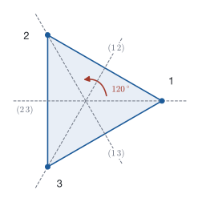
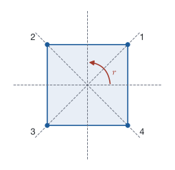
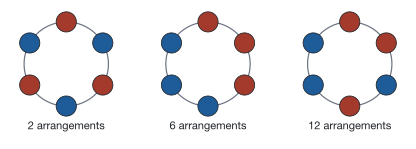

# Group theory {#sec-group-theory}

Groups are the algebra of symmetry. Whenever a set of transformations can be composed, undone and contains the
transformation that does nothing, it forms a group, and much of what can be said about a symmetric object follows
from the multiplication table of its group alone. This chapter has six sections. Groups defines groups, abelian
groups, orders, subgroups, generated subgroups and normal subgroups, and writes permutations in cycle notation, with the
integers modulo $n$, the permutation group $S_3$ and the rotation groups as running examples. Cosets and quotient groups
slices a group into the cosets of a subgroup, proves Lagrange's theorem, turns the cosets of a normal subgroup into a
group, and introduces group actions with their orbits, stabilisers and conjugacy classes, the class equation and
Burnside's lemma. Homomorphisms studies the maps that respect multiplication: kernels, isomorphisms, the first
isomorphism theorem, conjugation, the sign of a permutation and the determinant, the two-to-one map from spin rotations
to rotations, Cayley's theorem, direct products and the groups of order at most eight. Representations and Schur's lemma
lets a group act by matrices, proves that representations of finite groups split into irreducible pieces, and proves
Schur's lemma on the maps that commute with an irreducible representation. Characters takes traces of the representing
matrices, proves their orthogonality, studies the regular representation, shows that a finite group has as many
irreducible representations as conjugacy classes, and computes character tables. The symmetric group labels the
conjugacy classes of $S_n$ by partitions and Young diagrams, proves that the alternating groups $A_n$ are simple for
$n \geq 5$, counts the irreducible representations of $S_n$ and constructs several of them, and splits tensor powers into symmetric and
antisymmetric tensors. Every statement is followed by ten examples and ten exercises, and every exercise has a hidden
solution in two tabs: a proof by hand and a computation in SageMath.

## Groups {#sec-groups}

Symmetry is the organising principle of much of mathematics and physics: the isometries of a space form a group, the
transformations that leave the equations of a field theory unchanged form a group, and conserved quantities come from
these groups. This section defines groups, abelian groups and the order of an element, writes permutations in cycle
notation with their sign and cycle type, and then defines subgroups, generated subgroups and normal subgroups. Every
notion is worked on small finite groups, on the matrix sets of the earlier chapters and on the rotation and
spin-rotation matrices, so that the matrix groups of geometry and physics arrive with their algebra already familiar.

For more on this topic, see @mukunda2022continuous [Ch. 2].

Groups, abelian groups, orders, subgroups, generated and normal subgroups and the symmetric groups are also treated in @mukunda2022continuous [Secs. 1.1-1.3, pp. 1-5], @keskivakkuri2022mathematical [Secs. 2.1-2.2 and 2.5, pp. 4-9, 15-19], @chirivi2020selected [Theory Secs. 4.1-4.2 and 4.5-4.6, pp. 24-26, 28-30], @guidry2022symmetry [Secs. 2.2-2.4 and 2.11-2.12, pp. 7-13, 22-25], @starkovichStructuresMathematicalPhysics2021 [Secs. 2.2-2.6, pp. 26-42] and @alsubaieiGentleIntroductionGroup2023 [Chs. 5-6 and Secs. 7.1, 7.3, 7.5, pp. 149-220, 221-240, 252-263]; groups in which every element squares to the identity are abelian by @alsubaieiGentleIntroductionGroup2023 [Prop. 5.4.4, p. 160]. Many of the exercises below are adapted from @riley2006mathematical [Ch. 28] and @keskivakkuri2022mathematical [Ch. 2, Problems].

Earlier chapters met several sets of matrices and numbers that are closed under multiplication and inversion and
contain the identity: the unit circle (@exm-modulus-circle), the roots of unity (@prp-roots-of-unity), the
spin-rotation matrices (@exm-complex-su2, @prp-su2-det) and the orthogonal matrices with their subset of determinant
one (@prp-level-set-examples). They were described there by these closure properties alone. The definition below
gives the common structure a name, and from here on these sets are called groups.

### Groups

The transformations of an object that preserve its shape can be performed one after the other, undone, and include
the transformation that leaves everything in place. The definition below keeps only these three properties and
forgets what is being transformed.

:::: {.statement-box}
::: {#def-group}
#### Group

A **group** is a set $G$ with a multiplication $(g, h) \mapsto gh$, a map $G \times G \to G$, that is associative,
$(gh)k = g(hk)$, has an **identity** $e$ with $eg = ge = g$ for every $g$, and has an **inverse** $g^{-1}$ for every $g$
with $gg^{-1} = g^{-1}g = e$. The powers of $g$ are $g^0 = e$, $g^{m+1} = g^mg$ and $g^{-m} = (g^{-1})^m$ for $m \geq 0$.
When the multiplication is written as an addition $g + h$, the identity is written $0$, the inverse $-g$ and the power
$g^m$ the multiple $mg$.
:::
::::

:::: {.callout-note .examples-fold collapse="true" title="Examples"}
The first groups anyone meets are the number systems under addition. They show the three axioms in their most
familiar form, and one familiar set fails them, which shows that the inverse axiom has content.

::: {#exm-grp-numbers-addition}
#### Numbers under addition

$(\mathbb Z, +)$, $(\mathbb Q, +)$, $(\mathbb R, +)$ and $(\mathbb C, +)$ are groups: addition is associative, the
identity is $0$ and the inverse of $x$ is $-x$. More generally every vector space $(V, +)$ (@def-vector-space) is a group
under addition. The one-element set $\{e\}$ with $ee = e$ is the **trivial group**. The natural numbers $\{0, 1, 2,
\dots\}$ under addition are not a group, since $1 + x = 0$ has no solution among them.
:::

The second example is arithmetic on a clock face. Adding hours modulo $n$ is associative, has $0$ as identity, and
every hour can be undone by going forward the remaining hours, so the residues modulo $n$ form a group.

::: {#exm-group-zn}
#### Integers modulo $n$

$\mathbb{Z}_n = \{0, 1, \dots, n-1\}$ with addition modulo $n$ (@exm-quotient-zn) is a group: addition of classes is
associative because addition of integers is, the identity is $0$ and the inverse of $k \neq 0$ is $n - k$. The rotations
of a regular hexagon by multiples of $60^\circ$ compose in the same way: rotating by $60k^\circ$ and then by $60l^\circ$
is rotating by $60(k + l)^\circ$, and only $k + l$ modulo $6$ matters. Matching $k$ with the rotation by $60k^\circ$, the
two groups have the same multiplication table.
:::

Multiplication of numbers gives groups too, once the one number without an inverse is removed. The third example
lists the standard ones and a set of integers where inverses are missing.

::: {#exm-grp-numbers-multiplication}
#### Numbers under multiplication

The non-zero rationals $\mathbb Q^\times$, reals $\mathbb R^\times$ and complex numbers $\mathbb C^\times$ are groups
under multiplication, with identity $1$ and inverse $1/x$; so are the positive reals and the two-element set $\{1,
-1\}$. Zero must be removed, since $0 \cdot x = 0 \neq 1$ for every $x$. The non-zero integers are not a group under
multiplication: they are closed and contain $1$, but $2x = 1$ has no integer solution.
:::

The fourth example has a multiplication that is composition of maps. Composition of functions is always associative,
so the bijections of a finite set form a group as soon as the identity map and inverse maps are included.

::: {#exm-group-s3}
#### Permutations

The permutations of $\{1, \dots, n\}$ (@exm-bijection-finite, @def-permutation-sign) form the **symmetric group** $S_n$
under composition (@def-composition): $(\sigma\tau)\rho$ and $\sigma(\tau\rho)$ both send $i$ to
$\sigma(\tau(\rho(i)))$, the identity map is the identity, and the inverse map (@def-inverse-map) is the inverse. The
product $\sigma\tau = \sigma \circ \tau$ is read from right to left: first $\tau$, then $\sigma$. A permutation is
written in **cycle notation**: $(1\,2\,3)$ sends $1 \mapsto 2 \mapsto 3 \mapsto 1$, and $(1\,2)$ exchanges $1$ and $2$;
the numbers not shown are fixed. So $S_3 = \{e, (1\,2), (1\,3), (2\,3), (1\,2\,3), (1\,3\,2)\}$, with $3! = 6$ elements.
The rotations and reflections of an equilateral triangle (@fig-triangle-symmetries) permute its vertices $1, 2, 3$, and
each permutation comes from exactly one of them: the rotations by $120^\circ$ and $240^\circ$ give $(1\,2\,3)$ and
$(1\,3\,2)$, and the reflection in the axis through vertex $k$ exchanges the other two.

{#fig-triangle-symmetries width=45%}
:::

The fifth example brings in infinite groups, the ones met most often in geometry. Matrices compose by matrix
multiplication, which is associative, and the invertible ones have inverses by definition.

::: {#exm-group-matrix}
#### Matrix groups

The invertible $n \times n$ real matrices form the **general linear group** $GL(n, \mathbb{R})$ under matrix
multiplication: if $\mathbf A$ and $\mathbf B$ are invertible, so is $\mathbf A\mathbf B$, with inverse $\mathbf
B^{-1}\mathbf A^{-1}$; the identity is $\mathbf I$ and the inverse is the matrix inverse. The orthogonal matrices $O(n) =
\{\mathbf A^\top\mathbf A = \mathbf I\}$ of @prp-level-set-examples (3) are a group inside it: $(\mathbf A\mathbf
B)^\top\mathbf A\mathbf B = \mathbf B^\top\mathbf A^\top\mathbf A\mathbf B = \mathbf I$, and $\mathbf A^{-1} = \mathbf
A^\top$ satisfies $(\mathbf A^\top)^\top\mathbf A^\top = \mathbf A\mathbf A^\top = \mathbf I$. So is its subset $SO(n) =
\{\mathbf A \in O(n) : \det\mathbf A = 1\}$, by $\det(\mathbf A\mathbf B) = \det\mathbf A\det\mathbf B$
(@thm-determinant-product). For $n = 2$ the rotations $\mathbf R(\alpha) = \begin{pmatrix} \cos\alpha & -\sin\alpha \\
\sin\alpha & \cos\alpha \end{pmatrix}$ satisfy $\mathbf R(\alpha)\mathbf R(\beta) = \mathbf R(\alpha + \beta)$ by the
addition formulas, $\mathbf R(0) = \mathbf I$ and $\mathbf R(\alpha)^{-1} = \mathbf R(-\alpha)$; for $n = 3$ the group
$SO(3)$ is the group of rotations of space.
:::

The unit circle and the roots of unity of the complex-analysis chapter were described there as sets closed under
multiplication and inversion. The sixth example records that they are groups, one inside the other.

::: {#exm-grp-unit-circle}
#### The unit circle and the roots of unity

The unit circle $U(1) = \{z \in \mathbb C : |z| = 1\}$ is a group under multiplication: it contains $1$, and $|zw| =
|z||w|$ and $|1/z| = 1/|z|$ keep products and inverses on it (@exm-modulus-circle). The $n$-th roots of unity $\mu_n =
\{1, \omega, \dots, \omega^{n-1}\}$, $\omega = e^{2\pi i/n}$ (@prp-roots-of-unity), form a group inside it:
$\omega^j\omega^k = \omega^{j + k}$, and since $\omega^n = 1$ only $j + k$ modulo $n$ matters, so $\omega^k \mapsto k$
matches the multiplication of $\mu_n$ with the addition of $\mathbb Z_n$. In quantum mechanics the elements of $U(1)$
are the phases: multiplying a state by $e^{i\alpha}$ and then by $e^{i\beta}$ multiplies it by $e^{i(\alpha + \beta)}$.
:::

The spin-rotation matrices of quantum mechanics were introduced in @exm-complex-su2 and shown to be closed under
products in @prp-su2-det. The seventh example completes the check of the axioms.

::: {#exm-grp-spin-rotations}
#### The spin-rotation group $SU(2)$

The matrices $\mathbf U(a, b) = \begin{pmatrix} a & -b^* \\ b & a^* \end{pmatrix}$ with $|a|^2 + |b|^2 = 1$
(@eq-su2-matrix) form a group $SU(2)$. Products stay in the set by @prp-su2-det (2), the identity is $\mathbf U(1, 0) =
\mathbf I$, and @prp-su2-det (1) gives $\mathbf U^\dagger\mathbf U = \mathbf I$, so $\mathbf U(a, b)^{-1} = \mathbf
U(a, b)^\dagger = \begin{pmatrix} a^* & b^* \\ -b & a \end{pmatrix} = \mathbf U(a^*, -b)$, again of the form with
$|a^*|^2 + |-b|^2 = 1$. The group contains $-\mathbf I = \mathbf U(-1, 0)$, which is the rotation of a spin by $2\pi$.
:::

Special relativity has its own matrix group, defined by the Minkowski metric instead of the Euclidean one. The eighth
example checks the axioms with the inverse found in the linear-algebra chapter.

::: {#exm-grp-lorentz}
#### The Lorentz group

The real $4 \times 4$ matrices $\Lambda$ with $\Lambda^\top\eta\Lambda = \eta$, $\eta = \operatorname{diag}(1, -1, -1,
-1)$, form the **Lorentz group** $O(1, 3)$. If $\Lambda$ and $\Lambda'$ qualify, $(\Lambda\Lambda')^\top\eta\Lambda\Lambda'
= \Lambda'^\top(\Lambda^\top\eta\Lambda)\Lambda' = \Lambda'^\top\eta\Lambda' = \eta$. Each $\Lambda$ is invertible with
$\Lambda^{-1} = \eta\Lambda^\top\eta$ (@exm-detinv-lorentz), and multiplying $\Lambda^\top\eta\Lambda = \eta$ by
$(\Lambda^{-1})^\top$ on the left and $\Lambda^{-1}$ on the right gives $\eta = (\Lambda^{-1})^\top\eta\Lambda^{-1}$, so
the inverse qualifies too. Boosts (@exm-det-lorentz), parity and time reversal are elements.
:::

Time evolution is a composition of maps as well. For the harmonic oscillator the evolution maps can be written down
explicitly, and the ninth example shows that they form a group labelled by the time.

::: {#exm-grp-oscillator-flow}
#### Time evolution of the oscillator

With $m = \omega = 1$ and $z = x + ip$, Hamilton's equations are $\dot z = -iz$ (@exm-complex-oscillator), so a state
$z$ evolves in time $t$ to $\varphi_t(z) = e^{-it}z$. The maps $\varphi_t : \mathbb C \to \mathbb C$ satisfy $\varphi_s
\circ \varphi_t = \varphi_{s + t}$, $\varphi_0 = \mathrm{id}$ and $\varphi_t^{-1} = \varphi_{-t}$, so they form a group
under composition. Since $\varphi_{t + 2\pi} = \varphi_t$, the distinct maps are labelled by the phases $e^{-it}$, and
$\varphi_t \mapsto e^{-it}$ matches composition with multiplication in $U(1)$.
:::

Every axiom can fail on its own, and seeing each failure makes the definition sharper. The last example collects
operations that miss exactly one or two axioms [@keskivakkuri2022mathematical, Problem 2.11].

::: {#exm-grp-not-groups}
#### Operations that are not groups

The odd integers under addition are not closed, since $1 + 1 = 2$. The vectors of $\mathbb R^3$ under the cross product
are closed but not associative: $(\mathbf e_1 \times \mathbf e_1) \times \mathbf e_2 = \mathbf 0$ while $\mathbf e_1
\times (\mathbf e_1 \times \mathbf e_2) = \mathbf e_1 \times \mathbf e_3 = -\mathbf e_2$. The positive reals under $x
\circ y = x/y$ are closed but not associative, $(x/y)/z \neq x/(y/z)$ for $z \neq 1$. The real $2 \times 2$ matrices
under multiplication are associative with identity $\mathbf I$, but the zero matrix has no inverse.
:::
::::

:::: {.callout-note .exercises-fold collapse="true" title="Exercises"}
Deciding whether a set with an operation is a group means checking each axiom, and the failures are as instructive
as the successes. The first exercise tests four candidates, some of which miss one axiom only.

::: {#exr-group-axioms}
#### Checking the axioms

Decide whether the following are groups: the non-zero real numbers under multiplication; the integers under
subtraction; the $2 \times 2$ real matrices under matrix multiplication; the rotations and reflections of the plane
that fix the origin, that is, the orthogonal $2 \times 2$ matrices.
:::

::: {.callout-note .solution collapse="true" title="Solution"}
:::: {.panel-tabset .solution-tabs}
## Proof

Non-zero reals under multiplication: yes, by @exm-grp-numbers-multiplication. Integers under subtraction: no. The
operation is not associative, since $(a - b) - c = a - b - c$ and $a - (b - c) = a - b + c$ differ when $c \neq 0$; and
there is no identity, since $a - e = a$ for all $a$ forces $e = 0$, but $0 - a = -a \neq a$ for $a \neq 0$. All $2
\times 2$ matrices: no, the zero matrix has no inverse; the invertible ones form $GL(2, \mathbb{R})$ (@exm-group-matrix).
The orthogonal $2 \times 2$ matrices: yes, they form the group $O(2)$ of @exm-group-matrix.

## SageMath

The code tests associativity of subtraction on one triple, the inverse of the zero matrix, and closure of $O(2)$ on a
rotation times a reflection with symbolic angles.

```{.python .sage}
a, b, c = 5, 3, 2
print("(a-b)-c =", (a - b) - c, "; a-(b-c) =", a - (b - c))
Z = matrix(QQ, 2, 2, 0)
print("zero matrix invertible:", Z.is_invertible())
t, s = var("t s")
R = matrix(SR, [[cos(t), -sin(t)], [sin(t), cos(t)]])
S = matrix(SR, [[cos(s), sin(s)], [sin(s), -cos(s)]])
P = R * S
print("(RS)^T (RS) = I:", (P.transpose() * P).simplify_full() == identity_matrix(2))
print("inverse of R is R^T:", (R.transpose() * R).simplify_full() == identity_matrix(2))
```

```{.text .sage-output}
(a-b)-c = 0 ; a-(b-c) = 4
zero matrix invertible: False
(RS)^T (RS) = I: True
inverse of R is R^T: True
```
::::
:::

Multiplication modulo $n$ is associative and has the identity $1$, so the only question for the non-zero residues is
whether every element has an inverse. The second exercise shows that the answer depends on whether $n$ is prime
[@riley2006mathematical, Exercise 28.1].

::: {#exr-grp-units-mod5}
#### Multiplication modulo $5$ and modulo $6$

Show that $\{1, 2, 3, 4\}$ is a group under multiplication modulo $5$ by writing its multiplication table and finding
every inverse. Explain why $\{1, 2, 3, 4, 5\}$ is not a group under multiplication modulo $6$.
:::

::: {.callout-note .solution collapse="true" title="Solution"}
:::: {.panel-tabset .solution-tabs}
## Proof

Multiplication modulo $5$ is associative and commutative because multiplication of integers is, and $1$ is an
identity. Modulo $5$ the product of two non-zero residues is non-zero: if $5 \mid ab$ then, $5$ being prime, $5 \mid a$
or $5 \mid b$. So the set is closed. The table is

| $\cdot$ | $1$ | $2$ | $3$ | $4$ |
|---|---|---|---|---|
| $1$ | $1$ | $2$ | $3$ | $4$ |
| $2$ | $2$ | $4$ | $1$ | $3$ |
| $3$ | $3$ | $1$ | $4$ | $2$ |
| $4$ | $4$ | $3$ | $2$ | $1$ |

and the inverses, read off as the column holding $1$ in each row, are $1^{-1} = 1$, $2^{-1} = 3$, $3^{-1} = 2$, $4^{-1} =
4$. Modulo $6$ the set is not closed, $2 \cdot 3 = 6 \equiv 0$, and $2, 3, 4$ have no inverse: $2b$, $3b$ and $4b$ are
never $\equiv 1$ modulo $6$, since $2b$ and $4b$ are even and $3b$ is a multiple of $3$. Only $\{1, 5\}$, the residues
coprime to $6$, form a group.

## SageMath

The code checks closure and inverses with Sage's `Zmod`, prints the table modulo $5$ and lists Sage's units.

```{.python .sage}
for n in (5, 6):
    R = Zmod(n); X = [R(k) for k in range(1, n)]
    closed = all(a * b != 0 for a in X for b in X)
    inv = {int(a): [int(b) for b in X if a * b == 1] for a in X}
    print("n = %d: closed under multiplication: %s ; inverses: %s" % (n, closed, inv))
    print("        every element has an inverse:", all(len(v) == 1 for v in inv.values()))
R = Zmod(5)
print("multiplication table modulo 5 on {1,2,3,4}:")
for a in range(1, 5):
    print("   ", [int(R(a) * R(b)) for b in range(1, 5)])
print("2 * 3 = 0 modulo 6, so {1,...,5} is not closed:", Zmod(6)(2) * Zmod(6)(3) == 0)
print("Sage's group of units of Z_5:", [int(u) for u in Zmod(5).list_of_elements_of_multiplicative_group()], "; of Z_6:", [int(u) for u in Zmod(6).list_of_elements_of_multiplicative_group()])
```

```{.text .sage-output}
n = 5: closed under multiplication: True ; inverses: {1: [1], 2: [3], 3: [2], 4: [4]}
        every element has an inverse: True
n = 6: closed under multiplication: False ; inverses: {1: [1], 2: [], 3: [], 4: [], 5: [5]}
        every element has an inverse: False
multiplication table modulo 5 on {1,2,3,4}:
    [1, 2, 3, 4]
    [2, 4, 1, 3]
    [3, 1, 4, 2]
    [4, 3, 2, 1]
2 * 3 = 0 modulo 6, so {1,...,5} is not closed: True
Sage's group of units of Z_5: [1, 2, 3, 4] ; of Z_6: [1, 5]
```
::::
:::

The next set of matrices looks arbitrary, but its multiplication turns out to be that of pairs of residues. The third
exercise finds the product rule and counts the elements [@riley2006mathematical, Exercise 28.1(e)].

::: {#exr-grp-riley-triangular-z5}
#### Triangular matrices over $\mathbb Z_5$

For $a, b \in \mathbb Z_5$, both non-zero, let $\mathbf M(a, b) = \begin{pmatrix} a & a - b \\ 0 & b
\end{pmatrix}$ with entries in $\mathbb Z_5$. Show that $\mathbf M(a, b)\mathbf M(c, d) = \mathbf M(ac, bd)$, deduce that
these matrices form a group under matrix multiplication modulo $5$, and find its number of elements.
:::

::: {.callout-note .solution collapse="true" title="Solution"}
:::: {.panel-tabset .solution-tabs}
## Proof

Multiplying out, $\mathbf M(a, b)\mathbf M(c, d) = \begin{pmatrix} ac & a(c - d) + (a - b)d \\ 0 & bd \end{pmatrix}$, and
$a(c - d) + (a - b)d = ac - bd$, so the product is $\mathbf M(ac, bd)$; here $ac$ and $bd$ are non-zero because $5$ is
prime (@exr-grp-units-mod5). Matrix multiplication is associative, also with entries in $\mathbb Z_5$, since the proof of
associativity uses only the rules of addition and multiplication. The identity is $\mathbf M(1, 1) = \mathbf I$, and
$\mathbf M(a^{-1}, b^{-1})$ is an inverse of $\mathbf M(a, b)$, with $a^{-1}, b^{-1}$ the inverses modulo $5$. Since
$\mathbf M(a, b)$ determines $a$ and $b$ as its diagonal entries, there are $4 \cdot 4 = 16$ elements, and the product
rule says that they multiply like the pairs $(a, b)$ of non-zero residues, componentwise.

## SageMath

The code builds the sixteen matrices over $\mathbb Z_5$, checks the product rule for every pair, and lets Sage form the
matrix group they generate.

```{.python .sage}
F = GF(5)
M = lambda a, b: matrix(F, [[a, a - b], [0, b]])
units = [F(k) for k in range(1, 5)]
els = [M(a, b) for a in units for b in units]
print("product rule M(a,b)M(c,d) = M(ac,bd) for all 256 pairs:",
      all(M(a, b) * M(c, d) == M(a * c, b * d) for a in units for b in units for c in units for d in units))
G = MatrixGroup([M(a, b) for a in units for b in units])
print("order of the group generated:", G.order(), "; number of matrices:", len(set(tuple(m.list()) for m in els)))
```

```{.text .sage-output}
product rule M(a,b)M(c,d) = M(ac,bd) for all 256 pairs: True
order of the group generated: 16 ; number of matrices: 16
```
::::
:::

The axioms ask for an identity and for inverses but do not say that these are unique. The fourth exercise derives
uniqueness from the axioms, together with the rule for inverting a product that is used throughout the chapter.

::: {#exr-grp-uniqueness}
#### Uniqueness of the identity and of inverses

Show from the axioms that a group has only one identity, that each element has only one inverse, and that $(gh)^{-1}
= h^{-1}g^{-1}$. Deduce that the equation $gx = k$ has exactly one solution $x$ for given $g, k$.
:::

::: {.callout-note .solution collapse="true" title="Solution"}
:::: {.panel-tabset .solution-tabs}
## Proof

If $e$ and $e'$ are identities then $e = ee' = e'$, using first that $e'$ is an identity and then that $e$ is one. If $h$
and $h'$ are inverses of $g$ then $h = he = h(gh') = (hg)h' = eh' = h'$. Since $(gh)(h^{-1}g^{-1}) = g(hh^{-1})g^{-1} =
geg^{-1} = gg^{-1} = e$, and similarly $(h^{-1}g^{-1})(gh) = e$, the element $h^{-1}g^{-1}$ is the inverse of $gh$: the
order is reversed, as for putting on and taking off socks and shoes. Finally $x = g^{-1}k$ solves $gx = k$, and any
solution satisfies $x = (g^{-1}g)x = g^{-1}(gx) = g^{-1}k$. So every row of a multiplication table contains each element
exactly once, and by the same argument for $xg = k$ so does every column.

## SageMath

Check on $S_4$: the code counts the elements that act as identities, the inverses of each element, and the pairs
violating the product rule.

```{.python .sage}
G = SymmetricGroup(4)
els = G.list()
ids = [e for e in els if all(e * g == g and g * e == g for g in els)]
print("number of identities:", len(ids))
print("every element has exactly one inverse:", all(len([h for h in els if g * h == G.one() and h * g == G.one()]) == 1 for g in els))
print("(gh)^-1 = h^-1 g^-1 for all 576 pairs:", all((g * h)**-1 == h**-1 * g**-1 for g in els for h in els))
print("each row of the table is a permutation of G:", all(len(set(g * x for x in els)) == len(els) for g in els))
```

```{.text .sage-output}
number of identities: 1
every element has exactly one inverse: True
(gh)^-1 = h^-1 g^-1 for all 576 pairs: True
each row of the table is a permutation of G: True
```
::::
:::

An operation on the real numbers can be associative without being addition or multiplication. The fifth exercise
shows that a twisted sum becomes a group once one point is removed [@riley2006mathematical, Exercise 28.3].

::: {#exr-grp-twisted-sum}
#### A twisted sum

For a real $r \neq 0$ define $x \bullet y = x + y + rxy$. Show that $\bullet$ is associative, that $x \bullet y = -1/r$
exactly when $x = -1/r$ or $y = -1/r$, and that $\mathbb R \setminus \{-1/r\}$ is a group under $\bullet$. Find the
identity and the inverse of $x$.
:::

::: {.callout-note .solution collapse="true" title="Solution"}
:::: {.panel-tabset .solution-tabs}
## Proof

The key identity is $1 + r(x \bullet y) = 1 + rx + ry + r^2xy = (1 + rx)(1 + ry)$. So with $u(x) = 1 + rx$, a bijection
of $\mathbb R$ onto itself, $u(x \bullet y) = u(x)u(y)$: the operation $\bullet$ is multiplication of real numbers
transported by $u$. Associativity follows: $u((x \bullet y) \bullet z) = u(x)u(y)u(z) = u(x \bullet (y \bullet z))$, and
$u$ is injective. Next, $x \bullet y = -1/r$ means $u(x \bullet y) = 0$, that is $u(x)u(y) = 0$, so $u(x) = 0$ or $u(y)
= 0$, which is $x = -1/r$ or $y = -1/r$. Hence $\mathbb R \setminus \{-1/r\}$, which is where $u \neq 0$, is closed under
$\bullet$. The identity is $0$, since $u(0) = 1$, and the inverse of $x$ is the $y$ with $u(y) = 1/u(x)$, that is $y =
-x/(1 + rx)$, which is not $-1/r$ because $u(y) \neq 0$.

## SageMath

The code checks associativity, the product identity and the inverse symbolically.

```{.python .sage}
x, y, z, r = var("x y z r")
op = lambda a, b: a + b + r * a * b
print("associative:", bool((op(op(x, y), z) - op(x, op(y, z))).expand() == 0))
print("1 + r(x.y) = (1+rx)(1+ry):", bool((1 + r * op(x, y) - (1 + r * x) * (1 + r * y)).expand() == 0))
inv = -x / (1 + r * x)
print("x . inverse =", op(x, inv).simplify_full(), "; 0 is an identity:", bool(op(x, 0) == x))
```

```{.text .sage-output}
associative: True
1 + r(x.y) = (1+rx)(1+ry): True
x . inverse = 0 ; 0 is an identity: True
```
::::
:::

The real $2 \times 2$ matrices of determinant one are a group, and a single identity governs their powers. The sixth
exercise finds the elements that square to the identity and a family of elements whose cube is the identity
[@riley2006mathematical, Exercise 28.7].

::: {#exr-grp-sl2}
#### Matrices of determinant one

Show that the real $2 \times 2$ matrices $\mathbf A = \begin{pmatrix} w & x \\ y & z \end{pmatrix}$ with $wz - xy = 1$
form a group $SL(2, \mathbb R)$ under multiplication. Prove that $\mathbf A^2 = (w + z)\mathbf A - \mathbf I$, find all
$\mathbf A$ with $\mathbf A^2 = \mathbf I$, and show that $\mathbf A^3 = \mathbf I \neq \mathbf A$ when $w + z = -1$.
:::

::: {.callout-note .solution collapse="true" title="Solution"}
:::: {.panel-tabset .solution-tabs}
## Proof

$\det(\mathbf A\mathbf B) = \det\mathbf A\det\mathbf B = 1$ (@thm-determinant-product) gives closure, $\mathbf I$ is the
identity, and $\mathbf A^{-1} = \begin{pmatrix} z & -x \\ -y & w \end{pmatrix}$, as multiplying out shows, has determinant
$zw - xy = 1$. Next, $\mathbf A^2 = \begin{pmatrix} w^2 + xy & x(w + z) \\ y(w + z) & z^2 + xy \end{pmatrix}$, while
$(w + z)\mathbf A - \mathbf I$ has diagonal entries $w^2 + wz - 1$ and $wz + z^2 - 1$ and the same off-diagonal entries;
since $wz - 1 = xy$ the two agree. If $\mathbf A^2 = \mathbf I$ then $(w + z)\mathbf A = 2\mathbf I$, so $w + z \neq 0$
and $\mathbf A = \lambda\mathbf I$ with $\lambda = 2/(w + z)$; then $\det\mathbf A = \lambda^2 = 1$, so $\mathbf A = \pm
\mathbf I$, and both square to $\mathbf I$. If $w + z = -1$, then $\mathbf A^2 + \mathbf A + \mathbf I = \mathbf 0$, and
$\mathbf A^3 - \mathbf I = (\mathbf A - \mathbf I)(\mathbf A^2 + \mathbf A + \mathbf I) = \mathbf 0$; and $\mathbf A \neq
\mathbf I$ because the trace of $\mathbf I$ is $2$.

## SageMath

The code verifies the identity for a general matrix of determinant one and the cube on an instance with trace $-1$.

```{.python .sage}
w, x, y = var("w x y")
z = (1 + x * y) / w
A = matrix(SR, [[w, x], [y, z]])
print("det A =", A.det().simplify_full())
print("A^2 = (w+z)A - I:", (A**2 - (w + z) * A + identity_matrix(2)).simplify_full() == zero_matrix(2))
B = matrix(QQ, [[2, -7], [1, -3]])
print("B =", B.rows(), "; det =", B.det(), "; trace =", B.trace(), "; B^3 =", (B**3).rows())
```

```{.text .sage-output}
det A = 1
A^2 = (w+z)A - I: True
B = [(2, -7), (1, -3)] ; det = 1 ; trace = -1 ; B^3 = [(1, 0), (0, 1)]
```
::::
:::

The spin-rotation matrices can also be written with four real parameters, as in many physics texts. The seventh
exercise checks that this form is the group of @exm-grp-spin-rotations and that it preserves the length of complex
column vectors [@riley2006mathematical, Exercise 28.8].

::: {#exr-grp-su2-group}
#### Spin rotations with real parameters

For real $a_0, a_1, a_2, a_3$ with $a_0^2 + a_1^2 + a_2^2 + a_3^2 = 1$ let $\mathbf M = \begin{pmatrix} a_0 + ia_1 & -a_2 +
ia_3 \\ a_2 + ia_3 & a_0 - ia_1 \end{pmatrix}$. Show that these matrices form a group under multiplication and that
$\lVert\mathbf M\mathbf z\rVert = \lVert\mathbf z\rVert$ for every $\mathbf z \in \mathbb C^2$.
:::

::: {.callout-note .solution collapse="true" title="Solution"}
:::: {.panel-tabset .solution-tabs}
## Proof

With $a = a_0 + ia_1$ and $b = a_2 + ia_3$, $-b^* = -a_2 + ia_3$ and $a^* = a_0 - ia_1$, so $\mathbf M = \mathbf U(a, b)$
in the notation of @eq-su2-matrix, and $|a|^2 + |b|^2 = a_0^2 + a_1^2 + a_2^2 + a_3^2 = 1$. Conversely every $\mathbf
U(a, b)$ with $|a|^2 + |b|^2 = 1$ arises, from the real and imaginary parts of $a$ and $b$. So the set is $SU(2)$, a group
by @exm-grp-spin-rotations. For $\mathbf z \in \mathbb C^2$, $\lVert\mathbf M\mathbf z\rVert^2 = (\mathbf M\mathbf
z)^\dagger\mathbf M\mathbf z = \mathbf z^\dagger\mathbf M^\dagger\mathbf M\mathbf z = \mathbf z^\dagger\mathbf z =
\lVert\mathbf z\rVert^2$, using $\mathbf M^\dagger\mathbf M = \mathbf I$ (@prp-su2-det (1)).

## SageMath

Check on two rational parameter sets: the code forms the product, reads off its parameters and tests the length of
one vector.

```{.python .sage}
K.<I> = QuadraticField(-1)
def M(a0, a1, a2, a3):
    return matrix(K, [[a0 + I * a1, -a2 + I * a3], [a2 + I * a3, a0 - I * a1]])
A = M(1/2, 1/2, 1/2, 1/2); B = M(0, 3/5, 0, 4/5)
P = A * B
a, b = P[0, 0], P[1, 0]
print("product has the form:", P[0, 1] == -b.conjugate() and P[1, 1] == a.conjugate())
print("parameters of the product:", [QQ(a.trace() / 2), QQ((a - a.conjugate()) / (2 * I)), QQ(b.trace() / 2), QQ((b - b.conjugate()) / (2 * I))])
print("sum of squares:", sum(t**2 for t in [QQ(a.trace() / 2), QQ((a - a.conjugate()) / (2 * I)), QQ(b.trace() / 2), QQ((b - b.conjugate()) / (2 * I))]))
z = vector(K, [1 + 2 * I, 3 - I])
nrm = lambda v: sum(c * c.conjugate() for c in v)
print("|z|^2 =", nrm(z), "; |Az|^2 =", nrm(A * z))
```

```{.text .sage-output}
product has the form: True
parameters of the product: [-7/10, -1/10, 1/10, 7/10]
sum of squares: 1
|z|^2 = 15 ; |Az|^2 = 15
```
::::
:::

Two groups can be combined into one by multiplying pairs componentwise. The eighth exercise proves that this gives a
group and finds a product of two small groups with the multiplication table of $\mathbb Z_6$
[@riley2006mathematical, Exercise 28.12].

::: {#exr-grp-direct-product}
#### Direct products

For groups $A$ and $B$, show that the pairs $(a, b)$ with $(a, b)(a', b') = (aa', bb')$ form a group $A \times B$, the
**direct product**. Show that $k \mapsto (k \bmod 2, k \bmod 3)$ is a bijection $\mathbb Z_6 \to \mathbb Z_2 \times
\mathbb Z_3$ that turns addition in $\mathbb Z_6$ into addition in $\mathbb Z_2 \times \mathbb Z_3$.
:::

::: {.callout-note .solution collapse="true" title="Solution"}
:::: {.panel-tabset .solution-tabs}
## Proof

Associativity holds in each component, so it holds for pairs; $(e_A, e_B)$ is the identity and $(a^{-1}, b^{-1})$ the
inverse of $(a, b)$. Let $f(k) = (k \bmod 2, k \bmod 3)$ for $k \in \{0, \dots, 5\}$. If $f(k) = f(k')$, then $k - k'$ is
divisible by $2$ and by $3$, hence by $6$, so $k = k'$: $f$ is injective, and since both sets have six elements it is a
bijection. Remainders of sums depend only on the remainders of the terms (@exm-quotient-zn), so $f(k + l) = f(k) + f(l)$,
the right-hand side computed componentwise. So the two groups have the same multiplication table once $k$ is matched
with $f(k)$.

## SageMath

The code lists $f$ and checks additivity on all $36$ pairs.

```{.python .sage}
f = lambda k: (k % 2, k % 3)
print("f:", {k: f(k) for k in range(6)})
print("bijective:", len(set(f(k) for k in range(6))) == 6)
add = lambda p, q: ((p[0] + q[0]) % 2, (p[1] + q[1]) % 3)
print("f(k+l) = f(k)+f(l) for all pairs:", all(f((k + l) % 6) == add(f(k), f(l)) for k in range(6) for l in range(6)))
```

```{.text .sage-output}
f: {0: (0, 0), 1: (1, 1), 2: (0, 2), 3: (1, 0), 4: (0, 1), 5: (1, 2)}
bijective: True
f(k+l) = f(k)+f(l) for all pairs: True
```
::::
:::

For a set with very few elements the axioms leave almost no freedom. The ninth exercise shows that there is only one
multiplication table for a group with three elements.

::: {#exr-grp-three-elements}
#### Groups with three elements

Let $G = \{e, a, b\}$ be a group with identity $e$ and $a \neq b$. Show that $a^2 = b$, $ab = ba = e$ and $b^2 = a$, so
that the table is that of $\mathbb Z_3$ with $e, a, b$ matched to $0, 1, 2$.
:::

::: {.callout-note .solution collapse="true" title="Solution"}
:::: {.panel-tabset .solution-tabs}
## Proof

By @exr-grp-uniqueness each row and each column of the table contains every element exactly once. The row of $a$ is $ae
= a$, $aa$, $ab$, so $\{aa, ab\} = \{e, b\}$. If $ab = b$, then $a = e$ by cancelling $b$ on the right, which is false;
so $ab = e$ and $a^2 = b$. In the same way the row of $b$ gives $ba \in \{e, a\}$ and $ba = a$ would force $b = e$; so
$ba = e$ and $b^2 = a$. Then $a^k$ for $k = 0, 1, 2$ is $e, a, b$, and $a^ja^k = a^{j + k}$ with $a^3 = ab = e$: matching
$a^k$ with $k \in \mathbb Z_3$ turns the table into addition modulo $3$.

## SageMath

The code tries all $3^4 = 81$ ways to fill the four products of non-identity elements and keeps those satisfying the
axioms.

```{.python .sage}
import itertools
E = [0, 1, 2]
found = []
for vals in itertools.product(E, repeat=4):
    T = {(0, x): x for x in E}; T.update({(x, 0): x for x in E})
    T[(1, 1)], T[(1, 2)], T[(2, 1)], T[(2, 2)] = vals
    assoc = all(T[(T[(x, y)], z)] == T[(x, T[(y, z)])] for x in E for y in E for z in E)
    inv = all(any(T[(x, y)] == 0 and T[(y, x)] == 0 for y in E) for x in E)
    if assoc and inv:
        found.append(vals)
print("number of group tables with identity 0:", len(found), "; (aa, ab, ba, bb) =", found)
```

```{.text .sage-output}
number of group tables with identity 0: 1 ; (aa, ab, ba, bb) = [(2, 0, 0, 1)]
```
::::
:::

Fractional linear maps of the complex plane compose like matrices, which connects the group axioms with complex
analysis. The last exercise builds a group of such maps on the upper half-plane from integer matrices of determinant one
[@keskivakkuri2022mathematical, Problem 2.20].

::: {#exr-grp-mobius}
#### Fractional linear maps of the upper half-plane

For an integer matrix $\mathbf A = \begin{pmatrix} a & b \\ c & d \end{pmatrix}$ with $ad - bc = 1$ let $f_{\mathbf
A}(z) = (az + b)/(cz + d)$ on $\mathbb H = \{\operatorname{Im} z > 0\}$. Show that $\operatorname{Im} f_{\mathbf A}(z) =
\operatorname{Im} z/|cz + d|^2$, so $f_{\mathbf A}$ maps $\mathbb H$ to itself, and that $f_{\mathbf A} \circ f_{\mathbf
B} = f_{\mathbf A\mathbf B}$. Deduce that these maps form a group under composition, and that $f_{\mathbf A} =
\mathrm{id}$ exactly when $\mathbf A = \pm\mathbf I$.
:::

::: {.callout-note .solution collapse="true" title="Solution"}
:::: {.panel-tabset .solution-tabs}
## Proof

For $z \in \mathbb H$, $cz + d \neq 0$: if $c \neq 0$ then $\operatorname{Im}(cz + d) = c\operatorname{Im} z \neq 0$, and
if $c = 0$ then $ad = 1$ gives $d \neq 0$. Then $f_{\mathbf A}(z) = (az + b)(cz^* + d)/|cz + d|^2$, and the numerator is
$ac|z|^2 + adz + bcz^* + bd$, whose imaginary part is $(ad - bc)\operatorname{Im} z = \operatorname{Im} z$. So
$\operatorname{Im} f_{\mathbf A}(z) > 0$. For $\mathbf B = \begin{pmatrix} p & q \\ r & s \end{pmatrix}$, multiplying
numerator and denominator of $f_{\mathbf A}(f_{\mathbf B}(z)) = \dfrac{a\frac{pz + q}{rz + s} + b}{c\frac{pz + q}{rz +
s} + d}$ by $rz + s$ gives $\dfrac{(ap + br)z + (aq + bs)}{(cp + dr)z + (cq + ds)} = f_{\mathbf A\mathbf B}(z)$. The
integer matrices of determinant one form a group: products have determinant one, and $\mathbf A^{-1} = \begin{pmatrix} d
& -b \\ -c & a \end{pmatrix}$ is again an integer matrix of determinant one. Hence the maps are closed under composition,
$f_{\mathbf I} = \mathrm{id}$ is the identity, $f_{\mathbf A^{-1}}$ is the inverse of $f_{\mathbf A}$, and composition of
maps is associative. Finally $f_{\mathbf A}(z) = z$ for all $z \in \mathbb H$ means $cz^2 + (d - a)z - b = 0$ on
$\mathbb H$; a polynomial with infinitely many zeros vanishes, so $c = b = 0$, $a = d$, and $ad = 1$ gives $a = d = \pm1$.

## SageMath

The code checks the composition rule and the imaginary part symbolically, and that $\mathbf A$ and $-\mathbf A$ give the
same map.

```{.python .sage}
a, b, c, p, q, r, s, x, y = var("a b c p q r s x y")
f = lambda A, z: (A[0, 0] * z + A[0, 1]) / (A[1, 0] * z + A[1, 1])
A = matrix(SR, [[a, b], [c, (1 + b * c) / a]]); B = matrix(SR, [[p, q], [r, s]])
zz = var("zz")
print("f_A(f_B(z)) = f_AB(z):", bool((f(A, f(B, zz)) - f(A * B, zz)).simplify_full() == 0))
assume(x, "real"); assume(y, "real")
M = matrix(SR, [[2, 1], [1, 1]]); z = x + I * y
print("Im f_M(z) - Im z/|z+1|^2 =", (imag_part(f(M, z)) - y / ((x + 1)**2 + y**2)).simplify_full())
print("f_A = f_(-A):", bool((f(A, zz) - f(-A, zz)).simplify_full() == 0))
```

```{.text .sage-output}
f_A(f_B(z)) = f_AB(z): True
Im f_M(z) - Im z/|z+1|^2 = 0
f_A = f_(-A): True
```
::::
:::
::::

In a group the order of the factors can matter, as the matrix examples already suggest. Groups in which it never
matters are singled out by the next definition.

:::: {.statement-box}
::: {#def-abelian-group}
#### Abelian group

A group is **abelian** (or **commutative**) if $gh = hg$ for all $g, h \in G$.
:::
::::

:::: {.callout-note .examples-fold collapse="true" title="Examples"}
Addition of numbers and of vectors commutes, so every group built from addition is abelian. The first example lists
these groups together with the multiplicative groups of numbers.

::: {#exm-grp-abelian-numbers}
#### Numbers and vectors

$(\mathbb Z, +)$, $(\mathbb R, +)$, $(\mathbb C, +)$ and every vector space $(V, +)$ are abelian, and so are
$\mathbb Q^\times$, $\mathbb R^\times$ and $\mathbb C^\times$ under multiplication (@exm-grp-numbers-addition,
@exm-grp-numbers-multiplication). For abelian groups written additively, $g + h = h + g$ is the commutative law of
addition. The group $GL(1, \mathbb R)$ of invertible $1 \times 1$ matrices is $\mathbb R^\times$, so it is abelian as well.
:::

The groups built from addition of residues or of angles are abelian, because addition commutes. The second example
also identifies the rotations of the plane with the unit complex numbers, two descriptions of one abelian group.

::: {#exm-abelian-zn}
#### $\mathbb{Z}_n$, $SO(2)$ and $U(1)$

$\mathbb{Z}_n$ is abelian, since addition commutes; so is $SO(2)$, since $\mathbf R(\alpha)\mathbf R(\beta) = \mathbf
R(\alpha + \beta) = \mathbf R(\beta)\mathbf R(\alpha)$ (@exm-group-matrix), and so is the unit circle $U(1) =
\{e^{i\alpha}\}$ under multiplication (@exm-grp-unit-circle). The map $e^{i\alpha} \mapsto \mathbf R(\alpha)$ is a
bijection $U(1) \to SO(2)$, well defined because $e^{i\alpha} = e^{i\alpha'}$ and $\mathbf R(\alpha) = \mathbf
R(\alpha')$ both mean $\alpha - \alpha' \in 2\pi\mathbb Z$, and it turns $e^{i\alpha}e^{i\beta} = e^{i(\alpha + \beta)}$
into $\mathbf R(\alpha)\mathbf R(\beta) = \mathbf R(\alpha + \beta)$: the two groups have the same multiplication table.
$U(1)$ is the gauge group of electromagnetism.
:::

The symmetries of a rectangle that is not a square are fewer than those of a square, and they all commute. The third
example lists them and their table [@keskivakkuri2022mathematical, Problem 2.2].

::: {#exm-grp-abelian-klein}
#### The symmetries of a rectangle

A rectangle with unequal sides has four symmetries: the identity $e$, the half turn $a$ about its centre, and the
reflections $b$ and $c$ in its vertical and horizontal axes. Each squares to $e$, and the product of any two of $a, b,
c$ is the third: $bc = cb = a$, since reflecting in both axes is the half turn, and similarly $ab = ba = c$, $ac = ca =
b$. The table is symmetric, so the group is abelian. It has the table of $\mathbb Z_2 \times \mathbb Z_2$
(@exr-grp-direct-product) with $a, b, c$ matched to $(1, 1), (1, 0), (0, 1)$, and it is called the **Klein four-group**.
:::

Permutations of three objects already fail to commute. Composing two transpositions in the two possible orders gives
the two different three-cycles, the smallest instance of a non-abelian group.

::: {#exm-nonabelian-s3}
#### $S_3$ is not abelian

Read right to left, $(1\,2)(1\,3)$ sends $1 \mapsto 3 \mapsto 3$, $3 \mapsto 1 \mapsto 2$ and $2 \mapsto 2 \mapsto 1$, so
it is $(1\,3\,2)$; and $(1\,3)(1\,2)$ sends $1 \mapsto 2 \mapsto 2$, $2 \mapsto 1 \mapsto 3$ and $3 \mapsto 3 \mapsto 1$,
so it is $(1\,2\,3)$. The two products differ, and $S_3$ is not abelian. For every $n \geq 3$ the same two transpositions
lie in $S_n$, so $S_n$ is not abelian; $S_1$ and $S_2$, with one and two elements, are abelian.
:::

Matrix multiplication does not commute in general, and the general linear group shows it with two shears. Diagonal
matrices commute with each other, which singles out a commutative part of the group.

::: {#exm-grp-nonabelian-gl2}
#### $GL(2, \mathbb R)$ is not abelian

For $\mathbf A = \begin{pmatrix} 1 & 1 \\ 0 & 1 \end{pmatrix}$ and $\mathbf B = \begin{pmatrix} 1 & 0 \\ 1 & 1
\end{pmatrix}$, $\mathbf A\mathbf B = \begin{pmatrix} 2 & 1 \\ 1 & 1 \end{pmatrix}$ and $\mathbf B\mathbf A =
\begin{pmatrix} 1 & 1 \\ 1 & 2 \end{pmatrix}$. Diagonal invertible matrices commute, $\operatorname{diag}(a, d)
\operatorname{diag}(a', d') = \operatorname{diag}(aa', dd')$, and together they form an abelian group with the table of
$\mathbb R^\times \times \mathbb R^\times$.
:::

Rotations of space behave like permutations rather than like rotations of the plane. Two quarter turns about
different axes, applied in the two orders, leave an object in different positions.

::: {#exm-nonabelian-so3}
#### $SO(3)$ is not abelian

The quarter turns $\mathbf R_X = \begin{pmatrix} 1 & 0 & 0 \\ 0 & 0 & -1 \\ 0 & 1 & 0 \end{pmatrix}$ about the $X$-axis
and $\mathbf R_Z = \begin{pmatrix} 0 & -1 & 0 \\ 1 & 0 & 0 \\ 0 & 0 & 1 \end{pmatrix}$ about the $Z$-axis lie in $SO(3)$.
$\mathbf R_Z\mathbf R_X$ sends $\mathbf e_1 \mapsto \mathbf e_1 \mapsto \mathbf e_2$, while $\mathbf R_X\mathbf R_Z$
sends $\mathbf e_1 \mapsto \mathbf e_2 \mapsto \mathbf e_3$, as turning a book shows. So the order of two rotations about different axes matters, for a book as for a rigid body
or a spin.
:::

The Pauli matrices give a small non-abelian group inside the spin rotations. The seventh example multiplies two of its
elements in both orders.

::: {#exm-grp-pauli-quaternion}
#### The quaternion group of Pauli matrices

With the Pauli matrices $\sigma_1 = \begin{pmatrix} 0 & 1 \\ 1 & 0 \end{pmatrix}$, $\sigma_2 = \begin{pmatrix} 0 & -i
\\ i & 0 \end{pmatrix}$, $\sigma_3 = \operatorname{diag}(1, -1)$, the products $\sigma_1\sigma_2 = i\sigma_3$, $\sigma_2
\sigma_3 = i\sigma_1$, $\sigma_3\sigma_1 = i\sigma_2$ and $\sigma_a^2 = \mathbf I$ show that the eight matrices $Q_8 =
\{\pm\mathbf I, \pm i\sigma_1, \pm i\sigma_2, \pm i\sigma_3\}$ are closed under products, and each has its inverse
among them, since $(i\sigma_a)(-i\sigma_a) = \mathbf I$. This is the **quaternion group**, with $i\sigma_a$ playing the
quaternion units. It is not abelian: $(i\sigma_1)(i\sigma_2) = -\sigma_1\sigma_2 = -i\sigma_3$ but $(i\sigma_2)(i\sigma_1)
= -\sigma_2\sigma_1 = i\sigma_3$.
:::

A non-abelian group can contain many elements that commute with each other. The diagonal spin rotations of the eighth
example are the rotations about one axis, and they multiply like phases.

::: {#exm-grp-su2-diagonal}
#### Diagonal spin rotations

$SU(2)$ is not abelian, since it contains $Q_8$ (@exm-grp-pauli-quaternion): $i\sigma_1 = \mathbf U(0, i)$, $i\sigma_2 =
\mathbf U(0, -1)$ and $i\sigma_3 = \mathbf U(i, 0)$ in the form @eq-su2-matrix. The diagonal elements $\mathbf U(a, 0) =
\operatorname{diag}(a, a^*)$ with $|a| = 1$ commute with each other, since $\operatorname{diag}(a, a^*)\operatorname{diag}
(a', a'^*) = \operatorname{diag}(aa', (aa')^*)$ (@exm-complex-su2): they multiply like the phases $a \in U(1)$. With $a =
e^{-i\theta/2}$ they are the spin rotations by $\theta$ about the $z$-axis.
:::

Lorentz boosts along one direction compose by adding rapidities, so they commute. Boosts along two different directions
do not, which is the algebraic root of the Thomas precession of a spinning particle.

::: {#exm-grp-boosts-commute}
#### Boosts along one and along two axes

In the $(t, x)$ plane the boost of rapidity $\phi$ is $\Lambda(\phi) = \begin{pmatrix} \cosh\phi & -\sinh\phi \\
-\sinh\phi & \cosh\phi \end{pmatrix}$ (@exm-linear-boost with $\beta = \tanh\phi$), and the addition formulas for
$\cosh$ and $\sinh$ give $\Lambda(\phi)\Lambda(\psi) = \Lambda(\phi + \psi) = \Lambda(\psi)\Lambda(\phi)$. The boosts
$\mathbf B_x$ and $\mathbf B_y$ with $\beta = \tfrac35$, $\gamma = \tfrac54$ along $x$ and along $y$ in $(t, x, y)$ do
not commute: the $(x, y)$ entry of $\mathbf B_x\mathbf B_y$ is the $x$ row $(-\gamma\beta, \gamma, 0)$ of $\mathbf B_x$
times the $y$ column $(-\gamma\beta, 0, \gamma)$ of $\mathbf B_y$, which is $\gamma^2\beta^2 = \tfrac{9}{16}$, while that
of $\mathbf B_y\mathbf B_x$ is the $x$ row $(0, 1, 0)$ of $\mathbf B_y$ times the $y$ column $(0, 0, 1)$ of $\mathbf
B_x$, which is $0$.
:::

Commutativity is a separate property from the group axioms, and a commutative operation need not come close to a group.
The last example has an associative and commutative operation with an identity in which no element but the identity
has an inverse.

::: {#exm-grp-abelian-max}
#### A commutative operation without inverses

On $[0, \infty)$ the operation $x \vee y = \max(x, y)$ is associative and commutative, and $0$ is an identity, since
$\max(0, x) = x$. But $\max(x, y) = 0$ forces $x = 0$, so no $x > 0$ has an inverse. Commutativity says nothing about
inverses: it is a property that some groups have, not a substitute for the axioms.
:::
::::

:::: {.callout-note .exercises-fold collapse="true" title="Exercises"}
The multiplication table of a finite group shows commutativity at a glance. The first exercise makes the criterion
precise and tests it on two tables met before.

::: {#exr-grp-abelian-table}
#### Symmetric tables

Show that a finite group is abelian exactly when its multiplication table, with rows and columns listed in the same
order, is a symmetric matrix. Test this on the table of $\{1, 2, 3, 4\}$ under multiplication modulo $5$
(@exr-grp-units-mod5) and on the table of $S_3$.
:::

::: {.callout-note .solution collapse="true" title="Solution"}
:::: {.panel-tabset .solution-tabs}
## Proof

List the elements as $g_1, \dots, g_N$ and let $T_{jk} = g_jg_k$ be the entry in row $j$, column $k$. Then $T_{kj} =
g_kg_j$, and $T_{jk} = T_{kj}$ for all $j, k$ says exactly that $g_jg_k = g_kg_j$ for all pairs. The table modulo $5$ is
symmetric, being a table of multiplication of integers. In $S_3$ the row of $(1\,2)$ and the column of $(1\,3)$ meet in
$(1\,2)(1\,3) = (1\,3\,2)$, the row of $(1\,3)$ and the column of $(1\,2)$ in $(1\,2\,3)$ (@exm-nonabelian-s3), so its
table is not symmetric.

## SageMath

The code builds both tables as matrices of element indices and tests symmetry.

```{.python .sage}
R = Zmod(5); X = [R(k) for k in range(1, 5)]
T5 = matrix(ZZ, [[X.index(a * b) for b in X] for a in X])
S3 = SymmetricGroup(3); L = S3.list()
T6 = matrix(ZZ, [[L.index(g * h) for h in L] for g in L])
print("table mod 5 symmetric:", T5.is_symmetric(), "; table of S_3 symmetric:", T6.is_symmetric())
print("number of non-symmetric entry pairs in the table of S_3:", sum(1 for j in range(6) for k in range(j + 1, 6) if T6[j, k] != T6[k, j]))
```

```{.text .sage-output}
table mod 5 symmetric: True ; table of S_3 symmetric: False
number of non-symmetric entry pairs in the table of S_3: 9
```
::::
:::

The orthogonal $2 \times 2$ matrices are the rotations and the reflections of the plane, and their products follow
three rules. The second exercise derives them and decides whether $O(2)$ is abelian [@keskivakkuri2022mathematical,
Problem 2.5].

::: {#exr-grp-abelian-o2}
#### Rotations and reflections of the plane

Let $\mathbf S(\beta) = \begin{pmatrix} \cos\beta & \sin\beta \\ \sin\beta & -\cos\beta \end{pmatrix}$. Show that every
matrix of $O(2)$ is a rotation $\mathbf R(\alpha)$ or an $\mathbf S(\beta)$, that $\mathbf R(\alpha)\mathbf S(\beta) =
\mathbf S(\alpha + \beta)$, $\mathbf S(\beta)\mathbf R(\alpha) = \mathbf S(\beta - \alpha)$ and $\mathbf S(\alpha)\mathbf
S(\beta) = \mathbf R(\alpha - \beta)$, and decide whether $O(2)$ is abelian.
:::

::: {.callout-note .solution collapse="true" title="Solution"}
:::: {.panel-tabset .solution-tabs}
## Proof

$\mathbf A^\top\mathbf A = \mathbf I$ says that the columns of $\mathbf A$ are orthonormal. The first column is a unit
vector, $(\cos\alpha, \sin\alpha)$ for some $\alpha$, and the second is a unit vector orthogonal to it, $\pm(-\sin\alpha,
\cos\alpha)$; the sign $+$ gives $\mathbf R(\alpha)$ and the sign $-$ gives $\mathbf S(\alpha)$. Since $\mathbf S(\beta)
= \mathbf R(\beta)\mathbf S(0)$ with $\mathbf S(0) = \operatorname{diag}(1, -1)$, and $\mathbf S(0)\mathbf R(\alpha) =
\mathbf R(-\alpha)\mathbf S(0)$ (multiply out), the rules follow from $\mathbf R(\alpha)\mathbf R(\beta) = \mathbf
R(\alpha + \beta)$ and $\mathbf S(0)^2 = \mathbf I$: $\mathbf R(\alpha)\mathbf S(\beta) = \mathbf R(\alpha + \beta)\mathbf
S(0)$; $\mathbf S(\beta)\mathbf R(\alpha) = \mathbf R(\beta)\mathbf R(-\alpha)\mathbf S(0) = \mathbf S(\beta - \alpha)$;
$\mathbf S(\alpha)\mathbf S(\beta) = \mathbf R(\alpha)\mathbf S(0)\mathbf R(\beta)\mathbf S(0) = \mathbf R(\alpha)\mathbf
R(-\beta)\mathbf S(0)^2 = \mathbf R(\alpha - \beta)$. $O(2)$ is not abelian: $\mathbf R(\alpha)\mathbf S(0) = \mathbf
S(\alpha)$ and $\mathbf S(0)\mathbf R(\alpha) = \mathbf S(-\alpha)$ differ unless $2\alpha \in 2\pi\mathbb Z$.

## SageMath

The code checks the three rules with symbolic angles and compares the two products for $\alpha = \pi/2$.

```{.python .sage}
a, b = var("a b")
R = lambda t: matrix(SR, [[cos(t), -sin(t)], [sin(t), cos(t)]])
S = lambda t: matrix(SR, [[cos(t), sin(t)], [sin(t), -cos(t)]])
print("R(a)S(b) = S(a+b):", (R(a) * S(b) - S(a + b)).simplify_full() == 0)
print("S(b)R(a) = S(b-a):", (S(b) * R(a) - S(b - a)).simplify_full() == 0)
print("S(a)S(b) = R(a-b):", (S(a) * S(b) - R(a - b)).simplify_full() == 0)
print("R(pi/2)S(0) =", (R(pi / 2) * S(0)).rows(), "; S(0)R(pi/2) =", (S(0) * R(pi / 2)).rows())
```

```{.text .sage-output}
R(a)S(b) = S(a+b): True
S(b)R(a) = S(b-a): True
S(a)S(b) = R(a-b): True
R(pi/2)S(0) = [(0, 1), (1, 0)] ; S(0)R(pi/2) = [(0, -1), (-1, 0)]
```
::::
:::

Commutativity can be tested pair by pair, and for a non-abelian group it is natural to ask how many pairs still
commute. The third exercise does this count for five groups of orders $4$, $6$ and $8$, using the rules just found
for the square.

::: {#exr-grp-abelian-test}
#### Counting commuting pairs

For $\mathbb{Z}_6$, $\mathbb{Z}_2 \times \mathbb{Z}_2$, $S_3$, the symmetry group $D_4$ of a square (its four
rotations $e, r, r^2, r^3$ by multiples of $90^\circ$ and its four reflections) and the quaternion group $Q_8$ of
@exm-grp-pauli-quaternion, decide which are abelian and count the ordered pairs $(g, h)$ with $gh = hg$.
:::

::: {.callout-note .solution collapse="true" title="Solution"}
:::: {.panel-tabset .solution-tabs}
## Proof

$\mathbb{Z}_6$ and $\mathbb{Z}_2 \times \mathbb{Z}_2$ are abelian, so all $36$ and $16$ pairs commute. The number of
commuting pairs is the sum over $g$ of the number of elements commuting with $g$. In $S_3$ the identity commutes with
all $6$, each transposition only with $e$ and itself, since the products of two different transpositions in the two
orders are the two different three-cycles (@exm-nonabelian-s3), and each three-cycle with $e$ and the two three-cycles,
its powers, but with no transposition; the count is $6 + 3 \cdot 2 + 2 \cdot 3 = 18$ of $36$. Placing the square with its centre at the origin, $D_4$ consists of the matrices $\mathbf R(k\pi/2)$ and $\mathbf
S(k\pi/2)$, $k = 0, \dots, 3$, and by @exr-grp-abelian-o2 a rotation $\mathbf R(\alpha)$ commutes with $\mathbf S(\beta)$
exactly when $\mathbf S(\alpha + \beta) = \mathbf S(\beta - \alpha)$, that is $2\alpha \in 2\pi\mathbb Z$, while $\mathbf
S(\beta)$ commutes with $\mathbf S(\beta')$ exactly when $\mathbf R(\beta - \beta') = \mathbf R(\beta' - \beta)$, that is
$\beta' = \beta$ or $\beta' = \beta + \pi$ modulo $2\pi$. So in $D_4$ the identity and the half turn $r^2$ commute with all
$8$ elements; $r$ and $r^3$ commute with the four rotations and with no reflection; each reflection commutes with $e$,
$r^2$, itself and the reflection in the perpendicular axis. The count is $2 \cdot 8 + 2 \cdot 4 + 4 \cdot 4 = 40$. In $Q_8$, $\pm\mathbf I$
commute with all $8$, and $\pm i\sigma_a$ commutes with $\pm\mathbf I$ and $\pm i\sigma_a$ only, since $\sigma_a$ and
$\sigma_b$ anticommute for $a \neq b$, since $\sigma_b\sigma_a = (\sigma_a\sigma_b)^\dagger = (i\sigma_c)^\dagger =
-i\sigma_c$ for the products of @exm-grp-pauli-quaternion; the count is $2 \cdot 8 + 6 \cdot 4 = 40$ as well, although the two groups are
different.

## SageMath

The code counts commuting pairs in Sage's permutation versions of the five groups.

```{.python .sage}
groups = [("Z_6", CyclicPermutationGroup(6)), ("Z_2 x Z_2", KleinFourGroup()), ("S_3", SymmetricGroup(3)),
          ("D_4", DihedralGroup(4)), ("Q_8", QuaternionGroup())]
for name, G in groups:
    els = G.list()
    comm = sum(1 for g in els for h in els if g * h == h * g)
    print("%-10s order %2d  abelian: %-5s  commuting pairs: %2d of %2d" % (name, G.order(), G.is_abelian(), comm, len(els)**2))
```

```{.text .sage-output}
Z_6        order  6  abelian: True   commuting pairs: 36 of 36
Z_2 x Z_2  order  4  abelian: True   commuting pairs: 16 of 16
S_3        order  6  abelian: False  commuting pairs: 18 of 36
D_4        order  8  abelian: False  commuting pairs: 40 of 64
Q_8        order  8  abelian: False  commuting pairs: 40 of 64
```
::::
:::

A simple condition on the elements can force a group to be abelian. The fourth exercise asks for the short
computation that shows this when every element is its own inverse [@riley2006mathematical, Exercise 28.9].

::: {#exr-grp-square-identity}
#### Groups of exponent two

Show that if $g^2 = e$ for every element $g$ of a group, the group is abelian. Give an example with four elements and
check that $S_3$ does not satisfy the hypothesis.
:::

::: {.callout-note .solution collapse="true" title="Solution"}
:::: {.panel-tabset .solution-tabs}
## Proof

Each element is its own inverse, $g^{-1} = g$. Then $gh = (gh)^{-1} = h^{-1}g^{-1} = hg$, using @exr-grp-uniqueness for
the inverse of a product. The group $\mathbb{Z}_2 \times \mathbb{Z}_2 = \{(0,0), (1,0), (0,1), (1,1)\}$ with
componentwise addition modulo $2$, the symmetries of a rectangle of @exm-grp-abelian-klein, is an example with four
elements. In $S_3$ the three-cycle $(1\,2\,3)$ has $(1\,2\,3)^2 = (1\,3\,2) \neq e$, so the hypothesis fails, as it must
since $S_3$ is not abelian.

## SageMath

The code tests the hypothesis and commutativity for the Klein four-group, $\mathbb Z_2^3$ and $S_3$.

```{.python .sage}
for name, G in [("Z_2 x Z_2", KleinFourGroup()), ("Z_2^3", AbelianGroup([2, 2, 2])), ("S_3", SymmetricGroup(3))]:
    els = G.list()
    print("%-10s every g^2 = e: %-5s  abelian: %s" % (name, all(g**2 == G.one() for g in els), G.is_abelian()))
```

```{.text .sage-output}
Z_2 x Z_2  every g^2 = e: True   abelian: True
Z_2^3      every g^2 = e: True   abelian: True
S_3        every g^2 = e: False  abelian: False
```
::::
:::

The failure of commutativity is measured by the commutator $ghg^{-1}h^{-1}$, which equals $e$ exactly when $g$ and $h$
commute. The fifth exercise computes it in a group of triangular matrices that contains an abelian group of
translations.

::: {#exr-grp-commutator}
#### Commutators of triangular matrices

Show that the upper triangular matrices $\begin{pmatrix} a & b \\ 0 & d \end{pmatrix}$ with $ad \neq 0$ form a group
under matrix multiplication, compute the commutator of $\mathbf g = \begin{pmatrix} a & 0 \\ 0 & 1 \end{pmatrix}$ and
$\mathbf h = \begin{pmatrix} 1 & b \\ 0 & 1 \end{pmatrix}$, and show that the matrices with $a = d = 1$ multiply by adding
the entries $b$, so that they form an abelian group.
:::

::: {.callout-note .solution collapse="true" title="Solution"}
:::: {.panel-tabset .solution-tabs}
## Proof

The product of two upper triangular matrices is upper triangular with diagonal entries multiplied, $\begin{pmatrix} a
& b \\ 0 & d \end{pmatrix}\begin{pmatrix} a' & b' \\ 0 & d' \end{pmatrix} = \begin{pmatrix} aa' & ab' + bd' \\ 0 &
dd' \end{pmatrix}$, so $aa'dd' \neq 0$; the identity is upper triangular; and the inverse $\begin{pmatrix} 1/a & -b/(ad)
\\ 0 & 1/d \end{pmatrix}$ is again upper triangular. Matrix multiplication is associative, so these matrices form a
group. With $\mathbf g^{-1} = \operatorname{diag}(1/a, 1)$ and $\mathbf h^{-1} = \begin{pmatrix} 1 & -b \\ 0 & 1
\end{pmatrix}$, $\mathbf g\mathbf h\mathbf g^{-1} = \begin{pmatrix} 1 & ab \\ 0 & 1 \end{pmatrix}$, and then $\mathbf
g\mathbf h\mathbf g^{-1}\mathbf h^{-1} = \begin{pmatrix} 1 & (a - 1)b \\ 0 & 1 \end{pmatrix}$, which is the identity only
if $a = 1$ or $b = 0$: the group is not abelian. For $a = d = 1$ the product formula gives the entry $b + b'$, the
identity has $b = 0$ and the inverse has $-b$, so these matrices form a group that multiplies as the real numbers add,
and it is abelian.

## SageMath

The code computes the commutator with symbolic entries.

```{.python .sage}
a, b, c = var("a b c")
g = matrix(SR, [[a, 0], [0, 1]]); h = matrix(SR, [[1, b], [0, 1]])
print("g h g^-1 h^-1 =", (g * h * g.inverse() * h.inverse()).simplify_full().rows())
T = lambda t: matrix(SR, [[1, t], [0, 1]])
print("T(b) T(c) = T(b+c):", T(b) * T(c) == T(b + c))
```

```{.text .sage-output}
g h g^-1 h^-1 = [(1, (a - 1)*b), (0, 1)]
T(b) T(c) = T(b+c): True
```
::::
:::

Commutativity can be recognised from how inverses and squares of products behave. The sixth exercise gives two such
criteria, each of which fails in $S_3$.

::: {#exr-grp-abelian-inverse-map}
#### Inverses and squares of products

Show that a group is abelian exactly when $(gh)^{-1} = g^{-1}h^{-1}$ for all $g, h$, and exactly when $(gh)^2 = g^2h^2$
for all $g, h$. Find a pair in $S_3$ for which both identities fail.
:::

::: {.callout-note .solution collapse="true" title="Solution"}
:::: {.panel-tabset .solution-tabs}
## Proof

In an abelian group $(gh)^{-1} = h^{-1}g^{-1} = g^{-1}h^{-1}$ (@exr-grp-uniqueness). Conversely, if $(gh)^{-1} =
g^{-1}h^{-1}$ for all $g, h$, apply it to $g^{-1}, h^{-1}$: $(g^{-1}h^{-1})^{-1} = gh$, while the left side is $hg$ by
the rule for inverses of products; so $hg = gh$. For squares, $(gh)^2 = ghgh$ and $g^2h^2 = gghh$; cancelling $g$ on the
left and $h$ on the right (@exr-grp-uniqueness), $ghgh = gghh$ is equivalent to $hg = gh$. In $S_3$ take $g = (1\,2)$,
$h = (1\,3)$: $gh = (1\,3\,2)$ (@exm-nonabelian-s3) has $(gh)^{-1} = (1\,2\,3) = hg$, while $g^{-1}h^{-1} = gh = (1\,3\,2)$;
and $(gh)^2 = (1\,2\,3) \neq e = g^2h^2$.

## SageMath

The code counts the pairs of $S_3$ satisfying each identity and the commuting pairs; the three counts agree.

```{.python .sage}
G = SymmetricGroup(3); els = G.list()
n_comm = sum(1 for g in els for h in els if g * h == h * g)
n_inv = sum(1 for g in els for h in els if (g * h)**-1 == g**-1 * h**-1)
n_sq = sum(1 for g in els for h in els if (g * h)**2 == g**2 * h**2)
print("commuting pairs:", n_comm, "; (gh)^-1 = g^-1 h^-1:", n_inv, "; (gh)^2 = g^2 h^2:", n_sq)
```

```{.text .sage-output}
commuting pairs: 18 ; (gh)^-1 = g^-1 h^-1: 18 ; (gh)^2 = g^2 h^2: 18
```
::::
:::

Integer matrices of a triangular shape give the smallest model of the canonical commutation relations of quantum
mechanics. The seventh exercise shows that they form a non-abelian group whose commutators commute with everything
[@riley2006mathematical, Exercise 28.1(g)].

::: {#exr-grp-heisenberg}
#### The Heisenberg group

For integers $a, b, c$ let $\mathbf M(a, b, c) = \begin{pmatrix} 1 & 0 & 0 \\ a & 1 & 0 \\ b & c & 1 \end{pmatrix}$.
Show that $\mathbf M(a, b, c)\mathbf M(a', b', c') = \mathbf M(a + a', b + b' + ca', c + c')$, that these matrices form a
non-abelian group, and that the commutator $\mathbf g\mathbf h\mathbf g^{-1}\mathbf h^{-1}$ of $\mathbf g = \mathbf
M(a, b, c)$ and $\mathbf h = \mathbf M(a', b', c')$ is $\mathbf M(0, ca' - c'a, 0)$, which commutes with every element.
:::

::: {.callout-note .solution collapse="true" title="Solution"}
:::: {.panel-tabset .solution-tabs}
## Proof

Multiplying out, the second row of the product is $(a + a', 1, 0)$ and the third is $(b + ca' + b', c + c', 1)$, which is
the product formula. So the set is closed, $\mathbf M(0, 0, 0) = \mathbf I$ is the identity, and $\mathbf M(-a, ca - b,
-c)$ is an inverse of $\mathbf M(a, b, c)$, by the formula: the product is $\mathbf M(0, b + ca - b - ca, 0) = \mathbf I$,
and similarly in the other order. The formula also gives $\mathbf g\mathbf h = \mathbf M(a + a', b + b' + ca', c + c')$
and $\mathbf h\mathbf g = \mathbf M(a + a', b + b' + c'a, c + c')$, which differ when $ca' \neq c'a$, for instance for
$\mathbf M(1, 0, 0)$ and $\mathbf M(0, 0, 1)$: the group is not abelian. Let $\mathbf z = \mathbf M(0, \delta, 0)$ with
$\delta = ca' - c'a$. The formula gives $\mathbf z\mathbf M(x, y, w) = \mathbf M(x, y + \delta, w) = \mathbf M(x, y, w)
\mathbf z$, so $\mathbf z$ commutes with every element, and $\mathbf z\mathbf h\mathbf g = \mathbf g\mathbf h$. Hence
$\mathbf g\mathbf h\mathbf g^{-1}\mathbf h^{-1} = \mathbf g\mathbf h(\mathbf h\mathbf g)^{-1} = \mathbf z$.

## SageMath

The code checks the product formula and the commutator with symbolic integer entries.

```{.python .sage}
a, b, c, p, q, r = var("a b c p q r")
M = lambda x, y, w: matrix(SR, [[1, 0, 0], [x, 1, 0], [y, w, 1]])
g = M(a, b, c); h = M(p, q, r)
print("product formula:", (g * h - M(a + p, b + q + c * p, c + r)).simplify_full() == 0)
print("commutator =", (g * h * g.inverse() * h.inverse()).simplify_full().rows())
```

```{.text .sage-output}
product formula: True
commutator = [(1, 0, 0), (0, 1, 0), (c*p - a*r, 0, 1)]
```
::::
:::

Direct products of groups were introduced in @exr-grp-direct-product. The eighth exercise decides when such a product is
abelian and uses the answer to produce a non-abelian group of order $12$.

::: {#exr-grp-abelian-products}
#### Abelian direct products

Show that $A \times B$ is abelian exactly when $A$ and $B$ are both abelian. Deduce that $\mathbb Z_2 \times \mathbb
Z_3$ is abelian and $S_3 \times \mathbb Z_2$ is not.
:::

::: {.callout-note .solution collapse="true" title="Solution"}
:::: {.panel-tabset .solution-tabs}
## Proof

$(a, b)(a', b') = (aa', bb')$ and $(a', b')(a, b) = (a'a, b'b)$, so the two pairs agree exactly when $aa' = a'a$ and $bb'
= b'b$. If $A$ and $B$ are abelian this holds for all pairs. Conversely, if $A \times B$ is abelian, taking $b = b' =
e_B$ gives $aa' = a'a$ for all $a, a' \in A$, and similarly for $B$. $\mathbb Z_2$ and $\mathbb Z_3$ are abelian, so
$\mathbb Z_2 \times \mathbb Z_3$ is; $S_3$ is not abelian (@exm-nonabelian-s3), so $S_3 \times \mathbb Z_2$, with $3!
\cdot 2 = 12$ elements, is not.

## SageMath

The code forms the two products as permutation groups and tests commutativity.

```{.python .sage}
P1 = direct_product_permgroups([CyclicPermutationGroup(2), CyclicPermutationGroup(3)])
P2 = direct_product_permgroups([SymmetricGroup(3), CyclicPermutationGroup(2)])
print("Z_2 x Z_3: order", P1.order(), "abelian", P1.is_abelian())
print("S_3 x Z_2: order", P2.order(), "abelian", P2.is_abelian())
```

```{.text .sage-output}
Z_2 x Z_3: order 6 abelian True
S_3 x Z_2: order 12 abelian False
```
::::
:::

Commuting with a rotation about one axis is a strong condition on a spin rotation. The ninth exercise finds all spin
rotations that commute with a rotation about the $z$-axis.

::: {#exr-grp-su2-commute}
#### Spin rotations commuting with a rotation about $z$

Let $\mathbf D = \operatorname{diag}(e^{-i\theta/2}, e^{i\theta/2})$ with $\theta \notin 2\pi\mathbb Z$. Show that
$\mathbf U(a, b) \in SU(2)$ commutes with $\mathbf D$ exactly when $b = 0$. What happens for $\theta \in 2\pi\mathbb Z$?
:::

::: {.callout-note .solution collapse="true" title="Solution"}
:::: {.panel-tabset .solution-tabs}
## Proof

$\mathbf U(a, b)\mathbf D = \begin{pmatrix} ae^{-i\theta/2} & -b^*e^{i\theta/2} \\ be^{-i\theta/2} & a^*e^{i\theta/2}
\end{pmatrix}$ and $\mathbf D\mathbf U(a, b) = \begin{pmatrix} ae^{-i\theta/2} & -b^*e^{-i\theta/2} \\ be^{i\theta/2} &
a^*e^{i\theta/2} \end{pmatrix}$. The diagonal entries agree, and the off-diagonal ones agree exactly when $b(e^{i\theta/2}
- e^{-i\theta/2}) = 0$, that is $2ib\sin(\theta/2) = 0$. Since $\theta \notin 2\pi\mathbb Z$, $\sin(\theta/2) \neq 0$, so
$b = 0$: the commuting spin rotations are the diagonal ones $\operatorname{diag}(a, a^*)$, $|a| = 1$, of
@exm-grp-su2-diagonal. For $\theta \in 2\pi\mathbb Z$, $\mathbf D = \pm\mathbf I$ commutes with every matrix.

## SageMath

The code computes the commutator condition for a general matrix of the form and $\theta = \pi/2$.

```{.python .sage}
a, b = var("a b", domain="complex")
U = matrix(SR, [[a, -conjugate(b)], [b, conjugate(a)]])
th = pi / 2
D = diagonal_matrix(SR, [exp(-I * th / 2), exp(I * th / 2)])
print("U D - D U =", (U * D - D * U).simplify_full().rows())
```

```{.text .sage-output}
U D - D U = [(0, -I*sqrt(2)*conjugate(b)), (-I*sqrt(2)*b, 0)]
```
::::
:::

The identity $(gh)^2 = g^2h^2$ of @exr-grp-abelian-inverse-map forces commutativity, but the same identity with a higher
exponent need not. The last exercise shows that three consecutive exponents suffice, and that two do not.

::: {#exr-grp-abelian-three-powers}
#### Three consecutive exponents

Suppose that $(gh)^n = g^nh^n$ for all $g, h$ and for three consecutive integers $n = m, m + 1, m + 2$. Show that the
group is abelian. Check that in $S_3$ the identity holds for all pairs when $n = 6$ and $n = 7$, but not when $n = 8$.
:::

::: {.callout-note .solution collapse="true" title="Solution"}
:::: {.panel-tabset .solution-tabs}
## Proof

From $n = k$ and $n = k + 1$: $g^{k+1}h^{k+1} = (gh)^{k+1} = (gh)^kgh = g^kh^kgh$, and cancelling $g^k$ on the left and
$h$ on the right gives $gh^k = h^kg$. Applying this with $k = m$ and $k = m + 1$, $h^m$ and $h^{m+1}$ commute with $g$.
Then $h^mhg = h^{m+1}g = gh^{m+1} = gh^mh = h^mgh$, and cancelling $h^m$ gives $hg = gh$. In $S_3$ every element has
$g^6 = e$, since the transpositions square to $e$ and the three-cycles cube to $e$; so $n = 6$ gives $e = e$ and $n = 7$
gives $gh = gh$, for all pairs. For $n = 8$, $g = (1\,2)$, $h = (1\,3)$ give $(gh)^8 = (gh)^2 = (1\,2\,3)$ but $g^8h^8 =
e$. Two consecutive exponents are therefore not enough.

## SageMath

The code counts, for $n = 1, \dots, 9$, the pairs of $S_3$ with $(gh)^n = g^nh^n$.

```{.python .sage}
G = SymmetricGroup(3); els = G.list()
print({n: sum(1 for g in els for h in els if (g * h)**n == g**n * h**n) for n in range(1, 10)})
```

```{.text .sage-output}
{1: 36, 2: 18, 3: 18, 4: 18, 5: 18, 6: 36, 7: 36, 8: 18, 9: 18}
```
::::
:::
::::

Repeating a single element of a finite group must eventually return to the identity, because there are only finitely
many powers. The next definition measures how long that takes, and how large the group is.

:::: {.statement-box}
::: {#def-order}
#### Order

The **order** $|G|$ of a group is its number of elements (possibly infinite). The **order of an element** $g$ is
the least $n > 0$ with $g^n = e$, or infinite if there is none.
:::
::::

:::: {.callout-note .examples-fold collapse="true" title="Examples"}
In $\mathbb{Z}_6$ the $n$-th power of an element $k$ is the sum $nk$, so the order of $k$ is the least $n$ with $nk$
divisible by $6$. The first example lists these orders and finds an element whose order is the order of the group.

::: {#exm-order-zn}
#### Orders in $\mathbb{Z}_6$

$|\mathbb{Z}_6| = 6$; the element $1$ has order $6$, $2$ and $4$ have order $3$, $3$ has order $2$ and $0$ has
order $1$. The multiples $0, 1, 2, \dots, 5$ of the element $1$ run through the whole group, so its order equals the order
of the group. In every group the identity is the only element of order $1$.
:::

The symmetric group $S_3$ is small enough to list completely, and its elements fall into three kinds by their order.
The second example computes the powers of each kind directly.

::: {#exm-order-s3}
#### Orders in $S_3$

$|S_3| = 6$ (@exm-group-s3). A transposition exchanges two numbers, and doing it twice restores them, so $(1\,2)$,
$(1\,3)$, $(2\,3)$ have order $2$. The cycle $c = (1\,2\,3)$ has $c^2 = (1\,3\,2)$, which sends $1 \mapsto 3$, and $c^3$
sends every number three steps around $1 \to 2 \to 3 \to 1$, back to itself; so $(1\,2\,3)$ and $(1\,3\,2)$ have order $3$,
and the identity has order $1$. No element has order $6$, unlike in $\mathbb Z_6$.
:::

Multiplication modulo a prime gives a finite group in which the orders vary from element to element. The third example
lists them for the non-zero residues modulo $7$.

::: {#exm-grp-order-units}
#### Orders modulo $7$

The non-zero residues modulo $7$ form a group under multiplication, by the argument of @exr-grp-units-mod5 with $5$
replaced by the prime $7$. The powers of $3$ are $3, 2, 6, 4, 5, 1$, so $3$ has order $6$, and so does $5$, with powers
$5, 4, 6, 2, 3, 1$; $2$ and $4$ have order $3$ ($2, 4, 1$ and $4, 2, 1$); $6 \equiv -1$ has order $2$; and $1$ has order
$1$. As in $\mathbb Z_6$, the powers of one element exhaust the group.
:::

The roots of unity are the multiplicative model of the integers modulo $n$. The fourth example finds the orders of their
elements, which single out the primitive roots.

::: {#exm-grp-order-roots-unity}
#### Orders of roots of unity

In $\mu_n$ (@exm-grp-unit-circle) the element $\omega = e^{2\pi i/n}$ has order $n$, since $\omega^m = e^{2\pi im/n} = 1$
exactly when $n \mid m$ (@prp-roots-of-unity). The root $\omega^k$ has order $n/\gcd(n, k)$, the least $m$ with $n \mid
km$; the roots of order exactly $n$ are the **primitive** $n$-th roots. For $n = 6$, $\omega = \tfrac12 + i\tfrac{\sqrt3}2$
and $\omega^5$ have order $6$, $\omega^2$ and $\omega^4$ have order $3$, and $\omega^3 = -1$ has order $2$.
:::

Matrices give finite and infinite orders side by side. The fifth example computes three powers with the identity
$\mathbf A^2 = (\operatorname{tr}\mathbf A)\mathbf A - \mathbf I$ of @exr-grp-sl2.

::: {#exm-grp-order-matrices}
#### Orders of $2 \times 2$ matrices

$\mathbf A = \begin{pmatrix} 0 & -1 \\ 1 & 0 \end{pmatrix} = \mathbf R(\pi/2)$ has $\mathbf A^2 = -\mathbf I$ and order
$4$. $\mathbf B = \begin{pmatrix} 0 & -1 \\ 1 & 1 \end{pmatrix}$ has determinant $1$ and trace $1$, so $\mathbf B^2 =
\mathbf B - \mathbf I$, $\mathbf B^3 = \mathbf B^2 - \mathbf B = -\mathbf I$, and $\mathbf B$ has order $6$, as $\mathbf
B^k \neq \mathbf I$ for $k < 6$: $\mathbf B, \mathbf B^2 = \mathbf B - \mathbf I$, $-\mathbf I$, $-\mathbf B$, $-\mathbf
B^2$ are not $\mathbf I$. $\mathbf C = \begin{pmatrix} 1 & 1 \\ 0 & 1 \end{pmatrix}$ has $\mathbf C^n = \begin{pmatrix} 1
& n \\ 0 & 1 \end{pmatrix}$ by induction, and infinite order.
:::

In an infinite group the order of an element can be finite or infinite. Rotations of the plane show both
possibilities, depending on whether the angle is a rational multiple of a full turn.

::: {#exm-order-infinite}
#### Infinite groups

$SO(2)$, $SO(3)$, $SU(2)$ and $(\mathbb{Z}, +)$ have infinite order. In $SO(2)$, $\mathbf R(\alpha)^n = \mathbf R(n\alpha)$
is $\mathbf I$ exactly when $n\alpha \in 2\pi\mathbb Z$: the rotation by $2\pi/n$ has order $n$, and the rotation by
$\alpha = 2\pi\theta$ with $\theta$ irrational has infinite order. In $(\mathbb Z, +)$ every element other than $0$ has
infinite order, since $nk \neq 0$ for $n > 0$, $k \neq 0$.
:::

The spin rotations contain elements of every finite order, and one of them has a famous physical meaning. The seventh
example computes orders of diagonal spin rotations and of the Pauli elements.

::: {#exm-grp-order-spin}
#### Orders of spin rotations

The spin rotation by $\theta$ about $z$, $\mathbf D(\theta) = \operatorname{diag}(e^{-i\theta/2}, e^{i\theta/2})$, has
$\mathbf D(\theta)^n = \mathbf D(n\theta)$, which is $\mathbf I$ exactly when $n\theta \in 4\pi\mathbb Z$. So $\mathbf
D(2\pi) = -\mathbf I$ has order $2$: a rotation by a full turn is not the identity on a spin, and only a rotation by
$4\pi$ is. The elements $i\sigma_a$ of $Q_8$ (@exm-grp-pauli-quaternion) square to $-\mathbf I$ and have order $4$.
:::

The discrete Lorentz transformations have finite order, while boosts have infinite order. The eighth example records
both.

::: {#exm-grp-order-lorentz}
#### Orders of Lorentz transformations

Parity $P = \operatorname{diag}(1, -1, -1, -1)$ and time reversal $T = \operatorname{diag}(-1, 1, 1, 1)$
(@exm-det-lorentz) square to $\mathbf I$ and have order $2$, and so does $PT = -\mathbf I$. A boost of rapidity $\phi \neq
0$ has $\Lambda(\phi)^n = \Lambda(n\phi)$ (@exm-grp-boosts-commute), whose entry $\cosh(n\phi) > 1$ for $n \neq 0$: it has
infinite order.
:::

Knowing the orders of two elements says little about the order of their product. The ninth example multiplies two
elements of order $2$ and obtains every possible order.

::: {#exm-grp-order-product}
#### Two reflections

The reflections $\mathbf S(0)$ and $\mathbf S(\beta)$ of @exr-grp-abelian-o2 square to $\mathbf I$, so both have order
$2$, and their product is $\mathbf S(0)\mathbf S(\beta) = \mathbf R(-\beta)$. For $\beta = 2\pi/n$ the product has order
$n$, and for $\beta = 2\pi\theta$ with $\theta$ irrational it has infinite order. In $S_3$, $(1\,2)(1\,3) = (1\,3\,2)$
(@exm-nonabelian-s3): two elements of order $2$ with a product of order $3$.
:::

An infinite group can have only elements of finite order. The last example takes all the roots of unity together, a
limit of the groups $\mu_n$ in which no single element reaches the size of the group.

::: {#exm-grp-order-torsion}
#### All roots of unity

Let $\mu_\infty$ be the set of complex numbers $z$ with $z^n = 1$ for some $n \geq 1$, the union of all $\mu_n$. It is a
group under multiplication: if $z^m = 1$ and $w^n = 1$ then $(zw)^{mn} = 1$ and $(1/z)^m = 1$. It is infinite, since it
contains the $n$ distinct elements of $\mu_n$ for every $n$, yet every element has finite order. In $(\mathbb Z, +)$ it
is the other way round: every element except $0$ has infinite order.
:::
::::

:::: {.callout-note .exercises-fold collapse="true" title="Exercises"}
The orders of the elements of $\mathbb Z_{12}$ follow a simple pattern governed by greatest common divisors. The first
exercise computes them and counts how many elements have each order.

::: {#exr-grp-orders-z12}
#### Orders in $\mathbb{Z}_{12}$

Find the order of every element of $\mathbb{Z}_{12}$, count the elements of each order, and check that the order of
$k$ is $12/\gcd(k, 12)$.
:::

::: {.callout-note .solution collapse="true" title="Solution"}
:::: {.panel-tabset .solution-tabs}
## Proof

The order of $k$ is the least $n > 0$ with $12 \mid nk$. With $d = \gcd(k, 12)$, $12 \mid nk$ is equivalent to $(12/d)
\mid (k/d)n$, and since $12/d$ and $k/d$ are coprime, to $(12/d) \mid n$; so the order is $12/d$. There is one element of
order $1$ ($0$), one of order $2$ ($6$), two of order $3$ ($4, 8$), two of order $4$ ($3, 9$), two of order $6$ ($2,
10$) and four of order $12$ ($1, 5, 7, 11$). The number of elements of order $d$ is Euler's $\varphi(d)$, the number of
residues modulo $d$ coprime to $d$.

## SageMath

The code computes the additive orders and compares them with the formula and with Euler's function.

```{.python .sage}
R = Zmod(12)
orders = {k: R(k).additive_order() for k in range(12)}
print("orders:", orders)
from collections import Counter
cnt = Counter(orders.values())
print("number of elements of each order:", dict(sorted(cnt.items())))
print("each order divides 12:", all(12 % o == 0 for o in orders.values()))
print("order of k equals 12/gcd(k,12):", all(orders[k] == 12 // gcd(k, 12) for k in range(12)))
print("number of elements of order d equals Euler's phi(d):", all(cnt[d] == euler_phi(d) for d in divisors(12)))
```

```{.text .sage-output}
orders: {0: 1, 1: 12, 2: 6, 3: 4, 4: 3, 5: 12, 6: 2, 7: 12, 8: 3, 9: 4, 10: 6, 11: 12}
number of elements of each order: {1: 1, 2: 1, 3: 2, 4: 2, 6: 2, 12: 4}
each order divides 12: True
order of k equals 12/gcd(k,12): True
number of elements of order d equals Euler's phi(d): True
```
::::
:::

The symmetries of a square are rotations and reflections, and their orders can be read off the matrices of
@exr-grp-abelian-o2. The second exercise counts the elements of each order [@riley2006mathematical, Exercise 28.11].

::: {#exr-grp-order-riley-d4}
#### Orders in the symmetries of a square

Show that the symmetry group $D_4$ of a square, the matrices $\mathbf R(k\pi/2)$ and $\mathbf S(k\pi/2)$, $k = 0, 1, 2,
3$, has one element of order $1$, five of order $2$ and two of order $4$.
:::

::: {.callout-note .solution collapse="true" title="Solution"}
:::: {.panel-tabset .solution-tabs}
## Proof

$\mathbf R(0) = \mathbf I$ has order $1$. $\mathbf R(k\pi/2)^n = \mathbf R(nk\pi/2)$ is $\mathbf I$ exactly when $nk\pi/2
\in 2\pi\mathbb Z$, that is $4 \mid nk$: the half turn $\mathbf R(\pi)$ has order $2$, and the quarter turns $\mathbf
R(\pi/2)$, $\mathbf R(3\pi/2)$ have order $4$. Each reflection satisfies $\mathbf S(\beta)^2 = \mathbf R(\beta - \beta) =
\mathbf I$ (@exr-grp-abelian-o2) and $\mathbf S(\beta) \neq \mathbf I$, so the four reflections have order $2$. In all:
one element of order $1$, $1 + 4 = 5$ of order $2$, two of order $4$.

## SageMath

The code builds the eight matrices exactly and counts orders.

```{.python .sage}
from collections import Counter
R = lambda k: matrix(ZZ, [[[1, 0, -1, 0][k % 4], -[0, 1, 0, -1][k % 4]], [[0, 1, 0, -1][k % 4], [1, 0, -1, 0][k % 4]]])
S = lambda k: matrix(ZZ, [[[1, 0, -1, 0][k % 4], [0, 1, 0, -1][k % 4]], [[0, 1, 0, -1][k % 4], -[1, 0, -1, 0][k % 4]]])
els = [R(k) for k in range(4)] + [S(k) for k in range(4)]
order = lambda A: next(n for n in range(1, 9) if A**n == 1)
print("orders:", [order(A) for A in els], "; counts:", dict(Counter(order(A) for A in els)))
print("Sage's DihedralGroup(4):", dict(Counter(g.order() for g in DihedralGroup(4))))
```

```{.text .sage-output}
orders: [1, 4, 2, 4, 2, 2, 2, 2] ; counts: {1: 1, 4: 2, 2: 5}
Sage's DihedralGroup(4): {1: 1, 2: 5, 4: 2}
```
::::
:::

Inverting or conjugating an element should not change how long its powers take to return to the identity. The
third exercise proves this and uses it to compare the orders of $gh$ and $hg$.

::: {#exr-grp-order-inverse}
#### Orders of inverses and conjugates

Show that $g$, $g^{-1}$ and $kgk^{-1}$ have the same order for all $g, k$, and deduce that $gh$ and $hg$ have the same
order. Check the last statement on $g = (1\,2)$, $h = (1\,3)$ in $S_3$.
:::

::: {.callout-note .solution collapse="true" title="Solution"}
:::: {.panel-tabset .solution-tabs}
## Proof

$(g^{-1})^n = (g^n)^{-1}$, by induction on $n$ with @exr-grp-uniqueness, and this is $e$ exactly when $g^n = e$. For the
conjugate, $(kgk^{-1})^n = kg^nk^{-1}$ because the inner factors $k^{-1}k$ cancel, and $kg^nk^{-1} = e$ exactly when $g^n
= k^{-1}ek = e$. So the sets of $n > 0$ with $x^n = e$ are the same for the three elements, and so are their least
members, finite or not. Since $hg = g^{-1}(gh)g$ is a conjugate of $gh$, the two have the same order. For the two
transpositions, $gh = (1\,3\,2)$ and $hg = (1\,2\,3)$ (@exm-nonabelian-s3), both of order $3$, although they are different
elements.

## SageMath

Check on $S_4$: the code compares the orders of $g$, $g^{-1}$, $kgk^{-1}$, and of $gh$ and $hg$, over all elements.

```{.python .sage}
G = SymmetricGroup(4); els = G.list()
print("ord g = ord g^-1 = ord kgk^-1 for all g, k:", all(g.order() == (g**-1).order() == (k * g * k**-1).order() for g in els for k in els))
print("ord gh = ord hg for all g, h:", all((g * h).order() == (h * g).order() for g in els for h in els))
g, h = G("(1,2)"), G("(1,3)")
print("g*h =", g * h, "; h*g =", h * g, "; orders", (g * h).order(), (h * g).order())
```

```{.text .sage-output}
ord g = ord g^-1 = ord kgk^-1 for all g, k: True
ord gh = ord hg for all g, h: True
g*h = (1,2,3) ; h*g = (1,3,2) ; orders 3 3
```
::::
:::

A power of an element has an order determined by the order of the element and the exponent. The fourth exercise
derives the formula and recovers the pattern found for $\mathbb{Z}_{12}$.

::: {#exr-grp-order-power}
#### The order of a power

Let $g$ have finite order $n$. Show that $g^m = e$ exactly when $n \mid m$, and that $g^k$ has order $n/\gcd(n, k)$.
How many of the powers $e, g, \dots, g^{n-1}$ have order $n$?
:::

::: {.callout-note .solution collapse="true" title="Solution"}
:::: {.panel-tabset .solution-tabs}
## Proof

The exponent laws $g^{a + b} = g^ag^b$ and $(g^a)^b = g^{ab}$ hold for all integers $a, b$, by induction from the
definition of powers. Write $m = qn + r$ with $0 \le r < n$; then $g^m = (g^n)^qg^r = g^r$, which is $e$ only if $r = 0$
by minimality of $n$. With $d = \gcd(n, k)$, $(g^k)^m = e$ iff $n \mid km$ iff $(n/d) \mid (k/d)m$ iff $(n/d) \mid m$,
because $n/d$ and $k/d$ are coprime; so the order of $g^k$ is $n/d$. Hence $g^k$ has order $n$ exactly when $\gcd(n, k)
= 1$, which happens for $\varphi(n)$ values of $k \in \{0, \dots, n - 1\}$; for $n = 12$ these are $k = 1, 5, 7, 11$
(@exr-grp-orders-z12).

## SageMath

Check on the $12$-cycle $g = (1\,2\,\dots\,12)$ of $S_{12}$: the code compares the order of $g^k$ with $12/\gcd(12, k)$.

```{.python .sage}
G = SymmetricGroup(12); g = G(tuple(range(1, 13)))
print("order of g:", g.order())
print("order of g^k = 12/gcd(12,k) for k = 0..23:", all((g**k).order() == 12 // gcd(12, k) for k in range(24)))
print("powers of order 12:", [k for k in range(12) if (g**k).order() == 12])
```

```{.text .sage-output}
order of g: 12
order of g^k = 12/gcd(12,k) for k = 0..23: True
powers of order 12: [1, 5, 7, 11]
```
::::
:::

The integer matrices of determinant one contain elements of finite and of infinite order. The fifth exercise computes the
orders of the two standard ones and of their products.

::: {#exr-grp-order-sl2-z}
#### Orders of integer matrices

Find the orders of $\mathbf S = \begin{pmatrix} 0 & -1 \\ 1 & 0 \end{pmatrix}$, $\mathbf T = \begin{pmatrix} 1 & 1 \\ 0 &
1 \end{pmatrix}$, $\mathbf S\mathbf T$ and $\mathbf T\mathbf S$.
:::

::: {.callout-note .solution collapse="true" title="Solution"}
:::: {.panel-tabset .solution-tabs}
## Proof

$\mathbf S^2 = -\mathbf I$ and $\mathbf S^4 = \mathbf I$, so $\mathbf S$ has order $4$. $\mathbf T^n = \begin{pmatrix}
1 & n \\ 0 & 1 \end{pmatrix}$ (@exm-grp-order-matrices) is never $\mathbf I$ for $n > 0$, so $\mathbf T$ has infinite
order. $\mathbf S\mathbf T = \begin{pmatrix} 0 & -1 \\ 1 & 1 \end{pmatrix}$ is the matrix $\mathbf B$ of
@exm-grp-order-matrices, of order $6$. $\mathbf T\mathbf S = \begin{pmatrix} 1 & -1 \\ 1 & 0 \end{pmatrix} = \mathbf
S^{-1}(\mathbf S\mathbf T)\mathbf S$ is a conjugate of $\mathbf S\mathbf T$, so it has order $6$ too
(@exr-grp-order-inverse); directly, it has trace $1$ and determinant $1$, and the computation of @exm-grp-order-matrices
applies word for word.

## SageMath

The code finds the first power equal to $\mathbf I$, up to $30$, for each matrix.

```{.python .sage}
S = matrix(ZZ, [[0, -1], [1, 0]]); T = matrix(ZZ, [[1, 1], [0, 1]])
def order(A, bound=30):
    return next((n for n in range(1, bound + 1) if A**n == 1), "none up to %d" % bound)
for name, A in [("S", S), ("T", T), ("ST", S * T), ("TS", T * S)]:
    print(name, A.rows(), "order:", order(A))
```

```{.text .sage-output}
S [(0, -1), (1, 0)] order: 4
T [(1, 1), (0, 1)] order: none up to 30
ST [(0, -1), (1, 1)] order: 6
TS [(1, -1), (1, 0)] order: 6
```
::::
:::

In a finite group no element can have infinite order, and a counting argument bounds the order. The sixth exercise
proves the bound and compares it with the largest orders that actually occur in $S_n$.

::: {#exr-grp-order-finite-group}
#### Orders in a finite group

Show that every element of a finite group $G$ has finite order, at most $|G|$. Compute the largest order of an element of
$S_n$ for $n \le 8$ and compare it with $n!$.
:::

::: {.callout-note .solution collapse="true" title="Solution"}
:::: {.panel-tabset .solution-tabs}
## Proof

Let $N = |G|$. The $N + 1$ powers $g^0, g^1, \dots, g^N$ lie in a set of $N$ elements, so two coincide, $g^i = g^j$ with
$0 \le i < j \le N$. Multiplying by $g^{-i}$ gives $g^{j - i} = e$ with $1 \le j - i \le N$, so the order of $g$ is finite
and at most $N$. In $S_n$ the bound $n!$ is far from attained for $n \geq 3$: the largest orders for $n = 1, \dots, 8$ are
$1, 2, 3, 4, 6, 6, 12, 15$, attained for instance by $(1\,2\,3)(4\,5\,6\,7)$ for $n = 7$, whose powers return to $e$
after $\operatorname{lcm}(3, 4) = 12$ steps.

## SageMath

The code computes the maximal element order of $S_n$ by running through its elements.

```{.python .sage}
for n in range(1, 9):
    G = SymmetricGroup(n)
    print("n = %d: largest order %2d, |S_n| = %d" % (n, max(g.order() for g in G), G.order()))
```

```{.text .sage-output}
n = 1: largest order  1, |S_n| = 1
n = 2: largest order  2, |S_n| = 2
n = 3: largest order  3, |S_n| = 6
n = 4: largest order  4, |S_n| = 24
n = 5: largest order  6, |S_n| = 120
n = 6: largest order  6, |S_n| = 720
n = 7: largest order 12, |S_n| = 5040
n = 8: largest order 15, |S_n| = 40320
```
::::
:::

Pairing each element with its inverse is a simple but powerful counting device. The seventh exercise uses it to show
that groups with an even number of elements always contain an element of order $2$.

::: {#exr-grp-order-even-group}
#### Groups of even order

Show that a finite group with an even number of elements has an odd number of elements of order $2$, in particular at
least one. Count them in $\mathbb Z_6$, $S_3$, $D_4$, $Q_8$ and $S_4$.
:::

::: {.callout-note .solution collapse="true" title="Solution"}
:::: {.panel-tabset .solution-tabs}
## Proof

The relation "$h = g$ or $h = g^{-1}$" splits $G$ into classes $\{g, g^{-1}\}$, since $(g^{-1})^{-1} = g$. A class has
one element exactly when $g = g^{-1}$, that is $g^2 = e$: these are $e$ and the elements of order $2$. All other classes
have two elements. So $|G| = 1 + t + 2p$, where $t$ is the number of elements of order $2$ and $p$ the number of
two-element classes. If $|G|$ is even, $t = |G| - 1 - 2p$ is odd. The counts are $1$ in $\mathbb Z_6$ (the element $3$),
$3$ in $S_3$ (the transpositions), $5$ in $D_4$ (@exr-grp-order-riley-d4), $1$ in $Q_8$ ($-\mathbf I$, since $i\sigma_a$
has order $4$) and $9$ in $S_4$ (six transpositions and three products of two disjoint transpositions).

## SageMath

The code counts the elements of order $2$ in the five groups.

```{.python .sage}
for name, G in [("Z_6", CyclicPermutationGroup(6)), ("S_3", SymmetricGroup(3)), ("D_4", DihedralGroup(4)),
                ("Q_8", QuaternionGroup()), ("S_4", SymmetricGroup(4))]:
    print("%-4s |G| = %2d, elements of order 2: %d" % (name, G.order(), sum(1 for g in G if g.order() == 2)))
```

```{.text .sage-output}
Z_6  |G| =  6, elements of order 2: 1
S_3  |G| =  6, elements of order 2: 3
D_4  |G| =  8, elements of order 2: 5
Q_8  |G| =  8, elements of order 2: 1
S_4  |G| = 24, elements of order 2: 9
```
::::
:::

The order of a product is not determined by the orders of the factors (@exm-grp-order-product), but it is when the
factors commute and have coprime orders. The eighth exercise proves this and shows that the commuting hypothesis cannot
be dropped.

::: {#exr-grp-order-commuting}
#### Orders of commuting products

Let $gh = hg$, where $g$ has order $m$, $h$ has order $n$ and $\gcd(m, n) = 1$. Show that $gh$ has order $mn$. Show by an
example in $S_3$ that the conclusion fails when $g$ and $h$ do not commute.
:::

::: {.callout-note .solution collapse="true" title="Solution"}
:::: {.panel-tabset .solution-tabs}
## Proof

Since $g$ and $h$ commute, $(gh)^k = g^kh^k$ by induction, so $(gh)^{mn} = (g^m)^n(h^n)^m = e$. Conversely let $(gh)^k =
e$. Then $x = g^k = h^{-k}$ satisfies $x^m = (g^m)^k = e$ and $x^n = (h^n)^{-k} = e$, so the order of $x$ divides $m$ and
$n$ (@exr-grp-order-power), hence is $1$: $g^k = e$ and $h^k = e$. So $m \mid k$ and $n \mid k$, and since $\gcd(m, n) = 1$,
$mn \mid k$. Hence the order of $gh$ is $mn$. In $S_3$, $g = (1\,2)$ of order $2$ and $h = (1\,2\,3)$ of order $3$ do not
commute, and $gh$ sends $1 \mapsto 2 \mapsto 1$, $2 \mapsto 3 \mapsto 3$, $3 \mapsto 1 \mapsto 2$, so $gh = (2\,3)$ has
order $2$, not $6$. In $\mathbb Z_6$, by contrast, $3$ (order $2$) and $2$ (order $3$) have sum $5$ of order $6$.

## SageMath

The code checks the formula over all commuting pairs of coprime orders in $S_5$ and prints the $S_3$ counterexample.

```{.python .sage}
G = SymmetricGroup(5); els = G.list()
pairs = [(g, h) for g in els for h in els if g * h == h * g and gcd(g.order(), h.order()) == 1]
print("commuting pairs of coprime orders in S_5:", len(pairs), "; ord(gh) = ord g * ord h for all:",
      all((g * h).order() == g.order() * h.order() for g, h in pairs))
S3 = SymmetricGroup(3); g, h = S3("(1,2)"), S3("(1,2,3)")
print("in S_3: orders", g.order(), h.order(), "; product (text order, h first)", h * g, "of order", (h * g).order())
```

```{.text .sage-output}
commuting pairs of coprime orders in S_5: 279 ; ord(gh) = ord g * ord h for all: True
in S_3: orders 2 3 ; product (text order, h first) (2,3) of order 2
```
::::
:::

The spin rotations of a given order can be described by their trace, through the identity of @exr-grp-sl2. The ninth
exercise finds the spin rotations of orders $1$, $2$ and $4$.

::: {#exr-grp-order-su2}
#### Spin rotations of small order

Show that $\mathbf U^2 = (\operatorname{tr}\mathbf U)\mathbf U - \mathbf I$ for $\mathbf U \in SU(2)$, that $\mathbf U^2 =
\mathbf I$ only for $\mathbf U = \pm\mathbf I$, and that $\mathbf U = \mathbf U(a, b)$ has order $4$ exactly when
$\operatorname{Re} a = 0$. Which of the elements of $Q_8$ have order $4$?
:::

::: {.callout-note .solution collapse="true" title="Solution"}
:::: {.panel-tabset .solution-tabs}
## Proof

The computation of @exr-grp-sl2 uses only the entries and $\det\mathbf U = 1$, so it holds for complex matrices of
determinant one: $\mathbf U^2 = (\operatorname{tr}\mathbf U)\mathbf U - \mathbf I$. If $\mathbf U^2 = \mathbf I$ then
$(\operatorname{tr}\mathbf U)\mathbf U = 2\mathbf I$, so $\mathbf U = \lambda\mathbf I$ with $\lambda^2 = \det\mathbf U =
1$, $\mathbf U = \pm\mathbf I$; so $-\mathbf I$ is the only element of order $2$. For $\mathbf U = \mathbf U(a, b)$,
$\operatorname{tr}\mathbf U = a + a^* = 2\operatorname{Re} a$. If $\operatorname{Re} a = 0$, then $\mathbf U^2 = -\mathbf
I \neq \mathbf I$ and $\mathbf U^4 = \mathbf I$, order $4$. Conversely, if $\mathbf U$ has order $4$, then $\mathbf V =
\mathbf U^2$ has $\mathbf V^2 = \mathbf I$ and $\mathbf V \neq \mathbf I$, so $\mathbf V = -\mathbf I$, and $(\operatorname
{tr}\mathbf U)\mathbf U = \mathbf U^2 + \mathbf I = \mathbf 0$ forces $\operatorname{tr}\mathbf U = 0$. In $Q_8$ the six
elements $\pm i\sigma_a$ have $\operatorname{Re} a = 0$ (@exm-grp-su2-diagonal) and order $4$.

## SageMath

The code checks the identity for a general element and the orders of three instances.

```{.python .sage}
a, b = var("a b", domain="complex")
U = matrix(SR, [[a, -conjugate(b)], [b, conjugate(a)]])
d = U.det()
print("U^2 - tr(U) U + det(U) I = 0:", (U**2 - U.trace() * U + d * identity_matrix(2)).simplify_full() == 0)
K.<i> = QuadraticField(-1)
def order(M):
    return next(n for n in range(1, 13) if M**n == 1)
for A in [matrix(K, [[3/5 * i, -4/5], [4/5, -3/5 * i]]), matrix(K, [[0, i], [i, 0]]), matrix(K, [[1/2 + 1/2 * i, -1/2 + 1/2 * i], [1/2 + 1/2 * i, 1/2 - 1/2 * i]])]:
    print(A.rows(), "det", A.det(), "trace", A.trace(), "order", order(A))
```

```{.text .sage-output}
U^2 - tr(U) U + det(U) I = 0: True
[(3/5*i, -4/5), (4/5, -3/5*i)] det 1 trace 0 order 4
[(0, i), (i, 0)] det 1 trace 0 order 4
[(1/2*i + 1/2, 1/2*i - 1/2), (1/2*i + 1/2, -1/2*i + 1/2)] det 1 trace 1 order 6
```
::::
:::

The roots of unity combine every notion of this definition with the complex numbers. The last exercise counts the roots
of each order and derives a classical identity for Euler's function.

::: {#exr-grp-order-roots-phi}
#### Roots of each order

Show that for each divisor $d$ of $n$ the group $\mu_n$ has exactly $\varphi(d)$ elements of order $d$, namely the
primitive $d$-th roots of unity, and deduce that $\sum_{d \mid n}\varphi(d) = n$. Check it for $n = 12$.
:::

::: {.callout-note .solution collapse="true" title="Solution"}
:::: {.panel-tabset .solution-tabs}
## Proof

$\omega = e^{2\pi i/n}$ has order $n$ (@exm-grp-order-roots-unity), so $\omega^k$ has order $n/\gcd(n, k)$
(@exr-grp-order-power). This equals $d$ exactly when $\gcd(n, k) = n/d$, that is $k = (n/d)j$ with $0 \le j < d$ and
$\gcd(j, d) = 1$: there are $\varphi(d)$ such $k$, and the corresponding roots $\omega^k = e^{2\pi ij/d}$ are the
primitive $d$-th roots. Every element has an order dividing $n$ (@exr-grp-order-power, since $(\omega^k)^n = 1$), so
counting the $n$ elements by their orders gives $\sum_{d \mid n}\varphi(d) = n$. For $n = 12$: $\varphi(1) + \varphi(2) +
\varphi(3) + \varphi(4) + \varphi(6) + \varphi(12) = 1 + 1 + 2 + 2 + 2 + 4 = 12$.

## SageMath

The code computes the multiplicative orders of the roots in the cyclotomic field of order $12$ and checks the sum for
$n \le 40$.

```{.python .sage}
K.<w> = CyclotomicField(12)
from collections import Counter
cnt = Counter(next(m for m in range(1, 13) if (w**k)**m == 1) for k in range(12))
print("elements of each order in mu_12:", dict(sorted(cnt.items())), "; phi:", {d: euler_phi(d) for d in divisors(12)})
print("sum of phi(d) over d | n equals n for n <= 40:", all(sum(euler_phi(d) for d in divisors(n)) == n for n in range(1, 41)))
```

```{.text .sage-output}
elements of each order in mu_12: {1: 1, 2: 1, 3: 2, 4: 2, 6: 2, 12: 4} ; phi: {1: 1, 2: 1, 3: 2, 4: 2, 6: 2, 12: 4}
sum of phi(d) over d | n equals n for n <= 40: True
```
::::
:::
::::

### Permutations and cycles

The symmetric groups are the most important finite groups: every arrangement of identical particles, every shuffle of a
deck and every relabelling of indices is an element of some $S_n$. The proposition below makes the cycle notation of
@exm-group-s3 precise, reads off the order and the sign of a permutation from its cycles, and records how relabelling
changes the cycles [@keskivakkuri2022mathematical, Sec. 2.5; @mukunda2022continuous, Secs. 2.1-2.2, pp. 27-30].

:::: {.statement-box}
::: {#prp-cycle-decomposition}
#### Cycle decomposition

For distinct $a_1, \dots, a_k \in \{1, \dots, n\}$, $k \geq 2$, the **$k$-cycle** $(a_1\,a_2\,\dots\,a_k) \in S_n$ sends
$a_i \mapsto a_{i+1}$ for $i < k$ and $a_k \mapsto a_1$, and fixes every other number; a $2$-cycle is a
**transposition**. Cycles are **disjoint** if they have no number in common. Products are read from right to left. Then:

1. Disjoint cycles commute. Every $\sigma \in S_n$ is a product of disjoint cycles, one for each set $\{a, \sigma(a),
   \sigma^2(a), \dots\}$ with more than one element, and this product is unique up to the order of the factors and a
   cyclic shift of the entries of each cycle. The sizes of these sets, the fixed points counted as sets of size $1$,
   listed in decreasing order, form the **cycle type** of $\sigma$, a list of positive integers with sum $n$.
2. The order of $\sigma$ is the least common multiple of the numbers in its cycle type.
3. $(a_1\,a_2\,\dots\,a_k) = (a_1\,a_k)\cdots(a_1\,a_3)(a_1\,a_2)$, so every permutation is a product of transpositions.
   If $\sigma$ has $c$ cycles, fixed points included, then $\operatorname{sgn}\sigma = (-1)^{n - c}$
   (@def-permutation-sign). In particular a $k$-cycle has sign $(-1)^{k-1}$, and $\sigma$ is even exactly when it is a
   product of an even number of transpositions.
4. For $\tau \in S_n$, $\tau(a_1\,\dots\,a_k)\tau^{-1} = (\tau(a_1)\,\dots\,\tau(a_k))$. Hence $\tau\sigma\tau^{-1}$ has
   the same cycle type as $\sigma$, and conversely, if $\sigma$ and $\rho$ have the same cycle type, then $\rho =
   \tau\sigma\tau^{-1}$ for some $\tau \in S_n$.
:::
::::

*Proof.* (1) Let $c$ and $c'$ be disjoint cycles and $x \in \{1, \dots, n\}$. If neither moves $x$, both products fix
$x$. If $c$ moves $x$, then $c(x)$ is also an entry of $c$, so $c'$ fixes $x$ and $c(x)$, and $cc'(x) = c(x) = c'c(x)$;
the case where $c'$ moves $x$ is the same. For $a \in \{1, \dots, n\}$ the numbers $a, \sigma(a), \sigma^2(a), \dots$ lie
in a finite set, so $\sigma^i(a) = \sigma^j(a)$ for some $i < j$, and applying the bijection $\sigma^{-i}$ gives
$\sigma^{j - i}(a) = a$. Let $\ell$ be the least $\ell > 0$ with $\sigma^\ell(a) = a$. Then $a, \sigma(a), \dots,
\sigma^{\ell - 1}(a)$ are distinct, since $\sigma^i(a) = \sigma^j(a)$ with $0 \le i < j < \ell$ would give
$\sigma^{j - i}(a) = a$, and the set $C(a) = \{\sigma^j(a) : j \geq 0\}$ is $\{a, \dots, \sigma^{\ell - 1}(a)\}$, on which
$\sigma$ moves the elements as the cycle $(a\,\sigma(a)\,\dots\,\sigma^{\ell - 1}(a))$. Two such sets are equal or disjoint: if $x =
\sigma^i(a) = \sigma^j(b)$, let $m$ be the least period of $b$ and take $0 \le j < m$; then $b = \sigma^{m - j}(x) =
\sigma^{m - j + i}(a) \in C(a)$, so $C(b) \subseteq C(a)$, and symmetrically. Let $\pi$ be the
product of the cycles of the distinct sets $C(a)$ of size at least $2$. For $x$, the cycle of the set containing $x$ sends
$x$ to $\sigma(x)$, and every other factor fixes both $x$ and $\sigma(x)$, which lie in that set; so $\pi(x) = \sigma(x)$,
and $\pi = \sigma$. Conversely, if $\sigma = c_1\cdots c_r$ with disjoint cycles $c_i$, then for an entry $a$ of $c_i$,
$\sigma(a) = c_i(a)$, because the other factors fix $a$ and $c_i(a)$. So $c_i = (a\,\sigma(a)\,\sigma^2(a)\,\dots)$ is
determined by $\sigma$ and the choice of its first entry, and its entries form $C(a)$; the numbers in no $c_i$ are the
fixed points. This is the uniqueness.

(2) Write $\sigma = c_1\cdots c_r$ with disjoint cycles of lengths $k_1, \dots, k_r$. Since they commute, $\sigma^j =
c_1^j\cdots c_r^j$. A $k$-cycle $c$ sends $a_i$ to $a_{i + j}$ after $j$ steps, indices modulo $k$, so $c^j = e$ exactly
when $k \mid j$. Each $c_i^j$ moves only entries of $c_i$, so $\sigma^j(a) = c_i^j(a)$ for an entry $a$ of $c_i$, and
$\sigma^j = e$ exactly when every $c_i^j = e$, that is, when $k_i \mid j$ for all $i$. The least such $j > 0$ is
$\operatorname{lcm}(k_1, \dots, k_r)$, and the fixed points contribute factors $1$.

(3) Apply the right-hand side to each number, starting with the rightmost factor. $a_1 \mapsto a_2$ by $(a_1\,a_2)$, and
the later factors $(a_1\,a_j)$, $j \geq 3$, fix $a_2$. For $2 \le i < k$, the factors before $(a_1\,a_i)$ fix $a_i$,
$(a_1\,a_i)$ sends it to $a_1$, $(a_1\,a_{i+1})$ sends $a_1$ to $a_{i+1}$, and the later factors fix $a_{i+1}$. $a_k$ is
fixed until $(a_1\,a_k)$ sends it to $a_1$. Other numbers are fixed throughout. So a $k$-cycle is a product of $k - 1$
transpositions, and by (1) $\sigma$ is a product of $\sum_i(k_i - 1) = n - c$ transpositions, the sum running over all
$c$ cycles with fixed points included. Every transposition is odd (@exm-sign-transposition) and the sign is
multiplicative (@exr-sign-multiplicative), so $\operatorname{sgn}\sigma = (-1)^{n - c}$. If $\sigma = t_1\cdots t_m$ is
any product of transpositions, then $\operatorname{sgn}\sigma = (-1)^m$ by the same two facts, so the parity of $m$ is
that of $\sigma$.

(4) Let $c = (a_1\,\dots\,a_k)$ and $x = \tau(a_i)$. Then $\tau c\tau^{-1}(x) = \tau(c(a_i)) = \tau(a_{i+1})$, indices
modulo $k$. If $x$ is not of the form $\tau(a_i)$, then $\tau^{-1}(x)$ is not an $a_i$, $c$ fixes it, and $\tau
c\tau^{-1}(x) = x$. This is the formula. For $\sigma = c_1\cdots c_r$, inserting $\tau^{-1}\tau$ between the factors gives
$\tau\sigma\tau^{-1} = (\tau c_1\tau^{-1})\cdots(\tau c_r\tau^{-1})$, a product of cycles of the same lengths on the
images of the entry sets, which are disjoint because $\tau$ is a bijection; so the cycle type is the same. Conversely,
write $\sigma$ and $\rho$ as products of their cycles, fixed points included, with lengths in the same decreasing order:
$\sigma = (a_1\,\dots)(\dots)\cdots$ and $\rho = (b_1\,\dots)(\dots)\cdots$. Each of the two rows of entries lists every
number once, so $\tau(a_j) = b_j$ defines $\tau \in S_n$, and the formula gives $\tau\sigma\tau^{-1} = \rho$, cycle by
cycle. $\square$

:::: {.callout-note .examples-fold collapse="true" title="Examples"}
A permutation can be given by its list of values or by its cycles, and converting between the two is the first skill.
The example starts from the list and follows each number until it returns [@keskivakkuri2022mathematical, Eq. (2.22);
@mukunda2022continuous, Eq. (2.3)].

::: {#exm-grp-cycle-two-line}
#### From the list of values to cycles

The permutation $\sigma \in S_6$ with values $(\sigma(1), \dots, \sigma(6)) = (2, 5, 6, 4, 1, 3)$ sends $1 \mapsto 2
\mapsto 5 \mapsto 1$, $3 \mapsto 6 \mapsto 3$, and fixes $4$, so $\sigma = (1\,2\,5)(3\,6)$, with cycle type $(3, 2,
1)$. Read backwards, $(1\,3)(2\,5)(4\,6)$ is the list $(3, 5, 1, 6, 2, 4)$. By (1) the same $\sigma$ may be written
$(3\,6)(1\,2\,5)$ or $(5\,1\,2)(6\,3)$.
:::

Multiplying permutations in cycle notation is done one number at a time, applying the right factor first. The second
example carries out a product of two permutations of six numbers [@keskivakkuri2022mathematical, Eq. (2.24)].

::: {#exm-grp-cycle-product}
#### A product of cycles

In $(1\,4\,6)(2\,5\,3)\cdot(1\,3)(2\,6)(4\,5)$, follow $1$: the right factor sends it to $3$ and the left factor sends
$3$ to $2$, so $1 \mapsto 2$; then $2 \mapsto 6 \mapsto 1$, closing the cycle $(1\,2)$. Next $3 \mapsto 1 \mapsto 4$ and
$4 \mapsto 5 \mapsto 3$ give $(3\,4)$, and $5 \mapsto 4 \mapsto 6$, $6 \mapsto 2 \mapsto 5$ give $(5\,6)$. The product is
$(1\,2)(3\,4)(5\,6)$.
:::

Undoing a cycle means running it backwards, so the inverse of a permutation is read off its cycles at once. The third
example inverts a permutation with two cycles [@keskivakkuri2022mathematical, Eq. (2.25)].

::: {#exm-grp-cycle-inverse}
#### Inverses

The inverse of $(a_1\,a_2\,\dots\,a_k)$ is $(a_k\,\dots\,a_2\,a_1)$, since it sends $a_{i+1} \mapsto a_i$. With (1),
$\big((1\,4\,2)(3\,5)\big)^{-1} = (3\,5)^{-1}(1\,4\,2)^{-1} = (5\,3)(2\,4\,1) = (1\,2\,4)(3\,5)$, written with the smallest
entry first. A transposition is its own inverse.
:::

Cycle types sort a symmetric group into a few kinds of elements. The fourth example lists them for $S_3$ and $S_4$,
where they correspond to the ways of writing $3$ and $4$ as sums of positive integers.

::: {#exm-grp-cycle-types}
#### Cycle types in $S_3$ and $S_4$

The cycle types of $S_3$ are $(1, 1, 1)$ for $e$, $(2, 1)$ for the three transpositions, and $(3)$ for the two
three-cycles. Those of $S_4$ are the five lists $(1, 1, 1, 1)$, $(2, 1, 1)$, $(2, 2)$, $(3, 1)$ and $(4)$, with
representatives $e$, $(1\,2)$, $(1\,2)(3\,4)$, $(1\,2\,3)$ and $(1\,2\,3\,4)$. Every list of positive integers with sum
$n$ is the cycle type of some permutation: take consecutive numbers as the entries of each cycle.
:::

The order of a permutation follows from its cycle type by (2), which is much faster than computing powers. The fifth
example finds orders and the largest order in two small symmetric groups.

::: {#exm-grp-cycle-order-lcm}
#### Orders from cycle types

$(1\,2)(3\,4\,5)$ has order $\operatorname{lcm}(2, 3) = 6$, and $(1\,2\,3\,4)(5\,6)$ has order $\operatorname{lcm}(4, 2) =
4$, not $8$. The largest order in $S_5$ is $6$, from the type $(3, 2)$, larger than the $5$ of a five-cycle; in $S_7$ it
is $12$, from $(4, 3)$. A product of two disjoint transpositions has order $2$.
:::

The sign of a permutation was defined in the linear-algebra chapter by counting inversions. The sixth example computes
it both ways for two permutations of four numbers, as (3) predicts.

::: {#exm-grp-cycle-sign}
#### Signs from cycles

$(1\,2\,3\,4)$ has one cycle, so its sign is $(-1)^{4 - 1} = -1$; its list $(2, 3, 4, 1)$ has the three inversions $(1,
4)$, $(2, 4)$, $(3, 4)$ of positions, which agrees. $(1\,2)(3\,4)$ has two cycles and sign $(-1)^{4 - 2} = +1$; its list
$(2, 1, 4, 3)$ has two inversions. By (3) the even permutations are the products of an even number of transpositions,
such as $(1\,2)(3\,4)$ and $(1\,2\,3) = (1\,3)(1\,2)$.
:::

A shuffle of a deck of cards is a permutation of positions, and its cycles tell how often it must be repeated to restore
the deck. The seventh example analyses the perfect shuffle of eight and of fifty-two cards, drawn in
@fig-permutation-cycles.

::: {#exm-grp-cycle-shuffle}
#### A perfect shuffle

Cut a deck of $8$ cards into halves $1$-$4$ and $5$-$8$ and interleave them, keeping the top card on top: the new order
is $1, 5, 2, 6, 3, 7, 4, 8$. The card at position $p$ moves to position $\sigma(p)$, with $\sigma = (2\,3\,5)(4\,7\,6)$, so
by (2) three such shuffles restore the deck. For a deck of $52$ cards the card at position $p \le 26$ moves to $2p - 1$
and the card at $p > 26$ to $2(p - 26)$; the code finds the cycle type and the order.

{#fig-permutation-cycles width=70%}

```{.python .sage}
G = SymmetricGroup(52)
s = G([2 * p - 1 if p <= 26 else 2 * (p - 26) for p in range(1, 53)])
print("cycle type:", sorted(s.cycle_type(), reverse=True), "; order:", s.order())
```

```{.text .sage-output}
cycle type: [8, 8, 8, 8, 8, 8, 2, 1, 1] ; order: 8
```
:::

Identical particles in quantum mechanics are relabelled by permutations, and fermion wavefunctions pick up the sign.
The eighth example reads that sign off the cycles for cyclic relabellings of three and four particles.

::: {#exm-grp-cycle-fermions}
#### Cyclic relabelling of fermions

A wavefunction of $N$ identical fermions obeys $\psi(x_{\sigma(1)}, \dots, x_{\sigma(N)}) = \operatorname{sgn}\sigma\,
\psi(x_1, \dots, x_N)$ (@exm-sign-fermions). The cyclic relabelling $(1\,2\,\dots\,N)$ has sign $(-1)^{N-1}$ by (3): for
three electrons $\psi(x_2, x_3, x_1) = \psi(x_1, x_2, x_3)$, while for four electrons $\psi(x_2, x_3, x_4, x_1) =
-\psi(x_1, x_2, x_3, x_4)$. For the same reason $\epsilon_{ijk}$ is unchanged by a cyclic shift of its indices
(@exm-sign-levi-civita).
:::

Conjugation by a permutation renames the numbers inside the cycles, which is the content of (4). The ninth example
conjugates a three-cycle and a product of transpositions.

::: {#exm-grp-cycle-conjugate}
#### Conjugation relabels

With $\tau = (3\,4)$, $\tau(1\,2\,3)\tau^{-1} = (\tau(1)\,\tau(2)\,\tau(3)) = (1\,2\,4)$: rename $3$ as $4$ in the cycle.
With $\tau = (1\,2\,3\,4)$, $\tau(1\,2)(3\,4)\tau^{-1} = (2\,3)(4\,1) = (1\,4)(2\,3)$. A three-cycle and a transposition,
with different cycle types, are never conjugate.
:::

The disjointness hypothesis in (1) cannot be dropped, and a factorisation into transpositions is far from unique. The
last example shows both.

::: {#exm-grp-cycle-not-disjoint}
#### Overlapping cycles

$(1\,2)(2\,3)$ sends $1 \mapsto 1 \mapsto 2$, $2 \mapsto 3 \mapsto 3$, $3 \mapsto 2 \mapsto 1$, so it is $(1\,2\,3)$, while
$(2\,3)(1\,2) = (1\,3\,2)$: cycles with a common entry need not commute. The three-cycle $(1\,2\,3)$ is also $(1\,3)(1\,2)$,
by (3), and $(1\,3)(1\,2)(2\,3)(2\,3)$ with four factors; only the parity of the number of transpositions is fixed.
:::
::::

:::: {.callout-note .exercises-fold collapse="true" title="Exercises"}
Products of permutations in cycle notation are computed by following each number through the factors from the right.
The first exercise practises this on three products in $S_6$ [@keskivakkuri2022mathematical, Problem 2.14].

::: {#exr-grp-cycle-products-kv}
#### Products in $S_6$

Compute $(2\,3\,5)(4\,6)\cdot(1\,4)(2\,6\,5)$, $(2\,6)(3\,5)\cdot(2\,4\,5\,3\,6)$ and $(1\,3\,2\,6)\cdot(1\,5\,4)$ as products
of disjoint cycles, the right factor acting first.
:::

::: {.callout-note .solution collapse="true" title="Solution"}
:::: {.panel-tabset .solution-tabs}
## Proof

For the first product the right factor sends $1 \mapsto 4$, $4 \mapsto 1$, $2 \mapsto 6 \mapsto 5 \mapsto 2$, and the left
factor sends $2 \mapsto 3 \mapsto 5 \mapsto 2$, $4 \leftrightarrow 6$. Following each number: $1 \mapsto 4 \mapsto 6$, $6
\mapsto 5 \mapsto 2$, $2 \mapsto 6 \mapsto 4$, $4 \mapsto 1 \mapsto 1$, giving $(1\,6\,2\,4)$; and $3 \mapsto 3 \mapsto 5$,
$5 \mapsto 2 \mapsto 3$, giving $(3\,5)$. So the product is $(1\,6\,2\,4)(3\,5)$. In the second, $2 \mapsto 4 \mapsto 4$,
$4 \mapsto 5 \mapsto 3$, $3 \mapsto 6 \mapsto 2$, while $5 \mapsto 3 \mapsto 5$ and $6 \mapsto 2 \mapsto 6$ are fixed, as is
$1$: the product is $(2\,4\,3)$. In the third, $1 \mapsto 5 \mapsto 5$, $5 \mapsto 4 \mapsto 4$, $4 \mapsto 1 \mapsto 3$, $3
\mapsto 3 \mapsto 2$, $2 \mapsto 2 \mapsto 6$, $6 \mapsto 6 \mapsto 1$: the product is the six-cycle $(1\,5\,4\,3\,2\,6)$.

## SageMath

Sage multiplies permutations left to right, $(xy)(i) = y(x(i))$, so the text's product $\sigma\tau$ is `tau * sigma`.

```{.python .sage}
G = SymmetricGroup(6)
prod = lambda s, t: G(t) * G(s)   # the text's s t: first t, then s
print(prod("(2,3,5)(4,6)", "(1,4)(2,6,5)"))
print(prod("(2,6)(3,5)", "(2,4,5,3,6)"))
print(prod("(1,3,2,6)", "(1,5,4)"))
```

```{.text .sage-output}
(1,6,2,4)(3,5)
(2,4,3)
(1,5,4,3,2,6)
```
::::
:::

Inverting a permutation reverses each of its cycles, and inverting a product reverses the factors. The second exercise
inverts four permutations of five numbers [@keskivakkuri2022mathematical, Problem 2.23].

::: {#exr-grp-cycle-inverses-kv}
#### Inverses in $S_5$

Find the inverses of $(2\,4)(3\,5)$, $(1\,4\,2\,3\,5)$, $(2\,5\,3)$ and $(1\,5)(2\,4)\cdot(1\,5\,4)(2\,3)$.
:::

::: {.callout-note .solution collapse="true" title="Solution"}
:::: {.panel-tabset .solution-tabs}
## Proof

By @exm-grp-cycle-inverse each cycle is reversed. $(2\,4)(3\,5)$ is its own inverse, being a product of disjoint
transpositions. $(1\,4\,2\,3\,5)^{-1} = (5\,3\,2\,4\,1) = (1\,5\,3\,2\,4)$ and $(2\,5\,3)^{-1} = (2\,3\,5)$. For the product,
the right factor sends $1 \mapsto 5$, $5 \mapsto 4$, $4 \mapsto 1$, $2 \leftrightarrow 3$, and the left one exchanges $1,
5$ and $2, 4$; following each number, $1 \mapsto 5 \mapsto 1$, $5 \mapsto 4 \mapsto 2$, $2 \mapsto 3 \mapsto 3$, $3 \mapsto
2 \mapsto 4$, $4 \mapsto 1 \mapsto 5$, so the product is $(2\,3\,4\,5)$ and its inverse is $(2\,5\,4\,3)$.

## SageMath

The code computes the four inverses, the product taken in the text's order.

```{.python .sage}
G = SymmetricGroup(5)
for s in ["(2,4)(3,5)", "(1,4,2,3,5)", "(2,5,3)"]:
    print(s, "inverse:", G(s)**-1)
p = G("(1,5,4)(2,3)") * G("(1,5)(2,4)")   # first (1,5,4)(2,3), then (1,5)(2,4)
print("product:", p, "; inverse:", p**-1)
```

```{.text .sage-output}
(2,4)(3,5) inverse: (2,4)(3,5)
(1,4,2,3,5) inverse: (1,5,3,2,4)
(2,5,3) inverse: (2,3,5)
product: (2,3,4,5) ; inverse: (2,5,4,3)
```
::::
:::

The proposition turns order and sign into arithmetic on the cycle type. The third exercise applies (2) and (3) to one
permutation of nine numbers and confirms the sign by counting inversions.

::: {#exr-grp-cycle-order-sign}
#### Order and sign of one permutation

For $\sigma = (1\,2\,3)(4\,5)(6\,7\,8\,9) \in S_9$, give the cycle type, the order and the sign, and confirm the sign
from the number of inversions of the list $(\sigma(1), \dots, \sigma(9))$.
:::

::: {.callout-note .solution collapse="true" title="Solution"}
:::: {.panel-tabset .solution-tabs}
## Proof

The cycles are disjoint, of lengths $4, 3, 2$, and every number appears, so the cycle type is $(4, 3, 2)$ with $c = 3$.
By (2) the order is $\operatorname{lcm}(4, 3, 2) = 12$, and by (3) the sign is $(-1)^{9 - 3} = +1$. The list of values is
$(2, 3, 1, 5, 4, 7, 8, 9, 6)$. Its inversions are $(1, 3)$ and $(2, 3)$ among the first three positions, $(4, 5)$, and
$(6, 9)$, $(7, 9)$, $(8, 9)$ among the last four; pairs from different blocks are not inverted, since every value in a
block is smaller than every value in a later block. That is $6$ inversions, an even number, as predicted.

## SageMath

The code compares Sage's cycle type, order and sign with an inversion count.

```{.python .sage}
G = SymmetricGroup(9); s = G("(1,2,3)(4,5)(6,7,8,9)")
L = [s(i) for i in range(1, 10)]
inv = sum(1 for i in range(9) for j in range(i + 1, 9) if L[i] > L[j])
print("values:", L, "; cycle type:", sorted(s.cycle_type(), reverse=True), "; order:", s.order())
print("sign:", s.sign(), "; inversions:", inv, "; (-1)^inversions:", (-1)**inv)
```

```{.text .sage-output}
values: [2, 3, 1, 5, 4, 7, 8, 9, 6] ; cycle type: [4, 3, 2] ; order: 12
sign: 1 ; inversions: 6 ; (-1)^inversions: 1
```
::::
:::

The size of $S_n$ and the number of its cycles of each length follow from counting choices. The fourth exercise proves
$|S_n| = n!$ and counts the $k$-cycles [@keskivakkuri2022mathematical, Problem 2.6].

::: {#exr-grp-sn-order}
#### Counting permutations and cycles

Show that $|S_n| = n!$ and that $S_n$ contains $\dfrac{n!}{(n - k)!\,k}$ cycles of length $k$, for $2 \le k \le n$. List
the numbers for $n = 4$.
:::

::: {.callout-note .solution collapse="true" title="Solution"}
:::: {.panel-tabset .solution-tabs}
## Proof

By induction on $n$, with $|S_1| = 1$. A permutation of $\{1, \dots, n\}$ is determined by the value $j = \sigma(n)$, one
of $n$ choices, and the bijection from $\{1, \dots, n - 1\}$ onto the $n - 1$ remaining values, of which there are as many
as permutations of $n - 1$ numbers, $(n - 1)!$ by the induction hypothesis. So $|S_n| = n \cdot (n - 1)! = n!$. A $k$-cycle
is written by a sequence of $k$ distinct numbers, of which there are $n(n - 1)\cdots(n - k + 1) = n!/(n - k)!$, and by
the uniqueness in (1) exactly the $k$ cyclic shifts of a sequence give the same cycle. So there are $n!/((n - k)!\,k)$
$k$-cycles. For $n = 4$: $12/2 = 6$ transpositions, $24/3 = 8$ three-cycles and $24/4 = 6$ four-cycles.

## SageMath

The code counts the $k$-cycles of $S_n$ for $n \le 6$ and compares with the formula.

```{.python .sage}
for n in range(2, 7):
    G = SymmetricGroup(n)
    counts = {k: sum(1 for g in G if sorted(g.cycle_type()) == [1] * (n - k) + [k]) for k in range(2, n + 1)}
    print("n = %d: |S_n| = %d = n!: %s ; k-cycles %s ; formula ok: %s" % (n, G.order(), G.order() == factorial(n), counts,
          all(counts[k] == factorial(n) / (factorial(n - k) * k) for k in counts)))
```

```{.text .sage-output}
n = 2: |S_n| = 2 = n!: True ; k-cycles {2: 1} ; formula ok: True
n = 3: |S_n| = 6 = n!: True ; k-cycles {2: 3, 3: 2} ; formula ok: True
n = 4: |S_n| = 24 = n!: True ; k-cycles {2: 6, 3: 8, 4: 6} ; formula ok: True
n = 5: |S_n| = 120 = n!: True ; k-cycles {2: 10, 3: 20, 4: 30, 5: 24} ; formula ok: True
n = 6: |S_n| = 720 = n!: True ; k-cycles {2: 15, 3: 40, 4: 90, 5: 144, 6: 120} ; formula ok: True
```
::::
:::

The count of cycles of one length extends to every cycle type. The fifth exercise derives the general formula and checks
it on the seven types of $S_5$.

::: {#exr-grp-cycle-count-type}
#### The number of permutations of a cycle type

Let a cycle type have $m_i$ cycles of length $i$, with $\sum_i im_i = n$. Show that it is the type of exactly
$n!/\prod_i i^{m_i}m_i!$ permutations, and evaluate this for the seven types of $S_5$.
:::

::: {.callout-note .solution collapse="true" title="Solution"}
:::: {.panel-tabset .solution-tabs}
## Proof

Fix a bracket pattern with $m_i$ pairs of brackets of length $i$, and fill it with an arrangement of $1, \dots, n$; each of
the $n!$ arrangements gives a permutation of the type. By the uniqueness in (1), two arrangements give the same
permutation exactly when one comes from the other by cyclic shifts within the cycles, $i$ choices for each cycle of
length $i$, and by reordering the $m_i$ cycles of each length among themselves, $m_i!$ choices. So every permutation of
the type arises from exactly $\prod_i i^{m_i}m_i!$ arrangements. For $S_5$: $(1^5)$ gives $1$, $(2, 1^3)$ gives $120/(2
\cdot 6) = 10$, $(2^2, 1)$ gives $120/(4 \cdot 2) = 15$, $(3, 1^2)$ gives $120/(3 \cdot 2) = 20$, $(3, 2)$ gives
$120/6 = 20$, $(4, 1)$ gives $30$ and $(5)$ gives $24$; the sum is $120$.

## SageMath

The code counts the elements of $S_5$ of each cycle type and evaluates the formula.

```{.python .sage}
from collections import Counter
n = 5; G = SymmetricGroup(n)
cnt = Counter(tuple(sorted(g.cycle_type(), reverse=True)) for g in G)
def formula(t):
    m = Counter(t)
    return factorial(n) / prod(i**m[i] * factorial(m[i]) for i in m)
for t in sorted(cnt):
    print(t, cnt[t], formula(t))
print("total:", sum(cnt.values()))
```

```{.text .sage-output}
(1, 1, 1, 1, 1) 1 1
(2, 1, 1, 1) 10 10
(2, 2, 1) 15 15
(3, 1, 1) 20 20
(3, 2) 20 20
(4, 1) 30 30
(5,) 24 24
total: 120
```
::::
:::

The powers of a single cycle split into shorter cycles in a pattern controlled by a greatest common divisor. The sixth
exercise proves the pattern and checks it on a six-cycle.

::: {#exr-grp-cycle-power}
#### Powers of a cycle

Let $c$ be a $k$-cycle and $m \geq 1$. Show that $c^m$ is a product of $\gcd(k, m)$ disjoint cycles of length $k/\gcd(k,
m)$. Write out the powers of $(1\,2\,3\,4\,5\,6)$.
:::

::: {.callout-note .solution collapse="true" title="Solution"}
:::: {.panel-tabset .solution-tabs}
## Proof

Write $c = (a_0\,a_1\,\dots\,a_{k-1})$ with indices modulo $k$, so $c^m(a_i) = a_{i + m}$. The set $\{a_i, c^m(a_i),
c^{2m}(a_i), \dots\}$ of (1) is $\{a_{i + jm} : j \geq 0\}$, and its size is the least $j > 0$ with $k \mid jm$, which is
$k/\gcd(k, m)$ (@exr-grp-order-power applied to $1 \in \mathbb Z_k$, with $m$ in place of $k$). All $k$ entries fall into
such sets of this one size, so there are $\gcd(k, m)$ of them, and $c^m$ fixes the other numbers. For $c = (1\,2\,3\,4\,5
\,6)$: $c^2 = (1\,3\,5)(2\,4\,6)$, $c^3 = (1\,4)(2\,5)(3\,6)$, $c^4 = (1\,5\,3)(2\,6\,4)$, $c^5 = (1\,6\,5\,4\,3\,2)$ and $c^6
= e$.

## SageMath

The code prints the powers of the six-cycle and checks the cycle lengths of all powers of a twelve-cycle.

```{.python .sage}
c = SymmetricGroup(6)("(1,2,3,4,5,6)")
for m in range(1, 7):
    print("c^%d =" % m, c**m)
d = SymmetricGroup(12)(tuple(range(1, 13)))
print("twelve-cycle: cycle type of d^m is gcd copies of 12/gcd:",
      all(sorted((d**m).cycle_type()) == [12 // gcd(12, m)] * gcd(12, m) for m in range(1, 25)))
```

```{.text .sage-output}
c^1 = (1,2,3,4,5,6)
c^2 = (1,3,5)(2,4,6)
c^3 = (1,4)(2,5)(3,6)
c^4 = (1,5,3)(2,6,4)
c^5 = (1,6,5,4,3,2)
c^6 = ()
twelve-cycle: cycle type of d^m is gcd copies of 12/gcd: True
```
::::
:::

The sign of a permutation depends only on how many of its cycles have even length. The seventh exercise derives this
rule from (3) [@mukunda2022continuous, Eq. (2.9)].

::: {#exr-grp-cycle-sign-formula}
#### Sign and even cycles

Show that $\operatorname{sgn}\sigma = (-1)^{e(\sigma)}$, where $e(\sigma)$ is the number of cycles of even length of
$\sigma$. Deduce that the product of two disjoint transpositions is even and a four-cycle is odd.
:::

::: {.callout-note .solution collapse="true" title="Solution"}
:::: {.panel-tabset .solution-tabs}
## Proof

If $\sigma$ has cycles of lengths $k_1, \dots, k_c$, fixed points included, then $n - c = \sum_j(k_j - 1)$, and by (3)
$\operatorname{sgn}\sigma = \prod_j(-1)^{k_j - 1}$. A factor is $-1$ exactly when $k_j$ is even, so the product is
$(-1)^{e(\sigma)}$. The product of two disjoint transpositions has two even cycles, sign $+1$; a four-cycle has one, sign
$-1$.

## SageMath

Check on $S_6$: the code compares Sage's sign with $(-1)^{e(\sigma)}$ for all $720$ elements.

```{.python .sage}
G = SymmetricGroup(6)
print("sign = (-1)^(number of even cycles) on S_6:",
      all(g.sign() == (-1)**sum(1 for k in g.cycle_type() if k % 2 == 0) for g in G))
```

```{.text .sage-output}
sign = (-1)^(number of even cycles) on S_6: True
```
::::
:::

The transpositions of neighbouring numbers already suffice to build every permutation, and they obey simple relations.
The eighth exercise proves both [@mukunda2022continuous, Eqs. (2.11)-(2.14)].

::: {#exr-grp-cycle-adjacent}
#### Adjacent transpositions

Let $s_i = (i\;\,i{+}1)$ for $1 \le i \le n - 1$. Show that every permutation of $S_n$ is a product of the $s_i$, and that
$s_i^2 = e$, $s_is_{i+1}s_i = s_{i+1}s_is_{i+1}$, and $s_is_j = s_js_i$ for $|i - j| \geq 2$.
:::

::: {.callout-note .solution collapse="true" title="Solution"}
:::: {.panel-tabset .solution-tabs}
## Proof

By (3) it suffices to write each transposition $(i\,j)$, $i < j$, as a product of the $s_k$. For $j = i + 1$ it is
$s_i$. For $j > i + 1$, (4) with $\tau = s_{j-1}$, which fixes $i$ and sends $j - 1$ to $j$, gives $s_{j-1}(i\;\,j{-}1)
s_{j-1}^{-1} = (i\,j)$, and induction on $j - i$ finishes. $s_i^2 = e$ because a transposition has order $2$. By (4),
$s_is_{i+1}s_i^{-1} = (s_i(i{+}1)\;\,s_i(i{+}2)) = (i\;\,i{+}2)$ and $s_{i+1}s_is_{i+1}^{-1} = (i\;\,i{+}2)$ as well; since $s_i
= s_i^{-1}$, both sides of the braid relation equal $(i\;\,i{+}2)$. For $|i - j| \geq 2$, $s_i$ and $s_j$ are disjoint and
commute by (1).

## SageMath

Check on $S_5$: the code verifies the relations and builds all products of the $s_i$ by breadth-first search.

```{.python .sage}
n = 5; G = SymmetricGroup(n); s = [G((i, i + 1)) for i in range(1, n)]
print("braid relations:", all(s[i] * s[i + 1] * s[i] == s[i + 1] * s[i] * s[i + 1] for i in range(n - 2)))
print("far commutation:", all(s[i] * s[j] == s[j] * s[i] for i in range(n - 1) for j in range(n - 1) if abs(i - j) >= 2))
reached = {G.one()}; frontier = [G.one()]
while frontier:
    new = [g * t for g in frontier for t in s if g * t not in reached]
    reached.update(new); frontier = list(set(new))
print("products of adjacent transpositions reach", len(reached), "of", G.order(), "elements")
```

```{.text .sage-output}
braid relations: True
far commutation: True
products of adjacent transpositions reach 120 of 120 elements
```
::::
:::

The converse half of (4) is constructive: lining up the cycles of two permutations of the same type gives a relabelling.
The ninth exercise finds all relabellings for one pair.

::: {#exr-grp-cycle-conjugate-find}
#### Finding a relabelling

For $\sigma = (1\,2\,3)(4\,5)$ and $\rho = (2\,4\,1)(3\,5)$ in $S_5$, find $\tau$ with $\tau\sigma\tau^{-1} = \rho$, and show
that there are exactly six such $\tau$.
:::

::: {.callout-note .solution collapse="true" title="Solution"}
:::: {.panel-tabset .solution-tabs}
## Proof

Lining up $(1\,2\,3)(4\,5)$ over $(2\,4\,1)(3\,5)$ gives $\tau(1) = 2$, $\tau(2) = 4$, $\tau(3) = 1$, $\tau(4) = 3$, $\tau(5)
= 5$, that is $\tau = (1\,2\,4\,3)$, and (4) gives $\tau\sigma\tau^{-1} = (\tau(1)\,\tau(2)\,\tau(3))(\tau(4)\,\tau(5)) =
\rho$. In general, $\tau\sigma\tau^{-1} = \rho$ means by (4) and the uniqueness in (1) that $\tau$ carries the three-cycle
of $\sigma$ onto that of $\rho$ and the transposition onto the transposition, entry by entry up to a cyclic shift. Writing
$\rho$'s three-cycle in its $3$ cyclic shifts and its transposition in its $2$ shifts gives $3 \cdot 2 = 6$ choices, each
determining one $\tau$, and different choices give different $\tau$ because they differ at $1$ or at $4$.

## SageMath

The code searches $S_5$ for all $\tau$, written in the text's product order.

```{.python .sage}
G = SymmetricGroup(5); s = G("(1,2,3)(4,5)"); r = G("(2,4,1)(3,5)")
taus = [t for t in G if t**-1 * s * t == r]   # the text's t s t^-1: first t^-1, then s, then t
print(len(taus), "relabellings:", taus)
```

```{.text .sage-output}
6 relabellings: [(1,4,3,2), (3,4), (1,2,4,5,3), (1,4,5,3,2), (3,4,5), (1,2,4,3)]
```
::::
:::

The permutations commuting with a full cycle can be found with (4), and counting them recovers the number of $n$-cycles.
The last exercise combines (4) with the count of @exr-grp-sn-order.

::: {#exr-grp-cycle-centraliser}
#### Permutations commuting with an $n$-cycle

Let $c = (1\,2\,\dots\,n)$. Show that $\tau \in S_n$ commutes with $c$ exactly when $\tau$ is one of the $n$ powers $e, c,
\dots, c^{n-1}$. Deduce from (4) that the $n$-cycles of $S_n$ number $n!/n = (n - 1)!$, in agreement with
@exr-grp-sn-order.
:::

::: {.callout-note .solution collapse="true" title="Solution"}
:::: {.panel-tabset .solution-tabs}
## Proof

$\tau c = c\tau$ is $\tau c\tau^{-1} = c$, and by (4) $\tau c\tau^{-1} = (\tau(1)\,\tau(2)\,\dots\,\tau(n))$. Two
$n$-cycles are equal exactly when each number has the same successor in both, so this equals $c$ exactly when $\tau(i +
1) = \tau(i) + 1$ for all $i$, modulo $n$; that is $\tau(i) = \tau(1) + i - 1$, and $\tau = c^{\tau(1) - 1}$. Conversely,
every power of $c$ commutes with $c$. Now consider $\tau \mapsto \tau c\tau^{-1}$ from $S_n$ to the set of $n$-cycles. By
(4) it lands in the $n$-cycles and reaches every one of them. If $\tau c\tau^{-1} = \tau'c\tau'^{-1}$, then $\tau^{-1}\tau'$
commutes with $c$, so $\tau' = \tau c^j$ for some $j$; conversely each $\tau c^j$ has the same image. So each $n$-cycle is
the image of exactly $n$ permutations, and there are $n!/n = (n - 1)!$ of them, which is $n!/(0!\,n)$ of
@exr-grp-sn-order.

## SageMath

Check on $n = 5$ and $n = 6$: the code compares the permutations commuting with $c$ with the powers of $c$, and counts
the $n$-cycles.

```{.python .sage}
for n in (5, 6):
    G = SymmetricGroup(n); c = G(tuple(range(1, n + 1)))
    comm = set(t for t in G if t * c == c * t)
    print("n = %d: commuting with c: %d, equal to the powers of c: %s, n-cycles: %d = (n-1)! = %d"
          % (n, len(comm), comm == set(c**k for k in range(n)), sum(1 for g in G if g.cycle_type() == [n]), factorial(n - 1)))
```

```{.text .sage-output}
n = 5: commuting with c: 5, equal to the powers of c: True, n-cycles: 24 = (n-1)! = 24
n = 6: commuting with c: 6, equal to the powers of c: True, n-cycles: 120 = (n-1)! = 120
```
::::
:::
::::

### Subgroups

Inside a group there are often smaller sets of elements that are groups by themselves, such as the rotations among
all the symmetries of a triangle. The next definition makes this precise, and the short proof after it checks that the
smaller set really is a group.

:::: {.statement-box}
::: {#def-subgroup}
#### Subgroup

A **subgroup** of a group $G$ is a non-empty subset $H \subseteq G$ closed under multiplication and inverses: $gh \in H$
and $g^{-1} \in H$ for all $g, h \in H$. It contains $e$ and is a group with the restricted multiplication; one writes $H
\leq G$.
:::
::::

*Proof.* Take $h \in H$. Then $h^{-1} \in H$ and $e = hh^{-1} \in H$. The multiplication of $G$ restricts to a map $H
\times H \to H$, it is associative because it is so on $G$, $e$ is an identity for $H$, and each $h \in H$ has its inverse
$h^{-1}$ in $H$. $\square$

:::: {.callout-note .examples-fold collapse="true" title="Examples"}
Every group has two subgroups that need no checking, and the number systems are nested subgroups of each other. The
first example lists these simplest cases.

::: {#exm-grp-subgroup-trivial}
#### Trivial subgroups and nested number systems

$\{e\}$ and $G$ itself are subgroups of every group $G$; the others are **proper** and non-trivial. Under addition,
$\mathbb Z \leq \mathbb Q \leq \mathbb R \leq \mathbb C$, and the multiples $n\mathbb Z = \{nk : k \in \mathbb Z\}$ form a
subgroup of $\mathbb Z$, since $na + nb = n(a + b)$ and $-(na) = n(-a)$. Under multiplication, $\{1, -1\} \leq \mathbb
Q^\times \leq \mathbb R^\times \leq \mathbb C^\times$.
:::

For $\mathbb{Z}_6$ the subgroups are found by closing small sets under addition. The second example shows two subgroups
and one subset that fails to be a subgroup.

::: {#exm-subgroup-z6}
#### Subgroups of $\mathbb{Z}_6$

$\{0, 2, 4\}$ and $\{0, 3\}$ are subgroups of $\mathbb{Z}_6$: they are closed under addition modulo $6$, and $-2 = 4$,
$-4 = 2$, $-3 = 3$. The subset $\{0, 1\}$ is not, since $1 + 1 = 2$ is missing. Together with $\{0\}$ and
$\mathbb Z_6$ these are subgroups of orders $1, 2, 3, 6$.
:::

The symmetric group $S_3$ has subgroups of two different shapes. Each transposition together with the identity forms a
subgroup of order two, and the three-cycles together with the identity form a subgroup of order three.

::: {#exm-subgroup-s3}
#### Subgroups of $S_3$

$\{e, (1\,2)\}$, $\{e, (1\,3)\}$ and $\{e, (2\,3)\}$ are subgroups, since a transposition is its own inverse and squares
to $e$. $A_3 = \{e, (1\,2\,3), (1\,3\,2)\}$ is a subgroup: $(1\,2\,3)^2 = (1\,3\,2)$, $(1\,3\,2)^2 = (1\,2\,3)$, $(1\,2\,3)(1
\,3\,2) = e$, and the two three-cycles are inverse to each other. It consists of the even permutations of $S_3$ and is the
**alternating group** of degree $3$.
:::

The even permutations form a subgroup of every symmetric group, because the sign is multiplicative. The fourth example
also counts them.

::: {#exm-grp-subgroup-an}
#### The alternating groups

The even permutations of $S_n$ form a subgroup $A_n$, the **alternating group**: $e$ is even, $\operatorname{sgn}(\sigma
\tau) = \operatorname{sgn}\sigma\operatorname{sgn}\tau$ (@exr-sign-multiplicative) and $\operatorname{sgn}\sigma^{-1} =
\operatorname{sgn}\sigma$ (@exr-sign-inverse). For $n \geq 2$, $\sigma \mapsto (1\,2)\sigma$ sends even permutations to
odd ones and odd to even, and applying it twice gives $\sigma$ back, so it is a bijection between the two sets: $|A_n| =
n!/2$. So $|A_3| = 3$, $|A_4| = 12$ and $|A_5| = 60$.
:::

The roots of unity are nested inside the unit circle, and inside each other. The fifth example finds when one group of
roots of unity is a subgroup of another, as drawn in @fig-roots-subgroups.

::: {#exm-grp-subgroup-roots}
#### Roots of unity inside each other

$\mu_n \leq U(1) \leq \mathbb C^\times$ (@exm-grp-unit-circle). For $d \mid n$, every $d$-th root of unity is an $n$-th
root, since $z^d = 1$ implies $z^n = (z^d)^{n/d} = 1$, so $\mu_d \leq \mu_n$; conversely $\mu_d \subseteq \mu_n$ forces
$e^{2\pi i/d}$, of order $d$, to satisfy $z^n = 1$, so $d \mid n$ (@exr-grp-order-power). In $\mu_{12}$ the subgroups
$\mu_3$ and $\mu_4$ meet only in $1$.

{#fig-roots-subgroups width=45%}
:::

The matrix groups of geometry are nested as well, each one cut out of the next by an equation. The sixth example lists
the standard chain.

::: {#exm-grp-subgroup-matrix-chain}
#### Chains of matrix groups

$SO(n) \leq O(n) \leq GL(n, \mathbb R)$ (@exm-group-matrix), and $SL(n, \mathbb R) = \{\det\mathbf A = 1\} \leq GL(n,
\mathbb R)$, since $\det(\mathbf A\mathbf B) = \det\mathbf A\det\mathbf B$ and $\det\mathbf A^{-1} = 1/\det\mathbf A$
(@thm-determinant-product). Then $SO(n) = O(n) \cap SL(n, \mathbb R)$. Among the complex matrices, $SU(2) \leq GL(2,
\mathbb C)$, and the diagonal invertible matrices form a subgroup of $GL(n, \mathbb R)$.
:::

Among the infinite groups the most important subgroups are the rotations about a fixed axis. The seventh example finds
them in the rotations of space and in the spin rotations.

::: {#exm-subgroup-so2}
#### Rotations about one axis

The rotations about the $Z$-axis, $\begin{pmatrix} \mathbf R(\alpha) & \mathbf 0 \\ \mathbf 0^\top & 1 \end{pmatrix}$,
form a subgroup of $SO(3)$ with the multiplication table of $SO(2)$, since the blocks multiply as $\mathbf R(\alpha)\mathbf
R(\beta) = \mathbf R(\alpha + \beta)$. They are exactly the rotations that fix the north pole $(0, 0, 1)$, and the
rotations fixing any given vector form a subgroup in the same way. The diagonal spin rotations $\operatorname{diag}(a,
a^*)$, $|a| = 1$, form a subgroup of $SU(2)$ with the table of $U(1)$ (@exm-grp-su2-diagonal).
:::

The quaternion group sits inside the spin rotations. The eighth example lists it and two of its own subgroups.

::: {#exm-grp-subgroup-q8-su2}
#### The quaternion group inside $SU(2)$

$Q_8 = \{\pm\mathbf I, \pm i\sigma_1, \pm i\sigma_2, \pm i\sigma_3\}$ is a subset of $SU(2)$ (@exm-grp-su2-diagonal), closed
under products and inverses (@exm-grp-pauli-quaternion), so $Q_8 \leq SU(2)$. Inside it, $\{\pm\mathbf I\}$ and $\{\pm
\mathbf I, \pm i\sigma_3\}$ are subgroups, of orders $2$ and $4$; the second consists of the diagonal elements of $Q_8$.
:::

The Lorentz group contains the rotations of space and the transformations that preserve orientation. The ninth example
records these subgroups.

::: {#exm-grp-subgroup-lorentz}
#### Subgroups of the Lorentz group

The matrices $\begin{pmatrix} 1 & \mathbf 0^\top \\ \mathbf 0 & \mathbf R \end{pmatrix}$ with $\mathbf R \in SO(3)$ satisfy
$\Lambda^\top\eta\Lambda = \eta$ and form a subgroup of $O(1, 3)$ (@exm-grp-lorentz) with the table of $SO(3)$. The
Lorentz transformations of determinant $1$ form a subgroup (@exm-detprod-lorentz), those of determinant $-1$ do not.
The boosts along the $x$-axis form a subgroup, abelian, with $\Lambda(\phi)\Lambda(\psi) = \Lambda(\phi + \psi)$
(@exm-grp-boosts-commute).
:::

A subset can fail to be a subgroup in several ways, and the failures recur throughout the chapter. The last example
lists four of them.

::: {#exm-grp-subgroup-not}
#### Subsets that are not subgroups

The natural numbers $\{0, 1, 2, \dots\}$ are closed under addition in $\mathbb Z$ but not under negation. The odd
permutations of $S_n$ do not contain $e$. The reflections $\mathbf S(\beta)$ of $O(2)$ are closed under inverses, $\mathbf
S(\beta)^2 = \mathbf I$, but a product of two of them is a rotation (@exr-grp-abelian-o2). The union $\{0, 2, 4\} \cup \{0,
3\}$ of two subgroups of $\mathbb Z_6$ is not closed, since $2 + 3 = 5$.
:::
::::

:::: {.callout-note .exercises-fold collapse="true" title="Exercises"}
The subgroups of a small group can be listed exhaustively, and the list shows which subsets are closed. The first
exercise does this for $S_3$ and $\mathbb{Z}_6$.

::: {#exr-subgroups-s3}
#### Subgroups of $S_3$ and $\mathbb{Z}_6$

List all subgroups of $S_3$ and of $\mathbb{Z}_6$ with their orders.
:::

::: {.callout-note .solution collapse="true" title="Solution"}
:::: {.panel-tabset .solution-tabs}
## Proof

In $S_3$, a subgroup containing two different transpositions contains their product, a three-cycle
(@exm-nonabelian-s3). A subgroup containing a three-cycle contains $A_3$, its powers. A subgroup containing a
three-cycle and a transposition contains all six elements: for instance $(1\,2\,3)(1\,2) = (1\,3)$ and $(1\,3\,2)(1\,2) =
(2\,3)$, and similarly for the other transpositions. So the subgroups are $\{e\}$, the three $\{e, (i\,j)\}$, $A_3$ and
$S_3$ (@exm-subgroup-s3), of orders $1, 2, 2, 2, 3, 6$. In $\mathbb Z_6$, a subgroup containing $1$ or $5 = -1$ contains
all multiples of $1$, the whole group. One containing $2$ or $4$ contains $\{0, 2, 4\}$, and one containing $3$ contains
$\{0, 3\}$; one containing both $3$ and one of $2, 4$ contains $3 + 2 = 5$ or $3 + 4 = 1$, hence everything. So the
subgroups are $\{0\}$, $\{0, 3\}$, $\{0, 2, 4\}$ and $\mathbb Z_6$ (@exm-subgroup-z6).

## SageMath

The code lists Sage's subgroups of both groups.

```{.python .sage}
S3 = SymmetricGroup(3)
for H in S3.subgroups():
    print("subgroup of order", H.order(), ":", H.list())
Z6 = CyclicPermutationGroup(6)
print("orders of the subgroups of Z_6:", sorted(H.order() for H in Z6.subgroups()))
```

```{.text .sage-output}
subgroup of order 1 : [()]
subgroup of order 2 : [(), (2,3)]
subgroup of order 2 : [(), (1,2)]
subgroup of order 2 : [(), (1,3)]
subgroup of order 3 : [(), (1,2,3), (1,3,2)]
subgroup of order 6 : [(), (1,3,2), (1,2,3), (2,3), (1,3), (1,2)]
orders of the subgroups of Z_6: [1, 2, 3, 6]
```
::::
:::

Checking closure under products and under inverses separately is often more work than needed. The second exercise
derives a one-step test and applies it to an infinite discrete group and to a group of rotations.

::: {#exr-grp-subgroup-test}
#### The one-step subgroup test

Show that a non-empty subset $H$ of a group is a subgroup exactly when $gh^{-1} \in H$ for all $g, h \in H$. Use the
test to show that the multiples $n\mathbb{Z}$ form a subgroup of $(\mathbb{Z}, +)$ and that the rotations $\mathbf
R(\alpha)$ form a subgroup of $GL(2, \mathbb{R})$.
:::

::: {.callout-note .solution collapse="true" title="Solution"}
:::: {.panel-tabset .solution-tabs}
## Proof

A subgroup passes the test, being closed under inverses and products. Conversely, take any $h \in H$: then $hh^{-1} = e
\in H$, next $eh^{-1} = h^{-1} \in H$, and for $g, h \in H$ finally $g(h^{-1})^{-1} = gh \in H$; so $H$ is closed under
inverses and products. In additive notation the test reads $a - b \in H$, and $an - bn = (a - b)n \in n\mathbb{Z}$. For
rotations $\mathbf R(\alpha)\mathbf R(\beta)^{-1} = \mathbf R(\alpha)\mathbf R(-\beta) = \mathbf R(\alpha - \beta)$ is
again a rotation.

## SageMath

Check on $\mathbb Z_{12}$: the code applies the one-step test to every non-empty subset containing $0$ and compares with
Sage's subgroups.

```{.python .sage}
import itertools
n = 12
passes = [S for r in range(0, n) for T in itertools.combinations(range(1, n), r) for S in [frozenset((0,) + T)]
          if all((a - b) % n in S for a in S for b in S)]
print("subsets passing the test:", sorted(sorted(S) for S in passes))
print("number of subgroups of Z_12 in Sage:", len(CyclicPermutationGroup(12).subgroups()), "; passing the test:", len(passes))
```

```{.text .sage-output}
subsets passing the test: [[0], [0, 1, 2, 3, 4, 5, 6, 7, 8, 9, 10, 11], [0, 2, 4, 6, 8, 10], [0, 3, 6, 9], [0, 4, 8], [0, 6]]
number of subgroups of Z_12 in Sage: 6 ; passing the test: 6
```
::::
:::

Groups with eight elements already have a rich collection of subgroups. The third exercise lists those of the symmetry
group of a square and sorts them by order [@riley2006mathematical, Exercise 28.11].

::: {#exr-grp-subgroups-d4}
#### Subgroups of the symmetries of a square

The dihedral group $D_4$ consists of the four rotations $e, r, r^2, r^3$ and the four reflections of a square
(@exr-grp-order-riley-d4). Show that it has exactly ten subgroups, and describe the three subgroups of order $4$
geometrically.
:::

::: {.callout-note .solution collapse="true" title="Solution"}
:::: {.panel-tabset .solution-tabs}
## Proof

Use the matrices $r = \mathbf R(\pi/2)$ and the reflections $\mathbf S(k\pi/2)$ of @exr-grp-abelian-o2. A subgroup
containing $r$ or $r^3 = r^{-1}$ contains the four rotations; if it also contains a reflection $\mathbf S(\beta)$, it
contains $\mathbf R(k\pi/2)\mathbf S(\beta) = \mathbf S(\beta + k\pi/2)$ for all $k$, hence all eight elements. A subgroup
avoiding $r$ and $r^3$ consists of $e$, possibly $r^2$, and reflections. Two reflections $\mathbf S(\beta)$, $\mathbf
S(\beta')$ multiply to $\mathbf R(\beta - \beta')$, which is $r^{\pm1}$ unless $\beta' = \beta + \pi$, the reflection in
the perpendicular axis, when it is $r^2$. So such a subgroup holds at most two reflections, which are perpendicular.
This leaves $\{e\}$; the five subgroups $\{e, x\}$ with $x = r^2$ or a reflection, each of order $2$ since $x^2 = e$;
and $\{e, r^2, \mathbf S(\beta), \mathbf S(\beta + \pi)\}$ for $\beta = 0$ and $\beta = \pi/2$, closed because $r^2\mathbf
S(\beta) = \mathbf S(\beta + \pi)$. With the rotations $\{e, r, r^2, r^3\}$ and $D_4$ that makes $1 + 5 + 3 + 1 = 10$. The
three subgroups of order $4$ are the rotations, the half turn with the two diagonal reflections, and the half turn with
the two reflections through the midpoints of opposite edges.

## SageMath

The code lists Sage's subgroups of $D_4$, written as permutations of the vertices $1, 2, 3, 4$, with their orders.

```{.python .sage}
D4 = DihedralGroup(4)
subs = D4.subgroups()
print("number of subgroups:", len(subs))
for H in subs:
    print("  order %d: %s" % (H.order(), [str(h) for h in H]))
from collections import Counter
print("subgroups per order:", dict(sorted(Counter(H.order() for H in subs).items())))
```

```{.text .sage-output}
number of subgroups: 10
  order 1: ['()']
  order 2: ['()', '(1,3)(2,4)']
  order 2: ['()', '(2,4)']
  order 2: ['()', '(1,3)']
  order 2: ['()', '(1,2)(3,4)']
  order 2: ['()', '(1,4)(2,3)']
  order 4: ['()', '(1,3)(2,4)', '(2,4)', '(1,3)']
  order 4: ['()', '(1,3)(2,4)', '(1,4,3,2)', '(1,2,3,4)']
  order 4: ['()', '(1,3)(2,4)', '(1,2)(3,4)', '(1,4)(2,3)']
  order 8: ['()', '(1,3)(2,4)', '(1,4,3,2)', '(1,2,3,4)', '(2,4)', '(1,3)', '(1,4)(2,3)', '(1,2)(3,4)']
subgroups per order: {1: 1, 2: 5, 4: 3, 8: 1}
```
::::
:::

Subsets of $GL(3, \mathbb R)$ defined by a condition on the matrix may or may not be subgroups. The fourth exercise tests
four natural conditions [@riley2006mathematical, Exercise 28.19].

::: {#exr-grp-subgroup-riley-gl3}
#### Four subsets of $GL(3, \mathbb R)$

Decide which of the following subsets of $GL(3, \mathbb R)$ are subgroups: the symmetric matrices, $\mathbf A^\top =
\mathbf A$; the orthogonal matrices, $\mathbf A^\top\mathbf A = \mathbf I$; the matrices of determinant $1$; the lower
triangular matrices, $A_{ij} = 0$ for $j > i$, with non-zero diagonal entries.
:::

::: {.callout-note .solution collapse="true" title="Solution"}
:::: {.panel-tabset .solution-tabs}
## Proof

Symmetric matrices: no. $\mathbf A = \operatorname{diag}(1, 2, 1)$ and $\mathbf B$, the symmetric matrix exchanging
$\mathbf e_1$ and $\mathbf e_2$, are symmetric and invertible, but $(\mathbf A\mathbf B)^\top = \mathbf B\mathbf A \neq
\mathbf A\mathbf B$, since $\mathbf A\mathbf B\mathbf e_1 = \mathbf A\mathbf e_2 = 2\mathbf e_2$ while $\mathbf B\mathbf
A\mathbf e_1 = \mathbf e_2$. Orthogonal matrices: yes, $O(3)$ (@exm-group-matrix). Determinant $1$: yes, $SL(3, \mathbb R)$
(@exm-grp-subgroup-matrix-chain). Lower triangular: yes. The $(i, j)$ entry of $\mathbf A\mathbf B$ is $\sum_kA_{ik}B_{kj}$,
and a term is non-zero only if $k \le i$ and $j \le k$, so the entry vanishes for $j > i$, and the diagonal entries are
$A_{ii}B_{ii} \neq 0$. For the inverse, solve $\mathbf A\mathbf x = \mathbf e_k$ from the top: the first $k - 1$ equations
are $A_{11}x_1 = 0$, $A_{21}x_1 + A_{22}x_2 = 0$, ..., so $x_1 = \dots = x_{k-1} = 0$, and $x_k = 1/A_{kk}$. The $k$-th column of
$\mathbf A^{-1}$ therefore vanishes above the diagonal and has diagonal entry $1/A_{kk} \neq 0$.

## SageMath

The code tests the symmetric counterexample and a product and inverse of lower triangular matrices.

```{.python .sage}
A = diagonal_matrix(QQ, [1, 2, 1]); B = matrix(QQ, [[0, 1, 0], [1, 0, 0], [0, 0, 1]])
print("AB symmetric:", (A * B).is_symmetric())
L = matrix(QQ, [[2, 0, 0], [1, 3, 0], [4, 5, 1]]); M = matrix(QQ, [[1, 0, 0], [7, -1, 0], [2, 2, 5]])
lower = lambda X: all(X[i, j] == 0 for i in range(3) for j in range(3) if j > i)
print("LM lower triangular:", lower(L * M), "; L^-1 lower triangular:", lower(L.inverse()), "; diagonal of L^-1:", L.inverse().diagonal())
```

```{.text .sage-output}
AB symmetric: False
LM lower triangular: True ; L^-1 lower triangular: True ; diagonal of L^-1: [1/2, 1/3, 1]
```
::::
:::

Triangular matrices over a finite field give a non-abelian group of eighty elements. The fifth exercise counts it and
shows that the elements squaring to the identity do not form a subgroup [@riley2006mathematical, Exercise 28.6].

::: {#exr-grp-subgroup-riley-z5}
#### Elements squaring to the identity

Let $M$ be the set of matrices $\begin{pmatrix} a & b \\ 0 & c \end{pmatrix}$ with $a, b, c \in \mathbb Z_5$ and $a, c
\neq 0$. Show that $M$ is a non-abelian group of $80$ elements under multiplication modulo $5$, find its elements with
$\mathbf A^2 = \mathbf I$, and show that they do not form a subgroup.
:::

::: {.callout-note .solution collapse="true" title="Solution"}
:::: {.panel-tabset .solution-tabs}
## Proof

As in @exr-grp-commutator, a product of such matrices is upper triangular with diagonal $(aa', cc')$, non-zero modulo the
prime $5$, and the inverse $\begin{pmatrix} a^{-1} & -a^{-1}bc^{-1} \\ 0 & c^{-1} \end{pmatrix}$ has the same shape; so
$M$ is a group, with $4 \cdot 5 \cdot 4 = 80$ elements. It is not abelian: $\operatorname{diag}(2, 1)$ and $\begin{pmatrix}
1 & 1 \\ 0 & 1 \end{pmatrix}$ have commutator $\begin{pmatrix} 1 & (2 - 1) \cdot 1 \\ 0 & 1 \end{pmatrix} \neq \mathbf I$
by the formula of @exr-grp-commutator. Next, $\mathbf A^2 = \begin{pmatrix} a^2 & b(a + c) \\ 0 & c^2 \end{pmatrix}$, so
$\mathbf A^2 = \mathbf I$ requires $a^2 = c^2 = 1$, that is $a, c \in \{1, 4\}$, and $b(a + c) = 0$. If $a = c$, then $a +
c = 2a \neq 0$ and $b = 0$: the two matrices $\mathbf I$, $4\mathbf I$. If $a \neq c$, then $a + c = 5 = 0$ and $b$ is
free: $2 \cdot 5 = 10$ matrices. These $12$ matrices are not closed: $\mathbf X = \begin{pmatrix} 1 & 1 \\ 0 & 4
\end{pmatrix}$ and $\mathbf Y = \operatorname{diag}(1, 4)$ square to $\mathbf I$, but $\mathbf X\mathbf Y = \begin{pmatrix}
1 & 4 \\ 0 & 1 \end{pmatrix}$ has square $\begin{pmatrix} 1 & 3 \\ 0 & 1 \end{pmatrix} \neq \mathbf I$.

## SageMath

The code builds $M$ over $\mathbb Z_5$, counts the elements squaring to $\mathbf I$, and tests closure.

```{.python .sage}
F = GF(5)
M = [matrix(F, [[a, b], [0, c]]) for a in F if a != 0 for b in F for c in F if c != 0]
print("|M| =", len(M), "; abelian:", all(X * Y == Y * X for X in M for Y in M))
inv = [X for X in M if X**2 == 1]
print("elements with A^2 = I:", len(inv))
bad = next((X, Y) for X in inv for Y in inv if (X * Y)**2 != 1)
print("a product leaving the set:", bad[0].rows(), "*", bad[1].rows(), "=", (bad[0] * bad[1]).rows())
```

```{.text .sage-output}
|M| = 80 ; abelian: False
elements with A^2 = I: 12
a product leaving the set: [(1, 0), (0, 4)] * [(1, 1), (0, 4)] = [(1, 1), (0, 1)]
```
::::
:::

In a finite group the inverse axiom of a subgroup comes for free. The sixth exercise proves this and shows by an example
that finiteness is needed.

::: {#exr-grp-subgroup-finite-test}
#### Subgroups of finite groups

Show that a non-empty finite subset $H$ of a group that is closed under multiplication is a subgroup. Show that $\{1, 2,
4\}$ is a subgroup of the non-zero residues modulo $7$ under multiplication, and that the statement fails for the infinite
subset $\{1, 2, 3, \dots\}$ of $(\mathbb Z, +)$.
:::

::: {.callout-note .solution collapse="true" title="Solution"}
:::: {.panel-tabset .solution-tabs}
## Proof

For $h \in H$ all powers $h, h^2, h^3, \dots$ lie in $H$, which is finite, so $h^i = h^j$ for some $0 < i < j$ and
$h^{j - i} = e$. If $j - i = 1$ then $h = e$ and $h^{-1} = h \in H$; otherwise $h^{-1} = h^{j - i - 1}$ is a positive
power of $h$ and lies in $H$. So $H$ is closed under inverses and is a subgroup. Modulo $7$, $2 \cdot 2 = 4$, $2 \cdot 4 =
8 \equiv 1$ and $4 \cdot 4 = 16 \equiv 2$, so $\{1, 2, 4\}$ is closed and is a subgroup. The positive integers are closed
under addition, but $1$ has no inverse in them.

## SageMath

The code finds all non-empty subsets of the residues modulo $7$ closed under multiplication.

```{.python .sage}
import itertools
R = Zmod(7); X = [R(k) for k in range(1, 7)]
closed = [S for r in range(1, 7) for S in itertools.combinations(X, r) if all(a * b in S for a in S for b in S)]
print("closed subsets:", [sorted(int(a) for a in S) for S in closed])
print("each contains inverses:", all(all(a**-1 in S for a in S) for S in closed))
```

```{.text .sage-output}
closed subsets: [[1], [1, 6], [1, 2, 4], [1, 2, 3, 4, 5, 6]]
each contains inverses: True
```
::::
:::

Subgroups can be combined by intersection, and the intersection behaves well where the union does not. The seventh
exercise proves both facts.

::: {#exr-grp-subgroup-intersection}
#### Intersections and unions of subgroups

Show that the intersection of any family of subgroups of $G$ is a subgroup, and that the union of two subgroups $H$, $K$
is a subgroup exactly when $H \subseteq K$ or $K \subseteq H$. Find $\mu_3 \cap \mu_4$ and $\mu_4 \cap \mu_6$ in
$U(1)$.
:::

::: {.callout-note .solution collapse="true" title="Solution"}
:::: {.panel-tabset .solution-tabs}
## Proof

Every subgroup contains $e$, so the intersection is non-empty; if $g, h$ lie in every member of the family, so do $gh$ and
$g^{-1}$. If $H \subseteq K$ the union is $K$. Otherwise pick $h \in H \setminus K$ and $k \in K \setminus H$. If $H \cup
K$ were a subgroup, $hk$ would lie in $H$ or in $K$; in the first case $k = h^{-1}(hk) \in H$, in the second $h =
(hk)k^{-1} \in K$, both false. A root of unity in $\mu_m \cap \mu_n$ has order dividing $m$ and $n$ (@exr-grp-order-power),
hence dividing $\gcd(m, n)$, and $\mu_{\gcd(m, n)}$ lies in both (@exm-grp-subgroup-roots): $\mu_m \cap \mu_n =
\mu_{\gcd(m, n)}$. So $\mu_3 \cap \mu_4 = \{1\}$ and $\mu_4 \cap \mu_6 = \mu_2 = \{\pm1\}$.

## SageMath

The code intersects the subgroups as sets of exponents of $e^{2\pi i/12}$, and tests a union in $S_3$.

```{.python .sage}
K.<w> = CyclotomicField(12)
mu = lambda d: set(w**(12 // d * j) for j in range(d))
print("|mu_3 & mu_4| =", len(mu(3) & mu(4)), "; |mu_4 & mu_6| =", len(mu(4) & mu(6)), "; mu_4 & mu_6 == mu_2:", mu(4) & mu(6) == mu(2))
S3 = SymmetricGroup(3); H = set(S3.subgroup([S3("(1,2)")])); Kt = set(S3.subgroup([S3("(1,3)")]))
U = H | Kt
print("union of two order-2 subgroups of S_3 is closed:", all(a * b in U for a in U for b in U))
```

```{.text .sage-output}
|mu_3 & mu_4| = 1 ; |mu_4 & mu_6| = 2 ; mu_4 & mu_6 == mu_2: True
union of two order-2 subgroups of S_3 is closed: False
```
::::
:::

The elements commuting with a fixed element always form a subgroup. The eighth exercise proves this and computes it for a
transposition of $S_4$ with the relabelling rule of @prp-cycle-decomposition (4).

::: {#exr-grp-subgroup-centraliser}
#### The centraliser of an element

For $g \in G$ show that $C(g) = \{h \in G : hg = gh\}$, the **centraliser** of $g$, is a subgroup. Find $C((1\,2))$ in
$S_4$.
:::

::: {.callout-note .solution collapse="true" title="Solution"}
:::: {.panel-tabset .solution-tabs}
## Proof

$e \in C(g)$. If $h, k \in C(g)$, then $hkg = hgk = ghk$, and multiplying $hg = gh$ by $h^{-1}$ on both sides gives $gh^{-1}
= h^{-1}g$. So $C(g)$ is a subgroup. In $S_4$, $\tau$ commutes with $(1\,2)$ exactly when $\tau(1\,2)\tau^{-1} = (1\,2)$,
and by @prp-cycle-decomposition (4) the left side is $(\tau(1)\,\tau(2))$. This equals $(1\,2)$ exactly when $\tau$ maps
$\{1, 2\}$ onto itself, and then also $\{3, 4\}$ onto itself. So $C((1\,2)) = \{e, (1\,2), (3\,4), (1\,2)(3\,4)\}$.

## SageMath

The code computes the centraliser in $S_4$ by brute force and with Sage's method.

```{.python .sage}
G = SymmetricGroup(4); g = G("(1,2)")
C = [h for h in G if h * g == g * h]
print("C((1,2)) =", C, "; Sage:", G.centralizer(g).list())
```

```{.text .sage-output}
C((1,2)) = [(), (1,2)(3,4), (3,4), (1,2)] ; Sage: [(), (1,2), (3,4), (1,2)(3,4)]
```
::::
:::

In relativity, the Lorentz transformations that do not change the time direction of a resting observer are the
rotations of space. The ninth exercise proves this from the defining equation $\Lambda^\top\eta\Lambda = \eta$.

::: {#exr-grp-subgroup-lorentz-time}
#### Lorentz transformations fixing the time axis

Show that the $\Lambda \in O(1, 3)$ with $\Lambda\mathbf e_0 = \mathbf e_0$ are exactly the matrices $\begin{pmatrix} 1 &
\mathbf 0^\top \\ \mathbf 0 & \mathbf R \end{pmatrix}$ with $\mathbf R \in O(3)$, and that they form a subgroup of $O(1,
3)$.
:::

::: {.callout-note .solution collapse="true" title="Solution"}
:::: {.panel-tabset .solution-tabs}
## Proof

$\Lambda\mathbf e_0 = \mathbf e_0$ says that the first column of $\Lambda$ is $\mathbf e_0$, so $\Lambda = \begin{pmatrix}
1 & \mathbf w^\top \\ \mathbf 0 & \mathbf R \end{pmatrix}$ with $\mathbf w \in \mathbb R^3$ and a $3 \times 3$ block
$\mathbf R$. With $\eta = \operatorname{diag}(1, -\mathbf I_3)$, block multiplication gives
$$
\Lambda^\top\eta\Lambda = \begin{pmatrix} 1 & \mathbf 0^\top \\ \mathbf w & \mathbf R^\top \end{pmatrix}\begin{pmatrix} 1
& \mathbf w^\top \\ \mathbf 0 & -\mathbf R \end{pmatrix} = \begin{pmatrix} 1 & \mathbf w^\top \\ \mathbf w & \mathbf
w\mathbf w^\top - \mathbf R^\top\mathbf R \end{pmatrix}.
$$
This equals $\eta$ exactly when $\mathbf w = \mathbf 0$ and $\mathbf R^\top\mathbf R = \mathbf I_3$. The set is the
intersection of $O(1, 3)$ with the matrices fixing $\mathbf e_0$; it contains $\mathbf I$, and if $\Lambda\mathbf e_0 =
\Lambda'\mathbf e_0 = \mathbf e_0$ then $\Lambda\Lambda'\mathbf e_0 = \mathbf e_0$ and $\Lambda^{-1}\mathbf e_0 = \mathbf
e_0$. So it is a subgroup, with the table of $O(3)$.

## SageMath

The code solves the block equation with a symbolic first row and checks one rotation block.

```{.python .sage}
w = vector(SR, var("w1 w2 w3")); Rm = matrix(SR, 3, 3, var(",".join("r%d%d" % (i, j) for i in range(3) for j in range(3))))
L = block_matrix(SR, [[matrix(SR, [[1]]), matrix(SR, [list(w)])], [zero_matrix(SR, 3, 1), Rm]], subdivide=False)
eta = diagonal_matrix(SR, [1, -1, -1, -1])
E = L.transpose() * eta * L
print("first row of Lambda^T eta Lambda:", list(E.row(0)))
print("lower right block:", (E[1:, 1:] - (w.column() * w.row() - Rm.transpose() * Rm)).simplify_full() == 0)
R = matrix(QQ, [[3/5, -4/5, 0], [4/5, 3/5, 0], [0, 0, 1]])
L0 = block_diagonal_matrix(matrix(QQ, [[1]]), R)
print("diag(1, R) is Lorentz:", L0.transpose() * diagonal_matrix(QQ, [1, -1, -1, -1]) * L0 == diagonal_matrix(QQ, [1, -1, -1, -1]))
```

```{.text .sage-output}
first row of Lambda^T eta Lambda: [1, w1, w2, w3]
lower right block: True
diag(1, R) is Lorentz: True
```
::::
:::

The subgroups of $(\mathbb Z, +)$ can all be listed, and the proof is the division algorithm. The last exercise finds
them and decides when one contains another, combining the subgroup test with the arithmetic of @exm-grp-subgroup-trivial.

::: {#exr-grp-subgroup-zn-integers}
#### Subgroups of the integers

Show that every subgroup of $(\mathbb Z, +)$ is $n\mathbb Z$ for exactly one $n \geq 0$, and that $n\mathbb Z \subseteq
m\mathbb Z$ exactly when $m \mid n$.
:::

::: {.callout-note .solution collapse="true" title="Solution"}
:::: {.panel-tabset .solution-tabs}
## Proof

Let $H \leq \mathbb Z$. If $H = \{0\}$, then $H = 0\mathbb Z$. Otherwise $H$ contains some $a \neq 0$ and also $-a$, so it
contains positive integers; let $n$ be the least. $H$ contains all multiples of $n$, by closure under addition and
negation. For $h \in H$ write $h = qn + r$ with $0 \le r < n$; then $r = h - qn \in H$, so $r = 0$ by minimality, and $h
\in n\mathbb Z$. So $H = n\mathbb Z$, and $n$ is determined as the least positive element. If $n\mathbb Z \subseteq
m\mathbb Z$ then $n \in m\mathbb Z$, that is $m \mid n$; conversely $m \mid n$ makes every multiple of $n$ a multiple of
$m$.

## SageMath

Check on $H = \{12a + 18b : a, b \in \mathbb Z\}$ and two similar subgroups: the code finds the least positive element
by search and tests that every element found is a multiple of it.

```{.python .sage}
for S in [[12, 18], [6, 10, 15], [7, 21]]:
    H = set(sum(c * s for c, s in zip(cs, S)) for cs in cartesian_product([range(-12, 13)] * len(S)))
    n = min(h for h in H if h > 0)
    print(S, "-> least positive element", n, "; all elements multiples of it:", all(h % n == 0 for h in H))
print("6Z inside 3Z:", all(k % 3 == 0 for k in range(-60, 61, 6)), "; 3Z inside 6Z:", all(k % 6 == 0 for k in range(-30, 31, 3)))
```

```{.text .sage-output}
[12, 18] -> least positive element 6 ; all elements multiples of it: True
[6, 10, 15] -> least positive element 1 ; all elements multiples of it: True
[7, 21] -> least positive element 7 ; all elements multiples of it: True
6Z inside 3Z: True ; 3Z inside 6Z: False
```
::::
:::
::::

A subgroup can be described by listing its elements, or more economically by a few elements from which all others
are obtained by multiplication. The next definition names the subgroup reached this way, and the proof after it shows
that the products of the given elements and their inverses are exactly that subgroup.

:::: {.statement-box}
::: {#def-generated-subgroup}
#### Generated subgroup

The subgroup **generated** by elements $g_1, \dots, g_k$ of a group $G$, written $\langle g_1, \dots, g_k \rangle$, is
the smallest subgroup containing them: the set of all finite products $x_1x_2\cdots x_m$, $m \geq 0$, with each $x_j$
one of the $g_i$ or $g_i^{-1}$, the empty product being $e$. A group generated by one element is **cyclic**; then
$\langle g \rangle = \{g^k : k \in \mathbb Z\}$, and $|\langle g \rangle|$ is the order of $g$.
:::
::::

*Proof.* Let $W$ be the set of such products. It contains $e$, the product of two of its elements is again such a product
(write one after the other), and the inverse of $x_1\cdots x_m$ is $x_m^{-1}\cdots x_1^{-1}$ by @exr-grp-uniqueness, again
such a product since $(g_i^{-1})^{-1} = g_i$. So $W$ is a subgroup containing the $g_i$. Every subgroup containing the
$g_i$ contains their inverses and all products of these, hence $W$. So $W$ is the smallest such subgroup. For one element,
a product of $g$'s and $g^{-1}$'s is $g^k$, with $k$ the number of factors $g$ minus the number of factors $g^{-1}$. If $g$
has finite order $n$, then $g^k = g^r$ for the remainder $r$ of $k$ modulo $n$ (@exr-grp-order-power), and $e, g, \dots,
g^{n-1}$ are distinct, since $g^i = g^j$ with $0 \le i < j < n$ would give $g^{j - i} = e$; so $|\langle g \rangle| = n$. If
$g$ has infinite order, $g^i = g^j$ with $i < j$ would give $g^{j - i} = e$, so all powers are distinct and $\langle g
\rangle$ is infinite. $\square$

:::: {.callout-note .examples-fold collapse="true" title="Examples"}
In $(\mathbb Z, +)$ the products of the definition are sums, and the subgroup generated by a few integers is the set of
their integer combinations. The first example computes three of them.

::: {#exm-grp-generated-z}
#### Generated subgroups of the integers

$(\mathbb Z, +)$ is cyclic, $\mathbb Z = \langle 1 \rangle = \langle -1 \rangle$, and $\langle n \rangle = n\mathbb Z$. The
subgroup $\langle 4, 6 \rangle$ consists of the sums $4x + 6y$, $x, y \in \mathbb Z$; they are all even, and $2 = 6 - 4$
lies among them, so $\langle 4, 6 \rangle = 2\mathbb Z$. Similarly $1 = 3 - 2$ gives $\langle 2, 3 \rangle = \mathbb Z$.
:::

In $\mathbb{Z}_6$ the subgroup generated by one element consists of its multiples. The second example finds which
elements generate the whole group and which generate proper subgroups.

::: {#exm-generated-z6}
#### Cyclic subgroups of $\mathbb{Z}_6$

$\langle 2 \rangle = \{0, 2, 4\}$ and $\langle 3 \rangle = \{0, 3\}$; $\langle 1 \rangle = \langle 5 \rangle =
\mathbb{Z}_6$. As the definition says, $\langle k \rangle$ has as many elements as the order of $k$ (@exm-order-zn), and
$\mathbb Z_6$ is cyclic.
:::

The roots of unity are the prototype of a cyclic group, generated by a single rotation of the circle. The third example
identifies the generators.

::: {#exm-grp-generated-roots}
#### The roots of unity are cyclic

$\mu_n = \langle\omega\rangle$ with $\omega = e^{2\pi i/n}$, since $\mu_n$ consists of the powers of $\omega$
(@exm-grp-unit-circle). An element $\omega^k$ generates $\mu_n$ exactly when it has order $n$, that is, when it is a
primitive root, $\gcd(n, k) = 1$ (@exm-grp-order-roots-unity). The non-zero residues modulo $7$ are cyclic too, generated
by $3$ (@exm-grp-order-units).
:::

The symmetric group $S_3$ is not cyclic, since no element has order six, but two elements suffice. The fourth example
compares the subgroups generated by one and by two permutations, and draws the second in a Cayley graph.

::: {#exm-generated-s3}
#### Generators of $S_3$

$\langle (1\,2\,3) \rangle = A_3$ and $\langle (1\,2) \rangle = \{e, (1\,2)\}$ (@exr-subgroups-s3), while
$\langle (1\,2), (1\,2\,3) \rangle = S_3$, since a subgroup containing a transposition and a three-cycle is all of $S_3$
(@exr-subgroups-s3).
A **Cayley graph** pictures a generated group: its vertices are the elements, and an arrow joins $g$ to $gs$ for each
generator $s$. In @fig-cayley-graph the arrows of $(1\,2\,3)$ run around two triangles, $\{e, c, c^2\}$ and $\{s, sc,
sc^2\}$ with $c = (1\,2\,3)$ and $s = (1\,2)$, and those of $(1\,2)$ join the triangles; every element is reached from $e$.

{#fig-cayley-graph width=85%}



The interactive version shows the full multiplication table of $S_3$: the cell in row $g$ and column $h$ holds the
product $gh$ (first $h$, then $g$), and hovering a cell displays it. The rows and columns list the three-cycles before
the transpositions, and the colours, blue for even and orange for odd products, split the table into four blocks.
:::

The symmetries of a regular polygon are generated by one rotation and one reflection. The fifth example lists the
elements of the resulting dihedral group, drawn for the square in @fig-square-symmetries.

::: {#exm-grp-generated-dihedral}
#### The dihedral groups

The symmetries of a regular $n$-gon centred at the origin form the **dihedral group** $D_n = \langle r, s \rangle \leq
O(2)$, generated by the rotation $r = \mathbf R(2\pi/n)$ and the reflection $s = \mathbf S(0)$ of @exr-grp-abelian-o2.
By the rules found there, $srs^{-1} = r^{-1}$, and the elements are the $n$ rotations $r^k$ and the $n$ reflections
$r^ks = \mathbf S(2\pi k/n)$, so $|D_n| = 2n$. For $n = 3$ this is the symmetry group of the triangle, with the table of
$S_3$ (@exm-group-s3), and for $n = 4$ that of the square.

{#fig-square-symmetries width=45%}
:::

Transpositions are the building blocks of permutations, and the three-cycles build the even ones. The sixth example
states the generating sets of $S_n$ and $A_n$ that follow from @prp-cycle-decomposition.

::: {#exm-grp-generated-transpositions}
#### Generators of $S_n$ and $A_n$

$S_n$ is generated by its transpositions (@prp-cycle-decomposition (3)), and even by the adjacent ones $(i\;\,i{+}1)$
(@exr-grp-cycle-adjacent). For $n \geq 3$, $A_n$ is generated by the three-cycles: an even permutation is a product of an
even number of transpositions, and a product of two of them is $e$, a three-cycle $(a\,b)(a\,c) = (a\,c\,b)$, or $(a\,b)
(c\,d) = (a\,b)(b\,c)(b\,c)(c\,d) = (a\,b\,c)(b\,c\,d)$ for distinct $a, b, c, d$, using $(a\,b)(b\,c) = (a\,b\,c)$
(@exm-grp-cycle-not-disjoint).
:::

In a continuous group a single element generates only a discrete set of powers. Whole circles of rotations cannot be
generated by finitely many elements, as the seventh example shows by counting.

::: {#exm-generated-rotations}
#### Rotations of the plane

In $SO(2)$ the rotation by $60^\circ$ generates a cyclic subgroup of order $6$, with the table of $\mathbb{Z}_6$, and the
rotation by $2\pi\theta$ with $\theta$ irrational generates an infinite cyclic subgroup (@exm-order-infinite). No finite
set generates $SO(2)$: the products of length $m$ in $k$ elements and their inverses number at most $(2k)^m$, so
$\langle g_1, \dots, g_k \rangle$ is a countable union of finite sets and is countable, while $SO(2)$ is in bijection with
$[0, 2\pi)$ and is uncountable.
:::

The Pauli elements of the quaternion group generate it from two of its members. The eighth example finds the products.

::: {#exm-grp-generated-pauli-q8}
#### Two generators of $Q_8$

With $x = i\sigma_1$ and $y = i\sigma_2$, $xy = -\sigma_1\sigma_2 = -i\sigma_3$ (@exm-grp-pauli-quaternion), $x^2 = y^2 =
-\mathbf I$, and $x^3 = -x$, $y^3 = -y$, $(xy)^3 = i\sigma_3$. So $\langle i\sigma_1, i\sigma_2 \rangle$ contains all eight
elements of $Q_8$, which is therefore generated by two elements, although it is not cyclic: its elements have orders $1,
2, 4$ (@exm-grp-order-spin), never $8$.
:::

Being generated by two elements does not make a group large, and an abelian group need not be cyclic. The ninth example
is the smallest non-cyclic group.

::: {#exm-grp-generated-klein}
#### The Klein four-group in $S_4$

$V = \langle (1\,2)(3\,4), (1\,3)(2\,4) \rangle = \{e, (1\,2)(3\,4), (1\,3)(2\,4), (1\,4)(2\,3)\}$: the two generators
commute, square to $e$ and multiply to $(1\,4)(2\,3)$. $V$ is abelian with four elements, each of order at most $2$, so no
element generates it and $V$ is not cyclic. It has the table of the symmetries of a rectangle (@exm-grp-abelian-klein).
:::

Some groups are not generated by any finite set, even though every finite part of them is simple. The last example shows
this for the rationals under addition.

::: {#exm-grp-generated-q-not-fg}
#### The rationals are not finitely generated

For $p_1/q_1, \dots, p_k/q_k \in \mathbb Q$, every element of $\langle p_1/q_1, \dots, p_k/q_k \rangle$ is an integer
combination of them and can be written with denominator $q = q_1\cdots q_k$. The number $1/(2q)$ cannot, since $1/(2q) =
m/q$ would give $2m = 1$. So no finite set generates $(\mathbb Q, +)$, although each $\langle p/q \rangle$ is cyclic.
:::
::::

:::: {.callout-note .exercises-fold collapse="true" title="Exercises"}
Which elements generate a cyclic group is decided by the order formula of @exr-grp-order-power. The first exercise
lists the cyclic subgroups of $\mathbb{Z}_{12}$ and its generators.

::: {#exr-grp-generators-zn}
#### Generators of $\mathbb{Z}_{12}$

Compute $\langle k \rangle$ for every $k \in \mathbb{Z}_{12}$, find the elements that generate $\mathbb{Z}_{12}$, and
show that there is exactly one cyclic subgroup for each divisor of $12$.
:::

::: {.callout-note .solution collapse="true" title="Solution"}
:::: {.panel-tabset .solution-tabs}
## Proof

$\langle k \rangle$ consists of the multiples of $k$ modulo $12$. With $d = \gcd(k, 12)$, every multiple of $k$ is a
multiple of $d$, and $d = xk + 12y$ for some integers $x, y$ (@exm-grp-generated-z), so $d \equiv xk$ lies in $\langle k
\rangle$; hence $\langle k \rangle = \langle d \rangle$, the multiples of $d$, with $12/d$ elements. It is all of
$\mathbb{Z}_{12}$ exactly for $d = 1$, that is $k = 1, 5, 7, 11$. The distinct subgroups are $\langle d \rangle$ for the
divisors $d = 1, 2, 3, 4, 6, 12$ (with $\langle 12 \rangle = \langle 0 \rangle = \{0\}$), of orders $12, 6, 4, 3, 2, 1$.

## SageMath

The code computes each cyclic subgroup by repeated addition.

```{.python .sage}
R = Zmod(12)
def gen_sub(k):
    S = {R(0)}; x = R(k)
    while x not in S:
        S.add(x); x += R(k)
    return sorted(int(s) for s in S)
for k in range(12):
    print("<%2d> = %s" % (k, gen_sub(k)))
gens = [k for k in range(12) if len(gen_sub(k)) == 12]
print("generators of Z_12:", gens, "; these are the k with gcd(k,12) = 1:", gens == [k for k in range(12) if gcd(k, 12) == 1])
print("distinct cyclic subgroups:", sorted({tuple(gen_sub(k)) for k in range(12)}, key=len), "; one for each divisor of 12:", divisors(12))
```

```{.text .sage-output}
< 0> = [0]
< 1> = [0, 1, 2, 3, 4, 5, 6, 7, 8, 9, 10, 11]
< 2> = [0, 2, 4, 6, 8, 10]
< 3> = [0, 3, 6, 9]
< 4> = [0, 4, 8]
< 5> = [0, 1, 2, 3, 4, 5, 6, 7, 8, 9, 10, 11]
< 6> = [0, 6]
< 7> = [0, 1, 2, 3, 4, 5, 6, 7, 8, 9, 10, 11]
< 8> = [0, 4, 8]
< 9> = [0, 3, 6, 9]
<10> = [0, 2, 4, 6, 8, 10]
<11> = [0, 1, 2, 3, 4, 5, 6, 7, 8, 9, 10, 11]
generators of Z_12: [1, 5, 7, 11] ; these are the k with gcd(k,12) = 1: True
distinct cyclic subgroups: [(0,), (0, 6), (0, 4, 8), (0, 3, 6, 9), (0, 2, 4, 6, 8, 10), (0, 1, 2, 3, 4, 5, 6, 7, 8, 9, 10, 11)] ; one for each divisor of 12: [1, 2, 3, 4, 6, 12]
```
::::
:::

Two well-chosen permutations can generate a large group, while other pairs generate only a small one. The second
exercise explores this in $S_4$, the group of $24$ permutations of four objects.

::: {#exr-grp-generated-s4}
#### Generating subgroups of $S_4$

Find the orders of $\langle (1\,2), (1\,2\,3\,4) \rangle$, $\langle (1\,2)(3\,4), (1\,3)(2\,4) \rangle$, $\langle
(1\,2\,3\,4) \rangle$ and $\langle (1\,2\,3), (1\,2)(3\,4) \rangle$ in $S_4$, and decide which of them are cyclic or
abelian.
:::

::: {.callout-note .solution collapse="true" title="Solution"}
:::: {.panel-tabset .solution-tabs}
## Proof

A transposition and a four-cycle generate all of $S_4$, of order $24$: with $c = (1\,2\,3\,4)$, @prp-cycle-decomposition
(4) gives $c(1\,2)c^{-1} = (2\,3)$ and $c^2(1\,2)c^{-2} = (3\,4)$, and the adjacent transpositions generate $S_4$
(@exr-grp-cycle-adjacent). The two double transpositions generate the **Klein four-group** $V$ of
@exm-grp-generated-klein, abelian of order $4$ but not cyclic. The four-cycle generates a cyclic group of order $4$, its
order (@prp-cycle-decomposition (2)). The three-cycle and the double transposition generate an even subgroup; it contains
$V$, since conjugating $(1\,2)(3\,4)$ by $(1\,2\,3)$ gives $(2\,3)(1\,4)$ and by $(1\,2\,3)^2$ gives $(3\,1)(2\,4)$, and it
contains the products $vc^j$, $v \in V$, $j = 0, 1, 2$, $c = (1\,2\,3)$. These are $12$ distinct even permutations, since
$vc^i = v'c^j$ gives $c^{i - j} = v^{-1}v' \in V$, and $V$ contains no three-cycle, so $i = j$ and $v = v'$. That is as
many as $A_4$ has (@exm-grp-subgroup-an), so the subgroup is $A_4$, not abelian since $(1\,2\,3)$ does not commute with $(1\,2)(3\,4)$.

## SageMath

The code forms the four subgroups in Sage.

```{.python .sage}
S4 = SymmetricGroup(4)
G1 = S4.subgroup([S4("(1,2)"), S4("(1,2,3,4)")])
print("<(1,2), (1,2,3,4)> has order", G1.order(), "; equals S_4:", G1.order() == S4.order())
V = S4.subgroup([S4("(1,2)(3,4)"), S4("(1,3)(2,4)")])
print("<(1,2)(3,4), (1,3)(2,4)> =", [str(v) for v in V], "; order", V.order(), "; abelian:", V.is_abelian(), "; cyclic:", V.is_cyclic())
C = S4.subgroup([S4("(1,2,3,4)")])
print("<(1,2,3,4)> =", [str(c) for c in C], "; order", C.order())
G3 = S4.subgroup([S4("(1,2,3)"), S4("(1,2)(3,4)")])
print("<(1,2,3), (1,2)(3,4)> has order", G3.order(), "; it is the alternating group A_4 (the even permutations):", set(G3) == {g for g in S4 if g.sign() == 1})
```

```{.text .sage-output}
<(1,2), (1,2,3,4)> has order 24 ; equals S_4: True
<(1,2)(3,4), (1,3)(2,4)> = ['()', '(1,2)(3,4)', '(1,3)(2,4)', '(1,4)(2,3)'] ; order 4 ; abelian: True ; cyclic: False
<(1,2,3,4)> = ['()', '(1,2,3,4)', '(1,3)(2,4)', '(1,4,3,2)'] ; order 4
<(1,2,3), (1,2)(3,4)> has order 12 ; it is the alternating group A_4 (the even permutations): True
```
::::
:::

Cyclic groups have the simplest possible subgroup structure, and the computation for $\mathbb{Z}_{12}$ is an instance
of a general theorem. The third exercise proves it.

::: {#exr-grp-cyclic-subgroups}
#### Subgroups of cyclic groups

Show that every subgroup of a cyclic group $\langle g \rangle$ of order $n$ is cyclic, generated by $g^m$ for the
least $m > 0$ with $g^m$ in the subgroup, and that $m$ divides $n$. Deduce that $\mathbb{Z}_n$ has exactly one
subgroup of each order dividing $n$, and list the subgroups of $\mathbb{Z}_6$.
:::

::: {.callout-note .solution collapse="true" title="Solution"}
:::: {.panel-tabset .solution-tabs}
## Proof

Let $H$ be a subgroup. Since $g^n = e \in H$, there is a least $m > 0$ with $g^m \in H$, and $m \le n$. For $g^k \in H$
write $k = qm + r$ with $0 \le r < m$; then $g^r = g^k(g^m)^{-q} \in H$, so $r = 0$ by minimality and $g^k \in \langle
g^m \rangle$. Hence $H = \langle g^m \rangle$. Applied to $k = n$, the same argument gives $m \mid n$, and $\langle g^m
\rangle$ has order $n/\gcd(n, m) = n/m$ (@exr-grp-order-power and @def-generated-subgroup). Different divisors $m$ give
subgroups of different orders $n/m$, and every subgroup is one of them, so there is exactly one subgroup of each order
dividing $n$. For $\mathbb{Z}_6$: $\langle 1 \rangle = \mathbb{Z}_6$, $\langle 2 \rangle = \{0, 2, 4\}$, $\langle 3
\rangle = \{0, 3\}$ and $\langle 0 \rangle = \{0\}$ ($m = 6$).

## SageMath

Check on $\mathbb Z_{12}$ and $\mathbb Z_{30}$: the code tests that all subgroups are cyclic and counts those of each
order.

```{.python .sage}
from collections import Counter
for n in (12, 30):
    G = CyclicPermutationGroup(n); subs = G.subgroups()
    cnt = Counter(H.order() for H in subs)
    print("n = %d: all cyclic: %s ; one per divisor: %s" % (n, all(H.is_cyclic() for H in subs), sorted(cnt) == divisors(n) and set(cnt.values()) == {1}))
```

```{.text .sage-output}
n = 12: all cyclic: True ; one per divisor: True
n = 30: all cyclic: True ; one per divisor: True
```
::::
:::

Two matrices that look like a reflection and a scaled reflection generate a small group of eight elements. The fourth
exercise finds it and its cyclic subgroups [@riley2006mathematical, Exercise 28.13].

::: {#exr-grp-generated-riley-ab}
#### The group generated by two matrices

Let $\mathbf A = \begin{pmatrix} 0 & 1 \\ 1 & 0 \end{pmatrix}$ and $\mathbf B = \begin{pmatrix} 0 & i \\ i & 0
\end{pmatrix}$. Show that $G = \langle\mathbf A, \mathbf B\rangle$ has eight elements and is abelian, find the order of
each element, and list the cyclic subgroups of $G$.
:::

::: {.callout-note .solution collapse="true" title="Solution"}
:::: {.panel-tabset .solution-tabs}
## Proof

$\mathbf B = i\mathbf A$ and $\mathbf A^2 = \mathbf I$. Every product of $\mathbf A$, $\mathbf B$ and their inverses
$\mathbf A^{-1} = \mathbf A$, $\mathbf B^{-1} = -i\mathbf A$ is therefore $i^k\mathbf A^j$, and conversely $i^k\mathbf A^j$
is reached, since $\mathbf A\mathbf B = i\mathbf I$. So $G = \{i^k\mathbf I, i^k\mathbf A : k = 0, 1, 2, 3\}$, eight
distinct matrices, and it is abelian since $\mathbf A$ commutes with scalars. $(i^k\mathbf A^j)^m = i^{km}\mathbf A^{jm}$:
$\mathbf I$ has order $1$; $-\mathbf I$, $\mathbf A$ and $-\mathbf A$ have order $2$; $\pm i\mathbf I$ and $\pm i\mathbf A$
have order $4$. The cyclic subgroups are $\{\mathbf I\}$, $\{\mathbf I, -\mathbf I\}$, $\{\mathbf I, \mathbf A\}$,
$\{\mathbf I, -\mathbf A\}$, $\langle i\mathbf I \rangle = \{\pm\mathbf I, \pm i\mathbf I\}$ and $\langle i\mathbf A
\rangle = \{\pm\mathbf I, \pm i\mathbf A\}$; $G$ itself is not cyclic, having no element of order $8$. The set $\{\pm
\mathbf I, \pm\mathbf A\}$ is a further subgroup, of order $4$ and not cyclic. The answer in @riley2006mathematical
[Sec. 28.9] lists the proper subgroups without this one.

## SageMath

The code forms the matrix group over $\mathbb Q(i)$ and lists its elements, orders and subgroups.

```{.python .sage}
K.<i> = CyclotomicField(4)
A = matrix(K, [[0, 1], [1, 0]]); B = matrix(K, [[0, i], [i, 0]])
G = MatrixGroup([A, B])
print("order:", G.order(), "; abelian:", G.is_abelian())
print("element orders:", sorted(g.order() for g in G))
P = G.as_permutation_group()
print("orders of all subgroups:", sorted(H.order() for H in P.subgroups()), "; cyclic ones:", sum(1 for H in P.subgroups() if H.is_cyclic()))
```

```{.text .sage-output}
order: 8 ; abelian: True
element orders: [1, 2, 2, 2, 4, 4, 4, 4]
orders of all subgroups: [1, 2, 2, 2, 4, 4, 4, 8] ; cyclic ones: 6
```
::::
:::

Every cyclic group is abelian, but the converse fails, and a group can be non-cyclic although all its proper subgroups
are cyclic. The fifth exercise proves the first statement and checks the others on $V$ and $Q_8$.

::: {#exr-grp-generated-cyclic-abelian}
#### Cyclic groups are abelian

Show that a cyclic group is abelian, and that a group whose only subgroups are $\{e\}$ and $G$ is cyclic. Check that the
Klein four-group is abelian but not cyclic, and that every proper subgroup of $Q_8$ is cyclic although $Q_8$ is not.
:::

::: {.callout-note .solution collapse="true" title="Solution"}
:::: {.panel-tabset .solution-tabs}
## Proof

In $\langle g \rangle$, $g^ag^b = g^{a + b} = g^bg^a$ by the exponent laws. If the only subgroups are $\{e\}$ and $G$, then
either $G = \{e\} = \langle e \rangle$, or some $g \neq e$ exists and $\langle g \rangle \neq \{e\}$ must be $G$. The
Klein four-group is abelian and not cyclic by @exm-grp-generated-klein. In $Q_8$ the elements have orders $1, 2, 4$, so
no element generates it; a proper subgroup containing an element $\pm i\sigma_a$ of order $4$ contains its four powers
$\{\pm\mathbf I, \pm i\sigma_a\}$, and if it contained a second $\pm i\sigma_b$, $b \neq a$, it would contain $\pm i\sigma_c$
as their product, hence all eight elements. So the proper subgroups are $\{\mathbf I\}$, $\{\pm\mathbf I\}$ and the three
$\langle i\sigma_a \rangle$, all cyclic.

## SageMath

The code tests the subgroups of $Q_8$ and of the Klein four-group.

```{.python .sage}
Q = QuaternionGroup()
print("Q_8 cyclic:", Q.is_cyclic(), "; proper subgroups all cyclic:", all(H.is_cyclic() for H in Q.subgroups() if H.order() < 8))
V = KleinFourGroup()
print("V abelian:", V.is_abelian(), "; V cyclic:", V.is_cyclic())
```

```{.text .sage-output}
Q_8 cyclic: False ; proper subgroups all cyclic: True
V abelian: True ; V cyclic: False
```
::::
:::

The dihedral group was described through one rotation and one reflection in @exm-grp-generated-dihedral. The sixth
exercise proves the relation between them and uses it to count the elements of each order in $D_6$.

::: {#exr-grp-generated-dihedral-relations}
#### Relations in the dihedral group

With $r = \mathbf R(2\pi/n)$ and $s = \mathbf S(0)$, show that $s^2 = \mathbf I$, $r^n = \mathbf I$ and $srs^{-1} =
r^{-1}$, that every element of $\langle r, s \rangle$ is $r^k$ or $r^ks$ with $0 \le k < n$, and that these $2n$ elements
are distinct. Count the elements of each order in $D_6$.
:::

::: {.callout-note .solution collapse="true" title="Solution"}
:::: {.panel-tabset .solution-tabs}
## Proof

By @exr-grp-abelian-o2, $s^2 = \mathbf S(0)\mathbf S(0) = \mathbf R(0)$, $r^n = \mathbf R(2\pi) = \mathbf I$, and $srs^{-1}
= \mathbf S(0)\mathbf R(2\pi/n)\mathbf S(0) = \mathbf S(-2\pi/n)\mathbf S(0) = \mathbf R(-2\pi/n) = r^{-1}$. From $sr =
r^{-1}s$, any word in $r, s, r^{-1}, s^{-1} = s$ can be rewritten with all $s$'s moved to the right, and $s^2 = \mathbf
I$, $r^n = \mathbf I$ reduce it to $r^k$ or $r^ks$, $0 \le k < n$. The $r^k$ are rotations by different angles and the
$r^ks = \mathbf S(2\pi k/n)$ reflections in different lines, and no rotation is a reflection (their determinants are
$1$ and $-1$), so the $2n$ elements are distinct. In $D_6$, $r^k$ has order $6/\gcd(6, k)$ (@exr-grp-order-power): $e$
has order $1$, $r^3$ order $2$, $r^2, r^4$ order $3$, $r, r^5$ order $6$; the six reflections have order $2$. So there
are $1, 7, 2, 2$ elements of orders $1, 2, 3, 6$.

## SageMath

The code checks the relation with exact matrices for $n = 6$ and counts orders in Sage's $D_6$.

```{.python .sage}
from collections import Counter
K.<z> = CyclotomicField(12); s3 = z + z**-1   # sqrt(3) = 2 cos(pi/6)
r = matrix(K, [[1/2, -s3/2], [s3/2, 1/2]]); s = matrix(K, [[1, 0], [0, -1]])
print("r^6 = I:", r**6 == 1, "; s r s^-1 = r^-1:", s * r * s.inverse() == r.inverse())
G = MatrixGroup([r, s])
print("|<r, s>| =", G.order(), "; element orders:", dict(sorted(Counter(g.order() for g in G).items())))
print("Sage's DihedralGroup(6):", dict(sorted(Counter(g.order() for g in DihedralGroup(6)).items())))
```

```{.text .sage-output}
r^6 = I: True ; s r s^-1 = r^-1: True
|<r, s>| = 12 ; element orders: {1: 1, 2: 7, 3: 2, 6: 2}
Sage's DihedralGroup(6): {1: 1, 2: 7, 3: 2, 6: 2}
```
::::
:::

One transposition and one long cycle already generate the whole symmetric group, by the relabelling rule. The seventh
exercise proves this, and shows that the choice of transposition matters.

::: {#exr-grp-generated-sn-two}
#### Two generators of $S_n$

Show that $S_n = \langle (1\,2), (1\,2\,\dots\,n) \rangle$. Show that $\langle (1\,3), (1\,2\,3\,4) \rangle$ has only eight
elements.
:::

::: {.callout-note .solution collapse="true" title="Solution"}
:::: {.panel-tabset .solution-tabs}
## Proof

Let $c = (1\,2\,\dots\,n)$ and $H = \langle (1\,2), c \rangle$. By @prp-cycle-decomposition (4), $c^k(1\,2)c^{-k} =
(c^k(1)\;c^k(2)) = (k{+}1\;\,k{+}2)$ for $0 \le k \le n - 2$, so $H$ contains every adjacent transposition and hence all of
$S_n$ (@exr-grp-cycle-adjacent). For $c = (1\,2\,3\,4)$ and $t = (1\,3)$, number the corners of a square $1, 2, 3, 4$ in
order: $c$ is the quarter turn and $t$ the reflection in the diagonal through $2$ and $4$. Both are symmetries of the
square, so $\langle t, c \rangle$ lies among the eight permutations of the corners given by the symmetries of the square
(@exm-grp-generated-dihedral); and it contains them all, since $c^k t$ for $k = 0, \dots, 3$ are four different reflections
and $c^k$ four rotations.

## SageMath

The code forms both subgroups for $n = 4, 5, 6$ and for the diagonal transposition.

```{.python .sage}
for n in (4, 5, 6):
    G = SymmetricGroup(n)
    H = G.subgroup([G("(1,2)"), G(tuple(range(1, n + 1)))])
    print("n = %d: |<(1,2), (1..n)>| = %d = n!: %s" % (n, H.order(), H.order() == factorial(n)))
S4 = SymmetricGroup(4)
print("|<(1,3), (1,2,3,4)>| =", S4.subgroup([S4("(1,3)"), S4("(1,2,3,4)")]).order())
```

```{.text .sage-output}
n = 4: |<(1,2), (1..n)>| = 24 = n!: True
n = 5: |<(1,2), (1..n)>| = 120 = n!: True
n = 6: |<(1,2), (1..n)>| = 720 = n!: True
|<(1,3), (1,2,3,4)>| = 8
```
::::
:::

Whether a direct product of two cyclic groups is cyclic depends only on a greatest common divisor. The eighth exercise
proves the criterion, which explains why $\mathbb Z_2 \times \mathbb Z_3$ behaves like $\mathbb Z_6$
(@exr-grp-direct-product) while $\mathbb Z_2 \times \mathbb Z_2$ does not.

::: {#exr-grp-generated-zmn}
#### When is $\mathbb Z_m \times \mathbb Z_n$ cyclic?

Show that $\mathbb Z_m \times \mathbb Z_n$ is cyclic exactly when $\gcd(m, n) = 1$.
:::

::: {.callout-note .solution collapse="true" title="Solution"}
:::: {.panel-tabset .solution-tabs}
## Proof

The order of $(a, b)$ is the least $k > 0$ with $ka \equiv 0$ modulo $m$ and $kb \equiv 0$ modulo $n$. For $(1, 1)$ this is
the least common multiple of $m$ and $n$. If $\gcd(m, n) = 1$, then $\operatorname{lcm}(m, n) = mn$, so $(1, 1)$ has order
$mn = |\mathbb Z_m \times \mathbb Z_n|$ and generates the group (@def-generated-subgroup). If $\gcd(m, n) = d > 1$, let $l
= \operatorname{lcm}(m, n) = mn/d < mn$. Every $(a, b)$ has $l(a, b) = (la, lb) = (0, 0)$, since $m \mid l$ and $n \mid l$,
so every element has order at most $l$, and no element generates a group of $mn$ elements.

## SageMath

The code compares Sage's test with the criterion for $m, n \le 8$.

```{.python .sage}
print("Z_m x Z_n cyclic iff gcd(m,n) = 1, for m, n <= 8:",
      all(AbelianGroup([m, n]).is_cyclic() == (gcd(m, n) == 1) for m in range(2, 9) for n in range(2, 9)))
```

```{.text .sage-output}
Z_m x Z_n cyclic iff gcd(m,n) = 1, for m, n <= 8: True
```
::::
:::

Two spin rotations, one about $z$ and one about $y$, generate finite groups that contain the quaternion group as the
smallest case. The ninth exercise computes their order from two relations.

::: {#exr-grp-generated-su2-binary}
#### Finite groups of spin rotations

Let $n \geq 2$, $\zeta = e^{i\pi/n}$, $\mathbf a = \operatorname{diag}(\zeta, \zeta^{-1})$ and $\mathbf b = i\sigma_2 =
\begin{pmatrix} 0 & 1 \\ -1 & 0 \end{pmatrix}$, both in $SU(2)$. Show that $\mathbf b\mathbf a\mathbf b^{-1} = \mathbf
a^{-1}$ and $\mathbf b^2 = \mathbf a^n = -\mathbf I$, and that $\langle\mathbf a, \mathbf b\rangle$ has exactly $4n$
elements. Which group is it for $n = 2$?
:::

::: {.callout-note .solution collapse="true" title="Solution"}
:::: {.panel-tabset .solution-tabs}
## Proof

$\mathbf b\mathbf a\mathbf b^{-1}$ exchanges the two diagonal entries, as multiplying out with $\mathbf b^{-1} = -\mathbf
b$ shows, so it is $\operatorname{diag}(\zeta^{-1}, \zeta) = \mathbf a^{-1}$; $\mathbf b^2 = -\mathbf I$ by
multiplication, and $\mathbf a^n = \operatorname{diag}(\zeta^n, \zeta^{-n}) = -\mathbf I$. Let $W = \{\mathbf a^k,
\mathbf a^k\mathbf b : 0 \le k < 2n\}$. The $\mathbf a^k$ are diagonal and distinct, since $\zeta$ has order $2n$; the
$\mathbf a^k\mathbf b$ are anti-diagonal and distinct; so $|W| = 4n$. $W$ is closed under products: with $\mathbf
b\mathbf a^k = \mathbf a^{-k}\mathbf b$ and $\mathbf b^2 = \mathbf a^n$, $\mathbf a^j\mathbf a^k = \mathbf a^{j + k}$,
$\mathbf a^j(\mathbf a^k\mathbf b) = \mathbf a^{j + k}\mathbf b$, $(\mathbf a^j\mathbf b)\mathbf a^k = \mathbf a^{j -
k}\mathbf b$ and $(\mathbf a^j\mathbf b)(\mathbf a^k\mathbf b) = \mathbf a^{j - k}\mathbf b^2 = \mathbf a^{j - k + n}$,
exponents modulo $2n$. A finite non-empty subset closed under products is a subgroup (@exr-grp-subgroup-finite-test), so
$W$ is a subgroup containing $\mathbf a$ and $\mathbf b$, contained in $\langle\mathbf a, \mathbf b\rangle$; hence $W =
\langle\mathbf a, \mathbf b\rangle$. For $n = 2$, $\mathbf a = \operatorname{diag}(i, -i) = i\sigma_3$ and $\mathbf b =
i\sigma_2$, and the group is $Q_8$ (@exm-grp-generated-pauli-q8).

## SageMath

The code forms the matrix group over the cyclotomic field for $n = 2, 3, 4, 5$.

```{.python .sage}
for n in (2, 3, 4, 5):
    K.<z> = CyclotomicField(2 * n)
    a = diagonal_matrix(K, [z, z**-1]); b = matrix(K, [[0, 1], [-1, 0]])
    G = MatrixGroup([a, b])
    print("n = %d: b a b^-1 = a^-1: %s ; b^2 = a^n = -I: %s ; order %d ; abelian %s" % (n, b * a * b.inverse() == a.inverse(), b**2 == a**n == -1, G.order(), G.is_abelian()))
```

```{.text .sage-output}
n = 2: b a b^-1 = a^-1: True ; b^2 = a^n = -I: True ; order 8 ; abelian False
n = 3: b a b^-1 = a^-1: True ; b^2 = a^n = -I: True ; order 12 ; abelian False
n = 4: b a b^-1 = a^-1: True ; b^2 = a^n = -I: True ; order 16 ; abelian False
n = 5: b a b^-1 = a^-1: True ; b^2 = a^n = -I: True ; order 20 ; abelian False
```
::::
:::

The subgroup generated by two integers is a multiple of their greatest common divisor, which is Bézout's identity in
group language. The last exercise proves it from @exr-grp-subgroup-zn-integers.

::: {#exr-grp-generated-z-two}
#### Bézout's identity

For integers $a, b$, not both $0$, show that $\langle a, b \rangle = d\mathbb Z$ with $d = \gcd(a, b)$, and deduce that $d =
xa + yb$ for some integers $x, y$. Find $x, y$ for $a = 12$, $b = 18$ and for $a = 35$, $b = 22$.
:::

::: {.callout-note .solution collapse="true" title="Solution"}
:::: {.panel-tabset .solution-tabs}
## Proof

$\langle a, b \rangle = \{xa + yb : x, y \in \mathbb Z\}$, a subgroup of $\mathbb Z$, so it is $d\mathbb Z$ with $d$ its
least positive element (@exr-grp-subgroup-zn-integers). Since $a, b \in d\mathbb Z$, $d$ divides $a$ and $b$. Any common
divisor of $a$ and $b$ divides every $xa + yb$, in particular $d$. So $d$ is the greatest common divisor, and $d \in
\langle a, b \rangle$ means $d = xa + yb$. For $12, 18$: $6 = (-1) \cdot 12 + 1 \cdot 18$. For $35, 22$: the Euclidean
algorithm $35 = 22 + 13$, $22 = 13 + 9$, $13 = 9 + 4$, $9 = 2 \cdot 4 + 1$, run backwards, gives $1 = 9 - 2 \cdot 4 = 3
\cdot 9 - 2 \cdot 13 = 3 \cdot 22 - 5 \cdot 13 = 8 \cdot 22 - 5 \cdot 35$.

## SageMath

The code uses Sage's extended Euclidean algorithm and checks the combinations.

```{.python .sage}
for a, b in [(12, 18), (35, 22)]:
    d, x, y = xgcd(a, b)
    print("gcd(%d, %d) = %d = %d*%d + %d*%d :" % (a, b, d, x, a, y, b), d == x * a + y * b)
print("1 = 8*22 - 5*35:", 8 * 22 - 5 * 35 == 1)
```

```{.text .sage-output}
gcd(12, 18) = 6 = -1*12 + 1*18 : True
gcd(35, 22) = 1 = -5*35 + 8*22 : True
1 = 8*22 - 5*35: True
```
::::
:::
::::

Conjugating a subgroup by an element of the group, $h \mapsto ghg^{-1}$, produces another subgroup, which may or may
not be the original one. Subgroups that are carried to themselves by every conjugation play a special role in what
follows, and the next definition names them together with the most important example, the elements that commute with
everything.

:::: {.statement-box}
::: {#def-normal-subgroup}
#### Normal subgroup

A subgroup $H$ is **normal** in $G$, written $H \trianglelefteq G$, if $gHg^{-1} = H$ for every $g \in G$, where $gHg^{-1}
= \{ghg^{-1} : h \in H\}$. This holds exactly when $ghg^{-1} \in H$ for all $g \in G$ and $h \in H$. Every subgroup of an
abelian group is normal. The **centre** $Z(G) = \{z \in G : zg = gz \text{ for all } g \in G\}$ is a normal subgroup of
$G$.
:::
::::

*Proof.* If $gHg^{-1} = H$ for all $g$, then $ghg^{-1} \in H$. Conversely, if $ghg^{-1} \in H$ for all $g, h$, then
$gHg^{-1} \subseteq H$ for every $g$; applied to $g^{-1}$ this gives $g^{-1}Hg \subseteq H$, and conjugating by $g$,
$H = g(g^{-1}Hg)g^{-1} \subseteq gHg^{-1}$. In an abelian group $ghg^{-1} = hgg^{-1} = h$. For the centre: $e \in Z(G)$; if
$z, w \in Z(G)$ then $zwg = zgw = gzw$; multiplying $zg = gz$ by $z^{-1}$ on both sides gives $gz^{-1} = z^{-1}g$; and
$gzg^{-1} = zgg^{-1} = z$. So $Z(G)$ is a subgroup and is normal. $\square$

:::: {.callout-note .examples-fold collapse="true" title="Examples"}
Some subgroups are normal for trivial reasons. The first example lists the subgroups that are normal in every group, and
the groups in which every subgroup is normal.

::: {#exm-grp-normal-trivial}
#### Trivial cases

$\{e\}$ and $G$ are normal in $G$, since $geg^{-1} = e$ and $gGg^{-1} \subseteq G$. In an abelian group every subgroup is
normal: the subgroups $\{0, 3\}$ and $\{0, 2, 4\}$ of $\mathbb Z_6$, the subgroups $n\mathbb Z$ of $\mathbb Z$ and the
subgroups $\mu_d$ of $U(1)$ are all normal. In additive notation the condition reads $g + h - g = h \in H$.
:::

The even permutations form a normal subgroup of $S_3$, because conjugation does not change whether a permutation is
even. The second example records this for the smallest case.

::: {#exm-normal-a3}
#### $A_3$ is normal in $S_3$

For $\sigma \in A_3$ and $\tau \in S_3$, $\operatorname{sgn}(\tau\sigma\tau^{-1}) = \operatorname{sgn}\tau\operatorname{sgn}
\sigma\operatorname{sgn}\tau^{-1} = \operatorname{sgn}\sigma = 1$ (@exr-sign-multiplicative, @exr-sign-inverse), so
$\tau A_3\tau^{-1} \subseteq A_3$. Concretely, conjugating $(1\,2\,3)$ by a transposition relabels it into the other
three-cycle, $(1\,2)(1\,2\,3)(1\,2)^{-1} = (2\,1\,3) = (1\,3\,2)$ (@prp-cycle-decomposition (4)).
:::

The same argument works in every symmetric group. The third example states it and notes that it is the sign, not the
cycle structure, that does the work.

::: {#exm-grp-normal-an}
#### $A_n$ is normal in $S_n$

For every $n$, $\tau\sigma\tau^{-1}$ has the sign of $\sigma$, so $A_n \trianglelefteq S_n$. The same holds for any
subgroup defined by a property that conjugation preserves: a union of cycle types that is a subgroup is normal, by
@prp-cycle-decomposition (4).
:::

A subgroup generated by a single transposition is moved by conjugation to the subgroup of another transposition. The
fourth example computes one such conjugate and finds the same phenomenon among rotations of space.

::: {#exm-normal-not}
#### $\{e, (1\,2)\}$ is not normal

$(1\,3)(1\,2)(1\,3)^{-1} = (3\,2) = (2\,3) \notin \{e, (1\,2)\}$ (@prp-cycle-decomposition (4)): conjugation moves the
transposition to another one, and the same holds for $\{e, (1\,3)\}$ and $\{e, (2\,3)\}$. In $SO(3)$ the subgroup of
rotations about the $Z$-axis (@exm-subgroup-so2) is not normal: if $\mathbf A$ fixes $\mathbf e_3$, then $\mathbf
R_X\mathbf A\mathbf R_X^{-1}$ fixes $\mathbf R_X\mathbf e_3 = -\mathbf e_2$ (@exm-nonabelian-so3), so it is a rotation
about the $Y$-axis, and a rotation by $\alpha \notin 2\pi\mathbb Z$ about $Y$ is not one about $Z$.
:::

In $S_4$ the products of two disjoint transpositions form a cycle type of their own, and together with $e$ they are the
Klein four-group. The fifth example shows that it is normal.

::: {#exm-grp-normal-klein-s4}
#### The Klein four-group is normal in $S_4$

$V = \{e, (1\,2)(3\,4), (1\,3)(2\,4), (1\,4)(2\,3)\}$ (@exm-grp-generated-klein) consists of $e$ and all three permutations
of cycle type $(2, 2)$. By @prp-cycle-decomposition (4) a conjugate of an element of type $(2, 2)$ has type $(2, 2)$, so
$\tau V\tau^{-1} \subseteq V$ for every $\tau \in S_4$, and $V \trianglelefteq S_4$.
:::

In a dihedral group the rotations are normal and a single reflection is not. The sixth example derives both from the
relation $srs^{-1} = r^{-1}$ of @exm-grp-generated-dihedral.

::: {#exm-grp-normal-rotations-dn}
#### Rotations in the dihedral group

In $D_n$, conjugating $r^k$ by $r^j$ gives $r^k$, and by $r^js$ gives $r^jsr^ks^{-1}r^{-j} = r^jr^{-k}r^{-j} = r^{-k}$; so
$\langle r \rangle \trianglelefteq D_n$. For $n \geq 3$, $\{e, s\}$ is not normal: $rsr^{-1} = r \cdot rs = r^2s \neq s$,
using $sr^{-1} = rs$, which follows from $srs^{-1} = r^{-1}$ by inverting both sides. Geometrically, conjugating a
reflection by a rotation turns its mirror axis.
:::

The elements that commute with everything are fixed by every conjugation, so together they form a normal subgroup.
The seventh example computes this centre for $SU(2)$ and for $S_3$.

::: {#exm-normal-centre}
#### The centre

$Z(SU(2)) = \{\pm\mathbf I\}$. A central $\mathbf z$ commutes with $\operatorname{diag}(i, -i)$, the matrix $\mathbf D$ of
@exr-grp-su2-commute with $\theta = -\pi$, so it is diagonal, $\mathbf z = \operatorname{diag}(a, a^*)$; it also commutes
with $i\sigma_2 = \begin{pmatrix} 0 & 1 \\ -1 & 0 \end{pmatrix}$, and comparing $\operatorname{diag}(a, a^*)i\sigma_2 =
\begin{pmatrix} 0 & a \\ -a^* & 0 \end{pmatrix}$ with $i\sigma_2\operatorname{diag}(a, a^*) = \begin{pmatrix} 0 & a^* \\
-a & 0 \end{pmatrix}$ gives $a = a^*$, so $a = \pm1$. Conversely $\pm\mathbf I$ commute with everything. The centre of
$S_3$ is trivial: each transposition commutes only with $e$ and itself, and the three-cycles do not commute with the
transpositions (@exr-grp-abelian-test).
:::

The phases of quantum mechanics multiply the states of a two-level system as scalar matrices, which commute with every unitary matrix.
The eighth example finds normal subgroups of the unitary group from the centre and from the determinant.

::: {#exm-grp-normal-phases}
#### Phases and determinants in $U(2)$

The unitary $2 \times 2$ matrices $U(2) = \{\mathbf U^\dagger\mathbf U = \mathbf I\}$ form a group: $(\mathbf U\mathbf
V)^\dagger\mathbf U\mathbf V = \mathbf V^\dagger\mathbf U^\dagger\mathbf U\mathbf V = \mathbf I$ and $\mathbf U^{-1} =
\mathbf U^\dagger$. The phases $e^{i\alpha}\mathbf I$ commute with every matrix, so they lie in the centre and form a
normal subgroup with the table of $U(1)$: a global phase of a state commutes with every unitary evolution. $SU(2) = \{\mathbf
U \in U(2) : \det\mathbf U = 1\}$ (@exm-su2-chart) is normal too, since $\det(\mathbf V\mathbf U\mathbf V^{-1}) = \det\mathbf
U$ (@thm-determinant-product). Likewise the Lorentz transformations of determinant $1$ are normal in $O(1, 3)$.
:::

The Pauli elements of $Q_8$ show that a non-abelian group can have normal subgroups other than the centre. The ninth
example checks one of them by direct conjugation.

::: {#exm-grp-normal-q8-subgroup}
#### A normal cyclic subgroup of $Q_8$

$H = \{\pm\mathbf I, \pm i\sigma_3\} \leq Q_8$ is normal. Conjugating by $\pm\mathbf I$ or $\pm i\sigma_3$ fixes every element
of $H$, since $H$ is abelian and $-\mathbf I$ is central. Conjugating $i\sigma_3$ by $i\sigma_1$, with $(i\sigma_1)^{-1} =
-i\sigma_1$, gives $(i\sigma_1)(i\sigma_3)(-i\sigma_1) = i\sigma_1\sigma_3\sigma_1 = -i\sigma_3$, using $\sigma_1\sigma_3 =
-\sigma_3\sigma_1$ and $\sigma_1^2 = \mathbf I$ (@exm-grp-pauli-quaternion); conjugating by $i\sigma_2$ gives $-i\sigma_3$
in the same way. So conjugation maps $H$ into itself, although $Q_8$ is not abelian.
:::

Normality is a relation between a subgroup and the group around it, and it is not transitive. The last example gives
a chain of three groups in which each is normal in the next but the smallest is not normal in the largest.

::: {#exm-grp-normal-not-transitive}
#### Normality is not transitive

In $S_4$, $K = \{e, (1\,2)(3\,4)\}$ is normal in $V$ because $V$ is abelian, and $V \trianglelefteq S_4$
(@exm-grp-normal-klein-s4). But $K$ is not normal in $S_4$: $(1\,3)(1\,2)(3\,4)(1\,3)^{-1} = (3\,2)(1\,4) = (1\,4)(2\,3)
\notin K$ by @prp-cycle-decomposition (4).
:::
::::

:::: {.callout-note .exercises-fold collapse="true" title="Exercises"}
Conjugates of a subgroup are subgroups again, and a subgroup is normal exactly when all of them coincide with it. The
first exercise proves this and lists the conjugates of a transposition subgroup.

::: {#exr-grp-normal-conjugate-subgroup}
#### Conjugate subgroups

Show that $gHg^{-1}$ is a subgroup for every subgroup $H$ and every $g$, and find all the subgroups $\tau\{e,
(1\,2)\}\tau^{-1}$, $\tau \in S_3$.
:::

::: {.callout-note .solution collapse="true" title="Solution"}
:::: {.panel-tabset .solution-tabs}
## Proof

$e = geg^{-1} \in gHg^{-1}$; $(ghg^{-1})(gh'g^{-1}) = g(hh')g^{-1}$ and $(ghg^{-1})^{-1} = gh^{-1}g^{-1}$ lie in $gHg^{-1}$
for $h, h' \in H$. By @prp-cycle-decomposition (4), $\tau\{e, (1\,2)\}\tau^{-1} = \{e, (\tau(1)\,\tau(2))\}$, and as $\tau$
runs over $S_3$ the pair $\{\tau(1), \tau(2)\}$ runs over all three pairs. So the conjugates are $\{e, (1\,2)\}$, $\{e,
(1\,3)\}$ and $\{e, (2\,3)\}$.

## SageMath

The code conjugates the subgroup by every element of $S_3$ and collects the distinct results.

```{.python .sage}
G = SymmetricGroup(3); H = [G.one(), G("(1,2)")]
conj = set(frozenset(t * h * t**-1 for h in H) for t in G)
print(len(conj), "conjugates:", [sorted(str(x) for x in C) for C in conj])
```

```{.text .sage-output}
3 conjugates: [['()', '(2,3)'], ['()', '(1,3)'], ['()', '(1,2)']]
```
::::
:::

Normality can be tested element by element, but for a group of order $24$ it is quicker to let Sage list the normal
subgroups. The second exercise does this for $S_4$, proves that the list is complete, and finds a subgroup of order $4$
that is not normal.

::: {#exr-grp-normal-s4}
#### Normal subgroups of $S_4$

Show that the normal subgroups of $S_4$ are $\{e\}$, the Klein four-group $V$, $A_4$ and $S_4$, and show that the cyclic
subgroup $\langle (1\,2\,3\,4) \rangle$, also of order $4$, is not normal by exhibiting a conjugate that leaves it.
:::

::: {.callout-note .solution collapse="true" title="Solution"}
:::: {.panel-tabset .solution-tabs}
## Proof

By @prp-cycle-decomposition (4) a normal subgroup $N$ containing one permutation contains all of the same cycle type. If
$N$ contains a transposition, it contains all of them and is $S_4$ (@exm-grp-generated-transpositions). If $N$ contains a
four-cycle, it contains $(1\,2\,3\,4)(1\,2\,4\,3) = (1\,3\,2)$, a three-cycle. If $N$ contains a three-cycle, it contains all
of them and hence $A_4$ (@exm-grp-generated-transpositions). If $N \supseteq A_4$ contains an odd $\sigma$, then the twelve
products $\sigma\alpha$, $\alpha \in A_4$, are distinct odd permutations, all twelve of them, and $N = S_4$; so a normal
subgroup containing a four-cycle is $S_4$. Finally, if $N$ contains only $e$ and elements of type $(2, 2)$, it is $\{e\}$
or $V$, which is normal by @exm-grp-normal-klein-s4. So the normal subgroups are $\{e\}$, $V$, $A_4$ ($\trianglelefteq$ by
@exm-grp-normal-an) and $S_4$, of orders $1, 4, 12, 24$. Conjugating $(1\,2\,3\,4)$ by $(1\,2)$ gives $(2\,1\,3\,4) =
(1\,3\,4\,2)$, which is not among the powers $(1\,2\,3\,4)$, $(1\,3)(2\,4)$, $(1\,4\,3\,2)$, $e$.

## SageMath

The code lists Sage's normal subgroups of $S_4$ and tests the cyclic subgroup.

```{.python .sage}
S4 = SymmetricGroup(4)
N = S4.normal_subgroups()
print("normal subgroups of S_4 have orders:", sorted(H.order() for H in N))
for H in N:
    if H.order() == 4:
        print("the normal subgroup of order 4:", sorted(str(h) for h in H))
C4 = S4.subgroup([S4("(1,2,3,4)")])
print("<(1,2,3,4)> is normal:", C4.is_normal(S4))
g = S4("(1,2)"); h = S4("(1,2,3,4)")
print("conjugate of (1,2,3,4) by (1,2):", g**-1 * h * g, "; lies in <(1,2,3,4)>:", g**-1 * h * g in C4)
```

```{.text .sage-output}
normal subgroups of S_4 have orders: [1, 4, 12, 24]
the normal subgroup of order 4: ['()', '(1,2)(3,4)', '(1,3)(2,4)', '(1,4)(2,3)']
<(1,2,3,4)> is normal: False
conjugate of (1,2,3,4) by (1,2): (1,3,4,2) ; lies in <(1,2,3,4)>: False
```
::::
:::

Matrix groups provide normal subgroups defined by an equation that conjugation preserves. The third exercise uses the
multiplicativity of the determinant, and the triangular matrices of @exr-grp-commutator, to decide normality without
computing conjugates one by one.

::: {#exr-grp-normal-det}
#### Normal subgroups of matrix groups

Show that $SL(n, \mathbb{R}) = \{\mathbf A : \det\mathbf A = 1\}$ is normal in $GL(n, \mathbb{R})$ and that $SO(n)$ is
normal in $O(n)$. In the group of invertible upper triangular $2 \times 2$ matrices, show that the matrices with both
diagonal entries $1$ form a normal subgroup while the diagonal matrices do not.
:::

::: {.callout-note .solution collapse="true" title="Solution"}
:::: {.panel-tabset .solution-tabs}
## Proof

$\det(\mathbf g\mathbf A\mathbf g^{-1}) = \det\mathbf g\det\mathbf A(\det\mathbf g)^{-1} = \det\mathbf A$
(@thm-determinant-product), so a conjugate of a matrix of determinant $1$ has determinant $1$; the same argument with
$SO(n) = O(n) \cap SL(n, \mathbb{R})$, and conjugation by elements of $O(n)$ preserving $O(n)$, gives the second statement.
Conjugating $\begin{pmatrix} 1 & b \\ 0 & 1 \end{pmatrix}$ by an upper triangular matrix gives an upper triangular matrix
whose diagonal entries are products of the diagonal entries of the three factors, $a \cdot 1 \cdot a^{-1} = 1$ and $d
\cdot 1 \cdot d^{-1} = 1$ (@exr-grp-commutator): the subgroup is normal. Conjugating the diagonal matrix $\mathbf g =
\operatorname{diag}(a, 1)$ by $\mathbf h = \begin{pmatrix} 1 & b \\ 0 & 1 \end{pmatrix}$ gives $\mathbf h\mathbf g\mathbf
h^{-1} = \begin{pmatrix} a & (1 - a)b \\ 0 & 1 \end{pmatrix}$, which is not diagonal for $a \neq 1$, $b \neq 0$.

## SageMath

The code conjugates with symbolic entries.

```{.python .sage}
a, b, c, d, x = var("a b c d x")
g = matrix(SR, [[a, c], [0, d]]); u = matrix(SR, [[1, x], [0, 1]])
print("g u g^-1 =", (g * u * g.inverse()).simplify_full().rows())
h = matrix(SR, [[1, b], [0, 1]]); D = diagonal_matrix(SR, [a, 1])
print("h D h^-1 =", (h * D * h.inverse()).simplify_full().rows())
A = matrix(SR, 2, 2, var("p q r s"))
print("det(g A g^-1) = det A:", bool(((g * A * g.inverse()).det() - A.det()).simplify_full() == 0))
```

```{.text .sage-output}
g u g^-1 = [(1, a*x/d), (0, 1)]
h D h^-1 = [(a, -(a - 1)*b), (0, 1)]
det(g A g^-1) = det A: True
```
::::
:::

The centre is always normal, but its size varies widely from group to group. The fourth exercise computes it for five
groups and explains each answer.

::: {#exr-grp-centre}
#### Centres of small groups

Find the centres of $S_3$, $D_4$, $Q_8$, $S_4$ and $\mathbb{Z}_6$.
:::

::: {.callout-note .solution collapse="true" title="Solution"}
:::: {.panel-tabset .solution-tabs}
## Proof

For $n \geq 3$ the centre of $S_n$ is trivial: if $\tau$ commutes with every transposition, then $(\tau(i)\,\tau(j)) =
\tau(i\,j)\tau^{-1} = (i\,j)$ by @prp-cycle-decomposition (4), so $\tau$ maps every pair $\{i, j\}$ onto itself; for $i$ and
two other numbers $j, k$, $\tau(i) \in \{i, j\} \cap \{i, k\} = \{i\}$. So $Z(S_3) = Z(S_4) = \{e\}$. The centre of $D_4$ is
$\{e, r^2\}$, the half turn, by the commuting elements found in @exr-grp-abelian-test; that of $Q_8$ is $\{\pm\mathbf I\}$,
since each $\pm i\sigma_a$ fails to commute with $i\sigma_b$, $b \neq a$; $\mathbb{Z}_6$ is abelian and is its own centre.

## SageMath

Sage represents $Q_8$ by permutations of eight points; the code prints the centres and their orders.

```{.python .sage}
for name, G in [("S_3", SymmetricGroup(3)), ("D_4", DihedralGroup(4)), ("Q_8", QuaternionGroup()), ("S_4", SymmetricGroup(4)), ("Z_6", CyclicPermutationGroup(6))]:
    Z = G.center()
    print("%-4s centre = %-28s order %d  normal: %s" % (name, [str(z) for z in Z], Z.order(), Z.is_normal(G)))
```

```{.text .sage-output}
S_3  centre = ['()']                       order 1  normal: True
D_4  centre = ['()', '(1,3)(2,4)']         order 2  normal: True
Q_8  centre = ['()', '(1,3)(2,4)(5,7)(6,8)'] order 2  normal: True
S_4  centre = ['()']                       order 1  normal: True
Z_6  centre = ['()', '(1,2,3,4,5,6)', '(1,3,5)(2,4,6)', '(1,4)(2,5)(3,6)', '(1,5,3)(2,6,4)', '(1,6,5,4,3,2)'] order 6  normal: True
```
::::
:::

Normal subgroups can be combined, and a normal subgroup can be multiplied with any subgroup. The fifth exercise proves
both facts and shows by an example in $S_3$ that normality is needed for the product.

::: {#exr-grp-normal-intersection}
#### Intersections and products

Show that the intersection of two normal subgroups is normal, and that $HN = \{hn : h \in H, n \in N\}$ is a subgroup
when $H \leq G$ and $N \trianglelefteq G$. Show that $HK$ is not a subgroup for $H = \{e, (1\,2)\}$ and $K = \{e, (1\,3)\}$ in
$S_3$.
:::

::: {.callout-note .solution collapse="true" title="Solution"}
:::: {.panel-tabset .solution-tabs}
## Proof

The intersection is a subgroup (@exr-grp-subgroup-intersection), and if $h$ lies in both, so does $ghg^{-1}$. For $HN$:
$e = ee \in HN$; $(hn)(h'n') = hh'(h'^{-1}nh')n'$ with $h'^{-1}nh' \in N$; and $(hn)^{-1} = n^{-1}h^{-1} =
h^{-1}(hn^{-1}h^{-1})$ with $hn^{-1}h^{-1} \in N$. So $HN$ is a subgroup. For the transposition subgroups, $HK = \{e,
(1\,2), (1\,3), (1\,2)(1\,3)\} = \{e, (1\,2), (1\,3), (1\,3\,2)\}$ has four elements, and $S_3$ has no subgroup with four
elements (@exr-subgroups-s3).

## SageMath

The code forms $HA_3$ and $HK$ in $S_3$ and tests closure.

```{.python .sage}
G = SymmetricGroup(3)
H = [G.one(), G("(1,2)")]; K = [G.one(), G("(1,3)")]; A3 = list(G.subgroup([G("(1,2,3)")]))
prodset = lambda X, Y: set(y * x for x in X for y in Y)   # the text's x y: first y, then x
closed = lambda S: all(a * b in S for a in S for b in S)
print("|H A_3| =", len(prodset(H, A3)), "closed:", closed(prodset(H, A3)))
print("|H K| =", len(prodset(H, K)), "closed:", closed(prodset(H, K)))
```

```{.text .sage-output}
|H A_3| = 6 closed: True
|H K| = 4 closed: False
```
::::
:::

The symmetries of a square have ten subgroups (@exr-grp-subgroups-d4), and normality divides them into two kinds. The
sixth exercise finds the normal ones.

::: {#exr-grp-normal-d4}
#### Normal subgroups of $D_4$

Decide which of the ten subgroups of $D_4$ are normal.
:::

::: {.callout-note .solution collapse="true" title="Solution"}
:::: {.panel-tabset .solution-tabs}
## Proof

$\{e\}$ and $D_4$ are normal, and so is the centre $\{e, r^2\}$. The rotations $\langle r \rangle$ are normal by
@exm-grp-normal-rotations-dn. For $W = \{e, r^2, s, r^2s\}$ with a reflection $s$: conjugation by $r$ sends $s$ to $rsr^{-1}
= r^2s$ (@exm-grp-normal-rotations-dn) and $r^2s$ to $r^2(rsr^{-1}) = r^4s = s$, conjugation by $s$ fixes $s$ and sends
$r^2s$ to $sr^2ss^{-1} = sr^2 = r^{-2}s = r^2s$, and $r^2$ is central; since $r$ and $s$ generate $D_4$, and a conjugate by a
product is a conjugate of a conjugate, $W$ is normal. Both subgroups of this form, for the two pairs of perpendicular
reflections, are normal. The four subgroups $\{e, s\}$ are not, since $rsr^{-1} = r^2s \neq s$. So six subgroups are
normal, of orders $1, 2, 4, 4, 4, 8$.

## SageMath

The code tests normality of each subgroup in Sage's $D_4$.

```{.python .sage}
D4 = DihedralGroup(4)
for H in D4.subgroups():
    print("order %d %-48s normal: %s" % (H.order(), [str(h) for h in H], H.is_normal(D4)))
```

```{.text .sage-output}
order 1 ['()']                                           normal: True
order 2 ['()', '(1,3)(2,4)']                             normal: True
order 2 ['()', '(2,4)']                                  normal: False
order 2 ['()', '(1,3)']                                  normal: False
order 2 ['()', '(1,2)(3,4)']                             normal: False
order 2 ['()', '(1,4)(2,3)']                             normal: False
order 4 ['()', '(1,3)(2,4)', '(2,4)', '(1,3)']           normal: True
order 4 ['()', '(1,3)(2,4)', '(1,4,3,2)', '(1,2,3,4)']   normal: True
order 4 ['()', '(1,3)(2,4)', '(1,2)(3,4)', '(1,4)(2,3)'] normal: True
order 8 ['()', '(1,3)(2,4)', '(1,4,3,2)', '(1,2,3,4)', '(2,4)', '(1,3)', '(1,4)(2,3)', '(1,2)(3,4)'] normal: True
```
::::
:::

The quaternion group is not abelian, yet all of its subgroups are normal. The seventh exercise lists the subgroups of
the Pauli form of $Q_8$ and proves that each is normal [@riley2006mathematical, Exercise 28.20].

::: {#exr-grp-normal-riley-q8}
#### Every subgroup of $Q_8$ is normal

List the subgroups of $Q_8 = \{\pm\mathbf I, \pm i\sigma_1, \pm i\sigma_2, \pm i\sigma_3\}$ and show that each is normal.
:::

::: {.callout-note .solution collapse="true" title="Solution"}
:::: {.panel-tabset .solution-tabs}
## Proof

The subgroups are $\{\mathbf I\}$, $\{\pm\mathbf I\}$, the three $\{\pm\mathbf I, \pm i\sigma_a\}$ and $Q_8$
(@exr-grp-generated-cyclic-abelian). $\{\pm\mathbf I\}$ is the centre and is normal. For $H_a = \{\pm\mathbf I, \pm
i\sigma_a\}$, conjugation by $\pm\mathbf I$ and by $\pm i\sigma_a$ fixes its elements, and conjugation by $\pm i\sigma_b$,
$b \neq a$, sends $i\sigma_a$ to $i\sigma_b\sigma_a\sigma_b = -i\sigma_a$, using $\sigma_b\sigma_a = -\sigma_a\sigma_b$
and $\sigma_b^2 = \mathbf I$, as in @exm-grp-normal-q8-subgroup. So every conjugate of an element of $H_a$ lies in $H_a$.
@riley2006mathematical [Exercise 28.20] asks to show that the subgroups of order $4$ are not normal; the computation shows
that they are.

## SageMath

The code builds $Q_8$ from Pauli matrices over $\mathbb Q(i)$ and tests every subgroup.

```{.python .sage}
K.<i> = CyclotomicField(4)
s1 = matrix(K, [[0, 1], [1, 0]]); s2 = matrix(K, [[0, -i], [i, 0]]); s3 = matrix(K, [[1, 0], [0, -1]])
G = MatrixGroup([i * s1, i * s2])
P = G.as_permutation_group()
print("order:", G.order(), "; subgroups:", len(P.subgroups()), "; all normal:", all(H.is_normal(P) for H in P.subgroups()))
```

```{.text .sage-output}
order: 8 ; subgroups: 6 ; all normal: True
```
::::
:::

The commutators $ghg^{-1}h^{-1}$ measure how far a group is from abelian, and the subgroup they generate is always
normal. The eighth exercise proves this and computes it for $S_3$.

::: {#exr-grp-normal-commutator}
#### The commutator subgroup

Let $G'$ be the subgroup generated by all commutators $[g, h] = ghg^{-1}h^{-1}$. Show that $G'$ is normal, that $G' =
\{e\}$ exactly when $G$ is abelian, and that $S_3' = A_3$.
:::

::: {.callout-note .solution collapse="true" title="Solution"}
:::: {.panel-tabset .solution-tabs}
## Proof

$k[g, h]k^{-1} = (kgk^{-1})(khk^{-1})(kg^{-1}k^{-1})(kh^{-1}k^{-1}) = [kgk^{-1}, khk^{-1}]$, inserting $k^{-1}k$ between the
factors, so a conjugate of a commutator is a commutator; $[g, h]^{-1} = hgh^{-1}g^{-1} = [h, g]$. An element of $G'$ is a
product of commutators (@def-generated-subgroup), and its conjugate is the product of the conjugates of the factors,
again a product of commutators; so $G' \trianglelefteq G$. $[g, h] = e$ exactly when $gh = hg$, which gives the second
claim. In $S_3$ every commutator is even, $\operatorname{sgn}[g, h] = (\operatorname{sgn} g)^2(\operatorname{sgn} h)^2 =
1$, so $S_3' \leq A_3$, and $[(1\,2), (1\,3)] = ((1\,2)(1\,3))^2 = (1\,3\,2)^2 = (1\,2\,3)$ lies in $S_3'$, so $S_3' = A_3$.

## SageMath

The code lists the commutators of $S_3$ and $S_4$ and compares with Sage's commutator subgroup.

```{.python .sage}
for n in (3, 4):
    G = SymmetricGroup(n)
    comms = set(g * h * g**-1 * h**-1 for g in G for h in G)
    D = G.commutator()
    print("S_%d: %d distinct commutators ; commutator subgroup of order %d ; equals A_%d: %s" % (n, len(comms), D.order(), n, set(D) == set(G.subgroup([g for g in G if g.sign() == 1]))))
```

```{.text .sage-output}
S_3: 3 distinct commutators ; commutator subgroup of order 3 ; equals A_3: True
S_4: 12 distinct commutators ; commutator subgroup of order 12 ; equals A_4: True
```
::::
:::

The diagonal spin rotations form a subgroup of $SU(2)$ that is not normal, and the spin rotations that do preserve it
are of two kinds. The ninth exercise finds them.

::: {#exr-grp-normal-su2-diagonal}
#### Conjugating the diagonal spin rotations

Let $T = \{\operatorname{diag}(c, c^*) : |c| = 1\} \leq SU(2)$. Show that $\mathbf U(a, b)T\mathbf U(a, b)^{-1} \subseteq
T$ exactly when $a = 0$ or $b = 0$, so that $T$ is not normal in $SU(2)$.
:::

::: {.callout-note .solution collapse="true" title="Solution"}
:::: {.panel-tabset .solution-tabs}
## Proof

Let $\mathbf U = \mathbf U(a, b)$ with columns $\mathbf u_1 = (a, b)$ and $\mathbf u_2 = (-b^*, a^*)$, and $\mathbf d =
\operatorname{diag}(i, -i) \in T$. Then $\mathbf U\mathbf d\mathbf U^{-1} = \mathbf U\mathbf d\mathbf U^\dagger = i(\mathbf
u_1\mathbf u_1^\dagger - \mathbf u_2\mathbf u_2^\dagger)$, whose $(2, 1)$ entry is $i(ba^* - a^*(-b)) = 2ia^*b$. This
vanishes only if $a = 0$ or $b = 0$, so for other $\mathbf U$ the conjugate leaves $T$. If $b = 0$, $\mathbf U \in T$
commutes with $T$ (@exm-grp-su2-diagonal). If $a = 0$, then $\mathbf U = \begin{pmatrix} 0 & -b^* \\ b & 0 \end{pmatrix}$
with $|b| = 1$, and $\mathbf U\operatorname{diag}(c, c^*)\mathbf U^{-1} = \operatorname{diag}(c^*, c) \in T$, as
multiplying out with $\mathbf U^{-1} = \mathbf U^\dagger$ shows. Taking $\mathbf U$ with $ab \neq 0$, for instance $a = b
= 1/\sqrt2$, shows that $T$ is not normal.

## SageMath

The code computes the conjugate symbolically and on the instance $a = b = 1/\sqrt 2$.

```{.python .sage}
a, b = var("a b", domain="complex")
U = matrix(SR, [[a, -conjugate(b)], [b, conjugate(a)]]); d = diagonal_matrix(SR, [I, -I])
Ud = U.conjugate_transpose()
print("(2,1) entry of U d U^dagger:", (U * d * Ud)[1, 0].simplify_full())
V = matrix(SR, [[1, -1], [1, 1]]) / sqrt(2)
print("instance:", (V * d * V.inverse()).simplify_full().rows())
W = matrix(SR, [[0, -1], [1, 0]]); c = var("c")
print("anti-diagonal U conjugates diag(c, 1/c) to:", (W * diagonal_matrix(SR, [c, 1 / c]) * W.inverse()).rows())
```

```{.text .sage-output}
(2,1) entry of U d U^dagger: 2*I*b*conjugate(a)
instance: [(0, I), (I, 0)]
anti-diagonal U conjugates diag(c, 1/c) to: [(1/c, 0), (0, c)]
```
::::
:::

The centre of the general linear group consists of the scalar matrices, which is the matrix counterpart of the centre
of $U(2)$ in @exm-grp-normal-phases. The last exercise proves it with elementary matrices.

::: {#exr-grp-normal-centre-gl}
#### The centre of $GL(n, \mathbb R)$

Show that $Z(GL(n, \mathbb R)) = \{\lambda\mathbf I : \lambda \neq 0\}$.
:::

::: {.callout-note .solution collapse="true" title="Solution"}
:::: {.panel-tabset .solution-tabs}
## Proof

Scalar matrices commute with every matrix. Conversely let $\mathbf A$ commute with every invertible matrix. For $i \neq j$
let $\mathbf E_{ij}$ have a single entry $1$ in position $(i, j)$; $\mathbf I + \mathbf E_{ij}$ is triangular with diagonal
$1$, hence invertible, so $\mathbf A(\mathbf I + \mathbf E_{ij}) = (\mathbf I + \mathbf E_{ij})\mathbf A$ and $\mathbf
A\mathbf E_{ij} = \mathbf E_{ij}\mathbf A$. The $(k, j)$ entry of $\mathbf A\mathbf E_{ij}$ is $A_{ki}$, and that of
$\mathbf E_{ij}\mathbf A$ is $\delta_{ki}A_{jj}$. So $A_{ki} = 0$ for $k \neq i$ and $A_{ii} = A_{jj}$: $\mathbf A$ is
diagonal with equal entries, $\mathbf A = \lambda\mathbf I$, and $\lambda \neq 0$ since $\mathbf A$ is invertible.

## SageMath

Check on $n = 3$: the code solves $\mathbf A(\mathbf I + \mathbf E_{ij}) = (\mathbf I + \mathbf E_{ij})\mathbf A$ for all
$i \neq j$.

```{.python .sage}
n = 3
A = matrix(SR, n, n, var(",".join("a%d%d" % (i, j) for i in range(n) for j in range(n))))
eqs = []
for i in range(n):
    for j in range(n):
        if i != j:
            E = matrix(SR, n, n, {(i, j): 1})
            eqs += [e == 0 for e in (A * (1 + E) - (1 + E) * A).list() if e != 0]
sol = solve(eqs, A.list(), solution_dict=True)[0]
print("A =", A.subs(sol).rows())
```

```{.text .sage-output}
A = [(r1, 0, 0), (0, r1, 0), (0, 0, r1)]
```
::::
:::
::::

The notions of this section can now be summarised for the smallest non-abelian group. The proposition below collects
the basic facts about $S_3$: its order, its failure to commute, the orders of its elements and its alternating subgroup.

:::: {.statement-box}
::: {#prp-s3-facts}
#### Facts about $S_3$

$S_3$ has six elements and is not abelian; a transposition has order $2$ and a three-cycle order $3$; the
alternating group $A_3$ has three elements.
:::
::::

*Proof.* $|S_3| = 3! = 6$ (@exr-grp-sn-order), and the elements are $e$, the three transpositions and the two three-cycles
(@exm-group-s3). $(1\,2)(1\,3) = (1\,3\,2) \neq (1\,2\,3) = (1\,3)(1\,2)$ (@exm-nonabelian-s3), so $S_3$ is not abelian. By
@prp-cycle-decomposition (2) a transposition has order $2$ and a three-cycle order $3$. By @prp-cycle-decomposition (3)
a transposition is odd and a three-cycle even, so $A_3 = \{e, (1\,2\,3), (1\,3\,2)\}$ has three elements, in agreement
with $|A_3| = 3!/2$ (@exm-grp-subgroup-an). $\square$

:::: {.callout-note .examples-fold collapse="true" title="Examples"}
The abstract facts have a concrete picture in the symmetries of an equilateral triangle. Labelling the vertices $1, 2,
3$ as in @fig-triangle-symmetries, every symmetry permutes the labels, and every permutation arises from exactly one
symmetry.

::: {#exm-grp-s3-triangle}
#### The symmetries of a triangle

The rotations by $120^\circ$ and $240^\circ$ permute the vertices as the three-cycles, and they have order $3$; the
three reflections in the axes through a vertex permute them as the transpositions, each fixing one vertex, and have order
$2$. Rotating and then reflecting differs from reflecting and then rotating, which is the non-commutativity of
@prp-s3-facts seen with a paper triangle.
:::

The alternating group of the proposition is the subgroup of rotations of the triangle. Its three elements are the
powers of a single three-cycle, so it has the multiplication table of addition modulo $3$.

::: {#exm-grp-s3-alternating}
#### $A_3$ is cyclic of order three

$A_3 = \{e, (1\,2\,3), (1\,2\,3)^2\}$ with $(1\,2\,3)^2 = (1\,3\,2)$ and $(1\,2\,3)^3 = e$; sending $(1\,2\,3)^k$ to $k
\in \mathbb{Z}_3$ matches the two multiplication tables. It is abelian although $S_3$ is not, and it is the subgroup
generated by the three-cycle (@exm-generated-s3).
:::

The six elements of $S_3$ fall into three kinds under relabelling. The third example sorts them with
@prp-cycle-decomposition (4).

::: {#exm-grp-s3-classes}
#### Three kinds of elements

Two elements of $S_3$ satisfy $\rho = \tau\sigma\tau^{-1}$ for some $\tau$ exactly when they have the same cycle type
(@prp-cycle-decomposition (4)). So the elements split into $\{e\}$, the three transpositions and the two three-cycles,
of sizes $1 + 3 + 2 = 6$. The identity alone forms a kind by itself, which is another way to see that the centre is
trivial (@exm-normal-centre): a central element $z$ has $\tau z\tau^{-1} = z$ for all $\tau$.
:::

Permutations can be realised by matrices that permute the coordinate axes. The fourth example writes $S_3$ as six
$3 \times 3$ matrices [@keskivakkuri2022mathematical, Problem 2.1].

::: {#exm-grp-s3-matrices}
#### Permutation matrices

For $\sigma \in S_3$ let $\mathbf P_\sigma$ be the matrix with $\mathbf P_\sigma\mathbf e_i = \mathbf e_{\sigma(i)}$. Then
$\mathbf P_\sigma\mathbf P_\tau\mathbf e_i = \mathbf P_\sigma\mathbf e_{\tau(i)} = \mathbf e_{\sigma(\tau(i))}$, so
$\mathbf P_\sigma\mathbf P_\tau = \mathbf P_{\sigma\tau}$, and the six matrices multiply as the permutations do. For
instance $\mathbf P_{(1\,2\,3)} = \begin{pmatrix} 0 & 0 & 1 \\ 1 & 0 & 0 \\ 0 & 1 & 0 \end{pmatrix}$, and $\mathbf
P_\sigma$ has determinant $\operatorname{sgn}\sigma$, since it is the identity with its columns permuted.
:::

The triangle group can also be written with $2 \times 2$ matrices, as the dihedral group $D_3$. The fifth example gives
the matrices and the relation between the two generators.

::: {#exm-grp-s3-d3}
#### $S_3$ as $D_3$

With $r = \mathbf R(2\pi/3) = \begin{pmatrix} -1/2 & -\sqrt3/2 \\ \sqrt3/2 & -1/2 \end{pmatrix}$ and $s = \mathbf S(0) =
\operatorname{diag}(1, -1)$, $D_3 = \{\mathbf I, r, r^2, s, rs, r^2s\}$ and $srs^{-1} = r^{-1}$
(@exm-grp-generated-dihedral). Placing vertex $1$ of the triangle on the positive $x$-axis and $2, 3$ at the angles $2\pi/3$
and $4\pi/3$, $r$ permutes the vertices as $(1\,2\,3)$ and $s$ as $(2\,3)$, and the relation reads $(2\,3)(1\,2\,3)(2\,3) =
(1\,3\,2)$.
:::

A group of $2 \times 2$ matrices over the two-element field has exactly six elements. The sixth example shows that it
permutes three vectors and so has the table of $S_3$.

::: {#exm-grp-s3-gl2-z2}
#### Invertible matrices over $\mathbb Z_2$

$GL(2, \mathbb Z_2)$, the invertible $2 \times 2$ matrices with entries in $\mathbb Z_2$, has $6$ elements: the first
column can be any of the $3$ non-zero vectors $(1, 0), (0, 1), (1, 1)$, and the second any of the $2$ non-zero vectors not
equal to the first. Each matrix permutes the three non-zero vectors, and different matrices give different
permutations, since a matrix is fixed by its values on $(1, 0)$ and $(0, 1)$. So the six matrices give the six
permutations of the three vectors, with the same multiplication.
:::

Molecules have symmetry groups, and the ammonia molecule has that of the triangle. The seventh example describes it, a
standard case of molecular physics.

::: {#exm-grp-s3-ammonia}
#### The ammonia molecule

In $\mathrm{NH}_3$ the three hydrogen atoms form an equilateral triangle and the nitrogen atom sits above its centre. The
symmetries of the molecule are the rotations by $0^\circ$, $120^\circ$ and $240^\circ$ about the vertical axis through N and
the reflections in the three vertical planes through N and one H. Each permutes the three hydrogen atoms, each
permutation arises once, and the group, called $C_{3v}$ in chemistry, has the multiplication table of $S_3$.
:::

Functions of the positions of three particles can be tested for symmetry with only two permutations. The eighth example
does this for bosons and for the Vandermonde product of fermion wavefunctions.

::: {#exm-grp-s3-three-particles}
#### Symmetric and antisymmetric functions of three particles

A function $f(x_1, x_2, x_3)$ is symmetric if $f(x_{\sigma(1)}, x_{\sigma(2)}, x_{\sigma(3)}) = f(x_1, x_2, x_3)$ for every
$\sigma \in S_3$. Since every element is a product of $(1\,2)$ and $(1\,2\,3)$ (@exm-generated-s3), it suffices to check
these two. The product $\Delta = (x_1 - x_2)(x_1 - x_3)(x_2 - x_3)$ changes sign under $(1\,2)$ and is unchanged under
$(1\,2\,3)$, which permutes its three factors up to two signs, so it picks up $\operatorname{sgn}\sigma$: it is the
pattern of a three-fermion wavefunction (@exm-sign-fermions), while $x_1 + x_2 + x_3$ and $\Delta^2$ are symmetric.
:::

The facts about $S_3$ are the case $n = 3$ of statements about every symmetric group. The ninth example states the
general pattern, with the proofs given earlier in the section.

::: {#exm-grp-sn-facts}
#### The symmetric groups $S_n$

$S_n$ has $n!$ elements (@exr-grp-sn-order); it is non-abelian for $n \ge 3$, because $(1\,2)$ and $(1\,3)$ do not commute
(@exm-nonabelian-s3). A $k$-cycle has order $k$ (@prp-cycle-decomposition (2)), and the even permutations form the
alternating group $A_n$ with $n!/2$ elements (@exm-grp-subgroup-an); for $n = 4$ these numbers are $24$ and $12$.
:::

Small as it is, $S_3$ already shows that the orders of factors do not determine the order of a product, and that a group
need not be generated by one element. The last example records these two limits.

::: {#exm-grp-s3-not-cyclic}
#### $S_3$ is not cyclic

No element of $S_3$ has order $6$, so $S_3$ is not cyclic, while $\mathbb Z_6$, with the same number of elements, is. Two
elements of order $2$ have a product of order $3$, $(1\,2)(1\,3) = (1\,3\,2)$, and an element of order $2$ and one of order
$3$ have a product of order $2$, $(1\,2)(1\,2\,3) = (2\,3)$: compare @exr-grp-order-commuting, which needs commuting
factors.
:::
::::

:::: {.callout-note .exercises-fold collapse="true" title="Exercises"}
The proposition was verified one fact at a time; the full multiplication table shows all of them at once. The first
exercise prints the table and reads off the orders and the failure of commutativity.

::: {#exr-s3-table}
#### The multiplication table of $S_3$

List the elements of $S_3$ with their orders, check that $(1\,2)(1\,3) \neq (1\,3)(1\,2)$, and write the multiplication
table.
:::

::: {.callout-note .solution collapse="true" title="Solution"}
:::: {.panel-tabset .solution-tabs}
## Proof

The elements and orders are $e$ (order $1$), $(1\,2), (1\,3), (2\,3)$ (order $2$) and $(1\,2\,3), (1\,3\,2)$ (order $3$),
by @prp-s3-facts, and $(1\,2)(1\,3) = (1\,3\,2) \neq (1\,2\,3) = (1\,3)(1\,2)$ (@exm-nonabelian-s3). Following each number
through the two factors, right to left, gives the table, with row $g$, column $h$ holding $gh$:

| $gh$ | $e$ | $(1\,2)$ | $(1\,3)$ | $(2\,3)$ | $(1\,2\,3)$ | $(1\,3\,2)$ |
|---|---|---|---|---|---|---|
| $e$ | $e$ | $(1\,2)$ | $(1\,3)$ | $(2\,3)$ | $(1\,2\,3)$ | $(1\,3\,2)$ |
| $(1\,2)$ | $(1\,2)$ | $e$ | $(1\,3\,2)$ | $(1\,2\,3)$ | $(2\,3)$ | $(1\,3)$ |
| $(1\,3)$ | $(1\,3)$ | $(1\,2\,3)$ | $e$ | $(1\,3\,2)$ | $(1\,2)$ | $(2\,3)$ |
| $(2\,3)$ | $(2\,3)$ | $(1\,3\,2)$ | $(1\,2\,3)$ | $e$ | $(1\,3)$ | $(1\,2)$ |
| $(1\,2\,3)$ | $(1\,2\,3)$ | $(1\,3)$ | $(2\,3)$ | $(1\,2)$ | $(1\,3\,2)$ | $e$ |
| $(1\,3\,2)$ | $(1\,3\,2)$ | $(2\,3)$ | $(1\,2)$ | $(1\,3)$ | $e$ | $(1\,2\,3)$ |

The table is not symmetric (@exr-grp-abelian-table), and each row and column contains every element once
(@exr-grp-uniqueness).

## SageMath

Sage composes permutations left to right, $(st)(i) = t(s(i))$, so its table is the transpose of the table in the text.

```{.python .sage}
S3 = SymmetricGroup(3)
print("elements:", S3.list())
print("order of the group:", S3.order(), "; abelian:", S3.is_abelian())
print("orders of the elements:", {str(g): g.order() for g in S3})
s, t = S3((1, 2)), S3((1, 3))
print("(1,2)*(1,3) =", s * t, "; (1,3)*(1,2) =", t * s, "; equal:", s * t == t * s)
print("multiplication table in Sage's convention (rows and columns in the order of the list):")
print(S3.cayley_table(names="elements"))
```

```{.text .sage-output}
elements: [(), (1,3,2), (1,2,3), (2,3), (1,3), (1,2)]
order of the group: 6 ; abelian: False
orders of the elements: {'()': 1, '(1,3,2)': 3, '(1,2,3)': 3, '(2,3)': 2, '(1,3)': 2, '(1,2)': 2}
(1,2)*(1,3) = (1,2,3) ; (1,3)*(1,2) = (1,3,2) ; equal: False
multiplication table in Sage's convention (rows and columns in the order of the list):
      *       ()   (2,3)   (1,2) (1,2,3) (1,3,2)   (1,3)
       +------------------------------------------------
     ()|      ()   (2,3)   (1,2) (1,2,3) (1,3,2)   (1,3)
  (2,3)|   (2,3)      () (1,2,3)   (1,2)   (1,3) (1,3,2)
  (1,2)|   (1,2) (1,3,2)      ()   (1,3)   (2,3) (1,2,3)
(1,2,3)| (1,2,3)   (1,3)   (2,3) (1,3,2)      ()   (1,2)
(1,3,2)| (1,3,2)   (1,2)   (1,3)      () (1,2,3)   (2,3)
  (1,3)|   (1,3) (1,2,3) (1,3,2)   (2,3)   (1,2)      ()
```
::::
:::

The six elements of $S_3$ can all be written in terms of one transposition and one three-cycle, subject to three
relations. The second exercise derives these relations by composing permutations by hand.

::: {#exr-grp-s3-presentation}
#### Generators and relations of $S_3$

With $s = (1\,2)$ and $c = (1\,2\,3)$, and products read right to left, show that $s^2 = e$, $c^3 = e$ and $scs^{-1} =
c^{-1}$. Write every element of $S_3$ in the form $c^is^j$ with $i \in \{0, 1, 2\}$, $j \in \{0, 1\}$.
:::

::: {.callout-note .solution collapse="true" title="Solution"}
:::: {.panel-tabset .solution-tabs}
## Proof

$s^2 = e$ and $c^3 = e$ are the orders of @prp-s3-facts. For $scs$ (note $s^{-1} = s$), follow each label from the
right: $1 \mapsto 2 \mapsto 3 \mapsto 3$, $3 \mapsto 3 \mapsto 1 \mapsto 2$, $2 \mapsto 1 \mapsto 2 \mapsto 1$, so $scs$
sends $1 \to 3 \to 2 \to 1$ and equals $(1\,3\,2) = c^{-1}$; this is also @prp-cycle-decomposition (4), $s(1\,2\,3)s^{-1}
= (2\,1\,3)$. The six products are $e$, $c = (1\,2\,3)$, $c^2 = (1\,3\,2)$, $s = (1\,2)$, $cs = (1\,3)$ (since $1 \mapsto 2
\mapsto 3$, $3 \mapsto 3 \mapsto 1$, $2 \mapsto 1 \mapsto 2$) and $c^2s = (2\,3)$. The relation $sc = c^{-1}s$ lets any word
in $s$ and $c$ be brought to this form.

## SageMath

The code checks the relations and lists the six normal forms, with products taken in the text's order.

```{.python .sage}
G = SymmetricGroup(3); s, c = G("(1,2)"), G("(1,2,3)")
tprod = lambda *xs: prod(reversed(xs), G.one())   # the text's x1 x2 ... xm: first xm
print("s^2 = e:", s**2 == G.one(), "; c^3 = e:", c**3 == G.one(), "; s c s^-1 = c^-1:", tprod(s, c, s**-1) == c**-1)
print({"c^%d s^%d" % (i, j): str(tprod(c**i, s**j)) for i in range(3) for j in range(2)})
```

```{.text .sage-output}
s^2 = e: True ; c^3 = e: True ; s c s^-1 = c^-1: True
{'c^0 s^0': '()', 'c^0 s^1': '(1,2)', 'c^1 s^0': '(1,2,3)', 'c^1 s^1': '(1,3)', 'c^2 s^0': '(1,3,2)', 'c^2 s^1': '(2,3)'}
```
::::
:::

The general pattern of @exm-grp-sn-facts can be checked on the next symmetric group. The third exercise sorts the
elements of $S_4$ by cycle type and order.

::: {#exr-grp-s4-facts}
#### The same facts for $S_4$

Check that $|S_4| = 24$, sort its elements by cycle type, give the order of each type, and find $|A_4|$. Which orders
occur, and do they all divide $24$?
:::

::: {.callout-note .solution collapse="true" title="Solution"}
:::: {.panel-tabset .solution-tabs}
## Proof

$|S_4| = 4! = 24$ (@exr-grp-sn-order). By @exr-grp-cycle-count-type there are $1$ identity, $6$ transpositions, $3$ double
transpositions, $8$ three-cycles and $6$ four-cycles, in all $24$ elements. By @prp-cycle-decomposition (2) the orders are
$1, 2, 2, 3, 4$; a double transposition has order $\operatorname{lcm}(2, 2) = 2$, not $4$. The orders $1, 2, 3, 4$ all
divide $24$. By @exr-grp-cycle-sign-formula the even types are the identity, the double transpositions and the
three-cycles, so $|A_4| = 1 + 3 + 8 = 12$.

## SageMath

The code counts the elements of each cycle type with their orders.

```{.python .sage}
from collections import Counter
S4 = SymmetricGroup(4)
print("|S_4| =", S4.order(), "= 4! :", S4.order() == factorial(4), "; abelian:", S4.is_abelian())
ct = Counter((tuple(sorted(g.cycle_type(), reverse=True)), g.order()) for g in S4)
for (t, o), n in sorted(ct.items()):
    print("  cycle type %-14s order %d : %d elements" % (t, o, n))
A4 = S4.subgroup([g for g in S4 if g.sign() == 1])
print("|A_4| =", A4.order(), "= 4!/2")
```

```{.text .sage-output}
|S_4| = 24 = 4! : True ; abelian: False
  cycle type (1, 1, 1, 1)   order 1 : 1 elements
  cycle type (2, 1, 1)      order 2 : 6 elements
  cycle type (2, 2)         order 2 : 3 elements
  cycle type (3, 1)         order 3 : 8 elements
  cycle type (4,)           order 4 : 6 elements
|A_4| = 12 = 4!/2
```
::::
:::

Counting the solutions of $x^2 = e$ and $x^3 = e$ distinguishes groups with the same number of elements. The fourth
exercise shows in this way that no relabelling turns the table of $S_3$ into that of $\mathbb Z_6$.

::: {#exr-grp-s3-orders-count}
#### $S_3$ and $\mathbb Z_6$ have different tables

Count the solutions of $x^2 = e$ and of $x^3 = e$ in $S_3$ and in $\mathbb Z_6$. Deduce that there is no bijection $f :
S_3 \to \mathbb Z_6$ with $f(gh) = f(g) + f(h)$.
:::

::: {.callout-note .solution collapse="true" title="Solution"}
:::: {.panel-tabset .solution-tabs}
## Proof

$x^2 = e$ holds for the elements of order $1$ or $2$ (@exr-grp-order-power): in $S_3$ these are $e$ and the three
transpositions, $4$ solutions; in $\mathbb Z_6$, $2x \equiv 0$ gives $x = 0, 3$, $2$ solutions. $x^3 = e$: in $S_3$, $e$
and the two three-cycles, $3$ solutions; in $\mathbb Z_6$, $3x \equiv 0$ gives $x = 0, 2, 4$, $3$ solutions. If $f$ were a
bijection with $f(gh) = f(g) + f(h)$, then $f(e) = f(ee) = 2f(e)$ gives $f(e) = 0$, and $x^2 = e$ would give $2f(x) =
f(x^2) = 0$; so $f$ would map the $4$ solutions in $S_3$ injectively into the $2$ solutions in $\mathbb Z_6$, which is
impossible.

## SageMath

The code counts the solutions in both groups.

```{.python .sage}
S3 = SymmetricGroup(3); Z6 = Zmod(6)
print("S_3: x^2 = e:", sum(1 for g in S3 if g**2 == S3.one()), "; x^3 = e:", sum(1 for g in S3 if g**3 == S3.one()))
print("Z_6: 2x = 0:", sum(1 for x in Z6 if 2 * x == 0), "; 3x = 0:", sum(1 for x in Z6 if 3 * x == 0))
```

```{.text .sage-output}
S_3: x^2 = e: 4 ; x^3 = e: 3
Z_6: 2x = 0: 2 ; 3x = 0: 3
```
::::
:::

The permutation matrices of @exm-grp-s3-matrices reproduce the multiplication of $S_3$. The fifth exercise checks the
product rule on all pairs and the determinant rule on all elements.

::: {#exr-grp-s3-permutation-matrices}
#### Permutation matrices of $S_3$

Show that the six matrices $\mathbf P_\sigma$ form a group under multiplication, that $\mathbf P_\sigma\mathbf P_\tau =
\mathbf P_{\sigma\tau}$, that $\mathbf P_\sigma^{-1} = \mathbf P_\sigma^\top$, and that $\det\mathbf P_\sigma =
\operatorname{sgn}\sigma$.
:::

::: {.callout-note .solution collapse="true" title="Solution"}
:::: {.panel-tabset .solution-tabs}
## Proof

$\mathbf P_\sigma\mathbf P_\tau = \mathbf P_{\sigma\tau}$ by @exm-grp-s3-matrices, so the set is closed, $\mathbf P_e =
\mathbf I$, and $\mathbf P_\sigma\mathbf P_{\sigma^{-1}} = \mathbf P_e$ gives $\mathbf P_\sigma^{-1} = \mathbf
P_{\sigma^{-1}}$ in the set. The columns $\mathbf e_{\sigma(1)}, \mathbf e_{\sigma(2)}, \mathbf e_{\sigma(3)}$ are
orthonormal, so $\mathbf P_\sigma^\top\mathbf P_\sigma = \mathbf I$ and $\mathbf P_\sigma^{-1} = \mathbf P_\sigma^\top$.
Writing $\sigma$ as a product of transpositions (@prp-cycle-decomposition (3)), $\mathbf P_\sigma$ is the product of the
matrices of the transpositions, each the identity with two columns exchanged and of determinant $-1$, so $\det\mathbf
P_\sigma = (-1)^m = \operatorname{sgn}\sigma$ for a product of $m$ transpositions (@thm-determinant-product).

## SageMath

The code builds the matrices from Sage's permutations and checks the three rules on all elements.

```{.python .sage}
G = SymmetricGroup(3)
P = lambda g: matrix(ZZ, 3, 3, lambda i, j: 1 if g(j + 1) == i + 1 else 0)   # P e_j = e_{g(j)}
print("P_s P_t = P_(st) (text order: first t):", all(P(s) * P(t) == P(t * s) for s in G for t in G))
print("P^-1 = P^T:", all(P(g).inverse() == P(g).transpose() for g in G), "; det P = sgn:", all(P(g).det() == g.sign() for g in G))
print("P_(1,2,3) =", P(G("(1,2,3)")).rows())
```

```{.text .sage-output}
P_s P_t = P_(st) (text order: first t): True
P^-1 = P^T: True ; det P = sgn: True
P_(1,2,3) = [(0, 0, 1), (1, 0, 0), (0, 1, 0)]
```
::::
:::

Two elements of $S_3$ usually generate the whole group. The sixth exercise decides exactly when they do.

::: {#exr-grp-s3-two-elements-generate}
#### When two elements generate $S_3$

Show that two distinct non-identity elements of $S_3$ generate $S_3$ unless they are the two three-cycles, and that this
happens exactly when they do not commute.
:::

::: {.callout-note .solution collapse="true" title="Solution"}
:::: {.panel-tabset .solution-tabs}
## Proof

The non-identity elements are three transpositions and two three-cycles. Two transpositions generate a subgroup
containing their product, a three-cycle, and a three-cycle with a transposition generates $S_3$ (@exr-subgroups-s3). So two
transpositions, or a transposition and a three-cycle, generate $S_3$. The two three-cycles generate $A_3$. Distinct
transpositions do not commute (@exm-nonabelian-s3), a transposition and a three-cycle do not commute (the three-cycles
commute only with $e$ and the three-cycles, @exr-grp-abelian-test), and the two three-cycles commute, being powers of each
other. So the pairs that generate $S_3$ are exactly the non-commuting pairs.

## SageMath

The code checks all pairs of distinct non-identity elements.

```{.python .sage}
G = SymmetricGroup(3); X = [g for g in G if g != G.one()]
pairs = [(g, h) for g in X for h in X if g != h]
print("pairs:", len(pairs), "; generate S_3 iff they do not commute:",
      all((G.subgroup([g, h]).order() == 6) == (g * h != h * g) for g, h in pairs))
```

```{.text .sage-output}
pairs: 20 ; generate S_3 iff they do not commute: True
```
::::
:::

The rotations and reflections of the triangle are $2 \times 2$ matrices with entries in $\mathbb Q(\sqrt3)$, and their
action on the vertices gives the permutations. The seventh exercise checks that the two descriptions have the same table.

::: {#exr-grp-s3-triangle-matrices}
#### The triangle group as matrices

With the vertices of @exm-grp-s3-d3 at $\mathbf v_k = (\cos(2\pi(k - 1)/3), \sin(2\pi(k - 1)/3))$, show that each matrix $\mathbf
M$ of $D_3$ permutes the vertices, $\mathbf M\mathbf v_k = \mathbf v_{\pi(k)}$, and that $\mathbf M \mapsto \pi$ is a bijection
$D_3 \to S_3$ with $\mathbf M\mathbf N \mapsto \pi\pi'$.
:::

::: {.callout-note .solution collapse="true" title="Solution"}
:::: {.panel-tabset .solution-tabs}
## Proof

$\mathbf R(2\pi/3)$ sends the point at angle $\theta$ to the point at angle $\theta + 2\pi/3$, so $\mathbf v_1 \mapsto
\mathbf v_2 \mapsto \mathbf v_3 \mapsto \mathbf v_1$; $\mathbf S(0)$ reflects in the $x$-axis, sending the angle $\theta$
to $-\theta$, so it fixes $\mathbf v_1$ and exchanges $\mathbf v_2, \mathbf v_3$. Since every element of $D_3$ is a product
of these two, every element permutes the vertices. If $\mathbf M\mathbf v_k = \mathbf v_{\pi(k)}$ and $\mathbf N\mathbf v_k
= \mathbf v_{\pi'(k)}$, then $\mathbf M\mathbf N\mathbf v_k = \mathbf M\mathbf v_{\pi'(k)} = \mathbf v_{\pi(\pi'(k))}$, so
$\mathbf M\mathbf N \mapsto \pi\pi'$. The map is injective because $\mathbf v_1, \mathbf v_2$ are linearly independent and
determine $\mathbf M$, and both sets have six elements, so it is a bijection.

## SageMath

The code builds $D_3$ over $\mathbb Q(\sqrt3)$, computes the vertex permutation of each matrix, and checks the product
rule.

```{.python .sage}
K.<t> = QuadraticField(3)
v = [vector(K, [1, 0]), vector(K, [-1/2, t/2]), vector(K, [-1/2, -t/2])]
r = matrix(K, [[-1/2, -t/2], [t/2, -1/2]]); s = matrix(K, [[1, 0], [0, -1]])
D3 = [r**i * s**j for i in range(3) for j in range(2)]
G = SymmetricGroup(3)
perm = lambda M: G([v.index(M * w) + 1 for w in v])
print({str(perm(M)) for M in D3} == {str(g) for g in G}, "; product rule (text order):",
      all(perm(M * N) == perm(N) * perm(M) for M in D3 for N in D3))
```

```{.text .sage-output}
True ; product rule (text order): True
```
::::
:::

The invertible matrices over $\mathbb Z_2$ were counted in @exm-grp-s3-gl2-z2. The eighth exercise checks with Sage's matrix
groups that their action on the three non-zero vectors gives all of $S_3$ with the right products.

::: {#exr-grp-s3-gl2-z2}
#### $GL(2, \mathbb Z_2)$ permutes three vectors

Show that $\mathbf A \mapsto$ (the permutation of $\{(1, 0), (0, 1), (1, 1)\}$ induced by $\mathbf A$) is a bijection
$GL(2, \mathbb Z_2) \to S_3$ that turns matrix multiplication into composition.
:::

::: {.callout-note .solution collapse="true" title="Solution"}
:::: {.panel-tabset .solution-tabs}
## Proof

An invertible $\mathbf A$ maps non-zero vectors to non-zero vectors and is injective, so it permutes the three non-zero
vectors; call the permutation $\pi_{\mathbf A}$. As in @exr-grp-s3-triangle-matrices, $\pi_{\mathbf A\mathbf B} =
\pi_{\mathbf A}\pi_{\mathbf B}$, since $\mathbf A\mathbf B\mathbf w = \mathbf A(\mathbf B\mathbf w)$. The map is injective
because $\mathbf A$ is determined by $\mathbf A(1, 0)$ and $\mathbf A(0, 1)$, and both groups have six elements
(@exm-grp-s3-gl2-z2, @prp-s3-facts), so it is a bijection.

## SageMath

The code forms $GL(2, \mathbb Z_2)$ in Sage and computes the induced permutations.

```{.python .sage}
F = GF(2); M = GL(2, F)
W = [vector(F, [1, 0]), vector(F, [0, 1]), vector(F, [1, 1])]
for w in W: w.set_immutable()
G = SymmetricGroup(3)
def pi(A):
    img = []
    for w in W:
        u = A.matrix() * w; u.set_immutable(); img.append(W.index(u) + 1)
    return G(img)
els = M.list()
print("|GL(2, Z_2)| =", len(els), "; distinct permutations:", len(set(pi(A) for A in els)))
print("pi(AB) = pi(A) pi(B) (text order):", all(pi(A * B) == pi(B) * pi(A) for A in els for B in els))
```

```{.text .sage-output}
|GL(2, Z_2)| = 6 ; distinct permutations: 6
pi(AB) = pi(A) pi(B) (text order): True
```
::::
:::

The relations of @exr-grp-s3-presentation reduce every word in $s$ and $c$ to one of six normal forms. The ninth exercise
reduces a word of length six by hand.

::: {#exr-grp-s3-word}
#### Reducing a word

With $s = (1\,2)$, $c = (1\,2\,3)$ and the relations $s^2 = c^3 = e$, $sc = c^2s$, reduce $w = scsc^2sc$ to the form
$c^is^j$, and identify $w$ as a permutation.
:::

::: {.callout-note .solution collapse="true" title="Solution"}
:::: {.panel-tabset .solution-tabs}
## Proof

From $sc = c^{-1}s = c^2s$ follows $sc^k = c^{2k}s$, by induction. Then $w = (sc)(sc^2)(sc) = (c^2s)(c^4s)(c^2s) =
(c^2s)(cs)(c^2s)$. Next $(c^2s)(cs) = c^2(sc)s = c^2c^2ss = c^4 = c$, and $c(c^2s) = c^3s = s$. So $w = s = (1\,2)$.

## SageMath

The code multiplies out the word in the text's order and compares with $s$.

```{.python .sage}
G = SymmetricGroup(3); s, c = G("(1,2)"), G("(1,2,3)")
tprod = lambda *xs: prod(reversed(xs), G.one())
w = tprod(s, c, s, c, c, s, c)
print("w =", w, "; equals s:", w == s)
```

```{.text .sage-output}
w = (1,2) ; equals s: True
```
::::
:::

Two mirrors at an angle generate a group of reflections and rotations, and the angle decides its size. The last exercise
combines the reflection rules of @exr-grp-abelian-o2 with the dihedral groups and recovers $S_3$ from two mirrors at
$60^\circ$.

::: {#exr-grp-s3-reflections-generate}
#### Groups generated by two reflections

Show that the reflections $\mathbf S(0)$ and $\mathbf S(2\pi/n)$, in two lines meeting at the angle $\pi/n$, generate
$D_n$, with $2n$ elements. For $n = 3$, identify the group with $S_3$.
:::

::: {.callout-note .solution collapse="true" title="Solution"}
:::: {.panel-tabset .solution-tabs}
## Proof

$\mathbf S(\beta)$ fixes the line at angle $\beta/2$, so the two mirrors meet at the angle $\pi/n$. By @exr-grp-abelian-o2,
$\mathbf S(2\pi/n)\mathbf S(0) = \mathbf R(2\pi/n) = r$, so $\langle\mathbf S(0), \mathbf S(2\pi/n)\rangle$ contains $r$ and
$s = \mathbf S(0)$, hence $D_n = \langle r, s \rangle$; conversely $\mathbf S(2\pi/n) = rs \in D_n$, so the two subgroups
coincide. $D_n$ has $2n$ elements (@exr-grp-generated-dihedral-relations). For $n = 3$ the mirrors meet at $60^\circ$ and
are two of the three mirror axes of the triangle, and $D_3$ has the table of $S_3$ by @exr-grp-s3-triangle-matrices.

## SageMath

The code generates the matrix groups for $n = 3, 4, 5, 6$ over cyclotomic fields.

```{.python .sage}
UCF = UniversalCyclotomicField(); i = UCF.gen(4)
for n in (3, 4, 5, 6):
    z = UCF.gen(n); co = (z + z**-1) / 2; si = (z - z**-1) / (2 * i)   # cos(2 pi/n), sin(2 pi/n)
    S0 = matrix(UCF, [[1, 0], [0, -1]]); Sn = matrix(UCF, [[co, si], [si, -co]])
    G = MatrixGroup([S0, Sn])
    print("n = %d: |<S(0), S(2 pi/n)>| = %d ; S(2 pi/n) S(0) = R(2 pi/n): %s" % (n, G.order(), Sn * S0 == matrix(UCF, [[co, -si], [si, co]])))
```

```{.text .sage-output}
n = 3: |<S(0), S(2 pi/n)>| = 6 ; S(2 pi/n) S(0) = R(2 pi/n): True
n = 4: |<S(0), S(2 pi/n)>| = 8 ; S(2 pi/n) S(0) = R(2 pi/n): True
n = 5: |<S(0), S(2 pi/n)>| = 10 ; S(2 pi/n) S(0) = R(2 pi/n): True
n = 6: |<S(0), S(2 pi/n)>| = 12 ; S(2 pi/n) S(0) = R(2 pi/n): True
```
::::
:::
::::

## Cosets and quotient groups {#sec-cosets-quotients}

A subgroup slices a group into cosets, equal-sized pieces that the group permutes. Counting the pieces gives Lagrange's
theorem and its consequences for the orders of elements, among them Fermat's little theorem. When the subgroup is normal
the cosets can be multiplied and form a group again, the quotient group; when it is not, they still form a set on which
the group acts. This section defines cosets, proves Lagrange's theorem, builds quotient groups, and then lets groups act
on sets: it introduces orbits and stabilisers, proves the orbit-stabiliser theorem and the class equation, and counts
orbits with Burnside's lemma.

For more on this topic, see @chirivi2020selected [Theory Ch. 4].

Cosets, Lagrange's theorem and quotient groups are also treated in @riley2006mathematical [Sec. 28.7], @keskivakkuri2022mathematical [Sec. 2.9, pp. 40-45], @mukunda2022continuous [Sec. 1.3, pp. 4-7], @guidry2022symmetry [Sec. 2.14, pp. 26-29] and @starkovichStructuresMathematicalPhysics2021 [Sec. 2.7, pp. 42-45]; that $A_4$ has no subgroup of order $6$ is noted in @alsubaieiGentleIntroductionGroup2023 [Thm. 7.4.17, p. 248], and the quotient of $D_4$ by its centre is in @keskivakkuri2022mathematical [Sec. 2.9, p. 45]. Group actions, orbits, stabilisers, the orbit-stabiliser theorem and Burnside's lemma are in @keskivakkuri2022mathematical [Sec. 2.9, pp. 37-44], @mukunda2022continuous [Sec. 1.5, pp. 9-10] and @alsubaieiGentleIntroductionGroup2023 [Sec. 8.5, Prop. 8.5.12, pp. 310-315]; conjugacy classes are in @riley2006mathematical [Sec. 28.7.3] and @mukunda2022continuous [Sec. 1.3, pp. 4-5].

### Cosets

Multiplying every element of a subgroup by a fixed element $g$ produces a translated copy of the subgroup. These
translated copies, and the way they partition the group, are the subject of the definition below; the proof after it
shows that they never overlap and all have the size of the subgroup [@riley2006mathematical, Sec. 28.7.2].

:::: {.statement-box}
::: {#def-left-coset}
#### Left coset

Let $H$ be a subgroup of a group $G$ (@def-subgroup). For $g \in G$ the **left coset** of $g$ is the set $gH = \{gh : h
\in H\}$ and the **right coset** of $g$ is $Hg = \{hg : h \in H\}$; in additive notation they are written $g + H$. Then:

1. The relation $g \sim g'$ if $g^{-1}g' \in H$ is an equivalence relation (@def-equivalence-relation), and the class of
   $g$ is $gH$. Hence $gH = g'H$ exactly when $g^{-1}g' \in H$, two left cosets are either equal or disjoint, and each
   $g$ lies in exactly one left coset, $gH$. The set of left cosets, the quotient set of $\sim$ (@def-quotient-set), is
   written $G/H$.
2. For every $g$ the map $h \mapsto gh$ is a bijection $H \to gH$, and $h \mapsto hg$ is a bijection $H \to Hg$.
3. $Ha = Hb$ exactly when $ab^{-1} \in H$, and $gH \mapsto Hg^{-1}$ is a well-defined bijection from the set of left
   cosets onto the set of right cosets.

The number of left cosets, finite or infinite, is the **index** $[G : H]$ of $H$ in $G$; by (3) it is also the number of
right cosets.
:::
::::

*Proof.* (1) Reflexivity: $g^{-1}g = e \in H$. Symmetry: if $g^{-1}g' \in H$ then its inverse $g'^{-1}g$ lies in $H$.
Transitivity: if $g^{-1}g' \in H$ and $g'^{-1}g'' \in H$ then their product $g^{-1}g'' \in H$. The class of $g$ is
$\{g' : g^{-1}g' \in H\} = \{g' : g' = gh \text{ for some } h \in H\} = gH$. If $x \in gH \cap g'H$, then $g \sim x$ and
$g' \sim x$, so $g \sim g'$ by symmetry and transitivity; then every $y$ with $g' \sim y$ satisfies $g \sim y$ and
conversely, so $gH = g'H$. Thus $gH = g'H$ exactly when $g \sim g'$, that is, when $g^{-1}g' \in H$; two left cosets
that meet are equal; and $g = ge \in gH$.

(2) The map $h \mapsto gh$ is onto $gH$ by the definition of $gH$, and one-to-one because $gh = gh'$ gives $h = h'$ after
multiplying by $g^{-1}$ on the left. The same argument with multiplication on the right treats $Hg$.

(3) The relation $a \approx b$ if $ab^{-1} \in H$ is an equivalence relation by the argument of (1) with the products
reversed. Since $ab^{-1} = h$ is the same as $b = h^{-1}a$, the class of $a$ is $\{h^{-1}a : h \in H\} = Ha$, so two
right cosets are equal or disjoint and $Ha = Hb$ exactly when $ab^{-1} \in H$. Now $gH = g'H$ holds exactly when
$g^{-1}g' \in H$, and with $a = g^{-1}$, $b = g'^{-1}$ this is $ab^{-1} \in H$, that is, $Hg^{-1} = Hg'^{-1}$. Reading
this from left to right shows that $gH \mapsto Hg^{-1}$ is well defined, and from right to left that it is one-to-one.
It is onto, since $Hg$ is the image of $g^{-1}H$. $\square$

:::: {.callout-note .examples-fold collapse="true" title="Examples"}
The extreme subgroups give the extreme slicings. The first example records them, because they set the range in which
every other index lies.

::: {#exm-cos-trivial-cases}
#### The trivial subgroup and the whole group

For $H = \{e\}$ the left cosets are the one-element sets $g\{e\} = \{g\}$, so $G/\{e\}$ is $G$ with each element
wrapped in braces and $[G : \{e\}]$ is the number of elements of $G$. For $H = G$ there is a single coset, $gG = G$ for
every $g$, so $[G : G] = 1$. Every other subgroup has an index between these two.
:::

The simplest non-trivial cosets are translates in an abelian group. In $\mathbb{Z}_6$ the subgroup of even residues has
exactly one translate besides itself, the odd residues, and a hexagon shows the two at once.

::: {#exm-cosets-z6}
#### $\mathbb{Z}_6 / \{0, 2, 4\}$

With $H = \{0, 2, 4\}$ in $\mathbb{Z}_6$ the cosets are $0 + H = \{0, 2, 4\}$ and $1 + H = \{1, 3, 5\}$, the even and odd
residues (@fig-coset-z6); $2 + H = H$ again, since $2 - 0 \in H$, and $3 + H = 1 + H$, since $3 - 1 \in H$. In an abelian
group $g + H = H + g$, so left and right cosets coincide, and $[\mathbb Z_6 : H] = 2$.

{#fig-coset-z6 width=40%}
:::

An infinite group can have a subgroup with finitely many cosets. The integers and their multiples of $n$ give the first
case, and the cosets are the residue classes of the sets chapter.

::: {#exm-cos-integers-mod-n}
#### Residue classes as cosets

In $(\mathbb Z, +)$ the subgroup $n\mathbb Z$ ($n \geq 1$) has the cosets $k + n\mathbb Z = \{k + nm : m \in \mathbb
Z\}$, and $k + n\mathbb Z = k' + n\mathbb Z$ exactly when $k' - k \in n\mathbb Z$, that is, when $k \equiv k' \pmod n$.
So the cosets are the $n$ residue classes $0 + n\mathbb Z, \dots, (n - 1) + n\mathbb Z$ of @exm-quotient-zn, $\mathbb
Z/n\mathbb Z$ is their set, and $[\mathbb Z : n\mathbb Z] = n$ although both groups are infinite.
:::

In a vector space the cosets of a subspace are parallel copies of it. In the plane the cosets of a line through the
origin are the lines parallel to it, which is the picture to keep in mind for every coset decomposition.

::: {#exm-cos-plane-lines}
#### Parallel lines

Let $G = (\mathbb R^2, +)$ and $H = \{t\mathbf v : t \in \mathbb R\}$ for a non-zero vector $\mathbf v$. The coset
$\mathbf x + H = \{\mathbf x + t\mathbf v\}$ is the line through $\mathbf x$ parallel to $\mathbf v$, and two such lines
are equal or disjoint, as parallel lines are. Each line meets the line $\{s\mathbf w\}$, for a $\mathbf w$ not parallel
to $\mathbf v$, in exactly one point, so $G/H$ is labelled by $s \in \mathbb R$ and $[G : H]$ is infinite.
:::

In a non-abelian group the left and right translates of a subgroup can be different sets. The example compares them for
two subgroups of $S_3$, with products read right to left, and draws the left cosets on the Cayley graph of
@fig-cayley-graph.

::: {#exm-cosets-s3}
#### Cosets in $S_3$

For $A_3 = \{e, (1\,2\,3), (1\,3\,2)\}$ the left cosets are $A_3$ and the odd permutations $\{(1\,2), (1\,3), (2\,3)\}$, the
same two sets as the right cosets. For $H = \{e, (1\,2)\}$ the three left cosets are $\{e, (1\,2)\}$, $\{(1\,2\,3),
(1\,3)\}$, $\{(1\,3\,2), (2\,3)\}$, since $(1\,2\,3)(1\,2) = (1\,3)$ and $(1\,3\,2)(1\,2) = (2\,3)$, while the right cosets
are $\{e, (1\,2)\}$, $\{(1\,2\,3), (2\,3)\}$, $\{(1\,3\,2), (1\,3)\}$, since $(1\,2)(1\,2\,3) = (2\,3)$. The left coset
$gH = \{g, g(1\,2)\}$ consists of the two ends of the red edge at $g$ in the Cayley graph, so the three red edges are the
three left cosets.

{#fig-cosets-cayley width=55%}
:::

The symmetries of a square have subgroups of orders $2$ and $4$, and their cosets have a geometric meaning. The example
slices $D_4$ in two ways [@riley2006mathematical, Exercise 28.11].

::: {#exm-cos-d4-rotations}
#### Cosets in $D_4$

In $D_4 = \{e, r, r^2, r^3, s, rs, r^2s, r^3s\}$ (@exm-grp-generated-dihedral) the rotations $\langle r \rangle$ have the
two cosets $\langle r \rangle$ and $s\langle r \rangle = \{s, sr, sr^2, sr^3\}$, which by $sr^k = r^{-k}s$ is the set of
the four reflections. The subgroup $\langle s \rangle = \{e, s\}$ has the four left cosets $r^k\langle s \rangle = \{r^k,
r^ks\}$, each a rotation together with one reflection; its right cosets $\{r^k, sr^k\} = \{r^k, r^{-k}s\}$ pair the
rotations with other reflections when $k = 1, 3$.
:::

Cosets of a matrix group defined by an equation are often the level sets of the same quantity. The determinant-one
matrices give the clearest instance [@riley2006mathematical, Exercise 28.17].

::: {#exm-cos-gl-det}
#### Cosets of $SL(n, \mathbb R)$

For $\mathbf A \in GL(n, \mathbb R)$, a matrix $\mathbf B$ lies in $\mathbf A\,SL(n, \mathbb R)$ exactly when $\det(\mathbf
A^{-1}\mathbf B) = 1$, that is, by @thm-determinant-product, when $\det\mathbf B = \det\mathbf A$. So the left cosets
are the sets $\{\det\mathbf B = c\}$ for $c \neq 0$; the right cosets are the same sets, since $\det(\mathbf B\mathbf
A^{-1}) = 1$ is the same condition. The index is infinite, one coset per non-zero real number.
:::

A finite subgroup of the circle cuts it into rotated copies of a regular polygon. The phases $e^{i\alpha}$ of quantum
mechanics thus fall into classes whose $n$-th powers agree.

::: {#exm-cos-circle-roots}
#### Cosets of $\mu_n$ in $U(1)$

In $U(1)$ the coset $z\mu_n = \{z, z\omega, \dots, z\omega^{n-1}\}$, $\omega = e^{2\pi i/n}$, is a regular $n$-gon of
points on the circle. Two phases $z, w$ lie in the same coset exactly when $z^{-1}w \in \mu_n$, that is, when $(z^{-1}w)^n
= 1$, or $z^n = w^n$. So the cosets are labelled by $z^n \in U(1)$, and every value occurs, $e^{i\alpha} = (e^{i\alpha/n})^n$.
:::

For an infinite group the cosets can form a continuum with a geometric meaning. The cosets of the rotations about one
axis are labelled by the points of the sphere, which is how the sphere first arises from the rotation group.

::: {#exm-cosets-so3}
#### Cosets of $SO(2)$ in $SO(3)$

Let $H = SO(2)$ be the rotations about the $Z$-axis, which are exactly the rotations fixing the north pole $\mathbf o =
\mathbf e_3$ (@exm-subgroup-so2). Two rotations $\mathbf g, \mathbf g'$ lie in the same left coset exactly when $\mathbf
g^{-1}\mathbf g'$ fixes $\mathbf o$, that is, when $\mathbf g\mathbf o = \mathbf g'\mathbf o$. So the coset $\mathbf gH$
is labelled by the point $\mathbf g\mathbf o$ of the sphere $S^2$, and distinct cosets have distinct labels. The rotations
of a rigid body that differ only by a turn about the body's $Z$-axis thus point that axis in the same direction.
:::

The partition of (1) uses that $H$ is a subgroup. For a subset that is not a subgroup the translates can overlap
without being equal, and the example shows the failure in $\mathbb Z_6$.

::: {#exm-cos-not-subgroup}
#### Translates of a non-subgroup overlap

The subset $S = \{0, 1\}$ of $\mathbb Z_6$ is not a subgroup, since $1 + 1 = 2 \notin S$. Its translates $0 + S = \{0,
1\}$ and $1 + S = \{1, 2\}$ share the element $1$ but are not equal. The relation "$a - b \in S$" is not symmetric
here, since $1 - 0 \in S$ but $0 - 1 = 5 \notin S$, which is where (1) breaks down.
:::
::::

:::: {.callout-note .exercises-fold collapse="true" title="Exercises"}
The cosets in $S_3$ are small enough to compute by hand and to check with Sage. The first exercise asks for both kinds
of cosets of the two subgroups of @exm-cosets-s3 and compares them.

::: {#exr-s3-cosets}
#### Cosets in $S_3$

List the left and right cosets of $A_3$ and of $H = \{e, (1\,2)\}$ in $S_3$, and decide for each subgroup whether every
left coset is also a right coset.
:::

::: {.callout-note .solution collapse="true" title="Solution"}
:::: {.panel-tabset .solution-tabs}
## Proof

$A_3 = \{e, (1\,2\,3), (1\,3\,2)\}$ has index $2$. Its left cosets are $A_3$ and $\tau A_3$ for a transposition $\tau$;
since $\tau A_3$ is disjoint from $A_3$ by @def-left-coset (1) and has three elements by @def-left-coset (2), it is the set
of the three transpositions. The same argument applies to the right cosets, so each left coset of $A_3$ is a right coset.
For $H$ the left cosets $gH = \{g, g(1\,2)\}$ are $\{e, (1\,2)\}, \{(1\,2\,3), (1\,3)\}, \{(1\,3\,2), (2\,3)\}$, using
$(1\,2\,3)(1\,2) = (1\,3)$ and $(1\,3\,2)(1\,2) = (2\,3)$; the right cosets $Hg = \{g, (1\,2)g\}$ are $\{e, (1\,2)\},
\{(1\,2\,3), (2\,3)\}, \{(1\,3\,2), (1\,3)\}$, using $(1\,2)(1\,2\,3) = (2\,3)$ and $(1\,2)(1\,3\,2) = (1\,3)$. The left
coset $\{(1\,2\,3), (1\,3)\}$ is not a right coset, so for $H$ the two families differ.

## SageMath

The code lists both families with the text's product; Sage composes left to right, so the text's $gh$ is `h * g`.

```{.python .sage}
S3 = SymmetricGroup(3)
mul = lambda g, h: h * g                      # the text's product g h
def cosets(H, side):
    out = []
    for g in S3:
        c = frozenset(mul(g, h) if side == "left" else mul(h, g) for h in H)
        if c not in out:
            out.append(c)
    return out
for name, H in (("A_3", [S3.one(), S3("(1,2,3)"), S3("(1,3,2)")]), ("H", [S3.one(), S3("(1,2)")])):
    L, R = cosets(H, "left"), cosets(H, "right")
    print(name, "left cosets: ", [sorted(map(str, c)) for c in L])
    print(name, "right cosets:", [sorted(map(str, c)) for c in R])
    print("   every left coset is a right coset:", set(L) == set(R))
```

```{.text .sage-output}
A_3 left cosets:  [['()', '(1,2,3)', '(1,3,2)'], ['(1,2)', '(1,3)', '(2,3)']]
A_3 right cosets: [['()', '(1,2,3)', '(1,3,2)'], ['(1,2)', '(1,3)', '(2,3)']]
   every left coset is a right coset: True
H left cosets:  [['()', '(1,2)'], ['(1,3,2)', '(2,3)'], ['(1,2,3)', '(1,3)']]
H right cosets: [['()', '(1,2)'], ['(1,3)', '(1,3,2)'], ['(1,2,3)', '(2,3)']]
   every left coset is a right coset: False
```
::::
:::

A cyclic group of composite order has several subgroups and therefore several ways to be sliced. The second exercise
slices $\mathbb{Z}_{12}$ in two of them and checks the three parts of @def-left-coset on each.

::: {#exr-cosq-cosets-z12}
#### Cosets in $\mathbb{Z}_{12}$

List the cosets of $\langle 4 \rangle = \{0, 4, 8\}$ and of $\langle 3 \rangle = \{0, 3, 6, 9\}$ in $\mathbb{Z}_{12}$,
check that each family partitions the group into sets of $|H|$ elements, and find the two indices.
:::

::: {.callout-note .solution collapse="true" title="Solution"}
:::: {.panel-tabset .solution-tabs}
## Proof

By @def-left-coset (1), $a + \langle 4 \rangle = b + \langle 4 \rangle$ exactly when $b - a \in \{0, 4, 8\}$, that is,
when $a \equiv b \pmod 4$. So the cosets of $\langle 4 \rangle$ are the four residue classes modulo $4$, $\{0, 4, 8\},
\{1, 5, 9\}, \{2, 6, 10\}, \{3, 7, 11\}$, and $[\mathbb Z_{12} : \langle 4 \rangle] = 4$. Likewise the cosets of $\langle
3 \rangle$ are the three classes modulo $3$, $\{0, 3, 6, 9\}, \{1, 4, 7, 10\}, \{2, 5, 8, 11\}$, and the index is $3$. In
both cases the cosets are disjoint, cover $\mathbb Z_{12}$, and have $|H|$ elements, as @def-left-coset (1) and (2) say.

## SageMath

The code builds both families in `Zmod(12)` and in Sage's cyclic permutation group.

```{.python .sage}
R = Zmod(12)
for d in (4, 3):
    H = {R(k) for k in range(0, 12, d)}
    cos = sorted({tuple(sorted(int(a + h) for h in H)) for a in R})
    print("cosets of <%d>: %s ; index %d" % (d, cos, len(cos)))
    print("   they partition Z_12:", sorted(x for c in cos for x in c) == list(range(12)), "; sizes:", {len(c) for c in cos})
C12 = CyclicPermutationGroup(12); g = C12.gen()
H = C12.subgroup([g**4])
print("Sage: C_12 has", len(C12.cosets(H)), "cosets of <g^4>, each of size", {len(c) for c in C12.cosets(H)})
```

```{.text .sage-output}
cosets of <4>: [(0, 4, 8), (1, 5, 9), (2, 6, 10), (3, 7, 11)] ; index 4
   they partition Z_12: True ; sizes: {3}
cosets of <3>: [(0, 3, 6, 9), (1, 4, 7, 10), (2, 5, 8, 11)] ; index 3
   they partition Z_12: True ; sizes: {4}
Sage: C_12 has 4 cosets of <g^4>, each of size {3}
```
::::
:::

The subgroups of $D_4$ of order $2$ show the difference between left and right cosets in a group of geometric
transformations. The third exercise computes them [@riley2006mathematical, Exercise 28.11].

::: {#exr-cos-d4-cosets}
#### Cosets in $D_4$

Find the left and right cosets in $D_4$ of the centre $\{e, r^2\}$ and of $\{e, s\}$, where $r$ is the quarter turn and
$s$ a reflection with $srs^{-1} = r^{-1}$. For which of the two do the families agree?
:::

::: {.callout-note .solution collapse="true" title="Solution"}
:::: {.panel-tabset .solution-tabs}
## Proof

From $srs^{-1} = r^{-1}$ we get $sr = r^{-1}s$ and $sr^k = r^{-k}s$ (@exm-grp-generated-dihedral). Since $r^2$ commutes
with $r$ and with $s$ ($sr^2 = r^{-2}s = r^2s$), $g\{e, r^2\} = \{g, gr^2\} = \{g, r^2g\} = \{e, r^2\}g$ for every $g$:
the left and right cosets of the centre agree, and they are $\{e, r^2\}, \{r, r^3\}, \{s, r^2s\}, \{rs, r^3s\}$. For
$\{e, s\}$ the left cosets are $\{r^k, r^ks\}$, that is, $\{e, s\}, \{r, rs\}, \{r^2, r^2s\}, \{r^3, r^3s\}$, and the right
cosets are $\{r^k, sr^k\} = \{r^k, r^{-k}s\}$, that is, $\{e, s\}, \{r, r^3s\}, \{r^2, r^2s\}, \{r^3, rs\}$. The left
coset $\{r, rs\}$ is not a right coset, so the families differ.

## SageMath

The code realises $D_4$ as Sage's `DihedralGroup(4)` on the vertices $1, 2, 3, 4$ and compares the two families.

```{.python .sage}
D4 = DihedralGroup(4)
mul = lambda g, h: h * g                      # the text's product g h
r, s = D4("(1,2,3,4)"), D4("(1,4)(2,3)")
print("s r s^-1 = r^-1:", mul(mul(s, r), s**-1) == r**-1)
def fam(H, side):
    return {frozenset(mul(g, h) if side == "left" else mul(h, g) for h in H) for g in D4}
for name, H in (("{e, r^2}", [D4.one(), r**2]), ("{e, s}", [D4.one(), s])):
    L, R = fam(H, "left"), fam(H, "right")
    print(name, ": %d left cosets, left = right: %s" % (len(L), L == R))
```

```{.text .sage-output}
s r s^-1 = r^-1: True
{e, r^2} : 4 left cosets, left = right: True
{e, s} : 4 left cosets, left = right: False
```
::::
:::

Part (1) of the definition gives several equivalent ways of saying that two elements lie in the same coset. The fourth
exercise collects them and decides which cosets are subgroups.

::: {#exr-cos-same-coset}
#### When two elements share a coset

For $H \leq G$ and $g, g' \in G$, show that $gH = g'H$, $g' \in gH$ and $g^{-1}g' \in H$ are equivalent. Deduce that $gH
= H$ exactly when $g \in H$, and that $gH$ is a subgroup exactly when $g \in H$.
:::

::: {.callout-note .solution collapse="true" title="Solution"}
:::: {.panel-tabset .solution-tabs}
## Proof

By @def-left-coset (1), $gH = g'H$ is equivalent to $g^{-1}g' \in H$. And $g' \in gH$ means $g' = gh$ for some $h \in
H$, that is, $g^{-1}g' = h \in H$. Taking $g' = e$ and swapping the roles: $gH = eH = H$ exactly when $g^{-1} \in H$,
that is, when $g \in H$. A subgroup contains $e$; if $e \in gH$, then $gH = eH = H$ by the first part, so $g \in H$.
Conversely, if $g \in H$ then $gH = H$ is a subgroup.

## SageMath

Check on $S_4$ with $H = \langle (1\,2\,3\,4) \rangle$: the code tests the three conditions for every pair of elements and
counts the cosets that are subgroups.

```{.python .sage}
S4 = SymmetricGroup(4)
mul = lambda g, h: h * g
H = S4.subgroup([S4("(1,2,3,4)")]); Hs = set(H)
coset = lambda g: frozenset(mul(g, h) for h in H)
ok = all((coset(g) == coset(k)) == (k in coset(g)) == (mul(g**-1, k) in Hs) for g in S4 for k in S4)
print("the three conditions agree for all 576 pairs:", ok)
subs = {coset(g) for g in S4 if S4.one() in coset(g)}
print("cosets containing e:", len(subs), "; it is H itself:", subs == {frozenset(Hs)})
```

```{.text .sage-output}
the three conditions agree for all 576 pairs: True
cosets containing e: 1 ; it is H itself: True
```
::::
:::

Part (3) pairs the left cosets with the right cosets through the inverse. The fifth exercise shows that the more obvious
pairing $gH \mapsto Hg$ is not even well defined in general.

::: {#exr-cos-left-right}
#### Pairing left and right cosets

For $H = \{e, (1\,2)\}$ in $S_3$, show that $gH \mapsto Hg$ does not define a map on left cosets, by finding $g, g'$ with
$gH = g'H$ but $Hg \neq Hg'$. Check that $gH \mapsto Hg^{-1}$ gives the same answer for both representatives.
:::

::: {.callout-note .solution collapse="true" title="Solution"}
:::: {.panel-tabset .solution-tabs}
## Proof

Take $g = (1\,2\,3)$ and $g' = (1\,3)$. By @exr-s3-cosets, $gH = \{(1\,2\,3), (1\,3)\} = g'H$, while $Hg = \{(1\,2\,3),
(2\,3)\}$ and $Hg' = \{(1\,3), (1\,3\,2)\}$, since $(1\,2)(1\,3) = (1\,3\,2)$; these differ, so the rule assigns two
different right cosets to one left coset. With inverses, $g^{-1} = (1\,3\,2)$ and $g'^{-1} = (1\,3)$, and $Hg^{-1} =
\{(1\,3\,2), (1\,2)(1\,3\,2)\} = \{(1\,3\,2), (1\,3)\} = Hg'^{-1}$, as @def-left-coset (3) guarantees.

## SageMath

Check on $S_3$: the code tests both rules on every pair of representatives of the same left coset.

```{.python .sage}
S3 = SymmetricGroup(3)
mul = lambda g, h: h * g
H = [S3.one(), S3("(1,2)")]
L = lambda g: frozenset(mul(g, h) for h in H)
R = lambda g: frozenset(mul(h, g) for h in H)
pairs = [(g, k) for g in S3 for k in S3 if L(g) == L(k)]
print("g H -> H g well defined:", all(R(g) == R(k) for g, k in pairs))
print("g H -> H g^-1 well defined:", all(R(g**-1) == R(k**-1) for g, k in pairs))
g, k = S3("(1,2,3)"), S3("(1,3)")
print("H(1,2,3) =", sorted(map(str, R(g))), "; H(1,3) =", sorted(map(str, R(k))))
```

```{.text .sage-output}
g H -> H g well defined: False
g H -> H g^-1 well defined: True
H(1,2,3) = ['(1,2,3)', '(2,3)'] ; H(1,3) = ['(1,3)', '(1,3,2)']
```
::::
:::

The quaternion group of the Pauli matrices has a subgroup of order four for each axis. The sixth exercise finds the
cosets of one of them with exact complex arithmetic.

::: {#exr-cos-quaternion}
#### Cosets in the quaternion group

In $Q_8 = \{\pm\mathbf I, \pm i\sigma_1, \pm i\sigma_2, \pm i\sigma_3\}$ (@exm-grp-pauli-quaternion) let $H = \langle
i\sigma_3 \rangle$. Show that $H = \{\pm\mathbf I, \pm i\sigma_3\}$, find its left cosets and its index, and show that
every left coset is a right coset.
:::

::: {.callout-note .solution collapse="true" title="Solution"}
:::: {.panel-tabset .solution-tabs}
## Proof

$(i\sigma_3)^2 = -\sigma_3^2 = -\mathbf I$, $(i\sigma_3)^3 = -i\sigma_3$ and $(i\sigma_3)^4 = \mathbf I$, so $H = \{\pm\mathbf
I, \pm i\sigma_3\}$. It has four elements, so by @def-left-coset (1) and (2) the remaining four elements form one more
left coset, $i\sigma_1H = \{\pm i\sigma_1, \pm i\sigma_2\}$, using $(i\sigma_1)(i\sigma_3) = -\sigma_1\sigma_3 =
\sigma_3\sigma_1 = i\sigma_2$. The index is $2$. The right cosets are $H$ and its complement for the same reason, so every
left coset is a right coset.

## SageMath

The code builds $Q_8$ from the Pauli matrices over $\mathbb Q(i)$ and lists the left and right cosets of $H$.

```{.python .sage}
K.<i> = CyclotomicField(4)
s1 = matrix(K, [[0, 1], [1, 0]]); s2 = matrix(K, [[0, -i], [i, 0]]); s3 = matrix(K, [[1, 0], [0, -1]])
I2 = identity_matrix(K, 2)
Q8 = [e * m for e in (1, -1) for m in (I2, i*s1, i*s2, i*s3)]
for m in Q8: m.set_immutable()
H = [I2, i*s3, -I2, -i*s3]
key = lambda m: tuple(m.list())
L = {frozenset(key(g * h) for h in H) for g in Q8}
R = {frozenset(key(h * g) for h in H) for g in Q8}
print("powers of i sigma_3 give 4 matrices:", len({key((i*s3)^k) for k in range(4)}) == 4)
print("number of left cosets:", len(L), "; left cosets = right cosets:", L == R)
print("i sigma_1 i sigma_3 = i sigma_2:", (i*s1) * (i*s3) == i*s2)
```

```{.text .sage-output}
powers of i sigma_3 give 4 matrices: True
number of left cosets: 2 ; left cosets = right cosets: True
i sigma_1 i sigma_3 = i sigma_2: True
```
::::
:::

The identification of the cosets of $SO(2)$ with the points of the sphere in @exm-cosets-so3 still needs the surjectivity.
The seventh exercise completes it with an explicit rotation.

::: {#exr-so3-coset-set}
#### Cosets of $SO(2)$ in $SO(3)$

Show that two rotations lie in the same left coset of $SO(2)$, the rotations about the $Z$-axis, exactly when they map the
north pole $\mathbf e_3$ to the same point, and that $\mathbf g\,SO(2) \mapsto \mathbf g\mathbf e_3$ is a bijection from
$SO(3)/SO(2)$ onto the unit sphere.
:::

::: {.callout-note .solution collapse="true" title="Solution"}
:::: {.panel-tabset .solution-tabs}
## Proof

By @def-left-coset (1), $\mathbf g' \in \mathbf g\,SO(2)$ exactly when $\mathbf g^{-1}\mathbf g' \in SO(2)$, and the
rotations in $SO(2)$ are exactly those fixing $\mathbf e_3$ (@exm-subgroup-so2); so the condition is $\mathbf
g^{-1}\mathbf g'\mathbf e_3 = \mathbf e_3$, that is, $\mathbf g'\mathbf e_3 = \mathbf g\mathbf e_3$. Hence the map is well
defined (it does not depend on the representative) and one-to-one. It lands on the sphere because rotations preserve
length. For surjectivity, let $\mathbf u = (\sin\theta\cos\varphi, \sin\theta\sin\varphi, \cos\theta)$ be a unit
vector. The rotation $\mathbf g = \mathbf R_Z(\varphi)\mathbf R_Y(\theta)$, with $\mathbf R_Y(\theta)$ the rotation by
$\theta$ about the $Y$-axis sending $\mathbf e_3$ to $(\sin\theta, 0, \cos\theta)$ and $\mathbf R_Z(\varphi)$ the rotation by
$\varphi$ about the $Z$-axis, sends $\mathbf e_3$ to $\mathbf u$.

## SageMath

The code checks with symbolic angles that $\mathbf R_Z(\varphi)\mathbf R_Y(\theta)\mathbf e_3$ is the point with these
spherical angles, and that right multiplication by a rotation about $Z$ does not change the image.

```{.python .sage}
th, ph, a = var("theta phi alpha")
RZ = lambda t: matrix(SR, [[cos(t), -sin(t), 0], [sin(t), cos(t), 0], [0, 0, 1]])
RY = lambda t: matrix(SR, [[cos(t), 0, sin(t)], [0, 1, 0], [-sin(t), 0, cos(t)]])
e3 = vector(SR, [0, 0, 1])
g = RZ(ph) * RY(th)
print("g e_3 =", g * e3)
print("g is orthogonal with determinant 1:", (g.T * g).simplify_full() == identity_matrix(3), bool(g.det().simplify_full() == 1))
print("(g R_Z(alpha)) e_3 = g e_3:", ((g * RZ(a)) * e3 - g * e3).simplify_full() == 0)
```

```{.text .sage-output}
g e_3 = (cos(phi)*sin(theta), sin(phi)*sin(theta), cos(theta))
g is orthogonal with determinant 1: True True
(g R_Z(alpha)) e_3 = g e_3: True
```
::::
:::

The cosets of the integers in the real line are the classic example of a quotient set that is a circle. The eighth
exercise makes the identification explicit with the phase map.

::: {#exr-cos-real-line}
#### Cosets of $\mathbb Z$ in $\mathbb R$

Show that every coset $x + \mathbb Z$ in $(\mathbb R, +)$ contains exactly one number in $[0, 1)$, and that $x +
\mathbb Z \mapsto e^{2\pi ix}$ is a well-defined bijection from $\mathbb R/\mathbb Z$ onto the unit circle $U(1)$.
:::

::: {.callout-note .solution collapse="true" title="Solution"}
:::: {.panel-tabset .solution-tabs}
## Proof

The number $x - \lfloor x \rfloor$ lies in $[0, 1)$ and in $x + \mathbb Z$. If $x + m$ and $x + m'$ both lie in $[0,
1)$, their difference $m - m'$ is an integer of absolute value less than $1$, so $m = m'$. For the map: $x + \mathbb Z =
y + \mathbb Z$ means $y - x \in \mathbb Z$ (@def-left-coset (1)), and then $e^{2\pi iy} = e^{2\pi ix}e^{2\pi i(y - x)} =
e^{2\pi ix}$, so the map is well defined. If $e^{2\pi ix} = e^{2\pi iy}$, then $e^{2\pi i(y - x)} = 1$, so $y - x \in
\mathbb Z$ and the cosets agree. Every point of the circle is $e^{i\alpha} = e^{2\pi i(\alpha/2\pi)}$, so the map is onto.

## SageMath

Check on a few real numbers: the code reduces each to its representative in $[0, 1)$ and compares the phases.

```{.python .sage}
xs = [QQ(7)/3, -QQ(5)/4, QQ(1)/3, QQ(-11)/3]
for x in xs:
    rep = x - floor(x)
    print("x = %6s : representative in [0,1) = %s ; e^(2 pi i x) = e^(2 pi i rep): %s" % (x, rep, bool(exp(2*pi*I*x) == exp(2*pi*I*rep))))
print("7/3 and 1/3 and -11/3 lie in one coset:", (QQ(7)/3 - QQ(1)/3) in ZZ, (QQ(-11)/3 - QQ(1)/3) in ZZ)
```

```{.text .sage-output}
x =    7/3 : representative in [0,1) = 1/3 ; e^(2 pi i x) = e^(2 pi i rep): True
x =   -5/4 : representative in [0,1) = 3/4 ; e^(2 pi i x) = e^(2 pi i rep): True
x =    1/3 : representative in [0,1) = 1/3 ; e^(2 pi i x) = e^(2 pi i rep): True
x =  -11/3 : representative in [0,1) = 1/3 ; e^(2 pi i x) = e^(2 pi i rep): True
7/3 and 1/3 and -11/3 lie in one coset: True True
```
::::
:::

Two subgroups slice a group in two ways, and their intersection slices it more finely. The ninth exercise compares the
three coset decompositions and bounds the index of the intersection.

::: {#exr-cos-intersection}
#### Cosets of an intersection

For subgroups $H, K$ of $G$ show that $H \cap K$ is a subgroup and that $g(H \cap K) = gH \cap gK$. Deduce that $[G : H
\cap K] \le [G : H]\,[G : K]$ when both indices are finite.
:::

::: {.callout-note .solution collapse="true" title="Solution"}
:::: {.panel-tabset .solution-tabs}
## Proof

$H \cap K$ contains $e$ and is closed under products and inverses because $H$ and $K$ are, so it is a subgroup
(@def-subgroup). If $x \in g(H \cap K)$, then $x = gk$ with $k$ in both, so $x \in gH \cap gK$. Conversely, if $x \in gH
\cap gK$, then $g^{-1}x \in H$ and $g^{-1}x \in K$, so $x = g(g^{-1}x) \in g(H \cap K)$. So the map $g(H \cap K) \mapsto
(gH, gK)$ is well defined, and it is one-to-one because the coset $g(H \cap K)$ is recovered as $gH \cap gK$. Its target
has $[G : H][G : K]$ elements, which bounds the number of cosets of $H \cap K$.

## SageMath

Check on $S_4$ with $H = A_4$ and $K$ the permutations fixing $4$: the code counts the cosets and verifies the formula
for every $g$.

```{.python .sage}
S4 = SymmetricGroup(4)
mul = lambda g, h: h * g
H = S4.subgroup([S4("(1,2,3)"), S4("(2,3,4)")]); K = S4.stabilizer(4)
HK = H.intersection(K)
cos = lambda g, A: frozenset(mul(g, a) for a in A)
print("|H| =", H.order(), ", |K| =", K.order(), ", |H cap K| =", HK.order())
print("g(H cap K) = gH cap gK for all g:", all(cos(g, HK) == cos(g, H) & cos(g, K) for g in S4))
n = lambda A: len({cos(g, A) for g in S4})
print("[G:H cap K] =", n(HK), "<= [G:H][G:K] =", n(H) * n(K))
```

```{.text .sage-output}
|H| = 12 , |K| = 6 , |H cap K| = 3
g(H cap K) = gH cap gK for all g: True
[G:H cap K] = 8 <= [G:H][G:K] = 8
```
::::
:::

For a chain of subgroups the indices multiply, by combining coset representatives. The tenth exercise proves this
without assuming the group is finite [@riley2006mathematical, Sec. 28.7.2].

::: {#exr-cos-tower}
#### Indices in a chain of subgroups

Let $K \leq H \leq G$ with $[G : H] = m$ and $[H : K] = n$ finite. If $g_1, \dots, g_m$ are representatives of the left
cosets of $H$ in $G$ and $h_1, \dots, h_n$ those of $K$ in $H$, show that the $g_ih_j$ represent the left cosets of $K$
in $G$, each once, so $[G : K] = [G : H]\,[H : K]$.
:::

::: {.callout-note .solution collapse="true" title="Solution"}
:::: {.panel-tabset .solution-tabs}
## Proof

Every coset is reached: given $x \in G$, $x \in g_iH$ for some $i$, so $g_i^{-1}x \in H$ lies in some $h_jK$, and $x \in
g_ih_jK$. No coset is reached twice: if $g_ih_jK = g_{i'}h_{j'}K$, then, as $K \subseteq H$, $g_ih_jK \subseteq g_iH$ and
$g_{i'}h_{j'}K \subseteq g_{i'}H$ meet, so $g_iH = g_{i'}H$ by @def-left-coset (1) and $i = i'$. Multiplying by
$g_i^{-1}$ gives $h_jK = h_{j'}K$, so $j = j'$. Hence the $mn$ products represent the left cosets of $K$ exactly once.

## SageMath

Check on $S_4 \geq A_4 \geq V$, with $V$ the Klein four-group of @exm-grp-generated-klein: the code builds the products
of representatives and counts the distinct cosets.

```{.python .sage}
S4 = SymmetricGroup(4)
mul = lambda g, h: h * g
A4 = S4.subgroup([S4("(1,2,3)"), S4("(2,3,4)")]); V = S4.subgroup([S4("(1,2)(3,4)"), S4("(1,3)(2,4)")])
def reps(G, H):
    out, seen = [], set()
    for g in G:
        c = frozenset(mul(g, h) for h in H)
        if c not in seen:
            seen.add(c); out.append(g)
    return out
gs, hs = reps(S4, A4), reps(A4, V)
prods = {frozenset(mul(mul(g, h), v) for v in V) for g in gs for h in hs}
print("[S4:A4] =", len(gs), ", [A4:V] =", len(hs), ", distinct cosets g_i h_j V:", len(prods), ", [S4:V] =", len(reps(S4, V)))
```

```{.text .sage-output}
[S4:A4] = 2 , [A4:V] = 3 , distinct cosets g_i h_j V: 6 , [S4:V] = 6
```
::::
:::
::::

The cosets of the even residues in $\mathbb Z_6$ will be the running example of this section. The proposition below
describes the cosets of every subgroup $\langle d \rangle$ of $\mathbb Z_n$, and records that the coset of a sum depends
only on the cosets of the summands, the property that the quotient groups below are built on.

:::: {.statement-box}
::: {#prp-z6-cosets}
#### Cosets in $\mathbb Z_n$

Let $d$ be a divisor of $n \geq 1$ and $H = \langle d \rangle$ the subgroup of $\mathbb Z_n$ generated by $d$. Then:

1. $H = \{0, d, 2d, \dots, n - d\}$ has $n/d$ elements.
2. $a + H = b + H$ exactly when $a \equiv b \pmod d$. So the cosets are the $d$ sets $0 + H, 1 + H, \dots, (d - 1) + H$,
   and $[\mathbb Z_n : H] = d$.
3. The coset of a sum depends only on the cosets of the summands: if $a + H = a' + H$ and $b + H = b' + H$, then $(a + b)
   + H = (a' + b') + H$.

For $n = 6$ and $d = 2$: the cosets $0 + H = \{0, 2, 4\}$ and $1 + H = \{1, 3, 5\}$ partition $\mathbb Z_6$, and the
coset of a sum depends only on the parities of the summands.
:::
::::

*Proof.* Divisibility by $d$ of an integer does not change when a multiple of $n$ is added, because $d \mid n$; so "$d$
divides $a$" is meaningful for $a \in \mathbb Z_n$. (1) The elements of $\langle d \rangle$ are the multiples $kd$
reduced modulo $n$ (@def-generated-subgroup). Reducing $kd$ modulo $n$ subtracts a multiple of $n$, hence of $d$, so the
result is a multiple of $d$ in $\{0, \dots, n - 1\}$, one of $0, d, \dots, n - d$; and each of these occurs. They are
$n/d$ distinct residues. (2) By @def-left-coset (1), $a + H = b + H$ exactly when $b - a \in H$, that is, by (1), when
$d \mid b - a$. Every $a$ is congruent modulo $d$ to exactly one of $0, \dots, d - 1$, so these represent the cosets, each
once. (3) $(a + b) - (a' + b') = (a - a') + (b - b')$ is a sum of two elements of $H$, so it lies in $H$, and
@def-left-coset (1) gives the claim. For $n = 6$, $d = 2$ the sets are read off from (1) and (2). $\square$

:::: {.callout-note .examples-fold collapse="true" title="Examples"}
The two extreme divisors give the extreme slicings of @exm-cos-trivial-cases. The first example records them in the
language of the proposition.

::: {#exm-cos-zn-extremes}
#### The divisors $1$ and $n$

For $d = 1$, $H = \langle 1 \rangle = \mathbb Z_n$ and there is one coset; every two residues are congruent modulo $1$.
For $d = n$, $H = \langle n \rangle = \{0\}$, there are $n$ cosets $\{a\}$, and $a \equiv b \pmod n$ means $a = b$ in
$\mathbb Z_n$. Part (3) is trivial in both cases.
:::

The proposition for $n = 6$, $d = 2$ has a picture on the hexagon of @fig-coset-z6. Adding $1$ rotates the hexagon by
$60^\circ$ and adding $2$ by $120^\circ$, and the two inscribed triangles respond differently to these rotations.

::: {#exm-cosq-z6-hexagon}
#### Parity on the hexagon

The cosets $\{0, 2, 4\}$ and $\{1, 3, 5\}$ are the two triangles inscribed in the hexagon. Adding an even residue rotates
by a multiple of $120^\circ$ and maps each triangle to itself, while adding an odd residue maps each triangle to the
other. Part (3) says that which triangle $a + b$ lies on depends only on which triangles $a$ and $b$ lie on.
:::

The subgroup $\{0, 2, 4\}$ is not the only non-trivial subgroup of $\mathbb{Z}_6$. Slicing by the other one, the case $d =
3$, gives three cosets instead of two.

::: {#exm-cosq-z6-thirds}
#### The cosets of $\{0, 3\}$

The cosets of $K = \langle 3 \rangle = \{0, 3\}$ are $\{0, 3\}$, $\{1, 4\}$ and $\{2, 5\}$, the three pairs of opposite
vertices of the hexagon. The coset of a sum depends only on the residues modulo $3$ of the summands, so the cosets add as
the residues modulo $3$ do.
:::

The parity rule of the proposition is inherited from the integers. The cosets of the even integers in $\mathbb{Z}$ obey
the same rule, and $\mathbb{Z}_6$ only remembers it.

::: {#exm-cosq-z-parity}
#### Even and odd integers

In $(\mathbb{Z}, +)$ the subgroup $2\mathbb{Z}$ has the two cosets of even and odd integers (@exm-cos-integers-mod-n).
Reducing modulo $6$ first and then taking parity gives the same answer as taking parity directly, because $2$ divides
$6$; this is the first sentence of the proof of @prp-z6-cosets.
:::

The calendar is a coset decomposition in disguise. Day numbers modulo $28$, four weeks, fall into seven cosets, the days
of the week.

::: {#exm-cos-weekdays}
#### Days of the week

In $\mathbb Z_{28}$ take $d = 7$, $H = \{0, 7, 14, 21\}$. Its seven cosets are the classes modulo $7$: if day $0$ is a
Monday, the coset $a + H$ is the set of days that fall on the same weekday as day $a$. Part (3) is the rule that the
weekday of day $a + b$ depends only on the weekdays of $a$ and $b$.
:::

Sage lists the coset decompositions of a cyclic group directly. The example prints all of them for $\mathbb Z_{12}$, one
for each divisor $d$ of $12$.

::: {#exm-cos-zn-sage}
#### All coset decompositions of $\mathbb Z_{12}$

```{.python .sage}
n = 12; R = Zmod(n)
for d in divisors(n):
    H = sorted({int(R(k * d)) for k in range(n)})
    cos = sorted({tuple(sorted(int(R(a) + R(h)) for h in H)) for a in range(n)})
    print("d = %2d: |H| = %2d, %2d cosets, first two: %s" % (d, len(H), len(cos), cos[:2]))
```

```{.text .sage-output}
d =  1: |H| = 12,  1 cosets, first two: [(0, 1, 2, 3, 4, 5, 6, 7, 8, 9, 10, 11)]
d =  2: |H| =  6,  2 cosets, first two: [(0, 2, 4, 6, 8, 10), (1, 3, 5, 7, 9, 11)]
d =  3: |H| =  4,  3 cosets, first two: [(0, 3, 6, 9), (1, 4, 7, 10)]
d =  4: |H| =  3,  4 cosets, first two: [(0, 4, 8), (1, 5, 9)]
d =  6: |H| =  2,  6 cosets, first two: [(0, 6), (1, 7)]
d = 12: |H| =  1, 12 cosets, first two: [(0,), (1,)]
```

The number of cosets is $d$ and the size of each is $12/d$, as parts (1) and (2) say.
:::

The roots of unity have the same structure as $\mathbb Z_n$, with $\omega^k$ matched to $k$ (@exm-grp-unit-circle). The
example transfers the proposition to phases.

::: {#exm-cos-roots-mu}
#### Cosets of roots of unity

In $\mu_n$, $\omega = e^{2\pi i/n}$, the subgroup generated by $\omega^d$ is $\mu_{n/d}$, and $\omega^a\mu_{n/d} =
\omega^b\mu_{n/d}$ exactly when $a \equiv b \pmod d$, by the proposition applied to the exponents. For $n = 6$, $d = 2$
the cosets are the cube roots of unity $\{1, \omega^2, \omega^4\}$ and their negatives $\{-1, -\omega^2, -\omega^4\} =
\{\omega^3, \omega^5, \omega\}$.
:::

A ring of six identical sites, the carbon atoms of benzene or a periodic chain of six spins, has the translations
$\mathbb Z_6$ as symmetries. An alternating pattern on the ring is described by the cosets of $\{0, 2, 4\}$.

::: {#exm-cos-dimerised-ring}
#### Sublattices of a ring

A pattern of period $2$ on the ring, such as alternating spins up and down or alternating long and short bonds, splits
the sites into the sublattices $A = \{0, 2, 4\}$ and $B = \{1, 3, 5\}$, the cosets of $\langle 2 \rangle$. By part (3) a
translation by $k$ maps each sublattice onto a sublattice: onto itself for even $k$ and onto the other one for odd $k$.
So only the even translations preserve the pattern.
:::

The spin rotations about the $Z$-axis by multiples of $60^\circ$ form a cyclic group of order $12$, not $6$, because a
matrix of the rotation by $360^\circ$ is $-\mathbf I$, not $\mathbf I$. The cosets of $\{\pm\mathbf I\}$ in it pair each spin rotation with its
negative.

::: {#exm-cos-spin-z12}
#### Spin rotations by multiples of $60^\circ$

Let $\mathbf u_k = \operatorname{diag}(e^{-i\pi k/6}, e^{i\pi k/6}) \in SU(2)$, the spin rotation by $60k^\circ$ about the
$Z$-axis. Then $\mathbf u_k\mathbf u_l = \mathbf u_{k + l}$ and $\mathbf u_{12} = \mathbf I$, so $k \mapsto \mathbf u_k$
matches $\mathbb Z_{12}$, with $\mathbf u_6 = -\mathbf I$. The subgroup $\{\mathbf I, -\mathbf I\}$ corresponds to $d =
6$, and its six cosets $\{\mathbf u_k, -\mathbf u_k\}$ correspond to the classes modulo $6$, one for each rotation angle
$60k^\circ$ modulo $360^\circ$.
:::

The hypothesis $d \mid n$ cannot be dropped: without it "$a$ modulo $d$" is not defined on $\mathbb Z_n$. The last example
shows what goes wrong.

::: {#exm-cos-not-divisor}
#### A non-divisor

In $\mathbb Z_6$ take $d = 4$. The integers $1$ and $7$ name the same element of $\mathbb Z_6$ but have different
residues modulo $4$, so the rule "$a + H$ is determined by $a$ modulo $4$" makes no sense. In fact $\langle 4 \rangle =
\{0, 4, 2\} = \langle 2 \rangle$ in $\mathbb Z_6$, and its cosets are the classes modulo $2 = \gcd(4, 6)$.
:::
::::

:::: {.callout-note .exercises-fold collapse="true" title="Exercises"}
A first check of the proposition needs only a short list. The first exercise lists the cosets of the two non-trivial
proper subgroups of $\mathbb Z_{10}$ and tests part (3) on two sums.

::: {#exr-cos-z10}
#### Cosets in $\mathbb Z_{10}$

List the cosets of $\langle 2 \rangle$ and of $\langle 5 \rangle$ in $\mathbb Z_{10}$. Check part (3) of @prp-z6-cosets on
the sums $7 + 8$ and $3 + 4$, comparing each with the sum of other representatives of the same cosets.
:::

::: {.callout-note .solution collapse="true" title="Solution"}
:::: {.panel-tabset .solution-tabs}
## Proof

By @prp-z6-cosets (2) the cosets of $\langle 2 \rangle = \{0, 2, 4, 6, 8\}$ are the even and the odd residues, and the
cosets of $\langle 5 \rangle = \{0, 5\}$ are $\{0, 5\}, \{1, 6\}, \{2, 7\}, \{3, 8\}, \{4, 9\}$. For $\langle 5 \rangle$:
$7 + 8 = 15 \equiv 5$ lies in $\{0, 5\}$, and replacing $7$ by $2$ and $8$ by $3$ gives $2 + 3 = 5$, in the same coset;
$3 + 4 = 7$ lies in $\{2, 7\}$, and $8 + 9 = 17 \equiv 7$ as well. For $\langle 2 \rangle$: odd plus even is odd in
both cases, $7 + 8 = 15 \equiv 5$ and $3 + 4 = 7$ are odd.

## SageMath

The code lists both families and tests part (3) on all pairs of representatives.

```{.python .sage}
R = Zmod(10)
for d in (2, 5):
    H = {R(k * d) for k in range(10)}
    c = lambda a: frozenset(a + h for h in H)
    print("cosets of <%d>:" % d, sorted({tuple(sorted(int(x) for x in c(R(a)))) for a in range(10)}))
    ok = all(c(a + b) == c(a2 + b2) for a in R for b in R for a2 in R for b2 in R if c(a) == c(a2) and c(b) == c(b2))
    print("   coset of a sum depends only on the cosets:", ok, "; 7+8 in", sorted(int(x) for x in c(R(15))), "; 3+4 in", sorted(int(x) for x in c(R(7))))
```

```{.text .sage-output}
cosets of <2>: [(0, 2, 4, 6, 8), (1, 3, 5, 7, 9)]
   coset of a sum depends only on the cosets: True ; 7+8 in [1, 3, 5, 7, 9] ; 3+4 in [1, 3, 5, 7, 9]
cosets of <5>: [(0, 5), (1, 6), (2, 7), (3, 8), (4, 9)]
   coset of a sum depends only on the cosets: True ; 7+8 in [0, 5] ; 3+4 in [2, 7]
```
::::
:::

The proposition can be checked by hand on $36$ pairs in $\mathbb Z_6$, or by a few lines of Sage. The second exercise
prints the addition tables of the cosets for both non-trivial proper subgroups of $\mathbb Z_6$.

::: {#exr-cosq-z6-addition-table}
#### Addition tables of cosets

For $H = \{0, 2, 4\}$ and for $K = \{0, 3\}$, list the cosets in $\mathbb{Z}_6$, check that the coset of $a + b$ depends
only on the cosets of $a$ and $b$, and compare the resulting tables with $\mathbb{Z}_2$ and $\mathbb{Z}_3$.
:::

::: {.callout-note .solution collapse="true" title="Solution"}
:::: {.panel-tabset .solution-tabs}
## Proof

Numbering the cosets by their smallest element, $0, \dots, d - 1$, @prp-z6-cosets (2) and (3) show that the coset of $a
+ b$ is the coset numbered $(a \bmod d) + (b \bmod d)$ reduced modulo $d$, with $d = 2$ for $H$ and $d = 3$ for $K$. So
the table of cosets of $H$ is addition modulo $2$, the table of $\mathbb Z_2$, and that of $K$ is addition modulo $3$, the
table of $\mathbb Z_3$.

## SageMath

The code builds the cosets, the table of coset indices, and tests independence of representatives.

```{.python .sage}
R = Zmod(6)
for H in ([0, 2, 4], [0, 3]):
    Hs = [R(h) for h in H]
    cosets = []
    for a in R:
        c = frozenset(a + h for h in Hs)
        if c not in cosets:
            cosets.append(c)
    lab = [sorted(int(x) for x in c) for c in cosets]
    idx = lambda a: [i for i, c in enumerate(cosets) if a in c][0]
    m = len(cosets)
    table = [[idx(min(cosets[i]) + min(cosets[j])) for j in range(m)] for i in range(m)]
    indep = all(idx(a + b) == idx(a2 + b2) for a in R for b in R for a2 in R for b2 in R if idx(a) == idx(a2) and idx(b) == idx(b2))
    print("H = %s: cosets %s" % (H, lab))
    print("   table of indices:", table, "; the coset of a sum depends only on the cosets:", indep)
    print("   the table is addition modulo", m, ":", all(table[i][j] == (i + j) % m for i in range(m) for j in range(m)))
```

```{.text .sage-output}
H = [0, 2, 4]: cosets [[0, 2, 4], [1, 3, 5]]
   table of indices: [[0, 1], [1, 0]] ; the coset of a sum depends only on the cosets: True
   the table is addition modulo 2 : True
H = [0, 3]: cosets [[0, 3], [1, 4], [2, 5]]
   table of indices: [[0, 1, 2], [1, 2, 0], [2, 0, 1]] ; the coset of a sum depends only on the cosets: True
   the table is addition modulo 3 : True
```
::::
:::

Part (3) holds in every abelian group, by the same one-line argument. The third exercise asks for that argument and shows
that it fails in $S_3$, where the order of the factors matters.

::: {#exr-cosq-z6-by-hand}
#### The parity rule by hand

Show that if $a - a' \in H$ and $b - b' \in H$ for a subgroup $H$ of an abelian group, then $(a + b) - (a' + b') \in H$.
Then show that in $S_3$, with $H = \{e, (1\,2)\}$, the left cosets of $g$ and $g'$ can agree, and those of $k$ and $k'$
too, while those of $gk$ and $g'k'$ differ.
:::

::: {.callout-note .solution collapse="true" title="Solution"}
:::: {.panel-tabset .solution-tabs}
## Proof

$(a + b) - (a' + b') = (a - a') + (b - b')$ by commutativity and associativity, and it lies in $H$ as a sum of two
elements of $H$. In $S_3$ take $g = (1\,2\,3)$, $g' = (1\,3)$, $k = (1\,3\,2)$, $k' = (2\,3)$: by @exm-cosets-s3, $gH =
g'H$ and $kH = k'H$. But $gk = e \in H$, while $g'k' = (1\,3)(2\,3) = (1\,3\,2)$ (apply $(2\,3)$ first: $1 \mapsto 3$,
$2 \mapsto 1$, $3 \mapsto 2$), and $(1\,3\,2) \notin H$; so $gkH = H \neq g'k'H$. The step that fails is the
rearrangement $g'k' = gh_1kh_2 = gk(k^{-1}h_1k)h_2$, which needs $k^{-1}h_1k \in H$.

## SageMath

Check on $S_3$: the code computes the four cosets and the two products.

```{.python .sage}
S3 = SymmetricGroup(3)
mul = lambda g, h: h * g
H = [S3.one(), S3("(1,2)")]
L = lambda g: frozenset(mul(g, h) for h in H)
g, g2, k, k2 = S3("(1,2,3)"), S3("(1,3)"), S3("(1,3,2)"), S3("(2,3)")
print("gH = g'H:", L(g) == L(g2), "; kH = k'H:", L(k) == L(k2))
print("gk =", mul(g, k), "; g'k' =", mul(g2, k2), "; gkH = g'k'H:", L(mul(g, k)) == L(mul(g2, k2)))
```

```{.text .sage-output}
gH = g'H: True ; kH = k'H: True
gk = () ; g'k' = (1,3,2) ; gkH = g'k'H: False
```
::::
:::

The proposition describes every subgroup of $\mathbb Z_n$ once it is known that each one is generated by a divisor. The
fourth exercise works out all coset decompositions of $\mathbb Z_8$.

::: {#exr-cosq-zn-quotients}
#### Cosets in $\mathbb Z_8$

Using @exr-grp-cyclic-subgroups, list the subgroups of $\mathbb Z_8$, and for each give its cosets and the table by which
they add.
:::

::: {.callout-note .solution collapse="true" title="Solution"}
:::: {.panel-tabset .solution-tabs}
## Proof

By @exr-grp-cyclic-subgroups the subgroups are $\langle d \rangle$ for the divisors $d = 1, 2, 4, 8$ of $8$: $\mathbb
Z_8$, $\{0, 2, 4, 6\}$, $\{0, 4\}$ and $\{0\}$. By @prp-z6-cosets their cosets are the classes modulo $d$: one coset for
$d = 1$; the even and odd residues for $d = 2$; $\{0, 4\}, \{1, 5\}, \{2, 6\}, \{3, 7\}$ for $d = 4$; the eight singletons
for $d = 8$. By part (3) they add as the residues modulo $d$, with the tables of $\mathbb Z_1$, $\mathbb Z_2$, $\mathbb
Z_4$ and $\mathbb Z_8$.

## SageMath

The code finds the subgroups of $\mathbb Z_8$ as the subsets closed under addition, then their cosets.

```{.python .sage}
R = Zmod(8)
subs = sorted({frozenset(R(k * m) for k in range(8)) for m in range(8)}, key=len)
for H in subs:
    cos = sorted({tuple(sorted(int(a + h) for h in H)) for a in R})
    d = len(cos)
    cl = lambda a: [c for c in cos if int(a) in c][0]
    table_ok = all(cl(a + b) == cl(R((int(a) % d + int(b) % d) % d)) for a in R for b in R)
    print("H = %-14s %d cosets; the coset of a+b is that of (a mod %d + b mod %d) mod %d: %s" % (sorted(int(h) for h in H), d, d, d, d, table_ok))
```

```{.text .sage-output}
H = [0]            8 cosets; the coset of a+b is that of (a mod 8 + b mod 8) mod 8: True
H = [0, 4]         4 cosets; the coset of a+b is that of (a mod 4 + b mod 4) mod 4: True
H = [0, 2, 4, 6]   2 cosets; the coset of a+b is that of (a mod 2 + b mod 2) mod 2: True
H = [0, 1, 2, 3, 4, 5, 6, 7] 1 cosets; the coset of a+b is that of (a mod 1 + b mod 1) mod 1: True
```
::::
:::

The cosets themselves can be added as sets. The fifth exercise shows that the set of all sums of an element of one coset
and an element of another is again a coset.

::: {#exr-cos-coset-sum-sets}
#### Sums of cosets as sets

For a subgroup $H$ of an abelian group $A$, show that $\{x + y : x \in a + H, y \in b + H\} = (a + b) + H$. Check it in
$\mathbb Z_{12}$ for $H = \langle 4 \rangle$.
:::

::: {.callout-note .solution collapse="true" title="Solution"}
:::: {.panel-tabset .solution-tabs}
## Proof

An element of the left side is $(a + h) + (b + h') = (a + b) + (h + h')$ with $h, h' \in H$, and $h + h' \in H$, so it
lies in $(a + b) + H$. Conversely $(a + b) + h = (a + h) + (b + 0)$ with $a + h \in a + H$ and $b + 0 \in b + H$. So the
two sets are equal, and in particular the right side depends only on the cosets $a + H$, $b + H$, which is
@prp-z6-cosets (3) again.

## SageMath

Check on $\mathbb Z_{12}$ with $H = \langle 4 \rangle$: the code compares the set of sums with the coset of the sum for
all pairs $a, b$.

```{.python .sage}
R = Zmod(12); H = {R(0), R(4), R(8)}
c = lambda a: frozenset(a + h for h in H)
ok = all(frozenset(x + y for x in c(a) for y in c(b)) == c(a + b) for a in R for b in R)
print("set of sums of (a+H) and (b+H) equals (a+b)+H for all a, b:", ok)
print("example: (1+H) + (2+H) =", sorted(int(x + y) for x in c(R(1)) for y in c(R(2))))
```

```{.text .sage-output}
set of sums of (a+H) and (b+H) equals (a+b)+H for all a, b: True
example: (1+H) + (2+H) = [3, 3, 3, 7, 7, 7, 11, 11, 11]
```
::::
:::

The subgroup generated by any residue, divisor or not, is one of the subgroups of the proposition. The sixth exercise
identifies it with Bézout's identity.

::: {#exr-cos-gcd-subgroup}
#### The subgroup generated by any residue

Show that $\langle m \rangle = \langle \gcd(m, n) \rangle$ in $\mathbb Z_n$, using @exr-grp-generated-z-two. List the cosets
of $\langle 8 \rangle$ and of $\langle 9 \rangle$ in $\mathbb Z_{12}$.
:::

::: {.callout-note .solution collapse="true" title="Solution"}
:::: {.panel-tabset .solution-tabs}
## Proof

Let $g = \gcd(m, n)$. Since $g \mid m$, $m$ is a multiple of $g$ and $\langle m \rangle \subseteq \langle g \rangle$. By
Bézout's identity (@exr-grp-generated-z-two) $g = xm + yn$ for integers $x, y$, and in $\mathbb Z_n$ this reads $g = xm$,
so $g \in \langle m \rangle$ and $\langle g \rangle \subseteq \langle m \rangle$. For $n = 12$: $\gcd(8, 12) = 4$, so
$\langle 8 \rangle = \{0, 4, 8\}$ with the four cosets of residues modulo $4$; $\gcd(9, 12) = 3$, so $\langle 9 \rangle =
\{0, 3, 6, 9\}$ with the three cosets of residues modulo $3$ (@prp-z6-cosets).

## SageMath

Check on $\mathbb Z_{12}$: the code compares $\langle m \rangle$ with $\langle \gcd(m, 12) \rangle$ for every $m$ and prints
the two families of cosets.

```{.python .sage}
R = Zmod(12)
gen = lambda m: frozenset(R(k * m) for k in range(12))
print("<m> = <gcd(m,12)> for all m:", all(gen(m) == gen(gcd(m, 12)) for m in range(12)))
for m in (8, 9):
    print("cosets of <%d>:" % m, sorted({tuple(sorted(int(a + h) for h in gen(m))) for a in R}))
```

```{.text .sage-output}
<m> = <gcd(m,12)> for all m: True
cosets of <8>: [(0, 4, 8), (1, 5, 9), (2, 6, 10), (3, 7, 11)]
cosets of <9>: [(0, 3, 6, 9), (1, 4, 7, 10), (2, 5, 8, 11)]
```
::::
:::

Two coprime divisors slice $\mathbb Z_n$ in two transverse ways. The seventh exercise shows that a coset of one meets a
coset of the other in exactly one residue, which is the Chinese remainder theorem.

::: {#exr-cos-crt}
#### Transverse slicings

Let $n = de$ with $\gcd(d, e) = 1$. Show that $\langle d \rangle \cap \langle e \rangle = \{0\}$ in $\mathbb Z_n$, and
deduce from @exr-cos-intersection that every coset of $\langle d \rangle$ meets every coset of $\langle e \rangle$ in
exactly one element.
:::

::: {.callout-note .solution collapse="true" title="Solution"}
:::: {.panel-tabset .solution-tabs}
## Proof

An element of both subgroups is divisible by $d$ and by $e$, hence, as $\gcd(d, e) = 1$, by $de = n$; so it is $0$. By
@exr-cos-intersection the map $x \mapsto (x + \langle d \rangle, x + \langle e \rangle)$ from the cosets of $\{0\}$, the
$n$ elements of $\mathbb Z_n$, to pairs of cosets is one-to-one. By @prp-z6-cosets (2) there are $d \cdot e = n$ pairs,
so the map is also onto: every pair of cosets has exactly one common element.

## SageMath

Check on $\mathbb Z_{12}$ with $d = 3$, $e = 4$: the code intersects every coset of $\langle 3 \rangle$ with every coset of
$\langle 4 \rangle$.

```{.python .sage}
R = Zmod(12)
cos = lambda d: {frozenset(a + R(k * d) for k in range(12)) for a in R}
sizes = [len(A & B) for A in cos(3) for B in cos(4)]
print("number of pairs:", len(sizes), "; each intersection has exactly one element:", set(sizes) == {1})
print("the residue that is 2 mod 3 and 1 mod 4:", [int(x) for x in R if int(x) % 3 == 2 and int(x) % 4 == 1])
```

```{.text .sage-output}
number of pairs: 12 ; each intersection has exactly one element: True
the residue that is 2 mod 3 and 1 mod 4: [5]
```
::::
:::

Every cyclic group has the same coset structure as some $\mathbb Z_n$, through $g^k \leftrightarrow k$. The eighth
exercise applies the proposition to the non-zero residues modulo $7$ under multiplication.

::: {#exr-cos-cyclic-general}
#### Squares modulo $7$

The non-zero residues modulo $7$ form a cyclic group generated by $3$ (@exm-grp-order-units). Show that the subgroup
generated by $3^2 = 2$ is $\{1, 2, 4\}$, that its two cosets are the squares and the non-squares, and that the product
of two non-squares is a square.
:::

::: {.callout-note .solution collapse="true" title="Solution"}
:::: {.panel-tabset .solution-tabs}
## Proof

The powers of $3$ are $3^0, \dots, 3^5 = 1, 3, 2, 6, 4, 5$, and $3^k3^l = 3^{k + l}$ with only $k + l$ modulo $6$
mattering, so $3^k \leftrightarrow k$ matches the multiplication with the addition of $\mathbb Z_6$. The subgroup
generated by $3^2$ corresponds to $\langle 2 \rangle \subseteq \mathbb Z_6$, the even exponents: $\{3^0, 3^2, 3^4\} =
\{1, 2, 4\}$. Its other coset is the odd exponents, $\{3, 6, 5\}$. Every square $x^2 = 3^{2k}$ has an even exponent, and
each even power $3^{2k} = (3^k)^2$ is a square, so the cosets are the squares and the non-squares. By @prp-z6-cosets (3)
for the exponents, odd plus odd is even: the product of two non-squares is a square.

## SageMath

The code lists the squares modulo $7$ and multiplies every pair of non-squares.

```{.python .sage}
R = Zmod(7)
sq = sorted({int(x^2) for x in R if x != 0}); non = [int(x) for x in R if x != 0 and int(x) not in sq]
print("powers of 3:", [int(R(3)^k) for k in range(6)])
print("squares:", sq, "; non-squares:", non)
print("non-square times non-square is a square:", all(int(R(a) * R(b)) in sq for a in non for b in non))
```

```{.text .sage-output}
powers of 3: [1, 3, 2, 6, 4, 5]
squares: [1, 2, 4] ; non-squares: [3, 5, 6]
non-square times non-square is a square: True
```
::::
:::

The number of coset decompositions of $\mathbb Z_n$ is the number of divisors of $n$. The ninth exercise proves this and
counts the decompositions for two values of $n$.

::: {#exr-cos-zn-count}
#### How many ways to slice $\mathbb Z_n$

Show that the subgroups of $\mathbb Z_n$ are exactly the $\langle d \rangle$ for the divisors $d$ of $n$, each obtained
once, and deduce that $\mathbb Z_n$ has as many coset decompositions as $n$ has divisors. Count them for $n = 12$ and $n =
30$.
:::

::: {.callout-note .solution collapse="true" title="Solution"}
:::: {.panel-tabset .solution-tabs}
## Proof

By @exr-grp-cyclic-subgroups every subgroup of $\mathbb Z_n = \langle 1 \rangle$ is generated by the least $m > 0$ in it,
and $m \mid n$; for the zero subgroup $m = n$. Distinct divisors give distinct subgroups, since by @prp-z6-cosets (1)
$\langle d \rangle$ has $n/d$ elements. Distinct subgroups give distinct decompositions, since the subgroup is the coset
containing $0$. So the decompositions correspond to the divisors: $12$ has the six divisors $1, 2, 3, 4, 6, 12$ and $30$
has the eight divisors $1, 2, 3, 5, 6, 10, 15, 30$.

## SageMath

The code finds the subgroups as the subsets generated by single residues and compares their number with the number of
divisors.

```{.python .sage}
for n in (12, 30):
    R = Zmod(n)
    subs = {frozenset(R(k * m) for k in range(n)) for m in range(n)}
    print("n = %d: %d subgroups, %d divisors, sizes %s" % (n, len(subs), len(divisors(n)), sorted(len(H) for H in subs)))
```

```{.text .sage-output}
n = 12: 6 subgroups, 6 divisors, sizes [1, 2, 3, 4, 6, 12]
n = 30: 8 subgroups, 8 divisors, sizes [1, 2, 3, 5, 6, 10, 15, 30]
```
::::
:::

A charge-density wave of period $3$ on a ring of $12$ sites gives three sublattices. The tenth exercise asks which
translations preserve the pattern and how the others permute the sublattices.

::: {#exr-cos-density-wave}
#### A density wave on a ring

A ring of $12$ sites carries the density $\rho_j = 1 + \cos(2\pi j/3)$. Show that the density is constant on each
coset of $\langle 3 \rangle$ in $\mathbb Z_{12}$, that a translation $j \mapsto j + k$ maps each such coset onto a coset,
and that it preserves the density exactly when $k \in \langle 3 \rangle$.
:::

::: {.callout-note .solution collapse="true" title="Solution"}
:::: {.panel-tabset .solution-tabs}
## Proof

$\cos(2\pi j/3)$ depends only on $j$ modulo $3$ and takes the values $1, -\tfrac12, -\tfrac12$ for $j \equiv 0, 1, 2$;
so $\rho_j = 2$ on $0 + \langle 3 \rangle$ and $\rho_j = \tfrac12$ on $1 + \langle 3 \rangle$ and $2 + \langle 3 \rangle$.
Thus the sites of density $2$ form one coset and the sites of density $\tfrac12$ the union of the other two; the three
cosets themselves are the sublattices $\{j \equiv a \pmod 3\}$ (@prp-z6-cosets (2)). By part (3), $j \mapsto j + k$ maps
$a + \langle 3 \rangle$ onto $(a + k) + \langle 3 \rangle$. It preserves the density exactly when it maps $0 + \langle 3
\rangle$ to itself, that is, when $k \in \langle 3 \rangle$.

## SageMath

The code computes the density with exact values and tests every translation.

```{.python .sage}
rho = [1 + cos(2*pi*j/3) for j in range(12)]
print("densities:", rho)
keep = [k for k in range(12) if all(rho[(j + k) % 12] == rho[j] for j in range(12))]
print("translations preserving the density:", keep)
```

```{.text .sage-output}
densities: [2, 1/2, 1/2, 2, 1/2, 1/2, 2, 1/2, 1/2, 2, 1/2, 1/2]
translations preserving the density: [0, 3, 6, 9]
```
::::
:::
::::

The cosets of the examples all have the same size and fill the group without overlapping. For a finite group this turns
into a counting statement, the oldest theorem of group theory, and the counting has consequences for the orders of
elements, for groups of prime order and for powers of residues modulo $n$ [@riley2006mathematical, Sec. 28.7.2;
@keskivakkuri2022mathematical, Thm. 2.3].

:::: {.statement-box}
::: {#thm-lagrange}
#### Lagrange's theorem

Let $G$ be a finite group and $H \leq G$.

1. $|G| = [G : H]\,|H|$. In particular $|H|$ divides $|G|$, and $[G : H] = |G|/|H|$.
2. The order of every $g \in G$ (@def-order) divides $|G|$, and $g^{|G|} = e$.
3. If $|G| = p$ is prime, then $G$ is cyclic, generated by each of its elements other than $e$, and its only subgroups
   are $\{e\}$ and $G$.
4. (Fermat and Euler.) For $n \geq 2$ the residues modulo $n$ that are coprime to $n$ form a group $\mathbb Z_n^\times$
   under multiplication, of order $\varphi(n) = |\{k : 1 \le k \le n, \gcd(k, n) = 1\}|$. Hence $a^{\varphi(n)} \equiv 1
   \pmod n$ for every integer $a$ coprime to $n$, and $a^{p - 1} \equiv 1 \pmod p$ for a prime $p$ not dividing $a$.
:::
::::

*Proof.* (1) By @def-left-coset (1) the left cosets of $H$ partition $G$, by @def-left-coset (2) each has $|H|$ elements,
and there are $[G : H]$ of them; counting the elements of $G$ coset by coset gives $|G| = [G : H]\,|H|$.

(2) The order $m$ of $g$ is the number of elements of $\langle g \rangle$ (@def-generated-subgroup), so $m$ divides $|G|$
by (1). Writing $|G| = mk$, $g^{|G|} = (g^m)^k = e^k = e$.

(3) Let $g \neq e$. Its order divides $p$ by (2) and is not $1$, so it is $p$, and $\langle g \rangle$ has $p$ elements;
hence $\langle g \rangle = G$. A subgroup has order $1$ or $p$ by (1), so it is $\{e\}$ or $G$.

(4) If $\gcd(a, n) = \gcd(b, n) = 1$, then $\gcd(ab, n) = 1$: a prime dividing $ab$ and $n$ divides $a$ or $b$, and $n$.
So the coprime residues are closed under multiplication, which is associative and has the identity $1$. For an inverse,
Bézout's identity (@exr-grp-generated-z-two) gives integers $x, y$ with $xa + yn = 1$, so $xa \equiv 1 \pmod n$; and $x$
is coprime to $n$, since a common divisor of $x$ and $n$ divides $xa + yn = 1$. So $\mathbb Z_n^\times$ is a group, and
its order is $\varphi(n)$ by definition. By (2), $a^{\varphi(n)} = 1$ in it, which is the congruence. For a prime $p$,
the residues $1, \dots, p - 1$ are all coprime to $p$, so $\varphi(p) = p - 1$. $\square$

:::: {.callout-note .examples-fold collapse="true" title="Examples"}
The theorem restricts the possible sizes of subgroups before any of them is computed. For $S_3$ the restriction leaves
only the orders that actually occur.

::: {#exm-lagrange-s3}
#### Subgroups of $S_3$

The subgroups of $S_3$ found in @exr-subgroups-s3 have orders $1, 2, 3, 6$, all divisors of $6$, and by part (1) there
is no subgroup of order $4$ or $5$. The indices are $[S_3 : A_3] = 6/3 = 2$ and $[S_3 : \{e, (1\,2)\}] = 6/2 = 3$, the
numbers of cosets found in @exm-cosets-s3.
:::

In a cyclic group every divisor of the order occurs as the order of an element. The example lists the orders in
$\mathbb Z_{12}$ and checks part (2) on them.

::: {#exm-cos-lagrange-z12}
#### Orders in $\mathbb Z_{12}$

By @exr-grp-order-power the residue $k$ has order $12/\gcd(k, 12)$ in $\mathbb Z_{12}$. The orders are $1$ (for $0$), $12$
(for $1, 5, 7, 11$), $6$ (for $2, 10$), $4$ (for $3, 9$), $3$ (for $4, 8$) and $2$ (for $6$): every one divides $12$, as
part (2) requires, and every divisor of $12$ occurs.
:::

When the order of a group is prime, Lagrange's theorem leaves almost no room. Part (3) gives the complete structure of
such groups.

::: {#exm-lagrange-prime}
#### Groups of prime order

A group $G$ of prime order $p$ is generated by any $g \neq e$, so its elements are $e, g, \dots, g^{p - 1}$ and $g^kg^l =
g^{k + l}$ with exponents modulo $p$. Matching $g^k$ with $k$, it has the multiplication table of $\mathbb{Z}_p$. So
$\mathbb Z_2$, $\mathbb Z_3$, $\mathbb Z_5$, $\mu_7$ and the rotations of a regular $11$-gon are, up to the names of
their elements, the only groups of these orders.
:::

Part (4) turns the group theory into arithmetic. The example checks Fermat's and Euler's congruences on small numbers.

::: {#exm-cos-lagrange-fermat-numbers}
#### Fermat and Euler in numbers

For $p = 11$: $2^{10} = 1024 = 93 \cdot 11 + 1 \equiv 1 \pmod{11}$, and for $p = 7$: $3^6 = 729 = 104 \cdot 7 + 1$. For
$n = 10$ the coprime residues are $1, 3, 7, 9$, so $\varphi(10) = 4$, and $7^4 = 2401 \equiv 1 \pmod{10}$, $3^4 = 81
\equiv 1 \pmod{10}$. For a non-coprime base the congruence fails: $2^4 = 16 \equiv 6 \pmod{10}$.
:::

The symmetries of a square have order $8$, so their subgroups have order $1, 2, 4$ or $8$. All four orders occur, and the
indices count the cosets.

::: {#exm-cos-lagrange-d4}
#### Subgroups of $D_4$

$D_4$ has ten subgroups (@exr-grp-subgroups-d4): $\{e\}$; five of order $2$, generated by $r^2$ and by the four reflections;
three of order $4$, $\langle r \rangle$ and the two subgroups of a half turn with two reflections; and $D_4$. Their
indices are $8, 4, 2, 1$, and the subgroups of order $4$ have the two cosets found in @exm-cos-d4-rotations for $\langle r
\rangle$.
:::

The quaternion group of the Pauli matrices also has order $8$, but a different set of element orders. Part (2) allows
orders $1, 2, 4, 8$, and only three of them occur.

::: {#exm-cos-lagrange-q8}
#### Orders in $Q_8$

In $Q_8 = \{\pm\mathbf I, \pm i\sigma_a\}$ the identity has order $1$, $-\mathbf I$ has order $2$, and each $\pm i\sigma_a$
has order $4$, since $(i\sigma_a)^2 = -\sigma_a^2 = -\mathbf I$. There is no element of order $8$, so $Q_8$ is not cyclic,
and its subgroups have orders $1, 2, 4, 8$: $\{\mathbf I\}$, $\{\pm\mathbf I\}$, the three $\langle i\sigma_a \rangle$ and
$Q_8$.
:::

A molecule with a regular hexagonal ring, such as benzene, has the dihedral group $D_6$ of order $12$ among its
symmetries (@exm-grp-generated-dihedral). Lagrange's theorem limits which symmetry operations such a group can contain.

::: {#exm-cos-lagrange-benzene}
#### The symmetries of a hexagon

In $D_6$ the rotations $r^k$ have orders $1, 6, 3, 2, 3, 6$ and the six reflections have order $2$; all divide $12$. Part
(2) forbids, without any computation, an element of order $5$ or $8$ in any symmetry group of order $12$; a rotation by
$72^\circ$ is never a symmetry of the hexagon.
:::

The circle group has finite subgroups of every order, and Lagrange's theorem pins them down. Discrete phase symmetries
$\mathbb Z_N$ of quantum field theories are these subgroups.

::: {#exm-cos-lagrange-mu-n}
#### Finite subgroups of $U(1)$

Let $G \leq U(1)$ have $n$ elements. By part (2), $z^n = 1$ for every $z \in G$, so $G \subseteq \mu_n$. Both have $n$
elements (@prp-roots-of-unity), so $G = \mu_n$: the only subgroup of $U(1)$ of order $n$ is the group of $n$-th roots
of unity.
:::

For infinite groups the counting loses its meaning, but the index survives. The example shows the three behaviours that
can occur.

::: {#exm-lagrange-infinite}
#### Infinite groups

$n\mathbb Z$ has finite index $n$ in the infinite group $\mathbb Z$ (@exm-cos-integers-mod-n), while $SO(2)$ has infinite
index in $SO(3)$, one coset per point of the sphere (@exm-cosets-so3). In $U(1)$ there are elements of every finite order
$n$, such as $e^{2\pi i/n}$, and elements of infinite order, such as $e^{i}$; no single number bounds or is divisible by
all of these orders.
:::

Lagrange's theorem says which orders are possible, not which occur. The last example gives a group of order $4$ with no
element of order $4$.

::: {#exm-cos-lagrange-klein}
#### The divisibility is not an existence statement

The Klein four-group $V = \{e, (1\,2)(3\,4), (1\,3)(2\,4), (1\,4)(2\,3)\}$ (@exm-grp-generated-klein) has order $4$, and
every element other than $e$ has order $2$. So $4$ divides $|V|$ but no element has order $4$, and $V$ is not cyclic,
although $4$ is not prime.
:::
::::

:::: {.callout-note .exercises-fold collapse="true" title="Exercises"}
The theorem excludes some subgroups at once and identifies others. The first exercise uses it to list the subgroups of
$S_3$ without searching through all subsets.

::: {#exr-lagrange}
#### Lagrange's theorem

Show that $S_3$ has no subgroup of order $4$, and list its subgroups by order using parts (1) and (3) of
@thm-lagrange.
:::

::: {.callout-note .solution collapse="true" title="Solution"}
:::: {.panel-tabset .solution-tabs}
## Proof

By part (1) the order of a subgroup divides $6$, so it is $1, 2, 3$ or $6$, and $4 \nmid 6$ rules out order $4$. A
subgroup of order $2$ or $3$ has prime order, so by part (3) it is $\langle g \rangle$ for an element $g$ of that order.
The elements of order $2$ are the three transpositions and those of order $3$ the two three-cycles (@prp-s3-facts),
which generate the same subgroup $A_3$. So the subgroups are $\{e\}$; $\{e, (1\,2)\}$, $\{e, (1\,3)\}$, $\{e, (2\,3)\}$;
$A_3$; and $S_3$: six in all.

## SageMath

The code lists the subgroups of $S_3$ with Sage and counts them by order.

```{.python .sage}
from collections import Counter
S3 = SymmetricGroup(3)
subs = S3.subgroups()
print("orders of the subgroups:", sorted(H.order() for H in subs))
print("count by order:", dict(sorted(Counter(H.order() for H in subs).items())))
print("a subgroup of order 4 exists:", any(H.order() == 4 for H in subs))
```

```{.text .sage-output}
orders of the subgroups: [1, 2, 2, 2, 3, 6]
count by order: {1: 1, 2: 3, 3: 1, 6: 1}
a subgroup of order 4 exists: False
```
::::
:::

Part (1) turns the index into a division. The second exercise computes four indices this way and confirms one of them
by listing cosets.

::: {#exr-cos-lagrange-index}
#### Computing indices

Find $[S_4 : A_4]$, $[S_4 : K]$ for $K$ the permutations fixing $4$, $[D_4 : \langle r \rangle]$ and $[Q_8 : \{\pm\mathbf
I\}]$.
:::

::: {.callout-note .solution collapse="true" title="Solution"}
:::: {.panel-tabset .solution-tabs}
## Proof

By part (1), $[G : H] = |G|/|H|$. $|S_4| = 24$ (@exr-grp-sn-order) and $A_4$, the even permutations, has $12$ elements,
since $\tau \mapsto (1\,2)\tau$ is a bijection from the even to the odd permutations (it changes the sign by
@exr-sign-multiplicative and is its own inverse); so $[S_4 : A_4] = 2$. The permutations fixing $4$ are the
permutations of $\{1, 2, 3\}$, $6$ of them, so $[S_4 : K] = 4$. $[D_4 : \langle r \rangle] = 8/4 = 2$ and $[Q_8 :
\{\pm\mathbf I\}] = 8/2 = 4$.

## SageMath

The code computes the four indices as numbers of cosets with Sage's `cosets`.

```{.python .sage}
S4 = SymmetricGroup(4); D4 = DihedralGroup(4); Q8 = QuaternionGroup()
cases = [("[S4:A4]", S4, S4.subgroup([S4("(1,2,3)"), S4("(2,3,4)")])), ("[S4:K]", S4, S4.stabilizer(4)),
         ("[D4:<r>]", D4, D4.subgroup([D4("(1,2,3,4)")])), ("[Q8:centre]", Q8, Q8.center())]
for name, G, H in cases:
    print(name, "=", len(G.cosets(H)), "= |G|/|H| =", G.order() // H.order())
```

```{.text .sage-output}
[S4:A4] = 2 = |G|/|H| = 2
[S4:K] = 4 = |G|/|H| = 4
[D4:<r>] = 2 = |G|/|H| = 2
[Q8:centre] = 4 = |G|/|H| = 4
```
::::
:::

Part (4) reduces large powers modulo $n$ to small ones. The third exercise uses it on three powers and derives the form
of Fermat's theorem that holds for every integer.

::: {#exr-cosq-fermat}
#### Fermat's little theorem

Use @thm-lagrange (4) to find $3^{100} \bmod 7$, $2^{1000} \bmod 13$ and $5^{2026} \bmod 12$. Then show that $a^p
\equiv a \pmod p$ for every integer $a$ and every prime $p$.
:::

::: {.callout-note .solution collapse="true" title="Solution"}
:::: {.panel-tabset .solution-tabs}
## Proof

If $a^m \equiv 1$, then $a^k \equiv a^{k \bmod m}$. With $\varphi(7) = 6$ and $100 = 16 \cdot 6 + 4$: $3^{100} \equiv 3^4 = 81
\equiv 4 \pmod 7$. With $\varphi(13) = 12$ and $1000 = 83 \cdot 12 + 4$: $2^{1000} \equiv 2^4 = 16 \equiv 3 \pmod{13}$. The
residues coprime to $12$ are $1, 5, 7, 11$, so $\varphi(12) = 4$, and $2026 = 506 \cdot 4 + 2$: $5^{2026} \equiv 5^2 = 25
\equiv 1 \pmod{12}$. Finally, if $p \nmid a$, multiplying $a^{p - 1} \equiv 1$ by $a$ gives $a^p \equiv a$; if $p \mid a$,
both sides are $\equiv 0$.

## SageMath

The code computes the three powers with modular exponentiation and checks $a^p \equiv a$ for small $a$ and $p$.

```{.python .sage}
print("3^100 mod 7 =", power_mod(3, 100, 7), "; 2^1000 mod 13 =", power_mod(2, 1000, 13), "; 5^2026 mod 12 =", power_mod(5, 2026, 12))
print("euler_phi(12) =", euler_phi(12))
print("a^p = a mod p for p < 30, 0 <= a < 50:", all(power_mod(a, p, p) == a % p for p in prime_range(30) for a in range(50)))
```

```{.text .sage-output}
3^100 mod 7 = 4 ; 2^1000 mod 13 = 3 ; 5^2026 mod 12 = 1
euler_phi(12) = 4
a^p = a mod p for p < 30, 0 <= a < 50: True
```
::::
:::

A group of order $4$ has elements of order $1$, $2$ or $4$ only. The fourth exercise uses this to show that there are
just two kinds of groups of order $4$, and that both are abelian.

::: {#exr-cos-order-four}
#### Groups of order four

Let $|G| = 4$. Show that either $G$ is cyclic or every element of $G$ satisfies $g^2 = e$, and deduce that $G$ is abelian.
Give an example of each kind.
:::

::: {.callout-note .solution collapse="true" title="Solution"}
:::: {.panel-tabset .solution-tabs}
## Proof

By @thm-lagrange (2) the order of each element is $1$, $2$ or $4$. If some element has order $4$, it generates $G$ and $G$
is cyclic, hence abelian (powers of one element commute). Otherwise every element has order $1$ or $2$, so $g^2 = e$ for
all $g$, and $G$ is abelian by @exr-grp-square-identity. Examples: $\mathbb Z_4$ (or $\mu_4$, or $\langle i\sigma_3 \rangle$)
is cyclic, and the Klein four-group of @exm-cos-lagrange-klein has $g^2 = e$ throughout.

## SageMath

Check on the subgroups of order $4$ of $S_4$: the code sorts them by whether they are cyclic and tests that all are
abelian.

```{.python .sage}
S4 = SymmetricGroup(4)
fours = [H for H in S4.subgroups() if H.order() == 4]
print("subgroups of order 4 in S4:", len(fours))
print("cyclic:", sum(H.is_cyclic() for H in fours), "; all squares trivial:", sum(all((g^2).is_one() for g in H) for H in fours))
print("all abelian:", all(H.is_abelian() for H in fours))
```

```{.text .sage-output}
subgroups of order 4 in S4: 7
cyclic: 3 ; all squares trivial: 4
all abelian: True
```
::::
:::

Lagrange's theorem is not reversible: a divisor of $|G|$ need not be the order of a subgroup. The fifth exercise proves
this for the alternating group $A_4$ of order $12$ and the divisor $6$.

::: {#exr-cosq-a4-no-6}
#### The converse of Lagrange's theorem fails

Show that a subgroup $H$ of index $2$ in a group $G$ contains $g^2$ for every $g \in G$. Deduce that $A_4$, of order
$12$, has no subgroup of order $6$, although it has subgroups of orders $1, 2, 3, 4$ and $12$.
:::

::: {.callout-note .solution collapse="true" title="Solution"}
:::: {.panel-tabset .solution-tabs}
## Proof

If $g \in H$ then $g^2 \in H$. If $g \notin H$, the two left cosets are $H$ and $gH$, so $gH = G \setminus H$; if $g^2$
were not in $H$, it would lie in $gH$, say $g^2 = gh$, and then $g = h \in H$, a contradiction. A subgroup of order $6$ in
$A_4$ would have index $2$ by @thm-lagrange (1). The eight three-cycles of $A_4$ are squares: for a three-cycle $c$,
$c^3 = e$ gives $c = c^4 = (c^2)^2$, and $c^2$ is a three-cycle. So such a subgroup would contain all eight three-cycles
and $e$, nine elements, too many for six. Subgroups of the other orders exist: $\{e\}$, $\langle (1\,2)(3\,4) \rangle$,
$\langle (1\,2\,3) \rangle$, the Klein four-group $V$, and $A_4$.

## SageMath

The code lists the orders of all subgroups of $A_4$ and the orders of its elements.

```{.python .sage}
from collections import Counter
A4 = AlternatingGroup(4)
print("|A_4| =", A4.order())
print("subgroup orders of A_4:", dict(sorted(Counter(H.order() for H in A4.subgroups()).items())))
print("divisors of 12:", divisors(12), "; a subgroup of order 6 exists:", any(H.order() == 6 for H in A4.subgroups()))
print("element orders of A_4:", dict(sorted(Counter(g.order() for g in A4).items())))
```

```{.text .sage-output}
|A_4| = 12
subgroup orders of A_4: {1: 1, 2: 3, 3: 4, 4: 1, 12: 1}
divisors of 12: [1, 2, 3, 4, 6, 12] ; a subgroup of order 6 exists: False
element orders of A_4: {1: 1, 2: 3, 3: 8}
```
::::
:::

Two subgroups whose orders have no common factor can only share the identity. The sixth exercise proves this from part
(1) applied to the intersection.

::: {#exr-cos-coprime-intersection}
#### Subgroups of coprime orders

Let $H, K$ be finite subgroups of a group $G$. Show that $|H \cap K|$ divides $\gcd(|H|, |K|)$, so that $H \cap K = \{e\}$
when $|H|$ and $|K|$ are coprime. Find two subgroups of $S_4$ of orders $3$ and $4$ and check their intersection.
:::

::: {.callout-note .solution collapse="true" title="Solution"}
:::: {.panel-tabset .solution-tabs}
## Proof

$H \cap K$ is a subgroup of $H$ and of $K$ (@exr-cos-intersection), so by @thm-lagrange (1) its order divides $|H|$ and
$|K|$, hence their greatest common divisor. If that is $1$, the intersection has one element, $e$. In $S_4$ take $H =
\langle (1\,2\,3) \rangle$ of order $3$ and the Klein four-group $V$ of order $4$: the elements of $H$ other than $e$ are
three-cycles, which are not in $V$, so $H \cap V = \{e\}$.

## SageMath

Check on $S_4$: the code intersects every subgroup of order $3$ with every subgroup of order $4$.

```{.python .sage}
S4 = SymmetricGroup(4)
subs = S4.subgroups()
threes = [H for H in subs if H.order() == 3]; fours = [H for H in subs if H.order() == 4]
print("pairs:", len(threes) * len(fours), "; all intersections trivial:", all(H.intersection(K).order() == 1 for H in threes for K in fours))
```

```{.text .sage-output}
pairs: 28 ; all intersections trivial: True
```
::::
:::

Matrix groups over finite rings are finite, and part (2) constrains their element orders. The seventh exercise computes
the group $SL(2, \mathbb Z_3)$ and its element orders with Sage.

::: {#exr-cos-sl2-f3}
#### Element orders in $SL(2, \mathbb Z_3)$

Count the $2 \times 2$ matrices over $\mathbb Z_3$ with determinant $1$, and show that they form a group of order $24$.
Which element orders does part (2) allow, and which occur?
:::

::: {.callout-note .solution collapse="true" title="Solution"}
:::: {.panel-tabset .solution-tabs}
## Proof

A matrix $\begin{pmatrix} a & b \\ c & d \end{pmatrix}$ over $\mathbb Z_3$ is invertible when its first column is non-zero
($8$ choices) and its second column is not a multiple of the first ($9 - 3 = 6$ choices), so there are $48$ invertible
matrices. Multiplying the second column by $2$ is a bijection between those of determinant $1$ and those of determinant
$2$, so $24$ have determinant $1$. They form a group because $\det(\mathbf A\mathbf B) = \det\mathbf A\det\mathbf B$ and
$\det\mathbf A^{-1} = (\det\mathbf A)^{-1}$ over $\mathbb Z_3$ as over $\mathbb R$. Part (2) allows the divisors $1, 2, 3,
4, 6, 8, 12, 24$; the computation shows that only $1, 2, 3, 4, 6$ occur. For instance $\begin{pmatrix} 0 & -1 \\ 1 & 0
\end{pmatrix}$ has order $4$ and $-\mathbf I$ is the only element of order $2$.

## SageMath

The code builds $SL(2, \mathbb Z_3)$ and tabulates the orders of its elements.

```{.python .sage}
from collections import Counter
G = SL(2, GF(3))
print("|SL(2, Z_3)| =", G.order(), "; |GL(2, Z_3)| =", GL(2, GF(3)).order())
print("element orders:", dict(sorted(Counter(g.order() for g in G).items())))
print("elements of order 2:", [g.matrix().list() for g in G if g.order() == 2])
```

```{.text .sage-output}
|SL(2, Z_3)| = 24 ; |GL(2, Z_3)| = 48
element orders: {1: 1, 2: 1, 3: 8, 4: 6, 6: 8}
elements of order 2: [[2, 0, 0, 2]]
```
::::
:::

Quantum-mechanical symmetries of a spin act by unitary matrices. The eighth exercise shows that a finite group of them of
prime order is generated by one matrix whose eigenvalues are roots of unity.

::: {#exr-cos-unitary-prime}
#### Unitary groups of prime order

Let $G$ be a group of $2 \times 2$ unitary matrices with $p$ elements, $p$ prime. Show that $G = \langle\mathbf U\rangle$
for any $\mathbf U \neq \mathbf I$ in $G$, and that every eigenvalue $\lambda$ of every element satisfies $\lambda^p = 1$.
Check this for the group generated by $\mathbf U = \operatorname{diag}(\omega, \omega^{-1})$, $\omega = e^{2\pi i/5}$.
:::

::: {.callout-note .solution collapse="true" title="Solution"}
:::: {.panel-tabset .solution-tabs}
## Proof

By @thm-lagrange (3) $G$ is cyclic and generated by any element other than $\mathbf I$. By part (2), $\mathbf A^p =
\mathbf I$ for every $\mathbf A \in G$. If $\mathbf A\mathbf v = \lambda\mathbf v$ with $\mathbf v \neq \mathbf 0$, then
$\mathbf v = \mathbf A^p\mathbf v = \lambda^p\mathbf v$, so $\lambda^p = 1$. For $\mathbf U = \operatorname{diag}(\omega,
\omega^{-1})$: $\mathbf U^k = \operatorname{diag}(\omega^k, \omega^{-k})$, which is $\mathbf I$ exactly when $5 \mid k$, so
$\langle\mathbf U\rangle$ has $5$ elements, and their eigenvalues $\omega^{\pm k}$ are fifth roots of unity.

## SageMath

Check on $\mathbf U = \operatorname{diag}(\omega, \omega^{-1})$ over the cyclotomic field: the code lists the powers and
tests the fifth powers of their eigenvalues.

```{.python .sage}
K.<w> = CyclotomicField(5)
U = diagonal_matrix(K, [w, w^-1])
powers = [U^k for k in range(6)]
print("U^5 = I:", powers[5] == 1, "; U^1..U^4 differ from I:", all(powers[k] != 1 for k in range(1, 5)))
print("eigenvalues of every power satisfy lambda^5 = 1:", all(ev^5 == 1 for P in powers for ev in P.diagonal()))
print("U is unitary:", U * U.conjugate().transpose() == 1)
```

```{.text .sage-output}
U^5 = I: True ; U^1..U^4 differ from I: True
eigenvalues of every power satisfy lambda^5 = 1: True
U is unitary: True
```
::::
:::

Elements of prime order come in bundles, one bundle per subgroup of that order. The ninth exercise counts them and checks
the count in $S_5$.

::: {#exr-cos-elements-order-p}
#### Counting elements of prime order

Let $p$ be prime and $G$ finite. Show that two distinct subgroups of order $p$ intersect in $\{e\}$, and deduce that the
number of elements of order $p$ in $G$ is a multiple of $p - 1$.
:::

::: {.callout-note .solution collapse="true" title="Solution"}
:::: {.panel-tabset .solution-tabs}
## Proof

The intersection of two subgroups of order $p$ is a subgroup of each, so its order is $1$ or $p$ by @thm-lagrange (1); if
it were $p$, the two subgroups would be equal. An element $g$ of order $p$ generates a subgroup $\langle g \rangle$ of order
$p$ (@def-generated-subgroup), and by @thm-lagrange (3) each of the $p - 1$ elements of a subgroup of order $p$ other than
$e$ has order $p$ and generates it. So the elements of order $p$ are partitioned into the sets $\langle g \rangle
\setminus \{e\}$, disjoint by the first part, each of size $p - 1$.

## SageMath

Check on $S_5$: the code counts the elements of each prime order and divides by $p - 1$.

```{.python .sage}
S5 = SymmetricGroup(5)
for p in (2, 3, 5):
    k = sum(1 for g in S5 if g.order() == p)
    print("p = %d: %d elements of order p = %d subgroups x (p-1)" % (p, k, k // (p - 1)), "; divisible:", k % (p - 1) == 0)
```

```{.text .sage-output}
p = 2: 25 elements of order p = 25 subgroups x (p-1) ; divisible: True
p = 3: 20 elements of order p = 10 subgroups x (p-1) ; divisible: True
p = 5: 24 elements of order p = 6 subgroups x (p-1) ; divisible: True
```
::::
:::

Euler's congruence is the reason a public-key cipher can be decoded. The tenth exercise works through the smallest
example, combining part (4) with the arithmetic of exponents.

::: {#exr-cos-rsa}
#### Decoding with Euler's theorem

Let $n = 33$. Show that $\varphi(33) = 20$, and that $(a^3)^7 \equiv a \pmod{33}$ for every $a$ coprime to $33$. Then show
that the congruence holds for all integers $a$.
:::

::: {.callout-note .solution collapse="true" title="Solution"}
:::: {.panel-tabset .solution-tabs}
## Proof

Among $1, \dots, 33$ the multiples of $3$ are $11$ numbers and those of $11$ are $3$, with $33$ counted twice, so $11 + 3 -
1 = 13$ are not coprime and $\varphi(33) = 20$. Then $(a^3)^7 = a^{21} = a \cdot a^{20} \equiv a \pmod{33}$ by
@thm-lagrange (4). For any $a$, it is enough to show $a^{21} \equiv a$ modulo $3$ and modulo $11$, since $33 = 3 \cdot
11$ with $3, 11$ coprime. Modulo a prime $q$, $a^q \equiv a$ for all $a$ (@exr-cosq-fermat), hence $a^{1 + k(q - 1)}
\equiv a$ for all $k \geq 0$ by induction: $a^{1 + (k+1)(q-1)} = a^{1 + k(q - 1)}a^{q - 1}$, and for $q \nmid a$ the last
factor is $\equiv 1$, while for $q \mid a$ both sides are $0$. Now $21 = 1 + 10 \cdot 2 = 1 + 2 \cdot 10$, of the form $1
+ k(q - 1)$ for $q = 3$ and for $q = 11$.

## SageMath

The code checks $\varphi(33)$ and the decoding for every residue modulo $33$.

```{.python .sage}
print("euler_phi(33) =", euler_phi(33))
print("(a^3)^7 = a mod 33 for all a in 0..32:", all(power_mod(power_mod(a, 3, 33), 7, 33) == a for a in range(33)))
print("encoded 2, 5, 7:", [power_mod(a, 3, 33) for a in (2, 5, 7)], "-> decoded:", [power_mod(power_mod(a, 3, 33), 7, 33) for a in (2, 5, 7)])
```

```{.text .sage-output}
euler_phi(33) = 20
(a^3)^7 = a mod 33 for all a in 0..32: True
encoded 2, 5, 7: [8, 26, 13] -> decoded: [2, 5, 7]
```
::::
:::
::::

### Quotient groups

For the even and odd residues of $\mathbb{Z}_6$, adding any even number to any odd number gives an odd number, so the
cosets themselves can be added (@prp-z6-cosets (3)). The statement below says exactly when such a multiplication of
cosets is possible in a general group: when the subgroup is normal [@keskivakkuri2022mathematical, Sec. 2.9, p. 44;
@mukunda2022continuous, Eq. (1.15)].

:::: {.statement-box}
::: {#def-quotient-group}
#### Quotient group

For a subgroup $H$ of $G$ the following are equivalent:

(a) $H$ is normal (@def-normal-subgroup);
(b) $gH = Hg$ for every $g \in G$;
(c) the product of left cosets $gH \cdot g'H = gg'H$ is well defined: $g_1H = gH$ and $g_1'H = g'H$ imply $g_1g_1'H =
gg'H$.

When they hold, $G/H$ with this product is a group, the **quotient group** of $G$ by $H$, with identity $eH = H$ and
inverse $(gH)^{-1} = g^{-1}H$. It is abelian when $G$ is, and $|G/H| = |G|/|H|$ when $G$ is finite.
:::
::::

*Proof.* (a) $\Rightarrow$ (b). Let $h \in H$. Then $gh = (ghg^{-1})g \in Hg$ and $hg = g(g^{-1}hg) \in gH$, because
$ghg^{-1}$ and $g^{-1}hg = g^{-1}h(g^{-1})^{-1}$ lie in $H$. So $gH \subseteq Hg$ and $Hg \subseteq gH$.

(b) $\Rightarrow$ (c). Write $g_1 = gh_1$ and $g_1' = g'h_2$ with $h_1, h_2 \in H$ (@def-left-coset (1)). Since $h_1g' \in
Hg' = g'H$, there is $h_3 \in H$ with $h_1g' = g'h_3$. Then $g_1g_1' = gh_1g'h_2 = gg'h_3h_2 \in gg'H$, so $g_1g_1'H =
gg'H$.

(c) $\Rightarrow$ (a). Let $h \in H$ and $g \in G$. Since $hH = eH$, (c) applied to the representatives $h$ and $e$ of the
first factor and $g^{-1}$ of the second gives $hg^{-1}H = eg^{-1}H = g^{-1}H$. By @def-left-coset (1) this means
$(g^{-1})^{-1}hg^{-1} = ghg^{-1} \in H$, so $H$ is normal.

The group axioms: $(gH \cdot g'H) \cdot g''H = (gg')g''H = g(g'g'')H = gH \cdot (g'H \cdot g''H)$; $eH \cdot gH = gH =
gH \cdot eH$; $gH \cdot g^{-1}H = eH = g^{-1}H \cdot gH$. If $G$ is abelian, $gg'H = g'gH$. The order is the index,
$|G|/|H|$ by @thm-lagrange (1). $\square$

:::: {.callout-note .examples-fold collapse="true" title="Examples"}
The two normal subgroups that every group has give two uninteresting quotients. The first example records them, since
they bound every other quotient.

::: {#exm-cos-quotient-trivial}
#### Quotients by $\{e\}$ and by $G$

$\{e\}$ and $G$ are normal (@exm-grp-normal-trivial). The cosets of $\{e\}$ are the singletons $\{g\}$, and $\{g\} \cdot
\{g'\} = \{gg'\}$, so $G/\{e\}$ has the multiplication table of $G$ itself. $G/G$ has the single element $G$ and is the
trivial group.
:::

The parity rule for sums is the multiplication of the quotient group of $\mathbb{Z}_6$ by its even residues. The example
writes it out and states the pattern for all cyclic groups.

::: {#exm-quotient-z6-z2}
#### $\mathbb{Z}_6/\{0, 2, 4\}$ and parity

The two cosets of @exm-cosets-z6 add by parity: even plus even is even, even plus odd is odd, odd plus odd is even
(@prp-z6-cosets). The quotient $\mathbb Z_6/\{0, 2, 4\}$ has two elements and the addition table of $\mathbb{Z}_2$; in
general $\mathbb{Z}_n/\langle d \rangle$ has the table of $\mathbb{Z}_d$ for $d \mid n$, by @prp-z6-cosets (2) and (3).
:::

The integers modulo $n$ were first built as a quotient set of $\mathbb Z$. The quotient group of $\mathbb Z$ by $n\mathbb
Z$ is the same set with the same addition.

::: {#exm-cos-quotient-z-nz}
#### $\mathbb Z/n\mathbb Z$

$n\mathbb Z$ is normal in the abelian group $\mathbb Z$, and its cosets are the residue classes (@exm-cos-integers-mod-n).
The product of the quotient group is $(a + n\mathbb Z) + (b + n\mathbb Z) = (a + b) + n\mathbb Z$, which is the addition of
classes used to define $\mathbb Z_n$ in @exm-group-zn. So $\mathbb Z/n\mathbb Z$ is $\mathbb Z_n$.
:::

The parity rule also holds for permutations, with even and odd now referring to the sign. The example identifies the
quotient of $S_3$ by its normal subgroup $A_3$.

::: {#exm-quotient-s3-a3}
#### $S_3/A_3$ and the sign

$A_3$ is normal (@exm-normal-a3), and its two cosets are the even and the odd permutations (@exm-cosets-s3). Because the
sign is multiplicative (@exr-sign-multiplicative), the product of two cosets is the coset of the permutations whose sign
is the product of the signs: the cosets multiply as $+1$ and $-1$ do, and $S_3/A_3$ has the table of $\{1, -1\}$.
:::

The rotations of a square form a normal subgroup of $D_4$, and the quotient remembers only whether a symmetry reverses
orientation. The example computes the product of the two cosets.

::: {#exm-cos-quotient-d4-rotations}
#### $D_4/\langle r \rangle$

$\langle r \rangle$ is normal in $D_4$ (@exm-grp-normal-rotations-dn), and its cosets are the rotations $R$ and the
reflections $S$ (@exm-cos-d4-rotations). A rotation times a reflection is a reflection and a reflection times a reflection
is a rotation, so $R \cdot R = R$, $R \cdot S = S \cdot R = S$, $S \cdot S = R$: the table of $\mathbb Z_2$, with $R$ as
identity.
:::

Quotients of matrix groups are often labelled by a function of the matrix. The cosets of the determinant-one matrices are
labelled by the determinant, and they multiply as determinants do [@riley2006mathematical, Exercise 28.17].

::: {#exm-cos-quotient-gl-sl}
#### $GL(n, \mathbb R)/SL(n, \mathbb R)$

$SL(n, \mathbb R)$ is normal: $\det(\mathbf g\mathbf h\mathbf g^{-1}) = \det\mathbf h = 1$ (@exr-grp-normal-det). Its
cosets are the sets $\{\det = c\}$, $c \neq 0$ (@exm-cos-gl-det), and the product of the cosets with labels $c$ and $c'$
contains $\mathbf A\mathbf B$ with $\det(\mathbf A\mathbf B) = cc'$. So the quotient has the multiplication of the
non-zero reals $\mathbb R^\times$, the coset of $\det = c$ matched with $c$.
:::

The real line modulo the integers is the set of phases, and its quotient group adds phases. Angle variables of mechanics,
defined only up to whole turns, live in this group.

::: {#exm-cos-quotient-r-z}
#### $\mathbb R/\mathbb Z$ and the circle

$\mathbb Z$ is normal in $\mathbb R$, and each coset $x + \mathbb Z$ has one representative in $[0, 1)$, the fractional part
of $x$. The quotient adds fractional parts and drops whole numbers: $(0.7 + \mathbb Z) + (0.6 + \mathbb Z) = 0.3 +
\mathbb Z$. Since $e^{2\pi i(x + y)} = e^{2\pi ix}e^{2\pi iy}$, matching $x + \mathbb Z$ with $e^{2\pi ix}$ turns this
addition into the multiplication of $U(1)$.
:::

Every element of $SU(2)$ has a negative, and the spin rotation by $2\pi$ is $-\mathbf I$ (@exm-grp-spin-rotations). The
quotient by $\{\pm\mathbf I\}$ forgets this sign.

::: {#exm-cos-quotient-su2-pm}
#### $SU(2)/\{\pm\mathbf I\}$

$\pm\mathbf I$ commute with every matrix, so $\{\pm\mathbf I\}$ lies in the centre and is normal (@def-normal-subgroup).
Its cosets are the pairs $\{\mathbf U, -\mathbf U\}$, and $\{\mathbf U, -\mathbf U\} \cdot \{\mathbf V, -\mathbf V\} =
\{\mathbf U\mathbf V, -\mathbf U\mathbf V\}$. In the quotient a spin rotation and the same rotation followed by a full
turn become one element; on the diagonal matrices this is the pairing of @exm-cos-spin-z12.
:::

A phase can be raised to the $n$-th power, and this identifies the cosets of the roots of unity with the circle again.
The example checks that the identification respects the products.

::: {#exm-cos-quotient-u1-mun}
#### $U(1)/\mu_n$

$\mu_n$ is normal in the abelian group $U(1)$, and its cosets $z\mu_n$ are labelled by $z^n$ (@exm-cos-circle-roots).
Since $(zw)^n = z^nw^n$, the product of the cosets with labels $z^n$ and $w^n$ has label $z^nw^n$: the quotient has the
multiplication of $U(1)$. A field that is symmetric under $\mu_n$ depends on a phase $e^{i\alpha}$ only through
$e^{in\alpha}$.
:::

Normality is not a technicality: without it the product of cosets depends on the chosen representatives. The example
shows the failure for the left cosets of a subgroup of order two, computed in @exm-cosets-s3.

::: {#exm-quotient-not-group}
#### $S_3/\{e, (1\,2)\}$ is not a group

For the non-normal subgroup $H = \{e, (1\,2)\}$ (@exm-normal-not) the product of cosets depends on the representatives:
$(1\,2\,3)H \cdot (1\,3\,2)H$ would be $eH = H$ using $(1\,2\,3)(1\,3\,2) = e$, but with the representatives $(1\,3)$ and
$(2\,3)$ of the same cosets it would be $(1\,3)(2\,3)H = (1\,3\,2)H \neq H$. $S_3/H$ is a three-element set, not a
group; likewise the rotations about the $Z$-axis are not normal in $SO(3)$, and $SO(3)/SO(2)$, the sphere of
@exm-cosets-so3, is not a group in this way.
:::
::::

:::: {.callout-note .exercises-fold collapse="true" title="Exercises"}
Every subgroup of $\mathbb{Z}_{12}$ is normal, so every slicing of @exr-cosq-cosets-z12 gives a quotient group. The first
exercise builds two of these quotients by hand and with Sage's `quotient`.

::: {#exr-cosq-quotient-z12}
#### Quotients of $\mathbb{Z}_{12}$

Show that the addition of cosets of $\langle 4 \rangle$ in $\mathbb{Z}_{12}$ is well defined and that the quotient is
cyclic of order $4$, generated by the coset of $1$. Do the same for $\langle 6 \rangle$.
:::

::: {.callout-note .solution collapse="true" title="Solution"}
:::: {.panel-tabset .solution-tabs}
## Proof

$\mathbb Z_{12}$ is abelian, so every subgroup is normal and the addition of cosets is well defined by
@def-quotient-group. The cosets of $\langle 4 \rangle$ are the classes modulo $4$ (@prp-z6-cosets), and $k + \langle 4
\rangle$ is the identity coset exactly when $4 \mid k$; so the coset $1 + \langle 4 \rangle$ has order $4$ and its
multiples $0, 1, 2, 3$ (plus $\langle 4 \rangle$) are all four cosets. The quotient is cyclic of order $4$. Likewise the
cosets of $\langle 6 \rangle$ are the six classes modulo $6$, and $1 + \langle 6 \rangle$ has order $6$ and generates the
quotient.

## SageMath

The code checks independence of representatives in `Zmod(12)` and compares with Sage's quotient of the cyclic
permutation group.

```{.python .sage}
R = Zmod(12)
def coset(a, d):
    return frozenset(R(a) + R(k) for k in range(0, 12, d))
for d in (4, 6):
    cos = sorted({coset(a, d) for a in range(12)}, key=lambda c: min(int(x) for x in c))
    rep = [min(int(x) for x in c) for c in cos]
    well = all(coset(a + b, d) == coset(a2 + b2, d) for a in range(12) for b in range(12)
               for a2 in range(12) for b2 in range(12) if coset(a, d) == coset(a2, d) and coset(b, d) == coset(b2, d))
    print("Z_12/<%d>: %d cosets with representatives %s ; product well defined: %s" % (d, len(cos), rep, well))
    print("   the coset of 1 has order", min(n for n in range(1, 13) if coset(n, d) == coset(0, d)), "in the quotient")
C12 = CyclicPermutationGroup(12); g = C12.gen()
for d in (4, 6):
    Q = C12.quotient(C12.subgroup([g**d]))
    print("Sage: C_12/<g^%d> has order %d, cyclic: %s" % (d, Q.order(), Q.is_cyclic()))
```

```{.text .sage-output}
Z_12/<4>: 4 cosets with representatives [0, 1, 2, 3] ; product well defined: True
   the coset of 1 has order 4 in the quotient
Z_12/<6>: 6 cosets with representatives [0, 1, 2, 3, 4, 5] ; product well defined: True
   the coset of 1 has order 6 in the quotient
Sage: C_12/<g^4> has order 4, cyclic: True
Sage: C_12/<g^6> has order 6, cyclic: True
```
::::
:::

The products of cosets can also be computed as products of sets. The second exercise does this for the two cosets of
$A_3$ in $S_3$ and finds a two-element group [@riley2006mathematical, Exercise 28.16].

::: {#exr-cos-quotient-table-s3}
#### Multiplying the cosets of $A_3$

Let $C_1 = A_3$ and $C_2$ the set of transpositions in $S_3$. Compute the sets of products $C_1C_1$, $C_1C_2$, $C_2C_1$
and $C_2C_2$, where $C_iC_j = \{xy : x \in C_i, y \in C_j\}$, and show that they form the table of a group of order $2$.
:::

::: {.callout-note .solution collapse="true" title="Solution"}
:::: {.panel-tabset .solution-tabs}
## Proof

A product of two even permutations is even and a product of an even and an odd one is odd (@exr-sign-multiplicative), so
$C_1C_1 \subseteq C_1$ and $C_1C_2, C_2C_1 \subseteq C_2$; a product of two odd ones is even, so $C_2C_2 \subseteq C_1$.
Equality holds in each case: $C_1C_j \supseteq eC_j = C_j$ and $C_2C_1 \supseteq C_2e = C_2$, and for a transposition
$t$ the map $y \mapsto ty$ is one-to-one, so $C_2C_2 \supseteq tC_2$ has three elements, all even, and equals $C_1$. So $C_1C_1 = C_1$, $C_1C_2 = C_2C_1 = C_2$, $C_2C_2 = C_1$, the table of $\mathbb Z_2$ with
$C_1$ as identity.

## SageMath

The code computes the four sets of products.

```{.python .sage}
S3 = SymmetricGroup(3)
mul = lambda g, h: h * g
C1 = frozenset(g for g in S3 if g.sign() == 1); C2 = frozenset(g for g in S3 if g.sign() == -1)
name = {C1: "C1", C2: "C2"}
for X in (C1, C2):
    print([name.get(frozenset(mul(x, y) for x in X for y in Y), "?") for Y in (C1, C2)])
```

```{.text .sage-output}
['C1', 'C2']
['C2', 'C1']
```
::::
:::

For a normal subgroup the product of two cosets as sets is again a coset, the one given by the rule of the definition.
The third exercise proves this and shows that it fails for a non-normal subgroup.

::: {#exr-cosq-well-defined}
#### When is the product of cosets a coset?

Show that for $H$ normal the set product $(gH)(g'H) = \{xy : x \in gH, y \in g'H\}$ equals $gg'H$. Show that for $H = \{e,
(1\,2)\}$ in $S_3$ the set product $(1\,2\,3)H \cdot (1\,3\,2)H$ is not a left coset.
:::

::: {.callout-note .solution collapse="true" title="Solution"}
:::: {.panel-tabset .solution-tabs}
## Proof

An element of the set product is $gh_1g'h_2$. By @def-quotient-group (b), $h_1g' \in Hg' = g'H$, say $h_1g' = g'h_3$, so
$gh_1g'h_2 = gg'h_3h_2 \in gg'H$. Conversely $gg'h = (ge)(g'h)$ lies in the set product. For $H = \{e, (1\,2)\}$ the set
product of $(1\,2\,3)H = \{(1\,2\,3), (1\,3)\}$ and $(1\,3\,2)H = \{(1\,3\,2), (2\,3)\}$ contains $(1\,2\,3)(1\,3\,2) = e$,
$(1\,2\,3)(2\,3) = (1\,2)$, $(1\,3)(1\,3\,2) = (2\,3)$ and $(1\,3)(2\,3) = (1\,3\,2)$: four elements, while a left coset
has two (@def-left-coset (2)).

## SageMath

The code computes both set products and compares them with the left cosets.

```{.python .sage}
S3 = SymmetricGroup(3)
mul = lambda g, h: h * g
def setprod(X, Y): return frozenset(mul(x, y) for x in X for y in Y)
for name, H in (("A_3", [S3.one(), S3("(1,2,3)"), S3("(1,3,2)")]), ("{e,(1,2)}", [S3.one(), S3("(1,2)")])):
    L = lambda g: frozenset(mul(g, h) for h in H)
    cosets = {L(g) for g in S3}
    ok = all(setprod(L(g), L(k)) == L(mul(g, k)) for g in S3 for k in S3)
    print(name, ": set product of two cosets is the coset of the product, always:", ok)
H = [S3.one(), S3("(1,2)")]; L = lambda g: frozenset(mul(g, h) for h in H)
P = setprod(L(S3("(1,2,3)")), L(S3("(1,3,2)")))
print("(1,2,3)H . (1,3,2)H =", sorted(map(str, P)), "; size", len(P))
```

```{.text .sage-output}
A_3 : set product of two cosets is the coset of the product, always: True
{e,(1,2)} : set product of two cosets is the coset of the product, always: False
(1,2,3)H . (1,3,2)H = ['()', '(1,2)', '(1,3,2)', '(2,3)'] ; size 4
```
::::
:::

A subgroup with only two cosets is always normal, whatever the group. The fourth exercise proves this and identifies
the quotient.

::: {#exr-cos-index-two}
#### Subgroups of index two are normal

Let $[G : H] = 2$. Show that $gH = Hg$ for every $g$, so that $H$ is normal, and that $G/H$ has the table of $\mathbb Z_2$.
Find the subgroups of index $2$ in $D_4$.
:::

::: {.callout-note .solution collapse="true" title="Solution"}
:::: {.panel-tabset .solution-tabs}
## Proof

If $g \in H$, then $gH = H = Hg$. If $g \notin H$, the two left cosets are $H$ and $gH$, so $gH = G \setminus H$ by
@def-left-coset (1); by @def-left-coset (3) there are also two right cosets, $H$ and $Hg = G \setminus H$. So $gH = Hg$ in
all cases and $H$ is normal by @def-quotient-group. The quotient has two elements, $H$ and its complement $C$; $H$ is the
identity and $C \cdot C$ cannot be $C$ (that would make $C$ an identity too), so $C \cdot C = H$: the table of $\mathbb
Z_2$. In $D_4$ the subgroups of index $2$ are those of order $4$ (@thm-lagrange (1)): $\langle r \rangle$, $\{e, r^2, s,
r^2s\}$ and $\{e, r^2, rs, r^3s\}$ (@exr-grp-subgroups-d4).

## SageMath

Check on $D_4$: the code lists the subgroups of index $2$ and tests normality and $gH = Hg$.

```{.python .sage}
D4 = DihedralGroup(4)
mul = lambda g, h: h * g
idx2 = [H for H in D4.subgroups() if D4.order() // H.order() == 2]
for H in idx2:
    same = all(frozenset(mul(g, h) for h in H) == frozenset(mul(h, g) for h in H) for g in D4)
    print(sorted(map(str, H)), "; gH = Hg for all g:", same, "; normal:", H.is_normal(D4))
```

```{.text .sage-output}
['()', '(1,3)', '(1,3)(2,4)', '(2,4)'] ; gH = Hg for all g: True ; normal: True
['()', '(1,2,3,4)', '(1,3)(2,4)', '(1,4,3,2)'] ; gH = Hg for all g: True ; normal: True
['()', '(1,2)(3,4)', '(1,3)(2,4)', '(1,4)(2,3)'] ; gH = Hg for all g: True ; normal: True
```
::::
:::

A quotient of a non-abelian group can be abelian, and the quotient by the centre measures how far a group is from being
abelian. The fifth exercise computes it for the symmetries of a square and proves a general consequence.

::: {#exr-cosq-quotient-d4}
#### The quotient of $D_4$ by its centre

Compute $D_4/Z$ for the centre $Z = \{e, r^2\}$ of @exr-grp-centre, decide whether it is cyclic, and prove that a group
$G$ whose quotient $G/Z(G)$ by its centre is cyclic must be abelian.
:::

::: {.callout-note .solution collapse="true" title="Solution"}
:::: {.panel-tabset .solution-tabs}
## Proof

$Z(G)$ is normal (@def-normal-subgroup), so $D_4/Z$ is a group with $8/2 = 4$ elements (@def-quotient-group). The square
of every element of $D_4$ is $e$ or $r^2$ ($(r^k)^2 = r^{2k}$ and every reflection squares to $e$), so every coset
squares to the identity coset $Z$. So $D_4/Z$ has no element of order $4$, is not cyclic, and has the table of the
Klein four-group (@exr-cos-order-four). Now suppose $G/Z(G)$ is generated by $aZ(G)$. Every element of $G$ lies in some
coset $a^kZ(G)$, so it is $a^kz$ with $z$ central, and $(a^kz)(a^lz') = a^{k + l}zz' = (a^lz')(a^kz)$: $G$ is abelian.
For $D_4$, which is not abelian, this explains why $D_4/Z$ could not be cyclic.

## SageMath

The code forms the quotient with Sage and lists the orders of its elements.

```{.python .sage}
D4 = DihedralGroup(4); Z = D4.center()
Q = D4.quotient(Z)
print("centre of D_4:", [str(z) for z in Z])
print("D_4/Z has order", Q.order(), "; abelian:", Q.is_abelian(), "; cyclic:", Q.is_cyclic())
print("element orders in D_4/Z:", sorted(q.order() for q in Q))
```

```{.text .sage-output}
centre of D_4: ['()', '(1,3)(2,4)']
D_4/Z has order 4 ; abelian: True ; cyclic: False
element orders in D_4/Z: [1, 2, 2, 2]
```
::::
:::

The Pauli matrices multiply to each other up to factors $\pm 1$ and $\pm i$. The sixth exercise removes the signs by
passing to the quotient of $Q_8$ by $\{\pm\mathbf I\}$.

::: {#exr-cos-quotient-q8}
#### Pauli matrices up to sign

Show that $\{\pm\mathbf I\}$ is normal in $Q_8 = \{\pm\mathbf I, \pm i\sigma_a\}$, list the four cosets, and show that the
quotient is abelian although $Q_8$ is not.
:::

::: {.callout-note .solution collapse="true" title="Solution"}
:::: {.panel-tabset .solution-tabs}
## Proof

$\pm\mathbf I$ commute with every matrix, so $\{\pm\mathbf I\}$ is in the centre and is normal. Its cosets are
$\{\pm\mathbf I\}$ and $\{\pm i\sigma_a\}$ for $a = 1, 2, 3$. The products $(i\sigma_a)(i\sigma_b)$ and $(i\sigma_b)(i\sigma_a)$
differ at most by a sign (@exm-grp-pauli-quaternion: $\sigma_a\sigma_b = -\sigma_b\sigma_a$ for $a \neq b$), so they lie in
the same coset; hence any two cosets commute. Every coset squares to $\{\pm\mathbf I\}$, since $(i\sigma_a)^2 = -\mathbf I$.
So the quotient is abelian with all squares trivial, while $Q_8$ is not abelian.

## SageMath

The code builds $Q_8$ from the Pauli matrices, forms the cosets of $\{\pm\mathbf I\}$, and tests commutativity of the
coset products.

```{.python .sage}
K.<i> = CyclotomicField(4)
s = [matrix(K, [[0, 1], [1, 0]]), matrix(K, [[0, -i], [i, 0]]), matrix(K, [[1, 0], [0, -1]])]
I2 = identity_matrix(K, 2)
Q8 = [e * m for e in (1, -1) for m in [I2] + [i * x for x in s]]
key = lambda m: tuple(m.list())
cos = lambda m: frozenset([key(m), key(-m)])
cosets = {cos(m) for m in Q8}
print("number of cosets:", len(cosets))
print("Q8 abelian:", all(a * b == b * a for a in Q8 for b in Q8))
print("quotient abelian:", all(cos(a * b) == cos(b * a) for a in Q8 for b in Q8))
print("every coset squares to {I, -I}:", all(cos(a * a) == cos(I2) for a in Q8))
```

```{.text .sage-output}
number of cosets: 4
Q8 abelian: False
quotient abelian: True
every coset squares to {I, -I}: True
```
::::
:::

The commutator subgroup is the smallest normal subgroup with an abelian quotient. The seventh exercise proves both halves
of this statement [@mukunda2022continuous, Sec. 1.3, Eq. (1.19)].

::: {#exr-cos-quotient-commutator}
#### The abelianisation

Let $G'$ be the commutator subgroup of @exr-grp-normal-commutator. Show that $G/G'$ is abelian, and that if $N$ is normal
with $G/N$ abelian, then $G' \subseteq N$. Find $S_4'$ and $S_4/S_4'$.
:::

::: {.callout-note .solution collapse="true" title="Solution"}
:::: {.panel-tabset .solution-tabs}
## Proof

$G'$ is normal (@exr-grp-normal-commutator), so $G/G'$ is a group. For $g, h \in G$, $gh = (ghg^{-1}h^{-1})hg$, so $ghG' =
hgG'$ by @def-left-coset (1), since $(hg)^{-1}gh = g^{-1}h^{-1}gh$ is a commutator; the quotient is abelian. If $G/N$ is
abelian, then $ghN = hgN$, so $(hg)^{-1}gh = g^{-1}h^{-1}gh \in N$ for all $g, h$; replacing $g, h$ by $g^{-1}, h^{-1}$
shows that every commutator $ghg^{-1}h^{-1}$ lies in $N$, hence so does the subgroup they generate. For $S_4$: commutators
are even, since the sign is multiplicative (@exr-sign-multiplicative), so $S_4' \subseteq A_4$. For distinct $a, b, c$,
$(a\,b)(a\,c)(a\,b)^{-1}(a\,c)^{-1} = (a\,b)(a\,c)(a\,b)(a\,c) = (a\,b\,c)$, as applying the four factors from the
right shows; so all eight three-cycles lie in $S_4'$. Then $S_4'$ has at least $9$ elements and its order divides $|A_4|
= 12$ (@thm-lagrange (1)), so $S_4' = A_4$, and $S_4/A_4$ has two elements.

## SageMath

The code computes the commutator subgroup of $S_4$ with Sage and the order of the quotient.

```{.python .sage}
S4 = SymmetricGroup(4)
D = S4.commutator()
print("|S4'| =", D.order(), "; equals A4:", D == AlternatingGroup(4))
a, b = S4("(1,2)"), S4("(1,3)")
print("(1,2)(1,3)(1,2)^-1(1,3)^-1 in the text's order:", b**-1 * a**-1 * b * a)
print("S4/S4' has order", S4.quotient(D).order(), "and is abelian:", S4.quotient(D).is_abelian())
```

```{.text .sage-output}
|S4'| = 12 ; equals A4: True
(1,2)(1,3)(1,2)^-1(1,3)^-1 in the text's order: (1,2,3)
S4/S4' has order 2 and is abelian: True
```
::::
:::

The Klein four-group is normal in $S_4$, and the quotient has six elements. The eighth exercise shows that it has the
multiplication table of $S_3$, by finding in each coset a permutation that fixes $4$ [@mukunda2022continuous, Sec. 1.3,
p. 7].

::: {#exr-cos-quotient-s4-klein}
#### $S_4$ modulo the Klein four-group

Let $V = \{e, (1\,2)(3\,4), (1\,3)(2\,4), (1\,4)(2\,3)\} \trianglelefteq S_4$ (@exm-grp-normal-klein-s4). Show that each
of the six cosets of $V$ contains exactly one permutation fixing $4$, and that matching each coset with that permutation
turns the product of cosets into the product of $S_3$.
:::

::: {.callout-note .solution collapse="true" title="Solution"}
:::: {.panel-tabset .solution-tabs}
## Proof

Let $K$ be the subgroup of the six permutations fixing $4$. $K \cap V = \{e\}$, since each non-identity element of
$V$ moves $4$. If $k, k' \in K$ lie in one coset of $V$, then $k^{-1}k' \in K \cap V = \{e\}$, so $k = k'$; thus the six
cosets $kV$, $k \in K$, are distinct, and since $[S_4 : V] = 24/4 = 6$ (@thm-lagrange (1)), they are all the cosets, each
containing exactly one element of $K$. The product of the cosets $kV$ and $k'V$ is $kk'V$ (@def-quotient-group), whose
element in $K$ is $kk'$. So the matching $kV \mapsto k$ turns the product of cosets into the product in $K$, which is
$S_3$ acting on $\{1, 2, 3\}$.

## SageMath

The code finds the permutation fixing $4$ in each coset and checks that the matching respects products.

```{.python .sage}
S4 = SymmetricGroup(4)
mul = lambda g, h: h * g
V = [S4(x) for x in ["()", "(1,2)(3,4)", "(1,3)(2,4)", "(1,4)(2,3)"]]
K = [g for g in S4 if g(4) == 4]
cos = lambda g: frozenset(mul(g, v) for v in V)
print("cosets:", len({cos(g) for g in S4}), "; each contains exactly one element fixing 4:", all(sum(1 for k in K if k in cos(g)) == 1 for g in S4))
rep = {cos(k): k for k in K}
print("rep(xV) rep(yV) = rep(xyV):", all(mul(rep[cos(x)], rep[cos(y)]) == rep[cos(mul(x, y))] for x in S4 for y in S4))
```

```{.text .sage-output}
cosets: 6 ; each contains exactly one element fixing 4: True
rep(xV) rep(yV) = rep(xyV): True
```
::::
:::

The rigid motions of the plane combine a rotation with a translation. The ninth exercise shows that the translations form
a normal subgroup and that the quotient only remembers the angle of rotation [@riley2006mathematical, Exercise 28.22].

::: {#exr-cos-quotient-euclidean}
#### Rigid motions of the plane

The matrices $\mathbf M(\theta, x, y) = \begin{pmatrix} \cos\theta & -\sin\theta & x \\ \sin\theta & \cos\theta & y \\ 0 &
0 & 1 \end{pmatrix}$ form a group under multiplication. Show that $T = \{\mathbf M(0, x, y)\}$ is a normal subgroup, that
its cosets are the sets $\{\theta = \text{const}\}$, and that their product adds the angles.
:::

::: {.callout-note .solution collapse="true" title="Solution"}
:::: {.panel-tabset .solution-tabs}
## Proof

Write $\mathbf M(\theta, \mathbf t)$ with $\mathbf t = (x, y)^\top$, acting on $(\mathbf v, 1)^\top$ as $\mathbf v \mapsto
\mathbf R(\theta)\mathbf v + \mathbf t$. Then $\mathbf M(\theta, \mathbf t)\mathbf M(\theta', \mathbf t') = \mathbf M(\theta
+ \theta', \mathbf R(\theta)\mathbf t' + \mathbf t)$, and $\mathbf M(\theta, \mathbf t)^{-1} = \mathbf M(-\theta,
-\mathbf R(-\theta)\mathbf t)$. So $T$ is a subgroup, and $\mathbf g\mathbf M(0, \mathbf s)\mathbf g^{-1}$ for $\mathbf g
= \mathbf M(\theta, \mathbf t)$ equals $\mathbf M(0, \mathbf R(\theta)\mathbf s)$, a translation: $T$ is normal. The left
coset of $\mathbf M(\theta, \mathbf t)$ is $\{\mathbf M(\theta, \mathbf t + \mathbf R(\theta)\mathbf s)\} = \{\mathbf
M(\theta, \mathbf u) : \mathbf u \in \mathbb R^2\}$, the set with angle $\theta$. The product of the cosets with angles
$\theta, \theta'$ is the coset with angle $\theta + \theta'$ by the product formula, the multiplication of $SO(2)$.

## SageMath

The code verifies the product formula and the conjugation of a translation with symbolic entries.

```{.python .sage}
th, ph, x, y, u, v, s1, s2 = var("theta phi x y u v s1 s2")
M = lambda t, a, b: matrix(SR, [[cos(t), -sin(t), a], [sin(t), cos(t), b], [0, 0, 1]])
P = (M(th, x, y) * M(ph, u, v)).simplify_full()
print("angle of the product: cos entry =", P[0, 0].simplify_full().trig_reduce(), "; bottom row:", P[2])
C = (M(th, x, y) * M(0, s1, s2) * M(th, x, y).inverse()).simplify_full()
print("g T g^-1 is a translation:", C[:2, :2] == identity_matrix(2), "; its vector:", [C[0, 2].simplify_full(), C[1, 2].simplify_full()])
```

```{.text .sage-output}
angle of the product: cos entry = cos(phi + theta) ; bottom row: (0, 0, 1)
g T g^-1 is a translation: True ; its vector: [s1*cos(theta) - s2*sin(theta), s2*cos(theta) + s1*sin(theta)]
```
::::
:::

Lagrange's theorem applied to a quotient group says something about the elements of the original group. The tenth
exercise derives it and checks it on two quotients of $S_4$.

::: {#exr-cos-quotient-power}
#### Powers landing in a normal subgroup

Let $N \trianglelefteq G$ with $[G : N] = m$ finite. Show that $g^m \in N$ for every $g \in G$. Check it for $N = A_4$ and
$N = V$ in $S_4$.
:::

::: {.callout-note .solution collapse="true" title="Solution"}
:::: {.panel-tabset .solution-tabs}
## Proof

$G/N$ is a group of order $m$ (@def-quotient-group), so by @thm-lagrange (2) applied to it, $(gN)^m = N$, the identity.
By the rule of the product, $(gN)^m = g^mN$, so $g^mN = N$ and $g^m \in N$ (@exr-cos-same-coset). For $S_4$: $[S_4 :
A_4] = 2$, so every square is even, which also follows from the sign; $[S_4 : V] = 6$, so $g^6 \in V$ for every
permutation $g$ of four letters.

## SageMath

Check on $S_4$: the code tests $g^2 \in A_4$ and $g^6 \in V$ for all $24$ permutations.

```{.python .sage}
S4 = SymmetricGroup(4)
A4 = AlternatingGroup(4); V = S4.subgroup([S4("(1,2)(3,4)"), S4("(1,3)(2,4)")])
print("V normal:", V.is_normal(S4), "; [S4:V] =", S4.order() // V.order())
print("g^2 in A4 for all g:", all(g^2 in A4 for g in S4), "; g^6 in V for all g:", all(g^6 in V for g in S4))
print("but g^3 in V fails for some g:", not all(g^3 in V for g in S4))
```

```{.text .sage-output}
V normal: True ; [S4:V] = 6
g^2 in A4 for all g: True ; g^6 in V for all g: True
but g^3 in V fails for some g: True
```
::::
:::
::::

### Group actions, orbits and stabilisers

A group usually appears in practice as a set of transformations of something else: rotations move points, permutations
move labels, time evolution moves states. The next definition separates the group from the set it transforms, and the
proof after it shows that every group element moves the set by a bijection [@keskivakkuri2022mathematical, Sec. 2.9;
@mukunda2022continuous, Eq. (1.29)].

:::: {.statement-box}
::: {#def-group-action}
#### Group action

A (left) **action** of a group $G$ on a set $X$ is a map $G \times X \to X$, $(g, x) \mapsto g \cdot x$, with $e \cdot x =
x$ and $g \cdot (h \cdot x) = (gh) \cdot x$ for all $g, h \in G$ and $x \in X$. The action is **transitive** if for all
$x, y \in X$ there is a $g$ with $g \cdot x = y$. Then:

1. For each $g$ the map $x \mapsto g \cdot x$ is a bijection of $X$, with inverse $x \mapsto g^{-1} \cdot x$.
2. For a subgroup $H$, the rule $g \cdot (g'H) = (gg')H$ is a well-defined transitive action of $G$ on $G/H$.
:::
::::

*Proof.* (1) $g^{-1} \cdot (g \cdot x) = (g^{-1}g) \cdot x = e \cdot x = x$, and in the same way $g \cdot (g^{-1} \cdot x)
= x$; so $x \mapsto g^{-1} \cdot x$ is a two-sided inverse.

(2) If $g'H = g''H$, then $g'' = g'h$ for some $h \in H$ (@def-left-coset (1)), so $(gg'')H = (gg')hH = (gg')H$, using $hH
= H$; the rule does not depend on the representative. The axioms: $e \cdot g'H = g'H$, and $g \cdot (k \cdot g'H) = g \cdot
(kg')H = (gkg')H = (gk) \cdot g'H$. Transitivity: $(g''g'^{-1}) \cdot g'H = g''H$. $\square$

:::: {.callout-note .examples-fold collapse="true" title="Examples"}
The simplest actions move nothing, or move everything by a fixed rule. The first example shows a trivial action and the
translations of the line.

::: {#exm-cos-action-trivial}
#### The trivial action and translations

Every group acts on every set by $g \cdot x = x$, the **trivial action**; both axioms hold because nothing moves. The
integers act on the real line by translation, $n \cdot x = x + n$: $0 \cdot x = x$ and $m \cdot (n \cdot x) = x + n + m =
(m + n) \cdot x$. This action is not transitive, since $\tfrac12$ is never moved to $0$.
:::

Permutation groups act on the labels they permute. The axiom $g \cdot (h \cdot x) = (gh) \cdot x$ is the reason why
products of permutations are read from right to left in this tutorial.

::: {#exm-cos-action-sn}
#### Permutations of labels

$S_n$ acts on $\{1, \dots, n\}$ by $\sigma \cdot i = \sigma(i)$. The product $\sigma\tau = \sigma \circ \tau$ applies $\tau$
first (@exm-group-s3), so $\sigma \cdot (\tau \cdot i) = \sigma(\tau(i)) = (\sigma\tau) \cdot i$. The action is transitive:
the transposition $(i\,j)$ moves $i$ to $j$. Every subgroup of $S_n$ acts by restriction.
:::

A group acts on itself by multiplication. This action moves any element to any other, and it is the model of every
transitive action whose points are fixed by no element other than $e$.

::: {#exm-cos-action-left-mult}
#### Left multiplication

$G$ acts on itself by $g \cdot x = gx$: $ex = x$ and $g(hx) = (gh)x$ by associativity. It is transitive, since $(yx^{-1})
\cdot x = y$, and $g \cdot x = x$ forces $g = e$. It is the action of part (2) for $H = \{e\}$, with $x\{e\}$ written as $x$.
:::

Every subgroup produces an action of the whole group on its cosets, by part (2). The example describes this action for
two coset decompositions met so far that are not quotient groups.

::: {#exm-action-cosets}
#### Actions on cosets

$G$ acts on $G/H$ by $g \cdot (g'H) = gg'H$ (part (2)). For $H = \{e, (1\,2)\}$ in $S_3$ this permutes the three cosets of
@exm-cosets-s3: $(1\,2)$ fixes $H$ and swaps the other two. For $SO(2) \subset SO(3)$ a rotation $\mathbf g$ sends the
coset labelled by the point $\mathbf u$ of the sphere to the coset labelled by $\mathbf g\mathbf u$ (@exm-cosets-so3), so the
action on cosets is the action of rotations on the sphere.
:::

A group also acts on itself by conjugation. This action tests normality, and it will sort the elements of a group into
classes below.

::: {#exm-action-conjugation}
#### Conjugation

$G$ acts on itself by **conjugation**, $g \cdot h = ghg^{-1}$: $ehe^{-1} = h$, and $g(khk^{-1})g^{-1} = (gk)h(gk)^{-1}$. A
subgroup is normal exactly when every $g$ maps it into itself under this action (@def-normal-subgroup). In $S_n$
conjugation relabels the cycles of a permutation (@prp-cycle-decomposition (4)); for example $(1\,3) \cdot (1\,2) =
(1\,3)(1\,2)(1\,3) = (2\,3)$.
:::

Matrix groups act on the vectors they multiply, and the action restricts to every set the group preserves. Rotations
preserve lengths, so they act on the sphere.

::: {#exm-action-rotations}
#### Rotations on space and on the sphere

$GL(n, \mathbb R)$ acts on $\mathbb R^n$ by $\mathbf A \cdot \mathbf x = \mathbf A\mathbf x$, by associativity of the matrix
product. $SO(3)$ acts on $\mathbb R^3$ in the same way, and on the unit sphere $S^2$ by restriction, since $\lVert\mathbf
g\mathbf x\rVert = \lVert\mathbf x\rVert$. On $S^2$ the action is transitive: by @exr-so3-coset-set every unit vector is
$\mathbf g\mathbf e_3$ for some $\mathbf g$, so $\mathbf u = \mathbf g\mathbf e_3$ is moved to $\mathbf v = \mathbf
g'\mathbf e_3$ by $\mathbf g'\mathbf g^{-1}$.
:::

The Lorentz group acts on spacetime and preserves the Minkowski square of a vector. So it acts on each set of events at a
fixed interval from the origin.

::: {#exm-cos-action-lorentz}
#### The Lorentz group on spacetime

$O(1, 3)$ acts on $\mathbb R^4$ by $\Lambda \cdot \mathbf x = \Lambda\mathbf x$. Since $(\Lambda\mathbf x)^\top\eta(\Lambda
\mathbf x) = \mathbf x^\top\Lambda^\top\eta\Lambda\mathbf x = \mathbf x^\top\eta\mathbf x$ (@exm-grp-lorentz), each level
set $\{\mathbf x^\top\eta\mathbf x = c\}$ is mapped into itself, so the action restricts to it: to the light cone for $c =
0$, and for $c = m^2 > 0$ to the momenta $\mathbf p$ of a particle of mass $m$.
:::

Time evolution is an action of the time axis on the states. For the harmonic oscillator it is the group of
@exm-grp-oscillator-flow acting on phase space.

::: {#exm-cos-action-oscillator}
#### The flow of the oscillator

With $m = \omega = 1$ and $z = x + ip$, the evolution $\varphi_t(z) = e^{-it}z$ defines an action of $(\mathbb R, +)$ on
$\mathbb C$, $t \cdot z = e^{-it}z$: $0 \cdot z = z$ and $s \cdot (t \cdot z) = e^{-is}e^{-it}z = (s + t) \cdot z$. The
energy $\tfrac12|z|^2$ is unchanged by every $t$, so the action restricts to each energy level.
:::

Spin rotations act on the Pauli combinations $\mathbf x \cdot \boldsymbol\sigma$ by conjugation. This is the action
through which $SU(2)$ rotates spin vectors.

::: {#exm-cos-action-su2-hermitian}
#### $SU(2)$ on Hermitian matrices

Let $X$ be the set of traceless Hermitian $2 \times 2$ matrices $x_1\sigma_1 + x_2\sigma_2 + x_3\sigma_3$, $x_a \in \mathbb
R$. For $\mathbf U \in SU(2)$, $\mathbf U \cdot \mathbf X = \mathbf U\mathbf X\mathbf U^\dagger$ is again Hermitian, with
trace $\operatorname{tr}(\mathbf X\mathbf U^\dagger\mathbf U) = 0$, and $\mathbf U \cdot (\mathbf V \cdot \mathbf X) =
(\mathbf U\mathbf V)\mathbf X(\mathbf U\mathbf V)^\dagger$; so this is an action. It preserves $\det\mathbf X = -(x_1^2 + x_2^2
+ x_3^2)$, so it maps each sphere $\lvert\mathbf x\rvert = r$ into itself.
:::

The order of the factors in the second axiom matters, and an innocent-looking formula can violate it. The last example
uses the transpose, which reverses products.

::: {#exm-cos-action-transpose}
#### The transpose is not a left action

The rule $\mathbf A \cdot \mathbf x = \mathbf A^\top\mathbf x$ on $\mathbb R^2$ gives $\mathbf A \cdot (\mathbf B \cdot
\mathbf x) = \mathbf A^\top\mathbf B^\top\mathbf x = (\mathbf B\mathbf A)^\top\mathbf x = (\mathbf B\mathbf A) \cdot \mathbf
x$, which differs from $(\mathbf A\mathbf B) \cdot \mathbf x$ when $\mathbf A\mathbf B \neq \mathbf B\mathbf A$. The rule
$\mathbf A \cdot \mathbf x = (\mathbf A^{-1})^\top\mathbf x$ repairs it, since $((\mathbf A\mathbf B)^{-1})^\top = (\mathbf
A^{-1})^\top(\mathbf B^{-1})^\top$.
:::
::::

:::: {.callout-note .exercises-fold collapse="true" title="Exercises"}
Checking the two axioms on a few candidates shows which formulas define actions. The first exercise tests three actions
of the real line or of $\mathbb Z_2$.

::: {#exr-cos-action-check}
#### Which formulas are actions?

Decide which of the following are actions: $(\mathbb R, +)$ on $\mathbb R^2$ by $t \cdot (x, y) = (x + ty, y)$; $(\mathbb
R, +)$ on $\mathbb R^2$ by $t \cdot (x, y) = (x + t, y + t^2)$; $\mathbb Z_2 = \{0, 1\}$ on $\mathbb R$ by $0 \cdot x =
x$, $1 \cdot x = -x$.
:::

::: {.callout-note .solution collapse="true" title="Solution"}
:::: {.panel-tabset .solution-tabs}
## Proof

The shear: $0 \cdot (x, y) = (x, y)$ and $s \cdot (t \cdot (x, y)) = s \cdot (x + ty, y) = (x + ty + sy, y) = (s + t) \cdot
(x, y)$; an action. The second: $s \cdot (t \cdot (x, y)) = (x + t + s, y + t^2 + s^2)$, while $(s + t) \cdot (x, y) = (x +
s + t, y + (s + t)^2)$; these differ when $st \neq 0$, so it is not an action, although $0$ acts trivially. The third:
$0$ acts as the identity, and the four products check out, the only non-trivial one being $1 \cdot (1 \cdot x) = x = (1 +
1) \cdot x$, since $1 + 1 = 0$; an action.

## SageMath

The code tests the second axiom symbolically for the two actions of $\mathbb R$.

```{.python .sage}
s, t, x, y = var("s t x y")
shear = lambda t, p: (p[0] + t * p[1], p[1])
other = lambda t, p: (p[0] + t, p[1] + t^2)
for name, a in (("shear", shear), ("(x+t, y+t^2)", other)):
    lhs = a(s, a(t, (x, y))); rhs = a(s + t, (x, y))
    print(name, ": s.(t.p) - (s+t).p =", [expand(l - r) for l, r in zip(lhs, rhs)])
```

```{.text .sage-output}
shear : s.(t.p) - (s+t).p = [0, 0]
(x+t, y+t^2) : s.(t.p) - (s+t).p = [0, -2*s*t]
```
::::
:::

The axiom $g \cdot (h \cdot x) = (gh) \cdot x$ fixes the order in which group elements act, and multiplying on the right
violates it. The second exercise shows that an inverse repairs right multiplication.

::: {#exr-cosq-action-right}
#### Right multiplication

Show that $g \cdot x = xg$ does not define a left action of a non-abelian group $G$ on itself, but $g \cdot x = xg^{-1}$
does. Check the first claim on $S_3$ with $g = (1\,2)$, $h = (1\,3)$, $x = e$.
:::

::: {.callout-note .solution collapse="true" title="Solution"}
:::: {.panel-tabset .solution-tabs}
## Proof

With $g \cdot x = xg$, $g \cdot (h \cdot x) = xhg$ while $(gh) \cdot x = xgh$; these differ whenever $gh \neq hg$, for
instance for $x = e$ and the two transpositions, whose products in the two orders are the two different three-cycles,
$(1\,3)(1\,2) = (1\,2\,3)$ and $(1\,2)(1\,3) = (1\,3\,2)$. With $g \cdot x = xg^{-1}$, $g \cdot (h \cdot x) = xh^{-1}g^{-1} =
x(gh)^{-1} = (gh) \cdot x$, and $e \cdot x = x$.

## SageMath

Check on $S_3$: the code compares both rules on all triples $g, h, x$.

```{.python .sage}
S3 = SymmetricGroup(3)
mul = lambda g, h: h * g
right = lambda g, x: mul(x, g)
right_inv = lambda g, x: mul(x, g**-1)
g, h = S3("(1,2)"), S3("(1,3)")
print("g.(h.e) =", right(g, right(h, S3.one())), "; (gh).e =", right(mul(g, h), S3.one()))
print("x g^-1 is an action:", all(right_inv(g, right_inv(h, x)) == right_inv(mul(g, h), x) for g in S3 for h in S3 for x in S3))
```

```{.text .sage-output}
g.(h.e) = (1,2,3) ; (gh).e = (1,3,2)
x g^-1 is an action: True
```
::::
:::

The action of a group on the cosets of a subgroup gives a permutation of the cosets for each group element. The third
exercise computes these permutations for $S_3$ acting on the three cosets of $\{e, (1\,2)\}$.

::: {#exr-cosq-action-perm}
#### $S_3$ permuting three cosets

Let $S_3$ act on the left cosets $C_0 = H$, $C_1 = (1\,3\,2)H$, $C_2 = (1\,2\,3)H$ of $H = \{e, (1\,2)\}$ by $g \cdot xH =
gxH$. Compute the permutation of $(C_0, C_1, C_2)$ induced by each $g$, verify the action axioms, and decide whether
different elements give different permutations.
:::

::: {.callout-note .solution collapse="true" title="Solution"}
:::: {.panel-tabset .solution-tabs}
## Proof

The axioms hold by @def-group-action (2). The three-cycles permute the cosets cyclically: $(1\,2\,3) \cdot H = C_2$,
$(1\,2\,3) \cdot C_2 = (1\,3\,2)H = C_1$, $(1\,2\,3) \cdot C_1 = H$. Each transposition fixes one coset and swaps the other
two. Here $g \cdot xH = xH$ exactly when $x^{-1}gx \in H$ (@def-left-coset (1)): $(1\,2)$ fixes $C_0 = H$; $(1\,3)$ fixes
$C_1 = (2\,3)H$, since $(2\,3)(1\,3)(2\,3) = (1\,2)$; and $(2\,3)$ fixes $C_2 = (1\,3)H$, since $(1\,3)(2\,3)(1\,3) =
(1\,2)$. The six permutations are
distinct, so every permutation of the three cosets is induced by exactly one element of $S_3$.

## SageMath

The code uses the right-to-left product of the text, which is `x * g` in Sage.

```{.python .sage}
S3 = SymmetricGroup(3); H = [S3.one(), S3("(1,2)")]
def mul(g, x):          # the text's product g x (right-to-left composition)
    return x * g
cosets = [frozenset(mul(x, h) for h in H) for x in (S3.one(), S3("(1,3,2)"), S3("(1,2,3)"))]
name = {c: "C%d" % i for i, c in enumerate(cosets)}
print("left cosets xH:", {name[c]: sorted(str(y) for y in c) for c in cosets})
def act(g, c):
    return frozenset(mul(g, y) for y in c)
perm = {g: tuple(cosets.index(act(g, c)) for c in cosets) for g in S3}
for g in S3:
    print("  g = %-8s permutes (C0, C1, C2) to %s" % (g, tuple(name[cosets[i]] for i in perm[g])))
print("identity acts trivially:", perm[S3.one()] == (0, 1, 2))
print("g.(h.c) = (gh).c for all g, h, c:", all(act(g, act(h, c)) == act(mul(g, h), c) for g in S3 for h in S3 for c in cosets))
print("the six permutations are distinct:", len(set(perm.values())) == 6)
```

```{.text .sage-output}
left cosets xH: {'C0': ['()', '(1,2)'], 'C1': ['(1,3,2)', '(2,3)'], 'C2': ['(1,2,3)', '(1,3)']}
  g = ()       permutes (C0, C1, C2) to ('C0', 'C1', 'C2')
  g = (1,3,2)  permutes (C0, C1, C2) to ('C1', 'C2', 'C0')
  g = (1,2,3)  permutes (C0, C1, C2) to ('C2', 'C0', 'C1')
  g = (2,3)    permutes (C0, C1, C2) to ('C1', 'C0', 'C2')
  g = (1,3)    permutes (C0, C1, C2) to ('C2', 'C1', 'C0')
  g = (1,2)    permutes (C0, C1, C2) to ('C0', 'C2', 'C1')
identity acts trivially: True
g.(h.c) = (gh).c for all g, h, c: True
the six permutations are distinct: True
```
::::
:::

A group that acts on a set also acts on the functions defined on it, and an inverse appears for the same reason as in the
previous exercise. The fourth exercise derives the correct formula and shows where the naive one fails.

::: {#exr-cosq-action-functions}
#### Actions on functions

Let $G = GL(2, \mathbb{R})$ act on $\mathbb{R}^2$ by matrix multiplication. Show that $(\mathbf g \cdot f)(\mathbf x) =
f(\mathbf g^{-1}\mathbf x)$ is a left action on functions $f : \mathbb{R}^2 \to \mathbb{R}$, while $(\mathbf g \cdot f)(\mathbf
x) = f(\mathbf g\mathbf x)$ satisfies $\mathbf g \cdot (\mathbf h \cdot f) = (\mathbf h\mathbf g) \cdot f$ instead. Why do
both formulas give actions of the subgroup $SO(2)$?
:::

::: {.callout-note .solution collapse="true" title="Solution"}
:::: {.panel-tabset .solution-tabs}
## Proof

$(\mathbf g \cdot (\mathbf h \cdot f))(\mathbf x) = (\mathbf h \cdot f)(\mathbf g^{-1}\mathbf x) = f(\mathbf h^{-1}\mathbf
g^{-1}\mathbf x) = f((\mathbf g\mathbf h)^{-1}\mathbf x) = ((\mathbf g\mathbf h) \cdot f)(\mathbf x)$, and the identity
matrix acts trivially. With the other formula, $(\mathbf g \cdot (\mathbf h \cdot f))(\mathbf x) = (\mathbf h \cdot
f)(\mathbf g\mathbf x) = f(\mathbf h\mathbf g\mathbf x) = ((\mathbf h\mathbf g) \cdot f)(\mathbf x)$, so the order is
reversed (a **right action**); for $f(\mathbf x) = x_1$ and non-commuting $\mathbf g, \mathbf h$ the two sides differ.
$SO(2)$ is abelian (@exm-abelian-zn), so $\mathbf h\mathbf g = \mathbf g\mathbf h$ and the distinction disappears.

## SageMath

Check on two non-commuting matrices and $f(\mathbf x) = x_1$: the code evaluates both sides of both rules.

```{.python .sage}
x1, x2 = var("x1 x2"); X = vector(SR, [x1, x2])
g = matrix(QQ, [[1, 1], [0, 1]]); h = matrix(QQ, [[0, 1], [1, 0]])
f = lambda v: v[0]
inv = lambda A, F: (lambda v: F(A.inverse() * v))
naive = lambda A, F: (lambda v: F(A * v))
print("f(g^-1 x) rule: g.(h.f) - (gh).f =", inv(g, inv(h, f))(X) - inv(g * h, f)(X))
print("f(g x) rule: g.(h.f) =", naive(g, naive(h, f))(X), "; (gh).f =", naive(g * h, f)(X), "; (hg).f =", naive(h * g, f)(X))
```

```{.text .sage-output}
f(g^-1 x) rule: g.(h.f) - (gh).f = 0
f(g x) rule: g.(h.f) = x2 ; (gh).f = x1 + x2 ; (hg).f = x2
```
::::
:::

Permutations act on vectors by permuting coordinates, and the formula needs an inverse to be a left action. The fifth
exercise finds the correct formula and checks it with Sage's permutation matrices.

::: {#exr-cos-action-coordinates}
#### Permuting coordinates

Show that $(\sigma \cdot \mathbf x)_i = x_{\sigma^{-1}(i)}$ defines a left action of $S_n$ on $\mathbb R^n$, and that $(\sigma
\cdot \mathbf x)_i = x_{\sigma(i)}$ does not for $n \geq 3$. Show that $\sigma \cdot \mathbf e_j = \mathbf e_{\sigma(j)}$ for
the first rule.
:::

::: {.callout-note .solution collapse="true" title="Solution"}
:::: {.panel-tabset .solution-tabs}
## Proof

For the first rule, $(\sigma \cdot (\tau \cdot \mathbf x))_i = (\tau \cdot \mathbf x)_{\sigma^{-1}(i)} =
x_{\tau^{-1}(\sigma^{-1}(i))} = x_{(\sigma\tau)^{-1}(i)} = ((\sigma\tau) \cdot \mathbf x)_i$, and $e$ acts trivially. For the
second, the same computation gives $x_{\tau(\sigma(i))} = x_{(\tau\sigma)(i)}$, the rule for $\tau\sigma$; for $\sigma =
(1\,2)$, $\tau = (1\,3)$ and $\mathbf x = \mathbf e_1$ the two differ, since $\sigma\tau \neq \tau\sigma$. Finally $(\sigma
\cdot \mathbf e_j)_i = (\mathbf e_j)_{\sigma^{-1}(i)} = 1$ exactly when $\sigma^{-1}(i) = j$, that is, $i = \sigma(j)$.

## SageMath

Check on $S_3$: the code tests both rules on the standard basis for all pairs of permutations.

```{.python .sage}
S3 = SymmetricGroup(3)
mul = lambda g, h: h * g
act1 = lambda s, x: vector([x[(s**-1)(i + 1) - 1] for i in range(3)])
act2 = lambda s, x: vector([x[s(i + 1) - 1] for i in range(3)])
E = identity_matrix(QQ, 3).columns()
for name, a in (("x_{sigma^-1(i)}", act1), ("x_{sigma(i)}", act2)):
    print(name, "is an action:", all(a(s, a(t, x)) == a(mul(s, t), x) for s in S3 for t in S3 for x in E))
print("sigma . e_j = e_{sigma(j)}:", all(act1(s, E[j]) == E[s(j + 1) - 1] for s in S3 for j in range(3)))
```

```{.text .sage-output}
x_{sigma^-1(i)} is an action: True
x_{sigma(i)} is an action: False
sigma . e_j = e_{sigma(j)}: True
```
::::
:::

Right cosets carry an action too, if the group element is inverted. The sixth exercise proves this and compares it with
the action on left cosets through the bijection of @def-left-coset (3).

::: {#exr-cos-action-right-cosets}
#### The action on right cosets

Show that $g \cdot (Hx) = Hxg^{-1}$ is a well-defined transitive action of $G$ on the right cosets of $H$, and that the
bijection $g'H \mapsto Hg'^{-1}$ of @def-left-coset (3) carries the action on left cosets to this one.
:::

::: {.callout-note .solution collapse="true" title="Solution"}
:::: {.panel-tabset .solution-tabs}
## Proof

If $Hx = Hx'$, then $x' = hx$ for some $h \in H$ (@def-left-coset (3)), so $Hx'g^{-1} = Hhxg^{-1} = Hxg^{-1}$: well defined.
The axioms: $Hxe^{-1} = Hx$, and $g \cdot (k \cdot Hx) = Hxk^{-1}g^{-1} = Hx(gk)^{-1} = (gk) \cdot Hx$. Transitivity:
$(y^{-1}x) \cdot Hx = Hxx^{-1}y = Hy$. The bijection sends $g'H$ to $Hg'^{-1}$ and $g \cdot g'H = gg'H$ to $H(gg')^{-1} =
Hg'^{-1}g^{-1} = g \cdot (Hg'^{-1})$, so it carries one action to the other.

## SageMath

Check on $S_3$ with $H = \{e, (1\,2)\}$: the code tests well-definedness, the axiom and the compatibility of the
bijection.

```{.python .sage}
S3 = SymmetricGroup(3)
mul = lambda g, h: h * g
H = [S3.one(), S3("(1,2)")]
R = lambda x: frozenset(mul(h, x) for h in H)
L = lambda x: frozenset(mul(x, h) for h in H)
act = lambda g, x: R(mul(x, g**-1))
print("well defined:", all(act(g, x) == act(g, y) for g in S3 for x in S3 for y in S3 if R(x) == R(y)))
print("axiom:", all(act(g, mul(x, k**-1)) == act(mul(g, k), x) for g in S3 for k in S3 for x in S3))
print("bijection compatible:", all(R(mul(g, x)**-1) == act(g, x**-1) for g in S3 for x in S3))
```

```{.text .sage-output}
well defined: True
axiom: True
bijection compatible: True
```
::::
:::

The fractional linear maps of @exr-grp-mobius come from an action of a matrix group on the upper half-plane. The seventh
exercise extends it to all real matrices of determinant one.

::: {#exr-cos-action-mobius}
#### $SL(2, \mathbb R)$ on the upper half-plane

For $\mathbf A = \begin{pmatrix} a & b \\ c & d \end{pmatrix} \in SL(2, \mathbb R)$ and $\operatorname{Im} z > 0$ let
$\mathbf A \cdot z = (az + b)/(cz + d)$. Show that $\operatorname{Im}(\mathbf A \cdot z) = \operatorname{Im} z/|cz + d|^2$
and that this is an action. Is it transitive?
:::

::: {.callout-note .solution collapse="true" title="Solution"}
:::: {.panel-tabset .solution-tabs}
## Proof

$cz + d \neq 0$ since $\operatorname{Im}(cz + d) = c\operatorname{Im} z$ vanishes only for $c = 0$, and then $d \neq 0$.
Multiplying numerator and denominator by $\overline{cz + d}$, the imaginary part of $(az + b)(c\bar z + d)$ is $(ad -
bc)\operatorname{Im} z = \operatorname{Im} z$, giving the formula; so the upper half-plane is preserved. $\mathbf I \cdot
z = z$, and the computation of @exr-grp-mobius, which uses only $ad - bc = 1$, gives $\mathbf A \cdot (\mathbf B \cdot z) =
(\mathbf A\mathbf B) \cdot z$. It is transitive: $\begin{pmatrix} \sqrt y & x/\sqrt y \\ 0 & 1/\sqrt y \end{pmatrix}$ has
determinant $1$ and sends $i$ to $yi + x$, so $i$ reaches every point, and any two points are related through $i$.

## SageMath

The code checks the composition rule and the imaginary part symbolically.

```{.python .sage}
a, b, c, d, e, f, g, h = var("a b c d e f g h")
z = var("z")
act = lambda M, z: (M[0, 0] * z + M[0, 1]) / (M[1, 0] * z + M[1, 1])
A = matrix(SR, [[a, b], [c, d]]); B = matrix(SR, [[e, f], [g, h]])
print("A.(B.z) - (AB).z =", (act(A, act(B, z)) - act(A * B, z)).simplify_full())
x, y = var("x y", domain="real")
M = matrix(SR, [[sqrt(y), x / sqrt(y)], [0, 1 / sqrt(y)]])
assume(y > 0)
print("M . i =", act(M, I).simplify_full(), "; det M =", M.det().simplify_full())
```

```{.text .sage-output}
A.(B.z) - (AB).z = 0
M . i = x + I*y ; det M = 1
```
::::
:::

A diagonal spin rotation acting by conjugation turns the Pauli vector about the $Z$-axis. The eighth exercise computes the
angle, which is the full angle $\theta$ although the matrix contains $\theta/2$.

::: {#exr-cos-action-su2-rotation}
#### A spin rotation rotates the Pauli vector

For $\mathbf U = \operatorname{diag}(e^{-i\theta/2}, e^{i\theta/2})$ and $\mathbf X = x_1\sigma_1 + x_2\sigma_2 + x_3\sigma_3$,
show that $\mathbf U\mathbf X\mathbf U^\dagger = x_1'\sigma_1 + x_2'\sigma_2 + x_3\sigma_3$ with $(x_1', x_2')^\top = \mathbf
R(\theta)(x_1, x_2)^\top$. Which $\theta$ act trivially on all $\mathbf X$?
:::

::: {.callout-note .solution collapse="true" title="Solution"}
:::: {.panel-tabset .solution-tabs}
## Proof

$\mathbf X = \begin{pmatrix} x_3 & x_1 - ix_2 \\ x_1 + ix_2 & -x_3 \end{pmatrix}$. Conjugating by the diagonal $\mathbf U$
multiplies the $(1, 2)$ entry by $e^{-i\theta/2}\overline{e^{i\theta/2}} = e^{-i\theta}$ and the $(2, 1)$ entry by
$e^{i\theta}$, and keeps the diagonal. So $x_1' + ix_2' = e^{i\theta}(x_1 + ix_2)$, which is the rotation of $(x_1, x_2)$ by
$\theta$, and $x_3' = x_3$. All $\mathbf X$ are fixed exactly when $e^{i\theta} = 1$, that is, $\theta \in 2\pi\mathbb Z$;
for $\theta = 2\pi$, $\mathbf U = -\mathbf I$, which acts trivially although it is not the identity.

## SageMath

The code conjugates a general $\mathbf X$ by $\mathbf U$ and reads off the new components.

```{.python .sage}
th = var("theta", domain="real"); x1, x2, x3 = var("x1 x2 x3", domain="real")
s1 = matrix(SR, [[0, 1], [1, 0]]); s2 = matrix(SR, [[0, -I], [I, 0]]); s3 = matrix(SR, [[1, 0], [0, -1]])
U = diagonal_matrix(SR, [exp(-I*th/2), exp(I*th/2)])
X = x1 * s1 + x2 * s2 + x3 * s3
Y = (U * X * U.conjugate_transpose()).simplify_full()
comp = [((Y * s).trace() / 2).simplify_full() for s in (s1, s2, s3)]
print("x1' =", comp[0].rectform().simplify_trig(), "; x2' =", comp[1].rectform().simplify_trig(), "; x3' =", comp[2])
print("U at theta = 2 pi:", U.subs({th: 2*pi}).rows())
```

```{.text .sage-output}
x1' = x1*cos(theta) - x2*sin(theta) ; x2' = x2*cos(theta) + x1*sin(theta) ; x3' = x3
U at theta = 2 pi: [(-1, 0), (0, -1)]
```
::::
:::

The elements that move nothing form a normal subgroup, and the action only sees the cosets of it. The ninth exercise
proves this and computes the subgroup for the symmetries of a square acting on its two diagonals.

::: {#exr-cos-action-trivial-part}
#### Elements that act trivially

For an action of $G$ on $X$ let $N = \{g : g \cdot x = x \text{ for all } x\}$. Show that $N$ is a normal subgroup and that
$g, g'$ act in the same way exactly when $gN = g'N$. Find $N$ for $D_4$ acting on the two diagonals of the square.
:::

::: {.callout-note .solution collapse="true" title="Solution"}
:::: {.panel-tabset .solution-tabs}
## Proof

$e \in N$; if $g, k \in N$ then $gk \cdot x = g \cdot (k \cdot x) = x$ and $g^{-1} \cdot x = g^{-1} \cdot (g \cdot x) = x$; so
$N$ is a subgroup. For $k \in N$ and $g \in G$, $gkg^{-1} \cdot x = g \cdot (k \cdot (g^{-1} \cdot x)) = g \cdot (g^{-1} \cdot
x) = x$, so $N$ is normal. Next, $g \cdot x = g' \cdot x$ for all $x$ is equivalent to $g^{-1}g' \cdot x = x$ for all $x$
(apply $g^{-1}$), that is, to $g^{-1}g' \in N$, that is, to $gN = g'N$ (@def-left-coset (1)). For the diagonals of the
square: the quarter turns swap them, $r^2$ fixes each, the reflections in the diagonals fix each (one pointwise, the other
reversed), and the reflections in the edge bisectors swap them. So $N = \{e, r^2, \text{the two diagonal reflections}\}$,
of index $2$.

## SageMath

The code lets $D_4$ act on the two diagonals $\{1, 3\}$ and $\{2, 4\}$ of the square with vertices $1, 2, 3, 4$ and
collects the elements fixing both.

```{.python .sage}
D4 = DihedralGroup(4)
diags = [frozenset([1, 3]), frozenset([2, 4])]
act = lambda g, d: frozenset(g(i) for i in d)
N = [g for g in D4 if all(act(g, d) == d for d in diags)]
print("N =", [str(g) for g in N], "; normal:", D4.subgroup(N).is_normal(D4))
same = all((all(act(g, d) == act(k, d) for d in diags)) == (g**-1 * k in N) for g in D4 for k in D4)
print("g, g' act alike exactly when g^-1 g' in N:", same)
```

```{.text .sage-output}
N = ['()', '(1,3)(2,4)', '(2,4)', '(1,3)'] ; normal: True
g, g' act alike exactly when g^-1 g' in N: True
```
::::
:::

Left multiplication turns every element of a group into a permutation of the group's own elements. The tenth exercise
shows that these permutations reproduce the group exactly, which is Cayley's theorem.

::: {#exr-cos-action-cayley}
#### Every group is a group of permutations

For $g \in G$ let $\lambda_g : G \to G$, $\lambda_g(x) = gx$. Show that each $\lambda_g$ is a permutation of $G$, that
$\lambda_g \circ \lambda_h = \lambda_{gh}$, and that $\lambda_g = \lambda_h$ only if $g = h$. Deduce that the $\lambda_g$
form a subgroup of the permutations of $G$ with the multiplication table of $G$, and write it down for $\mathbb Z_4$.
:::

::: {.callout-note .solution collapse="true" title="Solution"}
:::: {.panel-tabset .solution-tabs}
## Proof

Left multiplication is an action (@exm-cos-action-left-mult), so $\lambda_g$ is a bijection by @def-group-action (1) and
$\lambda_g \circ \lambda_h = \lambda_{gh}$ is the second axiom. If $\lambda_g = \lambda_h$, then $g = \lambda_g(e) =
\lambda_h(e) = h$. So $g \mapsto \lambda_g$ is a bijection onto the set $\{\lambda_g\}$, which is closed under composition
and inverses ($\lambda_g^{-1} = \lambda_{g^{-1}}$), a subgroup of the permutations of $G$; and composition of the
$\lambda$'s copies the product of $G$. For $\mathbb Z_4$, $\lambda_k$ adds $k$: $\lambda_1$ is the four-cycle $(0\,1\,2\,3)$,
$\lambda_2 = (0\,2)(1\,3)$, $\lambda_3 = (0\,3\,2\,1)$, $\lambda_0 = e$.

## SageMath

The code builds the permutations $\lambda_g$ of $S_3$ and of $\mathbb Z_4$ and checks the three claims.

```{.python .sage}
S3 = SymmetricGroup(3)
mul = lambda g, h: h * g
els = list(S3)
lam = lambda g: tuple(els.index(mul(g, x)) for x in els)
comp = lambda p, q: tuple(p[q[i]] for i in range(len(q)))
print("S3: lambda_g lambda_h = lambda_gh:", all(comp(lam(g), lam(h)) == lam(mul(g, h)) for g in els for h in els))
print("S3: the six lambda_g are distinct:", len({lam(g) for g in els}) == 6)
Z4 = Zmod(4)
print("Z4: lambda_1 =", Permutation([int(Z4(1) + x) + 1 for x in Z4]).cycle_string(), "(labels 1..4 for 0..3)")
```

```{.text .sage-output}
S3: lambda_g lambda_h = lambda_gh: True
S3: the six lambda_g are distinct: True
Z4: lambda_1 = (1,2,3,4) (labels 1..4 for 0..3)
```
::::
:::
::::

An action moves each point within a definite region of the set, the points it can reach. The next definition names this
region, and the proof shows that these regions partition the set, each axiom of an action being used once
[@keskivakkuri2022mathematical, Sec. 2.9, p. 38].

:::: {.statement-box}
::: {#def-orbit}
#### Orbit

For an action of $G$ on $X$ the **orbit** of $x \in X$ is the set $G \cdot x = \{g \cdot x : g \in G\}$ of points
reachable from $x$. The relation $x \sim y$ if $y = g \cdot x$ for some $g \in G$ is an equivalence relation whose classes
are the orbits; so two orbits are equal or disjoint, and the orbits partition $X$. The set of orbits is written $X/G$.
Every $g$ maps each orbit onto itself, and the action is transitive exactly when $X$ is a single orbit.
:::
::::

*Proof.* Reflexivity: $x = e \cdot x$, by the identity axiom. Symmetry: if $y = g \cdot x$, then $g^{-1} \cdot y = (g^{-1}g)
\cdot x = x$, by the compatibility axiom and the inverse in $G$. Transitivity: if $y = g \cdot x$ and $z = h \cdot y$, then
$z = (hg) \cdot x$, by compatibility and closure. The class of $x$ is $\{y : y = g \cdot x\} = G \cdot x$, and the classes
of an equivalence relation are equal or disjoint: if $z$ lies in the classes of $x$ and of $y$, then $x \sim z \sim y$, and
the two classes coincide by symmetry and transitivity. For $h \in G$, $h \cdot (g \cdot x) = (hg) \cdot x \in G \cdot x$,
and every $g \cdot x$ is $h \cdot (h^{-1}g \cdot x)$; so $h$ maps $G \cdot x$ onto itself. Finally, the action is
transitive exactly when $G \cdot x = X$ for one, hence every, $x$. $\square$

:::: {.callout-note .examples-fold collapse="true" title="Examples"}
The two extreme actions have the extreme orbit decompositions. The first example records them as the reference cases.

::: {#exm-cos-orbit-trivial}
#### Orbits of the trivial and of a transitive action

Under the trivial action every orbit is a single point, $G \cdot x = \{x\}$, and $X/G$ is $X$ itself. Under a transitive
action, such as left multiplication of $G$ on itself (@exm-cos-action-left-mult), there is one orbit. Every other action
lies between these two.
:::

The subgroup generated by one permutation moves each label around its cycle and nowhere else. So its orbits are the
cycles of the permutation.

::: {#exm-cos-orbit-cycles}
#### Orbits of a cyclic permutation group

The orbit of $a$ under $\langle\sigma\rangle \leq S_n$ is $\{\sigma^k(a) : k \in \mathbb Z\}$, the set $\{a, \sigma(a),
\sigma^2(a), \dots\}$ of @prp-cycle-decomposition (1). So the orbits are the sets of entries of the disjoint cycles of
$\sigma$, together with the fixed points: for $\sigma = (1\,3\,5)(2\,4) \in S_6$ they are $\{1, 3, 5\}$, $\{2, 4\}$ and
$\{6\}$.
:::

One group can act on several sets with different numbers of orbits. The example lets $S_3$ act on points, on pairs of
points and on itself.

::: {#exm-orbit-s3}
#### Orbits of $S_3$

Acting on $\{1, 2, 3\}$, $S_3$ has one orbit (@exm-cos-action-sn); acting on the two-element subsets $\{i, j\}$ it has one
orbit of three subsets, since $(j\,k)$ sends $\{i, j\}$ to $\{i, k\}$. Acting on itself by conjugation it has three orbits,
$\{e\}$, the transpositions and the three-cycles, because by @prp-cycle-decomposition (4) two permutations are conjugate
exactly when they have the same cycle type.
:::

Cosets are orbits too. A subgroup acting on the group by right multiplication has the left cosets as orbits, which
connects this section's two halves.

::: {#exm-cos-orbit-cosets}
#### Cosets as orbits

$H \leq G$ acts on $G$ by $h \cdot g = gh^{-1}$ (@exr-cosq-action-right with $G$ replaced by $H$). The orbit of $g$ is
$\{gh^{-1} : h \in H\} = gH$, since $h^{-1}$ runs through $H$ as $h$ does. So the orbits are the left cosets, the set of
orbits is $G/H$, and the partition of @def-left-coset (1) is a case of the partition into orbits.
:::

Restricting an action to a subgroup can split orbits. The symmetries of a hexagon and two of its subgroups show
transitive and non-transitive actions on the same six vertices.

::: {#exm-orbit-hexagon}
#### The dihedral group on a hexagon

The symmetries of a regular hexagon, the dihedral group $D_6$ of order $12$ (@exm-grp-generated-dihedral), act on the six
vertices with a single orbit; so does the subgroup of rotations, with the table of $\mathbb Z_6$. The subgroup $\{e,
\sigma\}$ generated by the reflection in an axis through two opposite vertices has orbits of size $1$ (the two vertices on
the axis) and of size $2$ (the two pairs swapped by $\sigma$).
:::

The symmetries of a square act on the points of the plane, and a grid centred at the square's centre is preserved. The
orbits on a $5 \times 5$ grid have $1$, $4$ or $8$ points, as the figure shows.

::: {#exm-cos-orbits-square}
#### Orbits of $D_4$ on a grid

$D_4$ acts on $\mathbb R^2$ by its eight matrices $\mathbf R(k\pi/2)$, $\mathbf S(k\pi/2)$ (@exr-grp-order-riley-d4), which
map the grid $\{-2, \dots, 2\}^2$ to itself. The orbit of $(a, b)$ consists of the points $(\pm a, \pm b)$ and $(\pm b, \pm
a)$: the centre alone; four points for $(1, 0)$, $(1, 1)$, $(2, 0)$, $(2, 2)$; and eight points for $(2, 1)$. These six
orbits partition the $25$ points, $1 + 4 \cdot 4 + 8 = 25$.

{#fig-square-orbits width=45%}


:::

Rotations preserve distances from the origin, so they cannot move a point off the sphere through it. The example finds
the orbits of the rotations of space and of the rotations about one axis.

::: {#exm-orbit-sphere}
#### Orbits of rotations

The orbits of $SO(3)$ on $\mathbb R^3$ are the spheres $\lvert\mathbf x\rvert = r > 0$ and the origin: rotations preserve
length, and on each sphere the action is transitive by @exm-action-rotations, scaled by $r$. The orbits of $SO(2)$
(rotations about $Z$) on $S^2$ are the parallels $\theta = \text{const}$ and the two poles, which is why a function on
$S^2$ invariant under these rotations depends only on $\theta$.
:::

Time evolution moves a state along its orbit. For the harmonic oscillator the orbits are the energy levels of phase
space.

::: {#exm-cos-orbit-oscillator}
#### Orbits of the oscillator flow

Under $t \cdot z = e^{-it}z$ (@exm-cos-action-oscillator) the orbit of $z \neq 0$ is $\{e^{-it}z : t \in \mathbb R\}$, the
whole circle $|w| = |z|$, since $e^{-it}$ runs through $U(1)$. The orbit of $0$ is $\{0\}$, the equilibrium. So the orbits
are the energy levels $\tfrac12|z|^2 = E$, each traversed once in time $2\pi$.
:::

In quantum mechanics two unit vectors that differ by a phase describe the same state. The states are therefore the orbits
of the phase group acting on unit vectors.

::: {#exm-cos-orbit-phase-states}
#### States as orbits

$U(1)$ acts on the unit vectors $\boldsymbol\psi \in \mathbb C^2$, $|\psi_1|^2 + |\psi_2|^2 = 1$, by $e^{i\alpha} \cdot
\boldsymbol\psi = e^{i\alpha}\boldsymbol\psi$. The orbit of $\boldsymbol\psi$ is the circle $\{e^{i\alpha}\boldsymbol\psi\}$
of all its phase multiples, and the set of orbits is the set of physical states of a spin $\tfrac12$. For instance
$(1, 0)^\top$ and $(i, 0)^\top$ lie in one orbit, while $(1, 0)^\top$ and $(0, 1)^\top$ do not.
:::

Orbits need not be closed, and there can be uncountably many of them. The rational numbers acting on the real line by
translation show both at once.

::: {#exm-cos-orbit-rationals}
#### Dense orbits

$(\mathbb Q, +)$ acts on $\mathbb R$ by $q \cdot x = x + q$. The orbit of $x$ is $x + \mathbb Q$, which meets every interval
$(a, b)$, since $(a - x, b - x)$ contains a rational number; so every orbit is dense. Each orbit is countable and
$\mathbb R$ is not, so there are uncountably many orbits, and no orbit is a closed subset of $\mathbb R$.
:::
::::

:::: {.callout-note .exercises-fold collapse="true" title="Exercises"}
A two-element group acting by a reflection has the simplest non-trivial orbits. The first exercise describes them and the
set of orbits [@keskivakkuri2022mathematical, Sec. 2.9, p. 39].

::: {#exr-cos-orbits-z2}
#### Orbits of a reflection

Let $\mathbb Z_2 = \{0, 1\}$ act on $\mathbb R$ by $1 \cdot x = -x$. Find the orbits, show that each contains exactly one
number in $[0, \infty)$, and decide whether the action is transitive.
:::

::: {.callout-note .solution collapse="true" title="Solution"}
:::: {.panel-tabset .solution-tabs}
## Proof

The orbit of $x$ is $\{0 \cdot x, 1 \cdot x\} = \{x, -x\}$: two points for $x \neq 0$ and the single point $\{0\}$ for $x =
0$. The number $|x|$ lies in the orbit and in $[0, \infty)$, and it is the only one: the other element $-|x|$ is negative
unless $x = 0$. So $|x| \mapsto$ orbit is a bijection $[0, \infty) \to \mathbb R/\mathbb Z_2$, and since there are
infinitely many orbits the action is not transitive (@def-orbit).

## SageMath

The code lists the orbits of a few rational numbers and their representatives in $[0, \infty)$.

```{.python .sage}
act = lambda k, x: x if k == 0 else -x
for x in (QQ(3)/2, QQ(-3)/2, 0, QQ(-7)):
    orb = sorted({act(k, x) for k in (0, 1)})
    print("orbit of %5s: %-12s representative in [0, oo): %s" % (x, orb, [y for y in orb if y >= 0]))
```

```{.text .sage-output}
orbit of   3/2: [-3/2, 3/2]  representative in [0, oo): [3/2]
orbit of  -3/2: [-3/2, 3/2]  representative in [0, oo): [3/2]
orbit of     0: [0]          representative in [0, oo): [0]
orbit of    -7: [-7, 7]      representative in [0, oo): [7]
```
::::
:::

Sage computes orbits of permutation groups directly, both on points and on sets of points. The second exercise finds the
orbits of a cyclic group on six points and of $D_4$ on the vertices and on the pairs of vertices of a square.

::: {#exr-cosq-orbits}
#### Orbits with Sage

Find the orbits of the group generated by $(1\,2\,3)(4\,5)$ on $\{1, \dots, 6\}$. Then find the orbits of $D_4$ on the
four vertices of a square and on the six two-element sets of vertices, and interpret the latter geometrically.
:::

::: {.callout-note .solution collapse="true" title="Solution"}
:::: {.panel-tabset .solution-tabs}
## Proof

By @exm-cos-orbit-cycles the orbits of $\langle (1\,2\,3)(4\,5) \rangle$ are the cycles of the generator and its fixed
point: $\{1, 2, 3\}$, $\{4, 5\}$, $\{6\}$. $D_4$ is transitive on the vertices, since the quarter turn moves each vertex to
the next. On pairs of vertices it has two orbits, the four edges and the two diagonals: a symmetry preserves distances, so
it maps edges to edges and diagonals to diagonals, and the quarter turn moves each edge to the next and swaps the two
diagonals.

## SageMath

The code uses Sage's `orbits` for points and computes the orbits on pairs by hand.

```{.python .sage}
G = PermutationGroup([[(1, 2, 3), (4, 5)]], domain=range(1, 7))
print("the group generated by (1,2,3)(4,5) has order", G.order(), "and orbits", G.orbits())
D4 = DihedralGroup(4)
print("D_4 orbits on the vertices:", D4.orbits())
pairs = Set([Set([i, j]) for i in range(1, 5) for j in range(i + 1, 5)])
orbs = []
for p in pairs:
    o = Set([Set([g(i) for i in p]) for g in D4])
    if o not in orbs:
        orbs.append(o)
print("D_4 orbits on the six pairs of vertices:", [sorted(sorted(q) for q in o) for o in orbs])
print("sizes:", [len(o) for o in orbs], "(4 edges and 2 diagonals)")
```

```{.text .sage-output}
the group generated by (1,2,3)(4,5) has order 6 and orbits ((1, 3, 2), (4, 5), (6,))
D_4 orbits on the vertices: ((1, 2, 4, 3),)
D_4 orbits on the six pairs of vertices: [[[1, 2], [1, 4], [2, 3], [3, 4]], [[1, 3], [2, 4]]]
sizes: [4, 2] (4 edges and 2 diagonals)
```
::::
:::

A subgroup acting by restriction has smaller orbits than the whole group. The third exercise shows that each orbit of
the group splits into orbits of the subgroup.

::: {#exr-cosq-orbits-partition}
#### Orbits of a subgroup

Let $K \leq G$ and let $G$ act on $X$. Show that every $K$-orbit lies inside a $G$-orbit, and that every $G$-orbit is a union
of $K$-orbits. Find the orbits of $D_4$ and of its subgroup $\{e, r^2\}$ on the four vertices of a square.
:::

::: {.callout-note .solution collapse="true" title="Solution"}
:::: {.panel-tabset .solution-tabs}
## Proof

$K \cdot x = \{k \cdot x : k \in K\} \subseteq \{g \cdot x : g \in G\} = G \cdot x$. If $y \in G \cdot x$, then $K \cdot y
\subseteq G \cdot y = G \cdot x$ (@def-orbit), so $G \cdot x$ is the union of the $K$-orbits $K \cdot y$ of its points.
$D_4$ has one orbit on the vertices, and $\{e, r^2\}$, the half turn, swaps opposite vertices: its orbits are the two
diagonals $\{1, 3\}$ and $\{2, 4\}$, whose union is the $D_4$-orbit.

## SageMath

The code computes both orbit decompositions with Sage.

```{.python .sage}
D4 = DihedralGroup(4)
K = D4.subgroup([D4("(1,3)(2,4)")])
print("D_4 orbits:", D4.orbits(), "; orbits of {e, r^2}:", K.orbits())
```

```{.text .sage-output}
D_4 orbits: ((1, 2, 4, 3),) ; orbits of {e, r^2}: ((1, 3), (2, 4))
```
::::
:::

The symmetric group acts on subsets of labels as well as on labels. The fourth exercise compares the orbits of $S_4$ and of
the cyclic group of a four-cycle on the two-element subsets of $\{1, 2, 3, 4\}$.

::: {#exr-cos-orbits-s4-pairs}
#### Orbits on pairs of labels

Show that $S_4$ acts transitively on the six two-element subsets of $\{1, 2, 3, 4\}$, and find the orbits of $\langle
(1\,2\,3\,4) \rangle$ on them.
:::

::: {.callout-note .solution collapse="true" title="Solution"}
:::: {.panel-tabset .solution-tabs}
## Proof

$\sigma \cdot \{i, j\} = \{\sigma(i), \sigma(j)\}$ is an action because $S_4$ acts on labels. Given $\{i, j\}$ and $\{k,
l\}$, a permutation with $i \mapsto k$ and $j \mapsto l$ exists (extend it to the two remaining labels in either way), so
the action is transitive. The four-cycle $c = (1\,2\,3\,4)$ sends $\{1, 2\} \mapsto \{2, 3\} \mapsto \{3, 4\} \mapsto \{4,
1\} \mapsto \{1, 2\}$ and $\{1, 3\} \mapsto \{2, 4\} \mapsto \{1, 3\}$, so the orbits are these two sets, of sizes $4$ and
$2$.

## SageMath

The code computes both orbit decompositions on the two-element subsets.

```{.python .sage}
S4 = SymmetricGroup(4); C = S4.subgroup([S4("(1,2,3,4)")])
pairs = [frozenset(p) for p in Subsets([1, 2, 3, 4], 2)]
def orbits(G):
    out = []
    for p in pairs:
        o = frozenset(frozenset(g(i) for i in p) for g in G)
        if o not in out:
            out.append(o)
    return [sorted(sorted(q) for q in o) for o in out]
print("S_4:", orbits(S4))
print("<(1,2,3,4)>:", orbits(C))
```

```{.text .sage-output}
S_4: [[[1, 2], [1, 3], [1, 4], [2, 3], [2, 4], [3, 4]]]
<(1,2,3,4)>: [[[1, 2], [1, 4], [2, 3], [3, 4]], [[1, 3], [2, 4]]]
```
::::
:::

Orbits of continuous groups are often curves or surfaces, and they sort the points of a space into families. The fifth
exercise compares the orbits of three groups acting on the plane and of the group that combines rotations and dilations.

::: {#exr-cosq-orbits-plane}
#### Orbits in the plane

Describe the orbits on $\mathbb{R}^2$ of $SO(2)$ acting by rotations, of the positive reals acting by dilations $t \cdot
\mathbf x = t\mathbf x$, and of $(\mathbb{R}, +)$ acting by horizontal translations $a \cdot (x, y) = (x + a, y)$. Then let
the non-zero complex numbers act on $\mathbb{C} = \mathbb{R}^2$ by multiplication and find the orbits.
:::

::: {.callout-note .solution collapse="true" title="Solution"}
:::: {.panel-tabset .solution-tabs}
## Proof

Rotations preserve $\lVert\mathbf x\rVert$ and $\mathbf R(\alpha)$ moves $r\mathbf e_1$ to $r(\cos\alpha, \sin\alpha)$, so
the rotation orbits are the circles $\lVert\mathbf x\rVert = r > 0$ and the origin. Dilations preserve the direction
$\mathbf x/\lVert\mathbf x\rVert$ and move $\mathbf x$ to every positive multiple, so their orbits are the open rays from
the origin, and the origin. The translation orbits are the horizontal lines $y = \text{const}$. A non-zero complex number
$re^{i\alpha}$ rotates by $\alpha$ and dilates by $r$, and $w = (w/z)z$ for $z, w \neq 0$, so it can move any non-zero
point to any other: there are two orbits, $\{0\}$ and $\mathbb{C} \setminus \{0\}$. Combining two groups merges their
orbits, here circles and rays into the punctured plane.

## SageMath

The code checks that the multiplier $w/z$ moves $z$ to $w$ and that rotations and dilations preserve the invariants of
their orbits.

```{.python .sage}
a, t = var("a t", domain="real"); x, y = var("x y", domain="real")
R = matrix(SR, [[cos(a), -sin(a)], [sin(a), cos(a)]]); v = vector(SR, [x, y])
print("rotations preserve x^2+y^2:", bool(((R * v) * (R * v)).simplify_full() == x^2 + y^2))
print("dilations preserve the slope y/x:", ((t * v)[1] / (t * v)[0]).simplify_full())
z, w = QQbar(1 + 2*I), QQbar(-3 + I)
print("(w/z) z = w:", (w / z) * z == w)
```

```{.text .sage-output}
rotations preserve x^2+y^2: True
dilations preserve the slope y/x: y/x
(w/z) z = w: True
```
::::
:::

Conjugation of matrices is an action whose orbits are the similarity classes of linear algebra. The sixth exercise shows
that trace and determinant are constant on an orbit but do not determine it.

::: {#exr-cos-orbits-similarity}
#### Similar matrices

Let $GL(2, \mathbb R)$ act on the real $2 \times 2$ matrices by $\mathbf g \cdot \mathbf A = \mathbf g\mathbf A\mathbf
g^{-1}$. Show that this is an action and that trace and determinant are constant on each orbit. Show that
$\operatorname{diag}(1, 2)$ and $\begin{pmatrix} 1 & 1 \\ 0 & 2 \end{pmatrix}$ lie in one orbit, while $\mathbf I$ and
$\begin{pmatrix} 1 & 1 \\ 0 & 1 \end{pmatrix}$ do not.
:::

::: {.callout-note .solution collapse="true" title="Solution"}
:::: {.panel-tabset .solution-tabs}
## Proof

$\mathbf I\mathbf A\mathbf I^{-1} = \mathbf A$ and $\mathbf g(\mathbf h\mathbf A\mathbf h^{-1})\mathbf g^{-1} = (\mathbf
g\mathbf h)\mathbf A(\mathbf g\mathbf h)^{-1}$, so it is an action. $\det(\mathbf g\mathbf A\mathbf g^{-1}) = \det\mathbf A$
by @thm-determinant-product, and $\operatorname{tr}(\mathbf g\mathbf A\mathbf g^{-1}) = \operatorname{tr}(\mathbf A\mathbf
g^{-1}\mathbf g) = \operatorname{tr}\mathbf A$ by $\operatorname{tr}(\mathbf X\mathbf Y) = \operatorname{tr}(\mathbf
Y\mathbf X)$. With $\mathbf g = \begin{pmatrix} 1 & 1 \\ 0 & 1 \end{pmatrix}$, $\mathbf g\operatorname{diag}(1, 2)\mathbf
g^{-1} = \begin{pmatrix} 1 & 2 \\ 0 & 2 \end{pmatrix}\begin{pmatrix} 1 & -1 \\ 0 & 1 \end{pmatrix} = \begin{pmatrix} 1 & 1 \\
0 & 2 \end{pmatrix}$. The orbit of $\mathbf I$ is $\{\mathbf g\mathbf I\mathbf g^{-1}\} = \{\mathbf I\}$, so it does not
contain the other matrix, although both have trace $2$ and determinant $1$.

## SageMath

The code conjugates by the given $\mathbf g$ and tests trace and determinant on a random conjugate.

```{.python .sage}
g = matrix(QQ, [[1, 1], [0, 1]]); D = diagonal_matrix(QQ, [1, 2]); J = matrix(QQ, [[1, 1], [0, 1]])
print("g D g^-1 =", (g * D * g.inverse()).list())
h = matrix(QQ, [[2, 3], [1, 5]]); A = matrix(QQ, [[4, -1], [7, 3]])
B = h * A * h.inverse()
print("trace and det preserved:", (B.trace(), B.det()) == (A.trace(), A.det()))
print("I and J: same trace and det:", (J.trace(), J.det()) == (2, 1), "; h I h^-1 = I:", h * identity_matrix(2) * h.inverse() == 1)
```

```{.text .sage-output}
g D g^-1 = [1, 1, 0, 2]
trace and det preserved: True
I and J: same trace and det: True ; h I h^-1 = I: True
```
::::
:::

A quantity that does not change under the action is constant along orbits, and conversely. The seventh exercise makes
this precise and shows that invariant functions are the functions on the set of orbits.

::: {#exr-cos-orbits-invariant-function}
#### Invariant functions

Call $f : X \to Y$ invariant if $f(g \cdot x) = f(x)$ for all $g, x$. Show that $f$ is invariant exactly when it is constant
on each orbit, and that then $\bar f(G \cdot x) = f(x)$ is a well-defined function on $X/G$. Apply this to $f(\mathbf x) =
\lVert\mathbf x\rVert$ for $SO(2)$ acting on $\mathbb R^2$.
:::

::: {.callout-note .solution collapse="true" title="Solution"}
:::: {.panel-tabset .solution-tabs}
## Proof

If $f$ is invariant and $y \in G \cdot x$, say $y = g \cdot x$, then $f(y) = f(x)$: $f$ is constant on orbits. Conversely,
$g \cdot x$ lies in the orbit of $x$, so constancy gives $f(g \cdot x) = f(x)$. If $G \cdot x = G \cdot x'$, then $x' \in
G \cdot x$ and $f(x') = f(x)$, so $\bar f$ does not depend on the chosen point. For $SO(2)$ on the plane, $\lVert\mathbf
R(\alpha)\mathbf x\rVert = \lVert\mathbf x\rVert$, so the norm is invariant; the induced $\bar f$ is a bijection from the
orbits (circles and the origin, @exr-cosq-orbits-plane) onto $[0, \infty)$.

## SageMath

The code checks the invariance of $x^2 + y^2$ under a symbolic rotation and lists the values on a few points of one orbit.

```{.python .sage}
a = var("a", domain="real"); x, y = var("x y", domain="real")
R = matrix(SR, [[cos(a), -sin(a)], [sin(a), cos(a)]])
w = R * vector(SR, [x, y])
print("f(R x) - f(x) =", (w[0]^2 + w[1]^2 - x^2 - y^2).simplify_full())
pts = [matrix(QQbar, [[c, -s], [s, c]]) * vector(QQbar, [3, 4]) for c, s in ((1, 0), (0, 1), (QQbar(3)/5, QQbar(4)/5))]
print("norm on three points of the orbit of (3,4):", [sqrt(p[0]^2 + p[1]^2) for p in pts])
```

```{.text .sage-output}
f(R x) - f(x) = 0
norm on three points of the orbit of (3,4): [5, 5, 5]
```
::::
:::

In two-dimensional spacetime the boosts form a group acting on events, and its orbits are hyperbolas. The eighth exercise
finds all orbits with the rapidity parametrisation.

::: {#exr-cos-orbits-boosts}
#### Orbits of boosts

The boosts $\Lambda(\phi) = \begin{pmatrix} \cosh\phi & \sinh\phi \\ \sinh\phi & \cosh\phi \end{pmatrix}$, $\phi \in \mathbb
R$, act on events $(t, x)^\top \in \mathbb R^2$. Show that $\Lambda(\phi)\Lambda(\psi) = \Lambda(\phi + \psi)$, so that this
is an action of $(\mathbb R, +)$, and find its orbits.
:::

::: {.callout-note .solution collapse="true" title="Solution"}
:::: {.panel-tabset .solution-tabs}
## Proof

The addition formulas $\cosh(\phi + \psi) = \cosh\phi\cosh\psi + \sinh\phi\sinh\psi$ and $\sinh(\phi + \psi) =
\sinh\phi\cosh\psi + \cosh\phi\sinh\psi$ give $\Lambda(\phi)\Lambda(\psi) = \Lambda(\phi + \psi)$, and $\Lambda(0) = \mathbf
I$; so $\phi \cdot \mathbf x = \Lambda(\phi)\mathbf x$ is an action. It preserves $t^2 - x^2$, since $\cosh^2 - \sinh^2 =
1$. For $c > 0$ each point with $t^2 - x^2 = c$, $t > 0$ is $\sqrt c(\cosh\psi, \sinh\psi)$ for one $\psi$, and
$\Lambda(\phi)$ sends it to $\sqrt c(\cosh(\phi + \psi), \sinh(\phi + \psi))$; so the branch $t > 0$ is one orbit, and the
branch $t < 0$ another. For $c < 0$ the branches $x > 0$ and $x < 0$, points $\sqrt{-c}(\sinh\psi, \pm\cosh\psi)$, are orbits
in the same way. For $c = 0$, $\Lambda(\phi)(s, \pm s)^\top = e^{\pm\phi}(s, \pm s)^\top$, so the four open half-lines of
the light cone are orbits, and the origin is a fixed point.

## SageMath

The code checks the group law and the image of a point of the hyperbola symbolically.

```{.python .sage}
ph, ps = var("phi psi", domain="real")
L = lambda f: matrix(SR, [[cosh(f), sinh(f)], [sinh(f), cosh(f)]])
print("L(phi) L(psi) - L(phi+psi) = 0:", ((L(ph) * L(ps) - L(ph + ps)).apply_map(lambda e: e.expand_trig().simplify_full())) == 0)
v = L(ph) * vector(SR, [cosh(ps), sinh(ps)])
print("image of (cosh psi, sinh psi):", [e.simplify_full().trig_reduce() for e in v])
print("t^2 - x^2 of the image:", (v[0]^2 - v[1]^2).simplify_full())
```

```{.text .sage-output}
L(phi) L(psi) - L(phi+psi) = 0: True
image of (cosh psi, sinh psi): [cosh(phi + psi), sinh(phi + psi)]
t^2 - x^2 of the image: 1
```
::::
:::

When a group of order two acts on a finite set, the orbits have one or two elements. The ninth exercise turns this into a
parity statement and applies it to the divisors of an integer.

::: {#exr-cos-orbits-involution-parity}
#### Fixed points of an involution

Let $\mathbb Z_2$ act on a finite set $X$. Show that the number of fixed points has the parity of $|X|$. Apply this to $d
\mapsto n/d$ on the divisors of $n$ to show that $n$ has an odd number of divisors exactly when $n$ is a perfect square.
:::

::: {.callout-note .solution collapse="true" title="Solution"}
:::: {.panel-tabset .solution-tabs}
## Proof

Let $1$ act by $x \mapsto \bar x$. The orbit of $x$ is $\{x, \bar x\}$, of size $1$ if $x$ is fixed and $2$ otherwise. The
orbits partition $X$ (@def-orbit), so $|X|$ is the number of fixed points plus twice the number of two-element orbits. On
the divisors of $n$, $d \mapsto n/d$ is an action of $\mathbb Z_2$, since $n/(n/d) = d$. Its fixed points satisfy $d =
n/d$, $d^2 = n$: there is one if $n$ is a square and none otherwise. So the number of divisors is odd exactly when $n$ is a
square.

## SageMath

The code compares the parity of the number of divisors with being a square for $n \le 200$.

```{.python .sage}
print("odd number of divisors <=> square, for 1 <= n <= 200:", all((len(divisors(n)) % 2 == 1) == n.is_square() for n in map(ZZ, range(1, 201))))
print("divisors of 36:", divisors(36), "; fixed point of d -> 36/d:", [d for d in divisors(36) if d * d == 36])
```

```{.text .sage-output}
odd number of divisors <=> square, for 1 <= n <= 200: True
divisors of 36: [1, 2, 3, 4, 6, 9, 12, 18, 36] ; fixed point of d -> 36/d: [6]
```
::::
:::

The conjugation orbits of a symmetric group are labelled by cycle types. The tenth exercise counts them for $S_5$ and
compares the count with the partitions of $5$.

::: {#exr-cos-orbits-cycle-types}
#### Conjugation orbits of $S_5$

Show that the orbits of $S_n$ acting on itself by conjugation correspond to the cycle types, that is, to the ways of
writing $n$ as a sum of positive integers. List the seven orbits of $S_5$ with their sizes.
:::

::: {.callout-note .solution collapse="true" title="Solution"}
:::: {.panel-tabset .solution-tabs}
## Proof

By @prp-cycle-decomposition (4), $\tau\sigma\tau^{-1}$ has the cycle type of $\sigma$, and two permutations of the same type
are conjugate; so the orbit of $\sigma$ is the set of permutations of its cycle type. Every list of positive integers with
sum $n$ is the type of some permutation (write disjoint cycles of those lengths). For $n = 5$ the types are $(5)$, $(4,
1)$, $(3, 2)$, $(3, 1, 1)$, $(2, 2, 1)$, $(2, 1, 1, 1)$, $(1^5)$, with $24, 30, 20, 20, 15, 10, 1$ elements: for instance a
$5$-cycle is determined by the sequence $(1\,a\,b\,c\,d)$, $4! = 24$ choices, and the type $(2, 2, 1)$ by the fixed point
and the pairing of the other four, $5 \cdot 3 = 15$. The sizes add up to $120$.

## SageMath

The code computes the conjugacy classes of $S_5$ with Sage and lists their cycle types and sizes.

```{.python .sage}
S5 = SymmetricGroup(5)
for C in S5.conjugacy_classes():
    print("cycle type %-16s size %d" % (C.representative().cycle_type(), len(C)))
print("number of orbits:", len(S5.conjugacy_classes()), "= number of partitions of 5:", Partitions(5).cardinality())
```

```{.text .sage-output}
cycle type [1, 1, 1, 1, 1]  size 1
cycle type [2, 1, 1, 1]     size 10
cycle type [2, 2, 1]        size 15
cycle type [3, 1, 1]        size 20
cycle type [3, 2]           size 20
cycle type [4, 1]           size 30
cycle type [5]              size 24
number of orbits: 7 = number of partitions of 5: 7
```
::::
:::
::::

While an orbit records where a point can go, the elements that leave it in place form a subgroup. The next definition
names this subgroup and proves that its cosets correspond to the points of the orbit, the orbit-stabiliser theorem
[@keskivakkuri2022mathematical, Thm. 2.4 and Eq. (2.98)].

:::: {.statement-box}
::: {#def-stabiliser}
#### Stabiliser

For an action of $G$ on $X$ and $x \in X$, the **stabiliser** (or **isotropy group**) of $x$ is $G_x = \{g \in G : g \cdot x
= x\}$. Then:

1. $G_x$ is a subgroup of $G$.
2. (**Orbit-stabiliser theorem.**) The map $gG_x \mapsto g \cdot x$ is a well-defined bijection from $G/G_x$ onto the orbit
   $G \cdot x$. Hence $|G \cdot x| = [G : G_x]$, and if $G$ is finite, $|G| = |G \cdot x|\,|G_x|$; in particular the size
   of every orbit divides $|G|$.
3. Stabilisers of points in the same orbit are conjugate: $G_{g \cdot x} = gG_xg^{-1}$.

The action is **free** if every stabiliser is $\{e\}$.
:::
::::

*Proof.* (1) $e \cdot x = x$. If $g, h \in G_x$, then $(gh) \cdot x = g \cdot (h \cdot x) = g \cdot x = x$, and $g^{-1} \cdot
x = g^{-1} \cdot (g \cdot x) = (g^{-1}g) \cdot x = x$. So $G_x$ is a subgroup (@def-subgroup).

(2) For $g, g' \in G$: $g \cdot x = g' \cdot x$ holds exactly when $(g^{-1}g') \cdot x = x$ (apply $g^{-1}$, or $g$ for the
converse), that is, when $g^{-1}g' \in G_x$, that is, by @def-left-coset (1), when $gG_x = g'G_x$. Read from right to left
this says that the map is well defined; read from left to right, that it is one-to-one. It is onto $G \cdot x$ by the
definition of the orbit. So $|G \cdot x|$ is the number of left cosets of $G_x$, and for finite $G$, @thm-lagrange (1)
gives $|G| = [G : G_x]\,|G_x| = |G \cdot x|\,|G_x|$.

(3) If $k \in G_x$, then $(gkg^{-1}) \cdot (g \cdot x) = (gk) \cdot x = g \cdot x$, so $gG_xg^{-1} \subseteq G_{g \cdot x}$.
Applying this to the point $g \cdot x$ and the element $g^{-1}$ gives $g^{-1}G_{g \cdot x}g \subseteq G_x$, and conjugating
by $g$, $G_{g \cdot x} \subseteq gG_xg^{-1}$. $\square$

:::: {.callout-note .examples-fold collapse="true" title="Examples"}
The two extreme actions of @exm-cos-orbit-trivial have extreme stabilisers. The first example reads off the counting
formula of part (2) in both cases.

::: {#exm-cos-stab-trivial}
#### Stabilisers of the trivial action and of left multiplication

Under the trivial action $G_x = G$ and $G \cdot x = \{x\}$, so $|G| = 1 \cdot |G|$. Under left multiplication of $G$ on
itself, $gx = x$ forces $g = e$, so $G_x = \{e\}$ and the orbit is all of $G$: $|G| = |G| \cdot 1$. Left multiplication
is free and transitive.
:::

For finite groups the orbit-stabiliser theorem is a counting formula: the order of the group is the size of an orbit times
the order of a stabiliser. The example checks it on two transitive actions.

::: {#exm-stabiliser-s3}
#### Stabilisers in $S_3$ and $D_6$

The stabiliser of $1$ in $S_3$ is $\{e, (2\,3)\}$, of order $2$, and the orbit $\{1, 2, 3\}$ has three points: $3 \cdot 2 =
6$. The stabiliser of a vertex of the hexagon in $D_6$ consists of the identity and the reflection in the axis through
that vertex, of order $2$, and the orbit has six points (@exm-orbit-hexagon): $6 \cdot 2 = 12$.
:::

The stabiliser of a label in $S_n$ is a copy of the smaller symmetric group, and the counting formula gives the order of
$S_n$ by induction. The example records this.

::: {#exm-cos-stab-sn-point}
#### The stabiliser of a label

The stabiliser of $n$ in $S_n$ consists of the permutations fixing $n$, which permute $\{1, \dots, n - 1\}$: it has the
elements and the table of $S_{n - 1}$. The orbit of $n$ is $\{1, \dots, n\}$ (@exm-cos-action-sn), so part (2) gives $|S_n|
= n\,|S_{n-1}|$, and by induction $|S_n| = n!$, as in @exr-grp-sn-order.
:::

In the action of a group on the cosets of a subgroup, the subgroup is the stabiliser of its own coset. The example
computes all the stabilisers of this action with part (3).

::: {#exm-cos-stab-cosets}
#### Stabilisers of cosets

For the action of $G$ on $G/H$ (@def-group-action (2)), $g \cdot H = gH$ equals $H$ exactly when $g \in H$
(@exr-cos-same-coset), so the stabiliser of the coset $H$ is $H$. Since $g'H = g' \cdot H$, part (3) gives the stabiliser
of $g'H$ as $g'Hg'^{-1}$. For $H = \{e, (1\,2)\}$ in $S_3$ the stabilisers of the three cosets are the three subgroups $\{e,
(i\,j)\}$.
:::

The orbits of the symmetries of a square on a grid were drawn in @fig-square-orbits. The stabilisers explain the three
orbit sizes $1$, $4$ and $8$.

::: {#exm-cos-stab-square}
#### Stabilisers on the grid

The centre is fixed by all eight symmetries: $8 = 1 \cdot 8$. A point on a mirror axis, such as $(1, 0)$ or $(1, 1)$, is
fixed by the identity and the reflection in that axis: $8 = 4 \cdot 2$. A point on no axis, such as $(2, 1)$, is fixed
only by the identity, and its orbit has $8 = 8 \cdot 1$ points. Orbit sizes $3$, $5$ or $6$ are impossible, since they do not
divide $8$.
:::

In the conjugation action the stabiliser of an element is its centraliser. This turns the orbit-stabiliser theorem into a
formula for the number of elements conjugate to a given one.

::: {#exm-cos-stab-conjugation}
#### Stabilisers under conjugation

For $G$ acting on itself by conjugation (@exm-action-conjugation), $hgh^{-1} = g$ means $hg = gh$, so the stabiliser of $g$
is the centraliser $C(g)$ of @exr-grp-subgroup-centraliser. The orbit of $g$ has $[G : C(g)]$ elements. In $S_3$, $C((1\,2))
= \{e, (1\,2)\}$, and the orbit of $(1\,2)$, the three transpositions, has $6/2 = 3$ elements.
:::

The rotations that fix the north pole are the rotations about the polar axis. The example identifies the sphere with the
cosets of this stabiliser, which is @exm-cosets-so3 seen from the action.

::: {#exm-stabiliser-so2}
#### The stabiliser of the north pole

The stabiliser of $\mathbf e_3$ in $SO(3)$ is $SO(2)$, the rotations about the $Z$-axis (@exm-subgroup-so2), and the
orbit-stabiliser bijection $SO(3)/SO(2) \to S^2$ is the map of @exr-so3-coset-set. By part (3) the stabiliser of $\mathbf
g\mathbf e_3$ is $\mathbf g\,SO(2)\,\mathbf g^{-1}$, the group of rotations fixing the axis through $\mathbf g\mathbf e_3$.
:::

In special relativity the stabiliser of a momentum is the **little group** of the particle. For a massive particle at rest
it is the group of spatial rotations and reflections.

::: {#exm-cos-stab-little-group}
#### The little group of a massive particle

Let $\mathbf p = (m, 0, 0, 0)^\top$, $m > 0$. If $\Lambda\mathbf p = \mathbf p$, the first column of $\Lambda$ is $\mathbf
e_0$. The columns $\mathbf c_\mu$ of $\Lambda \in O(1, 3)$ satisfy $\mathbf c_\mu^\top\eta\mathbf c_\nu = \eta_{\mu\nu}$, so
$\mathbf e_0^\top\eta\mathbf c_j = 0$ makes the time entry of $\mathbf c_j$ zero for $j = 1, 2, 3$, and the spatial blocks
$\mathbf a_j$ satisfy $-\mathbf a_j^\top\mathbf a_k = -\delta_{jk}$, so they form a matrix $\mathbf A \in O(3)$.
Conversely each $\operatorname{diag}(1, \mathbf A)$ with $\mathbf A \in O(3)$ preserves $\eta$ and fixes $\mathbf p$. So
$O(1, 3)_{\mathbf p} = \{\operatorname{diag}(1, \mathbf A) : \mathbf A \in O(3)\}$.
:::

At the other extreme from a large stabiliser is a trivial one. The example gives free actions, in which no element other
than the identity fixes any point.

::: {#exm-stabiliser-free}
#### Free actions

Left multiplication of a group on itself is free and transitive (@exm-cos-stab-trivial). The phase group $U(1)$ acting on
the unit vectors of $\mathbb C^2$ (@exm-cos-orbit-phase-states) is free but not transitive: $e^{i\alpha}\boldsymbol\psi =
\boldsymbol\psi$ with $\boldsymbol\psi \neq \mathbf 0$ forces $e^{i\alpha} = 1$. By part (2) each orbit is then in
bijection with $U(1)$ itself, a circle.
:::

For infinite groups the bijection of part (2) survives but the counting does not. The last example shows an infinite orbit
with a trivial stabiliser and a single point with an infinite one.

::: {#exm-cos-stab-infinite}
#### Infinite groups

For $\mathbb Z$ acting on $\mathbb R$ by translation, $x + n = x$ forces $n = 0$: every stabiliser is trivial and every
orbit $x + \mathbb Z$ is infinite. For $SO(2)$ acting on the plane, the origin has stabiliser $SO(2)$ and orbit $\{\mathbf
0\}$, and every other point has trivial stabiliser and a circle as orbit; $|G| = |G \cdot x|\,|G_x|$ has no meaning, but
$G/G_x \to G \cdot x$ is still a bijection.
:::
::::

:::: {.callout-note .exercises-fold collapse="true" title="Exercises"}
Sage computes orbits and stabilisers of permutation groups, so the counting formula can be checked mechanically. The first
exercise does this for $S_3$ and for the symmetries of a hexagon.

::: {#exr-orbit-stabiliser}
#### Orbits and stabilisers with Sage

Compute the orbit and stabiliser of $1$ under $S_3$ and of a vertex under the dihedral group $D_6$, check $|G| =
|\text{orbit}|\,|\text{stabiliser}|$, and verify that the cosets of the stabiliser correspond to the points of the orbit.
:::

::: {.callout-note .solution collapse="true" title="Solution"}
:::: {.panel-tabset .solution-tabs}
## Proof

$S_3$ moves $1$ to each of $1, 2, 3$, and fixes it by $e$ and $(2\,3)$; so the orbit has $3$ points, the stabiliser $2$
elements, and $3 \cdot 2 = 6$ as @def-stabiliser (2) requires. $D_6$ moves a vertex to each of the six vertices by the
rotations, and fixes it by $e$ and the reflection in the axis through it; $6 \cdot 2 = 12$. By @def-stabiliser (2) the
cosets $gG_x$ correspond to the points $g \cdot x$, so all elements of one coset send the vertex to the same point.

## SageMath

The code uses Sage's `orbit` and `stabilizer`; since Sage composes left to right, the coset that sends vertex $1$ to one
point is Sage's right coset.

```{.python .sage}
S3 = SymmetricGroup(3)
orb = S3.orbit(1); stab = S3.stabilizer(1)
print("S_3 acting on {1,2,3}: orbit of 1 =", orb, "; stabiliser of 1 =", stab.list(), "; |orbit| |stab| =", len(orb) * stab.order(), "= |S_3| =", S3.order())
D6 = DihedralGroup(6)
orb6 = D6.orbit(1); stab6 = D6.stabilizer(1)
print("D_6 (order", D6.order(), ") on the hexagon: orbit of vertex 1 =", orb6, "; stabiliser =", stab6.list(), "; |orbit| |stab| =", len(orb6) * stab6.order())
cosets = D6.cosets(stab6, side="right")
print("number of cosets of the stabiliser:", len(cosets), "= size of the orbit:", len(orb6))
print("each coset sends vertex 1 to a single point:", all(len({g(1) for g in C}) == 1 for C in cosets))
```

```{.text .sage-output}
S_3 acting on {1,2,3}: orbit of 1 = (1, 3, 2) ; stabiliser of 1 = [(), (2,3)] ; |orbit| |stab| = 6 = |S_3| = 6
D_6 (order 12 ) on the hexagon: orbit of vertex 1 = (1, 2, 6, 3, 5, 4) ; stabiliser = [(), (2,6)(3,5)] ; |orbit| |stab| = 12
number of cosets of the stabiliser: 6 = size of the orbit: 6
each coset sends vertex 1 to a single point: True
```
::::
:::

The orbit-stabiliser theorem counts subsets as well as points. The second exercise derives the binomial coefficient from
the action of $S_n$ on subsets.

::: {#exr-cos-stab-sn-subsets}
#### Counting subsets

Let $S_n$ act on the $k$-element subsets of $\{1, \dots, n\}$. Show that the action is transitive and that the stabiliser
of $\{1, \dots, k\}$ has $k!\,(n - k)!$ elements. Deduce that there are $n!/(k!\,(n-k)!)$ subsets of size $k$.
:::

::: {.callout-note .solution collapse="true" title="Solution"}
:::: {.panel-tabset .solution-tabs}
## Proof

$\sigma \cdot A = \sigma(A)$ maps $k$-subsets to $k$-subsets and is an action because $S_n$ acts on labels. Given $A =
\{a_1, \dots, a_k\}$, a permutation sending $i \mapsto a_i$ for $i \le k$ and $\{k + 1, \dots, n\}$ onto the complement of $A$
sends $\{1, \dots, k\}$ to $A$: the action is transitive. A permutation preserves $\{1, \dots, k\}$ exactly when it permutes
$\{1, \dots, k\}$ and, therefore, its complement among themselves; there are $k!$ choices for the first and $(n - k)!$ for
the second. By @def-stabiliser (2) the number of $k$-subsets is $n!/(k!\,(n - k)!)$.

## SageMath

Check on $n = 6$, $k = 2, 3$: the code computes the orbit and the stabiliser of $\{1, \dots, k\}$ with Sage.

```{.python .sage}
S6 = SymmetricGroup(6)
for k in (2, 3):
    A = frozenset(range(1, k + 1))
    orbit = {frozenset(g(i) for i in A) for g in S6}
    stab = [g for g in S6 if frozenset(g(i) for i in A) == A]
    print("k = %d: orbit %d, stabiliser %d = %d! (6-%d)!, product %d, binomial(6,%d) = %d" % (k, len(orbit), len(stab), k, k, len(orbit) * len(stab), k, binomial(6, k)))
```

```{.text .sage-output}
k = 2: orbit 15, stabiliser 48 = 2! (6-2)!, product 720, binomial(6,2) = 15
k = 3: orbit 20, stabiliser 36 = 3! (6-3)!, product 720, binomial(6,3) = 20
```
::::
:::

The last clause of the definition says that moving a point moves its stabiliser by conjugation. The third exercise applies
it to the rotations of the sphere.

::: {#exr-cosq-conjugate-stabiliser}
#### Stabilisers along an orbit

Deduce from @def-stabiliser (3) that all stabilisers along an orbit have the same order. Use it to describe the stabiliser
in $SO(3)$ of the point $\mathbf e_1 = (1, 0, 0)^\top$ from that of the north pole $\mathbf e_3$.
:::

::: {.callout-note .solution collapse="true" title="Solution"}
:::: {.panel-tabset .solution-tabs}
## Proof

Conjugation $k \mapsto gkg^{-1}$ is a bijection $G_x \to gG_xg^{-1} = G_{g \cdot x}$, with inverse $k \mapsto g^{-1}kg$, so
the stabilisers have the same order. The rotation $\mathbf g$ by $90^\circ$ about the $Y$-axis, $\mathbf g = \begin{pmatrix}
0 & 0 & 1 \\ 0 & 1 & 0 \\ -1 & 0 & 0 \end{pmatrix}$, sends $\mathbf e_3$ to $\mathbf e_1$. So the stabiliser of $\mathbf e_1$
is $\mathbf g\,SO(2)\,\mathbf g^{-1}$: conjugating a rotation about $Z$ by $\mathbf g$ gives a rotation fixing $\mathbf
g\mathbf e_3 = \mathbf e_1$, a rotation about the $X$-axis, and every rotation about $X$ arises this way.

## SageMath

Check with a symbolic angle: the code conjugates a rotation about $Z$ by $\mathbf g$.

```{.python .sage}
a = var("alpha")
RZ = matrix(SR, [[cos(a), -sin(a), 0], [sin(a), cos(a), 0], [0, 0, 1]])
g = matrix(SR, [[0, 0, 1], [0, 1, 0], [-1, 0, 0]])
C = g * RZ * g.inverse()
print("g e_3 =", g * vector([0, 0, 1]))
print("g R_Z(alpha) g^-1 =", C.rows())
print("it fixes e_1:", C * vector([1, 0, 0]) == vector([1, 0, 0]))
```

```{.text .sage-output}
g e_3 = (1, 0, 0)
g R_Z(alpha) g^-1 = [(1, 0, 0), (0, cos(alpha), -sin(alpha)), (0, sin(alpha), cos(alpha))]
it fixes e_1: True
```
::::
:::

The stabiliser of a point of the sphere is the group of rotations about the axis through it, and the rotation formula of
Rodrigues parametrises it. The fourth exercise does this for a point with rational coordinates
[@keskivakkuri2022mathematical, Problem 2.22].

::: {#exr-cos-stab-kv-axis}
#### The isotropy group of a point of the sphere

Let $\mathbf n = \tfrac1{13}(-3, -12, 4)^\top$. Show that $\mathbf n$ is a unit vector, and that for $\mathbf g \in SO(3)$ and
$\mathbf a, \mathbf b \in \mathbb R^3$, $(\mathbf g\mathbf a) \times (\mathbf g\mathbf b) = \mathbf g(\mathbf a \times
\mathbf b)$. Deduce that the stabiliser of $\mathbf n$ is $\{\mathbf R_{\mathbf n}(\alpha)\}$, where $\mathbf R_{\mathbf
n}(\alpha)\mathbf x = \cos\alpha\,\mathbf x + \sin\alpha\,\mathbf n \times \mathbf x + (1 - \cos\alpha)(\mathbf n \cdot
\mathbf x)\mathbf n$ is the rotation of @exr-cross-rodrigues.
:::

::: {.callout-note .solution collapse="true" title="Solution"}
:::: {.panel-tabset .solution-tabs}
## Proof

$9 + 144 + 16 = 169 = 13^2$. For any $\mathbf c$, $((\mathbf g\mathbf a) \times (\mathbf g\mathbf b)) \cdot \mathbf c =
\det(\mathbf g\mathbf a, \mathbf g\mathbf b, \mathbf c) = \det\mathbf g\,\det(\mathbf a, \mathbf b, \mathbf g^{-1}\mathbf c) =
(\mathbf a \times \mathbf b) \cdot \mathbf g^\top\mathbf c = (\mathbf g(\mathbf a \times \mathbf b)) \cdot \mathbf c$, using
$\det\mathbf g = 1$, $\mathbf g^{-1} = \mathbf g^\top$ and @thm-determinant-product; so the two vectors agree. With
$\mathbf n = \mathbf e_3$ the formula gives the rotation by $\alpha$ about the $Z$-axis, so $SO(2) = \{\mathbf R_{\mathbf
e_3}(\alpha)\}$. Let $\mathbf g \in SO(3)$ with $\mathbf g\mathbf e_3 = \mathbf n$ (@exr-so3-coset-set). Using the identity
and $\mathbf g\mathbf x \cdot \mathbf g\mathbf y = \mathbf x \cdot \mathbf y$, $\mathbf g\mathbf R_{\mathbf
e_3}(\alpha)\mathbf g^{-1}\mathbf x = \cos\alpha\,\mathbf x + \sin\alpha\,\mathbf n \times \mathbf x + (1 - \cos\alpha)(\mathbf n
\cdot \mathbf x)\mathbf n = \mathbf R_{\mathbf n}(\alpha)\mathbf x$. By @def-stabiliser (3) the stabiliser of $\mathbf n =
\mathbf g\mathbf e_3$ is $\mathbf g\,SO(2)\,\mathbf g^{-1} = \{\mathbf R_{\mathbf n}(\alpha) : \alpha \in \mathbb R\}$.

## SageMath

Check on this $\mathbf n$: the code builds $\mathbf R_{\mathbf n}(\alpha)$ with a symbolic angle and tests that it fixes
$\mathbf n$, is orthogonal and has determinant $1$.

```{.python .sage}
a = var("alpha")
n = vector(QQ, [-3, -12, 4]) / 13
N = matrix(SR, [[0, -n[2], n[1]], [n[2], 0, -n[0]], [-n[1], n[0], 0]])     # N x = n cross x
R = cos(a) * identity_matrix(SR, 3) + sin(a) * N + (1 - cos(a)) * n.column() * n.row()
print("|n|^2 =", n * n)
print("R n = n:", (R * n - n).simplify_full() == 0)
print("R^T R = I:", (R.T * R).simplify_full() == identity_matrix(3), "; det R =", R.det().simplify_full())
```

```{.text .sage-output}
|n|^2 = 1
R n = n: True
R^T R = I: True ; det R = 1
```
::::
:::

The orbit-stabiliser theorem is an efficient way to count the symmetries of a solid. The fifth exercise counts the
rotations of a cube from one vertex and from one face, and checks the count with a Sage matrix group
[@riley2006mathematical, Exercise 28.10].

::: {#exr-cosq-cube-rotations}
#### The rotations of a cube

Let $G$ be the group generated by the quarter turns about the $Z$- and $X$-axes acting on the cube with vertices $(\pm 1,
\pm 1, \pm 1)$. Find the orbit and the stabiliser of the vertex $(1, 1, 1)$ and of the face centre $(0, 0, 1)$, and deduce
$|G|$ in two ways.
:::

::: {.callout-note .solution collapse="true" title="Solution"}
:::: {.panel-tabset .solution-tabs}
## Proof

The quarter turns $\mathbf R_Z$ and $\mathbf R_X$ (@exm-nonabelian-so3) permute the vertices: $\mathbf R_Z$ moves $(1, 1,
1)$ around the top face and $\mathbf R_X^2$ moves the top face to the bottom, so the orbit of $(1, 1, 1)$ has all $8$
vertices. A rotation fixing $(1, 1, 1)$ fixes the main diagonal and permutes the three vertices $(1, 1, -1), (1, -1, 1),
(-1, 1, 1)$ adjacent to $(1, 1, 1)$, which lie on a plane perpendicular to the diagonal; preserving orientation, it
rotates this triangle by $0^\circ$, $120^\circ$ or $240^\circ$, and the cyclic permutations of the coordinates do this. So
the stabiliser has order $3$ and $|G| = 8 \cdot 3 = 24$ by @def-stabiliser (2). The face centres form an orbit of $6$
points, with stabiliser the four rotations about the $Z$-axis, and $6 \cdot 4 = 24$ again.

## SageMath

The code generates the group with Sage's `MatrixGroup` and computes both orbits and stabilisers.

```{.python .sage}
Rz = matrix(ZZ, [[0, -1, 0], [1, 0, 0], [0, 0, 1]])     # rotation by 90 degrees about Z
Rx = matrix(ZZ, [[1, 0, 0], [0, 0, -1], [0, 1, 0]])     # rotation by 90 degrees about X
G = MatrixGroup([Rz, Rx])
els = [g.matrix() for g in G]
print("order of the group generated by the two quarter turns:", len(els), "; all have determinant 1:", all(m.det() == 1 for m in els))
v = vector(ZZ, [1, 1, 1])
orbit = {tuple(m * v) for m in els}
stab = [m for m in els if m * v == v]
print("|orbit of (1,1,1)| =", len(orbit), "; |stabiliser| =", len(stab), "; product =", len(orbit) * len(stab))
print("the stabiliser permutes the coordinates cyclically:", [list(m) for m in stab])
f = vector(ZZ, [0, 0, 1])
print("orbit of the face centre (0,0,1):", len({tuple(m * f) for m in els}), "points; stabiliser of order", len([m for m in els if m * f == f]))
```

```{.text .sage-output}
order of the group generated by the two quarter turns: 24 ; all have determinant 1: True
|orbit of (1,1,1)| = 8 ; |stabiliser| = 3 ; product = 24
the stabiliser permutes the coordinates cyclically: [[(1, 0, 0), (0, 1, 0), (0, 0, 1)], [(0, 1, 0), (0, 0, 1), (1, 0, 0)], [(0, 0, 1), (1, 0, 0), (0, 1, 0)]]
orbit of the face centre (0,0,1): 6 points; stabiliser of order 4
```
::::
:::

The rotations of a regular tetrahedron can be counted in the same way, from a vertex or from an edge. The sixth exercise
does both, with the tetrahedron inscribed in the cube of the previous exercise.

::: {#exr-cos-stab-tetrahedron}
#### The rotations of a tetrahedron

The points $(1, 1, 1)$, $(1, -1, -1)$, $(-1, 1, -1)$, $(-1, -1, 1)$ are the vertices of a regular tetrahedron. Using the
half turns $\operatorname{diag}(1, -1, -1)$, $\operatorname{diag}(-1, 1, -1)$ and the cyclic permutation of the coordinates,
show that its rotation group acts transitively on the vertices and on the six edges, find the stabilisers, and deduce that
it has $12$ elements.
:::

::: {.callout-note .solution collapse="true" title="Solution"}
:::: {.panel-tabset .solution-tabs}
## Proof

The two half turns change the signs of two coordinates and map the vertex set to itself; they send $(1, 1, 1)$ to $(1, -1,
-1)$ and $(-1, 1, -1)$, and their product $\operatorname{diag}(-1, -1, 1)$ sends it to $(-1, -1, 1)$: the vertex orbit has
$4$ points. A rotation fixing $(1, 1, 1)$ fixes the axis through it and permutes the other three vertices, which form an
equilateral triangle perpendicular to that axis; it rotates the triangle by $0^\circ$, $120^\circ$ or $240^\circ$, and the
cyclic permutation of the coordinates and its square realise the non-trivial ones. So the stabiliser has order $3$, and
$|G| = 4 \cdot 3 = 12$ by @def-stabiliser (2). The rotations map edges to edges, and the vertex orbit with its stabiliser
moves the edge $\{(1, 1, 1), (1, -1, -1)\}$ to all six edges. Its stabiliser has order $12/6 = 2$: the identity and the half
turn $\operatorname{diag}(1, -1, -1)$, which swaps its two ends.

## SageMath

The code generates the group from the three matrices and computes the orbits and stabilisers of a vertex and an edge.

```{.python .sage}
gens = [diagonal_matrix(ZZ, [1, -1, -1]), diagonal_matrix(ZZ, [-1, 1, -1]), matrix(ZZ, [[0, 0, 1], [1, 0, 0], [0, 1, 0]])]
G = [g.matrix() for g in MatrixGroup(gens)]
V = [vector(ZZ, v) for v in [(1, 1, 1), (1, -1, -1), (-1, 1, -1), (-1, -1, 1)]]
print("|G| =", len(G), "; all rotations:", all(m.det() == 1 for m in G), "; preserve the vertices:", all({tuple(m * v) for v in V} == {tuple(v) for v in V} for m in G))
v = V[0]; e = frozenset([tuple(V[0]), tuple(V[1])])
img = lambda m, e: frozenset(tuple(m * vector(ZZ, p)) for p in e)
print("vertex: orbit", len({tuple(m * v) for m in G}), ", stabiliser", sum(1 for m in G if m * v == v))
print("edge: orbit", len({img(m, e) for m in G}), ", stabiliser", sum(1 for m in G if img(m, e) == e))
```

```{.text .sage-output}
|G| = 12 ; all rotations: True ; preserve the vertices: True
vertex: orbit 4 , stabiliser 3
edge: orbit 6 , stabiliser 2
```
::::
:::

The invertible matrices act on the non-zero vectors of the plane with a single orbit. The seventh exercise finds the
stabiliser of a basis vector and checks the counting formula in the finite analogue over $\mathbb Z_3$.

::: {#exr-cos-stab-gl-vector}
#### The stabiliser of a vector

Show that $GL(2, \mathbb R)$ acts transitively on $\mathbb R^2 \setminus \{\mathbf 0\}$ and that the stabiliser of $\mathbf
e_1$ is the set of matrices $\begin{pmatrix} 1 & b \\ 0 & d \end{pmatrix}$, $d \neq 0$. For the same action of $GL(2,
\mathbb Z_3)$ on the $8$ non-zero vectors of $\mathbb Z_3^2$, check $|G| = |G \cdot \mathbf e_1|\,|G_{\mathbf e_1}|$.
:::

::: {.callout-note .solution collapse="true" title="Solution"}
:::: {.panel-tabset .solution-tabs}
## Proof

Invertible matrices map non-zero vectors to non-zero vectors. Given $\mathbf v \neq \mathbf 0$, choose $\mathbf w$ not a
multiple of $\mathbf v$; the matrix with columns $\mathbf v, \mathbf w$ is invertible and sends $\mathbf e_1$ to $\mathbf v$.
So $\mathbf e_1$ reaches every point, and the action is transitive (@def-orbit). $\mathbf A\mathbf e_1$ is the first column
of $\mathbf A$, so $\mathbf A\mathbf e_1 = \mathbf e_1$ means the first column is $\mathbf e_1$; the determinant is then
$d$, which must be non-zero. Over $\mathbb Z_3$ the same arguments give an orbit of $8$ vectors and a stabiliser of $3
\cdot 2 = 6$ matrices ($b \in \mathbb Z_3$, $d \in \{1, 2\}$), and $|GL(2, \mathbb Z_3)| = 48 = 8 \cdot 6$, as found in
@exr-cos-sl2-f3.

## SageMath

The code computes the orbit and stabiliser of $\mathbf e_1$ in $GL(2, \mathbb Z_3)$.

```{.python .sage}
G = [g.matrix() for g in GL(2, GF(3))]
e1 = vector(GF(3), [1, 0])
orbit = {tuple(m * e1) for m in G}; stab = [m for m in G if m * e1 == e1]
print("|G| =", len(G), "; |orbit| =", len(orbit), "; |stabiliser| =", len(stab), "; product =", len(orbit) * len(stab))
print("stabiliser has first column e1:", all(m.column(0) == e1 for m in stab))
```

```{.text .sage-output}
|G| = 48 ; |orbit| = 8 ; |stabiliser| = 6 ; product = 48
stabiliser has first column e1: True
```
::::
:::

Spin rotations act on the Pauli matrices by conjugation, and the stabiliser of $\sigma_3$ is the group of rotations about
the $Z$-axis. The eighth exercise computes it.

::: {#exr-cos-stab-su2-sigma3}
#### The stabiliser of $\sigma_3$

For the action $\mathbf U \cdot \mathbf X = \mathbf U\mathbf X\mathbf U^\dagger$ of $SU(2)$ on traceless Hermitian
matrices (@exm-cos-action-su2-hermitian), show that the stabiliser of $\sigma_3$ is $\{\operatorname{diag}(e^{i\beta},
e^{-i\beta}) : \beta \in \mathbb R\}$.
:::

::: {.callout-note .solution collapse="true" title="Solution"}
:::: {.panel-tabset .solution-tabs}
## Proof

Since $\mathbf U^\dagger = \mathbf U^{-1}$, $\mathbf U\sigma_3\mathbf U^\dagger = \sigma_3$ is equivalent to $\mathbf
U\sigma_3 = \sigma_3\mathbf U$. Write $\mathbf U = \begin{pmatrix} a & -\bar b \\ b & \bar a \end{pmatrix}$ with $|a|^2 + |b|^2
= 1$ (@exm-grp-spin-rotations). Then $\mathbf U\sigma_3 = \begin{pmatrix} a & \bar b \\ b & -\bar a \end{pmatrix}$ and
$\sigma_3\mathbf U = \begin{pmatrix} a & -\bar b \\ -b & -\bar a \end{pmatrix}$, which agree exactly when $b = 0$. Then $|a| =
1$, $a = e^{i\beta}$, and $\mathbf U = \operatorname{diag}(e^{i\beta}, e^{-i\beta})$; conversely every such matrix commutes
with $\sigma_3$.

## SageMath

The code solves $\mathbf U\sigma_3 = \sigma_3\mathbf U$ for a general matrix of the form of $SU(2)$.

```{.python .sage}
a1, a2, b1, b2 = var("a1 a2 b1 b2", domain="real")
a = a1 + I*a2; b = b1 + I*b2
U = matrix(SR, [[a, -b.conjugate()], [b, a.conjugate()]])
s3 = diagonal_matrix(SR, [1, -1])
D = U * s3 - s3 * U
print("U s3 - s3 U =", D.rows())
print("vanishes exactly when b = 0:", [e.subs(b1=0, b2=0) for e in D.list()])
```

```{.text .sage-output}
U s3 - s3 U = [(0, 2*b1 - 2*I*b2), (2*b1 + 2*I*b2, 0)]
vanishes exactly when b = 0: [0, 0, 0, 0]
```
::::
:::

Part (2) says that orbit sizes divide the order of the group. The ninth exercise turns this into a fixed-point theorem for
a group of order $15$.

::: {#exr-cos-stab-fixed-point}
#### A forced fixed point

Let a group of order $15$ act on a set of $7$ points. Show that some point is fixed by the whole group. More generally,
show that a group of order $p^m$, $p$ prime, acting on a finite set whose size is not divisible by $p$ has a fixed point.
:::

::: {.callout-note .solution collapse="true" title="Solution"}
:::: {.panel-tabset .solution-tabs}
## Proof

The orbits partition the set (@def-orbit) and their sizes divide $15$ (@def-stabiliser (2)), so they are $1, 3, 5$ or $15$.
If no orbit had size $1$, then $7 = 3a + 5b$ with integers $a, b \geq 0$; but $b = 0$ gives $3 \nmid 7$ and $b = 1$ gives $3
\nmid 2$, and $b \geq 2$ is too large. So some orbit is a single point, fixed by every element. For a group of order $p^m$,
each orbit has size $p^j$; if none had size $1$, all sizes would be divisible by $p$, and so would their sum, the size of
the set.

## SageMath

The code checks that $7$ is not a sum of $3$s and $5$s, and that every permutation of $7$ points whose order divides $15$
has a fixed point.

```{.python .sage}
print("7 = 3a + 5b with a, b >= 0:", [(a, b) for a in range(3) for b in range(2) if 3*a + 5*b == 7])
S7 = SymmetricGroup(7)
els = [g for g in S7 if 15 % g.order() == 0]
print("permutations of 7 points with order dividing 15:", len(els), "; all have a fixed point:", all(any(g(i) == i for i in range(1, 8)) for g in els))
```

```{.text .sage-output}
7 = 3a + 5b with a, b >= 0: []
permutations of 7 points with order dividing 15: 855 ; all have a fixed point: True
```
::::
:::

For an abelian group the conjugation in part (3) does nothing, so all stabilisers along an orbit coincide. The tenth
exercise draws the consequence for transitive actions of abelian groups.

::: {#exr-cos-stab-abelian-transitive}
#### Transitive actions of abelian groups

Let an abelian group $G$ act transitively on $X$. Show that all stabilisers are equal to one subgroup $N$, that $N$ acts
trivially on $X$, and that the action is free if the identity is the only element that moves nothing. Show by an example
that the first claim fails for $S_3$.
:::

::: {.callout-note .solution collapse="true" title="Solution"}
:::: {.panel-tabset .solution-tabs}
## Proof

Every point is $g \cdot x$ for a fixed $x$, and $G_{g \cdot x} = gG_xg^{-1} = G_x$ by @def-stabiliser (3), since $gkg^{-1} =
k$ in an abelian group. So $N = G_x$ is the stabiliser of every point, that is, it fixes every point. If only $e$ fixes
every point, then $N = \{e\}$ and all stabilisers are trivial: the action is free. For $S_3$ acting on $\{1, 2, 3\}$, the
stabilisers of $1$ and $2$ are $\{e, (2\,3)\}$ and $\{e, (1\,3)\}$, different subgroups.

## SageMath

Check on $\mathbb Z_6$ acting on the cosets of $\langle 2 \rangle$ by addition, and on $S_3$ acting on labels: the code
lists the stabilisers.

```{.python .sage}
R = Zmod(6); H = frozenset([R(0), R(2), R(4)])
cosets = {frozenset(a + h for h in H) for a in R}
stabs = {c: frozenset(g for g in R if frozenset(g + x for x in c) == c) for c in cosets}
print("Z_6 on Z_6/<2>: stabilisers", {tuple(sorted(int(x) for x in c)): sorted(int(g) for g in s) for c, s in stabs.items()})
S3 = SymmetricGroup(3)
print("S_3 on labels: stabilisers of 1, 2:", S3.stabilizer(1).list(), S3.stabilizer(2).list())
```

```{.text .sage-output}
Z_6 on Z_6/<2>: stabilisers {(0, 2, 4): [0, 2, 4], (1, 3, 5): [0, 2, 4]}
S_3 on labels: stabilisers of 1, 2: [(), (2,3)] [(), (1,3)]
```
::::
:::
::::

### Conjugacy classes and counting orbits

A group acting on itself by conjugation sorts its elements into orbits, the conjugacy classes. The orbit-stabiliser theorem
gives their sizes, and adding the sizes gives the class equation, which forces a group whose order is a prime power to
have a non-trivial centre [@riley2006mathematical, Sec. 28.7.3; @mukunda2022continuous, Eqs. (1.7)-(1.9)].

:::: {.statement-box}
::: {#thm-cos-class-equation}
#### Conjugacy classes and the class equation

For $g \in G$ the **conjugacy class** of $g$ is its orbit $[g] = \{hgh^{-1} : h \in G\}$ under conjugation
(@exm-action-conjugation); elements of the same class are **conjugate**. Then:

1. The conjugacy classes partition $G$, and $[g] = \{g\}$ exactly when $g$ lies in the centre $Z(G)$.
2. $|[g]| = [G : C(g)]$, where $C(g)$ is the centraliser of $g$; for finite $G$ the size of every class divides $|G|$.
3. (**Class equation.**) If $G$ is finite and $g_1, \dots, g_k$ are representatives of the classes with more than one
   element, then $|G| = |Z(G)| + \sum_{i=1}^k [G : C(g_i)]$.
4. If $|G| = p^m$ with $p$ prime and $m \geq 1$, then $Z(G) \neq \{e\}$.
:::
::::

*Proof.* (1) The classes are the orbits of an action, so they partition $G$ (@def-orbit). $[g] = \{g\}$ means $hgh^{-1} = g$,
that is, $hg = gh$, for all $h$, which is the definition of $g \in Z(G)$ (@def-normal-subgroup).

(2) The stabiliser of $g$ under conjugation is $C(g)$ (@exm-cos-stab-conjugation), so $|[g]| = [G : C(g)]$ by
@def-stabiliser (2), and for finite $G$ this is $|G|/|C(g)|$, a divisor of $|G|$ by @thm-lagrange (1).

(3) Counting the elements of $G$ class by class, the one-element classes are the $\{z\}$ with $z \in Z(G)$ by (1), and they
contribute $|Z(G)|$; the other classes contribute their sizes $[G : C(g_i)]$ by (2).

(4) Each $[G : C(g_i)]$ in the class equation is a divisor of $p^m$ larger than $1$, hence divisible by $p$; so is $|G|$.
Hence $p$ divides $|Z(G)|$, and since $e \in Z(G)$, $|Z(G)| \geq p > 1$. $\square$

:::: {.callout-note .examples-fold collapse="true" title="Examples"}
In an abelian group conjugation does nothing. The first example records the class equation in that case, where it says
nothing new.

::: {#exm-cos-class-abelian}
#### Abelian groups

If $G$ is abelian, $hgh^{-1} = g$ for all $h$, so every class is a single element and $Z(G) = G$. The class equation reads
$|G| = |Z(G)|$, with no other terms: $\mathbb Z_n$ has $n$ classes, and so do $\mu_n$ and the Klein four-group with $n = 4$.
:::

The smallest non-abelian group has three classes. The example checks parts (2) and (3) on them.

::: {#exm-cos-class-s3}
#### The classes of $S_3$

By @exm-orbit-s3 the classes of $S_3$ are $\{e\}$, the three transpositions and the two three-cycles. The centre is $\{e\}$
(@exr-grp-centre), $C((1\,2)) = \{e, (1\,2)\}$ and $C((1\,2\,3)) = A_3$, so the class sizes are $6/2 = 3$ and $6/3 = 2$, and
the class equation reads $6 = 1 + 3 + 2$.
:::

The symmetries of a square have a centre of order $2$ and three further classes of size $2$. The example derives them from
the relation $sr = r^{-1}s$.

::: {#exm-cos-class-d4}
#### The classes of $D_4$

$Z(D_4) = \{e, r^2\}$ (@exr-grp-centre). Conjugating $r$ by $s$ gives $srs^{-1} = r^{-1} = r^3$, so $[r] = \{r, r^3\}$.
Conjugating $s$ by $r$ gives $rsr^{-1} = r^2s$, and by $s$ gives $s$, so $[s] = \{s, r^2s\}$; likewise $[rs] = \{rs, r^3s\}$.
The class equation is $8 = 2 + 2 + 2 + 2$, and by part (2) each centraliser of a non-central element has order $4$.
:::

The quaternion group of the Pauli matrices has order $2^3$, so part (4) promises a non-trivial centre. The example finds it
and the other classes.

::: {#exm-cos-class-q8}
#### The classes of $Q_8$

$\pm\mathbf I$ commute with everything, and $i\sigma_1$ does not commute with $i\sigma_2$, so $Z(Q_8) = \{\pm\mathbf I\}$.
Conjugating $i\sigma_1$ by $i\sigma_2$ gives $(i\sigma_2)(i\sigma_1)(i\sigma_2)^{-1} = -i\sigma_1$, using $\sigma_2\sigma_1 =
-\sigma_1\sigma_2$. So the classes are $\{\mathbf I\}$, $\{-\mathbf I\}$, $\{\pm i\sigma_1\}$, $\{\pm i\sigma_2\}$, $\{\pm
i\sigma_3\}$, and $8 = 2 + 2 + 2 + 2$, as for $D_4$.
:::

In $S_4$ the classes are the cycle types, by @prp-cycle-decomposition (4). Sage lists them with their sizes and the orders
of the centralisers.

::: {#exm-cos-class-s4}
#### The class equation of $S_4$

```{.python .sage}
S4 = SymmetricGroup(4)
for C in S4.conjugacy_classes():
    g = C.representative()
    print("type %-14s class size %2d, |C(g)| = %2d, 24/|C(g)| = %2d" % (g.cycle_type(), len(C), S4.centralizer(g).order(), 24 // S4.centralizer(g).order()))
print("sum of class sizes:", sum(len(C) for C in S4.conjugacy_classes()))
```

```{.text .sage-output}
type [1, 1, 1, 1]   class size  1, |C(g)| = 24, 24/|C(g)| =  1
type [2, 1, 1]      class size  6, |C(g)| =  4, 24/|C(g)| =  6
type [2, 2]         class size  3, |C(g)| =  8, 24/|C(g)| =  3
type [3, 1]         class size  8, |C(g)| =  3, 24/|C(g)| =  8
type [4]            class size  6, |C(g)| =  4, 24/|C(g)| =  6
sum of class sizes: 24
```

The class equation is $24 = 1 + 3 + 6 + 6 + 8$: the identity, the double transpositions, the transpositions, the
four-cycles and the three-cycles.
:::

The symmetries of a regular pentagon have a trivial centre and a single class of reflections. The example computes the four
classes [@riley2006mathematical, Exercise 28.23].

::: {#exm-cos-class-d5}
#### The classes of $D_5$

In $D_5$, $sr^ks^{-1} = r^{-k}$, so $[r] = \{r, r^4\}$ and $[r^2] = \{r^2, r^3\}$. Conjugating $s$ by $r^j$ gives $r^jsr^{-j}
= r^{2j}s$, and $2j$ runs through all residues modulo $5$ as $j$ does, so all five reflections are conjugate. Only $e$ is
central, and $10 = 1 + 2 + 2 + 5$. The reflection class has size $5 = [D_5 : \{e, s\}]$, as part (2) says.
:::

In the rotation group conjugation moves the axis of a rotation and keeps its angle. The example proves this with the
formula of @exr-cos-stab-kv-axis and uses the trace to separate the angles.

::: {#exm-cos-class-so3}
#### Rotations of the same angle are conjugate

For $\mathbf g \in SO(3)$, $\mathbf g\mathbf R_{\mathbf n}(\alpha)\mathbf g^{-1} = \mathbf R_{\mathbf g\mathbf n}(\alpha)$, by
the computation in @exr-cos-stab-kv-axis. Since $SO(3)$ acts transitively on unit vectors (@exm-action-rotations), all
rotations by $\alpha$ about all axes are conjugate. The trace $\operatorname{tr}\mathbf R_{\mathbf n}(\alpha) = 3\cos\alpha +
0 + (1 - \cos\alpha) = 1 + 2\cos\alpha$ is unchanged by conjugation, so rotations by angles $\alpha \neq \alpha'$ in $[0,
\pi]$ are not conjugate.
:::

The spin rotation group has a centre of order two, which part (1) identifies as the classes of size one. The example
computes it.

::: {#exm-cos-class-su2-centre}
#### The centre of $SU(2)$

If $\mathbf U \in SU(2)$ commutes with $i\sigma_3$, it is diagonal by @exr-cos-stab-su2-sigma3; if it also commutes with
$i\sigma_1$, whose conjugation swaps the two diagonal entries, the two entries agree. A diagonal $\mathbf U = a\mathbf I$
with $\det\mathbf U = a^2 = 1$ is $\pm\mathbf I$. So $Z(SU(2)) = \{\pm\mathbf I\}$: the identity and the spin rotation by
$2\pi$ are the only spin rotations conjugate to nothing but themselves.
:::

A conjugacy class of a subgroup can be smaller than the class of the whole group. In $A_4$ the eight three-cycles, one
class in $S_4$, split into two classes.

::: {#exm-cos-class-a4}
#### Three-cycles in $A_4$

By @prp-cycle-decomposition (4), $\tau(1\,2\,3)\tau^{-1} = (\tau(1)\,\tau(2)\,\tau(3))$, which equals $(1\,2\,3)$
only if $\tau$ maps $\{1, 2, 3\}$ onto itself, hence fixes $4$. The even permutations fixing $4$ are $e$, $(1\,2\,3)$ and
$(1\,3\,2)$, and they commute with $(1\,2\,3)$. So $|C_{A_4}((1\,2\,3))| = 3$ and the class of $(1\,2\,3)$ in
$A_4$ has $12/3 = 4$ elements, not $8$. The class equation is $12 = 1 + 3 + 4 + 4$.
:::

For infinite groups the classes can be infinite and the class equation has no meaning. The last example shows this for
the invertible $2 \times 2$ matrices.

::: {#exm-cos-class-gl2}
#### An infinite class

In $GL(2, \mathbb R)$ the centre is $\{\lambda\mathbf I\}$ (@exr-grp-normal-centre-gl), each element of which forms a class
by itself. The class of $\mathbf J = \begin{pmatrix} 1 & 1 \\ 0 & 1 \end{pmatrix}$ contains $\operatorname{diag}(t, 1)\mathbf
J\operatorname{diag}(t, 1)^{-1} = \begin{pmatrix} 1 & t \\ 0 & 1 \end{pmatrix}$ for every $t \neq 0$, so it is infinite, and
there are infinitely many classes, separated for instance by the trace.
:::
::::

:::: {.callout-note .exercises-fold collapse="true" title="Exercises"}
Whether two elements are conjugate can depend on the group in which the conjugation is done. The first exercise compares
$S_4$ and $A_4$ on two pairs of elements.

::: {#exr-cos-class-check}
#### Conjugate in $S_4$, in $A_4$?

Decide whether $(1\,2)(3\,4)$ and $(1\,3)(2\,4)$ are conjugate in $S_4$ and in $A_4$, and whether $(1\,2\,3)$ and $(1\,3\,2)$ are.
:::

::: {.callout-note .solution collapse="true" title="Solution"}
:::: {.panel-tabset .solution-tabs}
## Proof

By @prp-cycle-decomposition (4), $\tau\sigma\tau^{-1}$ relabels the cycles of $\sigma$ by $\tau$. The three-cycle $\tau = (2\,3\,4)$
is even and sends $1, 2, 3, 4$ to $1, 3, 4, 2$, so $\tau(1\,2)(3\,4)\tau^{-1} = (1\,3)(4\,2)$: the first pair is conjugate in
$A_4$, hence in $S_4$. The three-cycles $(1\,2\,3)$ and $(1\,3\,2)$ have the same type and are conjugate in $S_4$, by $(2\,3)$.
In $A_4$ they are not: by @exm-cos-class-a4 the class of $(1\,2\,3)$ in $A_4$ is $\{\tau(1\,2\,3)\tau^{-1} : \tau \in A_4\}$, four
elements, and a direct check of the $12$ conjugates gives $\{(1\,2\,3), (1\,4\,2), (1\,3\,4), (2\,4\,3)\}$, which does not contain
$(1\,3\,2)$.

## SageMath

The code computes the classes in both groups.

```{.python .sage}
S4 = SymmetricGroup(4); A4 = AlternatingGroup(4)
def conj(G, a, b): return b in G.conjugacy_class(G(a))
for a, b in (("(1,2)(3,4)", "(1,3)(2,4)"), ("(1,2,3)", "(1,3,2)")):
    print(a, b, ": conjugate in S4:", conj(S4, a, S4(b)), "; in A4:", conj(A4, a, A4(b)))
print("class of (1,2,3) in A4:", sorted(str(x) for x in A4.conjugacy_class(A4("(1,2,3)"))))
```

```{.text .sage-output}
(1,2)(3,4) (1,3)(2,4) : conjugate in S4: True ; in A4: True
(1,2,3) (1,3,2) : conjugate in S4: True ; in A4: False
class of (1,2,3) in A4: ['(1,2,3)', '(1,3,4)', '(1,4,2)', '(2,4,3)']
```
::::
:::

The dihedral group of the hexagon has a non-trivial centre, unlike that of the pentagon. The second exercise computes its
classes and the class equation.

::: {#exr-cos-class-d6}
#### The classes of $D_6$

Find the conjugacy classes and the class equation of $D_6$, the symmetries of a regular hexagon, using $sr^ks^{-1} = r^{-k}$.
:::

::: {.callout-note .solution collapse="true" title="Solution"}
:::: {.panel-tabset .solution-tabs}
## Proof

Conjugation by rotations fixes rotations, and by $s$ sends $r^k$ to $r^{-k}$; so the rotation classes are $\{e\}$, $\{r^3\}$,
$\{r, r^5\}$, $\{r^2, r^4\}$. For reflections, $r^j(r^ks)r^{-j} = r^{k + 2j}s$ and $s(r^ks)s^{-1} = r^{-k}s$, so the class of
$r^ks$ consists of the $r^{k'}s$ with $k' \equiv \pm k + 2j$, that is, with $k' \equiv k \pmod 2$: two classes $\{s, r^2s,
r^4s\}$ and $\{rs, r^3s, r^5s\}$. The centre is $\{e, r^3\}$, and $12 = 2 + 2 + 2 + 3 + 3$.

## SageMath

The code lists the classes of Sage's `DihedralGroup(6)`.

```{.python .sage}
D6 = DihedralGroup(6)
print("class sizes:", sorted(len(C) for C in D6.conjugacy_classes()), "; centre order:", D6.center().order())
for C in D6.conjugacy_classes():
    print("  ", sorted(str(x) for x in C))
```

```{.text .sage-output}
class sizes: [1, 1, 2, 2, 3, 3] ; centre order: 2
   ['()']
   ['(1,3)(4,6)', '(1,5)(2,4)', '(2,6)(3,5)']
   ['(1,2)(3,6)(4,5)', '(1,4)(2,3)(5,6)', '(1,6)(2,5)(3,4)']
   ['(1,2,3,4,5,6)', '(1,6,5,4,3,2)']
   ['(1,3,5)(2,4,6)', '(1,5,3)(2,6,4)']
   ['(1,4)(2,5)(3,6)']
```
::::
:::

Part (2) can be read backwards: the size of a class gives the order of the centraliser. The third exercise uses the class
sizes of $S_5$ found in @exr-cos-orbits-cycle-types to identify two centralisers.

::: {#exr-cos-class-s5-centralisers}
#### Centralisers in $S_5$

Using the class sizes of @exr-cos-orbits-cycle-types, show that $C((1\,2\,3\,4\,5)) = \langle (1\,2\,3\,4\,5) \rangle$ and that
$C((1\,2))$ has $12$ elements, the permutations that preserve $\{1, 2\}$.
:::

::: {.callout-note .solution collapse="true" title="Solution"}
:::: {.panel-tabset .solution-tabs}
## Proof

By part (2), $|C(g)| = 120/|[g]|$. The class of $5$-cycles has $24$ elements, so $|C((1\,2\,3\,4\,5))| = 5$; the five powers of
the $5$-cycle commute with it, so they are the whole centraliser. The class of transpositions has $10$ elements, so
$|C((1\,2))| = 12$. A permutation $\tau$ commutes with $(1\,2)$ exactly when $\tau(1\,2)\tau^{-1} = (\tau(1)\,\tau(2))$ equals
$(1\,2)$, that is, when $\tau$ preserves $\{1, 2\}$; there are $2! \cdot 3! = 12$ such permutations.

## SageMath

The code computes the centralisers with Sage.

```{.python .sage}
S5 = SymmetricGroup(5)
c = S5("(1,2,3,4,5)"); t = S5("(1,2)")
print("|C(c)| =", S5.centralizer(c).order(), "; equals <c>:", S5.centralizer(c) == S5.subgroup([c]))
Ct = S5.centralizer(t)
print("|C(t)| =", Ct.order(), "; all preserve {1,2}:", all({g(1), g(2)} == {1, 2} for g in Ct))
```

```{.text .sage-output}
|C(c)| = 5 ; equals <c>: True
|C(t)| = 12 ; all preserve {1,2}: True
```
::::
:::

Conjugation preserves everything that is defined by the multiplication alone. The fourth exercise checks this for orders
and for centralisers.

::: {#exr-cos-class-invariants}
#### What conjugation preserves

Show that conjugate elements have the same order, and that $C(hgh^{-1}) = hC(g)h^{-1}$. Check both on the classes of $D_4$.
:::

::: {.callout-note .solution collapse="true" title="Solution"}
:::: {.panel-tabset .solution-tabs}
## Proof

$(hgh^{-1})^m = hg^mh^{-1}$ by cancelling the inner $h^{-1}h$, and $hg^mh^{-1} = e$ exactly when $g^m = e$. So $g$ and
$hgh^{-1}$ have the same powers equal to $e$, hence the same order. The centraliser $C(g)$ is the stabiliser of $g$ under
conjugation (@exm-cos-stab-conjugation), and $hgh^{-1} = h \cdot g$ in that action, so @def-stabiliser (3) gives $C(hgh^{-1}) =
hC(g)h^{-1}$.

## SageMath

Check on $D_4$: the code compares orders within each class and the centralisers of conjugate elements.

```{.python .sage}
D4 = DihedralGroup(4)
mul = lambda g, h: h * g
conj = lambda h, g: mul(mul(h, g), h**-1)
print("orders constant on classes:", all(len({x.order() for x in C}) == 1 for C in D4.conjugacy_classes()))
cen = lambda g: frozenset(D4.centralizer(g))
print("C(h g h^-1) = h C(g) h^-1:", all(cen(conj(h, g)) == frozenset(conj(h, x) for x in cen(g)) for g in D4 for h in D4))
```

```{.text .sage-output}
orders constant on classes: True
C(h g h^-1) = h C(g) h^-1: True
```
::::
:::

A normal subgroup is a union of conjugacy classes, and Lagrange's theorem then limits the unions that can occur. The fifth
exercise finds all normal subgroups of $S_4$ this way.

::: {#exr-cos-class-normal-union}
#### Normal subgroups from the class equation

Show that a subgroup is normal exactly when it is a union of conjugacy classes. Using the class sizes $1, 3, 6, 6, 8$ of
$S_4$ (@exm-cos-class-s4) and @thm-lagrange (1), find all normal subgroups of $S_4$.
:::

::: {.callout-note .solution collapse="true" title="Solution"}
:::: {.panel-tabset .solution-tabs}
## Proof

By @def-normal-subgroup, $H$ is normal exactly when $ghg^{-1} \in H$ for all $g \in G$ and $h \in H$, that is,
when $[h] \subseteq H$ for every $h \in H$, which says that $H$ is a union of classes. A normal subgroup of $S_4$ contains
the class $\{e\}$, so its order is $1$ plus a sum of some of the sizes $3, 6, 6, 8$, and by @thm-lagrange (1) it divides
$24$. These sums are $1, 4, 7, 9, 10, 12, 13, 15, 16, 18, 21, 24$, and the divisors of $24$ among them are $1, 4, 12, 24$,
each reached in one way only: $1$; $1 + 3$, which is $V$; $1 + 3 + 8$, the even permutations $A_4$; and all of $S_4$. All four are subgroups, so $S_4$ has exactly the four normal subgroups $\{e\}$, $V$,
$A_4$, $S_4$.

## SageMath

The code lists the normal subgroups of $S_4$ with Sage.

```{.python .sage}
S4 = SymmetricGroup(4)
print("orders of the normal subgroups of S4:", sorted(N.order() for N in S4.normal_subgroups()))
from itertools import combinations
sizes = [3, 6, 6, 8]
sums = sorted({1 + sum(c) for r in range(5) for c in combinations(sizes, r)})
print("1 + sums of class sizes:", sums, "; dividing 24:", [s for s in sums if 24 % s == 0])
```

```{.text .sage-output}
orders of the normal subgroups of S4: [1, 4, 12, 24]
1 + sums of class sizes: [1, 4, 7, 9, 10, 12, 13, 15, 16, 18, 21, 24] ; dividing 24: [1, 4, 12, 24]
```
::::
:::

Part (4) has a sharp consequence for groups of order $p^2$. The sixth exercise combines it with @exr-cosq-quotient-d4 to show
that they are abelian.

::: {#exr-cos-class-p-squared}
#### Groups of order $p^2$ are abelian

Let $|G| = p^2$ with $p$ prime. Show that $G$ is abelian. Why does the argument not extend to order $p^3$?
:::

::: {.callout-note .solution collapse="true" title="Solution"}
:::: {.panel-tabset .solution-tabs}
## Proof

By part (4), $|Z(G)|$ is $p$ or $p^2$ (@thm-lagrange (1)). If it were $p$, the quotient $G/Z(G)$ would have order $p$
(@def-quotient-group), hence be cyclic (@thm-lagrange (3)), and then $G$ would be abelian by @exr-cosq-quotient-d4, so
$Z(G) = G$ of order $p^2$, a contradiction. So $Z(G) = G$ and $G$ is abelian. For $p^3$ the centre can have order $p$
with a quotient of order $p^2$, which need not be cyclic: $D_4$ and $Q_8$ have order $8$, centre of order $2$, and are not
abelian (@exm-cos-class-d4, @exm-cos-class-q8).

## SageMath

Check on the subgroups of order $4$ and $9$ of $S_6$ and on the groups of order $8$ named above.

```{.python .sage}
S6 = SymmetricGroup(6)
for n in (4, 9):
    subs = [H for H in S6.subgroups() if H.order() == n]
    print("subgroups of S6 of order %d: %d, all abelian: %s" % (n, len(subs), all(H.is_abelian() for H in subs)))
print("D4 abelian:", DihedralGroup(4).is_abelian(), "; Q8 abelian:", QuaternionGroup().is_abelian(), "; their centres:", DihedralGroup(4).center().order(), QuaternionGroup().center().order())
```

```{.text .sage-output}
subgroups of S6 of order 4: 255, all abelian: True
subgroups of S6 of order 9: 10, all abelian: True
D4 abelian: False ; Q8 abelian: False ; their centres: 2 2
```
::::
:::

In a group of odd order an element is never conjugate to its inverse, unless it is the identity. The seventh exercise proves
this with centralisers and checks it on a non-abelian group of order $21$.

::: {#exr-cos-class-odd-order}
#### Inverses in groups of odd order

Let $|G|$ be odd and $g \neq e$. Show that $g^{-1} \notin [g]$. Check it on the group of order $21$ generated by $(1\,2\,3\,4\,5\,6\,7)$
and $(2\,3\,5)(4\,7\,6)$.
:::

::: {.callout-note .solution collapse="true" title="Solution"}
:::: {.panel-tabset .solution-tabs}
## Proof

Suppose $hgh^{-1} = g^{-1}$. Then $h^2gh^{-2} = hg^{-1}h^{-1} = (hgh^{-1})^{-1} = g$, so $h^2 \in C(g)$. The order $m$ of $h$
divides $|G|$ (@thm-lagrange (2)), so it is odd, $m = 2l + 1$, and $h = h^{m + 1} = (h^2)^{l + 1}$ lies in $C(g)$. Then
$g^{-1} = hgh^{-1} = g$, so $g^2 = e$, and the order of $g$ divides $2$ and the odd number $|G|$, so it is $1$: $g = e$, a
contradiction.

## SageMath

The code builds the group of order $21$ and checks that no non-identity element is conjugate to its inverse.

```{.python .sage}
G = PermutationGroup(["(1,2,3,4,5,6,7)", "(2,3,5)(4,7,6)"])
print("|G| =", G.order(), "; abelian:", G.is_abelian())
print("some g != e conjugate to g^-1:", any(g**-1 in G.conjugacy_class(g) for g in G if not g.is_one()))
print("class sizes:", sorted(len(C) for C in G.conjugacy_classes()))
```

```{.text .sage-output}
|G| = 21 ; abelian: False
some g != e conjugate to g^-1: False
class sizes: [1, 3, 3, 7, 7]
```
::::
:::

The trace separates the conjugacy classes of rotations by their angles. The eighth exercise decides two cases with the trace
and finds an explicit conjugating rotation in one of them.

::: {#exr-cos-class-so3-trace}
#### Deciding conjugacy of rotations

Show that the quarter turn $\mathbf R_Z$ about the $Z$-axis is not conjugate in $SO(3)$ to the cyclic permutation matrix
$\mathbf P$ of the coordinates, and that it is conjugate to the quarter turn $\mathbf R_X$ about the $X$-axis, by finding
$\mathbf g$ with $\mathbf g\mathbf R_Z\mathbf g^{-1} = \mathbf R_X$.
:::

::: {.callout-note .solution collapse="true" title="Solution"}
:::: {.panel-tabset .solution-tabs}
## Proof

Conjugate matrices have the same trace ($\operatorname{tr}(\mathbf g\mathbf A\mathbf g^{-1}) = \operatorname{tr}\mathbf A$).
$\operatorname{tr}\mathbf R_Z = 1$ and $\operatorname{tr}\mathbf P = 0$, so they are not conjugate. By @exm-cos-class-so3,
$\mathbf g\mathbf R_Z\mathbf g^{-1}$ is the quarter turn about $\mathbf g\mathbf e_3$, in the same sense; the rotation $\mathbf
g$ by $90^\circ$ about the $Y$-axis of @exr-cosq-conjugate-stabiliser sends $\mathbf e_3$ to $\mathbf e_1$, so $\mathbf g\mathbf
R_Z\mathbf g^{-1} = \mathbf R_{\mathbf e_1}(\pi/2) = \mathbf R_X$.

## SageMath

The code computes the traces and the conjugate.

```{.python .sage}
RZ = matrix(ZZ, [[0, -1, 0], [1, 0, 0], [0, 0, 1]]); RX = matrix(ZZ, [[1, 0, 0], [0, 0, -1], [0, 1, 0]])
P = matrix(ZZ, [[0, 0, 1], [1, 0, 0], [0, 1, 0]]); g = matrix(ZZ, [[0, 0, 1], [0, 1, 0], [-1, 0, 0]])
print("traces: R_Z", RZ.trace(), ", P", P.trace(), ", R_X", RX.trace())
print("g R_Z g^-1 = R_X:", g * RZ * g.inverse() == RX, "; g in SO(3):", g.T * g == 1 and g.det() == 1)
```

```{.text .sage-output}
traces: R_Z 1 , P 0 , R_X 1
g R_Z g^-1 = R_X: True ; g in SO(3): True
```
::::
:::

The $24$ rotations of a cube fall into five classes, according to the axis and the angle. The ninth exercise identifies
them geometrically and checks the class equation with Sage.

::: {#exr-cos-class-cube}
#### The classes of the cube rotations

Let $G$ be the rotation group of the cube of @exr-cosq-cube-rotations. Show that its classes are: the identity; the $3$ half
turns about face axes; the $6$ quarter turns about face axes; the $8$ rotations by $\pm 120^\circ$ about body diagonals; the $6$
half turns about axes through midpoints of opposite edges. Write the class equation.
:::

::: {.callout-note .solution collapse="true" title="Solution"}
:::: {.panel-tabset .solution-tabs}
## Proof

The listed rotations number $1 + 3 + 6 + 8 + 6 = 24$, so they are all of $G$. By @exm-cos-class-so3, $\mathbf g\mathbf
R_{\mathbf n}(\alpha)\mathbf g^{-1} = \mathbf R_{\mathbf g\mathbf n}(\alpha)$, and $\mathbf g \in G$ maps face centres to face
centres, vertices to vertices and edge midpoints to edge midpoints; so conjugation preserves the type of axis and the
angle, and the five sets are unions of classes. Within each set all elements are conjugate: $G$ acts transitively on the
face centres and on the vertices (@exr-cosq-cube-rotations), and on the edges, since every edge can be moved to one with
the endpoint $(1, 1, 1)$ and the stabiliser of $(1, 1, 1)$ permutes the three edges at that vertex cyclically; and $\mathbf R_{-\mathbf n}(\alpha) = \mathbf R_{\mathbf n}(-\alpha)$, so moving $\mathbf n$
to $-\mathbf n$ turns a rotation by $\alpha$ into one by $-\alpha$. The class equation is $24 = 1 + 3 + 6 + 8 + 6$.

## SageMath

The code computes the conjugacy classes of the matrix group with Sage and lists their sizes with the traces.

```{.python .sage}
Rz = matrix(ZZ, [[0, -1, 0], [1, 0, 0], [0, 0, 1]]); Rx = matrix(ZZ, [[1, 0, 0], [0, 0, -1], [0, 1, 0]])
G = MatrixGroup([Rz, Rx])
for C in G.conjugacy_classes():
    m = C.representative().matrix()
    print("class size %d, trace %2d, order %d" % (len(C), m.trace(), C.representative().order()))
print("number of classes:", len(G.conjugacy_classes()))
```

```{.text .sage-output}
class size 1, trace  3, order 1
class size 6, trace -1, order 2
class size 8, trace  0, order 3
class size 6, trace  1, order 4
class size 3, trace -1, order 2
number of classes: 5
```
::::
:::

The number of conjugacy classes also counts pairs of commuting elements. The tenth exercise proves the formula and checks it
on $S_4$ and $D_4$.

::: {#exr-cos-class-commuting-pairs}
#### Commuting pairs

For a finite group with $k$ conjugacy classes show that the number of pairs $(g, h)$ with $gh = hg$ is $k\,|G|$.
:::

::: {.callout-note .solution collapse="true" title="Solution"}
:::: {.panel-tabset .solution-tabs}
## Proof

For fixed $g$ the $h$ with $gh = hg$ form $C(g)$, so the number of pairs is $\sum_g |C(g)|$. Group the $g$ by classes. On a
class $[g]$ the centralisers all have the order $|G|/|[g]|$ (part (2)), so the class contributes $|[g]| \cdot |G|/|[g]| =
|G|$. Summing over the $k$ classes gives $k\,|G|$.

## SageMath

Check on $S_4$ and $D_4$: the code counts commuting pairs directly.

```{.python .sage}
for G in (SymmetricGroup(4), DihedralGroup(4)):
    pairs = sum(1 for g in G for h in G if g * h == h * g)
    print(G, ": commuting pairs", pairs, "= classes x |G| =", len(G.conjugacy_classes()) * G.order())
```

```{.text .sage-output}
Symmetric group of order 4! as a permutation group : commuting pairs 120 = classes x |G| = 120
Dihedral group of order 8 as a permutation group : commuting pairs 40 = classes x |G| = 40
```
::::
:::
::::

Counting orbits is a frequent problem: colourings of a necklace up to rotation, molecules up to symmetry, spin
configurations up to translation. The lemma below counts orbits by averaging the number of fixed points, which is often
much easier to compute [@keskivakkuri2022mathematical, Lemma 2.5].

:::: {.statement-box}
::: {#lem-cos-burnside}
#### Burnside's lemma

Let a finite group $G$ act on a finite set $X$, and for $g \in G$ let $X^g = \{x \in X : g \cdot x = x\}$ be its set of fixed
points. Then the number of orbits is
$$
|X/G| = \frac{1}{|G|}\sum_{g \in G} |X^g| .
$$
:::
::::

*Proof.* Count the pairs $(g, x)$ with $g \cdot x = x$ in two ways. For each $g$ there are $|X^g|$ of them, and for each $x$
there are $|G_x|$. So $\sum_g |X^g| = \sum_x |G_x| = \sum_x |G|/|G \cdot x|$, by @def-stabiliser (2). Split the last sum
over the orbits, which partition $X$ (@def-orbit): an orbit $O$ contributes $\sum_{x \in O} |G|/|O| = |G|$. So the sum is
$|G|$ times the number of orbits. $\square$

:::: {.callout-note .examples-fold collapse="true" title="Examples"}
For a transitive action the lemma says that a group element fixes one point on average. The first example checks this on
$S_3$ acting on three labels.

::: {#exm-cos-burnside-transitive}
#### A transitive action

$S_3$ acting on $\{1, 2, 3\}$ has one orbit. The identity fixes $3$ points, each transposition fixes $1$, and each three-cycle
fixes none, so $\frac16(3 + 1 + 1 + 1 + 0 + 0) = 1$, as the lemma says.
:::

The trivial and the free actions are the extremes for fixed points. The example evaluates the lemma for both.

::: {#exm-cos-burnside-trivial-free}
#### Trivial and free actions

Under the trivial action every $g$ fixes all of $X$, and the lemma gives $\frac{1}{|G|}|G|\,|X| = |X|$ orbits, the points.
Under a free action only $e$ fixes points, and it fixes all of them, so there are $|X|/|G|$ orbits, each of size $|G|$: the
left cosets of a subgroup $H$, as orbits of $H$ acting by right multiplication (@exm-cos-orbit-cosets), number $|G|/|H|$.
:::

Colourings of the vertices of a square with two colours, counted up to rotation, are the simplest necklace problem. The
example counts them with the lemma.

::: {#exm-cos-burnside-square-rotations}
#### Two-coloured squares up to rotation

The rotations $\mathbb Z_4$ act on the $2^4 = 16$ colourings of the four vertices. The identity fixes all $16$; the quarter
turns fix only the two one-coloured squares; the half turn fixes the colourings with opposite vertices equal, $2^2 = 4$. So
there are $\frac14(16 + 2 + 4 + 2) = 6$ colourings up to rotation: all white, all black, one black, two adjacent black, two
opposite black, three black.
:::

Allowing reflections as well can merge orbits. For the two-coloured square it does not, and the lemma shows it without
listing the orbits.

::: {#exm-cos-burnside-square-d4}
#### Two-coloured squares up to all symmetries

$D_4$ adds four reflections. A reflection in a diagonal fixes two vertices and swaps two, so it fixes $2^3 = 8$ colourings;
a reflection in an edge bisector swaps two pairs and fixes $2^2 = 4$. So there are $\frac18(16 + 2 + 4 + 2 + 8 + 8 + 4 + 4) =
6$ orbits, the same as for rotations: every two-coloured square is a rotation of its mirror image.
:::

Applied to conjugation, the lemma counts the conjugacy classes. The fixed points of $g$ are the elements commuting with it.

::: {#exm-cos-burnside-conjugation}
#### Counting conjugacy classes

For $G$ acting on itself by conjugation, $X^g = C(g)$. So the number of classes is $\frac{1}{|G|}\sum_g |C(g)|$, the formula of
@exr-cos-class-commuting-pairs. For $S_3$: $|C(e)| = 6$, $|C(\text{transposition})| = 2$, $|C(\text{three-cycle})| = 3$, and
$\frac16(6 + 2 + 2 + 2 + 3 + 3) = 3$.
:::

Bracelets of six beads can be turned and flipped, so they are counted up to the dihedral group $D_6$. The example counts the
bracelets with three red and three blue beads [@keskivakkuri2022mathematical, Sec. 2.9, Eq. (2.104)].

::: {#exm-cos-burnside-bracelet}
#### Bracelets with three red and three blue beads

Let $D_6$ act on the $\binom63 = 20$ arrangements of three red and three blue beads on a hexagon. The identity fixes $20$;
the rotations by $\pm 60^\circ$ and $180^\circ$ fix none (they would need beads of one colour in orbits of size $6$ or in
pairs); the rotations by $\pm 120^\circ$ fix the two alternating arrangements; the three reflections through two opposite
beads fix $4$ each (one of the two beads on the axis is red, and one of the two swapped pairs is red: $2 \cdot 2$ choices);
the three reflections through two opposite edges fix none, since three swapped pairs cannot carry three red beads. The
fixed points total $20 + 2 \cdot 2 + 3 \cdot 4 + 3 \cdot 0 = 36$, and there are $36/12 = 3$ bracelets
(@fig-bracelets).

{#fig-bracelets width=60%}
:::

The faces of a cube can be painted in two colours in $64$ ways, but far fewer are different up to rotation. The example uses
the classes of @exr-cos-class-cube.

::: {#exm-cos-burnside-cube-faces}
#### Two-coloured cubes

A rotation fixes a colouring of the faces exactly when the colouring is constant on each cycle of the rotation on the six
faces. The identity has $6$ cycles; a half turn about a face axis has $4$ (two fixed faces, two swapped pairs); a quarter
turn has $3$; a rotation about a body diagonal has $2$ (two three-cycles); an edge half turn has $3$ (three swapped pairs).
With the class sizes $1, 3, 6, 8, 6$: $\frac{1}{24}(2^6 + 3 \cdot 2^4 + 6 \cdot 2^3 + 8 \cdot 2^2 + 6 \cdot 2^3) = \frac{240}{24} = 10$.
:::

Chemists count isomers in the same way. The disubstituted benzenes $\mathrm{C_6H_4X_2}$ correspond to the orbits of $D_6$ on
the two-element subsets of the six ring positions.

::: {#exm-cos-burnside-benzene}
#### Isomers of dichlorobenzene

$D_6$ acts on the $15$ two-element subsets of the hexagon's vertices. The identity fixes $15$; the rotations by $\pm 60^\circ$ and
$\pm 120^\circ$ fix none; the half turn fixes the $3$ opposite pairs; a reflection through two opposite vertices fixes that
pair and the two swapped pairs, $3$; a reflection through opposite edges fixes its three swapped pairs, $3$. So there are
$\frac{1}{12}(15 + 3 + 3 \cdot 3 + 3 \cdot 3) = 3$ isomers: ortho, meta and para.
:::

A ring of Ising spins has the translations as symmetries, and also the global spin flip when there is no magnetic field.
The example counts the configurations of four spins up to these symmetries.

::: {#exm-cos-burnside-ising}
#### Ising rings of four spins

The $16$ configurations of four spins $\pm 1$ on a ring, up to the translations $\mathbb Z_4$, form $\frac14(16 + 2 + 4 + 2) = 6$
orbits, as for the squares above. Adding the global flip $s_i \mapsto -s_i$ gives a group of order $8$; the flip itself
fixes nothing, the flip combined with a translation by one or three sites fixes the $2$ alternating configurations, and
combined with the translation by two it fixes the $4$ configurations with $s_{i + 2} = -s_i$. So there are $\frac18(24 + 0 + 2
+ 4 + 2) = 4$ classes: aligned, one spin reversed, two adjacent reversed, alternating.
:::

The lemma counts orbits, not points per orbit, and it needs finiteness. The last example shows two ways of misusing it.

::: {#exm-cos-burnside-limits}
#### Misuses

Dividing the number of points by the order of the group counts the orbits only for a free action: for the squares above,
$16/4 = 4 \neq 6$, because the one-coloured squares have orbits of size $1$. For infinite groups the average has no meaning:
$\mathbb Z$ acting on itself by translation has one orbit, while every element other than $0$ fixes no point and $0$ fixes
infinitely many.
:::
::::

:::: {.callout-note .exercises-fold collapse="true" title="Exercises"}
A first check of the lemma needs an action whose orbits are known. The first exercise uses $S_3$ acting on ordered pairs of
labels.

::: {#exr-cos-burnside-s3-pairs}
#### Ordered pairs of labels

Let $S_3$ act on the nine ordered pairs $(i, j)$, $i, j \in \{1, 2, 3\}$, by $\sigma \cdot (i, j) = (\sigma(i), \sigma(j))$. Count
the orbits with @lem-cos-burnside and identify them.
:::

::: {.callout-note .solution collapse="true" title="Solution"}
:::: {.panel-tabset .solution-tabs}
## Proof

$\sigma$ fixes $(i, j)$ exactly when it fixes $i$ and $j$, so $|X^\sigma|$ is the square of the number of fixed labels: $9$ for
$e$, $1$ for each transposition, $0$ for each three-cycle. The lemma gives $\frac16(9 + 1 + 1 + 1) = 2$ orbits. They are the
diagonal pairs $(i, i)$ and the pairs with $i \neq j$; each is a single orbit since $S_3$ is transitive on labels and on
ordered pairs of distinct labels.

## SageMath

The code computes the fixed points and the orbits directly.

```{.python .sage}
S3 = SymmetricGroup(3)
X = [(i, j) for i in range(1, 4) for j in range(1, 4)]
fix = [sum(1 for (i, j) in X if g(i) == i and g(j) == j) for g in S3]
orbits = {frozenset((g(i), g(j)) for g in S3) for (i, j) in X}
print("fixed points:", fix, "; average:", sum(fix) / S3.order(), "; orbits:", len(orbits))
```

```{.text .sage-output}
fixed points: [9, 0, 0, 1, 1, 1] ; average: 2 ; orbits: 2
```
::::
:::

Necklaces with more colours show the strength of the lemma, since listing the orbits by hand becomes tedious. The second
exercise counts necklaces of four beads in three colours.

::: {#exr-cos-burnside-necklaces}
#### Necklaces of four beads in three colours

Count the colourings of the vertices of a square with three colours up to rotation, and up to all symmetries of the square.
:::

::: {.callout-note .solution collapse="true" title="Solution"}
:::: {.panel-tabset .solution-tabs}
## Proof

A symmetry fixes a colouring when the colouring is constant on its cycles on the vertices, so it fixes $3^c$ colourings if
it has $c$ cycles. Rotations: identity $c = 4$, quarter turns $c = 1$, half turn $c = 2$, giving $\frac14(81 + 3 + 9 + 3) =
24$. Reflections in diagonals have $c = 3$ and in edge bisectors $c = 2$, giving $\frac18(81 + 3 + 9 + 3 + 27 + 27 + 9 + 9) =
\frac{168}{8} = 21$ by @lem-cos-burnside.

## SageMath

The code enumerates the $81$ colourings and counts orbits under Sage's cyclic and dihedral groups.

```{.python .sage}
from itertools import product
cols = list(product(range(3), repeat=4))
def norbits(G):
    act = lambda g, c: tuple(c[g(i + 1) - 1] for i in range(4))
    return len({frozenset(act(g, c) for g in G) for c in cols})
print("up to rotation:", norbits(CyclicPermutationGroup(4)), "; up to D4:", norbits(DihedralGroup(4)))
```

```{.text .sage-output}
up to rotation: 24 ; up to D4: 21
```
::::
:::

For a prime number of beads the lemma gives a closed formula, and its integrality is Fermat's little theorem. The third
exercise derives both.

::: {#exr-cos-burnside-prime-necklace}
#### Necklaces of a prime number of beads

Let $p$ be prime. Show that there are $\frac1p\big(n^p + (p - 1)n\big)$ necklaces of $p$ beads in $n$ colours up to rotation,
and deduce $n^p \equiv n \pmod p$.
:::

::: {.callout-note .solution collapse="true" title="Solution"}
:::: {.panel-tabset .solution-tabs}
## Proof

The identity fixes all $n^p$ colourings. A rotation $r^k$, $0 < k < p$, generates the whole rotation group
(@thm-lagrange (3)), so a colouring it fixes is fixed by all rotations and is one-coloured: $n$ fixed colourings. By
@lem-cos-burnside the number of orbits is $\frac1p(n^p + (p - 1)n)$. This is an integer, so $p \mid n^p - n + pn$, that is, $p
\mid n^p - n$.

## SageMath

The code compares the formula with a direct count for small $p$ and $n$.

```{.python .sage}
from itertools import product
def count(p, n):
    G = CyclicPermutationGroup(p)
    act = lambda g, c: tuple(c[g(i + 1) - 1] for i in range(p))
    return len({frozenset(act(g, c) for g in G) for c in product(range(n), repeat=p)})
print([(p, n, count(p, n), (n^p + (p - 1) * n) // p) for p in (3, 5) for n in (2, 3)])
```

```{.text .sage-output}
[(3, 2, 4, 4), (3, 3, 11, 11), (5, 2, 8, 8), (5, 3, 51, 51)]
```
::::
:::

For any number of beads the fixed colourings of a rotation are counted by the cosets of a subgroup of $\mathbb Z_N$. The
fourth exercise derives the general necklace formula.

::: {#exr-cos-burnside-general-necklace}
#### The necklace formula

Show that the number of necklaces of $N$ beads in $n$ colours up to rotation is $\frac1N\sum_{d \mid N}\varphi(d)\,n^{N/d}$,
where $\varphi(d)$ is the number of elements of order $d$ in $\mathbb Z_N$ (@exr-grp-order-roots-phi). Evaluate it for $N = 6$, $n
= 2$.
:::

::: {.callout-note .solution collapse="true" title="Solution"}
:::: {.panel-tabset .solution-tabs}
## Proof

Label the beads by $\mathbb Z_N$, the rotation by $k$ adding $k$. Its cycles on the beads are the orbits of $\langle k \rangle$,
which are the cosets of $\langle k \rangle = \langle \gcd(k, N) \rangle$ (@exr-cos-gcd-subgroup), and there are $\gcd(k, N)$ of
them (@prp-z6-cosets (2)); so it fixes $n^{\gcd(k, N)}$ colourings. The residue $k$ has order $d = N/\gcd(k, N)$
(@exr-grp-order-power), and there are $\varphi(d)$ residues of each order $d \mid N$, so @lem-cos-burnside gives $\frac1N\sum_{d
\mid N}\varphi(d)\,n^{N/d}$. For $N = 6$, $n = 2$: $\frac16(1 \cdot 2^6 + 1 \cdot 2^3 + 2 \cdot 2^2 + 2 \cdot 2) = \frac{84}{6} = 14$.

## SageMath

The code compares the formula with a direct count for $N \le 8$, $n = 2$.

```{.python .sage}
from itertools import product
def direct(N, n):
    G = CyclicPermutationGroup(N)
    act = lambda g, c: tuple(c[g(i + 1) - 1] for i in range(N))
    return len({frozenset(act(g, c) for g in G) for c in product(range(n), repeat=N)})
formula = lambda N, n: sum(euler_phi(d) * n^(N // d) for d in divisors(N)) // N
print([(N, direct(N, 2), formula(N, 2)) for N in range(1, 9)])
```

```{.text .sage-output}
[(1, 2, 2), (2, 3, 3), (3, 4, 4), (4, 6, 6), (5, 8, 8), (6, 14, 14), (7, 20, 20), (8, 36, 36)]
```
::::
:::

The colourings of a cube need the cycle structure of each class of rotations on the faces. The fifth exercise derives the
polynomial that counts them for any number of colours.

::: {#exr-cos-burnside-cube-colourings}
#### Cubes in $n$ colours

Show that the faces of a cube can be coloured with $n$ colours in $\frac1{24}(n^6 + 3n^4 + 12n^3 + 8n^2)$ ways up to rotation,
and evaluate for $n = 2, 3$.
:::

::: {.callout-note .solution collapse="true" title="Solution"}
:::: {.panel-tabset .solution-tabs}
## Proof

By the cycle counts of @exm-cos-burnside-cube-faces and the class sizes of @exr-cos-class-cube, the identity fixes $n^6$
colourings, the $3$ face half turns $n^4$ each, the $6$ quarter turns and the $6$ edge half turns $n^3$ each, and the $8$
diagonal rotations $n^2$ each. @lem-cos-burnside gives the formula: $10$ for $n = 2$ and $\frac1{24}(729 + 243 + 324 + 72) =
57$ for $n = 3$.

## SageMath

The code lets the rotation group act on the six face centres and counts orbits of colourings directly.

```{.python .sage}
from itertools import product
Rz = matrix(ZZ, [[0, -1, 0], [1, 0, 0], [0, 0, 1]]); Rx = matrix(ZZ, [[1, 0, 0], [0, 0, -1], [0, 1, 0]])
G = [g.matrix() for g in MatrixGroup([Rz, Rx])]
F = [vector(ZZ, v) for v in [(1,0,0), (-1,0,0), (0,1,0), (0,-1,0), (0,0,1), (0,0,-1)]]
perm = [[F.index(m * f) for f in F] for m in G]
def count(n):
    return len({frozenset(tuple(c[p[i]] for i in range(6)) for p in perm) for c in product(range(n), repeat=6)})
print([(n, count(n), (n^6 + 3*n^4 + 12*n^3 + 8*n^2) // 24) for n in (1, 2, 3)])
```

```{.text .sage-output}
[(1, 1, 1), (2, 10, 10), (3, 57, 57)]
```
::::
:::

The tetrahedron has fewer rotations and fewer faces, and the same method applies. The sixth exercise counts its face
colourings with the group of @exr-cos-stab-tetrahedron.

::: {#exr-cos-burnside-tetrahedron}
#### Tetrahedra in $n$ colours

Show that the faces of a regular tetrahedron can be coloured with $n$ colours in $\frac1{12}(n^4 + 11n^2)$ ways up to rotation,
and evaluate for $n = 2, 3$.
:::

::: {.callout-note .solution collapse="true" title="Solution"}
:::: {.panel-tabset .solution-tabs}
## Proof

The $12$ rotations (@exr-cos-stab-tetrahedron) are the identity, $8$ rotations by $\pm 120^\circ$ about the axis through a vertex
and the centre of the opposite face, and $3$ half turns about axes through midpoints of opposite edges. A vertex rotation
fixes the opposite face and cycles the other three: $2$ cycles. A half turn swaps the faces in two pairs: $2$ cycles. So
@lem-cos-burnside gives $\frac1{12}(n^4 + 8n^2 + 3n^2)$: $5$ for $n = 2$ and $15$ for $n = 3$.

## SageMath

The code lets the rotation group act on the four face centres, the negatives of the vertices, and counts orbits.

```{.python .sage}
from itertools import product
gens = [diagonal_matrix(ZZ, [1, -1, -1]), diagonal_matrix(ZZ, [-1, 1, -1]), matrix(ZZ, [[0, 0, 1], [1, 0, 0], [0, 1, 0]])]
G = [g.matrix() for g in MatrixGroup(gens)]
F = [-vector(ZZ, v) for v in [(1, 1, 1), (1, -1, -1), (-1, 1, -1), (-1, -1, 1)]]
perm = [[F.index(m * f) for f in F] for m in G]
count = lambda n: len({frozenset(tuple(c[p[i]] for i in range(4)) for p in perm) for c in product(range(n), repeat=4)})
print([(n, count(n), (n^4 + 11*n^2) // 12) for n in (2, 3, 4)])
```

```{.text .sage-output}
[(2, 5, 5), (3, 15, 15), (4, 36, 36)]
```
::::
:::

Trisubstituted benzenes are counted by the action of $D_6$ on three-element subsets of the ring. The seventh exercise counts
them and names the isomers.

::: {#exr-cos-burnside-trichlorobenzene}
#### Isomers of trichlorobenzene

Count the orbits of $D_6$ on the three-element subsets of the vertices of a hexagon, and describe them.
:::

::: {.callout-note .solution collapse="true" title="Solution"}
:::: {.panel-tabset .solution-tabs}
## Proof

There are $\binom63 = 20$ subsets. The rotations by $\pm 60^\circ$ fix none (orbits of size $6$); the rotations by $\pm 120^\circ$
fix $\{0, 2, 4\}$ and $\{1, 3, 5\}$; the half turn fixes none, since it moves vertices in pairs and $3$ is odd. A reflection
through two vertices fixes the subsets made of one of these two vertices and one swapped pair, $2 \cdot 2 = 4$; a reflection
through two edges has only swapped pairs and fixes none. @lem-cos-burnside gives $\frac1{12}(20 + 2 \cdot 2 + 3 \cdot 4) = 3$
orbits: three adjacent positions ($1,2,3$), two adjacent and one separated ($1,2,4$), and alternate positions ($1,3,5$).

## SageMath

The code counts the orbits of Sage's `DihedralGroup(6)` on the $3$-subsets.

```{.python .sage}
D6 = DihedralGroup(6)
X = [frozenset(s) for s in Subsets(range(1, 7), 3)]
orbits = {frozenset(frozenset(g(i) for i in s) for g in D6) for s in X}
print("orbits:", len(orbits), "; sizes:", sorted(len(o) for o in orbits))
print("fixed points:", sorted(sum(1 for s in X if frozenset(g(i) for i in s) == s) for g in D6))
```

```{.text .sage-output}
orbits: 3 ; sizes: [2, 6, 12]
fixed points: [0, 0, 0, 0, 0, 0, 2, 2, 4, 4, 4, 20]
```
::::
:::

A graph on four unlabelled vertices is an orbit of $S_4$ acting on the subsets of the six possible edges. The eighth exercise
counts these graphs.

::: {#exr-cos-burnside-graphs}
#### Graphs on four vertices

Show that there are $11$ graphs on four unlabelled vertices, by computing the cycles of each cycle type of $S_4$ on the six
edges and applying @lem-cos-burnside.
:::

::: {.callout-note .solution collapse="true" title="Solution"}
:::: {.panel-tabset .solution-tabs}
## Proof

A permutation fixes a graph exactly when the graph's edge set is a union of its cycles on the edges, so it fixes $2^c$ graphs
if it has $c$ cycles on the edges. The identity has $6$; a transposition $(1\,2)$ fixes the edges $12$, $34$ and swaps $13
\leftrightarrow 23$, $14 \leftrightarrow 24$: $4$; a double transposition $(1\,2)(3\,4)$ fixes $12$, $34$ and swaps $13
\leftrightarrow 24$, $14 \leftrightarrow 23$: $4$; a three-cycle $(1\,2\,3)$ has the cycles $(12, 23, 13)$ and $(14, 24, 34)$: $2$;
a four-cycle $(1\,2\,3\,4)$ has $(12, 23, 34, 14)$ and $(13, 24)$: $2$. With the class sizes $1, 6, 3, 8, 6$:
$\frac1{24}(64 + 6 \cdot 16 + 3 \cdot 16 + 8 \cdot 4 + 6 \cdot 4) = \frac{264}{24} = 11$.

## SageMath

The code lets $S_4$ act on the $2^6$ edge sets and counts the orbits.

```{.python .sage}
S4 = SymmetricGroup(4)
E = [frozenset(e) for e in Subsets(range(1, 5), 2)]
graphs = [frozenset(s) for s in Subsets(E)]
act = lambda g, G: frozenset(frozenset(g(i) for i in e) for e in G)
orbits = {frozenset(act(g, G) for g in S4) for G in graphs}
print("number of graphs:", len(graphs), "; up to relabelling:", len(orbits))
```

```{.text .sage-output}
number of graphs: 64 ; up to relabelling: 11
```
::::
:::

Applied to pairs of points, the lemma measures how far a transitive action is from moving any pair to any pair. The ninth
exercise proves the formula and relates it to the orbits of a stabiliser.

::: {#exr-cos-burnside-pairs}
#### Orbits on pairs

Show that the number of orbits of $G$ on $X \times X$, with $g \cdot (x, y) = (g \cdot x, g \cdot y)$, is $\frac{1}{|G|}\sum_g
|X^g|^2$. For a transitive action, show that it equals the number of orbits of $G_x$ on $X$.
:::

::: {.callout-note .solution collapse="true" title="Solution"}
:::: {.panel-tabset .solution-tabs}
## Proof

$g$ fixes $(x, y)$ exactly when it fixes both, so its fixed points on $X \times X$ are $X^g \times X^g$, and @lem-cos-burnside
gives the formula. For a transitive action fix $x$. Every orbit on $X \times X$ contains a pair $(x, y)$: move the first entry
to $x$. Two pairs $(x, y)$, $(x, y')$ lie in one orbit exactly when $g \cdot x = x$ and $g \cdot y = y'$ for some $g$, that is,
when $y' \in G_x \cdot y$. So the orbits on $X \times X$ correspond to the orbits of $G_x$ on $X$.

## SageMath

Check on $S_4$ acting on the six two-element subsets: the code evaluates the formula and counts the orbits of the stabiliser
of $\{1, 2\}$.

```{.python .sage}
S4 = SymmetricGroup(4)
X = [frozenset(e) for e in Subsets(range(1, 5), 2)]
act = lambda g, A: frozenset(g(i) for i in A)
fix = [sum(1 for A in X if act(g, A) == A) for g in S4]
x = frozenset([1, 2]); Gx = [g for g in S4 if act(g, x) == x]
print("formula:", sum(f^2 for f in fix) / S4.order(), "; orbits of the stabiliser:", len({frozenset(act(g, A) for g in Gx) for A in X}))
```

```{.text .sage-output}
formula: 3 ; orbits of the stabiliser: 3
```
::::
:::

A ring of six Ising spins without a field has the translations and the global flip as symmetries. The tenth exercise counts
the configurations up to these symmetries with the necklace formula and the lemma.

::: {#exr-cos-burnside-ising-six}
#### Ising rings of six spins

Count the configurations of six spins $\pm 1$ on a ring up to translations, and up to translations and the global flip.
:::

::: {.callout-note .solution collapse="true" title="Solution"}
:::: {.panel-tabset .solution-tabs}
## Proof

Up to translations, @exr-cos-burnside-general-necklace with $N = 6$, $n = 2$ gives $14$. With the flip $f$ the group has the
$12$ elements $r^k$ and $fr^k$. A configuration fixed by $fr^k$ satisfies $s_{i + k} = -s_i$, so along each cycle of the
translation by $k$ the spins alternate, which needs cycles of even length; there are $\gcd(k, 6)$ cycles of length
$6/\gcd(k, 6)$ (@exr-cos-burnside-general-necklace). For $k = 1, 5$: one cycle of length $6$, $2$ configurations; $k = 3$:
three cycles of length $2$, $2^3 = 8$; $k = 0, 2, 4$: odd length, none. The fixed points of the $r^k$ sum to $6 \cdot 14 = 84$, so
@lem-cos-burnside gives $\frac1{12}(84 + 2 + 8 + 2) = 8$.

## SageMath

The code counts orbits of the $64$ configurations under both groups.

```{.python .sage}
from itertools import product
X = list(product([1, -1], repeat=6))
rot = lambda k, s: tuple(s[(i - k) % 6] for i in range(6))
orb1 = {frozenset(rot(k, s) for k in range(6)) for s in X}
orb2 = {frozenset(tuple(e * y for y in rot(k, s)) for k in range(6) for e in (1, -1)) for s in X}
print("up to translations:", len(orb1), "; with the flip:", len(orb2))
```

```{.text .sage-output}
up to translations: 14 ; with the flip: 8
```
::::
:::
::::

## Homomorphisms {#sec-homomorphisms}

A homomorphism is a map between groups that respects multiplication. Its kernel is a normal subgroup, its image a
subgroup, and the quotient by the kernel is isomorphic to the image. This section defines homomorphisms, kernels,
isomorphisms and automorphisms, proves the isomorphism theorems, and identifies the inner automorphisms with the
quotient by the centre. It then studies the sign of a permutation and the determinant as homomorphisms, constructs the
two-to-one homomorphism from $SU(2)$ onto the rotation group $SO(3)$, proves Cayley's theorem, builds direct products,
and classifies the groups of order at most eight.

For more on this topic, see @chirivi2020selected [Theory Secs. 4.7-4.8].

Homomorphisms, kernels, isomorphisms, conjugation and the first isomorphism theorem are also treated in @keskivakkuri2022mathematical [Secs. 2.3 and 2.9, pp. 9-11, 40, 45-46], @mukunda2022continuous [Secs. 1.3-1.4, pp. 7-9], @guidry2022symmetry [Secs. 2.5, 2.11 and 2.14.2, pp. 13-15, 22-24, 28-29], @starkovichStructuresMathematicalPhysics2021 [Secs. 2.4 and 2.7, pp. 37-39, 44-45] and @alsubaieiGentleIntroductionGroup2023 [Secs. 8.1-8.4, Thm. 8.4.1, pp. 283-310]; the sign of a permutation and the alternating group in @mukunda2022continuous [Sec. 2.2, pp. 29-30]; $SU(2)/\{\pm\mathbf I\} \cong SO(3)$ in @keskivakkuri2022mathematical [Sec. 2.9, pp. 46-47] and @mukunda2022continuous [Sec. 3.6, pp. 71-72]. Many of the exercises below are adapted from @riley2006mathematical [Ch. 28] and @keskivakkuri2022mathematical [Ch. 2, Problems].

The earlier sections met several pairs of groups with "the same multiplication table": the rotations of a hexagon and
$\mathbb Z_6$ (@exm-group-zn), the roots of unity $\mu_n$ and $\mathbb Z_n$ (@exm-grp-unit-circle), $\mathbb Z_6$ and
$\mathbb Z_2 \times \mathbb Z_3$ (@exr-grp-direct-product), the symmetries of a triangle and $S_3$ (@exm-group-s3). The
definitions below make this precise: each of these matchings is an isomorphism.

### Homomorphisms and kernels

Two groups can be compared by a map that sends products to products. Such a map transports the multiplication table
of one group into the other, possibly collapsing several elements to one, and the definition below names it and lists
what follows from the single product rule.

:::: {.statement-box}
::: {#def-homomorphism}
#### Homomorphism

A **homomorphism** $\phi : G \to G'$ between groups is a map with $\phi(gh) = \phi(g)\phi(h)$ for all $g, h \in G$. Write
$e$ and $e'$ for the identities of $G$ and $G'$. Then:

1. $\phi(e) = e'$, $\phi(g^{-1}) = \phi(g)^{-1}$ and $\phi(g^m) = \phi(g)^m$ for every $m \in \mathbb Z$.
2. The image $\phi(H)$ of a subgroup $H \leq G$ is a subgroup of $G'$; in particular the **image** $\operatorname{im}\phi
   = \phi(G)$ is a subgroup. The preimage $\phi^{-1}(H')$ of a subgroup $H' \leq G'$ is a subgroup of $G$.
3. If $g$ has finite order $m$, the order of $\phi(g)$ divides $m$.
4. If $\psi : G' \to G''$ is a homomorphism, so is $\psi \circ \phi : G \to G''$.
5. If $G = \langle g \rangle$ is cyclic, $\phi$ is determined by $\phi(g)$.
:::
::::

*Proof.* (1) $\phi(e) = \phi(ee) = \phi(e)\phi(e)$, and multiplying by $\phi(e)^{-1}$ gives $e' = \phi(e)$. Then
$\phi(g)\phi(g^{-1}) = \phi(gg^{-1}) = \phi(e) = e'$, so $\phi(g^{-1}) = \phi(g)^{-1}$ by uniqueness of inverses
(@exr-grp-uniqueness). For $m \geq 0$, $\phi(g^{m+1}) = \phi(g^mg) = \phi(g^m)\phi(g) = \phi(g)^{m+1}$ by induction from
$\phi(g^0) = e'$; and $\phi(g^{-m}) = \phi((g^{-1})^m) = \phi(g^{-1})^m = (\phi(g)^{-1})^m = \phi(g)^{-m}$.

(2) $\phi(H)$ contains $\phi(e) = e'$, and for $h, k \in H$, $\phi(h)\phi(k)^{-1} = \phi(hk^{-1}) \in \phi(H)$ by (1); so
it is a subgroup by @exr-grp-subgroup-test. For $g, k \in \phi^{-1}(H')$, $\phi(gk^{-1}) = \phi(g)\phi(k)^{-1} \in H'$, so
$gk^{-1} \in \phi^{-1}(H')$, and $e \in \phi^{-1}(H')$; again a subgroup.

(3) $\phi(g)^m = \phi(g^m) = \phi(e) = e'$ by (1), so the order of $\phi(g)$ divides $m$ (@exr-grp-order-power).

(4) $\psi(\phi(gh)) = \psi(\phi(g)\phi(h)) = \psi(\phi(g))\psi(\phi(h))$.

(5) Every element of $G$ is a power $g^m$ (@def-generated-subgroup), and $\phi(g^m) = \phi(g)^m$ by (1). $\square$

:::: {.callout-note .examples-fold collapse="true" title="Examples"}
Every group has homomorphisms that do nothing interesting, and they are the first checks of the definition. The first
example lists the trivial homomorphism, the identity and the inclusion of a subgroup.

::: {#exm-hom-trivial-identity}
#### Trivial maps

For any groups $G$ and $G'$, the map $g \mapsto e'$ is a homomorphism, since $e'e' = e'$; it is the **trivial
homomorphism**. The identity map $G \to G$ is a homomorphism, and so is the inclusion $H \to G$, $h \mapsto h$, of a
subgroup, because the product of $H$ is that of $G$ (@def-subgroup). The image of the trivial homomorphism is $\{e'\}$ and
that of the inclusion is $H$.
:::

Forgetting everything about a residue modulo $6$ except whether it is even or odd is the simplest homomorphism that
collapses elements. The example records it with a picture of where each residue goes.

::: {#exm-hom-mod2}
#### Reduction modulo $2$

The map $\phi : \mathbb{Z}_6 \to \mathbb{Z}_2$, $k \mapsto k \bmod 2$, is well defined because $2$ divides $6$: adding
a multiple of $6$ to an integer does not change its parity (@prp-z6-cosets). It is a homomorphism, since the parity of
a sum is the sum of the parities, and its image is all of $\mathbb{Z}_2$. @fig-homomorphism-diagram draws the map: the
even residues go to $0$ and the odd ones to $1$.

{#fig-homomorphism-diagram width=45%}
:::

Composing two reductions gives another reduction, by part (4). The integers reduce to $\mathbb Z_6$ and then to
$\mathbb Z_2$, and the composite is the parity of an integer.

::: {#exm-homo-mod2-from-z}
#### Parity on the integers

$\mathbb{Z} \to \mathbb{Z}_6 \to \mathbb{Z}_2$, $n \mapsto n \bmod 6 \mapsto (n \bmod 6) \bmod 2$, is the parity $n
\mapsto n \bmod 2$, because $2 \mid 6$. Both maps are homomorphisms (@exm-quotient-zn, @exm-hom-mod2), so the composite
is one by part (4). The integers sent to $0$ by the composite form $2\mathbb{Z}$, which contains the integers $6\mathbb{Z}$
sent to $0$ by the first map.
:::

Permutations also have a parity, the sign, and it turns the composition of permutations into the multiplication of
the numbers $\pm 1$. The example records this fact from the linear-algebra chapter in the new language.

::: {#exm-hom-sign}
#### The sign of a permutation

$\operatorname{sgn} : S_n \to \{+1, -1\}$ satisfies $\operatorname{sgn}(\sigma\tau) = \operatorname{sgn}\sigma
\operatorname{sgn}\tau$ (@exr-sign-multiplicative), so it is a homomorphism to the group $\{\pm 1\}$ under multiplication.
On $S_3$ it is $+1$ on $e$ and the three-cycles and $-1$ on the transpositions (@exm-sign-s3): a product of two
transpositions is even, by the homomorphism property alone.
:::

Several familiar rules of linear algebra and calculus are homomorphism properties in disguise. The example lists the
determinant, the exponential and the rotation by a variable angle.

::: {#exm-hom-det}
#### Determinant and exponential

$\det : GL(n, \mathbb{R}) \to \mathbb{R}^\times$ is a homomorphism, since $\det(\mathbf A\mathbf B) = \det\mathbf A
\det\mathbf B$ (@thm-determinant-product); so is $\exp : (\mathbb{R}, +) \to (\mathbb{R}^\times, \cdot)$, since $e^{s +
t} = e^se^t$, with image the positive reals; and so is $t \mapsto \mathbf R(t)$ from $(\mathbb{R}, +)$ to $SO(2)$, since
$\mathbf R(s)\mathbf R(t) = \mathbf R(s + t)$ (@exm-group-matrix), the one-parameter group of @def-one-parameter-group.
:::

The circle group receives two standard homomorphisms, one from the line and one from the residues. The example writes
both, the second being the matching of @exm-grp-unit-circle.

::: {#exm-hom-exp-circle}
#### The line and the residues onto the circle

$t \mapsto e^{it}$ is a homomorphism $(\mathbb R, +) \to U(1)$, since $e^{i(s + t)} = e^{is}e^{it}$, and it is onto:
every $z$ with $|z| = 1$ is $e^{it}$ for some $t$. With $\omega = e^{2\pi i/n}$, $k \mapsto \omega^k$ is a homomorphism
$\mathbb Z_n \to U(1)$ with image $\mu_n$: it is well defined because $\omega^n = 1$, and $\omega^{j + k} =
\omega^j\omega^k$. By part (5) it is the only homomorphism $\mathbb Z_n \to U(1)$ with $1 \mapsto \omega$.
:::

In quantum mechanics a spin is rotated about a fixed axis by the diagonal matrices of $SU(2)$, and the angle adds when
two such rotations are performed. The example writes this as a homomorphism from the line.

::: {#exm-hom-su2-diagonal}
#### Spin rotations about one axis

Let $\mathbf U_3(\theta) = \operatorname{diag}(e^{-i\theta/2}, e^{i\theta/2})$. It lies in $SU(2)$ ($\mathbf U(a, 0)$ with
$a = e^{-i\theta/2}$, @exm-grp-spin-rotations), and $\mathbf U_3(\theta)\mathbf U_3(\theta') = \mathbf U_3(\theta +
\theta')$ entry by entry. So $\theta \mapsto \mathbf U_3(\theta)$ is a homomorphism $(\mathbb R, +) \to SU(2)$. Its value at
$\theta = 2\pi$ is $-\mathbf I$, and only at $\theta = 4\pi$ does it return to $\mathbf I$.
:::

The boosts along one axis compose by adding their rapidities, as the addition formulas for the hyperbolic functions
show. The example records this homomorphism into the Lorentz group.

::: {#exm-hom-lorentz-boost}
#### Rapidity

In the $(t, x)$ plane the boost of rapidity $\varphi$ is $\Lambda(\varphi) = \begin{pmatrix} \cosh\varphi & -\sinh\varphi \\
-\sinh\varphi & \cosh\varphi \end{pmatrix}$, and $\Lambda(\varphi)\Lambda(\psi) = \Lambda(\varphi + \psi)$
(@exm-grp-boosts-commute). So $\varphi \mapsto \Lambda(\varphi)$ is a homomorphism from $(\mathbb R, +)$ into the matrices
preserving $\operatorname{diag}(1, -1)$. The velocities $\beta = \tanh\varphi$ do not add; the rapidities do.
:::

An action of a group on a set gives each element a bijection of the set, and the action axioms say that these bijections
compose like the group elements. The example turns this into a homomorphism into the group of all bijections.

::: {#exm-hom-action-perm}
#### An action is a homomorphism into the bijections

For a set $X$ let $\operatorname{Sym}(X)$ be the group of bijections $X \to X$ under composition: composition is
associative, the identity map is the identity, and the inverse map is the inverse (@exm-group-s3 for $X = \{1, \dots,
n\}$, where $\operatorname{Sym}(X) = S_n$). An action of $G$ on $X$ gives $\pi_g(x) = g \cdot x$, a bijection by
@def-group-action (1), and the second axiom $g \cdot (h \cdot x) = (gh) \cdot x$ says $\pi_g \circ \pi_h = \pi_{gh}$. So $g
\mapsto \pi_g$ is a homomorphism $G \to \operatorname{Sym}(X)$.
:::

Not every natural-looking map is a homomorphism, and not every rule on residues is even a map. The last example
collects failures of each kind.

::: {#exm-hom-non-examples}
#### Maps that are not homomorphisms

$\det$ on the $2 \times 2$ matrices under addition is not a homomorphism to $(\mathbb R, +)$: $\det(\mathbf I + \mathbf I)
= 4 \neq 2 = \det\mathbf I + \det\mathbf I$. The translation $k \mapsto k + 1$ of $\mathbb Z$ sends $0$ to $1$, against
part (1). "$k \mapsto k \bmod 4$" is not a map $\mathbb Z_6 \to \mathbb Z_4$ at all: $1$ and $7$ name the same residue
modulo $6$ but have different residues modulo $4$. Complex conjugation, on the other hand, is a homomorphism of
$\mathbb C^\times$, since $\overline{zw} = \bar z\bar w$.
:::
::::

:::: {.callout-note .exercises-fold collapse="true" title="Exercises"}
Part (3) says that orders can only shrink under a homomorphism. The first exercise checks this and asks when the order
is kept.

::: {#exr-homo-identity-inverse}
#### Orders under a homomorphism

For $\phi : \mathbb Z_{12} \to \mathbb Z_{12}$, $k \mapsto 4k$, list the order of each $k$ and of $\phi(k)$, and check that
the second divides the first. Show that an injective homomorphism keeps the order of every element.
:::

::: {.callout-note .solution collapse="true" title="Solution"}
:::: {.panel-tabset .solution-tabs}
## Proof

The map is additive, $4(j + k) = 4j + 4k$, and well defined since $12$ divides $4 \cdot 12$. In $\mathbb Z_{12}$ the order
of $k$ is $12/\gcd(12, k)$ (@exr-grp-order-power applied to the generator $1$). The image $4k$ lies in $\{0, 4, 8\}$ and has
order $1$ or $3$; for example $1$ has order $12$ and $\phi(1) = 4$ has order $3$, which divides $12$. If $\phi$ is
injective and $\phi(g)$ has order $d$, then $\phi(g^d) = \phi(g)^d = e' = \phi(e)$ by part (1), so $g^d = e$ and the order of
$g$ divides $d$; with part (3) the two orders are equal.

## SageMath

The code lists both orders and tests the divisibility for every residue.

```{.python .sage}
R = Zmod(12)
rows = [(k, R(k).additive_order(), int(R(4 * k)), R(4 * k).additive_order()) for k in range(12)]
print("(k, order of k, 4k, order of 4k):", rows)
print("order of phi(k) divides order of k:", all(r[1] % r[3] == 0 for r in rows))
```

```{.text .sage-output}
(k, order of k, 4k, order of 4k): [(0, 1, 0, 1), (1, 12, 4, 3), (2, 6, 8, 3), (3, 4, 0, 1), (4, 3, 4, 3), (5, 12, 8, 3), (6, 2, 0, 1), (7, 12, 4, 3), (8, 3, 8, 3), (9, 4, 0, 1), (10, 6, 4, 3), (11, 12, 8, 3)]
order of phi(k) divides order of k: True
```
::::
:::

A homomorphism from a cyclic group is determined by the image of a generator, but not every image is allowed. The
second exercise counts the homomorphisms between cyclic groups and finds the rule.

::: {#exr-homo-count}
#### Homomorphisms between cyclic groups

Show that $k \mapsto ka$ defines a homomorphism $\mathbb{Z}_m \to \mathbb{Z}_n$ exactly when $ma = 0$ in $\mathbb{Z}_n$,
and that every homomorphism is of this form. Deduce that there are $\gcd(m, n)$ of them, and list them for $(m, n) = (6,
3), (3, 6), (4, 6), (6, 4), (5, 7)$.
:::

::: {.callout-note .solution collapse="true" title="Solution"}
:::: {.panel-tabset .solution-tabs}
## Proof

A homomorphism $\phi$ is determined by $a = \phi(1)$, and $\phi(k) = ka$ by @def-homomorphism (1) and (5). Since $m \cdot 1
= 0$ in $\mathbb{Z}_m$, @def-homomorphism (1) gives $ma = \phi(m \cdot 1) = \phi(0) = 0$ in $\mathbb Z_n$. Conversely, if $ma \equiv 0
\pmod n$, then $k \equiv k' \pmod m$ gives $ka - k'a \in ma\mathbb Z \subseteq n\mathbb Z$, so the formula does not depend
on the representative, and it is additive. Let $d = \gcd(m, n)$. Then $n \mid ma$ iff $(n/d) \mid (m/d)a$, iff $(n/d) \mid
a$, because $m/d$ and $n/d$ are coprime (Euclid's lemma). The multiples of $n/d$ in $\{0, \dots, n - 1\}$ are $0, n/d,
\dots, (d - 1)n/d$: there are $d$ of them. For the five pairs this gives $3, 3, 2, 2, 1$ homomorphisms.

## SageMath

The code tries every image of $1$ and keeps those that give additive maps.

```{.python .sage}
def homs(m, n):
    out = []
    for a in range(n):
        f = {k: Zmod(n)(k * a) for k in range(m)}
        if all(f[(j + k) % m] == f[j] + f[k] for j in range(m) for k in range(m)):
            out.append(a)
    return out
for (m, n) in [(6, 3), (3, 6), (4, 6), (6, 4), (5, 7)]:
    h = homs(m, n)
    print("Hom(Z_%d, Z_%d): images of 1 = %s ; number %d = gcd(%d, %d) = %d" % (m, n, h, len(h), m, n, gcd(m, n)))
```

```{.text .sage-output}
Hom(Z_6, Z_3): images of 1 = [0, 1, 2] ; number 3 = gcd(6, 3) = 3
Hom(Z_3, Z_6): images of 1 = [0, 2, 4] ; number 3 = gcd(3, 6) = 3
Hom(Z_4, Z_6): images of 1 = [0, 3] ; number 2 = gcd(4, 6) = 2
Hom(Z_6, Z_4): images of 1 = [0, 2] ; number 2 = gcd(6, 4) = 2
Hom(Z_5, Z_7): images of 1 = [0] ; number 1 = gcd(5, 7) = 1
```
::::
:::

Not every natural-looking map between groups is a homomorphism. The third exercise tests four candidates, one of which
characterises abelian groups.

::: {#exr-homo-not-hom}
#### Which maps are homomorphisms?

Decide whether the following are homomorphisms: $x \mapsto x^2$ on $\mathbb{R}^\times$; $\mathbf A \mapsto \mathbf A^2$ on
$GL(2, \mathbb{R})$; $k \mapsto k + 1$ on $\mathbb{Z}$; $g \mapsto g^{-1}$ on a group $G$. For the last one, show that it
is a homomorphism exactly when $G$ is abelian.
:::

::: {.callout-note .solution collapse="true" title="Solution"}
:::: {.panel-tabset .solution-tabs}
## Proof

$(xy)^2 = x^2y^2$ for real numbers, so the first map is a homomorphism. For matrices $(\mathbf A\mathbf B)^2 = \mathbf
A\mathbf B\mathbf A\mathbf B$ equals $\mathbf A^2\mathbf B^2 = \mathbf A\mathbf A\mathbf B\mathbf B$ only if $\mathbf
B\mathbf A = \mathbf A\mathbf B$ (cancel $\mathbf A$ on the left and $\mathbf B$ on the right), and two invertible
matrices need not commute (@exm-grp-nonabelian-gl2), so the second is not. $k \mapsto k + 1$ sends $0$ to $1$, not to the
identity, so it is not (@def-homomorphism (1)). Finally $(gh)^{-1} = h^{-1}g^{-1}$, which equals $g^{-1}h^{-1}$ for all
$g, h$ exactly when all inverses commute; since every element is an inverse, this says that $G$ is abelian.

## SageMath

The code tests the squaring map on two matrices and the inversion map on $S_3$ and on $\mathbb Z_6$.

```{.python .sage}
A = matrix(QQ, [[1, 1], [0, 1]]); B = matrix(QQ, [[1, 0], [1, 1]])
print("(AB)^2 == A^2 B^2:", (A * B)^2 == A^2 * B^2)
S3 = SymmetricGroup(3)
print("inversion is a homomorphism on S_3:", all((g * h)^-1 == g^-1 * h^-1 for g in S3 for h in S3))
Z6 = CyclicPermutationGroup(6)
print("inversion is a homomorphism on Z_6:", all((g * h)^-1 == g^-1 * h^-1 for g in Z6 for h in Z6))
```

```{.text .sage-output}
(AB)^2 == A^2 B^2: False
inversion is a homomorphism on S_3: False
inversion is a homomorphism on Z_6: True
```
::::
:::

By part (5) a homomorphism out of a cyclic group is the choice of one element, subject to one condition. The fourth
exercise makes this precise for $\mathbb Z$ and $\mathbb Z_n$ and counts the homomorphisms into $S_3$.

::: {#exr-hom-from-cyclic}
#### Homomorphisms out of $\mathbb Z$ and $\mathbb Z_n$

Show that for every $g \in G$ there is exactly one homomorphism $\mathbb Z \to G$ with $1 \mapsto g$, namely $k \mapsto
g^k$, and that $k \mapsto g^k$ is a well-defined homomorphism $\mathbb Z_n \to G$ exactly when $g^n = e$. Count the
homomorphisms $\mathbb Z_2 \to S_3$, $\mathbb Z_3 \to S_3$ and $\mathbb Z_6 \to S_3$.
:::

::: {.callout-note .solution collapse="true" title="Solution"}
:::: {.panel-tabset .solution-tabs}
## Proof

$g^{j + k} = g^jg^k$ for all integers $j, k$ (the power rules of @def-group), so $k \mapsto g^k$ is a homomorphism $\mathbb
Z \to G$, and it is the only one with $1 \mapsto g$ by @def-homomorphism (5). On $\mathbb Z_n$ the rule is well defined
exactly when $g^{k + n} = g^k$ for all $k$, that is, when $g^n = e$; it is then additive for the same reason. So the
homomorphisms $\mathbb Z_n \to G$ correspond to the $g$ with $g^n = e$, the elements whose order divides $n$
(@exr-grp-order-power). In $S_3$ the orders are $1$ ($e$), $2$ (three transpositions) and $3$ (two three-cycles), so there
are $1 + 3 = 4$ homomorphisms from $\mathbb Z_2$, $1 + 2 = 3$ from $\mathbb Z_3$ and all $6$ from $\mathbb Z_6$.

## SageMath

The code counts the elements of $S_3$ with $g^n = e$ for $n = 2, 3, 6$.

```{.python .sage}
S3 = SymmetricGroup(3)
for n in (2, 3, 6):
    print("homomorphisms Z_%d -> S_3:" % n, len([g for g in S3 if g^n == S3.one()]))
```

```{.text .sage-output}
homomorphisms Z_2 -> S_3: 4
homomorphisms Z_3 -> S_3: 3
homomorphisms Z_6 -> S_3: 6
```
::::
:::

Orders constrain homomorphisms strongly when they are coprime. The fifth exercise finds every homomorphism from $S_3$
to the cyclic groups of order two and three.

::: {#exr-hom-s3-to-cyclic}
#### Homomorphisms from $S_3$ to $\mathbb Z_2$ and $\mathbb Z_3$

Show that every homomorphism $S_3 \to \mathbb Z_3$ is trivial, and that there are exactly two homomorphisms $S_3 \to
\mathbb Z_2$.
:::

::: {.callout-note .solution collapse="true" title="Solution"}
:::: {.panel-tabset .solution-tabs}
## Proof

A transposition $t$ has order $2$, so the order of $\phi(t)$ divides $2$ (@def-homomorphism (3)); in $\mathbb Z_3$ it also
divides $3$, so $\phi(t) = 0$. The transpositions generate $S_3$ (@prp-cycle-decomposition (3)), and $\phi$ of a product of
transpositions is the sum of their images, so $\phi$ is trivial. For $\mathbb Z_2$: a three-cycle $c$ has order $3$, so
$\phi(c) = 0$ in the same way. The transpositions are $(1\,2)$, $(1\,3) = c(1\,2)$ and $(2\,3) = c^2(1\,2)$ with $c = (1\,2\,3)$,
so $\phi$ takes the same value $s$ on all three. Either $s = 0$ (the trivial homomorphism) or $s = 1$, which gives the sign
written additively (@exm-hom-sign). Both are homomorphisms, so there are exactly two.

## SageMath

The code tries every assignment of values to the generators $(1\,2)$ and $(1\,2\,3)$ and keeps the homomorphisms.

```{.python .sage}
S3 = SymmetricGroup(3)
import itertools
def count(n):
    R = Zmod(n); found = 0
    for vals in itertools.product(R, repeat=len(list(S3))):
        f = dict(zip(S3, vals))
        if all(f[g * h] == f[g] + f[h] for g in S3 for h in S3):
            found += 1
    return found
print("Hom(S_3, Z_3):", count(3), "; Hom(S_3, Z_2):", count(2))
```

```{.text .sage-output}
Hom(S_3, Z_3): 1 ; Hom(S_3, Z_2): 2
```
::::
:::

Four maps on $S_3$ look alike but behave differently. The sixth exercise, adapted from @riley2006mathematical [Exercise
28.15], decides which of them are homomorphisms.

::: {#exr-hom-riley-perm-maps}
#### Four maps on $S_3$

Let $p(\sigma) = \operatorname{sgn}\sigma$ on $S_3$. Decide which of the following are homomorphisms: $\Phi_1(\sigma) =
p(\sigma)$ into $\{\pm 1\}$; $\Phi_2(\sigma) = -p(\sigma)$ into $\{\pm 1\}$; $\Phi_3(\sigma) = \sigma^2$ into $A_3$;
$\Phi_4(\sigma) = \sigma^3$ into $S_3$.
:::

::: {.callout-note .solution collapse="true" title="Solution"}
:::: {.panel-tabset .solution-tabs}
## Proof

$\Phi_1$ is the sign, a homomorphism (@exm-hom-sign). $\Phi_2(e) = -1$ is not the identity of $\{\pm 1\}$, so $\Phi_2$ is
not a homomorphism (@def-homomorphism (1)). $\Phi_3$ does land in $A_3$, since $\sigma^2$ is even, but with $a = (1\,2)$ and
$b = (1\,3)$, $\Phi_3(ab) = (ab)^2$ is a square of the three-cycle $ab$, hence a three-cycle, while $\Phi_3(a)\Phi_3(b) =
a^2b^2 = e$. So $\Phi_3$ is not one. $\Phi_4$ sends each transposition to itself and each three-cycle to $e$; then
$\Phi_4((2\,3)(1\,3)) = e$, because $(2\,3)(1\,3)$ is a three-cycle, while $\Phi_4((2\,3))\Phi_4((1\,3)) = (2\,3)(1\,3) \neq e$.
So only $\Phi_1$ is a homomorphism.

## SageMath

The code tests the product rule for the four maps on all $36$ pairs.

```{.python .sage}
S3 = SymmetricGroup(3)
maps = {"Phi1": lambda s: s.sign(), "Phi2": lambda s: -s.sign(), "Phi3": lambda s: s^2, "Phi4": lambda s: s^3}
for name, f in maps.items():
    print(name, "is a homomorphism:", all(f(g * h) == f(g) * f(h) for g in S3 for h in S3))
```

```{.text .sage-output}
Phi1 is a homomorphism: True
Phi2 is a homomorphism: False
Phi3 is a homomorphism: False
Phi4 is a homomorphism: False
```
::::
:::

Part (2) says that images and preimages of subgroups are subgroups. The seventh exercise asks the same question for
normal subgroups and finds that surjectivity matters for images.

::: {#exr-hom-image-normal}
#### Images and preimages of normal subgroups

Let $\phi : G \to G'$ be a homomorphism. Show that the preimage of a normal subgroup of $G'$ is normal in $G$, and that if
$\phi$ is onto, the image of a normal subgroup of $G$ is normal in $G'$. Show by the inclusion $S_2 \to S_3$ that the
image of a normal subgroup need not be normal when $\phi$ is not onto.
:::

::: {.callout-note .solution collapse="true" title="Solution"}
:::: {.panel-tabset .solution-tabs}
## Proof

Let $N' \trianglelefteq G'$, $g \in G$ and $x \in \phi^{-1}(N')$. Then $\phi(gxg^{-1}) = \phi(g)\phi(x)\phi(g)^{-1} \in N'$,
so $gxg^{-1} \in \phi^{-1}(N')$; with @def-homomorphism (2) and @def-normal-subgroup the preimage is normal. Let $N
\trianglelefteq G$ and $\phi$ onto. Each $g' \in G'$ is $\phi(g)$, and $g'\phi(n)g'^{-1} = \phi(gng^{-1}) \in \phi(N)$. For
the inclusion of $S_2 = \{e, (1\,2)\}$ into $S_3$: $S_2$ is normal in itself, but its image $\{e, (1\,2)\}$ is not normal in
$S_3$ (@exm-normal-not).

## SageMath

The code checks normality of the image of $S_2$ in $S_3$ and of the preimage of $A_3$ under the identity.

```{.python .sage}
S3 = SymmetricGroup(3)
H = S3.subgroup([S3((1, 2))])
print("image of S_2 in S_3:", H.list(), "; normal:", H.is_normal(S3))
print("A_3 normal in S_3:", S3.subgroup([S3((1, 2, 3))]).is_normal(S3))
```

```{.text .sage-output}
image of S_2 in S_3: [(), (1,2)] ; normal: False
A_3 normal in S_3: True
```
::::
:::

Raising to a power is a homomorphism exactly in the abelian case, as the squaring of matrices already suggested. The
eighth exercise proves this and finds the image of the $n$-th power on the circle.

::: {#exr-hom-power-map}
#### Power maps

Show that in an abelian group $A$ the map $a \mapsto a^k$ is a homomorphism for every $k \in \mathbb Z$. Show that $z
\mapsto z^n$ maps $U(1)$ onto $U(1)$, and that the squaring map of $S_3$ is not a homomorphism.
:::

::: {.callout-note .solution collapse="true" title="Solution"}
:::: {.panel-tabset .solution-tabs}
## Proof

In an abelian group the factors of $(ab)^k = ab\,ab \cdots ab$ can be reordered, so $(ab)^k = a^kb^k$ for $k \geq 0$, and
for $k < 0$, $(ab)^k = ((ab)^{-1})^{-k} = (a^{-1}b^{-1})^{-k} = a^kb^k$. On $U(1)$, every $w = e^{it}$ is $z^n$ for $z =
e^{it/n} \in U(1)$, so the $n$-th power is onto. On $S_3$, with $a = (1\,2)$ and $b = (1\,3)$, $a^2b^2 = e$ while $(ab)^2$ is
a three-cycle (@exr-hom-riley-perm-maps), so squaring is not a homomorphism.

## SageMath

The code tests the cube map on $\mathbb Z_7^\times$ (abelian) and the squaring map on $S_3$, and takes an $n$-th root on
the circle.

```{.python .sage}
U = [u for u in Zmod(7) if u != 0]
print("cube map on (Z_7)^x is a homomorphism:", all((a * b)^3 == a^3 * b^3 for a in U for b in U))
S3 = SymmetricGroup(3)
print("squaring on S_3 is a homomorphism:", all((g * h)^2 == g^2 * h^2 for g in S3 for h in S3))
w = exp(2 * pi * I / 3); z = exp(2 * pi * I / 15)
print("z^5 == w:", bool(z^5 == w), "; |z| =", abs(z).simplify())
```

```{.text .sage-output}
cube map on (Z_7)^x is a homomorphism: True
squaring on S_3 is a homomorphism: False
z^5 == w: True ; |z| = 1
```
::::
:::

A homomorphism can be built from a geometric action, as in @exm-hom-action-perm. The ninth exercise, adapted from
@riley2006mathematical [Exercise 28.18], lets the symmetries of a square permute its two axes and two diagonals.

::: {#exr-hom-riley-d4-s4}
#### Symmetries of a square permuting its axes

Number the lines through the centre of a square: $1$ and $2$ the axes through the midpoints of opposite sides, $3$ and
$4$ the diagonals. Each element of $D_4$ permutes these four lines. Show that this gives a homomorphism $D_4 \to S_4$,
find the image of the quarter turn $r$ and of the reflection $s$ in line $1$, and find the image of $D_4$.
:::

::: {.callout-note .solution collapse="true" title="Solution"}
:::: {.panel-tabset .solution-tabs}
## Proof

A symmetry maps lines through the centre to lines through the centre, and maps the axes to axes and the diagonals to
diagonals, so $D_4$ acts on the set $\{1, 2, 3, 4\}$ of the four lines; the action axioms hold because the action is
composition of maps. By @exm-hom-action-perm this is a homomorphism $D_4 \to S_4$. The quarter turn swaps the two axes and
the two diagonals: $r \mapsto (1\,2)(3\,4)$. The reflection $s$ in line $1$ fixes lines $1$ and $2$ and swaps the diagonals:
$s \mapsto (3\,4)$. The image is the subgroup generated by these two (@def-homomorphism (2) and (5) for the generators $r,
s$ of $D_4$, @exm-grp-generated-dihedral): $\{e, (1\,2)(3\,4), (3\,4), (1\,2)\}$, of order $4$. The half turn $r^2$ fixes
every line, so several elements have the same image.

## SageMath

The code realises $D_4$ as rotation and reflection matrices, lets each act on the four lines and lists the images.

```{.python .sage}
r = matrix(QQ, [[0, -1], [1, 0]]); s = matrix(QQ, [[1, 0], [0, -1]])
lines = [vector(QQ, v) for v in ([1, 0], [0, 1], [1, 1], [1, -1])]
def perm(M):
    out = []
    for v in lines:
        w = M * v
        out.append([j for j, u in enumerate(lines) if w == u or w == -u][0] + 1)
    return Permutation(out)
G = MatrixGroup([r, s])
imgs = {str(perm(g.matrix()).cycle_string()) for g in G}
print("|D_4| =", G.order(), "; image of r:", perm(r).cycle_string(), "; image of s:", perm(s).cycle_string())
print("image of D_4:", sorted(imgs))
print("perm(AB)(i) = perm(A)(perm(B)(i)) for all A, B, i:", all(perm(A.matrix() * B.matrix())(i) == perm(A.matrix())(perm(B.matrix())(i)) for A in G for B in G for i in range(1, 5)))
```

```{.text .sage-output}
|D_4| = 8 ; image of r: (1,2)(3,4) ; image of s: (3,4)
image of D_4: ['()', '(1,2)', '(1,2)(3,4)', '(3,4)']
perm(AB)(i) = perm(A)(perm(B)(i)) for all A, B, i: True
```
::::
:::

Homomorphisms into the circle group and into the line behave very differently on finite groups. The last exercise
combines parts (3) and (5) with @exm-hom-exp-circle to count them.

::: {#exr-hom-into-circle}
#### Homomorphisms into $U(1)$ and into $\mathbb R$

Show that the homomorphisms $\mathbb Z_n \to U(1)$ are the $n$ maps $k \mapsto e^{2\pi ijk/n}$, $j = 0, \dots, n - 1$, and
that the only homomorphism from a finite group $G$ to $(\mathbb R, +)$ is the trivial one.
:::

::: {.callout-note .solution collapse="true" title="Solution"}
:::: {.panel-tabset .solution-tabs}
## Proof

By @exr-hom-from-cyclic the homomorphisms $\mathbb Z_n \to U(1)$ correspond to the $z \in U(1)$ with $z^n = 1$, the $n$-th
roots of unity $e^{2\pi ij/n}$ (@prp-roots-of-unity), and the one with $1 \mapsto e^{2\pi ij/n}$ is $k \mapsto
e^{2\pi ijk/n}$. In a finite group every $g$ has finite order $m$ (@exr-grp-order-finite-group), so $m\phi(g) = 0$ in
$\mathbb R$ by part (1), and $\phi(g) = 0$.

## SageMath

The code checks the product rule for the $n = 5$ maps and lists $\phi(1)$ for each.

```{.python .sage}
n = 5; K.<w> = CyclotomicField(n)
maps = [lambda k, j=j: w^(j * k) for j in range(n)]
ok = all(f((a + b) % n) == f(a) * f(b) for f in maps for a in range(n) for b in range(n))
print("all five maps are homomorphisms Z_5 -> U(1):", ok)
print("images of 1 (w = exp(2 pi i/5)):", [f(1) for f in maps])
```

```{.text .sage-output}
all five maps are homomorphisms Z_5 -> U(1): True
images of 1 (w = exp(2 pi i/5)): [1, w, w^2, w^3, -w^3 - w^2 - w - 1]
```
::::
:::
::::

The elements that a homomorphism sends to the identity measure how much it collapses. The next definition names this
set and shows that it is a normal subgroup whose cosets are exactly the sets of elements with a common image.

:::: {.statement-box}
::: {#def-kernel}
#### Kernel

The **kernel** of a homomorphism $\phi : G \to G'$ is $\ker\phi = \{g \in G : \phi(g) = e'\}$. Then:

1. $\ker\phi$ is a normal subgroup of $G$.
2. $\phi(g) = \phi(g')$ exactly when $g^{-1}g' \in \ker\phi$, that is, when $g\ker\phi = g'\ker\phi$. So the non-empty
   fibres $\phi^{-1}(y)$, $y \in \operatorname{im}\phi$, are the cosets of $\ker\phi$.
3. $\phi$ is injective exactly when $\ker\phi = \{e\}$.
4. If $G$ is finite, $|G| = |\ker\phi| \cdot |\operatorname{im}\phi|$; in particular $|\operatorname{im}\phi|$ divides $|G|$.
:::
::::

*Proof.* (1) $\ker\phi = \phi^{-1}(\{e'\})$ is a subgroup by @def-homomorphism (2). If $k \in \ker\phi$ and $g \in G$,
then $\phi(gkg^{-1}) = \phi(g)e'\phi(g)^{-1} = e'$, so $gkg^{-1} \in \ker\phi$, and the kernel is normal
(@def-normal-subgroup).

(2) $\phi(g) = \phi(g')$ iff $\phi(g)^{-1}\phi(g') = e'$ iff $\phi(g^{-1}g') = e'$ (@def-homomorphism (1)) iff $g^{-1}g' \in
\ker\phi$, and this is $g\ker\phi = g'\ker\phi$ by @def-left-coset (1). So the fibre containing $g$ is $g\ker\phi$.

(3) If $\ker\phi = \{e\}$ and $\phi(g) = \phi(g')$, then $g^{-1}g' = e$ by (2), so $g = g'$. Conversely, if $\phi$ is
injective, only $e$ is sent to $e' = \phi(e)$.

(4) By (2) the fibres over the elements of $\operatorname{im}\phi$ are the cosets of $\ker\phi$, so there are
$|\operatorname{im}\phi|$ cosets, and each has $|\ker\phi|$ elements (@def-left-coset (2)). They partition $G$, which gives
the formula. $\square$

:::: {.callout-note .examples-fold collapse="true" title="Examples"}
The trivial homomorphism and the identity sit at the two ends of the range of kernels. The first example records their
kernels and that of an inclusion.

::: {#exm-hom-kernel-trivial}
#### The two extremes

The trivial homomorphism $G \to G'$ has kernel $G$; the identity of $G$ and the inclusion of a subgroup have kernel
$\{e\}$ and are injective, as part (3) says. Part (4) reads $|G| = |G| \cdot 1$ and $|G| = 1 \cdot |G|$.
:::

The kernel of reduction modulo $2$ is the subgroup of even residues, which appeared in @sec-cosets-quotients as the
subgroup with two cosets. The example connects the two descriptions.

::: {#exm-kernel-mod2}
#### The kernel of reduction modulo $2$

The kernel of $k \mapsto k \bmod 2$ on $\mathbb Z_6$ (@exm-hom-mod2) is $\{0, 2, 4\}$, the subgroup $H$ of
@exm-cosets-z6; the fibre over $1$ is the other coset $\{1, 3, 5\}$ (@fig-homomorphism-diagram), as part (2) says.
:::

The fibres in @fig-homomorphism-diagram can be counted as well as named. The example reads part (4) off the picture.

::: {#exm-homo-mod2-fibres}
#### The fibres in the figure

In @fig-homomorphism-diagram the three blue residues $0, 2, 4$ are joined to $0 \in \mathbb{Z}_2$ and form the kernel;
the three red residues are joined to $1$. Both fibres have three elements, the size of the kernel, and they are the
cosets of @prp-z6-cosets; $6 = 3 \cdot 2$ is part (4).
:::

Reducing modulo $3$ instead of $2$ gives a second homomorphism out of $\mathbb{Z}_6$. Together the two reductions
recover every residue, because their kernels meet only in $0$.

::: {#exm-homo-mod3}
#### Reduction modulo $3$ and the pair of reductions

$k \mapsto k \bmod 3$ is a homomorphism $\mathbb{Z}_6 \to \mathbb{Z}_3$, well defined since $3 \mid 6$, with kernel $\{0,
3\}$, whose fibres are the cosets of @exm-cosq-z6-thirds. The pair $k \mapsto (k \bmod 2, k \bmod 3)$ is a homomorphism
into $\mathbb Z_2 \times \mathbb Z_3$ (@exr-grp-direct-product) with kernel $\{0, 2, 4\} \cap \{0, 3\} = \{0\}$, so it is
injective by part (3), and a bijection because both groups have six elements.
:::

The sign sends exactly the even permutations to $+1$. The example identifies the kernel with the alternating group for
every $n$.

::: {#exm-kernel-sign}
#### The kernel of the sign

$\ker(\operatorname{sgn} : S_n \to \{\pm 1\}) = A_n$, the even permutations (@exm-hom-sign, @exm-grp-subgroup-an). By
part (1), $A_n$ is normal in $S_n$, and for $n \geq 2$ the image is $\{\pm 1\}$, so part (4) gives $|A_n| = n!/2$ once more.
:::

Kernels of matrix homomorphisms are matrix groups defined by an equation. The example finds the special linear and the
special unitary groups as kernels of the determinant.

::: {#exm-kernel-det}
#### $SL(n)$ and $SU(n)$ as kernels

$\ker(\det : GL(n, \mathbb{R}) \to \mathbb R^\times) = SL(n, \mathbb{R})$, the matrices of determinant one, so $SL(n,
\mathbb R)$ is normal in $GL(n, \mathbb R)$ (compare @exr-grp-normal-det). On the unitary matrices $U(n)$ the determinant
is a homomorphism into $\mathbb C^\times$ with kernel $SU(n)$.
:::

On the line, the exponential onto the circle collapses infinitely many numbers to each point. The example, from
@riley2006mathematical [Sec. 28.5], computes its kernel and fibres.

::: {#exm-hom-kernel-exp}
#### The kernel of $t \mapsto e^{it}$

$e^{it} = 1$ exactly when $t \in 2\pi\mathbb Z$, so the kernel of $t \mapsto e^{it}$ (@exm-hom-exp-circle) is
$2\pi\mathbb Z$. The fibre over $e^{it}$ is the coset $t + 2\pi\mathbb Z$: the angles that differ by full turns. The map is
not injective, as part (3) predicts.
:::

A spin and the vector it points along do not come back at the same angle. The example compares the kernels of the two
homomorphisms of the angle that describe them.

::: {#exm-hom-kernel-spin-angle}
#### Spin rotations return after $4\pi$

The homomorphism $\theta \mapsto \mathbf U_3(\theta)$ of @exm-hom-su2-diagonal has kernel $4\pi\mathbb Z$: both entries
$e^{\mp i\theta/2}$ equal $1$ exactly when $\theta \in 4\pi\mathbb Z$. The rotation $\theta \mapsto \mathbf R(\theta)$ of the
plane has kernel $2\pi\mathbb Z$. The fibre of the first over $\mathbf U_3(\theta)$ is $\theta + 4\pi\mathbb Z$, half as dense
as the fibre $\theta + 2\pi\mathbb Z$ of the second.
:::

The Lorentz group contains parity and time reversal, which have determinant $-1$. The example splits off the transformations
of determinant one as a kernel.

::: {#exm-hom-kernel-lorentz-det}
#### Determinant on the Lorentz group

For $\Lambda \in O(1, 3)$, $\det(\Lambda^\top\eta\Lambda) = \det\eta$ gives $(\det\Lambda)^2 = 1$, so $\det$ is a
homomorphism $O(1, 3) \to \{\pm 1\}$. Its kernel $SO(1, 3)$ is a normal subgroup of index $2$ by part (4) applied to the
cosets (parity $\operatorname{diag}(1, -1, -1, -1)$ has determinant $-1$, so the image is all of $\{\pm 1\}$). Boosts lie
in the kernel; parity and time reversal do not.
:::

Every kernel is normal, but not every subgroup is a kernel. The last example shows a subgroup that no homomorphism can
have as its kernel, and an image that is not normal.

::: {#exm-hom-kernel-not-normal-image}
#### What kernels cannot be

$\{e, (1\,2)\}$ is not normal in $S_3$ (@exm-normal-not), so by part (1) it is the kernel of no homomorphism defined on $S_3$.
It is, however, the image of the inclusion $S_2 \to S_3$: images need not be normal (@exr-hom-image-normal).
:::
::::

:::: {.callout-note .exercises-fold collapse="true" title="Exercises"}
For finite groups the kernel and the image are linked by the counting formula of part (4). The first exercise computes
both for a homomorphism of $\mathbb{Z}_{12}$ and for the sign on $S_4$.

::: {#exr-homo-kernel-image}
#### Kernel and image

Find the kernel and image of $k \mapsto 3k$ on $\mathbb{Z}_{12}$ and of the sign on $S_4$, and check in both cases
that $|\ker\phi| \cdot |\operatorname{im}\phi| = |G|$.
:::

::: {.callout-note .solution collapse="true" title="Solution"}
:::: {.panel-tabset .solution-tabs}
## Proof

$3k \equiv 0 \pmod{12}$ iff $4 \mid k$, so the kernel is $\{0, 4, 8\}$ and the image is $\{0, 3, 6, 9\}$; $3 \cdot 4 = 12$.
The sign on $S_4$ has kernel $A_4$, of order $4!/2 = 12$ (@exm-kernel-sign), and image $\{\pm 1\}$; $12 \cdot 2 = 24$.
Both agree with @def-kernel (4).

## SageMath

The code computes both kernels and images and confirms that the kernel of the sign is normal.

```{.python .sage}
R = Zmod(12)
ker = [k for k in range(12) if R(3 * k) == 0]
img = sorted({int(R(3 * k)) for k in range(12)})
print("k -> 3k on Z_12: kernel", ker, "; image", img, "; |ker| |im| =", len(ker) * len(img))
S4 = SymmetricGroup(4)
kerS = [g for g in S4 if g.sign() == 1]
print("sign on S_4: |kernel| =", len(kerS), "; image", sorted({g.sign() for g in S4}), "; |ker| |im| =", len(kerS) * 2)
print("the kernel of the sign is a normal subgroup:", S4.subgroup(kerS).is_normal(S4))
```

```{.text .sage-output}
k -> 3k on Z_12: kernel [0, 4, 8] ; image [0, 3, 6, 9] ; |ker| |im| = 12
sign on S_4: |kernel| = 12 ; image [-1, 1] ; |ker| |im| = 24
the kernel of the sign is a normal subgroup: True
```
::::
:::

Part (2) is phrased with left cosets, but the same argument works with right cosets. The second exercise shows that the
two families coincide for a kernel, which gives a second proof of normality.

::: {#exr-homo-kernel-injective}
#### Left and right fibres

Let $K = \ker\phi$. Show that $\phi(g) = \phi(g')$ exactly when $g'g^{-1} \in K$, so that the fibre through $g$ is also the
right coset $Kg$. Deduce $gK = Kg$ for every $g$, and hence again that $K$ is normal. Check $gK = Kg$ for the sign on $S_3$.
:::

::: {.callout-note .solution collapse="true" title="Solution"}
:::: {.panel-tabset .solution-tabs}
## Proof

$\phi(g) = \phi(g')$ iff $\phi(g')\phi(g)^{-1} = e'$ iff $\phi(g'g^{-1}) = e'$ iff $g'g^{-1} \in K$, that is, $g' \in Kg$. So the
fibre through $g$ is $Kg$; by @def-kernel (2) it is also $gK$, hence $gK = Kg$, and $K$ is normal by @def-quotient-group
((b) implies (a)). For the sign on $S_3$ the kernel is $A_3$, and for a transposition $t$ both $tA_3$ and $A_3t$ are the set
of the three transpositions.

## SageMath

The code compares left and right cosets of $A_3$ in $S_3$ for every element.

```{.python .sage}
S3 = SymmetricGroup(3)
K = [g for g in S3 if g.sign() == 1]
print("gK == Kg for all g:", all(set(g * k for k in K) == set(k * g for k in K) for g in S3))
print("fibre of the sign over -1:", sorted(str(g) for g in S3 if g.sign() == -1))
```

```{.text .sage-output}
gK == Kg for all g: True
fibre of the sign over -1: ['(1,2)', '(1,3)', '(2,3)']
```
::::
:::

The homomorphism property is a statement about all $36$ pairs of residues, and checking them one by one also exhibits a
reduction that fails. The third exercise compares reduction modulo $2$ with the rule "modulo $4$".

::: {#exr-homo-mod2-table}
#### Checking all pairs

Check the homomorphism property of $k \mapsto k \bmod 2$ on all $36$ pairs in $\mathbb{Z}_6$, find its kernel and the fibre
over $1$, and count the pairs on which the analogous rule $k \mapsto k \bmod 4$, applied to the representatives $0, \dots,
5$, fails.
:::

::: {.callout-note .solution collapse="true" title="Solution"}
:::: {.panel-tabset .solution-tabs}
## Proof

Reduction modulo $2$ is a homomorphism (@exm-hom-mod2), with kernel $\{0, 2, 4\}$ and fibre $\{1, 3, 5\}$ over $1$
(@exm-kernel-mod2). The rule modulo $4$ fails exactly on the pairs $(j, k)$ of representatives with $j + k \geq 6$ and $j
+ k \not\equiv j + k - 6 \pmod 4$; since $6 \not\equiv 0 \pmod 4$, this is every pair with $j + k \geq 6$. There are $1 + 2 +
3 + 4 + 5 = 15$ such pairs, for instance $1 + 5 = 0$ in $\mathbb{Z}_6$ while $1 + 5 = 2$ in $\mathbb{Z}_4$.

## SageMath

The code tests both rules on all pairs.

```{.python .sage}
R6, R2 = Zmod(6), Zmod(2)
rho = lambda k: R2(int(k))
print("rho(j + k) = rho(j) + rho(k) for all 36 pairs:", all(rho(R6(j) + R6(k)) == rho(j) + rho(k) for j in range(6) for k in range(6)))
print("kernel:", [k for k in range(6) if rho(k) == 0], "; fibre over 1:", [k for k in range(6) if rho(k) == 1])
bad = [(j, k) for j in range(6) for k in range(6) if Zmod(4)(int(R6(j) + R6(k))) != Zmod(4)(j) + Zmod(4)(k)]
print("reduction modulo 4 fails on", len(bad), "pairs, e.g.", bad[:3], "(4 does not divide 6)")
```

```{.text .sage-output}
rho(j + k) = rho(j) + rho(k) for all 36 pairs: True
kernel: [0, 2, 4] ; fibre over 1: [1, 3, 5]
reduction modulo 4 fails on 15 pairs, e.g. [(1, 5), (2, 4), (2, 5)] (4 does not divide 6)
```
::::
:::

The failure of reduction modulo $4$ points to the general condition. The fourth exercise states it and computes the
kernel of every reduction that does exist.

::: {#exr-homo-mod-d}
#### Reduction modulo a divisor

Show that $k \mapsto k \bmod d$ is a well-defined homomorphism $\mathbb{Z}_n \to \mathbb{Z}_d$ when $d \mid n$, with kernel
$\langle d \rangle$ of order $n/d$, and that no homomorphism $\mathbb{Z}_n \to \mathbb{Z}_d$ sends $1$ to $1$ when $d \nmid
n$.
:::

::: {.callout-note .solution collapse="true" title="Solution"}
:::: {.panel-tabset .solution-tabs}
## Proof

If $k \equiv k' \pmod n$ and $d \mid n$ then $k \equiv k' \pmod d$, so the map is well defined, and $(j + k) \bmod d =
(j \bmod d + k \bmod d) \bmod d$ makes it additive. Its kernel consists of the residues divisible by $d$, which is
$\langle d \rangle$ with $n/d$ elements (@prp-z6-cosets (1)); this agrees with @def-kernel (4), since the map is onto. A
homomorphism with $1 \mapsto 1$ must satisfy $n \cdot 1 = 0$ in $\mathbb Z_d$ (@exr-homo-count with $a = 1$), so $d \mid n$.

## SageMath

The code checks the kernel sizes for every divisor of $12$ and the failure for $d = 5$.

```{.python .sage}
n = 12
for d in divisors(n):
    ker = [k for k in range(n) if k % d == 0]
    print("d = %2d: kernel size %2d = n/d = %2d" % (d, len(ker), n // d))
print("k -> k mod 5 additive on Z_12:", all((j + k) % 12 % 5 == (j % 5 + k % 5) % 5 for j in range(12) for k in range(12)))
```

```{.text .sage-output}
d =  1: kernel size 12 = n/d = 12
d =  2: kernel size  6 = n/d =  6
d =  3: kernel size  4 = n/d =  4
d =  4: kernel size  3 = n/d =  3
d =  6: kernel size  2 = n/d =  2
d = 12: kernel size  1 = n/d =  1
k -> k mod 5 additive on Z_12: False
```
::::
:::

Multiplication by a fixed residue is the general homomorphism of a cyclic group into itself. The fifth exercise computes
its kernel and image and checks part (4).

::: {#exr-hom-kernel-zn-mult}
#### Multiplication by $a$ on $\mathbb Z_n$

For $\phi_a(k) = ak$ on $\mathbb Z_n$ and $g = \gcd(a, n)$, show that $\ker\phi_a = \langle n/g \rangle$, of order $g$, and
$\operatorname{im}\phi_a = \langle g \rangle$, of order $n/g$. Find both for $n = 12$, $a = 8$.
:::

::: {.callout-note .solution collapse="true" title="Solution"}
:::: {.panel-tabset .solution-tabs}
## Proof

$ak \equiv 0 \pmod n$ iff $(n/g) \mid (a/g)k$ iff $(n/g) \mid k$, since $a/g$ and $n/g$ are coprime; so the kernel is
$\langle n/g \rangle$, with $g$ elements (@prp-z6-cosets (1)). The image consists of the residues of the multiples of $a$;
since $g = ua + vn$ for integers $u, v$ (Bézout), $g \equiv ua$ lies in the image, so $\langle g \rangle \subseteq
\operatorname{im}\phi_a$, and every $ak$ is a multiple of $g$, so equality holds. By @def-kernel (4), $|\operatorname{im}\phi_a|
= n/g$. For $n = 12$, $a = 8$: $g = 4$, kernel $\{0, 3, 6, 9\}$, image $\{0, 4, 8\}$.

## SageMath

The code computes kernel and image for $a = 8$ and checks the sizes for all $a$.

```{.python .sage}
n, a = 12, 8
R = Zmod(n)
print("kernel:", [k for k in range(n) if R(a * k) == 0], "; image:", sorted({int(R(a * k)) for k in range(n)}))
print("|ker| = gcd(a, n) for all a:", all(len([k for k in range(n) if R(b * k) == 0]) == gcd(b, n) for b in range(n)))
```

```{.text .sage-output}
kernel: [0, 3, 6, 9] ; image: [0, 4, 8]
|ker| = gcd(a, n) for all a: True
```
::::
:::

Part (4) counts the elements of a kernel without listing them. The sixth exercise applies it to the determinant on the
invertible $2 \times 2$ matrices over $\mathbb Z_3$, whose order was found in @exr-cos-sl2-f3.

::: {#exr-hom-kernel-gl2-f3}
#### The determinant over $\mathbb Z_3$

Show that $\det : GL(2, \mathbb Z_3) \to \mathbb Z_3^\times = \{1, 2\}$ is a surjective homomorphism, and deduce $|SL(2,
\mathbb Z_3)| = |GL(2, \mathbb Z_3)|/2$. Count $GL(2, \mathbb Z_3)$ by choosing columns.
:::

::: {.callout-note .solution collapse="true" title="Solution"}
:::: {.panel-tabset .solution-tabs}
## Proof

The product rule $\det(\mathbf A\mathbf B) = \det\mathbf A\det\mathbf B$ is a polynomial identity in the entries
(@thm-determinant-product), so it holds modulo $3$, and $\det$ is a homomorphism into $\mathbb Z_3^\times$. It is onto:
$\operatorname{diag}(2, 1)$ has determinant $2$. A matrix over $\mathbb Z_3$ is invertible iff its columns are linearly
independent: the first column is any of the $9 - 1 = 8$ non-zero vectors, the second any of the $9 - 3 = 6$ vectors not on
the line of the first. So $|GL(2, \mathbb Z_3)| = 48$, and $|SL(2, \mathbb Z_3)| = 48/2 = 24$ by @def-kernel (4).

## SageMath

The code counts both groups.

```{.python .sage}
G = GL(2, GF(3)); S = SL(2, GF(3))
print("|GL(2, Z_3)| =", G.order(), "; |SL(2, Z_3)| =", S.order(), "; ratio:", G.order() / S.order())
print("determinants of GL(2, Z_3):", sorted({g.matrix().det() for g in G}))
```

```{.text .sage-output}
|GL(2, Z_3)| = 48 ; |SL(2, Z_3)| = 24 ; ratio: 2
determinants of GL(2, Z_3): [1, 2]
```
::::
:::

The cosets of the kernel of the determinant have a simple description, and they form a group of their own. The seventh
exercise, adapted from @riley2006mathematical [Exercise 28.17], works them out.

::: {#exr-hom-kernel-riley-det-cosets}
#### Cosets of $SL(n, \mathbb R)$

Describe the cosets of $SL(n, \mathbb R)$ in $GL(n, \mathbb R)$, and show that the product of the cosets of $\mathbf A$ and
$\mathbf B$ is the coset of the matrices with determinant $\det\mathbf A\det\mathbf B$.
:::

::: {.callout-note .solution collapse="true" title="Solution"}
:::: {.panel-tabset .solution-tabs}
## Proof

By @def-kernel (2) the cosets of $\ker\det = SL(n, \mathbb R)$ are the fibres of $\det$: the coset of $\mathbf A$ is the set
of all matrices with determinant $\det\mathbf A$. The kernel is normal, so cosets multiply by $\mathbf A SL \cdot \mathbf B
SL = \mathbf A\mathbf B\, SL$ (@def-quotient-group), and $\det(\mathbf A\mathbf B) = \det\mathbf A\det\mathbf B$ identifies the
product coset. The identity coset is $SL(n, \mathbb R)$ itself.

## SageMath

Check on two integer matrices: the code compares the determinant of a product of random coset members with the product
of the determinants.

```{.python .sage}
A = matrix(QQ, [[2, 1], [0, 1]]); B = matrix(QQ, [[1, 0], [3, 5]])
S1 = matrix(QQ, [[1, 4], [0, 1]]); S2 = matrix(QQ, [[2, 3], [1, 2]])
print("det S1, det S2:", S1.det(), S2.det())
print("det(A S1 B S2) =", (A * S1 * B * S2).det(), "; det A det B =", A.det() * B.det())
```

```{.text .sage-output}
det S1, det S2: 1 1
det(A S1 B S2) = 10 ; det A det B = 10
```
::::
:::

Subgroups of index two are the kernels of the homomorphisms onto a group of order two. The eighth exercise proves both
directions.

::: {#exr-hom-kernel-index-two}
#### Index two means kernel of a sign

Show that a subgroup $H$ of index $2$ in $G$ is the kernel of a surjective homomorphism $G \to \{\pm 1\}$, and that
conversely the kernel of such a homomorphism has index $2$. Find all such homomorphisms on $\mathbb Z_2 \times \mathbb Z_2$.
:::

::: {.callout-note .solution collapse="true" title="Solution"}
:::: {.panel-tabset .solution-tabs}
## Proof

If $[G : H] = 2$, $H$ is normal and $G/H$ has the table of $\mathbb Z_2$ (@exr-cos-index-two). Define $\phi(g) = 1$ for $g
\in H$ and $-1$ otherwise. Since $gH \cdot g'H = gg'H$ and $G/H$ multiplies like $\{\pm 1\}$ with $H \leftrightarrow 1$,
$\phi(gg') = \phi(g)\phi(g')$; its kernel is $H$. Conversely, for a surjective $\phi$, the two fibres are the cosets of the
kernel (@def-kernel (2)), so the index is $2$. In $\mathbb Z_2 \times \mathbb Z_2$ the three subgroups of order $2$,
$\langle(1, 0)\rangle$, $\langle(0, 1)\rangle$, $\langle(1, 1)\rangle$, have index $2$, so there are three such
homomorphisms, each $-1$ on the two elements outside one of these subgroups.

## SageMath

The code finds all surjective homomorphisms $\mathbb Z_2 \times \mathbb Z_2 \to \{\pm 1\}$ by brute force.

```{.python .sage}
import itertools
V = [(a, b) for a in range(2) for b in range(2)]
add = lambda p, q: ((p[0] + q[0]) % 2, (p[1] + q[1]) % 2)
homs = []
for vals in itertools.product([1, -1], repeat=4):
    f = dict(zip(V, vals))
    if all(f[add(p, q)] == f[p] * f[q] for p in V for q in V) and -1 in vals:
        homs.append(sorted(p for p in V if f[p] == 1))
print("kernels of the surjective homomorphisms:", homs)
```

```{.text .sage-output}
kernels of the surjective homomorphisms: [[(0, 0), (0, 1)], [(0, 0), (1, 0)], [(0, 0), (1, 1)]]
```
::::
:::

Two homomorphisms out of the same group can be combined into one with values in a direct product. The ninth exercise
computes the kernel of the combination.

::: {#exr-hom-kernel-intersection}
#### Kernel of a pair of homomorphisms

For homomorphisms $\phi : G \to A$ and $\psi : G \to B$, show that $g \mapsto (\phi(g), \psi(g))$ is a homomorphism into
the direct product $A \times B$ (@exr-grp-direct-product) with kernel $\ker\phi \cap \ker\psi$. Apply it to the reductions of
$\mathbb Z_{12}$ modulo $4$ and modulo $6$.
:::

::: {.callout-note .solution collapse="true" title="Solution"}
:::: {.panel-tabset .solution-tabs}
## Proof

$(\phi(gh), \psi(gh)) = (\phi(g)\phi(h), \psi(g)\psi(h)) = (\phi(g), \psi(g))(\phi(h), \psi(h))$ by the componentwise product.
The pair is the identity $(e_A, e_B)$ iff both components are, so the kernel is $\ker\phi \cap \ker\psi$. For $\mathbb Z_{12}$
the kernels are $\langle 4 \rangle = \{0, 4, 8\}$ and $\langle 6 \rangle = \{0, 6\}$ (@exr-homo-mod-d), which meet in $\{0\}$:
the map $k \mapsto (k \bmod 4, k \bmod 6)$ is injective by @def-kernel (3), but its image has $12$ of the $24$ elements of
$\mathbb Z_4 \times \mathbb Z_6$.

## SageMath

The code computes the kernel and the size of the image.

```{.python .sage}
pairs = [(k % 4, k % 6) for k in range(12)]
print("kernel:", [k for k in range(12) if pairs[k] == (0, 0)], "; image size:", len(set(pairs)), "of", 4 * 6)
```

```{.text .sage-output}
kernel: [0] ; image size: 12 of 24
```
::::
:::

The kernel of the homomorphism attached to an action consists of the elements that move nothing. The last exercise
computes it for two actions met in @sec-cosets-quotients, one of which has a non-trivial kernel.

::: {#exr-hom-kernel-action}
#### Elements that act trivially

For an action of $G$ on $X$, show that the kernel of $g \mapsto \pi_g$ (@exm-hom-action-perm) is the intersection of all
the stabilisers $G_x$. Show that the action of $SO(3)$ on $\mathbb R^3$ has trivial kernel, and that the action of $SU(2)$
on the traceless Hermitian matrices (@exm-cos-action-su2-hermitian) has kernel $\{\pm\mathbf I\}$.
:::

::: {.callout-note .solution collapse="true" title="Solution"}
:::: {.panel-tabset .solution-tabs}
## Proof

$\pi_g$ is the identity map iff $g \cdot x = x$ for all $x$, iff $g \in G_x$ for all $x$ (@def-stabiliser). A matrix $\mathbf g$
with $\mathbf g\mathbf x = \mathbf x$ for all $\mathbf x$ is $\mathbf I$. For $SU(2)$: $\mathbf U\mathbf X\mathbf U^\dagger =
\mathbf X$ for all $\mathbf X$ means, multiplying by $\mathbf U$ on the right ($\mathbf U^\dagger\mathbf U = \mathbf I$),
$\mathbf U\mathbf X = \mathbf X\mathbf U$ for $\mathbf X = \sigma_1, \sigma_2, \sigma_3$. Then $\mathbf U$ commutes with
$\mathbf I$ and the $\sigma_a$, hence with $\operatorname{diag}(i, -i) = i\sigma_3$ and $i\sigma_2$, and the argument of
@exm-normal-centre gives $\mathbf U = \pm\mathbf I$. Conversely $\pm\mathbf I$ act trivially.

## SageMath

Check on $SU(2)$: the code solves $\mathbf U\sigma_a = \sigma_a\mathbf U$ for a general $2 \times 2$ matrix and imposes
$\det\mathbf U = 1$.

```{.python .sage}
K.<i> = QuadraticField(-1)
s = [matrix(K, [[0, 1], [1, 0]]), matrix(K, [[0, -i], [i, 0]]), matrix(K, [[1, 0], [0, -1]])]
E = [matrix(K, 2, 2, {(r, c): 1}) for r in range(2) for c in range(2)]
M = matrix(K, [sum([(B * S - S * B).list() for S in s], []) for B in E]).transpose()
comm = [matrix(K, 2, 2, list(v)) for v in M.right_kernel().basis()]
print("matrices commuting with all sigma_a:", comm, "; x I has det x^2 = 1 iff x = +1 or -1")
```

```{.text .sage-output}
matrices commuting with all sigma_a: [[1 0]
[0 1]] ; x I has det x^2 = 1 iff x = +1 or -1
```
::::
:::
::::

### Isomorphisms

A homomorphism that collapses nothing and misses nothing identifies two groups completely. The next definition names
such maps, the groups they relate and the maps of a group onto itself, and records that they transport every property
defined by the multiplication.

:::: {.statement-box}
::: {#def-isomorphism}
#### Isomorphism

A bijective homomorphism $\phi : G \to G'$ is an **isomorphism**, and groups related by one are **isomorphic**, written
$G \cong G'$. An isomorphism $G \to G$ is an **automorphism** of $G$. Then:

1. The inverse of an isomorphism is an isomorphism, and a composite of isomorphisms is an isomorphism. So $\cong$ is
   reflexive, symmetric and transitive.
2. A homomorphism is an isomorphism exactly when it is onto and has kernel $\{e\}$.
3. An isomorphism $\phi$ keeps the order of every element, maps subgroups, normal subgroups and the centre of $G$ onto
   those of $G'$, and $G$ is abelian exactly when $G'$ is. In particular $G$ and $G'$ have the same number of elements of
   each order.
4. The automorphisms of $G$ form a group $\operatorname{Aut}(G)$ under composition.
:::
::::

*Proof.* (1) Let $y = \phi(g)$ and $y' = \phi(g')$. Then $\phi(gg') = yy'$, so $\phi^{-1}(yy') = gg' = \phi^{-1}(y)\phi^{-1}(y')$,
and $\phi^{-1}$ is a bijective homomorphism. A composite of homomorphisms is one (@def-homomorphism (4)), and a composite
of bijections is a bijection. The identity map shows $G \cong G$.

(2) An injective homomorphism has kernel $\{e\}$ and conversely (@def-kernel (3)); onto is the other half of bijective.

(3) The order of $\phi(g)$ divides that of $g$ (@def-homomorphism (3)), and applying this to $\phi^{-1}$ gives the reverse
divisibility; for elements of infinite order, $\phi(g)^m = e'$ with $m \neq 0$ would give $g^m = \phi^{-1}(e') = e$. The image
of a subgroup is a subgroup (@def-homomorphism (2)); if $N \trianglelefteq G$, every $g' \in G'$ is some $\phi(g)$ and
$g'\phi(n)g'^{-1} = \phi(gng^{-1}) \in \phi(N)$. Since $\phi$ is onto, $gh = hg$ for all $h$ iff $\phi(g)\phi(h) = \phi(h)\phi(g)$
for all $\phi(h) \in G'$, so $\phi(Z(G)) = Z(G')$, and $G = Z(G)$ iff $G' = Z(G')$. As $\phi$ is a bijection that keeps orders,
it matches the elements of order $k$ in $G$ with those in $G'$.

(4) By (1) a composite of automorphisms and the inverse of an automorphism are automorphisms, the identity map is one, and
composition of maps is associative. $\square$

:::: {.callout-note .examples-fold collapse="true" title="Examples"}
The groups generated by one element are the simplest to classify. The first example shows that a cyclic group is
determined by its order, and names several matchings of the earlier sections as isomorphisms.

::: {#exm-hom-iso-cyclic}
#### Cyclic groups

If $G = \langle g \rangle$ has order $n$, then $k \mapsto g^k$ is a well-defined homomorphism $\mathbb Z_n \to G$
(@exr-hom-from-cyclic), onto because every element is a power of $g$, and a bijection since both sides have $n$ elements:
$G \cong \mathbb Z_n$. If $g$ has infinite order, $k \mapsto g^k$ is an isomorphism $\mathbb Z \to \langle g \rangle$. So the
rotations of a hexagon (@exm-group-zn) and $\mu_6$ (@exm-grp-unit-circle) are isomorphic to $\mathbb Z_6$, and every group
of prime order $p$ is isomorphic to $\mathbb Z_p$ (@exm-lagrange-prime).
:::

A cyclic group of order six can be split into a pair of cyclic groups of orders two and three. The example writes the
isomorphism, which is the Chinese remainder theorem for $6 = 2 \cdot 3$.

::: {#exm-iso-z6}
#### $\mathbb{Z}_6 \cong \mathbb{Z}_2 \times \mathbb{Z}_3$

$k \mapsto (k \bmod 2, k \bmod 3)$ is a homomorphism with trivial kernel and is onto (@exm-homo-mod3), so it is an
isomorphism by part (2): the bijection of @exr-grp-direct-product that "turns addition into addition" is an isomorphism.
Both groups are cyclic of order $6$, generated by $1$ and by $(1, 1)$.
:::

Multiplication of positive numbers and addition of real numbers are the same group seen through the logarithm. The
example, from @keskivakkuri2022mathematical [Sec. 2.3], writes the isomorphism.

::: {#exm-hom-iso-log}
#### The logarithm

$\ln : ((0, \infty), \cdot) \to (\mathbb R, +)$ satisfies $\ln(xy) = \ln x + \ln y$ and is a bijection with inverse
$\exp$, so it is an isomorphism. A slide rule is this isomorphism made of wood: it multiplies by adding lengths.
:::

The symmetric group $S_3$ has appeared as permutations, as symmetries of a triangle and as permutation matrices. The
example states that the three descriptions are isomorphic [@keskivakkuri2022mathematical, Problem 2.1].

::: {#exm-hom-iso-s3-triangle}
#### Three faces of $S_3$

Sending each symmetry of an equilateral triangle to the permutation of its vertices is a homomorphism $D_3 \to S_3$
(@exm-hom-action-perm), and a bijection (@exm-group-s3, @exm-grp-s3-d3), so $D_3 \cong S_3$. Sending $\sigma$ to the
$3 \times 3$ matrix that permutes the standard basis vectors the same way gives $S_3 \cong$ the group of the six permutation
matrices of @exm-grp-s3-matrices.
:::

The rotations of the plane and the unit complex numbers have been treated as the same group since @exm-abelian-zn. The
example states the isomorphism that justifies this.

::: {#exm-iso-so2-u1}
#### $SO(2) \cong U(1)$

$e^{i\alpha} \mapsto \mathbf R(\alpha)$ is well defined, since $\mathbf R$ has period $2\pi$, and a homomorphism, since
$\mathbf R(\alpha)\mathbf R(\beta) = \mathbf R(\alpha + \beta)$. It is injective, since $\mathbf R(\alpha) = \mathbf I$ forces
$\cos\alpha = 1$, and onto, since every matrix of $SO(2)$ is some $\mathbf R(\alpha)$ (@exr-grp-abelian-o2). So the two
descriptions of the circle group are interchangeable, and both are called $U(1)$ in physics.
:::

Two groups of order four have appeared, the cyclic one and the symmetries of a rectangle. The example lists several
copies of the second and shows that it differs from the first.

::: {#exm-hom-iso-klein}
#### The Klein four-group

The symmetries of a rectangle (@exm-grp-abelian-klein), $\mathbb Z_2 \times \mathbb Z_2$, the matrices
$\operatorname{diag}(\pm 1, \pm 1)$ and $\{e, (1\,2)(3\,4), (1\,3)(2\,4), (1\,4)(2\,3)\} \leq S_4$ all have three elements of
order $2$ whose product in pairs is the third; matching these elements in any order gives isomorphisms. None of them is
isomorphic to $\mathbb Z_4$, which has an element of order $4$ (part (3)).
:::

A vector space under addition forgets everything except its dimension. The example, from @keskivakkuri2022mathematical
[Problem 2.9], identifies the matrices under addition with a space of columns.

::: {#exm-hom-iso-matrices-vectors}
#### Matrices under addition

$(\operatorname{Mat}(n, \mathbb R), +) \cong (\mathbb R^{n^2}, +)$: listing the entries row by row is a bijection, and the
entries of $\mathbf A + \mathbf B$ are the sums of the entries. The isomorphism ignores matrix multiplication, which is not
part of this group.
:::

The diagonal spin rotations and the time evolutions of the oscillator are both circles in disguise. The example
identifies them with $U(1)$.

::: {#exm-hom-iso-phases-flows}
#### Spin rotations about one axis and oscillator flows

$\operatorname{diag}(z, \bar z) \mapsto z$ is an isomorphism from the diagonal matrices of $SU(2)$ (@exm-grp-su2-diagonal)
onto $U(1)$: it is a bijection, and diagonal matrices multiply entry by entry. The time evolutions $\varphi_t$ of the
oscillator (@exm-grp-oscillator-flow) form a group isomorphic to $U(1)$ through $\varphi_t \mapsto e^{-it}$: two flows are
equal exactly when their phases are, since $\varphi_t(1) = e^{-it}$.
:::

Automorphisms can be counted for small groups. The example finds those of $\mathbb Z$ and of the Klein four-group, the
second being a copy of $S_3$.

::: {#exm-hom-iso-aut-small}
#### $\operatorname{Aut}(\mathbb Z)$ and $\operatorname{Aut}(\mathbb Z_2 \times \mathbb Z_2)$

An automorphism of $\mathbb Z$ sends the generator $1$ to a generator, $\pm 1$, so $\operatorname{Aut}(\mathbb Z) = \{\pm
\mathrm{id}\} \cong \mathbb Z_2$. In $V = \{e, a, b, c\}$ with $a^2 = b^2 = c^2 = e$ and the product of two distinct
non-identity elements equal to the third, an automorphism fixes $e$ and permutes $a, b, c$; conversely every permutation of
$a, b, c$ respects this rule, so it is an automorphism. So $\operatorname{Aut}(V) \cong S_3$.
:::

Part (3) gives quick proofs that two groups are not isomorphic. The last example uses it on infinite groups, and shows a
bijection that is not an isomorphism.

::: {#exm-hom-iso-counter}
#### Non-isomorphic groups

$(\mathbb R, +) \not\cong (\mathbb R^\times, \cdot)$: $-1$ has order $2$ in $\mathbb R^\times$, while no non-zero real number
has finite order under addition. $(\mathbb Z, +) \not\cong (\mathbb Q, +)$: $\mathbb Z$ is cyclic and $\mathbb Q$ is not
(@exm-grp-generated-q-not-fg). The bijection $k \mapsto k + 1$ of $\mathbb Z$ is not an isomorphism, since it moves $0$.
:::
::::

:::: {.callout-note .exercises-fold collapse="true" title="Exercises"}
To decide whether two small groups are isomorphic one compares properties that isomorphisms preserve, such as the
orders of elements. The first exercise does this for the groups of order $4$ and $6$ met so far.

::: {#exr-homo-isomorphic}
#### Groups of order four and six

Compare the orders of the elements of $\mathbb{Z}_4$ and $\mathbb{Z}_2 \times \mathbb{Z}_2$, and of $\mathbb{Z}_6$,
$\mathbb{Z}_2 \times \mathbb{Z}_3$ and $S_3$. Decide which pairs are isomorphic.
:::

::: {.callout-note .solution collapse="true" title="Solution"}
:::: {.panel-tabset .solution-tabs}
## Proof

$\mathbb{Z}_4$ has two elements of order $4$ and $\mathbb{Z}_2 \times \mathbb{Z}_2$ none, so they are not isomorphic by
@def-isomorphism (3). $\mathbb{Z}_6$ and $\mathbb{Z}_2 \times \mathbb{Z}_3$ are isomorphic by @exm-iso-z6, while $S_3$ has
no element of order $6$ and is not abelian, so it is isomorphic to neither.

## SageMath

The code counts the elements of each order and asks Sage's isomorphism test.

```{.python .sage}
from collections import Counter
Z4, V = CyclicPermutationGroup(4), KleinFourGroup()
Z6, S3 = CyclicPermutationGroup(6), SymmetricGroup(3)
Z2xZ3 = direct_product_permgroups([CyclicPermutationGroup(2), CyclicPermutationGroup(3)])
for name, G in [("Z_4", Z4), ("Z_2 x Z_2", V), ("Z_6", Z6), ("Z_2 x Z_3", Z2xZ3), ("S_3", S3)]:
    print("%-10s element orders %s" % (name, dict(sorted(Counter(g.order() for g in G).items()))))
print("Z_4 = Z_2 x Z_2 ?", Z4.is_isomorphic(V), "; Z_6 = Z_2 x Z_3 ?", Z6.is_isomorphic(Z2xZ3), "; Z_6 = S_3 ?", Z6.is_isomorphic(S3))
```

```{.text .sage-output}
Z_4        element orders {1: 1, 2: 1, 4: 2}
Z_2 x Z_2  element orders {1: 1, 2: 3}
Z_6        element orders {1: 1, 2: 1, 3: 2, 6: 2}
Z_2 x Z_3  element orders {1: 1, 2: 1, 3: 2, 6: 2}
S_3        element orders {1: 1, 2: 3, 3: 2}
Z_4 = Z_2 x Z_2 ? False ; Z_6 = Z_2 x Z_3 ? True ; Z_6 = S_3 ? False
```
::::
:::

Counting the elements of each order distinguishes many groups at a glance. The second exercise uses it on the two
non-abelian groups of order eight, the symmetries of a square and the quaternion group.

::: {#exr-homo-iso-invariants}
#### Elements of order two in $D_4$ and $Q_8$

Count the elements of order $2$ in $D_4$ (@exm-grp-generated-dihedral) and in $Q_8$ (@exm-grp-pauli-quaternion), and
deduce $D_4 \not\cong Q_8$. Deduce also $S_3 \not\cong \mathbb Z_6$ from @def-isomorphism (3).
:::

::: {.callout-note .solution collapse="true" title="Solution"}
:::: {.panel-tabset .solution-tabs}
## Proof

In $D_4$ the half turn $r^2$ and the four reflections $r^ks$ have order $2$: five elements. In $Q_8$, $(\pm i\sigma_a)^2 =
-\sigma_a^2 = -\mathbf I$, so the six elements $\pm i\sigma_a$ have order $4$, and only $-\mathbf I$ has order $2$. An
isomorphism would match the two sets of elements of order $2$ (@def-isomorphism (3)), so $D_4 \not\cong Q_8$. $\mathbb Z_6$
is abelian with an element of order $6$; $S_3$ has neither property.

## SageMath

The code builds $Q_8$ from the Pauli matrices and $D_4$ from rotation and reflection matrices, and counts orders.

```{.python .sage}
from collections import Counter
K.<i> = CyclotomicField(4)
s1 = matrix(K, [[0, 1], [1, 0]]); s2 = matrix(K, [[0, -i], [i, 0]]); s3 = matrix(K, [[1, 0], [0, -1]])
Q8 = MatrixGroup([i * s1, i * s2])
D4 = MatrixGroup([matrix(QQ, [[0, -1], [1, 0]]), matrix(QQ, [[1, 0], [0, -1]])])
for name, G in [("D_4", D4), ("Q_8", Q8)]:
    print(name, "order", G.order(), "; element orders", dict(sorted(Counter(g.order() for g in G).items())))
```

```{.text .sage-output}
D_4 order 8 ; element orders {1: 1, 2: 5, 4: 2}
Q_8 order 8 ; element orders {1: 1, 2: 1, 4: 6}
```
::::
:::

The automorphisms of a cyclic group are multiplications by units. The third exercise computes them and identifies the
automorphism group.

::: {#exr-homo-automorphisms-zn}
#### Automorphisms of cyclic groups

Show that every automorphism of $\mathbb{Z}_n$ is $k \mapsto ak$ with $\gcd(a, n) = 1$, and that $a \mapsto (k \mapsto ak)$
is an isomorphism $\mathbb Z_n^\times \cong \operatorname{Aut}(\mathbb Z_n)$. List the automorphisms of $\mathbb{Z}_6$ and of
$\mathbb{Z}_5$.
:::

::: {.callout-note .solution collapse="true" title="Solution"}
:::: {.panel-tabset .solution-tabs}
## Proof

A homomorphism $\mathbb Z_n \to \mathbb Z_n$ is $\phi_a(k) = ak$ with $a = \phi(1)$ (@exr-homo-count with $m = n$, where
every $a$ is allowed). Its image is $\langle\gcd(a, n)\rangle$ (@exr-hom-kernel-zn-mult), which is all of $\mathbb Z_n$ iff
$\gcd(a, n) = 1$; for a map of a finite set to itself, onto means bijective. So $\operatorname{Aut}(\mathbb Z_n) = \{\phi_a :
a \in \mathbb Z_n^\times\}$. Since $\phi_a \circ \phi_b = \phi_{ab}$, the map $a \mapsto \phi_a$ is a homomorphism from
$\mathbb Z_n^\times$, and it is injective because $\phi_a(1) = a$. For $\mathbb Z_6$: $\phi_1$ and $\phi_5 = -\mathrm{id}$. For
$\mathbb Z_5$: $\phi_1, \phi_2, \phi_3, \phi_4$, a cyclic group generated by $\phi_2$ since $2$ has order $4$ modulo $5$
(@exr-grp-units-mod5).

## SageMath

The code finds the bijective additive maps $k \mapsto ak$ and compares their number with Euler's function.

```{.python .sage}
for n in (5, 6, 8, 12):
    auts = [a for a in range(n) if len({(a * k) % n for k in range(n)}) == n]
    print("Aut(Z_%d): a = %s ; number %d = phi(%d) = %d" % (n, auts, len(auts), n, euler_phi(n)))
print("Aut(Z_5) cyclic, generated by 2:", sorted(power_mod(2, j, 5) for j in range(4)))
```

```{.text .sage-output}
Aut(Z_5): a = [1, 2, 3, 4] ; number 4 = phi(5) = 4
Aut(Z_6): a = [1, 5] ; number 2 = phi(6) = 2
Aut(Z_8): a = [1, 3, 5, 7] ; number 4 = phi(8) = 4
Aut(Z_12): a = [1, 5, 7, 11] ; number 4 = phi(12) = 4
Aut(Z_5) cyclic, generated by 2: [1, 2, 3, 4]
```
::::
:::

The units modulo $n$ form groups whose structure is not obvious from their definition. The fourth exercise identifies
three of them by element orders.

::: {#exr-hom-iso-units}
#### Units modulo $5$, $8$ and $10$

Show that $\mathbb Z_5^\times \cong \mathbb Z_4 \cong \mathbb Z_{10}^\times$ and $\mathbb Z_8^\times \cong \mathbb Z_2 \times
\mathbb Z_2$, by writing the isomorphisms.
:::

::: {.callout-note .solution collapse="true" title="Solution"}
:::: {.panel-tabset .solution-tabs}
## Proof

In $\mathbb Z_5^\times$, $2$ has order $4$ ($2, 4, 3, 1$), so it is cyclic of order $4$ and $k \mapsto 2^k$ is an isomorphism
$\mathbb Z_4 \to \mathbb Z_5^\times$ (@exm-hom-iso-cyclic). $\mathbb Z_{10}^\times = \{1, 3, 7, 9\}$, and $3$ has order $4$ ($3, 9,
7, 1$), so $k \mapsto 3^k$ is an isomorphism from $\mathbb Z_4$. $\mathbb Z_8^\times = \{1, 3, 5, 7\}$ with $3^2 = 5^2 = 7^2 = 1$
and $3 \cdot 5 = 7$: three elements of order $2$ whose pairwise products give the third, the Klein table, so $(1, 0) \mapsto
3$, $(0, 1) \mapsto 5$, $(1, 1) \mapsto 7$ is an isomorphism (@exm-hom-iso-klein).

## SageMath

The code lists the orders of the units and checks the multiplication rule $3 \cdot 5 = 7$ modulo $8$.

```{.python .sage}
for n in (5, 8, 10):
    U = [u for u in Zmod(n) if u.is_unit()]
    print("units mod %2d:" % n, [(int(u), u.multiplicative_order()) for u in U])
print("3 * 5 mod 8 =", (3 * 5) % 8)
```

```{.text .sage-output}
units mod  5: [(1, 1), (2, 4), (3, 4), (4, 2)]
units mod  8: [(1, 1), (3, 2), (5, 2), (7, 2)]
units mod 10: [(1, 1), (3, 4), (7, 4), (9, 2)]
3 * 5 mod 8 = 7
```
::::
:::

Every positive number has a logarithm, and every non-zero real number is a sign times a positive number. The fifth
exercise turns both facts into isomorphisms.

::: {#exr-hom-iso-reals}
#### The multiplicative reals

Show that $\exp : (\mathbb R, +) \to ((0, \infty), \cdot)$ is an isomorphism, and that $(s, x) \mapsto sx$ is an isomorphism
$\{\pm 1\} \times (0, \infty) \to \mathbb R^\times$. Deduce $\mathbb R^\times \cong \mathbb Z_2 \times \mathbb R$.
:::

::: {.callout-note .solution collapse="true" title="Solution"}
:::: {.panel-tabset .solution-tabs}
## Proof

$\exp$ is the inverse of the isomorphism $\ln$ of @exm-hom-iso-log, so it is an isomorphism by @def-isomorphism (1). The map
$(s, x) \mapsto sx$ is a homomorphism, since $(ss')(xx') = (sx)(s'x')$; it is onto, since $y = \operatorname{sign}(y)|y|$; and
its kernel is $\{(s, x) : sx = 1\} = \{(1, 1)\}$, because $x > 0$ forces $s = 1$. By @def-isomorphism (2) it is an isomorphism.
Composing with $\mathbb Z_2 \cong \{\pm 1\}$ and $\ln$ in the two factors gives $\mathbb R^\times \cong \mathbb Z_2 \times
\mathbb R$ (the componentwise map of two isomorphisms is one).

## SageMath

Check on sample numbers: the code splits reals into sign and logarithm and multiplies.

```{.python .sage}
f = lambda y: (sign(y), log(abs(y)))
x, y = -2, 3
print("f(x y) =", f(x * y), "; signs multiply:", f(x)[0] * f(y)[0] == f(x * y)[0], "; logarithms add:", bool((f(x)[1] + f(y)[1] - f(x * y)[1]).simplify_log() == 0))
```

```{.text .sage-output}
f(x y) = (-1, log(6)) ; signs multiply: True ; logarithms add: True
```
::::
:::

The numbers $\mathbb Q$ under addition and the positive rationals under multiplication look alike, but squares tell
them apart. The sixth exercise proves that they are not isomorphic.

::: {#exr-hom-iso-q-not-qplus}
#### $(\mathbb Q, +) \not\cong (\mathbb Q_{>0}, \cdot)$

Show that every element of $(\mathbb Q, +)$ is twice another, but that $2 \in \mathbb Q_{>0}$ is not the square of a
positive rational. Deduce that no isomorphism $(\mathbb Q, +) \to (\mathbb Q_{>0}, \cdot)$ exists.
:::

::: {.callout-note .solution collapse="true" title="Solution"}
:::: {.panel-tabset .solution-tabs}
## Proof

$x = 2 \cdot (x/2)$ in $\mathbb Q$. If $2 = (p/q)^2$ with coprime positive integers, then $p^2 = 2q^2$, so $p$ is even, $p =
2p'$, and $q^2 = 2p'^2$ makes $q$ even too: a contradiction. If $\phi$ were an isomorphism, $2 = \phi(x)$ for some $x$, and
$\phi(x) = \phi(x/2 + x/2) = \phi(x/2)^2$ would make $2$ a square in $\mathbb Q_{>0}$.

## SageMath

The code confirms that $2$ is not a square in $\mathbb Q$ and that $x/2$ halves $x$.

```{.python .sage}
print("2 is a square in QQ:", QQ(2).is_square(), "; x = 3/7, x/2 + x/2 =", QQ(3/7) / 2 + QQ(3/7) / 2)
```

```{.text .sage-output}
2 is a square in QQ: False ; x = 3/7, x/2 + x/2 = 3/7
```
::::
:::

Inversion is a bijection of every group, and squaring is a bijection of some. The seventh exercise decides when they are
automorphisms.

::: {#exr-hom-iso-inverse-square}
#### Inversion and squaring as automorphisms

Show that $g \mapsto g^{-1}$ is an automorphism of $G$ exactly when $G$ is abelian, and that $g \mapsto g^2$ is an
automorphism of every abelian group of odd order.
:::

::: {.callout-note .solution collapse="true" title="Solution"}
:::: {.panel-tabset .solution-tabs}
## Proof

Inversion is its own inverse, so it is a bijection, and it is a homomorphism exactly when $G$ is abelian
(@exr-homo-not-hom). Squaring is a homomorphism on an abelian group (@exr-hom-power-map). If $g^2 = e$ with $|G|$ odd, the
order of $g$ divides $2$ and $|G|$ (@thm-lagrange (2)), so it is $1$: the kernel is trivial, squaring is injective, and an
injective map of a finite set to itself is onto.

## SageMath

The code tests both maps on $\mathbb Z_{15}$ (written additively, squaring is doubling) and inversion on $S_3$.

```{.python .sage}
R = Zmod(15)
print("doubling is a bijection of Z_15:", len({2 * x for x in R}) == 15)
S3 = SymmetricGroup(3)
print("inversion is an automorphism of S_3:", all((g * h)^-1 == g^-1 * h^-1 for g in S3 for h in S3))
```

```{.text .sage-output}
doubling is a bijection of Z_15: True
inversion is an automorphism of S_3: False
```
::::
:::

An isomorphism can be used to carry a group structure onto a set that had none, and the result can be a law of physics.
The eighth exercise builds the relativistic addition of velocities this way.

::: {#exr-hom-iso-velocity-addition}
#### Transport of structure: adding velocities

Let $f : G \to X$ be a bijection from a group onto a set. Show that $x * y = f(f^{-1}(x)f^{-1}(y))$ makes $X$ a group and $f$
an isomorphism. For $f = \tanh : (\mathbb R, +) \to (-1, 1)$, show that $u * v = (u + v)/(1 + uv)$, the relativistic
addition of velocities in units with $c = 1$.
:::

::: {.callout-note .solution collapse="true" title="Solution"}
:::: {.panel-tabset .solution-tabs}
## Proof

By definition $f(gh) = f(g) * f(h)$, and the axioms move over: $(x * y) * z = f(f^{-1}(x)f^{-1}(y)f^{-1}(z)) = x * (y * z)$,
the identity is $f(e)$, and the inverse of $x$ is $f(f^{-1}(x)^{-1})$. So $f$ is a bijective homomorphism. The addition
formula $\tanh(a + b) = (\tanh a + \tanh b)/(1 + \tanh a\tanh b)$ gives $u * v = (u + v)/(1 + uv)$ for $u = \tanh a$, $v =
\tanh b$; and $\tanh$ is a bijection $\mathbb R \to (-1, 1)$. Velocities combine like rapidities (@exm-hom-lorentz-boost).

## SageMath

The code checks the addition formula symbolically.

```{.python .sage}
a, b = var("a b")
print(bool((tanh(a + b) - (tanh(a) + tanh(b)) / (1 + tanh(a) * tanh(b))).simplify_full() == 0))
u, v = QQ(1/2), QQ(1/2)
print("1/2 * 1/2 =", (u + v) / (1 + u * v))
```

```{.text .sage-output}
True
1/2 * 1/2 = 4/5
```
::::
:::

The commuting matrix group of upper triangular integer matrices becomes finite when the entries are read modulo $2$. The
ninth exercise shows that the result is a copy of the symmetries of a square.

::: {#exr-hom-iso-heisenberg-d4}
#### The Heisenberg group modulo $2$

Let $H$ be the $3 \times 3$ matrices $\begin{pmatrix} 1 & x & z \\ 0 & 1 & y \\ 0 & 0 & 1 \end{pmatrix}$ with $x, y, z \in
\mathbb Z_2$ (@exr-grp-heisenberg read modulo $2$). Find $\mathbf a \in H$ of order $4$ and $\mathbf b$ of order $2$ with
$\mathbf b\mathbf a\mathbf b^{-1} = \mathbf a^{-1}$ and $\mathbf b \notin \langle\mathbf a\rangle$, and deduce $H \cong D_4$ by
$\mathbf a^k\mathbf b^j \mapsto r^ks^j$.
:::

::: {.callout-note .solution collapse="true" title="Solution"}
:::: {.panel-tabset .solution-tabs}
## Proof

$H$ has $8$ elements. Take $\mathbf a$ with $x = y = 1$, $z = 0$: $\mathbf a^2$ has $x = y = 0$, $z = 1$, and $\mathbf a^4 =
\mathbf I$, so $\mathbf a$ has order $4$. Take $\mathbf b$ with $x = 1$, $y = z = 0$: $\mathbf b^2 = \mathbf I$, and a direct
multiplication gives $\mathbf b\mathbf a\mathbf b^{-1} = \mathbf a^3 = \mathbf a^{-1}$. The $8$ products $\mathbf a^k\mathbf b^j$,
$0 \le k < 4$, $j = 0, 1$, are distinct: $\mathbf a^k\mathbf b^j = \mathbf a^{k'}\mathbf b^{j'}$ gives $\mathbf b^{j - j'} \in
\langle\mathbf a\rangle$, so $j = j'$ and then $k = k'$. So they are all of $H$. From $\mathbf b\mathbf a = \mathbf
a^{-1}\mathbf b$ the product is $\mathbf a^k\mathbf b^j\mathbf a^l\mathbf b^m = \mathbf a^{k + (-1)^jl}\mathbf b^{j + m}$, with
exponents of $\mathbf a$ modulo $4$ and of $\mathbf b$ modulo $2$. The same rule holds for $r^ks^j$ in $D_4$, since $srs^{-1}
= r^{-1}$ and $s^2 = e$ (@exr-grp-generated-dihedral-relations). So $\mathbf a^k\mathbf b^j \mapsto r^ks^j$ is a bijective
homomorphism.

## SageMath

The code builds $H$, checks the relations and compares $H$ with Sage's dihedral group.

```{.python .sage}
F = GF(2)
M = lambda x, y, z: matrix(F, [[1, x, z], [0, 1, y], [0, 0, 1]])
a, b = M(1, 1, 0), M(1, 0, 0)
H = MatrixGroup([a, b])
print("|H| =", H.order(), "; order of a:", a.multiplicative_order(), "; b a b^-1 == a^-1:", b * a * b.inverse() == a.inverse())
print("H isomorphic to D_4:", H.as_permutation_group().is_isomorphic(DihedralGroup(4)))
```

```{.text .sage-output}
|H| = 8 ; order of a: 4 ; b a b^-1 == a^-1: True
H isomorphic to D_4: True
```
::::
:::

A group of the form "one element times another" can still be different from a cyclic group. The last exercise
compares $\mathbb Z \times \mathbb Z$ with $\mathbb Z$ and finds the automorphisms of $\mathbb Z \times \mathbb Z$
[@keskivakkuri2022mathematical, Problem 2.15].

::: {#exr-hom-iso-z-times-z}
#### $\mathbb Z \times \mathbb Z$

Show that $\mathbb Z \times \mathbb Z \not\cong \mathbb Z$, and that the automorphisms of $\mathbb Z \times \mathbb Z$ are the
maps $\mathbf v \mapsto \mathbf A\mathbf v$ with $\mathbf A$ an integer $2 \times 2$ matrix of determinant $\pm 1$.
:::

::: {.callout-note .solution collapse="true" title="Solution"}
:::: {.panel-tabset .solution-tabs}
## Proof

$\mathbb Z$ is cyclic, so an isomorphic group is cyclic (generated by the image of $1$). In $\mathbb Z \times \mathbb Z$ the
multiples of $(a, b)$ never contain both $(1, 0)$ and $(0, 1)$: $k(a, b) = (1, 0)$ forces $b = 0$, and then $(0, 1)$ is no
multiple. So $\mathbb Z \times \mathbb Z$ is not cyclic. A homomorphism $\phi$ is determined by $\phi(1, 0) = \mathbf a$ and
$\phi(0, 1) = \mathbf b$, since $\phi(m, n) = m\mathbf a + n\mathbf b$ (@def-homomorphism (1)); it is $\mathbf v \mapsto \mathbf
A\mathbf v$ with columns $\mathbf a, \mathbf b$. If $\phi$ is an automorphism, its inverse is $\mathbf B$ with integer entries,
$\mathbf A\mathbf B = \mathbf I$, and $\det\mathbf A\det\mathbf B = 1$ with both integers, so $\det\mathbf A = \pm 1$.
Conversely, if $\det\mathbf A = \pm 1$, the inverse matrix $\pm\operatorname{adj}\mathbf A$ has integer entries, so $\mathbf
v \mapsto \mathbf A\mathbf v$ is a bijection of $\mathbb Z^2$.

## SageMath

The code inverts an integer matrix of determinant $-1$ and one of determinant $2$.

```{.python .sage}
A = matrix(ZZ, [[2, 1], [1, 0]]); B = matrix(ZZ, [[2, 0], [0, 1]])
print("det A =", A.det(), "; A^-1 =", A.inverse().rows(), "integer:", A.inverse() in MatrixSpace(ZZ, 2))
print("det B =", B.det(), "; B^-1 =", B.inverse().rows(), "integer:", B.inverse() in MatrixSpace(ZZ, 2))
```

```{.text .sage-output}
det A = -1 ; A^-1 = [(0, 1), (1, -2)] integer: True
det B = 2 ; B^-1 = [(1/2, 0), (0, 1)] integer: False
```
::::
:::
::::

The quotient of a group by the kernel of a homomorphism and the image of the homomorphism have now appeared side by
side several times. The theorem below shows that they are always isomorphic, and derives three further statements that
relate subgroups and quotients.

:::: {.statement-box}
::: {#thm-first-isomorphism}
#### The isomorphism theorems

Let $\phi : G \to G'$ be a homomorphism and $N \trianglelefteq G$.

1. (**First isomorphism theorem.**) $g\ker\phi \mapsto \phi(g)$ is a well-defined isomorphism $G/\ker\phi \cong
   \operatorname{im}\phi$.
2. (**Second isomorphism theorem.**) For a subgroup $H \leq G$, $HN = \{hn : h \in H, n \in N\}$ is a subgroup of $G$,
   $H \cap N \trianglelefteq H$, and $H/(H \cap N) \cong HN/N$.
3. (**Correspondence theorem.**) $H \mapsto H/N = \{hN : h \in H\}$ is a bijection from the subgroups of $G$ that contain
   $N$ onto the subgroups of $G/N$. It preserves inclusions, $[G : H] = [G/N : H/N]$, and $H \trianglelefteq G$ exactly when
   $H/N \trianglelefteq G/N$.
4. (**Third isomorphism theorem.**) If $N \subseteq K$ with $K \trianglelefteq G$, then $K/N \trianglelefteq G/N$ and
   $(G/N)/(K/N) \cong G/K$.
:::
::::

*Proof.* Write $\pi : G \to G/N$, $\pi(g) = gN$. It is a homomorphism by the definition of the product of cosets
(@def-quotient-group), onto, and its kernel is $\{g : gN = N\} = N$ (@def-left-coset (1)).

(1) Let $K = \ker\phi$, normal by @def-kernel (1), so $G/K$ is a group. By @def-kernel (2), $gK = g'K$ iff $\phi(g) =
\phi(g')$: read from left to right this says the map $\bar\phi(gK) = \phi(g)$ is well defined, and from right to left that it
is injective. It is onto $\operatorname{im}\phi$ by construction, and $\bar\phi(gK \cdot g'K) = \bar\phi(gg'K) = \phi(gg') =
\bar\phi(gK)\bar\phi(g'K)$.

(2) For $h, h' \in H$ and $n, n' \in N$: $(hn)(h'n')^{-1} = hnn'^{-1}h'^{-1} = (hh'^{-1})(h'nn'^{-1}h'^{-1})$, and the last
factor lies in $N$ because $N$ is normal; so $HN$ passes the subgroup test (@exr-grp-subgroup-test) and contains $e$. $N$
is normal in $HN$ because it is normal in $G$. The restriction of $\pi$ to $H$, $h \mapsto hN \in HN/N$, is a homomorphism;
it is onto, since $hnN = hN$; its kernel is $H \cap N$. By (1) and @def-kernel (1), $H \cap N \trianglelefteq H$ and $H/(H
\cap N) \cong HN/N$.

(3) For $H \supseteq N$, $H/N = \pi(H)$ is a subgroup of $G/N$ (@def-homomorphism (2)), and $\pi^{-1}(\pi(H)) = H$: if $gN
= hN$ with $h \in H$, then $g \in hN \subseteq H$. For a subgroup $S \leq G/N$, $\pi^{-1}(S)$ is a subgroup containing $N =
\pi^{-1}(\{N\})$, and $\pi(\pi^{-1}(S)) = S$ because $\pi$ is onto. So $H \mapsto H/N$ and $S \mapsto \pi^{-1}(S)$ are inverse
bijections, and both preserve inclusions. Index: $gH = g'H$ iff $g^{-1}g' \in H$ iff $g^{-1}g'N \in H/N$ (by $\pi^{-1}(\pi(H))
= H$) iff $(gN)(H/N) = (g'N)(H/N)$, so $gH \mapsto (gN)(H/N)$ is a well-defined bijection between the two sets of left cosets.
Normality: $(gN)(hN)(gN)^{-1} = ghg^{-1}N$, which lies in $H/N$ iff $ghg^{-1} \in H$.

(4) $\psi(gN) = gK$ is well defined, since $gN = g'N$ gives $g^{-1}g' \in N \subseteq K$, a homomorphism, and onto. Its kernel
is $\{gN : g \in K\} = K/N$, which is therefore normal (@def-kernel (1)), and (1) gives $(G/N)/(K/N) \cong G/K$. $\square$

:::: {.callout-note .examples-fold collapse="true" title="Examples"}
The two trivial homomorphisms give the two trivial instances of the first theorem. The first example records them.

::: {#exm-hom-first-iso-trivial}
#### Trivial instances

For the identity of $G$ the kernel is $\{e\}$ and part (1) reads $G/\{e\} \cong G$, with $g\{e\} = \{g\}$. For the trivial
homomorphism the kernel is $G$ and $G/G \cong \{e'\}$: one coset, one image.
:::

Reduction modulo $2$ is onto with kernel the even residues, so the theorem identifies the quotient computed in
@sec-cosets-quotients with $\mathbb{Z}_2$. The example makes the identification explicit.

::: {#exm-first-iso-mod2}
#### $\mathbb{Z}_6/\{0, 2, 4\} \cong \mathbb{Z}_2$

The quotient of @exm-quotient-z6-z2 is the image of reduction modulo $2$ (@exm-hom-mod2, @exm-kernel-mod2): the coset $\{0,
2, 4\}$ goes to $0$ and $\{1, 3, 5\}$ to $1$, the two fibres of @fig-homomorphism-diagram.
:::

The sign plays the same role for permutations. The example applies part (1) to it for every $n$.

::: {#exm-first-iso-sign}
#### $S_n/A_n \cong \{\pm 1\}$

The sign is onto $\{\pm 1\}$ for $n \geq 2$ with kernel $A_n$ (@exm-kernel-sign), so $S_n/A_n \cong \{\pm 1\} \cong \mathbb
Z_2$. For $n = 3$ this is the quotient of @exm-quotient-s3-a3: the coset $A_3$ goes to $+1$ and the coset of the
transpositions to $-1$.
:::

The theorem also applies to infinite groups, where it builds the circle out of the real line. The example uses the
exponential map onto the unit complex numbers.

::: {#exm-first-iso-exp}
#### $\mathbb{R}/2\pi\mathbb{Z} \cong U(1)$

$t \mapsto e^{it}$ is a surjective homomorphism $(\mathbb{R}, +) \to U(1)$ with kernel $2\pi\mathbb{Z}$
(@exm-hom-kernel-exp), so $\mathbb{R}/2\pi\mathbb{Z} \cong U(1)$: the circle of @exm-quotient-circle as a group, and the
quotient of @exm-cos-quotient-r-z after rescaling by $2\pi$.
:::

The second theorem compares two subgroups of the integers. The example works it for multiples of $4$ and of $6$.

::: {#exm-hom-second-iso-z}
#### $4\mathbb Z$ and $6\mathbb Z$

In $(\mathbb Z, +)$ take $H = 4\mathbb Z$ and $N = 6\mathbb Z$. Then $H + N = 2\mathbb Z$, since $2 = 2 \cdot 4 - 6$, and $H \cap
N = 12\mathbb Z$. Part (2) gives $4\mathbb Z/12\mathbb Z \cong 2\mathbb Z/6\mathbb Z$: both are cyclic of order $3$, generated
by the cosets of $4$ and of $2$, and the isomorphism sends $4 + 12\mathbb Z$ to $4 + 6\mathbb Z = -2 + 6\mathbb Z$.
:::

The third theorem says that a quotient of a quotient is a quotient. The example divides $\mathbb Z$ first by $6\mathbb Z$
and then by the image of $2\mathbb Z$.

::: {#exm-hom-third-iso-z}
#### Quotients of quotients of $\mathbb Z$

With $N = 6\mathbb Z \subseteq K = 2\mathbb Z$, part (4) gives $(\mathbb Z/6\mathbb Z)/(2\mathbb Z/6\mathbb Z) \cong \mathbb
Z/2\mathbb Z$, that is, $\mathbb Z_6/\{0, 2, 4\} \cong \mathbb Z_2$ once more. Reducing modulo $6$ and then modulo $2$ is
reducing modulo $2$ (@exm-homo-mod2-from-z).
:::

The correspondence theorem lists the subgroups of a quotient. The example does this for $\mathbb Z_{12}$ divided by the
subgroup of order two.

::: {#exm-hom-correspondence-z12}
#### Subgroups of $\mathbb Z_{12}/\langle 6 \rangle$

The subgroups of $\mathbb Z_{12}$ are the $\langle d \rangle$ with $d \mid 12$ (@exr-grp-cyclic-subgroups), and those containing
$\langle 6 \rangle$ are $\langle d \rangle$ with $d \mid 6$: $\langle 1 \rangle, \langle 2 \rangle, \langle 3 \rangle,
\langle 6 \rangle$. By part (3) these give the four subgroups of $\mathbb Z_{12}/\langle 6 \rangle \cong \mathbb Z_6$, of
orders $6, 3, 2, 1$, and the indices $[\mathbb Z_{12} : \langle d \rangle] = d$ are kept.
:::

A unitary matrix is a phase times a matrix of determinant one, up to a sign. The example uses the determinant to find
the quotient of $U(2)$ by $SU(2)$, which appears in the electroweak theory.

::: {#exm-hom-first-iso-u2}
#### $U(2)/SU(2) \cong U(1)$

$\det : U(2) \to U(1)$ is a homomorphism (@thm-determinant-product), with $|\det\mathbf V| = 1$ since $\det(\mathbf
V^\dagger)\det\mathbf V = \det(\mathbf V^\dagger\mathbf V) = 1$ and $\det\mathbf V^\dagger = \overline{\det\mathbf V}$; it is
onto, $\det\operatorname{diag}(z, 1) = z$. A unitary $\mathbf U = \begin{pmatrix} a & c \\ b & d \end{pmatrix}$ with $\det\mathbf U
= 1$ has $\mathbf U^{-1} = \begin{pmatrix} d & -c \\ -b & a \end{pmatrix} = \mathbf U^\dagger = \begin{pmatrix} \bar a & \bar b
\\ \bar c & \bar d \end{pmatrix}$, so $d = \bar a$, $c = -\bar b$: it is a matrix of $SU(2)$ (@exm-grp-spin-rotations). So the
kernel is $SU(2)$ and part (1) gives $U(2)/SU(2) \cong U(1)$.
:::

The oscillator repeats itself after one period, and the first theorem says exactly how. The example identifies the
group of its time evolutions with the circle.

::: {#exm-hom-first-iso-oscillator}
#### The period of the oscillator

$t \mapsto \varphi_t$ (@exm-grp-oscillator-flow) is a homomorphism from $(\mathbb R, +)$ onto the group of evolution maps,
with kernel $\{t : e^{-it} = 1\} = 2\pi\mathbb Z$, the multiples of the period. Part (1) gives $\mathbb R/2\pi\mathbb Z \cong
\{\varphi_t\}$, a second proof of @exm-hom-iso-phases-flows.
:::

The hypotheses of the theorem cannot be dropped. The last example shows what fails without them.

::: {#exm-hom-iso-limits}
#### Where the theorems stop

The first theorem identifies $G/\ker\phi$ with the image, not with $G'$: the inclusion $\mathbb Z_3 \cong A_3 \to S_3$ has
trivial kernel but is not onto. In part (2) normality of $N$ is needed: in $S_3$ with $H = \{e, (1\,2)\}$ and $K = \{e,
(1\,3)\}$, the set $HK$ has $4$ elements, which is not a divisor of $6$, so it is not a subgroup (@thm-lagrange (1)).
:::
::::

:::: {.callout-note .exercises-fold collapse="true" title="Exercises"}
Part (1) identifies a quotient as soon as a homomorphism with the right kernel is found. The first exercise asks for
such homomorphisms for two quotients of real and matrix groups.

::: {#exr-first-iso}
#### Using the first isomorphism theorem

Identify the quotient $\mathbb{R}^\times/\{\pm 1\}$ and the quotient $GL(n, \mathbb{R})/SL(n, \mathbb{R})$ by
exhibiting homomorphisms with these kernels.
:::

::: {.callout-note .solution collapse="true" title="Solution"}
:::: {.panel-tabset .solution-tabs}
## Proof

$x \mapsto x^2$ is a homomorphism $\mathbb{R}^\times \to \mathbb{R}^\times$ (@exr-hom-power-map) with kernel $\{\pm 1\}$ and
image the positive reals (every $y > 0$ is $(\sqrt y)^2$), so $\mathbb{R}^\times/\{\pm 1\} \cong ((0, \infty), \cdot)$ by
@thm-first-isomorphism (1). $\det : GL(n, \mathbb{R}) \to \mathbb{R}^\times$ is onto, $\det\operatorname{diag}(t, 1, \dots,
1) = t$, with kernel $SL(n, \mathbb{R})$, so $GL(n, \mathbb{R})/SL(n, \mathbb{R}) \cong \mathbb{R}^\times$.

## SageMath

Check on $n = 2$: the code shows that two matrices with the same determinant differ by a matrix of $SL(2, \mathbb R)$.

```{.python .sage}
A = matrix(QQ, [[3, 1], [1, 1]]); B = matrix(QQ, [[1, 5], [0, 2]])
print("det A =", A.det(), "; det B =", B.det(), "; det(A^-1 B) =", (A.inverse() * B).det())
```

```{.text .sage-output}
det A = 2 ; det B = 2 ; det(A^-1 B) = 1
```
::::
:::

For a finite group the theorem can be checked by listing fibres and cosets. The second exercise does this for reduction
modulo $4$ on $\mathbb{Z}_{12}$, whose quotient was computed directly in @exr-cosq-quotient-z12.

::: {#exr-homo-first-iso-z12}
#### Reduction modulo $4$ on $\mathbb{Z}_{12}$

Show that $k \mapsto k \bmod 4$ is a well-defined homomorphism $\mathbb{Z}_{12} \to \mathbb{Z}_4$, find its kernel and
fibres, and check that the fibres are the cosets of the kernel, so that $\mathbb{Z}_{12}/\langle 4 \rangle \cong
\mathbb{Z}_4$.
:::

::: {.callout-note .solution collapse="true" title="Solution"}
:::: {.panel-tabset .solution-tabs}
## Proof

Since $4 \mid 12$ the map is a well-defined homomorphism, onto, with kernel $\langle 4 \rangle = \{0, 4, 8\}$
(@exr-homo-mod-d). The fibre over $r$ is $\{r, r + 4, r + 8\}$, the coset $r + \langle 4 \rangle$ (@def-kernel (2)), and
@thm-first-isomorphism (1) gives $\mathbb{Z}_{12}/\langle 4 \rangle \cong \mathbb{Z}_4$.

## SageMath

The code lists the fibres and compares them with the cosets of the kernel.

```{.python .sage}
R12, R4 = Zmod(12), Zmod(4)
rho = lambda k: R4(k)
print("well defined and a homomorphism:", all(rho((j + k) % 12) == rho(j) + rho(k) for j in range(12) for k in range(12)))
ker = [k for k in range(12) if rho(k) == 0]
fibres = {int(r): [k for k in range(12) if rho(k) == r] for r in R4}
print("kernel:", ker, "; fibres:", fibres)
cosets = {tuple(sorted(int(R12(a) + R12(h)) for h in ker)) for a in range(12)}
print("the fibres are the cosets of the kernel:", set(tuple(f) for f in fibres.values()) == cosets)
```

```{.text .sage-output}
well defined and a homomorphism: True
kernel: [0, 4, 8] ; fibres: {0: [0, 4, 8], 1: [1, 5, 9], 2: [2, 6, 10], 3: [3, 7, 11]}
the fibres are the cosets of the kernel: True
```
::::
:::

A non-zero complex number has a modulus and a phase, and each of them is a homomorphism. The third exercise uses the
theorem to split $\mathbb{C}^\times$ in two ways.

::: {#exr-homo-first-iso-complex}
#### Modulus and phase

Using $z \mapsto |z|$ and $z \mapsto z/|z|$ on the multiplicative group $\mathbb{C}^\times$, show that
$\mathbb{C}^\times/U(1) \cong (0, \infty)$ and $\mathbb{C}^\times/(0, \infty) \cong U(1)$. Then show that $\det : U(n) \to
U(1)$ gives $U(n)/SU(n) \cong U(1)$.
:::

::: {.callout-note .solution collapse="true" title="Solution"}
:::: {.panel-tabset .solution-tabs}
## Proof

$|zw| = |z||w|$, so the modulus is a homomorphism onto the positive reals with kernel the unit circle $U(1)$. Likewise
$zw/|zw| = (z/|z|)(w/|w|)$, so the phase is a homomorphism onto $U(1)$ with kernel the positive reals. @thm-first-isomorphism
(1) gives the two isomorphisms. For a unitary $\mathbf U$, $|\det\mathbf U| = 1$ as in @exm-hom-first-iso-u2, $\det$ is
multiplicative and onto $U(1)$ ($\det\operatorname{diag}(e^{i\alpha}, 1, \dots, 1) = e^{i\alpha}$), and its kernel is $SU(n)$,
so $U(n)/SU(n) \cong U(1)$.

## SageMath

Check on $z = 3 + 4i$ and $w = -1 + i$: the code compares modulus and phase of the product with the products.

```{.python .sage}
z, w = 3 + 4*I, -1 + I
ph = lambda u: u / abs(u)
print("|zw| = |z||w|:", bool(abs(z * w) == abs(z) * abs(w)), "; phase(zw) = phase(z) phase(w):", bool((ph(z * w) - ph(z) * ph(w)).simplify_full() == 0))
```

```{.text .sage-output}
|zw| = |z||w|: True ; phase(zw) = phase(z) phase(w): True
```
::::
:::

Part (1) applied to reduction modulo $2$ identifies the quotient of @prp-z6-cosets. The fourth exercise asks for this
identification and for its analogue modulo $3$.

::: {#exr-homo-mod2-quotient}
#### Quotients from reductions

Combine @exm-hom-mod2 with @thm-first-isomorphism (1) to show $\mathbb{Z}_6/\{0, 2, 4\} \cong \mathbb{Z}_2$, and describe the
isomorphism on the cosets of @prp-z6-cosets. Do the same for reduction modulo $3$.
:::

::: {.callout-note .solution collapse="true" title="Solution"}
:::: {.panel-tabset .solution-tabs}
## Proof

Reduction modulo $2$ is onto with kernel $\{0, 2, 4\}$ (@exm-kernel-mod2), so the theorem gives an isomorphism
$\mathbb{Z}_6/\{0, 2, 4\} \to \mathbb{Z}_2$ that sends the coset $\{0, 2, 4\}$ to $0$ and $\{1, 3, 5\}$ to $1$. Reduction
modulo $3$ is onto with kernel $\{0, 3\}$ (@exm-homo-mod3) and gives $\mathbb{Z}_6/\{0, 3\} \cong \mathbb{Z}_3$, sending $\{0,
3\}, \{1, 4\}, \{2, 5\}$ to $0, 1, 2$.

## SageMath

The code builds the induced map on cosets for both reductions and checks that it is additive and bijective.

```{.python .sage}
R = Zmod(6)
for d, H in ((2, [0, 2, 4]), (3, [0, 3])):
    coset = lambda a: tuple(sorted(int(R(a) + h) for h in H))
    bar = {coset(a): a % d for a in range(6)}
    add_ok = all(bar[coset(a + b)] == (bar[coset(a)] + bar[coset(b)]) % d for a in range(6) for b in range(6))
    print("mod %d:" % d, bar, "; additive:", add_ok, "; bijective:", len(set(bar.values())) == len(bar) == d)
```

```{.text .sage-output}
mod 2: {(0, 2, 4): 0, (1, 3, 5): 1} ; additive: True ; bijective: True
mod 3: {(0, 3): 0, (1, 4): 1, (2, 5): 2} ; additive: True ; bijective: True
```
::::
:::

The second theorem identifies a quotient of $S_4$ that was matched with $S_3$ by hand in @exr-cos-quotient-s4-klein. The
fifth exercise derives that matching from part (2).

::: {#exr-hom-second-iso-s4}
#### $S_4/V \cong S_3$ from the second theorem

Let $V = \{e, (1\,2)(3\,4), (1\,3)(2\,4), (1\,4)(2\,3)\} \trianglelefteq S_4$ (@exm-grp-normal-klein-s4) and $H \leq S_4$ the
permutations fixing $4$, a copy of $S_3$. Show $H \cap V = \{e\}$ and $HV = S_4$, and deduce $S_4/V \cong S_3$.
:::

::: {.callout-note .solution collapse="true" title="Solution"}
:::: {.panel-tabset .solution-tabs}
## Proof

Every non-identity element of $V$ moves $4$, so $H \cap V = \{e\}$. By @thm-first-isomorphism (2), $HV$ is a subgroup
containing $V$, and $HV/V \cong H/(H \cap V) = H/\{e\} \cong H$, so $|HV| = |V| \cdot |H| = 4 \cdot 6 = 24$ (@def-quotient-group)
and $HV = S_4$. Hence $S_4/V \cong H \cong S_3$.

## SageMath

The code forms $HV$ and compares $S_4/V$ with $S_3$.

```{.python .sage}
S4 = SymmetricGroup(4)
V = S4.subgroup(["(1,2)(3,4)", "(1,3)(2,4)"])
H = S4.subgroup(["(1,2)", "(1,2,3)"])
HV = {h * v for h in H for v in V}
print("|H cap V| =", len(set(H) & set(V)), "; |HV| =", len(HV), "; S4/V isomorphic to S3:", S4.quotient(V).is_isomorphic(SymmetricGroup(3)))
```

```{.text .sage-output}
|H cap V| = 1 ; |HV| = 24 ; S4/V isomorphic to S3: True
```
::::
:::

The third theorem gives the quotients of a cyclic group in two steps. The sixth exercise works it for $\mathbb Z_{12}$.

::: {#exr-hom-third-iso-zn}
#### Third theorem in $\mathbb Z_{12}$

With $N = \langle 6 \rangle \subseteq K = \langle 2 \rangle$ in $\mathbb Z_{12}$, list $\mathbb Z_{12}/N$, its subgroup $K/N$,
and the quotient $(\mathbb Z_{12}/N)/(K/N)$, and check that it has the table of $\mathbb Z_{12}/K \cong \mathbb Z_2$.
:::

::: {.callout-note .solution collapse="true" title="Solution"}
:::: {.panel-tabset .solution-tabs}
## Proof

$\mathbb Z_{12}/N$ has the six cosets $a + \{0, 6\}$, $a = 0, \dots, 5$, and is cyclic of order $6$. $K/N$ consists of the
cosets of the even $a$: $\{0, 6\}, \{2, 8\}, \{4, 10\}$, a subgroup of order $3$. The quotient by it has two elements, the
cosets of even and of odd $a$, and by @thm-first-isomorphism (4) it is isomorphic to $\mathbb Z_{12}/\langle 2 \rangle \cong
\mathbb Z_2$ (@exr-homo-mod-d with @thm-first-isomorphism (1)).

## SageMath

The code builds both quotients as sets of sets and compares their sizes and the class of a sum.

```{.python .sage}
R = Zmod(12)
cos = lambda a, H: frozenset(R(a) + h for h in H)
N = [R(0), R(6)]; K = [R(k) for k in range(0, 12, 2)]
GN = {cos(a, N) for a in range(12)}; KN = {c for c in GN if R(0) + min(c) in K}
print("|Z12/N| =", len(GN), "; |K/N| =", len(KN), "; |(Z12/N)/(K/N)| =", len(GN) // len(KN), "= |Z12/K| =", 12 // len(K))
```

```{.text .sage-output}
|Z12/N| = 6 ; |K/N| = 3 ; |(Z12/N)/(K/N)| = 2 = |Z12/K| = 2
```
::::
:::

The correspondence theorem reduces the subgroups above the centre of $D_4$ to subgroups of a group of order four. The
seventh exercise counts them.

::: {#exr-hom-correspondence-d4}
#### Subgroups of $D_4$ containing the half turn

Let $Z = \{e, r^2\} = Z(D_4)$ (@exr-grp-centre). Show that $D_4/Z \cong \mathbb Z_2 \times \mathbb Z_2$, and use the
correspondence theorem to list the subgroups of $D_4$ that contain $Z$.
:::

::: {.callout-note .solution collapse="true" title="Solution"}
:::: {.panel-tabset .solution-tabs}
## Proof

$D_4/Z$ has order $4$ (@def-quotient-group), and every element squares into $Z$: $(r^k)^2 = r^{2k} \in Z$, $(r^ks)^2 = e$. So
every element of $D_4/Z$ has order $1$ or $2$, and $D_4/Z$ is the Klein four-group (@exr-cos-order-four, @exm-hom-iso-klein). It
has five subgroups: $\{e\}$, the three of order $2$ and itself. By @thm-first-isomorphism (3) the subgroups of $D_4$ containing
$Z$ are their preimages: $Z$, $\{e, r^2, r, r^3\}$, $\{e, r^2, s, r^2s\}$, $\{e, r^2, rs, r^3s\}$ and $D_4$. The three of order
$4$ have index $2$ and are normal, as are their images.

## SageMath

The code lists the subgroups of $D_4$ containing the centre and the order of the quotient.

```{.python .sage}
D4 = DihedralGroup(4); Z = D4.center()
subs = [H for H in D4.subgroups() if all(z in H for z in Z)]
print("|D4/Z| =", D4.quotient(Z).order(), "; D4/Z abelian with all orders <= 2:", all(g.order() <= 2 for g in D4.quotient(Z)))
print("orders of the subgroups containing Z:", sorted(H.order() for H in subs))
```

```{.text .sage-output}
|D4/Z| = 4 ; D4/Z abelian with all orders <= 2: True
orders of the subgroups containing Z: [2, 4, 4, 4, 8]
```
::::
:::

Part (1) with Lagrange's theorem bounds the size of an image from both sides. The eighth exercise derives the bound and
applies it to coprime orders.

::: {#exr-hom-image-order-divides}
#### The image divides both orders

For finite $G$ and $G'$, show that $|\operatorname{im}\phi|$ divides $\gcd(|G|, |G'|)$. Deduce that every homomorphism
$\mathbb Z_m \to \mathbb Z_n$ with $\gcd(m, n) = 1$ is trivial and that there is no surjective homomorphism $S_3 \to \mathbb
Z_3$.
:::

::: {.callout-note .solution collapse="true" title="Solution"}
:::: {.panel-tabset .solution-tabs}
## Proof

$\operatorname{im}\phi \cong G/\ker\phi$ has order $|G|/|\ker\phi|$, a divisor of $|G|$ (@thm-first-isomorphism (1),
@def-kernel (4)), and it is a subgroup of $G'$, so its order divides $|G'|$ (@thm-lagrange (1)). If $\gcd(m, n) = 1$ the
image has one element. A surjection $S_3 \to \mathbb Z_3$ would have kernel of order $2$, a normal subgroup of order $2$; but
the subgroups of order $2$ are the $\{e, t\}$ for transpositions $t$, none normal (@exm-normal-not).

## SageMath

The code lists the image sizes of all homomorphisms $\mathbb Z_{12} \to \mathbb Z_{18}$.

```{.python .sage}
m, n = 12, 18
sizes = sorted({len({(k * a) % n for k in range(m)}) for a in range(n) if (m * a) % n == 0})
print("image sizes:", sizes, "; each divides gcd(12, 18) =", gcd(m, n), ":", all(gcd(m, n) % s == 0 for s in sizes))
```

```{.text .sage-output}
image sizes: [1, 2, 3, 6] ; each divides gcd(12, 18) = 6 : True
```
::::
:::

The quaternion group maps two-to-one onto a subgroup of the symmetries of a square. The ninth exercise, adapted from
@riley2006mathematical [Exercise 28.21], writes the homomorphism and applies part (1).

::: {#exr-hom-riley-q8-d4}
#### $Q_8$ onto a Klein subgroup of $D_4$

Let $V' = \{e, r^2, s, r^2s\} \leq D_4$. Show that $\pm\mathbf I \mapsto e$, $\pm i\sigma_3 \mapsto r^2$, $\pm i\sigma_1 \mapsto
s$, $\pm i\sigma_2 \mapsto r^2s$ is a homomorphism $Q_8 \to V'$, and deduce $Q_8/\{\pm\mathbf I\} \cong \mathbb Z_2 \times
\mathbb Z_2$.
:::

::: {.callout-note .solution collapse="true" title="Solution"}
:::: {.panel-tabset .solution-tabs}
## Proof

$V'$ is a Klein four-group: $r^2$, $s$ and $r^2s$ have order $2$ and the product of two is the third (they commute, as $r^2$
is central). In $Q_8$ the product of two elements is $\pm$ the product of their classes: $(i\sigma_a)(i\sigma_b) = -\sigma_a
\sigma_b = \mp i\sigma_c$ for $\{a, b, c\} = \{1, 2, 3\}$ and $(i\sigma_a)^2 = -\mathbf I$ (@exm-grp-pauli-quaternion). So the
map sends products to products: the image of $(\pm i\sigma_a)(\pm i\sigma_b)$ is the element of $V'$ attached to $c$, the
product of those attached to $a$ and $b$, and squares go to $e$. It is onto with kernel $\{\pm\mathbf I\}$, so
@thm-first-isomorphism (1) gives $Q_8/\{\pm\mathbf I\} \cong V' \cong \mathbb Z_2 \times \mathbb Z_2$.

## SageMath

The code builds $Q_8$ from Pauli matrices, maps each element by its class modulo sign to a $2 \times 2$ real matrix of
$V'$, and checks the product rule.

```{.python .sage}
K.<i> = QuadraticField(-1)
s1 = matrix(K, [[0, 1], [1, 0]]); s2 = matrix(K, [[0, -i], [i, 0]]); s3 = matrix(K, [[1, 0], [0, -1]]); E = identity_matrix(K, 2)
Q8 = [e * M for e in (1, -1) for M in (E, i * s1, i * s2, i * s3)]
r2 = -identity_matrix(QQ, 2); s = matrix(QQ, [[1, 0], [0, -1]])
img = {0: identity_matrix(QQ, 2), 1: s, 2: r2 * s, 3: r2}
cls = lambda M: [j for j, N in enumerate((E, i * s1, i * s2, i * s3)) if M == N or M == -N][0]
f = lambda M: img[cls(M)]
print("homomorphism:", all(f(A * B) == f(A) * f(B) for A in Q8 for B in Q8), "; kernel:", [str(M.list()) for M in Q8 if f(M) == 1])
```

```{.text .sage-output}
homomorphism: True ; kernel: ['[1, 0, 0, 1]', '[-1, 0, 0, -1]']
```
::::
:::

Homomorphisms into abelian groups only see the commutators through their kernels. The last exercise combines the
theorems with the commutator subgroup of @exr-cos-quotient-commutator.

::: {#exr-hom-quotient-abelian}
#### Homomorphisms into abelian groups

Let $G'$ be the commutator subgroup of $G$. Show that every homomorphism $\phi : G \to A$ into an abelian group has $G'
\subseteq \ker\phi$, and that $\phi = \bar\phi \circ \pi$ for a homomorphism $\bar\phi : G/G' \to A$. Deduce that the image
of a homomorphism from $S_3$ to an abelian group has at most two elements.
:::

::: {.callout-note .solution collapse="true" title="Solution"}
:::: {.panel-tabset .solution-tabs}
## Proof

$\phi(ghg^{-1}h^{-1}) = \phi(g)\phi(h)\phi(g)^{-1}\phi(h)^{-1} = e$ in the abelian $A$, so every commutator, and hence the
subgroup $G'$ they generate, lies in $\ker\phi$. The map $\bar\phi(gG') = \phi(g)$ is well defined because $gG' = g'G'$ gives
$g^{-1}g' \in G' \subseteq \ker\phi$, so $\phi(g) = \phi(g')$ (@def-kernel (2)); it is a homomorphism, and $\bar\phi(\pi(g)) =
\phi(g)$. For $S_3$, $(1\,2)(1\,3)(1\,2)(1\,3)$ is a three-cycle, so $G' \supseteq A_3$, and $|G/G'| \le 2$; the image of
$\phi$ is the image of $\bar\phi$, with at most $|G/G'| \le 2$ elements.

## SageMath

The code computes the commutator subgroups of $S_3$ and $S_4$ and the orders of the quotients.

```{.python .sage}
for n in (3, 4):
    S = SymmetricGroup(n); C = S.commutator()
    print("S_%d: |commutator subgroup| = %d, |S/S'| = %d" % (n, C.order(), S.order() // C.order()))
```

```{.text .sage-output}
S_3: |commutator subgroup| = 3, |S/S'| = 2
S_4: |commutator subgroup| = 12, |S/S'| = 2
```
::::
:::
::::

Conjugating by a fixed element rearranges a group without changing its multiplication table. The next definition names
these rearrangements, the inner automorphisms, and identifies the group they form with the quotient by the centre.

:::: {.statement-box}
::: {#def-conjugation}
#### Conjugation and inner automorphisms

For $g \in G$ the **conjugation** by $g$ is $c_g : G \to G$, $c_g(h) = ghg^{-1}$. Then:

1. $c_g$ is an automorphism of $G$, $c_e = \mathrm{id}$, $c_g \circ c_k = c_{gk}$ and $c_g^{-1} = c_{g^{-1}}$.
2. $g \mapsto c_g$ is a homomorphism $G \to \operatorname{Aut}(G)$ with kernel $Z(G)$. Its image $\operatorname{Inn}(G)$, the
   group of **inner automorphisms**, satisfies $\operatorname{Inn}(G) \cong G/Z(G)$.
3. $\operatorname{Inn}(G) \trianglelefteq \operatorname{Aut}(G)$: $\alpha \circ c_g \circ \alpha^{-1} = c_{\alpha(g)}$ for every
   $\alpha \in \operatorname{Aut}(G)$.
4. Every automorphism maps each conjugacy class (@thm-cos-class-equation) onto a conjugacy class, and an inner automorphism
   maps each class onto itself.
:::
::::

*Proof.* (1) $c_g(hh') = ghh'g^{-1} = (ghg^{-1})(gh'g^{-1}) = c_g(h)c_g(h')$. Clearly $c_e(h) = h$, and $c_g(c_k(h)) =
gkhk^{-1}g^{-1} = (gk)h(gk)^{-1} = c_{gk}(h)$. Hence $c_g \circ c_{g^{-1}} = c_e = c_{g^{-1}} \circ c_g$, so $c_g$ is a bijection
with inverse $c_{g^{-1}}$.

(2) $c_{gk} = c_g \circ c_k$ is the homomorphism property. $c_g = \mathrm{id}$ iff $ghg^{-1} = h$, i.e. $gh = hg$, for all
$h$, iff $g \in Z(G)$. @thm-first-isomorphism (1) gives $G/Z(G) \cong \operatorname{Inn}(G)$.

(3) $\alpha(c_g(\alpha^{-1}(h))) = \alpha(g)\,\alpha(\alpha^{-1}(h))\,\alpha(g)^{-1} = c_{\alpha(g)}(h)$, using that $\alpha$ is a
homomorphism. So conjugating an inner automorphism by any automorphism gives an inner automorphism, and
$\operatorname{Inn}(G)$, a subgroup by @def-homomorphism (2), is normal.

(4) $\alpha(khk^{-1}) = \alpha(k)\alpha(h)\alpha(k)^{-1}$, so $\alpha$ maps the class $[h]$ into $[\alpha(h)]$; applying this to
$\alpha^{-1}$ gives the reverse inclusion. For $\alpha = c_g$, $c_g(h) = ghg^{-1} \in [h]$, so $[c_g(h)] = [h]$. $\square$

:::: {.callout-note .examples-fold collapse="true" title="Examples"}
In an abelian group conjugation does nothing. The first example records the inner automorphisms in that case.

::: {#exm-hom-conj-abelian}
#### Abelian groups

If $G$ is abelian, $c_g(h) = hgg^{-1} = h$ for every $g$, so $\operatorname{Inn}(G) = \{\mathrm{id}\}$, matching $G/Z(G) =
G/G$ in part (2). Every non-identity automorphism of an abelian group, such as $k \mapsto -k$ on $\mathbb Z_3$, is
therefore not inner.
:::

In a permutation group conjugation relabels the objects being permuted, so it preserves the shape of the cycles. The
example computes the inner automorphisms of $S_3$.

::: {#exm-conjugation-s3}
#### Conjugation in $S_3$

$(1\,3)(1\,2)(1\,3)^{-1} = (2\,3)$ by @prp-cycle-decomposition (4): the three transpositions are conjugate, and so are the two
three-cycles (@exm-cos-class-s3). The centre of $S_3$ is trivial (@exm-normal-centre), so by part (2) the six conjugations
$c_g$ are distinct and $\operatorname{Inn}(S_3) \cong S_3$. A subgroup is normal exactly when every $c_g$ maps it into itself,
as $A_3$ is and $\{e, (1\,2)\}$ is not.
:::

The symmetries of a square have a centre of order two. The example uses part (2) to count their inner automorphisms.

::: {#exm-hom-conj-d4}
#### $\operatorname{Inn}(D_4)$

$Z(D_4) = \{e, r^2\}$ (@exr-grp-centre), so $\operatorname{Inn}(D_4) \cong D_4/Z(D_4)$ has order $4$; it is the Klein
four-group of @exr-hom-correspondence-d4. Conjugation by $r$ and by $r^3 = r \cdot r^2$ is the same map: both send $s$ to
$rsr^{-1} = r^2s$ and fix the rotations.
:::

The quaternion group has the same centre size and the same inner automorphism group as $D_4$, although the two groups
are not isomorphic. The example records this.

::: {#exm-hom-conj-q8}
#### $\operatorname{Inn}(Q_8)$

$Z(Q_8) = \{\pm\mathbf I\}$ (@exr-grp-centre), so $\operatorname{Inn}(Q_8) \cong Q_8/\{\pm\mathbf I\} \cong \mathbb Z_2 \times
\mathbb Z_2$ (@exr-hom-riley-q8-d4). Conjugation by $i\sigma_1$ fixes $\pm i\sigma_1$ and changes the sign of $i\sigma_2$ and
$i\sigma_3$. $D_4 \not\cong Q_8$ (@exr-homo-iso-invariants), so $\operatorname{Inn}(G)$ does not determine $G$.
:::

In the rotation group conjugation moves the axis of a rotation but keeps its angle. The example proves this, the reason
why the conjugacy classes of $SO(3)$ are labelled by the angle (@exm-cos-class-so3).

::: {#exm-conjugation-rotations}
#### Conjugate rotations

Let $\mathbf R$ fix the unit vector $\mathbf n$ and turn the plane $\mathbf n^\perp$ by $\alpha$, and let $\mathbf g \in
SO(3)$. Then $\mathbf g\mathbf R\mathbf g^{-1}$ fixes $\mathbf g\mathbf n$, and on the plane $(\mathbf g\mathbf n)^\perp =
\mathbf g(\mathbf n^\perp)$ it acts as $\mathbf R$ does on $\mathbf n^\perp$, carried over by $\mathbf g$; since $\det\mathbf
g = 1$, $\mathbf g$ maps a positively oriented basis $(\mathbf u, \mathbf n \times \mathbf u)$ to $(\mathbf g\mathbf u,
\mathbf g\mathbf n \times \mathbf g\mathbf u)$, so the angle is again $\alpha$. So conjugation moves the axis and keeps the
angle, and the stabilisers of two points of the sphere are conjugate subgroups (@def-stabiliser).
:::

Conjugation of $SU(2)$ on itself also acts on the traceless Hermitian matrices of @exm-cos-action-su2-hermitian. The
example finds the group of inner automorphisms of $SU(2)$ from its centre.

::: {#exm-conjugation-adjoint}
#### Conjugation in $SU(2)$

$Z(SU(2)) = \{\pm\mathbf I\}$ (@exm-normal-centre), so $\operatorname{Inn}(SU(2)) \cong SU(2)/\{\pm\mathbf I\}$: a spin
rotation $\mathbf U$ and its negative $-\mathbf U$ conjugate every matrix in the same way. The same formula $\mathbf X
\mapsto \mathbf U\mathbf X\mathbf U^\dagger$ acts on the traceless Hermitian matrices, where by @exr-hom-kernel-action exactly
$\pm\mathbf I$ act trivially.
:::

In linear algebra conjugation is a change of basis. The example interprets the inner automorphisms of the general linear
group this way.

::: {#exm-hom-conj-gl-basis}
#### Change of basis

For $\mathbf S \in GL(n, \mathbb R)$, $c_{\mathbf S}(\mathbf A) = \mathbf S\mathbf A\mathbf S^{-1}$ is the matrix of the map
$\mathbf x \mapsto \mathbf A\mathbf x$ in the basis formed by the columns of $\mathbf S^{-1}$: conjugate matrices are the
matrices of one linear map in two bases. The centre of $GL(n, \mathbb R)$ consists of the scalar matrices (@exr-grp-normal-centre-gl), so
$\operatorname{Inn}(GL(n, \mathbb R)) \cong GL(n, \mathbb R)/\{t\mathbf I : t \neq 0\}$.
:::

In special relativity, rotating a boost turns its direction. The example writes this as a conjugation in the Lorentz
group.

::: {#exm-hom-conj-boost-direction}
#### Rotated boosts

In $(t, x, y)$ let $\mathbf B_x$ be the boost along $x$ and $\mathbf Q = \operatorname{diag}(1, \mathbf R(\pi/2))$ the rotation
of space by $90^\circ$, which fixes $\mathbf e_t$ and sends $\mathbf e_x \mapsto \mathbf e_y$, $\mathbf e_y \mapsto -\mathbf e_x$.
Then $\mathbf Q\mathbf B_x\mathbf Q^{-1}$ acts on $\mathbf e_t$ and $\mathbf e_y = \mathbf Q\mathbf e_x$ as $\mathbf B_x$ acts on
$\mathbf e_t$ and $\mathbf e_x$, and fixes $\mathbf e_x = -\mathbf Q\mathbf e_y$ because $\mathbf B_x$ fixes $\mathbf e_y$: it is
the boost with the same speed along $y$. Conjugate boosts
have the same rapidity and different directions.
:::

Conjugate elements have the same order, but the converse fails, and automorphisms that are not inner can join classes.
The example shows both on the cyclic group of order four.

::: {#exm-hom-conj-classes-merge}
#### Same order, different classes

In $\mathbb Z_4$ the elements $1$ and $3$ both have order $4$, but $\mathbb Z_4$ is abelian, so every conjugacy class has one
element (@thm-cos-class-equation (1)) and $1$, $3$ are not conjugate. The automorphism $k \mapsto -k$ (@exr-homo-automorphisms-zn)
sends the class $\{1\}$ onto the class $\{3\}$, as part (4) allows; an inner automorphism could not.
:::

Not every automorphism is inner. The last example gives one on every general linear group, and one on an abelian group.

::: {#exm-hom-conj-outer}
#### Automorphisms that are not inner

$\alpha(\mathbf A) = (\mathbf A^\top)^{-1}$ is an automorphism of $GL(n, \mathbb R)$: $((\mathbf A\mathbf B)^\top)^{-1} =
(\mathbf A^\top)^{-1}(\mathbf B^\top)^{-1}$, and $\alpha \circ \alpha = \mathrm{id}$. It is not inner: an inner automorphism fixes
the scalar matrix $2\mathbf I$, while $\alpha(2\mathbf I) = \tfrac12\mathbf I$. On $O(n)$ it is the identity. On the Klein
group $V$, the automorphisms form $S_3$ (@exm-hom-iso-aut-small) and the inner ones are trivial.
:::
::::

:::: {.callout-note .exercises-fold collapse="true" title="Exercises"}
Conjugacy classes of permutations are determined by cycle types, which Sage can confirm on a larger group. The first
exercise lists the classes of $S_4$.

::: {#exr-homo-conj-classes-s4}
#### Conjugacy classes of $S_4$

List the conjugacy classes of $S_4$ with their sizes, check that the sizes add up to $24$, and compare the classes with
the cycle types of @exr-grp-s4-facts.
:::

::: {.callout-note .solution collapse="true" title="Solution"}
:::: {.panel-tabset .solution-tabs}
## Proof

By @prp-cycle-decomposition (4) two permutations are conjugate exactly when they have the same cycle type, so there is one
class per cycle type, that is, per partition of $4$: the identity ($1$), the transpositions ($\binom42 = 6$), the double
transpositions ($3$), the three-cycles ($4 \cdot 2 = 8$) and the four-cycles ($3! = 6$), adding up to $24$.

## SageMath

The code lists representatives, cycle types and class sizes.

```{.python .sage}
S4 = SymmetricGroup(4)
reps = S4.conjugacy_classes_representatives()
for r in reps:
    print("representative %-12s cycle type %-12s class size %2d" % (r, r.cycle_type(), len(S4.conjugacy_class(r))))
print("sizes add up to", sum(len(S4.conjugacy_class(r)) for r in reps), "; number of partitions of 4:", Partitions(4).cardinality())
```

```{.text .sage-output}
representative ()           cycle type [1, 1, 1, 1] class size  1
representative (1,2)        cycle type [2, 1, 1]    class size  6
representative (1,2)(3,4)   cycle type [2, 2]       class size  3
representative (1,2,3)      cycle type [3, 1]       class size  8
representative (1,2,3,4)    cycle type [4]          class size  6
sizes add up to 24 ; number of partitions of 4: 5
```
::::
:::

Part (2) predicts how many distinct conjugations a group has. The second exercise computes them as permutations of the
group's elements for $S_3$ and $D_4$.

::: {#exr-homo-conj-automorphism}
#### Counting inner automorphisms

Write $c_{(1\,2)}$ as a permutation of the six elements of $S_3$, and count the distinct maps $c_g$ for $G = S_3$ and $G =
D_4$. Compare with $|G/Z(G)|$.
:::

::: {.callout-note .solution collapse="true" title="Solution"}
:::: {.panel-tabset .solution-tabs}
## Proof

$c_{(1\,2)}$ fixes $e$ and $(1\,2)$, swaps $(1\,3)$ and $(2\,3)$ (@prp-cycle-decomposition (4)), and swaps $(1\,2\,3)$ and
$(1\,3\,2)$. By @def-conjugation (2) the number of distinct $c_g$ is $|G/Z(G)|$: $6/1 = 6$ for $S_3$ and $8/2 = 4$ for $D_4$
(@exm-conjugation-s3, @exm-hom-conj-d4).

## SageMath

The code tabulates each $c_g$ and counts the distinct tables.

```{.python .sage}
for name, G in [("S_3", SymmetricGroup(3)), ("D_4", DihedralGroup(4))]:
    els = list(G)
    maps = {tuple(g * h * g^-1 for h in els) for g in els}
    print(name, ": distinct c_g =", len(maps), "; |G/Z(G)| =", G.order() // G.center().order())
S3 = SymmetricGroup(3); t = S3("(1,2)")
print("c_(1,2):", {str(h): str(t * h * t^-1) for h in S3})
```

```{.text .sage-output}
S_3 : distinct c_g = 6 ; |G/Z(G)| = 6
D_4 : distinct c_g = 4 ; |G/Z(G)| = 4
c_(1,2): {'()': '()', '(1,3,2)': '(1,2,3)', '(1,2,3)': '(1,3,2)', '(2,3)': '(1,3)', '(1,3)': '(2,3)', '(1,2)': '(1,2)'}
```
::::
:::

Conjugate matrices represent the same linear map in different bases, so they share every basis-independent quantity.
The third exercise uses the trace and determinant to test conjugacy in $GL(2, \mathbb{R})$ and finds their limits.

::: {#exr-homo-conj-matrices}
#### Conjugate matrices

Show that conjugate matrices have the same trace and determinant. Find $\mathbf S$ with $\mathbf S\operatorname{diag}(1,
2)\mathbf S^{-1} = \begin{pmatrix} 1 & 1 \\ 0 & 2 \end{pmatrix}$, and show that $\begin{pmatrix} 1 & 1 \\ 0 & 1 \end{pmatrix}$
is not conjugate to $\mathbf I$ although it has the same trace and determinant.
:::

::: {.callout-note .solution collapse="true" title="Solution"}
:::: {.panel-tabset .solution-tabs}
## Proof

$\det(\mathbf S\mathbf A\mathbf S^{-1}) = \det\mathbf A$ by @thm-determinant-product, and $\operatorname{tr}(\mathbf S\mathbf
A\mathbf S^{-1}) = \operatorname{tr}(\mathbf A\mathbf S^{-1}\mathbf S) = \operatorname{tr}\mathbf A$ by cyclicity of the trace.
The matrix $\begin{pmatrix} 1 & 1 \\ 0 & 2 \end{pmatrix}$ has eigenvectors $(1, 0)^\top$ and $(1, 1)^\top$ for the eigenvalues
$1, 2$, so $\mathbf S = \begin{pmatrix} 1 & 1 \\ 0 & 1 \end{pmatrix}$ works: $\mathbf S\operatorname{diag}(1, 2)\mathbf S^{-1} =
\begin{pmatrix} 1 & 2 \\ 0 & 2 \end{pmatrix}\begin{pmatrix} 1 & -1 \\ 0 & 1 \end{pmatrix} = \begin{pmatrix} 1 & 1 \\ 0 & 2
\end{pmatrix}$. The only conjugate of $\mathbf I$ is $\mathbf S\mathbf I\mathbf S^{-1} = \mathbf I$, so the shear is not
conjugate to it.

## SageMath

The code checks the conjugation and the invariants.

```{.python .sage}
S = matrix(QQ, [[1, 1], [0, 1]]); D = diagonal_matrix(QQ, [1, 2])
print("S D S^-1 =", (S * D * S.inverse()).rows())
N = matrix(QQ, [[1, 1], [0, 1]])
print("shear: trace", N.trace(), "det", N.det(), "; identity: trace 2 det 1 ; any S I S^-1 == I:", S * identity_matrix(QQ, 2) * S.inverse() == 1)
```

```{.text .sage-output}
S D S^-1 = [(1, 1), (0, 2)]
shear: trace 2 det 1 ; identity: trace 2 det 1 ; any S I S^-1 == I: True
```
::::
:::

Sage can compute the full automorphism group of a small group, which shows how far the inner ones are from all of them.
The fourth exercise compares the two for the quaternion group and for $S_3$.

::: {#exr-hom-conj-aut-sage}
#### $\operatorname{Aut}$ and $\operatorname{Inn}$ of $Q_8$ and $S_3$

Compute $|\operatorname{Aut}(G)|$ and $|\operatorname{Inn}(G)| = |G/Z(G)|$ for $G = Q_8$ and $G = S_3$. Explain the value of
$|\operatorname{Inn}(Q_8)|$ by part (2), and show that $|\operatorname{Aut}(Q_8)| \le 24$ by counting where the generators
$i\sigma_1$ and $i\sigma_2$ can go.
:::

::: {.callout-note .solution collapse="true" title="Solution"}
:::: {.panel-tabset .solution-tabs}
## Proof

$|\operatorname{Inn}(Q_8)| = 8/2 = 4$ by part (2) and @exm-hom-conj-q8. An automorphism is determined by the images of
$i\sigma_1$ and $i\sigma_2$, which generate $Q_8$ (their products give $\pm i\sigma_3$ and $\pm\mathbf I$). Each image has order
$4$ (@def-isomorphism (3)): $6$ choices for the first, and the second must have order $4$ and lie outside $\{\pm\mathbf I,
\pm\text{first}\}$, since otherwise the images would generate a subgroup of order at most $4$: $4$ choices. So
$|\operatorname{Aut}(Q_8)| \le 24$. For $S_3$, $|\operatorname{Inn}| = 6$; the computation shows that $\operatorname{Aut}(Q_8)$
has order $24$ and $\operatorname{Aut}(S_3)$ order $6$, so every automorphism of $S_3$ is inner.

## SageMath

The code asks GAP, through Sage, for the automorphism groups.

```{.python .sage}
for name, G in [("Q_8", QuaternionGroup()), ("S_3", SymmetricGroup(3))]:
    A = libgap(G).AutomorphismGroup()
    print(name, ": |Aut| =", A.Size(), "; |Inn| = |G/Z(G)| =", G.order() // G.center().order())
```

```{.text .sage-output}
Q_8 : |Aut| = 24 ; |Inn| = |G/Z(G)| = 4
S_3 : |Aut| = 6 ; |Inn| = |G/Z(G)| = 6
```
::::
:::

The quotient by the centre cannot be cyclic unless it is trivial. The fifth exercise derives this from @exr-cosq-quotient-d4
and applies it to the inner automorphism group.

::: {#exr-hom-conj-inn-not-cyclic}
#### $\operatorname{Inn}(G)$ is never non-trivially cyclic

Show that if $\operatorname{Inn}(G)$ is cyclic, then $G$ is abelian and $\operatorname{Inn}(G)$ is trivial. Deduce that no
group has $\operatorname{Inn}(G) \cong \mathbb Z_2$, and again that a non-abelian group of order $8$ has a centre of order $2$.
:::

::: {.callout-note .solution collapse="true" title="Solution"}
:::: {.panel-tabset .solution-tabs}
## Proof

$\operatorname{Inn}(G) \cong G/Z(G)$ (part (2)). If $G/Z(G)$ is cyclic, $G$ is abelian (@exr-cosq-quotient-d4), so $Z(G) = G$
and $\operatorname{Inn}(G)$ is trivial. A group of order $2$ is cyclic and non-trivial, so it is never $\operatorname{Inn}(G)$.
For $|G| = 8$ non-abelian, $|Z(G)|$ is $2$, $4$ or $8$ (@thm-cos-class-equation (4), @thm-lagrange (1)); $8$ would make $G$
abelian, and $4$ would make $G/Z(G)$ of order $2$, hence cyclic. So $|Z(G)| = 2$.

## SageMath

The code checks $|G/Z(G)|$ and whether it is cyclic for the non-abelian groups of order $8$ and for $S_3$.

```{.python .sage}
for name, G in [("D_4", DihedralGroup(4)), ("Q_8", QuaternionGroup()), ("S_3", SymmetricGroup(3))]:
    Q = G.quotient(G.center())
    print(name, ": |G/Z| =", Q.order(), "; cyclic:", Q.is_cyclic())
```

```{.text .sage-output}
D_4 : |G/Z| = 4 ; cyclic: False
Q_8 : |G/Z| = 4 ; cyclic: False
S_3 : |G/Z| = 6 ; cyclic: False
```
::::
:::

A normal subgroup is one that the inner automorphisms preserve; other automorphisms may move it. The sixth exercise
proves the first statement and shows the second on the Klein group.

::: {#exr-hom-conj-normal-inn}
#### Normal subgroups and automorphisms

Show that $H \leq G$ is normal exactly when $c_g(H) = H$ for every $g$. Find a normal subgroup of $V = \mathbb Z_2 \times
\mathbb Z_2$ that some automorphism of $V$ does not map onto itself.
:::

::: {.callout-note .solution collapse="true" title="Solution"}
:::: {.panel-tabset .solution-tabs}
## Proof

$c_g(H) = gHg^{-1}$, so the condition is the definition (@def-normal-subgroup). In the abelian $V$ every subgroup is normal,
for example $\{(0, 0), (1, 0)\}$. The automorphism swapping $(1, 0)$ and $(0, 1)$ (@exm-hom-iso-aut-small) maps it onto $\{(0, 0),
(0, 1)\}$.

## SageMath

The code applies the swap to the three subgroups of order $2$.

```{.python .sage}
swap = lambda p: (p[1], p[0])
for H in ([(0, 0), (1, 0)], [(0, 0), (0, 1)], [(0, 0), (1, 1)]):
    print(H, "->", sorted(swap(p) for p in H))
```

```{.text .sage-output}
[(0, 0), (1, 0)] -> [(0, 0), (0, 1)]
[(0, 0), (0, 1)] -> [(0, 0), (1, 0)]
[(0, 0), (1, 1)] -> [(0, 0), (1, 1)]
```
::::
:::

For the symmetric groups the inner automorphisms already give a copy of the whole group. The seventh exercise proves this
from the triviality of the centre.

::: {#exr-hom-conj-inn-sn}
#### $\operatorname{Inn}(S_n) \cong S_n$

Show that $\operatorname{Inn}(S_n) \cong S_n$ for $n \geq 3$, and that $\operatorname{Inn}(S_2)$ is trivial.
:::

::: {.callout-note .solution collapse="true" title="Solution"}
:::: {.panel-tabset .solution-tabs}
## Proof

For $n \geq 3$ the centre of $S_n$ is trivial (@exr-grp-centre), so $\operatorname{Inn}(S_n) \cong S_n/\{e\} \cong S_n$ by part
(2) and @exm-hom-first-iso-trivial. $S_2$ is abelian, so its inner automorphisms are trivial (@exm-hom-conj-abelian).

## SageMath

The code counts the distinct conjugations of $S_n$ for $n = 2, 3, 4$.

```{.python .sage}
for n in (2, 3, 4):
    G = SymmetricGroup(n); els = list(G)
    print("n = %d: distinct c_g = %d, |S_n| = %d" % (n, len({tuple(g * h * g^-1 for h in els) for g in els}), G.order()))
```

```{.text .sage-output}
n = 2: distinct c_g = 1, |S_n| = 2
n = 3: distinct c_g = 6, |S_n| = 6
n = 4: distinct c_g = 24, |S_n| = 24
```
::::
:::

Every spin rotation is conjugate to a diagonal one, so its trace labels its class. The eighth exercise proves this, the
$SU(2)$ analogue of @exm-conjugation-rotations.

::: {#exr-hom-conj-su2-classes}
#### Conjugacy classes of $SU(2)$

Show that every $\mathbf U \in SU(2)$ is conjugate in $SU(2)$ to $\operatorname{diag}(e^{i\theta}, e^{-i\theta})$ for some
$\theta \in [0, \pi]$, and that two elements of $SU(2)$ are conjugate exactly when they have the same trace.
:::

::: {.callout-note .solution collapse="true" title="Solution"}
:::: {.panel-tabset .solution-tabs}
## Proof

Let $\lambda$ be an eigenvalue of $\mathbf U$ with unit eigenvector $\mathbf v = (v_1, v_2)^\top$; $|\lambda| = 1$ because
$\lVert\mathbf U\mathbf v\rVert = \lVert\mathbf v\rVert$ (@exr-grp-su2-group). Let $\mathbf W$ have columns $\mathbf v$ and $(-\bar
v_2, \bar v_1)^\top$: it is $\mathbf U(v_1, v_2)$ of @exm-grp-spin-rotations, so $\mathbf W \in SU(2)$. Then $\mathbf
W^{-1}\mathbf U\mathbf W$ lies in $SU(2)$ and has first column $\lambda\mathbf e_1$; being of the form $\begin{pmatrix} a &
-\bar b \\ b & \bar a \end{pmatrix}$, it is $\operatorname{diag}(\lambda, \bar\lambda)$. Write $\lambda = e^{i\theta}$; conjugating
by $i\sigma_2 \in SU(2)$ swaps the diagonal entries, so $\theta$ can be taken in $[0, \pi]$. Conjugate matrices have the same
trace (@exr-homo-conj-matrices). Conversely, $\operatorname{tr}\operatorname{diag}(e^{i\theta}, e^{-i\theta}) = 2\cos\theta$
determines $\theta \in [0, \pi]$, so two elements with equal traces are conjugate to the same diagonal matrix, hence to each
other (conjugacy is an equivalence relation, @thm-cos-class-equation (1)).

## SageMath

Check on $\mathbf U = \tfrac15\begin{pmatrix} 3 + 4i & 0 \\ 0 & 3 - 4i \end{pmatrix}$ conjugated by a matrix of $SU(2)$: the
code diagonalises the result again with the construction above.

```{.python .sage}
i = QQbar(I)
SU = lambda a, b: matrix(QQbar, [[a, -b.conjugate()], [b, a.conjugate()]])
D = SU((3 + 4*i) / 5, QQbar(0)); W0 = SU(QQbar(3/5), QQbar(4/5) * i)
U = W0 * D * W0.inverse()
lam = (3 + 4*i) / 5
v = (U - lam).right_kernel().basis()[0]
v = v / sqrt(sum(abs(x)^2 for x in v))
W = SU(v[0], v[1])
print("det W =", W.det(), "; W^-1 U W =", (W.inverse() * U * W).rows())
print("trace U =", U.trace(), "= 2 cos(theta) with cos(theta) =", U.trace() / 2)
```

```{.text .sage-output}
det W = 1 ; W^-1 U W = [(4/5*I + 3/5, 0), (0, -4/5*I + 3/5)]
trace U = 6/5 = 2 cos(theta) with cos(theta) = 3/5
```
::::
:::

The dihedral groups of odd degree have trivial centre, like $S_3$. The ninth exercise counts the inner automorphisms of the
symmetries of a pentagon, whose classes are listed in @riley2006mathematical [Exercise 28.23].

::: {#exr-hom-conj-d5}
#### $\operatorname{Inn}(D_5)$

Show that $Z(D_5) = \{e\}$, and deduce $\operatorname{Inn}(D_5) \cong D_5$. List the conjugacy classes and check that each
inner automorphism maps each class onto itself.
:::

::: {.callout-note .solution collapse="true" title="Solution"}
:::: {.panel-tabset .solution-tabs}
## Proof

With $srs^{-1} = r^{-1}$ (@exm-grp-generated-dihedral): a rotation $r^k$, $0 < k < 5$, does not commute with $s$, since $sr^k
s^{-1} = r^{-k} \neq r^k$ ($2k \not\equiv 0 \pmod 5$); a reflection $r^ks$ does not commute with $r$, since $r(r^ks)r^{-1} =
r^{k+2}s$. So the centre is trivial and $\operatorname{Inn}(D_5) \cong D_5$ (@def-conjugation (2)). The classes are $\{e\}$,
$\{r, r^4\}$, $\{r^2, r^3\}$ and the five reflections (@exm-cos-class-d5); by @def-conjugation (4) every $c_g$ maps each of them
onto itself.

## SageMath

The code computes the centre, the classes and the action of every $c_g$ on them.

```{.python .sage}
D5 = DihedralGroup(5)
cls = [set(D5.conjugacy_class(r)) for r in D5.conjugacy_classes_representatives()]
print("|Z(D5)| =", D5.center().order(), "; class sizes:", [len(c) for c in cls])
print("every c_g maps every class onto itself:", all({g * x * g^-1 for x in c} == c for g in D5 for c in cls))
```

```{.text .sage-output}
|Z(D5)| = 1 ; class sizes: [1, 5, 2, 2]
every c_g maps every class onto itself: True
```
::::
:::

For $S_3$ the inner automorphisms are all automorphisms. The last exercise proves this by hand, combining part (2) with
@def-isomorphism (3).

::: {#exr-hom-conj-aut-s3}
#### Every automorphism of $S_3$ is inner

Show that an automorphism of $S_3$ permutes the three transpositions and is determined by this permutation. Deduce
$|\operatorname{Aut}(S_3)| \le 6$ and $\operatorname{Aut}(S_3) = \operatorname{Inn}(S_3) \cong S_3$.
:::

::: {.callout-note .solution collapse="true" title="Solution"}
:::: {.panel-tabset .solution-tabs}
## Proof

An automorphism keeps orders (@def-isomorphism (3)), so it permutes the three elements of order $2$, the transpositions.
The transpositions generate $S_3$ (@prp-cycle-decomposition (3)), so the automorphism is determined by what it does to them
(@def-homomorphism (1)). So there are at most $3! = 6$ automorphisms. The six inner automorphisms are distinct
(@exm-conjugation-s3), so they are all of them, and $\operatorname{Aut}(S_3) = \operatorname{Inn}(S_3) \cong S_3$.

## SageMath

The code counts the maps $S_3 \to S_3$ obtained from the six conjugations and checks that each is an automorphism.

```{.python .sage}
S3 = SymmetricGroup(3); els = list(S3)
autos = {tuple(g * h * g^-1 for h in els) for g in els}
print("distinct inner automorphisms:", len(autos))
print("|Aut(S_3)| from GAP:", libgap(S3).AutomorphismGroup().Size())
```

```{.text .sage-output}
distinct inner automorphisms: 6
|Aut(S_3)| from GAP: 6
```
::::
:::
::::

### The sign and the determinant

The sign of a permutation and the determinant of a matrix have served as running examples of homomorphisms. The
proposition below collects their properties for every $n$, and relates the two through the permutation matrices.

:::: {.statement-box}
::: {#prp-sign-hom}
#### The sign and the determinant

Let $n \geq 2$.

1. $\operatorname{sgn} : S_n \to \{\pm 1\}$ is a surjective homomorphism with kernel $A_n$. So $A_n \trianglelefteq S_n$,
   $[S_n : A_n] = 2$ and $S_n/A_n \cong \{\pm 1\} \cong \mathbb Z_2$. A transposition has sign $-1$, a three-cycle $+1$.
2. The permutation matrices $\mathbf P(\sigma)$, $\mathbf P(\sigma)\mathbf e_i = \mathbf e_{\sigma(i)}$, satisfy $\mathbf
   P(\sigma\tau) = \mathbf P(\sigma)\mathbf P(\tau)$, so $\sigma \mapsto \mathbf P(\sigma)$ is an injective homomorphism $S_n \to
   GL(n, \mathbb R)$, and $\det\mathbf P(\sigma) = \operatorname{sgn}\sigma$.
3. $\det : GL(n, \mathbb R) \to \mathbb R^\times$ is a surjective homomorphism with kernel $SL(n, \mathbb R)$, so $GL(n, \mathbb
   R)/SL(n, \mathbb R) \cong \mathbb R^\times$. On $O(n)$ its image is $\{\pm 1\}$ with kernel $SO(n)$, and on $U(n)$ its image
   is $U(1)$ with kernel $SU(n)$.
:::
::::

*Proof.* (1) The sign is a homomorphism by @exr-sign-multiplicative, a transposition is odd by @exm-sign-transposition,
and a three-cycle is a product of two transpositions (@prp-cycle-decomposition (3)), hence even. So the image is $\{\pm 1\}$,
the kernel is the set $A_n$ of even permutations (@exm-grp-subgroup-an), normal by @def-kernel (1), and
@thm-first-isomorphism (1) gives $S_n/A_n \cong \{\pm 1\}$, of order $2$.

(2) $\mathbf P(\sigma)\mathbf P(\tau)\mathbf e_i = \mathbf P(\sigma)\mathbf e_{\tau(i)} = \mathbf e_{\sigma(\tau(i))} = \mathbf
P(\sigma\tau)\mathbf e_i$ for every $i$. $\mathbf P(\sigma) = \mathbf I$ forces $\sigma(i) = i$ for all $i$, so the kernel is
trivial (@def-kernel (3)). The entries of $\mathbf P(\sigma)$ are $P^i{}_j = 1$ if $i = \sigma(j)$ and $0$ otherwise. In the
Leibniz formula $\det\mathbf P(\sigma) = \sum_\tau \operatorname{sgn}\tau\, P^{\tau(1)}{}_1 \cdots P^{\tau(n)}{}_n$
(@def-determinant) a term is non-zero only if $\tau(j) = \sigma(j)$ for every $j$, so only $\tau = \sigma$ contributes, with
value $\operatorname{sgn}\sigma$.

(3) $\det$ is a homomorphism by @thm-determinant-product, onto since $\det\operatorname{diag}(t, 1, \dots, 1) = t$, with kernel
$SL(n, \mathbb R)$ by definition; @thm-first-isomorphism (1) gives the quotient. For $\mathbf A \in O(n)$, $1 = \det(\mathbf
A^\top\mathbf A) = (\det\mathbf A)^2$ (@thm-determinant-transpose), and $\operatorname{diag}(-1, 1, \dots, 1)$ has determinant
$-1$; the kernel is $SO(n)$. For $\mathbf U \in U(n)$, $\det\mathbf U^\dagger = \overline{\det\mathbf U}$ (transpose and
conjugate the Leibniz formula), so $|\det\mathbf U|^2 = \det(\mathbf U^\dagger\mathbf U) = 1$; $\operatorname{diag}(z, 1,
\dots, 1)$ with $|z| = 1$ is unitary with determinant $z$, and the kernel is $SU(n)$. $\square$

:::: {.callout-note .examples-fold collapse="true" title="Examples"}
For the smallest symmetric groups the sign is either trivial or an isomorphism. The first example records both cases.

::: {#exm-hom-sign-small-n}
#### $S_1$ and $S_2$

$S_1 = \{e\}$, and the sign is trivial: this is why the proposition assumes $n \geq 2$. $S_2 = \{e, (1\,2)\}$ and
$\operatorname{sgn}$ sends $(1\,2)$ to $-1$: a bijective homomorphism $S_2 \cong \{\pm 1\}$, with kernel $A_2 = \{e\}$.
:::

The sign can be computed by writing a permutation as a product of transpositions and counting the factors. The example
does this for a three-cycle.

::: {#exm-homo-sign-transpositions}
#### Counting transpositions

With products read right to left, $(1\,3)(1\,2) = (1\,2\,3)$: applying $(1\,2)$ and then $(1\,3)$ sends $1 \to 2$, $2 \to 1
\to 3$ and $3 \to 1$. Two transpositions give sign $(-1)^2 = +1$, as part (1) states, and every way of writing
$(1\,2\,3)$ as a product of transpositions uses an even number of them (@prp-cycle-decomposition (3)).
:::

Part (1) for $S_3$ is the first case of a statement for all symmetric groups. The example gives the sign of a cycle of
any length and the order of the alternating groups.

::: {#exm-homo-sign-sn}
#### The sign on $S_n$

A $k$-cycle is a product of $k - 1$ transpositions, $(1\,2\,\dots\,k) = (1\,k)\cdots(1\,3)(1\,2)$, so its sign is
$(-1)^{k-1}$: transpositions and four-cycles are odd, three-cycles and double transpositions even. By part (1), $|A_n| =
n!/2$; for $n = 4$ it has $12$ elements and for $n = 5$ it has $60$.
:::

Sage multiplies permutations and computes their signs directly. The example multiplies two elements of $S_4$ and reads
off two signs.

::: {#exm-sage-permutations}
#### Products and signs of permutations

The transposition $(2\,3)$ is odd and the double transposition $(1\,4)(2\,3)$ even. Sage composes from left to right, so
the product $\sigma\tau$ of this chapter, first $\tau$ and then $\sigma$, is `tau * sigma` in Sage.

```{.python .sage}
S4 = SymmetricGroup(4)
sigma, tau = S4("(1,3,2)"), S4("(3,4)")
print("sigma =", sigma, "; tau =", tau, "; sigma tau (first tau) =", tau * sigma)
print("sgn (2,3) =", S4("(2,3)").sign(), "; sgn (1,4)(2,3) =", S4("(1,4)(2,3)").sign())
print("sgn(sigma tau) = sgn(sigma) sgn(tau):", (tau * sigma).sign() == sigma.sign() * tau.sign())
```

```{.text .sage-output}
sigma = (1,3,2) ; tau = (3,4) ; sigma tau (first tau) = (1,3,4,2)
sgn (2,3) = -1 ; sgn (1,4)(2,3) = 1
sgn(sigma tau) = sgn(sigma) sgn(tau): True
```
:::

The even permutations of four objects form the kernel of the sign. The example lists them and checks the order given by
part (1).

::: {#exm-sage-alternating}
#### The alternating group $A_4$

$A_4$ has $12$ elements, all of sign $+1$: the identity, the three double transpositions and the eight three-cycles.

```{.python .sage}
S4 = SymmetricGroup(4); A4 = AlternatingGroup(4)
print("A4:", A4.list())
print("A4 is the kernel of the sign:", set(A4) == {g for g in S4 if g.sign() == 1}, "; normal:", A4.is_normal(S4))
print("|A4| = |S4| / 2:", A4.order() == S4.order() / 2)
```

```{.text .sage-output}
A4: [(), (1,2)(3,4), (1,3)(2,4), (1,4)(2,3), (2,3,4), (1,2,4), (1,3,2), (1,4,3), (2,4,3), (1,2,3), (1,3,4), (1,4,2)]
A4 is the kernel of the sign: True ; normal: True
|A4| = |S4| / 2: True
```
:::

The sign has a second description through linear algebra. Each permutation permutes the standard basis vectors, and the
determinant of the resulting matrix is the sign, as part (2) states.

::: {#exm-homo-sign-matrix}
#### Sign as a determinant

For a transposition $(i\,j)$, $\mathbf P((i\,j))$ is the identity matrix with columns $i$ and $j$ swapped, of determinant
$-1$. For $(1\,2\,3)$, $\mathbf P = \begin{pmatrix} 0 & 0 & 1 \\ 1 & 0 & 0 \\ 0 & 1 & 0 \end{pmatrix}$, of determinant
$+1$. Since $\mathbf P$ and $\det$ are homomorphisms, so is their composite $\det \circ \mathbf P = \operatorname{sgn}$
(@def-homomorphism (4)): this is a second proof of the homomorphism property of the sign.
:::

Sage attaches a permutation matrix to each permutation. The example lists them for $S_3$ and compares their determinants
with the signs.

::: {#exm-sage-s3}
#### Permutation matrices of $S_3$

Sage's `matrix()` of a permutation is the transpose of $\mathbf P(\sigma)$, because Sage composes from left to right; the
determinant is the same.

```{.python .sage}
G = SymmetricGroup(3)
for g in G:
    print(g, "sign", g.sign(), "det", g.matrix().det(), "rows", g.matrix().rows())
```

```{.text .sage-output}
() sign 1 det 1 rows [(1, 0, 0), (0, 1, 0), (0, 0, 1)]
(1,3,2) sign 1 det 1 rows [(0, 0, 1), (1, 0, 0), (0, 1, 0)]
(1,2,3) sign 1 det 1 rows [(0, 1, 0), (0, 0, 1), (1, 0, 0)]
(2,3) sign -1 det -1 rows [(1, 0, 0), (0, 0, 1), (0, 1, 0)]
(1,3) sign -1 det -1 rows [(0, 0, 1), (0, 1, 0), (1, 0, 0)]
(1,2) sign -1 det -1 rows [(0, 1, 0), (1, 0, 0), (0, 0, 1)]
```
:::

The wave function of identical particles picks up a factor when two particles are exchanged. The example identifies the
factors allowed for fermions and bosons as homomorphisms on $S_N$.

::: {#exm-hom-sign-fermions}
#### Fermions and bosons

A wave function $\psi(x_1, \dots, x_N)$ of $N$ identical fermions satisfies $\psi(x_{\sigma(1)}, \dots, x_{\sigma(N)}) =
\operatorname{sgn}\sigma\,\psi(x_1, \dots, x_N)$, and one of bosons is unchanged (@exm-grp-cycle-fermions). The factor
attached to $\sigma$ must be a homomorphism $S_N \to \{\pm 1\}$, since permuting twice multiplies the factors; the factor is the same on all transpositions, which are conjugate (@prp-cycle-decomposition (4)), and the
transpositions generate $S_N$, so it is either the trivial homomorphism or the sign.
:::

The determinant tells reflections apart from rotations. The example applies part (3) to the orthogonal and the Lorentz
groups.

::: {#exm-hom-det-orientation}
#### Orientation

$\det : O(3) \to \{\pm 1\}$ has kernel $SO(3)$, the rotations, and the other coset consists of the matrices that reverse
orientation, among them the parity $-\mathbf I$: $O(3)/SO(3) \cong \mathbb Z_2$. In the same way $\det$ splits the Lorentz
group into $SO(1, 3)$ and the coset of parity (@exm-hom-kernel-lorentz-det).
:::

The two homomorphisms are multiplicative and nothing more. The last example shows rules that look similar but fail.

::: {#exm-hom-sign-limits}
#### What the proposition does not say

The number of transpositions in a product is not determined by the permutation, only its parity is: $(1\,2\,3) =
(1\,3)(1\,2) = (2\,3)(1\,3)(1\,2)(2\,3)$ uses two or four. The determinant does not respect addition, $\det(\mathbf A +
\mathbf B) \neq \det\mathbf A + \det\mathbf B$ in general (@exm-hom-non-examples), and it is not injective for $n \geq 2$:
$SL(n, \mathbb R)$ is infinite.
:::
::::

:::: {.callout-note .exercises-fold collapse="true" title="Exercises"}
The sign of every element of $S_3$ can be tabulated, and the homomorphism property checked on all pairs. The first
exercise does this and identifies the kernel and the quotient.

::: {#exr-sign-homomorphism}
#### The sign on $S_3$

Tabulate the signs of the elements of $S_3$, check the homomorphism property on all pairs, identify the kernel with the
alternating group and the quotient with $\mathbb{Z}_2$.
:::

::: {.callout-note .solution collapse="true" title="Solution"}
:::: {.panel-tabset .solution-tabs}
## Proof

$e$ and the three-cycles have sign $+1$ and the three transpositions $-1$ (@prp-sign-hom (1)); the property holds by
@prp-sign-hom (1). The kernel is $A_3 = \{e, (1\,2\,3), (1\,3\,2)\}$ and $S_3/A_3 \cong \{\pm 1\} \cong \mathbb Z_2$.

## SageMath

The code tabulates the signs and checks the claims.

```{.python .sage}
S3 = SymmetricGroup(3)
print("signs:", {str(g): g.sign() for g in S3})
print("sign(gh) = sign(g) sign(h):", all((g * h).sign() == g.sign() * h.sign() for g in S3 for h in S3))
K = [g for g in S3 if g.sign() == 1]
print("kernel:", K, "= A_3:", set(K) == set(AlternatingGroup(3).list()))
Q = S3.quotient(S3.subgroup(K))
print("the quotient S_3 / A_3 has order", Q.order(), "and is cyclic:", Q.is_cyclic())
```

```{.text .sage-output}
signs: {'()': 1, '(1,3,2)': 1, '(1,2,3)': 1, '(2,3)': -1, '(1,3)': -1, '(1,2)': -1}
sign(gh) = sign(g) sign(h): True
kernel: [(), (1,3,2), (1,2,3)] = A_3: True
the quotient S_3 / A_3 has order 2 and is cyclic: True
```
::::
:::

The determinant description of part (2) can be tested on the next symmetric group. The second exercise compares the two
descriptions on all of $S_4$.

::: {#exr-homo-sign-s4}
#### The sign on $S_4$

Check that $\operatorname{sgn}(g) = \det\mathbf P(g)$ for every $g \in S_4$, that the sign is a homomorphism on all $576$
pairs, that its kernel has $12$ elements, and that a $k$-cycle has sign $(-1)^{k-1}$ for $k = 2, 3, 4$.
:::

::: {.callout-note .solution collapse="true" title="Solution"}
:::: {.panel-tabset .solution-tabs}
## Proof

All four claims are parts (1) and (2) of @prp-sign-hom and @exm-homo-sign-sn for $n = 4$: $|A_4| = 24/2 = 12$, and the
two-, three- and four-cycles have signs $-1, +1, -1$.

## SageMath

The code checks all four claims by enumeration.

```{.python .sage}
S4 = SymmetricGroup(4)
print("sign = det of the permutation matrix:", all(g.sign() == g.matrix().det() for g in S4))
print("sign(gh) = sign(g) sign(h) on all", S4.order()^2, "pairs:", all((g * h).sign() == g.sign() * h.sign() for g in S4 for h in S4))
print("kernel has order", len([g for g in S4 if g.sign() == 1]))
print("sign of a k-cycle:", [(k, S4(tuple(range(1, k + 1))).sign()) for k in (2, 3, 4)])
```

```{.text .sage-output}
sign = det of the permutation matrix: True
sign(gh) = sign(g) sign(h) on all 576 pairs: True
kernel has order 12
sign of a k-cycle: [(2, -1), (3, 1), (4, -1)]
```
::::
:::

The sign is not just one homomorphism to $\{\pm 1\}$ among many: there is no other non-trivial one. The third exercise
proves this using conjugacy and generators.

::: {#exr-homo-sign-unique}
#### The only homomorphisms $S_n \to \{\pm 1\}$

Let $\phi : S_n \to \{\pm 1\}$ be a homomorphism, $n \geq 2$. Show that $\phi$ takes the same value on all transpositions,
and deduce that $\phi$ is either trivial or the sign. Conclude that $A_n$ is the only subgroup of index $2$ in $S_n$.
:::

::: {.callout-note .solution collapse="true" title="Solution"}
:::: {.panel-tabset .solution-tabs}
## Proof

Any two transpositions have the same cycle type, so they are conjugate (@prp-cycle-decomposition (4)), and since $\{\pm 1\}$
is abelian, $\phi(\tau t\tau^{-1}) = \phi(\tau)\phi(t)\phi(\tau)^{-1} = \phi(t)$. So $\phi$ is constant, $s$, on transpositions.
Every permutation is a product of $m$ transpositions (@prp-cycle-decomposition (3)), so $\phi(\sigma) = s^m$: $\phi$ is trivial if
$s = 1$ and equals $(-1)^m = \operatorname{sgn}\sigma$ if $s = -1$. A subgroup of index $2$ is the kernel of a surjective
homomorphism to $\{\pm 1\}$ (@exr-hom-kernel-index-two), which must be the sign, with kernel $A_n$.

## SageMath

Check on $S_4$: the code lists the subgroups of index $2$.

```{.python .sage}
S4 = SymmetricGroup(4)
idx2 = [H for H in S4.subgroups() if H.order() == 12]
print("subgroups of index 2:", len(idx2), "; equal to A_4:", all(set(H) == set(AlternatingGroup(4)) for H in idx2))
```

```{.text .sage-output}
subgroups of index 2: 1 ; equal to A_4: True
```
::::
:::

Transpositions generate $S_n$, and three-cycles generate its kernel of the sign. The fourth exercise proves the second
statement.

::: {#exr-hom-sign-an-generated}
#### Three-cycles generate $A_n$

Show that for $n \geq 3$ every element of $A_n$ is a product of three-cycles, using $(a\,b)(a\,c) = (a\,c\,b)$ and $(a\,b)(c\,d)
= (a\,c\,b)(a\,c\,d)$ for distinct $a, b, c, d$.
:::

::: {.callout-note .solution collapse="true" title="Solution"}
:::: {.panel-tabset .solution-tabs}
## Proof

The two identities are checked by following each number from right to left: in $(a\,b)(a\,c)$, $a \to c \to c$, $c \to a
\to b$, $b \to b \to a$, which is $(a\,c\,b)$; in $(a\,c\,b)(a\,c\,d)$, $a \to c \to b$, $b \to b \to a$, $c \to d \to d$, $d \to
a \to c$, which is $(a\,b)(c\,d)$. An even permutation is a product of an even number of transpositions
(@prp-cycle-decomposition (3)); group them in consecutive pairs. A pair $(a\,b)(a\,b)$ is $e$, a pair sharing one number is a
three-cycle by the first identity (after writing both transpositions with the shared number first), and a disjoint pair is
a product of two three-cycles by the second.

## SageMath

Check on $A_5$: the code verifies the two identities and generates $A_5$ from three-cycles.

```{.python .sage}
S5 = SymmetricGroup(5); m = lambda x, y: y * x
print(m(S5("(1,2)"), S5("(1,3)")) == S5("(1,3,2)"), m(S5("(1,2)"), S5("(3,4)")) == m(S5("(1,3,2)"), S5("(1,3,4)")))
T = [g for g in S5 if g.cycle_type() == [3, 1, 1]]
print("three-cycles generate a group of order", S5.subgroup(T).order(), "= |A_5| =", AlternatingGroup(5).order())
```

```{.text .sage-output}
True True
three-cycles generate a group of order 60 = |A_5| = 60
```
::::
:::

Part (2) can be checked against the Leibniz formula on a single permutation. The fifth exercise does this for a
four-cycle.

::: {#exr-hom-sign-perm-matrix-det}
#### The matrix of a four-cycle

Write $\mathbf P(\sigma)$ for $\sigma = (1\,2\,3\,4)$, compute $\det\mathbf P(\sigma)$ by expanding along the first column,
and compare with the sign. Check $\mathbf P(\sigma)^4 = \mathbf I$.
:::

::: {.callout-note .solution collapse="true" title="Solution"}
:::: {.panel-tabset .solution-tabs}
## Proof

$\mathbf P\mathbf e_1 = \mathbf e_2$, $\mathbf P\mathbf e_2 = \mathbf e_3$, $\mathbf P\mathbf e_3 = \mathbf e_4$, $\mathbf
P\mathbf e_4 = \mathbf e_1$, so the columns are $\mathbf e_2, \mathbf e_3, \mathbf e_4, \mathbf e_1$. The first column has its
only $1$ in row $2$; expanding gives $(-1)^{2+1}$ times the determinant of the $3 \times 3$ matrix left after deleting row
$2$ and column $1$. Its columns, the old columns $\mathbf e_3, \mathbf e_4, \mathbf e_1$ restricted to rows $1, 3, 4$, are the
second, third and first standard basis vectors of $\mathbb R^3$: the matrix of a three-cycle, of determinant $+1$ by
@prp-sign-hom (2). So $\det\mathbf P(\sigma) = -1 = (-1)^{4-1} = \operatorname{sgn}\sigma$
(@exm-homo-sign-sn). $\mathbf P(\sigma)^4 = \mathbf P(\sigma^4) = \mathbf P(e) = \mathbf I$ by @prp-sign-hom (2).

## SageMath

The code builds $\mathbf P(\sigma)$ column by column.

```{.python .sage}
P = matrix(ZZ, 4, 4, 0)
sigma = {1: 2, 2: 3, 3: 4, 4: 1}
for j in range(1, 5):
    P[sigma[j] - 1, j - 1] = 1
print(P); print("det =", P.det(), "; P^4 == I:", P^4 == 1)
```

```{.text .sage-output}
[0 0 0 1]
[1 0 0 0]
[0 1 0 0]
[0 0 1 0]
det = -1 ; P^4 == I: True
```
::::
:::

The determinant is $\pm 1$ on the orthogonal and Lorentz matrices. The sixth exercise uses part (3) to split both groups
in two.

::: {#exr-hom-det-image-on}
#### $O(n)$ and $O(1, 3)$ in two pieces

Show that $SO(n)$ has index $2$ in $O(n)$, that $\mathbf A \mapsto \operatorname{diag}(-1, 1, \dots, 1)\mathbf A$ is a bijection
between $SO(n)$ and the other coset, and that $SO(1, 3)$ has index $2$ in $O(1, 3)$.
:::

::: {.callout-note .solution collapse="true" title="Solution"}
:::: {.panel-tabset .solution-tabs}
## Proof

By @prp-sign-hom (3), $\det$ maps $O(n)$ onto $\{\pm 1\}$ with kernel $SO(n)$, so the index is $2$ (@def-kernel (4) applied to
cosets: two fibres). The other coset is $\mathbf D\,SO(n)$ with $\mathbf D = \operatorname{diag}(-1, 1, \dots, 1)$, since $\det\mathbf
D = -1$, and left multiplication by $\mathbf D$ is a bijection of $O(n)$ with inverse itself. For $O(1, 3)$ the determinant is
$\pm 1$ and onto (@exm-hom-kernel-lorentz-det), with kernel $SO(1, 3)$.

## SageMath

Check on $O(2)$: the code verifies that a reflection times a rotation is a reflection.

```{.python .sage}
t = var("t"); R = matrix(SR, [[cos(t), -sin(t)], [sin(t), cos(t)]]); D = diagonal_matrix(SR, [-1, 1])
M = D * R
print("det(D R) =", M.det().simplify_full(), "; (DR)^T (DR) = I:", (M.transpose() * M).simplify_full() == 1)
```

```{.text .sage-output}
det(D R) = -1 ; (DR)^T (DR) = I: True
```
::::
:::

A subgroup of $S_n$ either consists of even permutations or is half even. The seventh exercise proves this with the
restriction of the sign.

::: {#exr-hom-sign-even-subgroup}
#### Half even, half odd

Let $H \leq S_n$ contain an odd permutation. Show that $H \cap A_n$ has index $2$ in $H$. Check this for $D_4$ acting on the
vertices of a square.
:::

::: {.callout-note .solution collapse="true" title="Solution"}
:::: {.panel-tabset .solution-tabs}
## Proof

The restriction of $\operatorname{sgn}$ to $H$ is a homomorphism (@def-homomorphism (4), composing with the inclusion), onto
$\{\pm 1\}$ because $H$ contains an odd element, with kernel $H \cap A_n$. By @thm-first-isomorphism (1), $H/(H \cap A_n) \cong
\{\pm 1\}$, so the index is $2$. For $D_4$ on the vertices $1, 2, 3, 4$: the quarter turn $(1\,2\,3\,4)$ is odd, so exactly $4$
of the $8$ symmetries are even: $e$, the half turn $(1\,3)(2\,4)$, and the two reflections through edge midpoints,
$(1\,2)(3\,4)$ and $(1\,4)(2\,3)$.

## SageMath

The code lists the even elements of Sage's $D_4$.

```{.python .sage}
D4 = DihedralGroup(4)
print("even elements:", [str(g) for g in D4 if g.sign() == 1], "of", D4.order())
```

```{.text .sage-output}
even elements: ['()', '(1,3)(2,4)', '(1,4)(2,3)', '(1,2)(3,4)'] of 8
```
::::
:::

The scalar matrices of determinant one form a small group of roots of unity. The eighth exercise finds it with part (3)
and uses it to compute the centre of $SU(2)$ again.

::: {#exr-hom-det-scalars}
#### Scalar matrices of determinant one

Show that $z \mapsto \det(z\mathbf I_n) = z^n$ is a homomorphism $\mathbb C^\times \to \mathbb C^\times$, and that the scalar
matrices in $SU(n)$ are $z\mathbf I$ with $z \in \mu_n$. For $n = 2$ this is $\{\pm\mathbf I\}$.
:::

::: {.callout-note .solution collapse="true" title="Solution"}
:::: {.panel-tabset .solution-tabs}
## Proof

$\det(z\mathbf I) = z^n$ by the Leibniz formula (only the diagonal term survives), and $(zw)^n = z^nw^n$. The matrix $z\mathbf
I$ is unitary iff $|z| = 1$, and has determinant $1$ iff $z^n = 1$, i.e. $z \in \mu_n$ (@prp-roots-of-unity); a root of unity
has modulus $1$. For $n = 2$, $\mu_2 = \{\pm 1\}$, the centre of $SU(2)$ found in @exm-normal-centre.

## SageMath

The code lists the scalar matrices of $SU(3)$ over the cyclotomic field.

```{.python .sage}
K.<w> = CyclotomicField(3)
print([z for z in [K(1), w, w^2] if (z * identity_matrix(K, 3)).det() == 1], "; w^3 =", w^3)
```

```{.text .sage-output}
[1, w, -w - 1] ; w^3 = 1
```
::::
:::

The symmetries of a regular polygon are $2 \times 2$ matrices, and their determinant separates rotations from
reflections. The ninth exercise compares it with the sign of the permutation of the vertices.

::: {#exr-hom-sign-dn-reflections}
#### Determinant and sign on $D_n$

Show that $\det : D_n \to \{\pm 1\}$ is $+1$ on rotations and $-1$ on reflections, with kernel the rotations, and that for
$n = 3$ it equals the sign of the permutation of the vertices. Show that for $n = 4$ it does not.
:::

::: {.callout-note .solution collapse="true" title="Solution"}
:::: {.panel-tabset .solution-tabs}
## Proof

$\det\mathbf R(\alpha) = \cos^2\alpha + \sin^2\alpha = 1$ and $\det\mathbf S(\alpha) = -1$ for the reflections of
@exr-grp-abelian-o2, so the kernel of $\det$ on $D_n$ is the subgroup of the $n$ rotations. For $n = 3$ the rotations permute the
vertices by three-cycles (even) and the reflections by transpositions (odd) (@exm-group-s3). For $n = 4$ the reflection in a
diagonal fixes two vertices and swaps two, an odd permutation, while the reflection in an edge axis swaps two pairs, an even
permutation: both have determinant $-1$.

## SageMath

The code compares the determinant of each symmetry of the square with the sign of its vertex permutation.

```{.python .sage}
pts = [vector(QQ, v) for v in ([1, 0], [0, 1], [-1, 0], [0, -1])]
G = MatrixGroup([matrix(QQ, [[0, -1], [1, 0]]), matrix(QQ, [[1, 0], [0, -1]])])
for g in G:
    p = Permutation([pts.index(g.matrix() * v) + 1 for v in pts])
    print(g.matrix().rows(), "det", g.matrix().det(), "sign", p.signature())
```

```{.text .sage-output}
[(1, 0), (0, 1)] det 1 sign 1
[(-1, 0), (0, -1)] det 1 sign 1
[(0, 1), (-1, 0)] det 1 sign -1
[(0, -1), (1, 0)] det 1 sign -1
[(1, 0), (0, -1)] det -1 sign -1
[(-1, 0), (0, 1)] det -1 sign -1
[(0, 1), (1, 0)] det -1 sign 1
[(0, -1), (-1, 0)] det -1 sign 1
```
::::
:::

The integer matrices with integer inverses form a group whose determinant can take only two values. The last exercise
combines part (3) with @exr-hom-iso-z-times-z.

::: {#exr-hom-sign-det-gl-z}
#### $GL(2, \mathbb Z)$

Let $GL(2, \mathbb Z)$ be the integer $2 \times 2$ matrices with an integer inverse. Show that $\det$ maps it onto $\{\pm 1\}$
with kernel $SL(2, \mathbb Z)$, and that $GL(2, \mathbb Z) \cong \operatorname{Aut}(\mathbb Z \times \mathbb Z)$.
:::

::: {.callout-note .solution collapse="true" title="Solution"}
:::: {.panel-tabset .solution-tabs}
## Proof

$\det\mathbf A\det\mathbf A^{-1} = 1$ with both factors integers gives $\det\mathbf A = \pm 1$; $\operatorname{diag}(-1, 1)$ has
determinant $-1$. The restriction of $\det$ is a homomorphism (@prp-sign-hom (3)), its kernel is $SL(2, \mathbb Z)$. The map
$\mathbf A \mapsto (\mathbf v \mapsto \mathbf A\mathbf v)$ is a homomorphism into $\operatorname{Aut}(\mathbb Z^2)$, injective
(the columns are the images of $\mathbf e_1, \mathbf e_2$) and onto by @exr-hom-iso-z-times-z.

## SageMath

The code checks the determinant of a few elements and the integrality of their inverses.

```{.python .sage}
for A in (matrix(ZZ, [[1, 1], [0, 1]]), matrix(ZZ, [[0, 1], [1, 0]]), matrix(ZZ, [[2, 1], [1, 1]])):
    print(A.rows(), "det", A.det(), "; inverse integral:", all(x in ZZ for x in A.inverse().list()))
```

```{.text .sage-output}
[(1, 1), (0, 1)] det 1 ; inverse integral: True
[(0, 1), (1, 0)] det -1 ; inverse integral: True
[(2, 1), (1, 1)] det 1 ; inverse integral: True
```
::::
:::
::::

### From spin rotations to rotations

The spin-rotation matrices of $SU(2)$ act on the traceless Hermitian matrices by conjugation (@exm-cos-action-su2-hermitian),
and those matrices are the vectors of $\mathbb R^3$ in disguise. The theorem below shows that this action turns every spin
rotation into a rotation, that every rotation arises, and that exactly two spin rotations give each one
[@keskivakkuri2022mathematical, Sec. 2.9, pp. 46-47; @mukunda2022continuous, Sec. 3.6].

:::: {.statement-box}
::: {#thm-hom-double-cover}
#### The homomorphism $SU(2) \to SO(3)$

For $\mathbf x \in \mathbb R^3$ write $\mathbf x \cdot \boldsymbol\sigma = x_1\sigma_1 + x_2\sigma_2 + x_3\sigma_3$.

1. Every traceless Hermitian $2 \times 2$ matrix is $\mathbf x \cdot \boldsymbol\sigma$ for exactly one $\mathbf x \in \mathbb
   R^3$, and for $\mathbf U \in SU(2)$ there is a real $3 \times 3$ matrix $\mathbf L(\mathbf U)$ with $\mathbf U(\mathbf x \cdot
   \boldsymbol\sigma)\mathbf U^\dagger = (\mathbf L(\mathbf U)\mathbf x) \cdot \boldsymbol\sigma$ for all $\mathbf x$; its entries
   are $L(\mathbf U)_{ab} = \tfrac12\operatorname{tr}(\sigma_a\mathbf U\sigma_b\mathbf U^\dagger)$. The map $\mathbf L$ is a
   homomorphism, $\mathbf L(\mathbf U\mathbf V) = \mathbf L(\mathbf U)\mathbf L(\mathbf V)$.
2. Every $\mathbf U \in SU(2)$ is $a_0\mathbf I - i\,\mathbf a \cdot \boldsymbol\sigma$ with $a_0 \in \mathbb R$, $\mathbf a \in
   \mathbb R^3$, $a_0^2 + \lvert\mathbf a\rvert^2 = 1$, and
   $$\mathbf L(\mathbf U)\mathbf x = (a_0^2 - \lvert\mathbf a\rvert^2)\mathbf x + 2(\mathbf a \cdot \mathbf x)\mathbf a + 2a_0\,\mathbf a
   \times \mathbf x.$$
   If $\mathbf a \neq \mathbf 0$, write $a_0 = \cos(\theta/2)$, $\mathbf a = \sin(\theta/2)\mathbf n$ with $\lvert\mathbf n\rvert = 1$
   and $0 < \theta < 2\pi$: then $\mathbf L(\mathbf U)$ is the rotation by $\theta$ about $\mathbf n$. In every case $\mathbf
   L(\mathbf U) \in SO(3)$.
3. $\mathbf L : SU(2) \to SO(3)$ is onto, with kernel $\{\pm\mathbf I\}$. Each rotation has exactly the two preimages
   $\pm\mathbf U$, and $SU(2)/\{\pm\mathbf I\} \cong SO(3)$.
:::
::::

*Proof.* (1) A Hermitian $\mathbf X$ has real diagonal entries and $X_{21} = \overline{X_{12}}$; tracelessness gives
$\mathbf X = \begin{pmatrix} x_3 & x_1 - ix_2 \\ x_1 + ix_2 & -x_3 \end{pmatrix} = \mathbf x \cdot \boldsymbol\sigma$, with
$x_1, x_2, x_3$ read off uniquely from the entries. For $\mathbf U \in SU(2)$, $\mathbf U\mathbf X\mathbf U^\dagger$ is Hermitian
and traceless (@exm-cos-action-su2-hermitian), so it is $\mathbf y \cdot \boldsymbol\sigma$ for a unique $\mathbf y$, and
$\mathbf x \mapsto \mathbf y$ is linear; let $\mathbf L(\mathbf U)$ be its matrix. The products $\sigma_a\sigma_b = \delta_{ab}
\mathbf I + i\epsilon_{abc}\sigma_c$ (@exm-grp-pauli-quaternion) give $\operatorname{tr}(\sigma_a\sigma_b) = 2\delta_{ab}$, so
$y_a = \tfrac12\operatorname{tr}(\sigma_a\,\mathbf y \cdot \boldsymbol\sigma)$, which with $\mathbf x = \mathbf e_b$ is the
formula for $L(\mathbf U)_{ab}$. Finally $(\mathbf U\mathbf V)\mathbf X(\mathbf U\mathbf V)^\dagger = \mathbf U(\mathbf V\mathbf
X\mathbf V^\dagger)\mathbf U^\dagger$, so $\mathbf L(\mathbf U\mathbf V)\mathbf x = \mathbf L(\mathbf U)\mathbf L(\mathbf V)\mathbf x$.

(2) $a_0\mathbf I - i\,\mathbf a \cdot \boldsymbol\sigma = \begin{pmatrix} a_0 - ia_3 & -a_2 - ia_1 \\ a_2 - ia_1 & a_0 + ia_3
\end{pmatrix}$, which is $\mathbf U(a, b)$ of @exm-grp-spin-rotations with $a = a_0 - ia_3$, $b = a_2 - ia_1$ and $|a|^2 + |b|^2
= a_0^2 + \lvert\mathbf a\rvert^2$; every pair $(a, b)$ arises from exactly one $(a_0, \mathbf a)$. From the Pauli products,
$(\mathbf a \cdot \boldsymbol\sigma)(\mathbf x \cdot \boldsymbol\sigma) = (\mathbf a \cdot \mathbf x)\mathbf I + i(\mathbf a \times
\mathbf x) \cdot \boldsymbol\sigma$. With $\mathbf U^\dagger = a_0\mathbf I + i\,\mathbf a \cdot \boldsymbol\sigma$,
$$\mathbf U(\mathbf x \cdot \boldsymbol\sigma)\mathbf U^\dagger = a_0^2\,\mathbf x \cdot \boldsymbol\sigma + ia_0[\mathbf x \cdot
\boldsymbol\sigma, \mathbf a \cdot \boldsymbol\sigma] + (\mathbf a \cdot \boldsymbol\sigma)(\mathbf x \cdot \boldsymbol\sigma)(\mathbf a
\cdot \boldsymbol\sigma).$$
The commutator is $2i(\mathbf x \times \mathbf a) \cdot \boldsymbol\sigma$, so the middle term is $2a_0(\mathbf a \times \mathbf x)
\cdot \boldsymbol\sigma$. The last term is $[(\mathbf a \cdot \mathbf x)\mathbf I + i(\mathbf a \times \mathbf x) \cdot
\boldsymbol\sigma](\mathbf a \cdot \boldsymbol\sigma) = (\mathbf a \cdot \mathbf x)\,\mathbf a \cdot \boldsymbol\sigma - ((\mathbf a
\times \mathbf x) \times \mathbf a) \cdot \boldsymbol\sigma$, the scalar part vanishing because $(\mathbf a \times \mathbf x) \cdot
\mathbf a = 0$; and $(\mathbf a \times \mathbf x) \times \mathbf a = \lvert\mathbf a\rvert^2\mathbf x - (\mathbf a \cdot \mathbf
x)\mathbf a$. Adding up gives the formula. If $\mathbf a = \mathbf 0$, $a_0 = \pm 1$ and $\mathbf L(\mathbf U) = \mathbf I$.
Otherwise, $a_0^2 - |\mathbf a|^2 = \cos\theta$, $2a_0|\mathbf a| = \sin\theta$, $2|\mathbf a|^2 = 1 - \cos\theta$, and the
formula reads $\mathbf L\mathbf x = \cos\theta\,\mathbf x + (1 - \cos\theta)(\mathbf n \cdot \mathbf x)\mathbf n + \sin\theta\,
\mathbf n \times \mathbf x$. So $\mathbf L\mathbf n = \mathbf n$, and for a unit $\mathbf u \perp \mathbf n$, with $\mathbf v =
\mathbf n \times \mathbf u$, $\mathbf L\mathbf u = \cos\theta\,\mathbf u + \sin\theta\,\mathbf v$ and $\mathbf L\mathbf v =
-\sin\theta\,\mathbf u + \cos\theta\,\mathbf v$ (using $\mathbf n \times \mathbf v = -\mathbf u$). In the orthonormal basis
$(\mathbf u, \mathbf v, \mathbf n)$, $\mathbf L$ has the matrix $\begin{pmatrix} \mathbf R(\theta) & \mathbf 0 \\ \mathbf 0^\top & 1
\end{pmatrix}$; with $\mathbf Q$ the orthogonal matrix of columns $\mathbf u, \mathbf v, \mathbf n$, $\mathbf L = \mathbf
Q\begin{pmatrix} \mathbf R(\theta) & \mathbf 0 \\ \mathbf 0^\top & 1 \end{pmatrix}\mathbf Q^\top$ is orthogonal of determinant
$\det\mathbf R(\theta) = 1$ (@thm-determinant-product).

(3) Let $\mathbf R \in SO(3)$, $\mathbf R \neq \mathbf I$. It has a unit vector $\mathbf n$ with $\mathbf R\mathbf n = \mathbf n$
(@exr-treig-euler-axis), and it maps $\mathbf n^\perp$ to itself, since $(\mathbf R\mathbf x) \cdot \mathbf n = (\mathbf R\mathbf
x) \cdot (\mathbf R\mathbf n) = \mathbf x \cdot \mathbf n$. In a basis $(\mathbf u, \mathbf v, \mathbf n)$ as above its matrix is
$\begin{pmatrix} \mathbf B & \mathbf 0 \\ \mathbf 0^\top & 1 \end{pmatrix}$ with $\mathbf B$ orthogonal of determinant $1$, hence
$\mathbf B = \mathbf R(\theta)$ for some $\theta \in (0, 2\pi)$ (@exr-grp-abelian-o2). By (2), $\mathbf U = \cos(\theta/2)\mathbf I -
i\sin(\theta/2)\,\mathbf n \cdot \boldsymbol\sigma$ has $\mathbf L(\mathbf U) = \mathbf R$, and $\mathbf L(\mathbf I) = \mathbf I$.
So $\mathbf L$ is onto. If $\mathbf L(\mathbf U) = \mathbf I$ and $\mathbf a \neq \mathbf 0$, then by (2) $\mathbf U$ is a rotation
by $\theta \in (0, 2\pi)$ about $\mathbf n$, which moves $\mathbf u$, a contradiction; so $\mathbf a = \mathbf 0$ and $\mathbf U =
\pm\mathbf I$. Both lie in the kernel. By @def-kernel (2) the preimages of $\mathbf L(\mathbf U)$ form the coset $\{\pm\mathbf U\}$,
and @thm-first-isomorphism (1) gives $SU(2)/\{\pm\mathbf I\} \cong SO(3)$. $\square$

:::: {.callout-note .examples-fold collapse="true" title="Examples"}
The two central elements of $SU(2)$ are the simplest inputs. The first example computes their images and that of a
matrix with $a_0 = 0$.

::: {#exm-hom-dc-identity-minus}
#### $\pm\mathbf I$ and the half turns

$\mathbf L(\pm\mathbf I) = \mathbf I$, since $(\pm\mathbf I)\mathbf X(\pm\mathbf I)^\dagger = \mathbf X$. For $\mathbf U = -i\sigma_3$
($a_0 = 0$, $\mathbf a = \mathbf e_3$) the formula of part (2) gives $\mathbf L\mathbf x = -\mathbf x + 2x_3\mathbf e_3 =
(-x_1, -x_2, x_3)^\top$: the half turn about the third axis, $\theta = \pi$.
:::

The diagonal spin rotations turn the Pauli vector about the third axis, as computed in @exr-cos-action-su2-rotation. The
example reads this off the theorem.

::: {#exm-hom-dc-diagonal}
#### Rotations about the third axis

$\mathbf U_3(\theta) = \operatorname{diag}(e^{-i\theta/2}, e^{i\theta/2}) = \cos(\theta/2)\mathbf I - i\sin(\theta/2)\sigma_3$ has
$\mathbf a = \sin(\theta/2)\mathbf e_3$, so $\mathbf L(\mathbf U_3(\theta))$ is the rotation by $\theta$ about $\mathbf e_3$,
$\begin{pmatrix} \mathbf R(\theta) & \mathbf 0 \\ \mathbf 0^\top & 1 \end{pmatrix}$. As $\theta$ runs from $0$ to $4\pi$ the spin
rotation goes once around its circle, and the rotation twice (@fig-hom-double-cover-circle).

{#fig-hom-double-cover-circle width=70%}
:::

The Pauli matrices times $i$ lie in $SU(2)$ and form the quaternion group. The example finds their images, a group of
four rotations.

::: {#exm-hom-dc-pauli}
#### The quaternion group goes to the half turns

$\pm i\sigma_a$ has $a_0 = 0$ and $\mathbf a = \mp\mathbf e_a$, so by part (2) $\mathbf L(\pm i\sigma_a)\mathbf x = -\mathbf x +
2x_a\mathbf e_a$: the half turn about the $a$-th axis, $\operatorname{diag}(1, -1, -1)$ for $a = 1$. So $\mathbf L$ maps $Q_8$
(@exm-grp-pauli-quaternion) onto $\{\mathbf I, \operatorname{diag}(1, -1, -1), \operatorname{diag}(-1, 1, -1),
\operatorname{diag}(-1, -1, 1)\}$, a Klein four-group, with kernel $\{\pm\mathbf I\}$: once more $Q_8/\{\pm\mathbf I\} \cong
\mathbb Z_2 \times \mathbb Z_2$.
:::

The theorem says that the rotation group is a quotient of the spin-rotation group. The example restates part (3) in these
terms and draws a consequence for the Euler angles.

::: {#exm-iso-double-cover}
#### $SU(2)/\{\pm\mathbf I\} \cong SO(3)$

By part (3), $\mathbf L$ is a surjective homomorphism $SU(2) \to SO(3)$ with kernel $\{\pm\mathbf I\}$, the centre of $SU(2)$
(@exm-normal-centre): $SU(2)$ is a **double cover** of $SO(3)$ in the algebraic sense that each rotation has exactly two
preimages $\pm\mathbf U$. This is why the Euler angle $\psi$ of @eq-euler-angles runs to $4\pi$ for $SU(2)$, and why a spin
state changes sign under a rotation by $2\pi$: $\mathbf U_3(2\pi) = -\mathbf I$ while $\mathbf L(-\mathbf I) = \mathbf I$.
:::

A spin-$\tfrac12$ state determines a direction in space, its spin vector. The example shows that spin rotations turn this
vector by the rotation of the theorem.

::: {#exm-hom-dc-spin-vector}
#### The spin vector of a state

For a unit $\boldsymbol\psi \in \mathbb C^2$ let $s_a = \boldsymbol\psi^\dagger\sigma_a\boldsymbol\psi$. For $\mathbf U \in SU(2)$,
$\mathbf U^\dagger\sigma_a\mathbf U = \sum_b L(\mathbf U^\dagger)_{ba}\sigma_b$ by part (1), and $\mathbf L(\mathbf U^\dagger) =
\mathbf L(\mathbf U)^{-1} = \mathbf L(\mathbf U)^\top$ (parts (1) and (2)). So the spin vector of $\mathbf U\boldsymbol\psi$ is
$s'_a = \sum_b L(\mathbf U)_{ab}s_b$, that is, $\mathbf s' = \mathbf L(\mathbf U)\mathbf s$. The states $\mathbf U\boldsymbol\psi$
and $-\mathbf U\boldsymbol\psi$ have the same spin vector.
:::

A spin in a magnetic field along $\mathbf e_3$ precesses: its state evolves by $\mathbf U_3(\omega t)$ for a frequency $\omega$. The
example compares the periods of the state and of the spin vector.

::: {#exm-hom-dc-precession}
#### Precession of a spin

With $\boldsymbol\psi(t) = \mathbf U_3(\omega t)\boldsymbol\psi(0)$, the spin vector is $\mathbf s(t) = \mathbf L(\mathbf U_3(\omega
t))\mathbf s(0)$ (@exm-hom-dc-spin-vector), the rotation of $\mathbf s(0)$ by the angle $\omega t$ about $\mathbf e_3$
(@exm-hom-dc-diagonal). The vector returns after $t = 2\pi/\omega$, but then $\boldsymbol\psi = -\boldsymbol\psi(0)$; the state
returns only after $4\pi/\omega$. The sign is invisible in $\mathbf s$, which depends on $\boldsymbol\psi$ only through $\mathbf L$,
and it is seen when the precessing beam is made to interfere with an unrotated one.
:::

The preimage of a cyclic group of rotations is twice as large. The example computes it for the rotations about one axis by
multiples of $2\pi/n$.

::: {#exm-hom-dc-cyclic-preimage}
#### Preimages of cyclic rotation groups

The rotations about $\mathbf e_3$ by $2\pi k/n$ form a cyclic group of order $n$. By @def-kernel (2) its preimage has $2n$
elements, $\pm\mathbf U_3(2\pi k/n)$; it is generated by $\mathbf U_3(2\pi/n)$, of order $2n$ since $\mathbf U_3(2\pi/n)^n =
\mathbf U_3(2\pi) = -\mathbf I$. So it is cyclic of order $2n$, as found for $n = 6$ in @exm-cos-spin-z12.
:::

Part (2) gives an explicit spin rotation for every rotation. The example writes the one for a rotation about an arbitrary
axis and follows it through a full and a double turn.

::: {#exm-hom-dc-axis-angle}
#### Spin rotation about any axis

For a unit $\mathbf n$ and $\theta \in \mathbb R$, $\mathbf U_{\mathbf n}(\theta) = \cos(\theta/2)\mathbf I - i\sin(\theta/2)\,\mathbf
n \cdot \boldsymbol\sigma$ lies in $SU(2)$ and $\mathbf L(\mathbf U_{\mathbf n}(\theta))$ is the rotation by $\theta$ about
$\mathbf n$ (part (2), the formula holding for all $\theta$). At $\theta = 2\pi$, $\mathbf U_{\mathbf n}(2\pi) = -\mathbf I$ for
every axis; only at $\theta = 4\pi$ is it $\mathbf I$.
:::

Not every surjective homomorphism can be undone by a homomorphism in the other direction. The example shows that no
homomorphism picks one spin rotation for each rotation.

::: {#exm-hom-dc-no-section}
#### No consistent choice of sign

There is no homomorphism $\mathbf s : SO(3) \to SU(2)$ with $\mathbf L(\mathbf s(\mathbf R)) = \mathbf R$ for all $\mathbf R$. Let
$\mathbf H$ be the half turn about $\mathbf e_3$. Its preimages are $\pm i\sigma_3$ (@exm-hom-dc-pauli), and $(\pm i\sigma_3)^2 =
-\mathbf I$. A homomorphism would give $\mathbf s(\mathbf I) = \mathbf s(\mathbf H^2) = \mathbf s(\mathbf H)^2 = -\mathbf I$,
against @def-homomorphism (1).
:::

The two groups of the theorem are not isomorphic, although one is a quotient of the other. The last example tells them
apart by their elements of order two.

::: {#exm-hom-dc-su2-not-so3}
#### $SU(2) \not\cong SO(3)$

If $\mathbf U = a_0\mathbf I - i\,\mathbf a \cdot \boldsymbol\sigma$ satisfies $\mathbf U^2 = \mathbf I$, the Pauli products give
$\mathbf U^2 = (a_0^2 - |\mathbf a|^2)\mathbf I - 2ia_0\,\mathbf a \cdot \boldsymbol\sigma$, so $a_0\mathbf a = \mathbf 0$ and $a_0^2 -
|\mathbf a|^2 = 1$, forcing $\mathbf a = \mathbf 0$, $a_0 = \pm 1$. So $-\mathbf I$ is the only element of order $2$ in $SU(2)$,
while $SO(3)$ has infinitely many, the half turns about all axes. By @def-isomorphism (3), $SU(2) \not\cong SO(3)$.
:::
::::

:::: {.callout-note .exercises-fold collapse="true" title="Exercises"}
The rotation induced by a diagonal spin rotation can be computed directly from the trace formula of part (1). The first
exercise does this about two axes and checks that a spin rotation by $2\pi$ maps to the identity.

::: {#exr-double-cover}
#### The double cover $SU(2) \to SO(3)$

With $T_a = -\tfrac{i}{2}\sigma_a$, let $\mathbf U_a(t) = e^{tT_a} = \cos(t/2)\mathbf I - i\sin(t/2)\sigma_a$ (@def-matrix-exp; the
series splits because $\sigma_a^2 = \mathbf I$). Compute the matrix of $\mathbf X \mapsto \mathbf U_a(t)\mathbf X\mathbf
U_a(t)^\dagger$ on the basis $T_1, T_2, T_3$ for $a = 3$ and $a = 1$, identify it as a rotation, and check that $\mathbf U_3(2\pi)
= -\mathbf I$ maps to the identity rotation.
:::

::: {.callout-note .solution collapse="true" title="Solution"}
:::: {.panel-tabset .solution-tabs}
## Proof

Since $T_b = -\tfrac i2\sigma_b$, the matrix on the basis $T_b$ is the same as on the basis $\sigma_b$, namely $\mathbf L(\mathbf
U_a(t))$. $\mathbf U_a(t)$ has $a_0 = \cos(t/2)$ and $\mathbf a = \sin(t/2)\mathbf e_a$, so by @thm-hom-double-cover (2) it is the
rotation by $t$ about the $a$-th axis: for $a = 3$, $\begin{pmatrix} \cos t & -\sin t & 0 \\ \sin t & \cos t & 0 \\ 0 & 0 & 1
\end{pmatrix}$, and for $a = 1$, $T_1 \mapsto T_1$, $T_2 \mapsto \cos t\,T_2 + \sin t\,T_3$, $T_3 \mapsto -\sin t\,T_2 + \cos
t\,T_3$. At $t = 2\pi$, $\mathbf U_3 = -\mathbf I$ while the rotation is $\mathbf I$: two elements $\pm\mathbf U$ of $SU(2)$ give
each rotation.

## SageMath

The code reads off $R_{ab} = -2\operatorname{tr}(T_a\mathbf U T_b\mathbf U^\dagger)$ for both axes.

```{.python .sage}
t = var('t', domain='real')
s = [matrix(SR, [[0,1],[1,0]]), matrix(SR, [[0,-I],[I,0]]), matrix(SR, [[1,0],[0,-1]])]
T = [-I/2*sa for sa in s]
for a in (2, 0):
    g = cos(t/2)*identity_matrix(SR, 2) - I*sin(t/2)*s[a]
    R = matrix(SR, 3, 3, lambda p, q: (-2*(T[p]*g*T[q]*g.conjugate_transpose()).trace()).simplify_full().trig_reduce())
    print("axis", a + 1, ":"); print(R)
g = cos(t/2)*identity_matrix(SR, 2) - I*sin(t/2)*s[2]
print("U_3(2 pi) = -1:", bool(g.subs(t=2*pi) == -identity_matrix(SR, 2)))
```

```{.text .sage-output}
axis 3 :
[ cos(t) -sin(t)       0]
[ sin(t)  cos(t)       0]
[      0       0       1]
axis 1 :
[      1       0       0]
[      0  cos(t) -sin(t)]
[      0  sin(t)  cos(t)]
U_3(2 pi) = -1: True
```
::::
:::

The trace formula of part (1) can be evaluated on any explicit element. The second exercise computes the rotation of a
spin rotation by a quarter turn about the first axis.

::: {#exr-hom-dc-matrix-entries}
#### A quarter turn

For $\mathbf U = \tfrac{1}{\sqrt2}(\mathbf I - i\sigma_1)$, compute $\mathbf L(\mathbf U)$ from the formula of part (2), and check
two entries with $L_{ab} = \tfrac12\operatorname{tr}(\sigma_a\mathbf U\sigma_b\mathbf U^\dagger)$.
:::

::: {.callout-note .solution collapse="true" title="Solution"}
:::: {.panel-tabset .solution-tabs}
## Proof

$a_0 = 1/\sqrt2$, $\mathbf a = \mathbf e_1/\sqrt2$, so $a_0^2 - |\mathbf a|^2 = 0$ and $\mathbf L\mathbf x = x_1\mathbf e_1 + \mathbf
e_1 \times \mathbf x = (x_1, -x_3, x_2)^\top$: the rotation by $\pi/2$ about $\mathbf e_1$, $\theta = \pi/2$. For the entries:
$\mathbf U\sigma_1\mathbf U^\dagger = \sigma_1$ because $\mathbf U$ commutes with $\sigma_1$, so $L_{11} = \tfrac12
\operatorname{tr}\sigma_1^2 = 1$; and $L_{32} = 1$ since $\mathbf L\mathbf e_2 = \mathbf e_3$.

## SageMath

The code evaluates all nine traces.

```{.python .sage}
s = [matrix(SR, [[0,1],[1,0]]), matrix(SR, [[0,-I],[I,0]]), matrix(SR, [[1,0],[0,-1]])]
U = (identity_matrix(SR, 2) - I*s[0]) / sqrt(2)
L = matrix(SR, 3, 3, lambda a, b: ((s[a]*U*s[b]*U.conjugate_transpose()).trace() / 2).simplify_full())
print(L)
```

```{.text .sage-output}
[ 1  0  0]
[ 0  0 -1]
[ 0  1  0]
```
::::
:::

Part (3) says that every rotation has two preimages, and part (2) says how to find them. The third exercise computes them
for a quarter turn about the third axis and for the rotation that permutes the axes cyclically.

::: {#exr-hom-dc-preimages}
#### Finding the two preimages

Find the two elements of $SU(2)$ that map to the rotation by $\pi/2$ about $\mathbf e_3$, and the two that map to the
rotation $\mathbf e_1 \mapsto \mathbf e_2 \mapsto \mathbf e_3 \mapsto \mathbf e_1$.
:::

::: {.callout-note .solution collapse="true" title="Solution"}
:::: {.panel-tabset .solution-tabs}
## Proof

By @thm-hom-double-cover (2) and (3) the preimages of the rotation by $\theta$ about $\mathbf n$ are $\pm(\cos(\theta/2)\mathbf I -
i\sin(\theta/2)\,\mathbf n \cdot \boldsymbol\sigma)$. For $\theta = \pi/2$, $\mathbf n = \mathbf e_3$: $\pm\tfrac1{\sqrt2}(\mathbf I -
i\sigma_3) = \pm\operatorname{diag}(e^{-i\pi/4}, e^{i\pi/4})$. The cyclic permutation fixes $\mathbf n = (1, 1, 1)/\sqrt3$ and has
trace $0 = 1 + 2\cos\theta$, so $\theta = 2\pi/3$ (the sense is checked by $\mathbf e_1 \mapsto \mathbf e_2$): $\pm(\tfrac12\mathbf I
- \tfrac i2(\sigma_1 + \sigma_2 + \sigma_3))$.

## SageMath

The code computes $\mathbf L$ of the candidates.

```{.python .sage}
s = [matrix(SR, [[0,1],[1,0]]), matrix(SR, [[0,-I],[I,0]]), matrix(SR, [[1,0],[0,-1]])]
L = lambda U: matrix(SR, 3, 3, lambda a, b: ((s[a]*U*s[b]*U.conjugate_transpose()).trace() / 2).simplify_full())
E = identity_matrix(SR, 2)
for U in ((E - I*s[2]) / sqrt(2), E/2 - I/2*(s[0] + s[1] + s[2])):
    print(L(U).rows(), "; same for -U:", L(-U) == L(U))
```

```{.text .sage-output}
[(0, -1, 0), (1, 0, 0), (0, 0, 1)] ; same for -U: True
[(0, 0, 1), (1, 0, 0), (0, 1, 0)] ; same for -U: True
```
::::
:::

The determinant of $\mathbf x \cdot \boldsymbol\sigma$ is $-|\mathbf x|^2$, and conjugation keeps determinants. The fourth
exercise uses this for a second proof that $\mathbf L(\mathbf U)$ is orthogonal.

::: {#exr-hom-dc-orthogonal}
#### Orthogonality from the determinant

Show that $\det(\mathbf x \cdot \boldsymbol\sigma) = -|\mathbf x|^2$ and deduce $|\mathbf L(\mathbf U)\mathbf x| = |\mathbf x|$. Show
that a real matrix preserving lengths is orthogonal, and that $\mathbf L(\mathbf U^\dagger) = \mathbf L(\mathbf U)^\top$.
:::

::: {.callout-note .solution collapse="true" title="Solution"}
:::: {.panel-tabset .solution-tabs}
## Proof

$\det\begin{pmatrix} x_3 & x_1 - ix_2 \\ x_1 + ix_2 & -x_3 \end{pmatrix} = -x_3^2 - (x_1^2 + x_2^2)$. Since $\det(\mathbf U\mathbf
X\mathbf U^\dagger) = \det\mathbf X$ ($\det\mathbf U = 1 = \det\mathbf U^\dagger$), $|\mathbf L\mathbf x|^2 = |\mathbf x|^2$. If
$|\mathbf M\mathbf x| = |\mathbf x|$ for all $\mathbf x$, the polarisation $\mathbf x \cdot \mathbf y = \tfrac14(|\mathbf x + \mathbf
y|^2 - |\mathbf x - \mathbf y|^2)$ gives $\mathbf M\mathbf x \cdot \mathbf M\mathbf y = \mathbf x \cdot \mathbf y$, i.e. $\mathbf
M^\top\mathbf M = \mathbf I$. Then $\mathbf L(\mathbf U^\dagger) = \mathbf L(\mathbf U^{-1}) = \mathbf L(\mathbf U)^{-1} = \mathbf
L(\mathbf U)^\top$ by @def-homomorphism (1).

## SageMath

Check on a general element: the code computes $\mathbf L^\top\mathbf L$ for $\mathbf U = a_0\mathbf I - i\,\mathbf a \cdot
\boldsymbol\sigma$ with symbolic entries and simplifies with $a_0^2 = 1 - |\mathbf a|^2$.

```{.python .sage}
a0, a1, a2, a3 = var("a0 a1 a2 a3", domain="real")
s = [matrix(SR, [[0,1],[1,0]]), matrix(SR, [[0,-I],[I,0]]), matrix(SR, [[1,0],[0,-1]])]
U = a0*identity_matrix(SR, 2) - I*(a1*s[0] + a2*s[1] + a3*s[2])
L = matrix(SR, 3, 3, lambda a, b: ((s[a]*U*s[b]*U.conjugate_transpose()).trace() / 2).expand())
N = a0^2 + a1^2 + a2^2 + a3^2
print("L^T L = N^2 I:", (L.transpose() * L - N^2 * identity_matrix(3)).expand() == 0, "; det L - N^3 =", (L.det() - N^3).expand(), "; N = 1 on SU(2)")
```

```{.text .sage-output}
L^T L = N^2 I: True ; det L - N^3 = 0 ; N = 1 on SU(2)
```
::::
:::

The trace of a spin rotation and the trace of its rotation are related by a simple formula. The fifth exercise derives it
and reads off the rotation angle.

::: {#exr-hom-dc-trace}
#### Traces

Show that $\operatorname{tr}\mathbf U = 2a_0$ and $\operatorname{tr}\mathbf L(\mathbf U) = 4a_0^2 - 1 = |\operatorname{tr}\mathbf U|^2
- 1$, and deduce $\operatorname{tr}\mathbf L(\mathbf U) = 1 + 2\cos\theta$ for the rotation angle $\theta$.
:::

::: {.callout-note .solution collapse="true" title="Solution"}
:::: {.panel-tabset .solution-tabs}
## Proof

The $\sigma_a$ are traceless, so $\operatorname{tr}\mathbf U = 2a_0$. From the formula of @thm-hom-double-cover (2), the trace of
$\mathbf x \mapsto (a_0^2 - |\mathbf a|^2)\mathbf x$ is $3(a_0^2 - |\mathbf a|^2)$, that of $\mathbf x \mapsto 2(\mathbf a \cdot \mathbf
x)\mathbf a$ is $2|\mathbf a|^2$, and that of $\mathbf x \mapsto \mathbf a \times \mathbf x$ is $0$ (its matrix is antisymmetric).
Total $3a_0^2 - |\mathbf a|^2 = 4a_0^2 - 1$. With $a_0 = \cos(\theta/2)$ this is $4\cos^2(\theta/2) - 1 = 1 + 2\cos\theta$.

## SageMath

The code checks the trace formula on the general element.

```{.python .sage}
a0, a1, a2, a3 = var("a0 a1 a2 a3", domain="real")
s = [matrix(SR, [[0,1],[1,0]]), matrix(SR, [[0,-I],[I,0]]), matrix(SR, [[1,0],[0,-1]])]
U = a0*identity_matrix(SR, 2) - I*(a1*s[0] + a2*s[1] + a3*s[2])
L = matrix(SR, 3, 3, lambda a, b: ((s[a]*U*s[b]*U.conjugate_transpose()).trace() / 2).expand())
print("tr L - (4 a0^2 - 1) =", (L.trace() - (4*a0^2 - 1)).subs(a1^2 == 1 - a0^2 - a2^2 - a3^2).simplify_full())
```

```{.text .sage-output}
tr L - (4 a0^2 - 1) = 0
```
::::
:::

The kernel was found in the proof from the rotation formula. The sixth exercise gives a second proof through the centre of
$SU(2)$.

::: {#exr-hom-dc-kernel-centre}
#### The kernel is the centre

Show that $\mathbf L(\mathbf U) = \mathbf I$ exactly when $\mathbf U$ commutes with $\sigma_1, \sigma_2, \sigma_3$, and deduce
$\ker\mathbf L = Z(SU(2)) = \{\pm\mathbf I\}$.
:::

::: {.callout-note .solution collapse="true" title="Solution"}
:::: {.panel-tabset .solution-tabs}
## Proof

$\mathbf L(\mathbf U) = \mathbf I$ iff $\mathbf U\sigma_a\mathbf U^\dagger = \sigma_a$ for $a = 1, 2, 3$ (by linearity in $\mathbf x$),
iff $\mathbf U\sigma_a = \sigma_a\mathbf U$. Every element of $SU(2)$ is a real combination of $\mathbf I$ and the $i\sigma_a$
(@thm-hom-double-cover (2)), so such a $\mathbf U$ commutes with all of $SU(2)$; conversely a central $\mathbf U$ commutes with
the $i\sigma_a \in SU(2)$, hence with the $\sigma_a$. So $\ker\mathbf L = Z(SU(2)) = \{\pm\mathbf I\}$ (@exm-normal-centre,
@exr-hom-kernel-action).

## SageMath

Check on $\pm\mathbf I$ and $i\sigma_3$: the code compares commutation with the $\sigma_a$ and $\mathbf L = \mathbf I$.

```{.python .sage}
s = [matrix(SR, [[0,1],[1,0]]), matrix(SR, [[0,-I],[I,0]]), matrix(SR, [[1,0],[0,-1]])]
L = lambda U: matrix(SR, 3, 3, lambda a, b: ((s[a]*U*s[b]*U.conjugate_transpose()).trace() / 2).simplify_full())
for U in (identity_matrix(SR, 2), -identity_matrix(SR, 2), I*s[2]):
    print(U.rows(), "commutes with all sigma:", all(U*S == S*U for S in s), "; L(U) == I:", L(U) == identity_matrix(3))
```

```{.text .sage-output}
[(1, 0), (0, 1)] commutes with all sigma: True ; L(U) == I: True
[(-1, 0), (0, -1)] commutes with all sigma: True ; L(U) == I: True
[(I, 0), (0, -I)] commutes with all sigma: False ; L(U) == I: False
```
::::
:::

Preimages of finite rotation groups are twice as large, and they can be generated by explicit matrices. The seventh
exercise does this for the twelve rotations of a regular tetrahedron.

::: {#exr-hom-dc-binary-tetrahedral}
#### The preimage of the tetrahedral rotations

Show that the preimage under $\mathbf L$ of a finite subgroup $H \leq SO(3)$ of order $m$ is a subgroup of $SU(2)$ of order
$2m$. Check with the rotation group of the tetrahedron with vertices $(1, 1, 1)$, $(1, -1, -1)$, $(-1, 1, -1)$, $(-1, -1, 1)$,
generated by the half turn about $\mathbf e_3$ and the cyclic permutation of the axes, which has order $12$
(@exr-cos-stab-tetrahedron).
:::

::: {.callout-note .solution collapse="true" title="Solution"}
:::: {.panel-tabset .solution-tabs}
## Proof

The preimage of a subgroup is a subgroup (@def-homomorphism (2)), and since $\mathbf L$ is onto, it is the union of the
fibres over the $m$ elements of $H$, each a coset $\{\pm\mathbf U\}$ of the kernel (@def-kernel (2)): $2m$ elements. For the
tetrahedron, both generators permute the four vertices, so they lie in its rotation group; preimages of the generators are
$i\sigma_3$ (@exm-hom-dc-pauli) and $\tfrac12\mathbf I - \tfrac i2(\sigma_1 + \sigma_2 + \sigma_3)$ (@exr-hom-dc-preimages), and with $-\mathbf
I$ they generate the preimage, of order $24$.

## SageMath

The code generates the group of $2 \times 2$ matrices from the two preimages and counts it.

```{.python .sage}
K.<i> = CyclotomicField(4)
s1 = matrix(K, [[0, 1], [1, 0]]); s2 = matrix(K, [[0, -i], [i, 0]]); s3 = matrix(K, [[1, 0], [0, -1]]); E = identity_matrix(K, 2)
A = i * s3; B = (E - i * (s1 + s2 + s3)) / 2
G = MatrixGroup([A, B])
print("order of the preimage:", G.order(), "; contains -I:", -E in [g.matrix() for g in G])
```

```{.text .sage-output}
order of the preimage: 24 ; contains -I: True
```
::::
:::

The rotation group has no homomorphism onto a non-trivial abelian group, which also answers a problem of
@keskivakkuri2022mathematical [Problem 2.17]. The eighth exercise proves this with half turns.

::: {#exr-hom-dc-so3-perfect}
#### No homomorphism from $SO(3)$ onto $U(1)$

Show that every rotation is a product of two half turns, that any two half turns are conjugate in $SO(3)$, and deduce that
every homomorphism from $SO(3)$ to an abelian group is trivial. In particular no homomorphism $SO(3) \to U(1)$ is onto.
:::

::: {.callout-note .solution collapse="true" title="Solution"}
:::: {.panel-tabset .solution-tabs}
## Proof

Let $\mathbf R$ be the rotation by $\theta$ about $\mathbf n$, and $\mathbf u, \mathbf w \perp \mathbf n$ unit vectors at angle
$\theta/2$, $\mathbf w = \cos(\theta/2)\mathbf u + \sin(\theta/2)\,\mathbf n \times \mathbf u$. The half turns $\mathbf H_{\mathbf u}$,
$\mathbf H_{\mathbf w}$ act on the plane $\mathbf n^\perp$ as the reflections in the lines of $\mathbf u$ and $\mathbf w$, whose
product is the rotation by $\theta$ (@exr-grp-abelian-o2), and both send $\mathbf n \mapsto -\mathbf n$, so $\mathbf H_{\mathbf
w}\mathbf H_{\mathbf u} = \mathbf R$. For a rotation $\mathbf g$, $\mathbf g\mathbf H_{\mathbf u}\mathbf g^{-1} = \mathbf H_{\mathbf
g\mathbf u}$ (@exm-conjugation-rotations), and every unit vector is some $\mathbf g\mathbf u$ (@exm-action-rotations), so all half
turns are conjugate. For $\phi : SO(3) \to A$ abelian, $\phi$ is constant on conjugate elements, $\phi(\mathbf H) = c$ for all
half turns, so $\phi(\mathbf R) = c^2$ for every rotation; with $\mathbf R = \mathbf I = \mathbf H_{\mathbf u}\mathbf H_{\mathbf u}$ this
is $c^2 = e$, so $\phi$ is trivial.

## SageMath

Check on the rotation by $2\pi/3$ about $\mathbf e_3$: the code multiplies two half turns at angle $\pi/3$.

```{.python .sage}
H = lambda u: 2 * u.column() * u.row() - identity_matrix(SR, 3)
u = vector(SR, [1, 0, 0]); w = vector(SR, [cos(pi/3), sin(pi/3), 0])
R = matrix(SR, [[cos(2*pi/3), -sin(2*pi/3), 0], [sin(2*pi/3), cos(2*pi/3), 0], [0, 0, 1]])
print("H_w H_u == R:", (H(w) * H(u) - R).simplify_full() == 0)
```

```{.text .sage-output}
H_w H_u == R: True
```
::::
:::

The spin vector of @exm-hom-dc-spin-vector can be computed for a concrete state. The ninth exercise rotates a spin pointing
up by a quarter turn about the second axis.

::: {#exr-hom-dc-spin-expectation}
#### Rotating a spin

For $\boldsymbol\psi = \mathbf e_1 \in \mathbb C^2$ compute the spin vector $\mathbf s$, and for $\mathbf U = \cos(\pi/4)\mathbf I -
i\sin(\pi/4)\sigma_2$ compute the spin vector of $\mathbf U\boldsymbol\psi$ directly and as $\mathbf L(\mathbf U)\mathbf s$.
:::

::: {.callout-note .solution collapse="true" title="Solution"}
:::: {.panel-tabset .solution-tabs}
## Proof

$\mathbf e_1^\dagger\sigma_a\mathbf e_1$ is the $(1, 1)$ entry of $\sigma_a$: $\mathbf s = (0, 0, 1)$. $\mathbf U$ is the rotation by
$\pi/2$ about $\mathbf e_2$ (@thm-hom-double-cover (2)), which sends $\mathbf e_3$ to $\mathbf e_1$; so $\mathbf s' = (1, 0, 0)$. Directly,
$\mathbf U = \tfrac{1}{\sqrt2}\begin{pmatrix} 1 & -1 \\ 1 & 1 \end{pmatrix}$, $\mathbf U\mathbf e_1 = \tfrac1{\sqrt2}(1, 1)^\top$, and
$s'_1 = \tfrac12(1, 1)\sigma_1(1, 1)^\top = 1$, $s'_2 = 0$, $s'_3 = 0$.

## SageMath

The code computes both sides.

```{.python .sage}
s = [matrix(SR, [[0,1],[1,0]]), matrix(SR, [[0,-I],[I,0]]), matrix(SR, [[1,0],[0,-1]])]
L = lambda U: matrix(SR, 3, 3, lambda a, b: ((s[a]*U*s[b]*U.conjugate_transpose()).trace() / 2).simplify_full())
spin = lambda p: vector(SR, [(p.conjugate() * S * p).simplify_full() for S in s])
U = cos(pi/4)*identity_matrix(SR, 2) - I*sin(pi/4)*s[1]
psi = vector(SR, [1, 0])
print("s =", spin(psi), "; s' =", spin(U * psi), "; L(U) s =", L(U) * spin(psi))
```

```{.text .sage-output}
s = (0, 0, 1) ; s' = (1, 0, 0) ; L(U) s = (1, 0, 0)
```
::::
:::

The same conjugation formula works for every unitary matrix, not only for those of determinant one. The last exercise
extends the theorem to $U(2)$ and identifies the kernel.

::: {#exr-hom-dc-u2-so3}
#### $U(2)/U(1) \cong SO(3)$

Show that $\mathbf V(\mathbf x \cdot \boldsymbol\sigma)\mathbf V^\dagger = (\mathbf L(\mathbf V)\mathbf x) \cdot \boldsymbol\sigma$ defines a
surjective homomorphism $\mathbf L : U(2) \to SO(3)$ with kernel the phases $\{z\mathbf I : |z| = 1\}$, and deduce $U(2)/U(1) \cong
SO(3)$.
:::

::: {.callout-note .solution collapse="true" title="Solution"}
:::: {.panel-tabset .solution-tabs}
## Proof

$\mathbf V\mathbf X\mathbf V^\dagger$ is Hermitian and traceless for unitary $\mathbf V$, and the homomorphism property follows as in
@thm-hom-double-cover (1). Write $\det\mathbf V = w^2$ with $|w| = 1$; then $\mathbf U = \bar w\mathbf V$ is unitary with determinant
$\bar w^2w^2 = 1$, so $\mathbf U \in SU(2)$ (@exm-hom-first-iso-u2), and $\mathbf L(\mathbf V) = \mathbf L(\mathbf U)$ since the phase
cancels in $\mathbf V\mathbf X\mathbf V^\dagger$. So the image is $SO(3)$, and all of it by @thm-hom-double-cover (3). $\mathbf
L(\mathbf V) = \mathbf I$ iff $\mathbf L(\mathbf U) = \mathbf I$ iff $\mathbf U = \pm\mathbf I$, iff $\mathbf V$ is a phase times
$\mathbf I$. @thm-first-isomorphism (1) gives $U(2)/\{z\mathbf I\} \cong SO(3)$.

## SageMath

Check on $\mathbf V = e^{i\pi/5}\mathbf U$: the code compares $\mathbf L(\mathbf V)$ with $\mathbf L(\mathbf U)$.

```{.python .sage}
s = [matrix(SR, [[0,1],[1,0]]), matrix(SR, [[0,-I],[I,0]]), matrix(SR, [[1,0],[0,-1]])]
L = lambda U: matrix(SR, 3, 3, lambda a, b: ((s[a]*U*s[b]*U.conjugate_transpose()).trace() / 2).simplify_full())
U = (identity_matrix(SR, 2) - I*s[0]) / sqrt(2); V = exp(I*pi/5) * U
print("L(V) == L(U):", L(V) == L(U), "; |det V| = 1:", bool(abs(V.det()).simplify_full() == 1))
```

```{.text .sage-output}
L(V) == L(U): True ; |det V| = 1: True
```
::::
:::
::::

### Cayley's theorem and direct products

Every group acts on itself by left multiplication, and an action is a homomorphism into a group of bijections
(@exm-hom-action-perm). Together these say that every group is a group of permutations, which is the theorem below.

:::: {.statement-box}
::: {#thm-hom-cayley}
#### Cayley's theorem

1. An action of $G$ on a set $X$ is the same as a homomorphism $\pi : G \to \operatorname{Sym}(X)$, through $g \cdot x =
   \pi_g(x)$; the kernel of $\pi$ is $\bigcap_{x \in X} G_x$.
2. $\lambda_g(x) = gx$ defines an injective homomorphism $\lambda : G \to \operatorname{Sym}(G)$, so $G \cong
   \lambda(G) \leq \operatorname{Sym}(G)$.
3. If $|G| = n$ is finite, $G$ is isomorphic to a subgroup of $S_n$.
:::
::::

*Proof.* (1) An action gives a homomorphism by @exm-hom-action-perm. Conversely, for a homomorphism $\pi$ put $g \cdot x =
\pi_g(x)$: then $e \cdot x = \pi_e(x) = x$ because $\pi_e$ is the identity of $\operatorname{Sym}(X)$ (@def-homomorphism (1)), and
$g \cdot (h \cdot x) = \pi_g(\pi_h(x)) = \pi_{gh}(x) = (gh) \cdot x$. The two constructions undo each other. The kernel is
described in @exr-hom-kernel-action.

(2) Left multiplication is an action (@exm-cos-action-left-mult), so $\lambda$ is a homomorphism by (1). If $\lambda_g =
\mathrm{id}$, then $g = \lambda_g(e) = e$, so the kernel is trivial and $\lambda$ is injective (@def-kernel (3)); an injective
homomorphism is an isomorphism onto its image (@def-isomorphism (2)). This is @exr-cos-action-cayley in the present language.

(3) Number the elements, a bijection $\beta : G \to \{1, \dots, n\}$. Then $\pi \mapsto \beta \circ \pi \circ \beta^{-1}$ is an
isomorphism $\operatorname{Sym}(G) \to S_n$: it is bijective with inverse $\sigma \mapsto \beta^{-1} \circ \sigma \circ \beta$, and
$\beta\pi\pi'\beta^{-1} = (\beta\pi\beta^{-1})(\beta\pi'\beta^{-1})$. Composing with (2) embeds $G$ in $S_n$. $\square$

:::: {.callout-note .examples-fold collapse="true" title="Examples"}
The smallest groups show the construction with no effort. The first example embeds $\mathbb Z_2$ and $\mathbb Z_3$.

::: {#exm-hom-cayley-small-cyclic}
#### $\mathbb Z_2$ and $\mathbb Z_3$

Numbering the elements of $\mathbb Z_2$ as $0 \mapsto 1$, $1 \mapsto 2$, $\lambda_1$ swaps them: $\mathbb Z_2 \cong \{e, (1\,2)\} =
S_2$. For $\mathbb Z_3$, $\lambda_1$ adds $1$, the three-cycle $(1\,2\,3)$ in the numbering $k \mapsto k + 1$, and $\mathbb Z_3
\cong A_3$.
:::

For $\mathbb Z_4$ the left multiplications are the rotations of a square's vertices. The example writes them as permutations,
as found in @exr-cos-action-cayley.

::: {#exm-hom-cayley-z4}
#### $\mathbb Z_4$ in $S_4$

With $0, 1, 2, 3$ numbered $1, 2, 3, 4$: $\lambda_1 = (1\,2\,3\,4)$, $\lambda_2 = (1\,3)(2\,4)$, $\lambda_3 = (1\,4\,3\,2)$, $\lambda_0 =
e$. The image is the cyclic subgroup $\langle(1\,2\,3\,4)\rangle$ of $S_4$.
:::

The Klein four-group sits in $S_4$ in more than one way, and part (2) picks out one of them. The example compares the
regular copy with a second one.

::: {#exm-hom-cayley-klein}
#### Two copies of the Klein group in $S_4$

For $V = \mathbb Z_2 \times \mathbb Z_2$ numbered $(0,0), (1,0), (0,1), (1,1) \mapsto 1, 2, 3, 4$, part (2) gives $\{e,
(1\,2)(3\,4), (1\,3)(2\,4), (1\,4)(2\,3)\}$: every non-identity element moves all four points. The subgroup $\{e, (1\,2), (3\,4),
(1\,2)(3\,4)\}$ is also isomorphic to $V$ (@exm-hom-iso-klein), but it does not come from left multiplication, since $(1\,2)$ fixes
points.
:::

In the image of the left multiplication no element except the identity fixes a point, since $gx = x$ forces $g = e$. The
example reads off the cycle types for $S_3$.

::: {#exm-hom-cayley-s3-regular}
#### $S_3$ in $S_6$

Under $\lambda$, a transposition $t$ has order $2$ and no fixed point, so it splits the six elements into three pairs $\{x,
tx\}$: cycle type $(2, 2, 2)$. A three-cycle splits them into two orbits of size $3$: cycle type $(3, 3)$. So $S_3$ embeds in $S_6$
as a group whose non-identity elements have cycle types $(2, 2, 2)$ and $(3, 3)$.
:::

Sage can compute the left multiplications of any small group and check part (2). The example does this for the groups
of orders up to six.

::: {#exm-sage-cayley}
#### Cayley's theorem for small groups

Each $\lambda_g$ is printed as a permutation of the numbers $1, \dots, n$ given to the elements; the image has $n$ elements and
is isomorphic to $G$.

```{.python .sage}
def cayley(G):
    els = list(G); n = len(els)
    S = SymmetricGroup(n)
    lam = lambda g: S([els.index(x * g) + 1 for x in els])     # Sage's x * g is the product g x of the text
    return S.subgroup([lam(g) for g in els])
for name, G in [("Z_4", CyclicPermutationGroup(4)), ("Klein", KleinFourGroup()), ("Z_6", CyclicPermutationGroup(6)), ("S_3", SymmetricGroup(3))]:
    H = cayley(G)
    print("%-6s image of order %d in S_%d, isomorphic to G: %s" % (name, H.order(), G.order(), H.is_isomorphic(G)))
```

```{.text .sage-output}
Z_4    image of order 4 in S_4, isomorphic to G: True
Klein  image of order 4 in S_4, isomorphic to G: True
Z_6    image of order 6 in S_6, isomorphic to G: True
S_3    image of order 6 in S_6, isomorphic to G: True
```
:::

Part (1) applies to every action, not only to left multiplication. The example uses the action on the cosets of a subgroup
of $S_3$.

::: {#exm-hom-cayley-action-cosets}
#### The action on cosets

$G$ acts on $G/H$ (@def-group-action (2)), which gives a homomorphism $G \to \operatorname{Sym}(G/H)$. For $H = \{e, (1\,2)\} \leq
S_3$ there are three cosets, so this is a homomorphism $S_3 \to S_3$ after numbering them. Its kernel is contained in $H$ (only
elements of $H$ fix the coset $H$) and is normal, so it is $\{e\}$ (@exm-normal-not); the homomorphism is an isomorphism.
:::

A symmetry of a regular hexagon is determined by what it does to the six corners. The example embeds the symmetries of the
benzene ring into $S_6$ in this way.

::: {#exm-hom-cayley-benzene}
#### The benzene ring

The symmetries $D_6$ of a regular hexagon permute its six vertices, which gives a homomorphism $D_6 \to S_6$ by part (1). A
symmetry fixing every vertex fixes two vertices that, as vectors, span the plane, so it is the identity matrix: the kernel is
trivial, and $D_6$, of order $12$, is isomorphic to a subgroup of $S_6$, the permutations of the carbon atoms that the
symmetries of the molecule realise.
:::

For a group of matrices acting on space the homomorphism of part (1) can have a kernel. The example compares the rotations
acting on the sphere with the spin rotations acting on the traceless Hermitian matrices.

::: {#exm-hom-cayley-rotations-sphere}
#### Faithful and unfaithful actions

$SO(3)$ acting on the sphere $S^2$ (@exm-action-rotations) gives an injective homomorphism into $\operatorname{Sym}(S^2)$: a
rotation fixing every unit vector fixes a basis, so it is $\mathbf I$. $SU(2)$ acting on the traceless Hermitian matrices gives a
homomorphism with kernel $\{\pm\mathbf I\}$ (@exr-hom-kernel-action), the rotations of @thm-hom-double-cover.
:::

The symmetric groups grow quickly, so Cayley's embedding uses a large group to hold a small one. The example prints the orders
of $S_2$ to $S_8$.

::: {#exm-sage-symmetric-groups}
#### The size of $S_n$

$S_n$ has $n!$ elements (@exr-grp-sn-order), so a group of order $8$ is embedded by part (3) in a group of order $40320$.

```{.python .sage}
print([(n, SymmetricGroup(n).order()) for n in range(2, 9)])
```

```{.text .sage-output}
[(2, 2), (3, 6), (4, 24), (5, 120), (6, 720), (7, 5040), (8, 40320)]
```
:::

Part (3) gives an embedding into $S_n$ with $n = |G|$, and sometimes nothing smaller is possible. The last example shows that
the quaternion group acts faithfully on no set with fewer than eight points.

::: {#exm-hom-cayley-q8-limit}
#### $Q_8$ needs eight points

Every subgroup of $Q_8$ other than $\{\mathbf I\}$ contains $-\mathbf I$: an element $\neq \mathbf I$ is $-\mathbf I$ or has
square $-\mathbf I$ (@exr-homo-iso-invariants). If $Q_8$ acts on $X$ with trivial kernel, the intersection of the stabilisers
is $\{\mathbf I\}$ (part (1)), so some stabiliser $G_x$ does not contain $-\mathbf I$ and is trivial. Its orbit has $[Q_8 : G_x] =
8$ points (@def-stabiliser (2)), so $|X| \geq 8$, and $Q_8$ is isomorphic to no subgroup of $S_7$.
:::
::::

:::: {.callout-note .exercises-fold collapse="true" title="Exercises"}
The construction can be carried out by hand for a cyclic group. The first exercise writes the left multiplications of
$\mathbb Z_5$.

::: {#exr-hom-cayley-z5}
#### $\mathbb Z_5$ in $S_5$

Write $\lambda_k$ for $\mathbb Z_5$ in the numbering $j \mapsto j + 1$, and show that the image of $\mathbb Z_5$ is the cyclic
group generated by $(1\,2\,3\,4\,5)$.
:::

::: {.callout-note .solution collapse="true" title="Solution"}
:::: {.panel-tabset .solution-tabs}
## Proof

$\lambda_1(j) = j + 1$ sends the label $j + 1$ to $j + 2$, and $4$ to $0$: in labels it is $(1\,2\,3\,4\,5)$. $\lambda_k = \lambda_1^k$
by @thm-hom-cayley (2), so the image is $\langle(1\,2\,3\,4\,5)\rangle$, of order $5$.

## SageMath

The code computes $\lambda_k$ as permutations.

```{.python .sage}
print([Permutation([((j + k) % 5) + 1 for j in range(5)]).cycle_string() for k in range(5)])
```

```{.text .sage-output}
['()', '(1,2,3,4,5)', '(1,3,5,2,4)', '(1,4,2,5,3)', '(1,5,4,3,2)']
```
::::
:::

The left multiplications of $S_3$ are permutations of six objects. The second exercise computes two of them and checks
the homomorphism property.

::: {#exr-hom-cayley-s3-table}
#### $\lambda$ for $S_3$

Number the elements of $S_3$ as $e, (1\,2), (1\,3), (2\,3), (1\,2\,3), (1\,3\,2) \mapsto 1, \dots, 6$. Find $\lambda_{(1\,2)}$ and
$\lambda_{(1\,2\,3)}$ as permutations of $1, \dots, 6$ and check $\lambda_{(1\,2)}\lambda_{(1\,2\,3)} = \lambda_{(1\,2)(1\,2\,3)}$.
:::

::: {.callout-note .solution collapse="true" title="Solution"}
:::: {.panel-tabset .solution-tabs}
## Proof

With products right to left: $(1\,2)e = (1\,2)$, $(1\,2)(1\,2) = e$, $(1\,2)(1\,3) = (1\,3\,2)$, $(1\,2)(2\,3) = (1\,2\,3)$, $(1\,2)(1\,2\,3)
= (2\,3)$, $(1\,2)(1\,3\,2) = (1\,3)$; so $\lambda_{(1\,2)} = (1\,2)(3\,6)(4\,5)$. Similarly $(1\,2\,3)$ times the six elements gives
$(1\,2\,3), (1\,3), (2\,3), (1\,2), (1\,3\,2), e$, so $\lambda_{(1\,2\,3)} = (1\,5\,6)(2\,3\,4)$. The identity
$\lambda_g\lambda_h = \lambda_{gh}$ holds by @thm-hom-cayley (2); here $(1\,2)(1\,2\,3) = (2\,3)$, and $\lambda_{(2\,3)}$ computed the
same way equals the composite.

## SageMath

The code computes the permutations with Sage's right-to-left product written as `h * g` for $gh$.

```{.python .sage}
S3 = SymmetricGroup(3)
els = [S3(()), S3("(1,2)"), S3("(1,3)"), S3("(2,3)"), S3("(1,2,3)"), S3("(1,3,2)")]
mul = lambda g, h: h * g          # g h, first h then g
lam = lambda g: Permutation([els.index(mul(g, x)) + 1 for x in els])
a, b = els[1], els[4]
print("lambda_(12) =", lam(a).cycle_string(), "; lambda_(123) =", lam(b).cycle_string())
comp = Permutation([lam(a)(lam(b)(i)) for i in range(1, 7)])
print("lambda_(12) lambda_(123) == lambda_((12)(123)):", comp == lam(mul(a, b)), "; (12)(123) =", mul(a, b))
```

```{.text .sage-output}
lambda_(12) = (1,2)(3,6)(4,5) ; lambda_(123) = (1,5,6)(2,3,4)
lambda_(12) lambda_(123) == lambda_((12)(123)): True ; (12)(123) = (2,3)
```
::::
:::

Right multiplication gives a second embedding, and the two commute with each other. The third exercise proves both facts.

::: {#exr-hom-cayley-right-mult}
#### Right multiplication

Show that $\rho_g(x) = xg^{-1}$ defines an injective homomorphism $G \to \operatorname{Sym}(G)$, and that $\lambda_g\rho_h =
\rho_h\lambda_g$ for all $g, h$. Why is $x \mapsto xg$ not a homomorphism when $G$ is not abelian?
:::

::: {.callout-note .solution collapse="true" title="Solution"}
:::: {.panel-tabset .solution-tabs}
## Proof

$\rho_g(\rho_h(x)) = xh^{-1}g^{-1} = x(gh)^{-1} = \rho_{gh}(x)$ and $\rho_e = \mathrm{id}$, so $\rho$ is an action, hence a homomorphism
(@thm-hom-cayley (1)); $\rho_g = \mathrm{id}$ gives $g^{-1} = \rho_g(e) = e$. Associativity gives $\lambda_g(\rho_h(x)) = gxh^{-1} =
\rho_h(\lambda_g(x))$. For $r_g(x) = xg$, $r_g(r_h(x)) = xhg = r_{hg}(x)$, so $g \mapsto r_g$ reverses products and is a homomorphism
only if $r_{gh} = r_{hg}$ for all $g, h$, that is, $gh = hg$ (evaluate at $e$).

## SageMath

Check on $S_3$: the code verifies both identities on all elements.

```{.python .sage}
S3 = SymmetricGroup(3); m = lambda g, h: h * g
lam = lambda g: (lambda x: m(g, x)); rho = lambda g: (lambda x: m(x, g^-1))
print("rho_g rho_h = rho_gh:", all(rho(g)(rho(h)(x)) == rho(m(g, h))(x) for g in S3 for h in S3 for x in S3))
print("lambda_g rho_h = rho_h lambda_g:", all(lam(g)(rho(h)(x)) == rho(h)(lam(g)(x)) for g in S3 for h in S3 for x in S3))
```

```{.text .sage-output}
rho_g rho_h = rho_gh: True
lambda_g rho_h = rho_h lambda_g: True
```
::::
:::

The action on the cosets of a subgroup has a kernel that can be described from the subgroup alone. The fourth exercise
finds it.

::: {#exr-hom-cayley-kernel-cosets}
#### The kernel of the action on cosets

For $H \leq G$, show that the kernel of the homomorphism $G \to \operatorname{Sym}(G/H)$ is $\bigcap_{x \in G} xHx^{-1}$, and that it is
the largest normal subgroup of $G$ contained in $H$. Compute it for $H = \langle s \rangle$ in $D_4$.
:::

::: {.callout-note .solution collapse="true" title="Solution"}
:::: {.panel-tabset .solution-tabs}
## Proof

$g$ fixes the coset $xH$ iff $gxH = xH$ iff $x^{-1}gx \in H$ iff $g \in xHx^{-1}$; the kernel is the intersection over all $x$
(@thm-hom-cayley (1)). It is normal (@def-kernel (1)) and contained in $H$ ($x = e$). If $N \trianglelefteq G$ and $N \subseteq H$,
then $N = xNx^{-1} \subseteq xHx^{-1}$ for every $x$, so $N$ is contained in the kernel. In $D_4$, $rsr^{-1} = r^2s$, so the
conjugates of $\{e, s\}$ include $\{e, r^2s\}$, and the intersection is $\{e\}$: $D_4$ acts faithfully on the four cosets of
$\langle s \rangle$.

## SageMath

The code intersects the conjugates of a reflection subgroup of $D_4$.

```{.python .sage}
D4 = DihedralGroup(4); s = D4("(1,3)")
H = set(D4.subgroup([s]))
K = set(D4)
for x in D4:
    K &= {x * h * x^-1 for h in H}
print("intersection of the conjugates of <s>:", K)
```

```{.text .sage-output}
intersection of the conjugates of <s>: {()}
```
::::
:::

A subgroup of small index contains a normal subgroup of the whole group, because the action on its cosets lands in a small
symmetric group. The fifth exercise gives the simplest case.

::: {#exr-hom-cayley-index-normal}
#### Small index forces a normal subgroup

Let $[G : H] = m$ be finite. Show that the kernel $N$ of $G \to \operatorname{Sym}(G/H)$ has index dividing $m!$. Deduce again that a
subgroup of index $2$ is normal, and that a group of order $6$ with a non-normal subgroup of order $2$ is isomorphic to $S_3$.
:::

::: {.callout-note .solution collapse="true" title="Solution"}
:::: {.panel-tabset .solution-tabs}
## Proof

$G/N$ is isomorphic to a subgroup of $\operatorname{Sym}(G/H) \cong S_m$ (@thm-first-isomorphism (1), @thm-hom-cayley (3)), so
$[G : N]$ divides $m!$ (@thm-lagrange (1)). For $m = 2$: $N \subseteq H$ and $[G : N]$ divides $2$, while $[G : N] \geq [G : H] =
2$; so $N = H$ is normal. For $|G| = 6$ and $|H| = 2$, $m = 3$: $N \subseteq H$ is normal, so $N \neq H$, hence $N = \{e\}$, and
$G$ is isomorphic to a subgroup of order $6$ of $S_3$, that is, to $S_3$.

## SageMath

Check on $S_3$ and $H = \{e, (1\,2)\}$: the code computes the permutations of the three cosets.

```{.python .sage}
S3 = SymmetricGroup(3); H = S3.subgroup(["(1,2)"])
cos = list({frozenset(h * g for h in H) for g in S3})   # left cosets gH, Sage writes g H as h*g
act = lambda g: tuple(cos.index(frozenset(x * g for x in c)) for c in cos)
print("number of cosets:", len(cos), "; distinct permutations of the cosets:", len({act(g) for g in S3}))
```

```{.text .sage-output}
number of cosets: 3 ; distinct permutations of the cosets: 6
```
::::
:::

Left multiplications of $D_4$ are permutations of eight elements, but $D_4$ also acts on the four vertices of the square.
The sixth exercise compares the two.

::: {#exr-hom-cayley-d4-s4}
#### $D_4$ in $S_4$ and in $S_8$

Show that the action of $D_4$ on the vertices of the square gives an injective homomorphism $D_4 \to S_4$, and compute the
cycle types of the images. Compare with the embedding in $S_8$ of @thm-hom-cayley (3).
:::

::: {.callout-note .solution collapse="true" title="Solution"}
:::: {.panel-tabset .solution-tabs}
## Proof

A symmetry fixing all four vertices fixes two independent vectors, so it is the identity: the homomorphism of
@thm-hom-cayley (1) is injective. The images are $e$, the four-cycles $r, r^3$, the double transposition $r^2$, the two
reflections in diagonals (one transposition each) and the two in edge axes (double transpositions). In the embedding in $S_8$
every non-identity element has no fixed point: $r, r^3$ have type $(4, 4)$ and the five elements of order $2$ have type $(2, 2, 2,
2)$.

## SageMath

The code lists the cycle types in both embeddings.

```{.python .sage}
D4 = DihedralGroup(4); els = list(D4)
print("on the vertices:", sorted(str(g.cycle_type()) for g in D4))
reg = lambda g: Permutation([els.index(x * g) + 1 for x in els])
print("regular:", sorted(str(reg(g).cycle_type()) for g in D4))
```

```{.text .sage-output}
on the vertices: ['[1, 1, 1, 1]', '[2, 1, 1]', '[2, 1, 1]', '[2, 2]', '[2, 2]', '[2, 2]', '[4]', '[4]']
regular: ['[1, 1, 1, 1, 1, 1, 1, 1]', '[2, 2, 2, 2]', '[2, 2, 2, 2]', '[2, 2, 2, 2]', '[2, 2, 2, 2]', '[2, 2, 2, 2]', '[4, 4]', '[4, 4]']
```
::::
:::

The sign of a left multiplication can be read from the order of the element. The seventh exercise proves this and finds a
consequence for groups of twice an odd order.

::: {#exr-hom-cayley-parity}
#### Odd left multiplications

Let $|G| = n$ and let $g$ have order $m$. Show that $\lambda_g$ is a product of $n/m$ disjoint $m$-cycles, so that $\lambda_g$ is odd
exactly when $m$ is even and $n/m$ is odd. Deduce that if $n = 2k$ with $k$ odd, then $G$ has a normal subgroup of index $2$.
:::

::: {.callout-note .solution collapse="true" title="Solution"}
:::: {.panel-tabset .solution-tabs}
## Proof

The orbits of $\langle g \rangle$ acting by left multiplication are the right cosets $\langle g \rangle x$, each with $m$ elements, on
which $\lambda_g$ acts as the $m$-cycle $(x\ gx\ \dots\ g^{m-1}x)$. So $\lambda_g$ has $n/m$ cycles of length $m$ and sign
$((-1)^{m-1})^{n/m}$ (@prp-cycle-decomposition (3)). If $n = 2k$ with $k$ odd, $G$ has an element of order $2$ (the elements $g \neq
g^{-1}$ come in pairs, so an even group has some $g \neq e$ with $g = g^{-1}$), and its $\lambda_g$ is a product of $k$
transpositions, odd. So $\operatorname{sgn} \circ \lambda : G \to \{\pm 1\}$ is onto, and its kernel has index $2$ and is normal
(@def-kernel (1), @thm-first-isomorphism (1)).

## SageMath

Check on $\mathbb Z_6$, $S_3$ and $D_5$: the code computes the signs of all $\lambda_g$.

```{.python .sage}
for name, G in [("Z_6", CyclicPermutationGroup(6)), ("S_3", SymmetricGroup(3)), ("D_5", DihedralGroup(5))]:
    els = list(G); lam = lambda g: Permutation([els.index(x * g) + 1 for x in els])
    print(name, ": number of odd lambda_g =", len([g for g in els if lam(g).signature() == -1]), "of", len(els))
```

```{.text .sage-output}
Z_6 : number of odd lambda_g = 3 of 6
S_3 : number of odd lambda_g = 3 of 6
D_5 : number of odd lambda_g = 5 of 10
```
::::
:::

The previous exercise applies to every group of order $2k$ with $k$ odd. The eighth exercise uses it for orders $6$ and $10$.

::: {#exr-hom-cayley-apply-6-10}
#### Groups of order $6$ and $10$

Show that every group of order $6$ or $10$ has a normal subgroup of index $2$, and identify it for $S_3$, $D_5$ and $\mathbb Z_{10}$.
:::

::: {.callout-note .solution collapse="true" title="Solution"}
:::: {.panel-tabset .solution-tabs}
## Proof

$6 = 2 \cdot 3$ and $10 = 2 \cdot 5$, so @exr-hom-cayley-parity applies. The normal subgroup is the kernel of $\operatorname{sgn} \circ
\lambda$, the set of $g$ with $\lambda_g$ even. For an element of odd order, $\lambda_g$ is even; for one of order $2$, odd; for
one of order $10$ in $\mathbb Z_{10}$, $\lambda_g$ is a single $10$-cycle, odd. So the subgroup consists of the elements of odd
order: $A_3$ in $S_3$, the five rotations in $D_5$, $\{0, 2, 4, 6, 8\}$ in $\mathbb Z_{10}$.

## SageMath

The code lists the even left multiplications.

```{.python .sage}
for name, G in [("S_3", SymmetricGroup(3)), ("D_5", DihedralGroup(5)), ("Z_10", CyclicPermutationGroup(10))]:
    els = list(G); lam = lambda g: Permutation([els.index(x * g) + 1 for x in els])
    K = [g for g in els if lam(g).signature() == 1]
    print(name, ": kernel of order", len(K), "; orders of its elements:", sorted({g.order() for g in K}))
```

```{.text .sage-output}
S_3 : kernel of order 3 ; orders of its elements: [1, 3]
D_5 : kernel of order 5 ; orders of its elements: [1, 5]
Z_10 : kernel of order 5 ; orders of its elements: [1, 5]
```
::::
:::

Combining Cayley's theorem with the permutation matrices of @prp-sign-hom (2) turns every finite group into a group of
matrices. The ninth exercise works this out for $\mathbb Z_3$.

::: {#exr-hom-cayley-matrices}
#### Every finite group is a group of orthogonal matrices

Show that a group of order $n$ is isomorphic to a group of $n \times n$ permutation matrices, and hence to a subgroup of $O(n)$.
Write the three matrices for $\mathbb Z_3$.
:::

::: {.callout-note .solution collapse="true" title="Solution"}
:::: {.panel-tabset .solution-tabs}
## Proof

@thm-hom-cayley (3) gives an injective homomorphism $G \to S_n$, and $\sigma \mapsto \mathbf P(\sigma)$ is an injective homomorphism
$S_n \to GL(n, \mathbb R)$ (@prp-sign-hom (2)); the composite is injective. A permutation matrix has orthonormal columns, so it lies
in $O(n)$. For $\mathbb Z_3$, $\lambda_1 = (1\,2\,3)$ gives $\mathbf P = \begin{pmatrix} 0 & 0 & 1 \\ 1 & 0 & 0 \\ 0 & 1 & 0
\end{pmatrix}$, and the three matrices are $\mathbf I$, $\mathbf P$, $\mathbf P^2$.

## SageMath

The code builds $\mathbf P$ and checks $\mathbf P^3 = \mathbf I$ and $\mathbf P^\top\mathbf P = \mathbf I$.

```{.python .sage}
P = matrix(ZZ, [[0, 0, 1], [1, 0, 0], [0, 1, 0]])
print("P^3 == I:", P^3 == 1, "; P^T P == I:", P.transpose() * P == 1, "; P^2 =", (P^2).rows())
```

```{.text .sage-output}
P^3 == I: True ; P^T P == I: True ; P^2 = [(0, 1, 0), (0, 0, 1), (1, 0, 0)]
```
::::
:::

The rotations of a regular tetrahedron permute its four vertices. The last exercise uses @thm-hom-cayley (1) to identify the
rotation group with $A_4$.

::: {#exr-hom-cayley-a4-tetrahedron}
#### The rotations of a tetrahedron

The rotation group $T$ of a regular tetrahedron has order $12$ (@exr-cos-stab-tetrahedron). Show that its action on the four
vertices gives an injective homomorphism $T \to S_4$, and that its image is $A_4$, using that a subgroup of order $12$ of $S_4$ has
index $2$ and contains all squares.
:::

::: {.callout-note .solution collapse="true" title="Solution"}
:::: {.panel-tabset .solution-tabs}
## Proof

A rotation fixing every vertex fixes three linearly independent vectors (three vertices of a tetrahedron centred at $\mathbf 0$),
so it is $\mathbf I$; the homomorphism is injective, and its image $H$ has order $12$. $H$ has index $2$ in $S_4$, so it is normal
and $S_4/H$ has order $2$ (@exr-cos-index-two); hence $g^2H = (gH)^2 = H$, so $g^2 \in H$ for every $g \in S_4$. Every three-cycle
$c$ is a square, $c = (c^2)^2$, so $H$ contains the eight three-cycles, which generate $A_4$ (@exr-hom-sign-an-generated); as $|A_4| =
12 = |H|$, $H = A_4$.

## SageMath

The code realises the twelve rotations as permutations of the vertices and compares with $A_4$.

```{.python .sage}
V = [vector(QQ, v) for v in ([1, 1, 1], [1, -1, -1], [-1, 1, -1], [-1, -1, 1])]
R1 = diagonal_matrix(QQ, [-1, -1, 1]); R2 = matrix(QQ, [[0, 0, 1], [1, 0, 0], [0, 1, 0]])
G = MatrixGroup([R1, R2])
S4 = SymmetricGroup(4)
perm = lambda M: S4([V.index(M * v) + 1 for v in V])
img = {perm(g.matrix()) for g in G}
print("|T| =", G.order(), "; image = A_4:", img == set(AlternatingGroup(4)))
```

```{.text .sage-output}
|T| = 12 ; image = A_4: True
```
::::
:::
::::

Two groups can be combined into one whose elements are pairs, multiplied componentwise. The next definition introduces this
direct product, recognises it inside a group, and computes the orders of its elements.

:::: {.statement-box}
::: {#def-hom-direct-product}
#### Direct product

The **direct product** $A \times B$ of groups $A$ and $B$ is the set of pairs $(a, b)$ with $(a, b)(a', b') = (aa', bb')$, a group by
@exr-grp-direct-product. Then:

1. The projections $(a, b) \mapsto a$ and $(a, b) \mapsto b$ are surjective homomorphisms with kernels $\{e\} \times B$ and $A
   \times \{e\}$, which are normal, meet in $\{(e, e)\}$, commute elementwise, and have product $A \times B$. So $(A \times B)/(\{e\}
   \times B) \cong A$.
2. (**Internal direct product.**) If $H, K \trianglelefteq G$ with $H \cap K = \{e\}$ and $HK = G$, then $hk = kh$ for $h \in H$, $k \in
   K$, and $(h, k) \mapsto hk$ is an isomorphism $H \times K \cong G$.
3. If $a$ and $b$ have finite orders $m$ and $n$, then $(a, b)$ has order $\operatorname{lcm}(m, n)$. Hence $\mathbb Z_m \times
   \mathbb Z_n \cong \mathbb Z_{mn}$ exactly when $\gcd(m, n) = 1$.
:::
::::

*Proof.* (1) The projections are homomorphisms by the componentwise product, onto, and their kernels are as stated, normal by
@def-kernel (1). $(a, e)(e, b) = (a, b) = (e, b)(a, e)$, and @thm-first-isomorphism (1) gives the quotient.

(2) For $h \in H$, $k \in K$, $hkh^{-1}k^{-1} = (hkh^{-1})k^{-1} \in K$ and $= h(kh^{-1}k^{-1}) \in H$, by normality of $K$ and $H$; so
it is $e$ and $hk = kh$. Then $(h, k)(h', k') = (hh', kk') \mapsto hh'kk' = hkh'k'$, a homomorphism. Its kernel: $hk = e$ gives $h =
k^{-1} \in H \cap K = \{e\}$. It is onto because $HK = G$, so it is an isomorphism (@def-isomorphism (2)).

(3) $(a, b)^j = (a^j, b^j) = (e, e)$ iff $m \mid j$ and $n \mid j$ (@exr-grp-order-power), iff $\operatorname{lcm}(m, n) \mid j$. In
$\mathbb Z_m \times \mathbb Z_n$ every order divides $\operatorname{lcm}(m, n)$, which is $mn$ iff $\gcd(m, n) = 1$. If $\gcd(m, n) >
1$, no element has order $mn$ and the group is not cyclic, while $\mathbb Z_{mn}$ is. If $\gcd(m, n) = 1$, $(1, 1)$ has order $mn$,
generates, and $\mathbb Z_m \times \mathbb Z_n \cong \mathbb Z_{mn}$ (@exm-hom-iso-cyclic). $\square$

:::: {.callout-note .examples-fold collapse="true" title="Examples"}
A product with the trivial group changes nothing. The first example records this and the commutativity of the product.

::: {#exm-hom-dp-trivial}
#### Trivial factors and swapping

$a \mapsto (a, e)$ is an isomorphism $A \cong A \times \{e\}$, and $(a, b) \mapsto (b, a)$ is an isomorphism $A \times B \cong B
\times A$: both are bijective and respect the componentwise product.
:::

The Klein four-group is the product of two groups of order two, and it appears inside $S_4$ as an internal product. The
example checks part (2) there.

::: {#exm-hom-dp-klein}
#### The Klein group inside $S_4$

$V = \{e, (1\,2)(3\,4), (1\,3)(2\,4), (1\,4)(2\,3)\}$ is abelian, so the subgroups $H = \langle(1\,2)(3\,4)\rangle$ and $K =
\langle(1\,3)(2\,4)\rangle$ are normal in $V$; they meet in $\{e\}$ and $HK = V$. By part (2), $V \cong \mathbb Z_2 \times \mathbb Z_2$.
:::

The cyclic group of order six contains its subgroups of orders two and three as an internal product. The example finds them
and connects them with @exm-iso-z6.

::: {#exm-hom-dp-z6-internal}
#### $\mathbb Z_6 = \{0, 3\} + \{0, 2, 4\}$

In $\mathbb Z_6$ the subgroups $H = \{0, 3\}$ and $K = \{0, 2, 4\}$ are normal, $H \cap K = \{0\}$ and $H + K = \mathbb Z_6$ (six
sums, all different). By part (2), $\mathbb Z_6 \cong \mathbb Z_2 \times \mathbb Z_3$, and by part (3) this is an instance of
$\gcd(2, 3) = 1$.
:::

The isomorphism $\mathbb Z_6 \cong \mathbb Z_2 \times \mathbb Z_3$ can be drawn on a grid of two rows and three columns. The example
follows the multiples of $(1, 1)$.

::: {#exm-hom-dp-crt-figure}
#### Walking on the grid

The multiples $k(1, 1) = (k \bmod 2, k \bmod 3)$ for $k = 0, \dots, 5$ visit all six points of the grid $\mathbb Z_2 \times \mathbb
Z_3$ before returning (@fig-hom-crt-grid): $(1, 1)$ has order $\operatorname{lcm}(2, 3) = 6$. On $\mathbb Z_2 \times \mathbb Z_4$ the
same walk visits only $4$ of the $8$ points.

{#fig-hom-crt-grid width=45%}
:::

A non-zero complex number has a modulus and a phase, and the two are independent. The example writes $\mathbb C^\times$ as an
internal direct product.

::: {#exm-hom-dp-polar}
#### Polar form

In the abelian group $\mathbb C^\times$ the subgroups $(0, \infty)$ and $U(1)$ are normal, meet in $\{1\}$, and every $z$ is
$|z| \cdot (z/|z|)$. By part (2), $\mathbb C^\times \cong (0, \infty) \times U(1) \cong \mathbb R \times U(1)$ (@exm-hom-iso-log). In the
same way $(\mathbb R^2, +) = \mathbb R \times \mathbb R$.
:::

The orthogonal group of space contains the parity $-\mathbf I$, which commutes with everything. The example splits $O(3)$ into
rotations and parity.

::: {#exm-hom-dp-o3}
#### $O(3) \cong SO(3) \times \mathbb Z_2$

$SO(3)$ is normal in $O(3)$ (a kernel, @prp-sign-hom (3)), and $\{\pm\mathbf I\}$ is normal because $-\mathbf I$ commutes with every
matrix. They meet in $\{\mathbf I\}$, since $\det(-\mathbf I) = -1$, and every $\mathbf A \in O(3)$ with $\det\mathbf A = -1$ is $(-\mathbf
A)(-\mathbf I)$ with $-\mathbf A \in SO(3)$. By part (2), $O(3) \cong SO(3) \times \mathbb Z_2$: every orthogonal transformation is a
rotation, possibly followed by parity.
:::

The unitary group of a two-level system contains the phases and the spin rotations, but it is not their direct product.
The example shows why.

::: {#exm-hom-dp-u2-phase}
#### Phases and spin rotations in $U(2)$

$(z, \mathbf U) \mapsto z\mathbf U$ is a homomorphism $U(1) \times SU(2) \to U(2)$ (scalars commute with matrices), onto by the
argument of @exr-hom-dc-u2-so3, but its kernel is $\{(1, \mathbf I), (-1, -\mathbf I)\}$: the two subgroups meet in $\{\pm\mathbf I\}$, and
part (2) does not apply. By @thm-first-isomorphism (1), $U(2) \cong (U(1) \times SU(2))/\{\pm(1, \mathbf I)\}$.
:::

Two independent oscillators evolve by two independent phases. The example identifies their joint symmetry group as a direct
product.

::: {#exm-hom-dp-two-oscillators}
#### Two oscillators

For two oscillators with $m = \omega = 1$, a state is $(z_1, z_2) \in \mathbb C^2$, and evolving the first by $t_1$ and the second by
$t_2$ is $(z_1, z_2) \mapsto (e^{-it_1}z_1, e^{-it_2}z_2)$. These maps form the group $U(1) \times U(1)$, the pairs of phases
multiplied componentwise; the actual time evolution is the subgroup $\{(e^{-it}, e^{-it})\}$, the diagonal.
:::

A cyclic group of prime power order cannot be split. The example shows that $\mathbb Z_4$ is not a direct product of smaller
groups.

::: {#exm-hom-dp-z4-not}
#### $\mathbb Z_4$ is not a product

$\mathbb Z_4$ has a single subgroup of order $2$, $\{0, 2\}$ (@exr-grp-cyclic-subgroups), so it has no two subgroups of order $2$
meeting in $\{0\}$, and it is not an internal direct product of non-trivial subgroups. Externally, $\mathbb Z_2 \times \mathbb Z_2
\not\cong \mathbb Z_4$ by part (3).
:::

Part (2) needs both subgroups to be normal. The last example shows a group that is a product of two subgroups with trivial
intersection but not their direct product.

::: {#exm-hom-dp-s3-not}
#### $S_3$ is not $A_3 \times \mathbb Z_2$

In $S_3$, $A_3$ is normal, $H = \{e, (1\,2)\}$ meets it in $\{e\}$, and $A_3H = S_3$ (six products, all different). But $S_3$ is not
abelian while $A_3 \times H$ is, so $S_3 \not\cong A_3 \times H$: the subgroup $H$ is not normal (@exm-normal-not), and the
conclusion $hk = kh$ of part (2) fails.
:::
::::

:::: {.callout-note .exercises-fold collapse="true" title="Exercises"}
Part (3) computes the order of a pair from the orders of its components. The first exercise lists the orders in two products of
small cyclic groups.

::: {#exr-hom-dp-orders}
#### Orders in $\mathbb Z_2 \times \mathbb Z_4$ and $\mathbb Z_3 \times \mathbb Z_3$

Count the elements of each order in $\mathbb Z_2 \times \mathbb Z_4$ and in $\mathbb Z_3 \times \mathbb Z_3$, and decide which of
them is cyclic.
:::

::: {.callout-note .solution collapse="true" title="Solution"}
:::: {.panel-tabset .solution-tabs}
## Proof

In $\mathbb Z_2 \times \mathbb Z_4$, $(a, b)$ has order $\operatorname{lcm}$ of the orders: $1$ for $(0, 0)$; $2$ for $(1, 0), (0, 2), (1,
2)$; $4$ for the four pairs with $b$ odd. In $\mathbb Z_3 \times \mathbb Z_3$ every non-zero element has order $3$. Neither is cyclic,
since no element has order $8$ or $9$ (@def-hom-direct-product (3)).

## SageMath

The code counts the orders.

```{.python .sage}
from collections import Counter
for (m, n) in ((2, 4), (3, 3)):
    print((m, n), dict(Counter(lcm(Zmod(m)(a).additive_order(), Zmod(n)(b).additive_order()) for a in range(m) for b in range(n))))
```

```{.text .sage-output}
(2, 4) {1: 1, 4: 4, 2: 3}
(3, 3) {1: 1, 3: 8}
```
::::
:::

The Chinese remainder theorem is part (3) in disguise. The second exercise writes the isomorphism for $\mathbb Z_{15}$ and shows the
failure for $\mathbb Z_{24}$ as $\mathbb Z_4 \times \mathbb Z_6$.

::: {#exr-hom-dp-crt}
#### $\mathbb Z_{15} \cong \mathbb Z_3 \times \mathbb Z_5$

Show that $k \mapsto (k \bmod 3, k \bmod 5)$ is an isomorphism $\mathbb Z_{15} \to \mathbb Z_3 \times \mathbb Z_5$, find the $k$ with
image $(2, 3)$, and show that $\mathbb Z_4 \times \mathbb Z_6 \not\cong \mathbb Z_{24}$.
:::

::: {.callout-note .solution collapse="true" title="Solution"}
:::: {.panel-tabset .solution-tabs}
## Proof

The map is a homomorphism (@exr-hom-kernel-intersection with @exr-homo-mod-d), with kernel $\langle 3 \rangle \cap \langle 5 \rangle =
\{0\}$, so it is injective and, by counting, bijective. $k \equiv 3 \pmod 5$ and $k \equiv 2 \pmod 3$: $k \in \{3, 8, 13\}$, and $8
\equiv 2 \pmod 3$, so $k = 8$. $\gcd(4, 6) = 2$, so $\mathbb Z_4 \times \mathbb Z_6$ is not cyclic (@def-hom-direct-product (3)).

## SageMath

The code checks bijectivity and solves the congruences with `crt`.

```{.python .sage}
print("bijective:", len({(k % 3, k % 5) for k in range(15)}) == 15, "; k =", crt(2, 3, 3, 5))
print("max order in Z_4 x Z_6:", max(lcm(Zmod(4)(a).additive_order(), Zmod(6)(b).additive_order()) for a in range(4) for b in range(6)))
```

```{.text .sage-output}
bijective: True ; k = 8
max order in Z_4 x Z_6: 12
```
::::
:::

Part (1) is stated for the projections. The third exercise proves the corresponding facts for the inclusions and the quotients.

::: {#exr-hom-dp-projections}
#### Inclusions and quotients

Show that $a \mapsto (a, e)$ is an injective homomorphism $A \to A \times B$ and that $(A \times B)/(A \times \{e\}) \cong B$. For
$\mathbb Z_2 \times \mathbb Z_4$, list the cosets of $\mathbb Z_2 \times \{0\}$.
:::

::: {.callout-note .solution collapse="true" title="Solution"}
:::: {.panel-tabset .solution-tabs}
## Proof

$(aa', e) = (a, e)(a', e)$ and $(a, e) = (e, e)$ only for $a = e$. The second projection is onto with kernel $A \times \{e\}$, so
@thm-first-isomorphism (1) gives $(A \times B)/(A \times \{e\}) \cong B$. In $\mathbb Z_2 \times \mathbb Z_4$ the cosets of $\mathbb
Z_2 \times \{0\}$ are $\{(0, b), (1, b)\}$, $b = 0, 1, 2, 3$, the fibres of the second projection (@def-kernel (2)).

## SageMath

The code lists the fibres of the second projection.

```{.python .sage}
print({b: [(a, b) for a in range(2)] for b in range(4)})
```

```{.text .sage-output}
{0: [(0, 0), (1, 0)], 1: [(0, 1), (1, 1)], 2: [(0, 2), (1, 2)], 3: [(0, 3), (1, 3)]}
```
::::
:::

The internal criterion can be stated without normality, by asking for unique factorisations and commuting factors. The fourth
exercise proves the equivalence.

::: {#exr-hom-dp-internal-criterion}
#### Unique factorisation

Let $H, K \leq G$. Show that $(h, k) \mapsto hk$ is an isomorphism $H \times K \cong G$ exactly when every $g \in G$ is $hk$ for
unique $h \in H$, $k \in K$ and $hk = kh$ for all $h \in H$, $k \in K$; and that then $H$ and $K$ are normal.
:::

::: {.callout-note .solution collapse="true" title="Solution"}
:::: {.panel-tabset .solution-tabs}
## Proof

If the map is an isomorphism, it is a bijection, which is the unique factorisation, and $(h, e)(e, k) = (e, k)(h, e)$ gives $hk =
kh$. Conversely, unique factorisation makes the map a bijection, and commuting factors give $(hh')(kk') = (hk)(h'k')$, so it is a
homomorphism. Then $H$ is the image of the normal subgroup $H \times \{e\}$ under an isomorphism, hence normal
(@def-isomorphism (3)); likewise $K$.

## SageMath

Check on $\mathbb Z_6$ with $H = \{0, 3\}$, $K = \{0, 2, 4\}$: the code counts the factorisations of each element.

```{.python .sage}
H, K = [0, 3], [0, 2, 4]
print({g: [(h, k) for h in H for k in K if (h + k) % 6 == g] for g in range(6)})
```

```{.text .sage-output}
{0: [(0, 0)], 1: [(3, 4)], 2: [(0, 2)], 3: [(3, 0)], 4: [(0, 4)], 5: [(3, 2)]}
```
::::
:::

The centre of a product is the product of the centres. The fifth exercise proves this and uses it to tell two groups of order
$16$ apart.

::: {#exr-hom-dp-centre}
#### Centres of products

Show that $Z(A \times B) = Z(A) \times Z(B)$. Deduce that $D_4 \times \mathbb Z_2$ and $Q_8 \times \mathbb Z_2$ have centres of order
$4$, and that $S_3 \times \mathbb Z_2$ has a centre of order $2$.
:::

::: {.callout-note .solution collapse="true" title="Solution"}
:::: {.panel-tabset .solution-tabs}
## Proof

$(a, b)$ commutes with all $(a', b')$ iff $aa' = a'a$ and $bb' = b'b$ for all $a', b'$ (take $b' = e$, then $a' = e$). With $|Z(D_4)|
= |Z(Q_8)| = 2$ and $|Z(S_3)| = 1$ (@exr-grp-centre) and $Z(\mathbb Z_2) = \mathbb Z_2$, the orders are $4$, $4$ and $2$.

## SageMath

The code computes the three centres.

```{.python .sage}
Z2 = CyclicPermutationGroup(2)
for name, G in [("D_4", DihedralGroup(4)), ("Q_8", QuaternionGroup()), ("S_3", SymmetricGroup(3))]:
    print(name, "x Z_2: |centre| =", direct_product_permgroups([G, Z2]).center().order())
```

```{.text .sage-output}
D_4 x Z_2: |centre| = 4
Q_8 x Z_2: |centre| = 4
S_3 x Z_2: |centre| = 2
```
::::
:::

Not every subgroup of a product is a product of subgroups. The sixth exercise finds one that is not.

::: {#exr-hom-dp-subgroups-not-products}
#### The diagonal

Show that the diagonal $\Delta = \{(a, a) : a \in A\}$ is a subgroup of $A \times A$, that it is of the form $H \times K$ only when
$A$ is trivial, and that it is normal exactly when $A$ is abelian.
:::

::: {.callout-note .solution collapse="true" title="Solution"}
:::: {.panel-tabset .solution-tabs}
## Proof

$(a, a)(b, b)^{-1} = (ab^{-1}, ab^{-1})$, so $\Delta$ is a subgroup. If $\Delta = H \times K$, then $H$ and $K$ are the projections of
$\Delta$, both $A$, so $\Delta = A \times A$, which forces every $(a, e)$ to be diagonal, $a = e$. Normality: $(g, h)(a, a)(g, h)^{-1} = (gag^{-1}, hah^{-1})$. If $A$ is abelian this is $(a, a)$. If not, pick $g, a$ with $gag^{-1}
\neq a$; with $h = e$ the conjugate $(gag^{-1}, a)$ is not diagonal.

## SageMath

Check on $A = S_3$ and $A = \mathbb Z_3$: the code tests normality of the diagonal.

```{.python .sage}
for name, A in [("S_3", SymmetricGroup(3)), ("Z_3", CyclicPermutationGroup(3))]:
    els = list(A)
    D = {(a, a) for a in els}
    normal = all((g * a * g^-1, h * a * h^-1) in D for g in els for h in els for a in els)
    print(name, ": diagonal normal in A x A:", normal)
```

```{.text .sage-output}
S_3 : diagonal normal in A x A: False
Z_3 : diagonal normal in A x A: True
```
::::
:::

The groups of units modulo $n$ split as direct products of smaller pieces. The seventh exercise identifies two of them.

::: {#exr-hom-dp-units}
#### $\mathbb Z_{15}^\times$ and $\mathbb Z_{16}^\times$

Show that $\mathbb Z_{15}^\times \cong \mathbb Z_2 \times \mathbb Z_4$ and $\mathbb Z_{16}^\times \cong \mathbb Z_2 \times \mathbb Z_4$, by
finding internal direct product decompositions.
:::

::: {.callout-note .solution collapse="true" title="Solution"}
:::: {.panel-tabset .solution-tabs}
## Proof

$\mathbb Z_{15}^\times = \{1, 2, 4, 7, 8, 11, 13, 14\}$ is abelian of order $8$. $2$ has order $4$ ($2, 4, 8, 1$) and $14 = -1$ has order
$2$ and is not in $\langle 2 \rangle = \{1, 2, 4, 8\}$. So $\langle 2 \rangle \cap \langle 14 \rangle = \{1\}$, the product has $8$ elements,
and part (2) gives $\mathbb Z_4 \times \mathbb Z_2$. In $\mathbb Z_{16}^\times = \{1, 3, 5, 7, 9, 11, 13, 15\}$, $3$ has order $4$ ($3, 9,
11, 1$) and $15 = -1 \notin \langle 3 \rangle$, the same argument applies.

## SageMath

The code checks the orders and the size of the product sets.

```{.python .sage}
for n, a, b in ((15, 2, 14), (16, 3, 15)):
    R = Zmod(n); A = {R(a)^k for k in range(4)}; B = {R(1), R(b)}
    print(n, ": order of a =", R(a).multiplicative_order(), "; |A B| =", len({x * y for x in A for y in B}), "; A cap B =", A & B)
```

```{.text .sage-output}
15 : order of a = 4 ; |A B| = 8 ; A cap B = {1}
16 : order of a = 4 ; |A B| = 8 ; A cap B = {1}
```
::::
:::

A homomorphism into a product is the same as two homomorphisms, one into each factor. The eighth exercise proves this.

::: {#exr-hom-dp-hom-universal}
#### Homomorphisms into a product

Show that $\phi \mapsto (p_A \circ \phi, p_B \circ \phi)$ is a bijection between homomorphisms $C \to A \times B$ and pairs of
homomorphisms $C \to A$, $C \to B$. Count the homomorphisms $\mathbb Z_6 \to \mathbb Z_2 \times \mathbb Z_3$.
:::

::: {.callout-note .solution collapse="true" title="Solution"}
:::: {.panel-tabset .solution-tabs}
## Proof

The components of a homomorphism are homomorphisms (@def-homomorphism (4)); a pair $(\phi_A, \phi_B)$ gives $c \mapsto (\phi_A(c),
\phi_B(c))$, a homomorphism by @exr-hom-kernel-intersection. The two constructions are inverse. By @exr-homo-count there are $\gcd(6, 2) =
2$ homomorphisms $\mathbb Z_6 \to \mathbb Z_2$ and $\gcd(6, 3) = 3$ into $\mathbb Z_3$, so $6$ in all.

## SageMath

The code counts the additive maps $\mathbb Z_6 \to \mathbb Z_2 \times \mathbb Z_3$ by the image of $1$.

```{.python .sage}
ok = [(a, b) for a in range(2) for b in range(3) if (6 * a) % 2 == 0 and (6 * b) % 3 == 0]
print("images of 1:", ok, "; number:", len(ok))
```

```{.text .sage-output}
images of 1: [(0, 0), (0, 1), (0, 2), (1, 0), (1, 1), (1, 2)] ; number: 6
```
::::
:::

The rigid motions of the plane are rotations combined with translations, but not as a direct product. The ninth exercise,
adapted from @riley2006mathematical [Exercise 28.22], finds where part (2) fails.

::: {#exr-hom-dp-riley-euclid}
#### Rotations and translations of the plane

Let $\mathbf M(\theta, x, y) = \begin{pmatrix} \cos\theta & -\sin\theta & x \\ \sin\theta & \cos\theta & y \\ 0 & 0 & 1
\end{pmatrix}$. Show that these matrices form a group $E$, that the translations $T = \{\mathbf M(0, x, y)\}$ are a normal subgroup,
that the rotations $R = \{\mathbf M(\theta, 0, 0)\}$ are a subgroup with $T \cap R = \{\mathbf I\}$ and $TR = E$, but that $E \not\cong
T \times R$.
:::

::: {.callout-note .solution collapse="true" title="Solution"}
:::: {.panel-tabset .solution-tabs}
## Proof

$\mathbf M(\theta, \mathbf v)$, with $\mathbf v = (x, y)^\top$, acts on $(\mathbf p, 1)^\top$ as $\mathbf p \mapsto \mathbf R(\theta)\mathbf
p + \mathbf v$, and $\mathbf M(\theta, \mathbf v)\mathbf M(\theta', \mathbf v') = \mathbf M(\theta + \theta', \mathbf R(\theta)\mathbf v' +
\mathbf v)$; $\mathbf M(\theta, \mathbf v)^{-1} = \mathbf M(-\theta, -\mathbf R(-\theta)\mathbf v)$. So $E$ is a group. $\mathbf M(\theta,
\mathbf v) \mapsto \mathbf R(\theta)$ is a homomorphism onto $SO(2)$ with kernel $T$, so $T$ is normal. $R$ is a subgroup, $T \cap R =
\{\mathbf I\}$, and $\mathbf M(\theta, \mathbf v) = \mathbf M(0, \mathbf v)\mathbf M(\theta, \mathbf 0)$. But $R$ is not normal:
$\mathbf M(0, \mathbf v)\mathbf M(\theta, \mathbf 0)\mathbf M(0, -\mathbf v) = \mathbf M(\theta, \mathbf v - \mathbf R(\theta)\mathbf v)$,
which is not in $R$ for $\theta \in (0, 2\pi)$, $\mathbf v \neq \mathbf 0$. So $E \not\cong T \times R$: $T \times R$ is abelian,
since $T$ and $R$ are, while $E$ is not, since this conjugate differs from $\mathbf M(\theta, \mathbf 0)$.

## SageMath

The code multiplies two general elements and conjugates a rotation by a translation.

```{.python .sage}
t, x, y = var("t x y")
M = lambda th, a, b: matrix(SR, [[cos(th), -sin(th), a], [sin(th), cos(th), b], [0, 0, 1]])
C = (M(0, x, y) * M(t, 0, 0) * M(0, -x, -y)).simplify_full()
print("translation part of the conjugate:", (C[0, 2], C[1, 2]))
print("E abelian:", (M(t, 0, 0) * M(0, x, y) - M(0, x, y) * M(t, 0, 0)).simplify_full() == 0)
```

```{.text .sage-output}
translation part of the conjugate: (-x*(cos(t) - 1) + y*sin(t), -y*(cos(t) - 1) - x*sin(t))
E abelian: False
```
::::
:::

Groups of order $p^2$ are abelian by the class equation, and part (2) then splits them. The last exercise classifies them,
combining @exr-cos-class-p-squared with this definition.

::: {#exr-hom-dp-order-p2}
#### Groups of order $p^2$

Let $p$ be prime and $|G| = p^2$. Show that $G \cong \mathbb Z_{p^2}$ or $G \cong \mathbb Z_p \times \mathbb Z_p$, and that these two are
not isomorphic.
:::

::: {.callout-note .solution collapse="true" title="Solution"}
:::: {.panel-tabset .solution-tabs}
## Proof

$G$ is abelian (@exr-cos-class-p-squared). If some element has order $p^2$, $G$ is cyclic, $G \cong \mathbb Z_{p^2}$
(@exm-hom-iso-cyclic). Otherwise every $g \neq e$ has order $p$ (@thm-lagrange (2)). Take $a \neq e$ and $b \notin \langle a \rangle$; $\langle
a \rangle \cap \langle b \rangle$ is a subgroup of $\langle b \rangle$, of order $1$ or $p$, and not $p$ since $b \notin \langle a
\rangle$. Since $G$ is abelian, $(x, y) \mapsto xy$ is a homomorphism $\langle a \rangle \times \langle b \rangle \to G$; its kernel is
$\{(x, x^{-1}) : x \in \langle a \rangle \cap \langle b \rangle\} = \{(e, e)\}$, so it is injective, and onto because both sides
have $p^2$ elements. Hence $G \cong \langle a \rangle \times \langle b \rangle \cong \mathbb Z_p \times \mathbb Z_p$. The two are not isomorphic by part (3): in $\mathbb Z_p \times
\mathbb Z_p$ every order divides $p$.

## SageMath

The code asks GAP for the number of groups of order $4$, $9$ and $25$ and checks the two candidates.

```{.python .sage}
for p in (2, 3, 5):
    print("order", p^2, ": number of groups", libgap.NumberSmallGroups(p^2), "; both abelian:", all(libgap.SmallGroup(p^2, j).IsAbelian() for j in (1, 2)))
```

```{.text .sage-output}
order 4 : number of groups 2 ; both abelian: True
order 9 : number of groups 2 ; both abelian: True
order 25 : number of groups 2 ; both abelian: True
```
::::
:::
::::

### Groups of order at most eight

With isomorphisms, direct products and the facts about orders from @sec-cosets-quotients, every group of order at most eight
can be identified. The theorem below lists them, up to isomorphism, and proves that the list is complete and without
repetitions [@keskivakkuri2022mathematical, Secs. 2.4 and 2.7.1, Problem 2.7].

:::: {.statement-box}
::: {#thm-hom-small-groups}
#### Groups of order at most eight

Every group of order $n \leq 8$ is isomorphic to exactly one group in the following list:

| $n$ | groups |
|---|---|
| $1$ | $\{e\}$ |
| $2, 3, 5, 7$ | $\mathbb Z_n$ |
| $4$ | $\mathbb Z_4$, $\mathbb Z_2 \times \mathbb Z_2$ |
| $6$ | $\mathbb Z_6$, $S_3$ |
| $8$ | $\mathbb Z_8$, $\mathbb Z_4 \times \mathbb Z_2$, $\mathbb Z_2 \times \mathbb Z_2 \times \mathbb Z_2$, $D_4$, $Q_8$ |
:::
::::

*Proof.* *No repetitions.* For each $n$ the groups listed are distinguished by invariants that isomorphisms keep
(@def-isomorphism (3)): for $n = 4$, $\mathbb Z_4$ has an element of order $4$ and $\mathbb Z_2 \times \mathbb Z_2$ none; for $n = 6$,
$\mathbb Z_6$ is abelian and $S_3$ is not; for $n = 8$ the three abelian groups have largest element orders $8$, $4$, $2$
(@def-hom-direct-product (3)), and $D_4$ and $Q_8$ are not abelian and have five and one elements of order $2$
(@exr-homo-iso-invariants).

*Prime orders and $n = 1$.* A group of prime order is cyclic (@exm-lagrange-prime), hence $\cong \mathbb Z_p$ (@exm-hom-iso-cyclic).

*$n = 4$.* By @exr-cos-order-four, $G$ is cyclic, $\cong \mathbb Z_4$, or every element satisfies $g^2 = e$. In the second case
take $a \neq e$ and $b \notin \{e, a\}$: $G$ is abelian, $\langle a \rangle \cap \langle b \rangle = \{e\}$, and $(x, y) \mapsto xy$ is
an injective homomorphism $\langle a \rangle \times \langle b \rangle \to G$ (kernel $\{(x, x^{-1}) : x \in \langle a \rangle \cap \langle
b \rangle\}$), bijective by counting. So $G \cong \mathbb Z_2 \times \mathbb Z_2$.

*Two lemmas for $n = 6, 8$.* (i) If every element of $G$ satisfies $g^2 = e$, $G$ is abelian (@exr-grp-square-identity), and for
$a \neq e$, $b \notin \{e, a\}$ the set $\{e, a, b, ab\}$ is a subgroup of order $4$. (ii) If $N \leq G$ has index $2$ and $b
\notin N$, then $N$ is normal, $G = N \cup bN$, and $b^2 \in N$ (@exr-cos-index-two: $G/N$ has order $2$, so $(bN)^2 = N$).

*$n = 6$.* By (i) and Lagrange ($4 \nmid 6$), some element has order $3$ or $6$ (@thm-lagrange (2)). If one has order $6$, $G \cong
\mathbb Z_6$. Otherwise let $a$ have order $3$, $N = \langle a \rangle$, of index $2$, and $b \notin N$. By (ii), $b^2 \in N$. The order
of $b$ is $2$ or $3$; if it were $3$, $b = b^4 = (b^2)^2 \in N$. So $b^2 = e$. $bab^{-1} \in N$ has order $3$, so it is $a$ or $a^2$.
If $bab^{-1} = a$, then $ab$ has order $6$ (@exr-grp-order-commuting), excluded. So $bab^{-1} = a^{-1}$. The six elements $a^kb^j$,
$0 \leq k < 3$, $j \in \{0, 1\}$, are distinct (as in @exr-hom-iso-heisenberg-d4) and multiply by $a^kb^ja^lb^m = a^{k + (-1)^jl}b^{j + m}$;
$S_3$ with $a = (1\,2\,3)$, $b = (1\,2)$ satisfies the same relations, so $a^kb^j \mapsto (1\,2\,3)^k(1\,2)^j$ is an isomorphism $G
\cong S_3$.

*$n = 8$.* If some element has order $8$, $G \cong \mathbb Z_8$. If every element satisfies $g^2 = e$, then by (i) $G$ is abelian
and contains $H = \{e, a, b, ab\}$; for $c \notin H$, $(x, y) \mapsto xy$ is an injective homomorphism $H \times \langle c \rangle \to G$
($H \cap \langle c \rangle = \{e\}$), bijective by counting, so $G \cong (\mathbb Z_2 \times \mathbb Z_2) \times \mathbb Z_2$ by the case
$n = 4$. Otherwise some $a$ has order $4$; let $N = \langle a \rangle$, of index $2$, and $b \notin N$. By (ii), $b^2 \in N$, and $bab^{-1}
\in N$ has order $4$, so it is $a$ or $a^3 = a^{-1}$. Every element is $a^kb^j$, $0 \leq k < 4$, $j \in \{0, 1\}$.

- $bab^{-1} = a$. Then $G$ is abelian. $b^2 \in \{e, a, a^2, a^3\}$, and $b^2 = a^{\pm 1}$ would give $b$ order $8$. If $b^2 = a^2$,
  replace $b$ by $b' = a^{-1}b \notin N$, with $b'^2 = a^{-2}b^2 = e$. With $b^2 = e$, $N \cap \langle b \rangle = \{e\}$ and $(x, y)
  \mapsto xy$ is an isomorphism $N \times \langle b \rangle \to G$, so $G \cong \mathbb Z_4 \times \mathbb Z_2$.
- $bab^{-1} = a^{-1}$. $b^2 \in N$ commutes with $b$, so $b^2 = bb^2b^{-1}$; conjugation by $b$ sends $a^k$ to $a^{-k}$, so $b^2 = a^k$
  with $a^k = a^{-k}$: $b^2 \in \{e, a^2\}$. The products obey $a^kb^ja^lb^m = a^{k + (-1)^jl}b^jb^m$ with $b^2 = e$ or $b^2 = a^2$
  central, so the table is fixed by the case. For $b^2 = e$, $D_4$ with $a = r$, $b = s$ satisfies the relations
  (@exr-grp-generated-dihedral-relations), so $G \cong D_4$. For $b^2 = a^2$, $Q_8$ with $a = i\sigma_3$, $b = i\sigma_2$ does: $a^2 =
  b^2 = -\mathbf I$ and $bab^{-1} = (i\sigma_2)(i\sigma_3)(-i\sigma_2) = i\sigma_2\sigma_3\sigma_2 = -i\sigma_3 = a^{-1}$
  (@exm-grp-pauli-quaternion). So $G \cong Q_8$. $\square$

:::: {.callout-note .examples-fold collapse="true" title="Examples"}
The smallest orders have one group each. The first example lists the familiar copies of the groups of order one, two and three.

::: {#exm-hom-small-orders-1-3}
#### Orders one to three

The trivial group, $\{\pm 1\} \cong S_2 \cong \mathbb Z_2$, and $\mu_3 \cong A_3 \cong$ the rotations of a triangle $\cong \mathbb Z_3$:
the matchings are isomorphisms by @exm-hom-iso-cyclic, as the theorem requires for prime orders.
:::

Sage prints the multiplication table of a group, which for orders one to five shows the list of the theorem directly. The
example prints the tables of the groups of order four.

::: {#exm-sage-groups-1-5}
#### The groups of order one to five

Each table lists the products of the elements, written as letters in the order of the list. $S_2$ is isomorphic to
$\mathbb{Z}_2$, and the Klein four-group is not cyclic.

```{.python .sage}
Z2 = CyclicPermutationGroup(2)
print("S2 isomorphic to Z2:", SymmetricGroup(2).is_isomorphic(Z2))
Z4 = CyclicPermutationGroup(4); K4 = direct_product_permgroups([Z2, Z2])
print("Z4:", Z4.list()); print(Z4.cayley_table())
print("Z2 x Z2:", K4.list()); print(K4.cayley_table())
print("Z4 cyclic:", Z4.is_cyclic(), "; Z2 x Z2 cyclic:", K4.is_cyclic(), "; isomorphic:", Z4.is_isomorphic(K4))
print("orders 1, 2, 3, 5 cyclic:", [CyclicPermutationGroup(n).is_cyclic() for n in (1, 2, 3, 5)])
```

```{.text .sage-output}
S2 isomorphic to Z2: True
Z4: [(), (1,2,3,4), (1,3)(2,4), (1,4,3,2)]
*  a b c d
 +--------
a| a b c d
b| b c d a
c| c d a b
d| d a b c

Z2 x Z2: [(), (1,2), (3,4), (1,2)(3,4)]
*  a b c d
 +--------
a| a b c d
b| b a d c
c| c d a b
d| d c b a

Z4 cyclic: True ; Z2 x Z2 cyclic: False ; isomorphic: False
orders 1, 2, 3, 5 cyclic: [True, True, True, True]
```
:::

The two groups of order four turn up in many guises. The example lists several of each.

::: {#exm-hom-small-order-4}
#### Copies of the groups of order four

Cyclic: $\mu_4 = \{\pm 1, \pm i\}$, the rotations of a square, $\mathbb Z_5^\times$ and $\mathbb Z_{10}^\times$ (@exr-hom-iso-units),
$\langle i\sigma_3 \rangle \leq SU(2)$. Klein: the symmetries of a rectangle, $\mathbb Z_8^\times$, $\operatorname{diag}(\pm 1, \pm 1)$,
the half turns about the three axes with $\mathbf I$ (@exm-hom-dc-pauli), and $D_4/Z(D_4)$ (@exr-hom-correspondence-d4).
:::

At order six a non-abelian group appears for the first time. The example lets Sage compare the three descriptions met so far.

::: {#exm-sage-groups-6}
#### The groups of order six

$\mathbb{Z}_6 \cong \mathbb{Z}_2 \times \mathbb{Z}_3$ because $2$ and $3$ are coprime (@def-hom-direct-product (3)). $S_3$ is
neither cyclic nor abelian.

```{.python .sage}
Z6 = CyclicPermutationGroup(6)
Z2xZ3 = direct_product_permgroups([CyclicPermutationGroup(2), CyclicPermutationGroup(3)])
S3 = SymmetricGroup(3)
print("S3 table:", S3.list()); print(S3.cayley_table())
print("Z6 = Z2 x Z3:", Z6.is_isomorphic(Z2xZ3), "; S3 = Z6:", S3.is_isomorphic(Z6))
for name, G in [("Z6", Z6), ("Z2 x Z3", Z2xZ3), ("S3", S3)]:
    print(f"{name}: cyclic {G.is_cyclic()}, abelian {G.is_abelian()}")
```

```{.text .sage-output}
S3 table: [(), (1,3,2), (1,2,3), (2,3), (1,3), (1,2)]
*  a b c d e f
 +------------
a| a b c d e f
b| b a d c f e
c| c e a f b d
d| d f b e a c
e| e c f a d b
f| f d e b c a

Z6 = Z2 x Z3: True ; S3 = Z6: False
Z6: cyclic True, abelian True
Z2 x Z3: cyclic True, abelian True
S3: cyclic False, abelian False
```
:::

The two groups of order six describe the symmetries of familiar systems. The example names one system for each.

::: {#exm-hom-small-order-6-physics}
#### Order six in physics

The rotations of a benzene ring about its axis by multiples of $60^\circ$ form $\mathbb Z_6$. The permutations of three identical
particles, and the symmetries of the ammonia molecule that keep the nitrogen fixed (@exm-grp-s3-ammonia), form $S_3$. By the
theorem these are the only two possibilities for a symmetry group of order six.
:::

Each of the five groups of order eight can be realised by matrices or symmetries. The example gives one realisation of each.

::: {#exm-hom-small-order-8-realisations}
#### Five groups of order eight

$\mathbb Z_8 \cong \mu_8$; $\mathbb Z_4 \times \mathbb Z_2 \cong \mathbb Z_{15}^\times$ (@exr-hom-dp-units); $\mathbb Z_2^3 \cong$ the
diagonal matrices $\operatorname{diag}(\pm 1, \pm 1, \pm 1)$, the reflections in the coordinate planes and their products; $D_4$, the
symmetries of a square, and the Heisenberg group modulo $2$ (@exr-hom-iso-heisenberg-d4); $Q_8 = \{\pm\mathbf I, \pm i\sigma_a\}
\leq SU(2)$.
:::

Sage confirms that the five groups of order eight are pairwise non-isomorphic. The example counts their elements of each
order, which is the invariant used in the proof.

::: {#exm-sage-groups-7-8}
#### The groups of order seven and eight

No two of $\mathbb{Z}_8$, $\mathbb{Z}_4 \times \mathbb{Z}_2$, $\mathbb{Z}_2 \times \mathbb{Z}_2 \times \mathbb{Z}_2$, $D_4$ and $Q_8$
are isomorphic, and the only group of order seven is cyclic.

```{.python .sage}
from itertools import combinations
from collections import Counter
Z2, Z4 = CyclicPermutationGroup(2), CyclicPermutationGroup(4)
groups = {"Z8": CyclicPermutationGroup(8), "Z4 x Z2": direct_product_permgroups([Z4, Z2]),
          "Z2^3": direct_product_permgroups([Z2, Z2, Z2]), "D4": DihedralGroup(4), "Q8": QuaternionGroup()}
for name, G in groups.items():
    print("%-8s abelian %-5s element orders %s" % (name, G.is_abelian(), dict(sorted(Counter(g.order() for g in G).items()))))
print("pairwise non-isomorphic:", all(not G.is_isomorphic(H) for G, H in combinations(groups.values(), 2)))
print("number of groups of order 7:", libgap.NumberSmallGroups(7), "; of order 8:", libgap.NumberSmallGroups(8))
```

```{.text .sage-output}
Z8       abelian True  element orders {1: 1, 2: 1, 4: 2, 8: 4}
Z4 x Z2  abelian True  element orders {1: 1, 2: 3, 4: 4}
Z2^3     abelian True  element orders {1: 1, 2: 7}
D4       abelian False element orders {1: 1, 2: 5, 4: 2}
Q8       abelian False element orders {1: 1, 2: 1, 4: 6}
pairwise non-isomorphic: True
number of groups of order 7: 1 ; of order 8: 5
```
:::

The quaternion group is non-abelian, yet every one of its subgroups is normal. The example lists its subgroups and checks that
the proper non-trivial ones are cyclic and normal.

::: {#exm-sage-quaternion-subgroups}
#### The subgroups of the quaternion group

$Q_8$ has one subgroup of order two, $\{\pm\mathbf I\}$, and three cyclic subgroups of order four, and all of them are normal: the
subgroups of order four have index $2$ (@exr-cos-index-two), and $\{\pm\mathbf I\}$ is the centre.

```{.python .sage}
Q = QuaternionGroup()
for H in Q.subgroups():
    print("order", H.order(), "; cyclic:", H.is_cyclic(), "; normal:", H.is_normal(Q))
```

```{.text .sage-output}
order 1 ; cyclic: True ; normal: True
order 2 ; cyclic: True ; normal: True
order 4 ; cyclic: True ; normal: True
order 4 ; cyclic: True ; normal: True
order 4 ; cyclic: True ; normal: True
order 8 ; cyclic: False ; normal: True
```
:::

Beyond order eight the number of groups grows irregularly. The example asks GAP, through Sage, for the numbers up to $16$;
the theorem proves the first eight of them.

::: {#exm-hom-small-counting}
#### How many groups of each order

The numbers of groups of orders $1, \dots, 8$ are $1, 1, 1, 2, 1, 2, 1, 5$, as in the theorem; those for orders $9$ to $16$ are
computed here, not proved.

```{.python .sage}
print([(n, libgap.NumberSmallGroups(n)) for n in range(1, 17)])
```

```{.text .sage-output}
[(1, 1), (2, 1), (3, 1), (4, 2), (5, 1), (6, 2), (7, 1), (8, 5), (9, 2), (10, 2), (11, 1), (12, 5), (13, 1), (14, 2), (15, 1), (16, 14)]
```
:::

Counting elements of each order separates all groups of order at most eight, but not all groups. The last example finds two
non-isomorphic groups of order $16$ with the same counts.

::: {#exm-hom-small-counter}
#### Element orders do not determine a group

$\mathbb Z_4 \times \mathbb Z_4$ is abelian, and Sage finds a non-abelian group of order $16$ with the same number of elements of
each order: the invariant used in the proof of the theorem stops working at order $16$.

```{.python .sage}
from collections import Counter
stats = lambda G: tuple(sorted(Counter(g.Order() for g in G.AsList()).items()))
A = libgap.SmallGroup(16, 2)            # Z_4 x Z_4
same = [j for j in range(1, 15) if j != 2 and stats(libgap.SmallGroup(16, j)) == stats(A)]
print("Z4 x Z4 abelian:", A.IsAbelian(), "; orders:", stats(A))
print("other groups of order 16 with the same counts:", same, "; abelian:", [libgap.SmallGroup(16, j).IsAbelian() for j in same])
```

```{.text .sage-output}
Z4 x Z4 abelian: true ; orders: ((1, 1), (2, 3), (4, 12))
other groups of order 16 with the same counts: [4, 12] ; abelian: [false, false]
```
:::
::::

:::: {.callout-note .exercises-fold collapse="true" title="Exercises"}
The theorem identifies a group from a few computed facts. The first exercise identifies four groups of units.

::: {#exr-hom-small-identify}
#### Which group is it?

Identify $\mathbb Z_7^\times$, $\mathbb Z_9^\times$, $\mathbb Z_{12}^\times$ and $\mathbb Z_{20}^\times$ (the last of order $8$) in the list
of the theorem.
:::

::: {.callout-note .solution collapse="true" title="Solution"}
:::: {.panel-tabset .solution-tabs}
## Proof

All are abelian. $\mathbb Z_7^\times$ has order $6$ and $3$ has order $6$ ($3, 2, 6, 4, 5, 1$): $\mathbb Z_6$. $\mathbb Z_9^\times = \{1, 2,
4, 5, 7, 8\}$ and $2$ has order $6$: $\mathbb Z_6$. $\mathbb Z_{12}^\times = \{1, 5, 7, 11\}$ with all squares $1$: $\mathbb Z_2 \times
\mathbb Z_2$. $\mathbb Z_{20}^\times = \{1, 3, 7, 9, 11, 13, 17, 19\}$: $3$ has order $4$, and no element has order $8$ (the orders are
listed below), while not all squares are $1$; so it is $\mathbb Z_4 \times \mathbb Z_2$ by the abelian cases of the proof.

## SageMath

The code lists the orders of the units.

```{.python .sage}
for n in (7, 9, 12, 20):
    print(n, sorted(u.multiplicative_order() for u in Zmod(n) if u.is_unit()))
```

```{.text .sage-output}
7 [1, 2, 3, 3, 6, 6]
9 [1, 2, 3, 3, 6, 6]
12 [1, 2, 2, 2]
20 [1, 2, 2, 2, 4, 4, 4, 4]
```
::::
:::

The case $n = 4$ of the theorem is a problem of @keskivakkuri2022mathematical [Problem 2.7]. The second exercise asks for the
isomorphisms explicitly for two concrete groups.

::: {#exr-hom-small-kv-order-four}
#### Explicit isomorphisms of order four

Write an isomorphism $\mathbb Z_4 \to \mu_4$ and an isomorphism $\mathbb Z_2 \times \mathbb Z_2 \to \{e, (1\,2)(3\,4), (1\,3)(2\,4),
(1\,4)(2\,3)\}$, and show that there is no isomorphism between $\mu_4$ and the symmetries of a rectangle.
:::

::: {.callout-note .solution collapse="true" title="Solution"}
:::: {.panel-tabset .solution-tabs}
## Proof

$k \mapsto i^k$ is an isomorphism $\mathbb Z_4 \to \mu_4$ (@exm-hom-iso-cyclic). $(1, 0) \mapsto (1\,2)(3\,4)$, $(0, 1) \mapsto (1\,3)(2\,4)$,
$(1, 1) \mapsto (1\,4)(2\,3)$, $(0, 0) \mapsto e$ matches two Klein tables (@exm-hom-iso-klein). The rectangle group has no element of
order $4$, $\mu_4$ has $\pm i$, so they are not isomorphic (@thm-hom-small-groups).

## SageMath

The code checks the second map on all pairs.

```{.python .sage}
S4 = SymmetricGroup(4)
f = {(0, 0): S4.one(), (1, 0): S4("(1,2)(3,4)"), (0, 1): S4("(1,3)(2,4)"), (1, 1): S4("(1,4)(2,3)")}
add = lambda p, q: ((p[0] + q[0]) % 2, (p[1] + q[1]) % 2)
print("homomorphism:", all(f[add(p, q)] == f[p] * f[q] for p in f for q in f))
```

```{.text .sage-output}
homomorphism: True
```
::::
:::

Groups of order six appear as groups of units, of matrices and of permutations. The third exercise sorts four of them into
the two classes of the theorem.

::: {#exr-hom-small-order-six}
#### Four groups of order six

Decide which of $\mathbb Z_7^\times$, $\mathbb Z_{14}^\times$, $GL(2, \mathbb Z_2)$ and the symmetries of an equilateral triangle are
isomorphic to $\mathbb Z_6$ and which to $S_3$.
:::

::: {.callout-note .solution collapse="true" title="Solution"}
:::: {.panel-tabset .solution-tabs}
## Proof

$\mathbb Z_7^\times$ is cyclic (generated by $3$), and $\mathbb Z_{14}^\times = \{1, 3, 5, 9, 11, 13\}$ is cyclic (generated by $3$: $3,
9, 13, 11, 5, 1$); both are $\cong \mathbb Z_6$. $GL(2, \mathbb Z_2)$ is not abelian (@exm-grp-s3-gl2-z2), and neither is $D_3$, so
both are $\cong S_3$ by @thm-hom-small-groups.

## SageMath

The code checks which groups are abelian and compares $GL(2, \mathbb Z_2)$ with $S_3$.

```{.python .sage}
print("units mod 14 generated by 3:", sorted(power_mod(3, k, 14) for k in range(6)))
G = GL(2, GF(2)).as_permutation_group()
print("GL(2, Z_2): order", G.order(), "; abelian:", G.is_abelian(), "; isomorphic to S_3:", G.is_isomorphic(SymmetricGroup(3)))
```

```{.text .sage-output}
units mod 14 generated by 3: [1, 3, 5, 9, 11, 13]
GL(2, Z_2): order 6 ; abelian: False ; isomorphic to S_3: True
```
::::
:::

The groups of order eight can be told apart by a few computations. The fourth exercise identifies four of them from their
element orders and commutativity.

::: {#exr-hom-small-order-8-identify}
#### Identifying groups of order eight

Identify $\mathbb Z_{24}^\times$, $\mathbb Z_{16}^\times$, the group of $2 \times 2$ matrices generated by $\sigma_1$ and $\sigma_3$, and
the group generated by $i\sigma_1$ and $i\sigma_2$.
:::

::: {.callout-note .solution collapse="true" title="Solution"}
:::: {.panel-tabset .solution-tabs}
## Proof

$\mathbb Z_{24}^\times = \{1, 5, 7, 11, 13, 17, 19, 23\}$ has all squares $1$: $\mathbb Z_2^3$. $\mathbb Z_{16}^\times \cong \mathbb Z_4
\times \mathbb Z_2$ (@exr-hom-dp-units). For $\langle\sigma_1, \sigma_3\rangle$: $\sigma_1^2 = \sigma_3^2 = \mathbf I$, $a = \sigma_3\sigma_1 =
i\sigma_2$ has $a^2 = -\mathbf I$, order $4$, and $\sigma_1a\sigma_1^{-1} = \sigma_1\sigma_3 = a^{-1}$; with $b = \sigma_1$, $b^2 =
\mathbf I$ and $b \notin \langle a \rangle$ (real symmetric, while the powers of $a$ are $\pm\mathbf I, \pm i\sigma_2$). The group
is $\{a^kb^j\}$, of order $8$, and the case $bab^{-1} = a^{-1}$, $b^2 = e$ of the proof gives $D_4$. $\langle i\sigma_1, i\sigma_2\rangle
= Q_8$ (@exm-grp-pauli-quaternion).

## SageMath

The code identifies the groups with GAP's numbering of the groups of order $8$ and compares with $D_4$ and $Q_8$.

```{.python .sage}
K.<i> = CyclotomicField(4)
s1 = matrix(K, [[0, 1], [1, 0]]); s2 = matrix(K, [[0, -i], [i, 0]]); s3 = matrix(K, [[1, 0], [0, -1]])
A = MatrixGroup([s1, s3]).as_permutation_group(); B = MatrixGroup([i * s1, i * s2]).as_permutation_group()
print("<s1, s3>: order", A.order(), "= D4:", A.is_isomorphic(DihedralGroup(4)), "; <i s1, i s2> = Q8:", B.is_isomorphic(QuaternionGroup()))
for n in (24, 16):
    print("units mod", n, "orders:", sorted(u.multiplicative_order() for u in Zmod(n) if u.is_unit()))
```

```{.text .sage-output}
<s1, s3>: order 8 = D4: True ; <i s1, i s2> = Q8: True
units mod 24 orders: [1, 2, 2, 2, 2, 2, 2, 2]
units mod 16 orders: [1, 2, 2, 2, 4, 4, 4, 4]
```
::::
:::

The non-abelian groups of order eight share their centre and its quotient. The fifth exercise proves this without using the
theorem.

::: {#exr-hom-small-d4-q8-centre}
#### Centre and quotient of a non-abelian group of order eight

Let $G$ be non-abelian of order $8$. Show that $|Z(G)| = 2$, that $G/Z(G) \cong \mathbb Z_2 \times \mathbb Z_2$, and that every square
$g^2$ lies in $Z(G)$.
:::

::: {.callout-note .solution collapse="true" title="Solution"}
:::: {.panel-tabset .solution-tabs}
## Proof

$|Z(G)| = 2$ by @exr-hom-conj-inn-not-cyclic. $G/Z(G)$ has order $4$ and is not cyclic (@exr-cosq-quotient-d4), so it is $\cong \mathbb Z_2
\times \mathbb Z_2$ (case $n = 4$ of @thm-hom-small-groups), and every element of it squares to the identity: $g^2Z(G) = (gZ(G))^2 =
Z(G)$, so $g^2 \in Z(G)$.

## SageMath

The code checks the three claims for $D_4$ and $Q_8$.

```{.python .sage}
for name, G in [("D4", DihedralGroup(4)), ("Q8", QuaternionGroup())]:
    Z = G.center()
    print(name, ": |Z| =", Z.order(), "; G/Z = Z2 x Z2:", G.quotient(Z).is_isomorphic(KleinFourGroup()), "; squares central:", all(g^2 in Z for g in G))
```

```{.text .sage-output}
D4 : |Z| = 2 ; G/Z = Z2 x Z2: True ; squares central: True
Q8 : |Z| = 2 ; G/Z = Z2 x Z2: True ; squares central: True
```
::::
:::

The argument for order six works for every order $2p$ with $p$ an odd prime. The sixth exercise carries it out.

::: {#exr-hom-small-order-2p}
#### Groups of order $2p$

Let $p$ be an odd prime and $|G| = 2p$. Show that $G \cong \mathbb Z_{2p}$ or $G \cong D_p$.
:::

::: {.callout-note .solution collapse="true" title="Solution"}
:::: {.panel-tabset .solution-tabs}
## Proof

If all elements satisfy $g^2 = e$, $G$ contains a subgroup of order $4$ (lemma (i) of the proof of @thm-hom-small-groups), and
$4 \nmid 2p$: impossible. So some $g$ has order $p$ or $2p$ (@thm-lagrange (2)); if $2p$, $G$ is cyclic. Otherwise let $a$ have
order $p$, $N = \langle a \rangle$ of index $2$, $b \notin N$. Then $b^2 \in N$ (lemma (ii)); if $b$ had order $p$, $b = (b^2)^{(p+1)/2}
\in N$. So $b^2 = e$, and $bab^{-1} = a^k$ with $a = b^2ab^{-2} = a^{k^2}$, so $k^2 \equiv 1 \pmod p$, $k \equiv \pm 1$ ($p$ prime).
$k = 1$ makes $ab$ of order $2p$ (@exr-grp-order-commuting), excluded; so $bab^{-1} = a^{-1}$, and as for $n = 6$ the table is that of
$D_p$ with $a = r$, $b = s$ (@exr-grp-generated-dihedral-relations).

## SageMath

The code counts the groups of order $2p$ for $p = 3, 5, 7, 11$ and checks that the non-abelian one is dihedral.

```{.python .sage}
for p in (3, 5, 7, 11):
    print("order", 2 * p, ": number of groups", libgap.NumberSmallGroups(2 * p), "; D_p non-abelian:", not DihedralGroup(p).is_abelian())
```

```{.text .sage-output}
order 6 : number of groups 2 ; D_p non-abelian: True
order 10 : number of groups 2 ; D_p non-abelian: True
order 14 : number of groups 2 ; D_p non-abelian: True
order 22 : number of groups 2 ; D_p non-abelian: True
```
::::
:::

The proof of the theorem for order eight starts from an element of order four. The seventh exercise shows that a non-abelian
group of order eight always has one, and counts them.

::: {#exr-hom-small-order-four-element}
#### Elements of order four

Show that a non-abelian group of order $8$ has an element of order $4$ and none of order $8$, and that $D_4$ has two elements
of order $4$ and $Q_8$ six.
:::

::: {.callout-note .solution collapse="true" title="Solution"}
:::: {.panel-tabset .solution-tabs}
## Proof

An element of order $8$ would make $G$ cyclic, hence abelian. If no element had order $4$, every element would satisfy $g^2 = e$,
and $G$ would be abelian (@exr-grp-square-identity). So some element has order $4$. The counts were found in
@exr-homo-iso-invariants: $r, r^3$ in $D_4$ and $\pm i\sigma_a$ in $Q_8$.

## SageMath

The code counts the elements of order $4$.

```{.python .sage}
for name, G in [("D4", DihedralGroup(4)), ("Q8", QuaternionGroup())]:
    print(name, ": elements of order 4:", len([g for g in G if g.order() == 4]))
```

```{.text .sage-output}
D4 : elements of order 4: 2
Q8 : elements of order 4: 6
```
::::
:::

GAP keeps a catalogue of the small groups, numbered within each order. The eighth exercise identifies every group of the
theorem in this catalogue.

::: {#exr-hom-small-sage-id}
#### The catalogue of small groups

Use Sage's interface to GAP to find the catalogue number of each group in the list of @thm-hom-small-groups, and check that
each order has as many entries as the theorem says.
:::

::: {.callout-note .solution collapse="true" title="Solution"}
:::: {.panel-tabset .solution-tabs}
## Proof

By @thm-hom-small-groups the numbers of groups of orders $1, \dots, 8$ are $1, 1, 1, 2, 1, 2, 1, 5$, and the groups in the list
are pairwise non-isomorphic, so each has its own catalogue entry.

## SageMath

The code asks GAP for the identification `[order, number]` of each group.

```{.python .sage}
Z = CyclicPermutationGroup; dp = direct_product_permgroups
groups = [("Z4", Z(4)), ("Z2 x Z2", dp([Z(2), Z(2)])), ("Z6", Z(6)), ("S3", SymmetricGroup(3)), ("Z8", Z(8)),
          ("Z4 x Z2", dp([Z(4), Z(2)])), ("Z2^3", dp([Z(2), Z(2), Z(2)])), ("D4", DihedralGroup(4)), ("Q8", QuaternionGroup())]
print([(name, list(libgap(G).IdGroup())) for name, G in groups])
print("counts for orders 1..8:", [libgap.NumberSmallGroups(n) for n in range(1, 9)])
```

```{.text .sage-output}
[('Z4', [4, 1]), ('Z2 x Z2', [4, 2]), ('Z6', [6, 2]), ('S3', [6, 1]), ('Z8', [8, 1]), ('Z4 x Z2', [8, 2]), ('Z2^3', [8, 5]), ('D4', [8, 3]), ('Q8', [8, 4])]
counts for orders 1..8: [1, 1, 1, 2, 1, 2, 1, 5]
```
::::
:::

The Pauli matrices generate a group of order eight once the factor $i$ is dropped. The ninth exercise identifies the group
generated by the real Pauli matrices together with a sign, a group that appears in the theory of qubits.

::: {#exr-hom-small-pauli-real}
#### The real Pauli group

Show that $\{\pm\mathbf I, \pm\sigma_1, \pm\sigma_3, \pm i\sigma_2\}$ is a group, that it is generated by $\sigma_1$ and $\sigma_3$, and
that it is isomorphic to $D_4$, the symmetries of a square, by exhibiting the square.
:::

::: {.callout-note .solution collapse="true" title="Solution"}
:::: {.panel-tabset .solution-tabs}
## Proof

$\sigma_1, \sigma_3$ and $i\sigma_2 = \sigma_3\sigma_1$ are real $2 \times 2$ matrices: $\sigma_1$ is the reflection in the line $y = x$,
$\sigma_3$ the reflection in the $x$-axis, and $i\sigma_2 = \begin{pmatrix} 0 & 1 \\ -1 & 0 \end{pmatrix} = \mathbf R(-\pi/2)$. They
map the square with vertices $(\pm 1, 0), (0, \pm 1)$ to itself, and the eight matrices listed are the rotations $\pm\mathbf I,
\pm i\sigma_2$ by multiples of $\pi/2$ and four reflections: exactly $D_4$ (@exm-grp-generated-dihedral, @exr-hom-small-order-8-identify).

## SageMath

The code generates the group and lists its elements.

```{.python .sage}
G = MatrixGroup([matrix(QQ, [[0, 1], [1, 0]]), matrix(QQ, [[1, 0], [0, -1]])])
print("order", G.order(), "; elements:", sorted(tuple(g.matrix().list()) for g in G))
print("isomorphic to D4:", G.as_permutation_group().is_isomorphic(DihedralGroup(4)))
```

```{.text .sage-output}
order 8 ; elements: [(-1, 0, 0, -1), (-1, 0, 0, 1), (0, -1, -1, 0), (0, -1, 1, 0), (0, 1, -1, 0), (0, 1, 1, 0), (1, 0, 0, -1), (1, 0, 0, 1)]
isomorphic to D4: True
```
::::
:::

Point groups of crystals and molecules are finite groups of orthogonal matrices. The last exercise identifies two point groups
of order eight with the theorem, combining it with @def-hom-direct-product.

::: {#exr-hom-small-point-groups}
#### Two point groups of a square prism

Let $\mathbf Q$ be the quarter turn about $\mathbf e_3$ and $\mathbf H = \operatorname{diag}(1, -1, -1)$. Identify the group generated
by $\mathbf Q$ and $\mathbf H$ (the rotations of a square prism) and the group generated by $\mathbf Q$ and $-\mathbf I$.
:::

::: {.callout-note .solution collapse="true" title="Solution"}
:::: {.panel-tabset .solution-tabs}
## Proof

$\mathbf Q$ has order $4$, $\mathbf H^2 = \mathbf I$, and $\mathbf H\mathbf Q\mathbf H^{-1} = \mathbf Q^{-1}$ (conjugating by the half turn
about $\mathbf e_1$ reverses the sense of rotation about $\mathbf e_3$, @exm-conjugation-rotations); $\mathbf H \notin \langle\mathbf Q
\rangle$, since $\mathbf H$ moves $\mathbf e_3$. By the case $bab^{-1} = a^{-1}$, $b^2 = e$ of the proof of @thm-hom-small-groups the
group is $D_4$. $-\mathbf I$ is central, of order $2$, and not in $\langle\mathbf Q\rangle$ (determinant $-1$), so by
@def-hom-direct-product (2) the second group is $\langle\mathbf Q\rangle \times \{\pm\mathbf I\} \cong \mathbb Z_4 \times \mathbb Z_2$.

## SageMath

The code generates both groups and compares.

```{.python .sage}
Q = matrix(QQ, [[0, -1, 0], [1, 0, 0], [0, 0, 1]]); H = diagonal_matrix(QQ, [1, -1, -1])
A = MatrixGroup([Q, H]).as_permutation_group(); B = MatrixGroup([Q, -identity_matrix(QQ, 3)]).as_permutation_group()
print("<Q, H>: order", A.order(), "= D4:", A.is_isomorphic(DihedralGroup(4)))
print("<Q, -I>: order", B.order(), "= Z4 x Z2:", B.is_isomorphic(direct_product_permgroups([CyclicPermutationGroup(4), CyclicPermutationGroup(2)])))
```

```{.text .sage-output}
<Q, H>: order 8 = D4: True
<Q, -I>: order 8 = Z4 x Z2: True
```
::::
:::
::::

## Representations and Schur's lemma {#sec-representations-schur}

A representation makes a group act by matrices, and almost every use of symmetry in physics goes through one:
fields and quantum states transform in representations of a symmetry group, and selection rules are statements about
which representations can be matched with which. This section defines representations, their invariant subspaces,
irreducibility, equivalence, direct sums and tensor products. It proves that every representation of a finite group is
unitary for a suitable inner product and splits into irreducible pieces (Maschke's theorem), and it proves Schur's
lemma, the tool that decides how irreducible pieces can be matched.

For more on this topic, see @keskivakkuri2022mathematical [Ch. 3] and @mukunda2022continuous [Ch. 1].

Representations, invariant subspaces, irreducibility, equivalence and Schur's lemma are also treated in @keskivakkuri2022mathematical [Secs. 3.1-3.3, Thms. 3.3-3.6, pp. 52-62], @mukunda2022continuous [Secs. 1.5-1.13, eqs. 1.46-1.51, pp. 9-16], @talagrand2022what [Sec. 4.5, Lemma 4.5.7 and Cor. 4.5.8, pp. 115-117], @guidry2022symmetry [Secs. 2.6-2.7 and 2.16, pp. 15-18, 31] and @riley2006mathematical [Secs. 29.2-29.4, pp. 1078-1090]. Many of the exercises below are adapted from @riley2006mathematical [Ch. 29, Exercises] and @keskivakkuri2022mathematical [Ch. 3, Problems].

All vector spaces in this section are finite-dimensional, and $1_V$, or simply $1$, is the identity map of $V$.

### Representations

Abstract groups become computable when each element is replaced by a matrix and the multiplication by matrix
multiplication. The definition below asks that this replacement respect the products, and lists what follows from
that single rule.

:::: {.statement-box}
::: {#def-representation}
#### Representation

A **representation** of a group $G$ on a real or complex vector space $V \neq 0$ is a homomorphism $\rho : G \to
GL(V)$ (@def-homomorphism) into the group of invertible linear maps of $V$, so that $\rho(gh) = \rho(g)\rho(h)$ for all
$g, h \in G$. Its **dimension** is $\dim V$; it is **real** or **complex** with $V$, and **faithful** if $\ker\rho =
\{e\}$. When $V$ is $\mathbb R^n$ or $\mathbb C^n$, each $\rho(g)$ is an $n \times n$ matrix and $\rho$ is a **matrix
representation**. Then:

1. $\rho(e) = 1_V$, $\rho(g^{-1}) = \rho(g)^{-1}$, and $\ker\rho$ is a normal subgroup of $G$.
2. If $v_1, \dots, v_n$ is a basis of $V$ and $\rho(g)v_j = \sum_i \rho_{ij}(g)v_i$, the matrices $(\rho_{ij}(g))$ form a
   matrix representation; another basis gives the matrices $\mathbf S(\rho_{ij}(g))\mathbf S^{-1}$ for one invertible
   matrix $\mathbf S$.
3. If $\phi : G' \to G$ is a homomorphism, $\rho \circ \phi$ is a representation of $G'$; in particular the restriction
   $\rho|_H$ to a subgroup $H$ is one. If $N \trianglelefteq G$, the representations $\bar\rho$ of $G/N$ correspond
   one to one to the representations $\rho$ of $G$ with $N \subseteq \ker\rho$, by $\rho(g) = \bar\rho(gN)$.
4. If $g$ has finite order $m$ and $V$ is complex, $\rho(g)$ is diagonalisable and its eigenvalues are $m$-th roots of
   unity.
:::
::::

*Proof.* (1) These are @def-homomorphism (1) for the homomorphism $\rho$, and @def-kernel (1).

(2) $\rho(g)\rho(h)v_j = \rho(g)\sum_k\rho_{kj}(h)v_k = \sum_i\big(\sum_k\rho_{ik}(g)\rho_{kj}(h)\big)v_i$, so the matrix
of $\rho(gh) = \rho(g)\rho(h)$ is the product of the two matrices, and the matrix of $\rho(g)$ is invertible because
$\rho(g)$ is. If $w_j = \sum_i T_{ij}v_i$ is a second basis, the matrix of a linear map in it is $\mathbf T^{-1}\mathbf
A\mathbf T$ when $\mathbf A$ is its matrix in the first basis; take $\mathbf S = \mathbf T^{-1}$.

(3) $\rho \circ \phi$ is a composite of homomorphisms (@def-homomorphism (4)), and the restriction is the composite with
the inclusion $H \to G$. The projection $\pi(g) = gN$ is a homomorphism by the product rule of @def-quotient-group, so
$\bar\rho \circ \pi$ is a representation, and it is $e \mapsto 1$ on $N$. Conversely, if $N \subseteq \ker\rho$ and $gN =
g'N$, then $g' = gn$ with $n \in N$ and $\rho(g') = \rho(g)\rho(n) = \rho(g)$; so $\bar\rho(gN) = \rho(g)$ is well
defined, and $\bar\rho(gN \cdot hN) = \bar\rho(ghN) = \rho(g)\rho(h)$. The two constructions are inverse to each other.

(4) Let $\mathbf A = \rho(g)$ and $\zeta = e^{2\pi i/m}$. Then $\mathbf A^m = \rho(g^m) = 1$. For $k = 0, \dots, m - 1$ let
$p_k(x) = \prod_{j \neq k}(x - \zeta^j)/(\zeta^k - \zeta^j)$. The polynomial $\sum_kp_k - 1$ has degree less than $m$ and
vanishes at the $m$ distinct numbers $\zeta^j$, so it is zero, and $v = \sum_kp_k(\mathbf A)v$ for every $v$. Since
$(x - \zeta^k)p_k(x)$ is a multiple of $x^m - 1 = \prod_j(x - \zeta^j)$, $(\mathbf A - \zeta^k)p_k(\mathbf A)v = 0$:
each $p_k(\mathbf A)v$ lies in the eigenspace of $\zeta^k$ (or is $0$). So the eigenspaces of $\mathbf A$ span $V$, their
dimensions add up to $\dim V$ by @thm-diagonalisability (1), and $\mathbf A$ is diagonalisable by @thm-diagonalisability
(2). If $\mathbf Av = \lambda v$ with $v \neq 0$, then $v = \mathbf A^mv = \lambda^mv$, so $\lambda^m = 1$. $\square$

:::: {.callout-note .examples-fold collapse="true" title="Examples"}
Every group has a representation that does nothing at all, and it is the first check of the definition. The first
example records it together with the determinant, the simplest representation that does something.

::: {#exm-rep-trivial}
#### The trivial representation and the determinant

On any $V$, $\rho(g) = 1_V$ for all $g$ is a representation, the **trivial representation**; on $V = \mathbb C$ it is
written $\mathbf 1$. It is faithful only for $G = \{e\}$. The determinant $\det : GL(n, \mathbb C) \to GL(1, \mathbb C)
= \mathbb C^\times$ is a one-dimensional representation of $GL(n, \mathbb C)$ by @thm-determinant-product, with kernel
the matrices of determinant $1$; restricted to $O(n)$ it takes the values $\pm 1$.
:::

The smallest non-trivial representations are one-dimensional, where each group element acts by multiplication by a
non-zero number. For a cyclic group these numbers must be roots of unity, and the example lists them all.

::: {#exm-rep-zn}
#### One-dimensional representations of $\mathbb{Z}_n$

With $\omega = e^{2\pi i/n}$, $\rho_j(k) = \omega^{jk}$ on $\mathbb{C}$, for $j = 0, \dots, n - 1$, is a representation of
$\mathbb{Z}_n$: it is well defined because $\omega^n = 1$, and $\omega^{j(k + l)} = \omega^{jk}\omega^{jl}$. These are
all the one-dimensional representations: a homomorphism $\rho : \mathbb Z_n \to \mathbb C^\times$ is fixed by $z =
\rho(1)$ (@def-homomorphism (5)), and $z^n = \rho(n \cdot 1) = \rho(0) = 1$, so $z = \omega^j$ for one $j$.
:::

Permutations have a sign, and the sign rule for products makes it a representation. The example records it with the
related sign of an orthogonal matrix.

::: {#exm-rep-sign}
#### The sign representation

$\operatorname{sgn} : S_n \to \{\pm 1\} \subseteq GL(1, \mathbb C)$ is a representation by @exm-hom-sign, the **sign
representation** $\mathbf 1'$ of $S_n$. For $n \geq 2$ it is not trivial, and its kernel is the alternating group
$A_n$. The determinant of $O(n)$ is the analogous representation of the orthogonal group, with kernel $SO(n)$.
:::

The symmetric group $S_3$ has representations of dimensions one, two and three, all built from its action on three
labels. The example lists them and pictures the two-dimensional one.

::: {#exm-rep-s3}
#### Representations of $S_3$

$S_3$ has the trivial representation $\mathbf 1$, the sign $\mathbf 1'$, the **permutation representation** $g \mapsto
\mathbf P(g)$ on $\mathbb{C}^3$ with $\mathbf P(g)\mathbf e_i = \mathbf e_{g(i)}$, and its restriction to the plane $x_1 +
x_2 + x_3 = 0$, which every $\mathbf P(g)$ maps to itself because permuting coordinates keeps their sum. In the
orthonormal basis $\mathbf f_1 = (\mathbf e_1 - \mathbf e_2)/\sqrt 2$, $\mathbf f_2 = (\mathbf e_1 + \mathbf e_2 - 2\mathbf
e_3)/\sqrt 6$ of the plane, the three-cycles act as rotations by $\pm 120^\circ$ and the transpositions as reflections:
this is the **triangle representation** $\mathbf 2$, the symmetries of a triangle (@exm-group-s3, @fig-s3-representation).

{#fig-s3-representation
width=85%}
:::

A plane polygon is moved by rotations and reflections, which are matrices. The example writes the dihedral groups as
matrix groups and notes that the defining matrices are a representation.

::: {#exm-rep-dihedral}
#### The dihedral groups on the plane

$D_n = \langle r, s \rangle \leq O(2)$ with $r = \mathbf R(2\pi/n)$ and $s = \mathbf S(0) = \operatorname{diag}(1, -1)$
(@exm-grp-generated-dihedral) is a group of matrices, so the inclusion $D_n \to GL(2, \mathbb R)$ is a faithful
two-dimensional representation. More generally, for each integer $j$, $\rho_j(r^ks^\epsilon) = \mathbf R(2\pi
jk/n)\mathbf S(0)^\epsilon$ is a representation of $D_n$: the matrices $\mathbf R(2\pi j/n)$ and $\mathbf S(0)$ satisfy the
relations $r^n = s^2 = e$, $srs^{-1} = r^{-1}$, by @exr-grp-abelian-o2.
:::

The quaternion group was introduced as a group of $2 \times 2$ complex matrices. The example reads those matrices as a
representation and finds its one-dimensional companions.

::: {#exm-rep-q8-pauli}
#### The quaternion group

$Q_8 = \{\pm\mathbf I, \pm i\sigma_1, \pm i\sigma_2, \pm i\sigma_3\}$ (@exm-grp-pauli-quaternion) is a group of matrices
of $SU(2)$, so its inclusion is a faithful two-dimensional complex representation. Through the quotient $Q_8/\{\pm\mathbf
I\}$, which has four elements each squaring to the identity, part (3) gives one-dimensional representations: the quotient is
abelian with every element of order at most two, and the sign assignments $\pm 1$ to the classes of $i\sigma_1$ and $i\sigma_2$
give four homomorphisms to $\{\pm 1\}$. None of them is faithful, since each sends $-\mathbf I$ to $1$.
:::

The rotation matrices of space are a representation of the rotation group, and the homomorphism $\mathbf L$ of
@thm-hom-double-cover turns them into a representation of $SU(2)$. The example compares the two on the quaternion group.

::: {#exm-rep-so3}
#### Vectors under rotations and spin rotations

The inclusion $SO(3) \to GL(3, \mathbb R)$ is the **vector representation** of $SO(3)$. Composed with the homomorphism
$\mathbf L : SU(2) \to SO(3)$ of @thm-hom-double-cover it gives a three-dimensional representation $\mathbf U \mapsto
\mathbf L(\mathbf U)$ of $SU(2)$, with kernel $\{\pm\mathbf I\}$ (@thm-hom-double-cover (3)), so it is not faithful; the
inclusion $SU(2) \to GL(2, \mathbb C)$ is a faithful two-dimensional one. On $Q_8$, $\mathbf L(i\sigma_a)$ is the rotation
by $\pi$ about the $a$-th axis, a diagonal matrix with entries $\pm 1$: by @thm-hom-double-cover (2) with $a_0 = 0$
and $\mathbf a = -\mathbf e_a$, $\mathbf L(i\sigma_a)\mathbf x = -\mathbf x + 2x_a\mathbf e_a$.
:::

A ring of $N$ identical atoms is unchanged by moving every atom one place along the ring. The example writes this
symmetry as a representation on the amplitudes of a particle hopping between the atoms.

::: {#exm-rep-ring}
#### A ring of atoms

A particle on a ring of $N$ sites has wave functions $\boldsymbol\psi = (\psi_0, \dots, \psi_{N - 1}) \in \mathbb C^N$, and
the translation by one site is the cyclic shift $(\mathbf T\boldsymbol\psi)_k = \psi_{k - 1}$, indices modulo $N$. Since
$\mathbf T^N = \mathbf I$, $k \mapsto \mathbf T^k$ is a well-defined faithful representation of $\mathbb Z_N$. The vectors
$\mathbf b_j = (1, \omega^{-j}, \omega^{-2j}, \dots)$, $\omega = e^{2\pi i/N}$, satisfy $\mathbf T\mathbf b_j = \omega^j\mathbf
b_j$: they are the **Bloch waves** of crystal momentum $2\pi j/N$.
:::

Reflecting space through the origin is a symmetry of the harmonic oscillator, and it acts on the energy levels. The example
writes this action as a representation of $\mathbb Z_2$ on finitely many levels.

::: {#exm-rep-oscillator-parity}
#### Parity on the oscillator levels

Parity $(\mathcal P\psi)(x) = \psi(-x)$ satisfies $\mathcal P^2 = 1$ and maps the Hermite function $\psi_n$ to $(-1)^n\psi_n$
(@def-hermite-polynomial (2)). So on the span $V_N$ of $\psi_0, \dots, \psi_N$, $k \mapsto \mathcal P^k$ is a representation of $\mathbb Z_2$ of
dimension $N + 1$, with the diagonal matrix $\operatorname{diag}(1, -1, 1, \dots)$ for the generator. It is faithful for $N \geq 1$.
:::

Not every rule that assigns matrices to group elements is a representation, and not every action is linear. The last
example collects failures of both kinds, and one way to repair the second.

::: {#exm-rep-non-examples}
#### Non-examples and the translations of the line

$k \mapsto \mathbf R(k)$ (angle $k$ radians) is not a well-defined map on $\mathbb Z_n$, since $\mathbf R(n) \neq \mathbf
R(0)$. If $\rho$ is a non-trivial representation, $g \mapsto -\rho(g)$ is not one, as it sends $e$ to $-1$, against part
(1). The translations $x \mapsto x + a$ of $\mathbb R$ are a group action but not linear maps. Writing $x$ as $(x, 1)$
repairs this: $\rho(a) = \begin{pmatrix} 1 & a \\ 0 & 1 \end{pmatrix}$ satisfies $\rho(a)(x, 1)^\top = (x + a, 1)^\top$ and
$\rho(a)\rho(b) = \rho(a + b)$, a two-dimensional representation of $(\mathbb R, +)$. Part (4) fails for it: $\rho(1)$ has
infinite order and is not diagonalisable.
:::
::::

:::: {.callout-note .exercises-fold collapse="true" title="Exercises"}
The one-dimensional representations of a cyclic group are its homomorphisms into the non-zero complex numbers. The first
exercise lists them for $\mathbb{Z}_6$ and decides which are faithful.

::: {#exr-zn-characters}
#### One-dimensional representations of $\mathbb{Z}_6$

List the six one-dimensional representations $\rho_j(k) = \omega^{jk}$ of $\mathbb{Z}_6$, $\omega = e^{2\pi i/6}$, check
that they are pairwise different, and show that $\rho_j$ is faithful exactly when $\gcd(j, 6) = 1$.
:::

::: {.callout-note .solution collapse="true" title="Solution"}
:::: {.panel-tabset .solution-tabs}
## Proof

By @exm-rep-zn the one-dimensional representations are the $\rho_j$, $j = 0, \dots, 5$, and $\rho_j(1) = \omega^j$ are
six different numbers, so the $\rho_j$ are different. $\rho_j(k) = 1$ iff $6 \mid jk$. If $\gcd(j, 6) = 1$ this forces $6
\mid k$, so $k = 0$ in $\mathbb Z_6$ and $\rho_j$ is faithful. If $d = \gcd(j, 6) > 1$, then $k = 6/d \neq 0$ has $jk =
6(j/d)$ divisible by $6$, so $k \in \ker\rho_j$. The faithful ones are $\rho_1$ and $\rho_5$.

## SageMath

The code tabulates $\rho_j(k)$ in the cyclotomic field and computes each kernel.

```{.python .sage}
K.<w> = CyclotomicField(6)          # w = exp(2 pi i / 6)
for j in range(6):
    vals = [w**(j * k) for k in range(6)]
    ker = [k for k in range(6) if w**(j * k) == 1]
    print("rho_%d:" % j, vals, " kernel", ker, " faithful:", ker == [0], " gcd:", gcd(j, 6))
print("homomorphism property for all j, k, l:", all(w**(j * ((k + l) % 6)) == w**(j * k) * w**(j * l) for j in range(6) for k in range(6) for l in range(6)))
```

```{.text .sage-output}
rho_0: [1, 1, 1, 1, 1, 1]  kernel [0, 1, 2, 3, 4, 5]  faithful: False  gcd: 6
rho_1: [1, w, w - 1, -1, -w, -w + 1]  kernel [0]  faithful: True  gcd: 1
rho_2: [1, w - 1, -w, 1, w - 1, -w]  kernel [0, 3]  faithful: False  gcd: 2
rho_3: [1, -1, 1, -1, 1, -1]  kernel [0, 2, 4]  faithful: False  gcd: 3
rho_4: [1, -w, w - 1, 1, -w, w - 1]  kernel [0, 3]  faithful: False  gcd: 2
rho_5: [1, -w + 1, -w, -1, w - 1, w]  kernel [0]  faithful: True  gcd: 1
homomorphism property for all j, k, l: True
```
::::
:::

A formula that looks like a representation must be checked to be well defined on the group, not only on the
numbers used to label its elements. The second exercise does this for a real representation of $\mathbb{Z}_n$ and for
the charges of $U(1)$.

::: {#exr-repn-check-rotations}
#### Rotations and charges

Show that $k \mapsto \mathbf R(2\pi k/n)$ is a two-dimensional real representation of $\mathbb{Z}_n$. Show that
$e^{i\alpha} \mapsto e^{iq\alpha}$, $q \in \mathbb R$, is a well-defined representation of $U(1)$ on $\mathbb{C}$ exactly
when $q$ is an integer.
:::

::: {.callout-note .solution collapse="true" title="Solution"}
:::: {.panel-tabset .solution-tabs}
## Proof

$\mathbf R(2\pi k/n)$ depends only on $k$ modulo $n$, because $\mathbf R(2\pi) = \mathbf I$, and $\mathbf R(\alpha)\mathbf
R(\beta) = \mathbf R(\alpha + \beta)$ (@exm-group-matrix) gives the homomorphism property. The element $e^{i\alpha}$ of
$U(1)$ determines $\alpha$ only up to multiples of $2\pi$, so the formula is well defined iff $e^{iq(\alpha + 2\pi)} =
e^{iq\alpha}$, that is $e^{2\pi iq} = 1$, that is $q \in \mathbb{Z}$; it is then a homomorphism because $e^{iq(\alpha +
\beta)} = e^{iq\alpha}e^{iq\beta}$. This is why the charges of $U(1)$ are integers.

## SageMath

Check on $n = 5$ and $q = 1/2$: the code tests the relation $\mathbf R(2\pi/5)^5 = \mathbf I$ and evaluates the half-integer
charge on two names of the same element of $U(1)$.

```{.python .sage}
def R(t):
    return matrix(SR, [[cos(t), -sin(t)], [sin(t), cos(t)]])
r = R(2 * pi / 5)
print("R(2 pi/5)^5 = I:", (r**5).simplify_full() == identity_matrix(2))
print("R(2 pi k/5) R(2 pi l/5) = R(2 pi (k+l)/5):", all(((R(2*pi*k/5) * R(2*pi*l/5)) - R(2*pi*((k + l) % 5)/5)).simplify_full() == 0 for k in range(5) for l in range(5)))
q = 1/2; alpha = pi/3
print("q = 1/2 at alpha and alpha + 2 pi:", exp(I * q * alpha), exp(I * q * (alpha + 2 * pi)).simplify())
```

```{.text .sage-output}
R(2 pi/5)^5 = I: True
R(2 pi k/5) R(2 pi l/5) = R(2 pi (k+l)/5): True
q = 1/2 at alpha and alpha + 2 pi: 1/2*sqrt(3) + 1/2*I -1/2*sqrt(3) - 1/2*I
```
::::
:::

The permutation matrices of $S_3$ depend on a convention for composing permutations, and only one choice makes them a
representation. The third exercise fixes the convention and verifies the homomorphism property on all pairs.

::: {#exr-repn-s3-matrices}
#### Permutation matrices

Define $\mathbf P(g)$ by $\mathbf P(g)\mathbf e_i = \mathbf e_{g(i)}$. With the right-to-left product of permutations, check
that $\mathbf P(gh) = \mathbf P(g)\mathbf P(h)$ for all $36$ pairs in $S_3$, and list the determinants and traces of the
six matrices. What do the traces count?
:::

::: {.callout-note .solution collapse="true" title="Solution"}
:::: {.panel-tabset .solution-tabs}
## Proof

$\mathbf P(g)\mathbf P(h)\mathbf e_i = \mathbf P(g)\mathbf e_{h(i)} = \mathbf e_{g(h(i))} = \mathbf P(gh)\mathbf e_i$, so the
rule holds when $gh$ means "first $h$, then $g$". The determinant of $\mathbf P(g)$ is $\operatorname{sgn}(g)$
(@exm-sign-s3), and the diagonal entry $P(g)_{ii}$ is $1$ if $g(i) = i$ and $0$ otherwise, so the trace counts the fixed
points of $g$: $3$ for $e$, $1$ for a transposition, $0$ for a three-cycle.

## SageMath

Sage composes left to right, so the text's $gh$ is `h*g` in the code; it tests all pairs and lists the matrices.

```{.python .sage}
S3 = SymmetricGroup(3)
def P(g):
    return matrix(QQ, 3, 3, lambda i, j: 1 if g(j + 1) == i + 1 else 0)
def mul(g, h):          # the text's product g h
    return h * g
print("P(g h) = P(g) P(h) for all 36 pairs:", all(P(mul(g, h)) == P(g) * P(h) for g in S3 for h in S3))
print("P(e) = 1:", P(S3.one()) == identity_matrix(QQ, 3))
for g in S3:
    print("  g = %-8s det P(g) = %2d  trace P(g) = %d  P(g) rows %s" % (g, P(g).det(), P(g).trace(), [list(r) for r in P(g).rows()]))
```

```{.text .sage-output}
P(g h) = P(g) P(h) for all 36 pairs: True
P(e) = 1: True
  g = ()       det P(g) =  1  trace P(g) = 3  P(g) rows [[1, 0, 0], [0, 1, 0], [0, 0, 1]]
  g = (1,3,2)  det P(g) =  1  trace P(g) = 0  P(g) rows [[0, 1, 0], [0, 0, 1], [1, 0, 0]]
  g = (1,2,3)  det P(g) =  1  trace P(g) = 0  P(g) rows [[0, 0, 1], [1, 0, 0], [0, 1, 0]]
  g = (2,3)    det P(g) = -1  trace P(g) = 1  P(g) rows [[1, 0, 0], [0, 0, 1], [0, 1, 0]]
  g = (1,3)    det P(g) = -1  trace P(g) = 1  P(g) rows [[0, 0, 1], [0, 1, 0], [1, 0, 0]]
  g = (1,2)    det P(g) = -1  trace P(g) = 1  P(g) rows [[0, 1, 0], [1, 0, 0], [0, 0, 1]]
```
::::
:::

The kernel of a representation measures how much of the group it forgets. The fourth exercise computes the kernels of
representations met so far and decides which are faithful.

::: {#exr-rep-kernel-faithful}
#### Kernels

Find the kernels of the sign representation of $S_3$, of the permutation representation of $S_3$, of $\rho_j$ on
$D_4$ (@exm-rep-dihedral) for $j = 1, 2$, and of $\mathbf U \mapsto \mathbf L(\mathbf U)$ on $Q_8$, and compute the matrices
$\mathbf L(i\sigma_a)$.
:::

::: {.callout-note .solution collapse="true" title="Solution"}
:::: {.panel-tabset .solution-tabs}
## Proof

The sign has kernel $A_3 = \{e, (1\,2\,3), (1\,3\,2)\}$. $\mathbf P(g) = \mathbf I$ means $g(i) = i$ for all $i$, so the
permutation representation is faithful. On $D_4$, $\rho_1$ is the inclusion, faithful; $\rho_2(r) = \mathbf R(\pi) =
-\mathbf I$, so $\rho_2(r^2) = \mathbf I$, and $\rho_2(r^ks) = \mathbf R(\pi k)\mathbf S(0) \neq \mathbf I$ while $\rho_2(r^k) =
(-1)^k\mathbf I$: the kernel is $\{e, r^2\}$. By @thm-hom-double-cover (2), $\mathbf U = i\sigma_a$ has $a_0 = 0$ and
$\mathbf a = -\mathbf e_a$, so $\mathbf L(\mathbf U)\mathbf x = -\mathbf x + 2x_a\mathbf e_a$: the diagonal matrix with $+1$ in
place $a$ and $-1$ elsewhere, the rotation by $\pi$ about the $a$-th axis. Also $\mathbf L(\pm\mathbf I) = \mathbf I$ and
$\mathbf L(-\mathbf U) = \mathbf L(\mathbf U)$, so the kernel on $Q_8$ is $\{\pm\mathbf I\}$.

## SageMath

The code computes $L(\mathbf U)_{ab} = \tfrac12\operatorname{tr}(\sigma_a\mathbf U\sigma_b\mathbf U^\dagger)$ on $Q_8$ and the
kernels of the other representations by brute force.

```{.python .sage}
K.<i> = QuadraticField(-1)
sig = [matrix(K, [[0, 1], [1, 0]]), matrix(K, [[0, -i], [i, 0]]), matrix(K, [[1, 0], [0, -1]])]
I2 = identity_matrix(K, 2)
Q8 = [s * M for s in [1, -1] for M in [I2, i * sig[0], i * sig[1], i * sig[2]]]
def L(U):
    Ud = U.conjugate_transpose()
    return matrix(QQ, 3, 3, lambda a, b: QQ((sig[a] * U * sig[b] * Ud).trace() / 2))
for a in range(3):
    print("L(i sigma_%d) =" % (a + 1), L(i * sig[a]).diagonal())
print("kernel of L on Q_8:", [U.list() for U in Q8 if L(U) == 1])
S3 = SymmetricGroup(3)
print("kernel of the sign on S_3:", [g for g in S3 if g.sign() == 1])
r = matrix(QQ, [[0, -1], [1, 0]]); s = matrix(QQ, [[1, 0], [0, -1]])
for j in [1, 2]:
    els = [(k, e, r**(j * k) * s**e) for k in range(4) for e in range(2)]
    print("kernel of rho_%d on D_4 (pairs (k, eps) for r^k s^eps):" % j, [(k, e) for k, e, M in els if M == 1])
```

```{.text .sage-output}
L(i sigma_1) = [1, -1, -1]
L(i sigma_2) = [-1, 1, -1]
L(i sigma_3) = [-1, -1, 1]
kernel of L on Q_8: [[1, 0, 0, 1], [-1, 0, 0, -1]]
kernel of the sign on S_3: [(), (1,3,2), (1,2,3)]
kernel of rho_1 on D_4 (pairs (k, eps) for r^k s^eps): [(0, 0)]
kernel of rho_2 on D_4 (pairs (k, eps) for r^k s^eps): [(0, 0), (2, 0)]
```
::::
:::

For a finite group every representing matrix can be diagonalised, by part (4). The fifth exercise computes the
eigenvalues in examples and shows that the hypothesis of finite order cannot be dropped.

::: {#exr-rep-diagonalisable}
#### Diagonalising the matrices

Find the eigenvalues and an eigenbasis of the triangle matrices $\mathbf P((1\,2\,3))$ on $\mathbb C^3$ and of $i\sigma_2 \in
Q_8$, check that they are roots of unity of the right orders, and show that $\begin{pmatrix} 1 & 1 \\ 0 & 1 \end{pmatrix}$
lies in no finite matrix group.
:::

::: {.callout-note .solution collapse="true" title="Solution"}
:::: {.panel-tabset .solution-tabs}
## Proof

$\mathbf C = \mathbf P((1\,2\,3))$ sends $\mathbf e_1 \to \mathbf e_2 \to \mathbf e_3 \to \mathbf e_1$ and has order $3$. Its
characteristic polynomial is $x^3 - 1$, with roots $1, \omega, \omega^2$, $\omega = e^{2\pi i/3}$, and eigenvectors $(1, 1,
1)$, $(1, \omega^2, \omega)$, $(1, \omega, \omega^2)$: indeed $\mathbf C(1, \omega^2, \omega) = (\omega, 1, \omega^2) = \omega(1,
\omega^2, \omega)$. $i\sigma_2 = \begin{pmatrix} 0 & 1 \\ -1 & 0 \end{pmatrix}$ has order $4$ and characteristic polynomial $x^2
+ 1$, eigenvalues $\pm i$, fourth roots of unity, with eigenvectors $(1, \pm i)$. The matrix $\mathbf N = \begin{pmatrix} 1 & 1
\\ 0 & 1 \end{pmatrix}$ has the single eigenvalue $1$ with eigenspace the line of $\mathbf e_1$, so it is not diagonalisable.
In a finite group every element has finite order (@def-order), and by part (4) applied to the inclusion it would be
diagonalisable; so $\mathbf N$ lies in no finite group. Directly: $\mathbf N^k = \begin{pmatrix} 1 & k \\ 0 & 1 \end{pmatrix}
\neq \mathbf I$ for $k \neq 0$.

## SageMath

The code diagonalises the two matrices over $\mathbb Q(i, \omega)$ and prints the Jordan form of $\mathbf N$.

```{.python .sage}
K.<z> = CyclotomicField(12)        # contains i = z^3 and omega = z^4
C = matrix(K, [[0, 0, 1], [1, 0, 0], [0, 1, 0]])
A = matrix(K, [[0, 1], [-1, 0]])
for name, M, m in [("P((1 2 3))", C, 3), ("i sigma_2", A, 4)]:
    D, Pm = M.diagonalization()
    print(name, ": eigenvalues", D.diagonal(), "; eigenvalue^%d = 1:" % m, all(d**m == 1 for d in D.diagonal()), "; P^-1 M P diagonal:", Pm.inverse() * M * Pm == D)
N = matrix(QQ, [[1, 1], [0, 1]])
print("N diagonalisable:", N.is_diagonalizable(), "; Jordan form:", N.jordan_form().rows(), "; N^5 =", (N**5).rows())
```

```{.text .sage-output}
P((1 2 3)) : eigenvalues [1, z^2 - 1, -z^2] ; eigenvalue^3 = 1: True ; P^-1 M P diagonal: True
i sigma_2 : eigenvalues [z^3, -z^3] ; eigenvalue^4 = 1: True ; P^-1 M P diagonal: True
N diagonalisable: False ; Jordan form: [(1, 1), (0, 1)] ; N^5 = [(1, 5), (0, 1)]
```
::::
:::

Part (3) produces representations of a group from representations of its quotients. The sixth exercise uses it to give
$S_4$ a two-dimensional representation through $S_4/V \cong S_3$.

::: {#exr-rep-pullback}
#### A representation of $S_4$ from $S_3$

$S_4$ permutes the three ways $\{\{1,2\},\{3,4\}\}$, $\{\{1,3\},\{2,4\}\}$, $\{\{1,4\},\{2,3\}\}$ of splitting $\{1, 2, 3,
4\}$ into two pairs. Show that this gives a homomorphism $\pi : S_4 \to S_3$ with kernel the Klein group $V$ of
@exm-grp-normal-klein-s4, and that $\rho_{\mathbf 2} \circ \pi$, with $\rho_{\mathbf 2}$ the triangle representation, is a
two-dimensional representation of $S_4$ that is not faithful.
:::

::: {.callout-note .solution collapse="true" title="Solution"}
:::: {.panel-tabset .solution-tabs}
## Proof

A permutation $\tau$ sends a splitting $\{\{a, b\}, \{c, d\}\}$ to the splitting $\{\{\tau a, \tau b\}, \{\tau c, \tau
d\}\}$, and $(\tau\tau')$ acts as $\tau$ after $\tau'$, so this is an action of $S_4$ on a three-element set and gives a
homomorphism $\pi$ to its permutations, $S_3$ after numbering the splittings (@exm-hom-action-perm). $(1\,2)(3\,4)$ fixes
each splitting: it maps $\{1, 2\}$ and $\{3, 4\}$ to themselves, $\{1, 3\} \leftrightarrow \{2, 4\}$ and $\{1, 4\}
\leftrightarrow \{2, 3\}$; similarly the other two elements of $V$, so $V \subseteq \ker\pi$. The transposition $(1\,2)$
fixes the first splitting and exchanges the other two, and $(1\,2\,3)$ permutes the three cyclically, so the image contains
a transposition and a three-cycle and is all of $S_3$ (@exr-grp-s3-presentation). By @def-kernel (4), $|\ker\pi| = 24/6 = 4$,
so $\ker\pi = V$. By part (3), $\rho_{\mathbf 2} \circ \pi$ is a representation with kernel $\pi^{-1}(\ker\rho_{\mathbf 2}) = V$,
since the triangle representation is faithful.

## SageMath

The code builds $\pi$ from the action on the three splittings and checks the homomorphism property and the kernel.

```{.python .sage}
S4 = SymmetricGroup(4)
splits = [frozenset([frozenset([1, 2]), frozenset([3, 4])]), frozenset([frozenset([1, 3]), frozenset([2, 4])]), frozenset([frozenset([1, 4]), frozenset([2, 3])])]
def act(t, sp):
    return frozenset(frozenset(t(x) for x in pair) for pair in sp)
S3 = SymmetricGroup(3)
def pi(t):
    return S3([splits.index(act(t, sp)) + 1 for sp in splits])
print("pi is a homomorphism:", all(pi(u * t) == pi(u) * pi(t) for t in S4 for u in S4))
print("kernel:", [t for t in S4 if pi(t) == S3.one()])
print("image has", len(set(pi(t) for t in S4)), "elements")
```

```{.text .sage-output}
pi is a homomorphism: True
kernel: [(), (1,3)(2,4), (1,4)(2,3), (1,2)(3,4)]
image has 6 elements
```
::::
:::

The quaternion group has a faithful two-dimensional representation and several one-dimensional ones. The seventh
exercise checks the defining relations of the first and finds all of the second.

::: {#exr-rep-q8-matrices}
#### Representations of $Q_8$

Write $\mathbf i = i\sigma_1$, $\mathbf j = i\sigma_2$, $\mathbf k = i\sigma_3$ and check that $\mathbf i^2 = \mathbf j^2 =
-\mathbf I$ and $\mathbf i\mathbf j = -\mathbf k$. Show that $Q_8$ has exactly four
one-dimensional representations, and list them.
:::

::: {.callout-note .solution collapse="true" title="Solution"}
:::: {.panel-tabset .solution-tabs}
## Proof

$\sigma_a^2 = \mathbf I$ gives $(i\sigma_a)^2 = -\mathbf I$, and $\sigma_1\sigma_2 = i\sigma_3$ gives $(i\sigma_1)(i\sigma_2) =
-\sigma_1\sigma_2 = -i\sigma_3$. Let $\chi : Q_8 \to \mathbb C^\times$ be a homomorphism. Since $\mathbb C^\times$ is abelian,
$\chi(\mathbf i\mathbf j\mathbf i^{-1}\mathbf j^{-1}) = 1$; and $\mathbf i\mathbf j\mathbf i^{-1}\mathbf j^{-1} = \mathbf i\mathbf
j(-\mathbf i)(-\mathbf j) = (\mathbf i\mathbf j)^2 = \mathbf k^2 = -\mathbf I$. So $\chi(-\mathbf I) = 1$, and $\chi(\mathbf i)^2 =
\chi(-\mathbf I) = 1$, $\chi(\mathbf i), \chi(\mathbf j) \in \{\pm 1\}$. Every element is $\pm\mathbf I$, $\pm\mathbf i$, $\pm\mathbf
j$ or $\pm\mathbf i\mathbf j$, so $\chi$ is fixed by the pair $(\chi(\mathbf i), \chi(\mathbf j))$: at most four. Each pair
$(a, b) \in \{\pm 1\}^2$ occurs: $Q_8/\{\pm\mathbf I\}$ is $\{1, \bar{\mathbf i}, \bar{\mathbf j}, \bar{\mathbf k}\}$ with all
squares trivial and $\bar{\mathbf i}\bar{\mathbf j} = \bar{\mathbf k}$, isomorphic to $\mathbb Z_2 \times \mathbb Z_2$, which has
the four homomorphisms $(x, y) \mapsto a^xb^y$; part (3) lifts them to $Q_8$.

## SageMath

The code checks the relations and searches all assignments of signs to $\mathbf i$, $\mathbf j$ for homomorphisms.

```{.python .sage}
K.<i> = QuadraticField(-1)
s1 = matrix(K, [[0, 1], [1, 0]]); s2 = matrix(K, [[0, -i], [i, 0]]); s3 = matrix(K, [[1, 0], [0, -1]])
qi, qj, qk = i * s1, i * s2, i * s3
I2 = identity_matrix(K, 2)
print("i^2 = j^2 = -I:", qi**2 == -I2 and qj**2 == -I2, "; i j = -k:", qi * qj == -qk)
Q8 = [s * M for s in [1, -1] for M in [I2, qi, qj, qk]]
words = {}
for a in [0, 1]:
    for b in [0, 1]:
        for c in [0, 1]:
            words[((-I2)**c * qi**a * qj**b).list().__repr__()] = (a, b, c)
found = []
for x in [1, -1]:
    for y in [1, -1]:
        chi = lambda M: x**words[M.list().__repr__()][0] * y**words[M.list().__repr__()][1]
        if all(chi(A * B) == chi(A) * chi(B) for A in Q8 for B in Q8):
            found.append((x, y))
print("homomorphisms (chi(i), chi(j)) found:", found)
```

```{.text .sage-output}
i^2 = j^2 = -I: True ; i j = -k: True
homomorphisms (chi(i), chi(j)) found: [(1, 1), (1, -1), (-1, 1), (-1, -1)]
```
::::
:::

The dual space of a representation carries a representation of its own, but the obvious formula reverses the order of
products. The eighth exercise finds the right formula and computes it for unitary matrices.

::: {#exr-rep-dual}
#### The dual representation

For a representation $\rho$ on $V$, define $\rho^*(g)$ on the dual space $V^*$ (@def-dual-space) by $(\rho^*(g)\alpha)(v) =
\alpha(\rho(g^{-1})v)$. Show that $\rho^*$ is a representation, that in dual bases its matrices are $(\rho(g)^{-1})^\top$,
and that for a matrix representation by unitary matrices these are the complex conjugates $\rho(g)^*$. Why does
$\alpha \mapsto \alpha \circ \rho(g)$ fail?
:::

::: {.callout-note .solution collapse="true" title="Solution"}
:::: {.panel-tabset .solution-tabs}
## Proof

$\rho^*(g)\alpha$ is linear in $v$ and in $\alpha$. Then $(\rho^*(g)\rho^*(h)\alpha)(v) = (\rho^*(h)\alpha)(\rho(g^{-1})v) =
\alpha(\rho(h^{-1})\rho(g^{-1})v) = \alpha(\rho((gh)^{-1})v) = (\rho^*(gh)\alpha)(v)$, and $\rho^*(e) = 1$, so $\rho^*$ is a
homomorphism into $GL(V^*)$. In a basis $v_j$ with dual basis $v^i$ (@def-dual-basis), the matrix entry is
$(\rho^*(g)v^i)(v_j) = v^i(\rho(g^{-1})v_j) = \rho_{ij}(g^{-1})$, so $\rho^*(g)v^i = \sum_j\rho_{ij}(g^{-1})v^j$ and the matrix of
$\rho^*(g)$ is the transpose of $\rho(g)^{-1}$. If $\rho(g)$ is unitary, $\rho(g)^{-1} = \rho(g)^\dagger$ and the transpose of
$\rho(g)^\dagger$ is $\rho(g)^*$. The map $\alpha \mapsto \alpha \circ \rho(g)$ gives $\alpha \mapsto \alpha \circ \rho(g) \circ
\rho(h) = \alpha \circ \rho(gh)$ when "first $g$, then $h$" is applied, so it reverses the order of products and is not a
homomorphism as soon as $G$ is not abelian.

## SageMath

Check on the permutation representation of $S_3$: the code compares $(\mathbf P(g)^{-1})^\top$ with $\mathbf P(g)$ and tests the
homomorphism property of $g \mapsto \mathbf P(g)^\top$, which is the wrong formula.

```{.python .sage}
S3 = SymmetricGroup(3)
def P(g):
    return matrix(QQ, 3, 3, lambda a, b: 1 if g(b + 1) == a + 1 else 0)
dual = lambda g: P(g).inverse().transpose()
print("dual is a representation:", all(dual(h * g) == dual(g) * dual(h) for g in S3 for h in S3))
print("for real orthogonal P(g), dual = P(g):", all(dual(g) == P(g) for g in S3))
print("g -> P(g)^T is a representation:", all(P(h * g).transpose() == P(g).transpose() * P(h).transpose() for g in S3 for h in S3))
```

```{.text .sage-output}
dual is a representation: True
for real orthogonal P(g), dual = P(g): True
g -> P(g)^T is a representation: False
```
::::
:::

A group acting on a set acts on the functions on that set, and this is the most common way representations arise in
physics. The ninth exercise sets it up and checks the order of the products.

::: {#exr-rep-functions}
#### Functions on a set

Let $G$ act on a finite set $X$ (@def-group-action), and let $\mathbb C^X$ be the space of functions $X \to \mathbb C$.
Show that $(\lambda(g)f)(x) = f(g^{-1} \cdot x)$ is a representation, and that on the indicator functions $\delta_y$ it
reads $\lambda(g)\delta_y = \delta_{g \cdot y}$. For $X = \{1, 2, 3\}$ and $G = S_3$ compare with the permutation matrices.
:::

::: {.callout-note .solution collapse="true" title="Solution"}
:::: {.panel-tabset .solution-tabs}
## Proof

$(\lambda(g)\lambda(h)f)(x) = (\lambda(h)f)(g^{-1} \cdot x) = f(h^{-1} \cdot (g^{-1} \cdot x)) = f((h^{-1}g^{-1}) \cdot x) =
f((gh)^{-1} \cdot x) = (\lambda(gh)f)(x)$ by the second action axiom, and $\lambda(e) = 1$; each $\lambda(g)$ is linear and
invertible with inverse $\lambda(g^{-1})$. $(\lambda(g)\delta_y)(x) = \delta_y(g^{-1} \cdot x)$ is $1$ iff $g^{-1} \cdot x = y$,
iff $x = g \cdot y$; so $\lambda(g)\delta_y = \delta_{g \cdot y}$. For $X = \{1, 2, 3\}$, identifying $\delta_i$ with $\mathbf
e_i$, this is $\mathbf P(g)\mathbf e_i = \mathbf e_{g(i)}$: the permutation representation. With $f(g \cdot x)$ instead, the
products come out in the reverse order.

## SageMath

Check on $S_3$ acting on $\{1, 2, 3\}$: the code builds the matrices of $\lambda(g)$ in the basis $\delta_1, \delta_2, \delta_3$
and of the reversed formula.

```{.python .sage}
S3 = SymmetricGroup(3)
def lam(g):     # column y holds the function lambda(g) delta_y, entries indexed by x
    return matrix(QQ, 3, 3, lambda x, y: 1 if (g**-1)(x + 1) == y + 1 else 0)
def wrong(g):
    return matrix(QQ, 3, 3, lambda x, y: 1 if g(x + 1) == y + 1 else 0)
def P(g):
    return matrix(QQ, 3, 3, lambda a, b: 1 if g(b + 1) == a + 1 else 0)
print("lambda is a representation:", all(lam(h * g) == lam(g) * lam(h) for g in S3 for h in S3))
print("lambda(g) = P(g):", all(lam(g) == P(g) for g in S3))
print("f(g.x) is a representation:", all(wrong(h * g) == wrong(g) * wrong(h) for g in S3 for h in S3))
```

```{.text .sage-output}
lambda is a representation: True
lambda(g) = P(g): True
f(g.x) is a representation: False
```
::::
:::

The one-dimensional representations of a group are strongly limited by its conjugacy classes and generators. The last
exercise combines both to find all of them for the symmetric groups.

::: {#exr-rep-one-dim-sn}
#### One-dimensional representations of $S_n$

Show that for $n \geq 2$ the only one-dimensional representations of $S_n$ are the trivial representation and the sign.
:::

::: {.callout-note .solution collapse="true" title="Solution"}
:::: {.panel-tabset .solution-tabs}
## Proof

Let $\chi : S_n \to \mathbb C^\times$ be a homomorphism. Any two transpositions are conjugate, $(a\,b) = \tau(1\,2)\tau^{-1}$
with $\tau(1) = a$, $\tau(2) = b$ (@prp-cycle-decomposition (4)), and $\mathbb C^\times$ is abelian, so $\chi((a\,b)) =
\chi(\tau)\chi((1\,2))\chi(\tau)^{-1} = \chi((1\,2))$. Since $(1\,2)^2 = e$, $c = \chi((1\,2))$ satisfies $c^2 = 1$, so $c = \pm 1$.
Every permutation is a product of transpositions, $\sigma = t_1 \cdots t_k$ with $(-1)^k = \operatorname{sgn}\sigma$
(@exr-sign-multiplicative), so $\chi(\sigma) = c^k$: $\chi = \mathbf 1$ if $c = 1$ and $\chi = \operatorname{sgn}$ if $c = -1$.
Both occur (@exm-rep-trivial, @exm-rep-sign).

## SageMath

Check on $S_4$: the code tries both values on the transpositions, extends multiplicatively along a decomposition into
transpositions, and tests the homomorphism property.

```{.python .sage}
S4 = SymmetricGroup(4)
for c in [1, -1]:
    chi = {g: c**sum(len(t) - 1 for t in g.cycle_tuples()) for g in S4}
    ok = all(chi[g * h] == chi[g] * chi[h] for g in S4 for h in S4)
    print("c =", c, ": homomorphism:", ok, "; equals the sign:", all(chi[g] == g.sign() for g in S4))
print("number of transpositions in S_4 and their conjugacy class size:", len([g for g in S4 if g.cycle_type() == [2, 1, 1]]), S4.conjugacy_class(S4("(1,2)")).cardinality())
```

```{.text .sage-output}
c = 1 : homomorphism: True ; equals the sign: False
c = -1 : homomorphism: True ; equals the sign: True
number of transpositions in S_4 and their conjugacy class size: 6 6
```
::::
:::
::::

A representation may leave a smaller subspace unchanged, and then it can be studied on that subspace by itself. The
next definition names such subspaces and collects the ways of producing them.

:::: {.statement-box}
::: {#def-invariant-subspace}
#### Invariant subspace

A subspace $W \subseteq V$ is **invariant** under the representation $\rho$ of $G$ on $V$ if $\rho(g)W \subseteq W$ for all
$g \in G$. Then:

1. $\rho(g)W = W$, and if $W \neq 0$, $g \mapsto \rho(g)|_W$ is a representation on $W$, a **subrepresentation**; if $W \neq
   V$, $\rho(g)(v + W) = \rho(g)v + W$ is a representation on $V/W$, the **quotient representation**. In a basis $w_1,
   \dots, w_k, v_{k+1}, \dots, v_n$ of $V$ extending a basis of $W$ the matrices are block upper triangular,
   $\begin{pmatrix} \mathbf A(g) & \mathbf B(g) \\ \mathbf 0 & \mathbf D(g) \end{pmatrix}$, with $\mathbf A$ the
   subrepresentation and $\mathbf D$ the quotient.
2. $0$ and $V$ are invariant, and sums and intersections of invariant subspaces are invariant.
3. A line $\mathbb Cv$ (or $\mathbb Rv$) is invariant iff $v$ is an eigenvector of every $\rho(g)$. The span of the orbit
   $\{\rho(g)v : g \in G\}$ is the smallest invariant subspace containing $v$.
4. If a linear map $X : V \to V$ commutes with every $\rho(g)$, then $\ker X$, $\operatorname{im}X$ and every eigenspace
   of $X$ are invariant.
5. The **fixed vectors** $V^G = \{v : \rho(g)v = v \text{ for all } g\}$ form an invariant subspace on which $\rho$ is
   trivial.
:::
::::

*Proof.* (1) $\rho(g)$ is injective, so $\dim\rho(g)W = \dim W$ and $\rho(g)W = W$. The restrictions are invertible maps of
$W$ and multiply like the $\rho(g)$. On $V/W$, $v + W = v' + W$ means $v - v' \in W$, so $\rho(g)v - \rho(g)v' \in W$ and the
formula is well defined; it is linear, $\rho(g)\rho(h)(v + W) = \rho(gh)v + W$, and $\rho(e)$ is the identity. The columns of
$\rho(g)w_j$ lie in $W$, which gives the zero block, and the lower right block is the matrix of $\rho(g)$ on $V/W$ in the basis
$v_j + W$.

(2) $\rho(g)0 = 0$ and $\rho(g)V \subseteq V$. If $W_1, W_2$ are invariant, $\rho(g)(w_1 + w_2) = \rho(g)w_1 + \rho(g)w_2 \in W_1 +
W_2$, and $w \in W_1 \cap W_2$ gives $\rho(g)w \in W_1 \cap W_2$.

(3) $\rho(g)(\mathbb Cv) \subseteq \mathbb Cv$ says $\rho(g)v = \lambda_gv$ for a number $\lambda_g$, non-zero because $\rho(g)$ is
invertible. The span $U$ of the orbit contains $v = \rho(e)v$, and $\rho(h)\sum_kc_k\rho(g_k)v = \sum_kc_k\rho(hg_k)v \in U$; any
invariant subspace containing $v$ contains all $\rho(g)v$, hence $U$.

(4) If $Xv = 0$, $X\rho(g)v = \rho(g)Xv = 0$; if $v = Xw$, $\rho(g)v = X\rho(g)w$; if $Xv = \lambda v$, $X\rho(g)v = \rho(g)Xv =
\lambda\rho(g)v$.

(5) $V^G$ is the intersection of the kernels of the maps $\rho(g) - 1$, a subspace; for $v \in V^G$, $\rho(h)v = v \in V^G$, and
every $\rho(h)$ acts on it as the identity. $\square$

:::: {.callout-note .examples-fold collapse="true" title="Examples"}
Some representations have very many invariant subspaces and some have only the obvious ones. The first example looks at
the two extremes for the trivial representation.

::: {#exm-inv-trivial-subspaces}
#### The trivial representation

For the trivial representation on $V$ every subspace is invariant, since $\rho(g)W = W$ for every $W$. At the other
extreme, $0$ and $V$ are invariant for every representation (part (2)), and a one-dimensional representation has no other
subspaces at all.
:::

Permuting coordinates never changes their sum and never moves the diagonal direction. The example uses these two
observations to find two invariant subspaces of the permutation representation of $S_3$.

::: {#exm-invariant-permutation}
#### The permutation representation splits

On $\mathbb{C}^3$ with $S_3$ permuting the coordinates (@exm-rep-s3), the line spanned by $(1, 1, 1)$ is invariant, since
every $\mathbf P(g)$ fixes it, and so is the plane $x_1 + x_2 + x_3 = 0$, since permuting coordinates preserves their
sum. They meet only in $0$ and their dimensions add up to $3$, so $\mathbb C^3$ is their direct sum: the trivial
representation plus the triangle representation (@fig-s3-representation).
:::

The fixed vectors of a permutation representation are the functions that do not change along an orbit. The example
counts them, which gives a linear-algebra meaning to the number of orbits.

::: {#exm-inv-fixed-orbits}
#### Fixed vectors count orbits

For $G$ acting on a finite set $X$ and the representation $\lambda$ on $\mathbb C^X$ of @exr-rep-functions, $f$ is fixed iff
$f(g^{-1} \cdot x) = f(x)$ for all $g, x$, that is, iff $f$ is constant on each orbit (@def-orbit). The indicator functions
of the orbits form a basis of $(\mathbb C^X)^G$, so $\dim(\mathbb C^X)^G$ is the number of orbits. For $S_3$ on $\{1, 2, 3\}$
this is $1$, the line of $(1, 1, 1)$.
:::

Whether a subspace is invariant depends on the group, and shrinking the group allows more invariant subspaces. The
example compares the vector representation of $SO(3)$ with its restriction to rotations about one axis.

::: {#exm-invariant-rotation}
#### Rotations about an axis

Restricted to the subgroup $SO(2)$ of rotations about the $Z$-axis, the vector representation of $SO(3)$ has the
invariant subspaces $\{(0, 0, z)\}$ and $\{(x, y, 0)\}$; under all of $SO(3)$ neither is invariant, since the rotation by
$\pi/2$ about the $X$-axis sends $\mathbf e_3$ to $-\mathbf e_2$ and $\mathbf e_2$ to $\mathbf e_3$.
:::

The span of an orbit is the smallest invariant subspace through a vector, by part (3). The example computes three such
spans in the permutation representation of $S_3$.

::: {#exm-inv-orbit-span}
#### Spans of orbits

The orbit of $\mathbf e_1$ under the permutation matrices is $\{\mathbf e_1, \mathbf e_2, \mathbf e_3\}$, which spans
$\mathbb C^3$. The orbit of $\mathbf e_1 - \mathbf e_2$ consists of the six vectors $\pm(\mathbf e_i - \mathbf e_j)$, which span
the plane $x_1 + x_2 + x_3 = 0$. The orbit of $(1, 1, 1)$ is the vector itself, and its span is the invariant line. So
every invariant subspace containing $\mathbf e_1$ is all of $\mathbb C^3$.
:::

In the quaternion group a subgroup can have invariant lines that the whole group does not. The example finds them for the
cyclic subgroup generated by $i\sigma_3$.

::: {#exm-inv-q8-lines}
#### Invariant lines of a subgroup of $Q_8$

$i\sigma_3 = \operatorname{diag}(i, -i)$ has the eigenlines $\mathbb C\mathbf e_1$ and $\mathbb C\mathbf e_2$, which are
invariant under the subgroup $\langle i\sigma_3 \rangle = \{\pm\mathbf I, \pm i\sigma_3\}$ by part (3). The element $i\sigma_1
= \begin{pmatrix} 0 & i \\ i & 0 \end{pmatrix}$ sends $\mathbf e_1$ to $i\mathbf e_2$, so neither line is invariant under
$Q_8$.
:::

Tensor products of a representation with itself always contain invariant subspaces defined by symmetry under exchange
of the two factors. The example describes them for the rotations of space, where the trace gives a third one.

::: {#exm-invariant-tensor}
#### Symmetric and antisymmetric tensors

Write a tensor of $\mathbb R^3 \otimes \mathbb R^3$ as a $3 \times 3$ matrix $\mathbf T = (T_{ij})$. A rotation $\mathbf R$ acts by
$T_{ij} \mapsto \sum_{k,l}R_{ik}R_{jl}T_{kl}$, that is $\mathbf T \mapsto \mathbf R\mathbf T\mathbf R^\top$, which is a
representation of $SO(3)$ since $(\mathbf R\mathbf R')\mathbf T(\mathbf R\mathbf R')^\top = \mathbf R(\mathbf R'\mathbf T\mathbf
R'^\top)\mathbf R^\top$. The symmetric matrices and the antisymmetric matrices are invariant, because $(\mathbf R\mathbf T\mathbf
R^\top)^\top = \mathbf R\mathbf T^\top\mathbf R^\top$. So are the multiples of $\mathbf I$, since $\mathbf R\mathbf I\mathbf
R^\top = \mathbf I$, and the traceless symmetric matrices, since $\operatorname{tr}(\mathbf R\mathbf T\mathbf R^\top) =
\operatorname{tr}\mathbf T$ (@prp-trace-cyclic). These give invariant subspaces of dimensions $1$, $3$ and $5$.
:::

For the ring of atoms the Bloch waves are common eigenvectors of all translations. By part (3), each of them spans an
invariant line.

::: {#exm-inv-bloch}
#### Bloch waves span invariant lines

On the ring of @exm-rep-ring, $\mathbf T^k\mathbf b_j = \omega^{jk}\mathbf b_j$, so each line $\mathbb C\mathbf b_j$ is
invariant. A wave packet $\boldsymbol\psi = \mathbf b_1 + \mathbf b_2$ is not an eigenvector of $\mathbf T$ for $N \geq 3$,
since $\omega \neq \omega^2$, and the smallest invariant subspace containing it is the plane spanned by $\mathbf b_1$ and
$\mathbf b_2$: it contains $\boldsymbol\psi$ and $\mathbf T\boldsymbol\psi = \omega\mathbf b_1 + \omega^2\mathbf b_2$, which
are independent.
:::

Quadratic polynomials on space are rotated along with space, and the rotations keep the Laplacian. The example finds the
invariant subspaces that underlie the five $d$ orbitals of an atom.

::: {#exm-inv-quadratic-polys}
#### Quadratic polynomials and $d$ orbitals

A quadratic form $f(\mathbf x) = \mathbf x^\top\mathbf A\mathbf x$ on $\mathbb R^3$, $\mathbf A$ symmetric, is rotated to
$(\lambda(\mathbf R)f)(\mathbf x) = f(\mathbf R^{-1}\mathbf x) = \mathbf x^\top\mathbf R\mathbf A\mathbf R^\top\mathbf x$, which is
the action of @exm-invariant-tensor on $\mathbf A$. Its Laplacian is $\Delta f = 2\operatorname{tr}\mathbf A$, so the harmonic
quadratic forms are the traceless $\mathbf A$: a five-dimensional invariant subspace, spanned by $xy, yz, zx, x^2 - y^2,
2z^2 - x^2 - y^2$. Times a radial function these are the $d$ orbitals of the hydrogen atom, and $r^2 = x^2 + y^2 + z^2$
spans the invariant complementary line.
:::

An invariant subspace need not have an invariant complement, even when the quotient is as simple as possible. The last
example shows this for the translations of the line.

::: {#exm-inv-quotient-shear}
#### An invariant line with a trivial quotient

For $\rho(a) = \begin{pmatrix} 1 & a \\ 0 & 1 \end{pmatrix}$ of @exm-rep-non-examples, the line $\mathbb R\mathbf e_1$ is
invariant, the subrepresentation on it is trivial, and so is the quotient, since $\rho(a)\mathbf e_2 = \mathbf e_2 + a\mathbf
e_1 \equiv \mathbf e_2$ modulo the line. The off-diagonal block $\mathbf B(a) = a$ of part (1) is not zero, and no basis
makes it zero: in a basis $\mathbf e_1, \mathbf v$ with $\mathbb R\mathbf v$ invariant, $\rho(a)$ would be diagonal with the entries
$1$ of the subrepresentation and of the quotient, hence $\mathbf I$, which it is not for $a \neq 0$.
:::
::::

:::: {.callout-note .exercises-fold collapse="true" title="Exercises"}
For a cyclic group the invariant subspaces are spanned by eigenvectors of the generator, and these may need complex
numbers. The first exercise finds them for the cyclic permutation of three coordinates, over the real numbers and over
the complex numbers.

::: {#exr-repn-invariant-z3}
#### Invariant subspaces of a cyclic permutation

Let $\mathbf C$ be the matrix that sends $\mathbf e_1 \to \mathbf e_2 \to \mathbf e_3 \to \mathbf e_1$, a representation $k
\mapsto \mathbf C^k$ of $\mathbb{Z}_3$. Find its invariant subspaces over the real numbers, and its invariant lines over
$\mathbb{C}$.
:::

::: {.callout-note .solution collapse="true" title="Solution"}
:::: {.panel-tabset .solution-tabs}
## Proof

A subspace is invariant iff $\mathbf C$ maps it into itself, since every element is a power of $\mathbf C$. The
characteristic polynomial is $x^3 - 1 = (x - 1)(x^2 + x + 1)$. Over $\mathbb C$ the eigenvalues $1, \omega, \omega^2$,
$\omega = e^{2\pi i/3}$, are distinct, with eigenvectors $(1, 1, 1)$, $(1, \omega^2, \omega)$, $(1, \omega, \omega^2)$
(@exr-rep-diagonalisable), and by part (3) the invariant lines are these three eigenlines. Over $\mathbb R$, let $W$ be
invariant. On the plane $E = \{x_1 + x_2 + x_3 = 0\} = \ker(\mathbf C^2 + \mathbf C + 1)$, $\mathbf C$ has no real eigenvector,
so no line in $E$ is invariant. If $W \neq 0$ is a line, it is $\mathbb R(1, 1, 1)$. If $W$ is a plane other than $E$, $W \cap
E$ is an invariant line in $E$ (part (2)): impossible. So the real invariant subspaces are $0$, the line of $(1, 1, 1)$, $E$
and $\mathbb R^3$.

## SageMath

The code computes the two rational invariant subspaces and the eigenvectors over $\mathbb Q(\omega)$.

```{.python .sage}
C = matrix(QQ, [[0, 0, 1], [1, 0, 0], [0, 1, 0]])      # e1 -> e2 -> e3 -> e1
print("C^3 = 1:", C**3 == 1)
print("kernel of C - 1:", (C - 1).right_kernel().basis(), "; kernel of C^2 + C + 1 has dimension", (C**2 + C + 1).right_kernel().dimension())
K.<w> = CyclotomicField(3)
for ev, vecs, mult in C.change_ring(K).eigenvectors_right():
    print("  eigenvalue", ev, "with eigenvector", vecs[0])
print("characteristic polynomial:", C.charpoly(), "=", C.charpoly().factor())
```

```{.text .sage-output}
C^3 = 1: True
kernel of C - 1: [
(1, 1, 1)
] ; kernel of C^2 + C + 1 has dimension 2
  eigenvalue 1 with eigenvector (1, 1, 1)
  eigenvalue w with eigenvector (1, -w - 1, w)
  eigenvalue -w - 1 with eigenvector (1, w, -w - 1)
characteristic polynomial: x^3 - 1 = (x - 1) * (x^2 + x + 1)
```
::::
:::

A sum over a conjugacy class commutes with the whole representation, so part (4) turns it into invariant subspaces. The
second exercise applies this to the permutation representation of $S_3$.

::: {#exr-repn-commuting-invariant}
#### Class sums give invariant subspaces

Show that $\mathbf A = \sum_{g \in S_3}\mathbf P(g)$ and $\mathbf X = \mathbf P((1\,2\,3)) + \mathbf P((1\,3\,2))$ commute with every
$\mathbf P(h)$. Compute their kernels, images and eigenspaces, and identify the invariant subspaces of
@exm-invariant-permutation.
:::

::: {.callout-note .solution collapse="true" title="Solution"}
:::: {.panel-tabset .solution-tabs}
## Proof

$\mathbf P(h)\mathbf A\mathbf P(h)^{-1} = \sum_g\mathbf P(hgh^{-1})$, and $g \mapsto hgh^{-1}$ permutes $S_3$, so this is $\mathbf
A$. Conjugation also permutes the two three-cycles (@prp-cycle-decomposition (4)), so $\mathbf P(h)\mathbf X\mathbf P(h)^{-1} =
\mathbf X$. Each $\mathbf e_j$ is sent to each $\mathbf e_i$ by exactly two permutations, so $\mathbf A$ has all entries $2$: its
image is the line of $(1, 1, 1)$ and its kernel the plane $x_1 + x_2 + x_3 = 0$. $\mathbf X$ has entries $0$ on the diagonal
and $1$ off it, $\mathbf X = \mathbf J - \mathbf I$ with $\mathbf J$ the all-ones matrix; it has the eigenvalue $2$ on $(1, 1,
1)$ and $-1$ on the plane. By part (4) all of these are invariant, and they are the two subspaces of
@exm-invariant-permutation.

## SageMath

The code forms the two class sums and prints their kernels, images and eigenspaces.

```{.python .sage}
S3 = SymmetricGroup(3)
def P(g):
    return matrix(QQ, 3, 3, lambda i, j: 1 if g(j + 1) == i + 1 else 0)
A = sum(P(g) for g in S3)
X = P(S3("(1,2,3)")) + P(S3("(1,3,2)"))
print("A commutes with every P(h):", all(A * P(h) == P(h) * A for h in S3), "; X too:", all(X * P(h) == P(h) * X for h in S3))
print("A =", A.rows(), "; image", A.column_space().basis(), "; kernel", A.right_kernel().basis())
print("eigenspaces of X:", [(ev, V.basis()) for ev, V in X.eigenspaces_right()])
```

```{.text .sage-output}
A commutes with every P(h): True ; X too: True
A = [(2, 2, 2), (2, 2, 2), (2, 2, 2)] ; image [
(1, 1, 1)
] ; kernel [
(1, 0, -1),
(0, 1, -1)
]
eigenspaces of X: [(2, [
(1, 1, 1)
]), (-1, [
(1, 0, -1),
(0, 1, -1)
])]
```
::::
:::

An invariant subspace need not have an invariant complement, even in dimension two. The third exercise exhibits a
representation of the real line with an invariant line and no invariant complement.

::: {#exr-repn-upper-triangular}
#### An invariant line without complement

Show that $\rho(t) = \begin{pmatrix} 1 & t \\ 0 & 1 \end{pmatrix}$ is a representation of $(\mathbb{R}, +)$ on $\mathbb{R}^2$,
that the line spanned by $\mathbf e_1$ is invariant, and that it is the only invariant line. Conclude that $\mathbb{R}^2$ is not
the direct sum of two invariant lines.
:::

::: {.callout-note .solution collapse="true" title="Solution"}
:::: {.panel-tabset .solution-tabs}
## Proof

$\rho(s)\rho(t) = \begin{pmatrix} 1 & s + t \\ 0 & 1 \end{pmatrix} = \rho(s + t)$ and $\rho(0) = \mathbf I$. By part (3) an
invariant line is spanned by a common eigenvector of all $\rho(t)$. For $t \neq 0$ the only eigenvalue is $1$, and $(\rho(t) -
\mathbf I)(x, y)^\top = (ty, 0)^\top$ vanishes only for $y = 0$; so the only invariant line is the one spanned by $\mathbf
e_1$. A decomposition into two invariant lines would need a second one, so none exists.

## SageMath

Check on $t = 1, 2$: the code computes the eigenspaces of $\rho(t)$ and the homomorphism property with a symbolic $t$.

```{.python .sage}
s, t = var('s t')
rho = lambda a: matrix(SR, [[1, a], [0, 1]])
print("rho(s) rho(t) = rho(s + t):", rho(s) * rho(t) == rho(s + t))
for a in [1, 2]:
    print("eigenspaces of rho(%d):" % a, [(ev, V.basis()) for ev, V in matrix(QQ, [[1, a], [0, 1]]).eigenspaces_right()])
```

```{.text .sage-output}
rho(s) rho(t) = rho(s + t): True
eigenspaces of rho(1): [(1, [
(1, 0)
])]
eigenspaces of rho(2): [(1, [
(1, 0)
])]
```
::::
:::

Part (3) reduces the search for invariant lines to a search for common eigenvectors. The fourth exercise carries it out for
the symmetries of a square and for its rotations alone.

::: {#exr-inv-common-eigen}
#### Invariant lines of the square

Show that $D_4$ acting on $\mathbb R^2$ (@exm-rep-dihedral) has no invariant line, even over $\mathbb C$, and that the subgroup
$\langle r \rangle$ of rotations has exactly two invariant lines over $\mathbb C$ and none over $\mathbb R$.
:::

::: {.callout-note .solution collapse="true" title="Solution"}
:::: {.panel-tabset .solution-tabs}
## Proof

$r = \mathbf R(\pi/2) = \begin{pmatrix} 0 & -1 \\ 1 & 0 \end{pmatrix}$ has characteristic polynomial $x^2 + 1$, eigenvalues $\pm i$
and eigenvectors $(1, \mp i)$; it has no real eigenvalue. A common eigenvector of $\langle r \rangle$ is an eigenvector of $r$,
and conversely an eigenvector of $r$ is one of every $r^k$; so $\langle r \rangle$ has the two complex invariant lines $\mathbb
C(1, \mp i)$ and no real one (part (3)). The reflection $s = \operatorname{diag}(1, -1)$ sends $(1, -i)$ to $(1, i)$, so neither
line is invariant under $D_4$, which therefore has no invariant line.

## SageMath

The code finds the eigenvectors of $r$ over $\mathbb Q(i)$ and applies $s$ to them.

```{.python .sage}
K.<i> = QuadraticField(-1)
r = matrix(K, [[0, -1], [1, 0]]); s = matrix(K, [[1, 0], [0, -1]])
ev = r.eigenvectors_right()
print("eigenvalues and eigenvectors of r:", [(e, v[0]) for e, v, m in ev])
for e, v, m in ev:
    w = s * v[0]
    print("s maps", v[0], "to", w, "; still in the same line:", matrix([v[0], w]).rank() == 1)
p = matrix(QQ, [[0, -1], [1, 0]]).charpoly()
print("characteristic polynomial", p, "; real roots:", p.roots(RR))
```

```{.text .sage-output}
eigenvalues and eigenvectors of r: [(i, (1, -i)), (-i, (1, i))]
s maps (1, -i) to (1, i) ; still in the same line: False
s maps (1, i) to (1, -i) ; still in the same line: False
characteristic polynomial x^2 + 1 ; real roots: []
```
::::
:::

Averaging a representation over a finite group produces a map onto the fixed vectors. The fifth exercise proves this and
uses the trace to count fixed vectors.

::: {#exr-inv-averaging-projection}
#### Averaging onto the fixed vectors

For a finite group $G$ and a complex representation $\rho$, let $\mathbf P = \frac{1}{|G|}\sum_g\rho(g)$. Show that $\rho(h)\mathbf P =
\mathbf P\rho(h) = \mathbf P$, that $\mathbf P^2 = \mathbf P$, that $\operatorname{im}\mathbf P = V^G$, and that $\dim V^G =
\operatorname{tr}\mathbf P$. Compute $\dim V^G$ for $D_4$ acting on the four vertices and on the six pairs of vertices of the
square.
:::

::: {.callout-note .solution collapse="true" title="Solution"}
:::: {.panel-tabset .solution-tabs}
## Proof

$\rho(h)\mathbf P = \frac{1}{|G|}\sum_g\rho(hg)$, and $g \mapsto hg$ is a bijection of $G$, so this is $\mathbf P$; similarly
$\mathbf P\rho(h) = \mathbf P$. Then $\mathbf P^2 = \frac{1}{|G|}\sum_h\rho(h)\mathbf P = \mathbf P$. By the first identity
$\operatorname{im}\mathbf P \subseteq V^G$, and for $v \in V^G$, $\mathbf Pv = \frac{1}{|G|}\sum_gv = v$, so $V^G \subseteq
\operatorname{im}\mathbf P$. A map with $\mathbf P^2 = \mathbf P$ is the identity on its image $U$ and zero on its kernel, and $V =
U \oplus \ker\mathbf P$ ($v = \mathbf Pv + (v - \mathbf Pv)$); in a basis adapted to this splitting it is $\operatorname{diag}(1,
\dots, 1, 0, \dots, 0)$, so $\operatorname{tr}\mathbf P = \dim U = \dim V^G$. For a permutation representation $\operatorname{tr}\mathbf
P = \frac{1}{|G|}\sum_g|X^g|$, the number of orbits by @lem-cos-burnside and @exm-inv-fixed-orbits. $D_4$ is transitive on the
vertices, giving $1$; on the six pairs of vertices it has two orbits, the four sides and the two diagonals, giving $2$.

## SageMath

The code builds the permutation matrices of $D_4$ on the vertices and on the pairs, and computes $\operatorname{tr}\mathbf P$ and
the rank of $\mathbf P$.

```{.python .sage}
D4 = DihedralGroup(4)                       # acting on the vertices 1, 2, 3, 4 of a square
pairs = Subsets([1, 2, 3, 4], 2).list()
def Pv(g):
    return matrix(QQ, 4, 4, lambda a, b: 1 if g(b + 1) == a + 1 else 0)
def Pp(g):
    return matrix(QQ, 6, 6, lambda a, b: 1 if Set([g(x) for x in pairs[b]]) == pairs[a] else 0)
for name, P in [("vertices", Pv), ("pairs", Pp)]:
    A = sum(P(g) for g in D4) / D4.order()
    print(name, ": P^2 = P:", A * A == A, "; trace", A.trace(), "; rank", A.rank())
```

```{.text .sage-output}
vertices : P^2 = P: True ; trace 1 ; rank 1
pairs : P^2 = P: True ; trace 2 ; rank 2
```
::::
:::

The span of the orbit of one vector can be large or small depending on the vector. The sixth exercise computes such spans
for $S_3$ acting on the functions on itself.

::: {#exr-inv-orbit-span}
#### Orbit spans in the functions on $S_3$

Let $S_3$ act on itself by left multiplication, $h \cdot g = hg$, and let $\lambda$ be the representation on $\mathbb C^{S_3}$ of
@exr-rep-functions. Compute the dimensions of the smallest invariant subspaces containing $\delta_e$, $\delta_e - \delta_{(1\,2)}$,
$\sum_g\delta_g$ and $\sum_g\operatorname{sgn}(g)\delta_g$.
:::

::: {.callout-note .solution collapse="true" title="Solution"}
:::: {.panel-tabset .solution-tabs}
## Proof

By part (3) the smallest invariant subspace is the span of the orbit, and $\lambda(h)\delta_g = \delta_{hg}$. The orbit of
$\delta_e$ is all six $\delta_g$, so the span is $6$-dimensional. $\sum_g\delta_g$ is fixed, since $g \mapsto hg$ permutes $S_3$:
dimension $1$. $\lambda(h)\sum_g\operatorname{sgn}(g)\delta_g = \sum_g\operatorname{sgn}(g)\delta_{hg} = \operatorname{sgn}(h)\sum_g\operatorname{sgn}(g)\delta_g$,
since $\operatorname{sgn}(h^{-1}g') = \operatorname{sgn}(h)\operatorname{sgn}(g')$: dimension $1$. For $u = \delta_e - \delta_{(1\,2)}$,
$\lambda(h)u = \delta_h - \delta_{h(1\,2)}$. Replacing $h$ by $h(1\,2)$ changes the sign, so up to sign the orbit consists of
three vectors, one for each left coset $h\{e, (1\,2)\}$ (@def-left-coset). The three cosets are disjoint, so the three vectors
involve disjoint pairs of basis vectors and are independent: dimension $3$.

## SageMath

The code builds the six matrices $\lambda(h)$ and the rank of each orbit.

```{.python .sage}
S3 = SymmetricGroup(3)
els = S3.list(); n = len(els)
def lam(h):        # text product h g is g*h in Sage
    return matrix(QQ, n, n, lambda a, b: 1 if els[b] * h == els[a] else 0)
e = vector(QQ, [1 if g == S3.one() else 0 for g in els])
t = S3("(1,2)")
u = vector(QQ, [1 if g == S3.one() else (-1 if g == t else 0) for g in els])
one = vector(QQ, [1] * n)
sg = vector(QQ, [g.sign() for g in els])
for name, v in [("delta_e", e), ("delta_e - delta_(12)", u), ("sum delta_g", one), ("sum sgn(g) delta_g", sg)]:
    print("%-22s orbit span has dimension %d" % (name, matrix([lam(h) * v for h in S3]).rank()))
```

```{.text .sage-output}
delta_e                orbit span has dimension 6
delta_e - delta_(12)   orbit span has dimension 3
sum delta_g            orbit span has dimension 1
sum sgn(g) delta_g     orbit span has dimension 1
```
::::
:::

When one element of the group has distinct eigenvalues, the invariant subspaces are made of its eigenlines. The seventh
exercise proves this and counts the invariant subspaces of a diagonal representation.

::: {#exr-inv-sum-intersection}
#### Invariant subspaces of a diagonal representation

Let $\mathbf A$ be a diagonalisable matrix with distinct eigenvalues $\lambda_1, \dots, \lambda_n$ and eigenvectors $\mathbf
v_1, \dots, \mathbf v_n$. Show that a subspace $W$ with $\mathbf AW \subseteq W$ is the span of the $\mathbf v_i$ it contains.
Deduce that $k \mapsto \operatorname{diag}(1, \omega^k, \omega^{2k})$, $\omega = e^{2\pi i/3}$, has exactly $8$ invariant subspaces,
and show that the union of two of its invariant lines is not a subspace.
:::

::: {.callout-note .solution collapse="true" title="Solution"}
:::: {.panel-tabset .solution-tabs}
## Proof

Let $p_k(x) = \prod_{j \neq k}(x - \lambda_j)/(\lambda_k - \lambda_j)$. Then $p_k(\mathbf A)\mathbf v_i = p_k(\lambda_i)\mathbf v_i =
\delta_{ik}\mathbf v_i$, so for $w = \sum_ic_i\mathbf v_i$, $p_k(\mathbf A)w = c_k\mathbf v_k$. If $w \in W$, then $p_k(\mathbf A)w \in
W$ because $W$ is mapped into itself by every power of $\mathbf A$. So $c_k \neq 0$ implies $\mathbf v_k \in W$, and $W$ is spanned
by the $\mathbf v_k$ it contains. For the diagonal representation the generator $\operatorname{diag}(1, \omega, \omega^2)$ has the
distinct eigenvalues $1, \omega, \omega^2$ and eigenvectors $\mathbf e_1, \mathbf e_2, \mathbf e_3$, and a subspace is invariant iff
the generator maps it into itself. The invariant subspaces are the spans of the $2^3 = 8$ subsets of $\{\mathbf e_1, \mathbf e_2,
\mathbf e_3\}$. The union $\mathbb C\mathbf e_1 \cup \mathbb C\mathbf e_2$ does not contain $\mathbf e_1 + \mathbf e_2$, so it is not a
subspace; the smallest invariant subspace containing it is the sum, as in part (2).

## SageMath

Check on the diagonal representation: the code runs over all $2^3$ coordinate subspaces and also tests a random plane.

```{.python .sage}
K.<w> = CyclotomicField(3)
A = diagonal_matrix(K, [1, w, w**2])
V = K**3
subs = [V.subspace([V.gen(i) for i in S]) for S in Subsets(range(3))]
print("number of coordinate subspaces:", len(subs), "; all invariant:", all(all(A * b in W for b in W.basis()) for W in subs))
W = V.subspace([vector(K, [1, 1, 0]), vector(K, [0, 1, 1])])
print("the plane spanned by (1,1,0), (0,1,1) is invariant:", all(A * b in W for b in W.basis()))
```

```{.text .sage-output}
number of coordinate subspaces: 8 ; all invariant: True
the plane spanned by (1,1,0), (0,1,1) is invariant: False
```
::::
:::

The block form of part (1) separates a subrepresentation from its quotient. The eighth exercise computes both for the
permutation representation of $S_3$ and for the shear.

::: {#exr-inv-quotient}
#### Subrepresentation and quotient

In the basis $(1, 1, 1)$, $\mathbf e_2$, $\mathbf e_3$ of $\mathbb C^3$, compute the blocks $\mathbf A(g)$, $\mathbf B(g)$, $\mathbf
D(g)$ of the permutation representation of $S_3$ for the invariant line of $(1, 1, 1)$, and check that $\mathbf D$ is a
representation with the traces $2, 0, -1$ of the triangle representation on $e$, the transpositions and the three-cycles.
:::

::: {.callout-note .solution collapse="true" title="Solution"}
:::: {.panel-tabset .solution-tabs}
## Proof

Since $\mathbf P(g)(1, 1, 1) = (1, 1, 1)$, $\mathbf A(g) = 1$ for all $g$. Writing $\mathbf P(g)\mathbf e_j$ ($j = 2, 3$) in the basis
$\mathbf u = (1, 1, 1)$, $\mathbf e_2$, $\mathbf e_3$ uses $\mathbf e_1 = \mathbf u - \mathbf e_2 - \mathbf e_3$: for instance $(1\,2)$
sends $\mathbf e_2$ to $\mathbf e_1 = \mathbf u - \mathbf e_2 - \mathbf e_3$ and fixes $\mathbf e_3$, so $\mathbf D((1\,2)) =
\begin{pmatrix} -1 & 0 \\ -1 & 1 \end{pmatrix}$ and $\mathbf B((1\,2)) = (1, 0)$. By part (1), $\mathbf D$ is the quotient
representation on $\mathbb C^3/\mathbb C\mathbf u$. Its trace is $\operatorname{tr}\mathbf P(g) - 1$: the fixed points minus one, $3 - 1
= 2$, $1 - 1 = 0$, $0 - 1 = -1$, the traces of the identity, a reflection and a rotation by $120^\circ$ of the plane.

## SageMath

The code changes basis and reads off the blocks.

```{.python .sage}
S3 = SymmetricGroup(3)
def P(g):
    return matrix(QQ, 3, 3, lambda i, j: 1 if g(j + 1) == i + 1 else 0)
T = matrix(QQ, [[1, 0, 0], [1, 1, 0], [1, 0, 1]])     # columns u, e2, e3
for g in S3:
    M = T.inverse() * P(g) * T
    print("g = %-8s A = %s  B = %s  D = %s  tr D = %d" % (g, M[0, 0], list(M[0, 1:3]), M[1:3, 1:3].rows(), M[1:3, 1:3].trace()))
print("lower left block is zero:", all((T.inverse() * P(g) * T)[1:3, 0] == 0 for g in S3))
D = lambda g: (T.inverse() * P(g) * T)[1:3, 1:3]
print("D is a representation:", all(D(h * g) == D(g) * D(h) for g in S3 for h in S3))
```

```{.text .sage-output}
g = ()       A = 1  B = [(0, 0)]  D = [(1, 0), (0, 1)]  tr D = 2
g = (1,3,2)  A = 1  B = [(1, 0)]  D = [(-1, 1), (-1, 0)]  tr D = -1
g = (1,2,3)  A = 1  B = [(0, 1)]  D = [(0, -1), (1, -1)]  tr D = -1
g = (2,3)    A = 1  B = [(0, 0)]  D = [(0, 1), (1, 0)]  tr D = 0
g = (1,3)    A = 1  B = [(0, 1)]  D = [(1, -1), (0, -1)]  tr D = 0
g = (1,2)    A = 1  B = [(1, 0)]  D = [(-1, 0), (-1, 1)]  tr D = 0
lower left block is zero: True
D is a representation: True
```
::::
:::

The quadratic polynomials of @exm-inv-quadratic-polys are rotated through the symmetric matrices. The ninth exercise checks
the invariance of the harmonic ones for a concrete rotation, with polynomials rather than matrices.

::: {#exr-inv-quadratic-forms}
#### Harmonic quadratics are invariant

Show that $\Delta(f \circ \mathbf R^{-1}) = (\Delta f) \circ \mathbf R^{-1}$ for every quadratic polynomial $f$ and every $\mathbf R
\in SO(3)$. For the rotation $\mathbf R$ by $\pi/2$ about the $X$-axis and for the rotation by $2\pi/3$ about $(1, 1, 1)$, compute
the images of $xy$, $x^2 - y^2$ and $2z^2 - x^2 - y^2$, and check that they are harmonic.
:::

::: {.callout-note .solution collapse="true" title="Solution"}
:::: {.panel-tabset .solution-tabs}
## Proof

Write $f = \mathbf x^\top\mathbf A\mathbf x + \mathbf b^\top\mathbf x + c$ with $\mathbf A$ symmetric. Then $f(\mathbf R^{-1}\mathbf x) =
\mathbf x^\top\mathbf R\mathbf A\mathbf R^\top\mathbf x + (\mathbf R\mathbf b)^\top\mathbf x + c$, using $\mathbf R^{-1} = \mathbf R^\top$. The
Laplacian of a quadratic polynomial with matrix $\mathbf A$ is the constant $2\operatorname{tr}\mathbf A$, since $\partial_i^2(\sum
A_{jk}x_jx_k) = 2A_{ii}$; and $\operatorname{tr}(\mathbf R\mathbf A\mathbf R^\top) = \operatorname{tr}\mathbf A$ (@prp-trace-cyclic). So
both sides equal $2\operatorname{tr}\mathbf A$. The rotation by $\pi/2$ about $X$ sends $(x, y, z) \mapsto (x, -z, y)$, so
$\mathbf R^{-1}(x, y, z) = (x, z, -y)$ and $xy \mapsto xz$, $x^2 - y^2 \mapsto x^2 - z^2$, $2z^2 - x^2 - y^2 \mapsto 2y^2 - x^2 - z^2$.
The rotation about $(1, 1, 1)$ permutes the coordinates cyclically, $\mathbf R^{-1}(x, y, z) = (y, z, x)$, and $xy \mapsto yz$,
$x^2 - y^2 \mapsto y^2 - z^2$, $2z^2 - x^2 - y^2 \mapsto 2x^2 - y^2 - z^2$. All images have Laplacian $0$.

## SageMath

The code substitutes $\mathbf R^{-1}\mathbf x$ into the three polynomials and takes Laplacians.

```{.python .sage}
x, y, z = var('x y z')
lap = lambda f: diff(f, x, 2) + diff(f, y, 2) + diff(f, z, 2)
R1 = matrix(QQ, [[1, 0, 0], [0, 0, -1], [0, 1, 0]])     # pi/2 about X
C = matrix(QQ, [[0, 0, 1], [1, 0, 0], [0, 1, 0]])       # 2 pi/3 about (1,1,1)
X = vector(SR, [x, y, z])
for name, R in [("pi/2 about X", R1), ("2pi/3 about (1,1,1)", C)]:
    print(name, ": det =", R.det(), ", orthogonal:", R * R.transpose() == 1)
    Y = R.inverse() * X
    for f in [x * y, x**2 - y**2, 2 * z**2 - x**2 - y**2]:
        g = f.subs(x=Y[0], y=Y[1], z=Y[2]).expand()
        print("   ", f, "->", g, "; Laplacian", lap(g))
```

```{.text .sage-output}
pi/2 about X : det = 1 , orthogonal: True
    x*y -> x*z ; Laplacian 0
    x^2 - y^2 -> x^2 - z^2 ; Laplacian 0
    -x^2 - y^2 + 2*z^2 -> -x^2 + 2*y^2 - z^2 ; Laplacian 0
2pi/3 about (1,1,1) : det = 1 , orthogonal: True
    x*y -> y*z ; Laplacian 0
    x^2 - y^2 -> y^2 - z^2 ; Laplacian 0
    -x^2 - y^2 + 2*z^2 -> 2*x^2 - y^2 - z^2 ; Laplacian 0
```
::::
:::

The two-index tensors fixed by a finite group of rotations can be found by solving a few linear equations. The last
exercise finds the tensors fixed by the rotations of a cube, combining parts (3) and (5).

::: {#exr-inv-fixed-vectors-tensor}
#### Tensors fixed by the rotations of a cube

Let $\mathbf R_1$ and $\mathbf R_3$ be the rotations by $\pi/2$ about the $X$- and $Z$-axes. Show that a $3 \times 3$ matrix $\mathbf T$
with $\mathbf R\mathbf T\mathbf R^\top = \mathbf T$ for $\mathbf R = \mathbf R_1^2$, $\mathbf R_3^2$ and for the cyclic permutation $\mathbf C =
\mathbf R_3\mathbf R_1$ of the axes is a multiple of $\mathbf I$, and conclude that the fixed vectors of $\mathbf T \mapsto \mathbf R\mathbf
T\mathbf R^\top$ for the group generated by $\mathbf R_1$, $\mathbf R_3$ form the line of $\mathbf I$.
:::

::: {.callout-note .solution collapse="true" title="Solution"}
:::: {.panel-tabset .solution-tabs}
## Proof

Since $\mathbf R^\top = \mathbf R^{-1}$, $\mathbf R\mathbf T\mathbf R^\top = \mathbf T$ says $\mathbf R\mathbf T = \mathbf T\mathbf R$. $\mathbf R_3^2 =
\operatorname{diag}(-1, -1, 1)$ and $\mathbf R_1^2 = \operatorname{diag}(1, -1, -1)$. Commuting with $\operatorname{diag}(d_1, d_2,
d_3)$ means $(d_i - d_j)T_{ij} = 0$; the two matrices together separate every pair of indices, so $\mathbf T$ is diagonal. With
$\mathbf R_1 = \begin{pmatrix} 1 & 0 & 0 \\ 0 & 0 & -1 \\ 0 & 1 & 0 \end{pmatrix}$ and $\mathbf R_3 = \begin{pmatrix} 0 & -1 & 0 \\ 1
& 0 & 0 \\ 0 & 0 & 1 \end{pmatrix}$, $\mathbf C = \mathbf R_3\mathbf R_1$ sends $\mathbf e_1 \mapsto \mathbf e_2$, $\mathbf e_2 \mapsto
\mathbf e_3$, $\mathbf e_3 \mapsto \mathbf e_1$ (check the columns), and $\mathbf C\operatorname{diag}(t_1, t_2, t_3)\mathbf C^{-1} =
\operatorname{diag}(t_3, t_1, t_2)$, so $t_1 = t_2 = t_3$. The identity is fixed by every rotation, so by part (5) the fixed
vectors of the group are exactly the multiples of $\mathbf I$: all three matrices lie in the group, and $\mathbf I$ is fixed by the
generators, hence by the group.

## SageMath

The code solves $\mathbf R\mathbf T = \mathbf T\mathbf R$ for the generators and counts the group they generate.

```{.python .sage}
R1 = matrix(QQ, [[1, 0, 0], [0, 0, -1], [0, 1, 0]]); R3 = matrix(QQ, [[0, -1, 0], [1, 0, 0], [0, 0, 1]])
print("C = R3 R1 =", (R3 * R1).rows())
Rg = PolynomialRing(QQ, 9, 't'); T = matrix(Rg, 3, 3, Rg.gens())
eqs = [e for R in [R1, R3] for e in (R * T * R.transpose() - T).list()]
M = matrix(QQ, [[e.coefficient(v) for v in Rg.gens()] for e in eqs])
print("fixed tensors:", [matrix(QQ, 3, 3, list(b)).rows() for b in M.right_kernel().basis()])
G = MatrixGroup([R1, R3])
print("order of the group generated by R1, R3:", G.order())
```

```{.text .sage-output}
C = R3 R1 = [(0, 0, 1), (1, 0, 0), (0, 1, 0)]
fixed tensors: [[(1, 0, 0), (0, 1, 0), (0, 0, 1)]]
order of the group generated by R1, R3: 24
```
::::
:::
::::

Some representations have no invariant subspaces besides the obvious ones, and these cannot be broken into smaller
pieces. The next definition names them and gives the tests used to recognise them.

:::: {.statement-box}
::: {#def-irreducible}
#### Irreducible representation

A representation $\rho$ on $V$ is **irreducible** if its only invariant subspaces are $0$ and $V$, and **reducible**
otherwise. Then:

1. Every one-dimensional representation is irreducible.
2. $\rho$ is irreducible iff for every $v \neq 0$ the vectors $\rho(g)v$, $g \in G$, span $V$.
3. If $\dim V = 2$, $\rho$ is irreducible iff the maps $\rho(g)$ have no common eigenvector.
4. Every representation has an irreducible subrepresentation.
5. If the restriction $\rho|_H$ to a subgroup $H$ is irreducible, so is $\rho$. If $N \trianglelefteq G$ and $\pi : G \to G/N$
   is the projection, a representation $\bar\rho$ of $G/N$ is irreducible iff $\bar\rho \circ \pi$ is.
6. If $V$ is complex and the maps $\rho(g)$ commute with each other (for instance if $G$ is abelian), they have a common
   eigenvector; so an irreducible complex representation of an abelian group is one-dimensional.
:::
::::

*Proof.* (1) A one-dimensional space has no subspaces besides $0$ and itself.

(2) By @def-invariant-subspace (3), the span of the orbit of $v$ is the smallest invariant subspace containing $v$. If $\rho$
is irreducible, it is a non-zero invariant subspace, hence $V$. Conversely, if every orbit of a non-zero vector spans $V$ and
$W \neq 0$ is invariant, pick $v \in W$, $v \neq 0$: $W$ contains the span of its orbit, which is $V$.

(3) A proper non-zero subspace of a plane is a line, and by @def-invariant-subspace (3) an invariant line is spanned by a
common eigenvector.

(4) Among the non-zero invariant subspaces ($V$ is one) take one, $W$, of least dimension. An invariant subspace of the
subrepresentation on $W$ is invariant for $\rho$, so it is $0$ or of dimension $\dim W$, that is $W$.

(5) A subspace invariant under $\rho$ is invariant under $\rho|_H$, so if the latter has only $0$ and $V$, so does the former.
$\pi$ is onto, so $\bar\rho \circ \pi$ and $\bar\rho$ have the same set of maps $\{\bar\rho(gN)\}$, hence the same invariant
subspaces.

(6) The maps $\rho(g)$ span a subspace of the linear maps of $V$, finite-dimensional because $V$ is; let $\mathbf A_1, \dots, \mathbf
A_m$ be a basis made of some of the $\rho(g)$, pairwise commuting. Put $E_0 = V$. Suppose $E_{k-1} \neq 0$ is mapped into itself
by all $\mathbf A_j$. Then $\mathbf A_k$ restricted to $E_{k-1}$ has an eigenvalue $\lambda_k$ (@def-characteristic-polynomial,
over $\mathbb C$), and $E_k = \{v \in E_{k-1} : \mathbf A_kv = \lambda_kv\} \neq 0$ is mapped into itself by every $\mathbf A_j$, since
$\mathbf A_k\mathbf A_jv = \mathbf A_j\mathbf A_kv = \lambda_k\mathbf A_jv$. A non-zero $v \in E_m$ is an eigenvector of every $\mathbf A_j$,
hence of every $\rho(g)$, a linear combination of them. Its line is invariant (@def-invariant-subspace (3)), and if $\rho$ is
irreducible it is all of $V$. $\square$

:::: {.callout-note .examples-fold collapse="true" title="Examples"}
The simplest irreducible representations are the one-dimensional ones, by part (1). The first example lists those met so
far.

::: {#exm-irr-one-dim}
#### One-dimensional representations

The trivial representation $\mathbf 1$ of any group, the sign $\mathbf 1'$ of $S_n$, the $n$ representations $\rho_j$ of
$\mathbb Z_n$ (@exm-rep-zn) and the four one-dimensional representations of $Q_8$ (@exm-rep-q8-pauli) are irreducible by part
(1), whatever their kernels.
:::

Most representations of dimension at least two are reducible. The example shows that the trivial and the permutation
representations always are.

::: {#exm-irr-trivial-reducible}
#### Trivial and permutation representations are reducible

The trivial representation on $V$ with $\dim V \geq 2$ is reducible, since every line is invariant
(@exm-inv-trivial-subspaces). The permutation representation of $G$ on $\mathbb C^X$, for an action on a finite set $X$ with $|X|
\geq 2$, is reducible: $\sum_{x \in X}\delta_x$ spans an invariant line, because $\lambda(g)$ permutes the $\delta_x$.
:::

Over the real numbers, irreducibility of the triangle representation is a statement about rotations without real
eigenvectors. The example gives this argument.

::: {#exm-irreducible-s3}
#### The triangle representation is irreducible over $\mathbb R$

On the real plane $x_1 + x_2 + x_3 = 0$, the three-cycle $(1\,2\,3)$ acts as a rotation by $120^\circ$ (@exm-rep-s3), which has
no real eigenvector. By part (3) the real triangle representation is irreducible, and so is its restriction to the cyclic
subgroup $A_3$. Over $\mathbb C$ the restriction to $A_3$ splits into two eigenlines, and irreducibility of $\mathbf 2$ needs the
reflections as well, which exchange those eigenlines.
:::

The argument for the triangle extends to every regular polygon, with the reflection exchanging the two complex eigenlines of
the rotation. The example records it for the square.

::: {#exm-irr-dn}
#### The square

$D_4$ on $\mathbb C^2$ (@exm-rep-dihedral) is irreducible: by @exr-inv-common-eigen the rotation $r$ has the two eigenlines
$\mathbb C(1, \mp i)$ and the reflection $s$ exchanges them, so there is no common eigenvector, and part (3) applies.
:::

The quaternion group acts on $\mathbb C^2$ by matrices that no single line survives. The example checks this with two of the
generators.

::: {#exm-irr-q8}
#### The quaternion group on $\mathbb C^2$

The eigenlines of $i\sigma_3 = \operatorname{diag}(i, -i)$ are $\mathbb C\mathbf e_1$ and $\mathbb C\mathbf e_2$, and $i\sigma_1$
exchanges them (@exm-inv-q8-lines). So $Q_8$ has no common eigenvector on $\mathbb C^2$ and its two-dimensional representation is
irreducible by part (3); so is every group of $2 \times 2$ matrices containing $i\sigma_1$ and $i\sigma_3$, such as $SU(2)$ itself.
:::

Abelian groups have only one-dimensional irreducible representations over the complex numbers. The example states this
and shows how a two-dimensional real representation splits after complexification.

::: {#exm-irreducible-abelian}
#### Abelian groups

Every irreducible complex representation of an abelian group is one-dimensional by part (6); for $\mathbb{Z}_n$ these are the $n$
representations $\rho_j$ (@exr-zn-characters). The rotation representation $\alpha \mapsto \mathbf R(\alpha)$ of $SO(2)$ on
$\mathbb{R}^2$ is irreducible over the reals, since $\mathbf R(\pi/2)$ has no real eigenvector, but over $\mathbb{C}$ the common
eigenvectors $(1, \mp i)$ split it into the lines on which $\mathbf R(\alpha)$ acts by $e^{\pm i\alpha}$.
:::

The rotations of a regular tetrahedron form a finite group of $3 \times 3$ matrices, and it already acts irreducibly on space.
The example proves this, and part (5) transfers it to all rotations.

::: {#exm-irreducible-so3}
#### The rotations of a tetrahedron, and all rotations

Let $T$ be the group generated by $\operatorname{diag}(1, -1, -1)$, $\operatorname{diag}(-1, 1, -1)$ and the cyclic permutation $\mathbf
C$ of the axes, the twelve rotations of the tetrahedron with vertices $(1, 1, 1)$, $(1, -1, -1)$, $(-1, 1, -1)$, $(-1, -1, 1)$.
On $\mathbb C^3$, a common eigenvector of the two diagonal matrices lies on a coordinate axis, since their eigenvalue pairs
$(1, -1)$, $(-1, 1)$, $(-1, -1)$ on $\mathbf e_1, \mathbf e_2, \mathbf e_3$ are different; $\mathbf C$ moves every axis, so there is no
invariant line. If $W$ is an invariant plane, $W^\perp = \{v : \mathbf w^\dagger v = 0 \text{ for } \mathbf w \in W\}$ is a line, and
it is invariant because the matrices are real orthogonal: $\mathbf w^\dagger\mathbf Rv = (\mathbf R^\top\mathbf w)^\dagger v = 0$, as
$\mathbf R^\top = \mathbf R^{-1}$ lies in $T$ and maps $W$ to $W$. So $T$ acts irreducibly, and by part (5) so does $SO(3)$ on
$\mathbb C^3$.
:::

The same argument has a reading in atomic physics. The example states it for the three $p$ orbitals of an atom placed at the
centre of a tetrahedral molecule such as methane.

::: {#exm-irr-p-orbitals}
#### $p$ orbitals in a tetrahedral field

The $p$ orbitals $x\,f(r)$, $y\,f(r)$, $z\,f(r)$ are rotated like the coordinates, $(\lambda(\mathbf R)\psi)(\mathbf x) = \psi(\mathbf
R^{-1}\mathbf x)$, so they span a copy of the vector representation of the tetrahedral rotation group $T$. By
@exm-irreducible-so3 it is irreducible: no combination of them, and no pair of combinations, is mapped into itself by every
symmetry of the tetrahedron. The three $p$ orbitals of the central atom of methane therefore form one block under its rotations.
:::

Irreducibility depends on the numbers allowed as scalars. The example shows a cyclic group that is irreducible on a real
plane and reducible on the complex one.

::: {#exm-irr-real-complex}
#### Real against complex

$k \mapsto \mathbf R(\pi k/2)$ is a representation of $\mathbb Z_4$ on $\mathbb R^2$; $\mathbf R(\pi/2)$ has no real eigenvector, so
it is irreducible over $\mathbb R$ by part (3). On $\mathbb C^2$ the same matrices have the common eigenvectors $(1, \mp i)$ with
eigenvalues $\pm i$, and the representation is the sum of the lines on which $1 \in \mathbb Z_4$ acts by $i$ and by $-i$.
:::

A reducible representation need not split into irreducible pieces. The last example shows that the shear representation of
the line has exactly one non-trivial invariant subspace.

::: {#exm-irr-indecomposable}
#### Reducible but not split

$\rho(a) = \begin{pmatrix} 1 & a \\ 0 & 1 \end{pmatrix}$ of $(\mathbb R, +)$ is reducible, with the invariant line $\mathbb R\mathbf e_1$,
and that line is its only proper non-zero invariant subspace (@exr-repn-upper-triangular). So $\mathbb R^2$ is not the sum of two
invariant lines, and $\rho$ is not built from irreducible pieces placed side by side.
:::
::::

:::: {.callout-note .exercises-fold collapse="true" title="Exercises"}
In dimension two, part (3) reduces irreducibility to a question about common eigenvectors. The first exercise applies it to
three representations met so far.

::: {#exr-irr-dim-two}
#### The test in dimension two

Decide which of the following two-dimensional complex representations are irreducible: $\mathbb Z_2$ acting by the swap of the
coordinates; $\mathbb Z_3$ acting by $\mathbf R(2\pi k/3)$; $D_3$ acting by $\mathbf R(2\pi k/3)\mathbf S(0)^\epsilon$.
:::

::: {.callout-note .solution collapse="true" title="Solution"}
:::: {.panel-tabset .solution-tabs}
## Proof

The swap has the eigenvector $(1, 1)$, so its representation is reducible. $\mathbb Z_3$ is abelian, so by part (6) its complex
representation has a common eigenvector and is reducible; explicitly $(1, \mp i)$ are eigenvectors of $\mathbf R(2\pi/3)$ with
eigenvalues $e^{\pm 2\pi i/3}$. For $D_3$, a common eigenvector would be one of $(1, \mp i)$, but $\mathbf S(0) = \operatorname{diag}(1, -1)$
sends $(1, -i)$ to $(1, i)$, which is not a multiple of it; so $D_3$ acts irreducibly.

## SageMath

The code intersects the eigenspaces of the generators over $\mathbb Q(e^{2\pi i/12})$, which contains $i$ and $\sqrt 3$; an empty
list means no common eigenvector.

```{.python .sage}
K.<z> = CyclotomicField(12)
s3 = z + z**-1                       # sqrt(3)
def common(gens):
    spaces = [E for ev, E in gens[0].eigenspaces_right()]
    for g in gens[1:]:
        spaces = [W.intersection(E) for W in spaces for ev, E in g.eigenspaces_right()]
        spaces = [W for W in spaces if W.dimension() > 0]
    return [W.basis()[0] for W in spaces]
swap = matrix(K, [[0, 1], [1, 0]])
r = matrix(K, [[-1/2, -s3/2], [s3/2, -1/2]]); s = matrix(K, [[1, 0], [0, -1]])
print("r has order 3:", r**3 == 1)
print("Z_2 by the swap, common eigenvectors:", common([swap]))
print("Z_3 by rotations, common eigenvectors:", common([r]))
print("D_3, common eigenvectors:", common([r, s]))
```

```{.text .sage-output}
r has order 3: True
Z_2 by the swap, common eigenvectors: [(1, 1), (1, -1)]
Z_3 by rotations, common eigenvectors: [(1, -z^3), (1, z^3)]
D_3, common eigenvectors: []
```
::::
:::

The irreducibility of the triangle representation can be proved without a computer by looking at eigenvectors. The
second exercise does this over the complex numbers, where it is a stronger statement than over the reals.

::: {#exr-repn-triangle-irreducible}
#### The triangle representation is irreducible over $\mathbb{C}$

Let $c$ act on $\mathbb{C}^2$ as the rotation by $120^\circ$ and $s$ as a reflection, with $scs^{-1} = c^{-1}$ as in
@exr-grp-s3-presentation. Show that an invariant line would have to be an eigenline of $c$, and that $s$ exchanges the
two eigenlines of $c$. Conclude that the representation is irreducible over $\mathbb{C}$.
:::

::: {.callout-note .solution collapse="true" title="Solution"}
:::: {.panel-tabset .solution-tabs}
## Proof

An invariant line is mapped into itself by $c$, so it is spanned by an eigenvector of $c$ (@def-invariant-subspace (3)). The
eigenvalues of the rotation are $\omega = e^{2\pi i/3}$ and $\omega^* = \omega^2$, distinct, with one eigenline each. From
$scs^{-1} = c^{-1}$ we get $cs = sc^{-1}$, so if $cv = \omega v$ then $c(sv) = sc^{-1}v = \omega^*\,sv$: $s$ maps the
$\omega$-line onto the $\omega^*$-line. Neither eigenline is invariant under $s$, so there is no invariant line, and the
representation is irreducible by part (3).

## SageMath

Check on the triangle matrices in the basis $\mathbf e_1 - \mathbf e_2$, $\mathbf e_2 - \mathbf e_3$: the code finds the eigenvectors
of $c = (1\,2\,3)$ and applies $s = (1\,2)$ to them.

```{.python .sage}
S3 = SymmetricGroup(3)
K.<w> = CyclotomicField(3)
def P(g):
    return matrix(K, 3, 3, lambda i, j: 1 if g(j + 1) == i + 1 else 0)
B = matrix(K, [[1, -1, 0], [0, 1, -1]]).transpose()
tri = lambda g: B.solve_right(P(g) * B)
c, s = tri(S3("(1,2,3)")), tri(S3("(1,2)"))
for ev, vecs, m in c.eigenvectors_right():
    v = vecs[0]
    print("eigenvalue", ev, ": v =", v, "; c(s v) = ev^-1 s v:", c * (s * v) == ev**-1 * (s * v), "; s v in the line of v:", matrix([v, s * v]).rank() == 1)
```

```{.text .sage-output}
eigenvalue w : v = (1, -w) ; c(s v) = ev^-1 s v: True ; s v in the line of v: False
eigenvalue -w - 1 : v = (1, w + 1) ; c(s v) = ev^-1 s v: True ; s v in the line of v: False
```
::::
:::

The dihedral groups have a whole family of two-dimensional representations $\rho_j$. The third exercise decides which of
them are irreducible.

::: {#exr-irr-dn-family}
#### Which $\rho_j$ of $D_n$ are irreducible

Show that the representation $\rho_j$ of $D_n$ on $\mathbb C^2$ (@exm-rep-dihedral) is irreducible iff $\mathbf R(2\pi j/n) \neq
\pm\mathbf I$, that is iff $2j \not\equiv 0 \pmod n$. List the irreducible $\rho_j$ for $n = 6$.
:::

::: {.callout-note .solution collapse="true" title="Solution"}
:::: {.panel-tabset .solution-tabs}
## Proof

Let $\theta = 2\pi j/n$. If $\mathbf R(\theta) = \pm\mathbf I$, every line is invariant under $\rho_j(r)$, and $\mathbb C\mathbf e_1$ is
invariant under $\mathbf S(0) = \operatorname{diag}(1, -1)$ too, so $\rho_j$ is reducible. Otherwise $\mathbf R(\theta)$ has the
distinct eigenvalues $e^{\pm i\theta}$ with eigenlines $\mathbb C(1, \mp i)$ (distinct because $e^{i\theta} \neq e^{-i\theta}$ when
$\theta \not\equiv 0, \pi$), and $\mathbf S(0)$ exchanges them; there is no common eigenvector, and $\rho_j$ is irreducible by part
(3). $\mathbf R(\theta) = \pm\mathbf I$ iff $\theta$ is a multiple of $\pi$, iff $n \mid 2j$. For $n = 6$ the irreducible ones are $j
= 1, 2, 4, 5$, and $j = 0, 3$ are reducible.

## SageMath

The code tests for common eigenvectors of $\rho_j(r)$ and $\rho_j(s)$ for $n = 6$ over $\mathbb Q(e^{2\pi i/12})$.

```{.python .sage}
K.<z> = CyclotomicField(12)
s3 = z + z**-1
c, sn = K(1)/2, s3/2                                     # cos and sin of 2 pi / 6
R1 = matrix(K, [[c, -sn], [sn, c]]); S = matrix(K, [[1, 0], [0, -1]])
def common(gens):
    spaces = [E for ev, E in gens[0].eigenspaces_right()]
    for g in gens[1:]:
        spaces = [W.intersection(E) for W in spaces for ev, E in g.eigenspaces_right()]
        spaces = [W for W in spaces if W.dimension() > 0]
    return spaces
for j in range(6):
    print("j = %d: R^j = +-I: %s ; irreducible: %s" % (j, R1**j in [identity_matrix(K, 2), -identity_matrix(K, 2)], common([R1**j, S]) == []))
```

```{.text .sage-output}
j = 0: R^j = +-I: True ; irreducible: False
j = 1: R^j = +-I: False ; irreducible: True
j = 2: R^j = +-I: False ; irreducible: True
j = 3: R^j = +-I: True ; irreducible: False
j = 4: R^j = +-I: False ; irreducible: True
j = 5: R^j = +-I: False ; irreducible: True
```
::::
:::

Part (2) turns irreducibility into a rank condition on orbits. The fourth exercise tests it on three representations by
computing the span of the orbit of every basis vector and of a generic vector.

::: {#exr-irr-orbit-criterion}
#### Orbits that span

For the two-dimensional representation of $Q_8$, the three-dimensional rotation representation of the tetrahedral group $T$ of
@exm-irreducible-so3 and the permutation representation of $S_3$, compute the dimension of the span of the orbit of $\mathbf e_1$
and of $(1, 1, 1)$ (or $(1, 1)$). Which tests show reducibility, and why can a spanning orbit not prove irreducibility alone?
:::

::: {.callout-note .solution collapse="true" title="Solution"}
:::: {.panel-tabset .solution-tabs}
## Proof

For $Q_8$, $i\sigma_1\mathbf e_1 = i\mathbf e_2$, so the orbit of $\mathbf e_1$ spans $\mathbb C^2$, and so does the orbit of $(1, 1)$,
since $i\sigma_3(1, 1) = (i, -i)$ is independent of $(1, 1)$. For $T$, the orbit of $\mathbf e_1$ contains $\mathbf C\mathbf e_1 = \mathbf
e_2$ and $\mathbf C^2\mathbf e_1 = \mathbf e_3$, and the orbit of $(1, 1, 1)$ contains $\operatorname{diag}(1, -1, -1)(1, 1, 1) = (1, -1,
-1)$ and $(-1, 1, -1)$, which with $(1, 1, 1)$ span $\mathbb C^3$. For $S_3$ the orbit of $\mathbf e_1$ spans $\mathbb C^3$ but the
orbit of $(1, 1, 1)$ is a single point: by part (2) the permutation representation is reducible. Part (2) asks for every non-zero
vector, so a single spanning orbit shows nothing; the $S_3$ case, where $\mathbf e_1$ spans but $(1, 1, 1)$ does not, shows why.

## SageMath

The code computes the ranks of the orbits.

```{.python .sage}
K.<i> = CyclotomicField(4)
s1 = matrix(K, [[0, 1], [1, 0]]); s2 = matrix(K, [[0, -i], [i, 0]]); s3 = matrix(K, [[1, 0], [0, -1]])
Q8 = MatrixGroup([i * s1, i * s2])
T = MatrixGroup([diagonal_matrix(QQ, [1, -1, -1]), diagonal_matrix(QQ, [-1, 1, -1]), matrix(QQ, [[0, 0, 1], [1, 0, 0], [0, 1, 0]])])
S3 = MatrixGroup([matrix(QQ, 3, 3, lambda a, b: 1 if g(b + 1) == a + 1 else 0) for g in SymmetricGroup(3).gens()])
for name, G, vs in [("Q_8", Q8, [vector(K, [1, 0]), vector(K, [1, 1])]), ("T", T, [vector(QQ, [1, 0, 0]), vector(QQ, [1, 1, 1])]), ("S_3", S3, [vector(QQ, [1, 0, 0]), vector(QQ, [1, 1, 1])])]:
    print(name, "order", G.order(), ": orbit spans of", [list(v) for v in vs], "have dimensions", [matrix([g.matrix() * v for g in G]).rank() for v in vs])
```

```{.text .sage-output}
Q_8 order 8 : orbit spans of [[1, 0], [1, 1]] have dimensions [2, 2]
T order 12 : orbit spans of [[1, 0, 0], [1, 1, 1]] have dimensions [3, 3]
S_3 order 6 : orbit spans of [[1, 0, 0], [1, 1, 1]] have dimensions [3, 1]
```
::::
:::

The permutation representation of $S_n$ splits off the diagonal line, and what remains is irreducible. The fifth exercise
proves this with a difference trick that uses only transpositions.

::: {#exr-irr-standard-sn}
#### The standard representation of $S_n$

Let $n \geq 2$ and $E = \{\mathbf x \in \mathbb C^n : x_1 + \dots + x_n = 0\}$, invariant under the permutation matrices. Show that
$S_n$ acts irreducibly on $E$. (For $n = 3$ this is the triangle representation.)
:::

::: {.callout-note .solution collapse="true" title="Solution"}
:::: {.panel-tabset .solution-tabs}
## Proof

Let $W \subseteq E$ be invariant and $W \neq 0$, and pick $\mathbf v \in W$, $\mathbf v \neq \mathbf 0$. Since the coordinates of $\mathbf
v$ sum to $0$ and are not all zero, two of them differ, $v_i \neq v_j$. The transposition $t = (i\,j)$ swaps them, so $\mathbf v -
\mathbf P(t)\mathbf v = (v_i - v_j)(\mathbf e_i - \mathbf e_j)$, and $\mathbf e_i - \mathbf e_j \in W$. For any $k \neq l$ choose $\sigma$
with $\sigma(i) = k$, $\sigma(j) = l$; then $\mathbf P(\sigma)(\mathbf e_i - \mathbf e_j) = \mathbf e_k - \mathbf e_l \in W$. The vectors
$\mathbf e_k - \mathbf e_{k+1}$, $k = 1, \dots, n - 1$, are independent and lie in $E$, which has dimension $n - 1$, so they span $E$
and $W = E$.

## SageMath

Check on $n = 4$: for a random rational vector of $E$ the code computes the rank of its orbit, and lists the rank for the vector
$\mathbf e_1 - \mathbf e_2$.

```{.python .sage}
set_random_seed(1)
n = 4
G = SymmetricGroup(n)
def P(g):
    return matrix(QQ, n, n, lambda a, b: 1 if g(b + 1) == a + 1 else 0)
v = vector(QQ, [randint(-5, 5) for k in range(n - 1)]); v = vector(QQ, list(v) + [-sum(v)])
for u in [v, vector(QQ, [1, -1, 0, 0])]:
    print("vector", u, ": orbit span has dimension", matrix([P(g) * u for g in G]).rank(), "= dim E =", n - 1)
```

```{.text .sage-output}
vector (0, 4, -3, -1) : orbit span has dimension 3 = dim E = 3
vector (1, -1, 0, 0) : orbit span has dimension 3 = dim E = 3
```
::::
:::

Part (6) guarantees a common eigenvector for commuting matrices, and its proof finds it by refining eigenspaces. The sixth
exercise carries out the refinement for the Klein four-group acting on four points.

::: {#exr-irr-commuting}
#### Common eigenvectors of the Klein group

Let $V = \{e, (1\,2)(3\,4), (1\,3)(2\,4), (1\,4)(2\,3)\}$ act on $\mathbb C^4$ by permutation matrices. Find a basis of common
eigenvectors, following the proof of part (6), and conclude that this representation is a sum of four invariant lines.
:::

::: {.callout-note .solution collapse="true" title="Solution"}
:::: {.panel-tabset .solution-tabs}
## Proof

$V$ is abelian, so the matrices commute. $\mathbf A_1 = \mathbf P((1\,2)(3\,4))$ has eigenvalue $1$ on the span of $\mathbf e_1 +
\mathbf e_2$, $\mathbf e_3 + \mathbf e_4$ and $-1$ on the span of $\mathbf e_1 - \mathbf e_2$, $\mathbf e_3 - \mathbf e_4$. On the first,
$\mathbf A_2 = \mathbf P((1\,3)(2\,4))$ swaps $\mathbf e_1 + \mathbf e_2 \leftrightarrow \mathbf e_3 + \mathbf e_4$, with eigenvectors
$(1, 1, 1, 1)$ and $(1, 1, -1, -1)$; on the second it swaps $\mathbf e_1 - \mathbf e_2 \leftrightarrow \mathbf e_3 - \mathbf e_4$, with
eigenvectors $(1, -1, 1, -1)$ and $(1, -1, -1, 1)$. The third element is the product of the first two, so these four vectors are
common eigenvectors of all of $V$, with sign patterns $(+, +, +)$, $(+, -, -)$, $(-, +, -)$, $(-, -, +)$. They are orthogonal, so
independent, and the four lines they span are invariant and add up to $\mathbb C^4$.

## SageMath

The code checks that each of the four vectors is an eigenvector of every element and prints the eigenvalues.

```{.python .sage}
V = [PermutationGroupElement(c) for c in ["()", "(1,2)(3,4)", "(1,3)(2,4)", "(1,4)(2,3)"]]
def P(g):
    return matrix(QQ, 4, 4, lambda a, b: 1 if g(b + 1) == a + 1 else 0)
vecs = [vector(QQ, v) for v in [(1, 1, 1, 1), (1, 1, -1, -1), (1, -1, 1, -1), (1, -1, -1, 1)]]
for v in vecs:
    evs = []
    for g in V:
        w = P(g) * v
        evs.append(w[0] / v[0] if w == (w[0] / v[0]) * v else None)
    print(v, "eigenvalues under", [str(g) for g in V], ":", evs)
print("independent:", matrix(vecs).rank() == 4)
```

```{.text .sage-output}
(1, 1, 1, 1) eigenvalues under ['()', '(1,2)(3,4)', '(1,3)(2,4)', '(1,4)(2,3)'] : [1, 1, 1, 1]
(1, 1, -1, -1) eigenvalues under ['()', '(1,2)(3,4)', '(1,3)(2,4)', '(1,4)(2,3)'] : [1, 1, -1, -1]
(1, -1, 1, -1) eigenvalues under ['()', '(1,2)(3,4)', '(1,3)(2,4)', '(1,4)(2,3)'] : [1, -1, 1, -1]
(1, -1, -1, 1) eigenvalues under ['()', '(1,2)(3,4)', '(1,3)(2,4)', '(1,4)(2,3)'] : [1, -1, -1, 1]
independent: True
```
::::
:::

Whether a rotation group of the plane acts irreducibly depends on the order of the rotations and on the scalars. The
seventh exercise settles both questions for the cyclic groups.

::: {#exr-irr-real-rotation}
#### Rotation representations of $\mathbb Z_n$

Show that $k \mapsto \mathbf R(2\pi k/n)$ is irreducible on $\mathbb R^2$ iff $n \geq 3$, and that it is reducible on $\mathbb C^2$ for
every $n$.
:::

::: {.callout-note .solution collapse="true" title="Solution"}
:::: {.panel-tabset .solution-tabs}
## Proof

A real invariant line is spanned by a real common eigenvector, hence by a real eigenvector of the generator $\mathbf R(2\pi/n)$.
A rotation by $\theta$ has the eigenvalues $e^{\pm i\theta}$, real iff $\theta \in \pi\mathbb Z$. For $n = 1, 2$, $\theta = 2\pi, \pi$
and $\mathbf R(\theta) = \pm\mathbf I$, with every line invariant; for $n \geq 3$, $0 < \theta < \pi$ and there is no real eigenvector,
so the representation is irreducible over $\mathbb R$ by part (3). Over $\mathbb C$ the group is abelian, so by part (6) there is a
common eigenvector, $(1, \mp i)$, and the representation is reducible.

## SageMath

The code prints the characteristic polynomial of $\mathbf R(2\pi/n)$ and its real roots for $n = 1, \dots, 6$.

```{.python .sage}
for n in range(1, 7):
    R = matrix(AA, [[cos(2 * pi / n), -sin(2 * pi / n)], [sin(2 * pi / n), cos(2 * pi / n)]])
    p = R.charpoly()
    print("n = %d: char poly %s, real roots %s" % (n, p, p.roots(AA, multiplicities=False)))
```

```{.text .sage-output}
n = 1: char poly x^2 - 2*x + 1, real roots [1]
n = 2: char poly x^2 + 2*x + 1, real roots [-1]
n = 3: char poly x^2 + x + 1, real roots []
n = 4: char poly x^2 + 1, real roots []
n = 5: char poly x^2 - 0.618033988749895?*x + 1, real roots []
n = 6: char poly x^2 - x + 1, real roots []
```
::::
:::

Part (5) says that irreducibility passes from a subgroup to the group, but not the other way. The eighth exercise exhibits
irreducible representations whose restrictions to a subgroup split.

::: {#exr-irr-restriction-reducible}
#### Restrictions can split

Show that the triangle representation of $S_3$ restricted to $A_3$, and the standard representation of $S_4$ on $\{x_1 + \dots + x_4
= 0\}$ restricted to the Klein group $V$, are reducible, and find invariant lines.
:::

::: {.callout-note .solution collapse="true" title="Solution"}
:::: {.panel-tabset .solution-tabs}
## Proof

$A_3$ is abelian, so its complex representation on the plane has a common eigenvector by part (6): the vectors $(1, \omega^2,
\omega)$ and $(1, \omega, \omega^2)$ of @exr-rep-diagonalisable lie in the plane and span invariant lines. The standard representation
of $S_4$ is irreducible (@exr-irr-standard-sn), but by @exr-irr-commuting its restriction to $V$ has the common eigenvectors $(1, 1,
-1, -1)$, $(1, -1, 1, -1)$, $(1, -1, -1, 1)$, which lie in $\{x_1 + \dots + x_4 = 0\}$; each spans an invariant line.

## SageMath

The code checks that the given vectors lie in the planes and are eigenvectors of every element of the subgroups.

```{.python .sage}
K.<w> = CyclotomicField(3)
def P(g, n):
    return matrix(K, n, n, lambda a, b: 1 if g(b + 1) == a + 1 else 0)
def is_eig(M, v):
    return matrix([v, M * v]).rank() == 1
A3 = AlternatingGroup(3)
for v in [vector(K, [1, w**2, w]), vector(K, [1, w, w**2])]:
    print(v, "sum", sum(v), "; eigenvector of all of A_3:", all(is_eig(P(g, 3), v) for g in A3))
V = [PermutationGroupElement(c) for c in ["()", "(1,2)(3,4)", "(1,3)(2,4)", "(1,4)(2,3)"]]
for v in [vector(K, [1, 1, -1, -1]), vector(K, [1, -1, 1, -1]), vector(K, [1, -1, -1, 1])]:
    print(v, "sum", sum(v), "; eigenvector of all of V:", all(is_eig(P(g, 4), v) for g in V))
```

```{.text .sage-output}
(1, -w - 1, w) sum 0 ; eigenvector of all of A_3: True
(1, w, -w - 1) sum 0 ; eigenvector of all of A_3: True
(1, 1, -1, -1) sum 0 ; eigenvector of all of V: True
(1, -1, 1, -1) sum 0 ; eigenvector of all of V: True
(1, -1, -1, 1) sum 0 ; eigenvector of all of V: True
```
::::
:::

The rotation group of space and the spin rotations act on vectors through the same matrices. The ninth exercise uses part (5)
to show that both actions are irreducible.

::: {#exr-irr-subgroup-criterion}
#### Vectors under $SO(3)$ and $SU(2)$

Show that $\mathbf U \mapsto \mathbf L(\mathbf U)$ (@exm-rep-so3) is an irreducible representation of $SU(2)$ on $\mathbb C^3$, although
its restriction to $Q_8$ is reducible.
:::

::: {.callout-note .solution collapse="true" title="Solution"}
:::: {.panel-tabset .solution-tabs}
## Proof

$\mathbf L : SU(2) \to SO(3)$ is onto (@thm-hom-double-cover (3)), so the set of matrices $\{\mathbf L(\mathbf U)\}$ is all of $SO(3)$,
and the invariant subspaces of $\mathbf U \mapsto \mathbf L(\mathbf U)$ are those of the vector representation of $SO(3)$, which is
irreducible on $\mathbb C^3$ by @exm-irreducible-so3. On $Q_8$ the matrices $\mathbf L(\pm i\sigma_a)$ are diagonal
(@exr-rep-kernel-faithful), so each coordinate axis is an invariant line, and the restriction is reducible: the subgroup is too
small.

## SageMath

The code computes $\mathbf L$ on $Q_8$ and on the twenty-four elements $\frac12(\pm 1 \pm i\sigma_1 \pm i\sigma_2 \pm i\sigma_3)$ and
$\pm i\sigma_a$, $\pm 1$, and tests for common eigenvectors of the resulting rotations.

```{.python .sage}
K.<i> = QuadraticField(-1)
sig = [matrix(K, [[0, 1], [1, 0]]), matrix(K, [[0, -i], [i, 0]]), matrix(K, [[1, 0], [0, -1]])]
I2 = identity_matrix(K, 2)
def L(U):
    Ud = U.conjugate_transpose()
    return matrix(QQ, 3, 3, lambda a, b: QQ((sig[a] * U * sig[b] * Ud).trace() / 2))
Q8 = [s * M for s in [1, -1] for M in [I2] + [i * x for x in sig]]
extra = [(I2 + sum(e * i * x for e, x in zip(signs, sig))) / 2 for signs in [(a, b, c) for a in [1, -1] for b in [1, -1] for c in [1, -1]]]
def common(gens):
    spaces = [E for ev, E in gens[0].change_ring(QQbar).eigenspaces_right()]
    for g in gens[1:]:
        spaces = [W.intersection(E) for W in spaces for ev, E in g.change_ring(QQbar).eigenspaces_right()]
        spaces = [W for W in spaces if W.dimension() > 0]
    return len(spaces)
print("L on Q_8 is diagonal:", all(L(U).is_diagonal() for U in Q8), "; common eigenlines:", common([L(U) for U in Q8]))
print("with the elements (1 +- i s1 +- i s2 +- i s3)/2 added, common eigenlines:", common([L(U) for U in Q8 + extra]))
```

```{.text .sage-output}
L on Q_8 is diagonal: True ; common eigenlines: 3
with the elements (1 +- i s1 +- i s2 +- i s3)/2 added, common eigenlines: 0
```
::::
:::

Part (5) also lifts irreducible representations from a quotient. The last exercise combines it with @exr-rep-pullback to give
$S_4$ an irreducible two-dimensional representation.

::: {#exr-irr-quotient-lift}
#### An irreducible representation of $S_4$ of dimension two

Show that $\rho_{\mathbf 2} \circ \pi$ of @exr-rep-pullback is irreducible, and check that the matrices of the transposition $(1\,2)$
and of the four-cycle $(1\,2\,3\,4)$ have no common eigenvector.
:::

::: {.callout-note .solution collapse="true" title="Solution"}
:::: {.panel-tabset .solution-tabs}
## Proof

$\rho_{\mathbf 2}$ is irreducible over $\mathbb C$ (@exr-repn-triangle-irreducible), and $\pi : S_4 \to S_3 \cong S_4/V$ is onto, so by
part (5) $\rho_{\mathbf 2} \circ \pi$ has the same matrices and is irreducible. In the numbering of @exr-rep-pullback, $(1\,2)$ fixes
the first splitting and exchanges the other two, so $\pi((1\,2))$ is a transposition, and $(1\,2\,3\,4)$ sends the splitting $\{12,
34\} \mapsto \{23, 41\}$, $\{13, 24\} \mapsto \{24, 31\}$, $\{14, 23\} \mapsto \{21, 34\}$, so $\pi((1\,2\,3\,4))$ is the transposition
exchanging the first and third splittings. Two different transpositions generate $S_3$, so their images under $\rho_{\mathbf 2}$ have no
common eigenvector, by irreducibility and part (3).

## SageMath

The code computes $\pi$ of the two elements, their triangle matrices, and the common eigenvectors.

```{.python .sage}
S4 = SymmetricGroup(4); S3 = SymmetricGroup(3)
splits = [frozenset([frozenset([1, 2]), frozenset([3, 4])]), frozenset([frozenset([1, 3]), frozenset([2, 4])]), frozenset([frozenset([1, 4]), frozenset([2, 3])])]
act = lambda t, sp: frozenset(frozenset(t(x) for x in pair) for pair in sp)
pi = lambda t: S3([splits.index(act(t, sp)) + 1 for sp in splits])
K.<w> = CyclotomicField(3)
B = matrix(K, [[1, -1, 0], [0, 1, -1]]).transpose()
P = lambda g: matrix(K, 3, 3, lambda a, b: 1 if g(b + 1) == a + 1 else 0)
tri = lambda g: B.solve_right(P(g) * B)
a, b = S4("(1,2)"), S4("(1,2,3,4)")
print("pi((1,2)) =", pi(a), "; pi((1,2,3,4)) =", pi(b))
A, Bm = tri(pi(a)), tri(pi(b))
spaces = [W.intersection(E) for ev, W in A.eigenspaces_right() for ev2, E in Bm.eigenspaces_right()]
print("common eigenvectors:", [W.basis() for W in spaces if W.dimension() > 0])
```

```{.text .sage-output}
pi((1,2)) = (2,3) ; pi((1,2,3,4)) = (1,3)
common eigenvectors: []
```
::::
:::
::::

The same representation written in two different bases gives two different sets of matrices. The next definition says
when two representations should be regarded as the same, and names the maps that compare representations.

:::: {.statement-box}
::: {#def-equivalent-representations}
#### Equivalent representations

Two representations $\rho$ on $V$ and $\rho'$ on $V'$ of $G$ are **equivalent**, $\rho \cong \rho'$, if an invertible linear map
$S : V \to V'$ satisfies $S\rho(g)S^{-1} = \rho'(g)$ for all $g$: the same representation in different bases. A linear map $X : V
\to V'$ with $X\rho(g) = \rho'(g)X$ for all $g$ is an **intertwiner**; the intertwiners form a vector space
$\operatorname{Hom}_G(V, V')$. Then:

1. Equivalence is an equivalence relation, and an invertible intertwiner is an equivalence.
2. A composite of intertwiners is an intertwiner, and for $X \in \operatorname{Hom}_G(V, V')$, $\ker X$ is invariant in $V$ and
   $\operatorname{im}X$ is invariant in $V'$.
3. If $S$ is an equivalence, $W \mapsto SW$ is a bijection between the invariant subspaces of $V$ and of $V'$; so $\rho$ is
   irreducible iff $\rho'$ is. Each $\rho'(g)$ has the same characteristic polynomial, trace and determinant as $\rho(g)$.
4. Equivalent representations have the same dimension and the same kernel; two one-dimensional representations are equivalent iff
   they are equal.
5. $X \mapsto X(1)$ is a linear bijection from $\operatorname{Hom}_G(\mathbf 1, V)$ onto the fixed vectors $V^G$.
:::
::::

*Proof.* (1) $S = 1_V$ shows $\rho \cong \rho$. If $S\rho(g)S^{-1} = \rho'(g)$ then $S^{-1}\rho'(g)S = \rho(g)$, which is symmetry. If
also $T\rho'(g)T^{-1} = \rho''(g)$, then $(TS)\rho(g)(TS)^{-1} = \rho''(g)$. An invertible $X$ with $X\rho(g) = \rho'(g)X$ satisfies
$X\rho(g)X^{-1} = \rho'(g)$.

(2) $Y X\rho(g) = Y\rho'(g)X = \rho''(g)YX$. If $Xv = 0$, $X\rho(g)v = \rho'(g)Xv = 0$; and $\rho'(g)Xv = X\rho(g)v \in \operatorname{im}X$.

(3) If $\rho(g)W \subseteq W$ then $\rho'(g)SW = S\rho(g)W \subseteq SW$, and $S^{-1}$ gives the inverse bijection. The characteristic
polynomial, trace and determinant of $S\rho(g)S^{-1}$ are those of $\rho(g)$, by @def-characteristic-polynomial, @prp-trace-cyclic and
@thm-determinant-product.

(4) $S$ is a linear bijection, so $\dim V = \dim V'$, and $\rho'(g) = 1$ iff $S\rho(g)S^{-1} = 1$ iff $\rho(g) = 1$. Linear maps of a
line are numbers, which commute, so $S\rho(g)S^{-1} = \rho(g)$, and equivalence means equality.

(5) $X : \mathbb C \to V$ is determined by $v = X(1)$, and $X\mathbf 1(g) = \rho(g)X$ reads $v = \rho(g)v$ on $1$. $\square$

:::: {.callout-note .examples-fold collapse="true" title="Examples"}
Every representation has some intertwiners with itself. The first example lists the obvious ones.

::: {#exm-eqv-self-scalars}
#### Scalars intertwine

For any representation $\rho$ on $V$ and any number $c$, $X = c\,1_V$ satisfies $X\rho(g) = \rho(g)X$, so $\operatorname{Hom}_G(V, V)$
contains the scalars and is at least one-dimensional. For $c \neq 0$, $X$ is an equivalence of $\rho$ with itself.
:::

A change of basis in the plane of the triangle changes every matrix of the representation but not the representation
itself. The example compares the two bases used so far.

::: {#exm-equivalent-bases}
#### Changing the basis

The triangle representation in the basis $\mathbf e_1 - \mathbf e_2$, $\mathbf e_2 - \mathbf e_3$ has integer matrices, and in the
orthonormal basis $\mathbf f_1, \mathbf f_2$ of @exm-rep-s3 it has the rotation and reflection matrices of @fig-s3-representation. By
@def-representation (2) the two matrix representations are related by the change of basis matrix $\mathbf S$: they are equivalent.
:::

Representations of the same dimension need not be equivalent. The example separates the trivial representation and
the sign of $S_3$ by showing that every intertwiner between them vanishes.

::: {#exm-inequivalent}
#### Inequivalent representations

The trivial representation and the sign of $S_3$ are not equivalent, although both are one-dimensional: an intertwiner $X :
\mathbb C \to \mathbb C$ satisfies $X = \operatorname{sgn}(g)X$ for all $g$, and $g = (1\,2)$ forces $X = 0$. Representations of
different dimensions are never equivalent, by part (4).
:::

By part (4), one-dimensional representations are equivalent only when they are equal. The example applies this to the cyclic
groups and contrasts it with a pair of real two-dimensional ones.

::: {#exm-eqv-zn-distinct}
#### Representations of $\mathbb Z_n$

The $n$ one-dimensional representations $\rho_j$ of $\mathbb Z_n$ are pairwise inequivalent, since they differ at $1$. The real
representations $k \mapsto \mathbf R(2\pi k/n)$ and $k \mapsto \mathbf R(-2\pi k/n)$ are equivalent: $\mathbf S(0)\mathbf R(\theta)\mathbf
S(0)^{-1} = \mathbf R(-\theta)$ by @exr-grp-abelian-o2.
:::

Two actions of a group on sets that match point by point give equivalent permutation representations. The example matches the
action of $S_3$ on three labels with its action on cosets.

::: {#exm-eqv-gsets}
#### Points and cosets

Let $H = \{e, (2\,3)\}$, the stabiliser of $1$ in $S_3$. The map $gH \mapsto g(1)$ is a bijection from the three left cosets to
$\{1, 2, 3\}$ (@def-stabiliser), and $h(gH) = (hg)H \mapsto hg(1)$, so it matches the two actions. The linear map $\delta_{gH}
\mapsto \delta_{g(1)}$ is then an invertible intertwiner between the permutation representations on $\mathbb C^{S_3/H}$ and $\mathbb
C^3$, which are equivalent.
:::

A spin-$\tfrac12$ doublet and its complex conjugate transform under the same matrices up to a fixed change of basis. The
example proves this group-level identity of quantum mechanics.

::: {#exm-eqv-conjugate-su2}
#### The doublet and its conjugate

For $\mathbf U \in SU(2)$, $\mathbf U \mapsto \mathbf U^*$ is a representation (complex conjugation respects products). Writing $\mathbf
U = a_0\mathbf I - i\,\mathbf a \cdot \boldsymbol\sigma$ (@thm-hom-double-cover (2)), and using $\sigma_2\sigma_a^*\sigma_2 = -\sigma_a$
($\sigma_1, \sigma_3$ are real and anticommute with $\sigma_2$, and $\sigma_2^* = -\sigma_2$), we get $\sigma_2\mathbf U^*\sigma_2 =
a_0\mathbf I + i\sum_aa_a\sigma_2\sigma_a^*\sigma_2 = \mathbf U$. Since $\sigma_2^{-1} = \sigma_2$, the conjugate representation is
equivalent to the defining one: an antiparticle doublet can be rewritten as a particle doublet.
:::

Conjugation of antisymmetric matrices by rotations looks like a different representation, but it is the vector representation
in disguise. The example gives the equivalence, the cross product.

::: {#exm-equivalent-adjoint}
#### Antisymmetric matrices and vectors

For $\mathbf v \in \mathbb R^3$ let $[\mathbf v]_\times$ be the antisymmetric matrix with $[\mathbf v]_\times\mathbf w = \mathbf v \times
\mathbf w$. $SO(3)$ acts on antisymmetric matrices by $\mathbf A \mapsto \mathbf R\mathbf A\mathbf R^\top$ (@exm-invariant-tensor), and
$\mathbf R[\mathbf v]_\times\mathbf R^\top = [\mathbf R\mathbf v]_\times$, because $\mathbf R(\mathbf v \times \mathbf R^\top\mathbf w) = \mathbf R\mathbf v
\times \mathbf w$: the triple products $(\mathbf R\mathbf a \times \mathbf R\mathbf b) \cdot \mathbf R\mathbf c = \det\mathbf R\,(\mathbf a \times \mathbf
b) \cdot \mathbf c$ and $\det\mathbf R = 1$ give $\mathbf R\mathbf a \times \mathbf R\mathbf b = \mathbf R(\mathbf a \times \mathbf b)$. So the linear bijection $\mathbf v
\mapsto [\mathbf v]_\times$ is an equivalence of the vector representation with this conjugation representation; in the basis $[\mathbf
e_a]_\times$ the conjugation has the matrices $\mathbf R$ themselves.
:::

Composing a representation with an inner automorphism changes the matrices of the elements but not the representation. The
example writes the equivalence.

::: {#exm-eqv-inner-twist}
#### Twisting by conjugation

For $h \in G$, $\rho \circ c_h$, $g \mapsto \rho(hgh^{-1})$, is a representation (@def-conjugation, @def-representation (3)), and
$\rho(hgh^{-1}) = \rho(h)\rho(g)\rho(h)^{-1}$, so $S = \rho(h)$ is an equivalence $\rho \cong \rho \circ c_h$. For the triangle
representation and $h = (1\,2)$ this exchanges the matrices of $(1\,2\,3)$ and $(1\,3\,2)$ but gives an equivalent representation.
:::

The dihedral representations $\rho_j$ come in equivalent pairs. The example identifies the pairs by conjugating with a
reflection.

::: {#exm-eqv-dn}
#### Equivalent pairs in $D_n$

$\rho_{j + n} = \rho_j$ because $\mathbf R(2\pi(j + n)/n) = \mathbf R(2\pi j/n)$, and $\rho_{-j} \cong \rho_j$ by $S = \mathbf S(0)$:
$\mathbf S(0)\mathbf R(\theta)\mathbf S(0)^{-1} = \mathbf R(-\theta)$ and $\mathbf S(0)$ commutes with itself. So for $n = 5$ the
irreducible $\rho_j$ (@exr-irr-dn-family) fall into the two classes $\{\rho_1, \rho_4\}$ and $\{\rho_2, \rho_3\}$, which are
inequivalent by part (3): $\operatorname{tr}\rho_1(r) = 2\cos(2\pi/5) \neq 2\cos(4\pi/5) = \operatorname{tr}\rho_2(r)$.
:::

The trace and the characteristic polynomial do not always tell representations apart. The last example shows two inequivalent
representations of the line with the same characteristic polynomials everywhere.

::: {#exm-eqv-same-traces-not}
#### Same traces, not equivalent

The shear representation $\rho(a) = \begin{pmatrix} 1 & a \\ 0 & 1 \end{pmatrix}$ and the trivial representation on $\mathbb R^2$
have the same characteristic polynomial $(x - 1)^2$ for every $a$. They are not equivalent: $S\mathbf IS^{-1} = \mathbf I \neq \rho(1)$
for every invertible $S$. By part (4) they also differ in their kernels, $\{0\}$ and $\mathbb R$.
:::
::::

:::: {.callout-note .exercises-fold collapse="true" title="Exercises"}
Finding an equivalence means finding a basis in which one set of matrices becomes the other. The first exercise does
this for two representations of $\mathbb{Z}_2$ on the plane.

::: {#exr-repn-equivalent-z2}
#### Two representations of $\mathbb{Z}_2$

Let $\mathbb{Z}_2$ act on $\mathbb{R}^2$ by $1 \mapsto \boldsymbol\sigma = \begin{pmatrix} 0 & 1 \\ 1 & 0 \end{pmatrix}$ (swapping
the coordinates) and by $1 \mapsto \operatorname{diag}(1, -1)$. Show that both are representations and find an invertible
$\mathbf S$ with $\mathbf S\boldsymbol\sigma\mathbf S^{-1} = \operatorname{diag}(1, -1)$.
:::

::: {.callout-note .solution collapse="true" title="Solution"}
:::: {.panel-tabset .solution-tabs}
## Proof

Both matrices square to the identity, which is all a representation of $\mathbb{Z}_2$ requires (@def-homomorphism (5)). The swap
has eigenvector $(1, 1)$ with eigenvalue $1$ and $(1, -1)$ with eigenvalue $-1$; with $\mathbf M = \begin{pmatrix} 1 & 1 \\ 1 & -1
\end{pmatrix}$ (eigenvectors as columns), $\mathbf M^{-1}\boldsymbol\sigma\mathbf M = \operatorname{diag}(1, -1)$, so $\mathbf S =
\mathbf M^{-1} = \tfrac12\begin{pmatrix} 1 & 1 \\ 1 & -1 \end{pmatrix}$. Both representations have the invariant lines of a trivial
and a sign representation of $\mathbb{Z}_2$.

## SageMath

The code checks the conjugation.

```{.python .sage}
sigma = matrix(QQ, [[0, 1], [1, 0]]); D = diagonal_matrix(QQ, [1, -1])
S = matrix(QQ, [[1, 1], [1, -1]]) / 2
print("sigma^2 = I:", sigma**2 == 1, "; S sigma S^-1 = diag(1,-1):", S * sigma * S.inverse() == D)
```

```{.text .sage-output}
sigma^2 = I: True ; S sigma S^-1 = diag(1,-1): True
```
::::
:::

Equivalence was defined by a formula that is not obviously symmetric. The second exercise checks the three properties of an
equivalence relation and the inverse of an invertible intertwiner in a concrete case.

::: {#exr-eqv-equivalence-relation}
#### Equivalence is an equivalence relation

Prove part (1) in detail, and show that the inverse of an invertible intertwiner $X \in \operatorname{Hom}_G(V, V')$ lies in
$\operatorname{Hom}_G(V', V)$. Check on the permutation representation of $S_3$ written in the bases $\mathbf e_1, \mathbf e_2,
\mathbf e_3$ and $(1, 1, 1), \mathbf e_1 - \mathbf e_2, \mathbf e_2 - \mathbf e_3$.
:::

::: {.callout-note .solution collapse="true" title="Solution"}
:::: {.panel-tabset .solution-tabs}
## Proof

Reflexivity, symmetry and transitivity are the three computations of the proof of part (1): $1_V\rho(g)1_V^{-1} = \rho(g)$;
multiplying $S\rho(g)S^{-1} = \rho'(g)$ by $S^{-1}$ on the left and $S$ on the right gives $\rho(g) = S^{-1}\rho'(g)S$; and
$TS\rho(g)S^{-1}T^{-1} = T\rho'(g)T^{-1} = \rho''(g)$. If $X\rho(g) = \rho'(g)X$ and $X$ is invertible, multiply by $X^{-1}$ on both
sides: $\rho(g)X^{-1} = X^{-1}\rho'(g)$, so $X^{-1}$ intertwines $\rho'$ with $\rho$. In the instance, with $\mathbf T$ the matrix
whose columns are the new basis vectors, $\rho'(g) = \mathbf T^{-1}\mathbf P(g)\mathbf T$ and $\mathbf S = \mathbf T^{-1}$.

## SageMath

The code builds $\rho'$, checks $\mathbf S\mathbf P(g)\mathbf S^{-1} = \rho'(g)$, and that $\mathbf S^{-1}$ intertwines back.

```{.python .sage}
S3 = SymmetricGroup(3)
P = lambda g: matrix(QQ, 3, 3, lambda a, b: 1 if g(b + 1) == a + 1 else 0)
T = matrix(QQ, [[1, 1, 0], [1, -1, 1], [1, 0, -1]])        # columns (1,1,1), e1 - e2, e2 - e3
S = T.inverse()
rho2 = lambda g: S * P(g) * S.inverse()
print("rho' is a representation:", all(rho2(h * g) == rho2(g) * rho2(h) for g in S3 for h in S3))
print("S^-1 intertwines rho' with P:", all(S.inverse() * rho2(g) == P(g) * S.inverse() for g in S3))
print("rho'((1,2,3)) =", rho2(S3("(1,2,3)")).rows())
```

```{.text .sage-output}
rho' is a representation: True
S^-1 intertwines rho' with P: True
rho'((1,2,3)) = [(1, 0, 0), (0, 0, -1), (0, 1, -1)]
```
::::
:::

The change of basis between two bases of the triangle representation can be computed exactly. The third exercise uses
two rational bases of the plane $x_1 + x_2 + x_3 = 0$ and verifies the equivalence.

::: {#exr-repn-triangle-bases}
#### The triangle representation in two bases

Compute the matrices of the triangle representation in the bases $B = (\mathbf e_1 - \mathbf e_2, \mathbf e_2 - \mathbf e_3)$ and $B' =
(\mathbf e_1 - \mathbf e_2, \mathbf e_1 + \mathbf e_2 - 2\mathbf e_3)$ of the plane $x_1 + x_2 + x_3 = 0$, find the change of basis $\mathbf
S$, and check $\mathbf S\rho_B(g)\mathbf S^{-1} = \rho_{B'}(g)$ for all six elements.
:::

::: {.callout-note .solution collapse="true" title="Solution"}
:::: {.panel-tabset .solution-tabs}
## Proof

Write $\mathbf b_1 = \mathbf e_1 - \mathbf e_2$, $\mathbf b_2' = \mathbf e_1 + \mathbf e_2 - 2\mathbf e_3$. Since $\mathbf e_2 - \mathbf e_3 =
-\tfrac12\mathbf b_1 + \tfrac12\mathbf b_2'$, a vector with coordinates $\mathbf c$ in $B$ has coordinates $\mathbf S\mathbf c$ in $B'$, with
$\mathbf S = \begin{pmatrix} 1 & -1/2 \\ 0 & 1/2 \end{pmatrix}$, and by @def-representation (2) $\rho_{B'}(g) = \mathbf S\rho_B(g)\mathbf
S^{-1}$. The matrices differ (integers in $B$, halves in $B'$), but they are conjugate by $\mathbf S$ and have the same traces $2,
-1, -1, 0, 0, 0$ (part (3)).

## SageMath

The code computes both sets of matrices and the change of basis.

```{.python .sage}
S3 = SymmetricGroup(3)
def P(g):
    return matrix(QQ, 3, 3, lambda i, j: 1 if g(j + 1) == i + 1 else 0)
B = matrix(QQ, [[1, -1, 0], [0, 1, -1]]).transpose()          # columns are the basis vectors
Bp = matrix(QQ, [[1, -1, 0], [1, 1, -2]]).transpose()
def rep(g, basis):
    return basis.solve_right(P(g) * basis)
S = Bp.solve_right(B)       # coordinates in B' of the vectors of B
print("S =", [list(r) for r in S.rows()])
print("S rho_B(g) S^-1 = rho_B'(g) for all g:", all(S * rep(g, B) * S.inverse() == rep(g, Bp) for g in S3))
for g in S3:
    print("  g = %-8s rho_B = %-22s rho_B' = %s" % (g, [list(r) for r in rep(g, B).rows()], [list(r) for r in rep(g, Bp).rows()]))
```

```{.text .sage-output}
S = [[1, -1/2], [0, 1/2]]
S rho_B(g) S^-1 = rho_B'(g) for all g: True
  g = ()       rho_B = [[1, 0], [0, 1]]       rho_B' = [[1, 0], [0, 1]]
  g = (1,3,2)  rho_B = [[-1, 1], [-1, 0]]     rho_B' = [[-1/2, 3/2], [-1/2, -1/2]]
  g = (1,2,3)  rho_B = [[0, -1], [1, -1]]     rho_B' = [[-1/2, -3/2], [1/2, -1/2]]
  g = (2,3)    rho_B = [[1, 0], [1, -1]]      rho_B' = [[1/2, 3/2], [1/2, -1/2]]
  g = (1,3)    rho_B = [[0, -1], [-1, 0]]     rho_B' = [[1/2, -3/2], [-1/2, -1/2]]
  g = (1,2)    rho_B = [[-1, 1], [0, 1]]      rho_B' = [[-1, 0], [0, 1]]
```
::::
:::

Part (3) gives invariants that equivalent representations share. The fourth exercise uses them to prove inequivalence and,
in one case, finds an equivalence that the invariants allow.

::: {#exr-eqv-invariants}
#### Invariants of equivalence

Show that $k \mapsto \operatorname{diag}(i^k, (-i)^k)$ and $k \mapsto \operatorname{diag}(i^k, i^k)$ are inequivalent representations of
$\mathbb Z_4$, while $k \mapsto \operatorname{diag}(i^k, (-i)^k)$ and $k \mapsto \mathbf R(\pi k/2)$ are equivalent on $\mathbb C^2$.
:::

::: {.callout-note .solution collapse="true" title="Solution"}
:::: {.panel-tabset .solution-tabs}
## Proof

At $k = 1$ the traces are $i - i = 0$ and $2i$, different, so the first pair is inequivalent by part (3). $\mathbf R(\pi/2)$ has
the eigenvalues $\pm i$ with eigenvectors $(1, -i)$ for $i$ and $(1, i)$ for $-i$. With $\mathbf M$ the matrix with these columns,
$\mathbf M^{-1}\mathbf R(\pi/2)\mathbf M = \operatorname{diag}(i, -i)$, and then $\mathbf M^{-1}\mathbf R(\pi k/2)\mathbf M = \operatorname{diag}(i,
-i)^k$ for every $k$; so $\mathbf S = \mathbf M^{-1}$ is an equivalence.

## SageMath

The code computes $\mathbf M^{-1}\mathbf R(\pi k/2)\mathbf M$ for $k = 0, \dots, 3$ and the traces of the first pair.

```{.python .sage}
K.<i> = QuadraticField(-1)
R = matrix(K, [[0, -1], [1, 0]])
M = matrix(K, [[1, 1], [-i, i]])
print("M^-1 R^k M = diag(i^k, (-i)^k):", all(M.inverse() * R**k * M == diagonal_matrix(K, [i**k, (-i)**k]) for k in range(4)))
print("traces at k = 1:", (diagonal_matrix(K, [i, -i])).trace(), (diagonal_matrix(K, [i, i])).trace())
```

```{.text .sage-output}
M^-1 R^k M = diag(i^k, (-i)^k): True
traces at k = 1: 0 2*i
```
::::
:::

The intertwiners between two representations are the solutions of a system of linear equations. The fifth exercise
solves it for the permutation representation of $S_3$ and the trivial representation.

::: {#exr-eqv-hom-space}
#### Spaces of intertwiners

Compute $\operatorname{Hom}_{S_3}(\mathbf 1, \mathbb C^3)$, $\operatorname{Hom}_{S_3}(\mathbb C^3, \mathbf 1)$ and
$\operatorname{Hom}_{S_3}(\mathbb C^3, \mathbb C^3)$ for the permutation representation, and give a basis of each.
:::

::: {.callout-note .solution collapse="true" title="Solution"}
:::: {.panel-tabset .solution-tabs}
## Proof

By part (5), $\operatorname{Hom}(\mathbf 1, \mathbb C^3) \cong (\mathbb C^3)^{S_3}$, the line of $(1, 1, 1)$ (@exm-inv-fixed-orbits). A map
$\mathbb C^3 \to \mathbb C$ is a row vector $\mathbf y^\top$, and $\mathbf y^\top\mathbf P(g) = \mathbf y^\top$ for all $g$ says that the
permuted coordinates of $\mathbf y$ are equal: $\mathbf y \in \mathbb C(1, 1, 1)$, the map $\mathbf x \mapsto x_1 + x_2 + x_3$. For $\mathbf X$
commuting with all $\mathbf P(g)$: $\mathbf P(g)\mathbf X\mathbf P(g)^{-1}$ has entries $X_{g^{-1}(i)g^{-1}(j)}$, so $X_{ij}$ depends only on
the orbit of $(i, j)$ under $S_3$ acting on pairs; there are two orbits, $i = j$ and $i \neq j$. So $\mathbf X = a\mathbf I + b(\mathbf J -
\mathbf I)$, with $\mathbf J$ the all-ones matrix: a two-dimensional space.

## SageMath

The code solves the linear equations of the three intertwiner spaces.

```{.python .sage}
S3 = SymmetricGroup(3)
P = lambda g: matrix(QQ, 3, 3, lambda a, b: 1 if g(b + 1) == a + 1 else 0)
def hom(rho1, rho2, n1, n2):
    R = PolynomialRing(QQ, n1 * n2, 'x'); X = matrix(R, n2, n1, R.gens())
    eqs = [e for g in S3 for e in (X * rho1(g) - rho2(g) * X).list()]
    M = matrix(QQ, [[e.coefficient(v) for v in R.gens()] for e in eqs])
    return [matrix(QQ, n2, n1, list(b)).rows() for b in M.right_kernel().basis()]
triv = lambda g: identity_matrix(QQ, 1)
print("Hom(1, C^3):", hom(triv, P, 1, 3))
print("Hom(C^3, 1):", hom(P, triv, 3, 1))
print("Hom(C^3, C^3):", hom(P, P, 3, 3))
```

```{.text .sage-output}
Hom(1, C^3): [[(1), (1), (1)]]
Hom(C^3, 1): [[(1, 1, 1)]]
Hom(C^3, C^3): [[(1, 0, 0), (0, 1, 0), (0, 0, 1)], [(0, 1, 1), (1, 0, 1), (1, 1, 0)]]
```
::::
:::

The dihedral representations $\rho_j$ are equivalent in pairs, and the traces separate the pairs. The sixth exercise
checks both statements of @exm-eqv-dn for $n = 5$ by computer.

::: {#exr-eqv-dn-equivalences}
#### The representations of $D_5$

For $D_5$ compute the traces of $\rho_j(r^k)$ and $\rho_j(r^ks)$, $j = 0, \dots, 4$, find a matrix $\mathbf S$ with $\mathbf S\rho_1(g)\mathbf
S^{-1} = \rho_4(g)$, and show that no such matrix exists between $\rho_1$ and $\rho_2$.
:::

::: {.callout-note .solution collapse="true" title="Solution"}
:::: {.panel-tabset .solution-tabs}
## Proof

$\operatorname{tr}\mathbf R(\theta) = 2\cos\theta$ and $\operatorname{tr}\mathbf R(\theta)\mathbf S(0) = \operatorname{tr}\mathbf S(\theta) = 0$
(@exr-grp-abelian-o2). So $\operatorname{tr}\rho_j(r^k) = 2\cos(2\pi jk/5)$, and the reflections have trace $0$. $\rho_4 = \rho_{-1}$ and
$\mathbf S = \mathbf S(0)$ is an equivalence (@exm-eqv-dn). At $r$, $\operatorname{tr}\rho_1(r) = 2\cos(2\pi/5) = (\sqrt5 - 1)/2$ and
$\operatorname{tr}\rho_2(r) = 2\cos(4\pi/5) = -(\sqrt5 + 1)/2$; they differ, so $\rho_1 \not\cong \rho_2$ by part (3).

## SageMath

The code works in $\mathbb Q(e^{2\pi i/5})$, where $2\cos(2\pi k/5) = \zeta^k + \zeta^{-k}$, and solves for the intertwiners.

```{.python .sage}
E = CyclotomicField(20); w = E.gen()                # w^4 = z, w^5 = i
I_ = w**5
def R(j):
    c = (w**(4*j) + w**(-4*j)) / 2; s = (w**(4*j) - w**(-4*j)) / (2 * I_)
    return matrix(E, [[c, -s], [s, c]])
Sm = matrix(E, [[1, 0], [0, -1]])
for j in range(5):
    print("j = %d: traces of rho_j(r^k), k = 0..4:" % j, [RR(CC((R(j)**k).trace()).real()).n(digits=6) for k in range(5)])
def hom(j1, j2):
    Rg = PolynomialRing(E, 4, 'x'); X = matrix(Rg, 2, 2, Rg.gens())
    eqs = [e for A1, A2 in [(R(j1), R(j2)), (Sm, Sm)] for e in (X * A1 - A2 * X).list()]
    M = matrix(E, [[e.coefficient(v) for v in Rg.gens()] for e in eqs])
    return M.right_kernel().dimension()
print("dim Hom(rho_1, rho_4) =", hom(1, 4), "; dim Hom(rho_1, rho_2) =", hom(1, 2))
print("S(0) R(1) S(0)^-1 = R(4):", Sm * R(1) * Sm.inverse() == R(4))
```

```{.text .sage-output}
j = 0: traces of rho_j(r^k), k = 0..4: [2.00000, 2.00000, 2.00000, 2.00000, 2.00000]
j = 1: traces of rho_j(r^k), k = 0..4: [2.00000, 0.618034, -1.61803, -1.61803, 0.618034]
j = 2: traces of rho_j(r^k), k = 0..4: [2.00000, -1.61803, 0.618034, 0.618034, -1.61803]
j = 3: traces of rho_j(r^k), k = 0..4: [2.00000, -1.61803, 0.618034, 0.618034, -1.61803]
j = 4: traces of rho_j(r^k), k = 0..4: [2.00000, 0.618034, -1.61803, -1.61803, 0.618034]
dim Hom(rho_1, rho_4) = 1 ; dim Hom(rho_1, rho_2) = 0
S(0) R(1) S(0)^-1 = R(4): True
```
::::
:::

Two unitary representations that are equivalent are in fact equivalent by a unitary map. The seventh exercise proves this
with the polar decomposition, so that equivalence never needs to destroy orthonormal bases.

::: {#exr-eqv-unitary-equivalence}
#### Unitary equivalence

Let $\rho$ and $\rho'$ be matrix representations by unitary $n \times n$ matrices, and $\mathbf S\rho(g)\mathbf S^{-1} = \rho'(g)$ for
all $g$. Show that $\mathbf S^\dagger\mathbf S$ commutes with every $\rho(g)$, and that the unitary factor $\mathbf Q$ of the polar
decomposition $\mathbf S = \mathbf Q\mathbf H$ (@cor-polar-decomposition) also satisfies $\mathbf Q\rho(g)\mathbf Q^{-1} = \rho'(g)$.
:::

::: {.callout-note .solution collapse="true" title="Solution"}
:::: {.panel-tabset .solution-tabs}
## Proof

From $\mathbf S\rho(g) = \rho'(g)\mathbf S$ and its adjoint $\rho(g)^\dagger\mathbf S^\dagger = \mathbf S^\dagger\rho'(g)^\dagger$, with
$\rho(g)^\dagger = \rho(g^{-1})$: $\mathbf S^\dagger\rho'(g^{-1}) = \rho(g^{-1})\mathbf S^\dagger$ for all $g$, that is $\mathbf S^\dagger\rho'(g) = \rho(g)\mathbf
S^\dagger$. So $\mathbf S^\dagger\mathbf S\rho(g) = \mathbf S^\dagger\rho'(g)\mathbf S = \rho(g)\mathbf S^\dagger\mathbf S$. The factor $\mathbf H$ is the unique
Hermitian matrix with non-negative eigenvalues and $\mathbf H^2 = \mathbf S^\dagger\mathbf S$; it is positive definite since $\mathbf S$ is
invertible. By @thm-spectral-theorem-hermitian (3), $\mathbf H = \sum_\lambda\sqrt\lambda\,\mathbf P_\lambda$ is a polynomial in $\mathbf
S^\dagger\mathbf S$ (the $\mathbf P_\lambda$ are), so $\mathbf H$ commutes with every $\rho(g)$. Then $\mathbf Q = \mathbf S\mathbf H^{-1}$ and
$\mathbf Q\rho(g) = \mathbf S\rho(g)\mathbf H^{-1} = \rho'(g)\mathbf S\mathbf H^{-1} = \rho'(g)\mathbf Q$.

## SageMath

Check on the triangle representation: $\rho$ in the orthonormal basis $\mathbf f_1, \mathbf f_2$, $\rho' = \mathbf S\rho\mathbf S^{-1}$ made
unitary by a rotation, and $\mathbf S$ a non-unitary multiple of that rotation by a commuting factor; the code computes $\mathbf H$ and
$\mathbf Q$ numerically.

```{.python .sage}
S3 = SymmetricGroup(3)
P = lambda g: matrix(QQ, 3, 3, lambda a, b: 1 if g(b + 1) == a + 1 else 0)
F = matrix(RDF, [[1/sqrt(2.), 1/sqrt(6.)], [-1/sqrt(2.), 1/sqrt(6.)], [0, -2/sqrt(6.)]])
rho = lambda g: F.transpose() * P(g).change_ring(RDF) * F
Rot = matrix(RDF, [[cos(0.7), -sin(0.7)], [sin(0.7), cos(0.7)]])
S = 3.0 * Rot
rhop = lambda g: S * rho(g) * S.inverse()
print("rho(g) unitary:", all((rho(g) * rho(g).transpose() - 1).norm() < 1e-12 for g in S3))
StS = S.transpose() * S
print("S^T S commutes with rho:", all((StS * rho(g) - rho(g) * StS).norm() < 1e-12 for g in S3))
U, Sig, V = S.SVD(); H = V * Sig * V.transpose(); Q = U * V.transpose()
print("Q orthogonal:", (Q * Q.transpose() - 1).norm() < 1e-12, "; Q rho Q^-1 = rho':", all((Q * rho(g) * Q.transpose() - rhop(g)).norm() < 1e-12 for g in S3))
```

```{.text .sage-output}
rho(g) unitary: True
S^T S commutes with rho: True
Q orthogonal: True ; Q rho Q^-1 = rho': True
```
::::
:::

The quaternion group is equivalent to its own complex conjugate, as all of $SU(2)$ is (@exm-eqv-conjugate-su2). The eighth
exercise finds every intertwiner between the two, which turns out to be a multiple of $\sigma_2$.

::: {#exr-eqv-conjugate-q8}
#### The conjugate of $Q_8$

Find all $2 \times 2$ complex matrices $\mathbf M$ with $\mathbf M\mathbf U^* = \mathbf U\mathbf M$ for every $\mathbf U \in Q_8$.
:::

::: {.callout-note .solution collapse="true" title="Solution"}
:::: {.panel-tabset .solution-tabs}
## Proof

It suffices to impose the relation for the generators $\mathbf U = i\sigma_1$ and $i\sigma_3$, since it is preserved by products and
inverses: $\mathbf M(\mathbf U\mathbf V)^* = \mathbf M\mathbf U^*\mathbf V^* = \mathbf U\mathbf M\mathbf V^* = \mathbf U\mathbf V\mathbf M$. $(i\sigma_3)^* =
-i\sigma_3$, so $\mathbf M\sigma_3 = -\sigma_3\mathbf M$: $\mathbf M$ is off-diagonal, $\mathbf M = \begin{pmatrix} 0 & b \\ c & 0
\end{pmatrix}$. $(i\sigma_1)^* = -i\sigma_1$, so $\mathbf M\sigma_1 = -\sigma_1\mathbf M$: $\begin{pmatrix} b & 0 \\ 0 & c \end{pmatrix} =
-\begin{pmatrix} c & 0 \\ 0 & b \end{pmatrix}$, so $c = -b$ and $\mathbf M = b\begin{pmatrix} 0 & 1 \\ -1 & 0 \end{pmatrix} = ib\sigma_2$.
So the intertwiners are the multiples of $\sigma_2$, as @exm-eqv-conjugate-su2 predicts.

## SageMath

The code solves the linear equations for all eight elements.

```{.python .sage}
K.<i> = QuadraticField(-1)
s1 = matrix(K, [[0, 1], [1, 0]]); s2 = matrix(K, [[0, -i], [i, 0]]); s3 = matrix(K, [[1, 0], [0, -1]])
Q8 = [s * M for s in [1, -1] for M in [identity_matrix(K, 2), i * s1, i * s2, i * s3]]
conj = lambda A: A.apply_map(lambda x: x.conjugate())
R = PolynomialRing(K, 4, 'x'); X = matrix(R, 2, 2, R.gens())
eqs = [e for U in Q8 for e in (X * conj(U) - U * X).list()]
M = matrix(K, [[e.coefficient(v) for v in R.gens()] for e in eqs])
print("solutions:", [matrix(K, 2, 2, list(b)).rows() for b in M.right_kernel().basis()], "; sigma_2 =", s2.rows())
```

```{.text .sage-output}
solutions: [[(0, 1), (-1, 0)]] ; sigma_2 = [(0, -i), (i, 0)]
```
::::
:::

Conjugate subgroups give coset spaces that match under translation. The ninth exercise turns this into an equivalence of
permutation representations and checks it on $S_3$.

::: {#exr-eqv-cosets-action}
#### Cosets of conjugate subgroups

For $H \leq G$ finite and $k \in G$, show that $gH \mapsto gHk^{-1} = gk^{-1}(kHk^{-1})$ is a bijection $G/H \to G/kHk^{-1}$
compatible with left multiplication, so that the permutation representations on $\mathbb C^{G/H}$ and $\mathbb C^{G/kHk^{-1}}$ are
equivalent. Check it for $G = S_3$, $H = \{e, (1\,2)\}$, $k = (2\,3)$.
:::

::: {.callout-note .solution collapse="true" title="Solution"}
:::: {.panel-tabset .solution-tabs}
## Proof

$gHk^{-1} = gk^{-1}(kHk^{-1})$ is a left coset of $kHk^{-1}$, and it depends only on $gH$: if $g' = gh$, then $g'Hk^{-1} = gHk^{-1}$.
The map $g'(kHk^{-1}) \mapsto g'kH$ is its inverse. Left multiplication by $x$ sends $gH \mapsto xgH \mapsto xgHk^{-1}$, which is
$x$ applied to $gHk^{-1}$; so the bijection matches the actions, and as in @exm-eqv-gsets the linear map $\delta_{gH} \mapsto
\delta_{gHk^{-1}}$ is an invertible intertwiner. For $k = (2\,3)$, $kHk^{-1} = \{e, (1\,3)\}$.

## SageMath

The code computes both coset spaces, their permutation matrices, and checks the intertwining relation for the bijection.

```{.python .sage}
G = SymmetricGroup(3)
H = [G.one(), G("(1,2)")]; k = G("(2,3)")
mul = lambda a, b: b * a                                        # text product a b
H2 = [mul(mul(k, h), k**-1) for h in H]
cos = lambda Hs: sorted(set(frozenset(mul(g, h) for h in Hs) for g in G), key=str)
C1, C2 = cos(H), cos(H2)
print("k H k^-1 =", H2)
f = {c: frozenset(mul(x, k**-1) for x in c) for c in C1}
print("the bijection lands in G/kHk^-1:", all(f[c] in C2 for c in C1))
perm = lambda x, Cs: matrix(QQ, 3, 3, lambda a, b: 1 if frozenset(mul(x, y) for y in Cs[b]) == Cs[a] else 0)
Smat = matrix(QQ, 3, 3, lambda a, b: 1 if f[C1[b]] == C2[a] else 0)
print("S rho_H(x) = rho_kHk^-1(x) S for all x:", all(Smat * perm(x, C1) == perm(x, C2) * Smat for x in G))
```

```{.text .sage-output}
k H k^-1 = [(), (1,3)]
the bijection lands in G/kHk^-1: True
S rho_H(x) = rho_kHk^-1(x) S for all x: True
```
::::
:::

The equivalence of @exm-equivalent-adjoint rests on a property of the cross product under rotations. The last exercise proves
it with the determinant and checks it on the rotations of the cube.

::: {#exr-eqv-adjoint-cross}
#### Rotations and the cross product

Show that $\mathbf R(\mathbf a \times \mathbf b) = \mathbf R\mathbf a \times \mathbf R\mathbf b$ for $\mathbf R \in SO(3)$, and deduce $\mathbf
R[\mathbf v]_\times\mathbf R^\top = [\mathbf R\mathbf v]_\times$. What happens for $\mathbf R = -\mathbf I$?
:::

::: {.callout-note .solution collapse="true" title="Solution"}
:::: {.panel-tabset .solution-tabs}
## Proof

For every $\mathbf c$, $(\mathbf R\mathbf a \times \mathbf R\mathbf b) \cdot \mathbf R\mathbf c = \det[\mathbf R\mathbf a, \mathbf R\mathbf b, \mathbf R\mathbf c] =
\det\mathbf R\det[\mathbf a, \mathbf b, \mathbf c] = (\mathbf a \times \mathbf b) \cdot \mathbf c$ by @thm-determinant-product, and $(\mathbf a \times
\mathbf b) \cdot \mathbf c = \mathbf R(\mathbf a \times \mathbf b) \cdot \mathbf R\mathbf c$ because $\mathbf R$ is orthogonal. As $\mathbf R\mathbf c$
runs over $\mathbb R^3$, the two vectors $\mathbf R\mathbf a \times \mathbf R\mathbf b$ and $\mathbf R(\mathbf a \times \mathbf b)$ have the same dot
product with everything, so they are equal. Then $\mathbf R[\mathbf v]_\times\mathbf R^\top\mathbf w = \mathbf R(\mathbf v \times \mathbf R^\top\mathbf w) =
\mathbf R\mathbf v \times \mathbf w$. For $\mathbf R = -\mathbf I$, $\det\mathbf R = -1$ and $(-\mathbf a) \times (-\mathbf b) = \mathbf a \times \mathbf b
\neq -(\mathbf a \times \mathbf b)$: the cross product is an axial vector.

## SageMath

Check on the $24$ rotations of the cube, generated by the quarter turns about the $X$- and $Z$-axes: the code tests the identity
for symbolic $\mathbf v$.

```{.python .sage}
R1 = matrix(QQ, [[1, 0, 0], [0, 0, -1], [0, 1, 0]]); R3 = matrix(QQ, [[0, -1, 0], [1, 0, 0], [0, 0, 1]])
G = MatrixGroup([R1, R3])
v1, v2, v3 = var('v1 v2 v3'); v = vector(SR, [v1, v2, v3])
cross = lambda u: matrix(SR, [[0, -u[2], u[1]], [u[2], 0, -u[0]], [-u[1], u[0], 0]])
print("|G| =", G.order(), "; R [v]_x R^T = [R v]_x for all R in G:", all((g.matrix() * cross(v) * g.matrix().transpose() - cross(g.matrix() * v)).is_zero() for g in G))
print("the identity holds for R = -I:", ((-identity_matrix(QQ, 3)) * cross(v) * (-identity_matrix(QQ, 3)) - cross(-v)).is_zero())
```

```{.text .sage-output}
|G| = 24 ; R [v]_x R^T = [R v]_x for all R in G: True
the identity holds for R = -I: False
```
::::
:::
::::

Two representations can be combined into a larger one, either side by side or multiplied together. The definition
below names both constructions and lists their basic properties.

:::: {.statement-box}
::: {#def-direct-sum-rep}
#### Direct sum and tensor product of representations

For representations $\rho$ on $V$ and $\rho'$ on $V'$ of $G$, the **direct sum** $\rho \oplus \rho'$ acts on $V \oplus V'$ by
$(\rho \oplus \rho')(g)(v, v') = (\rho(g)v, \rho'(g)v')$, with block-diagonal matrices $\begin{pmatrix} \rho(g) & \mathbf 0 \\
\mathbf 0 & \rho'(g) \end{pmatrix}$, and the **tensor product** $\rho \otimes \rho'$ acts on $V \otimes V'$
(@def-tensor-product-space) by $(\rho \otimes \rho')(g) = \rho(g) \otimes \rho'(g)$, where $(A \otimes B)(v \otimes w) = Av \otimes
Bw$. Then:

1. Both are representations, of dimensions $\dim V + \dim V'$ and $\dim V\dim V'$. In bases $v_j$ of $V$ and $w_b$ of $V'$,
   $(A \otimes B)(v_j \otimes w_b) = \sum_{i,a}A_{ij}B_{ab}\,v_i \otimes w_a$ (the **Kronecker product** of the matrices).
2. $V \oplus 0$ and $0 \oplus V'$ are invariant. Conversely, if $V = W_1 \oplus W_2$ with $W_1, W_2$ invariant and non-zero, then
   $\rho \cong \rho|_{W_1} \oplus \rho|_{W_2}$.
3. $\operatorname{tr}(\rho \oplus \rho')(g) = \operatorname{tr}\rho(g) + \operatorname{tr}\rho'(g)$ and $\operatorname{tr}(\rho \otimes
   \rho')(g) = \operatorname{tr}\rho(g)\operatorname{tr}\rho'(g)$.
4. On $V \otimes V$, $\dim V = n$, the swap $\tau(v \otimes w) = w \otimes v$ commutes with every $\rho(g) \otimes \rho(g)$; the
   **symmetric tensors** ($\tau t = t$) and the **antisymmetric tensors** ($\tau t = -t$) are invariant, of dimensions $n(n + 1)/2$
   and $n(n - 1)/2$, and $V \otimes V$ is their direct sum.
5. If $\rho \cong \sigma$ and $\rho' \cong \sigma'$, then $\rho \oplus \rho' \cong \sigma \oplus \sigma'$ and $\rho \otimes \rho' \cong
   \sigma \otimes \sigma'$. Moreover $\rho \otimes \rho' \cong \rho' \otimes \rho$, $\rho \otimes \mathbf 1 \cong \rho$, and $\rho
   \otimes (\rho' \oplus \rho'') \cong (\rho \otimes \rho') \oplus (\rho \otimes \rho'')$.
:::
::::

*Proof.* (1) The block matrices multiply blockwise, so $g \mapsto \operatorname{diag}(\rho(g), \rho'(g))$ is a homomorphism. Define $A
\otimes B$ on the basis $v_j \otimes w_b$ by the displayed formula and extend linearly; by bilinearity of $\otimes$
(@def-elementary-tensor), $(A \otimes B)(v \otimes w) = Av \otimes Bw$ for all $v, w$. Then $(A \otimes B)(C \otimes D)(v \otimes w) = ACv
\otimes BDw = (AC \otimes BD)(v \otimes w)$, and the elementary tensors span $V \otimes V'$, so $(A \otimes B)(C \otimes D) = AC \otimes
BD$. Hence $(\rho \otimes \rho')(g)(\rho \otimes \rho')(h) = \rho(gh) \otimes \rho'(gh)$, and $1 \otimes 1 = 1$, so each $\rho(g) \otimes
\rho'(g)$ is invertible with inverse $\rho(g^{-1}) \otimes \rho'(g^{-1})$. The dimensions are those of $V \oplus V'$ and $V \otimes V'$.

(2) $(\rho \oplus \rho')(g)(v, 0) = (\rho(g)v, 0)$. If $V = W_1 \oplus W_2$, the map $S(w_1, w_2) = w_1 + w_2$ from $W_1 \oplus W_2$ to $V$
is invertible, and $S(\rho(g)w_1, \rho(g)w_2) = \rho(g)S(w_1, w_2)$: it is an equivalence.

(3) The trace of a block-diagonal matrix is the sum of the traces of its blocks, and the diagonal entries of the Kronecker
product are $A_{jj}B_{bb}$, which sum to $\operatorname{tr}A\operatorname{tr}B$.

(4) Define $\tau$ on the basis by $\tau(v_i \otimes v_j) = v_j \otimes v_i$; by bilinearity $\tau(v \otimes w) = w \otimes v$. Then $(A
\otimes A)\tau(v \otimes w) = Aw \otimes Av = \tau(A \otimes A)(v \otimes w)$, and the elementary tensors span, so $\tau$ commutes with $A
\otimes A$. Its eigenspaces for $\pm 1$ are invariant (@def-invariant-subspace (4)). Since $\tau^2 = 1$, $t = \tfrac12(t + \tau t) +
\tfrac12(t - \tau t)$ splits every tensor, and a tensor in both eigenspaces is $0$. The tensors $v_i \otimes v_j + v_j \otimes v_i$
($i \leq j$) and $v_i \otimes v_j - v_j \otimes v_i$ ($i < j$) are bases of the two eigenspaces: they are independent, lie in them, and
number $n(n + 1)/2 + n(n - 1)/2 = n^2$.

(5) If $S\rho(g)S^{-1} = \sigma(g)$ and $S'\rho'(g)S'^{-1} = \sigma'(g)$, then $\operatorname{diag}(S, S')$ and $S \otimes S'$ are
equivalences, by blockwise multiplication and by the product rule of (1). The maps $v \otimes w \mapsto w \otimes v$, $v \otimes c
\mapsto cv$ and $v \otimes (w, w') \mapsto (v \otimes w, v \otimes w')$, defined on bases and extended linearly, are invertible and
commute with the group action, by the same computation on elementary tensors. $\square$

:::: {.callout-note .examples-fold collapse="true" title="Examples"}
The simplest direct sums repeat the trivial representation. The first example records them together with the neutral
element for tensor products.

::: {#exm-ds-trivial-sum}
#### Sums of trivial representations

$\mathbf 1 \oplus \dots \oplus \mathbf 1$ ($n$ copies) is the trivial representation on $\mathbb C^n$, with the identity matrix for every
$g$. By part (5), $\rho \otimes \mathbf 1 \cong \rho$ for every $\rho$, so the trivial representation plays the role of the number $1$
for tensor products.
:::

The splitting of the permutation representation found in @exm-invariant-permutation is a direct sum decomposition. By part
(2) it gives an equivalence with the sum of the two pieces.

::: {#exm-sum-permutation}
#### The permutation representation

$\mathbb C^3$ with $S_3$ permuting coordinates is the direct sum of the invariant line of $(1, 1, 1)$ and the invariant plane $x_1 + x_2
+ x_3 = 0$ (@exm-invariant-permutation), so by part (2) the permutation representation is equivalent to $\mathbf 1 \oplus \mathbf 2$,
trivial plus triangle.
:::

Swapping two coordinates splits the plane into the diagonal and the antidiagonal. The example reads this as a direct sum of
the two one-dimensional representations of $\mathbb Z_2$.

::: {#exm-ds-z2-swap}
#### The swap

$\mathbb Z_2$ acting on $\mathbb C^2$ by the swap of coordinates fixes $(1, 1)$ and negates $(1, -1)$, so $\mathbb C^2 = \mathbb C(1, 1) \oplus
\mathbb C(1, -1)$ with invariant lines, and by part (2) the representation is equivalent to $\mathbf 1 \oplus \mathbf 1'$, where $\mathbf 1'$
sends $1 \in \mathbb Z_2$ to $-1$.
:::

A direct sum always has more intertwiners with itself than its pieces have. The example exhibits them, and finds even more
when the two pieces are the same.

::: {#exm-sum-commutant}
#### Intertwiners of a direct sum

For $\rho \oplus \rho'$ on $V \oplus V'$, the projections $\operatorname{diag}(1_V, 0)$ and $\operatorname{diag}(0, 1_{V'})$ commute with
every $\operatorname{diag}(\rho(g), \rho'(g))$, so $\operatorname{Hom}_G(V \oplus V', V \oplus V')$ has dimension at least $2$. For $\rho
\oplus \rho$ on $V \oplus V$, every block matrix $\begin{pmatrix} a1_V & b1_V \\ c1_V & d1_V \end{pmatrix}$ commutes with
$\operatorname{diag}(\rho(g), \rho(g))$, so the dimension is at least $4$.
:::

For one-dimensional representations the tensor product is the product of numbers. The example multiplies the representations
of a cyclic group and the sign by itself.

::: {#exm-ds-tensor-1dim}
#### Tensor products of one-dimensional representations

On $\mathbb C \otimes \mathbb C \cong \mathbb C$ ($1 \otimes 1 \mapsto 1$), $\rho \otimes \rho'$ is $g \mapsto \rho(g)\rho'(g)$. So $\rho_j
\otimes \rho_k = \rho_{j + k}$ for the representations of $\mathbb Z_n$ (@exm-rep-zn), indices modulo $n$, and $\mathbf 1' \otimes \mathbf
1' = \mathbf 1$ for the sign of $S_n$, since $\operatorname{sgn}(g)^2 = 1$.
:::

Tensoring with the sign changes the signs of the reflections, and for the triangle a quarter turn changes them back. The
example writes the equivalence $\mathbf 2 \otimes \mathbf 1' \cong \mathbf 2$.

::: {#exm-ds-tensor-triangle-sign}
#### The triangle times the sign

$\mathbf 2 \otimes \mathbf 1'$ has the matrices $\operatorname{sgn}(g)\rho_{\mathbf 2}(g)$. In the orthonormal basis of @exm-rep-s3 the
three-cycles are rotations $\mathbf R(\pm 2\pi/3)$ and the transpositions are reflections $\mathbf S(\beta)$ (@exr-grp-abelian-o2). With
$\mathbf J = \mathbf R(\pi/2)$, $\mathbf J\mathbf R(\alpha)\mathbf J^{-1} = \mathbf R(\alpha)$ and $\mathbf J\mathbf S(\beta)\mathbf J^{-1} = \mathbf
S(\beta + \pi) = -\mathbf S(\beta)$, so $\mathbf J\rho_{\mathbf 2}(g)\mathbf J^{-1} = \operatorname{sgn}(g)\rho_{\mathbf 2}(g)$ and $\mathbf 2
\otimes \mathbf 1' \cong \mathbf 2$.
:::

Two spin-$\tfrac12$ particles have four spin states, and a spin rotation acts on both at once. The example splits the four
states into the singlet and the triplet, and does the same for two vectors under rotations.

::: {#exm-tensor-spins}
#### Two spins and two vectors

$SU(2)$ acts on $\mathbb{C}^2 \otimes \mathbb{C}^2$ by $\mathbf U \otimes \mathbf U$. By part (4) the antisymmetric line, spanned by the
**singlet** $\mathbf e_1 \otimes \mathbf e_2 - \mathbf e_2 \otimes \mathbf e_1$, and the three-dimensional symmetric tensors, the
**triplet**, are invariant; on the singlet $\mathbf U \otimes \mathbf U$ acts by $\det\mathbf U = 1$, since $(\mathbf U \otimes \mathbf U)(\mathbf
e_1 \otimes \mathbf e_2 - \mathbf e_2 \otimes \mathbf e_1) = (U_{11}U_{22} - U_{21}U_{12})(\mathbf e_1 \otimes \mathbf e_2 - \mathbf e_2
\otimes \mathbf e_1)$. For $SO(3)$ on $\mathbb{R}^3 \otimes \mathbb{R}^3$, the invariant subspaces of @exm-invariant-tensor give $\mathbf 3
\otimes \mathbf 3 \cong \mathbf 1 \oplus \mathbf 3 \oplus \mathbf 5$ as a sum of the trace, the antisymmetric tensors and the traceless
symmetric tensors.
:::

The spin-spin interaction of two electrons is a function of the swap $\tau$ of part (4). The example derives the identity and
reads off the energies of the singlet and the triplet.

::: {#exm-ds-exchange}
#### The exchange interaction

On $\mathbb C^2 \otimes \mathbb C^2$, $\sum_a\sigma_a \otimes \sigma_a = 2\tau - 1$. On $\mathbf e_1 \otimes \mathbf e_1$: $\sigma_3 \otimes \sigma_3$
gives $\mathbf e_1 \otimes \mathbf e_1$, $\sigma_1 \otimes \sigma_1$ gives $\mathbf e_2 \otimes \mathbf e_2$ and $\sigma_2 \otimes \sigma_2$ gives
$(i\mathbf e_2) \otimes (i\mathbf e_2) = -\mathbf e_2 \otimes \mathbf e_2$, total $\mathbf e_1 \otimes \mathbf e_1 = (2\tau - 1)\mathbf e_1 \otimes
\mathbf e_1$. On $\mathbf e_1 \otimes \mathbf e_2$: $-\mathbf e_1 \otimes \mathbf e_2 + \mathbf e_2 \otimes \mathbf e_1 + (i\mathbf e_2) \otimes (-i\mathbf
e_1) = 2\mathbf e_2 \otimes \mathbf e_1 - \mathbf e_1 \otimes \mathbf e_2$; exchanging $1 \leftrightarrow 2$ gives the other two basis
vectors. So the Heisenberg Hamiltonian $H = J\,\mathbf S_1 \cdot \mathbf S_2 = \tfrac J4\sum_a\sigma_a \otimes \sigma_a$ is $\tfrac J4$ on the
triplet ($\tau = 1$) and $-\tfrac{3J}4$ on the singlet ($\tau = -1$).
:::

A group acting on two sets acts on pairs, and the permutation representation of the pairs is a tensor product. The example writes
the equivalence.

::: {#exm-ds-product-set}
#### Products of sets

If $G$ acts on finite sets $X$ and $Y$, it acts on $X \times Y$ by $g \cdot (x, y) = (g \cdot x, g \cdot y)$, and $\delta_{(x, y)} \mapsto
\delta_x \otimes \delta_y$ is an equivalence $\mathbb C^{X \times Y} \cong \mathbb C^X \otimes \mathbb C^Y$: both sides send the basis vector
for $(x, y)$ to the one for $(g \cdot x, g \cdot y)$ (@exr-rep-functions). For $S_3$ on $\{1, 2, 3\}$ the tensor square of the permutation
representation is the permutation representation on the nine ordered pairs.
:::

A tensor product of irreducible representations is usually reducible. The last example finds two invariant lines in the tensor
square of the triangle representation.

::: {#exm-ds-tensor-reducible}
#### The tensor square of the triangle

In the orthonormal basis of @exm-rep-s3 the matrices $\mathbf R = \rho_{\mathbf 2}(g)$ are orthogonal, and $(\mathbf R \otimes \mathbf
R)\sum_i\mathbf f_i \otimes \mathbf f_i = \sum_{j,k}(\mathbf R\mathbf R^\top)_{jk}\mathbf f_j \otimes \mathbf f_k = \sum_j\mathbf f_j \otimes \mathbf
f_j$: a fixed vector. On the antisymmetric line of $\mathbf f_1 \otimes \mathbf f_2 - \mathbf f_2 \otimes \mathbf f_1$, $\mathbf R \otimes \mathbf R$ acts
by $\det\mathbf R = \operatorname{sgn}(g)$, as in @exm-tensor-spins. So $\mathbf 2 \otimes \mathbf 2$ contains $\mathbf 1$ and $\mathbf 1'$, although
$\mathbf 2$ is irreducible.
:::
::::

:::: {.callout-note .exercises-fold collapse="true" title="Exercises"}
The product rule $(A \otimes B)(C \otimes D) = AC \otimes BD$ is what makes the tensor product a representation. The first exercise
checks it for Kronecker products and for a tensor product of two representations of $S_3$.

::: {#exr-ds-block-check}
#### The product rule for Kronecker products

Show from the formula of part (1) that the Kronecker product satisfies $(\mathbf A \otimes \mathbf B)(\mathbf C \otimes \mathbf D) = \mathbf A\mathbf C
\otimes \mathbf B\mathbf D$, and check that $g \mapsto \rho_{\mathbf 2}(g) \otimes \mathbf P(g)$ is a six-dimensional representation of $S_3$.
:::

::: {.callout-note .solution collapse="true" title="Solution"}
:::: {.panel-tabset .solution-tabs}
## Proof

Index the rows and columns of $\mathbf A \otimes \mathbf B$ by pairs, $(\mathbf A \otimes \mathbf B)_{(i,a),(j,b)} = A_{ij}B_{ab}$. Then
$\sum_{(j,b)}A_{ij}B_{ab}C_{jk}D_{bc} = \big(\sum_jA_{ij}C_{jk}\big)\big(\sum_bB_{ab}D_{bc}\big) = (\mathbf A\mathbf C)_{ik}(\mathbf B\mathbf D)_{ac}$,
which is the $((i, a), (k, c))$ entry of $\mathbf A\mathbf C \otimes \mathbf B\mathbf D$. Applied to $\rho_{\mathbf 2}(g) \otimes \mathbf P(g)$ and
$\rho_{\mathbf 2}(h) \otimes \mathbf P(h)$ it gives $\rho_{\mathbf 2}(gh) \otimes \mathbf P(gh)$, as in part (1).

## SageMath

The code checks the rule on random integer matrices and the homomorphism property on all $36$ pairs.

```{.python .sage}
set_random_seed(2)
A, C = random_matrix(ZZ, 2, 2), random_matrix(ZZ, 2, 2); B, D = random_matrix(ZZ, 3, 3), random_matrix(ZZ, 3, 3)
print("(A x B)(C x D) = AC x BD:", A.tensor_product(B) * C.tensor_product(D) == (A * C).tensor_product(B * D))
S3 = SymmetricGroup(3)
P = lambda g: matrix(QQ, 3, 3, lambda a, b: 1 if g(b + 1) == a + 1 else 0)
Bm = matrix(QQ, [[1, -1, 0], [0, 1, -1]]).transpose()
tri = lambda g: Bm.solve_right(P(g) * Bm)
rho = lambda g: tri(g).tensor_product(P(g))
print("dimension", rho(S3.one()).nrows(), "; homomorphism on all pairs:", all(rho(h * g) == rho(g) * rho(h) for g in S3 for h in S3))
```

```{.text .sage-output}
(A x B)(C x D) = AC x BD: True
dimension 6 ; homomorphism on all pairs: True
```
::::
:::

The dimensions of the pieces of a tensor square can be counted before any group is involved. The second exercise counts
symmetric and antisymmetric tensors and recovers the dimensions in @exm-tensor-spins.

::: {#exr-repn-sym-antisym}
#### Symmetric and antisymmetric tensors

Show that the symmetric and antisymmetric tensors in $V \otimes V$, $\dim V = n$, have dimensions $n(n+1)/2$ and $n(n-1)/2$, and
that in matrix form the swap is $\mathbf T \mapsto \mathbf T^\top$ and commutes with $\mathbf T \mapsto \mathbf A\mathbf T\mathbf A^\top$. For $n
= 3$, check $9 = 1 + 3 + 5$ and for $n = 2$, check $4 = 1 + 3$.
:::

::: {.callout-note .solution collapse="true" title="Solution"}
:::: {.panel-tabset .solution-tabs}
## Proof

A tensor $t = \sum T_{ij}v_i \otimes v_j$ has $\tau t = \sum T_{ji}v_i \otimes v_j$, so in matrix form $\tau$ is $\mathbf T \mapsto \mathbf
T^\top$, and $(\mathbf A \otimes \mathbf A)t$ has matrix $\mathbf A\mathbf T\mathbf A^\top$. Then $(\mathbf A\mathbf T\mathbf A^\top)^\top = \mathbf
A\mathbf T^\top\mathbf A^\top$, which is the commutation. A symmetric matrix is fixed by its entries with $i \leq j$, of which there are
$n(n+1)/2$, and an antisymmetric one by its entries with $i < j$, $n(n-1)/2$ of them. For $n = 3$: $6 + 3 = 9$, and the six symmetric
matrices split further into the multiples of $\mathbf I$ and five traceless ones, $1 + 5$ (@exm-invariant-tensor). For $n = 2$: $3 + 1 =
4$, the triplet and the singlet.

## SageMath

The code computes the eigenspaces of the swap on $V \otimes V$ for $n = 2, 3, 4$.

```{.python .sage}
for n in [2, 3, 4]:
    tau = matrix(QQ, n * n, n * n, lambda r, c: 1 if (r // n, r % n) == (c % n, c // n) else 0)
    sym = (tau - 1).right_kernel().dimension(); anti = (tau + 1).right_kernel().dimension()
    print("n = %d: symmetric %d = n(n+1)/2 = %d, antisymmetric %d = n(n-1)/2 = %d" % (n, sym, n*(n+1)//2, anti, n*(n-1)//2))
```

```{.text .sage-output}
n = 2: symmetric 3 = n(n+1)/2 = 3, antisymmetric 1 = n(n-1)/2 = 1
n = 3: symmetric 6 = n(n+1)/2 = 6, antisymmetric 3 = n(n-1)/2 = 3
n = 4: symmetric 10 = n(n+1)/2 = 10, antisymmetric 6 = n(n-1)/2 = 6
```
::::
:::

Traces turn direct sums and tensor products into sums and products of numbers, by part (3). The third exercise proves this
and applies it to the permutation representation of $S_3$.

::: {#exr-repn-characters-sums}
#### Traces of sums and products

Prove part (3). Using the traces on $e$, a transposition and a three-cycle, check that the traces $(3, 1, 0)$ of the permutation
representation are the sums of the traces $(1, 1, 1)$ of the trivial representation and $(2, 0, -1)$ of the triangle
representation, and compute the traces of $\mathbf 2 \otimes \mathbf 2$.
:::

::: {.callout-note .solution collapse="true" title="Solution"}
:::: {.panel-tabset .solution-tabs}
## Proof

The trace of a block-diagonal matrix is the sum of the traces of its blocks. For the tensor product, $\operatorname{tr}(\mathbf A \otimes
\mathbf B) = \sum_{j,b}A_{jj}B_{bb} = \operatorname{tr}\mathbf A\operatorname{tr}\mathbf B$. The permutation matrices have traces the numbers of
fixed points, $(3, 1, 0)$ (@exr-repn-s3-matrices). The triangle representation has the traces of a rotation by $0$, a reflection and a
rotation by $120^\circ$ in the plane, $(2, 0, 2\cos 120^\circ) = (2, 0, -1)$. By @exm-sum-permutation and part (3), $(1, 1, 1) + (2, 0,
-1) = (3, 1, 0)$, as it must. For $\mathbf 2 \otimes \mathbf 2$ the traces are the squares, $(4, 0, 1)$.

## SageMath

The code computes the traces of the four representations on the three class representatives.

```{.python .sage}
S3 = SymmetricGroup(3)
P = lambda g: matrix(QQ, 3, 3, lambda a, b: 1 if g(b + 1) == a + 1 else 0)
Bm = matrix(QQ, [[1, -1, 0], [0, 1, -1]]).transpose()
tri = lambda g: Bm.solve_right(P(g) * Bm)
reps = [S3.one(), S3("(1,2)"), S3("(1,2,3)")]
print("permutation:", [P(g).trace() for g in reps])
print("trivial + triangle:", [1 + tri(g).trace() for g in reps])
print("2 x 2:", [tri(g).tensor_product(tri(g)).trace() for g in reps])
```

```{.text .sage-output}
permutation: [3, 1, 0]
trivial + triangle: [3, 1, 0]
2 x 2: [4, 0, 1]
```
::::
:::

Part (2) gives an equivalence once the invariant subspaces are known, and the equivalence is a change of basis. The fourth
exercise writes it explicitly for the permutation representation of $S_3$.

::: {#exr-ds-decompose-permutation}
#### An explicit block form

With $\mathbf T$ the matrix with columns $(1, 1, 1)$, $\mathbf e_1 - \mathbf e_2$, $\mathbf e_2 - \mathbf e_3$, show that $\mathbf T^{-1}\mathbf
P(g)\mathbf T = \operatorname{diag}(1, \rho_B(g))$, with $\rho_B$ the triangle representation in the basis $B$ of
@exr-repn-triangle-bases.
:::

::: {.callout-note .solution collapse="true" title="Solution"}
:::: {.panel-tabset .solution-tabs}
## Proof

The columns of $\mathbf T$ are a basis adapted to $\mathbb C^3 = \mathbb C(1, 1, 1) \oplus E$, $E = \{x_1 + x_2 + x_3 = 0\}$. $\mathbf P(g)$ fixes
the first column and maps $E$ to itself, with matrix $\rho_B(g)$ in the basis $B$ of $E$. So the matrix of $\mathbf P(g)$ in the new
basis, $\mathbf T^{-1}\mathbf P(g)\mathbf T$, is $\operatorname{diag}(1, \rho_B(g))$, as in the proof of part (2) with $S$ the matrix $\mathbf T$.

## SageMath

The code computes $\mathbf T^{-1}\mathbf P(g)\mathbf T$ for all six elements.

```{.python .sage}
S3 = SymmetricGroup(3)
P = lambda g: matrix(QQ, 3, 3, lambda a, b: 1 if g(b + 1) == a + 1 else 0)
T = matrix(QQ, [[1, 1, 0], [1, -1, 1], [1, 0, -1]])
Bm = matrix(QQ, [[1, -1, 0], [0, 1, -1]]).transpose()
tri = lambda g: Bm.solve_right(P(g) * Bm)
print("T^-1 P(g) T = diag(1, rho_B(g)) for all g:", all(T.inverse() * P(g) * T == block_diagonal_matrix(identity_matrix(QQ, 1), tri(g)) for g in S3))
print("for g = (1,2,3):", (T.inverse() * P(S3("(1,2,3)")) * T).rows())
```

```{.text .sage-output}
T^-1 P(g) T = diag(1, rho_B(g)) for all g: True
for g = (1,2,3): [(1, 0, 0), (0, 0, -1), (0, 1, -1)]
```
::::
:::

The singlet of two spins is unchanged by every spin rotation, by the computation in @exm-tensor-spins. The fifth exercise
redoes it with the determinant, for all invertible matrices.

::: {#exr-ds-singlet}
#### The singlet

Show that $(\mathbf A \otimes \mathbf A)(\mathbf e_1 \otimes \mathbf e_2 - \mathbf e_2 \otimes \mathbf e_1) = \det\mathbf A\,(\mathbf e_1 \otimes \mathbf e_2
- \mathbf e_2 \otimes \mathbf e_1)$ for every $2 \times 2$ matrix $\mathbf A$. Deduce that the singlet is fixed by $SU(2)$, and that under
$U(2)$ it transforms by the one-dimensional representation $\det$.
:::

::: {.callout-note .solution collapse="true" title="Solution"}
:::: {.panel-tabset .solution-tabs}
## Proof

$(\mathbf A \otimes \mathbf A)(\mathbf e_1 \otimes \mathbf e_2) = \mathbf A\mathbf e_1 \otimes \mathbf A\mathbf e_2 = \sum_{i,j}A_{i1}A_{j2}\mathbf e_i \otimes
\mathbf e_j$, and subtracting the same with $1 \leftrightarrow 2$ leaves $\sum_{i,j}(A_{i1}A_{j2} - A_{i2}A_{j1})\mathbf e_i \otimes \mathbf e_j$.
The coefficient vanishes for $i = j$, is $A_{11}A_{22} - A_{12}A_{21} = \det\mathbf A$ for $(i, j) = (1, 2)$ and $-\det\mathbf A$ for $(2, 1)$.
For $\mathbf U \in SU(2)$, $\det\mathbf U = 1$; for $U(2)$ the factor is $\det\mathbf U$, a one-dimensional representation by
@exm-rep-trivial.

## SageMath

The code checks the identity for a symbolic matrix.

```{.python .sage}
a, b, c, d = var('a b c d')
A = matrix(SR, [[a, b], [c, d]])
singlet = vector(SR, [0, 1, -1, 0])      # e1 x e2 - e2 x e1 in the basis e1e1, e1e2, e2e1, e2e2
print("(A x A) singlet - det(A) singlet = 0:", (A.tensor_product(A) * singlet - A.det() * singlet).simplify_full() == 0)
```

```{.text .sage-output}
(A x A) singlet - det(A) singlet = 0: True
```
::::
:::

The equivalence $\mathbf 2 \otimes \mathbf 1' \cong \mathbf 2$ of @exm-ds-tensor-triangle-sign was found in an orthonormal basis. The
sixth exercise finds it in the integer basis $B$, where the matrices are rational.

::: {#exr-ds-triangle-tensor-sign}
#### $\mathbf 2 \otimes \mathbf 1' \cong \mathbf 2$ with rational matrices

Find all $2 \times 2$ matrices $\mathbf X$ with $\mathbf X\rho_B(g) = \operatorname{sgn}(g)\rho_B(g)\mathbf X$ for all $g \in S_3$, and check
that they are the multiples of one invertible matrix.
:::

::: {.callout-note .solution collapse="true" title="Solution"}
:::: {.panel-tabset .solution-tabs}
## Proof

The relation for the generators $c = (1\,2\,3)$ and $s = (1\,2)$ implies it for all $g$ (it is preserved by products, since $\operatorname{sgn}$
is a homomorphism). By @exm-ds-tensor-triangle-sign there is an invertible solution, $\mathbf X_0 = \mathbf M\mathbf J\mathbf M^{-1}$ with $\mathbf M$
the change of basis from $\mathbf f_1, \mathbf f_2$ to $B$. If $\mathbf X$ is another solution, $\mathbf X_0^{-1}\mathbf X$ commutes with $\rho_B(g)$
for all $g$; solving $\mathbf Y\rho_B(c) = \rho_B(c)\mathbf Y$, $\mathbf Y\rho_B(s) = \rho_B(s)\mathbf Y$ for $\rho_B(s) = \begin{pmatrix} -1 & 1 \\ 0 & 1
\end{pmatrix}$, $\rho_B(c) = \begin{pmatrix} 0 & -1 \\ 1 & -1 \end{pmatrix}$ by entries gives $\mathbf Y = y\mathbf I$; so the solutions are the
multiples of $\mathbf X_0$. Explicitly $\mathbf X_0 = \begin{pmatrix} 1 & -2 \\ 2 & -1 \end{pmatrix}$ works: multiplying out, $\mathbf
X_0\rho_B(s) = -\rho_B(s)\mathbf X_0 = \begin{pmatrix} -1 & -1 \\ -2 & 1 \end{pmatrix}$ and $\mathbf X_0\rho_B(c) = \rho_B(c)\mathbf X_0 = \begin{pmatrix} -2 & 1
\\ -1 & -1 \end{pmatrix}$, and $\det\mathbf X_0 = 3 \neq 0$.

## SageMath

The code solves the linear equations.

```{.python .sage}
S3 = SymmetricGroup(3)
P = lambda g: matrix(QQ, 3, 3, lambda a, b: 1 if g(b + 1) == a + 1 else 0)
Bm = matrix(QQ, [[1, -1, 0], [0, 1, -1]]).transpose()
tri = lambda g: Bm.solve_right(P(g) * Bm)
R = PolynomialRing(QQ, 4, 'x'); X = matrix(R, 2, 2, R.gens())
eqs = [e for g in S3 for e in (X * tri(g) - g.sign() * tri(g) * X).list()]
M = matrix(QQ, [[e.coefficient(v) for v in R.gens()] for e in eqs])
sols = [matrix(QQ, 2, 2, list(b)) for b in M.right_kernel().basis()]
print("solutions:", [X0.rows() for X0 in sols], "; invertible:", [X0.det() != 0 for X0 in sols])
print("rho_B((1,2)) =", tri(S3("(1,2)")).rows(), "; rho_B((1,2,3)) =", tri(S3("(1,2,3)")).rows())
```

```{.text .sage-output}
solutions: [[(1, -2), (2, -1)]] ; invertible: [True]
rho_B((1,2)) = [(-1, 1), (0, 1)] ; rho_B((1,2,3)) = [(0, -1), (1, -1)]
```
::::
:::

The five traceless symmetric tensors of @exm-tensor-spins form an invariant subspace, and no smaller non-zero subspace of it is
invariant. The seventh exercise proves this with the spectral theorem and a few explicit rotations.

::: {#exr-ds-traceless-symmetric-irreducible}
#### The five traceless symmetric tensors

Let $E$ be the space of traceless symmetric complex $3 \times 3$ matrices, with $SO(3)$ acting by $\mathbf T \mapsto \mathbf R\mathbf T\mathbf
R^\top$. Show that this representation is irreducible.
:::

::: {.callout-note .solution collapse="true" title="Solution"}
:::: {.panel-tabset .solution-tabs}
## Proof

Let $W \subseteq E$ be invariant and $\mathbf T \in W$, $\mathbf T \neq \mathbf 0$. Write $\mathbf K_{ij} = \mathbf e_i\mathbf e_j^\top + \mathbf
e_j\mathbf e_i^\top$ for $i < j$, $\mathbf D_1 = \operatorname{diag}(1, -1, 0)$, $\mathbf D_2 = \operatorname{diag}(0, 1, -1)$; these five matrices
are a basis of $E$. Let $\mathbf R_\theta$ be the rotation by $\theta$ about the $Z$-axis and $\mathbf C$ the cyclic permutation of the axes,
$\mathbf C\mathbf e_i = \mathbf e_{i+1}$; then $\mathbf C\mathbf K_{ij}\mathbf C^\top = \mathbf K_{i+1, j+1}$ and $\mathbf C\operatorname{diag}(t_1, t_2,
t_3)\mathbf C^\top = \operatorname{diag}(t_3, t_1, t_2)$, indices modulo $3$.

*Step 1.* For a diagonal rotation $\mathbf Z = \operatorname{diag}(d_1, d_2, d_3)$, $d_i = \pm 1$, $(\mathbf Z\mathbf T\mathbf Z^\top)_{ij} = d_id_jT_{ij}$.
Using $\operatorname{diag}(-1, -1, 1)$ and $\operatorname{diag}(1, -1, -1)$, the combinations $\tfrac12(\mathbf T \pm \mathbf Z\mathbf T\mathbf Z^\top)$,
applied twice, isolate the diagonal part $\operatorname{diag}(T_{11}, T_{22}, T_{33})$ and each $T_{ij}\mathbf K_{ij}$; all lie in $W$. Since $\mathbf T
\neq \mathbf 0$, either some $\mathbf K_{ij} \in W$, and then $\mathbf K_{12} \in W$ after conjugating by a power of $\mathbf C$; or $W$ contains a
non-zero traceless diagonal matrix, whose entries are not all equal, and after conjugating by a power of $\mathbf C$ it is $\mathbf D =
\operatorname{diag}(a, b, c)$ with $a \neq b$.

*Step 2.* $\mathbf R_\theta\mathbf D\mathbf R_\theta^\top$ has the $(1, 2)$ entry $(a - b)\cos\theta\sin\theta$ and a diagonal that does not change
under $\theta \mapsto -\theta$, so $\mathbf R_{\pi/4}\mathbf D\mathbf R_{\pi/4}^\top - \mathbf R_{-\pi/4}\mathbf D\mathbf R_{-\pi/4}^\top = (a - b)\mathbf
K_{12}$, and $\mathbf K_{12} \in W$ in both cases.

*Step 3.* $\mathbf R_{\pi/4}\mathbf K_{12}\mathbf R_{\pi/4}^\top = -\mathbf D_1$ (direct multiplication), and conjugating by $\mathbf C$ gives $\mathbf
K_{23}$, $\mathbf K_{13}$ from $\mathbf K_{12}$ and $\mathbf D_2$ from $\mathbf D_1$. So $W$ contains a basis of $E$, and $W = E$.

## SageMath

Check on a random complex traceless symmetric matrix: the code computes the span of its images under the products of
$\mathbf R_{\pm\pi/4}$, $\mathbf R_\pi$ and the cyclic permutation, of length at most three.

```{.python .sage}
K.<z> = CyclotomicField(8)
r2 = z + z**-1                            # sqrt(2)
c = r2 / 2
R = matrix(K, [[c, -c, 0], [c, c, 0], [0, 0, 1]])            # rotation by pi/4 about Z
Cy = matrix(K, [[0, 0, 1], [1, 0, 0], [0, 1, 0]])
gens = [R, R.inverse(), Cy]
words = [identity_matrix(K, 3)]
for k in range(4):
    words = list({tuple((g * w).list()): g * w for g in gens for w in words + [identity_matrix(K, 3)]}.values())
T = matrix(K, [[1, z, 0], [z, -1, 2], [0, 2, 0]])
imgs = [w * T * w.transpose() for w in words]
print("traceless symmetric:", T.trace() == 0 and T == T.transpose(), "; number of rotations used:", len(words))
print("dimension of the span of the images:", matrix([m.list() for m in imgs]).rank())
```

```{.text .sage-output}
traceless symmetric: True ; number of rotations used: 56
dimension of the span of the images: 5
```
::::
:::

The determinant of a Kronecker product is not the product of the determinants. The eighth exercise finds the correct formula
[@keskivakkuri2022mathematical, Problem 3.8].

::: {#exr-ds-tensor-dims}
#### The determinant of a tensor product

Show that $\det(\mathbf A \otimes \mathbf B) = (\det\mathbf A)^m(\det\mathbf B)^n$ for an $n \times n$ matrix $\mathbf A$ and an $m \times m$ matrix
$\mathbf B$. Deduce that $\det(\rho \otimes \rho')(g) = \det\rho(g)^{\dim V'}\det\rho'(g)^{\dim V}$.
:::

::: {.callout-note .solution collapse="true" title="Solution"}
:::: {.panel-tabset .solution-tabs}
## Proof

$\mathbf A \otimes \mathbf B = (\mathbf A \otimes \mathbf I_m)(\mathbf I_n \otimes \mathbf B)$ by @exr-ds-block-check. Order the basis $\mathbf e_j
\otimes \mathbf f_b$ with $b$ as the outer index: then $\mathbf A \otimes \mathbf I_m$ maps the span of $\mathbf e_1 \otimes \mathbf f_b, \dots,
\mathbf e_n \otimes \mathbf f_b$ to itself with matrix $\mathbf A$, so it is block diagonal with $m$ blocks $\mathbf A$ and has determinant
$(\det\mathbf A)^m$. A reordering of the basis conjugates a matrix by a permutation matrix and does not change its determinant
(@thm-determinant-product). In the order with $j$ outer, $\mathbf I_n \otimes \mathbf B$ is block diagonal with $n$ blocks $\mathbf B$, with
determinant $(\det\mathbf B)^n$. Multiply. The second statement is the first for $\mathbf A = \rho(g)$, $\mathbf B = \rho'(g)$.

## SageMath

The code compares the two sides for random integer matrices of sizes $2$ and $3$.

```{.python .sage}
set_random_seed(3)
for k in range(3):
    A = random_matrix(ZZ, 2, 2); B = random_matrix(ZZ, 3, 3)
    print("det(A x B) =", A.tensor_product(B).det(), "; det(A)^3 det(B)^2 =", A.det()**3 * B.det()**2)
```

```{.text .sage-output}
det(A x B) = 657072 ; det(A)^3 det(B)^2 = 657072
det(A x B) = 6912 ; det(A)^3 det(B)^2 = 6912
det(A x B) = -1721344 ; det(A)^3 det(B)^2 = -1721344
```
::::
:::

The exchange interaction of @exm-ds-exchange is a $4 \times 4$ matrix whose eigenspaces are the triplet and the singlet. The
ninth exercise computes them and checks that they are the invariant subspaces of part (4).

::: {#exr-ds-exchange-hamiltonian}
#### Singlet and triplet energies

Compute $\mathbf H = \sum_a\sigma_a \otimes \sigma_a$, its eigenvalues and eigenspaces, and check that it commutes with $\mathbf U \otimes \mathbf
U$ for $\mathbf U$ in $Q_8$ and for $\mathbf U = \frac{1}{\sqrt2}(\mathbf I - i\sigma_1)$.
:::

::: {.callout-note .solution collapse="true" title="Solution"}
:::: {.panel-tabset .solution-tabs}
## Proof

By @exm-ds-exchange, $\mathbf H = 2\tau - 1$, so $\mathbf H$ is $1$ on the symmetric tensors and $-3$ on the antisymmetric ones: eigenvalue
$1$ with the three-dimensional triplet $\mathbf e_1 \otimes \mathbf e_1$, $\mathbf e_1 \otimes \mathbf e_2 + \mathbf e_2 \otimes \mathbf e_1$, $\mathbf e_2
\otimes \mathbf e_2$, and $-3$ on the singlet. By part (4), $\tau$ commutes with every $\mathbf U \otimes \mathbf U$, hence so does $\mathbf H$, for
every $2 \times 2$ matrix $\mathbf U$.

## SageMath

The code builds $\mathbf H$ with Kronecker products in $\mathbb Q(\sqrt{-1}, \sqrt 2)$.

```{.python .sage}
K.<z> = CyclotomicField(8)
i = z**2; r2 = z + z**-1
sig = [matrix(K, [[0, 1], [1, 0]]), matrix(K, [[0, -i], [i, 0]]), matrix(K, [[1, 0], [0, -1]])]
H = sum(s.tensor_product(s) for s in sig)
print("H =", H.rows())
print("eigenspaces:", [(ev, E.dimension()) for ev, E in H.eigenspaces_right()])
Us = [i * s for s in sig] + [(identity_matrix(K, 2) - i * sig[0]) / r2]
print("H commutes with U x U:", all(H * U.tensor_product(U) == U.tensor_product(U) * H for U in Us))
```

```{.text .sage-output}
H = [(1, 0, 0, 0), (0, -1, 2, 0), (0, 2, -1, 0), (0, 0, 0, 1)]
eigenspaces: [(-3, 1), (1, 3)]
H commutes with U x U: True
```
::::
:::

The tensor square of a permutation representation is the permutation representation on ordered pairs, by @exm-ds-product-set. The
last exercise combines this with part (4) and the count of fixed vectors of @exm-inv-fixed-orbits.

::: {#exr-ds-product-set}
#### Fixed vectors in the tensor square

For the permutation representation $\mathbb C^3$ of $S_3$, find the fixed vectors of $\mathbb C^3 \otimes \mathbb C^3$, of its symmetric part
and of its antisymmetric part.
:::

::: {.callout-note .solution collapse="true" title="Solution"}
:::: {.panel-tabset .solution-tabs}
## Proof

By @exm-ds-product-set and @exm-inv-fixed-orbits, the fixed vectors of $\mathbb C^3 \otimes \mathbb C^3$ are the functions constant on the
orbits of $S_3$ on ordered pairs $(i, j)$. There are two orbits, the diagonal $i = j$ and the pairs $i \neq j$ (any ordered pair of
distinct labels can be moved to any other), so the fixed vectors are spanned by $\sum_i\mathbf e_i \otimes \mathbf e_i$ and $\sum_{i \neq
j}\mathbf e_i \otimes \mathbf e_j$. Both are symmetric, so the symmetric part has a two-dimensional space of fixed vectors and the
antisymmetric part none: a fixed antisymmetric tensor is a fixed vector, hence a combination of the two symmetric ones, hence $0$.

## SageMath

The code computes the fixed vectors of $\mathbf P(g) \otimes \mathbf P(g)$ and intersects with the eigenspaces of the swap.

```{.python .sage}
S3 = SymmetricGroup(3)
P = lambda g: matrix(QQ, 3, 3, lambda a, b: 1 if g(b + 1) == a + 1 else 0)
V = QQ**9
fixed = V
for g in S3.gens():
    fixed = fixed.intersection((P(g).tensor_product(P(g)) - 1).right_kernel())
tau = matrix(QQ, 9, 9, lambda r, c: 1 if (r // 3, r % 3) == (c % 3, c // 3) else 0)
print("fixed vectors:", fixed.dimension(), "; in the symmetric part:", fixed.intersection((tau - 1).right_kernel()).dimension(), "; in the antisymmetric part:", fixed.intersection((tau + 1).right_kernel()).dimension())
```

```{.text .sage-output}
fixed vectors: 2 ; in the symmetric part: 2 ; in the antisymmetric part: 0
```
::::
:::
::::

### Complete reducibility

For the shear representation of the line an invariant line has no invariant complement (@exr-repn-upper-triangular). For a
finite group this cannot happen: averaging over the group makes every representation unitary, and then orthogonal complements
are invariant. The theorem below proves both steps.

:::: {.statement-box}
::: {#thm-rep-maschke}
#### Unitarity and complete reducibility

Let $\rho$ be a representation of a finite group $G$ on a complex (or real) vector space $V$.

1. (**Weyl's averaging**) If $\langle\cdot, \cdot\rangle$ is an inner product on $V$ (@def-inner-product), then $\langle u, v\rangle' =
   \frac{1}{|G|}\sum_{g \in G}\langle\rho(g)u, \rho(g)v\rangle$ is an inner product with $\langle\rho(h)u, \rho(h)v\rangle' = \langle u,
   v\rangle'$ for all $h$. In a basis orthonormal for it the matrices $\rho(g)$ are unitary (orthogonal if $V$ is real), and $\rho(g^{-1}) =
   \rho(g)^\dagger$.
2. If, for any group $G$, every $\rho(g)$ preserves an inner product, the orthogonal complement $W^\perp = \{v : \langle w, v\rangle = 0
   \text{ for all } w \in W\}$ of an invariant subspace $W$ is invariant, and $V = W \oplus W^\perp$.
3. (**Maschke's theorem**) Every invariant subspace has an invariant complement, and $V = W_1 \oplus \dots \oplus W_m$ with invariant
   subspaces $W_k$ on which $\rho$ is irreducible; so $\rho \cong \rho|_{W_1} \oplus \dots \oplus \rho|_{W_m}$ (**complete reducibility**).
   The same holds for any group whose representing maps preserve an inner product.
4. If $\mathbf P$ is a linear map with $\mathbf P^2 = \mathbf P$ and image an invariant subspace $W$, then $\mathbf P_0 = \frac{1}{|G|}\sum_g\rho(g)\mathbf
   P\rho(g)^{-1}$ has $\mathbf P_0^2 = \mathbf P_0$, image $W$, commutes with every $\rho(g)$, and $\ker\mathbf P_0$ is an invariant complement
   of $W$.
5. If $V$ is complex, $\operatorname{tr}\rho(g^{-1}) = (\operatorname{tr}\rho(g))^*$ for every $g$.
:::
::::

*Proof.* (1) $\langle\cdot, \cdot\rangle'$ is linear in the second slot and conjugate symmetric because each term is. For $u \neq 0$ each
$\rho(g)u \neq 0$, so every term $\langle\rho(g)u, \rho(g)u\rangle$ is positive and so is their average. Next,
$\langle\rho(h)u, \rho(h)v\rangle' = \frac{1}{|G|}\sum_g\langle\rho(gh)u, \rho(gh)v\rangle$, and $g \mapsto gh$ is a bijection of $G$, so this is
$\langle u, v\rangle'$. By the Gram-Schmidt process (@def-orthonormal-basis (4)), $V$ has a basis orthonormal for $\langle\cdot, \cdot\rangle'$.
In it the inner product is $\mathbf u^\dagger\mathbf v$ on coordinate vectors, and a matrix $\mathbf A$ with $(\mathbf A\mathbf u)^\dagger\mathbf A\mathbf v =
\mathbf u^\dagger\mathbf v$ for all $\mathbf u, \mathbf v$ satisfies $\mathbf A^\dagger\mathbf A = \mathbf I$, hence is unitary in finite dimension
(@def-unitary-operator (1), (2)); real orthonormal coordinates give $\mathbf A^\top\mathbf A = \mathbf I$. Then $\rho(g^{-1}) = \rho(g)^{-1} =
\rho(g)^\dagger$.

(2) Let $v \in W^\perp$ and $w \in W$. Then $\langle w, \rho(g)v\rangle = \langle\rho(g)^{-1}w, v\rangle = \langle\rho(g^{-1})w, v\rangle = 0$, since
$\rho(g)$ preserves the inner product and $\rho(g^{-1})w \in W$; so $\rho(g)v \in W^\perp$. If $e_1, \dots, e_k$ is an orthonormal basis of
$W$ and $v \in V$, then $v - \sum_i\langle e_i, v\rangle e_i \in W^\perp$, so $V = W + W^\perp$, and $w \in W \cap W^\perp$ has $\langle w, w\rangle
= 0$, so $w = 0$.

(3) Make $\rho$ unitary by (1); then $W^\perp$ is an invariant complement by (2). For the decomposition argue by induction on $\dim V$. If
$\rho$ is irreducible, take $m = 1$. Otherwise there is an invariant $W$ with $0 \neq W \neq V$, and $V = W \oplus W^\perp$ with both summands
invariant, of smaller dimension, and with the restricted representations still preserving the inner product. Decompose each by induction and
put the pieces together. The equivalence with the direct sum follows by @def-direct-sum-rep (2), applied repeatedly. For a general group
with an invariant inner product the same argument applies without (1).

(4) For $v \in V$, $\mathbf P\rho(g)^{-1}v \in W$ and $\rho(g)W = W$, so $\mathbf P_0v \in W$. For $w \in W$, $\rho(g)^{-1}w \in W$ is fixed by $\mathbf
P$ (a map with $\mathbf P^2 = \mathbf P$ fixes its image), so $\rho(g)\mathbf P\rho(g)^{-1}w = w$ and $\mathbf P_0w = w$. Hence $\operatorname{im}\mathbf
P_0 = W$ and $\mathbf P_0^2 = \mathbf P_0$. Replacing $g$ by $hg$ in the sum shows $\rho(h)\mathbf P_0\rho(h)^{-1} = \mathbf P_0$. So $\ker\mathbf P_0$
is invariant (@def-invariant-subspace (4)), and $v = \mathbf P_0v + (v - \mathbf P_0v)$ with $v - \mathbf P_0v \in \ker\mathbf P_0$ shows $V = W
\oplus \ker\mathbf P_0$; the intersection is $0$ because $\mathbf P_0$ is the identity on $W$.

(5) By @def-representation (4), $\rho(g)$ is diagonalisable with eigenvalues $\lambda_1, \dots, \lambda_n$ that are roots of unity, and
$\rho(g^{-1}) = \rho(g)^{-1}$ has the eigenvalues $\lambda_k^{-1} = \lambda_k^*$ in the same eigenbasis. The trace is the sum of the eigenvalues
(@prp-trace-det-eigenvalues). $\square$

:::: {.callout-note .examples-fold collapse="true" title="Examples"}
The averaging of part (1) is visible already for a group of order two. The first example averages the standard inner product
for an involution that is not orthogonal.

::: {#exm-msk-z2-shear}
#### Averaging for $\mathbb Z_2$

$\mathbf A = \begin{pmatrix} 1 & 1 \\ 0 & -1 \end{pmatrix}$ has $\mathbf A^2 = \mathbf I$, so $k \mapsto \mathbf A^k$ is a representation of $\mathbb
Z_2$ on $\mathbb R^2$; $\mathbf A$ is not orthogonal. The averaged inner product is $\langle\mathbf u, \mathbf v\rangle' = \mathbf u^\top\mathbf M\mathbf
v$ with $\mathbf M = \frac12(\mathbf I + \mathbf A^\top\mathbf A) = \frac12\begin{pmatrix} 2 & 1 \\ 1 & 3 \end{pmatrix}$. The invariant lines are the
eigenlines of $(1, 0)$ (eigenvalue $1$) and $(1, -2)$ (eigenvalue $-1$), and $(1, 0)^\top\mathbf M(1, -2)^\top = \frac12(2 - 2) = 0$: they are
orthogonal for $\langle\cdot, \cdot\rangle'$, as part (2) predicts, though not for the dot product.
:::

When the matrices are already unitary, part (2) applies directly. The example finds the complement of the diagonal line of the
permutation representation this way.

::: {#exm-msk-permutation}
#### The permutation representation

Permutation matrices are orthogonal, so the dot product is already invariant. The orthogonal complement of the invariant line of $(1, 1,
1)$ is the plane $x_1 + x_2 + x_3 = 0$, which is the invariant complement found in @exm-invariant-permutation.
:::

A representation written in a non-orthonormal basis looks non-unitary even when an invariant inner product is at hand. The example
computes that inner product for the triangle representation in the integer basis.

::: {#exm-msk-triangle-gram}
#### The triangle in the integer basis

In the basis $\mathbf b_1 = \mathbf e_1 - \mathbf e_2$, $\mathbf b_2 = \mathbf e_2 - \mathbf e_3$ of the plane, the dot product of $\mathbb C^3$ has the
Gram matrix $\mathbf M = \begin{pmatrix} 2 & -1 \\ -1 & 2 \end{pmatrix}$, and it is invariant because the permutation matrices are. So the
integer matrices $\rho_B(g)$ satisfy $\rho_B(g)^\top\mathbf M\rho_B(g) = \mathbf M$, although they are not orthogonal: $\rho_B((1\,2)) =
\begin{pmatrix} -1 & 1 \\ 0 & 1 \end{pmatrix}$.
:::

Part (3) gives a decomposition into irreducible subspaces, but not a unique one. The example shows how much freedom there is when the
pieces are equivalent.

::: {#exm-msk-decomposition-not-unique}
#### Decompositions are not unique

For the trivial representation of any group on $\mathbb C^2$, every pair of distinct lines $\mathbb C\mathbf u \oplus \mathbb C\mathbf v$ is a
decomposition into irreducible invariant subspaces, so there are infinitely many. The pieces are all trivial, so the equivalence
classes of the summands do not depend on the choice here.
:::

The ring of atoms of @exm-rep-ring already carries the invariant inner product of quantum mechanics. Its decomposition into
irreducible lines is the expansion into Bloch waves.

::: {#exm-msk-bloch}
#### Bloch waves are orthogonal

The shift $\mathbf T$ permutes the coordinates, so it is unitary for $\langle\boldsymbol\psi, \boldsymbol\phi\rangle = \sum_k\psi_k^*\phi_k$. The
Bloch waves $\mathbf b_j$ are eigenvectors of $\mathbf T$ for the distinct eigenvalues $\omega^j$, $j = 0, \dots, N - 1$, hence orthogonal
(@def-normal-operator (4)), and $\mathbb C^N = \mathbb C\mathbf b_0 \oplus \dots \oplus \mathbb C\mathbf b_{N-1}$ is a decomposition as in part (3).
Every wave function is a sum of waves of definite crystal momentum.
:::

The quaternion group sits in $SU(2)$, so its defining matrices are unitary. The example decomposes the vector representation of $Q_8$
given by the rotations $\mathbf L(\mathbf U)$.

::: {#exm-msk-q8}
#### $Q_8$ acting on vectors

The matrices $\mathbf L(\pm i\sigma_a)$ are diagonal with entries $\pm 1$ (@exm-rep-so3) and orthogonal. The three coordinate axes are
invariant lines and mutually orthogonal, so $\mathbb C^3 = \mathbb C\mathbf e_1 \oplus \mathbb C\mathbf e_2 \oplus \mathbb C\mathbf e_3$ is a
decomposition of $\mathbf U \mapsto \mathbf L(\mathbf U)$ on $Q_8$ into three different one-dimensional representations, distinguished by
which $i\sigma_a$ act by $+1$.
:::

The small vibrations of a molecule are governed by its symmetry group acting on the displacements of its atoms. The example sets up
the representation for a triangular molecule and reads part (3) as the statement that the normal modes can be sorted by symmetry.

::: {#exm-msk-vibrations}
#### Displacements of a triangular molecule

Three equal atoms at the vertices $\mathbf p_1, \mathbf p_2, \mathbf p_3$ of an equilateral triangle in a plane have $6$ displacement
coordinates $(\mathbf u_1, \mathbf u_2, \mathbf u_3) \in \mathbb R^6$. A symmetry $g$, with rotation or reflection matrix $\mathbf Q_g$ and
permutation $\pi_g$ of the vertices, moves the displacement of atom $i$ to atom $\pi_g(i)$ and rotates it: $(\rho(g)\mathbf u)_{\pi_g(i)} =
\mathbf Q_g\mathbf u_i$. The matrices are orthogonal, so by part (3) $\mathbb R^6$ is a sum of irreducible invariant subspaces
[@riley2006mathematical, Sec. 29.11.3]. The breathing mode $\mathbf u_i = \mathbf p_i$ spans an invariant line on which $\rho$ is trivial.
:::

For infinite groups without an invariant inner product, part (3) fails. The example recalls the shear representation as the standard
counterexample.

::: {#exm-msk-infinite-fails}
#### The shear again

The representation $\rho(a) = \begin{pmatrix} 1 & a \\ 0 & 1 \end{pmatrix}$ of $(\mathbb R, +)$ has an invariant line with no invariant
complement (@exr-repn-upper-triangular), so no inner product is preserved by all $\rho(a)$: otherwise part (2) would give a complement. The
group is infinite, and the average of part (1) does not exist.
:::

The factor $\frac{1}{|G|}$ in part (4) cannot be formed when $|G| = 0$ in the field of scalars. The example shows what happens over the
field of residues modulo $2$.

::: {#exm-msk-char-p}
#### Scalars modulo two

Let $\mathbb Z_2$ act on the plane over the field $\mathbb Z_2 = \{0, 1\}$ (residues modulo $2$) by the swap $\mathbf A = \begin{pmatrix} 0 &
1 \\ 1 & 0 \end{pmatrix}$. The line of $(1, 1)$ is invariant. The plane has only three lines, spanned by $(1, 0)$, $(0, 1)$, $(1, 1)$, and the
swap exchanges the first two, so the invariant line has no invariant complement. Here $|G| = 2 = 0$, so the average of part (4) is not
defined; the theorem needs the scalars $\mathbb R$ or $\mathbb C$.
:::

An infinite group can still be completely reducible if it preserves an inner product. The last example applies part (2) to the rotations
of the plane.

::: {#exm-msk-unitary-circle}
#### Rotations of the plane

$SO(2)$ is infinite, but its matrices $\mathbf R(\alpha)$ are unitary on $\mathbb C^2$. The common eigenline of $(1, -i)$ is invariant, and its
orthogonal complement, the line of $(1, i)$, is invariant by part (2): $\mathbb C^2$ is the sum of the two lines on which $\mathbf R(\alpha)$ acts
by $e^{i\alpha}$ and $e^{-i\alpha}$ (@exm-irreducible-abelian).
:::
::::

:::: {.callout-note .exercises-fold collapse="true" title="Exercises"}
The averaged inner product of part (1) can be turned into an explicit change of basis. The first exercise does this for the involution
of @exm-msk-z2-shear.

::: {#exr-msk-average-z2}
#### Making an involution orthogonal

For $\mathbf A = \begin{pmatrix} 1 & 1 \\ 0 & -1 \end{pmatrix}$, check $\mathbf A^\top\mathbf M\mathbf A = \mathbf M$ for $\mathbf M = \frac12(\mathbf I +
\mathbf A^\top\mathbf A)$, find a matrix $\mathbf C$ with $\mathbf C^\top\mathbf M\mathbf C = \mathbf I$, and check that $\mathbf C^{-1}\mathbf A\mathbf C$ is
orthogonal.
:::

::: {.callout-note .solution collapse="true" title="Solution"}
:::: {.panel-tabset .solution-tabs}
## Proof

$\mathbf A^\top\mathbf M\mathbf A = \frac12(\mathbf A^\top\mathbf A + \mathbf A^\top\mathbf A^\top\mathbf A\mathbf A) = \frac12(\mathbf A^\top\mathbf A + \mathbf
I)$, using $\mathbf A^2 = \mathbf I$. The columns of $\mathbf C$ must be an orthonormal basis for $\langle\cdot, \cdot\rangle'$; Gram-Schmidt on $(1,
0)$, $(0, 1)$ gives $\mathbf c_1 = (1, 0)$ (with $\langle\mathbf c_1, \mathbf c_1\rangle' = M_{11} = 1$) and $\mathbf c_2 = (0, 1) - \frac{M_{12}}{M_{11}}(1,
0) = (-\tfrac12, 1)$ normalised: $\langle\mathbf c_2, \mathbf c_2\rangle' = \tfrac54$, so $\mathbf c_2 = \frac{2}{\sqrt5}(-\tfrac12, 1)$. If $\mathbf
C^\top\mathbf M\mathbf C = \mathbf I$ then $\mathbf M = \mathbf C^{-\top}\mathbf C^{-1}$ and $(\mathbf C^{-1}\mathbf A\mathbf C)^\top(\mathbf C^{-1}\mathbf A\mathbf C)
= \mathbf C^\top\mathbf A^\top\mathbf M\mathbf A\mathbf C = \mathbf C^\top\mathbf M\mathbf C = \mathbf I$.

## SageMath

The code computes $\mathbf M$, $\mathbf C$ and $\mathbf C^{-1}\mathbf A\mathbf C$ exactly over $\mathbb Q(\sqrt 5)$.

```{.python .sage}
K.<r5> = QuadraticField(5)
A = matrix(K, [[1, 1], [0, -1]])
M = (1 + A.transpose() * A) / 2
print("M =", M.rows(), "; A^T M A = M:", A.transpose() * M * A == M)
C = matrix(K, [[1, -1/r5], [0, 2/r5]])
print("C^T M C = I:", C.transpose() * M * C == 1)
O = C.inverse() * A * C
print("C^-1 A C =", O.rows(), "; orthogonal:", O.transpose() * O == 1)
```

```{.text .sage-output}
M = [(1, 1/2), (1/2, 3/2)] ; A^T M A = M: True
C^T M C = I: True
C^-1 A C = [(1, 0), (0, -1)] ; orthogonal: True
```
::::
:::

Part (4) produces an invariant complement from any projection, invariant or not. The second exercise averages a projection along a
non-invariant complement in the permutation representation of $S_3$.

::: {#exr-msk-complement-projection}
#### Averaging a projection

Let $\mathbf P$ be the projection of $\mathbb C^3$ onto the line $\mathbb C(1, 1, 1)$ along the plane spanned by $\mathbf e_2, \mathbf e_3$, so $\mathbf
P\mathbf x = x_1(1, 1, 1)$. Compute $\mathbf P_0$ of part (4) for the permutation representation and its kernel.
:::

::: {.callout-note .solution collapse="true" title="Solution"}
:::: {.panel-tabset .solution-tabs}
## Proof

$\mathbf P = (1, 1, 1)^\top\mathbf e_1^\top$, and $\mathbf P(g)\mathbf P\mathbf P(g)^{-1} = \mathbf P(g)(1, 1, 1)^\top(\mathbf P(g)\mathbf e_1)^\top = (1, 1,
1)^\top\mathbf e_{g(1)}^\top$, using that $\mathbf P(g)$ is orthogonal and fixes $(1, 1, 1)$. Each $\mathbf e_j$ occurs for two of the six $g$, so $\mathbf
P_0 = \frac16 \cdot 2(1, 1, 1)^\top(1, 1, 1) = \frac13\mathbf J$, $\mathbf J$ the all-ones matrix: the orthogonal projection onto the line, with kernel
the invariant plane $x_1 + x_2 + x_3 = 0$, while the kernel of $\mathbf P$, the plane $x_1 = 0$, was not invariant.

## SageMath

The code averages $\mathbf P$ over $S_3$.

```{.python .sage}
S3 = SymmetricGroup(3)
Pm = lambda g: matrix(QQ, 3, 3, lambda a, b: 1 if g(b + 1) == a + 1 else 0)
P = matrix(QQ, [[1, 0, 0], [1, 0, 0], [1, 0, 0]])
P0 = sum(Pm(g) * P * Pm(g).inverse() for g in S3) / 6
print("P^2 = P:", P * P == P, "; P0 =", P0.rows(), "; kernel of P0:", P0.right_kernel().basis())
print("kernel of P invariant:", all(Pm(g) * v in P.right_kernel() for g in S3 for v in P.right_kernel().basis()))
```

```{.text .sage-output}
P^2 = P: True ; P0 = [(1/3, 1/3, 1/3), (1/3, 1/3, 1/3), (1/3, 1/3, 1/3)] ; kernel of P0: [
(1, 0, -1),
(0, 1, -1)
]
kernel of P invariant: False
```
::::
:::

Repeated orthogonal complements decompose a representation completely. The third exercise does this for the symmetries of a square
acting on its four vertices.

::: {#exr-msk-d4-vertices}
#### The square acting on its vertices

Let $D_4$ act on $\mathbb C^4$ by permuting the vertices $1, 2, 3, 4$ of a square (in cyclic order). Decompose $\mathbb C^4$ into irreducible
invariant subspaces: show that the lines of $(1, 1, 1, 1)$ and $(1, -1, 1, -1)$ are invariant, and that their orthogonal complement is an
irreducible plane on which $D_4$ acts like its matrices on $\mathbb C^2$.
:::

::: {.callout-note .solution collapse="true" title="Solution"}
:::: {.panel-tabset .solution-tabs}
## Proof

The permutation matrices are orthogonal. $(1, 1, 1, 1)$ is fixed. Every symmetry of the square maps adjacent vertices to adjacent
vertices, so it either keeps the two diagonals $\{1, 3\}$, $\{2, 4\}$ or swaps them; hence $(1, -1, 1, -1)$ is mapped to $\pm$ itself. The
orthogonal complement $E$ of the two lines is spanned by $\mathbf u = \mathbf e_1 - \mathbf e_3$ and $\mathbf v = \mathbf e_2 - \mathbf e_4$, invariant by
part (2). Place vertex $k$ at the point $\mathbf R(\pi(k-1)/2)(1, 0)$; then $\mathbf u, \mathbf v$ correspond to the position vectors $2(1, 0)$, $2(0,
1)$ of vertices $1$, $2$, and a symmetry acts on $E$ as it acts on the plane of the square, by the matrices of @exm-rep-dihedral. That
representation is irreducible (@exm-irr-dn), so $\mathbb C^4$ is the sum of two lines and an irreducible plane.

## SageMath

The code checks the invariance and the identification with the rotation and reflection matrices.

```{.python .sage}
D4 = DihedralGroup(4)
P = lambda g: matrix(QQ, 4, 4, lambda a, b: 1 if g(b + 1) == a + 1 else 0)
B = matrix(QQ, [[1, 0, -1, 0], [0, 1, 0, -1]]).transpose()
for v in [vector(QQ, [1, 1, 1, 1]), vector(QQ, [1, -1, 1, -1])]:
    print(v, "is mapped to +- itself:", all(P(g) * v in [v, -v] for g in D4))
mats = [B.solve_right(P(g) * B) for g in D4]
print("matrices on E:", sorted(set(str(m.rows()) for m in mats)))
print("all orthogonal:", all(m.transpose() * m == 1 for m in mats))
```

```{.text .sage-output}
(1, 1, 1, 1) is mapped to +- itself: True
(1, -1, 1, -1) is mapped to +- itself: True
matrices on E: ['[(-1, 0), (0, -1)]', '[(-1, 0), (0, 1)]', '[(0, -1), (-1, 0)]', '[(0, -1), (1, 0)]', '[(0, 1), (-1, 0)]', '[(0, 1), (1, 0)]', '[(1, 0), (0, -1)]', '[(1, 0), (0, 1)]']
all orthogonal: True
```
::::
:::

The averaging of part (1) works in any basis, and Gram-Schmidt for the averaged inner product gives a basis in which the matrices
become orthogonal. The fourth exercise does this for the triangle representation in the basis $B'$ of @exr-repn-triangle-bases.

::: {#exr-msk-average-triangle}
#### Orthogonalising the triangle representation

Average the coordinate inner product $\mathbf c^\top\mathbf d$ of $\mathbb R^2$ over the matrices $\rho_{B'}(g)$, and find a basis in which
the matrices are orthogonal.
:::

::: {.callout-note .solution collapse="true" title="Solution"}
:::: {.panel-tabset .solution-tabs}
## Proof

$\mathbf M = \frac16\sum_g\rho_{B'}(g)^\top\rho_{B'}(g)$ is the Gram matrix of the averaged inner product in the coordinates of $B'$ (part
(1)), symmetric and positive definite. Summing the six products, with the matrices listed in @exr-repn-triangle-bases, gives $\mathbf M =
\operatorname{diag}(\tfrac23, 2)$: for instance $(1\,3\,2)$ contributes $\begin{pmatrix} \tfrac12 & -\tfrac12 \\ -\tfrac12 & \tfrac52
\end{pmatrix}$ and $(1\,2)$ contributes $\mathbf I$, and the off-diagonal entries cancel in pairs. The columns of $\mathbf C =
\operatorname{diag}(\sqrt{3/2}, 1/\sqrt2)$ are orthonormal for $\mathbf M$, $\mathbf C^\top\mathbf M\mathbf C = \mathbf I$, and as in @exr-msk-average-z2
the matrices $\mathbf C^{-1}\rho_{B'}(g)\mathbf C$ are orthogonal. They are the matrices of the triangle representation in the basis
$\sqrt{3/2}(\mathbf e_1 - \mathbf e_2)$, $\frac{1}{\sqrt 2}(\mathbf e_1 + \mathbf e_2 - 2\mathbf e_3)$, which is orthogonal in $\mathbb R^3$ with
equal lengths $\sqrt 3$.

## SageMath

The code computes $\mathbf M$ and the matrices $\mathbf C^{-1}\rho_{B'}(g)\mathbf C$ over $\mathbb Q(\sqrt 3, \sqrt 2)$.

```{.python .sage}
K.<z> = CyclotomicField(24)
r2 = z**3 + z**-3; r3 = z**2 + z**-2                 # sqrt(2), sqrt(3)
S3 = SymmetricGroup(3)
P = lambda g: matrix(K, 3, 3, lambda i, j: 1 if g(j + 1) == i + 1 else 0)
Bp = matrix(K, [[1, -1, 0], [1, 1, -2]]).transpose()
rep = lambda g: Bp.solve_right(P(g) * Bp)
M = sum(rep(g).transpose() * rep(g) for g in S3) / 6
print("M =", M.rows())
C = diagonal_matrix(K, [r3 / r2, 1 / r2])
print("C^T M C = I:", C.transpose() * M * C == 1)
print("C^-1 rho(g) C orthogonal for all g:", all((C.inverse() * rep(g) * C).transpose() * (C.inverse() * rep(g) * C) == 1 for g in S3))
```

```{.text .sage-output}
M = [(2/3, 0), (0, 2)]
C^T M C = I: True
C^-1 rho(g) C orthogonal for all g: True
```
::::
:::

For finite groups the two ways a representation can fail to be irreducible coincide. The fifth exercise proves this from Maschke's
theorem and shows that the shear separates them.

::: {#exr-msk-indecomposable}
#### Indecomposable means irreducible

Call $\rho$ **indecomposable** if $V$ is not a direct sum of two non-zero invariant subspaces. Show that for a finite group an
indecomposable representation is irreducible, and that the shear representation of $(\mathbb R, +)$ is indecomposable but reducible.
:::

::: {.callout-note .solution collapse="true" title="Solution"}
:::: {.panel-tabset .solution-tabs}
## Proof

If $\rho$ is reducible, there is an invariant $W$ with $0 \neq W \neq V$, and by part (3) it has an invariant complement $W'$, also non-zero:
$V = W \oplus W'$, so $\rho$ is decomposable. Contrapositively, indecomposable implies irreducible. The shear has the invariant line
$\mathbb R\mathbf e_1$, so it is reducible, and it is the only invariant line (@exr-repn-upper-triangular), so $\mathbb R^2$ is not a sum of two
invariant lines: it is indecomposable.

## SageMath

Check on the shear: the code computes the invariant lines of $\rho(1)$ and of the representation of $\mathbb Z_2$ by the swap, which
decomposes.

```{.python .sage}
N = matrix(QQ, [[1, 1], [0, 1]]); sw = matrix(QQ, [[0, 1], [1, 0]])
for name, M in [("shear rho(1)", N), ("swap", sw)]:
    lines = [E.basis() for ev, E in M.eigenspaces_right() for k in range(E.dimension())]
    print(name, ": eigenspaces", [(ev, E.dimension()) for ev, E in M.eigenspaces_right()], "; sum of their dimensions", sum(E.dimension() for ev, E in M.eigenspaces_right()))
```

```{.text .sage-output}
shear rho(1) : eigenspaces [(1, 1)] ; sum of their dimensions 1
swap : eigenspaces [(1, 1), (-1, 1)] ; sum of their dimensions 2
```
::::
:::

A finite group of real matrices can always be conjugated into the orthogonal group, by the real form of part (1). The sixth exercise
proves this and deduces that finite groups of $2 \times 2$ real matrices of determinant one are cyclic.

::: {#exr-msk-finite-sl2}
#### Finite subgroups of $SL(2, \mathbb R)$

Let $G \leq GL(n, \mathbb R)$ be finite. Show that $\mathbf C^{-1}G\mathbf C \leq O(n)$ for some invertible $\mathbf C$. Deduce that every finite
subgroup of $SL(2, \mathbb R)$ is cyclic.
:::

::: {.callout-note .solution collapse="true" title="Solution"}
:::: {.panel-tabset .solution-tabs}
## Proof

By part (1), $\langle\mathbf u, \mathbf v\rangle' = \mathbf u^\top\mathbf M\mathbf v$ with $\mathbf M = \frac{1}{|G|}\sum_{\mathbf g \in G}\mathbf g^\top\mathbf
g$ is invariant, $\mathbf g^\top\mathbf M\mathbf g = \mathbf M$. Gram-Schmidt gives a basis orthonormal for it, the columns of $\mathbf C$, with $\mathbf
C^\top\mathbf M\mathbf C = \mathbf I$; then $(\mathbf C^{-1}\mathbf g\mathbf C)^\top(\mathbf C^{-1}\mathbf g\mathbf C) = \mathbf C^\top\mathbf g^\top\mathbf M\mathbf g\mathbf C
= \mathbf I$, as in @exr-msk-average-z2. For $G \leq SL(2, \mathbb R)$, the conjugates lie in $O(2)$ and have determinant $1$, so they are
rotations $\mathbf R(\alpha)$ (@exr-grp-abelian-o2), forming a finite group $H$ isomorphic to $G$. If $H \neq \{\mathbf I\}$, let $\alpha_0$ be
the smallest angle in $(0, 2\pi)$ with $\mathbf R(\alpha_0) \in H$ (there are finitely many). For $\mathbf R(\alpha) \in H$ with $0 \leq \alpha <
2\pi$, write $\alpha = k\alpha_0 + \beta$ with $0 \leq \beta < \alpha_0$; then $\mathbf R(\beta) = \mathbf R(\alpha)\mathbf R(\alpha_0)^{-k} \in H$ forces
$\beta = 0$. So $H = \langle\mathbf R(\alpha_0)\rangle$ is cyclic, and so is $G$.

## SageMath

Check on the group generated by $\mathbf g = \begin{pmatrix} 0 & -1 \\ 1 & -1 \end{pmatrix}$ of order $3$: the code computes $\mathbf M$, a
matrix $\mathbf C$ from the Cholesky factor, and the conjugated generator.

```{.python .sage}
g = matrix(QQ, [[0, -1], [1, -1]])
G = [g**k for k in range(3)]
print("g^3 = I:", g**3 == 1, "; det g =", g.det())
M = sum(h.transpose() * h for h in G) / 3
L = M.change_ring(AA).cholesky()            # M = L L^T
C = L.transpose().inverse()
print("M =", M.rows(), "; C^T M C = I:", C.transpose() * M * C == 1)
h = C.inverse() * g * C
print("C^-1 g C =", [[x.radical_expression() for x in r] for r in h.rows()], "; orthogonal:", h.transpose() * h == 1)
```

```{.text .sage-output}
g^3 = I: True ; det g = 1
M = [(4/3, -2/3), (-2/3, 4/3)] ; C^T M C = I: True
C^-1 g C = [[-1/2, -1/2*sqrt(3)], [1/2*sqrt(3), -1/2]] ; orthogonal: True
```
::::
:::

Part (5) relates the trace of an inverse to the trace of the element, and its proof uses that the eigenvalues are roots of unity. The
seventh exercise checks it and shows that it fails for an element of infinite order.

::: {#exr-msk-trace-inverse}
#### The trace of an inverse

Check part (5) for $\rho_1$ of $\mathbb Z_3$, for the triangle representation of $S_3$ and for the two-dimensional representation of
$Q_8$. Show that it fails for the representation $n \mapsto 2^n$ of $\mathbb Z$ on $\mathbb C$, and explain why the traces of $S_3$ are real.
:::

::: {.callout-note .solution collapse="true" title="Solution"}
:::: {.panel-tabset .solution-tabs}
## Proof

For $\rho_1(k) = \omega^k$, $\rho_1(-k) = \omega^{-k} = (\omega^k)^*$. In $S_3$ every element is conjugate to its inverse (inverses have the
same cycle type, @prp-cycle-decomposition (4)), and conjugate elements have matrices of equal trace (@prp-trace-cyclic); so $\operatorname{tr}\rho(g) =
\operatorname{tr}\rho(g^{-1}) = (\operatorname{tr}\rho(g))^*$ is real. For $Q_8$, $\operatorname{tr}(\pm\mathbf I) = \pm 2$ are real and $(i\sigma_a)^{-1} =
-i\sigma_a$ has trace $0 = 0^*$. For $\mathbb Z$, $\operatorname{tr}\rho(-1) = \tfrac12$ but $(\operatorname{tr}\rho(1))^* = 2$: the element $1$ has infinite
order and its eigenvalue $2$ is not a root of unity, so the proof of part (5) does not apply.

## SageMath

The code compares $\operatorname{tr}\rho(g^{-1})$ with the conjugate of $\operatorname{tr}\rho(g)$ in the three finite cases.

```{.python .sage}
K.<z> = CyclotomicField(12)
w, i = z**4, z**3
conj = lambda x: x.conjugate()
print("Z_3:", all(w**(-k) == conj(w**k) for k in range(3)))
S3 = SymmetricGroup(3)
P = lambda g: matrix(K, 3, 3, lambda a, b: 1 if g(b + 1) == a + 1 else 0)
Bm = matrix(K, [[1, -1, 0], [0, 1, -1]]).transpose()
tri = lambda g: Bm.solve_right(P(g) * Bm)
print("S_3 triangle:", all(tri(g**-1).trace() == conj(tri(g).trace()) for g in S3), "; traces", [tri(g).trace() for g in S3])
s = [matrix(K, [[0, 1], [1, 0]]), matrix(K, [[0, -i], [i, 0]]), matrix(K, [[1, 0], [0, -1]])]
Q8 = [e * M for e in [1, -1] for M in [identity_matrix(K, 2)] + [i * x for x in s]]
print("Q_8:", all(M.inverse().trace() == conj(M.trace()) for M in Q8))
print("Z by 2^n: tr rho(-1) =", 1/2, "; conjugate of tr rho(1) =", 2)
```

```{.text .sage-output}
Z_3: True
S_3 triangle: True ; traces [2, -1, -1, 0, 0, 0]
Q_8: True
Z by 2^n: tr rho(-1) = 1/2 ; conjugate of tr rho(1) = 2
```
::::
:::

Complements are not unique in general (@exm-msk-decomposition-not-unique), but sometimes they are. The eighth exercise shows that the
invariant complement of the diagonal line in the permutation representation of $S_3$ is unique.

::: {#exr-msk-complement-unique}
#### A unique complement

Show that the plane $E = \{x_1 + x_2 + x_3 = 0\}$ is the only invariant complement of the line $\mathbb C(1, 1, 1)$ in the permutation
representation of $S_3$, while the trivial line $\mathbb C(1, 1, 1)$ is the only invariant complement of $E$.
:::

::: {.callout-note .solution collapse="true" title="Solution"}
:::: {.panel-tabset .solution-tabs}
## Proof

Let $W$ be an invariant complement of the line, so $\dim W = 2$. If $W \neq E$, then $W \cap E$ is a line (two distinct planes in $\mathbb C^3$
meet in a line), invariant by @def-invariant-subspace (2), inside $E$. But $E$ carries the triangle representation, which is irreducible over
$\mathbb C$ (@exr-repn-triangle-irreducible): it has no invariant line. So $W = E$. An invariant complement of $E$ is an invariant line not in
$E$, spanned by a common eigenvector $\mathbf v$ of all $\mathbf P(g)$; the transpositions have eigenvalues $\pm 1$, and if $\mathbf P(t)\mathbf v =
-\mathbf v$ for one transposition then, all transpositions being conjugate and $\mathbf v$ a common eigenvector, the eigenvalue $-1$ holds for all,
and $\mathbf v$ would be antisymmetric in every pair of coordinates, hence $0$. So each $\mathbf P(t)$ fixes $\mathbf v$, the transpositions generate
$S_3$, and $\mathbf v$ is fixed: $\mathbf v \in \mathbb C(1, 1, 1)$.

## SageMath

The code checks that the fixed vectors are the diagonal line and that no vector is negated by all transpositions.

```{.python .sage}
S3 = SymmetricGroup(3)
P = lambda g: matrix(QQ, 3, 3, lambda a, b: 1 if g(b + 1) == a + 1 else 0)
ts = [S3("(1,2)"), S3("(1,3)"), S3("(2,3)")]
V = QQ**3
fix = V; neg = V
for t in ts:
    fix = fix.intersection((P(t) - 1).right_kernel()); neg = neg.intersection((P(t) + 1).right_kernel())
print("vectors fixed by all transpositions:", fix.basis(), "; negated by all:", neg.dimension())
```

```{.text .sage-output}
vectors fixed by all transpositions: [
(1, 1, 1)
] ; negated by all: 0
```
::::
:::

The vibrations of the triangular molecule of @exm-msk-vibrations can be sorted with the tools of this section alone. The ninth exercise
builds the six-dimensional representation and finds its fixed vectors and the vectors on which it acts by the sign.

::: {#exr-msk-modes-triangle}
#### Symmetric modes of a triangular molecule

For three atoms at $\mathbf p_k = \mathbf R(2\pi k/3)(1, 0)$, $k = 0, 1, 2$, build the representation $\rho$ of the six symmetries on $\mathbb
R^6$. Find the displacements fixed by all of them and those on which every $g$ acts by $\operatorname{sgn}(g)$, and identify them with the
breathing mode and with a rotation of the molecule. Show that the uniform translations form an invariant plane.
:::

::: {.callout-note .solution collapse="true" title="Solution"}
:::: {.panel-tabset .solution-tabs}
## Proof

A fixed displacement field is mapped to itself by each symmetry, $\mathbf Q_g\mathbf u_k = \mathbf u_{\pi_g(k)}$. Fixed by the rotation by
$120^\circ$, it is determined by $\mathbf u_0$, with $\mathbf u_k = \mathbf R(2\pi k/3)\mathbf u_0$; fixed by the reflection in the line of $\mathbf
p_0$, which fixes atom $0$, $\mathbf u_0$ must lie on that line. So the fixed vectors are the multiples of $\mathbf u_k = \mathbf p_k$, the breathing
mode. For the sign, rotations must fix $\mathbf u$ and the reflection must negate $\mathbf u_0$: $\mathbf u_0 \perp \mathbf p_0$, giving the
rigid rotation $\mathbf u_k = \mathbf J\mathbf p_k$ with $\mathbf J = \mathbf R(\pi/2)$. A translation $\mathbf u_k = \mathbf a$ for all $k$ is mapped to
$\mathbf u_k = \mathbf Q_g\mathbf a$, again a translation: an invariant plane, on which $g$ acts by $\mathbf Q_g$.

## SageMath

The code builds the six $6 \times 6$ matrices exactly over $\mathbb Q(\sqrt 3)$ and computes the three subspaces.

```{.python .sage}
K.<r3> = QuadraticField(3)
R = matrix(K, [[-1/2, -r3/2], [r3/2, -1/2]]); S = matrix(K, [[1, 0], [0, -1]])
p = [R**k * vector(K, [1, 0]) for k in range(3)]
def perm_of(Q):
    return [[j for j in range(3) if Q * p[k] == p[j]][0] for k in range(3)]
syms = [(R**k * S**e, (-1)**e) for k in range(3) for e in range(2)]
def rho(Q):
    pi = perm_of(Q); M = matrix(K, 6, 6)
    for k in range(3):
        M.set_block(2 * pi[k], 2 * k, Q)
    return M
V = K**6
fix = V; sgn = V
for Q, s in syms:
    fix = fix.intersection((rho(Q) - 1).right_kernel()); sgn = sgn.intersection((rho(Q) - s).right_kernel())
print("fixed:", fix.basis(), "; breathing mode:", vector(K, list(p[0]) + list(p[1]) + list(p[2])) in fix)
J = matrix(K, [[0, -1], [1, 0]])
print("sign:", sgn.basis(), "; rotation mode:", vector(K, list(J * p[0]) + list(J * p[1]) + list(J * p[2])) in sgn)
T = V.subspace([vector(K, [1, 0] * 3), vector(K, [0, 1] * 3)])
print("translations invariant:", all(rho(Q) * b in T for Q, s in syms for b in T.basis()))
```

```{.text .sage-output}
fixed: [
(1, 0, -1/2, 1/2*r3, -1/2, -1/2*r3)
] ; breathing mode: True
sign: [
(0, 1, -1/2*r3, -1/2, 1/2*r3, -1/2)
] ; rotation mode: True
translations invariant: True
```
::::
:::

The averaging of part (4) can be twisted by a one-dimensional representation to project onto the vectors that transform by it. The
last exercise proves this and combines it with Maschke's theorem.

::: {#exr-msk-isotypic-sign}
#### Projecting onto a one-dimensional type

Let $\varepsilon : G \to \mathbb C^\times$ be a one-dimensional representation of a finite group and $\rho$ a representation on $V$. Show that
$\mathbf P_\varepsilon = \frac{1}{|G|}\sum_g\varepsilon(g)^*\rho(g)$ satisfies $\mathbf P_\varepsilon^2 = \mathbf P_\varepsilon$, with image $V_\varepsilon = \{v :
\rho(g)v = \varepsilon(g)v \text{ for all } g\}$. Compute it for the sign of $S_3$ acting on $\mathbb C^{S_3}$ by left multiplication
(@exr-inv-orbit-span), and on $\mathbb C^3$.
:::

::: {.callout-note .solution collapse="true" title="Solution"}
:::: {.panel-tabset .solution-tabs}
## Proof

$\varepsilon(g)$ is a root of unity (@def-representation (4)), so $\varepsilon(g)^* = \varepsilon(g)^{-1} = \varepsilon(g^{-1})$. Then $\rho(h)\mathbf
P_\varepsilon = \frac{1}{|G|}\sum_g\varepsilon(g^{-1})\rho(hg)$, and with $g' = hg$, $\varepsilon(g^{-1}) = \varepsilon(g'^{-1})\varepsilon(h)$, so
$\rho(h)\mathbf P_\varepsilon = \varepsilon(h)\mathbf P_\varepsilon$: the image lies in $V_\varepsilon$. For $v \in V_\varepsilon$, $\mathbf P_\varepsilon v =
\frac{1}{|G|}\sum_g\varepsilon(g)^*\varepsilon(g)v = v$. So $\mathbf P_\varepsilon$ is the identity on its image $V_\varepsilon$, and $\mathbf
P_\varepsilon^2 = \mathbf P_\varepsilon$. On $\mathbb C^{S_3}$ the image is the line of $\sum_g\operatorname{sgn}(g)\delta_g$ (a vector of $V_\varepsilon$ is
$f$ with $f(h^{-1}g) = \operatorname{sgn}(h)f(g)$, determined by $f(e)$). On $\mathbb C^3$ it is $0$: a vector negated by every transposition is
$0$ (@exr-msk-complement-unique).

## SageMath

The code forms $\mathbf P_{\operatorname{sgn}}$ in both representations and prints its rank and image.

```{.python .sage}
S3 = SymmetricGroup(3); els = S3.list()
lam = lambda h: matrix(QQ, 6, 6, lambda a, b: 1 if els[b] * h == els[a] else 0)
P3 = lambda g: matrix(QQ, 3, 3, lambda a, b: 1 if g(b + 1) == a + 1 else 0)
for name, rho in [("C^{S_3}", lam), ("C^3", P3)]:
    Pe = sum(g.sign() * rho(g) for g in S3) / 6
    print(name, ": P^2 = P:", Pe * Pe == Pe, "; rank", Pe.rank(), "; image", Pe.column_space().basis())
print("element order:", els)
```

```{.text .sage-output}
C^{S_3} : P^2 = P: True ; rank 1 ; image [
(1, 1, 1, -1, -1, -1)
]
C^3 : P^2 = P: True ; rank 0 ; image [

]
element order: [(), (1,3,2), (1,2,3), (2,3), (1,3), (1,2)]
```
::::
:::
::::

### Schur's lemma

The intertwiners computed so far were rare: only multiples of the identity for the irreducible examples, and nothing at all between
the trivial and the sign representations. The theorem below explains this and is the main tool for using representations in practice.

:::: {.statement-box}
::: {#thm-schur}
#### Schur's lemma

Let $\rho$ on $V$ and $\rho'$ on $V'$ be irreducible representations of a group $G$.

1. Every intertwiner $X \in \operatorname{Hom}_G(V, V')$ is $0$ or invertible. So if $\rho \not\cong \rho'$, then $\operatorname{Hom}_G(V, V') = 0$.
2. If $V$ is complex, every linear map $X : V \to V$ commuting with all $\rho(g)$ is a multiple of $1_V$.
3. If $V, V'$ are complex and $\rho \cong \rho'$, then $\operatorname{Hom}_G(V, V')$ is one-dimensional, spanned by any equivalence.
4. If $V$ is complex, every element $z$ of the centre $Z(G)$ acts by a scalar, $\rho(z) = c(z)1_V$; in particular every irreducible
   complex representation of an abelian group is one-dimensional.
:::
::::

*Proof.* (1) $\ker X$ is invariant in $V$ and $\operatorname{im}X$ is invariant in $V'$ (@def-equivalent-representations (2)). By
irreducibility, $\ker X$ is $0$ or $V$, and $\operatorname{im}X$ is $0$ or $V'$. If $X \neq 0$, then $\ker X \neq V$, so $\ker X = 0$, and
$\operatorname{im}X \neq 0$, so $\operatorname{im}X = V'$: $X$ is bijective, and an equivalence by @def-equivalent-representations (1). So a
non-zero intertwiner exists only if $\rho \cong \rho'$.

(2) Over $\mathbb C$, $X$ has an eigenvalue $\lambda$ (@def-characteristic-polynomial). $X - \lambda1_V$ commutes with every $\rho(g)$ and is not
invertible, so by (1) with $\rho' = \rho$ it is $0$.

(3) Let $S$ be an equivalence and $X \in \operatorname{Hom}_G(V, V')$. Then $S^{-1}X$ commutes with every $\rho(g)$ (@def-equivalent-representations
(2)), so $S^{-1}X = c1_V$ by (2), and $X = cS$.

(4) $\rho(z)\rho(g) = \rho(zg) = \rho(gz) = \rho(g)\rho(z)$, so $\rho(z)$ is a scalar by (2). If $G$ is abelian, $Z(G) = G$ and every $\rho(g)$ is
a scalar, so every line is invariant; irreducibility forces $\dim V = 1$. $\square$

:::: {.callout-note .examples-fold collapse="true" title="Examples"}
For abelian groups every group element commutes with the representation itself. Applied to these elements, part (4) forces the
irreducible representations to be one-dimensional.

::: {#exm-schur-abelian}
#### Abelian groups

If $G$ is abelian, each $\rho(h)$ commutes with all $\rho(g)$, so by part (2) $\rho(h)$ is a scalar on any irreducible complex
representation, which must therefore be one-dimensional (part (4)). This gives a second proof of @def-irreducible (6), and for $\mathbb Z_n$
the irreducible representations are the $\rho_j$ of @exm-rep-zn.
:::

Central elements act by scalars on irreducible representations. The example reads off the scalar for the centres of $Q_8$ and $D_4$.

::: {#exm-schur-centre}
#### The centre acts by scalars

$Z(Q_8) = \{\pm\mathbf I\}$ (@exm-cos-class-q8): on the irreducible $\mathbb C^2$, $-\mathbf I$ acts by $-1$, and on the four one-dimensional
representations by $1$ (@exm-rep-q8-pauli). $Z(D_4) = \{e, r^2\}$ (@exm-cos-class-d4): on $\mathbb C^2$, $\rho_1(r^2) = \mathbf R(\pi) =
-\mathbf I$, a scalar as part (4) requires.
:::

For the rotations of a tetrahedron the lemma can be checked by solving the commutation relations directly. The example does this with
the three generators of @exm-irreducible-so3.

::: {#exm-schur-vector}
#### The tetrahedral rotations

A matrix $\mathbf X$ commuting with $\operatorname{diag}(1, -1, -1)$ and $\operatorname{diag}(-1, 1, -1)$ satisfies $(d_i - d_j)X_{ij} = 0$ for the
diagonal entries $d_i$ of each, and the two matrices separate all pairs of indices, so $\mathbf X$ is diagonal. Commuting with the cyclic
permutation $\mathbf C$ of the axes makes the diagonal entries equal. So $\mathbf X$ is a scalar, as part (2) predicts for the irreducible
representation of @exm-irreducible-so3, and the same then holds for all of $SO(3)$.
:::

Part (1) also covers representations of different dimensions, where every intertwiner vanishes. The example lists the cases for $S_3$.

::: {#exm-schur-sign-trivial}
#### Intertwiners between the representations of $S_3$

$\mathbf 1$, $\mathbf 1'$ and $\mathbf 2$ are irreducible and pairwise inequivalent (@exm-inequivalent, @def-equivalent-representations (4)), so
by part (1) $\operatorname{Hom}_{S_3}(V, V') = 0$ for any two different ones among them, and by part (3) $\operatorname{Hom}_{S_3}(V, V)$ is the
scalars for each.
:::

The proof of part (2) needs an eigenvalue, which exists over the complex numbers but not always over the reals. The example shows that
the real version of part (2) fails, while part (1) still holds.

::: {#exm-schur-real-fails}
#### A real counterexample

$\mathbb Z_4$ acting on $\mathbb R^2$ by $\mathbf R(\pi k/2)$ is irreducible over $\mathbb R$ (@exm-irr-real-complex), but every $a\mathbf I + b\mathbf
J$, $\mathbf J = \mathbf R(\pi/2)$, commutes with it. So the commutant is two-dimensional; part (1) still says that each non-zero $a\mathbf I + b\mathbf
J$ is invertible, and indeed $\det(a\mathbf I + b\mathbf J) = a^2 + b^2$.
:::

When a representation splits into inequivalent irreducible pieces, the commutant has one scalar per piece. The example reads the
commutant of the permutation representation of $S_3$ this way.

::: {#exm-schur-perm-commutant}
#### The commutant of $\mathbf 1 \oplus \mathbf 2$

By @exr-eqv-hom-space the matrices commuting with the permutation representation are $a\mathbf I + b(\mathbf J - \mathbf I)$, $\mathbf J$ the all-ones
matrix. On the line of $(1, 1, 1)$ such a matrix acts by $a + 2b$, and on the plane $x_1 + x_2 + x_3 = 0$ by $a - b$: one free scalar on each of
the two inequivalent irreducible summands, as parts (1) and (2) predict.
:::

A Hamiltonian that commutes with a symmetry group is constant on every irreducible piece. The example draws the consequence for an
electron hopping on a triangular molecule, whose energy levels are forced to be degenerate.

::: {#exm-schur-hamiltonian-degeneracy}
#### A degenerate level of a triangular molecule

A tight-binding Hamiltonian $\mathbf H$ on $\mathbb C^3$, one orbital per atom of an equilateral triangle, commutes with the permutation matrices
of the symmetries. The composite of $\mathbf H$ restricted to the plane $E = \{x_1 + x_2 + x_3 = 0\}$ with the projection onto the line along $E$
intertwines $\mathbf 2$ with $\mathbf 1$, so it is $0$ by part (1): $\mathbf HE \subseteq E$, and likewise $\mathbf H$ maps the line to itself. By part
(2), $\mathbf H$ acts on $E$ as a scalar. So $\mathbf H$ has at most two energies, the one on $E$ twice degenerate, whatever the hopping
amplitudes.
:::

Selection rules say that a symmetric operator cannot connect states of different symmetry. The example derives the parity selection
rule of the harmonic oscillator from part (1) for one-dimensional representations.

::: {#exm-schur-selection-rule}
#### A parity selection rule

Parity $(\mathcal P\psi)(x) = \psi(-x)$ acts on the Hermite functions by $\mathcal P\psi_n = (-1)^n\psi_n$ (@def-hermite-polynomial (2)), so
each $\psi_n$ spans a copy of $\mathbf 1$ or of the sign of $\mathbb Z_2$. If an operator $A$ commutes with $\mathcal P$, the map $c\psi_n
\mapsto$ (the $\psi_m$-component of $cA\psi_n$) intertwines the two lines; for $m + n$ odd they are inequivalent, so it is $0$ by part (1):
$\langle\psi_m, A\psi_n\rangle = 0$. For $A = x^2$ this is the vanishing of $\int\psi_mx^2\psi_n\,dx$ when $m + n$ is odd.
:::

Over the real numbers the commutant of an irreducible representation can be larger than the scalars, as for $\mathbb Z_4$ above. The
example gives a non-abelian case, the quaternion group acting on the quaternions.

::: {#exm-schur-q8-real}
#### $Q_8$ on four real dimensions

Write a vector of $\mathbb R^4$ as $q = a + b\mathbf i + c\mathbf j + d\mathbf k$ with the quaternion product of @exr-rep-q8-matrices, and let $Q_8$
act by left multiplication, $q \mapsto uq$. A non-zero invariant subspace contains some $q \neq 0$ and with it $q, \mathbf iq, \mathbf jq, \mathbf
kq$, whose span is $\{pq\}$ for all quaternions $p$, all of $\mathbb R^4$ since $q$ is invertible; so the representation is irreducible over
$\mathbb R$. Right multiplications $q \mapsto qp$ commute with it and form a $4$-dimensional commutant: part (2) is a statement about complex
scalars.
:::

Part (1) needs both representations to be irreducible. The last example shows a reducible representation with a non-zero intertwiner that
is not invertible.

::: {#exm-schur-not-irreducible}
#### Non-invertible intertwiners of the shear

For the shear $\rho(a) = \begin{pmatrix} 1 & a \\ 0 & 1 \end{pmatrix}$ the nilpotent $\mathbf N = \begin{pmatrix} 0 & 1 \\ 0 & 0 \end{pmatrix}$
commutes with every $\rho(a) = \mathbf I + a\mathbf N$, is non-zero and is not invertible. This does not contradict part (1), because the shear
is reducible.
:::
::::

:::: {.callout-note .exercises-fold collapse="true" title="Exercises"}
The commutant of a direct sum is determined by the multiplicities of the irreducible pieces. The first exercise computes three
commutants and explains each dimension by the lemma.

::: {#exr-schur-commutant}
#### Commutants

For the rotation representation $T$ of the tetrahedral group of @exm-irreducible-so3, compute the dimension of the space of matrices
commuting with $T$, with $T \oplus T$ and with $T \oplus \mathbf 1$, and explain the three answers by Schur's lemma.
:::

::: {.callout-note .solution collapse="true" title="Solution"}
:::: {.panel-tabset .solution-tabs}
## Proof

$T$ is irreducible, so its commutant is the scalars by part (2): dimension $1$ (also @exm-schur-vector). For $T \oplus T$, write a commuting
matrix in $3 \times 3$ blocks $\mathbf X_{ab}$; each block intertwines $T$ with $T$, so $\mathbf X_{ab} = x_{ab}\mathbf I$ by part (3), and every
choice of the four numbers works: dimension $4$. For $T \oplus \mathbf 1$ the off-diagonal blocks intertwine $T$ and $\mathbf 1$, which are
inequivalent (different dimensions), so they vanish by part (1); the diagonal blocks are scalars: dimension $2$.

## SageMath

The code solves the linear equations $\mathbf X\mathbf A = \mathbf A\mathbf X$ for the generators.

```{.python .sage}
gens = [diagonal_matrix(QQ, [1, -1, -1]), diagonal_matrix(QQ, [-1, 1, -1]), matrix(QQ, [[0, 0, 1], [1, 0, 0], [0, 1, 0]])]
def commutant_dim(mats, n):
    R = PolynomialRing(QQ, n * n, 'x'); X = matrix(R, n, n, R.gens())
    eqs = [e for A in mats for e in (X * A - A * X).list()]
    M = matrix(QQ, [[e.coefficient(v) for v in R.gens()] for e in eqs])
    return n * n - M.rank()
print("T:", commutant_dim(gens, 3))
print("T + T:", commutant_dim([block_diagonal_matrix(A, A) for A in gens], 6))
print("T + 1:", commutant_dim([block_diagonal_matrix(A, identity_matrix(QQ, 1)) for A in gens], 4))
```

```{.text .sage-output}
T: 1
T + T: 4
T + 1: 2
```
::::
:::

The proof of the lemma uses an eigenvalue of $X$, which exists over the complex numbers but not always over the reals. The second
exercise shows that the real version of the lemma fails for the rotations of the plane.

::: {#exr-repn-schur-real}
#### Schur's lemma over the reals

Show that the rotations $\mathbf R(\alpha)$ of $\mathbb{R}^2$ form an irreducible real representation of $SO(2)$, but that every matrix $a\mathbf
I + b\mathbf J$ with $\mathbf J = \mathbf R(\pi/2)$ commutes with them. Explain the discrepancy with part (2) by passing to $\mathbb{C}^2$.
:::

::: {.callout-note .solution collapse="true" title="Solution"}
:::: {.panel-tabset .solution-tabs}
## Proof

An invariant real line would be spanned by a real eigenvector of every rotation, but $\mathbf R(\pi/2)$ has none; so the representation is
irreducible over $\mathbb{R}$. Since $SO(2)$ is abelian, $\mathbf J$ and $\mathbf I$ commute with all rotations, and the commutant $\{a\mathbf I +
b\mathbf J\}$ is two-dimensional (a copy of $\mathbb{C}$, with $\mathbf J^2 = -\mathbf I$). Over $\mathbb{C}$ the representation splits into the
eigenlines of $(1, \mp i)$ with eigenvalues $e^{\pm i\alpha}$ (@exm-irreducible-abelian); it is reducible, so part (2) does not apply to it,
and on each line separately $a\mathbf I + b\mathbf J$ acts as the scalar $a \pm ib$.

## SageMath

The code checks the commutation symbolically and diagonalises $a\mathbf I + b\mathbf J$ over $\mathbb Q(i)$.

```{.python .sage}
al, a, b = var('alpha a b')
R = matrix(SR, [[cos(al), -sin(al)], [sin(al), cos(al)]])
J = matrix(SR, [[0, -1], [1, 0]])
print("(a I + b J) R = R (a I + b J):", ((a + b * J) * R - R * (a + b * J)).simplify_full() == 0)
K.<i> = QuadraticField(-1)
X = matrix(K, [[2, -3], [3, 2]])          # a = 2, b = 3
print("eigenvalues of 2 I + 3 J:", X.eigenvalues(), "; eigenvectors:", [v[0] for e, v, m in X.eigenvectors_right()])
```

```{.text .sage-output}
(a I + b J) R = R (a I + b J): True
eigenvalues of 2 I + 3 J: [3*i + 2, -3*i + 2] ; eigenvectors: [(1, -i), (1, i)]
```
::::
:::

Schur's lemma predicts the dimension of a commutant from the decomposition into irreducibles. The third exercise tests the prediction on
representations of $S_3$, and computes the commutant of the action of $S_3$ on the functions on itself directly.

::: {#exr-repn-schur-s3}
#### Commutants for $S_3$

Predict from Schur's lemma the dimensions of the commutants of $\mathbf 2$, of $\mathbf 1 \oplus \mathbf 2$ and of $\mathbf 1 \oplus \mathbf 2 \oplus
\mathbf 2$. For the representation $\lambda$ of $S_3$ on $\mathbb C^{S_3}$ by left multiplication (@exr-inv-orbit-span), show that the
commutant is spanned by the six right multiplications $\mathbf R_k\delta_g = \delta_{gk}$, so it has dimension $6$.
:::

::: {.callout-note .solution collapse="true" title="Solution"}
:::: {.panel-tabset .solution-tabs}
## Proof

$\mathbf 2$ is irreducible: dimension $1$. For $\mathbf 1 \oplus \mathbf 2$ the off-diagonal blocks vanish by part (1) and each diagonal block is a
scalar: $2$. For $\mathbf 1 \oplus \mathbf 2 \oplus \mathbf 2$ the blocks between the copies of $\mathbf 2$ are scalars by part (3), giving a $2
\times 2$ matrix of scalars, plus one scalar for $\mathbf 1$: $1 + 4 = 5$. For $\lambda$: $\mathbf R_k$ commutes with $\lambda(h)$, since
$\lambda(h)\mathbf R_k\delta_g = \delta_{hgk} = \mathbf R_k\lambda(h)\delta_g$. Conversely, if $\mathbf X$ commutes with all $\lambda(h)$, put $\mathbf
X\delta_e = \sum_kf(k)\delta_k$. Then $\mathbf X\delta_g = \mathbf X\lambda(g)\delta_e = \lambda(g)\mathbf X\delta_e = \sum_kf(k)\delta_{gk} =
\sum_kf(k)\mathbf R_k\delta_g$, so $\mathbf X = \sum_kf(k)\mathbf R_k$. The $\mathbf R_k$ are independent ($\mathbf R_k\delta_e = \delta_k$), so the
commutant has dimension $6$.

## SageMath

The code solves the commutation equations for the four representations.

```{.python .sage}
S3 = SymmetricGroup(3)
def commutant_dim(mats, n):
    R = PolynomialRing(QQ, n * n, 'x'); X = matrix(R, n, n, R.gens())
    eqs = [e for A in mats for e in (X * A - A * X).list()]
    M = matrix(QQ, [[e.coefficient(v) for v in R.gens()] for e in eqs])
    return n * n - M.rank()
P = lambda g: matrix(QQ, 3, 3, lambda i, j: 1 if g(j + 1) == i + 1 else 0)
B = matrix(QQ, [[1, -1, 0], [0, 1, -1]]).transpose()
tri = [B.solve_right(P(g) * B) for g in S3]
els = S3.list()
lam = [matrix(QQ, 6, 6, lambda i, j: 1 if els[j] * g == els[i] else 0) for g in S3]
print("2:", commutant_dim(tri, 2))
print("1 + 2:", commutant_dim([P(g) for g in S3], 3))
print("1 + 2 + 2:", commutant_dim([block_diagonal_matrix(identity_matrix(QQ, 1), t, t) for t in tri], 5))
print("left multiplication on C^{S_3}:", commutant_dim(lam, 6))
```

```{.text .sage-output}
2: 1
1 + 2: 2
1 + 2 + 2: 5
left multiplication on C^{S_3}: 6
```
::::
:::

The block argument of the first exercise works for any decomposition. The fourth exercise turns it into a formula for the dimension of a
space of intertwiners.

::: {#exr-schur-hom-dim}
#### Counting intertwiners

Let $\rho_1, \dots, \rho_r$ be pairwise inequivalent irreducible complex representations, $V = m_1V_1 \oplus \dots \oplus m_rV_r$ and $W = n_1V_1
\oplus \dots \oplus n_rV_r$, where $mV_i$ is the direct sum of $m$ copies. Show that $\dim\operatorname{Hom}_G(V, W) = \sum_im_in_i$. Check it for
$V = \mathbf 1 \oplus \mathbf 2$, $W = \mathbf 1' \oplus \mathbf 2 \oplus \mathbf 2$ of $S_3$.
:::

::: {.callout-note .solution collapse="true" title="Solution"}
:::: {.panel-tabset .solution-tabs}
## Proof

Write $X \in \operatorname{Hom}_G(V, W)$ in blocks $X_{(i,a),(j,b)} : V_j \to V_i$, one for each copy $b$ of $V_j$ in $V$ and copy $a$ of $V_i$ in $W$.
$X$ intertwines iff every block does, because the representations are block diagonal. By part (1) the blocks with $i \neq j$ vanish, and by
part (3) the blocks with $i = j$ are arbitrary multiples of $1_{V_i}$ (in the same basis of $V_i$ for every copy). So $X$ is given by an $n_i
\times m_i$ matrix of numbers for each $i$, and $\dim\operatorname{Hom}_G(V, W) = \sum_im_in_i$. For the instance, $m = (1, 0, 1)$ and $n = (0, 1,
2)$ for $(\mathbf 1, \mathbf 1', \mathbf 2)$: $0 + 0 + 2 = 2$.

## SageMath

The code solves for the intertwiners from $\mathbf 1 \oplus \mathbf 2$ to $\mathbf 1' \oplus \mathbf 2 \oplus \mathbf 2$.

```{.python .sage}
S3 = SymmetricGroup(3)
P = lambda g: matrix(QQ, 3, 3, lambda i, j: 1 if g(j + 1) == i + 1 else 0)
B = matrix(QQ, [[1, -1, 0], [0, 1, -1]]).transpose()
tri = lambda g: B.solve_right(P(g) * B)
V = lambda g: block_diagonal_matrix(identity_matrix(QQ, 1), tri(g))
W = lambda g: block_diagonal_matrix(matrix(QQ, [[g.sign()]]), tri(g), tri(g))
R = PolynomialRing(QQ, 15, 'x'); X = matrix(R, 5, 3, R.gens())
eqs = [e for g in S3 for e in (X * V(g) - W(g) * X).list()]
M = matrix(QQ, [[e.coefficient(v) for v in R.gens()] for e in eqs])
print("dim Hom(1 + 2, 1' + 2 + 2) =", M.right_kernel().dimension())
```

```{.text .sage-output}
dim Hom(1 + 2, 1' + 2 + 2) = 2
```
::::
:::

Part (4) restricts which groups can act faithfully and irreducibly. The fifth exercise shows that the centre must then be cyclic.

::: {#exr-schur-central-character}
#### Faithful irreducible representations

Show that if a finite group has a faithful irreducible complex representation, its centre is cyclic. Deduce that $\mathbb Z_2 \times \mathbb Z_2$
has none, and check that the centres of $D_4$ and $Q_8$ are cyclic.
:::

::: {.callout-note .solution collapse="true" title="Solution"}
:::: {.panel-tabset .solution-tabs}
## Proof

By part (4), $z \mapsto c(z)$ is a homomorphism $Z(G) \to \mathbb C^\times$ ($\rho(zz') = \rho(z)\rho(z')$), injective because $\rho$ is faithful. So
$Z(G)$ is isomorphic to a finite subgroup $H$ of $\mathbb C^\times$, of order $m$, say. Each $h \in H$ has $h^m = 1$ (@thm-lagrange), so $H$
consists of $m$-th roots of unity; there are exactly $m$ of them, so $H = \mu_m = \langle e^{2\pi i/m}\rangle$, which is cyclic. $\mathbb Z_2
\times \mathbb Z_2$ is abelian and not cyclic (no element of order $4$), so it has no faithful irreducible complex representation. $Z(D_4) =
\{e, r^2\}$ and $Z(Q_8) = \{\pm\mathbf I\}$ have order $2$, cyclic, and indeed $D_4$, $Q_8$ act faithfully and irreducibly on $\mathbb C^2$.

## SageMath

The code computes the centres and checks whether they are cyclic.

```{.python .sage}
for name, G in [("Z2 x Z2", KleinFourGroup()), ("D_4", DihedralGroup(4)), ("Q_8", QuaternionGroup())]:
    Z = G.center()
    print(name, ": centre of order", Z.order(), ", cyclic:", Z.is_cyclic())
```

```{.text .sage-output}
Z2 x Z2 : centre of order 4 , cyclic: False
D_4 : centre of order 2 , cyclic: True
Q_8 : centre of order 2 , cyclic: True
```
::::
:::

Schur's lemma describes the whole commutant, and its shape depends on whether some irreducible piece appears twice. The sixth exercise
shows that the commutant is commutative exactly when no piece is repeated.

::: {#exr-schur-multiplicity-free}
#### Multiplicity-free representations

Let $\rho = m_1\rho_1 \oplus \dots \oplus m_r\rho_r$ be a representation of a finite group with pairwise inequivalent irreducible complex $\rho_i$
and $m_i \geq 1$. Show that the matrices commuting with $\rho$ commute with each other iff every $m_i = 1$. Apply this to the permutation
representation of $S_3$ and to $\mathbf 2 \oplus \mathbf 2$.
:::

::: {.callout-note .solution collapse="true" title="Solution"}
:::: {.panel-tabset .solution-tabs}
## Proof

By @exr-schur-hom-dim, a commuting matrix is given by an $m_i \times m_i$ matrix $\mathbf A_i$ of numbers for each $i$, acting on the copies of
$V_i$, and the product of two commuting matrices corresponds to the products $\mathbf A_i\mathbf A_i'$. If all $m_i = 1$, the $\mathbf A_i$ are
numbers and commute. If some $m_i \geq 2$, the $m_i \times m_i$ matrices do not all commute, for instance $\begin{pmatrix} 0 & 1 \\ 0 & 0
\end{pmatrix}$ and $\begin{pmatrix} 0 & 0 \\ 1 & 0 \end{pmatrix}$ in the top left corner. The permutation representation is $\mathbf 1 \oplus
\mathbf 2$, and its commutant $a\mathbf I + b(\mathbf J - \mathbf I)$ is commutative; for $\mathbf 2 \oplus \mathbf 2$ the commutant is $\{\mathbf A \otimes
\mathbf I_2\}$ in a suitable ordering, not commutative.

## SageMath

The code computes a basis of each commutant and tests whether its elements commute.

```{.python .sage}
S3 = SymmetricGroup(3)
P = lambda g: matrix(QQ, 3, 3, lambda i, j: 1 if g(j + 1) == i + 1 else 0)
B = matrix(QQ, [[1, -1, 0], [0, 1, -1]]).transpose()
tri = lambda g: B.solve_right(P(g) * B)
def commutant(mats, n):
    R = PolynomialRing(QQ, n * n, 'x'); X = matrix(R, n, n, R.gens())
    eqs = [e for A in mats for e in (X * A - A * X).list()]
    M = matrix(QQ, [[e.coefficient(v) for v in R.gens()] for e in eqs])
    return [matrix(QQ, n, n, list(b)) for b in M.right_kernel().basis()]
for name, mats, n in [("1 + 2", [P(g) for g in S3], 3), ("2 + 2", [block_diagonal_matrix(tri(g), tri(g)) for g in S3], 4)]:
    C = commutant(mats, n)
    print(name, ": commutant dimension", len(C), "; commutative:", all(X * Y == Y * X for X in C for Y in C))
```

```{.text .sage-output}
1 + 2 : commutant dimension 2 ; commutative: True
2 + 2 : commutant dimension 4 ; commutative: False
```
::::
:::

The Hamiltonian of @exm-schur-hamiltonian-degeneracy can be written down completely. The seventh exercise does this and computes its two
energy levels.

::: {#exr-schur-triangle-hamiltonian}
#### Hückel theory of a triangular molecule

Show that a Hermitian $3 \times 3$ matrix commuting with all permutation matrices of $S_3$ is $\mathbf H = \alpha\mathbf I + \beta(\mathbf J - \mathbf I)$
with real $\alpha, \beta$, and find its eigenvalues and eigenvectors. For the hopping model $\alpha = 0$, $\beta = -t < 0$, which level is the
ground state?
:::

::: {.callout-note .solution collapse="true" title="Solution"}
:::: {.panel-tabset .solution-tabs}
## Proof

By @exr-eqv-hom-space the commuting matrices are $\alpha\mathbf I + \beta(\mathbf J - \mathbf I)$; Hermitian means $\alpha, \beta$ real. On $(1, 1, 1)$,
$\mathbf J$ acts by $3$, so $\mathbf H$ has the eigenvalue $\alpha + 2\beta$; on the plane $x_1 + x_2 + x_3 = 0$, $\mathbf J$ acts by $0$ and $\mathbf H$ by
$\alpha - \beta$, twice, as @exm-schur-hamiltonian-degeneracy predicts. For $\alpha = 0$, $\beta = -t$, the energies are $-2t$ (once, the
symmetric orbital $(1, 1, 1)/\sqrt3$, the ground state) and $t$ (twice).

## SageMath

The code diagonalises $\mathbf H$ with symbolic $\alpha, \beta$.

```{.python .sage}
al, be = var('alpha beta')
H = al * identity_matrix(SR, 3) + be * (ones_matrix(SR, 3) - identity_matrix(SR, 3))
print("eigenvalues with multiplicities:", H.eigenvalues())
S3 = SymmetricGroup(3)
P = lambda g: matrix(SR, 3, 3, lambda i, j: 1 if g(j + 1) == i + 1 else 0)
print("H commutes with all P(g):", all((H * P(g) - P(g) * H).is_zero() for g in S3))
t = var('t')
print("hopping model energies:", H.subs(alpha=0, beta=-t).eigenvalues())
```

```{.text .sage-output}
eigenvalues with multiplicities: [alpha + 2*beta, alpha - beta, alpha - beta]
H commutes with all P(g): True
hopping model energies: [-2*t, t, t]
```
::::
:::

An inner product invariant under an irreducible representation is unique up to a factor. The eighth exercise proves this with part (2)
and finds the invariant inner product of the triangle representation in the integer basis.

::: {#exr-schur-invariant-form}
#### Uniqueness of the invariant inner product

Let $\rho$ be irreducible and complex, and let $\langle\cdot, \cdot\rangle$ and $\langle\cdot, \cdot\rangle'$ be two inner products preserved
by every $\rho(g)$. Show that $\langle\cdot, \cdot\rangle' = c\langle\cdot, \cdot\rangle$ for a number $c > 0$. Find all Hermitian $\mathbf M$ with
$\rho_B(g)^\dagger\mathbf M\rho_B(g) = \mathbf M$ for the triangle representation in the basis $B$.
:::

::: {.callout-note .solution collapse="true" title="Solution"}
:::: {.panel-tabset .solution-tabs}
## Proof

In a basis orthonormal for $\langle\cdot, \cdot\rangle$, $\langle u, v\rangle' = \mathbf u^\dagger\mathbf M\mathbf v$ for a Hermitian $\mathbf M$, and the
$\rho(g)$ are unitary. Invariance reads $\rho(g)^\dagger\mathbf M\rho(g) = \mathbf M$, that is $\mathbf M\rho(g) = \rho(g)\mathbf M$ (multiply by
$\rho(g) = (\rho(g)^\dagger)^{-1}$ on the left). By part (2), $\mathbf M = c\mathbf I$, and $c = \langle u, u\rangle' > 0$ for a unit vector $u$.
In the basis $B$ the dot product restricted to the plane has the Gram matrix $\begin{pmatrix} 2 & -1 \\ -1 & 2 \end{pmatrix}$
(@exm-msk-triangle-gram), invariant, so by the first part the invariant Hermitian forms are its real multiples.

## SageMath

The code solves $\rho_B(g)^\top\mathbf M\rho_B(g) = \mathbf M$ for a general $2 \times 2$ matrix (the matrices are real, so $\dagger = \top$).

```{.python .sage}
S3 = SymmetricGroup(3)
P = lambda g: matrix(QQ, 3, 3, lambda i, j: 1 if g(j + 1) == i + 1 else 0)
B = matrix(QQ, [[1, -1, 0], [0, 1, -1]]).transpose()
tri = lambda g: B.solve_right(P(g) * B)
R = PolynomialRing(QQ, 4, 'm'); M = matrix(R, 2, 2, R.gens())
eqs = [e for g in S3 for e in (tri(g).transpose() * M * tri(g) - M).list()]
A = matrix(QQ, [[e.coefficient(v) for v in R.gens()] for e in eqs])
print("invariant forms:", [matrix(QQ, 2, 2, list(b)).rows() for b in A.right_kernel().basis()])
```

```{.text .sage-output}
invariant forms: [[(1, -1/2), (-1/2, 1)]]
```
::::
:::

The two-dimensional representation of $Q_8$ is complex and irreducible, so part (2) applies to it directly. The ninth exercise checks it
and compares with the cyclic subgroup generated by $i\sigma_3$, which acts reducibly.

::: {#exr-repn-schur-su2}
#### Schur's lemma for the Pauli group

Find the complex $2 \times 2$ matrices commuting with every element of $Q_8$, and those commuting with the subgroup $\langle i\sigma_3\rangle$.
Interpret the second answer through the decomposition of $\mathbb C^2$ under the subgroup.
:::

::: {.callout-note .solution collapse="true" title="Solution"}
:::: {.panel-tabset .solution-tabs}
## Proof

$Q_8$ acts irreducibly on $\mathbb C^2$ (@exm-irr-q8), so by part (2) only the multiples of $\mathbf I$ commute with it. A matrix commuting
with $i\sigma_3 = \operatorname{diag}(i, -i)$ satisfies $(d_k - d_l)X_{kl} = 0$ with $d = (i, -i)$, so it is diagonal; and the diagonal matrices
commute with every power of $i\sigma_3$. Under $\langle i\sigma_3\rangle$, $\mathbb C^2 = \mathbb C\mathbf e_1 \oplus \mathbb C\mathbf e_2$ with $i\sigma_3$
acting by $i$ and $-i$, two inequivalent one-dimensional representations; parts (1) and (2) give one scalar for each line, the diagonal
matrices.

## SageMath

The code solves the commutation equations over $\mathbb Q(i)$.

```{.python .sage}
K.<i> = QuadraticField(-1)
s1 = matrix(K, [[0, 1], [1, 0]]); s3 = matrix(K, [[1, 0], [0, -1]])
R = PolynomialRing(K, 4, 'x'); X = matrix(R, 2, 2, R.gens())
def commutant(gens):
    eqs = [e for A in gens for e in (X * A - A * X).list()]
    M = matrix(K, [[e.coefficient(v) for v in R.gens()] for e in eqs])
    return [matrix(K, 2, 2, list(b)).rows() for b in M.right_kernel().basis()]
print("commutant of Q_8 (generators i s1, i s3):", commutant([i * s1, i * s3]))
print("commutant of <i s3>:", commutant([i * s3]))
```

```{.text .sage-output}
commutant of Q_8 (generators i s1, i s3): [[(1, 0), (0, 1)]]
commutant of <i s3>: [[(1, 0), (0, 0)], [(0, 0), (0, 1)]]
```
::::
:::

For a finite abelian group, part (4) reduces the irreducible representations to homomorphisms into the non-zero complex numbers. The last
exercise counts them for a product of two cyclic groups.

::: {#exr-schur-abelian-count}
#### The irreducible representations of $\mathbb Z_m \times \mathbb Z_n$

Show that the irreducible complex representations of $\mathbb Z_m \times \mathbb Z_n$ are the $mn$ pairwise inequivalent maps $(k, l) \mapsto
e^{2\pi i(ak/m + bl/n)}$, $0 \leq a < m$, $0 \leq b < n$. List them for $\mathbb Z_2 \times \mathbb Z_2$.
:::

::: {.callout-note .solution collapse="true" title="Solution"}
:::: {.panel-tabset .solution-tabs}
## Proof

By part (4) an irreducible complex representation is one-dimensional, a homomorphism $\chi$ into $\mathbb C^\times$. Restricted to $\mathbb Z_m
\times \{0\}$ and $\{0\} \times \mathbb Z_n$ it is a one-dimensional representation of a cyclic group, so $\chi(1, 0) = e^{2\pi ia/m}$ and
$\chi(0, 1) = e^{2\pi ib/n}$ for unique $a, b$ (@exm-rep-zn), and $\chi(k, l) = \chi(1, 0)^k\chi(0, 1)^l$. Conversely each such formula is well
defined and a homomorphism, since it is a product of two homomorphisms composed with the projections (@def-hom-direct-product). They are
pairwise different, hence inequivalent (@def-equivalent-representations (4)), and one-dimensional, hence irreducible: $mn$ of them. For $\mathbb
Z_2 \times \mathbb Z_2$ they are $(k, l) \mapsto 1, (-1)^k, (-1)^l, (-1)^{k + l}$.

## SageMath

The code enumerates all assignments of roots of unity to the generators of $\mathbb Z_2 \times \mathbb Z_3$ and keeps the homomorphisms.

```{.python .sage}
m, n = 2, 3
K.<z> = CyclotomicField(6)
roots = [z**k for k in range(6)]
els = [(k, l) for k in range(m) for l in range(n)]
found = []
for x in roots:
    for y in roots:
        chi = lambda e: x**e[0] * y**e[1]
        if all(chi(((a[0] + b[0]) % m, (a[1] + b[1]) % n)) == chi(a) * chi(b) for a in els for b in els):
            found.append((x, y))
print("number of one-dimensional representations of Z_2 x Z_3:", len(found), "= mn =", m * n)
```

```{.text .sage-output}
number of one-dimensional representations of Z_2 x Z_3: 6 = mn = 6
```
::::
:::
::::

The rotations of a cube are a finite group of $3 \times 3$ matrices, generated by two quarter turns. The proposition below shows that
two quarter turns already have only scalar commutant, which gives Schur's lemma for the rotations of space by direct computation, and
records the consequences for invariant forms.

:::: {.statement-box}
::: {#prp-schur-vector}
#### Schur's lemma for the rotations of a cube

Let $\mathbf R_1 = \begin{pmatrix} 1 & 0 & 0 \\ 0 & 0 & -1 \\ 0 & 1 & 0 \end{pmatrix}$ and $\mathbf R_3 = \begin{pmatrix} 0 & -1 & 0 \\ 1 & 0 & 0
\\ 0 & 0 & 1 \end{pmatrix}$ be the rotations by $\pi/2$ about the $X$- and $Z$-axes, and $O$ the group they generate.

1. A complex $3 \times 3$ matrix commuting with $\mathbf R_1$ and $\mathbf R_3$ is a multiple of $\mathbf I$.
2. The vector representations of $O$ and of $SO(3)$ on $\mathbb C^3$ are irreducible.
3. A bilinear form $\mathbf x^\top\mathbf B\mathbf y$ on $\mathbb R^3$ with $\mathbf R^\top\mathbf B\mathbf R = \mathbf B$ for all $\mathbf R \in O$ is $c\,\mathbf
   x \cdot \mathbf y$; if it is positive definite, $c > 0$.
:::
::::

*Proof.* (1) $\mathbf R_1^2 = \operatorname{diag}(1, -1, -1)$ and $\mathbf R_3^2 = \operatorname{diag}(-1, -1, 1)$ commute with $\mathbf X$, so $(d_i -
d_j)X_{ij} = 0$ for the diagonal entries $d$ of each; every pair $i \neq j$ is separated by one of them, so $\mathbf X$ is diagonal. $\mathbf C =
\mathbf R_3\mathbf R_1$ is the cyclic permutation $\mathbf e_1 \mapsto \mathbf e_2 \mapsto \mathbf e_3 \mapsto \mathbf e_1$ (multiply the matrices),
and $\mathbf C\operatorname{diag}(x_1, x_2, x_3)\mathbf C^{-1} = \operatorname{diag}(x_3, x_1, x_2)$, so $x_1 = x_2 = x_3$.

(2) The matrices of $O$ are real orthogonal, hence unitary on $\mathbb C^3$. If $W$ were an invariant subspace with $0 \neq W \neq \mathbb C^3$, then
$W^\perp$ would be invariant (@thm-rep-maschke (2)), and the orthogonal projection onto $W$ along $W^\perp$ would commute with every matrix
of $O$ (it maps $\mathbf Rw \mapsto \mathbf Rw$ and $\mathbf Rw' \mapsto 0$ for $w \in W$, $w' \in W^\perp$) without being a multiple of $\mathbf I$,
against (1). The rotation group contains $O$, so it acts irreducibly by @def-irreducible (5).

(3) $\mathbf R^\top = \mathbf R^{-1}$, so $\mathbf R^\top\mathbf B\mathbf R = \mathbf B$ is $\mathbf B\mathbf R = \mathbf R\mathbf B$, and (1) gives $\mathbf B = c\mathbf
I$, with $c$ real because $\mathbf B$ is. Positive definiteness gives $c = \mathbf e_1^\top\mathbf B\mathbf e_1 > 0$. $\square$

:::: {.callout-note .examples-fold collapse="true" title="Examples"}
The proposition needs both generators: a single one leaves more room. The first example computes the matrices commuting with $\mathbf R_3$
alone.

::: {#exm-repn-schur-l3-only}
#### Commuting with one quarter turn

$\mathbf R_3$ has the distinct eigenvalues $i, -i, 1$, with eigenvectors $(1, -i, 0)$, $(1, i, 0)$, $\mathbf e_3$. A matrix commuting with it maps
each eigenspace to itself (@def-invariant-subspace (4) applied to $\mathbf R_3$), so in that eigenbasis it is diagonal: a three-dimensional
commutant, in the original basis the matrices $\begin{pmatrix} a & b & 0 \\ -b & a & 0 \\ 0 & 0 & c \end{pmatrix}$. The rotations about the
$Z$-axis act on the plane $\{(x, y, 0)\}$ and the axis $\{(0, 0, z)\}$ separately (@exm-invariant-rotation), and the commutant has the block $a\mathbf
I + b\mathbf J$ for the plane, as in @exr-repn-schur-real, and the scalar $c$ for the axis.
:::

A bilinear form invariant under rotations measures lengths and angles the same way in every direction. By part (3) there is essentially one.

::: {#exm-repn-schur-invariant-form}
#### The rotation-invariant inner product

By part (3), a bilinear form on $\mathbb{R}^3$ invariant under all rotations, or only under the group $O$, is $c$ times the dot
product: up to a constant, the dot product is the only rotation-invariant inner product on space, and the constant is the choice of a unit
of length.
:::

Antisymmetric matrices carry the vector representation through the cross product (@exm-equivalent-adjoint), so the proposition transfers to
them. The example finds the invariant inner products on antisymmetric matrices.

::: {#exm-repn-schur-ad}
#### Invariant inner products on antisymmetric matrices

Under $\mathbf A \mapsto \mathbf R\mathbf A\mathbf R^\top$, the map $\mathbf v \mapsto [\mathbf v]_\times$ is an equivalence with the vector
representation (@exm-equivalent-adjoint), so an invariant inner product on antisymmetric matrices corresponds to an invariant one on $\mathbb
R^3$, which is $c\,\mathbf v \cdot \mathbf w$ by part (3). Since $\operatorname{tr}([\mathbf v]_\times[\mathbf w]_\times) = -2\,\mathbf v \cdot \mathbf w$,
the invariant inner products are the positive multiples of $\langle\mathbf A, \mathbf A'\rangle = -\tfrac12\operatorname{tr}(\mathbf A\mathbf A')$.
:::

A smaller group can already have scalar commutant. The example shows that the twelve rotations of a tetrahedron suffice, since the proof of
part (1) used only $\mathbf R_1^2$, $\mathbf R_3^2$ and $\mathbf C$.

::: {#exm-psv-tetrahedral}
#### The tetrahedral rotations suffice

The proof of part (1) uses only $\mathbf R_1^2$, $\mathbf R_3^2$ and $\mathbf C = \mathbf R_3\mathbf R_1$, which generate the tetrahedral group $T$ of
@exm-irreducible-so3. So part (1) holds for $T$, and $T \leq O$: every rotation of a regular tetrahedron centred at the origin with vertices
$(1, 1, 1)$, $(1, -1, -1)$, $(-1, 1, -1)$, $(-1, -1, 1)$ is a symmetry of the cube $[-1, 1]^3$.
:::

The response of a crystal to an electric field is a two-index tensor that must be invariant under the symmetries of the crystal. Part (3)
fixes it for cubic crystals.

::: {#exm-psv-cubic-crystal}
#### Cubic crystals are optically isotropic

The dielectric tensor $\varepsilon_{ij}$ of a crystal, with $D_i = \sum_j\varepsilon_{ij}E_j$, satisfies $\mathbf R\boldsymbol\varepsilon\mathbf R^\top =
\boldsymbol\varepsilon$ for every rotation $\mathbf R$ in the symmetry group of the crystal, because rotating the crystal and the fields together
changes nothing. For a cubic crystal this group contains $O$, so $\boldsymbol\varepsilon\mathbf R = \mathbf R\boldsymbol\varepsilon$ and
$\boldsymbol\varepsilon = \varepsilon\mathbf I$ by part (1): one refractive index, the same in every direction, as for salt or diamond. The same holds
for the conductivity and the thermal expansion tensors.
:::

The inertia tensor of a rigid body is another invariant two-index tensor. For bodies with cubic or tetrahedral symmetry, part (1) makes every
axis a principal axis.

::: {#exm-psv-inertia}
#### Inertia tensors with cubic symmetry

The inertia tensor $I_{ij} = \sum_km_k(|\mathbf x_k|^2\delta_{ij} - x_{k,i}x_{k,j})$ of point masses satisfies $\mathbf R\mathbf I\mathbf R^\top = \mathbf I$ for
every rotation $\mathbf R$ permuting the masses, since it only reorders the sum. For the eight vertices of a cube or the four vertices of the
tetrahedron of @exm-psv-tetrahedral, with equal masses, the group contains $T$, so the inertia tensor is a scalar: such a body spins about every
axis through its centre like a sphere.
:::

When only the rotations about one axis by quarter turns and the half turns about the others survive, more tensors are allowed. The example
computes the commutant for this tetragonal group.

::: {#exm-psv-tetragonal}
#### Tetragonal crystals are uniaxial

The group generated by $\mathbf R_3$ and $\mathbf R_1^2$, the rotations of a square prism, has commutant $\{\operatorname{diag}(a, a, c)\}$:
commuting with $\mathbf R_1^2 = \operatorname{diag}(1, -1, -1)$ and $\mathbf R_3^2$ forces diagonal form, and commuting with $\mathbf R_3$ forces $x_1 =
x_2$, while $\operatorname{diag}(a, a, c)$ commutes with both generators. So a tetragonal crystal has two dielectric constants, one along the
axis and one across it: it is uniaxial and birefringent.
:::

With only the half turns about the three axes, the commutant grows to all diagonal matrices. The example records this case, the symmetry of a
brick.

::: {#exm-psv-orthorhombic}
#### Orthorhombic crystals have three constants

The Klein group $\{\mathbf I, \operatorname{diag}(1, -1, -1), \operatorname{diag}(-1, 1, -1), \operatorname{diag}(-1, -1, 1)\}$ of half turns about the
axes has the diagonal matrices as commutant, by the first step of the proof of part (1). An orthorhombic crystal has three dielectric
constants along its three axes, and its vector representation is the sum of three inequivalent lines.
:::

Part (3) can be read as a statement about which quadratic forms a cubic environment allows. The example uses it for the potential energy of
a particle near a site of cubic symmetry.

::: {#exm-psv-real}
#### A harmonic potential in a cubic site

A particle bound to a lattice site has, to second order, the potential energy $\tfrac12\mathbf x^\top\mathbf K\mathbf x$ with $\mathbf K$ symmetric and
positive definite. If the site has the symmetry group $O$, part (3) gives $\mathbf K = k\mathbf I$ with $k > 0$: the oscillation is isotropic, with
a single frequency $\sqrt{k/m}$ in every direction, a three-dimensional isotropic oscillator.
:::

The proposition is about two-index tensors; with more indices the cube and the full rotation group differ. The last example gives a
four-index tensor invariant under $O$ but not under all rotations.

::: {#exm-psv-four-index}
#### A four-index tensor sees the cube

$\mathbf Q = \sum_i\mathbf e_i \otimes \mathbf e_i \otimes \mathbf e_i \otimes \mathbf e_i$ is invariant under $O$: each $\mathbf R \in O$ maps $\mathbf e_i$
to $\pm\mathbf e_{\pi(i)}$ for a permutation $\pi$, and the four signs cancel. Its value on $(\mathbf x, \mathbf x, \mathbf x, \mathbf x)$ is $x_1^4 + x_2^4 +
x_3^4$, which is $1$ at $\mathbf e_1$ and $\tfrac12$ at $(\mathbf e_1 + \mathbf e_2)/\sqrt2$, the image of $\mathbf e_1$ under the rotation by $\pi/4$
about $Z$. So $\mathbf Q$ is not rotation invariant, and indeed the elastic tensor of a cubic crystal has three constants where an isotropic solid
has two.
:::
::::

:::: {.callout-note .exercises-fold collapse="true" title="Exercises"}
The proof of part (1) solves a small linear system by hand. The first exercise solves it by computer and shows what happens with fewer
equations.

::: {#exr-repn-schur-vector-solve}
#### Solving the commutation equations

Write $\mathbf X$ with nine unknown entries, impose $\mathbf X\mathbf R_1 = \mathbf R_1\mathbf X$ and $\mathbf X\mathbf R_3 = \mathbf R_3\mathbf X$, and solve the
eighteen linear equations. Then impose the relation with $\mathbf R_3$ alone and describe the solution space.
:::

::: {.callout-note .solution collapse="true" title="Solution"}
:::: {.panel-tabset .solution-tabs}
## Proof

By part (1) the two relations leave only the multiples of $\mathbf I$. By @exm-repn-schur-l3-only the relation with $\mathbf R_3$ alone leaves the
three-dimensional space of matrices $\begin{pmatrix} a & b & 0 \\ -b & a & 0 \\ 0 & 0 & c \end{pmatrix}$: writing out $\mathbf X\mathbf R_3 = \mathbf
R_3\mathbf X$ entry by entry gives $X_{13} = X_{23} = X_{31} = X_{32} = 0$, $X_{11} = X_{22}$, $X_{12} = -X_{21}$, and no condition on $X_{33}$.

## SageMath

The code sets up and solves the linear equations.

```{.python .sage}
R1 = matrix(QQ, [[1, 0, 0], [0, 0, -1], [0, 1, 0]]); R3 = matrix(QQ, [[0, -1, 0], [1, 0, 0], [0, 0, 1]])
R = PolynomialRing(QQ, 9, 'x'); X = matrix(R, 3, 3, R.gens())
def solve_commutant(gens):
    eqs = [e for A in gens for e in (X * A - A * X).list()]
    M = matrix(QQ, [[e.coefficient(v) for v in R.gens()] for e in eqs])
    return len(eqs), [matrix(QQ, 3, 3, list(b)).rows() for b in M.right_kernel().basis()]
print("R1 and R3:", solve_commutant([R1, R3]))
print("R3 alone:", solve_commutant([R3]))
```

```{.text .sage-output}
R1 and R3: (18, [[(1, 0, 0), (0, 1, 0), (0, 0, 1)]])
R3 alone: (9, [[(1, 0, 0), (0, 1, 0), (0, 0, 0)], [(0, 1, 0), (-1, 0, 0), (0, 0, 0)], [(0, 0, 0), (0, 0, 0), (0, 0, 1)]])
```
::::
:::

The group $O$ was defined by two generators. The second exercise shows that it is the group of all $24$ rotations that map the coordinate axes
to coordinate axes, the rotation group of the cube.

::: {#exr-repn-schur-generators}
#### The group generated by two quarter turns

Show that $O$ consists of the matrices with one entry $\pm 1$ in each row and column and determinant $1$, and that there are $24$ of them.
:::

::: {.callout-note .solution collapse="true" title="Solution"}
:::: {.panel-tabset .solution-tabs}
## Proof

Let $\Sigma$ be the set of signed permutation matrices of determinant $1$. A signed permutation matrix is $\mathbf D\mathbf P(\pi)$ with $\mathbf D$ diagonal
of signs, and its determinant is $\det\mathbf D\operatorname{sgn}\pi$; for each of the $6$ permutations, $4$ of the $8$ sign patterns give
determinant $1$, so $|\Sigma| = 24$. Products and inverses of signed permutation matrices are signed permutation matrices, and the determinant is
multiplicative, so $\Sigma$ is a group; $\mathbf R_1, \mathbf R_3 \in \Sigma$, so $O \subseteq \Sigma$. Conversely $O$ contains the Klein group $\mathbf
K$ of the four diagonal matrices of $\Sigma$ ($\mathbf I$, $\mathbf R_1^2$, $\mathbf R_3^2$, $\mathbf R_1^2\mathbf R_3^2$), the cyclic permutation $\mathbf C
= \mathbf R_3\mathbf R_1$ and $\mathbf R_3$, whose underlying permutations $(1\,2\,3)$ and $(1\,2)$ generate $S_3$. So for each permutation $\pi$ some
$\mathbf D_\pi\mathbf P(\pi) \in O$, and multiplying by $\mathbf K$ gives the four matrices of $\Sigma$ over $\pi$. Hence $O = \Sigma$.

## SageMath

The code generates $O$ and compares it with the signed permutation matrices of determinant $1$.

```{.python .sage}
R1 = matrix(QQ, [[1, 0, 0], [0, 0, -1], [0, 1, 0]]); R3 = matrix(QQ, [[0, -1, 0], [1, 0, 0], [0, 0, 1]])
O = MatrixGroup([R1, R3])
Sigma = set()
for p in Permutations(3):
    for s in [(a, b, c) for a in [1, -1] for b in [1, -1] for c in [1, -1]]:
        M = matrix(QQ, 3, 3, lambda i, j: s[i] if p[j] == i + 1 else 0)
        if M.det() == 1:
            M.set_immutable(); Sigma.add(M)
Oset = set()
for g in O:
    M = g.matrix(); M.set_immutable(); Oset.add(M)
print("|O| =", O.order(), "; |Sigma| =", len(Sigma), "; O = Sigma:", Oset == Sigma)
```

```{.text .sage-output}
|O| = 24 ; |Sigma| = 24 ; O = Sigma: True
```
::::
:::

Part (2) derived irreducibility from a scalar commutant by means of orthogonal complements. The third exercise isolates this converse of
Schur's lemma and shows that it needs the invariant inner product.

::: {#exr-psv-irreducible-from-commutant}
#### The converse of Schur's lemma

Show that a representation of a finite group (or a unitary representation of any group) whose commutant is the scalars is irreducible.
Show that the group of all invertible upper triangular $2 \times 2$ complex matrices has commutant the scalars but acts reducibly on $\mathbb
C^2$.
:::

::: {.callout-note .solution collapse="true" title="Solution"}
:::: {.panel-tabset .solution-tabs}
## Proof

If $W$ is invariant with $0 \neq W \neq V$, @thm-rep-maschke (1) and (2) give an invariant complement $W^\perp$, and the projection onto $W$ along
$W^\perp$ commutes with every $\rho(g)$ and is not a scalar, as in the proof of part (2). For the triangular group: a matrix $\mathbf X$ commuting
with $\operatorname{diag}(1, 2)$ is diagonal, $\operatorname{diag}(x, y)$; commuting with $\begin{pmatrix} 1 & 1 \\ 0 & 1 \end{pmatrix}$ gives $\begin{pmatrix}
x & x \\ 0 & y \end{pmatrix} = \begin{pmatrix} x & y \\ 0 & y \end{pmatrix}$, so $x = y$. But $\mathbb C\mathbf e_1$ is invariant. The group is infinite
and preserves no inner product, since @thm-rep-maschke (2) would give a complement.

## SageMath

The code solves the commutation equations for the two triangular generators.

```{.python .sage}
A = matrix(QQ, [[1, 0], [0, 2]]); N = matrix(QQ, [[1, 1], [0, 1]])
R = PolynomialRing(QQ, 4, 'x'); X = matrix(R, 2, 2, R.gens())
eqs = [e for M in [A, N] for e in (X * M - M * X).list()]
Mq = matrix(QQ, [[e.coefficient(v) for v in R.gens()] for e in eqs])
print("commutant:", [matrix(QQ, 2, 2, list(b)).rows() for b in Mq.right_kernel().basis()])
print("e1 is a common eigenvector:", all((M * vector(QQ, [1, 0])) in [c * vector(QQ, [1, 0]) for c in [1, 2]] for M in [A, N]))
```

```{.text .sage-output}
commutant: [[(1, 0), (0, 1)]]
e1 is a common eigenvector: True
```
::::
:::

The elements of $O$ fall into five kinds of rotation, and conjugation in $O$ cannot mix them. The fourth exercise counts them
[@riley2006mathematical, Exercise 29.5].

::: {#exr-psv-cube-classes}
#### The conjugacy classes of the cube group

Classify the $24$ elements of $O$ by their trace $1 + 2\cos\theta$ and their axes: the identity, $6$ quarter turns about face axes, $3$ half turns
about face axes, $8$ turns by $\pm 2\pi/3$ about body diagonals and $6$ half turns about edge axes. Show that half turns about face axes and
about edge axes are not conjugate in $O$, and check with the computer that these five sets are the conjugacy classes.
:::

::: {.callout-note .solution collapse="true" title="Solution"}
:::: {.panel-tabset .solution-tabs}
## Proof

A rotation by $\theta$ has trace $1 + 2\cos\theta$, in a basis adapted to its axis, and the trace is the same in every basis (@prp-trace-cyclic). The
signed permutation matrices of $O$ (@exr-repn-schur-generators) with the identity permutation are $\mathbf I$ and the three half turns
$\operatorname{diag}(1, -1, -1)$ and its permutations, trace $-1$; with a three-cycle, $4 \cdot 2 = 8$ matrices of trace $0$, turns by $2\pi/3$ about
the axes $(\pm 1, \pm 1, \pm 1)$; with a transposition, $4 \cdot 3 = 12$ matrices of trace $\pm 1$: the six of trace $1$ are quarter turns about face
axes, and the six of trace $-1$ are half turns about edge axes such as $(1, 1, 0)$. Conjugate elements have equal traces. The squares of the
quarter turns are the face half turns, and a conjugate of a square is a square ($hg^2h^{-1} = (hgh^{-1})^2$). An edge half turn is not a square in
$O$: $g^2$ of trace $-1$ needs $g$ of order $4$, a quarter turn, whose square is a face half turn. So the two kinds of half turn are not conjugate.

## SageMath

The code computes the conjugacy classes of $O$ with their sizes and traces.

```{.python .sage}
R1 = matrix(QQ, [[1, 0, 0], [0, 0, -1], [0, 1, 0]]); R3 = matrix(QQ, [[0, -1, 0], [1, 0, 0], [0, 0, 1]])
O = MatrixGroup([R1, R3])
for C in O.conjugacy_classes():
    g = C.representative().matrix()
    print("class of size", len(C), ": trace", g.trace(), ", order", C.representative().order())
```

```{.text .sage-output}
class of size 1 : trace 3 , order 1
class of size 6 : trace -1 , order 2
class of size 8 : trace 0 , order 3
class of size 6 : trace 1 , order 4
class of size 3 : trace -1 , order 2
```
::::
:::

The commutant of @exm-psv-tetragonal was found by hand. The fifth exercise checks it by computer and counts the independent components of an
invariant two-index tensor for the three crystal groups of the examples.

::: {#exr-psv-tetragonal}
#### Invariant tensors for three crystal groups

Compute the dimension of the space of $3 \times 3$ matrices $\mathbf T$ with $\mathbf R\mathbf T\mathbf R^\top = \mathbf T$ for $\mathbf R$ in $O$, in the
tetragonal group $\langle\mathbf R_3, \mathbf R_1^2\rangle$, and in the Klein group of half turns, and separate the symmetric and the antisymmetric
solutions.
:::

::: {.callout-note .solution collapse="true" title="Solution"}
:::: {.panel-tabset .solution-tabs}
## Proof

Since $\mathbf R^\top = \mathbf R^{-1}$, invariance is commutation, so the solution spaces are the commutants. By part (1) the
commutant of $O$ is $\{c\mathbf I\}$; by @exm-psv-tetragonal that of the tetragonal group is $\{\operatorname{diag}(a, a, c)\}$; by
@exm-psv-orthorhombic that of the Klein group is the diagonal matrices. The dimensions are $1$, $2$, $3$, and all solutions are symmetric:
there is no invariant antisymmetric tensor for any of the three groups. For the tetragonal group this uses $\mathbf R_1^2$: the antisymmetric
$\mathbf J \oplus 0$, $\mathbf J = \mathbf R(\pi/2)$ on the $XY$ plane, commutes with $\mathbf R_3$, but $\mathbf R_1^2$ acts on that plane by
$\operatorname{diag}(1, -1)$, which anticommutes with $\mathbf J$.

## SageMath

The code solves the commutation equations and splits the solutions into symmetric and antisymmetric parts.

```{.python .sage}
R1 = matrix(QQ, [[1, 0, 0], [0, 0, -1], [0, 1, 0]]); R3 = matrix(QQ, [[0, -1, 0], [1, 0, 0], [0, 0, 1]])
groups = [("cube O", [R1, R3]), ("tetragonal", [R3, R1**2]), ("Klein", [R1**2, R3**2])]
R = PolynomialRing(QQ, 9, 'x'); X = matrix(R, 3, 3, R.gens())
for name, gens in groups:
    eqs = [e for A in gens for e in (X * A - A * X).list()]
    M = matrix(QQ, [[e.coefficient(v) for v in R.gens()] for e in eqs])
    sols = [matrix(QQ, 3, 3, list(b)) for b in M.right_kernel().basis()]
    Vs = span([vector(QQ, ((s + s.transpose()) / 2).list()) for s in sols]); Va = span([vector(QQ, ((s - s.transpose()) / 2).list()) for s in sols])
    print("%-11s dimension %d, symmetric part %d, antisymmetric part %d" % (name, len(sols), Vs.dimension(), Va.dimension()))
```

```{.text .sage-output}
cube O      dimension 1, symmetric part 1, antisymmetric part 0
tetragonal  dimension 2, symmetric part 2, antisymmetric part 0
Klein       dimension 3, symmetric part 3, antisymmetric part 0
```
::::
:::

A crystal can have a spontaneous electric polarisation only along a direction fixed by its symmetries. The sixth exercise shows that a cubic
crystal has none, while the rotations about a single axis leave that axis free.

::: {#exr-psv-pseudo}
#### Polar directions

Show that no non-zero vector of $\mathbb R^3$ is fixed by all of $O$, and find the vectors fixed by the cyclic group $\langle\mathbf R_3\rangle$. Why
can a crystal whose rotation group contains $O$ not be pyroelectric?
:::

::: {.callout-note .solution collapse="true" title="Solution"}
:::: {.panel-tabset .solution-tabs}
## Proof

A fixed vector spans an invariant line, and the vector representation of $O$ is irreducible by part (2); so there is none except $\mathbf 0$. For
$\langle\mathbf R_3\rangle$, $\mathbf R_3\mathbf x = \mathbf x$ means $(-x_2, x_1, x_3) = (x_1, x_2, x_3)$, so $x_1 = x_2 = 0$: the fixed vectors are the
$Z$-axis. A spontaneous polarisation $\mathbf P$ is a vector property of the crystal, so it must satisfy $\mathbf R\mathbf P = \mathbf P$ for every
rotation symmetry; for $O$ this forces $\mathbf P = \mathbf 0$, while a crystal with only $\langle\mathbf R_3\rangle$ may be polarised along its axis.

## SageMath

The code computes the common fixed vectors of the generators of both groups.

```{.python .sage}
R1 = matrix(QQ, [[1, 0, 0], [0, 0, -1], [0, 1, 0]]); R3 = matrix(QQ, [[0, -1, 0], [1, 0, 0], [0, 0, 1]])
print("fixed by O:", (R1 - 1).right_kernel().intersection((R3 - 1).right_kernel()).basis())
print("fixed by <R3>:", (R3 - 1).right_kernel().basis())
```

```{.text .sage-output}
fixed by O: [

]
fixed by <R3>: [
(0, 0, 1)
]
```
::::
:::

The inertia tensors of @exm-psv-inertia can be computed directly. The seventh exercise does so for a tetrahedron, a cube and a less symmetric
body.

::: {#exr-psv-inertia-tetrahedron}
#### Inertia tensors

Compute the inertia tensors of unit masses at the four vertices $(1, 1, 1)$, $(1, -1, -1)$, $(-1, 1, -1)$, $(-1, -1, 1)$, at the eight vertices
$(\pm 1, \pm 1, \pm 1)$, and at the four points $(\pm 1, \pm 1, 0)$. Explain the results by the proposition and its examples.
:::

::: {.callout-note .solution collapse="true" title="Solution"}
:::: {.panel-tabset .solution-tabs}
## Proof

For $\mathbf x = (\pm 1, \pm 1, \pm 1)$, $|\mathbf x|^2 = 3$ and $\sum_kx_{k,i}x_{k,j}$ is $4$ for $i = j$ and $0$ for $i \neq j$ in the tetrahedral set
(the products of two different coordinates are $1, -1, -1, 1$); so $\mathbf I = 4 \cdot 3\,\mathbf I - 4\mathbf I = 8\mathbf I$, a scalar as
@exm-psv-inertia predicts. The cube is two tetrahedra, $\mathbf I = 16\mathbf I$. For $(\pm 1, \pm 1, 0)$: $|\mathbf x|^2 = 2$, $\sum x_1^2 = \sum x_2^2 = 4$,
$\sum x_3^2 = 0$, mixed terms $0$, so $\mathbf I = \operatorname{diag}(4, 4, 8)$: the square of masses has the tetragonal symmetry of
@exm-psv-tetragonal, and two moments.

## SageMath

The code computes the three inertia tensors.

```{.python .sage}
def inertia(pts):
    return sum(vector(QQ, p).dot_product(vector(QQ, p)) * identity_matrix(QQ, 3) - vector(QQ, p).column() * vector(QQ, p).row() for p in pts)
tet = [(1, 1, 1), (1, -1, -1), (-1, 1, -1), (-1, -1, 1)]
cube = [(a, b, c) for a in [1, -1] for b in [1, -1] for c in [1, -1]]
sq = [(a, b, 0) for a in [1, -1] for b in [1, -1]]
for name, pts in [("tetrahedron", tet), ("cube", cube), ("square", sq)]:
    print(name, ":", inertia(pts).rows())
```

```{.text .sage-output}
tetrahedron : [(8, 0, 0), (0, 8, 0), (0, 0, 8)]
cube : [(16, 0, 0), (0, 16, 0), (0, 0, 16)]
square : [(4, 0, 0), (0, 4, 0), (0, 0, 8)]
```
::::
:::

The four-index tensor of @exm-psv-four-index distinguishes the cube from the sphere. The eighth exercise checks its invariance under $O$ and its
failure under a rotation by $\pi/4$.

::: {#exr-psv-four-index}
#### A cubic invariant of degree four

Show that $q(\mathbf x) = x_1^4 + x_2^4 + x_3^4$ satisfies $q(\mathbf R\mathbf x) = q(\mathbf x)$ for $\mathbf R \in O$, that $q$ is not a function of $|\mathbf
x|^2$ alone, and that $q - \tfrac35|\mathbf x|^4$ is harmonic.
:::

::: {.callout-note .solution collapse="true" title="Solution"}
:::: {.panel-tabset .solution-tabs}
## Proof

$\mathbf R \in O$ is a signed permutation matrix (@exr-repn-schur-generators), so $\mathbf R\mathbf x$ has the coordinates $\pm x_{\pi(i)}$, and $q$ is a sum
of fourth powers, unchanged. At $\mathbf e_1$ and $(\mathbf e_1 + \mathbf e_2)/\sqrt2$, both of length $1$, $q$ takes the values $1$ and $\tfrac12$, so it
is not a function of $|\mathbf x|$. $\Delta(x_i^4) = 12x_i^2$, so $\Delta q = 12|\mathbf x|^2$; $\Delta|\mathbf x|^4 = \Delta(|\mathbf x|^2)^2 = 2|\nabla|\mathbf
x|^2|^2 + 2|\mathbf x|^2\Delta|\mathbf x|^2 = 8|\mathbf x|^2 + 12|\mathbf x|^2 = 20|\mathbf x|^2$, and $12 - \tfrac35 \cdot 20 = 0$.

## SageMath

The code checks the invariance under the generators and the harmonicity.

```{.python .sage}
x1, x2, x3 = var('x1 x2 x3'); X = vector(SR, [x1, x2, x3])
q = lambda v: v[0]**4 + v[1]**4 + v[2]**4
R1 = matrix(QQ, [[1, 0, 0], [0, 0, -1], [0, 1, 0]]); R3 = matrix(QQ, [[0, -1, 0], [1, 0, 0], [0, 0, 1]])
print("invariant under R1, R3:", all((q(R * X) - q(X)).expand() == 0 for R in [R1, R3]))
f = q(X) - 3/5 * (x1**2 + x2**2 + x3**2)**2
print("Laplacian of q - 3/5 |x|^4:", (diff(f, x1, 2) + diff(f, x2, 2) + diff(f, x3, 2)).expand())
print("q(e1) =", q(vector([1, 0, 0])), "; q((e1 + e2)/sqrt 2) =", q(vector([1/sqrt(2), 1/sqrt(2), 0])))
```

```{.text .sage-output}
invariant under R1, R3: True
Laplacian of q - 3/5 |x|^4: 0
q(e1) = 1 ; q((e1 + e2)/sqrt 2) = 1/2
```
::::
:::

The rotations of the cube lift to spin rotations through the homomorphism $\mathbf L$. The ninth exercise combines part (1) with
@thm-hom-double-cover to show that the lifted group acts irreducibly on $\mathbb C^2$.

::: {#exr-psv-su2-lift}
#### Spin rotations of the cube

Let $\mathbf U_1 = \frac{1}{\sqrt2}(\mathbf I - i\sigma_1)$ and $\mathbf U_3 = \frac{1}{\sqrt2}(\mathbf I - i\sigma_3)$. Show that $\mathbf L(\mathbf U_1) = \mathbf
R_1$ and $\mathbf L(\mathbf U_3) = \mathbf R_3$, and that only the multiples of $\mathbf I$ commute with $\mathbf U_1$ and $\mathbf U_3$.
:::

::: {.callout-note .solution collapse="true" title="Solution"}
:::: {.panel-tabset .solution-tabs}
## Proof

$\mathbf U_a = \cos(\pi/4)\mathbf I - i\sin(\pi/4)\sigma_a$, so by @thm-hom-double-cover (2) with $\theta = \pi/2$ and $\mathbf n = \mathbf e_a$, $\mathbf L(\mathbf
U_a)$ is the rotation by $\pi/2$ about $\mathbf e_a$, which is $\mathbf R_a$. A matrix commuting with $\mathbf U_a$ commutes with $\sigma_a = i\sqrt2\,\mathbf
U_a - i\mathbf I$. Commuting with $\sigma_3$ makes it diagonal, and $\operatorname{diag}(x, y)\sigma_1 = \sigma_1\operatorname{diag}(x, y)$ gives $x = y$.
So the group generated by $\mathbf U_1$, $\mathbf U_3$ acts irreducibly on $\mathbb C^2$, by @exr-psv-irreducible-from-commutant (its matrices are
unitary).

## SageMath

The code computes $\mathbf L(\mathbf U_a)$ and the commutant over $\mathbb Q(e^{2\pi i/8})$.

```{.python .sage}
K.<z> = CyclotomicField(8)
i = z**2; r2 = z + z**-1
sig = [matrix(K, [[0, 1], [1, 0]]), matrix(K, [[0, -i], [i, 0]]), matrix(K, [[1, 0], [0, -1]])]
I2 = identity_matrix(K, 2)
U1, U3 = (I2 - i * sig[0]) / r2, (I2 - i * sig[2]) / r2
def L(U):
    Ud = U.conjugate_transpose()
    return matrix(K, 3, 3, lambda a, b: (sig[a] * U * sig[b] * Ud).trace() / 2)
print("L(U1) =", L(U1).rows(), "; L(U3) =", L(U3).rows())
R = PolynomialRing(K, 4, 'x'); X = matrix(R, 2, 2, R.gens())
eqs = [e for A in [U1, U3] for e in (X * A - A * X).list()]
M = matrix(K, [[e.coefficient(v) for v in R.gens()] for e in eqs])
print("commutant:", [matrix(K, 2, 2, list(b)).rows() for b in M.right_kernel().basis()])
```

```{.text .sage-output}
L(U1) = [(1, 0, 0), (0, 0, -1), (0, 1, 0)] ; L(U3) = [(0, -1, 0), (1, 0, 0), (0, 0, 1)]
commutant: [[(1, 0), (0, 1)]]
```
::::
:::

An atom placed in a crystal feels a potential with the symmetry of its site, and its degenerate levels may split. The last exercise combines
part (1) with @exm-psv-tetragonal to decide when the three $p$ orbitals split.

::: {#exr-psv-hermitian-hamiltonian}
#### $p$ levels in cubic and tetragonal sites

The perturbation of the three $p$ orbitals by the crystal field is a Hermitian $3 \times 3$ matrix $\mathbf H$ that commutes with the rotation
symmetries of the site, acting on the orbitals as on vectors (@exm-irr-p-orbitals). Show that a cubic site does not split the $p$ level, and that a
tetragonal site splits it into a doublet and a singlet. Compute the energies for $\mathbf H = \operatorname{diag}(a, a, c)$.
:::

::: {.callout-note .solution collapse="true" title="Solution"}
:::: {.panel-tabset .solution-tabs}
## Proof

For a cubic site $\mathbf H$ commutes with $O$, so $\mathbf H = E\mathbf I$ by part (1): one level, three times degenerate. For a
tetragonal site $\mathbf H$ lies in the commutant $\{\operatorname{diag}(a, a, c)\}$ of @exm-psv-tetragonal, with $a, c$ real because $\mathbf H$ is
Hermitian. Its eigenvalues are $a$, on the doublet $p_x, p_y$, and $c$, on the singlet $p_z$; they differ unless the site is in fact cubic.

## SageMath

The code checks that $\operatorname{diag}(a, a, c)$ commutes with the tetragonal generators and prints its eigenvalues with multiplicities.

```{.python .sage}
a, c = var('a c')
R1 = matrix(QQ, [[1, 0, 0], [0, 0, -1], [0, 1, 0]]); R3 = matrix(QQ, [[0, -1, 0], [1, 0, 0], [0, 0, 1]])
H = diagonal_matrix(SR, [a, a, c])
print("commutes with R3 and R1^2:", all((H * R - R * H).is_zero() for R in [R3, R1**2]), "; with R1:", (H * R1 - R1 * H).is_zero())
print("eigenvalues:", H.eigenvalues())
```

```{.text .sage-output}
commutes with R3 and R1^2: True ; with R1: False
eigenvalues: [c, a, a]
```
::::
:::
::::

## Characters {#sec-characters}

The trace of a representing matrix does not depend on the basis, and for finite groups it carries almost all the information about a
representation. This section defines characters, proves the orthogonality relations for matrix elements and for characters, introduces the
regular representation, and proves that a finite group has as many irreducible representations as conjugacy classes. Character tables of
small groups follow as examples.

Characters, their orthogonality and the regular representation are treated in @riley2006mathematical [Secs. 29.5-29.8, pp. 1090-1102],
@keskivakkuri2022mathematical [Secs. 3.4-3.5, Thms. 3.7-3.9, pp. 63-73] and @mukunda2022continuous [Secs. 1.11, 1.13 and 1.14, eqs. 1.71-1.93,
pp. 13-25]. Several of the exercises below are adapted from @riley2006mathematical [Ch. 29, Exercises].

### Characters and orthogonality

A representation is a whole family of matrices, and comparing two of them directly means searching for a change of basis. The trace of each
matrix is a single number that survives every change of basis; the definition below collects these numbers into a function on the group.

:::: {.statement-box}
::: {#def-chr-character}
#### Character and class function

The **character** of a representation $\rho$ of $G$ on $V$ is the function $\chi_\rho(g) = \operatorname{tr}\rho(g)$ (@def-trace). A function $f : G
\to \mathbb C$ is a **class function** if $f(hgh^{-1}) = f(g)$ for all $g, h$; the class functions form a vector space $\mathcal C(G)$. For a finite
group, $\langle\phi, \psi\rangle_G = \frac{1}{|G|}\sum_{g \in G}\phi(g)^*\psi(g)$ for functions $\phi, \psi : G \to \mathbb C$. Then:

1. $\chi_\rho(e) = \dim V$, $\chi_\rho$ is a class function, and equivalent representations have the same character.
2. $\chi_{\rho \oplus \rho'} = \chi_\rho + \chi_{\rho'}$ and $\chi_{\rho \otimes \rho'} = \chi_\rho\chi_{\rho'}$; a one-dimensional representation is its own
   character.
3. If $G$ is finite and $V$ complex, $\chi_\rho(g^{-1}) = \chi_\rho(g)^*$ and $|\chi_\rho(g)| \leq \chi_\rho(e)$, with $\chi_\rho(g) = \chi_\rho(e)$ iff
   $\rho(g) = 1_V$; so $\ker\rho = \{g : \chi_\rho(g) = \chi_\rho(e)\}$.
4. If $G$ is finite, $\langle\cdot, \cdot\rangle_G$ is an inner product on the space $\mathbb C^G$ of all functions on $G$. $\mathcal C(G)$ is a subspace whose
   dimension is the number of conjugacy classes, with the indicator functions of the classes as a basis, and for class functions $\langle\phi,
   \psi\rangle_G = \frac{1}{|G|}\sum_{[g]}|[g]|\,\phi(g)^*\psi(g)$, summed over the classes.
:::
::::

*Proof.* (1) $\rho(e) = 1_V$ has trace $\dim V$. $\operatorname{tr}\rho(hgh^{-1}) = \operatorname{tr}(\rho(h)\rho(g)\rho(h)^{-1}) = \operatorname{tr}\rho(g)$
(@prp-trace-cyclic), and the same computation with an equivalence $S$ gives the last claim (@def-equivalent-representations (3)).

(2) This is @def-direct-sum-rep (3); the trace of a $1 \times 1$ matrix is its entry.

(3) The first claim is @thm-rep-maschke (5). By @def-representation (4), $\rho(g)$ is diagonalisable with eigenvalues $\lambda_1, \dots, \lambda_d$ of
absolute value $1$, and $\chi_\rho(g) = \sum_k\lambda_k$ (@prp-trace-det-eigenvalues), so $|\chi_\rho(g)| \leq d$. Equality $\chi_\rho(g) = d$ means
$\sum_k\operatorname{Re}\lambda_k = d$ with each $\operatorname{Re}\lambda_k \leq 1$, so every $\lambda_k = 1$, and a diagonalisable map with all
eigenvalues $1$ is $1_V$.

(4) $\langle\cdot, \cdot\rangle_G$ is linear in the second slot and conjugate symmetric, and $\langle f, f\rangle_G = \frac{1}{|G|}\sum_g|f(g)|^2 > 0$ for $f \neq
0$. The conjugacy classes partition $G$ (@thm-cos-class-equation (1)), and $f$ is a class function iff it is constant on each class, iff it is a
combination of the class indicators; these have disjoint supports, so they are independent. Grouping the sum by classes gives the last formula. $\square$

:::: {.callout-note .examples-fold collapse="true" title="Examples"}
For a one-dimensional representation the character and the representation are the same function. The first example lists the characters of the
cyclic groups.

::: {#exm-chr-one-dim}
#### One-dimensional characters

The character of $\rho_j$ of $\mathbb Z_n$ (@exm-rep-zn) is $k \mapsto \omega^{jk}$, and that of the sign of $S_n$ is $\operatorname{sgn}$. A
one-dimensional character is a homomorphism $G \to \mathbb C^\times$; a character of dimension at least two is not, since $\chi(e) = d \neq 1$.
:::

The three representations of $S_3$ met so far have characters that are easy to tabulate, because characters are constant on classes. The example
lists them on the classes of $e$, $(1\,2)$ and $(1\,2\,3)$.

::: {#exm-chr-s3}
#### The characters of $S_3$

On the classes $\{e\}$, the three transpositions and the two three-cycles (@exm-cos-class-s3), $\chi_{\mathbf 1} = (1, 1, 1)$, $\chi_{\mathbf 1'} = (1, -1,
1)$, $\chi_{\mathbf 2} = (2, 0, -1)$ and $\chi_{\mathbf P} = (3, 1, 0)$ for the permutation representation, with $\chi_{\mathbf P} = \chi_{\mathbf 1} +
\chi_{\mathbf 2}$ (@exr-repn-characters-sums).
:::

The character of a permutation representation counts fixed points. The example records this, with the basis of indicator functions.

::: {#exm-chr-permutation-fixed}
#### Permutation characters count fixed points

For $G$ acting on a finite set $X$, the matrix of $\lambda(g)$ in the basis $\delta_x$ has the diagonal entry $1$ at $x$ iff $g \cdot x = x$
(@exr-rep-functions). So $\chi_\lambda(g) = |X^g|$, the number of fixed points of $g$.
:::

A group acts on itself by left multiplication, and no element but the identity fixes anything. The example computes the resulting character.

::: {#exm-chr-left-mult}
#### Left multiplication on $G$

For $G$ acting on itself by $h \cdot g = hg$, $hg = g$ only for $h = e$. By @exm-chr-permutation-fixed the character of the representation on $\mathbb
C^G$ is $|G|$ at $e$ and $0$ elsewhere.
:::

The defining representation of the quaternion group has trace zero on every element of order four. The example tabulates its character on the five
classes.

::: {#exm-chr-q8}
#### The character of $Q_8$ on $\mathbb C^2$

On the classes $\{\mathbf I\}$, $\{-\mathbf I\}$, $\{\pm i\sigma_1\}$, $\{\pm i\sigma_2\}$, $\{\pm i\sigma_3\}$ (@exm-cos-class-q8) the character is $(2, -2, 0, 0, 0)$, since
the Pauli matrices are traceless.
:::

The symmetries of the square have the same pattern of traces. The example computes the character of $D_4$ on the plane.

::: {#exm-chr-d4}
#### The character of $D_4$ on $\mathbb C^2$

On the classes $\{e\}$, $\{r^2\}$, $\{r, r^3\}$, $\{s, r^2s\}$, $\{rs, r^3s\}$ (@exm-cos-class-d4) the character of the inclusion $D_4 \leq O(2)$ is $(2, -2, 0,
0, 0)$: $\operatorname{tr}\mathbf R(\theta) = 2\cos\theta$ and reflections are traceless. It is the same list as for $Q_8$.
:::

For rotations the character depends only on the angle, and its form shows which representation is meant. The example computes it for the vectors and
for the traceless symmetric tensors, the $d$ orbitals of @exm-inv-quadratic-polys.

::: {#exm-chr-rotation}
#### Characters of rotations

A rotation by $\theta$ about $\mathbf n$ has, in an orthonormal basis $\mathbf n$, $\mathbf a$, $\mathbf b$, the eigenvalues $1, e^{i\theta}, e^{-i\theta}$ on
$\mathbb C^3$, so $\chi_{\mathbf 3} = 1 + 2\cos\theta$. On $\mathbb C^3 \otimes \mathbb C^3$ the eigenvalues are the products $e^{i(p + q)\theta}$, $p, q \in
\{-1, 0, 1\}$; on the symmetric tensors, those with $p \leq q$: $e^{\pm 2i\theta}, e^{\pm i\theta}, 1, 1$; removing the trace, invariant with eigenvalue
$1$, leaves $\chi_{\mathbf 5} = 1 + 2\cos\theta + 2\cos 2\theta$ for the five $d$ orbitals [@riley2006mathematical, Exercise 29.7].
:::

Spin rotations by $\theta$ and $\theta + 2\pi$ give the same rotation of space but opposite matrices in $SU(2)$. The example shows that the characters
see the difference.

::: {#exm-chr-su2}
#### Spin rotations

$\mathbf U = \cos(\theta/2)\mathbf I - i\sin(\theta/2)\mathbf n \cdot \boldsymbol\sigma$ has trace $2\cos(\theta/2)$, since the Pauli matrices are traceless, while
$\mathbf L(\mathbf U)$, the rotation by $\theta$ (@thm-hom-double-cover (2)), has trace $1 + 2\cos\theta$. Replacing $\theta$ by $\theta + 2\pi$ changes $\mathbf U$ to
$-\mathbf U$ and the first character to its negative, but leaves the second unchanged: $1 + 2\cos\theta = (2\cos(\theta/2))^2 - 1$.
:::

Part (3) reads the kernel of a representation off its character. The example does this for three representations met so far.

::: {#exm-chr-kernel}
#### Kernels from characters

$\chi_{\mathbf 2} = (2, 0, -1)$ equals $2$ only at $e$, so the triangle representation is faithful; $\chi_{\mathbf 1'}$ equals $1$ on $A_3$, the kernel of the sign.
The character of $\mathbf U \mapsto \mathbf L(\mathbf U)$ on $Q_8$ is $3$ at $\pm\mathbf I$ and $-1$ at $\pm i\sigma_a$ ($\mathbf L(i\sigma_a)$ is a half turn), so its
kernel is $\{\pm\mathbf I\}$.
:::

For infinite groups the character can miss essential information. The last example gives two inequivalent representations of the line with the
same character.

::: {#exm-chr-not-finite}
#### The same character, different representations

The shear $\rho(a) = \begin{pmatrix} 1 & a \\ 0 & 1 \end{pmatrix}$ of $(\mathbb R, +)$ and the trivial representation on $\mathbb C^2$ both have the
character $\chi = 2$, but they are not equivalent (@exm-eqv-same-traces-not). Part (3) also fails: $\chi(a) = \chi(0)$ for all $a$, while $\ker\rho =
\{0\}$.
:::
::::

:::: {.callout-note .exercises-fold collapse="true" title="Exercises"}
Characters are computed from one matrix per conjugacy class. The first exercise does this for three representations of cyclic and dihedral groups.

::: {#exr-chr-basic-values}
#### Computing characters

Compute the character of $k \mapsto \mathbf R(2\pi k/n)$ of $\mathbb Z_n$, of the representations $\rho_j$ of $D_n$ (@exm-rep-dihedral), and of the
permutation representation of $D_4$ on the four vertices of the square.
:::

::: {.callout-note .solution collapse="true" title="Solution"}
:::: {.panel-tabset .solution-tabs}
## Proof

$\operatorname{tr}\mathbf R(\theta) = 2\cos\theta$, so the first character is $k \mapsto 2\cos(2\pi k/n)$. For $\rho_j$, $\chi(r^k) = 2\cos(2\pi jk/n)$
and $\chi(r^ks) = \operatorname{tr}\mathbf S(2\pi jk/n) = 0$. For the vertices, by @exm-chr-permutation-fixed: $e$ fixes $4$, the rotations $r, r^2, r^3$ fix
none, the reflections through two opposite vertices fix $2$ and those through midpoints of opposite edges fix $0$. On the classes $\{e\}, \{r^2\},
\{r, r^3\}$, and the two classes of reflections this is $(4, 0, 0, 2, 0)$ or $(4, 0, 0, 0, 2)$, depending on which reflections are called $s$.

## SageMath

The code computes the vertex character of $D_4$ and $2\cos(2\pi k/6)$.

```{.python .sage}
D4 = DihedralGroup(4)
print("vertex character on class representatives:", [(str(c), len([x for x in range(1, 5) if c(x) == x])) for c in D4.conjugacy_classes_representatives()])
print("2 cos(2 pi k/6), k = 0..5:", [2 * cos(2 * pi * k / 6) for k in range(6)])
```

```{.text .sage-output}
vertex character on class representatives: [('()', 4), ('(2,4)', 2), ('(1,2)(3,4)', 0), ('(1,2,3,4)', 0), ('(1,3)(2,4)', 0)]
2 cos(2 pi k/6), k = 0..5: [2, 1, -1, -2, -1, 1]
```
::::
:::

Equivalent representations have the same character, by part (1). The second exercise proves this from the cyclicity of the trace and uses it to
show that two representations are not equivalent.

::: {#exr-repn-equivalence-trace}
#### Characters detect inequivalence

Show that equivalent representations have the same character, and that $\chi_\rho(hgh^{-1}) = \chi_\rho(g)$. Use characters to show that the
trivial and sign representations of $S_3$ are inequivalent, and that the permutation representation of $S_3$ is not equivalent to three copies
of the trivial representation.
:::

::: {.callout-note .solution collapse="true" title="Solution"}
:::: {.panel-tabset .solution-tabs}
## Proof

$\operatorname{tr}(S\rho(g)S^{-1}) = \operatorname{tr}\rho(g)$ by cyclicity of the trace (@prp-trace-cyclic), and $\operatorname{tr}\rho(hgh^{-1}) =
\operatorname{tr}(\rho(h)\rho(g)\rho(h)^{-1}) = \operatorname{tr}\rho(g)$. On a transposition the trivial character is $1$ and the sign is $-1$, so
they differ. The permutation character on a transposition is the number of fixed points, $1$ (@exr-repn-s3-matrices), while three trivial
copies give $3$; so these are inequivalent too.

## SageMath

The code compares the characters on a transposition.

```{.python .sage}
S3 = SymmetricGroup(3); t = S3("(1,2)")
P = lambda g: matrix(QQ, 3, 3, lambda a, b: 1 if g(b + 1) == a + 1 else 0)
print("trivial, sign at (1,2):", 1, t.sign(), "; permutation, 3 x trivial at (1,2):", P(t).trace(), 3)
```

```{.text .sage-output}
trivial, sign at (1,2): 1 -1 ; permutation, 3 x trivial at (1,2): 1 3
```
::::
:::

Part (3) says that the character at an inverse is the complex conjugate. The third exercise uses it to decide when characters are real.

::: {#exr-chr-inverse-conjugate}
#### Real characters

Show that if every element of a finite group is conjugate to its inverse, all its complex characters are real. Check this for $S_n$, $D_n$ and $Q_8$,
and show that $\mathbb Z_3$ has non-real characters.
:::

::: {.callout-note .solution collapse="true" title="Solution"}
:::: {.panel-tabset .solution-tabs}
## Proof

If $g^{-1} = hgh^{-1}$, then $\chi(g)^* = \chi(g^{-1}) = \chi(hgh^{-1}) = \chi(g)$ by parts (3) and (1). In $S_n$, $g$ and $g^{-1}$ have the same cycle
type, hence are conjugate (@prp-cycle-decomposition (4)). In $D_n$, $sr^ks^{-1} = r^{-k}$ and every reflection is its own inverse. In $Q_8$, $\pm\mathbf
I$ are their own inverses and $(i\sigma_a)^{-1} = -i\sigma_a$ is conjugate to $i\sigma_a$ (@exm-cos-class-q8). In $\mathbb Z_3$, $\rho_1(1) = \omega$
is not real; and $1$ is not conjugate to $2 = -1$, the group being abelian.

## SageMath

The code tests, for each group, whether every element is conjugate to its inverse.

```{.python .sage}
for name, G in [("S_4", SymmetricGroup(4)), ("D_5", DihedralGroup(5)), ("Q_8", QuaternionGroup()), ("Z_3", CyclicPermutationGroup(3))]:
    ok = all(G.conjugacy_class(g) == G.conjugacy_class(g**-1) for g in G)
    print(name, ": every element conjugate to its inverse:", ok)
```

```{.text .sage-output}
S_4 : every element conjugate to its inverse: True
D_5 : every element conjugate to its inverse: True
Q_8 : every element conjugate to its inverse: True
Z_3 : every element conjugate to its inverse: False
```
::::
:::

Part (4) gives the space of class functions a basis and an inner product. The fourth exercise computes its dimension for four small groups and the
class sizes that enter the inner product.

::: {#exr-chr-class-function-space}
#### Class functions of small groups

Compute $\dim\mathcal C(G)$ and the class sizes for $S_3$, $D_4$, $Q_8$ and $A_4$, and compute $\langle\chi_{\mathbf P}, \chi_{\mathbf P}\rangle_{S_3}$ for the
permutation character with the formula of part (4).
:::

::: {.callout-note .solution collapse="true" title="Solution"}
:::: {.panel-tabset .solution-tabs}
## Proof

By part (4) the dimension is the number of classes. $S_3$: $1 + 3 + 2$, three classes; $D_4$: $1 + 1 + 2 + 2 + 2$ (@exm-cos-class-d4), five; $Q_8$: $1 + 1
+ 2 + 2 + 2$ (@exm-cos-class-q8), five; $A_4$: $1 + 3 + 4 + 4$ (@exm-cos-class-a4), four. With $\chi_{\mathbf P} = (3, 1, 0)$ on classes of sizes $1, 3, 2$,
$\langle\chi_{\mathbf P}, \chi_{\mathbf P}\rangle = \frac16(1 \cdot 9 + 3 \cdot 1 + 2 \cdot 0) = 2$.

## SageMath

The code computes the class sizes and the inner product.

```{.python .sage}
for name, G in [("S_3", SymmetricGroup(3)), ("D_4", DihedralGroup(4)), ("Q_8", QuaternionGroup()), ("A_4", AlternatingGroup(4))]:
    print(name, ": class sizes", sorted(len(C) for C in G.conjugacy_classes()))
S3 = SymmetricGroup(3)
chi = lambda g: len([x for x in range(1, 4) if g(x) == x])
print("<chi_P, chi_P> =", sum(chi(g)**2 for g in S3) / S3.order())
```

```{.text .sage-output}
S_3 : class sizes [1, 2, 3]
D_4 : class sizes [1, 1, 2, 2, 2]
Q_8 : class sizes [1, 1, 2, 2, 2]
A_4 : class sizes [1, 3, 4, 4]
<chi_P, chi_P> = 2
```
::::
:::

Part (3) bounds a character by its value at the identity. The fifth exercise identifies the elements where the bound is reached in absolute value.

::: {#exr-chr-bound}
#### Where $|\chi(g)| = \chi(e)$

For a finite group and a complex representation, show that $|\chi(g)| = \chi(e)$ iff $\rho(g)$ is a scalar. For the two-dimensional representations of
$Q_8$ and $D_4$, find these elements.
:::

::: {.callout-note .solution collapse="true" title="Solution"}
:::: {.panel-tabset .solution-tabs}
## Proof

With eigenvalues $\lambda_k$ of absolute value $1$, $|\sum_k\lambda_k| = d$ iff all $\lambda_k$ are equal: write $\sum_k\lambda_k = de^{i\phi}$, then
$\sum_k\operatorname{Re}(e^{-i\phi}\lambda_k) = d$ with each term at most $1$, so $e^{-i\phi}\lambda_k = 1$ for all $k$. A diagonalisable map with a single
eigenvalue is that scalar (@def-representation (4)); the converse is clear. For $Q_8$, $|\chi| = 2$ exactly at $\pm\mathbf I$; for $D_4$, at $e$ and $r^2$
(@exm-chr-q8, @exm-chr-d4): in both cases the centre, which acts by scalars by @thm-schur (4).

## SageMath

Check on $Q_8$: the code lists the elements with $|\chi(g)| = 2$ and tests whether they are scalar matrices.

```{.python .sage}
K.<i> = QuadraticField(-1)
s = [matrix(K, [[0, 1], [1, 0]]), matrix(K, [[0, -i], [i, 0]]), matrix(K, [[1, 0], [0, -1]])]
Q8 = [e * M for e in [1, -1] for M in [identity_matrix(K, 2)] + [i * x for x in s]]
print([(M.list(), M.trace(), M.is_scalar()) for M in Q8 if abs(M.trace()) == 2])
```

```{.text .sage-output}
[([1, 0, 0, 1], 2, True), ([-1, 0, 0, -1], -2, True)]
```
::::
:::

The fixed points of a permutation character, averaged over the group, count orbits. The sixth exercise writes Burnside's lemma as an inner product
of characters.

::: {#exr-chr-permutation-burnside}
#### Burnside's lemma with characters

For a permutation representation $\lambda$ on $\mathbb C^X$, show that $\langle\chi_{\mathbf 1}, \chi_\lambda\rangle_G$ is the number of orbits, and compute it for
$D_4$ acting on the $2^4$ colourings of the vertices of a square with two colours.
:::

::: {.callout-note .solution collapse="true" title="Solution"}
:::: {.panel-tabset .solution-tabs}
## Proof

$\langle\chi_{\mathbf 1}, \chi_\lambda\rangle_G = \frac{1}{|G|}\sum_g|X^g|$ by @exm-chr-permutation-fixed, which is the number of orbits by @lem-cos-burnside.
A colouring is fixed by $g$ iff it is constant on the cycles of $g$ on the vertices, so $|X^g| = 2^{c(g)}$ with $c(g)$ the number of cycles: $c = 4$ for
$e$, $1$ for $r, r^3$, $2$ for $r^2$, $3$ for the two reflections through vertices and $2$ for the two through edges. The count is $\frac18(16 + 2 \cdot 2 +
4 + 2 \cdot 8 + 2 \cdot 4) = 6$.

## SageMath

The code builds the permutation representation on the $16$ colourings and computes the inner product.

```{.python .sage}
D4 = DihedralGroup(4)
cols = [tuple(c) for c in cartesian_product([[0, 1]] * 4)]
act = lambda g, c: tuple(c[(g**-1)(k + 1) - 1] for k in range(4))
fixed = lambda g: len([c for c in cols if act(g, c) == c])
print("<1, chi> =", sum(fixed(g) for g in D4) / D4.order(), "; orbits:", len(set(frozenset(act(g, c) for g in D4) for c in cols)))
```

```{.text .sage-output}
<1, chi> = 6 ; orbits: 6
```
::::
:::

The symmetric and antisymmetric parts of a tensor square have characters given by the values of $\chi$ at $g$ and $g^2$. The seventh exercise proves the
formulas and applies them to the triangle representation.

::: {#exr-chr-sym-antisym}
#### Characters of the symmetric and antisymmetric squares

Show that the characters of the symmetric and antisymmetric tensors of @def-direct-sum-rep (4) are $\tfrac12(\chi(g)^2 + \chi(g^2))$ and $\tfrac12(\chi(g)^2 -
\chi(g^2))$. Compute them for $\mathbf 2$ of $S_3$.
:::

::: {.callout-note .solution collapse="true" title="Solution"}
:::: {.panel-tabset .solution-tabs}
## Proof

For finite $G$ diagonalise $\rho(g)$, $\rho(g)v_i = \lambda_iv_i$ (@def-representation (4)). Then $v_i \otimes v_j + v_j \otimes v_i$ ($i \leq j$) and $v_i \otimes
v_j - v_j \otimes v_i$ ($i < j$) are eigenvectors of $\rho(g) \otimes \rho(g)$ with eigenvalue $\lambda_i\lambda_j$, and they are bases of the two parts. So
$\chi_{\mathrm{sym}} = \sum_{i \leq j}\lambda_i\lambda_j = \tfrac12((\sum\lambda_i)^2 + \sum\lambda_i^2)$ and $\chi_{\mathrm{anti}} = \sum_{i<j}\lambda_i\lambda_j =
\tfrac12((\sum\lambda_i)^2 - \sum\lambda_i^2)$, with $\sum\lambda_i^2 = \chi(g^2)$. For $\mathbf 2$: $\chi = (2, 0, -1)$ and $\chi(g^2) = (2, 2, -1)$ on the classes of
$e$, $(1\,2)$, $(1\,2\,3)$, so $\chi_{\mathrm{sym}} = (3, 1, 0)$ and $\chi_{\mathrm{anti}} = (1, -1, 1)$, the sign, as found in @exm-ds-tensor-reducible.

## SageMath

The code computes the traces of $\rho(g) \otimes \rho(g)$ on the two parts directly.

```{.python .sage}
S3 = SymmetricGroup(3)
P = lambda g: matrix(QQ, 3, 3, lambda a, b: 1 if g(b + 1) == a + 1 else 0)
B = matrix(QQ, [[1, -1, 0], [0, 1, -1]]).transpose()
tri = lambda g: B.solve_right(P(g) * B)
tau = matrix(QQ, 4, 4, lambda r, c: 1 if (r // 2, r % 2) == (c % 2, c // 2) else 0)
Ps, Pa = (1 + tau) / 2, (1 - tau) / 2
for g in [S3.one(), S3("(1,2)"), S3("(1,2,3)")]:
    T = tri(g).tensor_product(tri(g))
    print(g, ": sym", (Ps * T).trace(), "formula", (tri(g).trace()**2 + (tri(g)**2).trace()) / 2, "; anti", (Pa * T).trace(), "formula", (tri(g).trace()**2 - (tri(g)**2).trace()) / 2)
```

```{.text .sage-output}
() : sym 3 formula 3 ; anti 1 formula 1
(1,2) : sym 1 formula 1 ; anti -1 formula -1
(1,2,3) : sym 0 formula 0 ; anti 1 formula 1
```
::::
:::

The five $d$ orbitals of an atom in a cubic crystal carry the representation of $O$ on traceless symmetric tensors. The eighth exercise computes its
character on the five kinds of rotation of the cube [@riley2006mathematical, Exercise 29.7].

::: {#exr-chr-d-orbitals}
#### The character of the $d$ orbitals under the cube group

Using @exm-chr-rotation and the classes of @exr-psv-cube-classes, compute the character of the five-dimensional representation $\mathbf T \mapsto \mathbf R\mathbf
T\mathbf R^\top$ of $O$ on the classes $e$, quarter turns, face half turns, turns by $2\pi/3$, edge half turns, and check it with explicit matrices.
:::

::: {.callout-note .solution collapse="true" title="Solution"}
:::: {.panel-tabset .solution-tabs}
## Proof

$\chi_{\mathbf 5}(\theta) = 1 + 2\cos\theta + 2\cos 2\theta$ gives $5$ at $\theta = 0$, $1 + 0 - 2 = -1$ at $\pi/2$, $1 - 2 + 2 = 1$ at $\pi$, $1 - 1 - 1 = -1$ at
$2\pi/3$, and $1$ at $\pi$ again for the edge half turns: $(5, -1, 1, -1, 1)$.

## SageMath

The code builds the $5 \times 5$ matrices on the basis $\mathbf K_{12}, \mathbf K_{23}, \mathbf K_{13}, \mathbf D_1, \mathbf D_2$ and computes their traces on the class
representatives.

```{.python .sage}
R1 = matrix(QQ, [[1, 0, 0], [0, 0, -1], [0, 1, 0]]); R3 = matrix(QQ, [[0, -1, 0], [1, 0, 0], [0, 0, 1]])
O = MatrixGroup([R1, R3])
E = lambda i, j: matrix(QQ, 3, 3, lambda a, b: 1 if (a, b) in [(i, j), (j, i)] else 0)
basis = [E(0, 1), E(1, 2), E(0, 2), diagonal_matrix(QQ, [1, -1, 0]), diagonal_matrix(QQ, [0, 1, -1])]
coords = matrix(QQ, [b.list() for b in basis]).transpose()
def rho5(R):
    return matrix(QQ, [coords.solve_right(vector(QQ, (R * b * R.transpose()).list())) for b in basis]).transpose()
for C in O.conjugacy_classes():
    R = C.representative().matrix()
    print("class size", len(C), ", trace of R", R.trace(), ": character", rho5(R).trace())
```

```{.text .sage-output}
class size 1 , trace of R 3 : character 5
class size 6 , trace of R -1 : character 1
class size 8 , trace of R 0 : character -1
class size 6 , trace of R 1 : character -1
class size 3 , trace of R -1 : character 1
```
::::
:::

An element of order two has eigenvalues $\pm 1$, so its character is an integer of a fixed parity. The ninth exercise proves this and checks it on
the transpositions.

::: {#exr-chr-order-two}
#### Characters of involutions

Show that if $g^2 = e$, then $\chi(g)$ is an integer with $\chi(g) \equiv \chi(e) \pmod 2$. Check it for the transpositions in the permutation
representation of $S_n$ and in $\mathbf 2$.
:::

::: {.callout-note .solution collapse="true" title="Solution"}
:::: {.panel-tabset .solution-tabs}
## Proof

The eigenvalues of $\rho(g)$ are square roots of unity, $\pm 1$ (@def-representation (4)); if $m$ of the $d$ are $-1$, $\chi(g) = d - 2m \equiv d$. A transposition
in $\mathbb C^n$ fixes $n - 2$ coordinates and swaps two, with eigenvalues $1$ ($n - 1$ times) and $-1$ once: $\chi = n - 2 \equiv n$. In $\mathbf 2$ a
reflection has eigenvalues $1, -1$ and $\chi = 0 \equiv 2$.

## SageMath

The code computes the trace of a transposition in the permutation representation for $n = 2, \dots, 6$.

```{.python .sage}
for n in range(2, 7):
    t = SymmetricGroup(n)("(1,2)")
    P = matrix(QQ, n, n, lambda a, b: 1 if t(b + 1) == a + 1 else 0)
    print("n = %d: trace %d, eigenvalues %s" % (n, P.trace(), P.eigenvalues()))
```

```{.text .sage-output}
n = 2: trace 0, eigenvalues [1, -1]
n = 3: trace 1, eigenvalues [-1, 1, 1]
n = 4: trace 2, eigenvalues [-1, 1, 1, 1]
n = 5: trace 3, eigenvalues [-1, 1, 1, 1, 1]
n = 6: trace 4, eigenvalues [-1, 1, 1, 1, 1, 1]
```
::::
:::

A group of four elements in which every element squares to the identity has a two-dimensional representation that looks non-diagonal. The last
exercise computes its character [@riley2006mathematical, Exercise 29.1].

::: {#exr-chr-riley-four-group}
#### A representation of the four-group

Let $G = \{I, X, Y, Z\}$ with $X^2 = Y^2 = Z^2 = XYZ = I$, and for a real $p$ let $D(I) = \mathbf I$, $D(X) = -\mathbf I$, $D(Y) = \begin{pmatrix} -1 & -p \\ 0 &
1 \end{pmatrix}$, $D(Z) = \begin{pmatrix} 1 & p \\ 0 & -1 \end{pmatrix}$. Show that $G$ is abelian, that $D$ is a representation, and compute its character.
:::

::: {.callout-note .solution collapse="true" title="Solution"}
:::: {.panel-tabset .solution-tabs}
## Proof

From $XYZ = I$ and $Z^2 = I$, $XY = Z$; similarly $YZ = X$ and $ZX = Y$ ($Z = XY$ gives $YZ = YXY$, and $XYZ = I$ gives $YZ = X^{-1} = X$). Then $YX = (XY)^{-1} =
Z^{-1} = Z = XY$ since all elements are involutions, and likewise for the other pairs: $G$ is abelian, the Klein four-group. The matrices satisfy $D(Y)^2 =
D(Z)^2 = \mathbf I$, $D(X)D(Y) = -D(Y) = D(Z)$, and $-\mathbf I$ commutes with everything, so the products of the matrices follow the table of $G$. The character
is $(2, -2, 0, 0)$ on $(I, X, Y, Z)$.

## SageMath

The code checks the multiplication table with a symbolic $p$.

```{.python .sage}
p = var('p')
D = {'I': identity_matrix(SR, 2), 'X': -identity_matrix(SR, 2), 'Y': matrix(SR, [[-1, -p], [0, 1]]), 'Z': matrix(SR, [[1, p], [0, -1]])}
table = {('X', 'Y'): 'Z', ('Y', 'Z'): 'X', ('Z', 'X'): 'Y', ('Y', 'X'): 'Z', ('Z', 'Y'): 'X', ('X', 'Z'): 'Y'}
print("squares are I:", all((D[a]**2 - D['I']).is_zero() for a in 'XYZ'))
print("products follow the table:", all((D[a] * D[b] - D[c]).is_zero() for (a, b), c in table.items()))
print("character:", [D[a].trace() for a in 'IXYZ'])
```

```{.text .sage-output}
squares are I: True
products follow the table: True
character: [2, -2, 0, 0]
```
::::
:::
::::

Schur's lemma says that averaging a linear map between two irreducible representations over the group gives zero or a scalar. Writing this out in
matrix entries gives orthogonality relations between the matrix elements of the representations, proved below.

:::: {.statement-box}
::: {#thm-chr-matrix-orthogonality}
#### Orthogonality of matrix elements

Let $G$ be finite and $\rho$ on $V$, $\rho'$ on $V'$ irreducible complex representations of dimensions $d$ and $d'$, with matrices $\rho_{ij}(g)$ and
$\rho'_{kl}(g)$ in some bases.

1. For every linear map $A : V \to V'$, $X_A = \sum_g\rho'(g)A\rho(g)^{-1}$ lies in $\operatorname{Hom}_G(V, V')$.
2. If $\rho \not\cong \rho'$, $\sum_g\rho'_{kl}(g)\rho_{ji}(g^{-1}) = 0$ for all indices. If $\rho' = \rho$ (the same matrices), $\sum_g\rho_{kl}(g)\rho_{ji}(g^{-1})
   = \frac{|G|}{d}\delta_{ki}\delta_{lj}$.
3. If the matrices are unitary, $\langle\rho_{ij}, \rho'_{kl}\rangle_G = 0$ when $\rho \not\cong \rho'$, and $\langle\rho_{ij}, \rho_{kl}\rangle_G = \frac1d\delta_{ik}\delta_{jl}$.
4. If $\rho^{(1)}, \dots, \rho^{(r)}$ are pairwise inequivalent irreducible complex representations, in unitary matrix form, of dimensions $d_1, \dots, d_r$, the
   functions $\sqrt{d_a}\,\rho^{(a)}_{ij}$ are orthonormal in $\mathbb C^G$. Hence $\sum_ad_a^2 \leq |G|$, and $G$ has only finitely many inequivalent irreducible
   complex representations.
:::
::::

*Proof.* (1) $\rho'(h)X_A\rho(h)^{-1} = \sum_g\rho'(hg)A\rho(hg)^{-1} = X_A$, since $g \mapsto hg$ permutes $G$.

(2) Take $A = E_{lj}$, the map sending the $j$-th basis vector of $V$ to the $l$-th basis vector of $V'$ and the other basis vectors to $0$. The $(k, i)$ entry of
$X_A$ is $\sum_g\rho'_{kl}(g)\rho_{ji}(g^{-1})$. If $\rho \not\cong \rho'$, $X_A = 0$ by @thm-schur (1). If $\rho' = \rho$, $X_A = c1_V$ by @thm-schur (2), and taking
traces, $cd = \sum_g\operatorname{tr}(\rho(g)A\rho(g)^{-1}) = |G|\operatorname{tr}A = |G|\delta_{lj}$; so the $(k, i)$ entry is $\frac{|G|}{d}\delta_{lj}\delta_{ki}$.

(3) For a unitary matrix, $\rho_{ij}(g)^* = (\rho(g)^\dagger)_{ji} = \rho_{ji}(g^{-1})$. So $|G|\langle\rho_{ij}, \rho'_{kl}\rangle_G = \sum_g\rho'_{kl}(g)\rho_{ji}(g^{-1})$, and
(2) gives $0$, or $\frac{|G|}{d}\delta_{ki}\delta_{lj}$ when $\rho' = \rho$.

(4) By (3), $\langle\sqrt{d_a}\rho^{(a)}_{ij}, \sqrt{d_b}\rho^{(b)}_{kl}\rangle_G = \delta_{ab}\delta_{ik}\delta_{jl}$. Orthonormal vectors are linearly independent, and
$\dim\mathbb C^G = |G|$, so their number $\sum_ad_a^2$ is at most $|G|$. Every irreducible complex representation is equivalent to a unitary one
(@thm-rep-maschke (1)), so any family of pairwise inequivalent ones has at most $|G|$ members. $\square$

:::: {.callout-note .examples-fold collapse="true" title="Examples"}
For one-dimensional representations the relations of part (3) are sums of roots of unity. The first example writes them for the cyclic groups.

::: {#exm-cmo-zn}
#### Cyclic groups

For $\rho_j(k) = \omega^{jk}$ of $\mathbb Z_n$, part (3) says $\frac1n\sum_{k=0}^{n-1}\omega^{-jk}\omega^{lk} = \delta_{jl}$ for $0 \leq j, l < n$. Directly: for $j = l$
every term is $1$; otherwise $q = \omega^{l - j} \neq 1$ and $\sum_kq^k = (q^n - 1)/(q - 1) = 0$.
:::

Part (4) also proves that a list of irreducible representations is complete. The example does this for $S_3$, where the three known representations
already exhaust the bound.

::: {#exm-cmo-s3-complete}
#### The irreducible representations of $S_3$ are $\mathbf 1$, $\mathbf 1'$, $\mathbf 2$

$\mathbf 1$, $\mathbf 1'$, $\mathbf 2$ are irreducible and pairwise inequivalent (@exm-schur-sign-trivial), and $1 + 1 + 4 = 6 = |S_3|$, so the six functions of part (4)
form an orthonormal basis of $\mathbb C^{S_3}$. If $\rho$ were a further irreducible representation, inequivalent to all three, its unitary matrix element
$\rho_{11}$ would be orthogonal to this basis by part (3), hence zero; but $\rho_{11}(e) = 1$. So every irreducible complex representation of $S_3$ is
equivalent to $\mathbf 1$, $\mathbf 1'$ or $\mathbf 2$.
:::

The same counting settles the quaternion group. The example combines the four one-dimensional representations with the two-dimensional one.

::: {#exm-cmo-q8-complete}
#### The irreducible representations of $Q_8$

$Q_8$ has four one-dimensional representations (@exr-rep-q8-matrices), pairwise inequivalent (@def-equivalent-representations (4)), and the irreducible
two-dimensional one (@exm-irr-q8), inequivalent to them by dimension: $4 \cdot 1 + 2^2 = 8 = |Q_8|$. As in @exm-cmo-s3-complete there is no other irreducible
representation.
:::

The symmetries of the square have the same dimension count as $Q_8$. The example finds the four one-dimensional representations of $D_4$ from its
presentation.

::: {#exm-cmo-d4-complete}
#### The irreducible representations of $D_4$

A one-dimensional representation of $D_4 = \langle r, s\rangle$ is fixed by $\chi(r)$ and $\chi(s)$, and $srs^{-1} = r^{-1}$ gives $\chi(r) = \chi(r)^{-1}$, $s^2 = e$
gives $\chi(s) = \pm 1$; so $\chi(r), \chi(s) \in \{\pm 1\}$. All four choices work: $r^ks^\epsilon \mapsto a^kb^\epsilon$ respects $r^4 = s^2 = e$ and $srs^{-1} =
r^{-1}$, hence the multiplication rule $r^ks \cdot r^l = r^{k - l}s$. With the irreducible plane (@exm-irr-dn), $4 + 4 = 8$: by part (4) these five are all.
:::

The relations can be checked on the triangle representation in its orthonormal basis. The example sums the squares of one matrix element over the six
symmetries.

::: {#exm-cmo-triangle}
#### A sum over the triangle

In the basis $\mathbf f_1, \mathbf f_2$ of @exm-rep-s3, $\rho_{11}(g)$ is $1$ for $e$, $\cos(\pm 120^\circ) = -\tfrac12$ for the three-cycles and $-1, \tfrac12, \tfrac12$
for the reflections $(1\,2)$, $(1\,3)$, $(2\,3)$ (@fig-s3-representation). So $\sum_g\rho_{11}(g)^2 = 1 + \tfrac14 + \tfrac14 + 1 + \tfrac14 +
\tfrac14 = 3 = |S_3|/2$, as part (3) requires.
:::

Part (2) holds in any basis, unitary or not, because it involves $g^{-1}$ rather than complex conjugates. The example checks it for the integer matrices of the
triangle representation.

::: {#exm-cmo-general-basis}
#### A non-unitary basis

In the basis $B$ of @exr-repn-triangle-bases, $\rho_B((1\,2)) = \begin{pmatrix} -1 & 1 \\ 0 & 1 \end{pmatrix}$ is not orthogonal, and $\sum_g\rho_{11}(g)^2 = 1 + 1 + 0 + 1 +
0 + 1 = 4 \neq 3$. But the diagonal entries $\rho_{11}$ of $\rho_B$ at $e, (1\,3\,2), (1\,2\,3), (2\,3), (1\,3), (1\,2)$ are $1, -1, 0, 1, 0, -1$, and the transpositions
are their own inverses while the two three-cycles are each other's, so $\sum_g\rho_{11}(g)\rho_{11}(g^{-1}) = 1 + (-1)\cdot 0 + 0\cdot(-1) + 1 + 0 + 1 = 3 =
|S_3|/2$, as part (2) states.
:::

Plane waves on a ring are orthogonal, and this is part (3) for the cyclic group of translations. The example states it in the language of Bloch waves.

::: {#exm-cmo-bloch}
#### Orthogonality of Bloch waves

On the ring of @exm-rep-ring, $\mathbf b_j$ has the components $\omega^{-jk}$, the values of the character $\rho_{-j}$, so $\mathbf b_j^\dagger\mathbf b_l = N\langle\rho_{-j},
\rho_{-l}\rangle_{\mathbb Z_N} = N\delta_{jl}$ by part (3). The coefficient of $\mathbf b_j$ in a wave function $\boldsymbol\psi$ is $\frac1N\sum_k\omega^{jk}\psi_k$, the
discrete Fourier transform.
:::

Averages over orientations are common in physics, for molecules in a gas or grains in a powder. The example shows that averaging a direction over the
rotations of a cube already gives the isotropic result for products of two components.

::: {#exm-cmo-orientation-average}
#### Averaging over the orientations of a cube

The vector representation of the group $O$ of @prp-schur-vector is irreducible and orthogonal, so part (3) with $d = 3$, $|O| = 24$ (@exr-repn-schur-generators) gives
$\frac1{24}\sum_{\mathbf R \in O}R_{i3}R_{j3} = \frac13\delta_{ij}$. In words: if a unit vector $\mathbf n = \mathbf R\mathbf e_3$ takes the $24$ orientations equally often,
$\langle n_in_j\rangle = \frac13\delta_{ij}$, the same as for a uniformly random direction on $S^2$.
:::

Part (3) needs complex scalars, because a real irreducible representation may split over $\mathbb C$. The example shows how the relation fails for a real
rotation group.

::: {#exm-cmo-real-fails}
#### A real counterexample

$k \mapsto \mathbf R(2\pi k/3)$ of $\mathbb Z_3$ is irreducible over $\mathbb R$ (@exr-irr-real-rotation) and orthogonal. Part (3) would predict $\sum_kR_{11}R_{22} = 0$,
but the sum is $1 + \tfrac14 + \tfrac14 = \tfrac32$. Over $\mathbb C$ the representation is $\rho_1 \oplus \rho_2$, reducible, so the theorem does not apply to it.
:::

For infinite groups the conclusion of part (4) fails outright. The last example shows infinitely many inequivalent one-dimensional representations of the
integers.

::: {#exm-cmo-infinite}
#### Infinitely many irreducible representations

For each $\alpha \in [0, 2\pi)$, $n \mapsto e^{in\alpha}$ is a one-dimensional representation of $(\mathbb Z, +)$; different $\alpha$ give different, hence inequivalent,
representations (@def-equivalent-representations (4)). So $\mathbb Z$ has infinitely many inequivalent irreducible representations, and no bound like part (4) can hold.
:::
::::

:::: {.callout-note .exercises-fold collapse="true" title="Exercises"}
The simplest case of the relations is a geometric sum. The first exercise checks part (3) for $\mathbb Z_3$ in exact arithmetic.

::: {#exr-cmo-z3-check}
#### The relations for $\mathbb Z_3$

Compute $\langle\rho_j, \rho_l\rangle_{\mathbb Z_3}$ for all $j, l \in \{0, 1, 2\}$ and prove the result from the identity $1 + \omega + \omega^2 = 0$.
:::

::: {.callout-note .solution collapse="true" title="Solution"}
:::: {.panel-tabset .solution-tabs}
## Proof

$\langle\rho_j, \rho_l\rangle = \frac13\sum_k\omega^{(l - j)k}$. For $l = j$ it is $1$. For $l - j \equiv \pm 1$, the terms are $1, \omega^{\pm 1}, \omega^{\pm 2}$, which are
$1, \omega, \omega^2$ in some order, with sum $0$ because $\omega$ is a root of $x^3 - 1 = (x - 1)(x^2 + x + 1)$ different from $1$.

## SageMath

The code computes the $3 \times 3$ matrix of inner products.

```{.python .sage}
K.<w> = CyclotomicField(3)
rho = lambda j, k: w**(j * k)
print(matrix(K, 3, 3, lambda j, l: sum(rho(j, k).conjugate() * rho(l, k) for k in range(3)) / 3))
```

```{.text .sage-output}
[1 0 0]
[0 1 0]
[0 0 1]
```
::::
:::

With the orthonormal basis of the plane, the triangle representation gives four orthonormal functions on $S_3$. The second exercise checks that together
with $\mathbf 1$ and $\mathbf 1'$ they form an orthonormal basis of the six-dimensional space of functions.

::: {#exr-cmo-triangle-orthonormal}
#### An orthonormal basis of $\mathbb C^{S_3}$

With $\rho_{\mathbf 2}$ in the basis $\mathbf f_1, \mathbf f_2$, check that the six functions $\chi_{\mathbf 1}$, $\chi_{\mathbf 1'}$, $\sqrt2\rho_{ij}$ are orthonormal for
$\langle\cdot, \cdot\rangle_{S_3}$, and expand the indicator function $\delta_e$ in this basis.
:::

::: {.callout-note .solution collapse="true" title="Solution"}
:::: {.panel-tabset .solution-tabs}
## Proof

Orthonormality is part (4) with $d = 1, 1, 2$. In an orthonormal basis $u_m$, $\delta_e = \sum_m\langle u_m, \delta_e\rangle u_m$ (@def-orthonormal-basis (2)), and
$\langle u, \delta_e\rangle = \frac16u(e)^*$. The values at $e$ are $1, 1, \sqrt2\delta_{ij}$, so $\delta_e = \frac16(\chi_{\mathbf 1} + \chi_{\mathbf 1'} + 2\rho_{11} + 2\rho_{22}) =
\frac16(\chi_{\mathbf 1} + \chi_{\mathbf 1'} + 2\chi_{\mathbf 2})$.

## SageMath

The code builds the $6 \times 6$ Gram matrix of the six functions over $\mathbb Q(\sqrt 3)$ and checks the expansion of $\delta_e$.

```{.python .sage}
K.<z> = CyclotomicField(24)
r2, r3 = z**3 + z**-3, z**2 + z**-2                      # sqrt(2), sqrt(3)
S3 = SymmetricGroup(3); els = S3.list()
P = lambda g: matrix(K, 3, 3, lambda a, b: 1 if g(b + 1) == a + 1 else 0)
F = matrix(K, [[1/r2, 1/(r2*r3)], [-1/r2, 1/(r2*r3)], [0, -2/(r2*r3)]])    # columns f1, f2
rho = lambda g: F.transpose() * P(g) * F
funcs = [[K(1)] * 6, [K(g.sign()) for g in els]] + [[r2 * rho(g)[i, j] for g in els] for i in range(2) for j in range(2)]
G = matrix(K, 6, 6, lambda a, b: sum(funcs[a][k] * funcs[b][k] for k in range(6)) / 6)
print("rho(g) orthogonal for all g:", all(rho(g).transpose() * rho(g) == 1 for g in els))
print("Gram matrix is the identity:", G == 1)
delta = [K(1) if g == S3.one() else K(0) for g in els]
chi2 = [rho(g).trace() for g in els]
print("delta_e = (chi_1 + chi_1' + 2 chi_2)/6:", [(funcs[0][k] + funcs[1][k] + 2 * chi2[k]) / 6 for k in range(6)] == delta)
```

```{.text .sage-output}
rho(g) orthogonal for all g: True
Gram matrix is the identity: True
delta_e = (chi_1 + chi_1' + 2 chi_2)/6: True
```
::::
:::

Part (2) does not need unitary matrices. The third exercise checks it in full for the integer matrices of the triangle representation.

::: {#exr-cmo-general-basis}
#### The relations in a non-unitary basis

Check all sixteen relations $\sum_g\rho_{kl}(g)\rho_{ji}(g^{-1}) = 3\delta_{ki}\delta_{lj}$ for $\rho_B$, and show that the unitary form of part (3) fails in this basis.
:::

::: {.callout-note .solution collapse="true" title="Solution"}
:::: {.panel-tabset .solution-tabs}
## Proof

Part (2) was proved for arbitrary bases, with $d = 2$ and $|G| = 6$. Part (3) would give $\sum_g\rho_{11}(g)^2 = 3$ (real matrices), but this sum is $4$
(@exm-cmo-general-basis): the matrices $\rho_B(g)$ are not orthogonal, so $\rho_{ij}(g)^* \neq \rho_{ji}(g^{-1})$.

## SageMath

The code evaluates all sixteen sums.

```{.python .sage}
S3 = SymmetricGroup(3)
P = lambda g: matrix(QQ, 3, 3, lambda a, b: 1 if g(b + 1) == a + 1 else 0)
B = matrix(QQ, [[1, -1, 0], [0, 1, -1]]).transpose()
rho = lambda g: B.solve_right(P(g) * B)
ok = all(sum(rho(g)[k, l] * rho(g**-1)[j, i] for g in S3) == (3 if (k == i and l == j) else 0) for i in range(2) for j in range(2) for k in range(2) for l in range(2))
print("all sixteen relations hold:", ok, "; sum of rho_11(g)^2:", sum(rho(g)[0, 0]**2 for g in S3))
```

```{.text .sage-output}
all sixteen relations hold: True ; sum of rho_11(g)^2: 4
```
::::
:::

The counting argument of @exm-cmo-s3-complete settles other dihedral groups as well. The fourth exercise lists the irreducible representations of $D_5$.

::: {#exr-cmo-d5-complete}
#### The irreducible representations of $D_5$

Show that $D_5$ has exactly two one-dimensional representations, that $\rho_1$ and $\rho_2$ of @exm-rep-dihedral are irreducible and inequivalent, and that these
four are all the irreducible complex representations of $D_5$.
:::

::: {.callout-note .solution collapse="true" title="Solution"}
:::: {.panel-tabset .solution-tabs}
## Proof

For a one-dimensional $\chi$, $srs^{-1} = r^{-1}$ gives $\chi(r) = \chi(r)^{-1}$, so $\chi(r) = \pm 1$, and $r^5 = e$ gives $\chi(r)^5 = 1$; hence $\chi(r) = 1$, and $\chi(s) =
\pm 1$: at most two, and both occur ($\chi(r^ks^\epsilon) = (\pm 1)^\epsilon$ respects the relations). $\rho_1, \rho_2$ are irreducible since $2j \not\equiv 0 \pmod 5$
(@exr-irr-dn-family) and inequivalent by their traces at $r$ (@exm-eqv-dn). They are inequivalent to the one-dimensional ones by dimension, and $1 + 1 + 4 + 4 = 10 =
|D_5|$, so by part (4), as in @exm-cmo-s3-complete, there are no others.

## SageMath

The code compares with the degrees of the irreducible characters that Sage computes for $D_5$ through GAP.

```{.python .sage}
G = DihedralGroup(5)
print("degrees of the irreducible characters of D_5:", sorted(chi.degree() for chi in G.irreducible_characters()), "; sum of squares:", sum(chi.degree()**2 for chi in G.irreducible_characters()))
```

```{.text .sage-output}
degrees of the irreducible characters of D_5: [1, 1, 2, 2] ; sum of squares: 10
```
::::
:::

The bound of part (4) also works for $S_4$, once five irreducible representations are known. The fifth exercise finds them.

::: {#exr-cmo-s4-complete}
#### The irreducible representations of $S_4$

Show that $\mathbf 1$, the sign $\mathbf 1'$, the two-dimensional $\rho_{\mathbf 2} \circ \pi$ of @exr-irr-quotient-lift, the standard representation $\mathbf 3$ on $\{x_1 +
\dots + x_4 = 0\}$ (@exr-irr-standard-sn) and $\mathbf 3' = \mathbf 3 \otimes \mathbf 1'$ are irreducible and pairwise inequivalent, and that they are all the irreducible
complex representations of $S_4$.
:::

::: {.callout-note .solution collapse="true" title="Solution"}
:::: {.panel-tabset .solution-tabs}
## Proof

$\mathbf 1, \mathbf 1'$ are inequivalent (they differ at $(1\,2)$), and $\rho_{\mathbf 2} \circ \pi$ and $\mathbf 3$ are irreducible by the cited exercises. $\mathbf 3 \otimes \mathbf 1'$ has
the matrices $\operatorname{sgn}(g)\rho_{\mathbf 3}(g)$, with the same invariant subspaces as $\mathbf 3$, so it is irreducible. The traces at $(1\,2)$ are $1$ for $\mathbf
3$ (fixed points minus one, @exr-inv-quotient) and $-1$ for $\mathbf 3'$, so they are inequivalent (@def-equivalent-representations (3)). Different dimensions separate the
rest. $1 + 1 + 4 + 9 + 9 = 24 = |S_4|$, so by part (4) there are no others.

## SageMath

The code compares with the degrees that Sage computes.

```{.python .sage}
G = SymmetricGroup(4)
print("degrees:", sorted(chi.degree() for chi in G.irreducible_characters()))
P = lambda g: matrix(QQ, 4, 4, lambda a, b: 1 if g(b + 1) == a + 1 else 0)
t = G("(1,2)")
print("trace of (1,2) on 3 and on 3':", P(t).trace() - 1, t.sign() * (P(t).trace() - 1))
```

```{.text .sage-output}
degrees: [1, 1, 2, 3, 3]
trace of (1,2) on 3 and on 3': 1 -1
```
::::
:::

Part (1) makes intertwiners out of arbitrary linear maps, and Schur's lemma predicts the result. The sixth exercise averages a random matrix between pairs of
representations of $S_3$.

::: {#exr-cmo-intertwiner-average}
#### Averaging a random map

For a random $2 \times 2$ matrix $\mathbf A$ compute $\mathbf X_{\mathbf A} = \sum_g\rho_B(g)\mathbf A\rho_B(g)^{-1}$ and for a random $1 \times 2$ matrix $\mathbf a$ compute
$\sum_g\operatorname{sgn}(g)\mathbf a\rho_B(g)^{-1}$, and explain the results.
:::

::: {.callout-note .solution collapse="true" title="Solution"}
:::: {.panel-tabset .solution-tabs}
## Proof

By part (1) both are intertwiners. The first maps $\mathbf 2$ to $\mathbf 2$, so it is a scalar $c\mathbf I$ with $2c = 6\operatorname{tr}\mathbf A$, $c = 3\operatorname{tr}\mathbf
A$ (proof of part (2)). The second maps $\mathbf 2$ to $\mathbf 1'$, inequivalent, so it is $0$.

## SageMath

The code computes both averages for random rational matrices.

```{.python .sage}
set_random_seed(5)
S3 = SymmetricGroup(3)
P = lambda g: matrix(QQ, 3, 3, lambda a, b: 1 if g(b + 1) == a + 1 else 0)
B = matrix(QQ, [[1, -1, 0], [0, 1, -1]]).transpose()
rho = lambda g: B.solve_right(P(g) * B)
A = random_matrix(QQ, 2, 2); a = random_matrix(QQ, 1, 2)
X = sum(rho(g) * A * rho(g).inverse() for g in S3)
print("A =", A.rows(), "; X_A =", X.rows(), "; 3 tr A =", 3 * A.trace())
print("average into the sign:", sum(g.sign() * a * rho(g).inverse() for g in S3))
```

```{.text .sage-output}
A = [(-1, 0), (0, 1/2)] ; X_A = [(-3/2, 0), (0, -3/2)] ; 3 tr A = -3/2
average into the sign: [0 0]
```
::::
:::

Averaging over the cube gives the isotropic answer for second moments of a direction, by @exm-cmo-orientation-average. The seventh exercise shows that fourth
moments see the cube.

::: {#exr-cmo-orientation-average}
#### Fourth moments of an orientation

For $\mathbf n = \mathbf R\mathbf e_3$ with $\mathbf R$ uniform over $O$, compute $\langle n_1^2\rangle$, $\langle n_1^4\rangle$ and $\langle n_1^2n_2^2\rangle$, and compare with the
values $\tfrac13$, $\tfrac15$, $\tfrac1{15}$ for a uniform direction on the sphere.
:::

::: {.callout-note .solution collapse="true" title="Solution"}
:::: {.panel-tabset .solution-tabs}
## Proof

$\mathbf R \in O$ is a signed permutation matrix (@exr-repn-schur-generators), so $\mathbf n = \mathbf R\mathbf e_3 = \pm\mathbf e_k$, and each of the six vectors $\pm\mathbf e_k$
occurs for $4$ of the $24$ rotations. So $n_1^2 = 1$ for a third of them and $0$ otherwise: $\langle n_1^2\rangle = \tfrac13$, as @exm-cmo-orientation-average gives;
$\langle n_1^4\rangle = \tfrac13 \neq \tfrac15$; $\langle n_1^2n_2^2\rangle = 0 \neq \tfrac1{15}$. The two-index average is isotropic, the four-index one is not, as
@exm-psv-four-index anticipated.

## SageMath

The code averages over the $24$ matrices.

```{.python .sage}
R1 = matrix(QQ, [[1, 0, 0], [0, 0, -1], [0, 1, 0]]); R3 = matrix(QQ, [[0, -1, 0], [1, 0, 0], [0, 0, 1]])
O = [g.matrix() for g in MatrixGroup([R1, R3])]
ns = [R * vector(QQ, [0, 0, 1]) for R in O]
avg = lambda f: sum(f(n) for n in ns) / len(ns)
print("<n1^2> =", avg(lambda n: n[0]**2), "; <n1^4> =", avg(lambda n: n[0]**4), "; <n1^2 n2^2> =", avg(lambda n: n[0]**2 * n[1]**2))
print("<n_i n_j> matrix:", matrix(QQ, 3, 3, lambda i, j: avg(lambda n: n[i] * n[j])).rows())
```

```{.text .sage-output}
<n1^2> = 1/3 ; <n1^4> = 1/3 ; <n1^2 n2^2> = 0
<n_i n_j> matrix: [(1/3, 0, 0), (0, 1/3, 0), (0, 0, 1/3)]
```
::::
:::

The real counterexample of @exm-cmo-real-fails shows where the proof uses complex numbers. The eighth exercise locates the step.

::: {#exr-cmo-real-fails}
#### Where the proof needs $\mathbb C$

For $k \mapsto \mathbf R(2\pi k/3)$ on $\mathbb R^2$, compute $\mathbf X_{\mathbf A}$ of part (1) for $\mathbf A = \mathbf E_{12}$, and show that it is not a multiple of $\mathbf I$.
Which step of the proof of part (2) fails?
:::

::: {.callout-note .solution collapse="true" title="Solution"}
:::: {.panel-tabset .solution-tabs}
## Proof

$\mathbf X_{\mathbf A}$ commutes with the rotations, so it is $a\mathbf I + b\mathbf J$ (@exr-repn-schur-real). Its trace is $3\operatorname{tr}\mathbf E_{12} = 0$, so $a = 0$, and
$\mathbf X_{\mathbf A} = b\mathbf J$; its $(1, 2)$ entry is $\sum_k(\mathbf R^k)_{11}(\mathbf R^{-k})_{22} = \sum_k\cos^2(2\pi k/3) = \tfrac32$, so $b = -\tfrac32$. The proof of part (2) used @thm-schur (2), which needs an eigenvalue of $\mathbf X_{\mathbf A}$;
$\mathbf J$ has no real eigenvalue, and the real representation, irreducible over $\mathbb R$, has a commutant larger than the scalars.

## SageMath

The code computes $\mathbf X_{\mathbf A}$ exactly over $\mathbb Q(\sqrt 3)$.

```{.python .sage}
K.<r3> = QuadraticField(3)
R = matrix(K, [[-1/2, -r3/2], [r3/2, -1/2]])
A = matrix(K, [[0, 1], [0, 0]])
X = sum(R**k * A * R**(-k) for k in range(3))
print("X_A =", X.rows())
```

```{.text .sage-output}
X_A = [(0, 3/2), (-3/2, 0)]
```
::::
:::

The two-dimensional representation of $Q_8$ is already unitary. The ninth exercise checks part (3) for it in exact arithmetic.

::: {#exr-cmo-q8-explicit}
#### The relations for $Q_8$

Check $\langle\rho_{ij}, \rho_{kl}\rangle_{Q_8} = \tfrac12\delta_{ik}\delta_{jl}$ for the matrices of $Q_8$, and $\langle\chi, \rho_{kl}\rangle_{Q_8} = 0$ for each of its four
one-dimensional characters $\chi$.
:::

::: {.callout-note .solution collapse="true" title="Solution"}
:::: {.panel-tabset .solution-tabs}
## Proof

The matrices are unitary and the representation is irreducible (@exm-irr-q8), so part (3) gives the first relations with $d = 2$, and inequivalence with the
one-dimensional representations gives the second.

## SageMath

The code computes all the inner products.

```{.python .sage}
K.<i> = CyclotomicField(4)
s = [matrix(K, [[0, 1], [1, 0]]), matrix(K, [[0, -i], [i, 0]]), matrix(K, [[1, 0], [0, -1]])]
els = [(e, a) for e in [1, -1] for a in range(4)]
M = lambda e, a: e * (identity_matrix(K, 2) if a == 0 else i * s[a - 1])
ip = lambda f, h: sum(f(x).conjugate() * h(x) for x in els) / 8
ok = all(ip(lambda x: M(*x)[p, q], lambda x: M(*x)[k, l]) == (1/2 if (p, q) == (k, l) else 0) for p in range(2) for q in range(2) for k in range(2) for l in range(2))
chis = [lambda x, u=u, v=v: [1, u, v, u * v][x[1]] for u in [1, -1] for v in [1, -1]]
print("matrix elements orthogonal with norm 1/2:", ok)
print("orthogonal to the one-dimensional characters:", all(ip(c, lambda x: M(*x)[k, l]) == 0 for c in chis for k in range(2) for l in range(2)))
```

```{.text .sage-output}
matrix elements orthogonal with norm 1/2: True
orthogonal to the one-dimensional characters: True
```
::::
:::

The independence of the matrix elements has a consequence for the matrices themselves. The last exercise combines part (4) with linear algebra to show that the
matrices of an irreducible representation span all matrices.

::: {#exr-cmo-burnside-span}
#### The matrices of an irreducible representation span

Let $\rho$ be an irreducible complex representation of a finite group, of dimension $d$. Show that the matrices $\rho(g)$ span the space of all $d \times d$
matrices. Check it for $\mathbf 2$ of $S_3$ and for $Q_8$, and show that it fails for the reducible permutation representation of $S_3$.
:::

::: {.callout-note .solution collapse="true" title="Solution"}
:::: {.panel-tabset .solution-tabs}
## Proof

Take unitary matrices. If the span were smaller than the $d^2$-dimensional space of matrices, a non-zero linear functional $\mathbf A \mapsto \sum_{i,j}c_{ij}A_{ij}$
would vanish on it, so $\sum_{i,j}c_{ij}\rho_{ij}(g) = 0$ for all $g$: a linear relation among the functions $\rho_{ij}$, which are orthogonal and non-zero by part (3),
hence independent. So all $c_{ij} = 0$, a contradiction. For $\mathbf 2$ the six matrices span a $4$-dimensional space, and for $Q_8$ the eight span $4$ dimensions.
The permutation matrices all commute with the all-ones matrix $\mathbf J$, and the matrices commuting with $\mathbf J$ form a proper
subspace of the $3 \times 3$ matrices (it misses $\mathbf E_{11}$); in fact the six matrices span a space of dimension $5 < 9$.

## SageMath

The code computes the rank of the matrices viewed as vectors.

```{.python .sage}
S3 = SymmetricGroup(3)
P = lambda g: matrix(QQ, 3, 3, lambda a, b: 1 if g(b + 1) == a + 1 else 0)
B = matrix(QQ, [[1, -1, 0], [0, 1, -1]]).transpose()
rho = lambda g: B.solve_right(P(g) * B)
K.<i> = CyclotomicField(4)
s = [matrix(K, [[0, 1], [1, 0]]), matrix(K, [[0, -i], [i, 0]]), matrix(K, [[1, 0], [0, -1]])]
Q8 = [e * M for e in [1, -1] for M in [identity_matrix(K, 2)] + [i * x for x in s]]
print("span of rho_2(g):", matrix([rho(g).list() for g in S3]).rank(), "; span of Q_8:", matrix([M.list() for M in Q8]).rank(), "; span of P(g):", matrix([P(g).list() for g in S3]).rank())
```

```{.text .sage-output}
span of rho_2(g): 4 ; span of Q_8: 4 ; span of P(g): 5
```
::::
:::
::::

Taking traces in the orthogonality of matrix elements gives orthogonality of characters. The theorem below draws the consequences: the
character of a representation determines how often each irreducible representation occurs in it, and hence determines the representation up to
equivalence.

:::: {.statement-box}
::: {#thm-chr-orthogonality}
#### Orthogonality of characters

Let $G$ be finite, and let $\rho_1, \dots, \rho_r$ be pairwise inequivalent irreducible complex representations of $G$ with characters $\chi_1, \dots,
\chi_r$ and dimensions $d_1, \dots, d_r$, such that every irreducible complex representation is equivalent to one of them. (Such a list exists and is
finite by @thm-chr-matrix-orthogonality (4).)

1. $\langle\chi_a, \chi_b\rangle_G = \delta_{ab}$.
2. Every complex representation $\rho$ is equivalent to $m_1\rho_1 \oplus \dots \oplus m_r\rho_r$ ($m\rho$ is the sum of $m$ copies), with **multiplicities**
   $m_a = \langle\chi_a, \chi_\rho\rangle_G$; they do not depend on the chosen decomposition.
3. $\langle\chi_\rho, \chi_\rho\rangle_G = \sum_am_a^2$, and $\rho$ is irreducible iff $\langle\chi_\rho, \chi_\rho\rangle_G = 1$.
4. Two complex representations of $G$ are equivalent iff they have the same character.
5. $r$ is at most the number of conjugacy classes of $G$.
:::
::::

*Proof.* (1) Take the $\rho_a$ in unitary form (@thm-rep-maschke (1)); this changes neither characters nor equivalence classes. Then $\chi_a = \sum_i\rho^{(a)}_{ii}$,
and by @thm-chr-matrix-orthogonality (3), $\langle\chi_a, \chi_b\rangle_G = \sum_{i,j}\langle\rho^{(a)}_{ii}, \rho^{(b)}_{jj}\rangle_G$ is $0$ for $a \neq b$ and
$\sum_{i,j}\frac{1}{d_a}\delta_{ij}\delta_{ij} = 1$ for $a = b$.

(2) By @thm-rep-maschke (3), $\rho$ is equivalent to a direct sum of irreducible representations, each equivalent to some $\rho_a$; collecting equal terms
(@def-direct-sum-rep (5)) gives $\rho \cong m_1\rho_1 \oplus \dots \oplus m_r\rho_r$ for some integers $m_a \geq 0$. By @def-chr-character (1), (2), $\chi_\rho = \sum_bm_b\chi_b$,
and by (1), $\langle\chi_a, \chi_\rho\rangle_G = m_a$. This formula involves only $\chi_\rho$, so the $m_a$ are the same for every decomposition.

(3) $\langle\chi_\rho, \chi_\rho\rangle_G = \sum_{a,b}m_am_b\langle\chi_a, \chi_b\rangle_G = \sum_am_a^2$ (the $m_a$ are real). This is $1$ iff exactly one $m_a$ is $1$ and the
others are $0$, that is, iff $\rho \cong \rho_a$ for one $a$, iff $\rho$ is irreducible (@def-equivalent-representations (3)).

(4) Equivalent representations have equal characters (@def-chr-character (1)). Conversely, equal characters give equal multiplicities by (2), and both
representations are equivalent to the same sum $\bigoplus_am_a\rho_a$.

(5) By (1) the $\chi_a$ are orthonormal, hence independent, class functions (@def-chr-character (1)), and $\dim\mathcal C(G)$ is the number of classes
(@def-chr-character (4)). $\square$

:::: {.callout-note .examples-fold collapse="true" title="Examples"}
For a cyclic group the characters are the representations themselves, and part (1) is the orthogonality of roots of unity. The first example records it
with the complete list.

::: {#exm-chro-zn}
#### Cyclic groups

By @exm-schur-abelian the irreducible representations of $\mathbb Z_n$ are the $n$ characters $\rho_j$, pairwise inequivalent (@exm-eqv-zn-distinct); part (1) is
@exm-cmo-zn. A representation of $\mathbb Z_n$ contains $\rho_j$ with multiplicity $m_j = \frac1n\sum_k\omega^{-jk}\chi(k)$, a discrete Fourier coefficient of its
character.
:::

The three characters of $S_3$ are orthonormal when each class is counted with its size. The example checks this with the formula of
@def-chr-character (4).

::: {#exm-chro-s3-table}
#### The characters of $S_3$ are orthonormal

By @exm-cmo-s3-complete the list $\mathbf 1, \mathbf 1', \mathbf 2$ is complete, with characters $(1, 1, 1)$, $(1, -1, 1)$, $(2, 0, -1)$ on classes of sizes $1, 3, 2$. Then
$\langle\chi_{\mathbf 2}, \chi_{\mathbf 2}\rangle = \frac16(4 + 0 + 2) = 1$, $\langle\chi_{\mathbf 1'}, \chi_{\mathbf 2}\rangle = \frac16(2 + 0 - 2) = 0$, $\langle\chi_{\mathbf 1}, \chi_{\mathbf
1'}\rangle = \frac16(1 - 3 + 2) = 0$, as part (1) states.
:::

Multiplicities are inner products of characters. The example decomposes the permutation representation of $S_3$ without finding any invariant subspace.

::: {#exm-chro-decompose-permutation-s3}
#### Decomposing the permutation representation

$\chi_{\mathbf P} = (3, 1, 0)$, so $m_{\mathbf 1} = \frac16(3 + 3 + 0) = 1$, $m_{\mathbf 1'} = \frac16(3 - 3 + 0) = 0$, $m_{\mathbf 2} = \frac16(6 + 0 + 0) = 1$, and by part (2) $\mathbf P \cong \mathbf 1
\oplus \mathbf 2$, as found by hand in @exm-sum-permutation.
:::

Part (3) is a test for irreducibility that needs only the character. The example applies it to two representations of $S_3$.

::: {#exm-chro-irreducibility-test}
#### Testing irreducibility

$\langle\chi_{\mathbf 2}, \chi_{\mathbf 2}\rangle = 1$, so $\mathbf 2$ is irreducible, and $\langle\chi_{\mathbf P}, \chi_{\mathbf P}\rangle = \frac16(9 + 3 + 0) = 2 = 1^2 + 1^2$, so $\mathbf P$ is
the sum of two inequivalent irreducible representations. A value $\langle\chi, \chi\rangle = 4$ could mean four different pieces or one piece twice; the inner
products with the $\chi_a$ decide.
:::

Tensor products are decomposed the same way, since their characters are products. The example decomposes the tensor square of the triangle representation.

::: {#exm-chro-tensor-square}
#### $\mathbf 2 \otimes \mathbf 2$

$\chi_{\mathbf 2}^2 = (4, 0, 1)$, so $m_{\mathbf 1} = \frac16(4 + 0 + 2) = 1$, $m_{\mathbf 1'} = \frac16(4 + 0 + 2) = 1$, $m_{\mathbf 2} = \frac16(8 + 0 - 2) = 1$: $\mathbf 2 \otimes \mathbf 2 \cong
\mathbf 1 \oplus \mathbf 1' \oplus \mathbf 2$. The first two summands are the invariant lines found in @exm-ds-tensor-reducible.
:::

In a crystal the five $d$ orbitals of an atom are no longer equivalent, and part (3) counts the levels into which they split. The example uses the character
of @exr-chr-d-orbitals.

::: {#exm-chro-d-orbitals}
#### Crystal-field splitting of a $d$ level

The five $d$ orbitals carry the representation of $O$ with character $(5, -1, 1, -1, 1)$ on the classes of sizes $1, 6, 3, 8, 6$ (@exr-chr-d-orbitals,
@exr-psv-cube-classes). Then $\langle\chi, \chi\rangle_O = \frac{1}{24}(25 + 6 + 3 + 8 + 6) = 2$, so the representation is the sum of two inequivalent irreducible
pieces. A Hamiltonian commuting with $O$ preserves the two pieces and is a scalar on each (@exm-schur-hamiltonian-degeneracy, applied to $O$): the $d$ level of an
atom in a cubic site splits into two levels [@riley2006mathematical, Exercise 29.7].
:::

Different groups can have the same character tables. The example compares $Q_8$ and $D_4$, whose complete lists of irreducible representations were found in
@exm-cmo-q8-complete and @exm-cmo-d4-complete.

::: {#exm-chro-q8-d4}
#### $Q_8$ and $D_4$ have the same characters

On the classes $\{e\}$, $\{z\}$ (the central element $-\mathbf I$, resp. $r^2$), and the three classes of pairs, the four one-dimensional characters of either group are
$(1, 1, a, b, ab)$ with $a, b = \pm 1$, and the two-dimensional one is $(2, -2, 0, 0, 0)$ (@exm-chr-q8, @exm-chr-d4). The tables agree, although $Q_8 \not\cong D_4$
(@thm-hom-small-groups): characters determine representations of one group, not the group.
:::

Two spin-$\tfrac12$ particles in a crystal field of quaternion symmetry show how a triplet can split completely. The example decomposes $\mathbb C^2 \otimes \mathbb
C^2$ under $Q_8$.

::: {#exm-chro-two-spins-q8}
#### Two spins under $Q_8$

The character of $\mathbf U \mapsto \mathbf U \otimes \mathbf U$ on $Q_8$ is $\chi_{\mathbf 2}^2 = (4, 4, 0, 0, 0)$. Each one-dimensional character occurs $\frac18(4 + 4) = 1$
time, and the two-dimensional one $\frac18(8 - 8) = 0$ times. So the singlet (the trivial character) and three different one-dimensional pieces make up the
four states: under $Q_8$ the triplet splits into three lines, the three axes of @exm-msk-q8.
:::

Part (3) needs complex representations. The example shows a real irreducible representation with $\langle\chi, \chi\rangle = 2$.

::: {#exm-chro-real-fails}
#### A real representation with $\langle\chi, \chi\rangle = 2$

$k \mapsto \mathbf R(2\pi k/3)$ is irreducible over $\mathbb R$, but its character $(2, -1, -1)$ has $\langle\chi, \chi\rangle = \frac13(4 + 1 + 1) = 2$. Over $\mathbb C$ it is
$\rho_1 \oplus \rho_2$ (@exm-cmo-real-fails), with multiplicities $1, 1$.
:::

Characters add over direct sums and multiply over tensor products, but they are not homomorphisms. The last example shows that $\chi(gh) \neq \chi(g)\chi(h)$ in
general.

::: {#exm-chro-not-multiplicative}
#### Characters are not multiplicative

For $\mathbf 2$ of $S_3$, $\chi((1\,2)) = \chi((1\,3)) = 0$ but $(1\,2)(1\,3)$ is a three-cycle with $\chi = -1 \neq 0 \cdot 0$. Only one-dimensional characters are
homomorphisms; in general $\chi(gh)$ is not determined by $\chi(g)$ and $\chi(h)$.
:::
::::

:::: {.callout-note .exercises-fold collapse="true" title="Exercises"}
The orthonormality of the characters of $S_3$ can be checked from the three representations themselves. The first exercise does this by computing the traces
of explicit matrices.

::: {#exr-chro-check-s3}
#### Orthonormality for $S_3$

Compute the characters of $\mathbf 1$, $\mathbf 1'$, $\mathbf 2$ from their matrices on all six elements, and the $3 \times 3$ matrix of their inner products.
:::

::: {.callout-note .solution collapse="true" title="Solution"}
:::: {.panel-tabset .solution-tabs}
## Proof

The traces are those of @exm-chr-s3 and the inner products are computed in @exm-chro-s3-table; by part (1) the matrix is the identity.

## SageMath

The code computes the traces of $\rho_B(g)$ and the Gram matrix.

```{.python .sage}
S3 = SymmetricGroup(3)
P = lambda g: matrix(QQ, 3, 3, lambda a, b: 1 if g(b + 1) == a + 1 else 0)
B = matrix(QQ, [[1, -1, 0], [0, 1, -1]]).transpose()
chis = [lambda g: 1, lambda g: g.sign(), lambda g: B.solve_right(P(g) * B).trace()]
print("values:", [[c(g) for g in S3] for c in chis])
print(matrix(QQ, 3, 3, lambda a, b: sum(chis[a](g) * chis[b](g) for g in S3) / 6))
```

```{.text .sage-output}
values: [[1, 1, 1, 1, 1, 1], [1, 1, 1, -1, -1, -1], [2, -1, -1, 0, 0, 0]]
[1 0 0]
[0 1 0]
[0 0 1]
```
::::
:::

The four-element group of @exr-chr-riley-four-group has a two-dimensional representation whose matrices are not diagonal. The second exercise decomposes it with
characters [@riley2006mathematical, Exercise 29.1].

::: {#exr-chro-riley-four-group}
#### Decomposing a representation of the four-group

Write the four characters of $G = \{I, X, Y, Z\}$ and decompose the representation $D$ of @exr-chr-riley-four-group into irreducibles.
:::

::: {.callout-note .solution collapse="true" title="Solution"}
:::: {.panel-tabset .solution-tabs}
## Proof

$G \cong \mathbb Z_2 \times \mathbb Z_2$, with four one-dimensional irreducible representations $\psi$ given by $\psi(X), \psi(Y) \in \{\pm 1\}$ and $\psi(Z) = \psi(X)\psi(Y)$
(@exr-schur-abelian-count); by @thm-chr-matrix-orthogonality (4) they are all. With $\chi_D = (2, -2, 0, 0)$, $m_\psi = \frac14(2 - 2\psi(X))$, which is $1$ if $\psi(X) =
-1$ and $0$ otherwise. So $D$ is the sum of the two characters $(1, -1, 1, -1)$ and $(1, -1, -1, 1)$ on $(I, X, Y, Z)$, whatever $p$ is.

## SageMath

The code computes the multiplicities and the common eigenvectors of $D$ for $p = 3$.

```{.python .sage}
chars = {(x, y): {'I': 1, 'X': x, 'Y': y, 'Z': x * y} for x in [1, -1] for y in [1, -1]}
chiD = {'I': 2, 'X': -2, 'Y': 0, 'Z': 0}
print("multiplicities:", {k: sum(c[g] * chiD[g] for g in 'IXYZ') / 4 for k, c in chars.items()})
DY = matrix(QQ, [[-1, -3], [0, 1]])
print("eigenvectors of D(Y) for p = 3:", [(e, v[0]) for e, v, m in DY.eigenvectors_right()])
```

```{.text .sage-output}
multiplicities: {(1, 1): 0, (1, -1): 0, (-1, 1): 1, (-1, -1): 1}
eigenvectors of D(Y) for p = 3: [(1, (1, -2/3)), (-1, (1, 0))]
```
::::
:::

Inner products of characters decompose representations without finding invariant subspaces. The third exercise decomposes three representations of $S_3$ this
way.

::: {#exr-repn-tensor-s3}
#### Decomposing with characters

Decompose the tensor square $\mathbf 2 \otimes \mathbf 2$, the permutation representation, and the representation of $S_3$ on $\mathbb C^{S_3}$ by left multiplication
into irreducibles, using inner products of characters, and compare with Sage's `irreducible_characters` and `scalar_product`.
:::

::: {.callout-note .solution collapse="true" title="Solution"}
:::: {.panel-tabset .solution-tabs}
## Proof

By @exm-cmo-s3-complete, $\mathbf 1, \mathbf 1', \mathbf 2$ is a complete list. The characters are $(4, 0, 1)$, $(3, 1, 0)$ and, by @exm-chr-left-mult, $(6, 0, 0)$. Part
(2) gives $\mathbf 2 \otimes \mathbf 2 \cong \mathbf 1 \oplus \mathbf 1' \oplus \mathbf 2$ (@exm-chro-tensor-square), $\mathbf P \cong \mathbf 1 \oplus \mathbf 2$
(@exm-chro-decompose-permutation-s3), and for left multiplication $m_{\mathbf 1} = m_{\mathbf 1'} = \frac16 \cdot 6 = 1$, $m_{\mathbf 2} = \frac16 \cdot 12 = 2$: $\mathbf 1 \oplus
\mathbf 1' \oplus \mathbf 2 \oplus \mathbf 2$.

## SageMath

Sage lists the irreducible characters in the order sign, triangle, trivial.

```{.python .sage}
G = SymmetricGroup(3)
irr = G.irreducible_characters()
reps = G.conjugacy_classes_representatives()
print("class representatives:", reps, "; irreducible characters:", [list(chi.values()) for chi in irr])
two = [chi for chi in irr if chi.degree() == 2][0]
perm = ClassFunction(G, [len([i for i in range(1, 4) if g(i) == i]) for g in reps])
left = ClassFunction(G, [6 if g == G.one() else 0 for g in reps])
for name, chi in [("2 x 2", two * two), ("permutation", perm), ("left mult.", left)]:
    print("%-12s character %s ; multiplicities %s" % (name, list(chi.values()), [chi.scalar_product(c) for c in irr]))
```

```{.text .sage-output}
class representatives: [(), (1,2), (1,2,3)] ; irreducible characters: [[1, -1, 1], [2, 0, -1], [1, 1, 1]]
2 x 2        character [4, 0, 1] ; multiplicities [1, 1, 1]
permutation  character [3, 1, 0] ; multiplicities [0, 1, 1]
left mult.   character [6, 0, 0] ; multiplicities [1, 2, 1]
```
::::
:::

Part (3) decides irreducibility from a single number. The fourth exercise applies it to four representations met earlier.

::: {#exr-chro-irreducibility-criterion}
#### The test $\langle\chi, \chi\rangle = 1$

Compute $\langle\chi, \chi\rangle$ for the two-dimensional representation of $D_4$, the rotation representation of the tetrahedral group $T$, the permutation
representation of $S_4$ on four points, and the permutation representation of $A_4$ on four points.
:::

::: {.callout-note .solution collapse="true" title="Solution"}
:::: {.panel-tabset .solution-tabs}
## Proof

$D_4$: $\chi = (2, -2, 0, 0, 0)$ on classes of sizes $1, 1, 2, 2, 2$, $\langle\chi, \chi\rangle = \frac18(4 + 4) = 1$, irreducible. $T$: the identity has trace $3$, the three half
turns $-1$, the eight turns by $2\pi/3$ trace $0$, so $\langle\chi, \chi\rangle = \frac1{12}(9 + 3) = 1$, irreducible (as in @exm-irreducible-so3). $S_4$ on four points: the fixed
point counts are $4, 2, 1, 0, 0$ on the classes of $e$, transpositions, three-cycles, four-cycles and double transpositions, of sizes $1, 6, 8, 6, 3$:
$\frac1{24}(16 + 24 + 8) = 2$, two irreducible pieces. $A_4$: $4, 0, 1, 1$ on classes of sizes $1, 3, 4, 4$: $\frac1{12}(16 + 4 + 4) = 2$.

## SageMath

The code computes the four inner products by summing over the groups.

```{.python .sage}
fixed = lambda g, n: len([x for x in range(1, n + 1) if g(x) == x])
T = MatrixGroup([diagonal_matrix(QQ, [1, -1, -1]), diagonal_matrix(QQ, [-1, 1, -1]), matrix(QQ, [[0, 0, 1], [1, 0, 0], [0, 1, 0]])])
D4 = MatrixGroup([matrix(QQ, [[0, -1], [1, 0]]), matrix(QQ, [[1, 0], [0, -1]])])
ip = lambda G, chi: sum(chi(g)**2 for g in G) / G.order()
print("D_4 on C^2:", ip(D4, lambda g: g.matrix().trace()), "; T on C^3:", ip(T, lambda g: g.matrix().trace()))
print("S_4 on 4 points:", ip(SymmetricGroup(4), lambda g: fixed(g, 4)), "; A_4 on 4 points:", ip(AlternatingGroup(4), lambda g: fixed(g, 4)))
```

```{.text .sage-output}
D_4 on C^2: 1 ; T on C^3: 1
S_4 on 4 points: 2 ; A_4 on 4 points: 2
```
::::
:::

By part (4), equivalence can be decided by comparing characters. The fifth exercise settles two equivalences that were found earlier by explicit matrices.

::: {#exr-chro-equivalence-by-character}
#### Equivalence by characters

Using characters, show that $\rho_1 \cong \rho_4$ and $\rho_1 \not\cong \rho_2$ for $D_5$, and that $\mathbf 2 \otimes \mathbf 1' \cong \mathbf 2$ for $S_3$.
:::

::: {.callout-note .solution collapse="true" title="Solution"}
:::: {.panel-tabset .solution-tabs}
## Proof

$\chi_{\rho_j}(r^k) = 2\cos(2\pi jk/5)$ and $\chi_{\rho_j}(r^ks) = 0$ (@exr-chr-basic-values). Since $\cos(2\pi \cdot 4k/5) = \cos(2\pi k/5)$, $\chi_{\rho_4} = \chi_{\rho_1}$, and
$\rho_1 \cong \rho_4$ by part (4); $\chi_{\rho_2}(r) = 2\cos(4\pi/5) \neq 2\cos(2\pi/5)$, so $\rho_1 \not\cong \rho_2$. $\chi_{\mathbf 2 \otimes \mathbf 1'} = (2, 0, -1) \cdot (1, -1, 1)
= (2, 0, -1) = \chi_{\mathbf 2}$ (@def-chr-character (2)), so $\mathbf 2 \otimes \mathbf 1' \cong \mathbf 2$, as @exm-ds-tensor-triangle-sign found.

## SageMath

The code compares the characters numerically.

```{.python .sage}
chi = lambda j: [round(2 * cos(2 * pi * j * k / 5).n(), 6) for k in range(5)]
print("rho_1:", chi(1), "; rho_4:", chi(4), "; rho_2:", chi(2))
print("chi_2 times sign on (e, (12), (123)):", [a * b for a, b in zip([2, 0, -1], [1, -1, 1])])
```

```{.text .sage-output}
rho_1: [2.0, 0.618034, -1.618034, -1.618034, 0.618034] ; rho_4: [2.0, 0.618034, -1.618034, -1.618034, 0.618034] ; rho_2: [2.0, -1.618034, 0.618034, 0.618034, -1.618034]
chi_2 times sign on (e, (12), (123)): [2, 0, -1]
```
::::
:::

The two levels of @exm-chro-d-orbitals can be identified with explicit invariant subspaces. The sixth exercise finds them and checks their irreducibility with
part (3).

::: {#exr-chro-d-orbitals-split}
#### The $e_g$ and $t_{2g}$ orbitals

In the five-dimensional representation of $O$ on traceless symmetric matrices, show that the traceless diagonal matrices ($e_g$, spanned by $x^2 - y^2$ and $2z^2 -
x^2 - y^2$) and the off-diagonal symmetric matrices ($t_{2g}$, spanned by $xy, yz, zx$) are invariant, compute their characters, and show that both are
irreducible.
:::

::: {.callout-note .solution collapse="true" title="Solution"}
:::: {.panel-tabset .solution-tabs}
## Proof

$\mathbf R \in O$ is a signed permutation matrix $\mathbf D\mathbf P(\pi)$ (@exr-repn-schur-generators), and $\mathbf R\mathbf T\mathbf R^\top$ has entries $\pm T_{\pi^{-1}(i)\pi^{-1}(j)}$:
diagonal matrices go to diagonal matrices and matrices with zero diagonal to matrices with zero diagonal. Both subspaces are invariant, and $E = e_g \oplus t_{2g}$.
On $e_g$ the signs cancel and $\mathbf R$ permutes the diagonal entries by $\pi$, so the character is that of $\mathbf 2$ composed with $\pi$: $2$ for $\pi = e$, $0$ for a
transposition, $-1$ for a three-cycle. On the classes $e$, quarter turns, face half turns, turns by $2\pi/3$, edge half turns this is $(2, 0, 2, -1, 0)$, and
$\chi_{t_{2g}} = \chi_{\mathbf 5} - \chi_{e_g} = (3, -1, -1, 0, 1)$. Then $\langle\chi_{e_g}, \chi_{e_g}\rangle = \frac1{24}(4 + 0 + 12 + 8 + 0) = 1$ and $\langle\chi_{t_{2g}},
\chi_{t_{2g}}\rangle = \frac1{24}(9 + 6 + 3 + 0 + 6) = 1$: both irreducible, and the $d$ level splits into a doublet and a triplet.

## SageMath

The code computes the characters on the two subspaces from explicit $5 \times 5$ matrices.

```{.python .sage}
R1 = matrix(QQ, [[1, 0, 0], [0, 0, -1], [0, 1, 0]]); R3 = matrix(QQ, [[0, -1, 0], [1, 0, 0], [0, 0, 1]])
O = MatrixGroup([R1, R3])
E = lambda i, j: matrix(QQ, 3, 3, lambda a, b: 1 if (a, b) in [(i, j), (j, i)] else 0)
eg = [diagonal_matrix(QQ, [1, -1, 0]), diagonal_matrix(QQ, [0, 1, -1])]
t2g = [E(0, 1), E(1, 2), E(0, 2)]
def char(R, basis):
    C = matrix(QQ, [b.list() for b in basis]).transpose()
    return sum(C.solve_right(vector(QQ, (R * b * R.transpose()).list()))[k] for k, b in enumerate(basis))
for name, basis in [("e_g", eg), ("t_2g", t2g)]:
    vals = [(len(C), char(C.representative().matrix(), basis)) for C in O.conjugacy_classes()]
    print(name, ": (class size, character)", vals, "; <chi, chi> =", sum(n * c**2 for n, c in vals) / 24)
```

```{.text .sage-output}
e_g : (class size, character) [(1, 2), (6, 0), (8, -1), (6, 0), (3, 2)] ; <chi, chi> = 1
t_2g : (class size, character) [(1, 3), (6, 1), (8, 0), (6, -1), (3, -1)] ; <chi, chi> = 1
```
::::
:::

A crystal of lower symmetry splits the $d$ level further. The seventh exercise restricts the five-dimensional representation to the tetragonal group of
@exm-psv-tetragonal and counts the levels.

::: {#exr-chro-tetragonal-split}
#### $d$ orbitals in a tetragonal site

Restrict the five-dimensional representation to the tetragonal group $D = \langle\mathbf R_3, \mathbf R_1^2\rangle$, of order $8$. Show that $\langle\chi, \chi\rangle_D = 4$ and that
the level splits into three singlets and a doublet, spanned by $2z^2 - x^2 - y^2$; $x^2 - y^2$; $xy$; and $\{xz, yz\}$.
:::

::: {.callout-note .solution collapse="true" title="Solution"}
:::: {.panel-tabset .solution-tabs}
## Proof

The four subspaces are invariant: $\mathbf R_3$ maps $(x, y, z) \mapsto (-y, x, z)$ and $\mathbf R_1^2$ maps $(x, y, z) \mapsto (x, -y, -z)$, so on the polynomials $\mathbf R_3$
fixes $2z^2 - x^2 - y^2$, negates $x^2 - y^2$ and $xy$, and maps $xz \mapsto yz \mapsto -xz$ up to signs, while $\mathbf R_1^2$ fixes $2z^2 - x^2 - y^2$, $x^2 - y^2$, and negates
$xy$, $xz$ and fixes $yz$. The three lines carry the one-dimensional representations $(\mathbf R_3, \mathbf R_1^2) \mapsto (1, 1)$, $(-1, 1)$, $(-1, -1)$, pairwise
different; the plane $\{xz, yz\}$ has no common eigenvector (the eigenlines of $\mathbf R_1^2$ there are the coordinate lines, which $\mathbf R_3$ exchanges), so it is
irreducible by @def-irreducible (3). So $\langle\chi, \chi\rangle_D = 1 + 1 + 1 + 1 = 4$ by part (3), and a Hamiltonian commuting with $D$ has up to four levels:
three singlets and a doublet.

## SageMath

The code computes $\langle\chi, \chi\rangle_D$ and the character on the plane $\{xz, yz\}$.

```{.python .sage}
R1 = matrix(QQ, [[1, 0, 0], [0, 0, -1], [0, 1, 0]]); R3 = matrix(QQ, [[0, -1, 0], [1, 0, 0], [0, 0, 1]])
D = MatrixGroup([R3, R1**2])
E = lambda i, j: matrix(QQ, 3, 3, lambda a, b: 1 if (a, b) in [(i, j), (j, i)] else 0)
basis = [E(0, 1), E(1, 2), E(0, 2), diagonal_matrix(QQ, [1, -1, 0]), diagonal_matrix(QQ, [-1, -1, 2])]
C = matrix(QQ, [b.list() for b in basis]).transpose()
rho = lambda R: matrix(QQ, [C.solve_right(vector(QQ, (R * b * R.transpose()).list())) for b in basis]).transpose()
print("|D| =", D.order(), "; <chi, chi>_D =", sum(rho(g.matrix()).trace()**2 for g in D) / D.order())
print("character on {xz, yz}:", [rho(g.matrix())[1:3, 1:3].trace() for g in D], "; <,> =", sum(rho(g.matrix())[1:3, 1:3].trace()**2 for g in D) / 8)
```

```{.text .sage-output}
|D| = 8 ; <chi, chi>_D = 4
character on {xz, yz}: [2, 0, -2, 0, 0, 0, 0, 0] ; <,> = 1
```
::::
:::

The alternating group $A_4$ permutes four points evenly, and its permutation representation splits like that of $S_4$. The eighth exercise decomposes it with
characters.

::: {#exr-chro-perm-a4}
#### The permutation representation of $A_4$

Show that $\mathbb C^4$ under $A_4$ is the sum of the trivial representation and an irreducible three-dimensional representation, using $\langle\chi, \chi\rangle$ and
$\langle\chi_{\mathbf 1}, \chi\rangle$.
:::

::: {.callout-note .solution collapse="true" title="Solution"}
:::: {.panel-tabset .solution-tabs}
## Proof

The character is $(4, 0, 1, 1)$ on the classes $\{e\}$, the three double transpositions, and the two classes of four three-cycles (@exm-cos-class-a4). By
@exr-chro-irreducibility-criterion, $\langle\chi, \chi\rangle = 2$, so there are two inequivalent irreducible pieces, each once. $\langle\chi_{\mathbf 1}, \chi\rangle =
\frac1{12}(4 + 0 + 4 + 4) = 1$, so one of them is trivial, the line of $(1, 1, 1, 1)$. The other is the complement $\{x_1 + \dots + x_4 = 0\}$, of dimension $3$.

## SageMath

The code computes both inner products.

```{.python .sage}
A4 = AlternatingGroup(4)
chi = lambda g: len([x for x in range(1, 5) if g(x) == x])
print("<chi, chi> =", sum(chi(g)**2 for g in A4) / 12, "; <1, chi> =", sum(chi(g) for g in A4) / 12)
```

```{.text .sage-output}
<chi, chi> = 2 ; <1, chi> = 1
```
::::
:::

The dimension of a space of intertwiners is an inner product of characters. The ninth exercise proves this from @exr-schur-hom-dim and part (2).

::: {#exr-chro-multiplicity-hom}
#### Intertwiners from characters

Show that $\dim\operatorname{Hom}_G(V, W) = \langle\chi_V, \chi_W\rangle_G$ for complex representations of a finite group, and compute $\dim\operatorname{Hom}_{S_3}(\mathbf P,
\mathbf 2 \otimes \mathbf 2)$.
:::

::: {.callout-note .solution collapse="true" title="Solution"}
:::: {.panel-tabset .solution-tabs}
## Proof

By part (2), $V \cong \bigoplus m_aV_a$ and $W \cong \bigoplus n_aV_a$ with $m_a = \langle\chi_a, \chi_V\rangle$, $n_a = \langle\chi_a, \chi_W\rangle$. Equivalences do not change the
dimension of the intertwiner spaces (compose with them), so $\dim\operatorname{Hom}_G(V, W) = \sum_am_an_a$ by @exr-schur-hom-dim. And $\langle\chi_V, \chi_W\rangle =
\sum_{a,b}m_an_b\langle\chi_a, \chi_b\rangle = \sum_am_an_a$ (the $m_a$ are real). For $\mathbf P = \mathbf 1 \oplus \mathbf 2$ and $\mathbf 2 \otimes \mathbf 2 = \mathbf 1 \oplus \mathbf
1' \oplus \mathbf 2$: $1 \cdot 1 + 0 + 1 \cdot 1 = 2$; directly, $\frac16(3 \cdot 4 + 3 \cdot 1 \cdot 0 + 2 \cdot 0 \cdot 1) = 2$.

## SageMath

The code solves for the intertwiners from $\mathbf P$ to $\mathbf 2 \otimes \mathbf 2$.

```{.python .sage}
S3 = SymmetricGroup(3)
P = lambda g: matrix(QQ, 3, 3, lambda a, b: 1 if g(b + 1) == a + 1 else 0)
B = matrix(QQ, [[1, -1, 0], [0, 1, -1]]).transpose()
t = lambda g: B.solve_right(P(g) * B)
W = lambda g: t(g).tensor_product(t(g))
R = PolynomialRing(QQ, 12, 'x'); X = matrix(R, 4, 3, R.gens())
eqs = [e for g in S3 for e in (X * P(g) - W(g) * X).list()]
M = matrix(QQ, [[e.coefficient(v) for v in R.gens()] for e in eqs])
print("dim Hom(P, 2 x 2) =", M.right_kernel().dimension(), "; <chi_P, chi_2x2> =", sum(P(g).trace() * W(g).trace() for g in S3) / 6)
```

```{.text .sage-output}
dim Hom(P, 2 x 2) = 2 ; <chi_P, chi_2x2> = 2
```
::::
:::

The list of irreducible representations of $S_4$ from @exr-cmo-s4-complete gives its characters, and with them every representation of $S_4$ can be
decomposed. The last exercise decomposes two permutation representations [@riley2006mathematical, Exercise 29.4].

::: {#exr-chro-s4-perm}
#### Permutation representations of $S_4$

Write the characters of $\mathbf 1, \mathbf 1', \rho_{\mathbf 2} \circ \pi, \mathbf 3, \mathbf 3'$ on the classes $e$, $(1\,2)$, $(1\,2\,3)$, $(1\,2\,3\,4)$, $(1\,2)(3\,4)$, and
decompose the permutation representations of $S_4$ on the four points and on the six two-element subsets.
:::

::: {.callout-note .solution collapse="true" title="Solution"}
:::: {.panel-tabset .solution-tabs}
## Proof

$\chi_{\mathbf 1} = (1, 1, 1, 1, 1)$, $\chi_{\mathbf 1'} = (1, -1, 1, -1, 1)$. The image under $\pi$ (@exr-irr-quotient-lift) of $(1\,2)$ and of $(1\,2\,3\,4)$ is a transposition, of
$(1\,2\,3)$ a three-cycle, of $(1\,2)(3\,4)$ the identity, so $\chi_{\rho_{\mathbf 2}\circ\pi} = (2, 0, -1, 0, 2)$. $\chi_{\mathbf 3}$ is the number of fixed points minus one, $(3,
1, 0, -1, -1)$, and $\chi_{\mathbf 3'} = (3, -1, 0, 1, -1)$. With class sizes $1, 6, 8, 6, 3$, the permutation character on points, $(4, 2, 1, 0, 0)$, gives $\mathbf 1 \oplus \mathbf
3$. On the six pairs the fixed pairs are $6, 2, 0, 0, 2$: $m_{\mathbf 1} = \frac1{24}(6 + 12 + 6) = 1$, $m_{\mathbf 1'} = \frac1{24}(6 - 12 + 6) = 0$, $m_{\mathbf 2} = \frac1{24}(12 +
12) = 1$, $m_{\mathbf 3} = \frac1{24}(18 + 12 - 6) = 1$, $m_{\mathbf 3'} = \frac1{24}(18 - 12 - 6) = 0$: $\mathbf 1 \oplus \rho_{\mathbf 2}\circ\pi \oplus \mathbf 3$, of dimension $6$.

## SageMath

The code compares with Sage's character table.

```{.python .sage}
G = SymmetricGroup(4)
pairs = Subsets([1, 2, 3, 4], 2).list()
reps = G.conjugacy_classes_representatives()
pts = ClassFunction(G, [len([x for x in range(1, 5) if g(x) == x]) for g in reps])
prs = ClassFunction(G, [len([p for p in pairs if Set([g(x) for x in p]) == p]) for g in reps])
irr = G.irreducible_characters()
print("class representatives:", reps)
print("irreducible characters:", [list(c.values()) for c in irr])
print("points:", list(pts.values()), "multiplicities", [pts.scalar_product(c) for c in irr])
print("pairs:", list(prs.values()), "multiplicities", [prs.scalar_product(c) for c in irr])
```

```{.text .sage-output}
class representatives: [(), (1,2), (1,2)(3,4), (1,2,3), (1,2,3,4)]
irreducible characters: [[1, -1, 1, 1, -1], [3, -1, -1, 0, 1], [2, 0, 2, -1, 0], [3, 1, -1, 0, -1], [1, 1, 1, 1, 1]]
points: [4, 2, 0, 1, 0] multiplicities [0, 0, 0, 1, 1]
pairs: [6, 2, 2, 0, 0] multiplicities [0, 0, 1, 1, 1]
```
::::
:::
::::

### The regular representation and the character table

A finite group acts on the functions on itself, and this single representation contains every irreducible representation. The theorem below
defines it and computes how often each irreducible representation occurs, which turns the inequality of @thm-chr-matrix-orthogonality (4) into an
equality.

:::: {.statement-box}
::: {#thm-chr-regular}
#### The regular representation

Let $G$ be finite, $\mathbb C[G]$ the vector space with basis $\{e_g : g \in G\}$, and $\rho_{\mathrm{reg}}(h)e_g = e_{hg}$, extended linearly: the **regular
representation**. Let $\rho_1, \dots, \rho_r$ be a complete list of pairwise inequivalent irreducible complex representations, with characters $\chi_a$ and
dimensions $d_a$ (as in @thm-chr-orthogonality).

1. $\rho_{\mathrm{reg}}$ is a faithful representation of dimension $|G|$, with character $\chi_{\mathrm{reg}}(e) = |G|$ and $\chi_{\mathrm{reg}}(g) = 0$ for $g \neq e$.
2. Each $\rho_a$ occurs in $\rho_{\mathrm{reg}}$ with multiplicity $d_a$: $\rho_{\mathrm{reg}} \cong d_1\rho_1 \oplus \dots \oplus d_r\rho_r$.
3. $\sum_ad_a^2 = |G|$, and $\sum_ad_a\chi_a(g) = 0$ for $g \neq e$.
4. With the $\rho_a$ in unitary form, the functions $\sqrt{d_a}\,\rho^{(a)}_{ij}$ form an orthonormal basis of $\mathbb C^G$: every function on $G$ is a combination
   of matrix elements of irreducible representations.
5. The **right regular representation** $\rho_R(h)e_g = e_{gh^{-1}}$ is a representation equivalent to $\rho_{\mathrm{reg}}$.
:::
::::

*Proof.* (1) $\rho_{\mathrm{reg}}(h)$ permutes the basis, so it is invertible, and $\rho_{\mathrm{reg}}(h)\rho_{\mathrm{reg}}(k)e_g = e_{hkg} = \rho_{\mathrm{reg}}(hk)e_g$. It is the
permutation representation of the action of $G$ on itself by left multiplication, so its character is the one of @exm-chr-left-mult. If $\rho_{\mathrm{reg}}(h) = 1$ then
$e_h = e_e$, so $h = e$.

(2) By @thm-chr-orthogonality (2) the multiplicity of $\rho_a$ is $\langle\chi_a, \chi_{\mathrm{reg}}\rangle_G = \frac{1}{|G|}\chi_a(e)^*|G| = d_a$.

(3) Taking dimensions in (2), $|G| = \sum_ad_a \cdot d_a$. Taking characters, $\chi_{\mathrm{reg}} = \sum_ad_a\chi_a$, which vanishes away from $e$ by (1).

(4) By @thm-chr-matrix-orthogonality (4) these $\sum_ad_a^2 = |G|$ functions are orthonormal in the $|G|$-dimensional space $\mathbb C^G$, so they are a basis.

(5) $\rho_R(h)\rho_R(k)e_g = \rho_R(h)e_{gk^{-1}} = e_{gk^{-1}h^{-1}} = e_{g(hk)^{-1}} = \rho_R(hk)e_g$. The linear map $Se_g = e_{g^{-1}}$ is invertible and $S\rho_{\mathrm{reg}}(h)e_g =
e_{g^{-1}h^{-1}} = \rho_R(h)Se_g$. $\square$

:::: {.callout-note .examples-fold collapse="true" title="Examples"}
The smallest regular representation is that of $\mathbb Z_2$, the swap of two coordinates. The first example decomposes it.

::: {#exm-reg-z2}
#### $\mathbb Z_2$

$\rho_{\mathrm{reg}}(1)$ swaps $e_0$ and $e_1$. Its character is $(2, 0)$, and by part (2) it is $\mathbf 1 \oplus \mathbf 1'$ with the sign $\mathbf 1'$ of $\mathbb Z_2$, the
decomposition $\mathbb C(e_0 + e_1) \oplus \mathbb C(e_0 - e_1)$ of @exm-ds-z2-swap.
:::

For $\mathbb Z_N$ the regular representation is the translation of a ring of $N$ atoms. Part (2) is then the expansion into Bloch waves.

::: {#exm-reg-zn-bloch}
#### The ring of atoms is regular

The shift $\mathbf T$ of @exm-rep-ring sends the site $k$ to $k + 1$, so $\mathbb C^N$ with $k \mapsto \mathbf T^k$ is $\rho_{\mathrm{reg}}$ of $\mathbb Z_N$. All $d_a = 1$, so it
contains each $\rho_j$ once, spanned by the Bloch wave $\mathbf b_{j}$ (@exm-msk-bloch); part (3) reads $N = 1 + \dots + 1$.
:::

The regular representation of $S_3$ contains the triangle representation twice. The example states the decomposition.

::: {#exm-reg-s3}
#### $S_3$

By @exm-cmo-s3-complete and part (2), $\mathbb C[S_3] \cong \mathbf 1 \oplus \mathbf 1' \oplus \mathbf 2 \oplus \mathbf 2$, and part (3) reads $1 + 1 + 4 = 6$. The trivial and sign
lines are spanned by $\sum_ge_g$ and $\sum_g\operatorname{sgn}(g)e_g$ (@exr-inv-orbit-span).
:::

Part (3) restricts the dimensions of irreducible representations by arithmetic alone. The example lists the possibilities for groups of order $8$ and $12$.

::: {#exm-reg-dimension-equations}
#### Possible dimensions

Every group has the trivial representation, so one $d_a$ is $1$. For $|G| = 8$, $8 = 1 + \dots$ allows $(1^8)$ and $(1, 1, 1, 1, 2)$ only, since $d_a^2 \leq 7$ forces $d_a
\leq 2$. For $|G| = 12$: $(1^{12})$, $(1^8, 2)$, $(1^4, 2, 2)$, $(1, 1, 1, 3)$. For $A_4$, which has three one-dimensional representations through $A_4/V \cong \mathbb
Z_3$ ($V \trianglelefteq A_4$, @exm-grp-normal-klein-s4), the solutions with exactly three ones are $(1, 1, 1, 3)$.
:::

For abelian groups every irreducible representation is one-dimensional, and part (3) counts them. The example draws the conclusion.

::: {#exm-reg-abelian}
#### Finite abelian groups

If $G$ is abelian, all $d_a = 1$ (@thm-schur (4)), so part (3) gives $r = |G|$: a finite abelian group has exactly $|G|$ homomorphisms to $\mathbb C^\times$, as found for
$\mathbb Z_m \times \mathbb Z_n$ in @exr-schur-abelian-count.
:::

The space $\mathbb C[G]$ is the same as the space of functions on $G$, with $e_g$ corresponding to $\delta_g$. The example compares the two descriptions.

::: {#exm-reg-functions}
#### Formal combinations and functions

Identifying $e_g$ with $\delta_g$, $\rho_{\mathrm{reg}}(h)\delta_g = \delta_{hg}$ is the representation $\lambda$ of @exr-rep-functions for the action of $G$ on itself, $(\lambda(h)f)(g)
= f(h^{-1}g)$. With the product $e_ge_h = e_{gh}$, $\mathbb C[G]$ is also an algebra, the **group algebra** [@mukunda2022continuous, Sec. 1.14], and $\rho_{\mathrm{reg}}(h)$ is
multiplication by $e_h$ on the left.
:::

The quaternion group satisfies part (3) with four ones and a two. The example reads its regular representation.

::: {#exm-reg-q8}
#### $Q_8$

By @exm-cmo-q8-complete and part (2), $\mathbb C[Q_8]$ contains each one-dimensional representation once and the two-dimensional one twice: $8 = 1 + 1 + 1 + 1 + 2^2$.
The same holds for $D_4$.
:::

Benzene is a ring of six carbon atoms, and its $\pi$ electrons hop between neighbours. The example uses the decomposition of the regular representation of $\mathbb
Z_6$ to find the energy levels.

::: {#exm-reg-benzene}
#### The $\pi$ orbitals of benzene

In Hückel theory the Hamiltonian on $\mathbb C^6$ is $\mathbf H = -t(\mathbf T + \mathbf T^{-1})$, with $\mathbf T$ the shift of @exm-reg-zn-bloch. It commutes with $\rho_{\mathrm{reg}}$, so
by @thm-schur it is a scalar on each of the six inequivalent lines $\mathbb C\mathbf b_j$: $\mathbf H\mathbf b_j = -t(\omega^j + \omega^{-j})\mathbf b_j = -2t\cos(2\pi j/6)\mathbf b_j$. The
levels are $-2t$, $-t$ (twice), $t$ (twice) and $2t$ (@fig-benzene-levels).

{#fig-benzene-levels width=55%}
:::

Part (3) also gives a relation for each element other than the identity. The example checks it on $S_3$.

::: {#exm-reg-char-sum}
#### $\sum_ad_a\chi_a(g) = 0$

For $S_3$ at $(1\,2)$: $1 \cdot 1 + 1 \cdot (-1) + 2 \cdot 0 = 0$; at $(1\,2\,3)$: $1 + 1 + 2 \cdot (-1) = 0$. At $e$ the same sum is $1 + 1 + 4 = 6 = |S_3|$.
:::

For infinite groups the regular representation is infinite-dimensional and behaves differently. The last example shows that it then contains no
finite-dimensional irreducible piece.

::: {#exm-reg-infinite}
#### The integers

For $G = \mathbb Z$, the finitely supported functions on $\mathbb Z$ with $(\rho(n)f)(k) = f(k - n)$ form an infinite-dimensional representation. A non-zero invariant
subspace containing $f \neq 0$ contains the translates $\rho(n)f$, $n \geq 0$, whose supports move off to the right, so infinitely many of them are independent: no
non-zero invariant subspace is finite-dimensional, and the parts of the theorem have no analogue.
:::
::::

:::: {.callout-note .exercises-fold collapse="true" title="Exercises"}
The regular representation is a representation because left multiplication is associative. The first exercise checks this, and faithfulness, for $S_3$
[@keskivakkuri2022mathematical, Problem 3.4].

::: {#exr-reg-is-rep}
#### The regular representation of $S_3$

Write the six $6 \times 6$ matrices of $\rho_{\mathrm{reg}}$ for $S_3$, check $\rho_{\mathrm{reg}}(gh) = \rho_{\mathrm{reg}}(g)\rho_{\mathrm{reg}}(h)$, and check part (1).
:::

::: {.callout-note .solution collapse="true" title="Solution"}
:::: {.panel-tabset .solution-tabs}
## Proof

This is part (1): $\rho_{\mathrm{reg}}(g)\rho_{\mathrm{reg}}(h)e_k = e_{ghk}$ by associativity, the matrices are permutation matrices, and only $\rho_{\mathrm{reg}}(e)$ has
non-zero diagonal entries, all equal to $1$.

## SageMath

The code builds the matrices (Sage's product `a*b` is the text's $ba$).

```{.python .sage}
S3 = SymmetricGroup(3); els = S3.list()
reg = lambda h: matrix(QQ, 6, 6, lambda a, b: 1 if els[b] * h == els[a] else 0)
print("homomorphism:", all(reg(h * g) == reg(g) * reg(h) for g in S3 for h in S3))
print("traces:", [reg(g).trace() for g in els], "; faithful:", [g for g in S3 if reg(g) == 1] == [S3.one()])
```

```{.text .sage-output}
homomorphism: True
traces: [6, 0, 0, 0, 0, 0] ; faithful: True
```
::::
:::

Right multiplication gives a second regular representation, and the order of the factors matters. The second exercise proves part (5) and shows why the
inverse is needed [@keskivakkuri2022mathematical, Problems 3.5-3.6].

::: {#exr-reg-right}
#### The right regular representation

Show that $h \mapsto (e_g \mapsto e_{gh})$ reverses products, that $\rho_R(h)e_g = e_{gh^{-1}}$ does not, and check the equivalence $S$ of part (5) for $S_3$.
:::

::: {.callout-note .solution collapse="true" title="Solution"}
:::: {.panel-tabset .solution-tabs}
## Proof

With $\sigma(h)e_g = e_{gh}$, $\sigma(h)\sigma(k)e_g = e_{gkh} = \sigma(kh)e_g$, so $\sigma(hk) \neq \sigma(h)\sigma(k)$ whenever $hk \neq kh$. Part (5) shows that $\rho_R$ is a
representation and that $S$ intertwines.

## SageMath

The code checks the three statements on $S_3$.

```{.python .sage}
S3 = SymmetricGroup(3); els = S3.list(); idx = {g: k for k, g in enumerate(els)}
mul = lambda a, b: b * a                    # text product a b
reg = lambda h: matrix(QQ, 6, 6, lambda a, b: 1 if mul(h, els[b]) == els[a] else 0)
sig = lambda h: matrix(QQ, 6, 6, lambda a, b: 1 if mul(els[b], h) == els[a] else 0)
rR = lambda h: matrix(QQ, 6, 6, lambda a, b: 1 if mul(els[b], h**-1) == els[a] else 0)
S = matrix(QQ, 6, 6, lambda a, b: 1 if els[b]**-1 == els[a] else 0)
print("e_g -> e_gh is a representation:", all(sig(mul(g, h)) == sig(g) * sig(h) for g in S3 for h in S3))
print("rho_R is a representation:", all(rR(mul(g, h)) == rR(g) * rR(h) for g in S3 for h in S3))
print("S rho_reg(h) = rho_R(h) S:", all(S * reg(h) == rR(h) * S for h in S3))
```

```{.text .sage-output}
e_g -> e_gh is a representation: False
rho_R is a representation: True
S rho_reg(h) = rho_R(h) S: True
```
::::
:::

The regular character is concentrated at the identity, so the multiplicities are the dimensions. The third exercise checks this for $D_4$ by computing the
multiplicities from the character.

::: {#exr-reg-char-check}
#### The regular representation of $D_4$

Compute $\chi_{\mathrm{reg}}$ for $D_4$ and its inner products with the five irreducible characters of @exm-cmo-d4-complete.
:::

::: {.callout-note .solution collapse="true" title="Solution"}
:::: {.panel-tabset .solution-tabs}
## Proof

$\chi_{\mathrm{reg}} = (8, 0, 0, 0, 0)$ by part (1), so $\langle\chi_a, \chi_{\mathrm{reg}}\rangle = \frac18 \cdot 8\chi_a(e) = d_a$: $1, 1, 1, 1, 2$.

## SageMath

The code builds the regular character and takes scalar products with Sage's irreducible characters of $D_4$.

```{.python .sage}
G = DihedralGroup(4)
reps = G.conjugacy_classes_representatives()
reg = ClassFunction(G, [8 if g == G.one() else 0 for g in reps])
print("multiplicities:", [reg.scalar_product(c) for c in G.irreducible_characters()], "; degrees:", [c.degree() for c in G.irreducible_characters()])
```

```{.text .sage-output}
multiplicities: [1, 1, 1, 1, 2] ; degrees: [1, 1, 1, 1, 2]
```
::::
:::

Part (3) combined with knowledge of the one-dimensional representations often fixes all the dimensions. The fourth exercise does this for $A_4$.

::: {#exr-reg-dims-order-12}
#### The irreducible representations of $A_4$

Show that $A_4$ has exactly three one-dimensional representations, and deduce from part (3) that its remaining irreducible representations consist of a single
one of dimension $3$. Identify it with the representation of @exr-chro-perm-a4.
:::

::: {.callout-note .solution collapse="true" title="Solution"}
:::: {.panel-tabset .solution-tabs}
## Proof

$V \trianglelefteq A_4$ and $A_4/V$ has order $3$, so it is $\mathbb Z_3$ (@exm-lagrange-prime), with three one-dimensional representations, lifted to $A_4$ by
@def-representation (3). Conversely a one-dimensional $\chi$ is trivial on $V$: $(1\,2)(3\,4) = ghg^{-1}h^{-1}$ for the three-cycles $g = (2\,3\,4)$,
$h = (1\,3\,2)$ (multiply out right to left), the other two non-identity elements of $V$ are its conjugates under $(1\,2\,3)$ (@prp-cycle-decomposition (4)), and conjugates of
commutators are commutators; $\chi$ is $1$ on commutators because $\mathbb C^\times$ is abelian, and $\chi$ factors through $A_4/V$. So there are exactly three. By part (3), $12 = 3 + \sum d_a^2$ over the others, with $d_a
\geq 2$: only $9 = 3^2$ works. The three-dimensional irreducible piece of @exr-chro-perm-a4 is therefore this representation.

## SageMath

The code checks the commutator and lists the degrees from Sage's character table.

```{.python .sage}
A4 = AlternatingGroup(4)
a, b = A4("(2,3,4)"), A4("(1,3,2)")
mul = lambda x, y: y * x
comm = mul(mul(mul(a, b), a**-1), b**-1)
print("g h g^-1 h^-1 for g = (2,3,4), h = (1,3,2):", comm)
print("degrees:", sorted(c.degree() for c in A4.irreducible_characters()))
```

```{.text .sage-output}
g h g^-1 h^-1 for g = (2,3,4), h = (1,3,2): (1,2)(3,4)
degrees: [1, 1, 1, 3]
```
::::
:::

Part (3) decides the dimensions for every non-abelian group of order $8$ without knowing the group. The fifth exercise proves this.

::: {#exr-reg-order-8-nonabelian}
#### Non-abelian groups of order eight

Show that if all irreducible complex representations of a finite group are one-dimensional, the group is abelian. Deduce that a non-abelian group of order $8$
has exactly four one-dimensional and one two-dimensional irreducible representation.
:::

::: {.callout-note .solution collapse="true" title="Solution"}
:::: {.panel-tabset .solution-tabs}
## Proof

If all $d_a = 1$, then by part (2) $\rho_{\mathrm{reg}}$ is equivalent to a sum of one-dimensional representations: in a suitable basis all $\rho_{\mathrm{reg}}(g)$ are diagonal,
hence commute. $\rho_{\mathrm{reg}}$ is faithful, so $gh = hg$ for all $g, h$. For $|G| = 8$ non-abelian, some $d_a \geq 2$, and $d_a^2 \leq 8 - 1$ forces $d_a = 2$; with $a$
one-dimensional and $b$ two-dimensional representations, $a + 4b = 8$, $a \geq 1$, $b \geq 1$, so $b = 1$ and $a = 4$.

## SageMath

The code lists the degrees for the two non-abelian groups of order $8$.

```{.python .sage}
for name, G in [("D_4", DihedralGroup(4)), ("Q_8", QuaternionGroup())]:
    print(name, sorted(c.degree() for c in G.irreducible_characters()))
```

```{.text .sage-output}
D_4 [1, 1, 1, 1, 2]
Q_8 [1, 1, 1, 1, 2]
```
::::
:::

The levels of benzene in @exm-reg-benzene come from the regular representation of $\mathbb Z_6$. The sixth exercise computes them and checks the degeneracies.

::: {#exr-reg-benzene}
#### Hückel levels of benzene

Diagonalise $\mathbf H = -(\mathbf T + \mathbf T^{-1})$ on $\mathbb C^6$ and check that the Bloch waves are eigenvectors with the eigenvalues of @exm-reg-benzene. How many
of the six levels are occupied by the six $\pi$ electrons, two per level, and what is the total energy?
:::

::: {.callout-note .solution collapse="true" title="Solution"}
:::: {.panel-tabset .solution-tabs}
## Proof

$\mathbf T\mathbf b_j = \omega^j\mathbf b_j$ and $\mathbf T^{-1}\mathbf b_j = \omega^{-j}\mathbf b_j$, so $\mathbf H\mathbf b_j = -2\cos(2\pi j/6)\mathbf b_j$: eigenvalues $-2, -1, -1, 1, 1, 2$
(with $t = 1$). Six electrons fill the three lowest orbitals, $j = 0$ and $j = \pm 1$, with total energy $2(-2 - 1 - 1) = -8$.

## SageMath

The code builds $\mathbf T$ and $\mathbf H$ and checks the eigenvectors over $\mathbb Q(e^{2\pi i/6})$.

```{.python .sage}
K.<w> = CyclotomicField(6)
N = 6
T = matrix(K, N, N, lambda a, b: 1 if a == (b + 1) % N else 0)
H = -(T + T.inverse())
print("eigenvalues:", sorted(H.change_ring(QQ).eigenvalues()))
b = lambda j: vector(K, [w**(-j * k) for k in range(N)])
print("H b_j = -2 cos(2 pi j/6) b_j:", all(H * b(j) == -(w**j + w**-j) * b(j) for j in range(N)))
```

```{.text .sage-output}
eigenvalues: [-2, -1, -1, 1, 1, 2]
H b_j = -2 cos(2 pi j/6) b_j: True
```
::::
:::

Part (4) says that every function on a finite group is a combination of matrix elements. The seventh exercise expands an indicator function in characters.

::: {#exr-reg-completeness-expansion}
#### Expanding $\delta_e$

Show that $\delta_e = \frac{1}{|G|}\sum_ad_a\chi_a$ for every finite group, and check it for $S_3$ and $Q_8$.
:::

::: {.callout-note .solution collapse="true" title="Solution"}
:::: {.panel-tabset .solution-tabs}
## Proof

By part (3), $\sum_ad_a\chi_a(g)$ is $\sum_ad_a^2 = |G|$ at $g = e$ and $0$ elsewhere, so dividing by $|G|$ gives $\delta_e$. For $S_3$: $\frac16((1, 1, 1) + (1, -1, 1) + 2(2,
0, -1)) = (1, 0, 0)$.

## SageMath

The code evaluates $\frac{1}{|G|}\sum_ad_a\chi_a$ on the classes.

```{.python .sage}
for name, G in [("S_3", SymmetricGroup(3)), ("Q_8", QuaternionGroup())]:
    irr = G.irreducible_characters()
    vals = [sum(c.degree() * c(g) for c in irr) / G.order() for g in G.conjugacy_classes_representatives()]
    print(name, ": values on class representatives", vals)
```

```{.text .sage-output}
S_3 : values on class representatives [1, 0, 0]
Q_8 : values on class representatives [1, 0, 0, 0, 0]
```
::::
:::

Characters give projections onto the isotypic parts of a representation. The eighth exercise proves the projection formula and applies it to the regular
representation of $S_3$.

::: {#exr-reg-isotypic-projection}
#### Projections onto isotypic parts

For a complex representation $\rho$ of a finite group, show that $\mathbf P_a = \frac{d_a}{|G|}\sum_g\chi_a(g)^*\rho(g)$ commutes with every $\rho(h)$, acts as $1$ on
every subrepresentation equivalent to $\rho_a$ and as $0$ on every irreducible subrepresentation inequivalent to it. Deduce that $\mathbf P_a$ is a projection with image
of dimension $m_ad_a$, and compute the ranks for $\rho_{\mathrm{reg}}$ of $S_3$.
:::

::: {.callout-note .solution collapse="true" title="Solution"}
:::: {.panel-tabset .solution-tabs}
## Proof

$\rho(h)\mathbf P_a\rho(h)^{-1} = \frac{d_a}{|G|}\sum_g\chi_a(g)^*\rho(hgh^{-1}) = \mathbf P_a$, because $\chi_a$ is a class function. On an irreducible invariant $W$ with
representation $\rho_b$, $\mathbf P_a$ commutes with $\rho_b$, so it is a scalar $c$ (@thm-schur (2)), and taking traces, $cd_b = \frac{d_a}{|G|}\sum_g\chi_a(g)^*\chi_b(g) =
d_a\delta_{ab}$ (@thm-chr-orthogonality (1)). So $c = 1$ if $b = a$ and $0$ otherwise. By Maschke, $V$ is a sum of irreducible subspaces, so $\mathbf P_a$ is the identity
on the sum of those equivalent to $\rho_a$ and zero on the others: a projection with image of dimension $m_ad_a$. For $\rho_{\mathrm{reg}}$ of $S_3$: $m_ad_a = d_a^2 = 1, 1,
4$.

## SageMath

The code forms the three projections on $\mathbb C[S_3]$.

```{.python .sage}
S3 = SymmetricGroup(3); els = S3.list()
reg = lambda h: matrix(QQ, 6, 6, lambda a, b: 1 if els[b] * h == els[a] else 0)
P3 = lambda g: matrix(QQ, 3, 3, lambda a, b: 1 if g(b + 1) == a + 1 else 0)
chis = {"1": (1, lambda g: 1), "1'": (1, lambda g: g.sign()), "2": (2, lambda g: P3(g).trace() - 1)}
for name, (d, chi) in chis.items():
    Pa = d / 6 * sum(chi(g) * reg(g) for g in S3)
    print(name, ": P^2 = P:", Pa * Pa == Pa, "; rank", Pa.rank(), "; commutes:", all(Pa * reg(h) == reg(h) * Pa for h in S3))
```

```{.text .sage-output}
1 : P^2 = P: True ; rank 1 ; commutes: True
1' : P^2 = P: True ; rank 1 ; commutes: True
2 : P^2 = P: True ; rank 4 ; commutes: True
```
::::
:::

The homomorphisms of a finite abelian group into the circle form a group of their own. The ninth exercise shows that it has as many elements as the group.

::: {#exr-reg-abelian-dual}
#### The dual of a finite abelian group

For a finite abelian group $G$ let $\widehat G$ be the set of homomorphisms $G \to \mathbb C^\times$, with the pointwise product. Show that $\widehat G$ is a group with
$|\widehat G| = |G|$, and write the table of $\widehat G$ for $\mathbb Z_2 \times \mathbb Z_2$.
:::

::: {.callout-note .solution collapse="true" title="Solution"}
:::: {.panel-tabset .solution-tabs}
## Proof

Products and inverses of homomorphisms into the abelian group $\mathbb C^\times$ are homomorphisms ($(\chi\psi)(gh) = \chi(g)\chi(h)\psi(g)\psi(h)$), and the trivial
character is the identity, so $\widehat G$ is a group. Its elements are the one-dimensional representations, which are the irreducible ones (@thm-schur (4)),
pairwise inequivalent iff different; by @exm-reg-abelian there are $|G|$ of them. For $\mathbb Z_2 \times \mathbb Z_2$ the four characters $(k, l) \mapsto (-1)^{ak +
bl}$ multiply by adding $(a, b)$ modulo $2$: $\widehat G \cong \mathbb Z_2 \times \mathbb Z_2$.

## SageMath

The code lists the characters of the Klein group and checks closure under products.

```{.python .sage}
els = [(k, l) for k in range(2) for l in range(2)]
chars = {(a, b): tuple((-1)**(a * k + b * l) for k, l in els) for a in range(2) for b in range(2)}
print("characters:", chars)
print("closed under products:", all(tuple(x * y for x, y in zip(chars[p], chars[q])) in chars.values() for p in chars for q in chars))
```

```{.text .sage-output}
characters: {(0, 0): (1, 1, 1, 1), (0, 1): (1, -1, 1, -1), (1, 0): (1, 1, -1, -1), (1, 1): (1, -1, -1, 1)}
closed under products: True
```
::::
:::

The two copies of $\mathbf 2$ in $\mathbb C[S_3]$ can be separated explicitly with the right regular representation. The last exercise combines parts (2) and (5)
with @exr-reg-isotypic-projection.

::: {#exr-reg-s3-explicit}
#### Two copies of the triangle in $\mathbb C[S_3]$

Let $U = \operatorname{im}\mathbf P_{\mathbf 2} \subseteq \mathbb C[S_3]$, of dimension $4$. Show that the right multiplications $e_g \mapsto e_{gk}$ map $U$ to itself and
commute with $\rho_{\mathrm{reg}}$, that the orbit of $\mathbf P_{\mathbf 2}e_e$ spans all of $U$, and that the orbits of $\mathbf P_{\mathbf 2}(e_e + e_{(1\,2)})$ and
$\mathbf P_{\mathbf 2}(e_e - e_{(1\,2)})$ span two different copies of $\mathbf 2$ with sum $U$.
:::

::: {.callout-note .solution collapse="true" title="Solution"}
:::: {.panel-tabset .solution-tabs}
## Proof

Right multiplications commute with left ones by associativity (@exr-repn-schur-s3), so they commute with $\mathbf P_{\mathbf 2}$, a combination of left
multiplications, and preserve its image $U$. Since $\rho_{\mathrm{reg}}(h)\mathbf P_{\mathbf 2}e_e = \mathbf P_{\mathbf 2}e_h$, the orbit of $\mathbf P_{\mathbf 2}e_e$ spans $\mathbf
P_{\mathbf 2}(\mathbb C[S_3]) = U$. Let $\mathbf R$ be the right multiplication by $(1\,2)$; $\mathbf R^2 = 1$, so $\mathbf Q_\pm = \frac12(1 \pm \mathbf R)$ are projections with $\mathbf
Q_+ + \mathbf Q_- = 1$, commuting with $\rho_{\mathrm{reg}}$ and $\mathbf P_{\mathbf 2}$. So $U = U_+ \oplus U_-$ with $U_\pm = \mathbf Q_\pm U$ invariant, each a sum of copies of
$\mathbf 2$ (@exr-reg-isotypic-projection), of dimension $0$, $2$ or $4$. $U_\pm$ contains $\mathbf P_{\mathbf 2}(e_e \pm e_{(1\,2)}) = 2\mathbf P_{\mathbf 2}\mathbf Q_\pm e_e$, whose
coefficient at $e_e$ is $\frac13(\chi_{\mathbf 2}(e) \pm \chi_{\mathbf 2}((1\,2))) = \frac23 \neq 0$. So both are non-zero, each has dimension $2$, and it is spanned by the orbit of
that vector.

## SageMath

The code computes the ranks of the orbits.

```{.python .sage}
S3 = SymmetricGroup(3); els = S3.list()
reg = lambda h: matrix(QQ, 6, 6, lambda a, b: 1 if els[b] * h == els[a] else 0)
P3 = lambda g: matrix(QQ, 3, 3, lambda a, b: 1 if g(b + 1) == a + 1 else 0)
P2 = 2 / 6 * sum((P3(g).trace() - 1) * reg(g) for g in S3)
e = lambda g: vector(QQ, [1 if x == g else 0 for x in els])
orbit_dim = lambda v: matrix([reg(h) * v for h in S3]).rank()
t = S3("(1,2)")
for name, v in [("P e_e", P2 * e(S3.one())), ("P (e_e + e_(12))", P2 * (e(S3.one()) + e(t))), ("P (e_e - e_(12))", P2 * (e(S3.one()) - e(t)))]:
    print(name, ": orbit span of dimension", orbit_dim(v))
U1 = span([reg(h) * P2 * (e(S3.one()) + e(t)) for h in S3]); U2 = span([reg(h) * P2 * (e(S3.one()) - e(t)) for h in S3])
print("the two copies meet in 0:", U1.intersection(U2).dimension() == 0, "; their sum is im P_2:", (U1 + U2).dimension(), P2.rank())
```

```{.text .sage-output}
P e_e : orbit span of dimension 4
P (e_e + e_(12)) : orbit span of dimension 2
P (e_e - e_(12)) : orbit span of dimension 2
the two copies meet in 0: True ; their sum is im P_2: 4 4
```
::::
:::
::::

By @thm-chr-orthogonality (5) a finite group has at most as many irreducible representations as conjugacy classes. The regular representation shows that
nothing is missing: a class function orthogonal to every irreducible character must vanish. The theorem below proves this and its consequences for the
table of characters.

:::: {.statement-box}
::: {#thm-chr-class-count}
#### Characters span the class functions

Let $G$ be finite with conjugacy classes $C_1, \dots, C_k$, and let $\rho_1, \dots, \rho_r$ be a complete list of pairwise inequivalent irreducible complex
representations with characters $\chi_1, \dots, \chi_r$.

1. The $\chi_a$ form an orthonormal basis of $\mathcal C(G)$; in particular $r = k$: the number of irreducible representations is the number of conjugacy
   classes.
2. (**Column orthogonality**) $\sum_a\chi_a(g)^*\chi_a(h) = |C(g)|$ if $h$ is conjugate to $g$, and $0$ otherwise, where $C(g)$ is the centraliser of $g$.
3. $g$ and $h$ are conjugate iff $\chi_a(g) = \chi_a(h)$ for every $a$.

The $k \times k$ matrix of the values $\chi_a(g_c)$, $g_c \in C_c$, is the **character table** of $G$.
:::
::::

*Proof.* (1) The $\chi_a$ are orthonormal class functions (@thm-chr-orthogonality (1), @def-chr-character (1)). Let $f \in \mathcal C(G)$ with $\langle f, \chi_a\rangle_G =
0$ for all $a$. For a representation $\rho$ put $\rho_f = \sum_gf(g)^*\rho(g)$. Then $\rho(h)\rho_f\rho(h)^{-1} = \sum_gf(g)^*\rho(hgh^{-1}) = \sum_{g'}f(h^{-1}g'h)^*\rho(g') = \rho_f$,
because $f$ is a class function, so $\rho_f$ commutes with $\rho$. For $\rho = \rho_a$, @thm-schur (2) gives $(\rho_a)_f = c1$, and taking traces, $cd_a =
\sum_gf(g)^*\chi_a(g) = |G|\langle f, \chi_a\rangle_G = 0$; so $(\rho_a)_f = 0$. If $\mathbf S\rho(g)\mathbf S^{-1} = \bigoplus_am_a\rho_a(g)$ (@thm-chr-orthogonality (2)), then $\mathbf
S\rho_f\mathbf S^{-1} = \bigoplus_am_a(\rho_a)_f = 0$, so $\rho_f = 0$ for every $\rho$. For the regular representation, $0 = (\rho_{\mathrm{reg}})_fe_e = \sum_gf(g)^*e_g$, so $f =
0$. Hence the orthogonal complement of the span $W$ of the $\chi_a$ in $\mathcal C(G)$ is $0$, and since $\mathcal C(G) = W \oplus W^\perp$ (as in the proof of
@thm-rep-maschke (2)), $W = \mathcal C(G)$. An orthonormal spanning family is a basis, and $r = \dim\mathcal C(G) = k$ (@def-chr-character (4)).

(2) Let $\mathbf U$ be the $k \times k$ matrix with entries $U_{ac} = \sqrt{|C_c|/|G|}\,\chi_a(g_c)$. By @def-chr-character (4) and (1), $\sum_cU_{ac}^*U_{bc} = \langle\chi_a,
\chi_b\rangle_G = \delta_{ab}$, so $\mathbf U\mathbf U^\dagger = \mathbf I$; a square matrix with a right inverse is invertible with $\mathbf U^{-1} = \mathbf U^\dagger$, so also $\mathbf
U^\dagger\mathbf U = \mathbf I$: $\sum_aU_{ac}^*U_{ac'} = \delta_{cc'}$. Multiplying by $|G|/\sqrt{|C_c||C_{c'}|}$ gives $\sum_a\chi_a(g_c)^*\chi_a(g_{c'}) = \delta_{cc'}|G|/|C_c|$,
and $|G|/|C_c| = |C(g_c)|$ by @thm-cos-class-equation (2).

(3) Conjugate elements have equal character values. If $\chi_a(g) = \chi_a(h)$ for all $a$, then $\sum_a\chi_a(g)^*\chi_a(h) = \sum_a|\chi_a(g)|^2 = |C(g)| \neq 0$ by (2) with
$h = g$, and (2) then forces $h$ to be conjugate to $g$. $\square$

:::: {.callout-note .examples-fold collapse="true" title="Examples"}
For an abelian group every class is a single element. The first example reads part (1) as a count of characters.

::: {#exm-ccl-abelian}
#### Abelian groups

An abelian group has $|G|$ classes (@exm-cos-class-abelian), so by part (1) it has $|G|$ irreducible representations, all one-dimensional, as @exm-reg-abelian found
from the regular representation.
:::

The character table of $S_3$ is a $3 \times 3$ matrix, and the three representations found earlier fill it. The example writes it.

::: {#exm-ccl-s3}
#### The character table of $S_3$

| $S_3$ | $e$ | $(1\,2)$ ($3$) | $(1\,2\,3)$ ($2$) |
|---|---|---|---|
| $\mathbf 1$ | $1$ | $1$ | $1$ |
| $\mathbf 1'$ | $1$ | $-1$ | $1$ |
| $\mathbf 2$ | $2$ | $0$ | $-1$ |

The class sizes are in brackets. Three classes and three irreducible representations, as part (1) requires.
:::

The groups of order eight with five classes have five irreducible representations. The example writes the common table of $D_4$ and $Q_8$.

::: {#exm-ccl-d4-q8}
#### The character tables of $D_4$ and $Q_8$

With $z = r^2$ (resp. $-\mathbf I$) and $a$, $b$, $c$ representatives $r$, $s$, $rs$ (resp. $i\sigma_1$, $i\sigma_2$, $i\sigma_3$) of the classes of pairs:

| | $e$ | $z$ | $a$ ($2$) | $b$ ($2$) | $c$ ($2$) |
|---|---|---|---|---|---|
| $\chi_1$ | $1$ | $1$ | $1$ | $1$ | $1$ |
| $\chi_2$ | $1$ | $1$ | $1$ | $-1$ | $-1$ |
| $\chi_3$ | $1$ | $1$ | $-1$ | $1$ | $-1$ |
| $\chi_4$ | $1$ | $1$ | $-1$ | $-1$ | $1$ |
| $\chi_5$ | $2$ | $-2$ | $0$ | $0$ | $0$ |

Five classes, five representations (@exm-chro-q8-d4).
:::

The alternating group $A_4$ has four classes, so four irreducible representations, and its table involves cube roots of unity. The example derives it from the
quotient $A_4/V \cong \mathbb Z_3$ and the permutation representation.

::: {#exm-ccl-a4}
#### The character table of $A_4$

The classes are $\{e\}$, the three double transpositions, the four conjugates of $(1\,2\,3)$ and the four of $(1\,3\,2)$ (@exm-cos-class-a4). The three one-dimensional
representations come from $A_4/V \cong \mathbb Z_3$ with $(1\,2\,3)V \mapsto 1$ (@exr-reg-dims-order-12), and the three-dimensional one has the character $(4, 0, 1, 1) - (1, 1,
1, 1)$ of @exr-chro-perm-a4. With $\omega = e^{2\pi i/3}$:

| $A_4$ | $e$ | $(1\,2)(3\,4)$ ($3$) | $(1\,2\,3)$ ($4$) | $(1\,3\,2)$ ($4$) |
|---|---|---|---|---|
| $\chi_1$ | $1$ | $1$ | $1$ | $1$ |
| $\chi_\omega$ | $1$ | $1$ | $\omega$ | $\omega^2$ |
| $\chi_{\omega^2}$ | $1$ | $1$ | $\omega^2$ | $\omega$ |
| $\chi_{\mathbf 3}$ | $3$ | $-1$ | $0$ | $0$ |

By part (1) the list is complete [@riley2006mathematical, Exercise 29.10].
:::

The symmetric group $S_4$ has five classes, by cycle type, and five irreducible representations. The example writes its table, which is also that of the
rotations of a cube.

::: {#exm-ccl-s4}
#### The character table of $S_4$

From @exr-chro-s4-perm, on the classes of $e$, $(1\,2)$, $(1\,2\,3)$, $(1\,2\,3\,4)$, $(1\,2)(3\,4)$ of sizes $1, 6, 8, 6, 3$:

| $S_4$ | $e$ | $(1\,2)$ | $(1\,2\,3)$ | $(1\,2\,3\,4)$ | $(1\,2)(3\,4)$ |
|---|---|---|---|---|---|
| $\mathbf 1$ | $1$ | $1$ | $1$ | $1$ | $1$ |
| $\mathbf 1'$ | $1$ | $-1$ | $1$ | $-1$ | $1$ |
| $\mathbf 2$ | $2$ | $0$ | $-1$ | $0$ | $2$ |
| $\mathbf 3$ | $3$ | $1$ | $0$ | $-1$ | $-1$ |
| $\mathbf 3'$ | $3$ | $-1$ | $0$ | $1$ | $-1$ |

The characters $\chi_{e_g} = (2, 0, 2, -1, 0)$ and $\chi_{t_{2g}} = (3, -1, -1, 0, 1)$ of the cube group $O$ (@exr-chro-d-orbitals-split) become the rows
$\mathbf 2$ and $\mathbf 3$ when the classes of $O$ (@exr-psv-cube-classes) are matched with those of $S_4$ by size and element order; the two groups are in fact isomorphic,
which is not proved here [@riley2006mathematical, Exercises 29.4-29.5].
:::

The columns of a character table are orthogonal too, by part (2). The example checks two columns of the table of $S_3$.

::: {#exm-ccl-column}
#### Column orthogonality for $S_3$

The column of $(1\,2)$ is $(1, -1, 0)$, with $1 + 1 + 0 = 2 = |C((1\,2))|$, the centraliser $\{e, (1\,2)\}$. The column of $(1\,2\,3)$ is $(1, 1, -1)$, with squared length $3 =
|A_3|$, and the two columns are orthogonal: $1 - 1 + 0 = 0$.
:::

The normal modes of a molecule are classified by the irreducible representations of its symmetry group. The example decomposes the displacements of the
triangular molecule of @exm-msk-vibrations.

::: {#exm-ccl-molecule-vibrations}
#### Normal modes of a triangular molecule

On $\mathbb R^6$ (@exm-msk-vibrations) an element moving all three atoms has character $0$; a reflection fixes one atom and acts on its displacement as a reflection of
the plane, with trace $0$. So the character is $(6, 0, 0)$, the regular character, and $\mathbb R^6 \cong \mathbf 1 \oplus \mathbf 1' \oplus \mathbf 2 \oplus \mathbf 2$
(@exm-reg-s3). The translations give one $\mathbf 2$, the rigid rotation the $\mathbf 1'$ (@exr-msk-modes-triangle); the true vibrations are the breathing mode $\mathbf 1$ and a
doubly degenerate pair $\mathbf 2$ [@riley2006mathematical, Exercise 29.12].
:::

Part (2) recognises central elements in the table. The example states the criterion.

::: {#exm-ccl-centre}
#### The centre from the table

By part (2), $|C(g)| = \sum_a|\chi_a(g)|^2 \leq \sum_ad_a^2 = |G|$ (@def-chr-character (3), @thm-chr-regular (3)), with equality iff $|\chi_a(g)| = d_a$ for every $a$. So $g \in
Z(G)$, that is $C(g) = G$, iff $|\chi_a(g)| = \chi_a(e)$ for all $a$. In the table of $D_4$ and $Q_8$ this picks out $e$ and $z$.
:::

Part (3) says that the columns separate the classes. The example notes what the table of $D_4$ and $Q_8$ does and does not see.

::: {#exm-ccl-identifies-classes}
#### Columns separate classes, not groups

The five columns of @exm-ccl-d4-q8 are different, as part (3) requires. But the two groups share the table, so the table does not tell, for instance, how many
elements of order $2$ the group has: five in $D_4$, one in $Q_8$ (@exr-homo-iso-invariants). The orders of elements are not class functions read off the table.
:::

Part (1) is a statement about complex representations. The last example shows that the number of real irreducible representations can be smaller.

::: {#exm-ccl-real-limit}
#### Real representations of $\mathbb Z_3$

$\mathbb Z_3$ has three classes and three complex irreducible representations. Over $\mathbb R$ it has only two irreducible ones up to equivalence: the trivial line and the
rotation plane (@exr-irr-real-rotation), since $\rho_1$ and $\rho_2$ are not real and combine into the single real plane.
:::
::::

:::: {.callout-note .exercises-fold collapse="true" title="Exercises"}
Sage computes character tables through GAP. The first exercise compares its table of $S_3$ with @exm-ccl-s3.

::: {#exr-s3-irreps}
#### The character table of $S_3$ by computer

Print the character table of $S_3$, read off the dimensions of the irreducible representations, and check that the sum of their squares is $|S_3|$ and that
their number equals the number of conjugacy classes.
:::

::: {.callout-note .solution collapse="true" title="Solution"}
:::: {.panel-tabset .solution-tabs}
## Proof

By @exm-ccl-s3 the table has rows $(1, 1, 1)$, $(1, -1, 1)$, $(2, 0, -1)$; part (1) gives three rows for three classes and @thm-chr-regular (3) gives $1 + 1 + 4 = 6$.
Sage orders the rows differently.

## SageMath

The code prints Sage's table.

```{.python .sage}
S3 = SymmetricGroup(3)
T = S3.character_table()
print("columns: classes of", S3.conjugacy_classes_representatives())
print(T)
dims = [T[i, 0] for i in range(T.nrows())]
print("dimensions", dims, "; sum of squares", sum(d**2 for d in dims), "; classes", len(S3.conjugacy_classes()))
```

```{.text .sage-output}
columns: classes of [(), (1,2), (1,2,3)]
[ 1 -1  1]
[ 2  0 -1]
[ 1  1  1]
dimensions [1, 2, 1] ; sum of squares 6 ; classes 3
```
::::
:::

Groups of order eight have more irreducible representations than $S_3$, and two different groups can have the same character table. The second exercise
computes the tables of $D_4$ and $Q_8$.

::: {#exr-repn-irreps-d4}
#### The irreducible representations of $D_4$ and $Q_8$

Print the character tables of $D_4$ and of $Q_8$, read off the dimensions of the irreducible representations, check $\sum d_a^2 = 8$, and compare the two tables.
Are the groups isomorphic?
:::

::: {.callout-note .solution collapse="true" title="Solution"}
:::: {.panel-tabset .solution-tabs}
## Proof

Both groups have five classes and five irreducible representations, of dimensions $1, 1, 1, 1, 2$, and $4 \cdot 1 + 4 = 8$. After reordering rows and columns the
two tables coincide (@exm-ccl-d4-q8), although the groups are not isomorphic: $D_4$ has five elements of order $2$ and $Q_8$ only one (@exr-homo-iso-invariants).

## SageMath

The code prints both tables and searches for a matching reordering.

```{.python .sage}
for name, G in [("D_4", DihedralGroup(4)), ("Q_8", QuaternionGroup())]:
    print(name, ":"); print(G.character_table())
TD, TQ = DihedralGroup(4).character_table(), QuaternionGroup().character_table()
same = any(TD.matrix_from_rows_and_columns(list(r), list(c)) == TQ for r in Permutations(range(5)) for c in Permutations(range(5)))
print("isomorphic:", DihedralGroup(4).is_isomorphic(QuaternionGroup()), "; tables agree after reordering:", same)
```

```{.text .sage-output}
D_4 :
[ 1  1  1  1  1]
[ 1 -1 -1  1  1]
[ 1 -1  1 -1  1]
[ 1  1 -1 -1  1]
[ 2  0  0  0 -2]
Q_8 :
[ 1  1  1  1  1]
[ 1  1  1 -1 -1]
[ 1 -1  1  1 -1]
[ 1 -1  1 -1  1]
[ 2  0 -2  0  0]
isomorphic: False ; tables agree after reordering: True
```
::::
:::

The table of $A_4$ in @exm-ccl-a4 used two facts proved in exercises. The third exercise checks it against both orthogonality relations and against Sage
[@riley2006mathematical, Exercise 29.10].

::: {#exr-ccl-a4-table}
#### Checking the table of $A_4$

Check that the rows of the table of $A_4$ are orthonormal with the class sizes $1, 3, 4, 4$, that the columns satisfy part (2), and compare with Sage.
:::

::: {.callout-note .solution collapse="true" title="Solution"}
:::: {.panel-tabset .solution-tabs}
## Proof

For instance $\langle\chi_{\mathbf 3}, \chi_{\mathbf 3}\rangle = \frac1{12}(9 + 3) = 1$, $\langle\chi_\omega, \chi_{\mathbf 3}\rangle = \frac1{12}(3 - 3) = 0$, $\langle\chi_\omega,
\chi_{\omega^2}\rangle = \frac1{12}(1 + 3 + 4\omega^* \cdot \omega^2 + 4(\omega^2)^*\omega) = \frac1{12}(4 + 4\omega + 4\omega^2) = 0$. The column of $(1\,2)(3\,4)$ has $1 + 1 +
1 + 1 = 4 = |V|$, the centraliser being $V$; the column of $(1\,2\,3)$ has $1 + 1 + 1 + 0 = 3$, its centraliser $\langle(1\,2\,3)\rangle$.

## SageMath

The code builds the table, checks both relations, and prints Sage's table.

```{.python .sage}
K.<w> = CyclotomicField(3)
T = matrix(K, [[1, 1, 1, 1], [1, 1, w, w**2], [1, 1, w**2, w], [3, -1, 0, 0]])
sizes = [1, 3, 4, 4]
rows = matrix(K, 4, 4, lambda a, b: sum(sizes[c] * T[a, c].conjugate() * T[b, c] for c in range(4)) / 12)
cols = matrix(K, 4, 4, lambda c, d: sum(T[a, c].conjugate() * T[a, d] for a in range(4)))
print("rows orthonormal:", rows == 1, "; column products:", cols.diagonal(), "; off-diagonal zero:", cols == diagonal_matrix(cols.diagonal()))
print(AlternatingGroup(4).character_table())
```

```{.text .sage-output}
rows orthonormal: True ; column products: [12, 4, 3, 3] ; off-diagonal zero: True
[         1          1          1          1]
[         1          1 -zeta3 - 1      zeta3]
[         1          1      zeta3 -zeta3 - 1]
[         3         -1          0          0]
```
::::
:::

The table of $S_4$ was assembled from representations constructed by hand. The fourth exercise verifies it with both orthogonality relations.

::: {#exr-ccl-s4-table}
#### Checking the table of $S_4$

Check the row and column orthogonality of the table of @exm-ccl-s4, and compute the centraliser orders from the columns.
:::

::: {.callout-note .solution collapse="true" title="Solution"}
:::: {.panel-tabset .solution-tabs}
## Proof

The rows are orthonormal with the class sizes $1, 6, 8, 6, 3$ by @thm-chr-orthogonality (1). By part (2) the squared column lengths are the centraliser orders $24/|C_c|$: $24,
4, 3, 4, 8$; for the column of $(1\,2)$, $1 + 1 + 0 + 1 + 1 = 4$, and $C((1\,2)) = \{e, (1\,2), (3\,4), (1\,2)(3\,4)\}$.

## SageMath

The code checks both relations.

```{.python .sage}
T = matrix(QQ, [[1, 1, 1, 1, 1], [1, -1, 1, -1, 1], [2, 0, -1, 0, 2], [3, 1, 0, -1, -1], [3, -1, 0, 1, -1]])
sizes = [1, 6, 8, 6, 3]
print("rows orthonormal:", T * diagonal_matrix(QQ, sizes) * T.transpose() / 24 == 1)
print("T^T T =", (T.transpose() * T).diagonal(), "; 24/|class| =", [24 // s for s in sizes], "; off-diagonal zero:", (T.transpose() * T).is_diagonal())
```

```{.text .sage-output}
rows orthonormal: True
T^T T = [24, 4, 3, 4, 8] ; 24/|class| = [24, 4, 3, 4, 8] ; off-diagonal zero: True
```
::::
:::

Column orthogonality can be checked for any group whose table is known. The fifth exercise proves part (2) once more on a small case by hand.

::: {#exr-ccl-column-orthogonality}
#### Column orthogonality for $\mathbb Z_n$

For $\mathbb Z_n$, write part (2) explicitly and prove it with the geometric sum. What is $|C(g)|$?
:::

::: {.callout-note .solution collapse="true" title="Solution"}
:::: {.panel-tabset .solution-tabs}
## Proof

The characters are $\chi_j(k) = \omega^{jk}$, and $\sum_j\chi_j(k)^*\chi_j(l) = \sum_{j=0}^{n-1}\omega^{j(l - k)}$, which is $n$ if $l = k$ and $(q^n - 1)/(q - 1) = 0$ with $q = \omega^{l
- k} \neq 1$ otherwise. In an abelian group $C(g) = G$, so $|C(g)| = n$, and conjugate means equal.

## SageMath

The code checks the column relations for $n = 6$.

```{.python .sage}
n = 6
K.<w> = CyclotomicField(n)
M = matrix(K, n, n, lambda k, l: sum((w**(j * k)).conjugate() * w**(j * l) for j in range(n)))
print(M == n * identity_matrix(K, n))
```

```{.text .sage-output}
True
```
::::
:::

The pentagon's group has two two-dimensional representations whose characters involve the golden ratio. The sixth exercise writes the table
[@riley2006mathematical, Exercise 29.11].

::: {#exr-ccl-d5}
#### The character table of $D_5$

Find the classes of $D_5$ and write its character table, using @exr-cmo-d5-complete.
:::

::: {.callout-note .solution collapse="true" title="Solution"}
:::: {.panel-tabset .solution-tabs}
## Proof

$srs^{-1} = r^{-1}$ and $r^ks$ conjugates: the classes are $\{e\}$, $\{r, r^4\}$, $\{r^2, r^3\}$ and the five reflections (all conjugate, since $r^jsr^{-j} = r^{2j}s$ and $2$
is invertible modulo $5$): four classes, four representations. The table, with $\phi = 2\cos(2\pi/5) = (\sqrt5 - 1)/2$ and $2\cos(4\pi/5) = -(\sqrt5 + 1)/2 = -\phi - 1$:
$\mathbf 1 = (1, 1, 1, 1)$, $\varepsilon = (1, 1, 1, -1)$, $\chi_{\rho_1} = (2, \phi, -\phi - 1, 0)$, $\chi_{\rho_2} = (2, -\phi - 1, \phi, 0)$.

## SageMath

The code checks the orthonormality and prints Sage's table.

```{.python .sage}
K.<r5> = QuadraticField(5)
phi = (r5 - 1) / 2
T = matrix(K, [[1, 1, 1, 1], [1, 1, 1, -1], [2, phi, -phi - 1, 0], [2, -phi - 1, phi, 0]])
print("rows orthonormal:", T * diagonal_matrix(K, [1, 2, 2, 5]) * T.transpose() / 10 == 1)
print(DihedralGroup(5).character_table())
```

```{.text .sage-output}
rows orthonormal: True
[                     1                      1                      1                      1]
[                     1                     -1                      1                      1]
[                     2                      0      zeta5^3 + zeta5^2 -zeta5^3 - zeta5^2 - 1]
[                     2                      0 -zeta5^3 - zeta5^2 - 1      zeta5^3 + zeta5^2]
```
::::
:::

The decomposition of @exm-ccl-molecule-vibrations can be checked with explicit matrices. The seventh exercise builds them and computes the multiplicities.

::: {#exr-ccl-triangle-molecule}
#### Decomposing the displacements of a triangular molecule

Build the $6 \times 6$ matrices of @exr-msk-modes-triangle and compute the multiplicities of $\mathbf 1, \mathbf 1', \mathbf 2$. How many distinct vibration frequencies can
the molecule have?
:::

::: {.callout-note .solution collapse="true" title="Solution"}
:::: {.panel-tabset .solution-tabs}
## Proof

By @exm-ccl-molecule-vibrations the character is $(6, 0, 0)$, with multiplicities $1, 1, 2$. Removing the translations ($\mathbf 2$) and the rotation ($\mathbf 1'$) leaves $\mathbf
1 \oplus \mathbf 2$. A symmetric force law gives a potential energy matrix commuting with the representation, which by @thm-schur (1), (2) acts as a scalar on each of the two
inequivalent pieces: at most two vibration frequencies, one simple and one doubly degenerate.

## SageMath

The code computes the characters from the matrices and the multiplicities.

```{.python .sage}
K.<r3> = QuadraticField(3)
R = matrix(K, [[-1/2, -r3/2], [r3/2, -1/2]]); S = matrix(K, [[1, 0], [0, -1]])
p = [R**k * vector(K, [1, 0]) for k in range(3)]
syms = [(R**k * S**e, (-1)**e) for k in range(3) for e in range(2)]
def rho(Q):
    pi = [[j for j in range(3) if Q * p[k] == p[j]][0] for k in range(3)]
    M = matrix(K, 6, 6)
    for k in range(3):
        M.set_block(2 * pi[k], 2 * k, Q)
    return M
chi = [rho(Q).trace() for Q, s in syms]
chis = {"1": [1] * 6, "1'": [s for Q, s in syms], "2": [Q.trace() for Q, s in syms]}
print("character:", chi, "; multiplicities:", {k: sum(a * b for a, b in zip(v, chi)) / 6 for k, v in chis.items()})
```

```{.text .sage-output}
character: [6, 0, 0, 0, 0, 0] ; multiplicities: {'1': 1, "1'": 1, '2': 2}
```
::::
:::

Methane has the symmetry group of a regular tetrahedron including reflections, which permutes the four hydrogen atoms as $S_4$. The eighth exercise counts its
vibration frequencies with the table of $S_4$ [@riley2006mathematical, Exercise 29.9].

::: {#exr-ccl-methane}
#### The vibrations of methane

The $24$ signed permutation matrices that map the set $\{(1, 1, 1), (1, -1, -1), (-1, 1, -1), (-1, -1, 1)\}$ of hydrogen positions to itself form a group $T_d$ that permutes the
four atoms, and this gives an isomorphism $T_d \cong S_4$. Decompose the $12$-dimensional representation on the displacements of the hydrogens, remove the translations
($\mathbf R \mapsto \mathbf R$) and the rotations ($\mathbf R \mapsto \det\mathbf R\,\mathbf R$), and count the vibration frequencies.
:::

::: {.callout-note .solution collapse="true" title="Solution"}
:::: {.panel-tabset .solution-tabs}
## Proof

A matrix of $T_d$ fixing all four atoms fixes three independent vectors, so it is $\mathbf I$: the action on the atoms is faithful, and $|T_d| = 24 = |S_4|$ makes it an
isomorphism. The character of the displacement representation is $\chi(\mathbf R) = (\text{number of fixed atoms}) \cdot \operatorname{tr}\mathbf R$, as for the triangle. On
the classes of $e$, transpositions (reflections in planes such as $x = y$, fixing two atoms, trace $1$), three-cycles (turns by $2\pi/3$, one atom, trace $0$), four-cycles
(no atom fixed) and double transpositions (half turns, no atom fixed) this is $(12, 2, 0, 0, 0)$. With the table of @exm-ccl-s4: $m_{\mathbf 1} = \frac1{24}(12 + 12) = 1$, $m_{\mathbf
1'} = 0$, $m_{\mathbf 2} = \frac1{24}24 = 1$, $m_{\mathbf 3} = \frac1{24}(36 + 12) = 2$, $m_{\mathbf 3'} = \frac1{24}(36 - 12) = 1$. The translations have character $\operatorname{tr}\mathbf R =
(3, 1, 0, -1, -1)$ (a four-cycle is a rotary reflection of trace $-1$), that is $\mathbf 3$; the rotations $\det\mathbf R\operatorname{tr}\mathbf R = (3, -1, 0, 1, -1)$, that is
$\mathbf 3'$. The vibrations are $\mathbf 1 \oplus \mathbf 2 \oplus \mathbf 3$: three frequencies with degeneracies $1, 2, 3$, six internal coordinates.

## SageMath

The code builds $T_d$, the $12 \times 12$ matrices, the permutation of the atoms, and the multiplicities with Sage's irreducible characters of $S_4$.

```{.python .sage}
H = [vector(QQ, v) for v in [(1, 1, 1), (1, -1, -1), (-1, 1, -1), (-1, -1, 1)]]
Td = []
for p in Permutations(3):
    for s in [(a, b, c) for a in [1, -1] for b in [1, -1] for c in [1, -1]]:
        M = matrix(QQ, 3, 3, lambda i, j: s[i] if p[j] == i + 1 else 0)
        if all(M * h in H for h in H):
            Td.append(M)
S4 = SymmetricGroup(4)
perm = lambda M: S4([H.index(M * h) + 1 for h in H])
def disp(M):
    D = matrix(QQ, 12, 12); pi = perm(M)
    for k in range(4):
        D.set_block(3 * (pi(k + 1) - 1), 3 * k, M)
    return D
print("|T_d| =", len(Td), "; faithful on the atoms:", len(set(perm(M) for M in Td)) == 24)
irr = S4.irreducible_characters()
mult = lambda f: [sum(f(M) * c(perm(M)) for M in Td) / 24 for c in irr]
print("degrees:", [c.degree() for c in irr])
print("displacements:", mult(lambda M: disp(M).trace()))
print("translations:", mult(lambda M: M.trace()), "; rotations:", mult(lambda M: M.det() * M.trace()))
```

```{.text .sage-output}
|T_d| = 24 ; faithful on the atoms: True
degrees: [1, 3, 2, 3, 1]
displacements: [0, 1, 1, 2, 1]
translations: [0, 0, 0, 1, 0] ; rotations: [0, 1, 0, 0, 0]
```
::::
:::

@exm-ccl-centre reads the centre off the table. The ninth exercise applies it to four groups.

::: {#exr-ccl-centre-from-table}
#### Centres from character tables

Using the tables of @exm-ccl-s3, @exm-ccl-d4-q8, @exm-ccl-a4 and @exm-ccl-s4, find the centres of $S_3$, $D_4$, $A_4$ and $S_4$.
:::

::: {.callout-note .solution collapse="true" title="Solution"}
:::: {.panel-tabset .solution-tabs}
## Proof

By @exm-ccl-centre, $g$ is central iff $|\chi_a(g)| = \chi_a(e)$ in every row. For $S_3$ only the column of $e$ qualifies ($\mathbf 2$ has $0$ and $-1$ elsewhere): $Z = \{e\}$.
For $D_4$: $e$ and $r^2$. For $A_4$: the row $\chi_{\mathbf 3} = (3, -1, 0, 0)$ excludes all but $e$. For $S_4$: the row $\mathbf 3$ excludes all but $e$. So $Z(D_4) = \{e, r^2\}$ and
the other three centres are trivial.

## SageMath

The code compares with Sage's centres.

```{.python .sage}
for name, G in [("S_3", SymmetricGroup(3)), ("D_4", DihedralGroup(4)), ("A_4", AlternatingGroup(4)), ("S_4", SymmetricGroup(4))]:
    T = G.character_table(); reps = G.conjugacy_classes_representatives()
    central = [reps[c] for c in range(T.ncols()) if all(T[a, c] * T[a, c].conjugate() == T[a, 0]**2 for a in range(T.nrows()))]
    print(name, ": central classes", central, "; centre order", G.center().order())
```

```{.text .sage-output}
S_3 : central classes [()] ; centre order 1
D_4 : central classes [(), (1,3)(2,4)] ; centre order 2
A_4 : central classes [()] ; centre order 1
S_4 : central classes [()] ; centre order 1
```
::::
:::

The number of one-dimensional representations is the size of the largest abelian quotient. The last exercise combines part (1) with the abelianisation of
@exr-cos-quotient-commutator.

::: {#exr-ccl-number-one-dim}
#### One-dimensional representations and the commutator subgroup

Show that the one-dimensional representations of a finite group $G$ correspond to those of $G/G'$, $G'$ the commutator subgroup, so that there are exactly $|G/G'|$ of them.
Check this for $S_3$, $S_4$, $A_4$ and $Q_8$.
:::

::: {.callout-note .solution collapse="true" title="Solution"}
:::: {.panel-tabset .solution-tabs}
## Proof

A one-dimensional representation is a homomorphism into the abelian group $\mathbb C^\times$, so it is trivial on $G'$ and factors through $G/G'$ (@exr-hom-quotient-abelian);
conversely every one-dimensional representation of $G/G'$ lifts (@def-representation (3)). $G/G'$ is abelian (@exr-cos-quotient-commutator), so by part (1) and
@exm-ccl-abelian it has $|G/G'|$ one-dimensional representations. For $S_3$, $G' = A_3$: $2$; $S_4$: $G' = A_4$, $2$; $A_4$: $G' = V$, $3$; $Q_8$: $G' = \{\pm\mathbf I\}$, $4$; in
agreement with the tables.

## SageMath

The code compares $|G/G'|$ with the number of degree-one characters.

```{.python .sage}
for name, G in [("S_3", SymmetricGroup(3)), ("S_4", SymmetricGroup(4)), ("A_4", AlternatingGroup(4)), ("Q_8", QuaternionGroup())]:
    print(name, ": |G/G'| =", G.order() // G.commutator().order(), "; one-dimensional characters:", len([c for c in G.irreducible_characters() if c.degree() == 1]))
```

```{.text .sage-output}
S_3 : |G/G'| = 2 ; one-dimensional characters: 2
S_4 : |G/G'| = 2 ; one-dimensional characters: 2
A_4 : |G/G'| = 3 ; one-dimensional characters: 3
Q_8 : |G/G'| = 4 ; one-dimensional characters: 4
```
::::
:::
::::

## The symmetric group {#sec-symmetric-group}

Permutations have run through the whole chapter as examples: their cycles and signs in @sec-groups, their conjugacy
classes in @sec-cosets-quotients, the sign homomorphism and Cayley's theorem in @sec-homomorphisms, and the character
tables of $S_3$ and $S_4$ in @sec-characters. This section gathers these threads into a theory of $S_n$ for every $n$.
The partitions of $n$, drawn as Young diagrams, label the conjugacy classes and give their sizes; they also count the
irreducible representations. The alternating groups $A_n$ turn out to be simple for $n \geq 5$. Finally the action of
$S_k$ on the tensor power $V^{\otimes k}$ separates the symmetric tensors of bosons from the antisymmetric tensors of
fermions.

Cycle types, conjugacy classes, partitions, Young diagrams and tableaux are treated in @mukunda2022continuous [Secs.
2.3-2.4 and 2.7, pp. 30-35 and 42-43], @keskivakkuri2022mathematical [Secs. 2.5-2.6, pp. 15-22] and
@riley2006mathematical [Secs. 28.4 and 28.7, pp. 1056-1059 and 1069]. Hook lengths are also explained in
@bekaert2006unitary [p. 19].

### Partitions and Young diagrams

The cycle type of a permutation is a list of positive integers in decreasing order with sum $n$
(@prp-cycle-decomposition (1)). Such lists deserve a name and a picture, because the same lists will label both the
conjugacy classes and the irreducible representations of $S_n$. The definition below introduces them, together with the
fillings of the picture that will count dimensions [@mukunda2022continuous, Sec. 2.4, pp. 32-35].

:::: {.statement-box}
::: {#def-sym-partition}
#### Partitions, Young diagrams and tableaux

A **partition** of an integer $n \geq 1$ is a list $\lambda = (\lambda_1, \dots, \lambda_\ell)$ of integers with
$\lambda_1 \geq \lambda_2 \geq \dots \geq \lambda_\ell \geq 1$ and $\lambda_1 + \dots + \lambda_\ell = n$, written
$\lambda \vdash n$. The $\lambda_i$ are its **parts**, $\ell = \ell(\lambda)$ its **length**, and $m_i(\lambda)$ is the
number of parts equal to $i$; repeated parts are abbreviated by exponents, $(3, 1, 1) = (3, 1^2)$. The number of
partitions of $n$ is $p(n)$.

- The **Young diagram** of $\lambda$ is the set of boxes $(i, j)$ with $1 \le i \le \ell$ and $1 \le j \le \lambda_i$,
  drawn with $\lambda_i$ boxes in row $i$, rows left-aligned and numbered from the top.
- The **conjugate** partition $\lambda'$ has parts $\lambda'_j = |\{i : \lambda_i \geq j\}|$ for $1 \le j \le
  \lambda_1$, the lengths of the columns.
- A **Young tableau** of shape $\lambda$ is a filling of the boxes with $1, \dots, n$, each used once. It is
  **standard** if the entries increase along every row from left to right and down every column. The number of
  standard tableaux of shape $\lambda$ is $f_\lambda$.
- The **hook length** of the box $(i, j)$ is $h(i, j) = (\lambda_i - j) + (\lambda'_j - i) + 1$: the boxes to its
  right, the boxes below it, and the box itself.
- A **corner** is a box $(i, \lambda_i)$ with $i = \ell$ or $\lambda_{i+1} < \lambda_i$; removing it leaves the Young
  diagram of a partition $\lambda \setminus c$ of $n - 1$.

Then:

1. $\lambda' \vdash n$, $\ell(\lambda') = \lambda_1$, the Young diagram of $\lambda'$ is the transpose $\{(j, i)\}$ of
   that of $\lambda$, and $\lambda'' = \lambda$.
2. There are $n!$ Young tableaux of shape $\lambda$, and $f_{\lambda'} = f_\lambda$.
3. For $n \geq 2$, $f_\lambda = \sum_c f_{\lambda \setminus c}$, the sum over the corners $c$ of $\lambda$; and
   $f_{(1)} = 1$.
4. $f_{(n)} = f_{(1^n)} = 1$, and $f_{(n-1, 1)} = n - 1$ for $n \geq 2$.
5. The number of partitions of $n$ with at most $k$ parts equals the number of partitions of $n$ with all parts at most
   $k$.
:::
::::

*Proof.* (1) For $j \le \lambda_1$ the index $i = 1$ counts in $\lambda'_j$, so $\lambda'_j \geq 1$; if $\lambda_i \geq
j + 1$ then $\lambda_i \geq j$, so $\lambda'_{j+1} \le \lambda'_j$. Hence $\lambda'$ is a non-increasing list of
$\lambda_1$ positive integers, and $\sum_j\lambda'_j = |\{(i, j) : j \le \lambda_i\}|$ is the number of boxes, $n$.
Because $\lambda$ is non-increasing, $\{i : \lambda_i \geq j\} = \{1, \dots, \lambda'_j\}$, so $j \le \lambda_i$ holds iff
$i \le \lambda'_j$: the box $(i, j)$ lies in the diagram of $\lambda$ iff $(j, i)$ lies in that of $\lambda'$. Transposing
twice gives back the diagram of $\lambda$, and a partition is determined by its diagram ($\lambda_i$ is the number of
boxes in row $i$), so $\lambda'' = \lambda$.

(2) A tableau is a bijection from the $n$ boxes to $\{1, \dots, n\}$, and there are $n!$ of them. Moving the entry of
$(i, j)$ to $(j, i)$ turns a tableau of shape $\lambda$ into one of shape $\lambda'$ by (1), and it exchanges rows and
columns, so it maps standard tableaux to standard tableaux. Doing it twice is the identity, so it is a bijection, and
$f_{\lambda'} = f_\lambda$.

(3) Let $T$ be standard of shape $\lambda$ and let $n$ sit in the box $(i, j)$. A box $(i, j + 1)$ or $(i + 1, j)$ would
hold a larger entry, which does not exist; so $j = \lambda_i$, and $(i + 1, \lambda_i)$ is not a box, that is, $i = \ell$
or $\lambda_{i+1} < \lambda_i$. So $n$ sits in a corner $c$, and removing it leaves a standard tableau of shape $\lambda
\setminus c$. Conversely, writing $n$ into the corner $c$ of a standard tableau of shape $\lambda \setminus c$ gives a
standard tableau of shape $\lambda$, since the boxes to the left of and above $c$ hold smaller entries. These maps are
inverse to each other, so the standard tableaux of shape $\lambda$ are split by the position of $n$ into sets of sizes
$f_{\lambda \setminus c}$. The single box has the single filling $1$.

(4) The one-row diagram $(n)$ has the single standard filling $1, 2, \dots, n$, and $f_{(1^n)} = f_{(n)}$ by (2) and
$(n)' = (1^n)$. In a standard tableau the smallest entry $1$ sits at $(1, 1)$, since every other box has a smaller
entry to its left or above it. For $\lambda = (n - 1, 1)$ the tableau is then fixed by the entry $k$ of the box $(2,
1)$: the first row holds the other numbers in increasing order. Every $k \in \{2, \dots, n\}$ gives a standard tableau,
since the only column condition is $1 < k$. So $f_{(n-1, 1)} = n - 1$.

(5) By (1), $\lambda \mapsto \lambda'$ is a bijection of the partitions of $n$ onto themselves (it is its own inverse),
and it turns the number of parts $\ell(\lambda)$ into the largest part $\lambda'_1 = \ell(\lambda)$. $\square$

:::: {.callout-note .examples-fold collapse="true" title="Examples"}
The smallest values of $n$ have so few partitions that they can all be listed. The first example does this up to $n
= 4$, where the five partitions are exactly the five cycle types of $S_4$.

::: {#exm-sym-partitions-small}
#### Partitions of small numbers

$1 = (1)$; $2$ has $(2)$ and $(1^2)$; $3$ has $(3)$, $(2, 1)$ and $(1^3)$; $4$ has $(4)$, $(3, 1)$, $(2^2)$, $(2, 1^2)$
and $(1^4)$. So $p(1), \dots, p(4) = 1, 2, 3, 5$. The partition $(2, 1^2)$ of $4$ has length $3$, $m_1 = 2$ and $m_2 =
1$; it is the cycle type of $(1\,2)$ in $S_4$, whose cycles are $(1\,2)$, $(3)$ and $(4)$ [@keskivakkuri2022mathematical,
Sec. 2.6.1].
:::

A Young diagram makes the shape of a partition visible at a glance, and conjugation becomes reflection in the main
diagonal. The second example draws the seven partitions of $5$ in @fig-sym-young-diagrams.

::: {#exm-sym-young-diagrams}
#### The Young diagrams of the partitions of $5$

The partitions of $5$ are $(5)$, $(4, 1)$, $(3, 2)$, $(3, 1^2)$, $(2^2, 1)$, $(2, 1^3)$ and $(1^5)$, so $p(5) = 7$. In
the figure each diagram stands above the diagram of its conjugate where that is different: $(5)' = (1^5)$, $(4, 1)' =
(2, 1^3)$ and $(3, 2)' = (2^2, 1)$, while $(3, 1^2)$ is its own conjugate.

{#fig-sym-young-diagrams width=80%}
:::

Conjugation can be computed from the definition by counting the parts that reach each column. The third example does
this for three partitions and finds the self-conjugate ones of small size.

::: {#exm-sym-conjugate}
#### Conjugate partitions

For $\lambda = (3, 2)$: two parts are $\geq 1$, two are $\geq 2$, one is $\geq 3$, so $\lambda' = (2, 2, 1)$. For $(4,
1)$, $\lambda' = (2, 1, 1, 1)$. Going through the lists of @exm-sym-partitions-small and @exm-sym-young-diagrams, the
self-conjugate partitions of $n \le 5$ are $(1)$, $(2, 1)$, $(2^2)$ and $(3, 1^2)$, one for each $n \neq 2$; for $n = 6$
the staircase $(3, 2, 1)$ is one.
:::

The definition of a standard tableau has two conditions, and most fillings fail one of them. The fourth example lists all
six fillings of the smallest shape that is neither a row nor a column.

::: {#exm-sym-tableaux-21}
#### Tableaux of shape $(2, 1)$

The six tableaux of shape $(2, 1)$ have first row $ab$ and second row $c$ for the six orderings $(a, b, c)$ of $1, 2, 3$.
A standard one needs $a < b$ and $a < c$, so $a = 1$, and then $b = 2, c = 3$ or $b = 3, c = 2$. Hence $f_{(2, 1)} = 2$,
which is also $f_{(1^2)} + f_{(2)} = 1 + 1$, the recursion of part (3) over the two corners $(1, 2)$ and $(2, 1)$
[@mukunda2022continuous, eq. 2.25].
:::

Each box of a diagram carries a hook: the box, the boxes to its right and the boxes below it. The fifth example
computes the hook lengths of one partition of $7$, drawn in @fig-sym-hook-lengths.

::: {#exm-sym-hooks}
#### Hook lengths of $(4, 2, 1)$

For $\lambda = (4, 2, 1)$, $\lambda' = (3, 2, 1, 1)$, and $h(i, j) = \lambda_i - j + \lambda'_j - i + 1$ gives the rows
$6, 4, 2, 1$; $3, 1$; $1$. The hook of $(1, 2)$ consists of $(1, 2)$, the two boxes $(1, 3), (1, 4)$ to its right and
the box $(2, 2)$ below it, so $h(1, 2) = 4$. The corners $(1, 4)$, $(2, 2)$, $(3, 1)$ are exactly the boxes of hook length
$1$ [@bekaert2006unitary, p. 19].

{#fig-sym-hook-lengths width=45%}
:::

The recursion of part (3) computes $f_\lambda$ without listing tableaux. The sixth example applies it to a partition of
$5$, going down through partitions of $4$ and $3$.

::: {#exm-sym-corner-recursion}
#### $f_{(3, 2)}$ by removing corners

The corners of $(3, 2)$ are $(1, 3)$ and $(2, 2)$, so $f_{(3, 2)} = f_{(2, 2)} + f_{(3, 1)}$. The only corner of $(2, 2)$
is $(2, 2)$, so $f_{(2, 2)} = f_{(2, 1)} = 2$, and $f_{(3, 1)} = 3$ by part (4). Hence $f_{(3, 2)} = 5$
[@mukunda2022continuous, eq. 2.31].
:::

Sage lists the standard tableaux of a given shape directly. The seventh example prints the five tableaux of shape $(3,
2)$ found in the previous example, with their conjugates.

::: {#exm-sym-tableaux-sage}
#### Listing standard tableaux

The code prints the standard tableaux of shape $(3, 2)$ row by row and the number of standard tableaux of the conjugate
shape $(2, 2, 1)$, which part (2) says is the same.

```{.python .sage}
for T in StandardTableaux([3, 2]):
    print(list(T))
print("f_(3,2) =", StandardTableaux([3, 2]).cardinality(), "; f_(2,2,1) =", StandardTableaux([2, 2, 1]).cardinality())
```

```{.text .sage-output}
[(1, 3, 5), (2, 4)]
[(1, 2, 5), (3, 4)]
[(1, 3, 4), (2, 5)]
[(1, 2, 4), (3, 5)]
[(1, 2, 3), (4, 5)]
f_(3,2) = 5 ; f_(2,2,1) = 5
```
:::

Partitions count the states of a system of oscillators whose frequencies are the multiples of one frequency. The
eighth example shows that the degeneracy of the level $n$ is $p(n)$.

::: {#exm-sym-oscillator-levels}
#### A tower of oscillators

Take independent harmonic oscillators with frequencies $\omega, 2\omega, 3\omega, \dots$, as for the modes of a string.
A state with $m_k$ quanta in the mode of frequency $k\omega$ has energy $\hbar\omega\sum_kkm_k$ above the ground state.
The states of energy $n\hbar\omega$ correspond to the lists $(m_1, m_2, \dots)$ with $\sum_kkm_k = n$, that is, to the
partitions of $n$ with $m_k$ parts equal to $k$. So the level $n$ is $p(n)$-fold degenerate: $1, 1, 2, 3, 5, 7, 11$ for
$n = 0, \dots, 6$ (with one state at $n = 0$).
:::

The staircase partitions are the self-conjugate partitions with the most distinct parts. The ninth example computes
their hooks and the number of their standard tableaux for a small case.

::: {#exm-sym-staircase}
#### The staircase $(3, 2, 1)$

$\lambda = (3, 2, 1) \vdash 6$ has $\lambda' = \lambda$. Its hook lengths are $5, 3, 1$; $3, 1$; $1$, symmetric about the
diagonal. Removing its corners $(1, 3)$, $(2, 2)$, $(3, 1)$ leaves $(2, 2, 1)$, $(3, 1, 1)$ and $(3, 2)$. By part (2) and
@exm-sym-corner-recursion, $f_{(2, 2, 1)} = f_{(3, 2)} = 5$; by part (3), $f_{(3, 1, 1)} = f_{(2, 1, 1)} + f_{(3, 1)} = 3 +
3 = 6$, with $f_{(2, 1, 1)} = f_{(3, 1)} = 3$ by parts (2) and (4). So $f_{(3, 2, 1)} = 5 + 6 + 5 = 16$.
:::

Not every list of positive integers is a partition, and not every filling of a diagram is standard. The last example
collects such failures.

::: {#exm-sym-not-partition}
#### Non-examples

$(2, 3)$ is not a partition, since its parts increase; its rows do not form a Young diagram. The filling of $(2, 2)$ with
rows $1\,2$ and $4\,3$ is a tableau but not a standard one: its second row decreases. The filling with rows $1\,3$ and
$2\,4$ is standard, and together with $1\,2$ / $3\,4$ it gives $f_{(2, 2)} = 2$.
:::
::::

:::: {.callout-note .exercises-fold collapse="true" title="Exercises"}
Listing partitions by hand is the first skill the definition asks for. The first exercise lists the partitions of $6$
with their conjugates.

::: {#exr-sym-partitions-six}
#### The partitions of $6$

List the partitions of $6$, pair each with its conjugate, and find the self-conjugate ones.
:::

::: {.callout-note .solution collapse="true" title="Solution"}
:::: {.panel-tabset .solution-tabs}
## Proof

Ordered by the largest part: $(6)$; $(5, 1)$; $(4, 2)$, $(4, 1^2)$; $(3^2)$, $(3, 2, 1)$, $(3, 1^3)$; $(2^3)$, $(2^2, 1^2)$,
$(2, 1^4)$; $(1^6)$. So $p(6) = 11$. Counting the parts that reach each column: $(6)' = (1^6)$, $(5, 1)' = (2, 1^4)$, $(4,
2)' = (2^2, 1^2)$, $(4, 1^2)' = (3, 1^3)$, $(3^2)' = (2^3)$, and $(3, 2, 1)' = (3, 2, 1)$. Since conjugation is a bijection
of order two (part (1)), the eleven partitions form five pairs and one self-conjugate partition, the staircase $(3, 2, 1)$.

## SageMath

The code lists the partitions of $6$ with their conjugates and picks the self-conjugate ones.

```{.python .sage}
P = Partitions(6)
for la in P:
    print(list(la), "->", list(la.conjugate()))
print("p(6) =", P.cardinality(), "; self-conjugate:", [list(la) for la in P if la == la.conjugate()])
```

```{.text .sage-output}
[6] -> [1, 1, 1, 1, 1, 1]
[5, 1] -> [2, 1, 1, 1, 1]
[4, 2] -> [2, 2, 1, 1]
[4, 1, 1] -> [3, 1, 1, 1]
[3, 3] -> [2, 2, 2]
[3, 2, 1] -> [3, 2, 1]
[3, 1, 1, 1] -> [4, 1, 1]
[2, 2, 2] -> [3, 3]
[2, 2, 1, 1] -> [4, 2]
[2, 1, 1, 1, 1] -> [5, 1]
[1, 1, 1, 1, 1, 1] -> [6]
p(6) = 11 ; self-conjugate: [[3, 2, 1]]
```
::::
:::

Standard tableaux of small shapes can be listed by placing the entries one at a time. The second exercise does this for
the three shapes of $4$ that are neither a row nor a column nor a square.

::: {#exr-sym-standard-tableaux-small}
#### Standard tableaux of $(3, 1)$, $(2, 2)$ and $(2, 1^2)$

List the standard tableaux of shapes $(3, 1)$, $(2, 2)$ and $(2, 1^2)$, and check the counts against parts (2)-(4).
:::

::: {.callout-note .solution collapse="true" title="Solution"}
:::: {.panel-tabset .solution-tabs}
## Proof

In each case $1$ sits at $(1, 1)$ (proof of part (4)). For $(3, 1)$ the tableau is fixed by the entry $k \in \{2, 3, 4\}$
below $1$: rows $1\,3\,4$ / $2$, $1\,2\,4$ / $3$, $1\,2\,3$ / $4$; three, as part (4) says. For $(2, 2)$ the entry $2$
goes to $(1, 2)$ or $(2, 1)$, and $4$ must sit in the corner $(2, 2)$, so the tableaux are $1\,2$ / $3\,4$ and $1\,3$ /
$2\,4$; two, which is $f_{(2, 1)}$ by part (3). For $(2, 1^2)$ the entry $k$ at $(1, 2)$ fixes the rest, with the column
increasing: $1\,2$ / $3$ / $4$, $1\,3$ / $2$ / $4$, $1\,4$ / $2$ / $3$; three, which is $f_{(3, 1)}$ as part (2) says, since
$(2, 1^2) = (3, 1)'$ [@mukunda2022continuous, eq. 2.28].

## SageMath

The code prints the standard tableaux of the three shapes.

```{.python .sage}
for shape in ([3, 1], [2, 2], [2, 1, 1]):
    Ts = StandardTableaux(shape)
    print(shape, Ts.cardinality(), [list(T) for T in Ts])
```

```{.text .sage-output}
[3, 1] 3 [[(1, 3, 4), (2,)], [(1, 2, 4), (3,)], [(1, 2, 3), (4,)]]
[2, 2] 2 [[(1, 3), (2, 4)], [(1, 2), (3, 4)]]
[2, 1, 1] 3 [[(1, 4), (2,), (3,)], [(1, 3), (2,), (4,)], [(1, 2), (3,), (4,)]]
```
::::
:::

Hook lengths come from the row and column lengths alone. The third exercise computes them for two shapes and proves a
formula for the hook of the corner box $(1, 1)$.

::: {#exr-sym-hook-table}
#### Hook lengths of $(3, 3)$ and $(5, 1)$

Compute the hook lengths of $(3, 3)$ and $(5, 1)$. Show that $h(1, 1) = \lambda_1 + \ell(\lambda) - 1$ for every
partition, and that $h(1, 1) = n$ exactly when $\lambda = (n - k, 1^k)$ for some $k$.
:::

::: {.callout-note .solution collapse="true" title="Solution"}
:::: {.panel-tabset .solution-tabs}
## Proof

For $(3, 3)$, $\lambda' = (2, 2, 2)$ and $h(i, j) = 3 - j + 2 - i + 1$: rows $4, 3, 2$ and $3, 2, 1$. For $(5, 1)$,
$\lambda' = (2, 1, 1, 1, 1)$: rows $6, 4, 3, 2, 1$ and $1$. In general $h(1, 1) = \lambda_1 - 1 + \lambda'_1 - 1 + 1$, and
$\lambda'_1 = \ell(\lambda)$, the number of parts $\geq 1$. The hook of $(1, 1)$ consists of the first row and the first
column, so $h(1, 1) = n$ exactly when every box lies in the first row or the first column, that is, when $\lambda_2 \le
1$: $\lambda = (n - k, 1^k)$.

## SageMath

The code prints the hook lengths and checks $h(1, 1) = \lambda_1 + \ell - 1$ for all partitions of $7$.

```{.python .sage}
print(Partition([3, 3]).hook_lengths(), Partition([5, 1]).hook_lengths())
print(all(la.hook_lengths()[0][0] == la[0] + len(la) - 1 for la in Partitions(7)))
print("h(1,1) = 7 exactly for:", [list(la) for la in Partitions(7) if la.hook_lengths()[0][0] == 7])
```

```{.text .sage-output}
[[4, 3, 2], [3, 2, 1]] [[6, 4, 3, 2, 1], [1]]
True
h(1,1) = 7 exactly for: [[7], [6, 1], [5, 1, 1], [4, 1, 1, 1], [3, 1, 1, 1, 1], [2, 1, 1, 1, 1, 1], [1, 1, 1, 1, 1, 1, 1]]
```
::::
:::

The recursion of part (3) reduces every count to smaller shapes. The fourth exercise computes $f_\lambda$ for all seven
partitions of $5$.

::: {#exr-sym-f-five}
#### The numbers $f_\lambda$ for $n = 5$

Compute $f_\lambda$ for every $\lambda \vdash 5$ with parts (2)-(4), and compute $\sum_{\lambda \vdash 5}f_\lambda^2$.
:::

::: {.callout-note .solution collapse="true" title="Solution"}
:::: {.panel-tabset .solution-tabs}
## Proof

By part (4), $f_{(5)} = f_{(1^5)} = 1$ and $f_{(4, 1)} = 4$, so $f_{(2, 1^3)} = 4$ by part (2). By
@exm-sym-corner-recursion, $f_{(3, 2)} = 5$, so $f_{(2^2, 1)} = 5$. The corners of $(3, 1^2)$ are $(1, 3)$ and $(3, 1)$, so
$f_{(3, 1^2)} = f_{(2, 1^2)} + f_{(3, 1)} = 3 + 3 = 6$, using @exr-sym-standard-tableaux-small. The sum of squares is $1 +
16 + 25 + 36 + 25 + 16 + 1 = 120 = 5!$.

## SageMath

The code computes $f_\lambda$ from the recursion of part (3) and compares with Sage's count of standard tableaux.

```{.python .sage}
def f(la):
    la = Partition(la)
    if la.size() <= 1:
        return 1
    return sum(f(la.remove_cell(r, c)) for r, c in la.corners())
for la in Partitions(5):
    print(list(la), f(la), StandardTableaux(la).cardinality())
print("sum of squares:", sum(f(la)**2 for la in Partitions(5)))
```

```{.text .sage-output}
[5] 1 1
[4, 1] 4 4
[3, 2] 5 5
[3, 1, 1] 6 6
[2, 2, 1] 5 5
[2, 1, 1, 1] 4 4
[1, 1, 1, 1, 1] 1 1
sum of squares: 120
```
::::
:::

Transposing a diagram moves arms to legs. The fifth exercise proves that it preserves hook lengths, and that the boxes of
hook length one are the corners.

::: {#exr-sym-hook-conjugate}
#### Hooks under conjugation

Show that $h_{\lambda'}(j, i) = h_\lambda(i, j)$ for every box $(i, j)$ of $\lambda$, so that $\lambda$ and $\lambda'$
have the same hook lengths, and that $h(i, j) = 1$ exactly when $(i, j)$ is a corner.
:::

::: {.callout-note .solution collapse="true" title="Solution"}
:::: {.panel-tabset .solution-tabs}
## Proof

By part (1), $(j, i)$ is a box of $\lambda'$ and $\lambda'' = \lambda$, so $h_{\lambda'}(j, i) = (\lambda'_j - i) +
(\lambda''_i - j) + 1 = (\lambda'_j - i) + (\lambda_i - j) + 1 = h_\lambda(i, j)$. Both terms $\lambda_i - j$ and
$\lambda'_j - i$ are $\geq 0$ for a box, so $h(i, j) = 1$ iff $j = \lambda_i$ and $i = \lambda'_j$. The first says the box
ends its row. Given that, $i = \lambda'_{\lambda_i}$ says that no row below $i$ has length $\geq \lambda_i$, that is, $i
= \ell$ or $\lambda_{i+1} < \lambda_i$: the box is a corner.

## SageMath

Check on all partitions of $8$: the code compares the hooks of $\lambda'$ with the transposed hooks of $\lambda$, and the
boxes of hook length $1$ with the corners.

```{.python .sage}
ok1 = ok2 = True
for la in Partitions(8):
    H, Hc = la.hook_lengths(), la.conjugate().hook_lengths()
    ok1 &= all(H[i][j] == Hc[j][i] for i, j in la.cells())
    ok2 &= sorted((i, j) for i, j in la.cells() if H[i][j] == 1) == sorted(la.corners())
print("hooks transpose:", ok1, "; hook 1 = corners:", ok2)
```

```{.text .sage-output}
hooks transpose: True ; hook 1 = corners: True
```
::::
:::

Two-row shapes with a short second row have a simple count. The sixth exercise proves a closed formula by induction from
part (3).

::: {#exr-sym-two-row}
#### The shape $(n - 2, 2)$

Show that $f_{(n-2, 2)} = n(n - 3)/2$ for $n \geq 4$.
:::

::: {.callout-note .solution collapse="true" title="Solution"}
:::: {.panel-tabset .solution-tabs}
## Proof

For $n = 4$, $f_{(2, 2)} = 2 = 4 \cdot 1/2$ (@exr-sym-standard-tableaux-small). For $n \geq 5$, $n - 2 > 2$, so the corners
of $(n - 2, 2)$ are $(1, n - 2)$ and $(2, 2)$, and part (3) gives $f_{(n-2, 2)} = f_{(n-3, 2)} + f_{(n-2, 1)} = f_{(n-3,
2)} + (n - 2)$ by part (4). If $f_{(n-3, 2)} = (n - 1)(n - 4)/2$, then $f_{(n-2, 2)} = (n^2 - 5n + 4 + 2n - 4)/2 = n(n -
3)/2$, which completes the induction.

## SageMath

The code compares $f_{(n-2, 2)}$ with $n(n-3)/2$ for $n = 4, \dots, 12$.

```{.python .sage}
print([(n, StandardTableaux([n - 2, 2]).cardinality(), n * (n - 3) / 2) for n in range(4, 13)])
```

```{.text .sage-output}
[(4, 2, 2), (5, 5, 5), (6, 9, 9), (7, 14, 14), (8, 20, 20), (9, 27, 27), (10, 35, 35), (11, 44, 44), (12, 54, 54)]
```
::::
:::

A hook shape is one row and one column glued at the corner. The seventh exercise counts its standard tableaux by choosing
the entries of the column.

::: {#exr-sym-hook-shape}
#### Hook shapes

Show that $f_{(n-k, 1^k)} = \binom{n-1}{k}$ for $0 \le k \le n - 1$, and deduce $\sum_{k=0}^{n-1}f_{(n-k, 1^k)} =
2^{n-1}$.
:::

::: {.callout-note .solution collapse="true" title="Solution"}
:::: {.panel-tabset .solution-tabs}
## Proof

The entry $1$ sits at $(1, 1)$. A standard tableau of shape $(n - k, 1^k)$ is then fixed by the set $A$ of the $k$
entries below $1$ in the first column: they are written in increasing order down the column, and the other $n - 1 - k$
numbers in increasing order along the first row. Every $k$-element subset $A$ of $\{2, \dots, n\}$ gives a standard
tableau, since the only condition linking row and column is that both start with $1$. So $f_{(n-k, 1^k)} =
\binom{n-1}{k}$, and summing over $k$ gives $(1 + 1)^{n-1}$ by the binomial theorem.

## SageMath

The code compares $f_{(n-k, 1^k)}$ with $\binom{n-1}{k}$ for $n = 7$.

```{.python .sage}
n = 7
print([(k, StandardTableaux([n - k] + [1] * k).cardinality(), binomial(n - 1, k)) for k in range(n)])
print("sum:", sum(StandardTableaux([n - k] + [1] * k).cardinality() for k in range(n)), "= 2^6 =", 2**6)
```

```{.text .sage-output}
[(0, 1, 1), (1, 6, 6), (2, 15, 15), (3, 20, 20), (4, 15, 15), (5, 6, 6), (6, 1, 1)]
sum: 64 = 2^6 = 64
```
::::
:::

A self-conjugate diagram is symmetric about its diagonal, and its diagonal hooks are symmetric too. The eighth exercise
shows that they are distinct odd numbers that determine the partition.

::: {#exr-sym-self-conjugate-hooks}
#### Diagonal hooks of self-conjugate partitions

Let $\lambda = \lambda'$ and let $(1, 1), \dots, (r, r)$ be the diagonal boxes. Show that the hook lengths $h(k, k)$ are
odd and strictly decreasing, that every box lies in exactly one diagonal hook, so that $\sum_kh(k, k) = n$, and that
$\lambda$ is determined by these hook lengths.
:::

::: {.callout-note .solution collapse="true" title="Solution"}
:::: {.panel-tabset .solution-tabs}
## Proof

With $\lambda'_k = \lambda_k$, $h(k, k) = 2(\lambda_k - k) + 1$ is odd, and $\lambda_{k+1} - (k + 1) < \lambda_k - k$, so
the hooks decrease strictly. For a box $(i, j)$ let $k = \min(i, j)$; then $(k, k)$ is a box, since $k \le i$ and $k \le
j \le \lambda_i \le \lambda_k$. If $i \le j$ the box lies in the row part of the hook of $(i, i)$, and if $i > j$ in the
column part of the hook of $(j, j)$; a box $(i, j)$ lies in the hook of $(k, k)$ only if $i = k \le j$ or $j = k \le i$,
so $k = \min(i, j)$ and the hook is unique. Hence the diagonal hooks partition the diagram. The hook lengths give
$\lambda_k = k + (h(k, k) - 1)/2$ for $k \le r$. For $i > r$ the box $(i, i)$ is missing, so $\lambda_i < i$, and in
particular $\lambda_i \le \lambda_{r+1} \le r$; then $\lambda_i = \lambda'_i = |\{j : \lambda_j \geq i\}|$, where only rows
$j \le r$ can count, because rows below $r$ have length at most $r < i$. So all of $\lambda$ is determined.

## SageMath

The code lists, for each self-conjugate partition of $n \le 9$, its diagonal hooks, and checks that they are distinct odd
numbers with sum $n$.

```{.python .sage}
for n in range(1, 10):
    for la in Partitions(n):
        if la == la.conjugate():
            d = [la.hook_lengths()[k][k] for k in range(len(la)) if k < la[k]]
            print(n, list(la), d, all(x % 2 == 1 for x in d) and len(set(d)) == len(d) and sum(d) == n)
```

```{.text .sage-output}
1 [1] [1] True
3 [2, 1] [3] True
4 [2, 2] [3, 1] True
5 [3, 1, 1] [5] True
6 [3, 2, 1] [5, 1] True
7 [4, 1, 1, 1] [7] True
8 [4, 2, 1, 1] [7, 1] True
8 [3, 3, 2] [5, 3] True
9 [5, 1, 1, 1, 1] [9] True
9 [3, 3, 3] [5, 3, 1] True
```
::::
:::

Partitions with bounded parts satisfy a recursion that computes $p(n)$ quickly. The ninth exercise proves it and returns
to the oscillator tower of @exm-sym-oscillator-levels.

::: {#exr-sym-partition-recursion}
#### Counting partitions recursively

Let $p(n, k)$ be the number of partitions of $n$ with all parts at most $k$, with $p(0, k) = 1$ and $p(n, k) = 0$ for $n
< 0$. Show that $p(n, k) = p(n, k - 1) + p(n - k, k)$ for $n, k \geq 1$, and compute $p(10) = p(10, 10)$. How many
states of energy $10\hbar\omega$ does the tower of @exm-sym-oscillator-levels have, and how many of them contain at most
three quanta?
:::

::: {.callout-note .solution collapse="true" title="Solution"}
:::: {.panel-tabset .solution-tabs}
## Proof

A partition of $n$ with parts at most $k$ either has no part equal to $k$, and is one of the $p(n, k - 1)$ partitions
with parts at most $k - 1$, or has a part $k$; removing one such part gives a partition of $n - k$ with parts at most
$k$, and adding it back inverts this (for $n = k$ the partition $(k)$ corresponds to the empty partition, counted by
$p(0, k) = 1$). The recursion gives the table $p(n, k)$ and $p(10) = 42$. The level $10\hbar\omega$ has $42$ states. A quantum in the mode $k\omega$ is a part $k$, so the states with at most three
quanta are the partitions of $10$ with at most three parts; by part (5) they number $p(10, 3) = 14$.

## SageMath

The code evaluates the recursion and compares with Sage's partition counts.

```{.python .sage}
@cached_function
def p(n, k):
    if n == 0:
        return 1
    if n < 0 or k == 0:
        return 0
    return p(n, k - 1) + p(n - k, k)
print("p(10) =", p(10, 10), "=", Partitions(10).cardinality())
print("parts <= 3:", p(10, 3), "; at most 3 parts:", Partitions(10, max_length=3).cardinality())
```

```{.text .sage-output}
p(10) = 42 = 42
parts <= 3: 14 ; at most 3 parts: 14
```
::::
:::

Every partition is a cycle type, and the order of a permutation is read off its cycle type. The last exercise combines
the definition with @prp-cycle-decomposition to find the largest order of an element of $S_7$.

::: {#exr-sym-cycle-types-orders}
#### Cycle types and orders

For $\lambda \vdash n$ let $\sigma_\lambda = (1\,\dots\,\lambda_1)(\lambda_1{+}1\,\dots\,\lambda_1{+}\lambda_2)\cdots$, with
one cycle of length $\lambda_i$ for each part (the parts equal to $1$ giving fixed points). Show that the cycle type of
$\sigma_\lambda$ is $\lambda$, so that $S_n$ has exactly $p(n)$ cycle types, and find the largest order of an element of
$S_7$.
:::

::: {.callout-note .solution collapse="true" title="Solution"}
:::: {.panel-tabset .solution-tabs}
## Proof

The cycles of $\sigma_\lambda$ are disjoint, with lengths $\lambda_1, \lambda_2, \dots$, and the parts equal to $1$ give
the fixed points; by the uniqueness in @prp-cycle-decomposition (1) its cycle type is $\lambda$. Conversely every cycle
type is a partition of $n$ by the same statement, so the cycle types are exactly the $p(n)$ partitions. By
@prp-cycle-decomposition (2) the order of an element of type $\lambda$ is $\operatorname{lcm}(\lambda_1, \dots,
\lambda_\ell)$. For the fifteen partitions of $7$ the values are: $7$; $6$ for $(6, 1)$; $10$ for $(5, 2)$; $5$ for $(5,
1^2)$; $12$ for $(4, 3)$; $4$ for $(4, 2, 1)$, $(4, 1^3)$; $3$ for $(3^2, 1)$, $(3, 1^4)$; $6$ for $(3, 2^2)$, $(3, 2,
1^2)$; $2$ for $(2^3, 1)$, $(2^2, 1^3)$, $(2, 1^5)$; $1$ for $(1^7)$. The largest is $12$, for $(1\,2\,3\,4)(5\,6\,7)$.

## SageMath

The code computes the largest least common multiple of the parts over the partitions of $7$ and the largest element order
of $S_7$.

```{.python .sage}
best = max(Partitions(7), key=lambda la: lcm(list(la)))
print("partition", list(best), "with lcm", lcm(list(best)))
print("largest element order in S_7:", max(g.order() for g in SymmetricGroup(7)))
```

```{.text .sage-output}
partition [4, 3] with lcm 12
largest element order in S_7: 12
```
::::
:::
::::

### Conjugacy classes

Relabelling the numbers changes the entries of the cycles but not their lengths (@prp-cycle-decomposition (4)). The
proposition below turns this into a complete description of the conjugacy classes of $S_n$ by partitions, with their
sizes, their signs and their behaviour in $A_n$ [@mukunda2022continuous, Sec. 2.3, eqs. 2.17-2.21, pp. 30-32;
@riley2006mathematical, Sec. 28.7, p. 1069].

:::: {.statement-box}
::: {#prp-sym-classes}
#### Conjugacy classes of $S_n$

For $\lambda \vdash n$ let $z_\lambda = \prod_{i \geq 1}i^{m_i(\lambda)}\,m_i(\lambda)!$. Then:

1. Two permutations are conjugate in $S_n$ iff they have the same cycle type, and the cycle type is a bijection from the
   conjugacy classes of $S_n$ onto the partitions of $n$. So $S_n$ has $p(n)$ conjugacy classes.
2. If $\sigma$ has cycle type $\lambda$, its centraliser has $|C(\sigma)| = z_\lambda$ elements and its class has $|[\sigma]|
   = n!/z_\lambda$ elements. Hence $\sum_{\lambda \vdash n}1/z_\lambda = 1$.
3. A permutation of cycle type $\lambda$ has sign $(-1)^{n - \ell(\lambda)}$; it is even iff $\lambda$ has an even number
   of even parts.
4. Every $\sigma$ is conjugate to $\sigma^k$ for every integer $k$ coprime to the order of $\sigma$; in particular to
   $\sigma^{-1}$.
5. Let $n \geq 2$ and $\sigma \in A_n$ of type $\lambda$. If $\lambda$ has an even part or two equal parts, then $[\sigma]$
   is a single conjugacy class of $A_n$. If the parts of $\lambda$ are distinct and odd, then $C(\sigma) \subseteq A_n$,
   and $[\sigma]$ is the union of two conjugacy classes of $A_n$ with $n!/(2z_\lambda)$ elements each.
:::
::::

*Proof.* (1) By @prp-cycle-decomposition (4), permutations are conjugate iff they have the same cycle type, and by
@prp-cycle-decomposition (1) every cycle type is a partition of $n$. Every partition $\lambda$ occurs: the product of
disjoint cycles $(1\,\dots\,\lambda_1)(\lambda_1{+}1\,\dots\,\lambda_1{+}\lambda_2)\cdots$ has type $\lambda$. So the map
from classes to partitions is well defined, injective and onto.

(2) The class of $\sigma$ is the set of all permutations of type $\lambda$, by (1). Write down a bracket pattern: one pair
of brackets with $\lambda_k$ empty slots for each part $\lambda_k$, the parts equal to $1$ included. There are $n!$ ways
to fill the $n$ slots with $1, \dots, n$, and each filling, read as a product of disjoint cycles, is a permutation of
type $\lambda$; every permutation of type $\lambda$ arises, by @prp-cycle-decomposition (1). By the uniqueness in that
statement, two fillings give the same permutation iff one is obtained from the other by shifting the entries of each
bracket cyclically and permuting brackets of the same length among themselves. These moves form a group of order
$\prod_ii^{m_i}m_i!$: $i$ shifts for each bracket of length $i$ and $m_i!$ orders of the brackets of length $i$. A move
other than the identity changes some slot's entry, because the entries are distinct, so each permutation of type
$\lambda$ comes from exactly $z_\lambda$ fillings, and $|[\sigma]| = n!/z_\lambda$. By @thm-cos-class-equation (2),
$|C(\sigma)| = n!/|[\sigma]| = z_\lambda$. The classes partition $S_n$ (@thm-cos-class-equation (1)), so $\sum_\lambda
n!/z_\lambda = n!$.

(3) By @prp-cycle-decomposition (3) the sign is $(-1)^{n - c}$ with $c = \ell(\lambda)$ cycles, fixed points included.
And $n - \ell(\lambda) = \sum_k(\lambda_k - 1)$, whose parity is the number of even parts $\lambda_k$.

(4) Let $\sigma = c_1\cdots c_r$ with disjoint cycles of lengths $L_i$, and let $m$ be its order, so $L_i \mid m$ by
@prp-cycle-decomposition (2). If $\gcd(k, m) = 1$ then $\gcd(k, L_i) = 1$. A cycle $c = (a_0\,\dots\,a_{L-1})$ satisfies
$c^k(a_j) = a_{j+k}$, indices modulo $L$, and the indices $0, k, 2k, \dots, (L - 1)k$ are distinct modulo $L$ when
$\gcd(k, L) = 1$; so $c^k$ is again an $L$-cycle on the same entries. Disjoint cycles commute, so $\sigma^k =
c_1^k\cdots c_r^k$ is a product of disjoint cycles of the lengths $L_i$, of the same type as $\sigma$, and conjugate to it
by (1). The case $k = -1$ gives $\sigma^{-1}$.

(5) The $A_n$-class of $\sigma$ is its orbit under conjugation by $A_n$, with $|A_n|/|C(\sigma) \cap A_n|$ elements
(@thm-cos-class-equation (2) for $A_n$), and it lies inside $[\sigma]$. If $C(\sigma)$ contains an odd permutation, the
sign restricted to $C(\sigma)$ is onto $\{\pm 1\}$ with kernel $C(\sigma) \cap A_n$, which then has index $2$ in
$C(\sigma)$ (@prp-sign-hom (1), @thm-first-isomorphism (1)). The $A_n$-class of $\sigma$ then has $(n!/2)/(z_\lambda/2) =
n!/z_\lambda$ elements: it is all of $[\sigma]$.

An even part $L$ gives an odd element of $C(\sigma)$: the $L$-cycle $c$ of $\sigma$ commutes with $\sigma$ (it commutes with
itself and with the other, disjoint, cycles) and has sign $(-1)^{L-1} = -1$ by (3). Two equal parts $L$ also give one. For
$L = 1$, two fixed points $a, b$ give the transposition $(a\,b)$, which commutes with $\sigma$ by @prp-cycle-decomposition
(4). For $L \geq 2$, two cycles $(a_1\,\dots\,a_L)$ and $(b_1\,\dots\,b_L)$ give $\tau = (a_1\,b_1)\cdots(a_L\,b_L)$, which
exchanges the two cycles under conjugation and fixes the others, so $\tau\sigma\tau^{-1} = \sigma$; when $L$ is odd, $\tau$ is
odd. (When $L$ is even the first case already applies.)

Now let the parts $\lambda_1 > \dots > \lambda_\ell$ be distinct and odd, with cycles $c_1, \dots, c_\ell$ ($c_k = e$ for
a part $1$). Then $z_\lambda = \lambda_1\cdots\lambda_\ell$. The products $c_1^{j_1}\cdots c_\ell^{j_\ell}$, $0 \le j_k <
\lambda_k$, commute with $\sigma$ and are distinct, since such a product agrees with $c_k^{j_k}$ on the entries of $c_k$.
They are $z_\lambda$ elements of $C(\sigma)$, hence all of it, and each $c_k$ is even, so $C(\sigma) \subseteq A_n$. The
$A_n$-class of $\sigma$ then has $(n!/2)/z_\lambda$ elements, half of $[\sigma]$. For any $\rho = \tau\sigma\tau^{-1} \in
[\sigma]$, $C(\rho) = \tau C(\sigma)\tau^{-1} \subseteq A_n$ because $A_n$ is normal (@prp-sign-hom (1)); so the
$A_n$-classes that partition $[\sigma]$ all have $n!/(2z_\lambda)$ elements, and there are two of them. $\square$

:::: {.callout-note .examples-fold collapse="true" title="Examples"}
The smallest non-abelian symmetric group has three partitions of $3$ and three classes. The first example checks the
formula for the class sizes on them.

::: {#exm-sym-classes-s3}
#### The classes of $S_3$

For $(1^3)$, $z = 1^3 \cdot 3! = 6$; for $(2, 1)$, $z = 2 \cdot 1 = 2$; for $(3)$, $z = 3$. The classes have $6/6 = 1$, $6/2
= 3$ and $6/3 = 2$ elements: the identity, the three transpositions and the two three-cycles, as in @exm-cos-class-s3.
And $\frac16 + \frac12 + \frac13 = 1$.
:::

For $S_4$ the five partitions of $4$ give five classes, which @exm-cos-class-s4 found by computing centralisers. The
second example derives them from part (2) and draws them in @fig-sym-s4-classes.

::: {#exm-sym-classes-s4}
#### The classes of $S_4$

| $\lambda$ | $(1^4)$ | $(2, 1^2)$ | $(2^2)$ | $(3, 1)$ | $(4)$ |
|---|---|---|---|---|---|
| $z_\lambda$ | $24$ | $4$ | $8$ | $3$ | $4$ |
| class size | $1$ | $6$ | $3$ | $8$ | $6$ |
| sign | $+$ | $-$ | $+$ | $+$ | $-$ |

The sizes add up to $24$, and the even classes, of sizes $1 + 3 + 8 = 12$, make up $A_4$.

{#fig-sym-s4-classes width=90%}
:::

The extreme partitions give the extreme classes. The third example evaluates part (2) for the identity, the long cycles
and the transpositions in every $S_n$.

::: {#exm-sym-classes-extremes}
#### Identity, long cycles and transpositions

$z_{(1^n)} = n!$, so the identity is alone in its class. $z_{(n)} = n$, so there are $(n - 1)!$ cycles of length $n$, and
an $n$-cycle commutes only with its $n$ powers. $z_{(2, 1^{n-2})} = 2\,(n - 2)!$, so there are $n!/(2(n - 2)!) =
\binom{n}{2}$ transpositions, one for each pair of numbers.
:::

For $n = 5$ there are seven classes. The fourth example tabulates them with their sizes and signs, which will decide the
structure of $A_5$.

::: {#exm-sym-classes-s5}
#### The classes of $S_5$

| $\lambda$ | $(1^5)$ | $(2, 1^3)$ | $(2^2, 1)$ | $(3, 1^2)$ | $(3, 2)$ | $(4, 1)$ | $(5)$ |
|---|---|---|---|---|---|---|---|
| $z_\lambda$ | $120$ | $12$ | $8$ | $6$ | $6$ | $4$ | $5$ |
| class size | $1$ | $10$ | $15$ | $20$ | $20$ | $30$ | $24$ |
| sign | $+$ | $-$ | $+$ | $+$ | $-$ | $-$ | $+$ |

The even classes have $1 + 15 + 20 + 24 = 60$ elements, the order of $A_5$ [@keskivakkuri2022mathematical, Sec. 2.6.1].
:::

The identity $\sum_\lambda 1/z_\lambda = 1$ says that the classes fill the group, and Sage confirms it for larger $n$. The
fifth example computes the sum with exact fractions.

::: {#exm-sym-z-sum}
#### The sum of the $1/z_\lambda$

For $n = 4$: $\frac1{24} + \frac14 + \frac18 + \frac13 + \frac14 = \frac{1 + 6 + 3 + 8 + 6}{24} = 1$. The code computes
$\sum_\lambda 1/z_\lambda$ for $n \le 8$ with Sage's `centralizer_size`, which is $z_\lambda$.

```{.python .sage}
print([sum(1 / la.centralizer_size() for la in Partitions(n)) for n in range(1, 9)])
print("z for the partitions of 4:", [(list(la), la.centralizer_size()) for la in Partitions(4)])
```

```{.text .sage-output}
[1, 1, 1, 1, 1, 1, 1, 1]
z for the partitions of 4: [([4], 4), ([3, 1], 3), ([2, 2], 8), ([2, 1, 1], 4), ([1, 1, 1, 1], 24)]
```
:::

In $A_4$ only the three-cycles have distinct odd parts. The sixth example shows how part (5) splits them into two classes
of four, as @exm-cos-class-a4 found by direct computation.

::: {#exm-sym-a4-classes}
#### The classes of $A_4$

The even types of $S_4$ are $(1^4)$, $(2^2)$ and $(3, 1)$. The type $(2^2)$ has an even part, so its $3$ elements stay one
class. The type $(3, 1)$ has distinct odd parts, so its $8$ three-cycles split into two classes of $24/(2 \cdot 3) = 4$.
The class equation of $A_4$ is $12 = 1 + 3 + 4 + 4$.
:::

The same rule decides the classes of $A_5$. The seventh example finds the five classes whose sizes will prove that $A_5$
is simple.

::: {#exm-sym-a5-classes}
#### The classes of $A_5$

Of the even types of @exm-sym-classes-s5, $(2^2, 1)$ has an even part and $(3, 1^2)$ has two equal parts $1$, so their
classes of $15$ and $20$ elements stay whole. The type $(5)$ has a single odd part, and its $24$ five-cycles split into two
classes of $120/(2 \cdot 5) = 12$. The class equation of $A_5$ is $60 = 1 + 15 + 20 + 12 + 12$.
:::

The rotations of a methane molecule permute its four hydrogen atoms. The eighth example identifies them with $A_4$ and
gives the splitting of the three-cycles a geometric meaning.

::: {#exm-sym-tetrahedron}
#### The rotations of methane

The four hydrogen atoms of $\mathrm{CH_4}$ sit at the vertices $1, 2, 3, 4$ of a regular tetrahedron. Its rotations are the
identity, the rotations by $\pm 120^\circ$ about the four axes through a vertex and the centre of the opposite face, which
fix that vertex and cycle the other three, and the half turns about the three axes through the midpoints of opposite
edges, which act as $(1\,2)(3\,4)$, $(1\,3)(2\,4)$, $(1\,4)(2\,3)$. These are $1 + 8 + 3 = 12$ different even permutations,
so they are all of $A_4$. Conjugating a rotation by $\theta$ about an axis $\mathbf n$ by a rotation $\mathbf R$ gives the
rotation by $\theta$ in the same sense about $\mathbf R\mathbf n$. So the two classes of three-cycles of @exm-sym-a4-classes
are the four rotations by $+120^\circ$ and the four by $-120^\circ$, seen from the vertex on the axis.
:::

The centraliser of a permutation can be found by hand once its order is known from part (2). The ninth example does this
for a double transposition.

::: {#exm-sym-centraliser-double-transposition}
#### The centraliser of $(1\,2)(3\,4)$

$z_{(2^2)} = 2^2 \cdot 2! = 8$. The permutations $e$, $(1\,2)$, $(3\,4)$, $(1\,2)(3\,4)$ commute with $\sigma = (1\,2)(3\,4)$,
and so do $(1\,3)(2\,4)$, $(1\,4)(2\,3)$, $(1\,3\,2\,4)$, $(1\,4\,2\,3)$, which exchange the two cycles under conjugation
(@prp-cycle-decomposition (4)). These are eight elements, so they are the whole centraliser. With the corners of a square
labelled $1, 3, 2, 4$ in order they are its eight symmetries.
:::

The cycle type decides conjugacy in $S_n$, but not in its subgroups. The last example shows two permutations of the same
type that are not conjugate in a smaller group.

::: {#exm-sym-type-not-class}
#### Same type, different classes in a subgroup

$(1\,2\,3)$ and $(1\,3\,2)$ have the same type and are conjugate in $S_3$, but not in the abelian group $A_3$, where every
class is a single element. Likewise $(1\,2\,3\,4)$ and $(1\,4\,3\,2)$ are conjugate in $S_4$ but not in the cyclic group
$\langle(1\,2\,3\,4)\rangle$. Part (5) describes exactly how this happens in $A_n$.
:::
::::

:::: {.callout-note .exercises-fold collapse="true" title="Exercises"}
The class sizes follow from the partition alone, without listing permutations. The first exercise computes them for the
eleven classes of $S_6$.

::: {#exr-sym-classes-s6}
#### The classes of $S_6$

Compute $z_\lambda$ and the class size for every $\lambda \vdash 6$, and check that the sizes add up to $720$.
:::

::: {.callout-note .solution collapse="true" title="Solution"}
:::: {.panel-tabset .solution-tabs}
## Proof

By part (2), with the partitions of @exr-sym-partitions-six: $(1^6)$: $z = 720$, size $1$; $(2, 1^4)$: $z = 2 \cdot 24 = 48$,
$15$; $(2^2, 1^2)$: $z = 8 \cdot 2 = 16$, $45$; $(2^3)$: $z = 8 \cdot 6 = 48$, $15$; $(3, 1^3)$: $z = 3 \cdot 6 = 18$, $40$;
$(3, 2, 1)$: $z = 6$, $120$; $(3^2)$: $z = 9 \cdot 2 = 18$, $40$; $(4, 1^2)$: $z = 4 \cdot 2 = 8$, $90$; $(4, 2)$: $z = 8$,
$90$; $(5, 1)$: $z = 5$, $144$; $(6)$: $z = 6$, $120$. The sum is $1 + 15 + 45 + 15 + 40 + 120 + 40 + 90 + 90 + 144 + 120 =
720$.

## SageMath

The code prints $z_\lambda$ and the class size for each partition of $6$, and the sum of the sizes.

```{.python .sage}
for la in Partitions(6):
    print(list(la), la.centralizer_size(), la.conjugacy_class_size())
print("total:", sum(la.conjugacy_class_size() for la in Partitions(6)))
```

```{.text .sage-output}
[6] 6 120
[5, 1] 5 144
[4, 2] 8 90
[4, 1, 1] 8 90
[3, 3] 18 40
[3, 2, 1] 6 120
[3, 1, 1, 1] 18 40
[2, 2, 2] 48 15
[2, 2, 1, 1] 16 45
[2, 1, 1, 1, 1] 48 15
[1, 1, 1, 1, 1, 1] 720 1
total: 720
```
::::
:::

Part (2) predicts the order of a centraliser, which makes it easy to recognise. The second exercise finds the
centraliser of a three-cycle in $S_5$ and in $A_5$.

::: {#exr-sym-centraliser-three-cycle}
#### The centraliser of $(1\,2\,3)$

Find the centraliser of $c = (1\,2\,3)$ in $S_5$ and in $A_5$, and check that its class in $A_5$ is its whole class in $S_5$.
:::

::: {.callout-note .solution collapse="true" title="Solution"}
:::: {.panel-tabset .solution-tabs}
## Proof

By part (2), $|C(c)| = z_{(3, 1^2)} = 3 \cdot 1^2 \cdot 2! = 6$. The six products $c^a(4\,5)^b$, $a \in \{0, 1, 2\}$, $b \in
\{0, 1\}$, are distinct (they act differently on $\{1, 2, 3\}$ or on $\{4, 5\}$) and commute with $c$, since $(4\,5)$ is
disjoint from $c$; so they are $C(c)$. The even ones are $e, c, c^2$, since $(4\,5)$ is odd, so $C(c) \cap A_5 = \langle c
\rangle$, of order $3$. The class of $c$ in $A_5$ has $60/3 = 20$ elements, which is $5!/6 = 20$, the whole class of
$c$ in $S_5$, as part (5) says for the type $(3, 1^2)$ with its two equal parts.

## SageMath

The code computes both centralisers and both classes.

```{.python .sage}
S5, A5 = SymmetricGroup(5), AlternatingGroup(5); c = S5("(1,2,3)")
print("C in S_5:", sorted(str(g) for g in S5.centralizer(c)))
print("C in A_5:", sorted(str(g) for g in A5.centralizer(A5(c))))
print("class sizes in S_5 and A_5:", len(S5.conjugacy_class(c)), len(A5.conjugacy_class(A5(c))))
```

```{.text .sage-output}
C in S_5: ['()', '(1,2,3)', '(1,2,3)(4,5)', '(1,3,2)', '(1,3,2)(4,5)', '(4,5)']
C in A_5: ['()', '(1,2,3)', '(1,3,2)']
class sizes in S_5 and A_5: 20 20
```
::::
:::

The elements that square to the identity are the involutions and $e$, and their cycle types are easy to describe. The
third exercise counts them with part (2) [@mukunda2022continuous, Problem P2.1].

::: {#exr-sym-involutions}
#### Counting involutions

Show that the number of $\sigma \in S_n$ with $\sigma^2 = e$ is $\sum_{\beta = 0}^{\lfloor n/2 \rfloor}
\frac{n!}{2^\beta\beta!\,(n - 2\beta)!}$, and evaluate it for $n \le 6$.
:::

::: {.callout-note .solution collapse="true" title="Solution"}
:::: {.panel-tabset .solution-tabs}
## Proof

By @prp-cycle-decomposition (2), $\sigma^2 = e$ iff the lcm of the cycle lengths divides $2$, that is, iff the cycle type
is $(2^\beta, 1^{n - 2\beta})$ for some $\beta \le n/2$. For this type $z = 2^\beta\beta!\cdot 1^{n-2\beta}(n - 2\beta)!$,
and part (2) gives the stated sum. For $n = 1, \dots, 6$ it is $1$, $2$, $4$, $10$, $26$, $76$; for instance $n = 4$ gives
$1 + 6 + 3 = 10$.

## SageMath

The code compares the formula with a direct count.

```{.python .sage}
form = lambda n: sum(factorial(n) / (2**b * factorial(b) * factorial(n - 2 * b)) for b in range(n // 2 + 1))
print([(n, form(n), len([g for g in SymmetricGroup(n) if g**2 == g.parent().one()])) for n in range(1, 7)])
```

```{.text .sage-output}
[(1, 1, 1), (2, 2, 2), (3, 4, 4), (4, 10, 10), (5, 26, 26), (6, 76, 76)]
```
::::
:::

Part (5) decides which classes of $S_n$ split in $A_n$ from the partition alone. The fourth exercise applies it to $A_6$.

::: {#exr-sym-a6-classes}
#### The classes of $A_6$

Find the even classes of $S_6$, decide which split in $A_6$, and write the class equation of $A_6$.
:::

::: {.callout-note .solution collapse="true" title="Solution"}
:::: {.panel-tabset .solution-tabs}
## Proof

By part (3) the even types are those with an even number of even parts: $(1^6)$, $(2^2, 1^2)$, $(3, 1^3)$, $(3^2)$, $(4,
2)$ and $(5, 1)$, of sizes $1, 45, 40, 40, 90, 144$ (@exr-sym-classes-s6), which add up to $360$. Only $(5, 1)$ has distinct
odd parts; $(2^2, 1^2)$ and $(4, 2)$ have even parts, and $(3, 1^3)$ and $(3^2)$ have equal parts. So by part (5) only
the $144$ five-cycles split, into two classes of $72$, and $360 = 1 + 45 + 40 + 40 + 90 + 72 + 72$.

## SageMath

The code prints the class sizes of $A_6$.

```{.python .sage}
A6 = AlternatingGroup(6)
print(sorted(len(C) for C in A6.conjugacy_classes()), A6.order())
```

```{.text .sage-output}
[1, 40, 40, 45, 72, 72, 90] 360
```
::::
:::

Part (4) makes every power of a permutation coprime to its order conjugate to it in $S_n$. The fifth exercise proves that
the conjugating element can be forced to be odd, so that the conjugacy fails in $A_n$.

::: {#exr-sym-power-conjugate}
#### A five-cycle and its square

Let $\sigma = (1\,2\,3\,4\,5)$. Find $\tau \in S_5$ with $\tau\sigma\tau^{-1} = \sigma^2$, and show that $\sigma$ and
$\sigma^2$ are not conjugate in $A_5$.
:::

::: {.callout-note .solution collapse="true" title="Solution"}
:::: {.panel-tabset .solution-tabs}
## Proof

$\sigma^2 = (1\,3\,5\,2\,4)$. By @prp-cycle-decomposition (4), $\tau$ with $\tau(1) = 1$, $\tau(2) = 3$, $\tau(3) = 5$,
$\tau(4) = 2$, $\tau(5) = 4$ works: $\tau = (2\,3\,5\,4)$, a four-cycle, which is odd. If also $\rho\sigma\rho^{-1} =
\sigma^2$, then $\tau^{-1}\rho \in C(\sigma)$, and $C(\sigma) \subseteq A_5$ by part (5), since $(5)$ has a single odd part.
So $\rho \in \tau A_5$ is odd, and no even permutation conjugates $\sigma$ to $\sigma^2$.

## SageMath

The code lists the parities of all permutations that conjugate $\sigma$ to $\sigma^2$.

```{.python .sage}
S5 = SymmetricGroup(5); s = S5("(1,2,3,4,5)"); t = S5("(2,3,5,4)")
print("t s t^-1 == s^2:", t**-1 * s * t == s**2)
print("signs of all conjugators:", set(r.sign() for r in S5 if r**-1 * s * r == s**2))
```

```{.text .sage-output}
t s t^-1 == s^2: True
signs of all conjugators: {-1}
```
::::
:::

A long cycle commutes with few permutations. The sixth exercise determines its centraliser and decides when its class
splits in $A_n$.

::: {#exr-sym-n-cycle-centraliser}
#### The centraliser of an $n$-cycle

Show that the centraliser of $c = (1\,2\,\dots\,n)$ in $S_n$ is $\langle c \rangle$. For which $n$ is $c$ even, and when is
its class in $A_n$ smaller than its class in $S_n$?
:::

::: {.callout-note .solution collapse="true" title="Solution"}
:::: {.panel-tabset .solution-tabs}
## Proof

By part (2), $|C(c)| = z_{(n)} = n$, and $\langle c \rangle \subseteq C(c)$ has $n$ elements (@prp-cycle-decomposition
(2)), so they are equal. By part (3), $c$ has sign $(-1)^{n-1}$, so it is even iff $n$ is odd. For odd $n$ the partition
$(n)$ has a single odd part, and by part (5) its class splits into two $A_n$-classes of $(n - 1)!/2$ elements each.

## SageMath

The code compares the order of the centraliser with $n$ and the class sizes in $S_n$ and $A_n$ for $n = 3, 5, 7$.

```{.python .sage}
for n in (3, 5, 7):
    S, A = SymmetricGroup(n), AlternatingGroup(n); c = S(tuple(range(1, n + 1)))
    print(n, S.centralizer(c).order(), len(S.conjugacy_class(c)), len(A.conjugacy_class(A(c))))
```

```{.text .sage-output}
3 3 2 1
5 5 24 12
7 7 720 360
```
::::
:::

The class equation of $S_n$ is the identity of part (2) multiplied by $n!$. The seventh exercise writes it for $S_5$ and
reads off the centre of $S_n$.

::: {#exr-sym-class-equation-s5}
#### The class equation and the centre

Write the class equation of $S_5$ and check that each class size divides $120$. Show that $Z(S_n) = \{e\}$ for $n \geq 3$
by showing that $n!/z_\lambda > 1$ for every $\lambda \neq (1^n)$.
:::

::: {.callout-note .solution collapse="true" title="Solution"}
:::: {.panel-tabset .solution-tabs}
## Proof

From @exm-sym-classes-s5, $120 = 1 + 10 + 15 + 20 + 20 + 30 + 24$, and each size divides $120$, as
@thm-cos-class-equation (2) requires. Let $n \geq 3$ and $\lambda \neq (1^n)$, so $\lambda$ has a part $\geq 2$. A class
with one element would consist of one permutation $\sigma$ with $\tau\sigma\tau^{-1} = \sigma$ for all $\tau$. But
$\sigma$ moves some $a$ to $b \neq a$; pick $c \notin \{a, b\}$ and $\tau = (b\,c)$; then $\tau\sigma\tau^{-1}$ sends $a$ to
$\tau(b) = c \neq b$ (@prp-cycle-decomposition (4)), another element of the class. So $n!/z_\lambda \geq 2$, and by
@thm-cos-class-equation (1) only $e$ is central.

## SageMath

The code checks the divisibility and computes the centres of $S_3, \dots, S_6$.

```{.python .sage}
sizes = [la.conjugacy_class_size() for la in Partitions(5)]
print(sizes, sum(sizes), all(120 % s == 0 for s in sizes))
print([SymmetricGroup(n).center().order() for n in range(3, 7)])
```

```{.text .sage-output}
[24, 30, 20, 20, 15, 10, 1] 120 True
[1, 1, 1, 1]
```
::::
:::

A normal subgroup is a union of conjugacy classes that contains $e$, and Lagrange's theorem restricts its order. The
eighth exercise finds all normal subgroups of $S_4$ this way.

::: {#exr-sym-normal-s4}
#### Normal subgroups of $S_4$ from class sizes

Using the class sizes of @exm-sym-classes-s4, find all normal subgroups of $S_4$.
:::

::: {.callout-note .solution collapse="true" title="Solution"}
:::: {.panel-tabset .solution-tabs}
## Proof

A normal subgroup $N$ contains with each element its whole class (@def-normal-subgroup), so it is a union of classes
containing $\{e\}$, and $|N|$ divides $24$ (@thm-lagrange (1)). The sums $1 + $ (a subset of $3, 6, 6, 8$) are $1, 4, 7,
9, 10, 12, 13, 15, 16, 18, 21, 24$ (the two classes of size $6$ give the same sums), and the divisors of $24$ among them
are $1, 4, 12, 24$. Order $4$ forces $\{e\} \cup$ the double transpositions, the Klein group $V$, a subgroup by
@exm-grp-normal-klein-s4. Order $12$ forces $\{e\} \cup (2^2) \cup (3, 1)$, which is $A_4$ by @exm-sym-classes-s4. So the
normal subgroups are $\{e\}$, $V$, $A_4$ and $S_4$.

## SageMath

The code lists the orders of the normal subgroups of $S_4$.

```{.python .sage}
print(sorted(N.order() for N in SymmetricGroup(4).normal_subgroups()))
```

```{.text .sage-output}
[1, 4, 12, 24]
```
::::
:::

The cycle containing a given number has a length that is uniformly distributed. The ninth exercise proves this by
counting, a refinement of part (2).

::: {#exr-sym-cycle-of-one}
#### The cycle through $1$

Show that for each $k \in \{1, \dots, n\}$ exactly $(n - 1)!$ permutations of $S_n$ have $1$ in a cycle of length $k$, so
that this length is uniformly distributed for a random permutation. Deduce that the probability that a random
permutation is an $n$-cycle is $1/n$, in agreement with @exm-sym-classes-extremes.
:::

::: {.callout-note .solution collapse="true" title="Solution"}
:::: {.panel-tabset .solution-tabs}
## Proof

A permutation with $1$ in a cycle of length $k$ is fixed by the cycle $(1\,a_2\,\dots\,a_k)$, written with $1$ first,
and by the permutation of the remaining $n - k$ numbers (@prp-cycle-decomposition (1)). The ordered list $a_2, \dots,
a_k$ of distinct numbers from $\{2, \dots, n\}$ can be chosen in $(n - 1)!/(n - k)!$ ways and the rest in $(n - k)!$ ways,
which gives $(n - 1)!$ permutations for each $k$, and $n \cdot (n - 1)! = n!$ in total. The case $k = n$ gives the
$(n - 1)!$ cycles of length $n$, a fraction $1/n$ of $S_n$.

## SageMath

The code counts, for $n = 6$, the permutations by the length of the cycle containing $1$.

```{.python .sage}
from collections import Counter
cnt = Counter(len(next(c for c in g.cycle_tuples(singletons=True) if 1 in c)) for g in SymmetricGroup(6))
print(sorted(cnt.items()), "; (n-1)! =", factorial(5))
```

```{.text .sage-output}
[(1, 120), (2, 120), (3, 120), (4, 120), (5, 120), (6, 120)] ; (n-1)! = 120
```
::::
:::

Burnside's lemma averages fixed points over the group, and part (2) groups the average by classes. The last exercise
combines them to count colourings and to prove a polynomial identity in the number of colours.

::: {#exr-sym-burnside-multisets}
#### Colourings up to relabelling

Let $S_n$ act on the colourings $f : \{1, \dots, n\} \to \{1, \dots, d\}$ by $(\sigma \cdot f)(i) = f(\sigma^{-1}(i))$.
Show that $f$ and $g$ lie in the same orbit iff each colour is used equally often, and deduce from @lem-cos-burnside and
part (2) that
$$
\sum_{\lambda \vdash n}\frac{d^{\ell(\lambda)}}{z_\lambda} = \binom{n + d - 1}{n}.
$$
Check the identity for $n = 3$ as a polynomial in $d$.
:::

::: {.callout-note .solution collapse="true" title="Solution"}
:::: {.panel-tabset .solution-tabs}
## Proof

$(\sigma \cdot f)$ uses each colour on the image under $\sigma$ of the set where $f$ uses it, so the numbers $n_c =
|f^{-1}(c)|$ are constant on orbits. Conversely, if $|f^{-1}(c)| = |g^{-1}(c)|$ for every $c$, choose bijections
$f^{-1}(c) \to g^{-1}(c)$ and combine them into $\sigma \in S_n$; then $g(\sigma(i)) = f(i)$, so $g = \sigma \cdot f$. So the
orbits correspond to the lists $(n_1, \dots, n_d)$ of non-negative integers with sum $n$, equivalently to the
non-decreasing lists of $n$ colours, of which there are $\binom{n + d - 1}{n}$ (@exr-tensordim-symmetric-k). A colouring is
fixed by $\sigma$ iff it is constant on each cycle of $\sigma$, so $|X^\sigma| = d^{\ell(\lambda)}$ for $\sigma$ of type
$\lambda$. By @lem-cos-burnside and part (2), the number of orbits is $\frac{1}{n!}\sum_\lambda\frac{n!}{z_\lambda}
d^{\ell(\lambda)}$. For $n = 3$: $\frac{d^3}{6} + \frac{d^2}{2} + \frac{d}{3} = \frac{d(d + 1)(d + 2)}{6} =
\binom{d + 2}{3}$.

## SageMath

The code compares both sides as polynomials in $d$ for $n \le 5$.

```{.python .sage}
R.<d> = QQ[]
for n in range(1, 6):
    lhs = sum(d**len(la) / la.centralizer_size() for la in Partitions(n))
    rhs = prod(d + j for j in range(n)) / factorial(n)
    print(n, lhs == rhs, lhs)
```

```{.text .sage-output}
1 True d
2 True 1/2*d^2 + 1/2*d
3 True 1/6*d^3 + 1/2*d^2 + 1/3*d
4 True 1/24*d^4 + 1/4*d^3 + 11/24*d^2 + 1/4*d
5 True 1/120*d^5 + 1/12*d^4 + 7/24*d^3 + 5/12*d^2 + 1/5*d
```
::::
:::
::::

### The alternating groups

A normal subgroup is a union of conjugacy classes, so the class sizes of a group limit its normal subgroups. For $A_5$ the
sizes of @exm-sym-a5-classes leave no room at all, and a short argument carries this over to every $A_n$ with $n \geq 5$.
The theorem below proves it and draws the consequences for $S_n$ [@riley2006mathematical, Sec. 28.7, p. 1069;
@mukunda2022continuous, Sec. 2.3, p. 32].

:::: {.statement-box}
::: {#thm-sym-alternating}
#### The alternating groups are simple

A group $G \neq \{e\}$ is **simple** if its only normal subgroups are $\{e\}$ and $G$.

1. For $n \geq 3$, $A_n$ is generated by the three-cycles, and for $n \geq 5$ any two three-cycles are conjugate in
   $A_n$.
2. $A_5$ is simple.
3. For $n \geq 5$, $A_n$ is simple.
4. For $n \geq 2$, $A_n$ is the only subgroup of index $2$ in $S_n$.
5. For $n \geq 5$, the normal subgroups of $S_n$ are $\{e\}$, $A_n$ and $S_n$.
:::
::::

*Proof.* (1) The generation is @exr-hom-sign-an-generated. For $n \geq 5$ the type $(3, 1^{n-3})$ has at least two parts
equal to $1$, so by @prp-sym-classes (5) the three-cycles form a single class of $A_n$.

(2) By @exm-sym-a5-classes the classes of $A_5$ have $1, 15, 20, 12, 12$ elements. A normal subgroup $N$ is a union of
classes containing $\{e\}$ (@def-normal-subgroup), so $|N| = 1 + s$ with $s$ a sum of some of $15, 20, 12, 12$. These sums
are $0, 12, 15, 20, 24, 27, 32, 35, 39, 44, 47, 59$, so $|N| \in \{1, 13, 16, 21, 25, 28, 33, 36, 40, 45, 48, 60\}$. By
@thm-lagrange (1), $|N|$ divides $60$, which leaves $|N| = 1$ or $60$.

(3) Let $n \geq 5$ and $\{e\} \neq N \trianglelefteq A_n$. Take $\sigma \in N$, $\sigma \neq e$, and $i$ with $j = \sigma(i)
\neq i$. Then $\sigma(j) \neq j$, since $\sigma(i) = j$ and $\sigma$ is injective. Choose $k \notin \{i, j, \sigma(j)\}$,
possible since $n \geq 4$, and let $\beta = (i\,j\,k) \in A_n$. The element $\gamma = \sigma\beta\sigma^{-1}\beta^{-1}$ lies
in $N$, as the product of $\sigma \in N$ and $\beta\sigma^{-1}\beta^{-1} \in N$. By @prp-cycle-decomposition (4),
$$
\gamma = (\sigma(i)\,\sigma(j)\,\sigma(k))\,(i\,j\,k)^{-1} = (j\,\sigma(j)\,\sigma(k))\,(i\,k\,j),
$$
which moves only points of $F_0 = \{i, j, k, \sigma(j), \sigma(k)\}$, at most five. If $\gamma = e$, then $(j\,\sigma(j)\,
\sigma(k)) = (i\,j\,k)$; the left side sends $j$ to $\sigma(j)$ and the right side sends $j$ to $k$, so $\sigma(j) = k$,
against the choice of $k$. So $\gamma \neq e$.

Let $F \supseteq F_0$ have five elements and let $A(F) \leq A_n$ be the even permutations that fix every point outside
$F$. Choose $\pi \in S_n$ with $\pi(F) = \{1, \dots, 5\}$. Conjugation by $\pi$ is an automorphism of $S_n$
(@def-conjugation (1)), it preserves signs, and it maps $A(F)$ onto the even permutations fixing $6, \dots, n$; restricting
those to $\{1, \dots, 5\}$ is an isomorphism onto $A_5$, since their inversions all lie among $1, \dots, 5$
(@def-permutation-sign). So $A(F) \cong A_5$ is simple by (2), isomorphisms carrying normal subgroups to normal subgroups.
Now $N \cap A(F)$ is normal in $A(F)$, because $N$ is normal in $A_n$, and it contains $\gamma \neq e$, so $N \cap A(F) =
A(F)$. This group contains a three-cycle, so $N$ contains one, hence all of them by (1), and therefore $N = A_n$ by (1).

(4) $A_n$ has index $2$ by @prp-sign-hom (1). Let $[S_n : H] = 2$. Then $H$ is normal and $S_n/H$ has two elements
(@exr-cos-index-two), so the projection gives a homomorphism $\phi : S_n \to \{\pm 1\}$ with kernel $H$. All transpositions
are conjugate (@prp-sym-classes (1)), so $\phi$ takes one value $\varepsilon$ on all of them. They generate $S_n$
(@prp-cycle-decomposition (3)), so $\varepsilon = 1$ would make $\phi$ trivial and $H = S_n$. Hence $\varepsilon = -1$, $\phi$
agrees with the sign on a generating set, $\phi = \operatorname{sgn}$, and $H = A_n$.

(5) Let $N \trianglelefteq S_n$. Then $N \cap A_n \trianglelefteq A_n$, so $N \cap A_n$ is $\{e\}$ or $A_n$ by (3). If $A_n
\subseteq N$, then $|N|$ is $n!/2$ or $n!$ by @thm-lagrange (1), and $N = A_n$ or $S_n$. If $N \cap A_n = \{e\}$, the sign
is injective on $N$, so $|N| \le 2$. If $N = \{e, t\}$, every conjugate of $t$ lies in $N$ and differs from $e$, so it is
$t$: $t$ is central. But $Z(S_n) = \{e\}$ for $n \geq 3$ (@exr-grp-centre for small $n$; in general, if $t$ moves $a$ to
$b$ and $c \notin \{a, b\}$, then $(b\,c)t(b\,c)$ moves $a$ to $c \neq b$). So $N = \{e\}$. $\square$

:::: {.callout-note .examples-fold collapse="true" title="Examples"}
The first alternating groups are too small to be interesting as simple groups. The first example records what happens for
$n = 2, 3$.

::: {#exm-sym-an-small}
#### $A_2$ and $A_3$

$A_2 = \{e\}$ is not simple, since a simple group must have more than one element. $A_3 = \{e, (1\,2\,3), (1\,3\,2)\}$ has
prime order $3$, so its only subgroups are $\{e\}$ and $A_3$ (@thm-lagrange (3)), and it is simple. Its two three-cycles
are not conjugate in $A_3$, which is abelian: part (1) needs $n \geq 5$.
:::

For $n = 4$ the argument breaks down, and so does the conclusion. The second example shows the normal subgroup that
makes $A_4$ not simple.

::: {#exm-sym-a4-not-simple}
#### $A_4$ is not simple

The Klein group $V = \{e, (1\,2)(3\,4), (1\,3)(2\,4), (1\,4)(2\,3)\}$ is normal in $S_4$ (@exm-grp-normal-klein-s4), hence in
$A_4$, and $\{e\} \neq V \neq A_4$. In terms of classes, $1 + 3 = 4$ divides $12$ (@exm-sym-a4-classes). The three-cycles
form two classes of $A_4$, so the second half of part (1) fails for $n = 4$.
:::

The counting in part (2) is short enough to repeat with Sage. The third example lists all unions of classes of $A_5$
containing the identity and their sizes.

::: {#exm-sym-a5-subset-sums}
#### The unions of classes of $A_5$

The code forms $1 + s$ for every subset sum $s$ of the class sizes $15, 20, 12, 12$ and keeps the divisors of $60$.

```{.python .sage}
from itertools import combinations
sizes = [15, 20, 12, 12]
sums = sorted(set(1 + sum(c) for r in range(5) for c in combinations(sizes, r)))
print(sums)
print("divisors of 60 among them:", [s for s in sums if 60 % s == 0])
```

```{.text .sage-output}
[1, 13, 16, 21, 25, 28, 33, 36, 40, 45, 48, 60]
divisors of 60 among them: [1, 60]
```
:::

The groups of prime order are simple for a simpler reason. The fourth example shows that they are the only abelian simple
groups, so that $A_5$ is the smallest candidate for a non-abelian one.

::: {#exm-sym-prime-order-simple}
#### Abelian simple groups

In an abelian group every subgroup is normal. If $G$ is abelian and simple and $g \neq e$, then $\langle g \rangle = G$. If
$g$ had infinite order, $\langle g^2 \rangle$ would be a subgroup other than $\{e\}$ and $G$; if $g$ had order $ab$ with $a,
b > 1$, then $\langle g^a \rangle$ would have order $b$. So $G$ is cyclic of prime order, and conversely $\mathbb Z_p$ is
simple by @thm-lagrange (3).
:::

The sign kills every commutator, and the commutators of transpositions are three-cycles. The fifth example finds the
commutator subgroup of $S_n$ and counts its one-dimensional representations.

::: {#exm-sym-commutator-sn}
#### The commutator subgroup of $S_n$

For $n \geq 3$ and distinct $a, b, c$, with $x = (a\,b)$, $y = (a\,c)$: $xyx^{-1}y^{-1} = (xy)^2 = (a\,c\,b)^2 = (a\,b\,c)$,
using $(a\,b)(a\,c) = (a\,c\,b)$ (@exr-hom-sign-an-generated). So the commutator subgroup $S_n'$ contains every three-cycle,
hence $A_n$ by part (1). Commutators are even, since the sign is a homomorphism to an abelian group, so $S_n' = A_n$, and
$S_n$ has $|S_n/A_n| = 2$ one-dimensional representations (@exr-ccl-number-one-dim).
:::

Part (5) fails for $n = 4$, for the same reason that $A_4$ is not simple. The sixth example lists the normal subgroups of
the small symmetric groups.

::: {#exm-sym-s4-normal}
#### Normal subgroups of $S_3$ and $S_4$

$S_3$ has the normal subgroups $\{e\}$, $A_3$, $S_3$, as part (5) would predict. $S_4$ has a fourth one, the Klein group
$V$ of @exm-sym-a4-not-simple, and its quotient $S_4/V$ has order $6$. So part (5) needs $n \geq 5$.
:::

The rotations of a regular icosahedron, the symmetries of the $\mathrm{C}_{60}$ molecule and of many virus shells, form
a group of order $60$ with the class sizes of $A_5$. The seventh example counts them and repeats the argument of part (2).

::: {#exm-sym-icosahedral}
#### The icosahedral rotations

The icosahedron has $12$ vertices, $20$ faces and $30$ edges. Its non-trivial rotations are the rotations by $\pm 72^\circ$
and $\pm 144^\circ$ about the $6$ axes through opposite vertices ($24$), by $\pm 120^\circ$ about the $10$ axes through
opposite face centres ($20$), and the half turns about the $15$ axes through opposite edge midpoints ($15$): $1 + 24 + 20 + 15
= 60$. Conjugate rotations turn by the same angle, and the group moves any vertex, face or edge to any other, while a half
turn about a perpendicular axis reverses a vertex axis. So the classes have $1, 12, 12, 20, 15$ elements (the
rotations by $\pm 72^\circ$, by $\pm 144^\circ$, by $\pm 120^\circ$, and the half turns), and the counting of part (2) shows
that this group is simple. These geometric facts are read off the solid, not proved here.
:::

Sage tests simplicity directly for small groups. The eighth example confirms parts (2), (3) and (5) for $n \le 8$.

::: {#exm-sym-simple-sage}
#### Simplicity checked by Sage

The code tests which $A_n$ are simple and lists the orders of the normal subgroups of $S_n$.

```{.python .sage}
print([(n, AlternatingGroup(n).is_simple()) for n in range(3, 9)])
print([(n, sorted(N.order() for N in SymmetricGroup(n).normal_subgroups())) for n in range(3, 7)])
```

```{.text .sage-output}
[(3, True), (4, False), (5, True), (6, True), (7, True), (8, True)]
[(3, [1, 3, 6]), (4, [1, 4, 12, 24]), (5, [1, 60, 120]), (6, [1, 360, 720])]
```
:::

Lagrange's theorem allows a subgroup of order $30$ in $A_5$, but simplicity forbids it. The ninth example gives the short
argument.

::: {#exm-sym-a5-no-order-30}
#### No subgroup of order $30$

A subgroup of order $30$ would have index $2$ in $A_5$, hence be normal (@exr-cos-index-two), and differ from $\{e\}$ and
$A_5$, against part (2). So the converse of Lagrange's theorem fails for $A_5$ and the divisor $30$.
:::

A simple group can have many subgroups, as long as none of them is normal. The last example lists some subgroups of $A_5$,
all of which must therefore fail to be normal.

::: {#exm-sym-a5-nonnormal}
#### Subgroups of $A_5$ that are not normal

$A_4$ (order $12$), $\langle(1\,2\,3\,4\,5), (2\,5)(3\,4)\rangle$ (order $10$, the rotations and half turns of a regular
pentagon with vertices $1, \dots, 5$), $\langle(1\,2\,3), (1\,2)(4\,5)\rangle$ (order $6$), the Klein group $V$, and the cyclic
groups of orders $2, 3, 5$ are subgroups of $A_5$. By part (2) none of them is normal: for instance $(1\,2\,5)(1\,2\,3)
(1\,2\,5)^{-1} = (2\,5\,3)$ lies outside $A_4$, which fixes $5$.
:::
::::

:::: {.callout-note .exercises-fold collapse="true" title="Exercises"}
The conjugacy of three-cycles in $A_n$ can also be shown by adjusting a conjugating permutation. The first exercise does
this, with a concrete case in $A_5$.

::: {#exr-sym-3cycles-conjugate}
#### Three-cycles are conjugate in $A_n$

Find an even $\tau$ with $\tau(1\,2\,3)\tau^{-1} = (1\,3\,2)$ in $A_5$. Show directly that for $n \geq 5$ every three-cycle
is $\tau(1\,2\,3)\tau^{-1}$ for some even $\tau$.
:::

::: {.callout-note .solution collapse="true" title="Solution"}
:::: {.panel-tabset .solution-tabs}
## Proof

$\tau = (2\,3)(4\,5)$ is even, and by @prp-cycle-decomposition (4), $\tau(1\,2\,3)\tau^{-1} = (\tau(1)\,\tau(2)\,\tau(3)) =
(1\,3\,2)$. In general, given $(a\,b\,c)$, any $\tau \in S_n$ with $\tau(1) = a$, $\tau(2) = b$, $\tau(3) = c$ conjugates
$(1\,2\,3)$ to it. If $\tau$ is odd, replace it by $\tau(4\,5)$, which is even, still sends $1, 2, 3$ to $a, b, c$ (the
transposition $(4\,5)$ fixes $1, 2, 3$), and therefore still conjugates $(1\,2\,3)$ to $(a\,b\,c)$. This needs $n \geq 5$.

## SageMath

Check on $A_5$: the code verifies the conjugation and that every three-cycle is an $A_5$-conjugate of $(1\,2\,3)$.

```{.python .sage}
S5, A5 = SymmetricGroup(5), AlternatingGroup(5); c = S5("(1,2,3)"); t = S5("(2,3)(4,5)")
print("tau c tau^-1 == (1,3,2):", t**-1 * c * t == S5("(1,3,2)"), "; tau even:", t.sign() == 1)
three = set(g for g in S5 if g.cycle_type() == [3, 1, 1])
print("A_5-class of (1,2,3) is all 20 three-cycles:", set(A5.conjugacy_class(A5(c))) == set(A5(g) for g in three))
```

```{.text .sage-output}
tau c tau^-1 == (1,3,2): True ; tau even: True
A_5-class of (1,2,3) is all 20 three-cycles: True
```
::::
:::

A smaller generating set of three-cycles makes computations in $A_n$ easier. The second exercise proves that the
three-cycles through $1$ and $2$ suffice.

::: {#exr-sym-3cycles-12k}
#### The three-cycles $(1\,2\,k)$ generate $A_n$

Show that for $n \geq 3$, $A_n = \langle (1\,2\,3), (1\,2\,4), \dots, (1\,2\,n) \rangle$.
:::

::: {.callout-note .solution collapse="true" title="Solution"}
:::: {.panel-tabset .solution-tabs}
## Proof

Let $H$ be the subgroup generated by the $(1\,2\,k)$. By part (1) it suffices to show that $H$ contains every three-cycle;
let $a, b, c$ denote distinct numbers outside $\{1, 2\}$. Following each number from right to left:
$(1\,a\,2) = (1\,2\,a)^2$; $(1\,2\,b)(1\,2\,a)^2 = (1\,2\,b)(1\,a\,2)$ sends $1 \mapsto a$, $a \mapsto b$, $b \mapsto 1$ and
fixes $2$, so it is $(1\,a\,b)$; $(1\,2\,b)^2(1\,2\,a) = (1\,b\,2)(1\,2\,a)$ sends $2 \mapsto a$, $a \mapsto b$, $b \mapsto 2$
and fixes $1$, so it is $(2\,a\,b)$. Finally, conjugating $(2\,b\,c) \in H$ by $(1\,2\,a) \in H$ gives $((1\,2\,a)(2)\,
(1\,2\,a)(b)\,(1\,2\,a)(c)) = (a\,b\,c)$ by @prp-cycle-decomposition (4). Every three-cycle contains both, one or none of
$1, 2$, and is one of $(1\,2\,a)$, $(1\,a\,2)$, $(1\,a\,b)$, $(2\,a\,b)$, $(a\,b\,c)$, so it lies in $H$.

## SageMath

Check on $n = 5, 6, 7$: the code compares the order of $\langle (1\,2\,k) \rangle$ with $n!/2$ and verifies the identity for
$(1\,a\,b)$ with $a = 3, b = 4$ (Sage multiplies left to right, so the right-to-left product $xy$ is `y * x`).

```{.python .sage}
for n in (5, 6, 7):
    S = SymmetricGroup(n)
    H = S.subgroup([S((1, 2, k)) for k in range(3, n + 1)])
    print(n, H.order(), factorial(n) / 2)
S = SymmetricGroup(5); m = lambda x, y: y * x
print("(1 2 4)(1 2 3)^2 == (1 3 4):", m(S("(1,2,4)"), S("(1,2,3)")**2) == S("(1,3,4)"))
```

```{.text .sage-output}
5 60 60
6 360 360
7 2520 2520
(1 2 4)(1 2 3)^2 == (1 3 4): True
```
::::
:::

A subgroup of index $2$ contains all squares, and in $A_4$ the squares are plentiful. The third exercise uses this to show
that $A_4$ has no subgroup of order $6$, although $6$ divides $12$.

::: {#exr-sym-a4-no-order-6}
#### $A_4$ has no subgroup of order $6$

Show that a subgroup $H$ of index $2$ in a group $G$ contains $g^2$ for every $g \in G$, and deduce that $A_4$ has no
subgroup of order $6$.
:::

::: {.callout-note .solution collapse="true" title="Solution"}
:::: {.panel-tabset .solution-tabs}
## Proof

$H$ is normal and $G/H$ has the table of $\mathbb Z_2$ (@exr-cos-index-two), so $(gH)^2 = H$, that is, $g^2 \in H$. A
subgroup of order $6$ in $A_4$ would have index $2$. Every three-cycle $c$ is a square, $c = c^4 = (c^2)^2$, so it would
contain all $8$ three-cycles and $e$, at least $9 > 6$ elements, a contradiction.

## SageMath

The code lists the orders of the subgroups of $A_4$.

```{.python .sage}
print(sorted(set(H.order() for H in AlternatingGroup(4).subgroups())))
```

```{.text .sage-output}
[1, 2, 3, 4, 12]
```
::::
:::

A simple non-abelian group has trivial centre, since the centre is normal. The fourth exercise uses this for $n \geq 5$ and
checks $n = 4$ by hand.

::: {#exr-sym-an-centre}
#### The centre of $A_n$

Show that $Z(A_n) = \{e\}$ for $n \geq 4$.
:::

::: {.callout-note .solution collapse="true" title="Solution"}
:::: {.panel-tabset .solution-tabs}
## Proof

The centre is a normal subgroup (@def-normal-subgroup). For $n \geq 5$, $A_n$ is not abelian, since $(1\,2\,3)(1\,2\,4) =
(1\,3)(2\,4)$ while $(1\,2\,4)(1\,2\,3) = (1\,4)(2\,3)$, so $Z(A_n) \neq A_n$, and $Z(A_n) = \{e\}$ by part (3). For $n = 4$,
by @exm-sym-a4-classes the classes of $A_4$ have $1, 3, 4, 4$ elements, so only $e$ forms a class by itself, and $Z(A_4)
= \{e\}$ by @thm-cos-class-equation (1).

## SageMath

The code computes the centres of $A_4, \dots, A_7$ and the two products.

```{.python .sage}
print([AlternatingGroup(n).center().order() for n in range(4, 8)])
S = SymmetricGroup(4); m = lambda x, y: y * x
print(m(S("(1,2,3)"), S("(1,2,4)")), m(S("(1,2,4)"), S("(1,2,3)")))
```

```{.text .sage-output}
[1, 1, 1, 1]
(1,3)(2,4) (1,4)(2,3)
```
::::
:::

The kernel of a homomorphism is normal, so a simple group maps either trivially or injectively. The fifth exercise
draws the consequences for representations of $A_n$.

::: {#exr-sym-hom-from-an}
#### Homomorphisms out of $A_n$

Let $n \geq 5$. Show that every homomorphism $\phi : A_n \to G'$ is trivial or injective. Deduce that the only
one-dimensional representation of $A_n$ is the trivial one, and that every other irreducible representation is faithful.
:::

::: {.callout-note .solution collapse="true" title="Solution"}
:::: {.panel-tabset .solution-tabs}
## Proof

$\ker\phi \trianglelefteq A_n$ (@def-kernel (1)), so $\ker\phi = A_n$ (trivial $\phi$) or $\{e\}$ (injective $\phi$, by
@def-kernel (3)) by part (3). A one-dimensional representation maps into the abelian group $\mathbb C^\times$, so it kills
every commutator; since $A_n$ is not abelian (@exr-sym-an-centre), it is not injective, hence trivial. Any other irreducible
representation $\rho$ is not trivial, because an irreducible representation with trivial image is one-dimensional
(every subspace is invariant); so $\ker\rho = \{e\}$.

## SageMath

Check on $A_5$: the code prints the degrees of the irreducible characters and whether each non-trivial one is faithful.

```{.python .sage}
A5 = AlternatingGroup(5)
for chi in A5.irreducible_characters():
    ker = [g for g in A5 if chi(g) == chi(A5.one())]
    print("degree", chi.degree(), "; kernel size", len(ker))
```

```{.text .sage-output}
degree 1 ; kernel size 60
degree 3 ; kernel size 1
degree 3 ; kernel size 1
degree 4 ; kernel size 1
degree 5 ; kernel size 1
```
::::
:::

For $n < 5$ the class sizes still decide the normal subgroups of $S_n$. The sixth exercise does this for $S_3$, where part
(5) holds although its proof does not apply.

::: {#exr-sym-normal-s3}
#### Normal subgroups of $S_3$ and of $A_4$

Find the normal subgroups of $S_3$ and of $A_4$ from their class sizes.
:::

::: {.callout-note .solution collapse="true" title="Solution"}
:::: {.panel-tabset .solution-tabs}
## Proof

$S_3$ has classes of sizes $1, 3, 2$ (@exm-sym-classes-s3). The sums $1 + s$ are $1, 3, 4, 6$, and the divisors of $6$
among them are $1, 3, 6$. Size $3$ forces $\{e\} \cup \{\text{three-cycles}\} = A_3$, which is a subgroup. So the normal
subgroups are $\{e\}$, $A_3$, $S_3$. $A_4$ has classes of sizes $1, 3, 4, 4$; the sums $1 + s$ are $1, 4, 5, 8, 9, 12$,
and the divisors of $12$ are $1, 4, 12$. Size $4$ forces $\{e\} \cup (2^2) = V$, a normal subgroup
(@exm-sym-a4-not-simple). So the normal subgroups of $A_4$ are $\{e\}$, $V$, $A_4$.

## SageMath

The code lists the orders of the normal subgroups of $S_3$ and $A_4$.

```{.python .sage}
print(sorted(N.order() for N in SymmetricGroup(3).normal_subgroups()), sorted(N.order() for N in AlternatingGroup(4).normal_subgroups()))
```

```{.text .sage-output}
[1, 3, 6] [1, 4, 12]
```
::::
:::

A group acts on the cosets of any subgroup, and simplicity makes the action faithful. The seventh exercise shows that
$A_n$ has no proper subgroup of small index.

::: {#exr-sym-small-index}
#### No subgroups of small index

Let $n \geq 5$ and $H < A_n$ a proper subgroup of index $k$. Show that $g \cdot xH = gxH$ gives a homomorphism $A_n \to
\operatorname{Sym}(A_n/H)$ whose kernel lies in $H$, and deduce that $n!/2 \le k!$, so $k \geq n$. In particular $A_5$ has
no subgroup of order $15$, $20$ or $30$.
:::

::: {.callout-note .solution collapse="true" title="Solution"}
:::: {.panel-tabset .solution-tabs}
## Proof

$e \cdot xH = xH$ and $g \cdot (h \cdot xH) = ghxH = (gh) \cdot xH$, and $xH = x'H$ implies $gxH = gx'H$, so this is an action
on the $k$ cosets (@def-group-action), hence a homomorphism $\pi$ to $\operatorname{Sym}(A_n/H)$, a group of order $k!$
(@thm-hom-cayley (1)). If $g \in \ker\pi$ then $gH = H$, so $g \in H$. Thus $\ker\pi \neq A_n$, and $\ker\pi = \{e\}$ by part
(3): $A_n$ is isomorphic to a subgroup of a group of order $k!$, and $n!/2 \le k!$ by @thm-lagrange (1). For $k \le n - 1$,
$k! \le (n - 1)! < n!/2$ since $n > 2$; so $k \geq n$. For $A_5$, orders $15, 20, 30$ mean indices $4, 3, 2 < 5$.

## SageMath

The code lists the indices of the proper subgroups of $A_5$ and $A_6$ up to conjugacy.

```{.python .sage}
for n in (5, 6):
    A = AlternatingGroup(n)
    print(n, sorted(set(A.order() // H.order() for H in A.conjugacy_classes_subgroups() if H.order() < A.order())))
```

```{.text .sage-output}
5 [5, 6, 10, 12, 15, 20, 30, 60]
6 [6, 10, 15, 20, 30, 36, 40, 45, 60, 72, 90, 120, 180, 360]
```
::::
:::

Two elements of orders $3$ and $5$ already generate a subgroup whose order is divisible by $15$. The eighth exercise
combines this with the previous one to find a pair of generators of $A_5$.

::: {#exr-sym-a5-generators}
#### Two generators of $A_5$

Show that $A_5 = \langle (1\,2\,3), (1\,2\,3\,4\,5) \rangle$.
:::

::: {.callout-note .solution collapse="true" title="Solution"}
:::: {.panel-tabset .solution-tabs}
## Proof

Both generators are even (@prp-sym-classes (3)), so $H = \langle (1\,2\,3), (1\,2\,3\,4\,5) \rangle \le A_5$. It contains
elements of orders $3$ and $5$, so $3$ and $5$ divide $|H|$ (@thm-lagrange (2) applied to $H$), and $|H| \in \{15, 30,
60\}$. By @exr-sym-small-index, $A_5$ has no subgroup of order $15$ or $30$, so $H = A_5$.

## SageMath

The code computes the order of the subgroup.

```{.python .sage}
S5 = SymmetricGroup(5)
print(S5.subgroup([S5("(1,2,3)"), S5("(1,2,3,4,5)")]).order())
```

```{.text .sage-output}
60
```
::::
:::

For $S_5$ the class sizes alone do not settle the normal subgroups, which is why part (5) went through $A_5$. The ninth
exercise finds a union of classes whose size divides $120$ but which is not a subgroup.

::: {#exr-sym-s5-union}
#### Class sizes are not enough for $S_5$

Show that $U = \{e\} \cup (2^2, 1) \cup (5)$ has $40$ elements, a divisor of $120$, but is not a subgroup of $S_5$, by
computing $(1\,2)(3\,4) \cdot (1\,2\,3\,4\,5)$.
:::

::: {.callout-note .solution collapse="true" title="Solution"}
:::: {.panel-tabset .solution-tabs}
## Proof

By @exm-sym-classes-s5, $|U| = 1 + 15 + 24 = 40$. Following each number from right to left, $(1\,2)(3\,4)(1\,2\,3\,4\,5)$
sends $1 \mapsto 2 \mapsto 1$, $2 \mapsto 3 \mapsto 4$, $4 \mapsto 5 \mapsto 5$, $5 \mapsto 1 \mapsto 2$, $3 \mapsto 4 \mapsto 3$,
so it is the three-cycle $(2\,4\,5)$, which is not in $U$. So $U$ is not closed under multiplication.

## SageMath

The code computes the product with the right-to-left convention and tests closure of $U$.

```{.python .sage}
S5 = SymmetricGroup(5); m = lambda x, y: y * x
print(m(S5("(1,2)(3,4)"), S5("(1,2,3,4,5)")))
U = [g for g in S5 if g.cycle_type() in ([1, 1, 1, 1, 1], [2, 2, 1], [5])]
print(len(U), "; closed:", all(m(a, b) in U for a in U for b in U))
```

```{.text .sage-output}
(2,4,5)
40 ; closed: False
```
::::
:::

The six subgroups of order $5$ in $S_5$ are permuted by conjugation, and part (5) makes this action faithful. The last
exercise combines it with the orbit-stabiliser theorem to embed $S_5$ in $S_6$ in an unexpected way.

::: {#exr-sym-s5-in-s6}
#### $S_5$ acting on six points

Show that $S_5$ has exactly six subgroups of order $5$, that conjugation permutes them transitively, and that the
resulting homomorphism $S_5 \to S_6$ is injective with an image that fixes none of the six points.
:::

::: {.callout-note .solution collapse="true" title="Solution"}
:::: {.panel-tabset .solution-tabs}
## Proof

A subgroup of order $5$ is cyclic, generated by any of its four non-identity elements (@thm-lagrange (3)), which have order
$5$ and so are five-cycles (@prp-cycle-decomposition (2)). Two such subgroups meet in a subgroup whose order divides $5$, so
they are equal or meet in $\{e\}$. The $24$ five-cycles (@exm-sym-classes-s5) therefore form $24/4 = 6$ subgroups.
Conjugation maps subgroups of order $5$ to subgroups of order $5$, and it is transitive because all five-cycles are
conjugate (@prp-sym-classes (1)). This action is a homomorphism $\pi : S_5 \to S_6$ (@thm-hom-cayley (1)). By
@def-stabiliser (2) the stabiliser of one subgroup has $120/6 = 20$ elements. The kernel of $\pi$ is normal and lies in
this stabiliser, so by part (5) it is $\{e\}$, the only normal subgroup of order at most $20$. A transitive action on six
points fixes none of them.

## SageMath

The code builds the action on the six subgroups and checks that it is faithful and transitive.

```{.python .sage}
S5 = SymmetricGroup(5)
P = [H for H in S5.subgroups() if H.order() == 5]
key = lambda H: frozenset(H)
idx = {key(H): i for i, H in enumerate(P)}
act = lambda g: [idx[frozenset(g * h * g**-1 for h in H)] for H in P]
images = set(tuple(act(g)) for g in S5)
print(len(P), "subgroups; distinct images:", len(images), "; orbit of subgroup 0:", sorted(set(act(g)[0] for g in S5)))
```

```{.text .sage-output}
6 subgroups; distinct images: 120 ; orbit of subgroup 0: [0, 1, 2, 3, 4, 5]
```
::::
:::
::::

### Irreducible representations

A finite group has as many irreducible representations as conjugacy classes (@thm-chr-class-count (1)), and for $S_n$ the
classes are labelled by partitions. The theorem below draws this conclusion and proves the facts about the representations
of $S_n$ that hold for every $n$: the reality of characters, the two one-dimensional representations, the twist by the
sign, and the standard representation [@mukunda2022continuous, Sec. 2.7, pp. 42-43].

:::: {.statement-box}
::: {#thm-sym-irreps}
#### Irreducible representations of $S_n$

Let $n \geq 2$, and count complex representations up to equivalence.

1. $S_n$ has exactly $p(n)$ irreducible representations.
2. Every character $\chi$ of $S_n$ is real, and $\chi(\sigma^k) = \chi(\sigma)$ for every $k$ coprime to the order of
   $\sigma$.
3. $S_n$ has exactly two one-dimensional representations, the trivial representation $\mathbf 1$ and the sign
   $\operatorname{sgn}$.
4. For a representation $\rho$, $\operatorname{sgn} \otimes \rho : \sigma \mapsto \operatorname{sgn}(\sigma)\rho(\sigma)$ is a
   representation with character $\operatorname{sgn}\cdot\chi_\rho$, and it is irreducible iff $\rho$ is.
5. The permutation representation $\sigma \mapsto \mathbf P(\sigma)$ on $\mathbb C^n$ is the direct sum of $\mathbf 1$, on the
   multiples of $(1, \dots, 1)$, and an irreducible representation $\rho_{\mathrm{std}}$ of dimension $n - 1$ on $E = \{\mathbf
   x : x_1 + \dots + x_n = 0\}$, the **standard representation**, with character $\chi_{\mathrm{std}}(\sigma) =
   |\{i : \sigma(i) = i\}| - 1$.
6. For $n \le 4$ the dimensions of the irreducible representations of $S_n$ are the numbers $f_\lambda$, $\lambda \vdash
   n$, and $\sum_{\lambda \vdash n}f_\lambda^2 = n!$ for $n \le 5$.
:::
::::

*Proof.* (1) By @thm-chr-class-count (1) the number of irreducible representations is the number of conjugacy classes,
which is $p(n)$ by @prp-sym-classes (1).

(2) $\chi$ is a class function (@def-chr-character (1)) and $\sigma^k$ is conjugate to $\sigma$ (@prp-sym-classes (4)), so
$\chi(\sigma^k) = \chi(\sigma)$; with $k = -1$ and @def-chr-character (3), $\chi(\sigma)^* = \chi(\sigma^{-1}) =
\chi(\sigma)$.

(3) A one-dimensional representation is a homomorphism $\chi : S_n \to \mathbb C^\times$. For a transposition $t$,
$\chi(t)^2 = \chi(t^2) = 1$, so $\chi(t) = \pm 1$, and $\chi(gtg^{-1}) = \chi(g)\chi(t)\chi(g)^{-1} = \chi(t)$. All
transpositions are conjugate (@prp-sym-classes (1)), so $\chi$ takes one value $\varepsilon$ on them. Every $\sigma$ is a
product of $m$ transpositions with $(-1)^m = \operatorname{sgn}\sigma$ (@prp-cycle-decomposition (3)), so $\chi(\sigma) =
\varepsilon^m$: $\chi = \mathbf 1$ if $\varepsilon = 1$ and $\chi = \operatorname{sgn}$ if $\varepsilon = -1$. Both are
homomorphisms (@prp-sign-hom (1)), and they differ on a transposition, so they are inequivalent (one-dimensional
representations are equivalent only if equal, $s\chi(g)s^{-1} = \chi(g)$).

(4) This is the tensor product of $\rho$ with the one-dimensional representation $\operatorname{sgn}$
(@def-direct-sum-rep (1), (5)), and its character is $\operatorname{sgn}\cdot\chi_\rho$ (@def-chr-character (2)). Since
$\operatorname{sgn}^2 = 1$, $\langle\operatorname{sgn}\chi_\rho, \operatorname{sgn}\chi_\rho\rangle_{S_n} = \langle\chi_\rho,
\chi_\rho\rangle_{S_n}$, and irreducibility is decided by this number (@thm-chr-orthogonality (3)).

(5) The character of $\mathbf P$ counts fixed points, $\chi_{\mathbf P}(\sigma) = |X^\sigma|$ for $X = \{1, \dots, n\}$
(@exm-chr-permutation-fixed). $S_n$ acts on $X$ with one orbit, so by @lem-cos-burnside $\langle\chi_{\mathbf 1},
\chi_{\mathbf P}\rangle_{S_n} = \frac1{n!}\sum_\sigma|X^\sigma| = 1$. For the action $\sigma(a, b) = (\sigma(a), \sigma(b))$
on $X \times X$, the fixed pairs of $\sigma$ are the pairs of fixed points, $|X^\sigma|^2$ of them, and there are two orbits:
the diagonal pairs $(a, a)$ and the pairs with $a \neq b$, since any $(a, b)$ with $a \neq b$ is moved to any $(c, d)$ with
$c \neq d$ by a permutation with $a \mapsto c$, $b \mapsto d$ (here $n \geq 2$). By @lem-cos-burnside, $\langle\chi_{\mathbf P},
\chi_{\mathbf P}\rangle_{S_n} = \frac1{n!}\sum_\sigma|X^\sigma|^2 = 2$ (the character is real). By @thm-chr-orthogonality (2), (3),
$\mathbf P$ contains $\mathbf 1$ once and exactly one other irreducible representation once. The lines $\mathbb C(1, \dots,
1)$ and $E$ are invariant under every $\mathbf P(\sigma)$, which permutes coordinates, and $\mathbb C^n$ is their direct sum,
so $\mathbf P \cong \mathbf 1 \oplus \rho_E$ (@def-direct-sum-rep (2)), with $\chi_{\rho_E} = \chi_{\mathbf P} - 1$
(@def-chr-character (2)). Then $\langle\chi_{\rho_E}, \chi_{\rho_E}\rangle_{S_n} = 2 - 2 + 1 = 1$, and $\rho_E$ is irreducible
(@thm-chr-orthogonality (3)).

(6) For $n = 2$ the irreducible representations are $\mathbf 1$ and $\operatorname{sgn}$ by (1) and (3), and $f_{(2)} =
f_{(1^2)} = 1$. For $n = 3$ and $n = 4$ the character tables of @exm-ccl-s3 and @exm-ccl-s4 give the dimensions $1, 1, 2$
and $1, 1, 2, 3, 3$, while @def-sym-partition (2)-(4) and @exr-sym-standard-tableaux-small give $f_{(3)} = f_{(1^3)} = 1$,
$f_{(2,1)} = 2$ and $f_{(4)} = f_{(1^4)} = 1$, $f_{(3,1)} = f_{(2,1^2)} = 3$, $f_{(2^2)} = 2$. The sums $\sum f_\lambda^2$ are
$1 + 1 = 2$, $1 + 4 + 1 = 6$, $1 + 9 + 4 + 9 + 1 = 24$, and $120$ for $n = 5$ by @exr-sym-f-five. $\square$

Part (6) is the beginning of a general pattern, which this chapter states without proof. For every $\lambda \vdash n$ there
is an explicit irreducible representation $S^\lambda$ of $S_n$, the **Specht module**, built from the tableaux of shape
$\lambda$ with Young's symmetrisers. Its dimension is $f_\lambda$; representations for different $\lambda$ are
inequivalent, so by part (1) they are all the irreducible representations; and $\operatorname{sgn} \otimes S^\lambda \cong
S^{\lambda'}$. The number $f_\lambda$ is given by the **hook length formula** of Frame, Robinson and Thrall,
$$
f_\lambda = \frac{n!}{\prod_{(i, j)}h(i, j)},
$$
the product over the boxes of the diagram. With part (1) and @thm-chr-regular (3) the first statement gives $\sum_{\lambda
\vdash n}f_\lambda^2 = n!$ for every $n$. None of these results is proved here [@mukunda2022continuous, Secs. 2.6-2.7,
eqs. 2.30 and 2.73-2.74].

:::: {.callout-note .examples-fold collapse="true" title="Examples"}
For $n = 2$ the theorem is visible in full. The first example lists the two irreducible representations of $S_2$ and
interprets them for two identical particles.

::: {#exm-sym-irreps-s2}
#### $S_2$ and the exchange of two particles

$p(2) = 2$, and the irreducible representations are $\mathbf 1$ and $\operatorname{sgn}$, which is also the standard
representation on $E = \mathbb C(1, -1)$. A wavefunction $\psi(x_1, x_2)$ splits into $\frac12(\psi(x_1, x_2) + \psi(x_2,
x_1))$, on which the exchange acts by $1$, and $\frac12(\psi(x_1, x_2) - \psi(x_2, x_1))$, on which it acts by $-1$: the two
representations are the symmetric (bosonic) and antisymmetric (fermionic) wavefunctions.
:::

For $S_3$ the three irreducible representations are the trivial, the sign and the triangle representation. The second
example checks parts (4) and (5) on its character table.

::: {#exm-sym-irreps-s3}
#### $S_3$

By @exm-ccl-s3 the characters are $\chi_{\mathbf 1} = (1, 1, 1)$, $\chi_{\mathbf 1'} = (1, -1, 1)$ and $\chi_{\mathbf 2} = (2,
0, -1)$ on the classes of $e$, $(1\,2)$, $(1\,2\,3)$. The standard character is (fixed points) $- 1 = (3 - 1, 1 - 1, 0 - 1) =
\chi_{\mathbf 2}$, and $\operatorname{sgn}\cdot\chi_{\mathbf 2} = (2, 0, -1) = \chi_{\mathbf 2}$: the twist by the sign
exchanges $\mathbf 1$ and $\mathbf 1'$ and fixes $\mathbf 2$, matching the conjugation $(3)' = (1^3)$, $(2, 1)' = (2, 1)$.
:::

The five irreducible representations of $S_4$ form two twisted pairs and one representation fixed by the twist. The third
example reads this off the table of @exm-ccl-s4.

::: {#exm-sym-irreps-s4}
#### $S_4$

On the classes $e$, $(1\,2)$, $(1\,2\,3)$, $(1\,2\,3\,4)$, $(1\,2)(3\,4)$ the sign is $(1, -1, 1, -1, 1)$. Multiplying the rows
of @exm-ccl-s4 by it exchanges $\mathbf 1 \leftrightarrow \mathbf 1'$ and $\mathbf 3 \leftrightarrow \mathbf 3'$ and fixes
$\mathbf 2 = (2, 0, -1, 0, 2)$. The standard character is (fixed points) $- 1 = (3, 1, 0, -1, -1) = \chi_{\mathbf 3}$. The
conjugation of partitions behaves the same way: $(4) \leftrightarrow (1^4)$, $(3, 1) \leftrightarrow (2, 1^2)$, and $(2^2)$ is
self-conjugate.
:::

The standard character is the number of fixed points minus one. The fourth example tabulates it for $S_5$ and checks its
norm with the class sizes of @exm-sym-classes-s5.

::: {#exm-sym-std-s5}
#### The standard representation of $S_5$

On the classes $(1^5)$, $(2, 1^3)$, $(2^2, 1)$, $(3, 1^2)$, $(3, 2)$, $(4, 1)$, $(5)$ of sizes $1, 10, 15, 20, 20, 30, 24$ the
numbers of fixed points are $5, 3, 1, 2, 0, 1, 0$, so $\chi_{\mathrm{std}} = (4, 2, 0, 1, -1, 0, -1)$. Then
$\langle\chi_{\mathrm{std}}, \chi_{\mathrm{std}}\rangle = \frac1{120}(16 + 40 + 0 + 20 + 20 + 0 + 24) = 1$, as part (5) says.
:::

Part (1) counts irreducible representations without constructing them. The fifth example compares $p(n)$ with the number of
irreducible characters that Sage computes, and with the number of one-dimensional ones.

::: {#exm-sym-irreps-count}
#### Counting irreducible representations

The code prints, for $n \le 7$, the number $p(n)$, the number of irreducible characters of $S_n$, and how many have degree
one.

```{.python .sage}
for n in range(2, 8):
    irr = SymmetricGroup(n).irreducible_characters()
    print(n, Partitions(n).cardinality(), len(irr), len([chi for chi in irr if chi.degree() == 1]))
```

```{.text .sage-output}
2 2 2 2
3 3 3 2
4 5 5 2
5 7 7 2
6 11 11 2
7 15 15 2
```
:::

The character table of $S_5$ has seven rows. The sixth example prints it, as computed by Sage, and compares its degrees with
the numbers $f_\lambda$ of @exr-sym-f-five.

::: {#exm-sym-s5-table}
#### The character table of $S_5$

The rows are integers, consistent with part (2), and the degrees $1, 4, 5, 6, 5, 4, 1$ coincide with the $f_\lambda$ of the
seven partitions of $5$, as the construction of Specht modules predicts. The code displays the table and both lists.

```{.python .sage}
G = SymmetricGroup(5)
print(G.character_table())
print("degrees:", sorted(chi.degree() for chi in G.irreducible_characters()))
print("f_lambda:", sorted(StandardTableaux(la).cardinality() for la in Partitions(5)))
```

```{.text .sage-output}
[ 1 -1  1  1 -1 -1  1]
[ 4 -2  0  1  1  0 -1]
[ 5 -1  1 -1 -1  1  0]
[ 6  0 -2  0  0  0  1]
[ 5  1  1 -1  1 -1  0]
[ 4  2  0  1 -1  0 -1]
[ 1  1  1  1  1  1  1]
degrees: [1, 1, 4, 4, 5, 5, 6]
f_lambda: [1, 1, 4, 4, 5, 5, 6]
```
:::

The hook length formula is stated above without proof, and the recursion of @def-sym-partition (3) gives an independent way
to compute $f_\lambda$. The seventh example compares the two for every partition of $n \le 8$, using the hook lengths of
@fig-sym-hook-lengths for $(4, 2, 1)$ as a hand check.

::: {#exm-sym-hook-check}
#### The hook length formula, checked

For $(4, 2, 1)$ the hooks $6, 4, 2, 1, 3, 1, 1$ have product $144$, and $7!/144 = 35$. The code computes $f_\lambda$ by the
corner recursion and $n!/\prod h(i, j)$, and counts the disagreements.

```{.python .sage}
@cached_function
def f(la):
    if sum(la) <= 1:
        return 1
    P = Partition(list(la))
    return sum(f(tuple(P.remove_cell(r, c))) for r, c in P.corners())
print("(4,2,1):", f((4, 2, 1)), factorial(7) / prod(flatten(Partition([4, 2, 1]).hook_lengths())))
bad = [(list(la)) for n in range(1, 9) for la in Partitions(n) if f(tuple(la)) != factorial(n) / prod(flatten(la.hook_lengths()))]
print("disagreements for n <= 8:", bad)
```

```{.text .sage-output}
(4,2,1): 35 35
disagreements for n <= 8: []
```
:::

A cluster of $n$ identical atoms with equal hopping between every pair has the symmetry of $S_n$. The eighth example shows
that part (5) explains its spectrum.

::: {#exm-sym-complete-cluster}
#### A cluster of equivalent atoms

Let $\mathbf H = -t(\mathbf J - \mathbf I_n)$ on $\mathbb C^n$, where $\mathbf J$ is the matrix of ones and $t > 0$: an
electron hops with amplitude $-t$ between any two of $n$ equivalent sites. $\mathbf H$ commutes with every $\mathbf P(\sigma)$,
since $\mathbf P(\sigma)\mathbf J = \mathbf J = \mathbf J\mathbf P(\sigma)$. On $(1, \dots, 1)$, $\mathbf H$ acts by $-t(n - 1)$, and on
$E$, where $\mathbf J\mathbf x = \mathbf 0$, by $t$. So the levels are $-t(n - 1)$ once and $t$ with degeneracy $n - 1$: the
degeneracy is the dimension of the irreducible representation $\rho_{\mathrm{std}}$.
:::

The twist by the sign can fix a representation, and then its character vanishes off $A_n$. The ninth example identifies the
twist-fixed irreducible representations of $S_3$, $S_4$ and $S_5$.

::: {#exm-sym-twist-fixed}
#### Representations fixed by the twist

$\operatorname{sgn} \otimes \rho \cong \rho$ iff $\operatorname{sgn}\cdot\chi_\rho = \chi_\rho$ (@thm-chr-orthogonality (4)),
iff $\chi_\rho(\sigma) = 0$ for every odd $\sigma$. For $S_3$ this is $\mathbf 2$ (@exm-sym-irreps-s3), for $S_4$ it is $\mathbf
2$ (@exm-sym-irreps-s4), and for $S_5$ it is the six-dimensional row of @exm-sym-s5-table, which is $0$ on the odd classes
$(2, 1^3)$, $(3, 2)$, $(4, 1)$. Their labels $(2, 1)$, $(2^2)$, $(3, 1^2)$ are the self-conjugate partitions.
:::

Part (2) depends on the fact that every element of $S_n$ is conjugate to its inverse. The last example shows that the
alternating group $A_4$, where this fails, has characters that are not real.

::: {#exm-sym-a4-nonreal}
#### Non-real characters of $A_4$

In $A_4$ the three-cycles $(1\,2\,3)$ and $(1\,3\,2) = (1\,2\,3)^{-1}$ lie in different classes (@exm-sym-a4-classes), and the
table of @exm-ccl-a4 has the values $\omega$ and $\omega^2$ on them. Also $A_4$ has $4$ irreducible representations, not
$p(4) = 5$, and three one-dimensional ones, so parts (1)-(3) are special to $S_n$.
:::
::::

:::: {.callout-note .exercises-fold collapse="true" title="Exercises"}
Part (4) is a statement about characters, so it can be checked row by row. The first exercise does this for the tables of
$S_3$ and $S_4$.

::: {#exr-sym-twist-tables}
#### Twisting the tables of $S_3$ and $S_4$

Multiply each row of the tables of @exm-ccl-s3 and @exm-ccl-s4 by the sign and check that the result is again a row, with
norm $1$.
:::

::: {.callout-note .solution collapse="true" title="Solution"}
:::: {.panel-tabset .solution-tabs}
## Proof

For $S_3$ the sign is $(1, -1, 1)$, and $(1, 1, 1) \mapsto (1, -1, 1) \mapsto (1, 1, 1)$, $(2, 0, -1) \mapsto (2, 0, -1)$. For $S_4$ the
sign is $(1, -1, 1, -1, 1)$, and $\mathbf 1 \leftrightarrow \mathbf 1'$, $(3, 1, 0, -1, -1) \leftrightarrow (3, -1, 0, 1, -1)$, $(2, 0,
-1, 0, 2) \mapsto$ itself. In each case the product is a row of the same table, and its norm equals the norm of the original row,
$1$, since $\operatorname{sgn}^2 = 1$; this is part (4).

## SageMath

The code multiplies every irreducible character of $S_3$ and $S_4$ by the sign and checks that the product is irreducible.

```{.python .sage}
for n in (3, 4):
    G = SymmetricGroup(n); irr = G.irreducible_characters()
    sgn = [chi for chi in irr if chi.degree() == 1 and chi(G("(1,2)")) == -1][0]
    print(n, all((sgn * chi) in irr for chi in irr), [(sgn * chi).scalar_product(sgn * chi) for chi in irr])
```

```{.text .sage-output}
3 True [1, 1, 1]
4 True [1, 1, 1, 1, 1]
```
::::
:::

The standard character needs only the number of fixed points of each class. The second exercise computes it for $S_6$ and
checks its norm with the class sizes of @exr-sym-classes-s6.

::: {#exr-sym-std-s6}
#### The standard representation of $S_6$

Compute $\chi_{\mathrm{std}}$ on the eleven classes of $S_6$ and verify $\langle\chi_{\mathrm{std}}, \chi_{\mathrm{std}}\rangle = 1$
and $\langle\chi_{\mathrm{std}}, \chi_{\mathbf 1}\rangle = 0$.
:::

::: {.callout-note .solution collapse="true" title="Solution"}
:::: {.panel-tabset .solution-tabs}
## Proof

The number of fixed points of type $\lambda$ is $m_1(\lambda)$. In the order of @exr-sym-classes-s6, with sizes $1, 15, 45, 15,
40, 120, 40, 90, 90, 144, 120$, the fixed points are $6, 4, 2, 0, 3, 1, 0, 2, 0, 1, 0$ and $\chi_{\mathrm{std}} = (5, 3, 1, -1, 2,
0, -1, 1, -1, 0, -1)$. Then $\sum|C|\chi = 5 + 45 + 45 - 15 + 80 + 0 - 40 + 90 - 90 + 0 - 120 = 0$ and $\sum|C|\chi^2 = 25 + 135 + 45 + 15
+ 160 + 0 + 40 + 90 + 90 + 0 + 120 = 720$, so the inner products are $0$ and $1$ (@def-chr-character (4)).

## SageMath

The code evaluates both inner products by summing over $S_6$.

```{.python .sage}
G = SymmetricGroup(6)
chi = lambda g: len([i for i in range(1, 7) if g(i) == i]) - 1
print(sum(chi(g)**2 for g in G) / G.order(), sum(chi(g) for g in G) / G.order())
```

```{.text .sage-output}
1 0
```
::::
:::

$S_n$ permutes the two-element subsets of $\{1, \dots, n\}$, and Burnside's lemma computes the inner products of the resulting
character. The third exercise uses this to find a new irreducible representation [@mukunda2022continuous, Sec. 2.8.2].

::: {#exr-sym-pairs-rep}
#### Two-element subsets

Let $n \geq 4$ and let $\chi_X$ be the character of the permutation representation of $S_n$ on the $\binom n2$ two-element
subsets. Show that $\langle\chi_X, \chi_{\mathbf 1}\rangle = 1$, $\langle\chi_X, \chi_{\mathbf P}\rangle = 2$ and
$\langle\chi_X, \chi_X\rangle = 3$, and deduce that $\chi_X = \chi_{\mathbf 1} + \chi_{\mathrm{std}} + \chi_\rho$ with $\rho$
irreducible of dimension $n(n - 3)/2$. Compute $\chi_\rho$ for $n = 5$.
:::

::: {.callout-note .solution collapse="true" title="Solution"}
:::: {.panel-tabset .solution-tabs}
## Proof

For permutation representations on $X$ and $Y$, $\chi_X(\sigma)\chi_Y(\sigma) = |X^\sigma||Y^\sigma|$ is the number of fixed points
on $X \times Y$ (@exm-chr-permutation-fixed), and the characters are real, so by @lem-cos-burnside each inner product is the
number of orbits on $X \times Y$. $S_n$ is transitive on $X$: one orbit. On $X \times \{1, \dots, n\}$ the pairs $(A, x)$ with
$x \in A$ form one orbit and those with $x \notin A$ another (any such pair can be carried to any other by a suitable
permutation, $n \geq 3$). On $X \times X$ the pairs $(A, B)$ fall into three orbits by $|A \cap B| \in \{2, 1, 0\}$, the
last non-empty because $n \geq 4$. So $\chi_X$ contains $\mathbf 1$ once, and $\rho_{\mathrm{std}}$ $2 - 1 = 1$ time, since
$\chi_{\mathbf P} = \chi_{\mathbf 1} + \chi_{\mathrm{std}}$ (part (5)). By @thm-chr-orthogonality (3), $\sum m_a^2 = 3$, so $\chi_X$
is a sum of three distinct irreducible characters with multiplicity one: $\mathbf 1$, $\rho_{\mathrm{std}}$ and one more
$\rho$, of dimension $\binom n2 - 1 - (n - 1) = n(n - 3)/2$. For $n = 5$, a two-element subset is fixed iff both points are
fixed or they form a $2$-cycle, so on the classes of @exm-sym-std-s5, $\chi_X = (10, 4, 2, 1, 1, 0, 0)$ and $\chi_\rho = \chi_X - 1 -
\chi_{\mathrm{std}} = (5, 1, 1, -1, 1, -1, 0)$.

## SageMath

The code builds $\chi_X$ for $S_5$ and computes the three inner products and $\chi_\rho$ on class representatives.

```{.python .sage}
G = SymmetricGroup(5)
X = lambda g: len([A for A in Subsets(range(1, 6), 2) if Set([g(a) for a in A]) == A])
P = lambda g: len([i for i in range(1, 6) if g(i) == i])
ip = lambda f, h: sum(f(g) * h(g) for g in G) / G.order()
print(ip(X, lambda g: 1), ip(X, P), ip(X, X))
reps = [G(s) for s in ["()", "(1,2)", "(1,2)(3,4)", "(1,2,3)", "(1,2,3)(4,5)", "(1,2,3,4)", "(1,2,3,4,5)"]]
print([X(g) - 1 - (P(g) - 1) for g in reps])
```

```{.text .sage-output}
1 2 3
[5, 1, 1, -1, 1, -1, 0]
```
::::
:::

The dimensions of the irreducible representations of $S_5$ follow from what is now known, without the general theory. The fourth
exercise finds them and compares them with the $f_\lambda$.

::: {#exr-sym-s5-dims}
#### The dimensions for $S_5$

Show that the irreducible representations of $S_5$ have dimensions $1, 1, 4, 4, 5, 5, 6$, which are the $f_\lambda$, $\lambda
\vdash 5$, of @exr-sym-f-five.
:::

::: {.callout-note .solution collapse="true" title="Solution"}
:::: {.panel-tabset .solution-tabs}
## Proof

Parts (3), (5) and @exr-sym-pairs-rep give the irreducible representations $\mathbf 1$, $\operatorname{sgn}$, $\rho_{\mathrm{std}}$
(dimension $4$) and $\rho$ (dimension $5$), and part (4) gives $\operatorname{sgn} \otimes \rho_{\mathrm{std}}$ and $\operatorname{sgn}
\otimes \rho$. At the transposition $(1\,2)$ the characters are $1, -1, 2, -2, 1, -1$ (@exm-sym-std-s5, @exr-sym-pairs-rep), so these
six are pairwise inequivalent (@thm-chr-orthogonality (4)). By part (1) there are $p(5) = 7$ irreducible representations, and by
@thm-chr-regular (3) the last dimension $d$ satisfies $d^2 = 120 - (1 + 1 + 16 + 16 + 25 + 25) = 36$, so $d = 6$. The list $1, 1, 4,
4, 5, 5, 6$ is the list of $f_\lambda$.

## SageMath

The code prints the degrees of the irreducible characters of $S_5$.

```{.python .sage}
print(sorted(chi.degree() for chi in SymmetricGroup(5).irreducible_characters()))
```

```{.text .sage-output}
[1, 1, 4, 4, 5, 5, 6]
```
::::
:::

The characters of $S_n$ are real by part (2), and for many elements they are even integers. The fifth exercise proves this for
every element of $S_5$ by looking at eigenvalues.

::: {#exr-sym-integer-characters}
#### Integer characters

Let $\rho$ be a representation of $S_n$ and $\sigma$ of order $m$. Show that each eigenvalue $\zeta$ of $\rho(\sigma)$ and each
$\zeta^k$, $\gcd(k, m) = 1$, have the same multiplicity. Deduce that $\chi_\rho(\sigma)$ is an integer when $m$ is prime or $m \in
\{1, 4, 6\}$, and hence that every character of $S_5$ takes integer values.
:::

::: {.callout-note .solution collapse="true" title="Solution"}
:::: {.panel-tabset .solution-tabs}
## Proof

By @def-representation (4), $\rho(\sigma) = \mathbf S\mathbf D\mathbf S^{-1}$ with $\mathbf D$ diagonal, with $m$-th roots of unity
on the diagonal; then $\rho(\sigma^k) = \mathbf S\mathbf D^k\mathbf S^{-1}$ has the eigenvalues $\zeta^k$ with the multiplicities of
$\zeta$. Since $\zeta \mapsto \zeta^k$ is a bijection of the $m$-th roots of unity ($\zeta^{kk'} = \zeta$ for $kk' \equiv 1 \pmod m$),
the multiplicity of $\zeta^k$ in $\rho(\sigma^k)$ is that of $\zeta$ in $\rho(\sigma)$. And $\sigma^k = \tau\sigma\tau^{-1}$
(@prp-sym-classes (4)), so $\rho(\sigma^k) = \rho(\tau)\rho(\sigma)\rho(\tau)^{-1}$ has the same multiplicities as $\rho(\sigma)$.
So $\zeta$ and $\zeta^k$ have equal multiplicities in $\rho(\sigma)$.

If $m = p$ is prime, the primitive $p$-th roots are $\zeta_0^k$, $1 \le k \le p - 1$, for $\zeta_0 = e^{2\pi i/p}$, all with one
multiplicity $a$, and their sum is $-1$ (the $p$ roots of unity sum to $0$); so $\chi = b - a$ with $b$ the multiplicity of $1$.
For $m = 4$: $\pm i$ have equal multiplicity ($k = -1$) and $\chi = n_1 - n_{-1} + n_i(i - i)$ is an integer. For $m = 6$: the
roots come in pairs $\zeta, \zeta^{-1}$ with equal multiplicities and $\zeta + \zeta^{-1} = 2\cos(\pi j/3) \in \{2, 1, -1, -2\}$, so $\chi$
is an integer. In $S_5$ the orders are $1, 2, 3, 4, 5, 6$ (@exr-sym-cycle-types-orders), so every character value is an integer.

## SageMath

Check on $S_5$ and $S_6$: the code tests whether all character values are integers.

```{.python .sage}
for n in (5, 6):
    print(n, all(x in ZZ for x in flatten([list(r) for r in SymmetricGroup(n).character_table()])))
```

```{.text .sage-output}
5 True
6 True
```
::::
:::

Irreducible representations not fixed by the twist come in pairs, and so do partitions that are not self-conjugate. The sixth
exercise compares the two counts modulo two.

::: {#exr-sym-twist-parity}
#### Fixed points of the twist

Show that $\operatorname{sgn} \otimes \rho \cong \rho$ iff $\chi_\rho$ vanishes on the odd permutations, and that the number of
irreducible representations with this property has the same parity as the number of self-conjugate partitions of $n$. Check
that both numbers are $1$ for $n = 3, 4, 5$.
:::

::: {.callout-note .solution collapse="true" title="Solution"}
:::: {.panel-tabset .solution-tabs}
## Proof

By @thm-chr-orthogonality (4), $\operatorname{sgn} \otimes \rho \cong \rho$ iff $\operatorname{sgn}\cdot\chi_\rho = \chi_\rho$,
iff $\chi_\rho(\sigma) = 0$ whenever $\operatorname{sgn}\sigma = -1$. The map $\rho \mapsto \operatorname{sgn} \otimes \rho$
permutes the $p(n)$ irreducible representations (part (4)) and is its own inverse, so the ones it moves come in pairs, and
the number of fixed ones has the parity of $p(n)$. Conjugation of partitions is also its own inverse (@def-sym-partition
(1)), so the number of self-conjugate partitions has the parity of $p(n)$ too. For $n = 3, 4, 5$ the fixed representations are
those of @exm-sym-twist-fixed, one each, and the self-conjugate partitions are $(2, 1)$, $(2^2)$, $(3, 1^2)$
(@exm-sym-conjugate).

## SageMath

The code counts, for $n \le 7$, the irreducible characters vanishing on odd permutations and the self-conjugate partitions.

```{.python .sage}
for n in range(3, 8):
    G = SymmetricGroup(n); odd = [g for g in G.conjugacy_classes_representatives() if g.sign() == -1]
    fixed = len([chi for chi in G.irreducible_characters() if all(chi(g) == 0 for g in odd)])
    print(n, fixed, len([la for la in Partitions(n) if la == la.conjugate()]))
```

```{.text .sage-output}
3 1 1
4 1 1
5 1 1
6 1 1
7 1 1
```
::::
:::

The regular representation contains every irreducible representation as often as its dimension. The seventh exercise finds the
copy of the sign explicitly.

::: {#exr-sym-regular-sign}
#### The sign in the regular representation

Show that the vectors $v \in \mathbb C[S_n]$ with $\rho_{\mathrm{reg}}(h)v = \operatorname{sgn}(h)v$ for all $h$ are the multiples of
$v_- = \sum_g\operatorname{sgn}(g)e_g$, and that those with $\rho_{\mathrm{reg}}(h)v = v$ are the multiples of $v_+ = \sum_ge_g$, in
agreement with @thm-chr-regular (2).
:::

::: {.callout-note .solution collapse="true" title="Solution"}
:::: {.panel-tabset .solution-tabs}
## Proof

$\rho_{\mathrm{reg}}(h)v_- = \sum_g\operatorname{sgn}(g)e_{hg} = \sum_{g'}\operatorname{sgn}(h^{-1}g')e_{g'} = \operatorname{sgn}(h)v_-$,
using $\operatorname{sgn}(h^{-1}) = \operatorname{sgn}(h)$. Conversely, if $v = \sum_gc_ge_g$ satisfies the condition, comparing the
coefficients of $e_{hg}$ gives $c_{hg} = \operatorname{sgn}(h)c_g$, and with $g = e$, $c_h = \operatorname{sgn}(h)c_e$: $v = c_ev_-$.
The same computation without signs gives $v = c_ev_+$. So $\operatorname{sgn}$ and $\mathbf 1$ each occupy a line, multiplicity $1 =
d$, as @thm-chr-regular (2) predicts for one-dimensional representations.

## SageMath

Check on $S_3$: the code builds the regular representation and computes the dimensions of the two eigenspaces.

```{.python .sage}
G = SymmetricGroup(3); L = list(G); n = len(L)
R = lambda h: matrix(QQ, n, n, lambda a, b: 1 if L[a] == L[b] * h else 0)
for name, s in (("trivial", lambda h: 1), ("sign", lambda h: h.sign())):
    M = block_matrix([[R(h) - s(h) * identity_matrix(n)] for h in G.gens()])
    print(name, ": dimension", M.right_kernel().dimension())
```

```{.text .sage-output}
trivial : dimension 1
sign : dimension 1
```
::::
:::

A matrix that commutes with all permutation matrices must treat all sites alike. The eighth exercise proves this with Schur's
lemma and part (5), and applies it to the cluster of @exm-sym-complete-cluster.

::: {#exr-sym-invariant-hamiltonians}
#### Permutation-invariant matrices

Show that a matrix $\mathbf X \in \mathbb C^{n \times n}$, $n \geq 2$, commutes with every $\mathbf P(\sigma)$ iff $\mathbf X = a\mathbf
I_n + b\mathbf J$, with $\mathbf J$ the matrix of ones. Deduce that every Hamiltonian on $n$ sites with the symmetry $S_n$ has a level
of degeneracy at least $n - 1$.
:::

::: {.callout-note .solution collapse="true" title="Solution"}
:::: {.panel-tabset .solution-tabs}
## Proof

$\mathbf I_n$ and $\mathbf J$ commute with every $\mathbf P(\sigma)$, since $\mathbf P(\sigma)\mathbf J$ and $\mathbf J\mathbf P(\sigma)$
are both $\mathbf J$. Conversely, let $\mathbf X$ commute with all $\mathbf P(\sigma)$, and write $\mathbb C^n = L \oplus E$ with $L =
\mathbb C\mathbf u$, $\mathbf u = (1, \dots, 1)$. The composite of $\mathbf X|_E$ with the projection onto $L$ along $E$ is an
intertwiner $E \to L$, zero by @thm-schur (1), because $\rho_{\mathrm{std}}$ and $\mathbf 1$ are irreducible (part (5)) and
inequivalent (their dimensions differ for $n \geq 3$, and for $n = 2$ their characters at $(1\,2)$ are $-1$ and $1$); likewise $L \to E$. So $\mathbf X$ maps $L$ and $E$
into themselves, and by @thm-schur (2) acts on them by scalars $\alpha$ and $\beta$. The matrix $\beta\mathbf I_n + \frac{\alpha -
\beta}{n}\mathbf J$ also acts by $\alpha$ on $\mathbf u$ (as $\mathbf J\mathbf u = n\mathbf u$) and by $\beta$ on $E$ (as $\mathbf J\mathbf x
= \mathbf 0$ there), so it equals $\mathbf X$. Such an $\mathbf X$ has the eigenvalue $\beta$ on the $(n - 1)$-dimensional $E$.

## SageMath

Check on $n = 4$: the code solves the linear equations $\mathbf X\mathbf P(\sigma) = \mathbf P(\sigma)\mathbf X$ for the generators and
prints a basis of the solutions.

```{.python .sage}
n = 4; G = SymmetricGroup(n); I = identity_matrix(QQ, n)
P = lambda g: matrix(QQ, n, n, lambda i, j: 1 if g(j + 1) == i + 1 else 0)
M = block_matrix([[P(g).transpose().tensor_product(I) - I.tensor_product(P(g))] for g in G.gens()])
K = M.right_kernel()
vec = lambda X: vector(QQ, X.transpose().list())
print("dimension of the commutant:", K.dimension(), "; contains I and J:", vec(I) in K, vec(ones_matrix(QQ, n)) in K)
```

```{.text .sage-output}
dimension of the commutant: 2 ; contains I and J: True True
```
::::
:::

The tensor product of two representations is decomposed with the character table. The ninth exercise decomposes the square of the
standard representation of $S_4$.

::: {#exr-sym-std-square-s4}
#### $\mathbf 3 \otimes \mathbf 3$ for $S_4$

Decompose $\rho_{\mathrm{std}} \otimes \rho_{\mathrm{std}}$ for $S_4$ into irreducible representations, using the table of
@exm-ccl-s4.
:::

::: {.callout-note .solution collapse="true" title="Solution"}
:::: {.panel-tabset .solution-tabs}
## Proof

By @exm-sym-irreps-s4, $\chi_{\mathrm{std}} = \chi_{\mathbf 3} = (3, 1, 0, -1, -1)$, so the square has character $(9, 1, 0, 1, 1)$
(@def-chr-character (2)). With the class sizes $1, 6, 8, 6, 3$, the multiplicities (@thm-chr-orthogonality (2)) are: $\mathbf 1$:
$(9 + 6 + 0 + 6 + 3)/24 = 1$; $\mathbf 1'$: $(9 - 6 + 0 - 6 + 3)/24 = 0$; $\mathbf 2$: $(18 + 0 + 0 + 0 + 6)/24 = 1$; $\mathbf 3$: $(27 +
6 + 0 - 6 - 3)/24 = 1$; $\mathbf 3'$: $(27 - 6 + 0 + 6 - 3)/24 = 1$. So $\mathbf 3 \otimes \mathbf 3 \cong \mathbf 1 \oplus \mathbf 2
\oplus \mathbf 3 \oplus \mathbf 3'$, with dimensions $1 + 2 + 3 + 3 = 9$.

## SageMath

The code decomposes the square of the standard character.

```{.python .sage}
G = SymmetricGroup(4); irr = G.irreducible_characters()
std = [chi for chi in irr if chi.degree() == 3 and chi(G("(1,2)")) == 1][0]
print([(chi.degree(), chi(G("(1,2)")), (std * std).scalar_product(chi)) for chi in irr])
```

```{.text .sage-output}
[(1, -1, 0), (3, -1, 1), (2, 0, 1), (3, 1, 1), (1, 1, 1)]
```
::::
:::

The last irreducible character of $S_5$ can be found without constructing its representation. The last exercise uses the regular
representation and the six characters already known.

::: {#exr-sym-s5-six}
#### The six-dimensional character of $S_5$

Use @thm-chr-regular (3) and @exr-sym-s5-dims to compute the character $\chi_6$ of the six-dimensional irreducible representation of
$S_5$, and check that it vanishes on the odd classes.
:::

::: {.callout-note .solution collapse="true" title="Solution"}
:::: {.panel-tabset .solution-tabs}
## Proof

By @thm-chr-regular (3), $6\chi_6(g) = -\sum d_a\chi_a(g)$ over the other six irreducible representations, for $g \neq e$. With
$\chi_4 = \chi_{\mathrm{std}}$ and $\chi_5 = \chi_\rho$ of @exr-sym-pairs-rep, this is $6\chi_6 = -(1 + \operatorname{sgn})(1 +
4\chi_4 + 5\chi_5)$. On odd classes $1 + \operatorname{sgn} = 0$, so $\chi_6 = 0$. On $(2^2, 1)$: $\chi_4 = 0$, $\chi_5 = 1$, so
$\chi_6 = -2(1 + 0 + 5)/6 = -2$. On $(3, 1^2)$: $\chi_4 = 1$, $\chi_5 = -1$, so $\chi_6 = 0$. On $(5)$: $\chi_4 = -1$, $\chi_5 = 0$, so
$\chi_6 = -2(1 - 4)/6 = 1$. So $\chi_6 = (6, 0, -2, 0, 0, 0, 1)$ on the classes of @exm-sym-std-s5, and $\langle\chi_6, \chi_6\rangle =
(36 + 15 \cdot 4 + 24)/120 = 1$.

## SageMath

The code finds the character of degree $6$ in Sage's list and evaluates it on class representatives.

```{.python .sage}
G = SymmetricGroup(5)
chi6 = [chi for chi in G.irreducible_characters() if chi.degree() == 6][0]
reps = [G(s) for s in ["()", "(1,2)", "(1,2)(3,4)", "(1,2,3)", "(1,2,3)(4,5)", "(1,2,3,4)", "(1,2,3,4,5)"]]
print([chi6(g) for g in reps], chi6.scalar_product(chi6))
```

```{.text .sage-output}
[6, 0, -2, 0, 0, 0, 1] 1
```
::::
:::
::::

### Symmetric and antisymmetric tensors

A state of $k$ particles, each described by a vector of a space $V$, is a tensor in $V^{\otimes k} = V \otimes \dots \otimes V$
($k$ factors). Relabelling the particles permutes the factors, so $S_k$ acts on $V^{\otimes k}$, and identical bosons and
fermions are described by the tensors on which it acts by the trivial and by the sign representation. The proposition below sets
up this action and computes the dimensions of the two spaces [@keskivakkuri2022mathematical, Sec. 2.6.3; @mukunda2022continuous,
Sec. 2.6, pp. 37-39].

:::: {.statement-box}
::: {#prp-sym-tensors}
#### Permutations of tensor factors

Let $V$ be a complex vector space with basis $e_1, \dots, e_d$ and $k \geq 1$. The tensors $e_I = e_{i_1} \otimes \dots \otimes
e_{i_k}$, for the maps $I : \{1, \dots, k\} \to \{1, \dots, d\}$, $j \mapsto i_j$, form a basis of $V^{\otimes k}$
(@prp-tensor-dimension). For $\sigma \in S_k$ let $\tau_\sigma$ be the linear map with $\tau_\sigma(v_1 \otimes \dots \otimes v_k) =
v_{\sigma^{-1}(1)} \otimes \dots \otimes v_{\sigma^{-1}(k)}$, which moves the factor in slot $j$ to slot $\sigma(j)$; let
$$
\operatorname{Sym}^kV = \{t : \tau_\sigma t = t \text{ for all } \sigma\}, \qquad \Lambda^kV = \{t : \tau_\sigma t =
\operatorname{sgn}(\sigma)\,t \text{ for all } \sigma\},
$$
the **symmetric** and **antisymmetric tensors**, and $\Pi_+ = \frac1{k!}\sum_\sigma\tau_\sigma$, $\Pi_- = \frac1{k!}\sum_\sigma
\operatorname{sgn}(\sigma)\tau_\sigma$. Then:

1. $\tau_\sigma e_I = e_{I \circ \sigma^{-1}}$, $\sigma \mapsto \tau_\sigma$ is a representation of $S_k$ on $V^{\otimes k}$, and each
   $\tau_\sigma$ commutes with $A^{\otimes k} = A \otimes \dots \otimes A$ for every linear map $A$ of $V$.
2. $\operatorname{tr}\tau_\sigma = d^{c(\sigma)}$, where $c(\sigma)$ is the number of cycles of $\sigma$, fixed points included.
3. $\Pi_+$ and $\Pi_-$ are projections onto $\operatorname{Sym}^kV$ and $\Lambda^kV$, $\tau_\sigma\Pi_+ = \Pi_+\tau_\sigma = \Pi_+$ and
   $\tau_\sigma\Pi_- = \Pi_-\tau_\sigma = \operatorname{sgn}(\sigma)\Pi_-$; both commute with every $A^{\otimes k}$, so $\operatorname{Sym}^kV$
   and $\Lambda^kV$ are invariant under every $A^{\otimes k}$.
4. The tensors $\Pi_+e_I$ with $i_1 \le \dots \le i_k$ form a basis of $\operatorname{Sym}^kV$, and the tensors $\Pi_-e_I$ with $i_1 <
   \dots < i_k$ a basis of $\Lambda^kV$. So $\dim\operatorname{Sym}^kV = \binom{d + k - 1}{k}$ and $\dim\Lambda^kV = \binom dk$, which is
   $0$ for $k > d$.
5. For $k \geq 2$, $\operatorname{Sym}^kV \cap \Lambda^kV = 0$ and $\Pi_+\Pi_- = 0$; for $k = 2$, $V^{\otimes 2} = \operatorname{Sym}^2V \oplus
   \Lambda^2V$, while for $k \geq 3$ and $d \geq 2$, $\operatorname{Sym}^kV \oplus \Lambda^kV \neq V^{\otimes k}$.
:::
::::

*Proof.* (1) Define $\tau_\sigma$ on the basis by $\tau_\sigma e_I = e_{I \circ \sigma^{-1}}$, whose factor in slot $j$ is $e_{i_{\sigma^{-1}(j)}}$,
and extend linearly. Expanding each $v_j$ in the basis and using the multilinearity of $\otimes$ (@def-elementary-tensor) gives the
formula for $\tau_\sigma(v_1 \otimes \dots \otimes v_k)$. Then $\tau_\sigma\tau_\rho e_I = e_{I \circ \rho^{-1} \circ \sigma^{-1}} = e_{I \circ (\sigma\rho)^{-1}} =
\tau_{\sigma\rho}e_I$ and $\tau_e = 1$, so $\tau$ is a representation (each $\tau_\sigma$ is invertible with inverse $\tau_{\sigma^{-1}}$). The map
$A^{\otimes k}$, defined as in @def-direct-sum-rep (1), satisfies $A^{\otimes k}\tau_\sigma(v_1 \otimes \dots \otimes v_k) = Av_{\sigma^{-1}(1)} \otimes \dots
\otimes Av_{\sigma^{-1}(k)} = \tau_\sigma A^{\otimes k}(v_1 \otimes \dots \otimes v_k)$, and the elementary tensors span $V^{\otimes k}$.

(2) $\tau_\sigma$ permutes the basis $e_I$, so its trace is the number of $I$ with $I \circ \sigma^{-1} = I$, that is, $i_{\sigma^{-1}(j)} = i_j$ for
all $j$. This says that $I$ is constant on each cycle of $\sigma$, and such $I$ are given by a free choice of one value in $\{1,
\dots, d\}$ for each of the $c(\sigma)$ cycles.

(3) $\tau_\rho\Pi_+ = \frac1{k!}\sum_\sigma\tau_{\rho\sigma} = \Pi_+$, since $\sigma \mapsto \rho\sigma$ is a bijection of $S_k$, and likewise
$\Pi_+\tau_\rho = \Pi_+$. With $\operatorname{sgn}(\sigma) = \operatorname{sgn}(\rho)\operatorname{sgn}(\rho\sigma)$ the same reindexing gives
$\tau_\rho\Pi_- = \Pi_-\tau_\rho = \operatorname{sgn}(\rho)\Pi_-$. So $\Pi_\pm$ maps into $\operatorname{Sym}^kV$, resp. $\Lambda^kV$, and on these
spaces it is the identity: for $t \in \Lambda^kV$, $\Pi_-t = \frac1{k!}\sum_\sigma\operatorname{sgn}(\sigma)^2t = t$. Hence $\Pi_\pm^2 = \Pi_\pm$
with images $\operatorname{Sym}^kV$ and $\Lambda^kV$. $\Pi_\pm$ is a combination of the $\tau_\sigma$, which commute with $A^{\otimes k}$ by (1). If
$t \in \operatorname{Sym}^kV$, then $\tau_\sigma A^{\otimes k}t = A^{\otimes k}\tau_\sigma t = A^{\otimes k}t$ for every $\sigma$, so $A^{\otimes k}t \in
\operatorname{Sym}^kV$; the same computation with the factor $\operatorname{sgn}(\sigma)$ gives the invariance of $\Lambda^kV$.

(4) By (1) and (3), $\Pi_+e_{I \circ \sigma^{-1}} = \Pi_+\tau_\sigma e_I = \Pi_+e_I$, so $\Pi_+e_I$ depends only on the values of $I$ counted
with multiplicity, and every $I$ can be rearranged into a non-decreasing one. So $\operatorname{Sym}^kV = \Pi_+(V^{\otimes k})$ is spanned by
the $\Pi_+e_I$ with $I$ non-decreasing. Each $\Pi_+e_I = \frac1{k!}\sum_\sigma e_{I \circ \sigma^{-1}}$ is a combination with positive
coefficients of the basis tensors $e_J$, $J$ a rearrangement of $I$, so it is non-zero; two different non-decreasing $I$ have no
common rearrangement, so these vectors involve disjoint sets of basis tensors and are linearly independent. There are $\binom{d + k -
1}{k}$ non-decreasing lists (@exr-tensordim-symmetric-k).

For $\Lambda^kV$: if $i_a = i_b$ with $a \neq b$, the transposition $t = (a\,b)$ has $e_{I \circ t} = e_I$, so $\Pi_-e_I = \Pi_-\tau_te_I =
-\Pi_-e_I$ and $\Pi_-e_I = 0$. If the $i_j$ are distinct, $\Pi_-e_{I \circ \sigma^{-1}} = \operatorname{sgn}(\sigma)\Pi_-e_I$, so $\Pi_-e_I$ is $\pm$ the
vector of the increasing rearrangement; the $e_{I \circ \sigma^{-1}}$ are then $k!$ distinct basis tensors, so $\Pi_-e_I \neq 0$, and
distinct increasing $I$ again give disjoint sets of basis tensors. So the $\Pi_-e_I$, $i_1 < \dots < i_k$, form a basis, one for each
$k$-element subset of $\{1, \dots, d\}$; there are none if $k > d$.

(5) If $t \in \operatorname{Sym}^kV \cap \Lambda^kV$, then $t = \tau_{(1\,2)}t = -t$, so $t = 0$. By (3), $\Pi_+\Pi_- = \frac1{k!}\sum_\sigma
\operatorname{sgn}(\sigma)\Pi_+\tau_\sigma = \Pi_+\cdot\frac1{k!}\sum_\sigma\operatorname{sgn}(\sigma) = 0$, since $S_k$ has as many even as odd elements
for $k \geq 2$ (@prp-sign-hom (1)). For $k = 2$ the splitting is @def-direct-sum-rep (4). For $k \geq 3$ and $d \geq 2$, suppose
every $t$ were $s + a$ with $s \in \operatorname{Sym}^kV$, $a \in \Lambda^kV$; applying $\Pi_+$ and $\Pi_-$ gives $s = \Pi_+t$ and $a =
\Pi_-t$, so $t = \Pi_+t + \Pi_-t$. Take $t = e_2 \otimes e_1 \otimes \dots \otimes e_1$: it has a repeated index, so $\Pi_-t = 0$ by the
proof of (4), and $\Pi_+t = \frac1k\sum_j(e_2 \text{ in slot } j, e_1 \text{ elsewhere}) \neq t$ for $k \geq 2$. $\square$

:::: {.callout-note .examples-fold collapse="true" title="Examples"}
For two factors the proposition is the splitting of @def-direct-sum-rep (4). The first example recovers it, with the dimension
formulas of part (4).

::: {#exm-sym-tensors-k2}
#### Two factors

For $k = 2$, $\tau_{(1\,2)}(v \otimes w) = w \otimes v$ is the swap $\tau$, $\Pi_\pm = \frac12(1 \pm \tau)$, and $\Pi_+ + \Pi_- = 1$. The
dimensions $\binom{d + 1}{2} = d(d + 1)/2$ and $\binom d2 = d(d - 1)/2$ add up to $d^2$. For $d = 3$ these are the $6$ symmetric and the
$3$ antisymmetric $3 \times 3$ arrays $T^{ij}$ (@exr-symmetric-tensors-dim).
:::

For three factors the symmetric and antisymmetric tensors no longer fill the space. The second example decomposes
$(\mathbb C^2)^{\otimes 3}$ with the characters of $S_3$.

::: {#exm-sym-tensors-c2-k3}
#### $(\mathbb C^2)^{\otimes 3}$

By part (2), $\tau$ has the character $(2^3, 2^2, 2^1) = (8, 4, 2)$ on the classes of $e$, $(1\,2)$, $(1\,2\,3)$, of sizes $1, 3, 2$. With
the table of @exm-ccl-s3, the multiplicities are $\mathbf 1$: $(8 + 12 + 4)/6 = 4$; $\mathbf 1'$: $(8 - 12 + 4)/6 = 0$; $\mathbf 2$: $(16
+ 0 - 4)/6 = 2$ (@thm-chr-orthogonality (2)). So $\dim\operatorname{Sym}^3\mathbb C^2 = 4 = \binom43$, $\Lambda^3\mathbb C^2 = 0$, and the
remaining $4$ dimensions carry two copies of $\mathbf 2$.
:::

The trace formula of part (2) only needs the number of cycles. The third example tabulates it for $k = 3$ and $k = 4$.

::: {#exm-sym-trace-tau}
#### Traces of the permutation operators

For $k = 3$ the classes $(1^3)$, $(2, 1)$, $(3)$ have $3, 2, 1$ cycles, so $\operatorname{tr}\tau_\sigma = d^3, d^2, d$. For $k = 4$ the
classes $(1^4)$, $(2, 1^2)$, $(2^2)$, $(3, 1)$, $(4)$ give $d^4, d^3, d^2, d^2, d$. For $\sigma = e$ this is $\dim V^{\otimes k} = d^k$.
:::

Two spin-$\frac12$ particles have the spin space $\mathbb C^2 \otimes \mathbb C^2$. The fourth example finds the triplet and the
singlet as its symmetric and antisymmetric parts, and part (3) shows that spin rotations preserve them.

::: {#exm-sym-spin-singlet-triplet}
#### Triplet and singlet

With $e_1 = |{\uparrow}\rangle$, $e_2 = |{\downarrow}\rangle$, part (4) gives the basis $e_1 \otimes e_1$, $\Pi_+(e_1 \otimes e_2) = \frac12(e_1
\otimes e_2 + e_2 \otimes e_1)$, $e_2 \otimes e_2$ of $\operatorname{Sym}^2\mathbb C^2$, the triplet, and $\Pi_-(e_1 \otimes e_2) = \frac12(e_1
\otimes e_2 - e_2 \otimes e_1)$ spanning $\Lambda^2\mathbb C^2$, the singlet. By part (3), $\mathbf U \otimes \mathbf U$ preserves both
for every $\mathbf U \in SU(2)$ (@exm-complex-su2), so a spin rotation of both particles never mixes the triplet with the
singlet.
:::

In the language of occupation numbers, a basis tensor of part (4) says how many particles occupy each one-particle state. The
fifth example counts the states of $k$ bosons and $k$ fermions in $d$ states.

::: {#exm-sym-bosons-fermions}
#### Bosons and fermions

A non-decreasing list $i_1 \le \dots \le i_k$ is the same as the occupation numbers $n_1, \dots, n_d \geq 0$, $n_a = |\{j : i_j =
a\}|$, with $\sum_an_a = k$. So $k$ identical bosons in $d$ states have $\binom{d + k - 1}{k}$ states, and $k$ identical fermions,
whose occupation numbers are $0$ or $1$, have $\binom dk$: none at all if $k > d$, the Pauli principle. Two particles in three
states: $9$ states if distinguishable, $6$ bosonic, $3$ fermionic [@keskivakkuri2022mathematical, Sec. 2.6.3].
:::

When $k = d$ the antisymmetric tensors form a line, and a linear map acts on it by a number. The sixth example shows that this
number is the determinant.

::: {#exm-sym-det-top}
#### The determinant on $\Lambda^dV$

By part (4), $\Lambda^dV$ is spanned by $\omega = \Pi_-(e_1 \otimes \dots \otimes e_d)$. For a linear map $A$ with matrix $(A_{ij})$, part (3)
and multilinearity give $A^{\otimes d}\omega = \Pi_-(Ae_1 \otimes \dots \otimes Ae_d) = \sum_IA_{i_11}\cdots A_{i_dd}\,\Pi_-e_I$. Terms with a
repeated index vanish, and for $I = \sigma$ a permutation, $e_\sigma = \tau_{\sigma^{-1}}e_{\mathrm{id}}$, so $\Pi_-e_\sigma =
\operatorname{sgn}(\sigma)\omega$. Hence $A^{\otimes d}\omega = \sum_\sigma\operatorname{sgn}(\sigma)A_{\sigma(1)1}\cdots A_{\sigma(d)d}\,\omega =
\det A\,\omega$ by the Leibniz formula (@def-determinant).
:::

A baryon is made of three quarks, each carrying one of three colours. The seventh example shows that the antisymmetric colour state
is unchanged by every colour transformation of determinant one.

::: {#exm-sym-colour-singlet}
#### Three colours

With $V = \mathbb C^3$ (the colours) and $k = 3$, $\Lambda^3\mathbb C^3$ is one-dimensional, spanned by $\omega = \Pi_-(e_1 \otimes e_2
\otimes e_3) = \frac16\sum_\sigma\operatorname{sgn}(\sigma)e_{\sigma(1)} \otimes e_{\sigma(2)} \otimes e_{\sigma(3)}$, whose components are
$\frac16\epsilon_{ijk}$. By @exm-sym-det-top, $\mathbf A^{\otimes 3}\omega = \det\mathbf A\,\omega$, so $\omega$ is invariant under every $3 \times 3$
matrix of determinant one, in particular every unitary one. It is the only such state among the $27$, up to a factor: the colour
singlet of a baryon.
:::

The projections of part (3) are explicit $d^k \times d^k$ matrices. The eighth example builds them with Sage for $d = k = 3$ and
checks their ranks against part (4).

::: {#exm-sym-tensors-sage}
#### The projections as matrices

The code builds $\tau_\sigma$ on the basis $e_I$ of $(\mathbb C^3)^{\otimes 3}$, forms $\Pi_\pm$, and prints their ranks, the check
$\Pi_\pm^2 = \Pi_\pm$ and the number of copies of the two-dimensional representation, $\frac16(2 \cdot 27 - 2 \cdot 3) = 8$.

```{.python .sage}
from itertools import product
d, k = 3, 3; G = SymmetricGroup(k)
B = list(product(range(d), repeat=k)); pos = {I: a for a, I in enumerate(B)}
def tau(s):
    M = matrix(QQ, len(B), len(B))
    for I in B:
        J = tuple(I[s.inverse()(j + 1) - 1] for j in range(k))
        M[pos[J], pos[I]] = 1
    return M
Pp = sum(tau(s) for s in G) / 6; Pm = sum(s.sign() * tau(s) for s in G) / 6
print("ranks:", Pp.rank(), Pm.rank(), "; projections:", Pp**2 == Pp, Pm**2 == Pm, "; Pp Pm = 0:", Pp * Pm == 0)
chi2 = lambda s: 2 if s == G.one() else (0 if s.order() == 2 else -1)
print("copies of the 2-dim irrep:", sum(chi2(s) * tau(s).trace() for s in G) / 6)
```

```{.text .sage-output}
ranks: 10 1 ; projections: True True ; Pp Pm = 0: True
copies of the 2-dim irrep: 8
```
:::

Electrons carry both an orbital and a spin state, and only the total state must be antisymmetric. The ninth example splits the
two-electron states of helium accordingly.

::: {#exm-sym-helium}
#### Para- and orthohelium

Let $W$ be an $m$-dimensional space of orbitals, so one electron has the space $W \otimes \mathbb C^2$. Reordering factors identifies
$(W \otimes \mathbb C^2)^{\otimes 2}$ with $W^{\otimes 2} \otimes (\mathbb C^2)^{\otimes 2}$, and the exchange of the electrons with $\tau_W \otimes
\tau_{\mathrm{spin}}$. Splitting both factors by @def-direct-sum-rep (4), this operator is $-1$ exactly on $(\operatorname{Sym}^2W \otimes
\Lambda^2\mathbb C^2) \oplus (\Lambda^2W \otimes \operatorname{Sym}^2\mathbb C^2)$: symmetric orbitals with the spin singlet (parahelium), or
antisymmetric orbitals with the spin triplet (orthohelium). The dimensions agree with part (4): $\frac{m(m + 1)}2 + 3\cdot\frac{m(m -
1)}2 = m(2m - 1) = \binom{2m}{2}$. Both electrons in one orbital is a symmetric orbital state, so it forces the singlet.
:::

For $k \geq 3$ most tensors are neither symmetric nor antisymmetric, nor a sum of the two. The last example exhibits one, as in the
proof of part (5).

::: {#exm-sym-tensors-not-sum}
#### A tensor of mixed symmetry

In $(\mathbb C^2)^{\otimes 3}$ let $t = e_2 \otimes e_1 \otimes e_1$. Then $\Pi_-t = 0$ and $\Pi_+t = \frac13(e_2 \otimes e_1 \otimes e_1 + e_1 \otimes e_2
\otimes e_1 + e_1 \otimes e_1 \otimes e_2) \neq t$, so $t \notin \operatorname{Sym}^3\mathbb C^2 \oplus \Lambda^3\mathbb C^2$. The tensor $t - \Pi_+t$
lies in the four-dimensional part that carries two copies of $\mathbf 2$ (@exm-sym-tensors-c2-k3).
:::
::::

:::: {.callout-note .exercises-fold collapse="true" title="Exercises"}
The dimension formulas of part (4) are binomial coefficients. The first exercise tabulates them for small spaces and compares
them with the full dimension $d^k$.

::: {#exr-sym-tensor-dims-table}
#### A table of dimensions

Compute $\dim\operatorname{Sym}^kV$, $\dim\Lambda^kV$ and $d^k$ for $d = 2, 3, 4$ and $k = 2, 3$, and the dimension left over for
$k = 3$.
:::

::: {.callout-note .solution collapse="true" title="Solution"}
:::: {.panel-tabset .solution-tabs}
## Proof

By part (4): for $k = 2$, $\binom{d+1}2 = 3, 6, 10$ and $\binom d2 = 1, 3, 6$, adding up to $d^2 = 4, 9, 16$. For $k = 3$, $\binom{d +
2}3 = 4, 10, 20$ and $\binom d3 = 0, 1, 4$, against $d^3 = 8, 27, 64$; the dimensions left over are $4, 16, 40$, which are not zero, in
agreement with part (5).

## SageMath

The code prints the table.

```{.python .sage}
for k in (2, 3):
    print(k, [(d, binomial(d + k - 1, k), binomial(d, k), d**k, d**k - binomial(d + k - 1, k) - binomial(d, k)) for d in (2, 3, 4)])
```

```{.text .sage-output}
2 [(2, 3, 1, 4, 0), (3, 6, 3, 9, 0), (4, 10, 6, 16, 0)]
3 [(2, 4, 0, 8, 4), (3, 10, 1, 27, 16), (4, 20, 4, 64, 40)]
```
::::
:::

The convention $\tau_\sigma(v_1 \otimes \dots \otimes v_k) = v_{\sigma^{-1}(1)} \otimes \dots$ is chosen so that $\tau$ is a homomorphism. The second
exercise checks this on one product in $S_3$.

::: {#exr-sym-tau-check}
#### Composing two transpositions

For $\sigma = (1\,2)$ and $\rho = (2\,3)$ compute $\tau_\sigma\tau_\rho(v_1 \otimes v_2 \otimes v_3)$ and $\tau_{\sigma\rho}(v_1 \otimes v_2 \otimes v_3)$,
and compare.
:::

::: {.callout-note .solution collapse="true" title="Solution"}
:::: {.panel-tabset .solution-tabs}
## Proof

$\rho^{-1} = (2\,3)$, so $\tau_\rho(v_1 \otimes v_2 \otimes v_3) = v_1 \otimes v_3 \otimes v_2 = w_1 \otimes w_2 \otimes w_3$. Then $\tau_\sigma$ gives $w_2
\otimes w_1 \otimes w_3 = v_3 \otimes v_1 \otimes v_2$. Following each number from right to left, $\sigma\rho = (1\,2)(2\,3)$ sends $1 \mapsto 2$, $2
\mapsto 3$, $3 \mapsto 1$: it is $(1\,2\,3)$, with inverse $(1\,3\,2)$. So $\tau_{\sigma\rho}(v_1 \otimes v_2 \otimes v_3) = v_3 \otimes v_1 \otimes
v_2$, the same, as part (1) says.

## SageMath

The code represents $v_1 \otimes v_2 \otimes v_3$ by the list of labels and applies the two sides (Sage multiplies left to right, so the
right-to-left product $\sigma\rho$ is `rho * sigma`).

```{.python .sage}
G = SymmetricGroup(3); sigma, rho = G("(1,2)"), G("(2,3)")
tau = lambda s, w: [w[s.inverse()(j) - 1] for j in (1, 2, 3)]
v = ["v1", "v2", "v3"]
print(tau(sigma, tau(rho, v)), tau(rho * sigma, v), rho * sigma)
```

```{.text .sage-output}
['v3', 'v1', 'v2'] ['v3', 'v1', 'v2'] (1,2,3)
```
::::
:::

For two factors the two projections add up to the identity, and for more factors they do not. The third exercise proves both and
finds the sum explicitly for $k = 3$.

::: {#exr-sym-projector-relations}
#### The sum of the two projections

Show that $\Pi_+ + \Pi_- = 1$ for $k = 2$, and that $\Pi_+ + \Pi_- = \frac13(1 + \tau_{(1\,2\,3)} + \tau_{(1\,3\,2)})$ for $k = 3$, which is
not the identity when $d \geq 2$.
:::

::: {.callout-note .solution collapse="true" title="Solution"}
:::: {.panel-tabset .solution-tabs}
## Proof

$\Pi_+ + \Pi_- = \frac1{k!}\sum_\sigma(1 + \operatorname{sgn}\sigma)\tau_\sigma = \frac2{k!}\sum_{\sigma \in A_k}\tau_\sigma$. For $k = 2$, $A_2 =
\{e\}$ and this is $1$. For $k = 3$, $A_3 = \{e, (1\,2\,3), (1\,3\,2)\}$ gives the stated operator. Applied to $e_2 \otimes e_1 \otimes e_1$ it
gives $\frac13(e_2 \otimes e_1 \otimes e_1 + e_1 \otimes e_2 \otimes e_1 + e_1 \otimes e_1 \otimes e_2)$, which differs from $e_2 \otimes e_1 \otimes e_1$.

## SageMath

Check on $d = 2$: the code builds the $8 \times 8$ matrices and compares $\Pi_+ + \Pi_-$ with the identity and with the average over
$A_3$.

```{.python .sage}
from itertools import product
d, k = 2, 3; G = SymmetricGroup(k)
B = list(product(range(d), repeat=k)); pos = {I: a for a, I in enumerate(B)}
def tau(s):
    M = matrix(QQ, len(B), len(B))
    for I in B:
        M[pos[tuple(I[s.inverse()(j + 1) - 1] for j in range(k))], pos[I]] = 1
    return M
S = sum((1 + s.sign()) * tau(s) for s in G) / 6
print(S == identity_matrix(8), S == sum(tau(s) for s in G if s.sign() == 1) / 3)
```

```{.text .sage-output}
False True
```
::::
:::

The trace of a projection is its rank, and part (2) gives the trace of every $\tau_\sigma$. The fourth exercise combines this with the
class sizes of @prp-sym-classes to compute the dimensions a second way.

::: {#exr-sym-dim-from-trace}
#### Dimensions from traces

Show that
$$
\dim\operatorname{Sym}^kV = \sum_{\lambda \vdash k}\frac{d^{\ell(\lambda)}}{z_\lambda}, \qquad \dim\Lambda^kV = \sum_{\lambda \vdash
k}(-1)^{k - \ell(\lambda)}\frac{d^{\ell(\lambda)}}{z_\lambda},
$$
and check both against part (4) for $k = 3$ and $k = 4$.
:::

::: {.callout-note .solution collapse="true" title="Solution"}
:::: {.panel-tabset .solution-tabs}
## Proof

A projection $\Pi$ acts as $1$ on its image and as $0$ on its kernel, and the space is their direct sum ($t = \Pi t + (t - \Pi t)$), so
$\operatorname{tr}\Pi = \dim\operatorname{im}\Pi$. By part (3) and (2), $\dim\operatorname{Sym}^kV = \operatorname{tr}\Pi_+ =
\frac1{k!}\sum_\sigma d^{c(\sigma)}$. Grouping by cycle type, with $n!/z_\lambda$ permutations of type $\lambda$ (@prp-sym-classes (2)) and
$c(\sigma) = \ell(\lambda)$, gives the first formula; with the sign $(-1)^{k - \ell(\lambda)}$ (@prp-sym-classes (3)) the second. For $k = 3$:
$\frac{d^3}6 + \frac{d^2}2 + \frac d3 = \binom{d + 2}3$ and $\frac{d^3}6 - \frac{d^2}2 + \frac d3 = \binom d3$. For $k = 4$, with $z = 24, 4,
8, 3, 4$ for $(1^4), (2, 1^2), (2^2), (3, 1), (4)$: $\frac{d^4}{24} \pm \frac{d^3}4 + \frac{d^2}8 + \frac{d^2}3 \pm \frac d4 = \frac{d^4 \pm 6d^3 + 11d^2
\pm 6d}{24}$, which is $\binom{d + 3}4$ with the upper signs and $\binom d4$ with the lower.

## SageMath

The code compares both sums with the binomial coefficients as polynomials in $d$ for $k \le 6$.

```{.python .sage}
R.<d> = QQ[]
for k in range(1, 7):
    sym = sum(d**len(la) / la.centralizer_size() for la in Partitions(k))
    alt = sum((-1)**(k - len(la)) * d**len(la) / la.centralizer_size() for la in Partitions(k))
    print(k, sym == prod(d + j for j in range(k)) / factorial(k), alt == prod(d - j for j in range(k)) / factorial(k))
```

```{.text .sage-output}
1 True True
2 True True
3 True True
4 True True
5 True True
6 True True
```
::::
:::

An antisymmetrised product of vectors vanishes exactly when the vectors are dependent. The fifth exercise proves this, the algebraic
form of the Pauli principle.

::: {#exr-sym-pauli-dependent}
#### Antisymmetrised products

Show that $\Pi_-(v_1 \otimes \dots \otimes v_k) = 0$ iff $v_1, \dots, v_k$ are linearly dependent.
:::

::: {.callout-note .solution collapse="true" title="Solution"}
:::: {.panel-tabset .solution-tabs}
## Proof

If two factors are equal, $v_a = v_b$ with $a \neq b$, then $\tau_{(a\,b)}$ fixes the tensor and $\Pi_-$ of it equals $\Pi_-\tau_{(a\,b)}$
of it, which is minus itself by part (3); so it is $0$. If the $v_j$ are dependent, one of them, say $v_m$, is a combination
$\sum_{j \neq m}c_jv_j$, and by multilinearity $\Pi_-(v_1 \otimes \dots \otimes v_k)$ is a combination of terms with a repeated factor, all
zero. If they are independent, extend them to a basis $v_1, \dots, v_d$ of $V$; in this basis $\Pi_-(v_1 \otimes \dots \otimes v_k)$ is one of
the basis vectors of part (4), hence non-zero.

## SageMath

Check on $\mathbb C^3$ with $k = 2$: the code computes $\Pi_-(v \otimes w) = \frac12(v \otimes w - w \otimes v)$ as the antisymmetric matrix
$\frac12(\mathbf v\mathbf w^\top - \mathbf w\mathbf v^\top)$ for a dependent and an independent pair.

```{.python .sage}
alt = lambda v, w: (v.column() * w.row() - w.column() * v.row()) / 2
v, w, u = vector(QQ, [1, 2, 3]), vector(QQ, [2, 4, 6]), vector(QQ, [0, 1, 1])
print(alt(v, w).is_zero(), alt(v, u).is_zero())
```

```{.text .sage-output}
True False
```
::::
:::

The components of an antisymmetrised product are determinants. The sixth exercise computes them and recognises the Slater
determinant of a many-electron wavefunction.

::: {#exr-sym-slater}
#### Slater determinants

Let $v_j = \sum_iv_{ij}e_i$. Show that for $i_1 < \dots < i_k$ the coefficient of $e_{i_1} \otimes \dots \otimes e_{i_k}$ in $\Pi_-(v_1 \otimes \dots
\otimes v_k)$ is $\frac1{k!}\det(v_{i_lj})_{l, j = 1}^k$. Interpret this for $k$ electrons in orbitals $\phi_1, \dots, \phi_k$.
:::

::: {.callout-note .solution collapse="true" title="Solution"}
:::: {.panel-tabset .solution-tabs}
## Proof

By multilinearity, $\Pi_-(v_1 \otimes \dots \otimes v_k) = \sum_Jv_{j_11}\cdots v_{j_kk}\,\Pi_-e_J$, and $\Pi_-e_J = \frac1{k!}\sum_\sigma
\operatorname{sgn}(\sigma)e_{J \circ \sigma^{-1}}$. The basis tensor $e_I$ appears when $J \circ \sigma^{-1} = I$, that is, $J = I \circ \sigma$, with
coefficient $\frac1{k!}\operatorname{sgn}(\sigma)$; for a fixed $\sigma$ this $J$ is unique. So the coefficient of $e_I$ is
$\frac1{k!}\sum_\sigma\operatorname{sgn}(\sigma)\prod_jv_{i_{\sigma(j)}j}$, which is $\frac1{k!}\det\mathbf M$ for $M_{lj} = v_{i_lj}$ by the
Leibniz formula (@def-determinant). For electrons, with $\phi_j(x)$ in place of $v_{ij}$ and positions $x_l$ in place of the indices
$i_l$, the antisymmetrised state is the wavefunction $\psi(x_1, \dots, x_k) = \frac1{k!}\det(\phi_j(x_l))$, which changes sign when two
positions are exchanged and vanishes when two orbitals coincide (@exr-sym-pauli-dependent).

## SageMath

Check on $d = 3$, $k = 2$: the code compares the entry $(1, 2)$ of the antisymmetric matrix of @exr-sym-pauli-dependent with half of a
$2 \times 2$ determinant.

```{.python .sage}
v, w = vector(QQ, [1, 2, 3]), vector(QQ, [0, 1, 1])
A = (v.column() * w.row() - w.column() * v.row()) / 2
print(A[0, 1], matrix(QQ, [[v[0], w[0]], [v[1], w[1]]]).det() / 2)
```

```{.text .sage-output}
1/2 1/2
```
::::
:::

The levels of an isotropic harmonic oscillator are degenerate, and the degeneracy is a dimension of symmetric tensors. The seventh
exercise proves this for the three-dimensional oscillator.

::: {#exr-sym-oscillator-degeneracy}
#### The three-dimensional oscillator

The isotropic oscillator in three dimensions has the levels $(N + \frac32)\hbar\omega$ with states $|n_x, n_y, n_z\rangle$, $n_x + n_y + n_z =
N$. Show that the degeneracy of the level $N$ is $\dim\operatorname{Sym}^N\mathbb C^3 = (N + 1)(N + 2)/2$, and give the analogue in $d$
dimensions.
:::

::: {.callout-note .solution collapse="true" title="Solution"}
:::: {.panel-tabset .solution-tabs}
## Proof

The lists $(n_x, n_y, n_z)$ of non-negative integers with sum $N$ are the occupation numbers of @exm-sym-bosons-fermions for $N$
quanta in $d = 3$ modes, so they correspond to the basis $\Pi_+e_I$, $i_1 \le \dots \le i_N$, of $\operatorname{Sym}^N\mathbb C^3$ (part (4)).
Their number is $\binom{N + 2}{N} = (N + 1)(N + 2)/2$: $1, 3, 6, 10$ for $N = 0, 1, 2, 3$. In $d$ dimensions the degeneracy is
$\binom{N + d - 1}{N}$.

## SageMath

The code counts the triples with sum $N$ and compares.

```{.python .sage}
print([(N, len([t for t in IntegerVectors(N, 3)]), (N + 1) * (N + 2) / 2) for N in range(6)])
```

```{.text .sage-output}
[(0, 1, 1), (1, 3, 3), (2, 6, 6), (3, 10, 10), (4, 15, 15), (5, 21, 21)]
```
::::
:::

For three factors, what is neither symmetric nor antisymmetric carries the two-dimensional representation of $S_3$. The eighth
exercise counts its copies with characters.

::: {#exr-sym-mixed-k3}
#### Mixed symmetry for three factors

Show that the representation $\tau$ of $S_3$ on $V^{\otimes 3}$ is $\binom{d + 2}3\mathbf 1 \oplus \binom d3\mathbf 1' \oplus \frac{d(d^2 -
1)}3\mathbf 2$, and check the dimensions. For $d = 3$ this is the count $27 = 10 + 1 + 2 \cdot 8$ of the flavour states of three quarks in
three flavours.
:::

::: {.callout-note .solution collapse="true" title="Solution"}
:::: {.panel-tabset .solution-tabs}
## Proof

By part (2) the character is $(d^3, d^2, d)$ on the classes of sizes $1, 3, 2$. With the table of @exm-ccl-s3 and
@thm-chr-orthogonality (2): $\mathbf 1$: $\frac16(d^3 + 3d^2 + 2d) = \binom{d + 2}3$; $\mathbf 1'$: $\frac16(d^3 - 3d^2 + 2d) = \binom d3$;
$\mathbf 2$: $\frac16(2d^3 - 2d) = \frac{d(d^2 - 1)}3$. The dimensions add up to $\frac{d^3 + 3d^2 + 2d + d^3 - 3d^2 + 2d + 4d^3 - 4d}{6} =
d^3$. For $d = 3$: $10 + 1 + 2 \cdot 8 = 27$.

## SageMath

The code evaluates the three multiplicities for $d = 1, \dots, 5$ and checks the dimension count.

```{.python .sage}
for d in range(1, 6):
    m1, m1p, m2 = (d**3 + 3 * d**2 + 2 * d) / 6, (d**3 - 3 * d**2 + 2 * d) / 6, (2 * d**3 - 2 * d) / 6
    print(d, m1, m1p, m2, m1 + m1p + 2 * m2 == d**3)
```

```{.text .sage-output}
1 1 0 0 True
2 4 0 2 True
3 10 1 8 True
4 20 4 20 True
5 35 10 40 True
```
::::
:::

The character of a representation on symmetric or antisymmetric tensors follows from the original character. The ninth exercise
derives the formulas for two factors.

::: {#exr-sym-trace-sym2}
#### Characters of $\operatorname{Sym}^2$ and $\Lambda^2$

Show that $\operatorname{tr}(\tau(A \otimes B)) = \operatorname{tr}(AB)$ on $V \otimes V$, where $\tau$ is the swap, and deduce that $A \otimes A$
has the trace $\frac12((\operatorname{tr}A)^2 + \operatorname{tr}A^2)$ on $\operatorname{Sym}^2V$ and $\frac12((\operatorname{tr}A)^2 -
\operatorname{tr}A^2)$ on $\Lambda^2V$. For a representation $\rho$ with character $\chi$ this gives $\chi_{\operatorname{Sym}^2}(g) =
\frac12(\chi(g)^2 + \chi(g^2))$ and $\chi_{\Lambda^2}(g) = \frac12(\chi(g)^2 - \chi(g^2))$.
:::

::: {.callout-note .solution collapse="true" title="Solution"}
:::: {.panel-tabset .solution-tabs}
## Proof

$(A \otimes B)(e_i \otimes e_j) = \sum_{a,b}A_{ai}B_{bj}e_a \otimes e_b$ (@def-direct-sum-rep (1)), and the swap turns $e_a \otimes e_b$ into $e_b \otimes
e_a$, so the coefficient of $e_i \otimes e_j$ in $\tau(A \otimes B)(e_i \otimes e_j)$ is $A_{ji}B_{ij}$, and the trace is $\sum_{i,j}A_{ji}B_{ij} =
\operatorname{tr}(AB)$. $\Pi_\pm = \frac12(1 \pm \tau)$ commutes with $A \otimes A$ (part (3)), so $A \otimes A$ maps $\operatorname{im}\Pi_\pm$ and
$\ker\Pi_\pm$ into themselves; in a basis adapted to $V \otimes V = \operatorname{im}\Pi_\pm \oplus \ker\Pi_\pm$, $\Pi_\pm(A \otimes A)$ has the block
of $A \otimes A$ on the image and $0$ on the kernel. So the trace on $\operatorname{Sym}^2V$ is $\operatorname{tr}(\Pi_+(A \otimes A)) =
\frac12(\operatorname{tr}A\operatorname{tr}A + \operatorname{tr}A^2)$ by @def-direct-sum-rep (3), and similarly for $\Lambda^2V$. With $A =
\rho(g)$, $A^2 = \rho(g^2)$.

## SageMath

Check on a random $3 \times 3$ rational matrix: the code compares the trace of $\Pi_+(\mathbf A \otimes \mathbf A)$ with the formula.

```{.python .sage}
set_random_seed(1); A = random_matrix(QQ, 3, 3)
T = matrix(QQ, 9, 9, lambda r, c: 1 if (r // 3, r % 3) == (c % 3, c // 3) else 0)
Pp = (identity_matrix(9) + T) / 2
print((Pp * A.tensor_product(A)).trace() == (A.trace()**2 + (A * A).trace()) / 2, (T * A.tensor_product(A)).trace() == (A * A).trace())
```

```{.text .sage-output}
True True
```
::::
:::

The six-dimensional irreducible representation of $S_5$ was found in @exr-sym-s5-six from its character alone. The last exercise
constructs it as the antisymmetric square of the standard representation.

::: {#exr-sym-lambda2-std-s5}
#### $\Lambda^2$ of the standard representation of $S_5$

Using @exr-sym-trace-sym2, compute the characters of $\operatorname{Sym}^2\rho_{\mathrm{std}}$ and $\Lambda^2\rho_{\mathrm{std}}$ for
$S_5$. Show that $\Lambda^2\rho_{\mathrm{std}}$ is the six-dimensional irreducible representation, and that $\operatorname{Sym}^2
\rho_{\mathrm{std}} \cong \mathbf 1 \oplus \rho_{\mathrm{std}} \oplus \rho$ with $\rho$ of @exr-sym-pairs-rep.
:::

::: {.callout-note .solution collapse="true" title="Solution"}
:::: {.panel-tabset .solution-tabs}
## Proof

On the classes $(1^5)$, $(2, 1^3)$, $(2^2, 1)$, $(3, 1^2)$, $(3, 2)$, $(4, 1)$, $(5)$, the squares have the types $(1^5)$, $(1^5)$, $(1^5)$,
$(3, 1^2)$, $(3, 1^2)$, $(2^2, 1)$, $(5)$ (@prp-cycle-decomposition (1), squaring each cycle). With $\chi = \chi_{\mathrm{std}} = (4, 2, 0, 1, -1, 0,
-1)$ (@exm-sym-std-s5), $\chi(g^2) = (4, 4, 4, 1, 1, 0, -1)$. So $\chi_{\Lambda^2} = \frac12(\chi^2 - \chi(g^2)) = (6, 0, -2, 0, 0, 0, 1)$, which
is $\chi_6$ of @exr-sym-s5-six, and $\Lambda^2\rho_{\mathrm{std}}$ is that irreducible representation (@thm-chr-orthogonality (4)). And
$\chi_{\operatorname{Sym}^2} = \frac12(\chi^2 + \chi(g^2)) = (10, 4, 2, 1, 1, 0, 0)$, which is the character $\chi_X$ of the two-element
subsets, equal to $1 + \chi_{\mathrm{std}} + \chi_\rho$ by @exr-sym-pairs-rep; so $\operatorname{Sym}^2\rho_{\mathrm{std}} \cong \mathbf 1 \oplus
\rho_{\mathrm{std}} \oplus \rho$ (@thm-chr-orthogonality (4)).

## SageMath

The code builds the standard representation of $S_5$ on the sum-zero vectors, forms $\Lambda^2$ and $\operatorname{Sym}^2$ characters by
the formulas, and compares them with Sage's irreducible characters.

```{.python .sage}
G = SymmetricGroup(5)
chi = lambda g: len([i for i in range(1, 6) if g(i) == i]) - 1
reps = [G(s) for s in ["()", "(1,2)", "(1,2)(3,4)", "(1,2,3)", "(1,2,3)(4,5)", "(1,2,3,4)", "(1,2,3,4,5)"]]
alt = [(chi(g)**2 - chi(g**2)) / 2 for g in reps]; sym = [(chi(g)**2 + chi(g**2)) / 2 for g in reps]
print("Lambda^2:", alt, "; Sym^2:", sym)
print("Lambda^2 is irreducible:", any([chi6(g) for g in reps] == alt for chi6 in G.irreducible_characters()))
```

```{.text .sage-output}
Lambda^2: [6, 0, -2, 0, 0, 0, 1] ; Sym^2: [10, 4, 2, 1, 1, 0, 0]
Lambda^2 is irreducible: True
```
::::
:::
::::

## Exercises {#sec-groups-exercises}

:::: {.callout-note .exercises-fold collapse="true" title="Exercises"}
The integrative exercises below combine several sections of the chapter. The first follows a single group of order
eight through every notion of the chapter, from element orders to irreducible representations, and places it inside the
symmetric group $S_4$. For more on these topics, see @keskivakkuri2022mathematical [Secs. 2.4 and 2.9, Thm. 2.4, pp. 14-15,
37-45], @mukunda2022continuous [Sec. 1.13, eqs. 1.83 and 1.86, pp. 22-23] and @alsubaieiGentleIntroductionGroup2023 [Sec.
8.5, Prop. 8.5.8, pp. 310-314].

::: {#exr-grpint-d4-full}
#### The symmetries of a square

Let the dihedral group $D_4$ act on the vertices $1, 2, 3, 4$ of a square, numbered in cyclic order, with $r$ the quarter
turn $(1\,2\,3\,4)$ and $s$ a reflection. Find the orders of its elements; list its normal subgroups and check Lagrange's
theorem; identify the quotient by the centre; check the orbit-stabiliser theorem for the action on the vertices; list its
conjugacy classes; find the kernel of the homomorphism that sends a symmetry to the sign of the permutation it induces on
the vertices; show that the number of irreducible representations equals the number of conjugacy classes and find their
dimensions; and show that $D_4$, as a group of permutations of the vertices, is the centraliser of $(1\,3)(2\,4)$ in $S_4$.
:::

::: {.callout-note .solution collapse="true" title="Solution"}
:::: {.panel-tabset .solution-tabs}
## Proof

**Orders.** The rotations $r, r^3$ have order $4$ and $r^2$ order $2$; each of the four reflections has order $2$ (@def-order).
So $D_4$ has the identity, five elements of order $2$ and two of order $4$.

**Subgroups.** By @exr-grp-subgroups-d4, $D_4$ has ten subgroups, of orders $1, 2, 2, 2, 2, 2, 4, 4, 4, 8$, all dividing $8$
(@thm-lagrange (1)). The trivial group, $D_4$, the centre $Z = \{e, r^2\}$ and the three subgroups of order $4$ are normal: the
centre always is, and subgroups of index $2$ are (@exr-cos-index-two). The four subgroups $\{e, x\}$ with $x$ a reflection are
not: $rsr^{-1} = r^2s$ (@exm-cos-class-d4), so conjugation moves each reflection to another one. So there are six normal
subgroups.

**Quotient.** $D_4/Z$ has $8/2 = 4$ elements (@def-quotient-group). Every $g \in D_4$ has $g^2 \in \{e, r^2\} = Z$, so every
element of $D_4/Z$ squares to the identity, and $D_4/Z$ is not cyclic: it is the Klein four-group.

**Orbit and stabiliser.** The rotations carry vertex $1$ to every vertex, so its orbit has $4$ elements. Its stabiliser
consists of $e$ and the reflection in the diagonal through $1$ and $3$, which is $(2\,4)$; so $4 \cdot 2 = 8$, as
@def-stabiliser (2) requires.

**Classes.** By @exm-cos-class-d4 the classes are $\{e\}$, $\{r^2\}$, $\{r, r^3\}$, the two diagonal reflections and the two
edge reflections: five classes, $8 = 1 + 1 + 2 + 2 + 2$.

**The sign.** As permutations of the vertices, $r$ and $r^3$ are four-cycles and the diagonal reflections are
transpositions, all odd; $r^2 = (1\,3)(2\,4)$ and the edge reflections $(1\,2)(3\,4)$, $(1\,4)(2\,3)$ are even
(@prp-sym-classes (3)). The kernel of the sign is $\{e, r^2, (1\,2)(3\,4), (1\,4)(2\,3)\}$, normal of index $2$
(@prp-sign-hom (1), @def-kernel (1)).

**Representations.** By @thm-chr-class-count (1) there are five irreducible representations, and by @thm-chr-regular (3) their
dimensions satisfy $d_1^2 + \dots + d_5^2 = 8$ with every $d_a \geq 1$. A dimension $\geq 3$ would make the
sum at least $9 + 4 > 8$, so each $d_a$ is $1$ or $2$; with $t$ of them equal to $2$ the sum is $5 + 3t = 8$, so $t = 1$ and the dimensions are $1,
1, 1, 1, 2$.

**Centraliser.** $r^2 = (1\,3)(2\,4)$ is central in $D_4$ (@exm-cos-class-d4), so all eight vertex permutations of $D_4$ commute
with it. Its centraliser in $S_4$ has $z_{(2^2)} = 8$ elements (@prp-sym-classes (2)), so it is exactly $D_4$, as also found
in @exm-sym-centraliser-double-transposition.

## SageMath

The code checks each claim on Sage's dihedral group, whose generators act on the vertices $1, 2, 3, 4$ in cyclic order.

```{.python .sage}
from collections import Counter
D4 = DihedralGroup(4); S4 = SymmetricGroup(4)
print("element orders:", dict(sorted(Counter(g.order() for g in D4).items())))
subs = D4.subgroups(); normal = D4.normal_subgroups()
print("subgroups:", len(subs), "of orders", sorted(H.order() for H in subs), "; Lagrange:", all(8 % H.order() == 0 for H in subs))
print("normal subgroups:", len(normal), "of orders", sorted(H.order() for H in normal))
Z = D4.center(); Q = D4.quotient(Z)
print("centre", [str(z) for z in Z], "; D_4/Z has order", Q.order(), "and is cyclic:", Q.is_cyclic())
orb, stab = D4.orbit(1), D4.stabilizer(1)
print("orbit of vertex 1:", orb, "; stabiliser:", [str(s) for s in stab], "; |orbit| |stab| =", len(orb) * stab.order())
reps = D4.conjugacy_classes_representatives()
print("class sizes:", sorted(len(D4.conjugacy_class(g)) for g in reps))
K = D4.subgroup([g for g in D4 if g.sign() == 1])
print("kernel of the sign:", sorted(str(k) for k in K), "; normal:", K.is_normal(D4))
dims = [chi.degree() for chi in D4.irreducible_characters()]
print("irreducible dimensions", dims, "; number of irreducibles = number of classes:", len(dims) == len(reps))
C = S4.centralizer(S4("(1,3)(2,4)"))
print("centraliser of (1,3)(2,4) in S_4 has order", C.order(), "and equals D_4:", set(C) == set(S4(g) for g in D4))
```

```{.text .sage-output}
element orders: {1: 1, 2: 5, 4: 2}
subgroups: 10 of orders [1, 2, 2, 2, 2, 2, 4, 4, 4, 8] ; Lagrange: True
normal subgroups: 6 of orders [1, 2, 4, 4, 4, 8]
centre ['()', '(1,3)(2,4)'] ; D_4/Z has order 4 and is cyclic: False
orbit of vertex 1: (1, 3, 4, 2) ; stabiliser: ['()', '(2,4)'] ; |orbit| |stab| = 8
class sizes: [1, 1, 2, 2, 2]
kernel of the sign: ['()', '(1,2)(3,4)', '(1,3)(2,4)', '(1,4)(2,3)'] ; normal: True
irreducible dimensions [1, 1, 1, 1, 2] ; number of irreducibles = number of classes: True
centraliser of (1,3)(2,4) in S_4 has order 8 and equals D_4: True
```
::::
:::

The second integrative exercise turns an action on cosets into a homomorphism and identifies its kernel. It connects
cosets, actions, normal subgroups, kernels and the first isomorphism theorem.

::: {#exr-grpint-coset-action}
#### The homomorphism of an action on cosets

Let $G$ act on the left cosets $G/H$ by $g \cdot xH = gxH$, and let $\pi(g)$ be the permutation of $G/H$ induced by $g$.
(a) Show that $\pi$ is a homomorphism from $G$ to the group of permutations of $G/H$, with kernel $\bigcap_{x \in G}
xHx^{-1}$. (b) For $G = S_3$ and $H = \{e, (1\,2)\}$, show that the kernel is trivial and that $\pi$ is an isomorphism onto
the permutations of the three cosets. (c) For $G = S_3$ and $H = A_3$, find the kernel and the image, and compare with the
sign. (d) What is the kernel of the action of $SO(3)$ on the unit sphere $S^2$ by $\mathbf x \mapsto \mathbf R\mathbf x$?
:::

::: {.callout-note .solution collapse="true" title="Solution"}
:::: {.panel-tabset .solution-tabs}
## Proof

(a) If $xH = x'H$ then $x' = xh$ with $h \in H$ and $gx'H = gxhH = gxH$, so $\pi(g)$ is well defined; $\pi(g^{-1})$ is its
inverse, so it is a permutation. $\pi(gh)$ sends $xH$ to $ghxH = \pi(g)(\pi(h)(xH))$, so $\pi(gh) = \pi(g) \circ \pi(h)$
(@def-group-action, @thm-hom-cayley (1)). An element $g$ is in the kernel iff $gxH = xH$ for every $x$, iff $x^{-1}gx \in H$
for every $x$, iff $g \in xHx^{-1}$ for every $x$. The kernel is normal (@def-kernel (1)) and lies in $H$ (take $x = e$).

(b) Conjugation by $(1\,3)$ and $(2\,3)$ moves $H$ to $\{e, (2\,3)\}$ and $\{e, (1\,3)\}$ (@exm-normal-not,
@prp-cycle-decomposition (4)), and the intersection of the three subgroups is $\{e\}$. So $\pi$ is injective (@def-kernel
(3)). $[S_3 : H] = 3$ (@thm-lagrange (1)), so $\pi$ maps the six elements of $S_3$ injectively into the six permutations of
three cosets; it is a bijective homomorphism, an isomorphism (@def-isomorphism), as @exr-cosq-action-perm found by listing.

(c) $A_3$ is normal (@prp-sign-hom (1)), so every $xA_3x^{-1} = A_3$ and the kernel is $A_3$. There are two cosets, $A_3$ and
the odd permutations, and an odd $g$ exchanges them, so the image is the group of both permutations of two objects, and
$\pi(g)$ is the exchange exactly when $g$ is odd: $\pi$ is the sign, written as a permutation of the two cosets. By
@thm-first-isomorphism (1), $S_3/A_3$ has order $2$.

(d) The kernel consists of the rotations with $\mathbf R\mathbf x = \mathbf x$ for every unit vector $\mathbf x$. Such an $\mathbf R$
fixes $\mathbf e_1, \mathbf e_2, \mathbf e_3$, so its columns are $\mathbf e_1, \mathbf e_2, \mathbf e_3$ and $\mathbf R = \mathbf I$. The
action is faithful, though not free, since every rotation fixes the points of its axis (@exm-stabiliser-free).

## SageMath

Check on $S_3$: the code builds $\pi$ for $H = \{e, (1\,2)\}$ and for $H = A_3$ from the action on cosets, and prints the kernels
and the images' orders.

```{.python .sage}
G = SymmetricGroup(3)
for name, H in (("{e,(1,2)}", G.subgroup([G("(1,2)")])), ("A_3", G.subgroup([G("(1,2,3)")]))):
    cosets = []
    for x in G:
        c = frozenset(x * h for h in H)
        if c not in cosets:
            cosets.append(c)
    act = lambda g: tuple(cosets.index(frozenset(g * y for y in c)) for c in cosets)
    ker = [g for g in G if act(g) == tuple(range(len(cosets)))]
    print(name, ":", len(cosets), "cosets; kernel", sorted(str(k) for k in ker), "; image of order", len(set(act(g) for g in G)))
```

```{.text .sage-output}
{e,(1,2)} : 3 cosets; kernel ['()'] ; image of order 6
A_3 : 2 cosets; kernel ['()', '(1,2,3)', '(1,3,2)'] ; image of order 2
```
::::
:::

The third integrative exercise studies one representation from every point of view of the chapter. The cyclic
permutation of three coordinates is a homomorphism, an action with orbits and stabilisers, and a representation whose
character and commutant the later sections compute.

::: {#exr-grpint-cyclic-rep}
#### The cyclic group of order three on three coordinates

Let $\mathbb{Z}_3$ act on $\mathbb{C}^3$ by $k \mapsto \mathbf C^k$, where $\mathbf C$ sends $\mathbf e_1 \to \mathbf e_2 \to
\mathbf e_3 \to \mathbf e_1$. (a) Show that $k \mapsto \mathbf C^k$ is an injective homomorphism into $GL(3, \mathbb{C})$.
(b) Find the orbits and stabilisers of the action on the set $\{\mathbf e_1, \mathbf e_2, \mathbf e_3\}$ and check the
orbit-stabiliser theorem. (c) Compute the character and decompose the representation into the characters $k \mapsto \omega^{jk}$
of @exm-rep-zn. (d) Show that the matrices commuting with $\mathbf C$ are exactly the $a\mathbf I + b\mathbf C + c\mathbf C^2$, a
space of the dimension that Schur's lemma predicts.
:::

::: {.callout-note .solution collapse="true" title="Solution"}
:::: {.panel-tabset .solution-tabs}
## Proof

(a) $\mathbf C^3$ sends each $\mathbf e_i$ around the cycle back to itself, so $\mathbf C^3 = \mathbf I$, $k \mapsto \mathbf C^k$ is
well defined on $\mathbb Z_3$ and $\mathbf C^{j + k} = \mathbf C^j\mathbf C^k$ (@def-homomorphism). $\mathbf C$ and $\mathbf C^2$ move
$\mathbf e_1$, so the kernel is trivial and the homomorphism is injective (@def-kernel (3)).

(b) The basis vectors form one orbit of $3$ points, each with trivial stabiliser: $3 \cdot 1 = 3 = |\mathbb Z_3|$
(@def-stabiliser (2)), and the action is free and transitive.

(c) The trace of $\mathbf C^k$ counts the fixed basis vectors (@exm-chr-permutation-fixed): $\chi = (3, 0, 0)$, the character of
the regular representation (@thm-chr-regular (1)). By @thm-chr-orthogonality (2) the multiplicity of $\chi_j$ is $\frac13(1 \cdot
3 + 0 + 0) = 1$ for each $j = 0, 1, 2$. Explicitly, with $\omega = e^{2\pi i/3}$, the vectors $(1, 1, 1)$, $(1, \omega^*, \omega)$,
$(1, \omega, \omega^*)$ satisfy $\mathbf C\mathbf v = \omega^j\mathbf v$ for $j = 0, 1, 2$, since $\mathbf C(x_1, x_2, x_3) = (x_3, x_1,
x_2)$.

(d) By (c) the representation is a sum of three inequivalent one-dimensional representations, so @thm-schur predicts a commutant of
dimension $3$ (@exr-repn-schur-s3). Directly: in the eigenbasis of (c), $\mathbf C$ is diagonal with the distinct eigenvalues $1,
\omega, \omega^*$, and a matrix commuting with it maps each eigenline into itself, so it is diagonal in that basis; these form a
space of dimension $3$. The matrices $\mathbf I, \mathbf C, \mathbf C^2$ commute with $\mathbf C$ and are linearly independent (their
entries equal to $1$ sit in disjoint positions), so they span the commutant: the **circulant** matrices $a\mathbf I + b\mathbf C + c\mathbf
C^2$.

## SageMath

The code checks (a), computes the character and the eigenvalues, and solves $\mathbf X\mathbf C = \mathbf C\mathbf X$.

```{.python .sage}
C = matrix(QQ, [[0, 0, 1], [1, 0, 0], [0, 1, 0]])
print("C^3 = I:", C**3 == 1, "; C, C^2 != I:", C != 1 and C**2 != 1)
print("character:", [(C**k).trace() for k in range(3)], "; eigenvalues:", C.change_ring(QQbar).eigenvalues())
I3 = identity_matrix(QQ, 3)
K = (C.transpose().tensor_product(I3) - I3.tensor_product(C)).right_kernel()
vec = lambda X: vector(QQ, X.transpose().list())
print("commutant dimension:", K.dimension(), "; spanned by I, C, C^2:", K == span([vec(I3), vec(C), vec(C**2)], QQ))
```

```{.text .sage-output}
C^3 = I: True ; C, C^2 != I: True
character: [3, 0, 0] ; eigenvalues: [1, -0.500000000000000? + 0.866025403784439?*I, -0.500000000000000? - 0.866025403784439?*I]
commutant dimension: 3 ; spanned by I, C, C^2: True
```
::::
:::
::::
