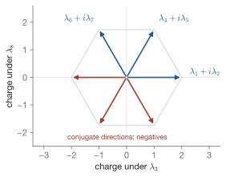

# Homogeneous spaces and fibre bundles {#sec-homogeneous-bundles}

A group acting transitively on a space makes it a homogeneous space, a coset space $S/R$; the projection $S \to S/R$ is the first example of a
fibre bundle, a space that looks locally like a product of a base and a fibre. The chapter has two parts: coset spaces, with their construction,
reductive decompositions, isotropy, and the vielbeins and metrics they inherit; and fibre bundles, with vector, principal and associated bundles,
connections, curvature and holonomy, and the Hopf fibration $S^3 \to S^2$. The sphere $S^2 = SU(2)/U(1)$ is the running example of both parts.

The sections, in order:

- @sec-coset-geometry defines homogeneous spaces and coset manifolds, proves the orbit theorem, realises spheres, projective spaces and
  Grassmannians as coset spaces, and studies the isotropy representation and invariant metrics.
- @sec-reductive splits the Lie algebra along the isotropy subalgebra, defines the coset structure constants, symmetric cosets and isotropy
  charges, and works out $S^2$, $S^3$ and the flag manifold of $SU(3)$.
- @sec-coset-vielbeins pulls the Maurer-Cartan form back by coset representatives to the vielbein and the $R$-connection, and builds the
  invariant metrics from the vielbein.
- @sec-fibre-bundles defines fibre bundles, local trivialisations and sections, transition functions with the cocycle condition and the
  reconstruction of a bundle from a cocycle, and proves that the Möbius band is not a product.
- @sec-fib-vector-principal defines vector bundles, frames and the tangent bundle, principal bundles, with the coset bundles $S \to S/R$ as
  principal $R$-bundles, and associated bundles and their sections.
- @sec-connections defines connections on principal bundles, gauge potentials, gauge transformations, curvature with the Bianchi identity and
  the structure equations, and parallel transport and holonomy.
- @sec-hopf studies the Hopf map, proves that it makes $S^3$ a principal $U(1)$-bundle, equips it with the Hopf connection, defines the Chern
  number of a circle bundle over a surface, and proves with Stokes' theorem that the Hopf bundle has Chern number $-1$ and no global section.
- @sec-homogeneous-spaces-bundles-exercises closes with three exercises that combine the sections.

Every statement is followed by ten examples and ten exercises, and every exercise has a hidden solution with two tabs: a proof by hand and a
SageMath computation, several with SageManifolds. Some results are stated and used without proof, and each is marked where it appears: the
closed subgroup theorem (the subgroups used are shown to be submanifolds directly), and Sard's theorem, which would make the infinitesimal
action of every transitive action onto (it is checked in each example). A bundle is called non-trivial only where this is proved here: the
Möbius band by the intermediate value theorem, and the Hopf bundle, the frame bundle of the sphere and the bundles of non-zero Chern number by
a curvature integral and Stokes' theorem. That the Chern number classifies circle bundles over the sphere, and that every bundle over a disc is
trivial, are not proved; the bundles over the sphere treated here are trivialised over the two hemispheres explicitly.

## Coset spaces {#sec-coset-geometry}

A coset space $S/R$ is a manifold on which a Lie group $S$ acts transitively, so that every point looks like every
other; spheres, projective spaces, Grassmannians and Lie groups themselves are all of this kind. Their geometry is
encoded almost entirely in the Lie algebra of $S$: the tangent space at a point is a quotient of the Lie algebra of
$S$ by that of $R$, the symmetries of the tangent space are adjoint actions, and invariant metrics become invariant
inner products on a vector space. This section builds the manifold $S/R$, proves that every homogeneous space with
a surjective infinitesimal action is one, realises the spheres, projective spaces and Grassmannians as coset spaces,
and studies the isotropy representation and the invariant metrics. The next two sections split the Lie algebra of
$S$ along $R$ and pull the Maurer-Cartan form back to the coset.

For more on this topic, see @lee2013introduction [Ch. 21], @hamilton2017mathematical [Secs. 3.8-3.9],
@gadea2013analysis [Sec. 4.8, Ch. 6] and @rudolph2013differential [Sec. 5.7, Ch. 6].

### Homogeneous spaces and coset manifolds {#sec-coset-spaces}

The cosets of a subgroup were defined as sets in @sec-cosets-quotients, and smooth actions in @def-smooth-action. For
a Lie group $S$ and a closed subgroup $R$ the quotient $S/R$ is more than a set: it is a manifold on which $S$ acts
transitively. Throughout, $S \subseteq GL(n, \mathbb K)$ is a matrix Lie group that is an embedded submanifold with
Lie algebra $\mathfrak s = T_{\mathbf I}S$, as in @def-exponential-map. That every closed subgroup is an embedded
submanifold (the closed subgroup theorem) is not proved in this book (@def-lie-subgroup), so the subgroups $R$ below
are closed subgroups that are embedded submanifolds of $GL(n, \mathbb K)$; in the main theorem they arise as regular
level sets of an orbit map, which proves that they are embedded.

#### Homogeneous spaces

A smooth action (@def-smooth-action) moves the points of a manifold around. The most symmetric situation is the one
in which the action can carry any point to any other, so that no point is distinguished. The definition below names
this situation, attaches to a point the subgroup that fixes it and the linear map that differentiates the action
there, and proves that a surjective differential makes the subgroup an embedded submanifold
[@lee2013introduction, Sec. 21, Example 21.15 and Thm. 21.18].

:::: {.statement-box}
::: {#def-homogeneous-space}
#### Homogeneous space

A manifold $M$ with a smooth transitive action (@def-smooth-action, @def-group-action) of a matrix Lie group $S$ is a
**homogeneous space** of $S$: every point can be moved to every other by an element of $S$. The **isotropy group** of
a point $o$ is its stabiliser $S_o$ (@def-stabiliser), and the **orbit map** of $o$ is $\omega(g) = g \cdot o$. For $X
\in \mathfrak s$ the **infinitesimal action** at $o$ is the tangent vector
$$
X \cdot o = \frac{d}{dt}\Big|_{t = 0}\, e^{tX} \cdot o \in T_oM .
$$
Then:

1. $S_o$ is a closed subgroup of $S$, the maps $\tau_g(p) = g \cdot p$ are diffeomorphisms with $\tau_g(o) = g \cdot
   o$, and the isotropy groups of different points are conjugate, $S_{g \cdot o} = g\,S_og^{-1}$;
2. $X \mapsto X \cdot o$ is the linear map $d\omega_{\mathbf I} : \mathfrak s \to T_oM$, and for $h \in S_o$,
   $d(\tau_h)_o(X \cdot o) = (\operatorname{Ad}_hX) \cdot o$;
3. its kernel is $\mathfrak s_o = \{X \in \mathfrak s : e^{tX} \in S_o \text{ for all } t\}$, the Lie algebra of the
   matrix Lie group $S_o$;
4. if $X \mapsto X \cdot o$ is onto $T_oM$, then $\omega$ is a submersion, $S_o = \omega^{-1}(o)$ is a closed embedded
   submanifold of $S$ and of $GL(n, \mathbb K)$ of dimension $\dim S - \dim M$ with $T_{\mathbf I}S_o = \mathfrak s_o$,
   and the infinitesimal action is onto at every point of $M$;
5. $X \mapsto X \cdot o$ is onto exactly when $\dim\mathfrak s - \dim\mathfrak s_o = \dim M$.
:::
::::

*Proof.* (1) $S_o$ is a closed subgroup and $\tau_g$ a diffeomorphism by @def-smooth-action (3), (1); $\tau_g(o) = g
\cdot o$ by definition, and $S_{g \cdot o} = gS_og^{-1}$ is @def-stabiliser (3).

(2) The curve $t \mapsto e^{tX}$ is smooth in $S$ with velocity $X$ at $t = 0$ (@def-exponential-map (1), (2)), and
$\omega$ is smooth (@def-smooth-action (2)). By @def-pushforward (4), $X \cdot o = d\omega_{\mathbf I}(X)$, which is
linear in $X$. For $h \in S_o$, $\tau_h(e^{tX} \cdot o) = he^{tX} \cdot o = (he^{tX}h^{-1}) \cdot (h \cdot o) =
e^{t\operatorname{Ad}_hX} \cdot o$, because $he^{tX}h^{-1} = e^{thXh^{-1}}$ (@def-matrix-exp (3)) and $h \cdot o = o$.
Differentiating at $t = 0$ with @def-pushforward (4) gives $d(\tau_h)_o(X \cdot o) = (\operatorname{Ad}_hX) \cdot o$.

(3) If $e^{tX} \in S_o$ for all $t$, the curve $e^{tX} \cdot o$ is constant and $X \cdot o = 0$. Conversely let $X
\cdot o = 0$ and $c(t) = e^{tX} \cdot o$. Since $c(t + s) = \tau_{e^{tX}}(c(s))$, @def-pushforward (4) gives $\dot
c(t) = d(\tau_{e^{tX}})_o(X \cdot o) = 0$ for every $t$. The set $A = \{t : c(t) = o\}$ contains $0$ and is closed,
since points of the Hausdorff space $M$ are closed and $c$ is continuous. It is open: near $t_0 \in A$, $c$ stays in a
chart around $o$, where its coordinates have zero derivative and are therefore constant on an interval around $t_0$.
As $\mathbb{R}$ is connected (@exm-connected-intervals), $A = \mathbb{R}$, so $e^{tX} \in S_o$ for all $t$. Finally
$S_o$ is closed in $S$, which is closed in $GL(n, \mathbb K)$, so $S_o$ is a matrix Lie group and $\mathfrak s_o$ is
its Lie algebra (@def-lie-algebra-of-group).

(4) Let $L_g$ be the left translation of $S$, a diffeomorphism (@def-matrix-lie-group (2)). Then $\omega \circ L_g =
\tau_g \circ \omega$, so by the chain rule $d\omega_g \circ d(L_g)_{\mathbf I} = d(\tau_g)_o \circ d\omega_{\mathbf
I}$; the right side is onto $T_{g \cdot o}M$ because $d(\tau_g)_o$ is an isomorphism (@def-pushforward (3)), so
$d\omega_g$ is onto at every $g$ and $\omega$ is a submersion. By @thm-regular-value, $S_o = \omega^{-1}(o)$ is a
closed embedded submanifold of $S$ of dimension $\dim S - \dim M$. The inclusions $S_o \to S \to GL(n, \mathbb K)$ are
smooth embeddings (@def-embedded-submanifold (1)), and so is their composite (a composite of immersions is an immersion
by the chain rule, and of homeomorphisms onto images is one), so $S_o$ is embedded in $GL(n, \mathbb K)$ by
@def-embedded-submanifold (2). Every curve in $S_o$ through $\mathbf I$ is mapped by $\omega$ to the constant curve
$o$, so $T_{\mathbf I}S_o \subseteq \ker d\omega_{\mathbf I} = \mathfrak s_o$ by (2), (3); both have dimension $\dim S -
\dim M$, so they are equal. At $p = g \cdot o$ the orbit map is $a \mapsto ag \cdot o = \omega(ag)$, whose
differential at $\mathbf I$ is $d\omega_g \circ d(R_g)_{\mathbf I}$ with $R_g$ the right translation, onto as just
shown.

(5) By (2), (3) and rank-nullity the image of $X \mapsto X \cdot o$ has dimension $\dim\mathfrak s - \dim\mathfrak
s_o$, and it is all of $T_oM$ exactly when this equals $\dim M$. $\square$

The examples are the sphere under rotations, the circle under translations of the line, a Lie group acting on
itself, the punctured plane under $GL(2, \mathbb{R})$, the hyperbolic half-plane, the three-sphere under $SU(2)$, the
mass hyperbola and the energy shell of the oscillator, and two actions that are not transitive.

:::: {.callout-note .examples-fold collapse="true" title="Examples"}
The sphere under rotations is the model homogeneous space of this chapter. The figure shows the orbits of two
one-parameter subgroups: $e^{tL_3}$ fixes the poles and moves the other points along parallels, while $e^{tL_1}$ moves
the pole along a great circle.

{#fig-so3-orbits width=55%}



::: {#exm-homogeneous-sphere}
#### The sphere under rotations

$SO(3)$ acts smoothly on $S^2$ by $(\mathbf A, \mathbf x) \mapsto \mathbf A\mathbf x$ (@def-smooth-action (4)). The
action is transitive: a point $\mathbf p \in S^2$ is the third column of a matrix $\mathbf A \in SO(3)$ (complete
$\mathbf p$ to an orthonormal basis $\mathbf u, \mathbf v, \mathbf p$ and replace $\mathbf u$ by $-\mathbf u$ if the
determinant is $-1$), and then $\mathbf A\mathbf e_3 = \mathbf p$. By @prp-so3-structure, $L_a\mathbf e_3 = \mathbf
e_a \times \mathbf e_3$, so $L_1 \cdot \mathbf e_3 = -\mathbf e_2$, $L_2 \cdot \mathbf e_3 = \mathbf e_1$ and $L_3
\cdot \mathbf e_3 = \mathbf 0$: the infinitesimal action is onto $T_{\mathbf e_3}S^2 = \mathbf e_3^\perp$
(@prp-level-set-examples (1)), and by (4) the isotropy group of the north pole is a one-dimensional embedded
submanifold with Lie algebra $\operatorname{span}(L_3)$, as @fig-so3-orbits suggests.
:::

A one-dimensional group acting on a one-dimensional manifold is the simplest case. The second example lets the line
act on the circle by rotations; the isotropy group is infinite but discrete.

::: {#exm-cos2-hs-circle}
#### The line acting on the circle

$\mathbb{R}$, realised as the matrix Lie group $\{\operatorname{diag}(e^t, 1)\}$ or simply as the additive group, acts
on $S^1 = \{z \in \mathbb C : |z| = 1\}$ by $t \cdot z = e^{it}z$. The action is transitive, $1 \mapsto e^{it}$
reaching every point, and the isotropy group of $1$ is $2\pi\mathbb Z$. The infinitesimal action at $1$ is $\frac{d}{dt}
e^{it}|_0 = i$, a non-zero vector of the line $T_1S^1$, so it is onto, and by (4) $2\pi\mathbb Z$ is an embedded
submanifold of dimension $1 - 1 = 0$: a discrete subgroup (@def-lie-subgroup (3)).
:::

A Lie group is homogeneous under its own multiplication, and it can be made homogeneous in more than one way. The
third example contrasts left translations, with no isotropy at all, with the two-sided action of $S \times S$, whose
isotropy group is a copy of $S$.

::: {#exm-homogeneous-group}
#### A Lie group acting on itself

Every matrix Lie group $S$ acts on itself by left translations, $g \cdot x = gx$, transitively and with trivial isotropy
$\{\mathbf I\}$; the infinitesimal action at $\mathbf I$ is $X \mapsto X$, onto $T_{\mathbf I}S = \mathfrak s$. Under $S
\times S$ acting by $(g, h) \cdot x = gxh^{-1}$ the isotropy group of $\mathbf I$ is the diagonal $\{(g, g)\} \cong S$, and
the infinitesimal action is $(X, Y) \mapsto X - Y$, with kernel the diagonal $\{(X, X)\}$, as (3) predicts.
:::

Homogeneity does not need a compact group. The fourth example lets the invertible matrices act on the plane with the
origin removed, where the isotropy group is large and non-compact.

::: {#exm-cos2-hs-punctured-plane}
#### The punctured plane under $GL(2, \mathbb{R})$

$GL(2, \mathbb{R})$ acts on $\mathbb{R}^2 \setminus \{\mathbf 0\}$ by $\mathbf A \cdot \mathbf x = \mathbf A\mathbf x$, transitively:
any $\mathbf x \neq \mathbf 0$ is the first column of an invertible matrix. The isotropy group of $\mathbf e_1$ is
$\left\{\begin{pmatrix} 1 & b \\ 0 & d\end{pmatrix} : d \neq 0\right\}$, of dimension $2$, and the infinitesimal action
$X \mapsto X\mathbf e_1$, the first column of $X$, is onto $\mathbb{R}^2$: $\dim GL(2, \mathbb{R}) - 2 = 2$, in accordance with
(4). The same set is not homogeneous under the rotations alone.
:::

The upper half-plane is the basic non-compact homogeneous space of complex analysis. The fifth example records its
symmetry group and the isotropy group of the point $i$ [@lee2013introduction, Examples 21.15 (d), 21.19 (d)].

::: {#exm-cos2-hs-halfplane}
#### The upper half-plane under $SL(2, \mathbb{R})$

$SL(2, \mathbb{R})$ acts on $\mathbb H = \{z : \operatorname{Im}z > 0\}$ by $\begin{pmatrix} a & b \\ c & d\end{pmatrix} \cdot
z = \frac{az + b}{cz + d}$, since $\operatorname{Im}\frac{az + b}{cz + d} = \frac{\operatorname{Im}z}{|cz + d|^2}$. It is
transitive: $z = x + iy$ is the image of $i$ under $\begin{pmatrix} \sqrt y & x/\sqrt y \\ 0 & 1/\sqrt y\end{pmatrix}$. The
generators $\operatorname{diag}(\frac12, -\frac12)$ and $\begin{pmatrix} 0 & 1 \\ 0 & 0\end{pmatrix}$ give $e^t \cdot i = e^ti$
and $i + t$, with velocities $i$ and $1$ at $i$: the infinitesimal action is onto, and the isotropy group of $i$ has
dimension $3 - 2 = 1$; it is $SO(2)$, since $\frac{ai + b}{ci + d} = i$ forces $d = a$, $c = -b$ and then $a^2 + b^2 = 1$.
:::

A free and transitive action identifies the manifold with the group itself. The sixth example finds such an action of
$SU(2)$ on the three-sphere, which explains why $SU(2)$ is a sphere.

::: {#exm-cos2-hs-s3}
#### $SU(2)$ acting on $S^3$

$SU(2)$ acts on $S^3 = \{(a, b) \in \mathbb C^2 : |a|^2 + |b|^2 = 1\}$ by matrix multiplication. Every element of $SU(2)$
is $\begin{pmatrix} a & -\bar b \\ b & \bar a\end{pmatrix}$ with $(a, b) \in S^3$ (@exm-su2-chart), and it sends $\mathbf e_1$
to its first column $(a, b)$: the action is transitive, and the isotropy group of $\mathbf e_1$ is trivial, since a matrix
of this form with first column $\mathbf e_1$ is $\mathbf I$. The infinitesimal action $X \mapsto X\mathbf e_1$ on the
traceless anti-Hermitian $X$ has trivial kernel, hence is onto the three-dimensional $T_{\mathbf e_1}S^3$ by (5).
:::

Relativity supplies homogeneous spaces with indefinite geometry. The seventh example lets the boosts of the Minkowski
plane act on the hyperbola of unit-mass momenta.

::: {#exm-cos2-hs-mass-hyperbola}
#### The mass hyperbola

The boosts $\Lambda(w) = \begin{pmatrix} \cosh w & \sinh w \\ \sinh w & \cosh w\end{pmatrix}$ form a one-parameter group
$\Lambda(w) = e^{wK}$, $K = \begin{pmatrix} 0 & 1 \\ 1 & 0\end{pmatrix}$, acting on the branch $\{(E, P) : E^2 - P^2 =
m^2, E > 0\}$ of momenta of a particle of mass $m > 0$ in $\mathbb{R}^{1, 1}$. Every point is $(m\cosh w, m\sinh w) =
\Lambda(w)(m, 0)$, so the action is transitive and free; $K \cdot (m, 0) = (0, m) \neq \mathbf 0$, so the infinitesimal
action is onto the tangent line at the rest frame.
:::

The time evolution of a mechanical system can be a transitive action on a level set of the energy. The eighth example
is the harmonic oscillator, whose flow rotates the energy shell.

::: {#exm-cos2-hs-oscillator}
#### The energy shell of the oscillator

For the oscillator $H = \frac12(p^2 + q^2)$ (unit mass and frequency) the flow is the rotation $\mathbf R(-t)$ of the
phase plane, and $SO(2)$ acts on the energy shell $\{H = E\}$, $E > 0$, a circle of radius $\sqrt{2E}$. The action is
transitive and free, and the shell is a homogeneous space of $SO(2)$ with trivial isotropy; the period $2\pi$ is the
time after which the flow returns to the identity.
:::

Homogeneity depends on the group that acts. The ninth example shows two manifolds with an action that is not
transitive, although a larger group makes the first of them homogeneous.

::: {#exm-homogeneous-not}
#### Actions that are not transitive

The rotations $SO(2)$ act on $\mathbb{R}^2 \setminus \{\mathbf 0\}$ with the circles $|\mathbf x| = r$ as orbits, so this
action is not transitive, although the larger group $GL(2, \mathbb{R})$ acts transitively (@exm-cos2-hs-punctured-plane).
The rotations about the axis act on the torus of revolution with the circles of fixed $a$ as orbits
(@prp-level-set-examples (2)), so the torus is not a homogeneous space of this circle group.
:::

When the infinitesimal action is not onto, (4) says nothing, and the orbit can be smaller than the manifold. The
tenth example shows the rotations of the plane, whose infinitesimal action vanishes at the origin.

::: {#exm-cos2-hs-not-onto}
#### A fixed point

For $SO(2)$ acting on $\mathbb{R}^2$, $L \cdot \mathbf x = L\mathbf x$ with $L = \begin{pmatrix} 0 & -1 \\ 1 & 0\end{pmatrix}$.
At $\mathbf 0$ the infinitesimal action is zero and the isotropy group is all of $SO(2)$; at $\mathbf x \neq \mathbf 0$ its
image is the line spanned by $L\mathbf x$, tangent to the circle through $\mathbf x$, and not all of $T_{\mathbf x}\mathbb{R}^2$.
Dimension counting gives $1 - 0 = 1 < 2$: the orbits are circles and points, never the plane.
:::
::::

The exercises check transitivity on the sphere, the conjugate isotropy groups, the Euclidean plane, the infinitesimal
action of the rotations, the half-plane, the odd spheres under unitary groups, the bracket of isotropy generators, the
infinitesimal action at other points, disconnected homogeneous spaces, and the Killing fields of the sphere.

:::: {.callout-note .exercises-fold collapse="true" title="Exercises"}
The first exercise makes transitivity concrete with explicit rotation matrices. It also shows that all elements of one
coset $g\,SO(2)$ send the pole to the same point, the observation behind the coset spaces below.

::: {#exr-transitive-so3}
#### Transitivity and the coset of the pole

Check that $e^{tL_3}$ fixes $\mathbf e_3$, that $e^{\varphi L_3}e^{\theta L_1}$ sends it to a point of colatitude $\theta$
(and azimuth $\varphi - \pi/2$, since $e^{\theta L_1}$ tilts the pole towards the negative $Y$-axis), and that all
elements of the coset $g\,\{e^{tL_3}\}$ send $\mathbf e_3$ to the same point.
:::

::: {.callout-note .solution collapse="true" title="Solution"}
:::: {.panel-tabset .solution-tabs}
## Proof

By @prp-rotation-subgroup, $e^{tL_3}$ is the rotation by $t$ about the $Z$-axis, with third column $\mathbf e_3$; likewise
$e^{\theta L_1}$ is the rotation about the $X$-axis, $e^{\theta L_1}\mathbf e_3 = (0, -\sin\theta, \cos\theta)$. Applying $e^{\varphi
L_3}$ gives $(\sin\theta\sin\varphi, -\sin\theta\cos\varphi, \cos\theta)$, of colatitude $\theta$ and azimuth $\varphi - \pi/2$; every
$(\theta, \varphi)$ occurs, so every point is reached. For $g' = ge^{tL_3}$, $g'\mathbf e_3 = g(e^{tL_3}\mathbf e_3) = g\mathbf e_3$.

## SageMath

Sage builds the rotation matrices and compares the images of the pole.

```{.python .sage}
th, ph, t = var("th ph t", domain="real")
R3 = lambda a: matrix(SR, [[cos(a), -sin(a), 0], [sin(a), cos(a), 0], [0, 0, 1]])   # exp(a L_3)
R1 = lambda a: matrix(SR, [[1, 0, 0], [0, cos(a), -sin(a)], [0, sin(a), cos(a)]])   # exp(a L_1)
L1 = matrix(SR, [[0, 0, 0], [0, 0, -1], [0, 1, 0]]); L3 = matrix(SR, [[0, -1, 0], [1, 0, 0], [0, 0, 0]])
print("R3, R1 solve R' = L R with R(0) = I:", diff(R3(t), t) == L3 * R3(t), diff(R1(t), t) == L1 * R1(t))
o = vector(SR, [0, 0, 1])
print("exp(t L_3) e_3 =", (R3(t) * o).list())
p = R3(ph) * R1(th) * o
print("exp(phi L_3) exp(theta L_1) e_3 =", p.list())
print("all of g exp(t L_3) send e_3 to the same point:", (R3(ph) * R1(th) * R3(t) * o - p).simplify_full() == 0)
```

```{.text .sage-output}
R3, R1 solve R' = L R with R(0) = I: True True
exp(t L_3) e_3 = [0, 0, 1]
exp(phi L_3) exp(theta L_1) e_3 = [sin(ph)*sin(th), -cos(ph)*sin(th), cos(th)]
all of g exp(t L_3) send e_3 to the same point: True
```
::::
:::

The definition claims that the isotropy groups of different points are conjugate. The second exercise checks this on
the sphere by computing the generator of the isotropy group at an arbitrary point and recognising it as the rotation
about the axis through that point.

::: {#exr-cs-isotropy-conjugate}
#### Conjugate isotropy groups

Let $g = e^{\varphi L_3}e^{\theta L_1}$ and $\mathbf p = g\mathbf e_3$. Show that $S_{\mathbf p} = g\,S_{\mathbf e_3}g^{-1}$ for
any action, and that $gL_3g^{-1}$ annihilates $\mathbf p$ and equals $p_1L_1 + p_2L_2 + p_3L_3$, the generator of
rotations about the axis through $\mathbf p$.
:::

::: {.callout-note .solution collapse="true" title="Solution"}
:::: {.panel-tabset .solution-tabs}
## Proof

If $h\mathbf e_3 = \mathbf e_3$ then $(ghg^{-1})\mathbf p = gh\mathbf e_3 = \mathbf p$, so $gS_{\mathbf e_3}g^{-1} \subseteq S_{\mathbf
p}$, and the same argument with $g^{-1}$ gives the reverse inclusion. By @prp-so3-structure, $(\mathbf n \cdot \mathbf L)\mathbf v
= \mathbf n \times \mathbf v$. For a rotation $g$, $g(\mathbf a \times \mathbf b) = (g\mathbf a) \times (g\mathbf b)$, so $gL_3g^{-1}\mathbf
v = g(\mathbf e_3 \times g^{-1}\mathbf v) = (g\mathbf e_3) \times \mathbf v = \mathbf p \times \mathbf v$: hence $gL_3g^{-1} = \mathbf p
\cdot \mathbf L$, which kills $\mathbf p$.

## SageMath

Sage conjugates $L_3$ and compares with $\mathbf p \cdot \mathbf L$.

```{.python .sage}
th, ph = var("th ph", domain="real")
R3 = lambda a: matrix(SR, [[cos(a), -sin(a), 0], [sin(a), cos(a), 0], [0, 0, 1]])
R1 = lambda a: matrix(SR, [[1, 0, 0], [0, cos(a), -sin(a)], [0, sin(a), cos(a)]])
L = [matrix(SR, [[0,0,0],[0,0,-1],[0,1,0]]), matrix(SR, [[0,0,1],[0,0,0],[-1,0,0]]), matrix(SR, [[0,-1,0],[1,0,0],[0,0,0]])]
g = R3(ph) * R1(th); p = g * vector(SR, [0, 0, 1])
K = (g * L[2] * g.transpose()).simplify_full()
print("p =", p.list())
print("g L_3 g^-1 p = 0:", (K * p).simplify_full() == 0)
print("g L_3 g^-1 = p . L:", (K - sum(p[a] * L[a] for a in range(3))).simplify_full() == 0)
```

```{.text .sage-output}
p = [sin(ph)*sin(th), -cos(ph)*sin(th), cos(th)]
g L_3 g^-1 p = 0: True
g L_3 g^-1 = p . L: True
```
::::
:::

Homogeneity is not special to compact groups or to spheres. The third exercise treats the Euclidean plane, whose
isometry group contains translations as well as rotations [@lee2013introduction, Example 21.19 (c)].

::: {#exr-cs-euclidean-plane}
#### The Euclidean plane as a homogeneous space

The Euclidean group $E(2)$ consists of the matrices $\begin{pmatrix} \mathbf A & \mathbf b \\ \mathbf 0^\top & 1\end{pmatrix}$ with
$\mathbf A \in SO(2)$, $\mathbf b \in \mathbb{R}^2$, acting on $\mathbb{R}^2$ by $\mathbf x \mapsto \mathbf A\mathbf x + \mathbf b$. Show that
the action is transitive, that the isotropy group of $\mathbf 0$ is $SO(2)$ and that of $\mathbf p$ is $t_{\mathbf
p}SO(2)t_{\mathbf p}^{-1}$, the rotations about $\mathbf p$, and that the infinitesimal action at $\mathbf 0$ is onto.
:::

::: {.callout-note .solution collapse="true" title="Solution"}
:::: {.panel-tabset .solution-tabs}
## Proof

The translation $t_{\mathbf p}$ ($\mathbf A = \mathbf I$, $\mathbf b = \mathbf p$) sends $\mathbf 0$ to $\mathbf p$, so the action is
transitive. $\mathbf A\mathbf 0 + \mathbf b = \mathbf 0$ exactly when $\mathbf b = \mathbf 0$, so the isotropy group of $\mathbf 0$ is
$SO(2)$. By (1), the isotropy group of $\mathbf p$ is $t_{\mathbf p}SO(2)t_{\mathbf p}^{-1}$, whose elements are $\mathbf x \mapsto
\mathbf A(\mathbf x - \mathbf p) + \mathbf p$. The Lie algebra consists of $\begin{pmatrix} cL & \mathbf u \\ \mathbf 0^\top & 0\end{pmatrix}$, and
$e^{tX}$ moves $\mathbf 0$ with velocity $\mathbf u$; every $\mathbf u$ occurs, so the infinitesimal action is onto and (5) holds
with $3 - 1 = 2$.

## SageMath

Check on the point $\mathbf p = (1, 2)$: Sage conjugates a rotation by the translation and applies it.

```{.python .sage}
t, x, y = var("t x y", domain="real")
E = lambda A, b: block_matrix([[A, matrix(b).transpose()], [matrix([[0, 0]]), 1]], subdivide=False)
Rot = matrix(SR, [[cos(t), -sin(t)], [sin(t), cos(t)]])
tp = E(identity_matrix(SR, 2), [1, 2])
h = tp * E(Rot, [0, 0]) * tp.inverse()
print("fixes p:", h * vector([1, 2, 1]) == vector([1, 2, 1]))
print("acts as x -> A(x - p) + p:", (h * vector([x, y, 1]))[:2] == Rot * vector([x - 1, y - 2]) + vector([1, 2]))
X = matrix(SR, [[0, -1, 3], [1, 0, 5], [0, 0, 0]])
print("velocity of exp(sX) 0:", (X * vector([0, 0, 1]))[:2])
```

```{.text .sage-output}
fixes p: True
acts as x -> A(x - p) + p: True
velocity of exp(sX) 0: (3, 5)
```
::::
:::

The infinitesimal action is the quickest test of (4). The fourth exercise computes it for the rotations of the sphere
at the north pole and reads off the isotropy algebra.

::: {#exr-cos2-hs-infinitesimal-sphere}
#### The infinitesimal action on $S^2$

Compute $L_a \cdot \mathbf e_3$ for $a = 1, 2, 3$, show that the infinitesimal action of $\mathfrak{so}(3)$ at $\mathbf e_3$ is onto
$T_{\mathbf e_3}S^2$ with kernel $\operatorname{span}(L_3)$, and deduce from (4) that the isotropy group of $\mathbf e_3$ is a
closed embedded submanifold of dimension $1$.
:::

::: {.callout-note .solution collapse="true" title="Solution"}
:::: {.panel-tabset .solution-tabs}
## Proof

The action is linear, so $e^{tX}\mathbf e_3$ has velocity $X\mathbf e_3$, the third column of $X$. From @eq-so3-basis, $L_1\mathbf
e_3 = -\mathbf e_2$, $L_2\mathbf e_3 = \mathbf e_1$, $L_3\mathbf e_3 = \mathbf 0$. The image is $\operatorname{span}(\mathbf e_1, \mathbf e_2) =
\mathbf e_3^\perp = T_{\mathbf e_3}S^2$ (@prp-level-set-examples (1)), and $(c_1L_1 + c_2L_2 + c_3L_3)\mathbf e_3 = c_2\mathbf e_1 - c_1\mathbf
e_2$ vanishes exactly when $c_1 = c_2 = 0$. By (4), $S_{\mathbf e_3}$ is a closed embedded submanifold of $SO(3)$ of dimension $3 -
2 = 1$ with tangent space $\operatorname{span}(L_3)$ at $\mathbf I$.

## SageMath

Sage computes the matrix of the infinitesimal action and its kernel.

```{.python .sage}
L = [matrix(QQ, [[0,0,0],[0,0,-1],[0,1,0]]), matrix(QQ, [[0,0,1],[0,0,0],[-1,0,0]]), matrix(QQ, [[0,-1,0],[1,0,0],[0,0,0]])]
e3 = vector(QQ, [0, 0, 1])
D = matrix(QQ, [list(La * e3) for La in L]).transpose()     # columns: L_a e_3
print("columns L_a e_3:", D.columns())
print("rank:", D.rank(), " kernel:", D.right_kernel().basis())
```

```{.text .sage-output}
columns L_a e_3: [(0, -1, 0), (1, 0, 0), (0, 0, 0)]
rank: 2  kernel: [
(0, 0, 1)
]
```
::::
:::

The half-plane example left the isotropy group to be identified. The fifth exercise computes it and checks that the
Möbius formula defines an action [@lee2013introduction, Example 21.19 (d)].

::: {#exr-cos2-hs-halfplane}
#### The isotropy group of $i$

Show that $\mathbf A \cdot z = \frac{az + b}{cz + d}$ satisfies $\mathbf A \cdot (\mathbf B \cdot z) = (\mathbf A\mathbf B) \cdot z$ and
that the isotropy group of $i$ in $SL(2, \mathbb{R})$ is $SO(2)$.
:::

::: {.callout-note .solution collapse="true" title="Solution"}
:::: {.panel-tabset .solution-tabs}
## Proof

Writing $z = z_1/z_2$, the map $z \mapsto \mathbf A \cdot z$ is $\mathbf A$ applied to the column $(z_1, z_2)$ followed by the ratio,
and the ratio of $\mathbf A\mathbf B(z_1, z_2)$ is computed from that of $\mathbf B(z_1, z_2)$; so the composite is $(\mathbf A\mathbf B)
\cdot z$, and $\mathbf I \cdot z = z$. The condition $\frac{ai + b}{ci + d} = i$ is $ai + b = -c + di$, so $a = d$ and $b = -c$;
with $ad - bc = a^2 + c^2 = 1$ this is $\begin{pmatrix} \cos t & -\sin t \\ \sin t & \cos t\end{pmatrix}$, an element of $SO(2)$,
and conversely every such matrix fixes $i$.

## SageMath

Sage composes two Möbius maps symbolically and solves the isotropy equations.

```{.python .sage}
a, b, c, d, e, f, g, h, z = var("a b c d e f g h z")
mob = lambda M, z: (M[0, 0] * z + M[0, 1]) / (M[1, 0] * z + M[1, 1])
A = matrix(SR, [[a, b], [c, d]]); B = matrix(SR, [[e, f], [g, h]])
print("A.(B.z) = (AB).z:", bool((mob(A, mob(B, z)) - mob(A * B, z)).simplify_full() == 0))
w = (a * I + b) - I * (c * I + d)
print("isotropy equations:", solve([real(w) == 0, imag(w) == 0, a * d - b * c == 1], [b, c, d]))
```

```{.text .sage-output}
A.(B.z) = (AB).z: True
isotropy equations: [
[b == sqrt(-a^2 + 1), c == -sqrt(-a^2 + 1), d == a],
[b == -sqrt(-a^2 + 1), c == sqrt(-a^2 + 1), d == a]
]
```
::::
:::

The unitary groups act on the unit sphere of $\mathbb C^n$, an odd-dimensional real sphere. The sixth exercise checks
transitivity and the isotropy groups [@lee2013introduction, Exercise 21.16, Example 21.19 (e)].

::: {#exr-cos2-hs-unitary-spheres}
#### Unitary groups on odd spheres

Show that $U(n)$ acts transitively on $S^{2n-1} = \{\mathbf z \in \mathbb C^n : |\mathbf z| = 1\}$ for $n \geq 1$, and $SU(n)$ for
$n \geq 2$, with isotropy groups of $\mathbf e_n$ the matrices $\operatorname{diag}(\mathbf A, 1)$, $\mathbf A \in U(n - 1)$
(respectively $SU(n - 1)$), and that the dimensions satisfy (5).
:::

::: {.callout-note .solution collapse="true" title="Solution"}
:::: {.panel-tabset .solution-tabs}
## Proof

Complete a unit vector $\mathbf z$ to an orthonormal basis of $\mathbb C^n$ with $\mathbf z$ last (Gram-Schmidt); the matrix
$\mathbf U$ of this basis is unitary and $\mathbf U\mathbf e_n = \mathbf z$. If $n \geq 2$, dividing the first column by $\det\mathbf U$,
of modulus $1$, gives a matrix in $SU(n)$ with the same last column. A unitary $\mathbf U$ with $\mathbf U\mathbf e_n = \mathbf e_n$
has orthonormal rows as well as columns, so its last row is $\mathbf e_n^\top$ and $\mathbf U = \operatorname{diag}(\mathbf A, 1)$
with $\mathbf A$ unitary (of determinant $1$ for $SU(n)$). Dimensions: $n^2 - (n - 1)^2 = 2n - 1$ and $(n^2 - 1) - ((n -
1)^2 - 1) = 2n - 1$, the dimension of $S^{2n-1}$; the Lie algebras of the isotropy groups are those of $U(n - 1)$ and
$SU(n - 1)$ (@def-lie-algebra-of-group (4)), so (5) holds and by (4) the infinitesimal actions are onto.

## SageMath

Check on $n = 2$ and the unit vector $\mathbf z = (1 + i, 1)/\sqrt3$: Sage builds an element of $SU(2)$ sending $\mathbf e_2$
to $\mathbf z$.

```{.python .sage}
z = vector(QQbar, [1 + I, 1]) / sqrt(QQbar(3))
U = matrix(QQbar, [[z[1].conjugate(), z[0]], [-z[0].conjugate(), z[1]]])   # second column z
print("U unitary:", U.conjugate_transpose() * U == 1, " det U =", U.det())
print("U e_2 = z:", U * vector(QQbar, [0, 1]) == z)
```

```{.text .sage-output}
U unitary: True  det U = 1
U e_2 = z: True
```
::::
:::

By (3) the infinitesimal isotropy generators form a Lie algebra. The seventh exercise proves the bracket property
directly from the identity of (2).

::: {#exr-cos2-hs-bracket}
#### Brackets of isotropy generators

Let $X, Y \in \mathfrak s_o$. Using (2) for $h = e^{sX}$, show that $(\operatorname{Ad}_{e^{sX}}Y) \cdot o = 0$ for all $s$, and
deduce $[X, Y] \cdot o = 0$. Check it for $S = SO(4)$ acting on $S^3$ at $\mathbf e_4$.
:::

::: {.callout-note .solution collapse="true" title="Solution"}
:::: {.panel-tabset .solution-tabs}
## Proof

By (3), $e^{sX} \in S_o$, so (2) gives $(\operatorname{Ad}_{e^{sX}}Y) \cdot o = d(\tau_{e^{sX}})_o(Y \cdot o) = 0$. The map $Z \mapsto
Z \cdot o$ is linear, and $\frac{d}{ds}\operatorname{Ad}_{e^{sX}}Y|_{s = 0} = [X, Y]$ (@def-adjoint (3)); differentiating the
identity $(\operatorname{Ad}_{e^{sX}}Y) \cdot o = 0$ in $s$ at $0$ gives $[X, Y] \cdot o = 0$. For the linear action of $SO(4)$
on $S^3$, $\mathfrak s_o$ at $\mathbf e_4$ consists of the antisymmetric matrices with last column zero.

## SageMath

Check on $SO(4)$: Sage takes the generators $M_{ij}$, $i < j < 3$ (indices from $0$), that kill $\mathbf e_4$ and tests their
brackets.

```{.python .sage}
def M(i, j):
    m = matrix(QQ, 4, 4); m[i, j] = 1; m[j, i] = -1; return m
e4 = vector(QQ, [0, 0, 0, 1])
iso = [M(i, j) for i in range(3) for j in range(i + 1, 3)]
print("generators kill e_4:", all(X * e4 == 0 for X in iso))
print("brackets kill e_4:", all((X * Y - Y * X) * e4 == 0 for X in iso for Y in iso))
```

```{.text .sage-output}
generators kill e_4: True
brackets kill e_4: True
```
::::
:::

Part (4) also says that surjectivity at one point gives it at every point. The eighth exercise makes the formula
explicit: the infinitesimal action at $g \cdot o$ is the translate of the one at $o$ by $\operatorname{Ad}_{g^{-1}}$.

::: {#exr-cos2-hs-other-points}
#### The infinitesimal action at another point

Show that $X \cdot (g \cdot o) = d(\tau_g)_o\big((\operatorname{Ad}_{g^{-1}}X) \cdot o\big)$, and check it for the rotations of $S^2$ with
$g = e^{\frac{\pi}{2}L_2}$, which sends $\mathbf e_3$ to $\mathbf e_1$.
:::

::: {.callout-note .solution collapse="true" title="Solution"}
:::: {.panel-tabset .solution-tabs}
## Proof

$e^{tX}g \cdot o = g(g^{-1}e^{tX}g) \cdot o = \tau_g(e^{t\operatorname{Ad}_{g^{-1}}X} \cdot o)$ by @def-matrix-exp (3).
Differentiating at $t = 0$ with @def-pushforward (4) gives the formula. For a linear action, $d(\tau_g)_o$ is multiplication by
$g$, and the formula reads $X g\mathbf e_3 = g(g^{-1}Xg)\mathbf e_3$, an identity of matrices.

## SageMath

Check on $g = e^{\frac{\pi}{2}L_2}$: Sage compares both sides for the three generators.

```{.python .sage}
L = [matrix(QQ, [[0,0,0],[0,0,-1],[0,1,0]]), matrix(QQ, [[0,0,1],[0,0,0],[-1,0,0]]), matrix(QQ, [[0,-1,0],[1,0,0],[0,0,0]])]
g = matrix(QQ, [[0, 0, 1], [0, 1, 0], [-1, 0, 0]])           # exp((pi/2) L_2)
e3 = vector(QQ, [0, 0, 1])
print("g e_3 =", g * e3)
print("X.(g o) = g (Ad_{g^-1} X).o for all L_a:", all(X * (g * e3) == g * (g.inverse() * X * g) * e3 for X in L))
print("infinitesimal action at e_1:", [X * (g * e3) for X in L])
```

```{.text .sage-output}
g e_3 = (1, 0, 0)
X.(g o) = g (Ad_{g^-1} X).o for all L_a: True
infinitesimal action at e_1: [(0, 0, 0), (0, 0, -1), (0, 1, 0)]
```
::::
:::

A homogeneous space need not be connected, but its pieces cannot differ. The ninth exercise proves that all components
are diffeomorphic [@lee2013introduction, Problem 21-11 (a)].

::: {#exr-cos2-hs-components}
#### Components of a homogeneous space

Show that the connected components of a homogeneous space are diffeomorphic to one another. Check the transitivity of
$O(2)$ acting on the two circles $M = \{(\mathbf x, s) : |\mathbf x| = 1, s = \pm 1\}$ by $\mathbf A \cdot (\mathbf x, s) = (\mathbf A\mathbf x,
(\det\mathbf A)s)$.
:::

::: {.callout-note .solution collapse="true" title="Solution"}
:::: {.panel-tabset .solution-tabs}
## Proof

Each $\tau_g$ is a homeomorphism, so it maps a connected component $C$ onto a connected set, contained in one component $C'$;
applying $\tau_{g^{-1}}$ shows $\tau_g(C) = C'$. Given components $C_1, C_2$ with points $p_1, p_2$, choose $g$ with $g \cdot p_1 =
p_2$; then $\tau_g$ maps $C_1$ onto $C_2$, and it is a diffeomorphism (components are open in a manifold, which is locally
connected). In the example, $\det\mathbf A = -1$ exchanges the circles and $SO(2)$ moves along each one.

## SageMath

Check on the reflection $\operatorname{diag}(1, -1)$ and a rotation: Sage applies them to points of $M$.

```{.python .sage}
act = lambda A, x, s: (A * x, A.det() * s)
F = diagonal_matrix(QQ, [1, -1]); R = matrix(QQ, [[0, -1], [1, 0]])
print("reflection:", act(F, vector(QQ, [1, 0]), 1))
print("rotation:", act(R, vector(QQ, [1, 0]), 1))
print("reflection then rotation:", act(R * F, vector(QQ, [0, 1]), 1))
```

```{.text .sage-output}
reflection: ((1, 0), -1)
rotation: ((0, 1), 1)
reflection then rotation: ((1, 0), -1)
```
::::
:::

The infinitesimal action at every point defines a vector field, and for an action by isometries it is a Killing field.
The tenth exercise compares the fields of the rotations of the sphere with the Killing fields of @prp-sphere-killing.

::: {#exr-cos2-hs-killing}
#### The infinitesimal action and the Killing fields

For $X = L_a$, the vector field $\mathbf p \mapsto X \cdot \mathbf p = L_a\mathbf p$ on $S^2$ is tangent to the sphere. Compute its
components in the spherical chart $(\theta, \varphi)$, compare with @eq-sphere-killing, and check that it is a Killing field of
the round metric (@def-killing).
:::

::: {.callout-note .solution collapse="true" title="Solution"}
:::: {.panel-tabset .solution-tabs}
## Proof

$\mathbf p \cdot L_a\mathbf p = \mathbf p \cdot (\mathbf e_a \times \mathbf p) = 0$, so the field is tangent. With $\mathbf p = (\sin\theta\cos\varphi,
\sin\theta\sin\varphi, \cos\theta)$ the coordinate velocities are $\partial_\theta\mathbf p$ and $\partial_\varphi\mathbf p$, orthogonal with
squared lengths $1$ and $\sin^2\theta$ (@prp-sphere-metric), so the components of $\mathbf v = L_a\mathbf p$ are $(\mathbf v \cdot
\partial_\theta\mathbf p, \mathbf v \cdot \partial_\varphi\mathbf p/\sin^2\theta)$. For $a = 1$, $L_1\mathbf p = \mathbf e_1 \times \mathbf p = (0, -\cos\theta,
\sin\theta\sin\varphi)$, and with $\partial_\theta\mathbf p = (\cos\theta\cos\varphi, \cos\theta\sin\varphi, -\sin\theta)$, $\partial_\varphi\mathbf p =
(-\sin\theta\sin\varphi, \sin\theta\cos\varphi, 0)$ the components are $-\sin\varphi$ and $-\cos\theta\sin\theta\cos\varphi/\sin^2\theta$: this is $K_1$
of @eq-sphere-killing, and $a = 2, 3$ give $K_2$, $K_3$ in the same way. The flow of the field is $e^{tL_a}$, a rotation, hence an
isometry of the round metric (@exm-isometry-rotations), so the field is Killing by @def-killing (2).

## SageMath

Sage computes the components and the Lie derivative of the round metric with SageManifolds.

```{.python .sage}
th, ph = var("th ph")
P = vector([sin(th) * cos(ph), sin(th) * sin(ph), cos(th)])
L = [matrix(SR, [[0,0,0],[0,0,-1],[0,1,0]]), matrix(SR, [[0,0,1],[0,0,0],[-1,0,0]]), matrix(SR, [[0,-1,0],[1,0,0],[0,0,0]])]
Pt, Pp = diff(P, th), diff(P, ph)
comps = [((La * P).dot_product(Pt).simplify_full(), ((La * P).dot_product(Pp) / sin(th)^2).simplify_full()) for La in L]
for a in range(3):
    print(f"L_{a+1} p = ({comps[a][0]}) d_theta + ({comps[a][1]}) d_phi")
M = Manifold(2, "S2", structure="Riemannian"); X.<t, f> = M.chart(r"t:(0,pi) f:(0,2*pi)")
g = M.metric(); g[0, 0], g[1, 1] = 1, sin(t)^2
print("Killing:", all(g.lie_derivative(M.vector_field(*[c.subs(th=t, ph=f) for c in cc])) == 0 for cc in comps))
```

```{.text .sage-output}
L_1 p = (-sin(ph)) d_theta + (-cos(ph)*cos(th)/sin(th)) d_phi
L_2 p = (cos(ph)) d_theta + (-cos(th)*sin(ph)/sin(th)) d_phi
L_3 p = (0) d_theta + (1) d_phi
Killing: True
```
::::
:::
::::

#### Coset manifolds

Every point of a homogeneous space corresponds to the set of group elements carrying $o$ there, a left coset of the
isotropy group. The definition below turns the set of cosets $S/R$ into a manifold, with charts built from the
exponential map on a complement of the Lie algebra of $R$, and proves that the orbit map identifies it with the
homogeneous space [@lee2013introduction, Thms. 21.17, 21.18; @hamilton2017mathematical, Props. 3.8.2 and 3.8.7, Thm.
3.8.8]. Since the closed subgroup theorem is not available, $R$ is assumed to be an embedded submanifold, which part (6)
supplies for every isotropy group with a surjective infinitesimal action.

:::: {.statement-box}
::: {#def-coset-space}
#### Coset space

Let $S$ be as above and $R \subseteq S$ a closed subgroup that is an embedded submanifold of $GL(n, \mathbb K)$, with
tangent space $T_{\mathbf I}R$ at $\mathbf I$. The **coset space** $S/R$ is the set of left cosets $gR$ (@def-left-coset)
with the quotient topology (@def-quotient-topology) of the projection $\pi : S \to S/R$, $\pi(g) = gR$, and the charts of
(3); $S$ acts on it by $g \cdot (g'R) = gg'R$ (@def-group-action (2)). Choose a complement $\mathfrak m$, $\mathfrak s =
T_{\mathbf I}R \oplus \mathfrak m$. Then:

1. $\pi$ is continuous, surjective and open, and $S/R$ is Hausdorff and second countable;
2. there is an open $U \ni \mathbf 0$ in $\mathfrak m$ such that $\Phi(X, h) = e^Xh$ is a diffeomorphism of $U \times R$
   onto an open subset of $S$;
3. for $g \in S$ the maps $\chi_g : U \to S/R$, $\chi_g(X) = ge^XR$, are homeomorphisms onto open sets, and their
   inverses, composed with a linear isomorphism $\mathfrak m \cong \mathbb{R}^k$, form a smooth atlas: $S/R$ is a manifold
   of dimension $k = \dim S - \dim R$, $\pi$ is a submersion, the fibre $\pi^{-1}(gR) = gR$ is an embedded submanifold
   diffeomorphic to $R$, and $\ker d\pi_g = T_g(gR) = g\,T_{\mathbf I}R$;
4. (**smooth maps**) a map $F : S/R \to N$ into a manifold is smooth if and only if $F \circ \pi$ is smooth; in particular
   the smooth functions on $S/R$ are the smooth functions $f$ on $S$ with $f(gh) = f(g)$ for all $h \in R$;
5. the action $S \times S/R \to S/R$ is smooth and transitive, the isotropy group of $o = eR$ is $R$, the infinitesimal
   action at $o$ is $d\pi_{\mathbf I}$, and $T_{\mathbf I}R$ is the Lie algebra $\mathfrak r = \{X : e^{tX} \in R \text{ for all }
   t\}$ of $R$;
6. (**orbit theorem**) if $M$ is a homogeneous space of $S$ (@def-homogeneous-space) whose infinitesimal action at $o \in
   M$ is onto, then $R = S_o$ satisfies the hypotheses above, and $F(gR) = g \cdot o$ is a diffeomorphism $S/R \to M$ with
   $F(g \cdot y) = g \cdot F(y)$.
:::
::::

*Proof.* (1) $\pi$ is continuous and surjective by the definition of the quotient topology. For $O \subseteq S$ open,
$\pi^{-1}(\pi(O)) = \bigcup_{h \in R}Oh$ is a union of images of $O$ under the right translations, which are homeomorphisms,
so it is open and $\pi(O)$ is open. Let $g_1R \neq g_2R$. Then $g_1^{-1}g_2 \notin R$ (@def-left-coset (1)), and as $R$ is
closed and $(a, b) \mapsto a^{-1}b$ is continuous, there are open $A \ni g_1$, $B \ni g_2$ with $a^{-1}b \notin R$ for all
$a \in A$, $b \in B$. Then $\pi(A)$ and $\pi(B)$ are open, contain $g_1R$ and $g_2R$, and are disjoint, since $aR = bR$
would give $a^{-1}b \in R$. $S \subseteq \mathbb{R}^N$ has a countable basis (the balls with rational centres and radii met
with $S$), and since $\pi$ is open and continuous the images of its members form a countable basis of $S/R$.

(2) $\Phi : \mathfrak m \times R \to S$ is smooth: $\exp$ is smooth (@def-exponential-map (2)), the inclusion $R \to S$ is
smooth (@def-lie-subgroup (2)), and so is multiplication. Its differential at $(\mathbf 0, \mathbf I)$ is $(Y, Z) \mapsto Y + Z$
on $\mathfrak m \times T_{\mathbf I}R$, an isomorphism onto $\mathfrak s = T_{\mathbf I}S$. By @thm-inverse-function (2), applied
in charts, there are open $U_0 \ni \mathbf 0$ in $\mathfrak m$ and $W_0 \ni \mathbf I$ in $R$ such that $\Phi$ maps $U_0 \times W_0$
diffeomorphically onto an open subset of $S$. Since $\Phi(X, hk) = \Phi(X, h)k$, $\Phi \circ (\mathrm{id} \times R_k) = R_k \circ
\Phi$ with right translations $R_k$, diffeomorphisms of $R$ and $S$; so $d\Phi$ is invertible at every point of $U_0 \times R$.
For injectivity, $W_0$ is open in the subspace topology of $R$ (@def-embedded-submanifold (1)), so $W_0 = R \cap O$ for an open
$O \subseteq S$. By continuity of $(X, X') \mapsto e^{-X'}e^X$ there is an open $U \ni \mathbf 0$, $U \subseteq U_0$, with
$e^{-X'}e^X \in O$ for $X, X' \in U$. If $e^Xh = e^{X'}h'$ with $X, X' \in U$, then $k = e^{-X'}e^X = h'h^{-1} \in R \cap O = W_0$, and
$\Phi(X, \mathbf I) = \Phi(X', k)$ with both arguments in $U_0 \times W_0$, so $X = X'$ and $k = \mathbf I$, $h = h'$. So $\Phi$ is an
injective local diffeomorphism on $U \times R$; its image is open (local diffeomorphisms are open maps), and its inverse is
smooth, being given near each point by a local inverse.

(3) $\chi_g$ is continuous, being $\pi \circ L_g \circ \exp$. It is injective: $ge^XR = ge^{X'}R$ gives $e^X = e^{X'}h$, so $X = X'$
by (2). For $V \subseteq U$ open, $\chi_g(V) = \pi(g\Phi(V \times R))$ is open by (1) and (2); so $\chi_g$ is open, and a
homeomorphism onto the open set $\chi_g(U)$. The domains cover $S/R$, since $gR = \chi_g(\mathbf 0)$. The transition map is
$\chi_{g'}^{-1} \circ \chi_g(X) = \mathrm{pr}_1\Phi^{-1}(g'^{-1}ge^X)$ on the open set where it is defined, a composite of smooth
maps. With (1) and @def-manifold, $S/R$ is a manifold of dimension $\dim\mathfrak m = \dim S - \dim R$. In the chart
$\chi_g^{-1}$, $\pi$ composed with the parametrisation $(X, h) \mapsto g\Phi(X, h)$ of the open set $g\Phi(U \times R)$ reads
$(X, h) \mapsto X$, which has rank $k$: $\pi$ is a submersion. The fibre $gR = L_g(R)$ is the image of the embedded submanifold
$R$ under the diffeomorphism $L_g$ of $S$, hence an embedded submanifold diffeomorphic to $R$. Curves in $gR$ are mapped by $\pi$
to a constant, so $T_g(gR) = g\,T_{\mathbf I}R$ lies in $\ker d\pi_g$; both have dimension $\dim R$.

(4) If $F$ is smooth, so is $F \circ \pi$. Conversely, in the chart $\chi_g$, $F \circ \chi_g(X) = (F \circ \pi)(ge^X)$ is a
composite of smooth maps, and $F$ is continuous because $F \circ \pi$ is (@def-quotient-topology); so $F$ is smooth
(@def-smooth-map-manifolds). A function $f$ on $S$ is $F \circ \pi$ for some $F$ exactly when it is constant on cosets.

(5) Near $(a_0, \chi_g(X_0))$, the action reads $(a, \chi_g(X)) \mapsto \pi(age^X)$, a composite of smooth maps, so it is smooth;
it is transitive by @def-group-action (2). $g \cdot eR = eR$ means $g \in R$. The orbit map of $o$ is $\pi$, so the infinitesimal
action is $d\pi_{\mathbf I}$ (@def-homogeneous-space (2)), with kernel $T_{\mathbf I}R$ by (3); by @def-homogeneous-space (3)
the kernel is $\mathfrak r$.

(6) By @def-homogeneous-space (4), $R = S_o$ is a closed subgroup and an embedded submanifold of $GL(n, \mathbb K)$ of
dimension $\dim S - \dim M$. $F$ is well defined and bijective by @def-stabiliser (2) and transitivity, smooth by (4) since $F
\circ \pi = \omega$, and $F(g \cdot g'R) = gg' \cdot o = g \cdot F(g'R)$. As $d\omega_{\mathbf I} = dF_o \circ d\pi_{\mathbf I}$ is onto,
$dF_o$ is onto between spaces of the same dimension $\dim S - \dim R = \dim M$, hence invertible; and $F \circ \tau_g = \tau_g
\circ F$ makes $dF$ invertible everywhere. By @thm-inverse-function (2) in charts, $F$ is a local diffeomorphism, and a bijective
local diffeomorphism has a smooth inverse. $\square$

That the infinitesimal action of a transitive action is always onto follows from Sard's theorem, which is not proved in this
book; in every example below it is checked directly. The examples are the sphere, the circle, the three-sphere in two ways,
an exponential chart, the fibres of the projection, the functions on the sphere, the half-plane, a dense line on the torus,
and a quotient that is a group.

:::: {.callout-note .examples-fold collapse="true" title="Examples"}
The sphere has two coset descriptions, one with the rotation group and one with $SU(2)$. Both follow from the orbit theorem
once the infinitesimal action is known to be onto.

::: {#exm-coset-sphere}
#### $S^2 = SO(3)/SO(2)$

By @exm-homogeneous-sphere the action of $SO(3)$ on $S^2$ is transitive with surjective infinitesimal action at $\mathbf e_3$, so
by (6) $\mathbf AR \mapsto \mathbf A\mathbf e_3$ is a diffeomorphism $SO(3)/R \cong S^2$, of dimension $3 - 1 = 2$. A matrix of $SO(3)$
fixing $\mathbf e_3$ has third column and third row $\mathbf e_3$, so $R = \{\operatorname{diag}(\mathbf A, 1) : \mathbf A \in SO(2)\} \cong
SO(2)$: the coset of $g$ is the set of rotations sending the pole to $g\mathbf e_3$, which differ by a rotation about the $Z$-axis
performed first.
:::

Discrete subgroups give coset spaces of the same dimension as the group. The second example is the circle as a quotient of
the line.

::: {#exm-cos2-cs-circle}
#### $S^1 = \mathbb{R}/2\pi\mathbb Z$

By @exm-cos2-hs-circle and (6), with $\mathbb{R}$ acting on $S^1$ by $t \cdot z = e^{it}z$, the map $t + 2\pi\mathbb Z \mapsto e^{it}$ is
a diffeomorphism $\mathbb{R}/2\pi\mathbb Z \cong S^1$. The charts of (3) are $X \mapsto g + X + 2\pi\mathbb Z$ on $U = (-\pi, \pi)$, the angle
charts of the circle; the projection $\pi$ is a submersion whose fibres are the discrete sets $t + 2\pi\mathbb Z$.
:::

One manifold can be a coset space of several groups. The three-sphere shows two such structures, with isotropy groups of
dimensions zero and three.

::: {#exm-coset-s3}
#### $S^3$ in two ways

$S^3 \cong SU(2)/\{\mathbf I\}$ by @exm-cos2-hs-s3 and (6). $SO(4)$ acts on $S^3 \subset \mathbb{R}^4$; a matrix with last column $\mathbf e_4$
has last row $\mathbf e_4^\top$, so the isotropy group of $\mathbf e_4$ is $\{\operatorname{diag}(\mathbf A, 1) : \mathbf A \in SO(3)\}$, and the
infinitesimal action $X \mapsto X\mathbf e_4$ is onto $\mathbf e_4^\perp$ because the last column of an antisymmetric matrix is any
vector with last entry $0$. By (6), $S^3 \cong SO(4)/SO(3)$, of dimension $6 - 3 = 3$. The same manifold carries two homogeneous
structures.
:::

The charts of (3) can be computed explicitly. The fourth example finds the chart $\chi_e$ of the sphere, which is the
exponential map of the round sphere written in group language.

::: {#exm-cos2-cs-chart}
#### An exponential chart of the sphere

For $S^2 = SO(3)/SO(2)$, $T_{\mathbf I}R = \operatorname{span}(L_3)$ and $\mathfrak m = \operatorname{span}(L_1, L_2)$. For $X = aL_1 + bL_2$
with $r = \sqrt{a^2 + b^2} > 0$, $X$ is $r$ times the generator of rotations about the unit vector $\mathbf n = (a, b, 0)/r$, and
$e^X\mathbf e_3 = \cos r\,\mathbf e_3 + \sin r\,\mathbf n \times \mathbf e_3 = (b\sin r/r, -a\sin r/r, \cos r)$, because $(\mathbf n
\cdot \mathbf L)\mathbf v = \mathbf n \times \mathbf v$ (@prp-so3-structure) gives $(\mathbf n \cdot \mathbf L)^3 = -\mathbf n \cdot \mathbf L$ and the series sums
to $\mathbf I + \sin r\,(\mathbf n \cdot \mathbf L) + (1 - \cos r)(\mathbf n \cdot \mathbf L)^2$. Under the diffeomorphism of @exm-coset-sphere, $\chi_e$ is the map $(a, b) \mapsto e^X\mathbf e_3$:
injective on $r < \pi$, it reaches every point except the south pole.
:::

Each point of $S/R$ has a whole fibre above it in $S$. The fifth example describes the fibres of $SO(3) \to S^2$ and their
tangent lines.

::: {#exm-cos2-cs-fibres}
#### The fibres of $SO(3) \to S^2$

The fibre over $\mathbf p = g\mathbf e_3$ is $gR = \{ge^{tL_3}\}$, a circle in $SO(3)$; by (3) it is an embedded submanifold with
tangent line $\operatorname{span}(gL_3)$ at $g$. By @exr-cs-isotropy-conjugate, $gL_3 = (gL_3g^{-1})g = (\mathbf p \cdot \mathbf L)g$, so
moving along the fibre is the rotation about the axis through $\mathbf p$ itself, which fixes $\mathbf p$.
:::

By (4), functions on $S/R$ are functions on $S$ that are constant along the fibres. The sixth example uses this to place the
mode expansion of @def-coset-mode-expansion on the manifold $S^2$.

::: {#exm-cos2-cs-modes}
#### Functions on the sphere as functions on $SU(2)$

By @def-coset-mode-expansion (5), a function on $SU(2)$ invariant under right multiplication by the diagonal subgroup $U(1)$ is one that does not depend on
the Euler angle $\psi$, and the modes of the expansion are the Wigner functions $D^l_{m0}$, multiples of $Y_{lm}^* \circ \mathbf n$. They are smooth on $SU(2)$, so
by (4) they are smooth functions on the coset manifold $SU(2)/U(1)$, of dimension $3 - 1 = 2$: the mode expansion of
@def-coset-mode-expansion, stated there for right-invariant functions on the group, is an expansion in smooth functions on the coset manifold.
:::

Non-compact groups give non-compact coset spaces. The seventh example identifies the half-plane with a quotient of
$SL(2, \mathbb{R})$ [@lee2013introduction, Example 21.19 (d)].

::: {#exm-cos2-cs-halfplane}
#### $\mathbb H = SL(2, \mathbb{R})/SO(2)$

By @exm-cos2-hs-halfplane the action of $SL(2, \mathbb{R})$ on $\mathbb H$ is transitive with surjective infinitesimal action at $i$,
so by (6) $\mathbb H \cong SL(2, \mathbb{R})/R$, where $R$ is the isotropy group of $i$, a closed embedded one-dimensional subgroup;
$\mathbf A R \mapsto \mathbf A \cdot i$ is the diffeomorphism, and $R = SO(2)$ (@exr-cos2-hs-halfplane).
:::

Closedness of $R$ cannot be dropped. The eighth example is a subgroup of the torus that is not closed, whose quotient is not
Hausdorff.

::: {#exm-cos2-cs-dense}
#### A dense line on the torus

In $T^2 = \mathbb{R}^2/2\pi\mathbb Z^2$ let $R = \{(t, \sqrt2t) + 2\pi\mathbb Z^2\}$, a subgroup that is dense because $\sqrt2$ is irrational
(it contains $(2\pi k, 2\pi k\sqrt2) \equiv (0, 2\pi k\sqrt2)$; by the pigeonhole principle two of the $N + 1$ numbers $k\sqrt2$
modulo $1$, $0 \leq k \leq N$, are within $1/N$, their difference is a non-zero multiple of $\sqrt2$ within $1/N$ of an
integer, and its multiples come within $1/N$ of every point modulo $1$; so the closure of $R$ contains the circle $\{0\} \times
S^1$, hence all its translates along $R$, which is all of $T^2$). Every non-empty open set of $T^2/R$ is $\pi(O)$ with
$\pi^{-1}(\pi(O)) = O + R$ open and dense, and two open dense sets meet: any two non-empty open sets of $T^2/R$ intersect, so the
quotient is not Hausdorff, and (1) fails without the hypothesis that $R$ is closed.
:::

When $R$ is normal, the cosets form a group (@def-quotient-group). The ninth example finds the quotient of the unitary group by
the special unitary group, which is a circle.

::: {#exm-cos2-cs-quotient-group}
#### $U(n)/SU(n) \cong U(1)$

$U(n)$ acts on $S^1 \subset \mathbb C$ by $\mathbf U \cdot z = (\det\mathbf U)z$, transitively ($\operatorname{diag}(e^{it}, 1, \dots, 1)$
sends $1$ to $e^{it}$), with isotropy group $SU(n)$ at $1$; the infinitesimal action $X \mapsto \operatorname{tr}X$ (@def-matrix-lie-group (4))
is onto $i\mathbb{R}$. By (6), $U(n)/SU(n) \cong S^1$, and the diffeomorphism $\mathbf USU(n) \mapsto \det\mathbf U$ is also a group
isomorphism.
:::

The group itself is a coset space, of the trivial subgroup, and the construction does nothing to it. The tenth example
records this degenerate case and the opposite extreme.

::: {#exm-cos2-cs-extremes}
#### The two extreme subgroups

For $R = \{\mathbf I\}$, $T_{\mathbf I}R = 0$, $\mathfrak m = \mathfrak s$, $\Phi(X, \mathbf I) = e^X$, and the charts $\chi_g(X) = ge^X$ are the
exponential charts of @def-exponential-map (3) translated by $g$: $S/\{\mathbf I\} = S$. For $R = S$, $\mathfrak m = 0$ and $S/S$ is a
single point, a manifold of dimension $0$.
:::
::::

The exercises compute the fibres of $SU(2) \to S^2$, check openness of $\pi$, the exponential chart, the local diffeomorphism
$\Phi$, invariant functions, the quotient $U(2)/SU(2)$, Stiefel manifolds, the action of $E(2)$, the real projective line and
a function on the sphere computed on $SU(2)$.

:::: {.callout-note .exercises-fold collapse="true" title="Exercises"}
The orbit theorem applied to $SU(2)$ acting on $\mathbb{R}^3$ through rotations gives the projection $SU(2) \to S^2$. The first
exercise computes it in Euler angles and checks that its fibres are the cosets $g\,U(1)$.

::: {#exr-cs-hopf-fibre}
#### The fibres of $SU(2) \to S^2$

For $g = e^{\varphi T_3}e^{\theta T_1}e^{\psi T_3}$ define $\pi(g) = \mathbf n$ by $gT_3g^{-1} = n_aT_a$. Show that $\pi$ is constant on the
cosets $g\,U(1)$, $U(1) = \{e^{tT_3}\}$, and separates different cosets, and that $\mathbf n = (\sin\theta\sin\varphi,
-\sin\theta\cos\varphi, \cos\theta)$, the point $e^{\varphi L_3}e^{\theta L_1}\mathbf e_3$ of @exr-transitive-so3.
:::

::: {.callout-note .solution collapse="true" title="Solution"}
:::: {.panel-tabset .solution-tabs}
## Proof

For $h = e^{tT_3}$, $(gh)T_3(gh)^{-1} = g(hT_3h^{-1})g^{-1} = gT_3g^{-1}$, since $h$ commutes with $T_3$. If $gT_3g^{-1} = g'T_3g'^{-1}$, then
$k = g^{-1}g'$ commutes with $T_3 = -\frac i2\sigma_3$, so $k$ is diagonal, $k = \operatorname{diag}(e^{-it/2}, e^{it/2}) = e^{tT_3}$, and
$g' \in gU(1)$. The map $X \mapsto gXg^{-1}$ on $\mathfrak{su}(2) \cong \mathbb{R}^3$ is the rotation covered by $g$ (@exr-double-cover),
and $\operatorname{Ad}_{e^{\varphi T_3}}$, $\operatorname{Ad}_{e^{\theta T_1}}$ are $e^{\varphi L_3}$, $e^{\theta L_1}$ because $[T_a, T_b] =
\epsilon_{abc}T_c$ has the structure constants of the $L_a$ (@def-adjoint (3)). So $\mathbf n = e^{\varphi L_3}e^{\theta L_1}\mathbf e_3$, computed in
@exr-transitive-so3.

## SageMath

Sage computes $\mathbf n$ from the matrices and tests the independence of $\psi$.

```{.python .sage}
th, ph, ps = var("th ph ps", domain="real")
s = [matrix(SR, [[0,1],[1,0]]), matrix(SR, [[0,-I],[I,0]]), matrix(SR, [[1,0],[0,-1]])]
T = [-I/2 * sa for sa in s]
E3 = lambda a: matrix(SR, [[exp(-I*a/2), 0], [0, exp(I*a/2)]])
E1 = lambda a: matrix(SR, [[cos(a/2), -I*sin(a/2)], [-I*sin(a/2), cos(a/2)]])
g = E3(ph) * E1(th) * E3(ps)
X = g * T[2] * g.conjugate_transpose()
n = vector([(-2 * (T[a] * X).trace()).rectform().trig_expand().simplify_full() for a in range(3)])
print("n =", n.list())
print("n = (sin th sin ph, -sin th cos ph, cos th):", bool((n - vector([sin(th)*sin(ph), -sin(th)*cos(ph), cos(th)])).simplify_full().trig_reduce() == 0))
print("independent of psi:", all(bool(diff(c, ps) == 0) for c in n))
print("|n|^2 =", (n * n).simplify_full())
```

```{.text .sage-output}
n = [2*cos(1/2*th)*sin(ph)*sin(1/2*th), -2*cos(ph)*cos(1/2*th)*sin(1/2*th), 2*cos(1/2*th)^2 - 1]
n = (sin th sin ph, -sin th cos ph, cos th): True
independent of psi: True
|n|^2 = 1
```
::::
:::

Part (1) rests on the formula $\pi^{-1}(\pi(O)) = \bigcup_hOh$. The second exercise proves it and checks it on the circle
$\mathbb{R}/2\pi\mathbb Z$.

::: {#exr-cos2-cs-open}
#### Saturations of open sets

Show that $\pi^{-1}(\pi(O)) = \bigcup_{h \in R}Oh$ for every $O \subseteq S$. For $S = \mathbb{R}$, $R = 2\pi\mathbb Z$ and $O = (0, 1)$,
describe $\pi^{-1}(\pi(O))$, and show that $C = \{2\pi k + 1/k : k \geq 1\}$ is closed in $\mathbb{R}$ while $\pi(C)$ is not closed in
$\mathbb{R}/2\pi\mathbb Z \cong S^1$.
:::

::: {.callout-note .solution collapse="true" title="Solution"}
:::: {.panel-tabset .solution-tabs}
## Proof

$g \in \pi^{-1}(\pi(O))$ iff $gR = aR$ for some $a \in O$, iff $g = ah$ with $a \in O$, $h \in R$. For $O = (0, 1)$ the saturation is
$\bigcup_k(2\pi k, 2\pi k + 1)$. Distinct points of $C$ are at distance more than $2\pi - 1$, so $C$ has no accumulation point
and is closed. Its image is $\{e^{i/k} : k \geq 1\}$, which accumulates at $1 = e^{i0}$; but $1 \notin \pi(C)$, since $1/k \notin
2\pi\mathbb Z$. So $\pi(C)$ is not closed: $\pi$ is open but not closed.

## SageMath

Check on $k \leq 1000$: Sage computes the distances from the points $e^{i(2\pi k + 1/k)}$ to $1$.

```{.python .sage}
d = [abs(exp(I * (2 * pi * k + 1 / k)) - 1) for k in [1, 10, 100, 1000]]
print("distances to 1:", [RR(x).n(digits=4) for x in d])
print("1 is attained:", any(bool(exp(I * (2 * pi * k + 1 / k)) == 1) for k in range(1, 50)))
```

```{.text .sage-output}
distances to 1: [0.9589, 0.09996, 0.01000, 0.001000]
1 is attained: False
```
::::
:::

The chart $\chi_e$ of the sphere was described in @exm-cos2-cs-chart. The third exercise verifies the formula and computes
the rank of the chart's inverse at the pole.

::: {#exr-cos2-cs-chart}
#### The exponential chart of $S^2$

Compute $e^{aL_1 + bL_2}\mathbf e_3$ and show that $(a, b) \mapsto e^{aL_1 + bL_2}\mathbf e_3$ has an invertible differential at $(0, 0)$.
:::

::: {.callout-note .solution collapse="true" title="Solution"}
:::: {.panel-tabset .solution-tabs}
## Proof

$X = aL_1 + bL_2 = r(\mathbf n \cdot \mathbf L)$ with $\mathbf n = (a, b, 0)/r$, and $(\mathbf n \cdot \mathbf L)^3 = -\mathbf n \cdot \mathbf L$ since $(\mathbf
n \cdot \mathbf L)\mathbf v = \mathbf n \times \mathbf v$. Summing the series, $e^X = \mathbf I + \sin r\,(\mathbf n \cdot \mathbf L) + (1 - \cos r)(\mathbf n \cdot \mathbf
L)^2$, and $\mathbf n \times \mathbf e_3 = (b, -a, 0)/r$, $\mathbf n \times (\mathbf n \times \mathbf e_3) = -\mathbf e_3$, so $e^X\mathbf e_3 = (b\sin r/r,
-a\sin r/r, \cos r)$. Since $\sin r/r = 1 - r^2/6 + \dots$, the first two components are $b$ and $-a$ to first order: the differential
at $(0, 0)$ maps $(1, 0) \mapsto -\mathbf e_2$ and $(0, 1) \mapsto \mathbf e_1$, an isomorphism onto $T_{\mathbf e_3}S^2$.

## SageMath

Sage exponentiates the matrix and compares, then computes the Jacobian at the origin.

```{.python .sage}
a, b = var("a b", domain="real")
L1 = matrix(SR, [[0,0,0],[0,0,-1],[0,1,0]]); L2 = matrix(SR, [[0,0,1],[0,0,0],[-1,0,0]])
A, B = 3/10, 2/5; r = sqrt(A^2 + B^2)
p = (matrix(RDF, A * L1 + B * L2).exp() * vector(RDF, [0, 0, 1]))
print("exp(X) e_3 at (a, b) = (0.3, 0.4):", p.n(digits=10), " formula:", vector(RDF, [B * sin(r) / r, -A * sin(r) / r, cos(r)]).n(digits=10))
ex = lambda X: 1 + X + X^2 / 2                       # agrees with exp(X) to second order
q = ex(a * L1 + b * L2) * vector([0, 0, 1])
print("columns of the Jacobian at 0:", [diff(q, v).subs(a=0, b=0) for v in (a, b)])
```

```{.text .sage-output}
exp(X) e_3 at (a, b) = (0.3, 0.4): (0.3835404309, -0.2876553232, 0.8775825619)  formula: (0.3835404309, -0.2876553232, 0.8775825619)
columns of the Jacobian at 0: [(0, -1, 0), (1, 0, 0)]
```
::::
:::

The local diffeomorphism $\Phi$ of (2) can be checked directly at the identity. The fourth exercise computes its
differential for $SO(3)$ and $R = SO(2)$.

::: {#exr-cos2-cs-phi}
#### The map $\Phi$ at the identity

For $\Phi(a, b, t) = e^{aL_1 + bL_2}e^{tL_3}$, show that the velocities $\partial_a\Phi$, $\partial_b\Phi$, $\partial_t\Phi$ at $(0, 0, 0)$
are $L_1, L_2, L_3$, so that $d\Phi$ is invertible there.
:::

::: {.callout-note .solution collapse="true" title="Solution"}
:::: {.panel-tabset .solution-tabs}
## Proof

$\Phi(a, 0, 0) = e^{aL_1}$, $\Phi(0, b, 0) = e^{bL_2}$, $\Phi(0, 0, t) = e^{tL_3}$, and each curve has velocity its generator at $0$
(@def-exponential-map (1)). The three velocities form a basis of $\mathfrak{so}(3) = T_{\mathbf I}SO(3)$, so $d\Phi_{(0,0,0)}$ is an
isomorphism, the case of (2) with $\mathfrak m = \operatorname{span}(L_1, L_2)$.

## SageMath

Sage computes the partial derivatives at the origin from the exponential series truncated at second order, which suffices
for first derivatives.

```{.python .sage}
a, b, t = var("a b t")
L = [matrix(SR, [[0,0,0],[0,0,-1],[0,1,0]]), matrix(SR, [[0,0,1],[0,0,0],[-1,0,0]]), matrix(SR, [[0,-1,0],[1,0,0],[0,0,0]])]
ex = lambda X: 1 + X + X^2 / 2
Phi = ex(a * L[0] + b * L[1]) * ex(t * L[2])
V = [diff(Phi, v).subs(a=0, b=0, t=0) for v in (a, b, t)]
print("velocities equal L_1, L_2, L_3:", V == L)
print("they are independent:", matrix([v.list() for v in V]).rank() == 3)
```

```{.text .sage-output}
velocities equal L_1, L_2, L_3: True
they are independent: True
```
::::
:::

Part (4) identifies functions on $S/R$ with invariant functions on $S$. The fifth exercise applies it to the height function of
the sphere.

::: {#exr-cos2-cs-height}
#### The height function

Show that $f(\mathbf A) = A_{33}$ on $SO(3)$ satisfies $f(\mathbf A\mathbf h) = f(\mathbf A)$ for $\mathbf h = \operatorname{diag}(\mathbf B, 1)$, $\mathbf B \in
SO(2)$, and that the function it defines on $S^2 \cong SO(3)/SO(2)$ is the height $z$.
:::

::: {.callout-note .solution collapse="true" title="Solution"}
:::: {.panel-tabset .solution-tabs}
## Proof

$(\mathbf A\mathbf h)\mathbf e_3 = \mathbf A\mathbf e_3$, since $\mathbf h\mathbf e_3 = \mathbf e_3$; $A_{33}$ is the third component of $\mathbf A\mathbf e_3$, so it is
unchanged. By (4) it defines a smooth function $F$ on $SO(3)/SO(2)$, and under the diffeomorphism $\mathbf AR \mapsto \mathbf A\mathbf e_3$ of
@exm-coset-sphere, $F$ becomes $\mathbf x \mapsto x_3 = z$.

## SageMath

Check on a product of rotations: Sage multiplies by an isotropy element and compares the entry.

```{.python .sage}
t, u, w = var("t u w", domain="real")
R1 = lambda a: matrix(SR, [[1, 0, 0], [0, cos(a), -sin(a)], [0, sin(a), cos(a)]])
R3 = lambda a: matrix(SR, [[cos(a), -sin(a), 0], [sin(a), cos(a), 0], [0, 0, 1]])
A = R3(u) * R1(w)
print("A_33 =", A[2, 2], "; (A h)_33 =", (A * R3(t))[2, 2].simplify_full())
print("third component of A e_3:", (A * vector([0, 0, 1]))[2])
```

```{.text .sage-output}
A_33 = cos(w) ; (A h)_33 = cos(w)
third component of A e_3: cos(w)
```
::::
:::

By @exm-cos2-cs-quotient-group, $U(n)/SU(n)$ is a circle. The sixth exercise checks the infinitesimal action and the dimension
count for $n = 2$.

::: {#exr-cos2-cs-u2}
#### $U(2)/SU(2)$

For $U(2)$ acting on $S^1$ by $\mathbf U \cdot z = (\det\mathbf U)z$, show that the infinitesimal action at $1$ is $X \mapsto \operatorname{tr}X$, that
its kernel is $\mathfrak{su}(2)$, and that $\dim U(2) - \dim SU(2) = 1$.
:::

::: {.callout-note .solution collapse="true" title="Solution"}
:::: {.panel-tabset .solution-tabs}
## Proof

$\det e^{tX} = e^{t\operatorname{tr}X}$ (@def-lie-algebra-of-group (4) uses this), so $e^{tX} \cdot 1$ has velocity $\operatorname{tr}X$ at $t = 0$.
For anti-Hermitian $X$ the trace is imaginary, and $X = i\mathbf I$ gives $\operatorname{tr}X = 2i \neq 0$: the image is $i\mathbb{R} = T_1S^1$.
The kernel is the traceless anti-Hermitian matrices, $\mathfrak{su}(2)$, and $4 - 3 = 1$.

## SageMath

Sage computes the trace of a general anti-Hermitian $2 \times 2$ matrix.

```{.python .sage}
p, q, r, s, u, v = var("p q r s u v", domain="real")
X = matrix(SR, [[I * p, q + I * r], [-q + I * r, I * s]])
print("anti-Hermitian:", X.conjugate_transpose() == -X)
print("tr X =", X.trace(), "; det exp(tX) = exp(t tr X) checked at X = i diag(1, 2):",
      bool((I * diagonal_matrix(SR, [1, 2])).exp().det() == exp(3 * I)))
```

```{.text .sage-output}
anti-Hermitian: True
tr X = I*p + I*s ; det exp(tX) = exp(t tr X) checked at X = i diag(1, 2): True
```
::::
:::

The orthonormal $k$-frames in $\mathbb{R}^n$ form a manifold on which $O(n)$ acts transitively. The seventh exercise identifies it
with a coset space and computes its dimension [@hamilton2017mathematical, Sec. 3.9].

::: {#exr-cos2-cs-stiefel}
#### Stiefel manifolds

Let $V_k(\mathbb{R}^n) = \{\mathbf F \in \mathbb{R}^{n \times k} : \mathbf F^\top\mathbf F = \mathbf I_k\}$, the $n \times k$ matrices with orthonormal columns. Show that
$O(n)$ acts transitively by $\mathbf A \cdot \mathbf F = \mathbf A\mathbf F$, that the isotropy group of $\mathbf F_0 = (\mathbf e_1, \dots, \mathbf e_k)$ is
$\{\operatorname{diag}(\mathbf I_k, \mathbf B) : \mathbf B \in O(n - k)\}$, and that $\dim V_k(\mathbb{R}^n) = nk - k(k + 1)/2$. What is $V_2(\mathbb{R}^3)$?
:::

::: {.callout-note .solution collapse="true" title="Solution"}
:::: {.panel-tabset .solution-tabs}
## Proof

$\mathbf F \mapsto \mathbf F^\top\mathbf F$ takes values in the symmetric $k \times k$ matrices, and its differential at $\mathbf F$, $\mathbf Y \mapsto \mathbf
Y^\top\mathbf F + \mathbf F^\top\mathbf Y$, sends $\mathbf Y = \frac12\mathbf F\mathbf S$ to $\mathbf S$; so $\mathbf I_k$ is a regular value and $V_k$ is an embedded
submanifold of dimension $nk - k(k + 1)/2$ (@thm-regular-value). The orthonormal columns of $\mathbf F$ extend to an orthonormal
basis, the columns of some $\mathbf A \in O(n)$ with $\mathbf A\mathbf F_0 = \mathbf F$. $\mathbf A\mathbf F_0 = \mathbf F_0$ means that the first $k$ columns of
$\mathbf A$ are $\mathbf e_1, \dots, \mathbf e_k$, and orthogonality forces $\mathbf A = \operatorname{diag}(\mathbf I_k, \mathbf B)$. Then $\dim O(n) - \dim O(n
- k) = n(n - 1)/2 - (n - k)(n - k - 1)/2 = nk - k(k + 1)/2$, so by @def-homogeneous-space (5), (4) and (6), $V_k(\mathbb{R}^n) \cong O(n)/O(n
- k)$. For $n = 3$, $k = 2$, the third column $\mathbf f_1 \times \mathbf f_2$ completes a frame to a matrix of $SO(3)$, and $V_2(\mathbb{R}^3) \cong
SO(3)$, of dimension $3$.

## SageMath

Sage evaluates the dimension formula against the dimension count of the groups for small $n$, $k$.

```{.python .sage}
dO = lambda n: n * (n - 1) // 2
print(all(n * k - k * (k + 1) // 2 == dO(n) - dO(n - k) for n in range(1, 9) for k in range(1, n + 1)))
print([(n, k, n * k - k * (k + 1) // 2) for n, k in [(3, 1), (3, 2), (4, 2), (5, 3)]])
```

```{.text .sage-output}
True
[(3, 1, 2), (3, 2, 3), (4, 2, 5), (5, 3, 9)]
```
::::
:::

Coset spaces of non-compact groups appear in Euclidean geometry. The eighth exercise derives $\mathbb{R}^2 \cong E(2)/SO(2)$ from the
orbit theorem and finds the charts of (3).

::: {#exr-cos2-cs-euclid}
#### $\mathbb{R}^2 = E(2)/SO(2)$

With @exr-cs-euclidean-plane, show that $\mathbb{R}^2 \cong E(2)/SO(2)$, take $\mathfrak m$ to be the translation generators, and show
that the chart $\chi_g$ for $g = (\mathbf A, \mathbf b)$ is $\mathbf u \mapsto \mathbf A\mathbf u + \mathbf b$ under this diffeomorphism.
:::

::: {.callout-note .solution collapse="true" title="Solution"}
:::: {.panel-tabset .solution-tabs}
## Proof

The action is transitive with surjective infinitesimal action at $\mathbf 0$ (@exr-cs-euclidean-plane), so (6) applies. For $X =
\begin{pmatrix} \mathbf 0 & \mathbf u \\ \mathbf 0^\top & 0\end{pmatrix}$, $X^2 = \mathbf 0$ and $e^X = \begin{pmatrix} \mathbf I & \mathbf u \\ \mathbf 0^\top &
1\end{pmatrix}$, the translation by $\mathbf u$. Then $\chi_g(X) = ge^XR \mapsto ge^X \cdot \mathbf 0 = \mathbf A\mathbf u + \mathbf b$, an affine chart,
defined for all $\mathbf u$: here $U = \mathfrak m$.

## SageMath

Check on a rotation by $\pi/2$ and $\mathbf b = (1, 2)$: Sage computes $ge^X$ applied to the origin.

```{.python .sage}
u1, u2 = var("u1 u2")
g = matrix(SR, [[0, -1, 1], [1, 0, 2], [0, 0, 1]])
X = matrix(SR, [[0, 0, u1], [0, 0, u2], [0, 0, 0]])
print("X^2 = 0:", X^2 == 0)
print("g exp(X) . 0 =", (g * X.exp() * vector([0, 0, 1]))[:2])
```

```{.text .sage-output}
X^2 = 0: True
g exp(X) . 0 = (-u2 + 1, u1 + 2)
```
::::
:::

Lines through the origin of the plane form a circle. The ninth exercise obtains this from the orbit theorem with the rotation
group acting on lines.

::: {#exr-cos2-cs-rp1}
#### Lines in the plane

$SO(2)$ acts on the set of lines through $\mathbf 0$ in $\mathbb{R}^2$. Show that the isotropy group of the $x$-axis is $\{\pm\mathbf I\}$, and that
the map $\mathbf R(\alpha)\{\pm\mathbf I\} \mapsto (\cos2\alpha, \sin2\alpha)$ is a well-defined bijection from $SO(2)/\{\pm\mathbf I\}$ onto $S^1$, and a
diffeomorphism by (6) for the action $\mathbf R(\alpha) \cdot \mathbf x = \mathbf R(2\alpha)\mathbf x$ on $S^1$.
:::

::: {.callout-note .solution collapse="true" title="Solution"}
:::: {.panel-tabset .solution-tabs}
## Proof

$\mathbf R(\alpha)$ maps the $x$-axis onto the line at angle $\alpha$, which is the $x$-axis iff $\alpha \in \pi\mathbb Z$, i.e. $\mathbf R(\alpha) =
\pm\mathbf I$. The line at angle $\alpha$ is determined by $\alpha$ modulo $\pi$, and so is $2\alpha$ modulo $2\pi$: the map is well defined and
bijective. For $\mathbf R(\alpha) \cdot \mathbf x = \mathbf R(2\alpha)\mathbf x$ on $S^1$, the action is transitive, the isotropy group of $\mathbf e_1$ is
$\{\pm\mathbf I\}$, and the infinitesimal action of $L = \frac{d}{d\alpha}\mathbf R(\alpha)|_0$ is $2L\mathbf e_1 = 2\mathbf e_2 \neq \mathbf 0$, onto the
tangent line; (6) gives $SO(2)/\{\pm\mathbf I\} \cong S^1$.

## SageMath

Sage checks that $\pm\mathbf I$ give the same point and computes the infinitesimal action.

```{.python .sage}
al = var("al", domain="real")
Rot = lambda a: matrix(SR, [[cos(a), -sin(a)], [sin(a), cos(a)]])
pt = lambda a: Rot(2 * a) * vector([1, 0])
print("R(al) and R(al + pi) = -R(al) give the same point:", (pt(al) - pt(al + pi)).simplify_full() == 0)
print("velocity at al = 0:", diff(pt(al), al).subs(al=0))
```

```{.text .sage-output}
R(al) and R(al + pi) = -R(al) give the same point: True
velocity at al = 0: (0, 2)
```
::::
:::

A product of two matrix coefficients of $SU(2)$ can be invariant under $U(1)$ although neither factor is. The tenth exercise
finds such products and identifies the functions they define on the sphere, combining (4) with @exr-cs-hopf-fibre.

::: {#exr-cos2-cs-bilinear}
#### Quadratic functions on $SU(2)$

For $g = \begin{pmatrix} a & -\bar b \\ b & \bar a\end{pmatrix} \in SU(2)$, show that $|a|^2 - |b|^2$ and $2a\bar b$ are invariant under $g \mapsto
ge^{tT_3}$, while $a$ is not, and express them through the point $\mathbf n$ of @exr-cs-hopf-fibre.
:::

::: {.callout-note .solution collapse="true" title="Solution"}
:::: {.panel-tabset .solution-tabs}
## Proof

$ge^{tT_3}$ has first column $(ae^{-it/2}, be^{-it/2})$, so $a \mapsto ae^{-it/2}$ changes, while $|a|^2 - |b|^2$ and $a\bar b$ are unchanged:
by (4) they are smooth functions on $S^2$. With $g = e^{\varphi T_3}e^{\theta T_1}$, $a = \cos\frac\theta2e^{-i\varphi/2}$ and $b =
-i\sin\frac\theta2e^{i\varphi/2}$ (@eq-euler-matrix at $\psi = 0$), so $|a|^2 - |b|^2 = \cos\theta = n_3$ and $2a\bar b = i\sin\theta e^{-i\varphi} =
\sin\theta\sin\varphi + i\sin\theta\cos\varphi = n_1 - in_2$.

## SageMath

Sage evaluates the three functions on the Euler-angle matrix and tests their dependence on $\psi$.

```{.python .sage}
th, ph, ps = var("th ph ps", domain="real")
a = cos(th/2) * exp(-I*(ph + ps)/2); b = -I * sin(th/2) * exp(I*(ph - ps)/2)    # first column of eq-euler-matrix
f1 = (a * a.conjugate() - b * b.conjugate()).simplify_full()
f2 = (2 * a * b.conjugate()).simplify_full()
print("|a|^2 - |b|^2 =", f1.trig_reduce(), "; 2 a conj(b) =", f2.rectform().simplify_full())
print("depend on psi:", [not bool(diff(f, ps).simplify_full() == 0) for f in (f1, f2, a)])
```

```{.text .sage-output}
|a|^2 - |b|^2 = cos(th) ; 2 a conj(b) = 2*(I*cos(ph) + sin(ph))*cos(1/2*th)*sin(1/2*th)
depend on psi: [False, False, True]
```
::::
:::
::::

#### Spheres, projective spaces and Grassmannians

The orbit theorem turns the familiar transitive actions of the classical groups into diffeomorphisms with coset spaces, and
it puts a manifold structure on sets that have a transitive action but no manifold structure yet. The proposition below does
this for the spheres, the projective spaces and the Grassmannians [@lee2013introduction, Examples 21.15, 21.19, 21.21,
Problems 21-10, 21-15; @hamilton2017mathematical, Sec. 3.9].

:::: {.statement-box}
::: {#prp-cos2-classical}
#### Spheres, projective spaces and Grassmannians as coset spaces

Let $n \geq 1$.

1. (**spheres**) $SO(n + 1)$ and $O(n + 1)$ act transitively on $S^n$ with surjective infinitesimal action, and the isotropy
   groups of $\mathbf e_{n+1}$ are $\{\operatorname{diag}(\mathbf A, 1)\}$ with $\mathbf A \in SO(n)$, respectively $O(n)$: $S^n \cong SO(n + 1)/SO(n)
   \cong O(n + 1)/O(n)$.
2. (**odd spheres**) $U(n)$ acts transitively on $S^{2n-1} \subset \mathbb C^n$, and $SU(n)$ does if $n \geq 2$, with surjective
   infinitesimal actions and isotropy groups $\{\operatorname{diag}(\mathbf A, 1)\}$ of $\mathbf e_n$, $\mathbf A \in U(n - 1)$, respectively $SU(n
   - 1)$: $S^{2n-1} \cong U(n)/U(n - 1) \cong SU(n)/SU(n - 1)$.
3. ($S^2$ **as** $SU(2)/U(1)$) With the rotation $\mathbf L(\mathbf U)$ of @exr-double-cover, $SU(2)$ acts on $S^2$ by $\mathbf U \cdot \mathbf x =
   \mathbf L(\mathbf U)\mathbf x$, transitively with surjective infinitesimal action, and the isotropy group of $\mathbf e_3$ is $U(1) =
   \{e^{tT_3}\}$: $S^2 \cong SU(2)/U(1)$.
4. (**Grassmannians**) For $0 < k < n$, $O(n)$ acts transitively on the set $\operatorname{Gr}_k(\mathbb{R}^n)$ of $k$-dimensional
   subspaces of $\mathbb{R}^n$, the isotropy group of $\mathbb{R}^k \times \{\mathbf 0\}$ is $O(k) \times O(n - k)$, embedded block-diagonally,
   a closed subgroup and an embedded submanifold, and declaring the bijection $O(n)/(O(k) \times O(n - k)) \to
   \operatorname{Gr}_k(\mathbb{R}^n)$ of @def-stabiliser (2) a diffeomorphism makes $\operatorname{Gr}_k(\mathbb{R}^n)$ a compact manifold of
   dimension $k(n - k)$ on which $O(n)$ acts smoothly. The **real projective space** is $\mathbb{RP}^{n-1} =
   \operatorname{Gr}_1(\mathbb{R}^n)$.
5. (**complex projective space**) Likewise $SU(n + 1)$ acts transitively on the set $\mathbb{CP}^n$ of complex lines in $\mathbb
   C^{n+1}$, with isotropy group of $\mathbb C\mathbf e_{n+1}$ the group $\{\operatorname{diag}(\mathbf A, (\det\mathbf A)^{-1}) : \mathbf A \in U(n)\}
   \cong U(n)$, a closed subgroup and an embedded submanifold; $\mathbb{CP}^n \cong SU(n + 1)/U(n)$ is a compact manifold of
   dimension $2n$, and $\mathbb{CP}^1 \cong SU(2)/U(1) \cong S^2$.
:::
::::

*Proof.* (1) The action is smooth by @def-smooth-action (4). Given $\mathbf p \in S^n$, complete it to an orthonormal basis
$\mathbf u_1, \dots, \mathbf u_n, \mathbf p$ (Gram-Schmidt); the matrix with these columns is orthogonal and sends $\mathbf e_{n+1}$ to $\mathbf
p$, and replacing $\mathbf u_1$ by $-\mathbf u_1$ if necessary puts it in $SO(n + 1)$. A matrix $\mathbf A$ of $O(n + 1)$ with $\mathbf A\mathbf e_{n+1}
= \mathbf e_{n+1}$ has last column $\mathbf e_{n+1}$; its rows are orthonormal too, so its last row is $\mathbf e_{n+1}^\top$ and $\mathbf A =
\operatorname{diag}(\mathbf A', 1)$, $\mathbf A' \in O(n)$, with $\det\mathbf A' = \det\mathbf A$. The infinitesimal action is $X \mapsto X\mathbf
e_{n+1}$, the last column of an antisymmetric matrix, which can be any vector with last entry $0$: the image is $\mathbf e_{n+1}^\perp
= T_{\mathbf e_{n+1}}S^n$ (@prp-level-set-examples (1)). @def-coset-space (6) gives the diffeomorphisms.

(2) As in (1) with complex Gram-Schmidt: a unit $\mathbf z$ is the last column of a unitary matrix, and for $n \geq 2$ dividing
the first column by the determinant, of modulus one, gives one in $SU(n)$. Unitary matrices have orthonormal rows, so the
isotropy group of $\mathbf e_n$ consists of the $\operatorname{diag}(\mathbf A, 1)$. The action is smooth as in @def-smooth-action (4),
the unitary matrices preserving $|\mathbf z|$. Its Lie algebras are those of $U(n - 1)$ and $SU(n - 1)$, of dimensions $(n - 1)^2$
and $(n - 1)^2 - 1$ (@def-lie-algebra-of-group (4)), and $n^2 - (n - 1)^2 = 2n - 1 = \dim S^{2n-1}$, so by @def-homogeneous-space
(5) the infinitesimal actions are onto, and @def-coset-space (6) applies.

(3) $\mathbf L : SU(2) \to SO(3)$ is a surjective homomorphism with polynomial entries (@exr-double-cover, @thm-hom-double-cover),
so the action is smooth and, $SO(3)$ being transitive by (1), transitive. Write $\hat{\mathbf x} = \mathbf x \cdot \boldsymbol\sigma$. Then
$\mathbf L(\mathbf U)\mathbf e_3 = \mathbf e_3$ iff $\mathbf U\sigma_3\mathbf U^\dagger = \sigma_3$, iff $\mathbf U$ commutes with $\sigma_3$, iff $\mathbf U$ is
diagonal, $\mathbf U = \operatorname{diag}(e^{-it/2}, e^{it/2}) = e^{tT_3}$. For the infinitesimal action, $\frac{d}{dt}e^{tT_a}\hat{\mathbf
x}e^{-tT_a}|_0 = [T_a, \hat{\mathbf x}]$, and $[-\frac i2\sigma_a, \sigma_b] = \epsilon_{abc}\sigma_c$ gives $[T_a, \hat{\mathbf x}] = (\mathbf e_a \times
\mathbf x) \cdot \boldsymbol\sigma$; so $T_a \cdot \mathbf e_3 = L_a\mathbf e_3$ (@prp-so3-structure), and these span $T_{\mathbf e_3}S^2$ as in
@exm-homogeneous-sphere. @def-coset-space (6) gives $S^2 \cong SU(2)/U(1)$.

(4) Given a $k$-dimensional $V$, choose orthonormal bases of $V$ and $V^\perp$; the matrix with these columns is orthogonal and maps
$V_0 = \mathbb{R}^k \times \{\mathbf 0\}$ onto $V$. If $\mathbf AV_0 = V_0$, then $\mathbf A$ also maps $V_0^\perp$ onto itself, since it preserves inner
products, so $\mathbf A = \operatorname{diag}(\mathbf P, \mathbf T)$ with $\mathbf P \in O(k)$, $\mathbf T \in O(n - k)$. This isotropy group $H$ is the set of
$\mathbf A \in O(n)$ whose off-diagonal blocks vanish, a closed set. The map $\iota(\mathbf P, \mathbf T) = \operatorname{diag}(\mathbf P, \mathbf T)$ is the
restriction of an injective linear map to the embedded submanifold $O(k) \times O(n - k)$ (products of slice charts are slice
charts), so it is smooth with injective differential, and its inverse on $H$ is the restriction of the linear map reading off the
diagonal blocks, hence continuous; so $\iota$ is a smooth embedding and $H$ is an embedded submanifold (@def-embedded-submanifold (2)).
By @def-coset-space, $O(n)/H$ is a manifold of dimension $\frac{n(n - 1)}2 - \frac{k(k - 1)}2 - \frac{(n - k)(n - k - 1)}2 = k(n - k)$,
compact as the continuous image of the compact $O(n)$ (closed and bounded, @def-compact; @exr-compact-image). The bijection $F$ of
@def-stabiliser (2) satisfies $F(g \cdot y) = g \cdot F(y)$, so with the structure transported by $F$ the action on
$\operatorname{Gr}_k(\mathbb{R}^n)$ is the smooth action of @def-coset-space (5).

(5) A unit vector spanning a line is the last column of a matrix of $SU(n + 1)$ by (2), so the action is transitive. $\mathbf U(\mathbb
C\mathbf e_{n+1}) = \mathbb C\mathbf e_{n+1}$ means $\mathbf U\mathbf e_{n+1} = c\mathbf e_{n+1}$, and as in (4) $\mathbf U = \operatorname{diag}(\mathbf A, c)$ with $\mathbf
A \in U(n)$, $c = (\det\mathbf A)^{-1}$. The map $\mathbf A \mapsto \operatorname{diag}(\mathbf A, (\det\mathbf A)^{-1})$ is smooth, with injective
differential and continuous inverse (read off the upper block), so as in (4) the isotropy group is an embedded submanifold, closed
in $SU(n + 1)$, of dimension $n^2$, and $\dim\mathbb{CP}^n = (n + 1)^2 - 1 - n^2 = 2n$. For $n = 1$ the isotropy group is
$\operatorname{diag}(e^{i\alpha}, e^{-i\alpha}) = e^{-2\alpha T_3}$, the group $U(1)$ of (3), so $\mathbb{CP}^1 = SU(2)/U(1) \cong S^2$. $\square$

The examples are a quarter turn, the south pole, a point of the equator, a list of coset spaces, the real projective line, the
Bloch sphere, the three-sphere as $SU(2)$, the Grassmannian of planes in $\mathbb{R}^4$, the directors of a liquid crystal, and the
Grassmannian as a quotient of $GL(n, \mathbb{R})$.

:::: {.callout-note .examples-fold collapse="true" title="Examples"}
A single concrete rotation shows the isotropy group of (1) for $n = 2$. The quarter turn about the $Z$-axis is a signed
permutation matrix, and its action on the pole can be read off from its columns.

::: {#exm-cs-pole-quarter-turn}
#### The quarter turn

At $t = \pi/2$, $e^{tL_3} = \begin{pmatrix} 0 & -1 & 0 \\ 1 & 0 & 0 \\ 0 & 0 & 1 \end{pmatrix}$ (@prp-rotation-subgroup) is
$\operatorname{diag}(\mathbf A, 1)$ with $\mathbf A$ the rotation of the plane by $\pi/2$: the third column is $\mathbf e_3$, so the pole is
fixed; the first column $(0, 1, 0) = (\cos\frac{\pi}{2}, \sin\frac{\pi}{2}, 0)$ is the image of $\mathbf e_1$; and the columns are
orthonormal.
:::

The isotropy group of the pole also fixes the antipodal point. Different points can therefore share an isotropy group, which
is compatible with conjugacy because the rotation by $\pi$ about the $X$-axis normalises it.

::: {#exm-cs-pole-south}
#### The south pole has the same isotropy group

Every $\operatorname{diag}(\mathbf A, 1)$ also fixes $-\mathbf e_3$, so the isotropy group of the south pole is the same $SO(2)$. The rotation
$g = e^{\pi L_1} = \operatorname{diag}(1, -1, -1)$ sends $\mathbf e_3$ to $-\mathbf e_3$, and $gL_3g^{-1} = -L_3$, so conjugation by $g$ maps the
isotropy group onto itself, $e^{tL_3} \mapsto e^{-tL_3}$, in accordance with @def-homogeneous-space (1).
:::

For any other point the isotropy group is a different circle of rotations. The third example computes it for a point of the
equator by conjugating with a quarter turn.

::: {#exm-cs-pole-equator}
#### The isotropy group of a point of the equator

$g = e^{\frac{\pi}{2}L_2} = \begin{pmatrix} 0 & 0 & 1 \\ 0 & 1 & 0 \\ -1 & 0 & 0\end{pmatrix}$ sends $\mathbf e_3$ to $\mathbf e_1$, and $gL_3g^{-1} =
L_1$ (by @exr-cs-isotropy-conjugate, $gL_3g^{-1} = \mathbf p \cdot \mathbf L$ with $\mathbf p = \mathbf e_1$): the isotropy group of $\mathbf e_1$ is
$\{e^{sL_1}\}$, the rotations about the $X$-axis.
:::

The coset construction produces a catalogue of manifolds from the classical groups. The table collects coset spaces met in this
book with their dimensions, each justified by the proposition or by the examples above.

::: {#exm-coset-list}
#### A list of coset spaces

| space | $S/R$ | $\dim$ |
|---|---|---|
| circle $S^1$ | $\mathbb{R}/2\pi\mathbb Z$, or $SO(2)$ | 1 |
| sphere $S^n$ | $SO(n+1)/SO(n)$, or $O(n+1)/O(n)$ | $n$ |
| $S^2$ again | $SU(2)/U(1) = \mathbb{CP}^1$ | 2 |
| $S^3$ | $SU(2)$, or $SO(4)/SO(3)$ | 3 |
| odd sphere $S^{2n-1}$ | $U(n)/U(n-1)$, or $SU(n)/SU(n-1)$ | $2n - 1$ |
| Grassmannian $\operatorname{Gr}_k(\mathbb{R}^n)$ | $O(n)/(O(k) \times O(n-k))$ | $k(n-k)$ |
| complex projective space $\mathbb{CP}^n$ | $SU(n+1)/U(n)$ | $2n$ |
| flag manifold | $SU(3)/(U(1) \times U(1))$ | 6 |
| half-plane $\mathbb H$ | $SL(2, \mathbb{R})/SO(2)$ | 2 |
| any matrix Lie group $S$ | $S/\{\mathbf I\}$ | $\dim S$ |

For the flag manifold, $R$ is the group of diagonal matrices $\operatorname{diag}(e^{i\alpha}, e^{i\beta}, e^{-i(\alpha + \beta)})$, the image
of a torus under a map with injective differential and continuous inverse, embedded as in (4); $8 - 2 = 6$. It and the group
manifold $(SU(2) \times SU(2) \times SU(2))/SU(2)$ are among the six-dimensional coset spaces used in heterotic string reductions
[@chatzistavrakidis2009nk, Sec. 2 and App. B], and $SU(3)/U(1)^2$ is the coset behind the three-generation models of coset space
dimensional reduction [@manolakos2016, eqs. 14-15].
:::

The smallest Grassmannian is the space of lines through the origin of the plane. The fifth example identifies it with a circle.

::: {#exm-cos2-cl-rp1}
#### $\mathbb{RP}^1 \cong S^1$

$\operatorname{Gr}_1(\mathbb{R}^2) = \mathbb{RP}^1 = O(2)/(O(1) \times O(1))$ has dimension $1 \cdot 1 = 1$. The line at angle $\alpha$ is
determined by $\alpha$ modulo $\pi$, and the map sending it to $(\cos2\alpha, \sin2\alpha)$ is a bijection onto $S^1$ that intertwines the
rotation $\mathbf R(\beta)$ on lines with $\mathbf R(2\beta)$ on the circle; by @exr-cos2-cs-rp1 it is a diffeomorphism.
:::

In quantum mechanics a pure state of a two-level system is a complex line in $\mathbb C^2$. The sixth example uses (5) to identify
the space of states with a sphere.

::: {#exm-cos2-cl-bloch}
#### The Bloch sphere

The pure states of a qubit are the points of $\mathbb{CP}^1$: a unit vector $\psi \in \mathbb C^2$ up to a phase. By (3) and (5), $\mathbb{CP}^1
\cong S^2$, and the point of $S^2$ attached to $\psi = \mathbf U\mathbf e_1$, $\mathbf U \in SU(2)$, is $\mathbf L(\mathbf U)\mathbf e_3$, the expectation
vector $(\langle\sigma_1\rangle, \langle\sigma_2\rangle, \langle\sigma_3\rangle)$, since $\mathbf U\sigma_3\mathbf U^\dagger = (\mathbf L(\mathbf U)\mathbf e_3)
\cdot \boldsymbol\sigma$; the spin-up state $\mathbf e_1$ is the north pole.
:::

For $n = 2$, part (2) says that the three-sphere is $SU(2)/SU(1)$ with $SU(1) = \{1\}$. The seventh example connects this with the
parametrisation of $SU(2)$ by its first column.

::: {#exm-cos2-cl-s3}
#### $S^3 \cong SU(2)$

By (2) with $n = 2$, $SU(2)$ acts on $S^3 \subset \mathbb C^2$ transitively with trivial isotropy group of $\mathbf e_2$, so $\mathbf U \mapsto \mathbf
U\mathbf e_2$ is a diffeomorphism $SU(2) \cong S^3$; with $\mathbf e_1$ in place of $\mathbf e_2$ this is @exm-cos2-hs-s3. By (2) with $U(2)$, also
$S^3 \cong U(2)/U(1)$, a coset space of a four-dimensional group.
:::

The first Grassmannian that is not a projective space is that of planes in $\mathbb{R}^4$. The eighth example counts its dimension
and describes a neighbourhood of a point.

::: {#exm-cos2-cl-gr24}
#### The planes of $\mathbb{R}^4$

$\operatorname{Gr}_2(\mathbb{R}^4) = O(4)/(O(2) \times O(2))$ has dimension $6 - 1 - 1 = 4 = 2 \cdot 2$. The planes near $V_0 =
\operatorname{span}(\mathbf e_1, \mathbf e_2)$ are the graphs $\{(\mathbf v, \mathbf Y\mathbf v)\}$ of linear maps $\mathbf Y : \mathbb{R}^2 \to \mathbb{R}^2$, four
parameters, and the chart $\chi_e$ of @def-coset-space (3) with $\mathfrak m = \{\begin{pmatrix} \mathbf 0 & -\mathbf Y^\top \\ \mathbf Y & \mathbf
0\end{pmatrix}\}$ sends $\mathbf Y$ to the plane $e^X V_0$, which is such a graph for small $\mathbf Y$.
:::

Unoriented directions in space appear in the physics of liquid crystals, where a molecule is a rod with no head or tail. The
ninth example identifies the space of such directions.

::: {#exm-cos2-cl-director}
#### Directors of a nematic liquid crystal

The orientation of a rod-shaped molecule is a line through the origin of $\mathbb{R}^3$, a point of $\mathbb{RP}^2 = \operatorname{Gr}_1(\mathbb{R}^3) =
O(3)/(O(1) \times O(2))$, of dimension $2$. Each line meets $S^2$ in two antipodal points $\pm\mathbf p$, so $\mathbb{RP}^2$ is the sphere with
antipodes identified; the map $S^2 \to \mathbb{RP}^2$, $\mathbf p \mapsto \mathbb{R}\mathbf p$, is $O(3)$-equivariant and two to one.
:::

The Grassmannian is a coset space of more than one group. The tenth example replaces $O(n)$ by $GL(n, \mathbb{R})$, whose isotropy
group is non-compact, and finds the same dimension [@lee2013introduction, Example 21.21].

::: {#exm-cos2-cl-gl}
#### $\operatorname{Gr}_k(\mathbb{R}^n)$ as a quotient of $GL(n, \mathbb{R})$

$GL(n, \mathbb{R})$ also acts transitively on $\operatorname{Gr}_k(\mathbb{R}^n)$ (extend bases), and the isotropy group of $V_0$ is the group of
block upper triangular matrices $\begin{pmatrix} \mathbf P & \mathbf Q \\ \mathbf 0 & \mathbf T\end{pmatrix}$, of dimension $k^2 + k(n - k) + (n - k)^2$. The
difference $n^2 - k^2 - k(n - k) - (n - k)^2 = k(n - k)$ is again the dimension, although the isotropy group is not compact.
:::
::::

The exercises sum the rotation series, show that nothing else fixes the pole, treat $O(3)/O(2)$, count dimensions, derive
$\mathbb{CP}^n$, construct a rotation sending the pole to a given point, compute the isotropy group of $SU(2)$ on $S^2$, check the
odd sphere $S^3 = U(2)/U(1)$, model Grassmannians by projectors and count complex Grassmannians.

:::: {.callout-note .exercises-fold collapse="true" title="Exercises"}
The first exercise sums the exponential series for $L_3$ by hand. The matrix $L_3$ satisfies $L_3^3 = -L_3$, which makes the
series collapse to sines and cosines.

::: {#exr-cs-pole-rotation-matrix}
#### The rotation matrix about the $Z$-axis

Show that $L_3^3 = -L_3$ and use it to sum $e^{tL_3} = \mathbf I + \sin t\,L_3 + (1 - \cos t)\,L_3^2$. Read off that $e^{tL_3}$ fixes
the pole, moves $\mathbf e_1$ to $(\cos t, \sin t, 0)$, preserves lengths and has determinant $1$.
:::

::: {.callout-note .solution collapse="true" title="Solution"}
:::: {.panel-tabset .solution-tabs}
## Proof

$L_3^2 = \operatorname{diag}(-1, -1, 0)$ and $L_3^3 = L_3L_3^2 = -L_3$. The series splits into odd powers $L_3^{2k+1} = (-1)^kL_3$ and even
powers $L_3^{2k} = (-1)^{k-1}L_3^2$ ($k \geq 1$), giving $\mathbf I + \sin t\,L_3 + (1 - \cos t)L_3^2 = \begin{pmatrix} \cos t & -\sin t &
0 \\ \sin t & \cos t & 0 \\ 0 & 0 & 1 \end{pmatrix}$. Its third column is $\mathbf e_3$, its first column is $(\cos t, \sin t, 0)$, its
columns are orthonormal, so $|\mathbf R\mathbf v| = |\mathbf v|$, and its determinant is $\cos^2t + \sin^2t = 1$.

## SageMath

Sage compares the closed form with the exponential series truncated at high order at $t = 1/2$.

```{.python .sage}
t = var("t")
L3 = matrix(QQ, [[0,-1,0],[1,0,0],[0,0,0]])
print("L3^3 = -L3:", L3^3 == -L3)
R = identity_matrix(SR, 3) + sin(t) * L3 + (1 - cos(t)) * L3^2
S = sum((QQ(1/2) * L3)^k / factorial(k) for k in range(30))
print("closed form at t = 1/2 matches the series:", (R.subs(t=1/2).n() - S.n()).norm() < 1e-12)
print("R^T R = I:", (R.transpose() * R).simplify_full() == 1, " det R =", R.det().simplify_full())
```

```{.text .sage-output}
L3^3 = -L3: True
closed form at t = 1/2 matches the series: True
R^T R = I: True  det R = 1
```
::::
:::

The proof of (1) uses that a rotation fixing the pole is block diagonal. The second exercise spells this out and identifies the
block as a rotation of the plane.

::: {#exr-cs-pole-full-stabiliser}
#### Nothing else fixes the pole

Show that every $g \in SO(3)$ with $g\mathbf e_3 = \mathbf e_3$ is of the form $e^{tL_3}$.
:::

::: {.callout-note .solution collapse="true" title="Solution"}
:::: {.panel-tabset .solution-tabs}
## Proof

The third column of $g$ is $g\mathbf e_3 = \mathbf e_3$. The rows are orthonormal, so the third row is $\mathbf e_3^\top$. Hence $g =
\operatorname{diag}(\mathbf A, 1)$ with $\mathbf A \in O(2)$ and $\det\mathbf A = \det g = 1$, so $\mathbf A = \begin{pmatrix} \cos t & -\sin t \\ \sin t &
\cos t\end{pmatrix}$ for some $t$ (its first column is a unit vector $(\cos t, \sin t)$ and the second is the orthogonal unit vector
giving determinant $1$), and $g = e^{tL_3}$ by @exr-cs-pole-rotation-matrix.

## SageMath

Sage solves the orthogonality equations for a matrix with third column $\mathbf e_3$.

```{.python .sage}
a, b, c, d, e, f = var("a b c d e f")
g = matrix(SR, [[a, b, 0], [c, d, 0], [e, f, 1]])
eqs = [x == 0 for x in (g.transpose() * g - 1).list()]
print("third row forced:", solve(eqs[2:3] + eqs[5:6], e, f))
```

```{.text .sage-output}
third row forced: [
[e == 0, f == 0]
]
```
::::
:::

Enlarging the group enlarges the isotropy group but can leave the coset space unchanged. The third exercise replaces $SO(3)$ by
the full orthogonal group, whose isotropy group has two components.

::: {#exr-cs-pole-o3}
#### Reflections and $O(3)/O(2)$

Find the isotropy group of the pole in $O(3)$, show that it is isomorphic to $O(2)$, and conclude that $S^2 \cong O(3)/O(2)$ as well.
Which elements of the isotropy group act on $T_{\mathbf e_3}S^2$ with determinant $-1$?
:::

::: {.callout-note .solution collapse="true" title="Solution"}
:::: {.panel-tabset .solution-tabs}
## Proof

The argument of @exr-cs-pole-full-stabiliser without the determinant condition gives $g = \operatorname{diag}(\mathbf A, 1)$ with $\mathbf A \in
O(2)$ arbitrary. $O(3)$ acts transitively because $SO(3)$ does, with the same surjective infinitesimal action, so $S^2 \cong O(3)/O(2)$
by @def-coset-space (6). Since $g$ is linear, its differential at $\mathbf e_3$ is $\mathbf A$ on $T_{\mathbf e_3}S^2 = \mathbb{R}^2 \times \{0\}$; the
reflections, $\det\mathbf A = -1$, such as $\operatorname{diag}(1, -1, 1)$, reverse the orientation of the tangent plane.

## SageMath

Sage lists the diagonal sign matrices fixing the pole and their determinants on the tangent plane.

```{.python .sage}
import itertools
for s in itertools.product([1, -1], repeat=2):
    g = diagonal_matrix(QQ, list(s) + [1])
    print(g.diagonal(), "fixes e_3:", g * vector([0, 0, 1]) == vector([0, 0, 1]), " det on T:", g[:2, :2].det())
```

```{.text .sage-output}
[1, 1, 1] fixes e_3: True  det on T: 1
[1, -1, 1] fixes e_3: True  det on T: -1
[-1, 1, 1] fixes e_3: True  det on T: -1
[-1, -1, 1] fixes e_3: True  det on T: 1
```
::::
:::

The dimension formula $\dim S/R = \dim S - \dim R$ is the quickest consistency check on a coset. The fourth exercise applies it to the
table of @exm-coset-list.

::: {#exr-coset-dimensions}
#### Dimensions of the coset spaces

Verify the dimensions in @exm-coset-list from $\dim SO(n) = n(n-1)/2$, $\dim SU(n) = n^2 - 1$, $\dim U(n) = n^2$ and $\dim SL(2, \mathbb{R}) =
3$.
:::

::: {.callout-note .solution collapse="true" title="Solution"}
:::: {.panel-tabset .solution-tabs}
## Proof

$S^n$: $\tfrac{(n+1)n}{2} - \tfrac{n(n-1)}{2} = n$. $S^{2n-1}$: $n^2 - (n-1)^2 = 2n - 1$. $\mathbb{CP}^n$: $(n+1)^2 - 1 - n^2 = 2n$.
$\operatorname{Gr}_k(\mathbb{R}^n)$: $k(n - k)$ by (4). $SU(3)/U(1)^2$: $8 - 2 = 6$. $\mathbb H$: $3 - 1 = 2$. $S^3 = SO(4)/SO(3)$: $6 - 3 = 3$,
consistent with $S^3 = SU(2)$ of dimension 3. By @def-coset-space (3) each count is $\dim S - \dim R$.

## SageMath

Sage evaluates the formulas for small $n$.

```{.python .sage}
dSO = lambda n: n * (n - 1) // 2; dSU = lambda n: n^2 - 1; dU = lambda n: n^2
print("S^n:", [dSO(n + 1) - dSO(n) for n in range(1, 6)])
print("S^(2n-1):", [dU(n) - dU(n - 1) for n in range(1, 6)], [dSU(n) - dSU(n - 1) for n in range(2, 6)])
print("CP^n:", [dSU(n + 1) - dU(n) for n in range(1, 6)])
print("Gr_k(R^n), n = 5:", [dSO(5) - dSO(k) - dSO(5 - k) for k in range(1, 5)])
print("flag:", dSU(3) - 2, " H:", 3 - 1)
```

```{.text .sage-output}
S^n: [1, 2, 3, 4, 5]
S^(2n-1): [1, 3, 5, 7, 9] [3, 5, 7, 9]
CP^n: [2, 4, 6, 8, 10]
Gr_k(R^n), n = 5: [4, 6, 6, 4]
flag: 6  H: 2
```
::::
:::

The projective spaces deserve a derivation rather than a dimension count. The fifth exercise finds the isotropy group of a complex
line in $U(n + 1)$ and compares it with the one in $SU(n + 1)$ [@lee2013introduction, Problem 21-10].

::: {#exr-cpn}
#### $\mathbb{CP}^n$ as a coset of $U(n + 1)$

Show that $U(n + 1)$ acts transitively on $\mathbb{CP}^n$ with isotropy group $U(n) \times U(1)$ of $\mathbb C\mathbf e_{n+1}$, and that the
dimension $(n + 1)^2 - n^2 - 1$ agrees with (5).
:::

::: {.callout-note .solution collapse="true" title="Solution"}
:::: {.panel-tabset .solution-tabs}
## Proof

A unit vector spanning a line is the last column of a unitary matrix, so the action is transitive. As in (5), $\mathbf U(\mathbb C\mathbf
e_{n+1}) = \mathbb C\mathbf e_{n+1}$ forces $\mathbf U = \operatorname{diag}(\mathbf A, c)$ with $\mathbf A \in U(n)$, $|c| = 1$, now with no condition
relating them: the isotropy group is $U(n) \times U(1)$, of dimension $n^2 + 1$, and $(n + 1)^2 - n^2 - 1 = 2n$.

## SageMath

Check on $n = 1$: Sage verifies that a diagonal unitary matrix preserves the line $\mathbb C\mathbf e_2$ and that a non-diagonal one
does not.

```{.python .sage}
U = diagonal_matrix(QQbar, [I, -1])
V = matrix(QQbar, [[0, 1], [1, 0]])
e2 = vector(QQbar, [0, 1])
print("U e_2 =", U * e2, " V e_2 =", V * e2)
print("dimension:", (1 + 1)^2 - 1^2 - 1)
```

```{.text .sage-output}
U e_2 = (0, -1)  V e_2 = (1, 0)
dimension: 2
```
::::
:::

Transitivity on the sphere rests on completing a vector to an orthonormal basis. The sixth exercise carries out the
construction of (1) for a concrete point of $S^3$.

::: {#exr-cos2-cl-gram-schmidt}
#### A rotation sending the pole to a point

For $\mathbf p = \frac12(1, 1, 1, 1) \in S^3$, construct $\mathbf A \in SO(4)$ with $\mathbf A\mathbf e_4 = \mathbf p$.
:::

::: {.callout-note .solution collapse="true" title="Solution"}
:::: {.panel-tabset .solution-tabs}
## Proof

Apply Gram-Schmidt to $\mathbf e_1, \mathbf e_2, \mathbf e_3$ after projecting out $\mathbf p$: $\mathbf u_1 = \frac{1}{2\sqrt3}(3, -1, -1, -1)$,
$\mathbf u_2 = \frac{1}{\sqrt6}(0, 2, -1, -1)$, $\mathbf u_3 = \frac{1}{\sqrt2}(0, 0, 1, -1)$. Each is orthogonal to $\mathbf p$ and to the
previous ones and has length one. The matrix $(\mathbf u_1, \mathbf u_2, \mathbf u_3, \mathbf p)$ is orthogonal; if its determinant is $-1$,
replace $\mathbf u_1$ by $-\mathbf u_1$.

## SageMath

Sage runs Gram-Schmidt and fixes the sign of the determinant.

```{.python .sage}
p = vector(QQbar, [1, 1, 1, 1]) / 2
B = matrix(QQbar, [p, [1, 0, 0, 0], [0, 1, 0, 0], [0, 0, 1, 0]])
G, _ = B.gram_schmidt()
cols = [G[i] / G[i].norm() for i in range(1, 4)] + [p]
A = matrix(QQbar, cols).transpose()
if A.det() < 0:
    A[:, 0] = -A[:, 0]
print("A orthogonal:", A.transpose() * A == 1, " det A = 1:", A.det() == 1, " A e_4 = p:", A.column(3) == p)
print("first column:", [x.radical_expression() for x in A.column(0)])
```

```{.text .sage-output}
A orthogonal: True  det A = 1: True  A e_4 = p: True
first column: [1/2*sqrt(3), -1/2*sqrt(1/3), -1/2*sqrt(1/3), -1/2*sqrt(1/3)]
```
::::
:::

Part (3) identifies the isotropy group of $SU(2)$ acting on the sphere through rotations. The seventh exercise checks it with
explicit matrices.

::: {#exr-cos2-cl-su2-isotropy}
#### The isotropy group of $SU(2)$ on $S^2$

Show that $\mathbf U\sigma_3\mathbf U^\dagger = \sigma_3$ for $\mathbf U \in SU(2)$ exactly when $\mathbf U = \operatorname{diag}(e^{-it/2}, e^{it/2})$,
and that $-\mathbf I$ belongs to this isotropy group although it acts trivially on $S^2$.
:::

::: {.callout-note .solution collapse="true" title="Solution"}
:::: {.panel-tabset .solution-tabs}
## Proof

$\mathbf U\sigma_3\mathbf U^\dagger = \sigma_3$ means $\mathbf U\sigma_3 = \sigma_3\mathbf U$. For $\mathbf U = \begin{pmatrix} a & -\bar b \\ b & \bar
a\end{pmatrix}$, $\mathbf U\sigma_3 - \sigma_3\mathbf U = \begin{pmatrix} 0 & 2\bar b \\ 2b & 0\end{pmatrix}$, which vanishes iff $b = 0$, and
then $|a| = 1$, $a = e^{-it/2}$. At $t = 2\pi$ this is $-\mathbf I$, and $\mathbf L(-\mathbf I) = \mathbf I$ because $(-\mathbf I)\hat{\mathbf x}(-\mathbf
I)^\dagger = \hat{\mathbf x}$.

## SageMath

Sage computes the commutator with $\sigma_3$ for a general element of $SU(2)$.

```{.python .sage}
a, b = var("a b")
U = matrix(SR, [[a, -b.conjugate()], [b, a.conjugate()]])
s3 = matrix(SR, [[1, 0], [0, -1]])
print("U s3 - s3 U =", (U * s3 - s3 * U).rows())
```

```{.text .sage-output}
U s3 - s3 U = [(0, 2*conjugate(b)), (2*b, 0)]
```
::::
:::

By (2), the three-sphere is also a coset space of $U(2)$. The eighth exercise checks the isotropy group and the infinitesimal action
directly.

::: {#exr-cos2-cl-u2-s3}
#### $S^3 = U(2)/U(1)$

For $U(2)$ acting on $S^3 \subset \mathbb C^2$, show that the isotropy group of $\mathbf e_2$ is $\{\operatorname{diag}(e^{i\alpha}, 1)\}$ and that the
infinitesimal action $X \mapsto X\mathbf e_2$ on $\mathfrak u(2)$ has a one-dimensional kernel and image $T_{\mathbf e_2}S^3 = \{(w, iy) : w \in \mathbb
C, y \in \mathbb{R}\}$.
:::

::: {.callout-note .solution collapse="true" title="Solution"}
:::: {.panel-tabset .solution-tabs}
## Proof

The isotropy group is the case $n = 2$ of (2). $X \in \mathfrak u(2)$ is $\begin{pmatrix} ip & -\bar w \\ w & iy\end{pmatrix}$ with $p, y \in
\mathbb{R}$, $w \in \mathbb C$, and $X\mathbf e_2 = (-\bar w, iy)$: as $w$ and $y$ vary this fills $\{(w', iy)\}$, which is $T_{\mathbf e_2}S^3$
(the vectors $\mathbf v$ with $\operatorname{Re}\langle\mathbf e_2, \mathbf v\rangle = 0$), and the kernel is $\{w = 0, y = 0\}$, spanned by
$\operatorname{diag}(i, 0)$, the Lie algebra of the isotropy group.

## SageMath

Sage writes the infinitesimal action as a real linear map from the four parameters to $\mathbb{R}^4$ and computes its rank.

```{.python .sage}
p, y, u, v = var("p y u v", domain="real")
X = matrix(SR, [[I * p, -(u - I * v)], [u + I * v, I * y]])
w = X * vector([0, 1])
real4 = vector([w[0].real(), w[0].imag(), w[1].real(), w[1].imag()])
J = jacobian(real4, [p, y, u, v])
print("matrix of X -> X e_2:", J.rows(), " rank:", J.rank())
```

```{.text .sage-output}
matrix of X -> X e_2: [(0, 0, -1, 0), (0, 0, 0, 1), (0, 0, 0, 0), (0, 1, 0, 0)]  rank: 3
```
::::
:::

A $k$-dimensional subspace is determined by the orthogonal projector onto it. The ninth exercise uses projectors to realise the
Grassmannian as a set of matrices.

::: {#exr-cos2-cl-projectors}
#### Grassmannians and projectors

Let $\mathbf P_0 = \operatorname{diag}(\mathbf I_k, \mathbf 0)$. Show that $\mathbf A\mathbf P_0\mathbf A^\top$ is the orthogonal projector onto $\mathbf AV_0$, that it
depends only on the coset $\mathbf A(O(k) \times O(n - k))$, and that different subspaces give different projectors.
:::

::: {.callout-note .solution collapse="true" title="Solution"}
:::: {.panel-tabset .solution-tabs}
## Proof

$\mathbf P = \mathbf A\mathbf P_0\mathbf A^\top$ is symmetric with $\mathbf P^2 = \mathbf A\mathbf P_0^2\mathbf A^\top = \mathbf P$, it is the identity on $\mathbf AV_0$ ($\mathbf
P\mathbf A\mathbf v = \mathbf A\mathbf P_0\mathbf v = \mathbf A\mathbf v$ for $\mathbf v \in V_0$) and zero on $\mathbf AV_0^\perp = (\mathbf AV_0)^\perp$: the orthogonal projector.
For $\mathbf h = \operatorname{diag}(\mathbf P', \mathbf T')$, $\mathbf h\mathbf P_0\mathbf h^\top = \mathbf P_0$, so the projector depends only on the coset; and a
projector determines its image, so distinct subspaces give distinct projectors.

## SageMath

Check on $\mathbf A$ the rotation by $\pi/4$ in the $(1, 3)$-plane of $\mathbb{R}^3$ and $k = 1$: Sage computes the projector and the effect of an
isotropy element.

```{.python .sage}
c = sqrt(QQbar(2)) / 2
A = matrix(QQbar, [[c, 0, -c], [0, 1, 0], [c, 0, c]])
P0 = diagonal_matrix(QQbar, [1, 0, 0])
P = A * P0 * A.transpose()
h = diagonal_matrix(QQbar, [-1, 0, 0]) + matrix(QQbar, [[0, 0, 0], [0, 0, -1], [0, 1, 0]])
print("P =", P.apply_map(lambda x: x.radical_expression()).rows())
print("P^2 = P, P^T = P:", P^2 == P, P.transpose() == P, " (Ah) P0 (Ah)^T = P:", (A * h) * P0 * (A * h).transpose() == P)
```

```{.text .sage-output}
P = [(1/2, 0, 1/2), (0, 0, 0), (1/2, 0, 1/2)]
P^2 = P, P^T = P: True True  (Ah) P0 (Ah)^T = P: True
```
::::
:::

The complex Grassmannian is built in the same way with unitary matrices. The tenth exercise computes its dimension and checks the case
of $\mathbb{CP}^n$ [@lee2013introduction, Problem 21-15].

::: {#exr-cos2-cl-complex-grassmannian}
#### Complex Grassmannians

Show that $U(n)$ acts transitively on the set $\operatorname{Gr}_k(\mathbb C^n)$ of complex $k$-dimensional subspaces, with isotropy group $U(k)
\times U(n - k)$, and that the resulting manifold has real dimension $2k(n - k)$. Check that $k = 1$ gives $\dim\mathbb{CP}^{n-1}$.
:::

::: {.callout-note .solution collapse="true" title="Solution"}
:::: {.panel-tabset .solution-tabs}
## Proof

As in (4) with unitary bases: a unitary matrix whose first $k$ columns span $V$ maps $V_0$ onto $V$, and a unitary matrix preserving $V_0$
preserves $V_0^\perp$, so it is block diagonal with unitary blocks; the block subgroup is closed and embedded by the argument of (4). The
dimension is $n^2 - k^2 - (n - k)^2 = 2k(n - k)$; for $k = 1$, $2(n - 1) = \dim\mathbb{CP}^{n-1}$ by (5).

## SageMath

Sage evaluates the dimension formula.

```{.python .sage}
print([(n, k, n^2 - k^2 - (n - k)^2) for n in range(2, 6) for k in range(1, n)])
print("k = 1 equals 2(n - 1):", all(n^2 - 1 - (n - 1)^2 == 2 * (n - 1) for n in range(2, 20)))
```

```{.text .sage-output}
[(2, 1, 2), (3, 1, 4), (3, 2, 4), (4, 1, 6), (4, 2, 8), (4, 3, 6), (5, 1, 8), (5, 2, 12), (5, 3, 12), (5, 4, 8)]
k = 1 equals 2(n - 1): True
```
::::
:::
::::

#### Isotropy representation and invariant metrics

The isotropy group fixes the point $o$, but it does not fix the directions at $o$: a rotation about the vertical axis fixes the
north pole and turns the tangent plane there. This linear action on the tangent space is the main algebraic invariant of a
coset space, and the definition below names it and computes it inside the Lie algebra.

:::: {.statement-box}
::: {#def-isotropy-representation}
#### Isotropy representation

Let $M$ be a homogeneous space of $S$ with isotropy group $R = S_o$ at $o$. Each $h \in R$ fixes $o$, so its differential is a linear
map $\rho_o(h) = d(\tau_h)_o : T_oM \to T_oM$; $\rho_o$ is the **isotropy representation** of $R$. Then:

1. $\rho_o$ is a representation of $R$ (@def-representation) of dimension $\dim M$;
2. if the infinitesimal action at $o$ is onto, then $X \mapsto X \cdot o$ induces a linear isomorphism $\mathfrak s/\mathfrak r \to T_oM$,
   $\mathfrak r$ the Lie algebra of $R$, under which $\rho_o(h)$ becomes the map $X + \mathfrak r \mapsto \operatorname{Ad}_hX + \mathfrak r$, well defined
   because $\operatorname{Ad}_h\mathfrak r = \mathfrak r$;
3. for $p = g \cdot o$, $\rho_p(ghg^{-1}) = d(\tau_g)_o\,\rho_o(h)\,d(\tau_g)_o^{-1}$: the isotropy representations at different points are
   equivalent through the conjugation $R \to S_p$;
4. for a coset space $S/R$ (@def-coset-space) and $o = eR$, $\rho_o(h)\,d\pi_{\mathbf I}(X) = d\pi_{\mathbf I}(\operatorname{Ad}_hX)$;
5. if $S \subseteq GL(N, \mathbb{R})$ acts linearly on $M \subseteq \mathbb{R}^N$ by $(g, \mathbf x) \mapsto g\mathbf x$, then $\rho_o(h)$ is the
   restriction of the matrix $h$ to $T_oM \subseteq \mathbb{R}^N$.
:::
::::

*Proof.* (1) $\tau_{hh'} = \tau_h \circ \tau_{h'}$ and both fix $o$, so the chain rule (@def-pushforward (3)) gives $\rho_o(hh') =
\rho_o(h)\rho_o(h')$, and $\rho_o(e) = \mathrm{id}$; each $\rho_o(h)$ is invertible with inverse $\rho_o(h^{-1})$.

(2) By @def-homogeneous-space (2), (3), $X \mapsto X \cdot o$ is linear with kernel $\mathfrak r$, so it induces an injective linear map
$\mathfrak s/\mathfrak r \to T_oM$, onto by assumption. $\operatorname{Ad}_h\mathfrak r \subseteq \mathfrak r$ because $e^{t\operatorname{Ad}_hY} = he^{tY}h^{-1}
\in R$ for $Y \in \mathfrak r$, and equality holds by applying this to $h^{-1}$. The identity $\rho_o(h)(X \cdot o) = (\operatorname{Ad}_hX)
\cdot o$ is @def-homogeneous-space (2).

(3) $\tau_{ghg^{-1}} = \tau_g \circ \tau_h \circ \tau_g^{-1}$, and $\tau_g^{-1} = \tau_{g^{-1}}$ maps $p$ to $o$; the chain rule gives the
formula.

(4) For $S/R$ the infinitesimal action at $o$ is $d\pi_{\mathbf I}$ (@def-coset-space (5)), and (2) applies.

(5) $\tau_h$ is the restriction of the linear map $\mathbf x \mapsto h\mathbf x$, whose differential is $h$ itself (@def-pushforward (5));
restricted to $M$, its differential at $o$ is $h$ on the subspace $T_oM$ of velocities (@thm-tangent-submanifold (1)). $\square$

The examples are the sphere, the three-sphere, the flag manifold, a group with trivial isotropy, the two-sided action on a group,
$SU(2)/U(1)$, the half-plane, the projective spaces, the Grassmannians and the Euclidean plane.

:::: {.callout-note .examples-fold collapse="true" title="Examples"}
On the two-sphere the isotropy representation is the rotation of a plane. By (5) it is read off from the block form of the isotropy
group.

::: {#exm-isotropy-sphere}
#### $SO(2)$ rotating the tangent plane at the pole

The isotropy group of $\mathbf e_3$ consists of the $\operatorname{diag}(\mathbf A, 1)$, $\mathbf A \in SO(2)$ (@prp-cos2-classical (1)), and by (5)
$\rho(\operatorname{diag}(\mathbf A, 1)) = \mathbf A$ on $T_{\mathbf e_3}S^2 = \mathbb{R}^2 \times \{0\}$: the rotation $e^{tL_3}$ turns the tangent plane by the
angle $t$. This is the vector representation of $SO(2)$; over $\mathbb C$ it has the eigenvectors $\mathbf e_1 \mp i\mathbf e_2$ with eigenvalues
$e^{\pm it}$.
:::

In higher dimensions the isotropy group of a sphere is larger. The second example records the isotropy representation of the
three-sphere and of all spheres.

::: {#exm-isotropy-s3}
#### $SO(3)$ on the tangent space of $S^3$

For $S^3 = SO(4)/SO(3)$ the isotropy group of $\mathbf e_4$ consists of the $\operatorname{diag}(\mathbf A, 1)$, $\mathbf A \in SO(3)$ (@exm-coset-s3),
and by (5) it acts on $T_{\mathbf e_4}S^3 = \mathbb{R}^3 \times \{0\}$ by $\mathbf A$: the vector representation. For $S^n = SO(n + 1)/SO(n)$ it is
the vector representation of $SO(n)$ on $\mathbb{R}^n$.
:::

When the isotropy group is abelian, the isotropy representation breaks into small pieces. The flag manifold is the example in which
three different pieces appear.

::: {#exm-isotropy-flag}
#### $U(1) \times U(1)$ on the flag manifold

For $SU(3)/U(1)^2$ (@exm-coset-list), $h = \operatorname{diag}(e^{i\alpha_1}, e^{i\alpha_2}, e^{i\alpha_3})$ with $\alpha_1 + \alpha_2 + \alpha_3 = 0$ acts on a
matrix unit by $h\mathbf E_{jk}h^{-1} = e^{i(\alpha_j - \alpha_k)}\mathbf E_{jk}$. By (2) the isotropy representation is $\operatorname{Ad}_h$ on
$\mathfrak{su}(3)/\mathfrak r$, which is spanned by the classes of the anti-Hermitian combinations of $\mathbf E_{12}, \mathbf E_{13}, \mathbf E_{23}$ and their
transposes: three planes, rotated by the angles $\alpha_1 - \alpha_2$, $\alpha_1 - \alpha_3$ and $\alpha_2 - \alpha_3$.
:::

When the isotropy group is trivial there is nothing to represent. The fourth example records this case, in which every inner product
on the tangent space will be invariant.

::: {#exm-cos2-ir-trivial}
#### Trivial isotropy

For $S = S/\{\mathbf I\}$, the isotropy group is $\{\mathbf I\}$ and $\rho_o$ is the trivial representation on $T_{\mathbf I}S = \mathfrak s$; the same holds for
$S^3 = SU(2)/\{\mathbf I\}$ and for the torus $T^2 = (U(1) \times U(1))/\{\mathbf I\}$.
:::

The same group can carry a non-trivial isotropy representation when it acts on itself from both sides. The fifth example finds the
adjoint representation as an isotropy representation.

::: {#exm-cos2-ir-two-sided}
#### The adjoint representation as an isotropy representation

For $S \times S$ acting on $S$ by $(g, h) \cdot x = gxh^{-1}$ (@exm-homogeneous-group), the isotropy group of $\mathbf I$ is the diagonal
$\{(g, g)\}$, and $\tau_{(g, g)}(x) = gxg^{-1}$ has differential $Y \mapsto gYg^{-1}$ at $\mathbf I$: the isotropy representation is the
adjoint representation $\operatorname{Ad}$ of $S$ on $\mathfrak s$ (@def-adjoint (2)).
:::

An isotropy representation need not be faithful. The sixth example is $S^2 = SU(2)/U(1)$, where the element $-\mathbf I$ of the isotropy
group acts trivially.

::: {#exm-cos2-ir-su2}
#### $S^2 = SU(2)/U(1)$

Here $\rho(\mathbf U) = \mathbf L(\mathbf U)$ restricted to $T_{\mathbf e_3}S^2$, by (5) applied to the action through $\mathbf L$. For $\mathbf U = e^{tT_3}$,
$\mathbf L(\mathbf U) = e^{tL_3}$ (@prp-cos2-classical (3)), a rotation of the tangent plane by $t$. At $t = 2\pi$, $\mathbf U = -\mathbf I$ and $\rho(\mathbf U) =
\mathbf I$: the kernel of $\rho$ is $\{\pm\mathbf I\}$, and $\rho$ is a representation of $U(1)$ in which the angle is doubled relative to the
parametrisation $\operatorname{diag}(e^{-it/2}, e^{it/2})$.
:::

The upper half-plane has a non-linear action, so its isotropy representation is computed from the derivative of a Möbius map. The
seventh example finds that the isotropy group rotates the tangent plane twice as fast as the matrix rotates.

::: {#exm-cos2-ir-halfplane}
#### The half-plane

For $\mathbf k = \begin{pmatrix} \cos t & \sin t \\ -\sin t & \cos t\end{pmatrix} \in SO(2)$, $\mathbf k \cdot z = \frac{z\cos t + \sin t}{-z\sin t +
\cos t}$ has complex derivative $(-z\sin t + \cos t)^{-2}$, which at $z = i$ is $(\cos t - i\sin t)^{-2} = e^{2it}$. The isotropy
representation multiplies $T_i\mathbb H = \mathbb C$ by $e^{2it}$, a rotation by $2t$.
:::

For the projective spaces the isotropy group is a unitary group, and its action on the tangent space is a twisted version of the
defining representation. The eighth example computes it for $\mathbb{CP}^n$.

::: {#exm-cos2-ir-cpn}
#### $\mathbb{CP}^n$

For $h = \operatorname{diag}(\mathbf A, c)$, $c = (\det\mathbf A)^{-1}$, in the isotropy group of $\mathbb{CP}^n = SU(n + 1)/U(n)$, $\mathfrak{su}(n + 1)/\mathfrak r$ is
represented by the matrices $X_{\mathbf w} =
\begin{pmatrix} \mathbf 0 & \mathbf w \\ -\mathbf w^\dagger & 0\end{pmatrix}$, $\mathbf w \in \mathbb C^n$, and $hX_{\mathbf w}h^{-1} = X_{c^{-1}\mathbf A\mathbf w}$. The isotropy
representation is $\mathbf w \mapsto (\det\mathbf A)\mathbf A\mathbf w$ on $\mathbb C^n \cong \mathbb{R}^{2n}$.
:::

The Grassmannians have a product of orthogonal groups as isotropy group. The ninth example shows that it acts on $k \times (n - k)$
matrices from both sides.

::: {#exm-cos2-ir-grassmannian}
#### $\operatorname{Gr}_k(\mathbb{R}^n)$

The complement $\mathfrak m = \{X_{\mathbf Y} = \begin{pmatrix} \mathbf 0 & -\mathbf Y^\top \\ \mathbf Y & \mathbf 0\end{pmatrix} : \mathbf Y \in \mathbb{R}^{(n - k) \times
k}\}$ represents $\mathfrak{so}(n)/\mathfrak r$, and for $h = \operatorname{diag}(\mathbf P, \mathbf T)$, $hX_{\mathbf Y}h^{-1} = X_{\mathbf T\mathbf Y\mathbf P^\top}$: the
isotropy representation is $\mathbf Y \mapsto \mathbf T\mathbf Y\mathbf P^\top$, the tensor product of the vector representations of $O(k)$ and $O(n -
k)$, of dimension $k(n - k)$.
:::

A non-compact group can have a compact isotropy group. The tenth example is the Euclidean plane, where the translations drop out of
the isotropy representation.

::: {#exm-cos2-ir-euclid}
#### $E(2)/SO(2)$

By (5), with $E(2)$ acting linearly on the plane $\{(\mathbf x, 1)\} \subset \mathbb{R}^3$, the rotation $\operatorname{diag}(\mathbf A, 1)$ acts on
$T_{(\mathbf 0, 1)} = \mathbb{R}^2 \times \{0\}$ by $\mathbf A$: the vector representation of $SO(2)$, as for the sphere, although the plane is flat and
the sphere is not.
:::
::::

The exercises compute the isotropy representation of the sphere two ways, treat the spheres $S^n$, derive the adjoint formula, check the
half-plane, prove irreducibility of the vector representation, move the base point, find the kernel for $SU(2)/U(1)$, compute it for
$\operatorname{Gr}_2(\mathbb{R}^4)$ and $\mathbb{CP}^2$, and show that it determines the orientation behaviour.

:::: {.callout-note .exercises-fold collapse="true" title="Exercises"}
The first exercise computes the isotropy representation of the sphere in two ways, as a differential and as an adjoint action. Their
agreement is (2) in a concrete case.

::: {#exr-cs-isotropy-matrix-sphere}
#### Two computations of the isotropy representation

For $h = e^{tL_3}$, compute the matrix of $\rho(h)$ on $T_{\mathbf e_3}S^2 = \operatorname{span}(\mathbf e_1, \mathbf e_2)$ and the matrix of
$\operatorname{Ad}_h$ on $\operatorname{span}(L_1, L_2)$, and check that $h(X\mathbf e_3) = (\operatorname{Ad}_hX)\mathbf e_3$ for $X = L_1, L_2$.
:::

::: {.callout-note .solution collapse="true" title="Solution"}
:::: {.panel-tabset .solution-tabs}
## Proof

By (5), $\rho(h)$ is $h$ restricted to the plane $z = 0$, the rotation matrix by $t$. By @def-adjoint (3), $\operatorname{Ad}_h = e^{t\operatorname{ad}_{L_3}}$,
and $\operatorname{ad}_{L_3}$ maps $L_1 \mapsto L_2$, $L_2 \mapsto -L_1$ (@eq-so3-brackets), so in the basis $(L_1, L_2)$ it is the same rotation
generator and $\operatorname{Ad}_h$ is the same rotation matrix. The intertwining is $hX\mathbf e_3 = (hXh^{-1})h\mathbf e_3 = (hXh^{-1})\mathbf e_3$,
using $h\mathbf e_3 = \mathbf e_3$.

## SageMath

Sage computes both matrices for the explicit rotation.

```{.python .sage}
t = var("t", domain="real")
L = [matrix(SR, [[0,0,0],[0,0,-1],[0,1,0]]), matrix(SR, [[0,0,1],[0,0,0],[-1,0,0]]), matrix(SR, [[0,-1,0],[1,0,0],[0,0,0]])]
h = matrix(SR, [[cos(t), -sin(t), 0], [sin(t), cos(t), 0], [0, 0, 1]])
coef = lambda X, b: (-(X * L[b]).trace() / 2).simplify_full()          # tr(L_a L_b) = -2 delta_ab
Ad = matrix(SR, 2, 2, lambda b, a: coef(h * L[a] * h.transpose(), b))
print("rho(h) on (e_1, e_2):", h[:2, :2].rows())
print("Ad_h on (L_1, L_2):", Ad.rows())
e3 = vector(SR, [0, 0, 1])
print("h X e_3 = (Ad_h X) e_3:", all((h * L[a] * e3 - h * L[a] * h.transpose() * e3).simplify_full() == 0 for a in range(2)))
```

```{.text .sage-output}
rho(h) on (e_1, e_2): [(cos(t), -sin(t)), (sin(t), cos(t))]
Ad_h on (L_1, L_2): [(cos(t), -sin(t)), (sin(t), cos(t))]
h X e_3 = (Ad_h X) e_3: True
```
::::
:::

The same argument works for every sphere. The second exercise derives the isotropy representation of $S^n = SO(n + 1)/SO(n)$ from
the block form of the isotropy group, and its irreducibility.

::: {#exr-cs-isotropy-sn}
#### The isotropy representation of $S^n$

Show that the isotropy representation of $S^n = SO(n + 1)/SO(n)$ at $\mathbf e_{n+1}$ is $\operatorname{diag}(\mathbf A, 1) \mapsto \mathbf A$ on $\mathbb{R}^n$,
and that it is irreducible for $n \geq 2$.
:::

::: {.callout-note .solution collapse="true" title="Solution"}
:::: {.panel-tabset .solution-tabs}
## Proof

The isotropy group is $\{\operatorname{diag}(\mathbf A, 1)\}$ (@prp-cos2-classical (1)), the tangent space is $\mathbf e_{n+1}^\perp = \mathbb{R}^n \times \{0\}$,
and by (5) $\rho(\operatorname{diag}(\mathbf A, 1)) = \mathbf A$. For $n \geq 2$, $SO(n)$ acts transitively on the unit sphere of $\mathbb{R}^n$
(@prp-cos2-classical (1) with $n - 1$), so for $\mathbf v \neq \mathbf 0$ the vectors $\mathbf A\mathbf v$ fill the sphere of radius $|\mathbf v|$ and
span $\mathbb{R}^n$; by @def-irreducible (2) the representation is irreducible.

## SageMath

Check on $n = 3$ and $\mathbf v = (1, 2, 2)$: Sage applies the three quarter turns and computes the rank of the images.

```{.python .sage}
v = vector(QQ, [1, 2, 2])
Q = [matrix(QQ, [[1,0,0],[0,0,-1],[0,1,0]]), matrix(QQ, [[0,0,1],[0,1,0],[-1,0,0]]), matrix(QQ, [[0,-1,0],[1,0,0],[0,0,1]])]
imgs = [v] + [A * v for A in Q]
print("images:", imgs, " span dimension:", matrix(imgs).rank())
```

```{.text .sage-output}
images: [(1, 2, 2), (1, -2, 2), (2, 2, -1), (-2, 1, 2)]  span dimension: 3
```
::::
:::

The two computations of the first exercise are instances of a general identity. The third exercise derives it for a linear action
directly from the exponential series, without the general theory.

::: {#exr-cs-isotropy-adjoint}
#### The isotropy representation is an adjoint action

Let $S \subseteq GL(N, \mathbb{R})$ act linearly on $M \subseteq \mathbb{R}^N$ and $h\mathbf o = \mathbf o$. Show directly that $h(X\mathbf o) = (hXh^{-1})\mathbf o$, that
$X\mathbf o = \mathbf 0$ for $X \in \mathfrak r$, and that $X\mathbf o$ is the velocity of $e^{tX}\mathbf o$.
:::

::: {.callout-note .solution collapse="true" title="Solution"}
:::: {.panel-tabset .solution-tabs}
## Proof

$e^{tX}\mathbf o = \mathbf o + tX\mathbf o + O(t^2)$ from the series, so its velocity at $0$ is $X\mathbf o$. Then $hX\mathbf o = hXh^{-1}h\mathbf o = (hXh^{-1})\mathbf o$
since $h\mathbf o = \mathbf o$. If $X \in \mathfrak r$, $e^{tX}\mathbf o = \mathbf o$ for all $t$, and the velocity is $\mathbf 0$. With (5), this is (2) for linear
actions.

## SageMath

Check on $S^3 = SO(4)/SO(3)$: Sage takes $h$ the rotation by $\pi/2$ in the $(1, 2)$-plane and $X = M_{14}$.

```{.python .sage}
def M(i, j):
    m = matrix(QQ, 4, 4); m[i, j] = 1; m[j, i] = -1; return m
h = identity_matrix(QQ, 4); h[0, 0] = 0; h[1, 1] = 0; h[0, 1] = -1; h[1, 0] = 1
o = vector(QQ, [0, 0, 0, 1]); X = M(0, 3)
print("h o = o:", h * o == o, "; h X o =", h * X * o, "; (h X h^-1) o =", h * X * h.inverse() * o)
```

```{.text .sage-output}
h o = o: True ; h X o = (0, 1, 0, 0) ; (h X h^-1) o = (0, 1, 0, 0)
```
::::
:::

The half-plane example used the complex derivative of a Möbius map. The fourth exercise verifies the rotation by $2t$ with the real
Jacobian.

::: {#exr-cos2-ir-halfplane}
#### The isotropy representation of the half-plane

Compute the real Jacobian at $(0, 1)$ of $z \mapsto \frac{z\cos t + \sin t}{-z\sin t + \cos t}$, written in $(x, y)$, and show that it is the
rotation by $2t$.
:::

::: {.callout-note .solution collapse="true" title="Solution"}
:::: {.panel-tabset .solution-tabs}
## Proof

The map is holomorphic, so its real Jacobian is the matrix of multiplication by its complex derivative (@thm-cauchy-riemann), here $e^{2it}$ at $z = i$ (@exm-cos2-ir-halfplane): the matrix $\begin{pmatrix} \cos2t & -\sin2t \\ \sin2t &
\cos2t\end{pmatrix}$.

## SageMath

Sage computes the real and imaginary parts and their Jacobian at $(0, 1)$.

```{.python .sage}
x, y, t = var("x y t", domain="real")
z = x + I * y
w = (z * cos(t) + sin(t)) / (-z * sin(t) + cos(t))
u, v = w.real().simplify_full(), w.imag().simplify_full()
J = jacobian([u, v], [x, y]).subs(x=0, y=1).simplify_full()
print("Jacobian at i:", J.rows())
print("rotation by 2t:", (J - matrix([[cos(2*t), -sin(2*t)], [sin(2*t), cos(2*t)]])).simplify_full() == 0)
```

```{.text .sage-output}
Jacobian at i: [(2*cos(t)^2 - 1, -2*cos(t)*sin(t)), (2*cos(t)*sin(t), 2*cos(t)^2 - 1)]
rotation by 2t: True
```
::::
:::

The vector representation of $SO(2)$ is irreducible over $\mathbb{R}$ but not over $\mathbb C$. The fifth exercise proves both statements,
which decide how many invariant metrics the sphere carries.

::: {#exr-cos2-ir-so2}
#### The rotations of the plane

Show that the representation $\mathbf R(t)$ of $SO(2)$ on $\mathbb{R}^2$ has no invariant line, while on $\mathbb C^2$ the lines spanned by $\mathbf e_1
\mp i\mathbf e_2$ are invariant.
:::

::: {.callout-note .solution collapse="true" title="Solution"}
:::: {.panel-tabset .solution-tabs}
## Proof

An invariant line would be spanned by a common real eigenvector of all $\mathbf R(t)$; $\mathbf R(\pi/2)$ has characteristic polynomial $\lambda^2 +
1$, with no real root, so there is none, and by @def-irreducible (3) the representation is irreducible over $\mathbb{R}$. Over $\mathbb C$,
$\mathbf R(t)(\mathbf e_1 \mp i\mathbf e_2) = (\cos t \pm i\sin t)\mathbf e_1 + (\sin t \mp i\cos t)\mathbf e_2 = e^{\pm it}(\mathbf e_1 \mp i\mathbf e_2)$.

## SageMath

Sage computes the eigenvalues and eigenvectors of $\mathbf R(\pi/2)$ over $\mathbb{Q}$ and over $\overline{\mathbb Q}$.

```{.python .sage}
R = matrix(QQ, [[0, -1], [1, 0]])
print("characteristic polynomial:", R.charpoly(), " real roots:", R.charpoly().roots(RR))
print("complex eigenvectors:", R.change_ring(QQbar).eigenvectors_right())
```

```{.text .sage-output}
characteristic polynomial: x^2 + 1  real roots: []
complex eigenvectors: [(1*I, [
(1, -1*I)
], 1), (-1*I, [
(1, 1*I)
], 1)]
```
::::
:::

Part (3) says that moving the base point conjugates the isotropy representation. The sixth exercise checks it on the sphere at the
point $\mathbf e_1$.

::: {#exr-cos2-ir-conjugate-points}
#### Moving the base point

With $g = e^{\frac{\pi}{2}L_2}$, $g\mathbf e_3 = \mathbf e_1$, show that $ge^{tL_3}g^{-1} = e^{tL_1}$ and that it acts on $T_{\mathbf e_1}S^2 =
\operatorname{span}(\mathbf e_2, \mathbf e_3)$ by $g\,\rho_{\mathbf e_3}(e^{tL_3})\,g^{-1}$.
:::

::: {.callout-note .solution collapse="true" title="Solution"}
:::: {.panel-tabset .solution-tabs}
## Proof

$gL_3g^{-1} = L_1$ (@exm-cs-pole-equator), so $ge^{tL_3}g^{-1} = e^{tgL_3g^{-1}} = e^{tL_1}$ by @def-matrix-exp (3). By (5) both isotropy
representations are restrictions of the matrices, and $g$ maps $T_{\mathbf e_3}S^2$ onto $T_{\mathbf e_1}S^2$; (3) is the identity $e^{tL_1} =
ge^{tL_3}g^{-1}$ restricted to the tangent planes.

## SageMath

Sage compares the two sides at $t = 1$ numerically and the generators exactly.

```{.python .sage}
L1 = matrix(QQ, [[0,0,0],[0,0,-1],[0,1,0]]); L3 = matrix(QQ, [[0,-1,0],[1,0,0],[0,0,0]])
g = matrix(QQ, [[0, 0, 1], [0, 1, 0], [-1, 0, 0]])
print("g L_3 g^-1 = L_1:", g * L3 * g.inverse() == L1)
print("g exp(L_3) g^-1 = exp(L_1):", (g * matrix(RDF, L3).exp() * g.inverse() - matrix(RDF, L1).exp()).norm() < 1e-14)
```

```{.text .sage-output}
g L_3 g^-1 = L_1: True
g exp(L_3) g^-1 = exp(L_1): True
```
::::
:::

The kernel of the isotropy representation consists of the elements that fix $o$ and act trivially on its tangent space. The seventh
exercise computes it for $S^2 = SU(2)/U(1)$.

::: {#exr-cos2-ir-kernel}
#### The kernel for $SU(2)/U(1)$

Show that $\rho(e^{tT_3}) = \mathbf I$ on $T_{\mathbf e_3}S^2$ exactly when $t \in 2\pi\mathbb Z$, i.e. $e^{tT_3} = \pm\mathbf I$.
:::

::: {.callout-note .solution collapse="true" title="Solution"}
:::: {.panel-tabset .solution-tabs}
## Proof

$\rho(e^{tT_3})$ is the rotation of the tangent plane by $t$ (@exm-cos2-ir-su2), the identity iff $t \in 2\pi\mathbb Z$. Then $e^{tT_3} =
\operatorname{diag}(e^{-it/2}, e^{it/2}) = (-1)^{t/2\pi}\mathbf I$.

## SageMath

Sage evaluates $e^{tT_3}$ and the rotation at $t = 2\pi$ and $t = 4\pi$.

```{.python .sage}
E = lambda t: diagonal_matrix([exp(-I * t / 2), exp(I * t / 2)])
Rt = lambda t: matrix([[cos(t), -sin(t)], [sin(t), cos(t)]])
for t in (2 * pi, 4 * pi, pi):
    print(t, E(t).diagonal(), Rt(t).rows())
```

```{.text .sage-output}
2*pi [-1, -1] [(1, 0), (0, 1)]
4*pi [1, 1] [(1, 0), (0, 1)]
pi [-I, I] [(-1, 0), (0, -1)]
```
::::
:::

The Grassmannian example gave the isotropy representation as $\mathbf Y \mapsto \mathbf T\mathbf Y\mathbf P^\top$. The eighth exercise verifies the formula
for planes in $\mathbb{R}^4$.

::: {#exr-cos2-ir-gr24}
#### The isotropy representation of $\operatorname{Gr}_2(\mathbb{R}^4)$

Verify $hX_{\mathbf Y}h^{-1} = X_{\mathbf T\mathbf Y\mathbf P^\top}$ for $h = \operatorname{diag}(\mathbf P, \mathbf T)$ with $\mathbf P, \mathbf T \in O(2)$, and check that
$X_{\mathbf Y}$ spans a complement of $\mathfrak r = \mathfrak{so}(2) \oplus \mathfrak{so}(2)$ in $\mathfrak{so}(4)$.
:::

::: {.callout-note .solution collapse="true" title="Solution"}
:::: {.panel-tabset .solution-tabs}
## Proof

Block multiplication: $hX_{\mathbf Y}h^{-1} = \begin{pmatrix} \mathbf P & \mathbf 0 \\ \mathbf 0 & \mathbf T\end{pmatrix}\begin{pmatrix} \mathbf 0 & -\mathbf Y^\top \\ \mathbf Y
& \mathbf 0\end{pmatrix}\begin{pmatrix} \mathbf P^\top & \mathbf 0 \\ \mathbf 0 & \mathbf T^\top\end{pmatrix} = \begin{pmatrix} \mathbf 0 & -\mathbf P\mathbf Y^\top\mathbf
T^\top \\ \mathbf T\mathbf Y\mathbf P^\top & \mathbf 0\end{pmatrix}$. An antisymmetric $4 \times 4$ matrix splits uniquely into its diagonal blocks, in
$\mathfrak r$, and its off-diagonal blocks, an $X_{\mathbf Y}$; dimensions $2 + 4 = 6$.

## SageMath

Sage verifies the formula for symbolic $\mathbf Y$ and a rotation and a reflection.

```{.python .sage}
y = matrix(SR, 2, 2, var("y11 y12 y21 y22"))
X = lambda Y: block_matrix([[zero_matrix(2), -Y.transpose()], [Y, zero_matrix(2)]], subdivide=False)
P = matrix(QQ, [[0, -1], [1, 0]]); T = matrix(QQ, [[1, 0], [0, -1]])
h = block_diagonal_matrix([P, T], subdivide=False)
print(h * X(y) * h.inverse() == X(T * y * P.transpose()))
```

```{.text .sage-output}
True
```
::::
:::

For $\mathbb{CP}^2$ the isotropy representation twists the defining representation of $U(2)$ by the determinant. The ninth exercise checks
the formula of @exm-cos2-ir-cpn.

::: {#exr-cos2-ir-cp2}
#### The isotropy representation of $\mathbb{CP}^2$

For $h = \operatorname{diag}(\mathbf A, c)$, $c = (\det\mathbf A)^{-1}$, and $X_{\mathbf w} = \begin{pmatrix} \mathbf 0 & \mathbf w \\ -\mathbf w^\dagger & 0\end{pmatrix}$,
show $hX_{\mathbf w}h^{-1} = X_{(\det\mathbf A)\mathbf A\mathbf w}$.
:::

::: {.callout-note .solution collapse="true" title="Solution"}
:::: {.panel-tabset .solution-tabs}
## Proof

$hX_{\mathbf w}h^{-1}$ has upper-right block $\mathbf A\mathbf w c^{-1} = (\det\mathbf A)\mathbf A\mathbf w$ and lower-left block $-c\mathbf w^\dagger\mathbf A^{-1} = -c\mathbf w^\dagger\mathbf A^\dagger
= -(\bar c\mathbf A\mathbf w)^\dagger$, and $\bar c = \det\mathbf A$ because $|\det\mathbf A| = 1$; so it is $-((\det\mathbf A)\mathbf A\mathbf w)^\dagger$.
So the result is $X_{(\det\mathbf A)\mathbf A\mathbf w}$.

## SageMath

Check on $\mathbf A = \operatorname{diag}(i, 1)$ and $\mathbf w = (1, 2 - i)$: Sage conjugates and compares.

```{.python .sage}
A = diagonal_matrix(QQbar, [I, 1]); c = 1 / A.det()
h = block_diagonal_matrix([A, matrix(QQbar, [[c]])], subdivide=False)
X = lambda w: block_matrix([[zero_matrix(QQbar, 2), matrix(QQbar, w).transpose()], [-matrix(QQbar, w).conjugate(), zero_matrix(QQbar, 1)]], subdivide=False)
w = vector(QQbar, [1, 2 - I])
print(h * X(w) * h.inverse() == X(A.det() * A * w))
```

```{.text .sage-output}
True
```
::::
:::

An element of the isotropy group with $\det\rho(h) = -1$ reverses the orientation of the tangent space at $o$. The tenth exercise uses
the isotropy representation to decide which of $S^2 = SO(3)/SO(2)$ and $S^2 = O(3)/O(2)$ has an invariant area form.

::: {#exr-cos2-ir-orientation}
#### Invariant area forms

An $S$-invariant two-form on a two-dimensional homogeneous space is determined by its value at $o$, a multiple of $dx \wedge dy$ on
$T_oM$, invariant under $\rho(R)$. Show that $c\,dx \wedge dy$ is invariant under $\rho(h)$ iff $c = 0$ or $\det\rho(h) = 1$, and deduce that
$O(3)$ preserves no non-zero two-form on $S^2$ while the isotropy condition allows one for $SO(3)$.
:::

::: {.callout-note .solution collapse="true" title="Solution"}
:::: {.panel-tabset .solution-tabs}
## Proof

For a linear map $\mathbf B$ of $\mathbb{R}^2$, $(dx \wedge dy)(\mathbf B\mathbf u, \mathbf B\mathbf v) = \det\mathbf B\,(dx \wedge dy)(\mathbf u, \mathbf v)$, so $c\,dx \wedge
dy$ is invariant iff $c\det\mathbf B = c$. For $O(3)/O(2)$ the isotropy representation contains $\operatorname{diag}(1, -1)$ (@exr-cs-pole-o3), so
$c = 0$ at $o$, and an invariant form vanishes everywhere. For $SO(3)/SO(2)$ every $\rho(h)$ is a rotation, $\det = 1$, and every $c$ is
allowed at $o$; the area form $\sin\theta\,d\theta \wedge d\varphi$ is such a form.

## SageMath

Sage computes the pullback factor for a rotation and a reflection.

```{.python .sage}
t = var("t")
for B in (matrix(SR, [[cos(t), -sin(t)], [sin(t), cos(t)]]), diagonal_matrix(SR, [1, -1])):
    u, v = vector([1, 0]), vector([0, 1])
    print("(dx^dy)(Bu, Bv) =", matrix([B * u, B * v]).det().simplify_full())
```

```{.text .sage-output}
(dx^dy)(Bu, Bv) = 1
(dx^dy)(Bu, Bv) = -1
```
::::
:::
::::

A metric on a homogeneous space should respect the symmetry that makes all points alike. The definition below asks every group
element to be an isometry, reduces the metric to a single symmetric bilinear form at one point, constrained by the isotropy
representation, and counts the invariant metrics with Schur's lemma [@kobayashi1969foundations, Ch. X, Prop. 3.1, p. 200;
@lee2013introduction, Problem 21-7 for the discrete case].

:::: {.statement-box}
::: {#def-invariant-metric}
#### Invariant metric

A metric $g$ (@def-metric) on a homogeneous space $M$ of $S$ is **$S$-invariant** if every $\tau_h$ is an isometry (@def-isometry),
$\tau_h^*g = g$. Let $o \in M$ have isotropy group $R$ and surjective infinitesimal action, so that $M \cong S/R$ (@def-coset-space
(6)). Then:

1. an $S$-invariant metric is determined by $g_o$, and $g_o(\rho_o(h)u, \rho_o(h)v) = g_o(u, v)$ for all $h \in R$;
2. conversely, every non-degenerate symmetric bilinear form $B$ on $T_oM$ invariant under $\rho_o(R)$ is $g_o$ for exactly one
   $S$-invariant metric $g$, namely $g_{a \cdot o}(u, v) = B(d\tau_a^{-1}u, d\tau_a^{-1}v)$;
3. if $S \subseteq U(N)$, then $\langle X, Y\rangle = -\operatorname{Re}\operatorname{tr}(XY)$ is an inner product on $\mathfrak s$ invariant under every
   $\operatorname{Ad}_g$, and its restriction to the orthogonal complement $\mathfrak r^\perp \cong \mathfrak s/\mathfrak r \cong T_oM$ defines an
   $S$-invariant Riemannian metric;
4. if $\rho_o$ is irreducible and $B_0$ is a $\rho_o(R)$-invariant inner product, then every $\rho_o(R)$-invariant symmetric bilinear form
   is $cB_0$: the $S$-invariant metrics are the multiples $c\,g^{(0)}$, $c \neq 0$, and the Riemannian ones have a single **radius**,
   $c = R_0^2$;
5. if $T_oM = V_1 \oplus \dots \oplus V_m$ with pairwise inequivalent irreducible invariant subspaces and $B_0$ is an invariant inner
   product, then the $V_i$ are $B_0$-orthogonal and every invariant symmetric form is $c_1B_0|_{V_1} \oplus \dots \oplus c_mB_0|_{V_m}$: one
   radius for each component.
:::
::::

*Proof.* (1) $g_{a \cdot o}(d\tau_au, d\tau_av) = g_o(u, v)$ by invariance, and $d(\tau_a)_o$ is onto $T_{a \cdot o}M$, so $g$ is determined
by $g_o$; for $h \in R$ this reads $g_o(\rho_o(h)u, \rho_o(h)v) = g_o(u, v)$.

(2) The formula does not depend on the choice of $a$: if $a \cdot o = a' \cdot o$ then $a' = ah$ with $h \in R$, and $d\tau_{a'}^{-1} =
\rho_o(h)^{-1}d\tau_a^{-1}$, which $B$ does not see. It is symmetric and non-degenerate at every point. It is invariant: $g_{ba \cdot
o}(d\tau_bu, d\tau_bv) = B(d\tau_{ba}^{-1}d\tau_bu, \dots) = g_{a \cdot o}(u, v)$. It is smooth: near $y_0 \in M \cong S/R$ the map $\sigma(y) =
ge^{\chi_g^{-1}(y)}$ of @def-coset-space (3) is smooth with $\sigma(y) \cdot o = y$, and $g_y(u, v) = B(d(\tau_{\sigma(y)^{-1}})_yu,
d(\tau_{\sigma(y)^{-1}})_yv)$, where $(y, u) \mapsto d(\tau_{\sigma(y)^{-1}})_yu$ has smooth components in charts because the action $(a, p)
\mapsto a \cdot p$ is smooth (@def-coset-space (5)). Uniqueness is (1).

(3) $\operatorname{tr}(gXg^{-1}gYg^{-1}) = \operatorname{tr}(XY)$, so the form is $\operatorname{Ad}$-invariant; for anti-Hermitian $X \neq 0$, $-\operatorname{tr}(X^2) =
\operatorname{tr}(X^\dagger X) = \sum|X_{ij}|^2 > 0$. For $h \in R$, $\operatorname{Ad}_h$ preserves $\mathfrak r$ (@def-isotropy-representation (2)) and the
inner product, hence $\mathfrak r^\perp$, and $\mathfrak r^\perp \to \mathfrak s/\mathfrak r$ is an isomorphism commuting with $\operatorname{Ad}_h$. Transporting the inner
product to $T_oM$ by @def-isotropy-representation (2) gives a $\rho_o(R)$-invariant inner product, and (2) gives the metric.

(4) Write $B(u, v) = B_0(Au, v)$ with $A$ linear ($B_0$ is non-degenerate); $A$ is $B_0$-self-adjoint because $B$ is symmetric, and
commutes with every $\rho_o(h)$ because $B$ and $B_0$ are invariant. In a $B_0$-orthonormal basis $A$ is a real symmetric matrix, so its eigenvalues are real
(@thm-spectral-theorem-hermitian (1)); for one of them, $c$, the real matrix $A - c$ is singular and has a real kernel, the eigenspace, is invariant under $\rho_o(R)$; by irreducibility it is all of $T_oM$, so $A =
c$. Non-degeneracy forces $c \neq 0$, and positivity $c > 0$.

(5) Let $P_i$ be the projection onto $V_i$ along the other components; it commutes with $\rho_o(h)$. With $A$ as in (4), $P_jA|_{V_i} :
V_i \to V_j$ commutes with the representation, so it is $0$ for $i \neq j$ by @thm-schur (1). Hence $A$ preserves each $V_i$, and as in
(4) $A|_{V_i} = c_i$. Likewise $u \mapsto B_0(u, \cdot)|_{V_j}$ followed by the inverse of $v \mapsto B_0(v, \cdot)|_{V_j}$ is a map $V_i \to
V_j$ commuting with the representation, zero for $i \neq j$: the components are $B_0$-orthogonal, and $B = \bigoplus c_iB_0|_{V_i}$. $\square$

The examples are the round sphere, the three-sphere, the flag manifold, the flat torus, the hyperbolic half-plane, the Euclidean
plane, the Minkowski plane, $\mathbb{CP}^n$, the product of two spheres, and a homogeneous space with no invariant metric.

:::: {.callout-note .examples-fold collapse="true" title="Examples"}
The irreducible isotropy representation of the two-sphere leaves no freedom beyond the overall size. The first example identifies the
resulting family with the round metrics.

::: {#exm-invariant-metric-sphere}
#### The round metric

The isotropy representation of $SO(2)$ on $T_{\mathbf e_3}S^2$ is the vector representation (@exm-isotropy-sphere), irreducible over $\mathbb{R}$
(@exr-cos2-ir-so2). The round metric is invariant (@exm-isometry-rotations), so by (4) the $SO(3)$-invariant Riemannian metrics on $S^2$ are
the $R_0^2(d\theta^2 + \sin^2\theta\,d\varphi^2)$: the sphere of coset space dimensional reduction has one size parameter.
:::

The number of invariant metrics depends on the coset structure, not only on the manifold. The three-sphere has one round family as a
sphere and a six-parameter family as a group.

::: {#exm-invariant-metric-s3}
#### Metrics on $S^3$

As $SO(4)/SO(3)$ with irreducible isotropy representation (@exm-isotropy-s3, irreducible as in @exr-cs-isotropy-sn), $S^3$ has only the
round metrics. As $SU(2)/\{\mathbf I\}$ with trivial isotropy, every inner product on $\mathfrak{su}(2)$ gives a left-invariant metric by (2), a
$6$-parameter family (symmetric positive $3 \times 3$ matrices $g_{ab}$ in the frame of @exm-invariant-field-su2), the **squashed spheres**.
:::

Several inequivalent irreducible components give several independent radii. The flag manifold, with three components, carries a
three-parameter family of invariant metrics.

::: {#exm-invariant-metric-flag}
#### Three radii on the flag manifold

The isotropy representation of $SU(3)/U(1)^2$ consists of three planes rotated by the angles $\alpha_1 - \alpha_2$, $\alpha_1 - \alpha_3$, $\alpha_2 -
\alpha_3$ (@exm-isotropy-flag). Each plane is irreducible over $\mathbb{R}$, and no two are equivalent, since equivalent representations have the same
rotation angle up to sign for every $h$; by (5) the $SU(3)$-invariant metrics form a three-parameter family with radii $R_1, R_2, R_3$, one per
plane.
:::

With trivial isotropy every inner product is invariant. The fourth example is the torus, where the invariant metrics are the flat
constant metrics.

::: {#exm-cos2-im-torus}
#### The flat torus

$T^2 = (U(1) \times U(1))/\{\mathbf I\}$ has trivial isotropy, so by (2) every inner product on $\mathbb{R}^2$ defines an invariant metric $a\,dx^2 +
2b\,dx\,dy + c\,dy^2$ in the angle coordinates, with $ac - b^2 > 0$: three parameters, all flat.
:::

The hyperbolic half-plane is the non-compact counterpart of the sphere. The fifth example finds its invariant metrics.

::: {#exm-cos2-im-halfplane}
#### The hyperbolic metric

On $\mathbb H = SL(2, \mathbb{R})/SO(2)$ the isotropy representation is the rotation by $2t$ (@exm-cos2-ir-halfplane), irreducible over $\mathbb{R}$. The
metric $(dx^2 + dy^2)/y^2$ of @def-hyp-half-plane is invariant under the Möbius maps, so by (4) the invariant Riemannian metrics are $R_0^2(dx^2 +
dy^2)/y^2$.
:::

The Euclidean group has the same isotropy representation as the sphere. The sixth example obtains the flat metric of the plane by the same
argument.

::: {#exm-cos2-im-euclid}
#### The Euclidean metric

On $\mathbb{R}^2 = E(2)/SO(2)$ the isotropy representation is the vector representation of $SO(2)$ (@exm-cos2-ir-euclid). The Euclidean metric is
invariant (@def-isometry (4)), so by (4) the $E(2)$-invariant Riemannian metrics are $R_0^2(dx^2 + dy^2)$: the plane, the sphere and the
half-plane have isomorphic isotropy representations and one radius each, but curvatures $0$, $+R_0^{-2}$ and $-R_0^{-2}$.
:::

Indefinite metrics need a separate argument, because a boost preserves no inner product. The seventh example finds the invariant metrics of
the Minkowski plane under its Poincaré group.

::: {#exm-cos2-im-minkowski}
#### The Minkowski plane

The group of maps $\mathbf x \mapsto \Lambda(w)\mathbf x + \mathbf b$ acts transitively on $\mathbb{R}^2$ with isotropy group the boosts $\Lambda(w)$ at
$\mathbf 0$, and $\rho(\Lambda(w)) = \Lambda(w)$. The symmetric forms with $\Lambda^\top\mathbf B\Lambda = \mathbf B$ are the multiples of $\eta =
\operatorname{diag}(1, -1)$ (differentiating at $w = 0$, $K^\top\mathbf B + \mathbf BK = \mathbf 0$ forces $B_{12} = 0$ and $B_{22} = -B_{11}$), so by (2) the invariant metrics are $c(dt^2 - dx^2)$. The boosts have the invariant null lines
spanned by $(1, \pm1)$, on which they act by $e^{\pm w}$, inequivalent; (5) does not apply, because no invariant inner product exists.
:::

The complex projective spaces have an irreducible isotropy representation, so their invariant metric is unique up to scale. The eighth
example records this for the Fubini-Study metric.

::: {#exm-cos2-im-cpn}
#### $\mathbb{CP}^n$

The isotropy representation of $\mathbb{CP}^n = SU(n + 1)/U(n)$ is $\mathbf w \mapsto (\det\mathbf A)\mathbf A\mathbf w$ on $\mathbb C^n = \mathbb{R}^{2n}$
(@exm-cos2-ir-cpn). For $n \geq 1$ the matrices $(\det\mathbf A)\mathbf A$ include $e^{i\phi}\mathbf I$ and all of $SU(n)$; the orbit of a non-zero vector under
these spans $\mathbb{R}^{2n}$, so the representation is irreducible over $\mathbb{R}$ and by (3), (4) there is exactly one invariant Riemannian metric up to
scale, the Fubini-Study metric. For $n = 1$ it is the round metric of $S^2$.
:::

Products have one radius per factor. The ninth example is the product of two spheres, the internal space of several Kaluza-Klein models.

::: {#exm-cos2-im-product}
#### $S^2 \times S^2$

For $(SO(3) \times SO(3))/(SO(2) \times SO(2))$ the isotropy representation is the sum of the two plane rotations, each factor acting on its own
plane. They are inequivalent (one is trivial on the first $SO(2)$, the other is not), so by (5) the invariant metrics are $R_1^2\,g_{S^2} \oplus
R_2^2\,g_{S^2}$.
:::

Without a compact isotropy group there may be no invariant metric at all. The tenth example lets the affine group act on the line.

::: {#exm-cos2-im-none}
#### A homogeneous space with no invariant metric

The affine group $\{x \mapsto ax + b : a > 0\}$, the matrices $\begin{pmatrix} a & b \\ 0 & 1\end{pmatrix}$, acts transitively on $\mathbb{R}$; the
isotropy group of $0$ is $\{x \mapsto ax\}$ and $\rho(a) = a$ on $T_0\mathbb{R} = \mathbb{R}$. An invariant form $c\,dx^2$ at $0$ needs $a^2c = c$ for all $a >
0$, so $c = 0$: there is no invariant metric.
:::
::::

The exercises solve the invariance equations for the spheres, products and the flag manifold, check the hyperbolic metric, the affine
line and the boosts, prove the trace inner product invariant, obtain the round metric from it, construct the invariant metric of the sphere
from (2), and count left-invariant metrics on $SU(2)$.

:::: {.callout-note .exercises-fold collapse="true" title="Exercises"}
Invariance of an inner product under a connected group can be tested on generators. The first exercise solves the infinitesimal condition
$X^\top\mathbf B + \mathbf BX = 0$ for the isotropy generators of $S^2$ and of $S^3 = SO(4)/SO(3)$.

::: {#exr-cs-invariant-inner-sphere}
#### Invariant inner products of the spheres

Find all symmetric $2 \times 2$ matrices $\mathbf B$ with $X^\top\mathbf B + \mathbf BX = \mathbf 0$ for $X = \begin{pmatrix} 0 & -1 \\ 1 & 0\end{pmatrix}$,
and show that they are invariant under the finite rotations. Then find all symmetric $3 \times 3$ matrices invariant under the three
generators $L_a$.
:::

::: {.callout-note .solution collapse="true" title="Solution"}
:::: {.panel-tabset .solution-tabs}
## Proof

With $\mathbf B = \begin{pmatrix} a & b \\ b & c\end{pmatrix}$, $X^\top\mathbf B + \mathbf BX = \begin{pmatrix} 2b & c - a \\ c - a & -2b\end{pmatrix}$, so $b = 0$,
$a = c$, $\mathbf B = a\mathbf I$, and $a\mathbf I$ is invariant under every rotation. Conversely, differentiating $\mathbf R(t)^\top\mathbf B\mathbf R(t) = \mathbf B$ at $t = 0$
gives the infinitesimal condition. For $\mathfrak{so}(3)$ the solution is again $a\mathbf I$, one radius for $S^3 = SO(4)/SO(3)$, as (4) predicts.

## SageMath

Sage solves the linear equations.

```{.python .sage}
a, b, c, t = var("a b c t", domain="real")
X = matrix(SR, [[0, -1], [1, 0]]); B = matrix(SR, [[a, b], [b, c]])
print("2x2:", solve([e == 0 for e in (X.transpose() * B + B * X).list()], a, b, c))
gs = var("g11 g12 g13 g22 g23 g33", domain="real")
G = matrix(SR, [[gs[0], gs[1], gs[2]], [gs[1], gs[3], gs[4]], [gs[2], gs[4], gs[5]]])
L = [matrix(SR, [[0,0,0],[0,0,-1],[0,1,0]]), matrix(SR, [[0,0,1],[0,0,0],[-1,0,0]]), matrix(SR, [[0,-1,0],[1,0,0],[0,0,0]])]
print("3x3:", solve([e == 0 for Lb in L for e in (Lb.transpose() * G + G * Lb).list()], *gs))
```

```{.text .sage-output}
2x2: [
[a == r1, b == 0, c == r1]
]
3x3: [
[g11 == r2, g12 == 0, g13 == 0, g22 == r2, g23 == 0, g33 == r2]
]
```
::::
:::

When the isotropy representation is reducible with inequivalent components, the invariant metric is block diagonal. The second exercise
derives this for two products.

::: {#exr-cs-invariant-products}
#### Invariant metrics on products

(a) On $T^2 = (U(1) \times U(1))/\{\mathbf I\}$, how many parameters do the invariant metrics have? (b) On $S^2 \times S^2$, show by direct
computation that the forms on $\mathbb{R}^2 \oplus \mathbb{R}^2$ invariant under $\operatorname{diag}(\mathbf R(s), \mathbf R(t))$ are $\operatorname{diag}(a\mathbf I, d\mathbf I)$.
:::

::: {.callout-note .solution collapse="true" title="Solution"}
:::: {.panel-tabset .solution-tabs}
## Proof

(a) Three, by @exm-cos2-im-torus. (b) Write $\mathbf B = \begin{pmatrix} \mathbf A & \mathbf C \\ \mathbf C^\top & \mathbf D\end{pmatrix}$. Invariance under $(\mathbf R(s),
\mathbf I)$ gives $\mathbf R(s)^\top\mathbf A\mathbf R(s) = \mathbf A$, so $\mathbf A = a\mathbf I$ by @exr-cs-invariant-inner-sphere, and $\mathbf R(s)^\top\mathbf C = \mathbf C$ for all $s$,
which at $s = \pi$ gives $-\mathbf C = \mathbf C$, $\mathbf C = \mathbf 0$. The second factor gives $\mathbf D = d\mathbf I$.

## SageMath

Sage solves the infinitesimal equations for both generators.

```{.python .sage}
v = var(" ".join(f"b{i}{j}" for i in range(4) for j in range(i, 4)))
B = matrix(SR, 4, 4); k = 0
for i in range(4):
    for j in range(i, 4):
        B[i, j] = B[j, i] = v[k]; k += 1
J = matrix(SR, [[0, -1], [1, 0]]); Z = zero_matrix(SR, 2)
gens = [block_matrix([[J, Z], [Z, Z]], subdivide=False), block_matrix([[Z, Z], [Z, J]], subdivide=False)]
sol = solve([e == 0 for X in gens for e in (X.transpose() * B + B * X).list()], *v, solution_dict=True)[0]
print(B.subs(sol).rows())
```

```{.text .sage-output}
[(r4, 0, 0, 0), (0, r4, 0, 0), (0, 0, r3, 0), (0, 0, 0, r3)]
```
::::
:::

The flag manifold has three inequivalent components, and its invariant metrics can be found by solving the invariance equations directly.
The third exercise does this with the Gell-Mann matrices.

::: {#exr-cs-invariant-flag}
#### Invariant metrics on the flag manifold

With $Y_A = i\lambda_A = -2T_A$, compute the matrices $F_3, F_8$ of $\operatorname{ad}_{Y_3}, \operatorname{ad}_{Y_8}$ on $\mathfrak m = \operatorname{span}(Y_1, Y_2,
Y_4, Y_5, Y_6, Y_7)$, and solve $F_i^\top\mathbf B + \mathbf BF_i = \mathbf 0$ for a symmetric $6 \times 6$ matrix $\mathbf B$.
:::

::: {.callout-note .solution collapse="true" title="Solution"}
:::: {.panel-tabset .solution-tabs}
## Proof

$\mathfrak m$ is the trace-orthogonal complement of $\mathfrak r = \operatorname{span}(Y_3, Y_8)$, invariant under $\operatorname{Ad}(R)$ by (3). Each $F_i$ is block
diagonal with $2 \times 2$ rotation generators on the planes $(1, 2)$, $(4, 5)$, $(6, 7)$, with weights $(2, 1, -1)$ for $Y_3$ and $(0, \sqrt3,
\sqrt3)$ for $Y_8$ (from $[d, \mathbf E_{jk}] = (d_j - d_k)\mathbf E_{jk}$, @exm-isotropy-flag). No two planes carry the same pair of weights up to
sign, so by the argument of @exr-cs-invariant-products the off-diagonal blocks vanish and each diagonal block is a multiple of $\mathbf I$:
three parameters.

## SageMath

Sage computes the adjoint matrices from the Gell-Mann matrices and solves the equations.

```{.python .sage}
lam = [matrix(SR, [[0,1,0],[1,0,0],[0,0,0]]), matrix(SR, [[0,-I,0],[I,0,0],[0,0,0]]), matrix(SR, [[1,0,0],[0,-1,0],[0,0,0]]),
       matrix(SR, [[0,0,1],[0,0,0],[1,0,0]]), matrix(SR, [[0,0,-I],[0,0,0],[I,0,0]]), matrix(SR, [[0,0,0],[0,0,1],[0,1,0]]),
       matrix(SR, [[0,0,0],[0,0,-I],[0,I,0]]), matrix(SR, [[1,0,0],[0,1,0],[0,0,-2]])/sqrt(3)]
Y = [I * l for l in lam]; k = [0, 1, 3, 4, 5, 6]
coef = lambda Z, B: (-(Z * Y[B]).trace() / 2).simplify_full()
F = {i: matrix(SR, 6, 6, lambda b, a: coef(Y[i] * Y[k[a]] - Y[k[a]] * Y[i], k[b])) for i in [2, 7]}
gv = [var(f"g_{a}{b}") for a in range(6) for b in range(a, 6)]
G = matrix(SR, 6, 6); idx = 0
for a in range(6):
    for b in range(a, 6):
        G[a, b] = G[b, a] = gv[idx]; idx += 1
sol = solve([e == 0 for i in [2, 7] for e in (F[i].transpose() * G + G * F[i]).list()], *gv, solution_dict=True)[0]
Gs = G.subs(sol)
print("F_3 diagonal blocks:", [F[2][2*j:2*j+2, 2*j:2*j+2].list() for j in range(3)])
print("general invariant B:", Gs.diagonal(), " off-diagonal zero:", all(Gs[a, b] == 0 for a in range(6) for b in range(6) if a != b))
print("free parameters:", len(set(Gs.variables())))
```

```{.text .sage-output}
F_3 diagonal blocks: [[0, 2, -2, 0], [0, 1, -1, 0], [0, -1, 1, 0]]
general invariant B: [r6, r6, r7, r7, r5, r5]  off-diagonal zero: True
free parameters: 3
```
::::
:::

The hyperbolic metric was claimed to be invariant under the Möbius maps. The fourth exercise checks the pullback directly.

::: {#exr-cos2-im-hyperbolic}
#### Invariance of the hyperbolic metric

Show that $w = \frac{az + b}{cz + d}$ with $ad - bc = 1$ satisfies $\frac{|dw|^2}{(\operatorname{Im}w)^2} = \frac{|dz|^2}{(\operatorname{Im}z)^2}$.
:::

::: {.callout-note .solution collapse="true" title="Solution"}
:::: {.panel-tabset .solution-tabs}
## Proof

$\frac{dw}{dz} = \frac{a(cz + d) - c(az + b)}{(cz + d)^2} = \frac{1}{(cz + d)^2}$ and $\operatorname{Im}w = \frac{\operatorname{Im}z}{|cz + d|^2}$
(@exm-cos2-hs-halfplane). So $\frac{|dw|^2}{(\operatorname{Im}w)^2} = \frac{|dz|^2|cz + d|^{-4}}{(\operatorname{Im}z)^2|cz + d|^{-4}}$. Since $|dz|^2 = dx^2 +
dy^2$ for the holomorphic coordinate, this is the invariance of $(dx^2 + dy^2)/y^2$.

## SageMath

Sage verifies the two identities with symbolic real parts.

```{.python .sage}
x, y, a, b, c = var("x y a b c", domain="real")
d = (1 + b * c) / a; z = x + I * y
w = (a * z + b) / (c * z + d)
print("dw/dz = 1/(cz + d)^2:", bool((diff(w, x) - 1 / (c * z + d)^2).simplify_full() == 0))
print("Im w = y/|cz + d|^2:", bool((w.imag() - y / ((c * x + d)^2 + (c * y)^2)).simplify_full() == 0))
```

```{.text .sage-output}
dw/dz = 1/(cz + d)^2: True
Im w = y/|cz + d|^2: True
```
::::
:::

The affine line has no invariant metric. The fifth exercise proves it directly, without the isotropy representation.

::: {#exr-cos2-im-affine}
#### No invariant metric on the affine line

Let $g = f(x)\,dx^2$ be a metric on $\mathbb{R}$ invariant under all $x \mapsto ax + b$, $a > 0$. Show that $f(x) = a^2f(ax + b)$ for all $a, b$ and derive
a contradiction.
:::

::: {.callout-note .solution collapse="true" title="Solution"}
:::: {.panel-tabset .solution-tabs}
## Proof

The pullback of $f(x)\,dx^2$ by $\phi(x) = ax + b$ is $f(ax + b)a^2\,dx^2$, so invariance is $f(x) = a^2f(ax + b)$. With $b = 0$, $x = 0$: $f(0) =
a^2f(0)$ for all $a > 0$, so $f(0) = 0$, and the form is degenerate at $0$, contrary to the definition of a metric.

## SageMath

Sage pulls back $f(x)\,dx^2$ by the affine map with SageManifolds.

```{.python .sage}
M = Manifold(1, "R", structure="Riemannian"); X.<x> = M.chart()
a, b = var("a b"); f = function("f")
g = M.metric("g"); g[0, 0] = f(x)
phi = M.diff_map(M, [a * x + b])
print("phi^* g =", phi.pullback(g).display())
```

```{.text .sage-output}
phi^* g = a^2*f(a*x + b) dx⊗dx
```
::::
:::

The boosts of the Minkowski plane preserve $\eta$ and nothing else. The sixth exercise solves the invariance equation.

::: {#exr-cos2-im-boost}
#### Forms invariant under boosts

Find all symmetric $2 \times 2$ matrices $\mathbf B$ with $K^\top\mathbf B + \mathbf BK = \mathbf 0$ for $K = \begin{pmatrix} 0 & 1 \\ 1 & 0\end{pmatrix}$, and show
that none of them except $\mathbf 0$ is positive definite.
:::

::: {.callout-note .solution collapse="true" title="Solution"}
:::: {.panel-tabset .solution-tabs}
## Proof

With $\mathbf B = \begin{pmatrix} a & b \\ b & c\end{pmatrix}$, $K^\top\mathbf B + \mathbf BK = \begin{pmatrix} 2b & a + c \\ a + c & 2b\end{pmatrix}$, so $b = 0$
and $c = -a$: $\mathbf B = a\eta$. Differentiating $\Lambda(w)^\top\mathbf B\Lambda(w) = \mathbf B$ at $w = 0$ gives the equation, and conversely $\eta$ is
invariant (@prp-minkowski-metric). $a\eta$ has eigenvalues $\pm a$, so it is positive definite only if $a = 0$, and then it is not.

## SageMath

Sage solves the equations and checks the finite boosts.

```{.python .sage}
a, b, c, w = var("a b c w", domain="real")
K = matrix(SR, [[0, 1], [1, 0]]); B = matrix(SR, [[a, b], [b, c]])
print(solve([e == 0 for e in (K.transpose() * B + B * K).list()], a, b, c))
Lam = matrix(SR, [[cosh(w), sinh(w)], [sinh(w), cosh(w)]]); eta = diagonal_matrix(SR, [1, -1])
print("Lambda^T eta Lambda = eta:", (Lam.transpose() * eta * Lam).simplify_full() == eta)
```

```{.text .sage-output}
[
[a == -r8, b == 0, c == r8]
]
Lambda^T eta Lambda = eta: True
```
::::
:::

Part (3) rests on the invariance and positivity of the trace form. The seventh exercise proves both and evaluates the form on $\mathfrak{su}(2)$.

::: {#exr-cos2-im-trace}
#### The trace inner product

Show that $\langle X, Y\rangle = -\operatorname{Re}\operatorname{tr}(XY)$ is positive definite on $\mathfrak u(N)$ and $\operatorname{Ad}(U(N))$-invariant, and compute it in the
basis $T_a$ of $\mathfrak{su}(2)$.
:::

::: {.callout-note .solution collapse="true" title="Solution"}
:::: {.panel-tabset .solution-tabs}
## Proof

For anti-Hermitian $X$, $-\operatorname{tr}(XX) = \operatorname{tr}(X^\dagger X) = \sum_{i,j}|X_{ij}|^2$, real and positive unless $X = 0$; $\operatorname{tr}(gXg^{-1}gYg^{-1})
= \operatorname{tr}(XY)$ by cyclicity. For $T_a$, $\operatorname{tr}(T_aT_b) = -\frac12\delta_{ab}$ (@prp-su2-structure), so $\langle T_a, T_b\rangle =
\frac12\delta_{ab}$.

## SageMath

Sage computes the Gram matrix and checks invariance under a sample unitary matrix.

```{.python .sage}
s = [matrix(QQbar, [[0,1],[1,0]]), matrix(QQbar, [[0,-I],[I,0]]), matrix(QQbar, [[1,0],[0,-1]])]
T = [-I / 2 * x for x in s]
ip = lambda X, Y: -(X * Y).trace().real()
print("Gram matrix:", matrix(QQbar, 3, 3, lambda a, b: ip(T[a], T[b])).rows())
g = matrix(QQbar, [[1, I], [I, 1]]) / sqrt(QQbar(2))
print("g unitary:", g.conjugate_transpose() * g == 1, " invariant:", all(ip(g * T[a] * g.inverse(), g * T[b] * g.inverse()) == ip(T[a], T[b]) for a in range(3) for b in range(3)))
```

```{.text .sage-output}
Gram matrix: [(1/2, 0, 0), (0, 1/2, 0), (0, 0, 1/2)]
g unitary: True  invariant: True
```
::::
:::

For the spheres the trace inner product gives the round metric. The eighth exercise computes the scale.

::: {#exr-cos2-im-round}
#### The round metric from the trace form

On $S^n = SO(n + 1)/SO(n)$, show that the complement $\mathfrak r^\perp$ of (3) is spanned by $M_{a,n+1}$, $a \leq n$ (indices from $1$), that
$\langle M_{a,n+1}, M_{b,n+1}\rangle = 2\delta_{ab}$ and $M_{a,n+1} \cdot \mathbf e_{n+1} = \mathbf e_a$, so that (3) gives twice the round metric.
:::

::: {.callout-note .solution collapse="true" title="Solution"}
:::: {.panel-tabset .solution-tabs}
## Proof

$\mathfrak r$ is spanned by the $M_{ij}$, $i < j \leq n$. $\operatorname{tr}(M_{ij}M_{kl})$ vanishes unless $\{i, j\} = \{k, l\}$, and $-\operatorname{tr}(M_{ij}^2) =
2$; so the $M_{ij}$ are orthogonal with squared length $2$, and $\mathfrak r^\perp = \operatorname{span}(M_{a,n+1})$. $M_{a,n+1}\mathbf e_{n+1}$ is the last
column of $M_{a,n+1}$, which is $\mathbf e_a$. So the inner product transported to $T_{\mathbf e_{n+1}}S^n$ is $2$ times the Euclidean one, which is
the round metric at $\mathbf e_{n+1}$; by (1), (2) the invariant metric is twice the round metric.

## SageMath

Check on $n = 3$: Sage computes the Gram matrix of the trace form on all six generators of $\mathfrak{so}(4)$.

```{.python .sage}
def M(i, j):
    m = matrix(QQ, 4, 4); m[i, j] = 1; m[j, i] = -1; return m
gens = [M(i, j) for i in range(4) for j in range(i + 1, 4)]
print("Gram matrix:", matrix(QQ, 6, 6, lambda a, b: -(gens[a] * gens[b]).trace()).diagonal(), "(off-diagonal zero:",
      all((gens[a] * gens[b]).trace() == 0 for a in range(6) for b in range(6) if a != b), ")")
print("M_{a4} e_4:", [M(a, 3) * vector([0, 0, 0, 1]) for a in range(3)])
```

```{.text .sage-output}
Gram matrix: [2, 2, 2, 2, 2, 2] (off-diagonal zero: True )
M_{a4} e_4: [(1, 0, 0, 0), (0, 1, 0, 0), (0, 0, 1, 0)]
```
::::
:::

Part (2) builds an invariant metric from one inner product at $o$. The ninth exercise runs the construction on the sphere with the
representative $e^{\varphi L_3}e^{\theta L_2}$ and recovers the round metric.

::: {#exr-cos2-im-construct}
#### Constructing the round metric

For $a = e^{\varphi L_3}e^{\theta L_2}$, $a\mathbf e_3 = (\sin\theta\cos\varphi, \sin\theta\sin\varphi, \cos\theta)$. With $B$ the Euclidean inner product on
$T_{\mathbf e_3}S^2$, compute $g = B(a^{-1}\partial_\theta\mathbf p, a^{-1}\partial_\theta\mathbf p)\,d\theta^2 + \dots$ from the formula of (2) and compare with
the round metric.
:::

::: {.callout-note .solution collapse="true" title="Solution"}
:::: {.panel-tabset .solution-tabs}
## Proof

By (2) and (5) of @def-isotropy-representation, $g_{\mathbf p}(\mathbf u, \mathbf v) = (a^{-1}\mathbf u) \cdot (a^{-1}\mathbf v) = \mathbf u \cdot \mathbf v$, since $a^{-1}$ is
orthogonal. So $g$ is the metric induced from $\mathbb{R}^3$, $g_{\theta\theta} = |\partial_\theta\mathbf p|^2 = 1$, $g_{\varphi\varphi} = \sin^2\theta$,
$g_{\theta\varphi} = 0$: the round metric (@prp-sphere-metric).

## SageMath

Sage computes the components with the representative.

```{.python .sage}
th, ph = var("th ph", domain="real")
R3 = matrix(SR, [[cos(ph), -sin(ph), 0], [sin(ph), cos(ph), 0], [0, 0, 1]])
R2 = matrix(SR, [[cos(th), 0, sin(th)], [0, 1, 0], [-sin(th), 0, cos(th)]])
a = R3 * R2; p = a * vector([0, 0, 1])
V = [a.transpose() * diff(p, x) for x in (th, ph)]
print("p =", p.list())
print("g =", matrix(SR, 2, 2, lambda i, j: (V[i] * V[j]).simplify_full()).rows())
```

```{.text .sage-output}
p = [cos(ph)*sin(th), sin(ph)*sin(th), cos(th)]
g = [(1, 0), (0, sin(th)^2)]
```
::::
:::

The squashed three-spheres of @exm-invariant-metric-s3 are counted by symmetric matrices. The tenth exercise combines (2) with
@exm-invariant-form-su2 to write the bi-invariant member and decide which left-invariant metrics are also invariant under right
translations by $U(1)$.

::: {#exr-cos2-im-squashed-count}
#### Left-invariant metrics on $SU(2)$

Show that the left-invariant metrics on $SU(2)$ correspond to symmetric non-degenerate $3 \times 3$ matrices $g_{ab}$, $g = g_{ab}\sigma^a\sigma^b$, and that
such a metric is also invariant under right translation by $e^{tT_3}$ exactly when $\operatorname{Ad}_{e^{tT_3}}$ preserves $g_{ab}$, i.e. $g_{ab} =
\operatorname{diag}(\alpha, \alpha, \beta)$ up to the off-diagonal entries that vanish.
:::

::: {.callout-note .solution collapse="true" title="Solution"}
:::: {.panel-tabset .solution-tabs}
## Proof

By (2) with trivial isotropy, a left-invariant metric is a form $B$ on $\mathfrak{su}(2)$, $B(T_a, T_b) = g_{ab}$, and in the left-invariant coframe
$\sigma^a$ (@def-maurer-cartan-form (1)) it reads $g_{ab}\sigma^a\sigma^b$. Right translation by $k$ pulls back $\theta$ to $k^{-1}\theta k$
(@def-maurer-cartan-form (2)), so it acts on the components by $\operatorname{Ad}_{k^{-1}}$, and invariance means $\operatorname{Ad}_k^\top g\operatorname{Ad}_k = g$.
$\operatorname{Ad}_{e^{tT_3}} = e^{tL_3}$ in the basis $T_a$; the symmetric matrices commuting with all rotations about the third axis are
$\operatorname{diag}(\alpha, \alpha, \beta)$, the squashed spheres $\alpha(\sigma^1\sigma^1 + \sigma^2\sigma^2) + \beta\sigma^3\sigma^3$.

## SageMath

Sage solves $L_3^\top\mathbf g + \mathbf gL_3 = \mathbf 0$ for a symmetric $\mathbf g$.

```{.python .sage}
gs = var("g11 g12 g13 g22 g23 g33")
G = matrix(SR, [[gs[0], gs[1], gs[2]], [gs[1], gs[3], gs[4]], [gs[2], gs[4], gs[5]]])
L3 = matrix(SR, [[0, -1, 0], [1, 0, 0], [0, 0, 0]])
print(solve([e == 0 for e in (L3.transpose() * G + G * L3).list()], *gs))
```

```{.text .sage-output}
[
[g11 == r10, g12 == 0, g13 == 0, g22 == r10, g23 == 0, g33 == r9]
]
```
::::
:::
::::

## Reductive decompositions and isotropy {#sec-reductive}

The geometry of a coset space $S/R$ is encoded in the Lie algebra of $S$ and its split into the Lie algebra of $R$ and a complement that
plays the role of the tangent space. This section defines reductive and symmetric decompositions, the split of the structure constants
and the isotropy charges, and computes them explicitly for the sphere, the three-sphere and the flag manifold $SU(3)/U(1) \times U(1)$.
Throughout, $S/R$ is a coset space as in @def-coset-space, with Lie algebras $\mathfrak s \supseteq \mathfrak r$ and $o = eR$.

### Reductive decompositions

By @def-isotropy-representation (2) the tangent space at $o$ is the quotient $\mathfrak s/\mathfrak r$, on which the isotropy group acts by the
adjoint action. A quotient is awkward to compute with; it is more convenient to pick a subspace of $\mathfrak s$ that represents it, and the
definition below asks that this subspace be preserved by the isotropy group [@kobayashi1969foundations, Ch. X, Sec. 2, p. 190;
@gadea2013analysis, Sec. 5, Reductive homogeneous spaces].

:::: {.statement-box}
::: {#def-reductive-decomposition}
#### Reductive decomposition

A **reductive decomposition** of $S/R$ is a vector space splitting $\mathfrak s = \mathfrak r \oplus \mathfrak k$ with $\operatorname{Ad}_h\mathfrak k \subseteq \mathfrak k$
for all $h \in R$; the coset space is **reductive** if it has one. Then:

1. $[\mathfrak r, \mathfrak k] \subseteq \mathfrak k$; conversely, if $R$ is connected (@def-connected), $[\mathfrak r, \mathfrak k] \subseteq \mathfrak k$ implies
   $\operatorname{Ad}_h\mathfrak k \subseteq \mathfrak k$ for all $h \in R$;
2. $X \mapsto X \cdot o = d\pi_{\mathbf I}(X)$ restricts to an isomorphism $\mathfrak k \to T_o(S/R)$, under which the isotropy representation is $h
   \mapsto \operatorname{Ad}_h|_{\mathfrak k}$;
3. if $S \subseteq U(N)$, the orthogonal complement $\mathfrak k = \mathfrak r^\perp$ for $\langle X, Y\rangle = -\operatorname{Re}\operatorname{tr}(XY)$ is a reductive
   complement: every coset space of a closed subgroup of a unitary group is reductive;
4. if the Killing form $\kappa$ of $\mathfrak s$ (@def-killing-form) is non-degenerate on $\mathfrak r$, its orthogonal complement $\mathfrak k = \{X : \kappa(X,
   \mathfrak r) = 0\}$ is a reductive complement.
:::
::::

*Proof.* (1) For $Y \in \mathfrak r$ and $X \in \mathfrak k$, $\operatorname{Ad}_{e^{tY}}X \in \mathfrak k$ for all $t$, since $e^{tY} \in R$; a subspace of a
finite-dimensional space is closed, so the derivative at $t = 0$, $[Y, X]$ (@def-adjoint (3)), lies in $\mathfrak k$. Conversely, if
$[\mathfrak r, \mathfrak k] \subseteq \mathfrak k$, then $\operatorname{Ad}_{e^Y} = e^{\operatorname{ad}_Y}$ preserves $\mathfrak k$ for $Y \in \mathfrak r$, each term of the series
doing so. By @def-coset-space (5), $\mathfrak r = T_{\mathbf I}R$, so by @def-exponential-map (3) $\exp$ maps a neighbourhood of $\mathbf 0$ in $\mathfrak r$
onto an open $V \ni \mathbf I$ of $R$, which we may take with $V^{-1} = V$. The set $R'$ of finite products of elements of $V$ is a subgroup; it is
open, since $gV \subseteq R'$ is a neighbourhood of each $g \in R'$, and its complement is a union of cosets $gR'$, each open, so $R'$ is also
closed. As $R$ is connected and $R' \ni \mathbf I$, $R' = R$, and every $h \in R$ is a product of exponentials, so $\operatorname{Ad}_h$ preserves $\mathfrak k$.

(2) $d\pi_{\mathbf I}$ has kernel $\mathfrak r$ (@def-coset-space (3), (5)) and is onto, so its restriction to a complement is an isomorphism. By
@def-isotropy-representation (4), $\rho_o(h)d\pi_{\mathbf I}(X) = d\pi_{\mathbf I}(\operatorname{Ad}_hX)$ with $\operatorname{Ad}_hX \in \mathfrak k$.

(3) $\operatorname{Ad}_h$ preserves the inner product and $\mathfrak r$ (@def-invariant-metric (3), @def-isotropy-representation (2)), hence $\mathfrak r^\perp$.

(4) $\kappa(\operatorname{Ad}_hX, \operatorname{Ad}_hY) = \kappa(X, Y)$ (@def-killing-form (3)) and $\operatorname{Ad}_h\mathfrak r = \mathfrak r$, so $\operatorname{Ad}_h$ preserves $\mathfrak k$.
Non-degeneracy on $\mathfrak r$ gives $\mathfrak r \cap \mathfrak k = 0$, and $\mathfrak k$, the kernel of the map $X \mapsto \kappa(X, \cdot)|_{\mathfrak r}$ into a space of
dimension $\dim\mathfrak r$, has dimension at least $\dim\mathfrak s - \dim\mathfrak r$; so $\mathfrak s = \mathfrak r \oplus \mathfrak k$. $\square$

The examples are the sphere, the three-sphere, the flag manifold, groups as cosets, the projective spaces, the Grassmannians, the
half-plane, the Euclidean plane, a disconnected isotropy group, and a coset space that is not reductive.

:::: {.callout-note .examples-fold collapse="true" title="Examples"}
For the sphere the decomposition can be read off from the commutation relations of $\mathfrak{so}(3)$. The figure shows the geometry: $L_1$ and
$L_2$ move the pole along the two tangent directions, and $L_3$ rotates the tangent plane.

{#fig-coset-tangent-plane width=55%}

::: {#exm-reductive-sphere}
#### $\mathfrak{so}(3) = \mathfrak r \oplus \mathfrak k$ for $S^2$

With the basis @eq-so3-basis, $\mathfrak r = \operatorname{span}(L_3)$ and $\mathfrak k = \operatorname{span}(L_1, L_2)$. By (3) $\mathfrak k$ is reductive, since $\operatorname{tr}(L_aL_b)
= -2\delta_{ab}$ (@prp-so3-killing-form); directly, $[L_3, L_1] = L_2$ and $[L_3, L_2] = -L_1$ lie in $\mathfrak k$ (@eq-so3-brackets), and $R \cong
SO(2)$ is connected. @fig-coset-tangent-plane shows the identification (2) of $\mathfrak k$ with $T_{\mathbf e_3}S^2$.
:::

The three-sphere as a coset of $SO(4)$ works the same way one dimension up. The rotations fixing the last axis form $\mathfrak r$, and those mixing
it with the others span $\mathfrak k$.

::: {#exm-reductive-s3}
#### $\mathfrak{so}(4) = \mathfrak{so}(3) \oplus \mathfrak k$ for $S^3$

The rotation generators of $\mathbb{R}^4$ are $M_{ij}$, $i < j$, $(M_{ij})_{kl} = \delta_{ik}\delta_{jl} - \delta_{il}\delta_{jk}$ (indices $0, \dots,
3$). The isotropy algebra of $\mathbf e_4$ is $\mathfrak r = \operatorname{span}(M_{01}, M_{02}, M_{12})$, and $\mathfrak k = \operatorname{span}(M_{03}, M_{13}, M_{23})$ is its
trace-orthogonal complement, reductive by (3); by (2), $M_{a3} \cdot \mathbf e_4 = \mathbf e_{a+1}$ identifies $\mathfrak k$ with $T_{\mathbf e_4}S^3$.
:::

The flag manifold has an abelian isotropy algebra and a six-dimensional complement. Part (3) gives the complement at once.

::: {#exm-reductive-flag}
#### $\mathfrak{su}(3) = \mathfrak r \oplus \mathfrak k$ for the flag manifold

With the Gell-Mann basis @eq-gell-mann, $\mathfrak r = \operatorname{span}(T_3, T_8)$ and $\mathfrak k = \operatorname{span}(T_1, T_2, T_4, T_5, T_6, T_7)$, the
trace-orthogonal complement ($\operatorname{tr}(T_AT_B) = -\frac12\delta_{AB}$, @def-gell-mann (1)), of dimension $6$; it is reductive by (3).
:::

A Lie group regarded as a coset space has two natural decompositions. The fourth example compares them.

::: {#exm-cos2-rd-group}
#### Groups as coset spaces

For $S/\{\mathbf I\}$, $\mathfrak r = 0$ and $\mathfrak k = \mathfrak s$, trivially reductive. For $(S \times S)/S_{\mathrm{diag}}$, $\mathfrak r = \{(X, X)\}$ and $\mathfrak k = \{(X, -X)\}$:
$\operatorname{Ad}_{(g, g)}(X, -X) = (gXg^{-1}, -gXg^{-1}) \in \mathfrak k$, so this decomposition is reductive.
:::

The projective spaces have a block decomposition. The fifth example shows that the off-diagonal blocks form the reductive complement.

::: {#exm-cos2-rd-cpn}
#### $\mathbb{CP}^n$

For $SU(n + 1)/U(n)$, $\mathfrak r$ consists of the block-diagonal traceless anti-Hermitian matrices (blocks of sizes $n$ and $1$), and $\mathfrak k = \{X_{\mathbf
w}\}$ of the off-diagonal ones (@exm-cos2-ir-cpn); conjugation by a block-diagonal $h$ keeps a matrix off-diagonal, so $\mathfrak k$ is reductive,
and it is the trace-orthogonal complement.
:::

The Grassmannians have the same structure with real blocks. The sixth example records it.

::: {#exm-cos2-rd-grassmannian}
#### $\operatorname{Gr}_k(\mathbb{R}^n)$

For $O(n)/(O(k) \times O(n - k))$, $\mathfrak r = \mathfrak{so}(k) \oplus \mathfrak{so}(n - k)$ (block diagonal) and $\mathfrak k = \{X_{\mathbf Y}\}$ (off-diagonal);
$hX_{\mathbf Y}h^{-1} = X_{\mathbf T\mathbf Y\mathbf P^\top}$ (@exm-cos2-ir-grassmannian) shows that $\mathfrak k$ is reductive, although $R$ has four components.
:::

Reductivity does not need a compact group $S$. The seventh example is the hyperbolic half-plane, where the symmetric matrices form the
complement.

::: {#exm-cos2-rd-halfplane}
#### $\mathfrak{sl}(2, \mathbb{R}) = \mathfrak{so}(2) \oplus \mathfrak k$

For $\mathbb H = SL(2, \mathbb{R})/SO(2)$, $\mathfrak r = \mathfrak{so}(2)$ (antisymmetric) and $\mathfrak k$ the symmetric traceless matrices. For $h \in SO(2)$ and
$X$ symmetric, $(hXh^{-1})^\top = hX^\top h^{-1} = hXh^{-1}$, so $\operatorname{Ad}_h\mathfrak k \subseteq \mathfrak k$. Here $S \not\subseteq U(2)$, so (3) does not
apply, but $\kappa(X, Y) = 4\operatorname{tr}(XY)$ is non-degenerate on $\mathfrak r$ and $\mathfrak k$ is its $\kappa$-orthogonal complement, as in (4).
:::

The Euclidean group has a reductive complement made of translations. The eighth example checks it.

::: {#exm-cos2-rd-euclid}
#### $\mathfrak e(2) = \mathfrak{so}(2) \oplus \mathbb{R}^2$

For $E(2)/SO(2)$, $\mathfrak k$ consists of the translation generators $\begin{pmatrix} \mathbf 0 & \mathbf u \\ \mathbf 0^\top & 0\end{pmatrix}$, and conjugation by
$\operatorname{diag}(\mathbf A, 1)$ sends $\mathbf u$ to $\mathbf A\mathbf u$: reductive. The Killing form of $\mathfrak e(2)$ vanishes on the translations and is
degenerate, so (4) is not how this complement is found.
:::

Part (1) needs connectedness only for the converse. The ninth example has a disconnected isotropy group with the same reductive complement as
its identity component.

::: {#exm-cos2-rd-disconnected}
#### $O(3)/O(2)$

For $S^2 = O(3)/O(2)$ (@exr-cs-pole-o3), $\mathfrak r = \operatorname{span}(L_3)$, $\mathfrak k = \operatorname{span}(L_1, L_2)$ as for $SO(3)/SO(2)$. The reflection
$\mathbf D = \operatorname{diag}(1, -1, 1) \in R$ conjugates $L_1 \mapsto -L_1$, $L_2 \mapsto L_2$, $L_3 \mapsto -L_3$ (the entry $(j, k)$ is multiplied by
$d_jd_k$), so it preserves $\mathfrak k$: the decomposition is reductive for the disconnected group too, as (3) guarantees.
:::

Not every coset space is reductive. The tenth example is a coset of the affine group of the line with no reductive complement.

::: {#exm-cos2-rd-not}
#### A coset space that is not reductive

The affine group $\{\begin{pmatrix} a & b \\ 0 & 1\end{pmatrix} : a > 0\}$ has the Lie algebra spanned by $X = \operatorname{diag}(1, 0)$ and $Y = \mathbf E_{12}$ with
$[X, Y] = Y$ (@exm-structure-affine). For $R$ the translations, $\mathfrak r = \operatorname{span}(Y)$, and every complement is $\operatorname{span}(X + cY)$ with
$[Y, X + cY] = -Y \notin \operatorname{span}(X + cY)$: by (1) none is reductive.
:::
::::

The exercises compare the Killing-orthogonal complement, prove uniqueness for the sphere, treat the affine group, the tangent
identification, the half-plane, the Grassmannian, connectedness, $\mathfrak{su}(3)$, the flag manifold, and invariant metrics through $\mathfrak k$.

:::: {.callout-note .exercises-fold collapse="true" title="Exercises"}
Part (4) gives a reductive complement from the Killing form. The first exercise computes the Killing forms of $\mathfrak{so}(3)$ and $\mathfrak{su}(3)$ and
checks that the complements of the examples are the orthogonal ones.

::: {#exr-cs-reductive-killing-complement}
#### The Killing-orthogonal complement

Compute $\kappa(X, Y) = \operatorname{tr}(\operatorname{ad}_X\operatorname{ad}_Y)$ for $\mathfrak{so}(3)$ in the basis $L_a$ and for $\mathfrak{su}(3)$ in the basis $Y_A = i\lambda_A =
-2T_A$, find the orthogonal complements of $\operatorname{span}(L_3)$ and of $\operatorname{span}(Y_3, Y_8)$, and check $[\mathfrak r, \mathfrak k] \subseteq \mathfrak k$.
:::

::: {.callout-note .solution collapse="true" title="Solution"}
:::: {.panel-tabset .solution-tabs}
## Proof

The Killing forms are $-2\delta_{ab}$ (@prp-so3-killing-form) and, by @def-gell-mann (5), $\kappa(Y_A, Y_B) = 4\kappa(T_A, T_B) = -12\delta_{AB}$; both are
diagonal and non-degenerate on $\mathfrak r$, so the complements of (4) are spanned by the remaining basis elements, as in @exm-reductive-sphere and
@exm-reductive-flag. That $[\mathfrak r, \mathfrak k] \subseteq \mathfrak k$ follows from (4) and (1).

## SageMath

Sage computes the adjoint matrices, the Killing forms and the brackets.

```{.python .sage}
def analyse(name, basis, coef, r):
    n = len(basis)
    ad = [matrix(SR, n, n, lambda b, a: coef(basis[A] * basis[a] - basis[a] * basis[A], b)) for A in range(n)]
    kappa = matrix(SR, n, n, lambda A, B: (ad[A] * ad[B]).trace().simplify_full())
    print(name, "Killing form diagonal:", kappa.diagonal(), " off-diagonal zero:", kappa == diagonal_matrix(kappa.diagonal()))
    comp = [A for A in range(n) if A not in r and all(kappa[A, i] == 0 for i in r)]
    print(name, "basis elements orthogonal to r:", [A + 1 for A in comp])
    print(name, "[r, k] in k:", all(all(coef(basis[i] * basis[a] - basis[a] * basis[i], j) == 0 for j in r) for i in r for a in comp))
L = [matrix(SR, [[0,0,0],[0,0,-1],[0,1,0]]), matrix(SR, [[0,0,1],[0,0,0],[-1,0,0]]), matrix(SR, [[0,-1,0],[1,0,0],[0,0,0]])]
analyse("so(3)", L, lambda Z, b: (-(Z * L[b]).trace() / 2).simplify_full(), [2])
lam = [matrix(SR, [[0,1,0],[1,0,0],[0,0,0]]), matrix(SR, [[0,-I,0],[I,0,0],[0,0,0]]), matrix(SR, [[1,0,0],[0,-1,0],[0,0,0]]),
       matrix(SR, [[0,0,1],[0,0,0],[1,0,0]]), matrix(SR, [[0,0,-I],[0,0,0],[I,0,0]]), matrix(SR, [[0,0,0],[0,0,1],[0,1,0]]),
       matrix(SR, [[0,0,0],[0,0,-I],[0,I,0]]), matrix(SR, [[1,0,0],[0,1,0],[0,0,-2]])/sqrt(3)]
Y = [I * l for l in lam]
analyse("su(3)", Y, lambda Z, b: (-(Z * Y[b]).trace() / 2).simplify_full(), [2, 7])
```

```{.text .sage-output}
so(3) Killing form diagonal: [-2, -2, -2]  off-diagonal zero: True
so(3) basis elements orthogonal to r: [1, 2]
so(3) [r, k] in k: True
su(3) Killing form diagonal: [-12, -12, -12, -12, -12, -12, -12, -12]  off-diagonal zero: True
su(3) basis elements orthogonal to r: [1, 2, 4, 5, 6, 7]
su(3) [r, k] in k: True
```
::::
:::

A reductive complement need not be unique in general, but for the sphere it is. The second exercise shows this with the eigenvalues of
$\operatorname{ad}_{L_3}$ and contrasts it with an abelian algebra.

::: {#exr-cs-reductive-unique}
#### Uniqueness of the reductive complement

Show that $\operatorname{span}(L_1, L_2)$ is the only two-dimensional subspace $\mathfrak k \subset \mathfrak{so}(3)$ with $\mathfrak{so}(3) = \operatorname{span}(L_3) \oplus \mathfrak
k$ and $[L_3, \mathfrak k] \subseteq \mathfrak k$. For the abelian algebra $\mathbb{R}^2$ with $\mathfrak r = \operatorname{span}(\mathbf e_1)$, find all reductive
complements.
:::

::: {.callout-note .solution collapse="true" title="Solution"}
:::: {.panel-tabset .solution-tabs}
## Proof

In the basis $(L_1, L_2, L_3)$, $\operatorname{ad}_{L_3}$ maps $L_1 \mapsto L_2$, $L_2 \mapsto -L_1$, $L_3 \mapsto 0$ (@eq-so3-brackets), so $\operatorname{ad}_{L_3}^2
= -1$ on $\operatorname{span}(L_1, L_2)$ and $0$ on $L_3$. Let $\mathfrak k$ be an invariant complement and $v + cL_3 \in \mathfrak k$ with $v \in
\operatorname{span}(L_1, L_2)$. Then $\operatorname{ad}_{L_3}^2(v + cL_3) = -v \in \mathfrak k$, so $v \in \mathfrak k$ and $cL_3 \in \mathfrak k$, which forces $c = 0$ since
$L_3 \notin \mathfrak k$. Hence $\mathfrak k \subseteq \operatorname{span}(L_1, L_2)$, with equality by dimension. For $\mathbb{R}^2$ every bracket vanishes, so every line
$\operatorname{span}(\mathbf e_2 + c\mathbf e_1)$ is a reductive complement.

## SageMath

Check on a candidate $\mathfrak k = \operatorname{span}(L_1 + cL_3, L_2)$: Sage tests invariance under $\operatorname{ad}_{L_3}$ for symbolic $c$.

```{.python .sage}
c = var("c")
L1 = vector(SR, [1, 0, 0]); L2 = vector(SR, [0, 1, 0]); L3 = vector(SR, [0, 0, 1])     # coordinates in (L_1, L_2, L_3)
ad3 = matrix(SR, [[0, -1, 0], [1, 0, 0], [0, 0, 0]])                                  # matrix of ad_{L_3}
K = matrix([L1 + c * L3, L2]).transpose()
print("ad_{L_3}(L_1 + c L_3) =", ad3 * (L1 + c * L3), "; ad_{L_3} L_2 =", ad3 * L2)
print("det(L_1 + c L_3, L_2, ad_{L_3} L_2) =", K.augment(ad3 * L2).det(), " (zero exactly when ad_{L_3} L_2 lies in k)")
```

```{.text .sage-output}
ad_{L_3}(L_1 + c L_3) = (0, 1, 0) ; ad_{L_3} L_2 = (-1, 0, 0)
det(L_1 + c L_3, L_2, ad_{L_3} L_2) = c  (zero exactly when ad_{L_3} L_2 lies in k)
```
::::
:::

Reductivity can fail for non-compact groups. The third exercise finds a coset of the affine group with no reductive complement and another
coset of the same group that has one.

::: {#exr-cs-nonreductive}
#### A coset that is not reductive

The affine group has Lie algebra $[X, Y] = Y$ (@exm-structure-affine). Show that for $\mathfrak r = \operatorname{span}(Y)$ no complement $\operatorname{span}(X + cY)$
satisfies $[\mathfrak r, \mathfrak k] \subseteq \mathfrak k$, while for $\mathfrak r = \operatorname{span}(X)$ exactly one complement does.
:::

::: {.callout-note .solution collapse="true" title="Solution"}
:::: {.panel-tabset .solution-tabs}
## Proof

Every complement of $\operatorname{span}(Y)$ is a line $\operatorname{span}(X + cY)$, and $[Y, X + cY] = -Y$ is not a multiple of $X + cY$. Every complement of
$\operatorname{span}(X)$ is $\operatorname{span}(Y + cX)$, and $[X, Y + cX] = Y$ lies in it only for $c = 0$. The Killing form, $\kappa(X, X) = 1$ and $\kappa(X, Y) =
\kappa(Y, Y) = 0$, vanishes on $\operatorname{span}(Y)$, so (4) does not apply there; on $\operatorname{span}(X)$ it is non-degenerate and gives $\operatorname{span}(Y)$.

## SageMath

Sage computes the brackets and the Killing form with the matrices $X = \operatorname{diag}(1, 0)$, $Y = \mathbf E_{12}$.

```{.python .sage}
c = var("c")
X = matrix(SR, [[1, 0], [0, 0]]); Y = matrix(SR, [[0, 1], [0, 0]])
br = lambda A, B: A * B - B * A
coords = lambda Z: vector([Z[0, 0], Z[0, 1]])              # coefficients of X and Y
print("[Y, X + cY] =", coords(br(Y, X + c * Y)), "; [X, Y + cX] =", coords(br(X, Y + c * X)))
ad = lambda Z: matrix(SR, [coords(br(Z, X)), coords(br(Z, Y))]).transpose()
print("Killing form:", matrix(SR, 2, 2, lambda i, j: (ad([X, Y][i]) * ad([X, Y][j])).trace()).rows())
```

```{.text .sage-output}
[Y, X + cY] = (0, -1) ; [X, Y + cX] = (0, 1)
Killing form: [(1, 0), (0, 0)]
```
::::
:::

Part (2) identifies $\mathfrak k$ with the tangent space. The fourth exercise checks the isomorphism for the sphere and for $S^3$.

::: {#exr-cos2-rd-tangent}
#### $\mathfrak k$ as the tangent space

Compute $X \cdot \mathbf e_3 = X\mathbf e_3$ for $X \in \mathfrak k = \operatorname{span}(L_1, L_2)$ and $X \cdot \mathbf e_4$ for $X \in \operatorname{span}(M_{03}, M_{13}, M_{23})$,
and show that both maps are isomorphisms onto the tangent spaces.
:::

::: {.callout-note .solution collapse="true" title="Solution"}
:::: {.panel-tabset .solution-tabs}
## Proof

$(c_1L_1 + c_2L_2)\mathbf e_3 = c_2\mathbf e_1 - c_1\mathbf e_2$, a bijection onto $\operatorname{span}(\mathbf e_1, \mathbf e_2) = T_{\mathbf e_3}S^2$. $M_{a3}\mathbf e_4$ is the last
column of $M_{a3}$, which is $\mathbf e_{a+1}$, so $\sum c_aM_{a3} \mapsto (c_0, c_1, c_2, 0)$, a bijection onto $\mathbf e_4^\perp$. Both are the case of
(2).

## SageMath

Sage computes the matrices of the two maps and their ranks.

```{.python .sage}
L = [matrix(QQ, [[0,0,0],[0,0,-1],[0,1,0]]), matrix(QQ, [[0,0,1],[0,0,0],[-1,0,0]])]
print("S^2:", matrix([X * vector([0, 0, 1]) for X in L]).rows())
def M(i, j):
    m = matrix(QQ, 4, 4); m[i, j] = 1; m[j, i] = -1; return m
A = matrix([M(a, 3) * vector([0, 0, 0, 1]) for a in range(3)])
print("S^3:", A.rows(), " rank:", A.rank())
```

```{.text .sage-output}
S^2: [(0, -1, 0), (1, 0, 0)]
S^3: [(1, 0, 0, 0), (0, 1, 0, 0), (0, 0, 1, 0)]  rank: 3
```
::::
:::

The half-plane example used symmetric matrices as the complement. The fifth exercise verifies the invariance and the Killing-form
description.

::: {#exr-cos2-rd-halfplane}
#### The half-plane decomposition

In $\mathfrak{sl}(2, \mathbb{R})$ with $J = \begin{pmatrix} 0 & -1 \\ 1 & 0\end{pmatrix}$, $A = \operatorname{diag}(1, -1)$, $B = \begin{pmatrix} 0 & 1 \\ 1 &
0\end{pmatrix}$, compute $[J, A]$, $[J, B]$, $[A, B]$ and the Killing form, and show that $\operatorname{span}(A, B)$ is the $\kappa$-orthogonal complement of
$\operatorname{span}(J)$.
:::

::: {.callout-note .solution collapse="true" title="Solution"}
:::: {.panel-tabset .solution-tabs}
## Proof

Multiplying out, $JA = B$, $AJ = -B$, $JB = -A$, $BJ = A$, $AB = -J$ and $BA = J$, so $[J, A] = 2B$, $[J, B] = -2A$ and $[A,
B] = -2J$. In the basis $(J, A, B)$, $\operatorname{ad}_J$ has the rotation block
$\begin{pmatrix} 0 & -2 \\ 2 & 0\end{pmatrix}$ on $(A, B)$, so $\kappa(J, J) = -8$, and $\kappa(J, A) = \kappa(J, B) = 0$ because $\operatorname{ad}_J\operatorname{ad}_A$
maps each basis vector to a multiple of a different one. So $\operatorname{span}(A, B)$ is orthogonal to $J$, and $\kappa$ is non-degenerate on $\operatorname{span}(J)$.

## SageMath

Sage computes the brackets and the Killing form in the basis $(J, A, B)$.

```{.python .sage}
J = matrix(QQ, [[0, -1], [1, 0]]); A = matrix(QQ, [[1, 0], [0, -1]]); B = matrix(QQ, [[0, 1], [1, 0]])
bas = [J, A, B]
coords = lambda Z: vector(QQ, [(Z[1, 0] - Z[0, 1]) / 2, Z[0, 0], (Z[0, 1] + Z[1, 0]) / 2])
br = lambda X, Y: X * Y - Y * X
print("[J,A], [J,B], [A,B] in (J, A, B):", [coords(br(*p)) for p in [(J, A), (J, B), (A, B)]])
ad = [matrix(QQ, [coords(br(X, Z)) for Z in bas]).transpose() for X in bas]
print("Killing form:", matrix(QQ, 3, 3, lambda i, j: (ad[i] * ad[j]).trace()).rows())
```

```{.text .sage-output}
[J,A], [J,B], [A,B] in (J, A, B): [(0, 0, 2), (0, -2, 0), (-2, 0, 0)]
Killing form: [(-8, 0, 0), (0, 8, 0), (0, 0, 8)]
```
::::
:::

The Grassmannian decomposition uses off-diagonal blocks. The sixth exercise checks that they form the trace-orthogonal complement of
$\mathfrak r$ for planes in $\mathbb{R}^4$.

::: {#exr-cos2-rd-grassmannian}
#### The decomposition for $\operatorname{Gr}_2(\mathbb{R}^4)$

Show that $\mathfrak r = \operatorname{span}(M_{01}, M_{23})$ and $\mathfrak k = \operatorname{span}(M_{02}, M_{03}, M_{12}, M_{13})$ are trace-orthogonal, and that $[\mathfrak r, \mathfrak k]
\subseteq \mathfrak k$.
:::

::: {.callout-note .solution collapse="true" title="Solution"}
:::: {.panel-tabset .solution-tabs}
## Proof

$\operatorname{tr}(M_{ij}M_{kl}) = 0$ unless $\{i, j\} = \{k, l\}$, so the six generators are trace-orthogonal and $\mathfrak k = \mathfrak r^\perp$; by (3) it is
reductive, hence $[\mathfrak r, \mathfrak k] \subseteq \mathfrak k$ by (1). Directly, $[M_{ij}, M_{kl}] = \delta_{jk}M_{il} - \delta_{ik}M_{jl} - \delta_{jl}M_{ik} +
\delta_{il}M_{jk}$ for $M_{01}$ and $M_{02}$ gives $M_{12}$, and so on.

## SageMath

Sage checks the inner products and the brackets.

```{.python .sage}
def M(i, j):
    m = matrix(QQ, 4, 4); m[i, j] = 1; m[j, i] = -1; return m
r = [M(0, 1), M(2, 3)]; k = [M(0, 2), M(0, 3), M(1, 2), M(1, 3)]
print("orthogonal:", all((X * Y).trace() == 0 for X in r for Y in k))
ink = lambda Z: Z[0, 1] == 0 and Z[2, 3] == 0
print("[r, k] in k:", all(ink(X * Y - Y * X) for X in r for Y in k))
```

```{.text .sage-output}
orthogonal: True
[r, k] in k: True
```
::::
:::

Connectedness matters only in the converse of (1). The seventh exercise shows that for a disconnected $R$ the bracket condition does not
see the other components.

::: {#exr-cos2-rd-connected}
#### A disconnected isotropy group

Let $R \subset SO(3)$ be the group generated by the rotations $e^{tL_3}$ and $\mathbf P = \begin{pmatrix} 0 & 1 & 0 \\ 1 & 0 & 0 \\ 0 & 0 &
-1\end{pmatrix}$, the rotation by $\pi$ about the axis $(1, 1, 0)$; it is the isotropy group of the line $\mathbb{R}\mathbf e_3$ in $\mathbb{RP}^2$. Show that
$\operatorname{Ad}_{\mathbf P}$ preserves $\mathfrak k = \operatorname{span}(L_1, L_2)$, so that $\mathfrak k$ is a reductive complement for this disconnected group, and explain
this with (3).
:::

::: {.callout-note .solution collapse="true" title="Solution"}
:::: {.panel-tabset .solution-tabs}
## Proof

$L_1 \pm L_2$ span the same plane as $L_1, L_2$. $\mathbf P$ is orthogonal with determinant $1$ and $\mathbf P\mathbf e_3 = -\mathbf e_3$, $\mathbf P\mathbf e_1 = \mathbf e_2$,
$\mathbf P\mathbf e_2 = \mathbf e_1$; $\mathbf P(\mathbf n \cdot \mathbf L)\mathbf P^{-1} = (\mathbf P\mathbf n) \cdot \mathbf L$ for a rotation (as in @exr-cs-isotropy-conjugate), so
$\operatorname{Ad}_{\mathbf P}L_1 = L_2$, $\operatorname{Ad}_{\mathbf P}L_2 = L_1$, $\operatorname{Ad}_{\mathbf P}L_3 = -L_3$: $\mathfrak k$ and $\mathfrak r$ are preserved, and $e^{tL_3}$
preserves $\mathfrak k$ by (1). This is no accident: $SO(3) \subseteq U(3)$, and $\mathfrak k$ is the trace-orthogonal complement of $\mathfrak r$, reductive by
(3) for every closed $R$ with Lie algebra $\mathfrak r$.

## SageMath

Sage conjugates the generators by $\mathbf P$.

```{.python .sage}
L = [matrix(QQ, [[0,0,0],[0,0,-1],[0,1,0]]), matrix(QQ, [[0,0,1],[0,0,0],[-1,0,0]]), matrix(QQ, [[0,-1,0],[1,0,0],[0,0,0]])]
P = matrix(QQ, [[0, 1, 0], [1, 0, 0], [0, 0, -1]])
print("P in SO(3):", P.transpose() * P == 1, P.det())
print("P L_1 P^-1 = L_2, P L_2 P^-1 = L_1, P L_3 P^-1 = -L_3:",
      [P * L[a] * P.inverse() == m for a, m in [(0, L[1]), (1, L[0]), (2, -L[2])]])
```

```{.text .sage-output}
P in SO(3): True 1
P L_1 P^-1 = L_2, P L_2 P^-1 = L_1, P L_3 P^-1 = -L_3: [True, True, True]
```
::::
:::

The Killing form of $\mathfrak{su}(3)$ is a multiple of the trace form, so (3) and (4) give the same complement. The eighth exercise uses it for
$\mathbb{CP}^2 = SU(3)/U(2)$.

::: {#exr-cos2-rd-cp2}
#### The decomposition for $\mathbb{CP}^2$

With $\mathfrak r = \operatorname{span}(T_1, T_2, T_3, T_8)$, show that the Killing-orthogonal complement is $\operatorname{span}(T_4, T_5, T_6, T_7)$ and that it is reductive.
:::

::: {.callout-note .solution collapse="true" title="Solution"}
:::: {.panel-tabset .solution-tabs}
## Proof

$\kappa(T_A, T_B) = -3\delta_{AB}$ (@def-gell-mann (5)), non-degenerate on $\mathfrak r$, so by (4) the complement $\operatorname{span}(T_4, \dots, T_7)$ is
reductive. These are the off-diagonal matrices of @exm-cos2-rd-cpn for $n = 2$, and $\mathfrak r$ is the block-diagonal part.

## SageMath

Sage tests $[\mathfrak r, \mathfrak k] \subseteq \mathfrak k$ with the Gell-Mann matrices.

```{.python .sage}
lam = [matrix(SR, [[0,1,0],[1,0,0],[0,0,0]]), matrix(SR, [[0,-I,0],[I,0,0],[0,0,0]]), matrix(SR, [[1,0,0],[0,-1,0],[0,0,0]]),
       matrix(SR, [[0,0,1],[0,0,0],[1,0,0]]), matrix(SR, [[0,0,-I],[0,0,0],[I,0,0]]), matrix(SR, [[0,0,0],[0,0,1],[0,1,0]]),
       matrix(SR, [[0,0,0],[0,0,-I],[0,I,0]]), matrix(SR, [[1,0,0],[0,1,0],[0,0,-2]])/sqrt(3)]
coeffs = lambda X: [((X * lam[A]).trace() / 2).simplify_full() for A in range(8)]
r, k = [0, 1, 2, 7], [3, 4, 5, 6]
print("[r, k] in k:", all(all(coeffs(lam[i] * lam[a] - lam[a] * lam[i])[B] == 0 for B in r) for i in r for a in k))
print("tr(lambda_A lambda_B) = 2 delta for r x k:", all((lam[i] * lam[a]).trace() == 0 for i in r for a in k))
```

```{.text .sage-output}
[r, k] in k: True
tr(lambda_A lambda_B) = 2 delta for r x k: True
```
::::
:::

By (2) the isotropy representation of the flag manifold is $\operatorname{Ad}_h$ on $\mathfrak k$. The ninth exercise computes it for a diagonal $h$ and
compares with @exm-isotropy-flag.

::: {#exr-cos2-rd-flag-ad}
#### $\operatorname{Ad}_h$ on the flag manifold

For $h = \operatorname{diag}(e^{i\alpha}, e^{i\beta}, e^{-i(\alpha + \beta)})$, compute $\operatorname{Ad}_h$ on $T_1, T_2$ and show that it rotates this plane by the angle $\beta -
\alpha$.
:::

::: {.callout-note .solution collapse="true" title="Solution"}
:::: {.panel-tabset .solution-tabs}
## Proof

$h\mathbf E_{12}h^{-1} = e^{i(\alpha - \beta)}\mathbf E_{12}$ and $h\mathbf E_{21}h^{-1} = e^{-i(\alpha - \beta)}\mathbf E_{21}$. With $T_1 = -\frac i2(\mathbf E_{12} + \mathbf
E_{21})$ and $T_2 = -\frac12(\mathbf E_{12} - \mathbf E_{21})$, $\mathbf E_{12} = iT_1 - T_2$ and $\mathbf E_{21} = iT_1 + T_2$. With $\gamma = \alpha - \beta$,
$\operatorname{Ad}_hT_1 = -\frac i2(e^{i\gamma}(iT_1 - T_2) + e^{-i\gamma}(iT_1 + T_2)) = \cos\gamma\,T_1 - \sin\gamma\,T_2$ and likewise $\operatorname{Ad}_hT_2 =
\sin\gamma\,T_1 + \cos\gamma\,T_2$: in the basis $(T_1, T_2)$ the matrix is $\begin{pmatrix} \cos\gamma & \sin\gamma \\ -\sin\gamma &
\cos\gamma\end{pmatrix}$, a rotation by $-\gamma$.

## SageMath

Sage conjugates and extracts the coefficients with the trace.

```{.python .sage}
al, be = var("al be", domain="real")
h = diagonal_matrix([exp(I*al), exp(I*be), exp(-I*(al + be))])
T1 = -I/2 * matrix(SR, [[0,1,0],[1,0,0],[0,0,0]]); T2 = -I/2 * matrix(SR, [[0,-I,0],[I,0,0],[0,0,0]])
coef = lambda X, Y: (-2 * (X * Y).trace()).rectform().simplify_full().trig_reduce()
M = matrix(SR, 2, 2, lambda b, a: coef(h * [T1, T2][a] * h.inverse(), [T1, T2][b]))
print("Ad_h on (T_1, T_2):", M.rows())
```

```{.text .sage-output}
Ad_h on (T_1, T_2): [(cos(-al + be), -sin(-al + be)), (sin(-al + be), cos(-al + be))]
```
::::
:::

Combining (2) with @def-invariant-metric, the invariant metrics on a reductive coset are the $\operatorname{Ad}(R)$-invariant inner products on $\mathfrak k$.
The tenth exercise counts them for $S^2$ and for $S^2 \times S^1 = (SO(3) \times U(1))/SO(2)$.

::: {#exr-cos2-rd-metrics}
#### Invariant metrics through $\mathfrak k$

Show that the $S$-invariant metrics on a reductive $S/R$ correspond to the inner products on $\mathfrak k$ invariant under $\operatorname{Ad}(R)$. Count them for
$S^2 = SO(3)/SO(2)$, and for $(SO(3) \times U(1))/SO(2)$ with $SO(2)$ embedded in the first factor.
:::

::: {.callout-note .solution collapse="true" title="Solution"}
:::: {.panel-tabset .solution-tabs}
## Proof

By (2), $\mathfrak k \cong T_o(S/R)$ intertwining $\operatorname{Ad}_h|_{\mathfrak k}$ with $\rho_o(h)$, and by @def-invariant-metric (1), (2) invariant metrics correspond to
$\rho_o(R)$-invariant forms on $T_o$. For $S^2$, $\operatorname{Ad}(R)$ rotates $\operatorname{span}(L_1, L_2)$: one radius. For the product, $\mathfrak k = \operatorname{span}(L_1, L_2)
\oplus \mathfrak u(1)$, with $R$ rotating the plane and acting trivially on the line; the components are inequivalent, so by @def-invariant-metric (5)
there are two radii, $R_1^2(e^1e^1 + e^2e^2) + R_2^2(e^3)^2$ in a frame adapted to the split.

## SageMath

Check on the product: Sage solves the infinitesimal invariance equations for the generator $\operatorname{diag}(L, 0)$ acting on $\mathbb{R}^3$.

```{.python .sage}
gs = var("g11 g12 g13 g22 g23 g33")
G = matrix(SR, [[gs[0], gs[1], gs[2]], [gs[1], gs[3], gs[4]], [gs[2], gs[4], gs[5]]])
F = matrix(SR, [[0, -1, 0], [1, 0, 0], [0, 0, 0]])
print(solve([e == 0 for e in (F.transpose() * G + G * F).list()], *gs))
```

```{.text .sage-output}
[
[g11 == r12, g12 == 0, g13 == 0, g22 == r12, g23 == 0, g33 == r11]
]
```
::::
:::
::::

Once a reductive complement is chosen, a basis adapted to the split turns every bracket into a sum over the two pieces. The definition below
records which structure constants can appear, and proves that the absence of some of them is exactly the content of the subalgebra and
reductive properties [@chatzistavrakidis2007consistency, eq. 2.4; @dolan2003, App. A, eqs. 74-75].

:::: {.statement-box}
::: {#def-coset-structure-constants}
#### Coset structure constants

Let $\mathfrak s = \mathfrak r \oplus \mathfrak k$ be a reductive decomposition, $Q_i$ a basis of $\mathfrak r$ and $Q_a$ a basis of $\mathfrak k$ (indices $i, j, k$ for
$\mathfrak r$ and $a, b, c$ for $\mathfrak k$). The **coset structure constants** are the structure constants (@def-structure-constants) in the basis $(Q_i,
Q_a)$, sorted by type:
$$
[Q_i, Q_j] = f_{ij}{}^k Q_k, \qquad [Q_i, Q_a] = f_{ia}{}^b Q_b, \qquad [Q_a, Q_b] = f_{ab}{}^i Q_i + f_{ab}{}^c Q_c .
$$ {#eq-coset-structure}
Then:

1. $f_{ij}{}^a = 0$ because $\mathfrak r$ is a subalgebra, and $f_{ia}{}^j = 0$ because the decomposition is reductive;
2. the matrices $(F_i)^b{}_a = f_{ia}{}^b$ of $\operatorname{ad}_{Q_i}|_{\mathfrak k}$ satisfy $F_iF_j - F_jF_i = f_{ij}{}^kF_k$: $Q_i \mapsto F_i$ is a representation of $\mathfrak
   r$, the derivative of the isotropy representation $h \mapsto \operatorname{Ad}_h|_{\mathfrak k}$, and $\operatorname{Ad}_{e^{tQ_i}}|_{\mathfrak k} = e^{tF_i}$;
3. the two parts $[X, Y]_{\mathfrak r}$ and $[X, Y]_{\mathfrak k}$ of the bracket of $X, Y \in \mathfrak k$ are equivariant: $\operatorname{Ad}_h[X, Y]_{\mathfrak r} = [\operatorname{Ad}_hX,
   \operatorname{Ad}_hY]_{\mathfrak r}$ and likewise for $\mathfrak k$, for all $h \in R$;
4. if the $Q_a$ are orthonormal for an $\operatorname{Ad}(R)$-invariant inner product on $\mathfrak k$, then $f_{ia}{}^b = -f_{ib}{}^a$;
5. rescaling $Q_a \to \lambda Q_a$ ($\lambda \neq 0$) multiplies $f_{ab}{}^i$ by $\lambda^2$ and $f_{ab}{}^c$ by $\lambda$, and leaves $f_{ij}{}^k$ and $f_{ia}{}^b$
   unchanged.
:::
::::

*Proof.* (1) $[Q_i, Q_j] \in \mathfrak r$ because $\mathfrak r$ is a Lie algebra (@def-lie-algebra-of-group (2)), and $[Q_i, Q_a] \in \mathfrak k$ by
@def-reductive-decomposition (1).

(2) By @def-adjoint (1), $\operatorname{ad}_{[Q_i, Q_j]} = \operatorname{ad}_{Q_i}\operatorname{ad}_{Q_j} - \operatorname{ad}_{Q_j}\operatorname{ad}_{Q_i}$; all three maps preserve $\mathfrak k$ by (1), and
restricting to $\mathfrak k$ gives $f_{ij}{}^kF_k = F_iF_j - F_jF_i$. By @def-adjoint (3), $\operatorname{Ad}_{e^{tQ_i}} = e^{t\operatorname{ad}_{Q_i}}$, which on the invariant
subspace $\mathfrak k$ is $e^{tF_i}$; its derivative at $t = 0$ is $F_i$, so $Q_i \mapsto F_i$ is the derivative of $h \mapsto \operatorname{Ad}_h|_{\mathfrak k}$, the
isotropy representation by @def-reductive-decomposition (2).

(3) $\operatorname{Ad}_h$ is a Lie algebra automorphism (@def-adjoint (2)) preserving $\mathfrak r$ and $\mathfrak k$, so it commutes with the projections onto them:
$\operatorname{Ad}_h[X, Y] = [\operatorname{Ad}_hX, \operatorname{Ad}_hY]$, and taking the $\mathfrak r$ and $\mathfrak k$ parts gives the two identities.

(4) $\langle\operatorname{Ad}_{e^{tQ_i}}Q_a, \operatorname{Ad}_{e^{tQ_i}}Q_b\rangle = \delta_{ab}$; differentiating at $t = 0$ gives $f_{ia}{}^b + f_{ib}{}^a = 0$.

(5) $[Q_i, \lambda Q_a] = f_{ia}{}^b(\lambda Q_b)$ and $[\lambda Q_a, \lambda Q_b] = \lambda^2f_{ab}{}^iQ_i + \lambda f_{ab}{}^c(\lambda Q_c)$. $\square$

The examples are the sphere, the three-sphere, the flag manifold, a group, the two-sided presentation of a group, the half-plane, the
Euclidean plane, every sphere, the contraction of the sphere to the plane, and $\mathbb{CP}^2$.

:::: {.callout-note .examples-fold collapse="true" title="Examples"}
The sphere has the smallest non-trivial set of coset structure constants. There is one isotropy matrix, the plane rotation generator, and one
constant of type $f_{ab}{}^i$.

::: {#exm-constants-sphere}
#### $S^2$

With $Q_1 = L_1$, $Q_2 = L_2$, $Q_3 = L_3$, @eq-so3-brackets gives $f_{3a}{}^b = \epsilon_{3ab}$ and $f_{ab}{}^3 = \epsilon_{ab3}$ for $a, b \in \{1, 2\}$, and
$f_{ab}{}^c = 0$: the isotropy matrix $F_3$, with entries $(F_3)^b{}_a = f_{3a}{}^b$, is $\begin{pmatrix} 0 & -1 \\ 1 & 0 \end{pmatrix}$, the generator of plane
rotations, and $f_{12}{}^3 = 1$.
:::

For the three-sphere the brackets of coset generators land entirely in the isotropy algebra. The constants $f_{ab}{}^i$ match pairs of tangent
directions with rotations of the plane they span.

::: {#exm-constants-s3}
#### $S^3 = SO(4)/SO(3)$

From $[M_{ij}, M_{kl}] = \delta_{jk}M_{il} - \delta_{ik}M_{jl} - \delta_{jl}M_{ik} + \delta_{il}M_{jk}$, which follows by multiplying the matrix units (each product
$\mathbf E_{ij}\mathbf E_{kl} = \delta_{jk}\mathbf E_{il}$), $[M_{03}, M_{13}] = -M_{01}$, $[M_{03}, M_{23}] = -M_{02}$, $[M_{13}, M_{23}] = -M_{12}$: all $f_{ab}{}^c$ vanish,
and $f_{ab}{}^i$ identifies each pair of coset directions with the rotation of their plane.
:::

The flag manifold is the first coset with constants of all types. Some brackets of coset generators have components along other coset
generators.

::: {#exm-constants-flag}
#### $SU(3)/U(1)^2$

In the basis $T_A$ (@def-gell-mann (2)), the constants $f_{14}{}^7 = f_{24}{}^6 = f_{25}{}^7 = \tfrac12$ and $f_{15}{}^6 = -\tfrac12$ have all three indices in
$\mathfrak k$, so $f_{ab}{}^c \neq 0$; the $f_{ab}{}^i$ are $f_{12}{}^3 = 1$, $f_{45}{}^3 = \tfrac12$, $f_{67}{}^3 = -\tfrac12$ and $f_{45}{}^8 = f_{67}{}^8 =
\tfrac{\sqrt3}{2}$; and $f_{ij}{}^k = 0$, since $\mathfrak r$ is abelian.
:::

For a group regarded as a coset of the trivial subgroup every structure constant is of the type $f_{ab}{}^c$. The fourth example records this
degenerate case.

::: {#exm-cos2-sc-group}
#### $S/\{\mathbf I\}$

With $\mathfrak r = 0$ there are no indices $i$, and @eq-coset-structure reduces to $[Q_a, Q_b] = f_{ab}{}^cQ_c$, the structure constants of $\mathfrak s$. For
$SU(2)$ with $Q_a = T_a$, $f_{ab}{}^c = \epsilon_{abc}$ (@prp-su2-structure).
:::

The same group presented as $(S \times S)/S_{\mathrm{diag}}$ has a different split. The fifth example shows that then every $f_{ab}{}^c$ vanishes.

::: {#exm-cos2-sc-two-sided}
#### $(S \times S)/S_{\mathrm{diag}}$

With $Q_i = (T_i, T_i)$ and $Q_a = (T_a, -T_a)$, $[Q_i, Q_j] = f_{ij}{}^k Q_k$, $[Q_i, Q_a] = f_{ia}{}^bQ_b$ and $[Q_a, Q_b] = ([T_a, T_b], [T_a, T_b]) = f_{ab}{}^iQ_i$,
with the structure constants of $\mathfrak s$ in all three; $f_{ab}{}^c = 0$.
:::

The half-plane has the same pattern as the sphere with one sign changed. The sixth example computes it.

::: {#exm-cos2-sc-halfplane}
#### $\mathbb H = SL(2, \mathbb{R})/SO(2)$

With $Q_3 = \frac12J$, $Q_1 = \frac12A$, $Q_2 = \frac12B$ in the notation of @exr-cos2-rd-halfplane, $[Q_3, Q_1] = Q_2$, $[Q_3, Q_2] = -Q_1$ and $[Q_1, Q_2] =
-Q_3$: the isotropy matrix is the same rotation generator as for the sphere, while $f_{12}{}^3 = -1$ instead of $+1$.
:::

The Euclidean plane has no constants of type $f_{ab}{}^i$ at all. The seventh example shows that the translations commute.

::: {#exm-cos2-sc-euclid}
#### $E(2)/SO(2)$

With $Q_3$ the rotation generator and $Q_1, Q_2$ the translations, $[Q_3, Q_1] = Q_2$, $[Q_3, Q_2] = -Q_1$ and $[Q_1, Q_2] = 0$. So $f_{12}{}^3 = 0$: the sphere,
the plane and the half-plane have $f_{12}{}^3 = 1, 0, -1$, the signs of their curvatures.
:::

The pattern of the three-sphere holds for every sphere. The eighth example states it with the bracket formula of @exm-constants-s3.

::: {#exm-cos2-sc-sn}
#### $S^n = SO(n + 1)/SO(n)$

With $Q_a = M_{an}$ ($a < n$, indices from $0$) and $Q_{ij} = M_{ij}$ ($i < j < n$), $[M_{ij}, M_{an}] = \delta_{ja}M_{in} - \delta_{ia}M_{jn}$ and $[M_{an},
M_{bn}] = -M_{ab}$: $F_{ij}$ is the matrix $M_{ij}$ acting on $\mathbb{R}^n$, and $f_{ab}{}^c = 0$.
:::

By (5), rescaling the coset generators shrinks the constants of type $f_{ab}{}^i$ faster than the others. The ninth example lets the scale go
to zero and finds the Euclidean group as a limit of the rotation group.

::: {#exm-cos2-sc-contraction}
#### Contracting the sphere to the plane

With $P_a = \epsilon L_a$ for $a = 1, 2$, $[L_3, P_1] = P_2$, $[L_3, P_2] = -P_1$ and $[P_1, P_2] = \epsilon^2L_3$. As $\epsilon \to 0$ these become the brackets of
$\mathfrak e(2)$ (@exm-cos2-sc-euclid): the sphere of radius $1/\epsilon$ looks flat near a point, and its symmetry algebra becomes that of the plane.
:::

A symmetric coset with a non-abelian isotropy algebra has constants of three types. The tenth example lists them for $\mathbb{CP}^2$.

::: {#exm-cos2-sc-cp2}
#### $\mathbb{CP}^2 = SU(3)/U(2)$

With $Q_i \in \{T_1, T_2, T_3, T_8\}$ and $Q_a \in \{T_4, T_5, T_6, T_7\}$, the non-zero constants of @def-gell-mann (2) with all indices in $\mathfrak k$ would be
$f_{abc}$ among $4, 5, 6, 7$; there are none, so $f_{ab}{}^c = 0$. The $f_{ab}{}^i$ are $f_{45}{}^3 = \frac12$, $f_{67}{}^3 = -\frac12$, $f_{46}{}^2 = f_{57}{}^2 =
\frac12$, $f_{47}{}^1 = \frac12$, $f_{56}{}^1 = -\frac12$, $f_{45}{}^8 = f_{67}{}^8 = \frac{\sqrt3}2$, and $f_{ij}{}^k$ are those of $\mathfrak u(2)$.
:::
::::

The exercises sort the constants of $S^2$, derive those of $S^n$, prove the representation property, check equivariance, antisymmetry for the
flag manifold, compute the half-plane and two-sided cases, the contraction, $\mathbb{CP}^2$, and a change of basis.

:::: {.callout-note .exercises-fold collapse="true" title="Exercises"}
The first exercise extracts the structure constants of the sphere mechanically from the matrices. Sorting them by type checks that the
forbidden types vanish.

::: {#exr-cs-structure-constants-so3}
#### Sorting the structure constants of $S^2$

With $Q_1 = L_1$, $Q_2 = L_2 \in \mathfrak k$ and $Q_3 = L_3 \in \mathfrak r$, compute every $f_{AB}{}^C = -\tfrac12\operatorname{tr}([Q_A, Q_B]Q_C)$ and sort the constants into
the types of @eq-coset-structure.
:::

::: {.callout-note .solution collapse="true" title="Solution"}
:::: {.panel-tabset .solution-tabs}
## Proof

Since $\operatorname{tr}(L_aL_b) = -2\delta_{ab}$, the trace formula extracts the coefficient of $Q_C$. By @eq-so3-brackets the only non-zero constants are $f_{12}{}^3 = 1$
(type $f_{ab}{}^i$) and $f_{31}{}^2 = 1$, $f_{32}{}^1 = -1$ (type $f_{ia}{}^b$), with the antisymmetric partners; every $f_{ij}{}^a$, $f_{ia}{}^j$ and $f_{ab}{}^c$
vanishes, as (1) requires.

## SageMath

Sage computes and classifies all constants.

```{.python .sage}
L = [matrix(QQ, [[0,0,0],[0,0,-1],[0,1,0]]), matrix(QQ, [[0,0,1],[0,0,0],[-1,0,0]]), matrix(QQ, [[0,-1,0],[1,0,0],[0,0,0]])]
f = lambda A, B, C: -((L[A] * L[B] - L[B] * L[A]) * L[C]).trace() / 2
r, k = [2], [0, 1]
typ = lambda A: "r" if A in r else "k"
nonzero = {(A + 1, B + 1, C + 1): f(A, B, C) for A in range(3) for B in range(3) for C in range(3) if f(A, B, C) != 0}
print("non-zero f_AB^C:", nonzero)
print("types present:", sorted({"".join(typ(x - 1) for x in key) for key in nonzero}))
```

```{.text .sage-output}
non-zero f_AB^C: {(1, 2, 3): 1, (1, 3, 2): -1, (2, 1, 3): -1, (2, 3, 1): 1, (3, 1, 2): 1, (3, 2, 1): -1}
types present: ['kkr', 'krk', 'rkk']
```
::::
:::

The pattern of @exm-cos2-sc-sn follows from one bracket formula. The second exercise derives the coset structure constants of $S^n$ and checks
them for $n = 4$.

::: {#exr-cs-structure-constants-sn}
#### The structure constants of $S^n$

Using $[M_{ij}, M_{kl}] = \delta_{jk}M_{il} - \delta_{ik}M_{jl} - \delta_{jl}M_{ik} + \delta_{il}M_{jk}$ in $\mathfrak{so}(n+1)$, with $\mathfrak r$ spanned by the $M_{ij}$, $i, j <
n$, and $\mathfrak k$ by $Q_a = M_{an}$, find $f_{ia}{}^b$, $f_{ab}{}^i$ and $f_{ab}{}^c$.
:::

::: {.callout-note .solution collapse="true" title="Solution"}
:::: {.panel-tabset .solution-tabs}
## Proof

For $i, j, a < n$: $[M_{ij}, M_{an}] = \delta_{ja}M_{in} - \delta_{ia}M_{jn}$, so $\operatorname{ad}_{M_{ij}}$ sends $Q_a$ to $\delta_{ja}Q_i - \delta_{ia}Q_j$, exactly how $M_{ij}$
acts on $\mathbf e_a$: the isotropy representation is the vector representation (@exr-cs-isotropy-sn). For two coset generators, $[M_{an}, M_{bn}] = \delta_{nb}M_{an}
- \delta_{ab}M_{nn} - \delta_{nn}M_{ab} + \delta_{an}M_{nb} = -M_{ab}$, since $a, b < n$ and $M_{nn} = 0$: $f_{ab}{}^{(ab)} = -1$ and $f_{ab}{}^c = 0$.

## SageMath

Check on $n = 4$: Sage tests the two bracket formulas for all indices.

```{.python .sage}
N = 5
def M(i, j):
    m = matrix(QQ, N, N)
    if i != j: m[i, j] = 1; m[j, i] = -1
    return m
d = lambda a, b: 1 if a == b else 0
print("[M_ij, M_a4] formula:", all(M(i, j) * M(a, 4) - M(a, 4) * M(i, j) == d(j, a) * M(i, 4) - d(i, a) * M(j, 4) for i in range(4) for j in range(4) for a in range(4)))
print("[M_a4, M_b4] = -M_ab:", all(M(a, 4) * M(b, 4) - M(b, 4) * M(a, 4) == -M(a, b) for a in range(4) for b in range(4)))
```

```{.text .sage-output}
[M_ij, M_a4] formula: True
[M_a4, M_b4] = -M_ab: True
```
::::
:::

Part (2) can also be checked on an example with abelian $\mathfrak r$. The third exercise does this for the flag manifold, where the matrices must
commute.

::: {#exr-cs-structure-jacobi}
#### The isotropy matrices form a representation

Verify $F_iF_j - F_jF_i = f_{ij}{}^kF_k$ for the flag manifold with $Q_i \in \{Y_3, Y_8\}$, $Y_A = i\lambda_A$, where $\mathfrak r$ is abelian.
:::

::: {.callout-note .solution collapse="true" title="Solution"}
:::: {.panel-tabset .solution-tabs}
## Proof

$f_{38}{}^k = 0$ because $\lambda_3$ and $\lambda_8$ are diagonal and commute, so (2) predicts $F_3F_8 = F_8F_3$. Indeed both are block diagonal with $2 \times 2$
rotation generators on the same three planes (@exr-cs-invariant-flag), and such matrices commute.

## SageMath

Sage computes $F_3$, $F_8$ and their commutator.

```{.python .sage}
lam = [matrix(SR, [[0,1,0],[1,0,0],[0,0,0]]), matrix(SR, [[0,-I,0],[I,0,0],[0,0,0]]), matrix(SR, [[1,0,0],[0,-1,0],[0,0,0]]),
       matrix(SR, [[0,0,1],[0,0,0],[1,0,0]]), matrix(SR, [[0,0,-I],[0,0,0],[I,0,0]]), matrix(SR, [[0,0,0],[0,0,1],[0,1,0]]),
       matrix(SR, [[0,0,0],[0,0,-I],[0,I,0]]), matrix(SR, [[1,0,0],[0,1,0],[0,0,-2]])/sqrt(3)]
Y = [I * l for l in lam]; k = [0, 1, 3, 4, 5, 6]
coef = lambda Z, B: (-(Z * Y[B]).trace() / 2).simplify_full()
F = {i: matrix(SR, 6, 6, lambda b, a: coef(Y[i] * Y[k[a]] - Y[k[a]] * Y[i], k[b])) for i in [2, 7]}
print("[F_3, F_8] = 0:", F[2] * F[7] - F[7] * F[2] == 0)
```

```{.text .sage-output}
[F_3, F_8] = 0: True
```
::::
:::

Part (3) says that the two parts of the bracket on $\mathfrak k$ commute with the isotropy group. The fourth exercise checks it for the flag
manifold with a diagonal $h$.

::: {#exr-cos2-sc-equivariant}
#### Equivariance of the bracket

For the flag manifold and $h = \operatorname{diag}(e^{i\alpha}, e^{i\beta}, e^{-i(\alpha + \beta)})$, check $\operatorname{Ad}_h[T_1, T_4]_{\mathfrak k} = [\operatorname{Ad}_hT_1,
\operatorname{Ad}_hT_4]_{\mathfrak k}$.
:::

::: {.callout-note .solution collapse="true" title="Solution"}
:::: {.panel-tabset .solution-tabs}
## Proof

This is (3): $\operatorname{Ad}_h$ is an automorphism of $\mathfrak{su}(3)$ preserving $\mathfrak r = \operatorname{span}(T_3, T_8)$ and its trace-orthogonal complement $\mathfrak k$
(@def-reductive-decomposition (3)), so it commutes with the projection onto $\mathfrak k$. Here $[T_1, T_4] = \frac12T_7$ lies in $\mathfrak k$.

## SageMath

Sage projects with the trace form and compares both sides.

```{.python .sage}
al, be = var("al be", domain="real")
lam = [matrix(SR, [[0,1,0],[1,0,0],[0,0,0]]), matrix(SR, [[0,-I,0],[I,0,0],[0,0,0]]), matrix(SR, [[1,0,0],[0,-1,0],[0,0,0]]),
       matrix(SR, [[0,0,1],[0,0,0],[1,0,0]]), matrix(SR, [[0,0,-I],[0,0,0],[I,0,0]]), matrix(SR, [[0,0,0],[0,0,1],[0,1,0]]),
       matrix(SR, [[0,0,0],[0,0,-I],[0,I,0]]), matrix(SR, [[1,0,0],[0,1,0],[0,0,-2]])/sqrt(3)]
T = [-I / 2 * l for l in lam]; kk = [0, 1, 3, 4, 5, 6]
pk = lambda X: sum((-2 * (X * T[a]).trace()) * T[a] for a in kk)
h = diagonal_matrix([exp(I*al), exp(I*be), exp(-I*(al + be))]); Ad = lambda X: h * X * h.inverse()
br = lambda X, Y: X * Y - Y * X
print("[T_1, T_4] = T_7 / 2:", br(T[0], T[3]) == T[6] / 2)
print("equivariant:", (Ad(pk(br(T[0], T[3]))) - pk(br(Ad(T[0]), Ad(T[3])))).simplify_full() == 0)
```

```{.text .sage-output}
[T_1, T_4] = T_7 / 2: True
equivariant: True
```
::::
:::

Part (4) relates antisymmetry of the isotropy matrices to an invariant inner product. The fifth exercise checks it for the flag manifold in the
orthonormal basis $T_a$.

::: {#exr-cos2-sc-antisymmetric}
#### Antisymmetric isotropy matrices

Show that the $T_a$, $a \in \{1, 2, 4, 5, 6, 7\}$, are orthonormal up to the factor $\frac12$ for the trace inner product, and deduce from (4) that $f_{ia}{}^b =
-f_{ib}{}^a$ for $i = 3, 8$; compare with the total antisymmetry of $f_{ABC}$ in @def-gell-mann (2).
:::

::: {.callout-note .solution collapse="true" title="Solution"}
:::: {.panel-tabset .solution-tabs}
## Proof

$-\operatorname{tr}(T_aT_b) = \frac12\delta_{ab}$ (@def-gell-mann (1)), so $\sqrt2T_a$ are orthonormal for the $\operatorname{Ad}$-invariant inner product of
@def-invariant-metric (3); rescaling does not change $f_{ia}{}^b$ (by (5) with $\lambda = \sqrt2$ applied to all of $\mathfrak k$), and (4) gives $f_{ia}{}^b =
-f_{ib}{}^a$. With all indices lowered by $\delta$, this is the antisymmetry of $f_{iab}$ in its last two indices.

## SageMath

Sage tests the antisymmetry of $F_3$ and $F_8$ in the basis $T_a$.

```{.python .sage}
lam = [matrix(SR, [[0,1,0],[1,0,0],[0,0,0]]), matrix(SR, [[0,-I,0],[I,0,0],[0,0,0]]), matrix(SR, [[1,0,0],[0,-1,0],[0,0,0]]),
       matrix(SR, [[0,0,1],[0,0,0],[1,0,0]]), matrix(SR, [[0,0,-I],[0,0,0],[I,0,0]]), matrix(SR, [[0,0,0],[0,0,1],[0,1,0]]),
       matrix(SR, [[0,0,0],[0,0,-I],[0,I,0]]), matrix(SR, [[1,0,0],[0,1,0],[0,0,-2]])/sqrt(3)]
T = [-I / 2 * l for l in lam]; k = [0, 1, 3, 4, 5, 6]
coef = lambda Z, B: (-2 * (Z * T[B]).trace()).simplify_full()
F = {i: matrix(SR, 6, 6, lambda b, a: coef(T[i] * T[k[a]] - T[k[a]] * T[i], k[b])) for i in [2, 7]}
print("F_3, F_8 antisymmetric:", [F[i].transpose() == -F[i] for i in [2, 7]])
```

```{.text .sage-output}
F_3, F_8 antisymmetric: [True, True]
```
::::
:::

The half-plane example claimed $f_{12}{}^3 = -1$. The sixth exercise computes all its constants from the matrices.

::: {#exr-cos2-sc-halfplane}
#### Constants of the half-plane

With $Q_1 = \frac12\operatorname{diag}(1, -1)$, $Q_2 = \frac12\begin{pmatrix} 0 & 1 \\ 1 & 0\end{pmatrix}$, $Q_3 = \frac12\begin{pmatrix} 0 & -1 \\ 1 & 0\end{pmatrix}$,
compute all brackets and sort them into the types of @eq-coset-structure.
:::

::: {.callout-note .solution collapse="true" title="Solution"}
:::: {.panel-tabset .solution-tabs}
## Proof

From @exr-cos2-rd-halfplane, $[J, A] = 2B$, $[J, B] = -2A$, $[A, B] = -2J$, and dividing each generator by $2$ divides each bracket relation by $2$: $[Q_3, Q_1] =
Q_2$, $[Q_3, Q_2] = -Q_1$, $[Q_1, Q_2] = -Q_3$. So $F_3$ is the rotation generator, $f_{12}{}^3 = -1$ and $f_{ab}{}^c = 0$.

## SageMath

Sage computes the brackets.

```{.python .sage}
Q1 = matrix(QQ, [[1, 0], [0, -1]]) / 2; Q2 = matrix(QQ, [[0, 1], [1, 0]]) / 2; Q3 = matrix(QQ, [[0, -1], [1, 0]]) / 2
br = lambda X, Y: X * Y - Y * X
print("[Q3,Q1] = Q2:", br(Q3, Q1) == Q2, " [Q3,Q2] = -Q1:", br(Q3, Q2) == -Q1, " [Q1,Q2] = -Q3:", br(Q1, Q2) == -Q3)
```

```{.text .sage-output}
[Q3,Q1] = Q2: True  [Q3,Q2] = -Q1: True  [Q1,Q2] = -Q3: True
```
::::
:::

The two-sided presentation of a group has $f_{ab}{}^c = 0$. The seventh exercise checks this for $SU(2) \times SU(2)$ with block-diagonal matrices.

::: {#exr-cos2-sc-two-sided}
#### The two-sided presentation of $SU(2)$

Realise $\mathfrak{su}(2) \oplus \mathfrak{su}(2)$ as block-diagonal $4 \times 4$ matrices, with $Q_i = \operatorname{diag}(T_i, T_i)$ and $Q_a = \operatorname{diag}(T_a, -T_a)$, and
compute $[Q_a, Q_b]$ and $[Q_i, Q_a]$.
:::

::: {.callout-note .solution collapse="true" title="Solution"}
:::: {.panel-tabset .solution-tabs}
## Proof

Block-diagonal matrices multiply blockwise: $[Q_a, Q_b] = \operatorname{diag}([T_a, T_b], [T_a, T_b]) = \epsilon_{abc}Q_c^{(\mathfrak r)}$ and $[Q_i, Q_a] = \operatorname{diag}([T_i,
T_a], -[T_i, T_a]) = \epsilon_{iac}Q_c^{(\mathfrak k)}$, as in @exm-cos2-sc-two-sided.

## SageMath

Sage builds the blocks and compares.

```{.python .sage}
s = [matrix(QQbar, [[0,1],[1,0]]), matrix(QQbar, [[0,-I],[I,0]]), matrix(QQbar, [[1,0],[0,-1]])]
T = [-I / 2 * x for x in s]
D = lambda A, B: block_diagonal_matrix([A, B], subdivide=False)
Qr = [D(t, t) for t in T]; Qk = [D(t, -t) for t in T]
br = lambda X, Y: X * Y - Y * X
print("[Q_1, Q_2] (k, k) = Q_3 (r):", br(Qk[0], Qk[1]) == Qr[2])
print("[Q_1 (r), Q_2 (k)] = Q_3 (k):", br(Qr[0], Qk[1]) == Qk[2])
```

```{.text .sage-output}
[Q_1, Q_2] (k, k) = Q_3 (r): True
[Q_1 (r), Q_2 (k)] = Q_3 (k): True
```
::::
:::

The contraction of @exm-cos2-sc-contraction is visible in the matrices. The eighth exercise realises $P_a = \epsilon L_a$ and tracks the brackets as $\epsilon \to 0$.

::: {#exr-cos2-sc-contraction}
#### The contraction in matrices

With $P_a = \epsilon L_a$, $a = 1, 2$, compute $[P_1, P_2]$, $[L_3, P_1]$ and $[L_3, P_2]$ in the basis $(P_1, P_2, L_3)$ and find their limits as $\epsilon \to 0$.
:::

::: {.callout-note .solution collapse="true" title="Solution"}
:::: {.panel-tabset .solution-tabs}
## Proof

$[P_1, P_2] = \epsilon^2[L_1, L_2] = \epsilon^2L_3$, $[L_3, P_1] = \epsilon L_2 = P_2$ and $[L_3, P_2] = -\epsilon L_1 = -P_1$ (@eq-so3-brackets). In the basis $(P_1, P_2, L_3)$
the constants are $1$, $-1$ and $\epsilon^2$; as $\epsilon \to 0$ they become those of $\mathfrak e(2)$, which by @def-structure-constants (2) define the
Lie algebra of the Euclidean group.

## SageMath

Sage computes the constants as functions of $\epsilon$.

```{.python .sage}
e = var("e")
L = [matrix(SR, [[0,0,0],[0,0,-1],[0,1,0]]), matrix(SR, [[0,0,1],[0,0,0],[-1,0,0]]), matrix(SR, [[0,-1,0],[1,0,0],[0,0,0]])]
P1, P2 = e * L[0], e * L[1]
br = lambda X, Y: X * Y - Y * X
print("[P1, P2] = e^2 L3:", br(P1, P2) == e^2 * L[2], " [L3, P1] = P2:", br(L[2], P1) == P2, " [L3, P2] = -P1:", br(L[2], P2) == -P1)
print("limit of the coefficient e^2:", limit(e^2, e=0))
```

```{.text .sage-output}
[P1, P2] = e^2 L3: True  [L3, P1] = P2: True  [L3, P2] = -P1: True
limit of the coefficient e^2: 0
```
::::
:::

The constants of $\mathbb{CP}^2$ listed in @exm-cos2-sc-cp2 can be extracted from the Gell-Mann matrices. The ninth exercise does this and confirms that
$f_{ab}{}^c = 0$.

::: {#exr-cos2-sc-cp2}
#### Constants of $\mathbb{CP}^2$

With $T_A = -\frac i2\lambda_A$, compute $f_{AB}{}^C = -2\operatorname{tr}([T_A, T_B]T_C)$ for $A, B \in \{4, 5, 6, 7\}$ and list the non-zero ones.
:::

::: {.callout-note .solution collapse="true" title="Solution"}
:::: {.panel-tabset .solution-tabs}
## Proof

Since $\operatorname{tr}(T_AT_C) = -\frac12\delta_{AC}$, $-2\operatorname{tr}([T_A, T_B]T_C)$ is the coefficient of $T_C$. By the table of @def-gell-mann (2) the only non-zero
$f_{ABC}$ with two indices in $\{4, 5, 6, 7\}$ have the third index in $\{1, 2, 3, 8\}$: $f_{147}, f_{246}, f_{257}, f_{345}, f_{156}, f_{367}, f_{458}, f_{678}$. So
every $f_{ab}{}^c$ vanishes, and the $f_{ab}{}^i$ are as listed.

## SageMath

Sage computes all constants with $A < B$ in $\{4, \dots, 7\}$.

```{.python .sage}
lam = [matrix(SR, [[0,1,0],[1,0,0],[0,0,0]]), matrix(SR, [[0,-I,0],[I,0,0],[0,0,0]]), matrix(SR, [[1,0,0],[0,-1,0],[0,0,0]]),
       matrix(SR, [[0,0,1],[0,0,0],[1,0,0]]), matrix(SR, [[0,0,-I],[0,0,0],[I,0,0]]), matrix(SR, [[0,0,0],[0,0,1],[0,1,0]]),
       matrix(SR, [[0,0,0],[0,0,-I],[0,I,0]]), matrix(SR, [[1,0,0],[0,1,0],[0,0,-2]])/sqrt(3)]
T = [-I / 2 * l for l in lam]
f = lambda A, B, C: (-2 * ((T[A] * T[B] - T[B] * T[A]) * T[C]).trace()).simplify_full()
print({(A + 1, B + 1, C + 1): f(A, B, C) for A in range(3, 7) for B in range(A + 1, 7) for C in range(8) if f(A, B, C) != 0})
```

```{.text .sage-output}
{(4, 5, 3): 1/2, (4, 5, 8): 1/2*sqrt(3), (4, 6, 2): 1/2, (4, 7, 1): 1/2, (5, 6, 1): -1/2, (5, 7, 2): 1/2, (6, 7, 3): -1/2, (6, 7, 8): 1/2*sqrt(3)}
```
::::
:::

The coset structure constants depend on the basis of $\mathfrak k$. The tenth exercise combines (2) with @def-structure-constants (3) to show that a change
of basis by an isotropy element leaves them unchanged.

::: {#exr-cos2-sc-basis-change}
#### Changing the basis by an isotropy element

Let $h \in R$ and $Q'_a = \operatorname{Ad}_hQ_a$, $Q'_i = \operatorname{Ad}_hQ_i$. Show that the coset structure constants in the new basis are the same as in the old one,
and check it for the sphere with $h = e^{tL_3}$.
:::

::: {.callout-note .solution collapse="true" title="Solution"}
:::: {.panel-tabset .solution-tabs}
## Proof

$\operatorname{Ad}_h$ is a Lie algebra automorphism preserving $\mathfrak r$ and $\mathfrak k$ (@def-adjoint (2)), so the new basis is again adapted, and $[Q'_A, Q'_B] = \operatorname{Ad}_h[Q_A,
Q_B] = f_{AB}{}^C\operatorname{Ad}_hQ_C = f_{AB}{}^CQ'_C$. For the sphere, $Q'_1 = \cos t\,L_1 + \sin t\,L_2$, $Q'_2 = -\sin t\,L_1 + \cos t\,L_2$, $Q'_3 = L_3$, and the
brackets are again $\epsilon_{abc}$.

## SageMath

Sage computes the brackets of the rotated basis.

```{.python .sage}
t = var("t")
L = [matrix(SR, [[0,0,0],[0,0,-1],[0,1,0]]), matrix(SR, [[0,0,1],[0,0,0],[-1,0,0]]), matrix(SR, [[0,-1,0],[1,0,0],[0,0,0]])]
Q = [cos(t) * L[0] + sin(t) * L[1], -sin(t) * L[0] + cos(t) * L[1], L[2]]
br = lambda X, Y: (X * Y - Y * X).simplify_full()
print("[Q1,Q2] = Q3:", br(Q[0], Q[1]) == Q[2], " [Q3,Q1] = Q2:", br(Q[2], Q[0]) == Q[1].simplify_full(), " [Q3,Q2] = -Q1:", br(Q[2], Q[1]) == (-Q[0]).simplify_full())
```

```{.text .sage-output}
[Q1,Q2] = Q3: True  [Q3,Q1] = Q2: True  [Q3,Q2] = -Q1: True
```
::::
:::
::::

### Symmetric cosets

Among the constants that a reductive decomposition allows, $f_{ab}{}^c$ is the only one not forced by the isotropy group. The cosets in which it
vanishes form a distinguished class with an extra symmetry, a reflection through the point $o$; the definition below names them and constructs
the reflection [@kobayashi1969foundations, Ch. XI, Prop. 2.1 and Remark, pp. 226-227; @rudolph2017differential, Sec. 2.5].

:::: {.statement-box}
::: {#def-symmetric-coset}
#### Symmetric coset

A reductive decomposition $\mathfrak s = \mathfrak r \oplus \mathfrak k$ is **symmetric** if $[\mathfrak k, \mathfrak k] \subseteq \mathfrak r$, that is $f_{ab}{}^c = 0$
[@chatzistavrakidis2007consistency, eq. 2.4; @manolakos2016, footnote 1; @dolan2003, App. A, eq. 75]. Let $\sigma$ be the linear map with $\sigma = 1$ on $\mathfrak r$
and $\sigma = -1$ on $\mathfrak k$. Then:

1. the decomposition is symmetric if and only if $\sigma$ is a Lie algebra automorphism, the **symmetry** of the coset; then $\sigma^2 = 1$ and $\mathfrak r$ is its
   fixed space;
2. conversely, if $\sigma$ is an automorphism of $\mathfrak s$ with $\sigma^2 = 1$, its eigenspaces $\mathfrak s_{+}$, $\mathfrak s_{-}$ satisfy $[\mathfrak s_+, \mathfrak s_+] \subseteq
   \mathfrak s_+$, $[\mathfrak s_+, \mathfrak s_-] \subseteq \mathfrak s_-$, $[\mathfrak s_-, \mathfrak s_-] \subseteq \mathfrak s_+$;
3. for a symmetric decomposition, $[[X, Y], Z] \in \mathfrak k$ for all $X, Y, Z \in \mathfrak k$;
4. if there is $\mathbf D \in GL(n, \mathbb K)$ with $\mathbf D^2$ a multiple of $\mathbf I$, $\mathbf DS\mathbf D^{-1} = S$, $\mathbf DR\mathbf D^{-1} = R$ and $\mathbf
   DX\mathbf D^{-1} = \sigma(X)$ for $X \in \mathfrak s$, then
   $s(gR) = \mathbf Dg\mathbf D^{-1}R$ is a well-defined diffeomorphism of $S/R$ with $s(o) = o$, $s \circ s = \mathrm{id}$ and $ds_o = -\mathrm{id}$, the **reflection**
   through $o$.
:::
::::

*Proof.* (1) On $\mathfrak r \times \mathfrak r$ and $\mathfrak r \times \mathfrak k$ the identity $\sigma[X, Y] = [\sigma X, \sigma Y]$ holds by @def-coset-structure-constants
(1): both sides are $[X, Y]$, respectively $-[X, Y]$. For $X, Y \in \mathfrak k$ the right side is $[X, Y]$ and the left side is $[X, Y]_{\mathfrak r} - [X, Y]_{\mathfrak
k}$, so equality holds iff $[X, Y]_{\mathfrak k} = 0$. Clearly $\sigma^2 = 1$ with fixed space $\mathfrak r$.

(2) For $\sigma X = \epsilon X$, $\sigma Y = \epsilon'Y$, $\sigma[X, Y] = [\sigma X, \sigma Y] = \epsilon\epsilon'[X, Y]$, so $[X, Y]$ lies in the eigenspace of $\epsilon\epsilon'$.

(3) $[X, Y] \in \mathfrak r$ and $[\mathfrak r, \mathfrak k] \subseteq \mathfrak k$.

(4) $c(g) = \mathbf Dg\mathbf D^{-1}$ is a smooth map $S \to S$ (the restriction of a linear map, @def-matrix-lie-group (2)) with $c(gh) = c(g)c(h)$ and $c(R) =
R$, so $\pi \circ c$ is constant on cosets and $s$ is well defined and smooth by @def-coset-space (4); $s(o) = \pi(\mathbf I) = o$. Since $\mathbf D^2$ is a multiple of $\mathbf I$, $c \circ c = \mathrm{id}$, so $s \circ s = \mathrm{id}$. For $X \in \mathfrak
k$, $s(\pi(e^{tX})) = \pi(e^{t\mathbf DX\mathbf D^{-1}}) = \pi(e^{-tX})$, so $ds_o(X \cdot o) = -X \cdot o$, and $ds_o = -\mathrm{id}$ by @def-reductive-decomposition (2).
$\square$

The examples are the spheres, a group as a symmetric coset, the flag manifold, all spheres with their reflections, the projective spaces,
the Grassmannians, the half-plane, the Euclidean plane, the torus and the Minkowski plane.

:::: {.callout-note .examples-fold collapse="true" title="Examples"}
The spheres are the basic symmetric cosets. The bracket of two tangent generators is a rotation fixing the point, never a further motion along
the sphere.

::: {#exm-symmetric-sphere}
#### $S^2$ is symmetric

$[L_1, L_2] = L_3 \in \mathfrak r$ (@eq-so3-brackets), so $S^2 = SO(3)/SO(2)$ is symmetric. With $\mathbf D = \operatorname{diag}(-1, -1, 1)$, the rotation by $\pi$
about the $Z$-axis, $\mathbf DL_1\mathbf D^{-1} = -L_1$, $\mathbf DL_2\mathbf D^{-1} = -L_2$, $\mathbf DL_3\mathbf D^{-1} = L_3$ (the entry $(j, k)$ is multiplied by $d_jd_k$), and
$\mathbf D^2 = \mathbf I$: by (4) the reflection through the pole is $\mathbf p \mapsto \mathbf D\mathbf p$ [@gadea2013analysis, Problem 6.101].
:::

A Lie group is symmetric when it is presented as a coset of its square by the diagonal, whatever its own brackets are. The second example also
notes when the presentation $S/\{\mathbf I\}$ is symmetric.

::: {#exm-symmetric-group}
#### A group as a symmetric coset

$S = (S \times S)/S_{\mathrm{diag}}$ is symmetric: $\mathfrak r = \{(X, X)\}$, $\mathfrak k = \{(X, -X)\}$ and $[(X, -X), (Y, -Y)] = ([X, Y], [X, Y]) \in \mathfrak r$; the
symmetry is the exchange $(X, Y) \mapsto (Y, X)$, and the reflection through $\mathbf I$ is $x \mapsto x^{-1}$. As $S/\{\mathbf I\}$ it is symmetric only if $\mathfrak s$ is
abelian, since then $\mathfrak k = \mathfrak s$ and $[\mathfrak k, \mathfrak k] \subseteq \mathfrak r = 0$.
:::

The flag manifold is the standard non-symmetric coset. A single bracket of two coset generators with a component in $\mathfrak k$ is enough to see it.

::: {#exm-coset-symmetric-not}
#### The flag manifold is not symmetric

$[\lambda_1, \lambda_4] = i\lambda_7$, so $[T_1, T_4] = \frac12T_7 \in \mathfrak k$ (@def-gell-mann (2)): $f_{14}{}^7 \neq 0$ and $SU(3)/U(1)^2$ is reductive but not
symmetric. Such cosets carry the nearly-Kähler structures used in heterotic reductions [@chatzistavrakidis2009nk, App. B].
:::

Every sphere is symmetric, by the bracket formula of @exm-cos2-sc-sn. The fourth example writes the reflection.

::: {#exm-cos2-sy-sn}
#### All spheres

$[M_{an}, M_{bn}] = -M_{ab} \in \mathfrak r$ (@exm-cos2-sc-sn), so $S^n = SO(n + 1)/SO(n)$ is symmetric. With $\mathbf D = \operatorname{diag}(-1, \dots, -1, 1)$,
conjugation reverses the $M_{an}$ and fixes the $M_{ij}$, $i, j < n$; the reflection through $\mathbf e_{n+1}$ is $\mathbf p \mapsto \mathbf D\mathbf p$, which fixes $\mathbf
e_{n+1}$ and reverses its tangent space. (For even $n$, $\det\mathbf D = 1$, so $\mathbf D \in SO(n + 1)$; for odd $n$ the conjugation by $\mathbf D$ still preserves $SO(n +
1)$.)
:::

The complex projective spaces are symmetric for the same reason as the spheres. The fifth example gives the matrix of the reflection.

::: {#exm-cos2-sy-cpn}
#### $\mathbb{CP}^n$

Two off-diagonal block matrices multiply to a block-diagonal one, so $[\mathfrak k, \mathfrak k] \subseteq \mathfrak r$ for $SU(n + 1)/U(n)$. Conjugation
by $\mathbf D = \operatorname{diag}(1, \dots, 1, -1)$ multiplies the off-diagonal blocks by $-1$, and the reflection through the line $\mathbb C\mathbf e_{n+1}$ maps a line
$\mathbb C\mathbf v$ to $\mathbb C\mathbf D\mathbf v$.
:::

The Grassmannians are symmetric in the same way. The sixth example records the reflection as a map of subspaces.

::: {#exm-cos2-sy-grassmannian}
#### $\operatorname{Gr}_k(\mathbb{R}^n)$

$[X_{\mathbf Y}, X_{\mathbf Z}]$ is block diagonal, so the decomposition of @exm-cos2-rd-grassmannian is symmetric; with $\mathbf D = \operatorname{diag}(\mathbf I_k, -\mathbf I_{n-k})$,
the reflection through $V_0 = \mathbb{R}^k \times \{\mathbf 0\}$ maps a subspace $V$ to $\mathbf DV$, its mirror image in $V_0$.
:::

The half-plane is a symmetric coset of a non-compact group. The seventh example finds its reflection, a Möbius map.

::: {#exm-cos2-sy-halfplane}
#### The half-plane

For $SL(2, \mathbb{R})/SO(2)$, $[Q_1, Q_2] = -Q_3 \in \mathfrak r$ (@exm-cos2-sc-halfplane): symmetric. The symmetry is $X \mapsto -X^\top$, fixing the antisymmetric and
reversing the symmetric matrices; it is conjugation by $J = \begin{pmatrix} 0 & -1 \\ 1 & 0\end{pmatrix}$, since $JXJ^{-1} = -X^\top$ for traceless $X$, and $J^2 = -\mathbf
I$. The reflection through $i$ is $\mathbf A \cdot i \mapsto J\mathbf AJ^{-1} \cdot i = J \cdot (\mathbf A \cdot i)$, the map $z \mapsto -1/z$, since $J$ fixes $i$ and $J \cdot z = \frac{-1}{z}$.
:::

The Euclidean plane is symmetric because translations commute. The eighth example identifies its reflection with the point reflection.

::: {#exm-cos2-sy-euclid}
#### The Euclidean plane

$[Q_1, Q_2] = 0 \in \mathfrak r$ for $E(2)/SO(2)$ (@exm-cos2-sc-euclid). Conjugation by $\mathbf D = \operatorname{diag}(-1, -1, 1)$ reverses the translations and fixes the
rotations, and the reflection through $\mathbf 0$ is $\mathbf x \mapsto -\mathbf x$.
:::

An abelian group is a symmetric coset of the trivial subgroup. The ninth example is the torus, whose reflection is the inversion of the group.

::: {#exm-cos2-sy-torus}
#### The torus

$T^2 = (U(1) \times U(1))/\{\mathbf I\}$ has $\mathfrak k = \mathfrak s$ abelian, so it is symmetric with $\sigma = -1$; the reflection through the identity is $(z_1, z_2) \mapsto
(\bar z_1, \bar z_2)$, the inversion, which reverses every tangent vector at $(1, 1)$.
:::

Symmetric cosets need not carry a positive definite metric. The tenth example is the Minkowski plane under its Poincaré group.

::: {#exm-cos2-sy-minkowski}
#### The Minkowski plane

For the group of maps $\mathbf x \mapsto \Lambda(w)\mathbf x + \mathbf b$ (@exm-cos2-im-minkowski), $\mathfrak k$ is spanned by the commuting translations and $\mathfrak r$ by the
boost generator: $[\mathfrak k, \mathfrak k] = 0$, so the decomposition is symmetric, and $\mathbf x \mapsto -\mathbf x$ is the reflection through the origin; its invariant metrics
$c\,\eta$ are indefinite.
:::
::::

The exercises check the flag manifold, realise the symmetry as an automorphism, treat the projective spaces, the reflection of the sphere and
the half-plane, prove the triple bracket property, find involutions of $\mathfrak{so}(3)$, check the Grassmannian and the two-sided presentation, and
study $SU(3)/SO(3)$.

:::: {.callout-note .exercises-fold collapse="true" title="Exercises"}
The first exercise checks both halves of the claim for the flag manifold with explicit matrices. The reductive property holds for every pair, and
the symmetric property fails at the bracket of @exm-coset-symmetric-not.

::: {#exr-flag-nonsymmetric}
#### The flag manifold is reductive but not symmetric

With the Gell-Mann matrices, check $[\mathfrak r, \mathfrak k] \subseteq \mathfrak k$ for $\mathfrak r = \operatorname{span}(\lambda_3, \lambda_8)$ and find a bracket of two coset
generators that lies in $\mathfrak k$.
:::

::: {.callout-note .solution collapse="true" title="Solution"}
:::: {.panel-tabset .solution-tabs}
## Proof

$\mathfrak k$ is the trace-orthogonal complement of $\mathfrak r$, reductive by @def-reductive-decomposition (3). With
$\lambda_1 = \mathbf E_{12} + \mathbf E_{21}$ and $\lambda_4 = \mathbf E_{13} + \mathbf E_{31}$ give $\lambda_1\lambda_4 = \mathbf E_{23}$ and $\lambda_4\lambda_1 = \mathbf E_{32}$, so $[\lambda_1,
\lambda_4] = \mathbf E_{23} - \mathbf E_{32} = i\lambda_7$, a coset direction.

## SageMath

Sage tests the three inclusions and the bracket.

```{.python .sage}
lam = [matrix(SR, [[0,1,0],[1,0,0],[0,0,0]]), matrix(SR, [[0,-I,0],[I,0,0],[0,0,0]]), matrix(SR, [[1,0,0],[0,-1,0],[0,0,0]]),
       matrix(SR, [[0,0,1],[0,0,0],[1,0,0]]), matrix(SR, [[0,0,-I],[0,0,0],[I,0,0]]), matrix(SR, [[0,0,0],[0,0,1],[0,1,0]]),
       matrix(SR, [[0,0,0],[0,0,-I],[0,I,0]]), matrix(SR, [[1,0,0],[0,1,0],[0,0,-2]])/sqrt(3)]
r_idx, k_idx = [2, 7], [0, 1, 3, 4, 5, 6]
coeffs = lambda X: [((X * lam[A]).trace() / 2).simplify_full() for A in range(8)]
in_span = lambda X, idx: all(c == 0 for A, c in enumerate(coeffs(X)) if A not in idx)
br = lambda A, B: lam[A] * lam[B] - lam[B] * lam[A]
print("[r, k] in k:", all(in_span(br(i, a), k_idx) for i in r_idx for a in k_idx))
print("[k, k] in r:", all(in_span(br(a, b), r_idx) for a in k_idx for b in k_idx))
print("[lambda_1, lambda_4] = i lambda_7:", br(0, 3) == I * lam[6])
```

```{.text .sage-output}
[r, k] in k: True
[k, k] in r: False
[lambda_1, lambda_4] = i lambda_7: True
```
::::
:::

Part (1) characterises symmetric cosets by an automorphism. The second exercise realises it for the sphere as a conjugation and lists the pairs
of Gell-Mann matrices on which it fails for the flag manifold.

::: {#exr-cs-symmetry-automorphism}
#### The symmetry as an automorphism

For $S^2$ realise $\sigma$ as $X \mapsto \mathbf DX\mathbf D^{-1}$ with $\mathbf D = \operatorname{diag}(-1, -1, 1)$. For the flag manifold list the pairs $(\lambda_A, \lambda_B)$
with $\sigma[\lambda_A, \lambda_B] \neq [\sigma\lambda_A, \sigma\lambda_B]$.
:::

::: {.callout-note .solution collapse="true" title="Solution"}
:::: {.panel-tabset .solution-tabs}
## Proof

$\mathbf D$ fixes $L_3$ and reverses $L_1, L_2$ (@exm-symmetric-sphere), and conjugation is an automorphism. For the flag manifold, by the proof of (1)
$\sigma$ fails exactly on pairs of coset generators whose bracket has a $\mathfrak k$ component; by the table of @def-gell-mann (2) these are the pairs from
different planes among $(1, 2), (4, 5), (6, 7)$, twelve pairs.

## SageMath

Sage tests $\sigma$ on all pairs.

```{.python .sage}
lam = [matrix(SR, [[0,1,0],[1,0,0],[0,0,0]]), matrix(SR, [[0,-I,0],[I,0,0],[0,0,0]]), matrix(SR, [[1,0,0],[0,-1,0],[0,0,0]]),
       matrix(SR, [[0,0,1],[0,0,0],[1,0,0]]), matrix(SR, [[0,0,-I],[0,0,0],[I,0,0]]), matrix(SR, [[0,0,0],[0,0,1],[0,1,0]]),
       matrix(SR, [[0,0,0],[0,0,-I],[0,I,0]]), matrix(SR, [[1,0,0],[0,1,0],[0,0,-2]])/sqrt(3)]
eps = [1 if A in (2, 7) else -1 for A in range(8)]
sigma = lambda X: sum(eps[A] * ((X * lam[A]).trace() / 2) * lam[A] for A in range(8))
br = lambda X, Y: X * Y - Y * X
bad = [(A + 1, B + 1) for A in range(8) for B in range(A + 1, 8)
       if not bool((sigma(br(lam[A], lam[B])) - br(sigma(lam[A]), sigma(lam[B]))).simplify_full() == 0)]
print("failing pairs:", bad, " number:", len(bad))
D = diagonal_matrix(QQ, [-1, -1, 1])
L = [matrix(QQ, [[0,0,0],[0,0,-1],[0,1,0]]), matrix(QQ, [[0,0,1],[0,0,0],[-1,0,0]]), matrix(QQ, [[0,-1,0],[1,0,0],[0,0,0]])]
print("D L_a D^-1 = (-L_1, -L_2, L_3):", [D * X * D.inverse() for X in L] == [-L[0], -L[1], L[2]])
```

```{.text .sage-output}
failing pairs: [(1, 4), (1, 5), (1, 6), (1, 7), (2, 4), (2, 5), (2, 6), (2, 7), (4, 6), (4, 7), (5, 6), (5, 7)]  number: 12
D L_a D^-1 = (-L_1, -L_2, L_3): True
```
::::
:::

The projective spaces are symmetric for the same reason as the spheres. The third exercise proves it in general.

::: {#exr-cs-cpn-symmetric}
#### $\mathbb{CP}^n$ is symmetric

In $\mathfrak{su}(n + 1)$ let $\mathfrak r$ be the block-diagonal matrices (blocks of sizes $n$ and $1$) and $\mathfrak k$ the matrices $X_{\mathbf w} = \begin{pmatrix} \mathbf 0 & \mathbf
w \\ -\mathbf w^\dagger & 0\end{pmatrix}$. Show that the decomposition is reductive and symmetric, with symmetry the conjugation by $\mathbf D = \operatorname{diag}(1, \dots, 1,
-1)$.
:::

::: {.callout-note .solution collapse="true" title="Solution"}
:::: {.panel-tabset .solution-tabs}
## Proof

A block-diagonal matrix times an off-diagonal one is off-diagonal, so $[\mathfrak r, \mathfrak k] \subseteq \mathfrak k$; two off-diagonal ones multiply to a block-diagonal
one, so $[\mathfrak k, \mathfrak k] \subseteq \mathfrak r$; commutators of traceless anti-Hermitian matrices stay traceless and anti-Hermitian. Conjugation by $\mathbf D$
multiplies the off-diagonal blocks by $-1$: it is $\sigma$, an automorphism, and $\mathbf D^2 = \mathbf I$.

## SageMath

Check on $n = 2$: Sage computes the brackets of two general off-diagonal matrices.

```{.python .sage}
w1, w2, z1, z2 = var("w1 w2 z1 z2")
X = lambda a, b: matrix(SR, [[0, 0, a], [0, 0, b], [-a.conjugate(), -b.conjugate(), 0]])
B = X(w1, w2) * X(z1, z2) - X(z1, z2) * X(w1, w2)
print("off-diagonal blocks of [X_w, X_z]:", [B[0, 2], B[1, 2], B[2, 0], B[2, 1]])
D = diagonal_matrix([1, 1, -1])
print("D X_w D^-1 = -X_w:", D * X(w1, w2) * D.inverse() == -X(w1, w2))
```

```{.text .sage-output}
off-diagonal blocks of [X_w, X_z]: [0, 0, 0, 0]
D X_w D^-1 = -X_w: True
```
::::
:::

By (4) the reflection of $S^2$ through the pole is $\mathbf p \mapsto \mathbf D\mathbf p$. The fourth exercise checks its properties.

::: {#exr-cos2-sy-sphere-reflection}
#### The reflection of the sphere

For $\mathbf D = \operatorname{diag}(-1, -1, 1)$, show that $s(\mathbf p) = \mathbf D\mathbf p$ satisfies $s(\mathbf A\mathbf e_3) = \mathbf D\mathbf A\mathbf D^{-1}\mathbf e_3$, fixes $\mathbf e_3$,
reverses $T_{\mathbf e_3}S^2$, and is the rotation by $\pi$ about the $Z$-axis.
:::

::: {.callout-note .solution collapse="true" title="Solution"}
:::: {.panel-tabset .solution-tabs}
## Proof

$\mathbf D\mathbf A\mathbf D^{-1}\mathbf e_3 = \mathbf D\mathbf A\mathbf e_3$ since $\mathbf D\mathbf e_3 = \mathbf e_3$, so the reflection of (4), transported by $\mathbf AR \mapsto \mathbf A\mathbf e_3$,
is $\mathbf p \mapsto \mathbf D\mathbf p$. It fixes $\mathbf e_3$, multiplies $\mathbf e_1, \mathbf e_2$ by $-1$, and $\mathbf D = e^{\pi L_3}$ (@exr-cs-pole-rotation-matrix at $t =
\pi$).

## SageMath

Check on a random rotation: Sage compares both descriptions of $s$.

```{.python .sage}
D = diagonal_matrix(QQ, [-1, -1, 1])
A = matrix(QQ, [[2, -1, 2], [2, 2, -1], [-1, 2, 2]]) / 3
print("A in SO(3):", A.transpose() * A == 1, A.det())
e3 = vector(QQ, [0, 0, 1])
print("D A e_3 = D A D^-1 e_3:", D * A * e3 == D * A * D.inverse() * e3)
print("D = exp(pi L_3):", D == matrix(QQ, [[cos(pi), -sin(pi), 0], [sin(pi), cos(pi), 0], [0, 0, 1]]))
```

```{.text .sage-output}
A in SO(3): True 1
D A e_3 = D A D^-1 e_3: True
D = exp(pi L_3): True
```
::::
:::

The half-plane example claimed that the reflection through $i$ is $z \mapsto -1/z$. The fifth exercise verifies it.

::: {#exr-cos2-sy-halfplane}
#### The reflection of the half-plane

Show that $J\mathbf AJ^{-1} = (\mathbf A^\top)^{-1}$ for $\mathbf A \in SL(2, \mathbb{R})$, that $(\mathbf A^\top)^{-1} \cdot i = J \cdot (\mathbf A \cdot i)$, and that $J \cdot z =
-1/z$.
:::

::: {.callout-note .solution collapse="true" title="Solution"}
:::: {.panel-tabset .solution-tabs}
## Proof

For $\mathbf A = \begin{pmatrix} a & b \\ c & d\end{pmatrix}$ with $ad - bc = 1$, $J\mathbf AJ^{-1} = \begin{pmatrix} d & -c \\ -b & a\end{pmatrix} = (\mathbf A^\top)^{-1}$. Since
$J$ fixes $i$ ($J \cdot i = -1/i = i$), $J\mathbf AJ^{-1} \cdot i = J \cdot (\mathbf A \cdot (J^{-1} \cdot i)) = J \cdot (\mathbf A \cdot i)$, and $J \cdot z = \frac{0z -
1}{z + 0} = -1/z$. So the reflection of (4) is $z \mapsto -1/z$, with derivative $1/z^2 = -1$ at $i$.

## SageMath

Sage verifies the identities symbolically.

```{.python .sage}
a, b, c, z = var("a b c z")
d = (1 + b * c) / a
A = matrix(SR, [[a, b], [c, d]]); J = matrix(SR, [[0, -1], [1, 0]])
mob = lambda M, z: (M[0, 0] * z + M[0, 1]) / (M[1, 0] * z + M[1, 1])
print("J A J^-1 = (A^T)^-1:", (J * A * J.inverse() - A.transpose().inverse()).simplify_full() == 0)
print("(A^T)^-1 . i = J.(A.i):", bool((mob(A.transpose().inverse(), I) - mob(J, mob(A, I))).simplify_full() == 0))
print("J . z =", mob(J, z), "; derivative at i:", diff(mob(J, z), z).subs(z=I))
```

```{.text .sage-output}
J A J^-1 = (A^T)^-1: True
(A^T)^-1 . i = J.(A.i): True
J . z = -1/z ; derivative at i: -1
```
::::
:::

Part (3) says that a symmetric $\mathfrak k$ is closed under the triple bracket. The sixth exercise proves it and checks it on $\mathfrak{so}(4)$.

::: {#exr-cos2-sy-triple}
#### The triple bracket

For a symmetric decomposition show $[[X, Y], Z] \in \mathfrak k$ for $X, Y, Z \in \mathfrak k$, and check it for $S^3 = SO(4)/SO(3)$ with all triples of $M_{03}, M_{13},
M_{23}$.
:::

::: {.callout-note .solution collapse="true" title="Solution"}
:::: {.panel-tabset .solution-tabs}
## Proof

$[X, Y] \in \mathfrak r$ by symmetry, and $[\mathfrak r, \mathfrak k] \subseteq \mathfrak k$ by @def-coset-structure-constants (1). For $S^3$, $[M_{a3}, M_{b3}] = -M_{ab}$ and
$[M_{ab}, M_{c3}] = \delta_{bc}M_{a3} - \delta_{ac}M_{b3} \in \mathfrak k$ (@exm-cos2-sc-sn).

## SageMath

Sage tests all triples.

```{.python .sage}
def M(i, j):
    m = matrix(QQ, 4, 4); m[i, j] = 1; m[j, i] = -1; return m
k = [M(a, 3) for a in range(3)]
br = lambda X, Y: X * Y - Y * X
ink = lambda Z: all(Z[i, j] == 0 for i in range(3) for j in range(3))
print("all [[X, Y], Z] in k:", all(ink(br(br(X, Y), Z)) for X in k for Y in k for Z in k))
```

```{.text .sage-output}
all [[X, Y], Z] in k: True
```
::::
:::

By (2), every involutive automorphism gives a decomposition with the symmetric bracket relations. The seventh exercise finds the involutions of
$\mathfrak{so}(3)$ of the form $\operatorname{Ad}_{\mathbf D}$ with $\mathbf D$ diagonal and the decompositions they give.

::: {#exr-cos2-sy-involutions}
#### Involutions of $\mathfrak{so}(3)$

For $\mathbf D = \operatorname{diag}(d_1, d_2, d_3)$ with $d_j = \pm1$, compute $\mathbf DL_a\mathbf D^{-1}$ and the eigenspaces of $X \mapsto \mathbf DX\mathbf D^{-1}$. Which base points of
$S^2$ do they correspond to?
:::

::: {.callout-note .solution collapse="true" title="Solution"}
:::: {.panel-tabset .solution-tabs}
## Proof

$(\mathbf DL_a\mathbf D^{-1})_{jk} = d_jd_k(L_a)_{jk}$, and $L_a$ has non-zero entries only at the pair $\{j, k\} = \{1, 2, 3\} \setminus \{a\}$; so $\mathbf DL_a\mathbf D^{-1}
= (d_1d_2d_3)d_aL_a$. For $\mathbf D = -\operatorname{diag}(\dots)$ the map is unchanged, so up to sign $\mathbf D$ has one entry differing from the other two; for $\mathbf D$
with $d_a = 1$, $d_b = d_c = -1$ the fixed space is $\operatorname{span}(L_a)$ and the $-1$ eigenspace is spanned by the other two: the symmetric decomposition of
$S^2$ at the base point $\mathbf e_a$, by (2) and @exm-symmetric-sphere. For $\mathbf D = \pm\mathbf I$ the map is the identity.

## SageMath

Sage lists the eight diagonal sign matrices and the fixed spaces.

```{.python .sage}
import itertools
L = [matrix(QQ, [[0,0,0],[0,0,-1],[0,1,0]]), matrix(QQ, [[0,0,1],[0,0,0],[-1,0,0]]), matrix(QQ, [[0,-1,0],[1,0,0],[0,0,0]])]
for d in itertools.product([1, -1], repeat=3):
    D = diagonal_matrix(QQ, d)
    signs = [1 if D * X * D.inverse() == X else -1 for X in L]
    print(d, "signs on (L_1, L_2, L_3):", signs)
```

```{.text .sage-output}
(1, 1, 1) signs on (L_1, L_2, L_3): [1, 1, 1]
(1, 1, -1) signs on (L_1, L_2, L_3): [-1, -1, 1]
(1, -1, 1) signs on (L_1, L_2, L_3): [-1, 1, -1]
(1, -1, -1) signs on (L_1, L_2, L_3): [1, -1, -1]
(-1, 1, 1) signs on (L_1, L_2, L_3): [1, -1, -1]
(-1, 1, -1) signs on (L_1, L_2, L_3): [-1, 1, -1]
(-1, -1, 1) signs on (L_1, L_2, L_3): [-1, -1, 1]
(-1, -1, -1) signs on (L_1, L_2, L_3): [1, 1, 1]
```
::::
:::

The Grassmannian decompositions are symmetric. The eighth exercise checks this for planes in $\mathbb{R}^4$ and finds the reflection.

::: {#exr-cos2-sy-grassmannian}
#### $\operatorname{Gr}_2(\mathbb{R}^4)$ is symmetric

With $\mathfrak r = \operatorname{span}(M_{01}, M_{23})$ and $\mathfrak k = \operatorname{span}(M_{02}, M_{03}, M_{12}, M_{13})$, check $[\mathfrak k, \mathfrak k] \subseteq \mathfrak r$ and
that conjugation by $\mathbf D = \operatorname{diag}(1, 1, -1, -1)$ is $\sigma$.
:::

::: {.callout-note .solution collapse="true" title="Solution"}
:::: {.panel-tabset .solution-tabs}
## Proof

By the bracket formula, $[M_{ij}, M_{kl}]$ with $i, k \in \{0, 1\}$, $j, l \in \{2, 3\}$ is $\delta_{jl}$ times $\pm M_{ik}$ plus $\delta_{ik}$ times $\pm M_{jl}$, both in $\mathfrak
r$. Conjugation by $\mathbf D$ multiplies the entry $(j, k)$ by $d_jd_k$, which is $-1$ exactly for the mixed pairs, the generators of $\mathfrak k$.

## SageMath

Sage checks both statements.

```{.python .sage}
def M(i, j):
    m = matrix(QQ, 4, 4); m[i, j] = 1; m[j, i] = -1; return m
r = [M(0, 1), M(2, 3)]; k = [M(0, 2), M(0, 3), M(1, 2), M(1, 3)]
inr = lambda Z: all(Z[i, j] == 0 for (i, j) in [(0, 2), (0, 3), (1, 2), (1, 3)])
print("[k, k] in r:", all(inr(X * Y - Y * X) for X in k for Y in k))
D = diagonal_matrix(QQ, [1, 1, -1, -1])
print("D fixes r, reverses k:", all(D * X * D == X for X in r) and all(D * X * D == -X for X in k))
```

```{.text .sage-output}
[k, k] in r: True
D fixes r, reverses k: True
```
::::
:::

A group is symmetric as $(S \times S)/S_{\mathrm{diag}}$. The ninth exercise verifies the symmetric bracket relations for $SU(2)$ in block-diagonal form and
realises $\sigma$ as a conjugation.

::: {#exr-cos2-sy-two-sided}
#### The two-sided presentation is symmetric

In block-diagonal form, show that $\sigma(\operatorname{diag}(X, Y)) = \operatorname{diag}(Y, X)$ is conjugation by $\mathbf D = \begin{pmatrix} \mathbf 0 & \mathbf I_2 \\ \mathbf I_2 & \mathbf
0\end{pmatrix}$, with fixed space $\mathfrak r = \{\operatorname{diag}(X, X)\}$ and $-1$ eigenspace $\mathfrak k = \{\operatorname{diag}(X, -X)\}$.
:::

::: {.callout-note .solution collapse="true" title="Solution"}
:::: {.panel-tabset .solution-tabs}
## Proof

$\mathbf D\operatorname{diag}(X, Y)\mathbf D^{-1} = \operatorname{diag}(Y, X)$ by block multiplication, and $\mathbf D^2 = \mathbf I$. The fixed points are the $\operatorname{diag}(X, X)$ and the
reversed ones the $\operatorname{diag}(X, -X)$. Conjugation is an automorphism, so by (1) the decomposition is symmetric, and (4) gives the reflection $(g, h) \mapsto (h,
g)$ of $(S \times S)/S_{\mathrm{diag}}$, which under $(g, h)S_{\mathrm{diag}} \mapsto gh^{-1}$ is $x \mapsto x^{-1}$.

## SageMath

Check on $X = T_1$, $Y = T_2$: Sage conjugates by $\mathbf D$.

```{.python .sage}
T1 = matrix(QQbar, [[0, -I], [-I, 0]]) / 2; T2 = matrix(QQbar, [[0, -1], [1, 0]]) / 2
D = block_matrix([[zero_matrix(QQbar, 2), identity_matrix(QQbar, 2)], [identity_matrix(QQbar, 2), zero_matrix(QQbar, 2)]], subdivide=False)
print(D * block_diagonal_matrix([T1, T2], subdivide=False) * D.inverse() == block_diagonal_matrix([T2, T1], subdivide=False))
```

```{.text .sage-output}
True
```
::::
:::

Complex conjugation is an involutive automorphism of $\mathfrak{su}(3)$ whose fixed algebra is $\mathfrak{so}(3)$. The tenth exercise combines (2) with
@def-reductive-decomposition (3) to obtain the symmetric coset $SU(3)/SO(3)$.

::: {#exr-cos2-sy-su3-so3}
#### $SU(3)/SO(3)$

Show that $\sigma(X) = \bar X$ is an automorphism of $\mathfrak{su}(3)$ with $\sigma^2 = 1$, fixed space $\mathfrak{so}(3)$ (real antisymmetric) and $-1$ eigenspace $i$ times the
real symmetric traceless matrices, and that this $-1$ eigenspace is the trace-orthogonal complement of $\mathfrak{so}(3)$. What is $\dim SU(3)/SO(3)$?
:::

::: {.callout-note .solution collapse="true" title="Solution"}
:::: {.panel-tabset .solution-tabs}
## Proof

$\overline{XY - YX} = \bar X\bar Y - \bar Y\bar X$, and $\bar X$ is traceless anti-Hermitian if $X$ is. An anti-Hermitian $X = A + iB$ ($A, B$ real) has $A$ antisymmetric and
$B$ symmetric; $\bar X = X$ iff $B = 0$, and $\bar X = -X$ iff $A = 0$. $\operatorname{tr}(A \cdot iB) = i\operatorname{tr}(AB) = 0$ for antisymmetric $A$ and symmetric $B$, so the
eigenspaces are trace-orthogonal, and by (2) and @def-reductive-decomposition (3) this is a symmetric decomposition. $SO(3)$ is closed and embedded in $SU(3)$
(@def-matrix-lie-group (3), (4)), and $\dim SU(3)/SO(3) = 8 - 3 = 5$.

## SageMath

Sage sorts the Gell-Mann generators $T_A$ by $\bar T_A = \pm T_A$.

```{.python .sage}
lam = [matrix(SR, [[0,1,0],[1,0,0],[0,0,0]]), matrix(SR, [[0,-I,0],[I,0,0],[0,0,0]]), matrix(SR, [[1,0,0],[0,-1,0],[0,0,0]]),
       matrix(SR, [[0,0,1],[0,0,0],[1,0,0]]), matrix(SR, [[0,0,-I],[0,0,0],[I,0,0]]), matrix(SR, [[0,0,0],[0,0,1],[0,1,0]]),
       matrix(SR, [[0,0,0],[0,0,-I],[0,I,0]]), matrix(SR, [[1,0,0],[0,1,0],[0,0,-2]])/sqrt(3)]
T = [-I / 2 * l for l in lam]
plus = [A + 1 for A in range(8) if T[A].conjugate() == T[A]]; minus = [A + 1 for A in range(8) if T[A].conjugate() == -T[A]]
print("fixed:", plus, " reversed:", minus, " dim of the coset:", len(minus))
coeffs = lambda X: [((X * lam[A]).trace() / 2).simplify_full() for A in range(8)]
print("[k, k] in r:", all(all(coeffs(T[a-1] * T[b-1] - T[b-1] * T[a-1])[C-1] == 0 for C in minus) for a in minus for b in minus))
```

```{.text .sage-output}
fixed: [2, 5, 7]  reversed: [1, 3, 4, 6, 8]  dim of the coset: 5
[k, k] in r: True
```
::::
:::
::::

### Isotropy charges

When the isotropy group contains circle factors, the isotropy representation can be diagonalised over the complex numbers. The eigenvalues
label the coset directions much as electric charges label fields, and the definition below gives them that name and proves the rules they
obey: they are real, they come in opposite pairs, and they add under brackets.

:::: {.statement-box}
::: {#def-isotropy-charges}
#### Isotropy charges

Let $\mathfrak s = \mathfrak r \oplus \mathfrak k$ be a reductive decomposition with $S \subseteq U(N)$, and $\mathfrak s_{\mathbb C} = \mathfrak s \oplus i\mathfrak s$, $\mathfrak k_{\mathbb C} = \mathfrak k \oplus
i\mathfrak k$ the complexifications, on which brackets and $\operatorname{ad}$ extend complex-linearly. For $Q \in \mathfrak r$, the **charges** of the coset directions under $Q$
are the eigenvalues $q$ of $\operatorname{ad}_{iQ}$ on $\mathfrak k_{\mathbb C}$: $[iQ, v] = qv$. Then:

1. $\operatorname{ad}_{iQ}$ is diagonalisable on $\mathfrak k_{\mathbb C}$ with real eigenvalues;
2. if $[iQ, v] = qv$, then $[iQ, \bar v] = -q\bar v$, where $\overline{X + iY} = X - iY$ for $X, Y \in \mathfrak s$: charges come in pairs $\pm q$, with equal
   multiplicities;
3. if $e^{2\pi Q} \in R$ acts trivially on $\mathfrak k$ (for instance $e^{2\pi Q} = \pm\mathbf I$), the charges are integers;
4. (**charges add**) if $[iQ, u] = qu$ and $[iQ, v] = q'v$ with $u, v \in \mathfrak s_{\mathbb C}$, then $[iQ, [u, v]] = (q + q')[u, v]$;
5. if $Q_1, \dots, Q_r \in \mathfrak r$ commute, $\mathfrak k_{\mathbb C}$ is the direct sum of the joint eigenspaces $\mathfrak k_\alpha$, $\alpha = (q_1, \dots, q_r)$ the **charge
   vectors**; if moreover $\mathfrak r = \operatorname{span}(Q_1, \dots, Q_r)$ and $0$ is not a charge vector, then $[\mathfrak k_\alpha, \mathfrak k_\beta] = 0$ when $\alpha + \beta$
   is neither $0$ nor a charge vector, $[\mathfrak k_\alpha, \mathfrak k_\beta] \subseteq \mathfrak k_{\alpha + \beta}$ when it is a charge vector, and $[\mathfrak k_\alpha, \mathfrak
   k_{-\alpha}] \subseteq \mathfrak r_{\mathbb C}$; so the coset is symmetric if no sum of two charge vectors is a charge vector.
:::
::::

*Proof.* (1) $\operatorname{ad}_Q$ preserves $\mathfrak k$ and is antisymmetric for the $\operatorname{Ad}$-invariant inner product $\langle X, Y\rangle = -\operatorname{Re}\operatorname{tr}(XY)$
(differentiate $\langle\operatorname{Ad}_{e^{tQ}}X, \operatorname{Ad}_{e^{tQ}}Y\rangle = \langle X, Y\rangle$, @def-invariant-metric (3)). In an orthonormal basis of $\mathfrak k$ its matrix
$\mathbf A$ is real antisymmetric, so $i\mathbf A$ is Hermitian, diagonalisable with real eigenvalues (@thm-spectral-theorem-hermitian (1)); the matrix of $\operatorname{ad}_{iQ}$ on
$\mathfrak k_{\mathbb C}$ in the same basis is $i\mathbf A$.

(2) Conjugation $v \mapsto \bar v$ is real-linear, commutes with $\operatorname{ad}_Q$ (whose matrix is real) and anticommutes with multiplication by $i$; so $[iQ, \bar v] =
i[Q, \bar v] = i\overline{[Q, v]} = -\overline{i[Q, v]} = -\bar q\bar v = -q\bar v$, $q$ being real. Conjugation maps the $q$-eigenspace bijectively onto the
$(-q)$-eigenspace.

(3) $\operatorname{Ad}_{e^{tQ}} = e^{t\operatorname{ad}_Q}$ (@def-adjoint (3)), so on an eigenvector $v$ of charge $q$, $\operatorname{Ad}_{e^{tQ}}v = e^{t(-iq)}v$, since $\operatorname{ad}_Q = -i\operatorname{ad}_{iQ}$.
At $t = 2\pi$ this is $v$ by assumption, so $e^{-2\pi iq} = 1$ and $q \in \mathbb Z$.

(4) Jacobi: $[iQ, [u, v]] = [[iQ, u], v] + [u, [iQ, v]] = (q + q')[u, v]$.

(5) Commuting diagonalisable maps have a common eigenbasis (each preserves the eigenspaces of the others, on which it is again diagonalisable). By (4)
with each $Q_j$, $[\mathfrak k_\alpha, \mathfrak k_\beta]$ lies in the joint eigenspace of $\mathfrak s_{\mathbb C}$ for $\alpha + \beta$. On $\mathfrak r_{\mathbb C} = \operatorname{span}(Q_j)$
every $\operatorname{ad}_{iQ_j}$ is $0$, so $\mathfrak s_{\mathbb C}$ splits into $\mathfrak r_{\mathbb C}$ (charge vector $0$) and the $\mathfrak k_\alpha$, $\alpha \neq 0$; the eigenspace of
$\alpha + \beta$ is $\mathfrak r_{\mathbb C}$ if $\alpha + \beta = 0$, $\mathfrak k_{\alpha + \beta}$ if this is a charge vector, and $0$ otherwise. If no sum is a charge vector,
every $[\mathfrak k_\alpha, \mathfrak k_\beta]$ lies in $\mathfrak r_{\mathbb C}$, and taking real parts $[\mathfrak k, \mathfrak k] \subseteq \mathfrak r$. $\square$

The examples are the sphere, the flag manifold, the projective spaces, $SU(2)/U(1)$, the three-sphere with a zero charge, the Grassmannian of
planes in $\mathbb{R}^4$, the half-plane, $\mathbb{CP}^2$, the two-sided presentation of $SU(2)$, and the effect of rescaling the generator.

:::: {.callout-note .examples-fold collapse="true" title="Examples"}
For the sphere the charges are those of the two circular combinations of the tangent generators. They are the raising and lowering combinations
familiar from angular momentum.

::: {#exm-charges-sphere}
#### Charges of $S^2$

$\operatorname{ad}_{L_3}$ maps $L_1 \mapsto L_2$ and $L_2 \mapsto -L_1$ (@eq-so3-brackets), so $[L_3, L_1 \pm iL_2] = L_2 \mp iL_1 = \mp i(L_1 \pm iL_2)$ and $[iL_3, L_1 \pm
iL_2] = \pm(L_1 \pm iL_2)$: $\mathfrak k_{\mathbb C}$ is the sum of the charge $+1$ and charge $-1$ lines under $Q = L_3$, and $e^{2\pi L_3} = \mathbf I$, as (3) requires. The
coset directions of charge $\pm1$ are the ones that survive as scalar fields in the reduction of gauge theories over $S^2$.
:::

With two circle factors each coset direction carries a pair of charges. For the flag manifold these pairs are the roots of $\mathfrak{su}(3)$.

::: {#exm-charges-flag}
#### Charges of the flag manifold

With $Q_1 = -i\lambda_3$, $Q_2 = -i\lambda_8$, so that $iQ_j$ are $\lambda_3$, $\lambda_8$, and $[\operatorname{diag}(d_1, d_2, d_3), \mathbf E_{jk}] = (d_j - d_k)\mathbf E_{jk}$, the
complex directions $\lambda_1 + i\lambda_2 = 2\mathbf E_{12}$, $\lambda_4 + i\lambda_5 = 2\mathbf E_{13}$, $\lambda_6 + i\lambda_7 = 2\mathbf E_{23}$ have charge vectors $(2, 0)$,
$(1, \sqrt3)$, $(-1, \sqrt3)$, and their conjugates the negatives: the six roots of $\mathfrak{su}(3)$ (@sec-roots-su3). Here $\lambda_8$ is not normalised so that $e^{2\pi
Q_2}$ acts trivially, and the charges $\pm\sqrt3$ are not integers.
:::

A larger isotropy group can make all charges equal. For the projective spaces the $U(1)$ factor of $U(n)$ assigns one charge to every coset
direction.

::: {#exm-charges-cpn}
#### $\mathbb{CP}^n$

For $\mathbb{CP}^n = SU(n + 1)/U(n)$ the generator $Q = -i\operatorname{diag}(1, \dots, 1, -n)$ of the $U(1)$ factor commutes with $\mathfrak{su}(n) \subset \mathfrak r$, and
$[iQ, \mathbf E_{j, n+1}] = (1 + n)\mathbf E_{j, n+1}$: all coset directions $\mathbf E_{j, n+1}$ carry the charge $n + 1$, their conjugates $-(n + 1)$, by $[\mathbf H, \mathbf E_{jk}] = (d_j - d_k)\mathbf E_{jk}$ for diagonal $\mathbf H$.
:::

The generator $T_3$ of $SU(2)$ satisfies $e^{2\pi T_3} = -\mathbf I$, not $\mathbf I$, and (3) still gives integer charges. The fourth example checks this for $S^2 =
SU(2)/U(1)$.

::: {#exm-cos2-ch-su2}
#### $SU(2)/U(1)$

With $Q = T_3$, $[iT_3, T_1 \pm iT_2] = \pm(T_1 \pm iT_2)$, since the $T_a$ have the brackets of the $L_a$ (@prp-su2-structure). $e^{2\pi T_3} = -\mathbf I$ acts trivially
by $\operatorname{Ad}$, and the charges $\pm1$ are integers, in accordance with (3).
:::

A coset direction can have charge zero. The fifth example finds one for $S^3 = SO(4)/SO(3)$ and a single circle in the isotropy group.

::: {#exm-cos2-ch-s3}
#### A zero charge on $S^3$

With $Q = M_{01}$, $[M_{01}, M_{03}] = -M_{13}$, $[M_{01}, M_{13}] = M_{03}$ and $[M_{01}, M_{23}] = 0$ (@exm-constants-s3 and the bracket formula): on $\mathfrak k_{\mathbb C}$
the charges are $+1$, $-1$ (on $M_{03} \mp iM_{13}$) and $0$ (on $M_{23}$), the weights of the vector representation of $SO(3)$ under a rotation about one axis.
:::

The Grassmannian of planes in $\mathbb{R}^4$ has a two-dimensional torus as the maximal commuting part of its isotropy algebra. The sixth example lists the
charge vectors.

::: {#exm-cos2-ch-gr24}
#### $\operatorname{Gr}_2(\mathbb{R}^4)$

With $Q_1 = M_{01}$, $Q_2 = M_{23}$, the four coset directions combine into joint eigenvectors with charge vectors $(\pm1, \pm1)$, all four sign choices,
because $M_{01}$ and $M_{23}$ rotate separate index pairs of $\mathfrak k \cong \mathbb{R}^2 \otimes \mathbb{R}^2$, each with charges $\pm1$. No sum of two of them is again a charge vector, and $0$ is not one, so by (5) the coset is symmetric, as found directly in
@exr-cos2-sy-grassmannian.
:::

On the half-plane the isotropy group turns the tangent plane twice as fast as the matrix rotates. The seventh example sees this in the charges.

::: {#exm-cos2-ch-halfplane}
#### $\mathbb H$

With $Q = \frac12J$ and $A, B$ as in @exr-cos2-rd-halfplane, $[\frac12J, A] = B$ and $[\frac12J, B] = -A$, so $[iQ, A \pm iB] = \pm(A \pm iB)$: charges $\pm1$ for $Q =
\frac12J$, and $\pm2$ for the generator $J$ of $SO(2)$ with $e^{2\pi J} = \mathbf I$, the doubling of @exm-cos2-ir-halfplane.
:::

For $\mathbb{CP}^2$ the charges can be compared with those of the flag manifold under the same generator. The eighth example uses $\lambda_8$.

::: {#exm-cos2-ch-cp2}
#### $\mathbb{CP}^2$ under $\lambda_8$

For $\mathbb{CP}^2 = SU(3)/U(2)$, $\mathfrak k_{\mathbb C}$ is spanned by $\mathbf E_{13}, \mathbf E_{23}, \mathbf E_{31}, \mathbf E_{32}$, and $\lambda_8 = \frac{1}{\sqrt3}\operatorname{diag}(1, 1,
-2)$ gives charges $\sqrt3$, $\sqrt3$, $-\sqrt3$, $-\sqrt3$; the generator $Q$ of @exm-charges-cpn with $n = 2$ is $-i\sqrt3\lambda_8$, with integer charges $\pm3$.
:::

A group presented as $(S \times S)/S_{\mathrm{diag}}$ has the charges of the adjoint representation. The ninth example computes them for $SU(2)$.

::: {#exm-cos2-ch-two-sided}
#### The two-sided presentation of $SU(2)$

With $Q = (T_3, T_3)$, the coset directions $(T_a, -T_a)$ have $[iQ, (v, -v)] = ([iT_3, v], -[iT_3, v])$, so the charges are those of $\operatorname{ad}_{iT_3}$ on
$\mathfrak{su}(2)_{\mathbb C}$: $+1, -1, 0$. The zero charge on $(T_3, -T_3)$ means that (5) does not apply, and indeed the coset is symmetric for another reason
(@exm-symmetric-group).
:::

The charges depend on the normalisation of the generator. The tenth example rescales $Q$ and shows why a normalisation such as $e^{2\pi Q} = \mathbf I$ is
needed for integer charges.

::: {#exm-cos2-ch-normalisation}
#### Rescaling the generator

Replacing $Q$ by $cQ$ multiplies all charges by $c$, since $\operatorname{ad}_{icQ} = c\operatorname{ad}_{iQ}$. For the sphere, $Q = cL_3$ gives charges $\pm c$, and $e^{2\pi cL_3} =
\mathbf I$ only for $c \in \mathbb Z$; so only the integer multiples have the property of (3), and the ratios of charges, not their values, are intrinsic to the
circle subgroup.
:::
::::

The exercises prove the pairing of charges, compute the charges of the projective spaces and of a Grassmannian, prove integrality, check the
half-plane, the addition rule on the sphere and $S^3$, apply (5) to the Grassmannian and the flag manifold, and prove the diagonalisability.

:::: {.callout-note .exercises-fold collapse="true" title="Exercises"}
The definition asserts that charges come in opposite pairs. The first exercise checks the pairing for the sphere and the flag manifold and relates
the Hermitian and anti-Hermitian conventions.

::: {#exr-cs-charges-pairs}
#### Charges come in pairs

For $S^2$ and $Q = L_3$, show that $v = L_1 + iL_2$ and $\bar v = L_1 - iL_2$ have opposite charges, and that the eigenvalues of $\operatorname{ad}_Q$ itself are $\mp
i$. For the flag manifold, show that $\lambda_a + i\lambda_b$ and $\lambda_a - i\lambda_b$ have opposite charge vectors.
:::

::: {.callout-note .solution collapse="true" title="Solution"}
:::: {.panel-tabset .solution-tabs}
## Proof

By @exm-charges-sphere, $[L_3, v] = -iv$ and $[L_3, \bar v] = i\bar v$, so the charges, the eigenvalues of $\operatorname{ad}_{iL_3} = i\operatorname{ad}_{L_3}$, are $+1$ and $-1$,
as (2) says. For the flag manifold $\lambda_a - i\lambda_b$ is a multiple of the transposed matrix unit $\mathbf E_{kj}$, with $d_k - d_j = -(d_j - d_k)$.

## SageMath

Sage computes the eigenvalues of $\operatorname{ad}_{L_3}$ on $\operatorname{span}(L_1, L_2)$.

```{.python .sage}
A = matrix(QQ, [[0, -1], [1, 0]])                  # ad_{L_3} on (L_1, L_2)
print("eigenvalues of ad_{L_3}:", A.change_ring(QQbar).eigenvalues(), " of ad_{i L_3}:", (I * A.change_ring(QQbar)).eigenvalues())
```

```{.text .sage-output}
eigenvalues of ad_{L_3}: [1*I, -1*I]  of ad_{i L_3}: [1, -1]
```
::::
:::

The charges of the projective spaces can be computed for all $n$ at once. The second exercise uses the matrix units and the diagonal generator
of the $U(1)$ factor.

::: {#exr-cs-charges-cpn}
#### The charges of $\mathbb{CP}^n$

Show that $[\mathbf H, \mathbf E_{jk}] = (d_j - d_k)\mathbf E_{jk}$ for a diagonal $\mathbf H$ with entries $d_j$, and find the charges of $\mathbf E_{j, n+1}$ and $\mathbf E_{n+1,
j}$ under $iQ = \operatorname{diag}(1, \dots, 1, -n)$. Compare with $\lambda_8$ for $n = 2$.
:::

::: {.callout-note .solution collapse="true" title="Solution"}
:::: {.panel-tabset .solution-tabs}
## Proof

$(\mathbf H\mathbf E_{jk})_{lm} = d_l\delta_{lj}\delta_{km}$ and $(\mathbf E_{jk}\mathbf H)_{lm} = \delta_{lj}\delta_{km}d_m$, so $[\mathbf H, \mathbf E_{jk}] = (d_j - d_k)\mathbf E_{jk}$. For
$j \leq n$, $d_j - d_{n+1} = 1 + n$: every $\mathbf E_{j, n+1}$ has charge $n + 1$, every $\mathbf E_{n+1, j}$ charge $-(n + 1)$. For $n = 2$, $\operatorname{diag}(1, 1, -2) =
\sqrt3\lambda_8$, so the charges under $\lambda_8$ are $3/\sqrt3 = \sqrt3$, as in @exm-cos2-ch-cp2.

## SageMath

Check on $n = 3$: Sage computes the charges of all matrix units in the last column and row.

```{.python .sage}
n = 3
H = diagonal_matrix(QQ, [1] * n + [-n])
E = lambda j, k: matrix(QQ, n + 1, n + 1, {(j, k): 1})
print("charges of E_{j,n+1}:", [(H * E(j, n) - E(j, n) * H)[j, n] for j in range(n)])
print("charges of E_{n+1,j}:", [(H * E(n, j) - E(n, j) * H)[n, j] for j in range(n)])
```

```{.text .sage-output}
charges of E_{j,n+1}: [4, 4, 4]
charges of E_{n+1,j}: [-4, -4, -4]
```
::::
:::

With two commuting isotropy generators each coset direction gets a pair of charges. The third exercise computes them for the Grassmannian of
planes in $\mathbb{R}^4$.

::: {#exr-cs-charges-grassmannian}
#### Charges of a Grassmannian

For $SO(4)/(SO(2) \times SO(2))$ with $\mathfrak r = \operatorname{span}(M_{01}, M_{23})$ and $\mathfrak k = \operatorname{span}(M_{02}, M_{03}, M_{12}, M_{13})$, find the joint
eigenvalues of $\operatorname{ad}_{iM_{01}}$ and $\operatorname{ad}_{iM_{23}}$ on $\mathfrak k_{\mathbb C}$.
:::

::: {.callout-note .solution collapse="true" title="Solution"}
:::: {.panel-tabset .solution-tabs}
## Proof

$M_{01}$ rotates the first two coordinates and $M_{23}$ the last two; on $\mathfrak k \cong \mathbb{R}^2 \otimes \mathbb{R}^2$ (one index from each pair) they act on separate
factors, so they commute, and each has eigenvalues $\pm1$ for $\operatorname{ad}_{iM}$ on its factor. The joint eigenvalues are the four combinations $(\pm1, \pm1)$.

## SageMath

Sage diagonalises a generic combination and reads off the joint eigenvalues.

```{.python .sage}
def M(i, j):
    m = matrix(QQ, 4, 4); m[i, j] = 1; m[j, i] = -1; return m
pairs = [(0, 2), (0, 3), (1, 2), (1, 3)]
coef = lambda X: vector(QQ, [X[p] for p in pairs])
ad = [matrix(QQ, [coef(Q * M(*p) - M(*p) * Q) for p in pairs]).transpose() for Q in (M(0, 1), M(2, 3))]
print("commute:", ad[0] * ad[1] == ad[1] * ad[0])
for val, vecs, mult in (I * (ad[0] + 2 * ad[1]).change_ring(QQbar)).eigenvectors_right():
    v = vecs[0]; j = next(i for i in range(4) if v[i] != 0)
    print("charge vector:", [QQ(((I * a.change_ring(QQbar)) * v)[j] / v[j]) for a in ad])
```

```{.text .sage-output}
commute: True
charge vector: [1, 1]
charge vector: [-1, 1]
charge vector: [1, -1]
charge vector: [-1, -1]
```
::::
:::

Part (3) explains why some charges are integers. The fourth exercise proves that a period of $2\pi$ forces integer charges and finds the
smallest multiple of $\lambda_8$ that has this period.

::: {#exr-cos2-ch-integer}
#### Integer charges

Show that $e^{2\pi c(-i\lambda_8)}$ acts trivially on $\mathfrak{su}(3)$ by $\operatorname{Ad}$ exactly when the charges $c(d_j - d_k)$ are integers, and find the smallest $c > 0$.
:::

::: {.callout-note .solution collapse="true" title="Solution"}
:::: {.panel-tabset .solution-tabs}
## Proof

By the proof of (3), $\operatorname{Ad}_{e^{2\pi Q}}$ multiplies a matrix unit $\mathbf E_{jk}$ by $e^{-2\pi iq}$, $q = c(d_j - d_k)$, and fixes the diagonal matrices. The
differences of the entries of $\lambda_8$ are $0$ and $\pm\sqrt3$, so the condition is $c\sqrt3 \in \mathbb Z$, and the smallest $c$ is $1/\sqrt3$, for which $c\lambda_8 =
\frac13\operatorname{diag}(1, 1, -2)$ and the charges are $0, \pm1$.

## SageMath

Sage evaluates $\operatorname{Ad}$ of $e^{2\pi Q}$ on the matrix units for $c = 1/\sqrt3$ and $c = 1/2$.

```{.python .sage}
for c in (1 / sqrt(3), 1 / 2):
    d = [c / sqrt(3), c / sqrt(3), -2 * c / sqrt(3)]
    g = diagonal_matrix([exp(-2 * pi * I * x) for x in d])
    E = lambda j, k: matrix(SR, 3, 3, {(j, k): 1})
    print("c =", c, ": Ad trivial on all E_jk:", all(bool((g * E(j, k) * g.inverse() - E(j, k)).simplify_full() == 0) for j in range(3) for k in range(3)))
```

```{.text .sage-output}
c = 1/3*sqrt(3) : Ad trivial on all E_jk: True
c = 1/2 : Ad trivial on all E_jk: False
```
::::
:::

The half-plane example claimed charges $\pm2$ for the generator $J$. The fifth exercise computes the eigenvalues directly.

::: {#exr-cos2-ch-halfplane}
#### Charges of the half-plane

Compute the eigenvalues of $\operatorname{ad}_{iJ}$ on $\operatorname{span}(A, B)_{\mathbb C}$ and the eigenvectors, and check that $e^{2\pi J} = \mathbf I$.
:::

::: {.callout-note .solution collapse="true" title="Solution"}
:::: {.panel-tabset .solution-tabs}
## Proof

$[J, A] = 2B$ and $[J, B] = -2A$ (@exr-cos2-rd-halfplane), so $[iJ, A \pm iB] = i(2B \mp 2iA) = \pm2(A \pm iB)$: charges $\pm2$. $e^{tJ} = \begin{pmatrix} \cos t & -\sin t \\ \sin t
& \cos t\end{pmatrix}$ is $\mathbf I$ at $t = 2\pi$, as (3) requires.

## SageMath

Sage computes the eigenvalues of the matrix of $\operatorname{ad}_{iJ}$.

```{.python .sage}
adJ = matrix(QQbar, [[0, -2], [2, 0]])                 # ad_J on (A, B)
print("charges:", (I * adJ).eigenvalues(), " eigenvectors:", [v[1][0] for v in (I * adJ).eigenvectors_right()])
```

```{.text .sage-output}
charges: [2, -2]  eigenvectors: [(1, 1*I), (1, -1*I)]
```
::::
:::

Part (4) says that charges add. The sixth exercise checks it on the sphere, where the bracket of the two charged directions has charge zero.

::: {#exr-cos2-ch-addition-sphere}
#### Adding opposite charges

Compute $[L_1 + iL_2, L_1 - iL_2]$ and its charge under $L_3$.
:::

::: {.callout-note .solution collapse="true" title="Solution"}
:::: {.panel-tabset .solution-tabs}
## Proof

$[L_1 + iL_2, L_1 - iL_2] = -i[L_1, L_2] + i[L_2, L_1] = -2iL_3$, which commutes with $L_3$: charge $0 = (+1) + (-1)$, and it lies in $\mathfrak r_{\mathbb C}$, as (5)
predicts for $\alpha + \beta = 0$.

## SageMath

Sage computes the bracket.

```{.python .sage}
L = [matrix(QQbar, [[0,0,0],[0,0,-1],[0,1,0]]), matrix(QQbar, [[0,0,1],[0,0,0],[-1,0,0]]), matrix(QQbar, [[0,-1,0],[1,0,0],[0,0,0]])]
u, v = L[0] + I * L[1], L[0] - I * L[1]
B = u * v - v * u
print("[u, v] = -2i L_3:", B == -2 * I * L[2], " charge:", (L[2] * B - B * L[2]) == 0)
```

```{.text .sage-output}
[u, v] = -2i L_3: True  charge: True
```
::::
:::

The zero charge of @exm-cos2-ch-s3 shows that (5) needs its hypothesis. The seventh exercise computes the charges of $S^3$ under $M_{01}$ and checks
the addition rule on them.

::: {#exr-cos2-ch-s3}
#### Charges of $S^3$

Find the eigenvectors of $\operatorname{ad}_{iM_{01}}$ on $\operatorname{span}(M_{03}, M_{13}, M_{23})_{\mathbb C}$ and compute the bracket of the charge $+1$ and charge $0$
eigenvectors.
:::

::: {.callout-note .solution collapse="true" title="Solution"}
:::: {.panel-tabset .solution-tabs}
## Proof

From $[M_{01}, M_{03}] = -M_{13}$, $[M_{01}, M_{13}] = M_{03}$: $[iM_{01}, M_{03} \mp iM_{13}] = i(-M_{13} \mp iM_{03}) = \pm(M_{03} \mp iM_{13})$, and $M_{23}$ has charge $0$. The
bracket $[M_{03} - iM_{13}, M_{23}] = -M_{02} + iM_{12}$ has charge $+1 + 0 = 1$ by (4); it lies in $\mathfrak r_{\mathbb C}$, which for $S^3$ is not spanned by $M_{01}$ alone.

## SageMath

Sage computes the bracket and its charge.

```{.python .sage}
def M(i, j):
    m = matrix(QQbar, 4, 4); m[i, j] = 1; m[j, i] = -1; return m
br = lambda X, Y: X * Y - Y * X
u = M(0, 3) - I * M(1, 3); z = M(2, 3)
print("charges:", br(I * M(0, 1), u) == u, br(I * M(0, 1), z) == 0)
w = br(u, z)
print("[u, z] = -M_02 + i M_12:", w == -M(0, 2) + I * M(1, 2), " charge 1:", br(I * M(0, 1), w) == w)
```

```{.text .sage-output}
charges: True True
[u, z] = -M_02 + i M_12: True  charge 1: True
```
::::
:::

Part (5) gives a sufficient condition for symmetry. The eighth exercise applies it to the Grassmannian of planes in $\mathbb{R}^4$ by listing all sums of
two charge vectors.

::: {#exr-cos2-ch-symmetric-test}
#### Testing symmetry with charges

List the sums of two charge vectors of $\operatorname{Gr}_2(\mathbb{R}^4)$ and conclude with (5).
:::

::: {.callout-note .solution collapse="true" title="Solution"}
:::: {.panel-tabset .solution-tabs}
## Proof

The charge vectors are $(\pm1, \pm1)$ (@exr-cs-charges-grassmannian), and $\mathfrak r = \operatorname{span}(M_{01}, M_{23})$, so (5) applies. Sums of two of them have
entries in $\{-2, 0, 2\}$, never $\pm1$: no sum is a charge vector, so the coset is symmetric.

## SageMath

Sage forms all sums.

```{.python .sage}
import itertools
C = [vector(v) for v in itertools.product([1, -1], repeat=2)]
sums = {tuple(a + b) for a in C for b in C}
print("sums:", sorted(sums), " any is a charge vector:", any(vector(s) in C for s in sums))
```

```{.text .sage-output}
sums: [(-2, -2), (-2, 0), (-2, 2), (0, -2), (0, 0), (0, 2), (2, -2), (2, 0), (2, 2)]  any is a charge vector: False
```
::::
:::

For the flag manifold, (5) cannot conclude symmetry. The ninth exercise lists the sums of charge vectors that are charge vectors and compares with
the bracket $[\lambda_1, \lambda_4]$.

::: {#exr-cos2-ch-flag}
#### Sums of roots

With $\alpha_1 = (2, 0)$, $\alpha_2 = (1, \sqrt3)$, $\alpha_3 = (-1, \sqrt3)$, find the sums $\pm\alpha_j \pm \alpha_k$ that are again charge vectors, and identify the
corresponding brackets of matrix units.
:::

::: {.callout-note .solution collapse="true" title="Solution"}
:::: {.panel-tabset .solution-tabs}
## Proof

$\alpha_1 + \alpha_3 = \alpha_2$, $\alpha_2 - \alpha_1 = \alpha_3$, $\alpha_2 - \alpha_3 = \alpha_1$, and the negatives. By (5) the brackets $[\mathbf E_{12}, \mathbf E_{23}] = \mathbf
E_{13}$, $[\mathbf E_{21}, \mathbf E_{13}] = \mathbf E_{23}$, $[\mathbf E_{13}, \mathbf E_{32}] = \mathbf E_{12}$ lie in $\mathfrak k$: the coset is not symmetric, the content of
@exm-coset-symmetric-not.

## SageMath

Sage lists the sums that are charge vectors.

```{.python .sage}
a = [vector(SR, [2, 0]), vector(SR, [1, sqrt(3)]), vector(SR, [-1, sqrt(3)])]
C = a + [-x for x in a]
hits = [(i, j) for i in range(6) for j in range(i + 1, 6) if any(bool(C[i] + C[j] == c) for c in C)]
print("pairs with a charge-vector sum:", [(C[i].list(), C[j].list()) for i, j in hits], " number:", len(hits))
```

```{.text .sage-output}
pairs with a charge-vector sum: [([2, 0], [-1, sqrt(3)]), ([2, 0], [-1, -sqrt(3)]), ([1, sqrt(3)], [-2, 0]), ([1, sqrt(3)], [1, -sqrt(3)]), ([-1, sqrt(3)], [-1, -sqrt(3)]), ([-2, 0], [1, -sqrt(3)])]  number: 6
```
::::
:::

Part (1) used an invariant inner product to diagonalise $\operatorname{ad}_{iQ}$. The tenth exercise combines it with @def-invariant-metric (3) and checks it on the
flag manifold, where $\operatorname{ad}_{iY_3}$ must be Hermitian in an orthonormal basis.

::: {#exr-cos2-ch-diagonalisable}
#### Diagonalisability of the charges

Show that the matrix of $\operatorname{ad}_{\lambda_3} = \operatorname{ad}_{iQ_1}$ on $\mathfrak k_{\mathbb C}$ in the basis $\sqrt2T_a$ is Hermitian, and compute its eigenvalues.
:::

::: {.callout-note .solution collapse="true" title="Solution"}
:::: {.panel-tabset .solution-tabs}
## Proof

$\sqrt2T_a$ is orthonormal for $-\operatorname{Re}\operatorname{tr}$, and $\operatorname{ad}_{Q_1}$ is real antisymmetric in it (@exr-cos2-sc-antisymmetric), so $\operatorname{ad}_{iQ_1}$ has
the Hermitian matrix $i$ times it. Its eigenvalues are the charges $\pm2$, $\pm1$, $\mp1$ of @exm-charges-flag.

## SageMath

Sage builds the matrix and tests Hermiticity.

```{.python .sage}
lam = [matrix(SR, [[0,1,0],[1,0,0],[0,0,0]]), matrix(SR, [[0,-I,0],[I,0,0],[0,0,0]]), matrix(SR, [[1,0,0],[0,-1,0],[0,0,0]]),
       matrix(SR, [[0,0,1],[0,0,0],[1,0,0]]), matrix(SR, [[0,0,-I],[0,0,0],[I,0,0]]), matrix(SR, [[0,0,0],[0,0,1],[0,1,0]]),
       matrix(SR, [[0,0,0],[0,0,-I],[0,I,0]]), matrix(SR, [[1,0,0],[0,1,0],[0,0,-2]])/sqrt(3)]
T = [-I / 2 * l for l in lam]; k = [0, 1, 3, 4, 5, 6]
coef = lambda Z, B: (-2 * (Z * T[B]).trace()).simplify_full()
A = matrix(SR, 6, 6, lambda b, a: coef(lam[2] * T[k[a]] - T[k[a]] * lam[2], k[b]))
print("Hermitian:", A.conjugate_transpose() == A, " eigenvalues:", sorted(A.eigenvalues()))
```

```{.text .sage-output}
Hermitian: True  eigenvalues: [-2, -1, -1, 1, 1, 2]
```
::::
:::
::::

### The running examples

The section closes with three propositions, one for each running example. The first collects the reductive, symmetric and charge properties of
the sphere in four bracket relations.

:::: {.statement-box}
::: {#prp-coset-so3}
#### The reductive symmetric decomposition of $\mathfrak{so}(3)$

$[L_3, L_1] = L_2$, $[L_3, L_2] = -L_1$ (reductive), $[L_1, L_2] = L_3$ (symmetric), and $[L_3, L_1 \pm iL_2] = \mp i (L_1 \pm iL_2)$ (charges $\pm 1$).
:::
::::

*Proof.* The first three relations are @eq-so3-brackets. By complex linearity, $[L_3, L_1 \pm iL_2] = L_2 \mp iL_1 = \mp i(L_1 \pm iL_2)$; so
$[iL_3, L_1 \pm iL_2] = \pm(L_1 \pm iL_2)$, the charges $\pm1$ of @def-isotropy-charges. $\square$

The examples are the adjoint matrix of $L_3$, the same decomposition in $\mathfrak{su}(2)$, the bracket of the charged directions, a rotated basis, the
Killing form, the charged directions at the pole, a reflection, the non-compact analogue, the Pauli matrices and charge conjugation.

:::: {.callout-note .examples-fold collapse="true" title="Examples"}
The adjoint matrix of the isotropy generator displays the whole proposition. In the basis adapted to the decomposition it is block diagonal, a
rotation block on $\mathfrak k$ and zero on $\mathfrak r$.

::: {#exm-cs-so3-adjoint}
#### The adjoint matrix of $L_3$

In the basis $(L_1, L_2, L_3)$, $\operatorname{ad}_{L_3}$ sends $L_1 \mapsto L_2$, $L_2 \mapsto -L_1$, $L_3 \mapsto 0$, so its matrix is $\begin{pmatrix} 0 & -1 & 0 \\ 1 & 0 & 0
\\ 0 & 0 & 0 \end{pmatrix} = L_3$: the adjoint representation of $\mathfrak{so}(3)$ is its vector representation, and the block structure is the reductive property.
:::

The proposition is stated for $SO(3)$, but it transfers verbatim to $SU(2)$. This is why $S^2 = SU(2)/U(1)$ has the same decomposition and the same
charges.

::: {#exm-cs-so3-su2}
#### The same decomposition in $\mathfrak{su}(2)$

The generators $T_a = -\tfrac{i}{2}\sigma_a$ satisfy $[T_a, T_b] = \epsilon_{abc}T_c$ (@prp-su2-structure). Hence $\mathfrak{su}(2) = \operatorname{span}(T_3) \oplus
\operatorname{span}(T_1, T_2)$ is reductive and symmetric with $[T_3, T_1 \pm iT_2] = \mp i(T_1 \pm iT_2)$, and the charges of $SU(2)/U(1)$ are again $\pm 1$.
:::

The charged combinations are not closed under brackets among themselves. Their bracket lands in the isotropy algebra, which is the symmetric property
in the complex basis.

::: {#exm-cs-so3-ladder}
#### The bracket of the charged directions

$[L_1 + iL_2, L_1 - iL_2] = -i[L_1, L_2] + i[L_2, L_1] = -2iL_3$: the two directions of opposite charge combine into the charge-zero generator of $\mathfrak r$,
as the charges must add, $(+1) + (-1) = 0$ (@def-isotropy-charges (4)).
:::

The proposition is not tied to the basis $L_1, L_2$ of $\mathfrak k$. The fourth example rotates the basis by an isotropy element and finds the same
relations.

::: {#exm-cos2-p3-rotated}
#### A rotated basis

With $L'_1 = \cos\alpha\,L_1 + \sin\alpha\,L_2$ and $L'_2 = -\sin\alpha\,L_1 + \cos\alpha\,L_2$, which is $\operatorname{Ad}_{e^{\alpha L_3}}$ applied to $L_1, L_2$, the four relations
hold with $L'_a$ in place of $L_a$ (@exr-cos2-sc-basis-change), and $L'_1 \pm iL'_2 = e^{\mp i\alpha}(L_1 \pm iL_2)$ are multiples of the old charged directions.
:::

The decomposition is orthogonal for the Killing form. The fifth example uses @prp-so3-killing-form to see this and the sign that makes the sphere
compact.

::: {#exm-cos2-p3-killing}
#### The Killing form

$\kappa(L_a, L_b) = -2\delta_{ab}$ (@prp-so3-killing-form), so $\mathfrak k = \operatorname{span}(L_1, L_2)$ is the $\kappa$-orthogonal complement of $\mathfrak r$, as in
@def-reductive-decomposition (4), and $-\frac12\kappa$ restricted to $\mathfrak k$ is the invariant inner product giving the unit round metric by
@def-invariant-metric (2), since $L_1 \cdot \mathbf e_3$, $L_2 \cdot \mathbf e_3$ are orthonormal.
:::

The charged combinations act on the sphere as complex tangent vectors. The sixth example computes them at the north pole.

::: {#exm-cos2-p3-pole}
#### The charged directions at the pole

$(L_1 \pm iL_2)\mathbf e_3 = -\mathbf e_2 \pm i\mathbf e_1 = \pm i(\mathbf e_1 \pm i\mathbf e_2)$. The isotropy rotation $e^{tL_3}$ multiplies $\mathbf e_1 \pm i\mathbf e_2$ by $e^{\mp it}$, the
complex coordinate $z = x + iy$ on the tangent plane changing by $e^{it}$: charge $\pm1$ means that the direction turns once per turn of the isotropy group.
:::

A reflection in the isotropy group of $O(3)/O(2)$ reverses the sense of rotation. The seventh example shows that it exchanges the two charges.

::: {#exm-cos2-p3-reflection}
#### A reflection exchanges the charges

For $\mathbf D = \operatorname{diag}(1, -1, 1)$, $\mathbf DL_1\mathbf D^{-1} = -L_1$, $\mathbf DL_2\mathbf D^{-1} = L_2$, $\mathbf DL_3\mathbf D^{-1} = -L_3$ (@exm-cos2-rd-disconnected), so $\mathbf
D(L_1 + iL_2)\mathbf D^{-1} = -(L_1 - iL_2)$: the reflection maps the charge $+1$ direction to the charge $-1$ direction, and for $O(3)/O(2)$ only the pair $\pm1$,
not the individual charges, is invariant.
:::

Changing one sign in the brackets gives the non-compact analogue. The eighth example is the decomposition of $\mathfrak{sl}(2, \mathbb{R})$ for the half-plane, in which
the symmetric bracket has the opposite sign.

::: {#exm-cos2-p3-sl2}
#### The non-compact analogue

For $\mathbb H$, with $Q_3, Q_1, Q_2$ of @exm-cos2-sc-halfplane, $[Q_3, Q_1] = Q_2$, $[Q_3, Q_2] = -Q_1$, $[Q_1, Q_2] = -Q_3$: the first two relations and the charges
$\pm1$ are those of the proposition, while the symmetric bracket changes sign. Compact and non-compact symmetric cosets differ exactly in this sign.
:::

The physics literature writes $\mathfrak{su}(2)$ with Pauli matrices. The ninth example rewrites the proposition in that form.

::: {#exm-cos2-p3-pauli}
#### Pauli matrices

With $\sigma_\pm = \sigma_1 \pm i\sigma_2$, $[\sigma_3, \sigma_\pm] = \pm2\sigma_\pm$ and $[\sigma_+, \sigma_-] = 4\sigma_3$. Since $iT_3 = \frac12\sigma_3$, the charges under $T_3$
are $\pm1$, and in terms of $J_a = iT_a$ these are the relations $[J_3, J_\pm] = \pm J_\pm$, $[J_+, J_-] = 2J_3$ of @def-ladder-operators (1).
:::

By @def-isotropy-charges (2) conjugation exchanges opposite charges. The tenth example shows this on the charged directions of the sphere.

::: {#exm-cos2-p3-conjugation}
#### Charge conjugation

$\overline{L_1 + iL_2} = L_1 - iL_2$, and conjugating $[iL_3, L_1 + iL_2] = L_1 + iL_2$ gives $[iL_3, L_1 - iL_2] = -(L_1 - iL_2)$: the conjugate of the charge $+1$
direction has charge $-1$. The real directions $L_1$, $L_2$ are combinations of both and have no definite charge.
:::
::::

The exercises compute the charges by hand, exponentiate them to phases, move the base point, derive the relations from the cross product, compute the
non-compact analogue, check the Killing form, the Jacobi identity, the Pauli form, a reflection and the ladder operators of the vector representation.

:::: {.callout-note .exercises-fold collapse="true" title="Exercises"}
The first exercise computes the charges from the brackets. It is the computation behind the last part of the proposition, in the complexified Lie
algebra.

::: {#exr-coset-charges}
#### Isotropy charges of $S^2$

Using @eq-so3-brackets, verify that $\operatorname{ad}_{L_3}$ acts on $L_1 \pm iL_2$ by multiplication by $\mp i$.
:::

::: {.callout-note .solution collapse="true" title="Solution"}
:::: {.panel-tabset .solution-tabs}
## Proof

$[L_3, L_1 + iL_2] = [L_3, L_1] + i[L_3, L_2] = L_2 - iL_1 = -i(L_1 + iL_2)$, and similarly $[L_3, L_1 - iL_2] = L_2 + iL_1 = i(L_1 - iL_2)$.

## SageMath

Sage computes the two brackets with complex matrices.

```{.python .sage}
L = [matrix(QQbar, [[0,0,0],[0,0,-1],[0,1,0]]), matrix(QQbar, [[0,0,1],[0,0,0],[-1,0,0]]), matrix(QQbar, [[0,-1,0],[1,0,0],[0,0,0]])]
for s in (1, -1):
    v = L[0] + s * I * L[1]
    print(f"[L_3, L_1 {'+' if s == 1 else '-'} i L_2] = {-s} i (L_1 {'+' if s == 1 else '-'} i L_2):", L[2] * v - v * L[2] == -s * I * v)
```

```{.text .sage-output}
[L_3, L_1 + i L_2] = -1 i (L_1 + i L_2): True
[L_3, L_1 - i L_2] = 1 i (L_1 - i L_2): True
```
::::
:::

The finite isotropy rotations act on the charged directions by phases. The second exercise exponentiates the proposition and checks that a full turn
acts trivially, as it must for $SO(2)$.

::: {#exr-cs-so3-phases}
#### Charges as phases

Show that $\operatorname{Ad}_{e^{tL_3}}(L_1 \pm iL_2) = e^{\mp it}(L_1 \pm iL_2)$, and deduce $\operatorname{Ad}_{e^{tL_3}}L_1 = \cos t\,L_1 + \sin t\,L_2$. What is the action at $t =
2\pi$? For $SU(2)/U(1)$, compare $e^{2\pi T_3}$ with the identity.
:::

::: {.callout-note .solution collapse="true" title="Solution"}
:::: {.panel-tabset .solution-tabs}
## Proof

$\operatorname{Ad}_{e^{tL_3}} = e^{t\operatorname{ad}_{L_3}}$ (@def-adjoint (3)), and on an eigenvector with eigenvalue $\mp i$ this is multiplication by $e^{\mp it}$. Half the sum gives
$\operatorname{Ad}_{e^{tL_3}}L_1 = \tfrac12(e^{-it}(L_1 + iL_2) + e^{it}(L_1 - iL_2)) = \cos t\,L_1 + \sin t\,L_2$. At $t = 2\pi$ both phases are $1$. In $SU(2)$, $e^{2\pi T_3} =
\operatorname{diag}(e^{-i\pi}, e^{i\pi}) = -\mathbf I$, and $\operatorname{Ad}_{-\mathbf I}$ is the identity: integer charges do not see the difference between $SO(2)$ and $U(1)$.

## SageMath

Sage conjugates $L_1 + iL_2$ by the rotation matrix.

```{.python .sage}
t = var("t", domain="real")
L1 = matrix(SR, [[0,0,0],[0,0,-1],[0,1,0]]); L2 = matrix(SR, [[0,0,1],[0,0,0],[-1,0,0]])
R = matrix(SR, [[cos(t), -sin(t), 0], [sin(t), cos(t), 0], [0, 0, 1]])
v = L1 + I * L2
print("Ad(v) = exp(-it) v:", bool((R * v * R.transpose() - exp(-I * t) * v).apply_map(lambda x: x.rectform().simplify_full()) == 0))
print("exp(2 pi T_3) =", diagonal_matrix([exp(-I * pi), exp(I * pi)]))
```

```{.text .sage-output}
Ad(v) = exp(-it) v: True
exp(2 pi T_3) = [-1  0]
[ 0 -1]
```
::::
:::

The choice of the north pole as base point is arbitrary. The third exercise moves the base point to the $X$-axis and finds the permuted proposition.

::: {#exr-cs-so3-other-axis}
#### Another base point

For the base point $\mathbf e_1$, with isotropy algebra $\operatorname{span}(L_1)$ (@exm-cs-pole-equator) and $\mathfrak k' = \operatorname{span}(L_2, L_3)$, verify the reductive
and symmetric properties and find the charged directions. Show that $\operatorname{Ad}_g$ with $g = e^{\frac{\pi}{2}L_2}$ maps the decomposition of the proposition onto this
one.
:::

::: {.callout-note .solution collapse="true" title="Solution"}
:::: {.panel-tabset .solution-tabs}
## Proof

$[L_1, L_2] = L_3$, $[L_1, L_3] = -L_2$ lie in $\mathfrak k'$; $[L_2, L_3] = L_1 \in \mathfrak r'$; and $[L_1, L_2 \pm iL_3] = L_3 \mp iL_2 = \mp i(L_2 \pm iL_3)$, the cyclic permutation
$(1, 2, 3) \to (2, 3, 1)$ of the proposition. $g\mathbf e_3 = \mathbf e_1$, and $\operatorname{Ad}_g(\mathbf n \cdot \mathbf L) = (g\mathbf n) \cdot \mathbf L$ (as in @exr-cs-isotropy-conjugate) with
$g\mathbf e_1 = -\mathbf e_3$, $g\mathbf e_2 = \mathbf e_2$, $g\mathbf e_3 = \mathbf e_1$; so $\operatorname{Ad}_g$ maps $(L_1, L_2, L_3) \mapsto (-L_3, L_2, L_1)$, $\operatorname{span}(L_3)$ onto
$\operatorname{span}(L_1)$ and $\operatorname{span}(L_1, L_2)$ onto $\operatorname{span}(L_3, L_2)$.

## SageMath

Sage checks the brackets and the conjugation.

```{.python .sage}
L = [matrix(QQ, [[0,0,0],[0,0,-1],[0,1,0]]), matrix(QQ, [[0,0,1],[0,0,0],[-1,0,0]]), matrix(QQ, [[0,-1,0],[1,0,0],[0,0,0]])]
g = matrix(QQ, [[0, 0, 1], [0, 1, 0], [-1, 0, 0]])
br = lambda X, Y: X * Y - Y * X
print("[L1, L2] = L3, [L1, L3] = -L2, [L2, L3] = L1:", br(L[0], L[1]) == L[2], br(L[0], L[2]) == -L[1], br(L[1], L[2]) == L[0])
print("Ad_g (L1, L2, L3) = (-L3, L2, L1):", [g * X * g.inverse() for X in L] == [-L[2], L[1], L[0]])
```

```{.text .sage-output}
[L1, L2] = L3, [L1, L3] = -L2, [L2, L3] = L1: True True True
Ad_g (L1, L2, L3) = (-L3, L2, L1): True
```
::::
:::

The brackets of the $L_a$ come from the cross product. The fourth exercise derives all four relations of the proposition from $L_a\mathbf v = \mathbf e_a \times \mathbf v$
and the Jacobi identity of the cross product.

::: {#exr-cos2-p3-cross}
#### The relations from the cross product

Using $L_a\mathbf v = \mathbf e_a \times \mathbf v$ (@prp-so3-structure) and $\mathbf a \times (\mathbf b \times \mathbf v) - \mathbf b \times (\mathbf a \times \mathbf v) = (\mathbf a \times \mathbf b)
\times \mathbf v$, show $[L_a, L_b] = \epsilon_{abc}L_c$ and deduce the proposition.
:::

::: {.callout-note .solution collapse="true" title="Solution"}
:::: {.panel-tabset .solution-tabs}
## Proof

$[L_a, L_b]\mathbf v = \mathbf e_a \times (\mathbf e_b \times \mathbf v) - \mathbf e_b \times (\mathbf e_a \times \mathbf v) = (\mathbf e_a \times \mathbf e_b) \times \mathbf v = \epsilon_{abc}\mathbf
e_c \times \mathbf v = \epsilon_{abc}L_c\mathbf v$. With $(a, b) = (3, 1), (3, 2), (1, 2)$ this gives the three real relations, and the complex one follows by linearity.

## SageMath

Sage verifies the identity of the cross product for symbolic vectors.

```{.python .sage}
a = vector(SR, var("a1 a2 a3")); b = vector(SR, var("b1 b2 b3")); v = vector(SR, var("v1 v2 v3"))
print("a x (b x v) - b x (a x v) = (a x b) x v:", (a.cross_product(b.cross_product(v)) - b.cross_product(a.cross_product(v)) - (a.cross_product(b)).cross_product(v)).simplify_full() == 0)
```

```{.text .sage-output}
a x (b x v) - b x (a x v) = (a x b) x v: True
```
::::
:::

The non-compact analogue has the opposite symmetric bracket. The fifth exercise computes the relations of $\mathfrak{so}(2, 1)$, the Lie algebra of the group
preserving $\operatorname{diag}(1, 1, -1)$, in the basis adapted to the hyperboloid.

::: {#exr-cos2-p3-so21}
#### $\mathfrak{so}(2, 1)$

Let $\mathbf B = \operatorname{diag}(1, 1, -1)$ and $K_1 = \mathbf E_{13} + \mathbf E_{31}$, $K_2 = \mathbf E_{23} + \mathbf E_{32}$, $L_3$ as in @eq-so3-basis. Show that they satisfy $X^\top\mathbf B +
\mathbf BX = \mathbf 0$ and $[L_3, K_1] = K_2$, $[L_3, K_2] = -K_1$, $[K_1, K_2] = -L_3$.
:::

::: {.callout-note .solution collapse="true" title="Solution"}
:::: {.panel-tabset .solution-tabs}
## Proof

By @def-lie-algebra-of-group (4) the Lie algebra of $G_{\mathbf B}$ is $\{X^\top\mathbf B + \mathbf BX = \mathbf 0\}$; for $K_1$, $K_1^\top\mathbf B = \mathbf E_{13}\mathbf B + \mathbf E_{31}\mathbf B =
-\mathbf E_{13} + \mathbf E_{31}$ and $\mathbf BK_1 = \mathbf E_{13} - \mathbf E_{31}$, summing to $\mathbf 0$; likewise for $K_2$ and $L_3$. Multiplying matrix units ($\mathbf E_{ij}\mathbf E_{kl} = \delta_{jk}\mathbf E_{il}$) with $L_3 = \mathbf E_{21} - \mathbf E_{12}$: $L_3K_1 = \mathbf E_{23}$ and $K_1L_3 = -\mathbf E_{32}$,
so $[L_3, K_1] = K_2$; $L_3K_2 = -\mathbf E_{13}$ and $K_2L_3 = \mathbf E_{31}$, so $[L_3, K_2] = -K_1$; $K_1K_2 = \mathbf E_{12}$ and $K_2K_1 = \mathbf E_{21}$, so $[K_1, K_2] = -L_3$.

## SageMath

Sage computes the brackets and the invariance condition.

```{.python .sage}
E = lambda j, k: matrix(QQ, 3, 3, {(j - 1, k - 1): 1})
L3 = E(2, 1) - E(1, 2); K1 = E(1, 3) + E(3, 1); K2 = E(2, 3) + E(3, 2); B = diagonal_matrix(QQ, [1, 1, -1])
print("in so(2,1):", all(X.transpose() * B + B * X == 0 for X in (L3, K1, K2)))
br = lambda X, Y: X * Y - Y * X
print("[L3,K1] =", br(L3, K1).rows(), "; [L3,K2] = -K1:", br(L3, K2) == -K1, "; [K1,K2] = -L3:", br(K1, K2) == -L3)
```

```{.text .sage-output}
in so(2,1): True
[L3,K1] = [(0, 0, 0), (0, 0, 1), (0, 1, 0)] ; [L3,K2] = -K1: True ; [K1,K2] = -L3: True
```
::::
:::

The fifth example of the examples above used the Killing form. The sixth exercise computes it from the adjoint matrices and restricts it to $\mathfrak k$.

::: {#exr-cos2-p3-killing}
#### The Killing form on $\mathfrak k$

Compute $\kappa(L_a, L_b) = \operatorname{tr}(\operatorname{ad}_{L_a}\operatorname{ad}_{L_b})$ from the matrices of $\operatorname{ad}_{L_a}$ and show that $\kappa(\mathfrak r, \mathfrak k) = 0$.
:::

::: {.callout-note .solution collapse="true" title="Solution"}
:::: {.panel-tabset .solution-tabs}
## Proof

By @exm-cs-so3-adjoint and its cyclic permutations, the matrix of $\operatorname{ad}_{L_a}$ is $L_a$ itself, so $\kappa(L_a, L_b) = \operatorname{tr}(L_aL_b) = -2\delta_{ab}$
(@prp-so3-killing-form). In particular $\kappa(L_3, L_1) = \kappa(L_3, L_2) = 0$.

## SageMath

Sage computes the adjoint matrices from the structure constants.

```{.python .sage}
L = [matrix(QQ, [[0,0,0],[0,0,-1],[0,1,0]]), matrix(QQ, [[0,0,1],[0,0,0],[-1,0,0]]), matrix(QQ, [[0,-1,0],[1,0,0],[0,0,0]])]
coef = lambda Z: vector(QQ, [-(Z * L[b]).trace() / 2 for b in range(3)])
ad = [matrix(QQ, [coef(X * Y - Y * X) for Y in L]).transpose() for X in L]
print("ad_{L_a} = L_a:", ad == L, " Killing form:", matrix(QQ, 3, 3, lambda a, b: (ad[a] * ad[b]).trace()).rows())
```

```{.text .sage-output}
ad_{L_a} = L_a: True  Killing form: [(-2, 0, 0), (0, -2, 0), (0, 0, -2)]
```
::::
:::

The Jacobi identity holds in the complex basis too. The seventh exercise checks it on the triple $(L_3, L_1 + iL_2, L_1 - iL_2)$ and reads it as charge
bookkeeping.

::: {#exr-cos2-p3-jacobi}
#### Jacobi in the charged basis

With $u = L_1 + iL_2$, $v = L_1 - iL_2$, verify $[L_3, [u, v]] = [[L_3, u], v] + [u, [L_3, v]]$ and explain both sides with @def-isotropy-charges (4).
:::

::: {.callout-note .solution collapse="true" title="Solution"}
:::: {.panel-tabset .solution-tabs}
## Proof

$[u, v] = -2iL_3$ (@exm-cs-so3-ladder), so the left side is $0$. On the right, $[L_3, u] = -iu$ and $[L_3, v] = iv$ give $-i[u, v] + i[u, v] = 0$. In charges, $[u, v]$ has
charge $1 - 1 = 0$, so $\operatorname{ad}_{iL_3}$ kills it.

## SageMath

Sage evaluates both sides.

```{.python .sage}
L = [matrix(QQbar, [[0,0,0],[0,0,-1],[0,1,0]]), matrix(QQbar, [[0,0,1],[0,0,0],[-1,0,0]]), matrix(QQbar, [[0,-1,0],[1,0,0],[0,0,0]])]
br = lambda X, Y: X * Y - Y * X
u, v = L[0] + I * L[1], L[0] - I * L[1]
print("both sides equal:", br(L[2], br(u, v)) == br(br(L[2], u), v) + br(u, br(L[2], v)), "; left side zero:", br(L[2], br(u, v)) == 0)
```

```{.text .sage-output}
both sides equal: True ; left side zero: True
```
::::
:::

The Pauli form of @exm-cos2-p3-pauli is used throughout quantum mechanics. The eighth exercise verifies it.

::: {#exr-cos2-p3-pauli}
#### The Pauli relations

Compute $[\sigma_3, \sigma_\pm]$ and $[\sigma_+, \sigma_-]$ for $\sigma_\pm = \sigma_1 \pm i\sigma_2$.
:::

::: {.callout-note .solution collapse="true" title="Solution"}
:::: {.panel-tabset .solution-tabs}
## Proof

$\sigma_+ = 2\mathbf E_{12}$, $\sigma_- = 2\mathbf E_{21}$, and $[\operatorname{diag}(1, -1), \mathbf E_{12}] = 2\mathbf E_{12}$, $[\operatorname{diag}(1, -1), \mathbf E_{21}] = -2\mathbf E_{21}$, so
$[\sigma_3, \sigma_\pm] = \pm2\sigma_\pm$; $[\sigma_+, \sigma_-] = 4(\mathbf E_{11} - \mathbf E_{22}) = 4\sigma_3$.

## SageMath

Sage computes the brackets.

```{.python .sage}
s1 = matrix(QQbar, [[0,1],[1,0]]); s2 = matrix(QQbar, [[0,-I],[I,0]]); s3 = matrix(QQbar, [[1,0],[0,-1]])
sp, sm = s1 + I * s2, s1 - I * s2
br = lambda X, Y: X * Y - Y * X
print("[s3, s+] = 2 s+:", br(s3, sp) == 2 * sp, " [s3, s-] = -2 s-:", br(s3, sm) == -2 * sm, " [s+, s-] = 4 s3:", br(sp, sm) == 4 * s3)
```

```{.text .sage-output}
[s3, s+] = 2 s+: True  [s3, s-] = -2 s-: True  [s+, s-] = 4 s3: True
```
::::
:::

A reflection in $O(3)$ exchanges the charges. The ninth exercise checks the formula of @exm-cos2-p3-reflection.

::: {#exr-cos2-p3-reflection}
#### The reflection on the charged directions

For $\mathbf D = \operatorname{diag}(1, -1, 1)$ compute $\mathbf D(L_1 \pm iL_2)\mathbf D^{-1}$ and $\mathbf DL_3\mathbf D^{-1}$, and show that the charge of $\mathbf Dv\mathbf D^{-1}$ under $L_3$ is
minus that of $v$.
:::

::: {.callout-note .solution collapse="true" title="Solution"}
:::: {.panel-tabset .solution-tabs}
## Proof

The entry $(j, k)$ is multiplied by $d_jd_k$: $L_1 \mapsto -L_1$, $L_2 \mapsto L_2$, $L_3 \mapsto -L_3$. So $\mathbf D(L_1 \pm iL_2)\mathbf D^{-1} = -(L_1 \mp iL_2)$. Conjugating $[iL_3,
v] = qv$ by $\mathbf D$ gives $[-iL_3, \mathbf Dv\mathbf D^{-1}] = q\mathbf Dv\mathbf D^{-1}$, so the charge of $\mathbf Dv\mathbf D^{-1}$ is $-q$.

## SageMath

Sage conjugates and compares.

```{.python .sage}
L = [matrix(QQbar, [[0,0,0],[0,0,-1],[0,1,0]]), matrix(QQbar, [[0,0,1],[0,0,0],[-1,0,0]]), matrix(QQbar, [[0,-1,0],[1,0,0],[0,0,0]])]
D = diagonal_matrix(QQbar, [1, -1, 1])
for s in (1, -1):
    print(s, D * (L[0] + s * I * L[1]) * D == -(L[0] - s * I * L[1]))
print("D L_3 D^-1 = -L_3:", D * L[2] * D == -L[2])
```

```{.text .sage-output}
1 True
-1 True
D L_3 D^-1 = -L_3: True
```
::::
:::

In the vector representation the charged directions of $\mathfrak k$ are mirrored by the weight vectors of $\mathbb C^3$. The tenth exercise combines the
proposition with @def-ladder-operators: it finds the eigenvectors of $iL_3$ on $\mathbb C^3$ and shows that $L_1 + iL_2$ raises the eigenvalue by one unit of
charge.

::: {#exr-cos2-p3-ladder}
#### Ladder operators in the vector representation

Find the eigenvectors $\mathbf w_m$ of $iL_3$ on $\mathbb C^3$ with eigenvalues $m = 1, 0, -1$, and show that $(L_1 + iL_2)\mathbf w_m$ is an eigenvector with eigenvalue $m +
1$ or zero.
:::

::: {.callout-note .solution collapse="true" title="Solution"}
:::: {.panel-tabset .solution-tabs}
## Proof

$iL_3$ maps $\mathbf e_1 \mapsto i\mathbf e_2$, $\mathbf e_2 \mapsto -i\mathbf e_1$, $\mathbf e_3 \mapsto \mathbf 0$, so $\mathbf w_{\pm1} = \mathbf e_1 \pm i\mathbf e_2$ have eigenvalues $\pm1$
(check: $iL_3(\mathbf e_1 \pm i\mathbf e_2) = i\mathbf e_2 \pm \mathbf e_1$) and $\mathbf w_0 = \mathbf e_3$. With $u = L_1 + iL_2$, $[iL_3, u] = u$ by the proposition, so $iL_3(u\mathbf w_m) = u(iL_3\mathbf w_m) + [iL_3, u]\mathbf w_m = (m + 1)u\mathbf w_m$: $u$ raises the eigenvalue by one, and $u\mathbf w_1 = \mathbf 0$.

## SageMath

Sage applies $u$ to the three eigenvectors.

```{.python .sage}
L = [matrix(QQbar, [[0,0,0],[0,0,-1],[0,1,0]]), matrix(QQbar, [[0,0,1],[0,0,0],[-1,0,0]]), matrix(QQbar, [[0,-1,0],[1,0,0],[0,0,0]])]
H = I * L[2]; u = L[0] + I * L[1]
w = {1: vector(QQbar, [1, I, 0]), 0: vector(QQbar, [0, 0, 1]), -1: vector(QQbar, [1, -I, 0])}
for m, v in w.items():
    x = u * v
    print("m =", m, ": H w = m w:", H * v == m * v, "; u w =", x, "; H(u w) = (m+1) u w:", H * x == (m + 1) * x)
```

```{.text .sage-output}
m = 1 : H w = m w: True ; u w = (0, 0, 0) ; H(u w) = (m+1) u w: True
m = 0 : H w = m w: True ; u w = (I, -1, 0) ; H(u w) = (m+1) u w: True
m = -1 : H w = m w: True ; u w = (0, 0, -2*I) ; H(u w) = (m+1) u w: True
```
::::
:::
::::

The second proposition does for the three-sphere what the first did for the two-sphere. It lists the brackets of the coset generators, which land in
the isotropy algebra, and the brackets of one isotropy generator with the coset.

:::: {.statement-box}
::: {#prp-coset-so4}
#### $S^3$ as a symmetric coset of $SO(4)$

$[M_{03}, M_{13}] = -M_{01}$, $[M_{03}, M_{23}] = -M_{02}$, $[M_{13}, M_{23}] = -M_{12}$ and $[M_{01}, M_{03}] = -M_{13}$, $[M_{01}, M_{13}] = M_{03}$, $[M_{01}, M_{23}] = 0$.
:::
::::

*Proof.* $M_{ij} = \mathbf E_{ij} - \mathbf E_{ji}$ and $\mathbf E_{ij}\mathbf E_{kl} = \delta_{jk}\mathbf E_{il}$ give $[M_{ij}, M_{kl}] = \delta_{jk}M_{il} - \delta_{ik}M_{jl} - \delta_{jl}M_{ik}
+ \delta_{il}M_{jk}$. For $(ij, kl) = (03, 13)$ only $\delta_{jl} = 1$ survives: $-M_{01}$; likewise $(03, 23) \mapsto -M_{02}$ and $(13, 23) \mapsto -M_{12}$. For $(01, 03)$ only
$\delta_{ik} = 1$: $-M_{13}$; for $(01, 13)$ only $\delta_{jk} = 1$: $M_{03}$; for $(01, 23)$ no index is shared and the bracket is $0$. $\square$

The examples are the coset generators acting on the base point, the isotropy matrix, every sphere, the charges, the two copies of $\mathfrak{su}(2)$, the
diagonal and antidiagonal subalgebras, the remaining brackets, the reflection, the Killing form and the hyperbolic analogue.

:::: {.callout-note .examples-fold collapse="true" title="Examples"}
The coset generators of $S^3$ should move the base point in three independent directions while the isotropy generators fix it. The first example checks
this on $\mathbf e_4$.

::: {#exm-cs-so4-tangent}
#### The coset generators move the point

The last column of $M_{a3}$ is $\mathbf e_{a+1}$, so $M_{a3}\mathbf e_4 = \mathbf e_{a+1}$ for $a = 0, 1, 2$: the three coset generators move $\mathbf e_4$ along the three tangent
directions. For $i, j < 3$, $M_{ij}\mathbf e_4 = \mathbf 0$: the isotropy generators fix $\mathbf e_4$.
:::

The brackets of $M_{01}$ in the proposition form a matrix, and that matrix is recognisable. The second example identifies it with $M_{01}$ acting on $\mathbb{R}^3$.

::: {#exm-cs-so4-vector}
#### The isotropy matrix is the rotation itself

In the basis $(M_{03}, M_{13}, M_{23})$ of $\mathfrak k$, $[M_{01}, M_{03}] = -M_{13}$, $[M_{01}, M_{13}] = M_{03}$, $[M_{01}, M_{23}] = 0$ give $\operatorname{ad}_{M_{01}} = \begin{pmatrix}
0 & 1 & 0 \\ -1 & 0 & 0 \\ 0 & 0 & 0 \end{pmatrix}$, the upper-left $3 \times 3$ block of $M_{01}$: under $M_{a3} \leftrightarrow \mathbf e_{a+1}$, $\operatorname{ad}_{M_{01}}$ acts as
the rotation $M_{01}$ acts on $\mathbb{R}^3$, the vector representation of @exm-isotropy-s3.
:::

The pattern of the proposition is not special to four dimensions. The third example compares it with the bracket of two coset generators of $S^2$.

::: {#exm-cs-so4-sn}
#### Every sphere

In $\mathfrak{so}(n+1)$, $[M_{an}, M_{bn}] = -M_{ab}$ for $a, b < n$ (@exm-cos2-sc-sn): for $n = 3$ these are the first three brackets of the proposition, and for $n = 2$, with
$M_{12} = -L_1$, $M_{02} = L_2$ and $M_{01} = -L_3$ (from $(L_a)_{bc} = -\epsilon_{abc}$, indices shifted by one), $[M_{02}, M_{12}] = -M_{01}$ becomes $[L_2, -L_1] = L_3$.
:::

The charges of $S^3$ under one isotropy circle include a zero. The fourth example reads them off from the proposition.

::: {#exm-cos2-p4-charges}
#### Charges under $M_{01}$

From the last three brackets, $[iM_{01}, M_{03} \mp iM_{13}] = \pm(M_{03} \mp iM_{13})$ and $[iM_{01}, M_{23}] = 0$: the charges are $+1, -1, 0$ (@exm-cos2-ch-s3), so part (5) of
@def-isotropy-charges does not apply, although the first three brackets show directly that the coset is symmetric.
:::

The algebra $\mathfrak{so}(4)$ splits into two commuting copies of $\mathfrak{su}(2)$. The fifth example writes the split in terms of the proposition's generators.

::: {#exm-cos2-p4-split}
#### Two commuting copies

With $J_a^\pm = \frac12(\frac12\epsilon_{abc}M_{bc} \pm M_{a3})$, $a, b, c \in \{0, 1, 2\}$, the triples $J^+$ and $J^-$ commute with each other and each satisfies $[J^\pm_a,
J^\pm_b] = -\epsilon_{abc}J^\pm_c$ (@prp-so4-split): $\mathfrak{so}(4) \cong \mathfrak{su}(2) \oplus \mathfrak{su}(2)$.
:::

In the split of the fifth example, $\mathfrak r$ and $\mathfrak k$ are the diagonal and antidiagonal. The sixth example connects the proposition with the two-sided
presentation of a group.

::: {#exm-cos2-p4-diagonal}
#### Diagonal and antidiagonal

$J^+_a + J^-_a = \frac12\epsilon_{abc}M_{bc}$ spans $\mathfrak r$ and $J^+_a - J^-_a = M_{a3}$ spans $\mathfrak k$: this is the decomposition $\mathfrak r = \{(X, X)\}$, $\mathfrak k = \{(X,
-X)\}$ of @exm-symmetric-group at the level of Lie algebras, which is why both presentations of $S^3$ are symmetric.
:::

The proposition records six of the fifteen brackets. The seventh example shows that the other two isotropy generators act on $\mathfrak k$ in
the same way as $M_{01}$.

::: {#exm-cos2-p4-rest}
#### The other isotropy generators

By the bracket formula of the proof, $[M_{02}, M_{03}] = -M_{23}$, $[M_{02}, M_{23}] = M_{03}$, $[M_{02}, M_{13}] = 0$ and $[M_{12}, M_{13}] = -M_{23}$, $[M_{12}, M_{23}] = M_{13}$,
$[M_{12}, M_{03}] = 0$: each $M_{ij}$ rotates the plane of $M_{i3}, M_{j3}$ and kills the third coset generator, the vector representation of $\mathfrak{so}(3)$ again.
:::

The reflection through the base point is conjugation by a diagonal matrix. The eighth example applies @def-symmetric-coset (4).

::: {#exm-cos2-p4-reflection}
#### The reflection of $S^3$

$\mathbf D = \operatorname{diag}(-1, -1, -1, 1)$ satisfies $\mathbf D^2 = \mathbf I$, $\mathbf DM_{ij}\mathbf D^{-1} = M_{ij}$ for $i, j < 3$ and $\mathbf DM_{a3}\mathbf D^{-1} = -M_{a3}$; it preserves
$SO(4)$ and the isotropy group, so $\mathbf p \mapsto \mathbf D\mathbf p$ is the reflection through $\mathbf e_4$, the antipodal map in the first three coordinates.
:::

The Killing form of $\mathfrak{so}(4)$ is a multiple of the trace form. The ninth example computes it and checks that $\mathfrak k$ is orthogonal to $\mathfrak r$.

::: {#exm-cos2-p4-killing}
#### The Killing form of $\mathfrak{so}(4)$

$\kappa(X, Y) = 2\operatorname{tr}(XY)$ on $\mathfrak{so}(4)$ (each $\operatorname{ad}_{M_{ij}}$ rotates two planes of generators, so $\operatorname{ad}_{M_{ij}}^2$ has trace $-4 = 2\operatorname{tr}(M_{ij}^2)$), so $\kappa(M_{ij}, M_{kl}) = -4$ for equal pairs and $0$ otherwise: the decomposition of the
proposition is the $\kappa$-orthogonal one of @def-reductive-decomposition (4).
:::

Changing the signature changes the sign of the symmetric brackets. The tenth example is the analogue for the hyperbolic space $SO(3, 1)/SO(3)$.

::: {#exm-cos2-p4-hyperbolic}
#### The hyperbolic analogue

In the Lie algebra of $G_{\mathbf B}$, $\mathbf B = \operatorname{diag}(1, 1, 1, -1)$, the boosts $K_a = \mathbf E_{a3} + \mathbf E_{3a}$ (indices from $0$) replace $M_{a3}$; the isotropy
generators $M_{ij}$ act on them as before, while $[K_a, K_b] = +M_{ab}$ has the opposite sign: a symmetric coset of non-compact type.
:::
::::

The exercises compute all fifteen brackets, split $\mathfrak{so}(4)$ into two copies of $\mathfrak{su}(2)$, treat $S^4$, check the tangent action, the charges, the Killing
form, the boosts, the reflection, the vector representation and the invariant metric.

:::: {.callout-note .exercises-fold collapse="true" title="Exercises"}
The first exercise computes all fifteen brackets of $\mathfrak{so}(4)$ and sorts them by type. The proposition records six representative cases.

::: {#exr-so4-coset}
#### Brackets of the $SO(4)$ generators

Compute all brackets $[M_{ij}, M_{kl}]$ among the six generators and sort them into $[\mathfrak r, \mathfrak r]$, $[\mathfrak r, \mathfrak k]$ and $[\mathfrak k, \mathfrak k]$ for $\mathfrak r =
\operatorname{span}(M_{01}, M_{02}, M_{12})$.
:::

::: {.callout-note .solution collapse="true" title="Solution"}
:::: {.panel-tabset .solution-tabs}
## Proof

By the bracket formula of the proof, a bracket is non-zero only when the pairs share exactly one index. Reading off: $[\mathfrak k, \mathfrak k]$ lands in $\mathfrak r$ (three
brackets), $[\mathfrak r, \mathfrak k]$ in $\mathfrak k$ (nine brackets, three of them zero) and $[\mathfrak r, \mathfrak r]$ in $\mathfrak r$.

## SageMath

Sage computes and displays the brackets by type.

```{.python .sage}
def M(i, j):
    m = matrix(QQ, 4, 4); m[i, j] = 1; m[j, i] = -1; return m
pairs = [(0,1), (0,2), (1,2), (0,3), (1,3), (2,3)]
name = lambda p: f"M{p[0]}{p[1]}"
express = lambda X: {name(p): X[p] for p in pairs if X[p] != 0}
r = pairs[:3]; k = pairs[3:]
for lab, A, B in (("[k, k]", k, k), ("[r, k]", r, k), ("[r, r]", r, r)):
    print(lab, {f"[{name(a)}, {name(b)}]": express(M(*a) * M(*b) - M(*b) * M(*a)) for a in A for b in B if A is not B or a < b})
```

```{.text .sage-output}
[k, k] {'[M03, M13]': {'M01': -1}, '[M03, M23]': {'M02': -1}, '[M13, M23]': {'M12': -1}}
[r, k] {'[M01, M03]': {'M13': -1}, '[M01, M13]': {'M03': 1}, '[M01, M23]': {}, '[M02, M03]': {'M23': -1}, '[M02, M13]': {}, '[M02, M23]': {'M03': 1}, '[M12, M03]': {}, '[M12, M13]': {'M23': -1}, '[M12, M23]': {'M13': 1}}
[r, r] {'[M01, M02]': {'M12': -1}, '[M01, M12]': {'M02': 1}, '[M02, M12]': {'M01': -1}}
```
::::
:::

The split of @exm-cos2-p4-split explains the two presentations of $S^3$. The second exercise verifies it with explicit matrices.

::: {#exr-cs-so4-selfdual}
#### $\mathfrak{so}(4) = \mathfrak{su}(2) \oplus \mathfrak{su}(2)$

For $a, b, c \in \{0, 1, 2\}$ let $J^\pm_a = \tfrac12(\tfrac12\epsilon_{abc}M_{bc} \pm M_{a3})$. Show that $[J^+_a, J^-_b] = 0$, find the brackets of each triple, and express $\mathfrak r$
and $\mathfrak k$ through $J^\pm$.
:::

::: {.callout-note .solution collapse="true" title="Solution"}
:::: {.panel-tabset .solution-tabs}
## Proof

Write $A_a = \frac12\epsilon_{abc}M_{bc}$ ($A_0 = M_{12}$, $A_1 = M_{20}$, $A_2 = M_{01}$) and $B_a = M_{a3}$. The bracket formula gives $[A_a, A_b] = -\epsilon_{abc}A_c$, $[A_a, B_b]
= -\epsilon_{abc}B_c$ and $[B_a, B_b] = -\epsilon_{abc}A_c$. Hence $[J^\pm_a, J^\pm_b] = \frac14(-\epsilon_{abc}A_c \mp 2\epsilon_{abc}B_c - \epsilon_{abc}A_c) = -\epsilon_{abc}J^\pm_c$ and
$[J^+_a, J^-_b] = \frac14(-\epsilon_{abc}A_c + \epsilon_{abc}B_c - \epsilon_{abc}B_c + \epsilon_{abc}A_c) = 0$. Then $J^+_a + J^-_a = A_a$ spans $\mathfrak r$ and $J^+_a - J^-_a = B_a$
spans $\mathfrak k$.

## SageMath

Sage builds the triples and tests the brackets.

```{.python .sage}
def M(i, j):
    m = matrix(QQ, 4, 4)
    if i != j: m[i, j] = 1; m[j, i] = -1
    return m
eps = lambda a, b, c: sign(Permutation([a + 1, b + 1, c + 1])) if len({a, b, c}) == 3 else 0
J = {s: [(sum(eps(a, b, c) * M(b, c) for b in range(3) for c in range(3)) / 2 + s * M(a, 3)) / 2 for a in range(3)] for s in (1, -1)}
br = lambda X, Y: X * Y - Y * X
print("[J+_a, J-_b] = 0:", all(br(J[1][a], J[-1][b]) == 0 for a in range(3) for b in range(3)))
print("[J±_a, J±_b] = -eps_abc J±_c:", all(br(J[s][a], J[s][b]) == -sum(eps(a, b, c) * J[s][c] for c in range(3)) for s in (1, -1) for a in range(3) for b in range(3)))
print("J+ + J- = (M12, M20, M01), J+ - J- = M_a3:", [J[1][a] + J[-1][a] for a in range(3)] == [M(1, 2), M(2, 0), M(0, 1)], [J[1][a] - J[-1][a] for a in range(3)] == [M(a, 3) for a in range(3)])
```

```{.text .sage-output}
[J+_a, J-_b] = 0: True
[J±_a, J±_b] = -eps_abc J±_c: True
J+ + J- = (M12, M20, M01), J+ - J- = M_a3: True True
```
::::
:::

The third exercise goes one dimension further. It builds $\mathfrak{so}(5)$ and checks the analogue of the proposition for the four-sphere, counting how many brackets
$[\mathfrak r, \mathfrak k]$ vanish.

::: {#exr-cs-s4-coset}
#### $S^4 = SO(5)/SO(4)$

Take $\mathfrak r = \operatorname{span}(M_{ij} : i, j < 4)$ and $\mathfrak k = \operatorname{span}(M_{a4})$ in $\mathfrak{so}(5)$. Show that the decomposition is reductive and symmetric,
with $[M_{a4}, M_{b4}] = -M_{ab}$. How many of the $24$ brackets $[M_{ij}, M_{a4}]$, $i < j < 4$, vanish?
:::

::: {.callout-note .solution collapse="true" title="Solution"}
:::: {.panel-tabset .solution-tabs}
## Proof

By @exm-cos2-sc-sn with $n = 4$, $[M_{ij}, M_{a4}] = \delta_{ja}M_{i4} - \delta_{ia}M_{j4}$ and $[M_{a4}, M_{b4}] = -M_{ab}$, so the decomposition is reductive and symmetric. The
bracket $[M_{ij}, M_{a4}]$ is non-zero only when $a \in \{i, j\}$, which happens for $2$ of the $4$ values of $a$ for each of the $6$ pairs: $12$ of the $24$ vanish.

## SageMath

Sage counts the vanishing brackets.

```{.python .sage}
def M(i, j):
    m = matrix(QQ, 5, 5); m[i, j] = 1; m[j, i] = -1; return m
r = [(i, j) for i in range(4) for j in range(i + 1, 4)]
br = lambda X, Y: X * Y - Y * X
print("[M_a4, M_b4] = -M_ab:", all(br(M(a, 4), M(b, 4)) == -M(a, b) for a in range(4) for b in range(a + 1, 4)))
print("vanishing [r, k]:", sum(1 for p in r for a in range(4) if br(M(*p), M(a, 4)) == 0), "of", 4 * len(r))
```

```{.text .sage-output}
[M_a4, M_b4] = -M_ab: True
vanishing [r, k]: 12 of 24
```
::::
:::

By @def-reductive-decomposition (2), $\mathfrak k$ is the tangent space at $\mathbf e_4$. The fourth exercise checks that the isotropy matrices of the proposition
correspond to the rotations of the tangent space.

::: {#exr-cos2-p4-tangent}
#### Isotropy matrices and tangent rotations

Show that $M_{01}(M_{a3}\mathbf e_4) = [M_{01}, M_{a3}]\mathbf e_4$ for $a = 0, 1, 2$.
:::

::: {.callout-note .solution collapse="true" title="Solution"}
:::: {.panel-tabset .solution-tabs}
## Proof

$[M_{01}, M_{a3}]\mathbf e_4 = M_{01}M_{a3}\mathbf e_4 - M_{a3}M_{01}\mathbf e_4$, and $M_{01}\mathbf e_4 = \mathbf 0$. This is @def-isotropy-representation (5) and (2) infinitesimally: the
isotropy matrix $\operatorname{ad}_{M_{01}}$ on $\mathfrak k$ corresponds to $M_{01}$ on the tangent space.

## SageMath

Sage evaluates both sides.

```{.python .sage}
def M(i, j):
    m = matrix(QQ, 4, 4); m[i, j] = 1; m[j, i] = -1; return m
e4 = vector(QQ, [0, 0, 0, 1])
print(all(M(0, 1) * (M(a, 3) * e4) == (M(0, 1) * M(a, 3) - M(a, 3) * M(0, 1)) * e4 for a in range(3)))
```

```{.text .sage-output}
True
```
::::
:::

The charges of @exm-cos2-p4-charges can be computed from the matrix of the second example. The fifth exercise does this.

::: {#exr-cos2-p4-charges}
#### Charges of $S^3$ from the isotropy matrix

Compute the eigenvalues of $i$ times the matrix of $\operatorname{ad}_{M_{01}}$ in @exm-cs-so4-vector and its eigenvectors.
:::

::: {.callout-note .solution collapse="true" title="Solution"}
:::: {.panel-tabset .solution-tabs}
## Proof

The matrix is a rotation generator on the first two coordinates and zero on the third; $i$ times the $2 \times 2$ block $\begin{pmatrix} 0 & 1 \\ -1 & 0\end{pmatrix}$ has
eigenvalues $\pm1$ with eigenvectors $(1, \mp i)$, and the third coordinate has eigenvalue $0$: charges $+1, -1, 0$ on $M_{03} \mp iM_{13}$ and $M_{23}$.

## SageMath

Sage computes the eigenvectors.

```{.python .sage}
A = matrix(QQbar, [[0, 1, 0], [-1, 0, 0], [0, 0, 0]])
print((I * A).eigenvectors_right())
```

```{.text .sage-output}
[(1, [
(1, -1*I, 0)
], 1), (0, [
(0, 0, 1)
], 1), (-1, [
(1, 1*I, 0)
], 1)]
```
::::
:::

The Killing form of $\mathfrak{so}(4)$ was quoted in @exm-cos2-p4-killing. The sixth exercise computes it.

::: {#exr-cos2-p4-killing}
#### The Killing form of $\mathfrak{so}(4)$

Compute $\kappa(M_{ij}, M_{kl}) = \operatorname{tr}(\operatorname{ad}_{M_{ij}}\operatorname{ad}_{M_{kl}})$ and compare with $2\operatorname{tr}(M_{ij}M_{kl})$.
:::

::: {.callout-note .solution collapse="true" title="Solution"}
:::: {.panel-tabset .solution-tabs}
## Proof

By the bracket formula, $\operatorname{ad}_{M_{01}}$ rotates the two planes $(M_{02}, M_{12})$ and $(M_{03}, M_{13})$ and kills $M_{01}$, $M_{23}$; so
$\operatorname{ad}_{M_{01}}^2$ is $-1$ on four basis vectors and $\kappa(M_{01}, M_{01}) = -4 = 2\operatorname{tr}(M_{01}^2)$. By symmetry of the indices the same holds for every generator, and the
off-diagonal values vanish because $\operatorname{ad}_{M_{ij}}\operatorname{ad}_{M_{kl}}$ maps each basis vector to a multiple of a different one when $\{i, j\} \neq \{k, l\}$.

## SageMath

Sage computes the Killing form in the basis $M_{ij}$.

```{.python .sage}
def M(i, j):
    m = matrix(QQ, 4, 4); m[i, j] = 1; m[j, i] = -1; return m
pairs = [(0,1), (0,2), (1,2), (0,3), (1,3), (2,3)]
B = [M(*p) for p in pairs]
coef = lambda X: vector(QQ, [X[p] for p in pairs])
ad = [matrix(QQ, [coef(X * Y - Y * X) for Y in B]).transpose() for X in B]
K = matrix(QQ, 6, 6, lambda a, b: (ad[a] * ad[b]).trace())
print("Killing form:", K.diagonal(), " equals 2 tr:", K == matrix(QQ, 6, 6, lambda a, b: 2 * (B[a] * B[b]).trace()))
```

```{.text .sage-output}
Killing form: [-4, -4, -4, -4, -4, -4]  equals 2 tr: True
```
::::
:::

The hyperbolic analogue was claimed to have the opposite sign in the symmetric bracket. The seventh exercise verifies it.

::: {#exr-cos2-p4-boosts}
#### Boosts of $SO(3, 1)$

With $\mathbf B = \operatorname{diag}(1, 1, 1, -1)$ and $K_a = \mathbf E_{a3} + \mathbf E_{3a}$, show that $K_a^\top\mathbf B + \mathbf BK_a = \mathbf 0$, $[M_{01}, K_0] = -K_1$, $[M_{01}, K_1] = K_0$ and
$[K_a, K_b] = M_{ab}$.
:::

::: {.callout-note .solution collapse="true" title="Solution"}
:::: {.panel-tabset .solution-tabs}
## Proof

$K_a^\top\mathbf B = \mathbf E_{a3}\mathbf B + \mathbf E_{3a}\mathbf B = -\mathbf E_{a3} + \mathbf E_{3a}$ and $\mathbf BK_a = \mathbf E_{a3} - \mathbf E_{3a}$, summing to $\mathbf 0$. With $\mathbf E_{ij}\mathbf E_{kl} =
\delta_{jk}\mathbf E_{il}$: $K_aK_b = \mathbf E_{ab}$ for $a \neq b < 3$, so $[K_a, K_b] = \mathbf E_{ab} - \mathbf E_{ba} = M_{ab}$; and $M_{01}K_0 = -\mathbf E_{13}$, $K_0M_{01} = \mathbf E_{31}$,
so $[M_{01}, K_0] = -K_1$; similarly $[M_{01}, K_1] = K_0$.

## SageMath

Sage checks the relations.

```{.python .sage}
E = lambda j, k: matrix(QQ, 4, 4, {(j, k): 1})
M = lambda i, j: E(i, j) - E(j, i); K = lambda a: E(a, 3) + E(3, a)
B = diagonal_matrix(QQ, [1, 1, 1, -1])
br = lambda X, Y: X * Y - Y * X
print("in so(3,1):", all(K(a).transpose() * B + B * K(a) == 0 for a in range(3)))
print("[M01, K0] = -K1:", br(M(0, 1), K(0)) == -K(1), " [M01, K1] = K0:", br(M(0, 1), K(1)) == K(0))
print("[K_a, K_b] = M_ab:", all(br(K(a), K(b)) == M(a, b) for a in range(3) for b in range(3) if a != b))
```

```{.text .sage-output}
in so(3,1): True
[M01, K0] = -K1: True  [M01, K1] = K0: True
[K_a, K_b] = M_ab: True
```
::::
:::

The reflection of @exm-cos2-p4-reflection acts on the generators by signs. The eighth exercise checks the signs and that it fixes the base point.

::: {#exr-cos2-p4-reflection}
#### The reflection of $S^3$

For $\mathbf D = \operatorname{diag}(-1, -1, -1, 1)$, check $\mathbf DM_{ij}\mathbf D^{-1} = M_{ij}$ ($i, j < 3$), $\mathbf DM_{a3}\mathbf D^{-1} = -M_{a3}$ and $\mathbf D\mathbf e_4 = \mathbf e_4$.
:::

::: {.callout-note .solution collapse="true" title="Solution"}
:::: {.panel-tabset .solution-tabs}
## Proof

Conjugation by a diagonal sign matrix multiplies the entry $(j, k)$ by $d_jd_k$, which is $+1$ for $j, k < 3$ and $-1$ when exactly one index is $3$. $\mathbf D\mathbf e_4 = \mathbf
e_4$ is read off.

## SageMath

Sage checks the signs.

```{.python .sage}
def M(i, j):
    m = matrix(QQ, 4, 4); m[i, j] = 1; m[j, i] = -1; return m
D = diagonal_matrix(QQ, [-1, -1, -1, 1])
print(all(D * M(i, j) * D == M(i, j) for i in range(3) for j in range(i + 1, 3)), all(D * M(a, 3) * D == -M(a, 3) for a in range(3)))
```

```{.text .sage-output}
True True
```
::::
:::

@exm-cos2-p4-rest showed that every isotropy generator acts on $\mathfrak k$ as in the vector representation. The ninth exercise checks the map $M_{ij} \mapsto
\operatorname{ad}_{M_{ij}}|_{\mathfrak k}$ against the matrices $M_{ij}$ of $\mathfrak{so}(3)$.

::: {#exr-cos2-p4-vector}
#### The isotropy representation of $S^3$

Show that the matrix of $\operatorname{ad}_{M_{ij}}$ on $\mathfrak k$ in the basis $(M_{03}, M_{13}, M_{23})$ is the $3 \times 3$ matrix $M_{ij}$ for $i < j < 3$.
:::

::: {.callout-note .solution collapse="true" title="Solution"}
:::: {.panel-tabset .solution-tabs}
## Proof

$[M_{ij}, M_{a3}] = \delta_{ja}M_{i3} - \delta_{ia}M_{j3}$ (@exm-cos2-sc-sn), so the column $a$ of the matrix has $\delta_{ja}$ in row $i$ and $-\delta_{ia}$ in row $j$, which is
$(M_{ij})_{ba}$, the column $a$ of $M_{ij}$.

## SageMath

Sage compares the matrices.

```{.python .sage}
def M(i, j, n=4):
    m = matrix(QQ, n, n); m[i, j] = 1; m[j, i] = -1; return m
coef = lambda X: vector(QQ, [X[a, 3] for a in range(3)])
ok = all(matrix(QQ, [coef(M(i, j) * M(a, 3) - M(a, 3) * M(i, j)) for a in range(3)]).transpose() == M(i, j, 3) for i in range(3) for j in range(i + 1, 3))
print(ok)
```

```{.text .sage-output}
True
```
::::
:::

By @def-invariant-metric (4) and the irreducibility of the vector representation, $S^3 = SO(4)/SO(3)$ has one radius. The tenth exercise combines this with the
trace form of @def-invariant-metric (3) to find the invariant metric that it gives.

::: {#exr-cos2-p4-metric}
#### The invariant metric of $S^3$

Show that $-\frac12\operatorname{tr}(XY)$ restricted to $\mathfrak k$ makes $M_{a3}$ orthonormal and that the resulting invariant metric is the round metric of the unit sphere.
:::

::: {.callout-note .solution collapse="true" title="Solution"}
:::: {.panel-tabset .solution-tabs}
## Proof

$-\operatorname{tr}(M_{a3}M_{b3}) = 2\delta_{ab}$ (@exr-cos2-im-round), so $-\frac12\operatorname{tr}$ makes $M_{a3}$ orthonormal; $M_{a3} \cdot \mathbf e_4 = \mathbf e_{a+1}$ are orthonormal in $\mathbb{R}^4$,
so the inner product transported to $T_{\mathbf e_4}S^3$ is the Euclidean one, and by @def-invariant-metric (2) the invariant metric is the induced metric of the unit
sphere, which is $SO(4)$-invariant.

## SageMath

Sage computes the Gram matrix of $-\frac12\operatorname{tr}$ on $\mathfrak k$ and the images of $\mathbf e_4$.

```{.python .sage}
def M(i, j):
    m = matrix(QQ, 4, 4); m[i, j] = 1; m[j, i] = -1; return m
k = [M(a, 3) for a in range(3)]
print("Gram:", matrix(QQ, 3, 3, lambda a, b: -(k[a] * k[b]).trace() / 2).rows(), " images:", [X * vector([0, 0, 0, 1]) for X in k])
```

```{.text .sage-output}
Gram: [(1, 0, 0), (0, 1, 0), (0, 0, 1)]  images: [(1, 0, 0, 0), (0, 1, 0, 0), (0, 0, 1, 0)]
```
::::
:::
::::

The third proposition concerns the flag manifold, where the isotropy algebra is abelian and the decomposition is not symmetric. It lists the charges of the
three complex coset directions and one bracket that leaves $\mathfrak r$.

:::: {.statement-box}
::: {#prp-coset-su3}
#### Charges and non-symmetry of $SU(3)/U(1)\times U(1)$

$[\lambda_3, \lambda_1 + i\lambda_2] = 2(\lambda_1 + i\lambda_2)$, $[\lambda_3, \lambda_4 + i\lambda_5] = \lambda_4 + i\lambda_5$, $[\lambda_3, \lambda_6 + i\lambda_7] = -(\lambda_6 + i\lambda_7)$;
$[\lambda_8, \lambda_1 + i\lambda_2] = 0$, $[\lambda_8, \lambda_4 + i\lambda_5] = \sqrt3(\lambda_4 + i\lambda_5)$, $[\lambda_8, \lambda_6 + i\lambda_7] = \sqrt3(\lambda_6 + i\lambda_7)$;
and $[\lambda_1, \lambda_4] = i\lambda_7$.
:::
::::

*Proof.* $\lambda_1 + i\lambda_2 = 2\mathbf E_{12}$, $\lambda_4 + i\lambda_5 = 2\mathbf E_{13}$ and $\lambda_6 + i\lambda_7 = 2\mathbf E_{23}$ by @eq-gell-mann, and for a diagonal
$\mathbf H$ with entries $d_j$, $[\mathbf H, \mathbf E_{jk}] = (d_j - d_k)\mathbf E_{jk}$ (@exr-cs-charges-cpn). For $\lambda_3 = \operatorname{diag}(1, -1, 0)$ the differences $d_1 - d_2$,
$d_1 - d_3$, $d_2 - d_3$ are $2, 1, -1$, and for $\lambda_8 = \frac{1}{\sqrt3}\operatorname{diag}(1, 1, -2)$ they are $0, \sqrt3, \sqrt3$. Finally $\lambda_1\lambda_4 = (\mathbf E_{12} + \mathbf
E_{21})(\mathbf E_{13} + \mathbf E_{31}) = \mathbf E_{23}$ and $\lambda_4\lambda_1 = \mathbf E_{32}$, so $[\lambda_1, \lambda_4] = \mathbf E_{23} - \mathbf E_{32} = i\lambda_7$. $\square$

The examples are the matrix units, the hexagon of charges, the addition of charges, the conjugate directions, the normalised generators, the
three planes of the isotropy representation, $\mathbb{CP}^2$ for comparison, the $\mathfrak{su}(2)$ subalgebras, the integer charges of a lattice, and the remaining
brackets of coset generators.

:::: {.callout-note .examples-fold collapse="true" title="Examples"}
The six charge equations follow from one matrix identity. The complex coset directions are multiples of the matrix units above the diagonal.

::: {#exm-cs-su3-matrix-units}
#### Matrix units

$\lambda_1 + i\lambda_2 = 2\mathbf E_{12}$, $\lambda_4 + i\lambda_5 = 2\mathbf E_{13}$, $\lambda_6 + i\lambda_7 = 2\mathbf E_{23}$, and for a diagonal $\mathbf H$, $[\mathbf H, \mathbf E_{jk}] =
(d_j - d_k)\mathbf E_{jk}$: the six charges are differences of diagonal entries, as in the proof.
:::

The pairs of charges are vectors in a plane, and drawing them reveals the root system of $\mathfrak{su}(3)$. The second example records their geometry, shown in the
figure.

{#fig-cos2-flag-charges width=45%}

::: {#exm-cs-su3-hexagon}
#### The charges form a hexagon

The charge vectors $(2, 0)$, $(1, \sqrt3)$, $(-1, \sqrt3)$ and their negatives all have length $2$, and neighbours differ by $60°$: they are the vertices of a
regular hexagon (@fig-cos2-flag-charges), the root system $A_2$ of $\mathfrak{su}(3)$ (@sec-roots-su3).
:::

The non-symmetric bracket of the proposition is a statement about charges adding up. The third example shows that two coset charges sum to a third.

::: {#exm-cs-su3-charge-sum}
#### Charges add

$[\mathbf E_{12}, \mathbf E_{23}] = \mathbf E_{13}$, so $[\lambda_1 + i\lambda_2, \lambda_6 + i\lambda_7] = 4\mathbf E_{13} = 2(\lambda_4 + i\lambda_5)$. In charges, $(2, 0) + (-1, \sqrt3) =
(1, \sqrt3)$ (@def-isotropy-charges (4)): the bracket has a component in $\mathfrak k$. For $S^2$ the only sum, $(+1) + (-1) = 0$, is the charge of $\mathfrak r$
(@exm-cs-so3-ladder).
:::

The conjugate directions have the opposite charges. The fourth example identifies them with the matrix units below the diagonal.

::: {#exm-cos2-p8-conjugates}
#### The conjugate directions

$\lambda_1 - i\lambda_2 = 2\mathbf E_{21}$, $\lambda_4 - i\lambda_5 = 2\mathbf E_{31}$, $\lambda_6 - i\lambda_7 = 2\mathbf E_{32}$, with charge vectors $(-2, 0)$, $(-1, -\sqrt3)$, $(1,
-\sqrt3)$, as @def-isotropy-charges (2) requires.
:::

The charges under $\lambda_8$ are not integers. The fifth example rescales the generators so that the charges become the integer weights of a lattice.

::: {#exm-cos2-p8-normalised}
#### Normalised generators

With $H_1 = \lambda_3/2 = \operatorname{diag}(\frac12, -\frac12, 0)$ and $H_2 = \lambda_8/\sqrt3 = \frac13\operatorname{diag}(1, 1, -2)$, the charges are $(1, 0)$, $(\frac12, 1)$, $(-\frac12,
1)$; with $iQ = \operatorname{diag}(1, -1, 0)$ and $\operatorname{diag}(1, 1, -2)$ they are the integers $(2, 0)$, $(1, 3)$, $(-1, 3)$ (@exr-cos2-ch-integer).
:::

By @def-reductive-decomposition (2) the charges describe the isotropy representation. The sixth example writes it as three plane rotations.

::: {#exm-cos2-p8-planes}
#### Three plane rotations

For $h = e^{a(-i\lambda_3) + b(-i\lambda_8)}$, $\operatorname{Ad}_h$ multiplies $\mathbf E_{12}$, $\mathbf E_{13}$, $\mathbf E_{23}$ by $e^{-2ia}$, $e^{-i(a + \sqrt3b)}$, $e^{-i(-a +
\sqrt3b)}$: on the real planes $\operatorname{span}(T_1, T_2)$, $\operatorname{span}(T_4, T_5)$, $\operatorname{span}(T_6, T_7)$ it is a rotation by these angles, the decomposition used in
@exm-invariant-metric-flag.
:::

The projective plane is a coset of the same group with a larger isotropy group. The seventh example compares its charges under $(\lambda_3, \lambda_8)$.

::: {#exm-cos2-p8-cp2}
#### Comparison with $\mathbb{CP}^2$

For $\mathbb{CP}^2 = SU(3)/U(2)$ the coset directions are $\mathbf E_{13}, \mathbf E_{23}$ and their conjugates, with charge vectors $\pm(1, \sqrt3)$, $\pm(-1, \sqrt3)$; the direction
$\mathbf E_{12}$ of charge $(2, 0)$ now lies in $\mathfrak r_{\mathbb C}$. The sum $(1, \sqrt3) + (-1, \sqrt3) = (0, 2\sqrt3)$ is not a charge, consistent with $[\mathfrak k, \mathfrak k]
\subseteq \mathfrak r$ (@exr-cs-cpn-symmetric).
:::

Each pair of opposite charged directions spans, with a diagonal matrix, a copy of $\mathfrak{su}(2)$. The eighth example uses @def-gell-mann (3).

::: {#exm-cos2-p8-su2}
#### Three copies of $\mathfrak{su}(2)$

By @def-gell-mann (3), $(\lambda_1, \lambda_2, \lambda_3)$, $(\lambda_4, \lambda_5, \frac12(\lambda_3 + \sqrt3\lambda_8))$ and $(\lambda_6, \lambda_7, \frac12(-\lambda_3 + \sqrt3\lambda_8))$ satisfy
the Pauli relations: each complex coset direction of the flag manifold, with its conjugate and their bracket in $\mathfrak r_{\mathbb C}$, forms an $\mathfrak{sl}(2, \mathbb C)$.
:::

The charges generate a lattice in the plane. The ninth example identifies its elements as the possible charges of fields on the flag manifold.

::: {#exm-cos2-p8-lattice}
#### The root lattice

The integer combinations of the charge vectors form the lattice generated by $\alpha_1 = (2, 0)$ and $\alpha_3 = (-1, \sqrt3)$, since $\alpha_2 = \alpha_1 + \alpha_3$. By
@def-isotropy-charges (4), every bracket of coset directions, and every iterated bracket, has a charge vector in this lattice.
:::

Twelve brackets of coset generators have a component in $\mathfrak k$. The tenth example lists the structure behind them.

::: {#exm-cos2-p8-twelve}
#### The twelve non-symmetric brackets

The coset generators come in the planes $(T_1, T_2)$, $(T_4, T_5)$, $(T_6, T_7)$; a bracket of two generators from different planes has charge $\pm\alpha_j \pm \alpha_k$, $j \neq
k$, which is either a charge vector or not, and by @def-gell-mann (2) all twelve such pairs have a non-zero $\mathfrak k$ component (@exr-cs-symmetry-automorphism).
:::
::::

The exercises check the charges, prove the addition rule, treat $\mathbb{CP}^2$, compute the conjugate charges, the normalised charges, the plane rotations, the
three $\mathfrak{su}(2)$ subalgebras, the lengths and angles of the hexagon, and draw the lattice.

:::: {.callout-note .exercises-fold collapse="true" title="Exercises"}
The first exercise verifies every bracket of the proposition with explicit matrices. It also computes the opposite charges of the conjugate directions.

::: {#exr-cs-su3-charges}
#### Checking the charges

With the Gell-Mann matrices, compute $[\lambda_h, \lambda_a \pm i\lambda_b]$ for $h = 3, 8$ and the three pairs $(a, b)$, and check $[\lambda_1, \lambda_4] = i\lambda_7$.
:::

::: {.callout-note .solution collapse="true" title="Solution"}
:::: {.panel-tabset .solution-tabs}
## Proof

Each $\lambda_a + i\lambda_b$ is $2\mathbf E_{jk}$ with $j < k$, an eigenvector with the charges of the proposition, and $\lambda_a - i\lambda_b = 2\mathbf E_{kj}$ has the opposite
charges, as @def-isotropy-charges (2) predicts.

## SageMath

Sage computes the charges.

```{.python .sage}
lam = [None] + [matrix(SR, [[0,1,0],[1,0,0],[0,0,0]]), matrix(SR, [[0,-I,0],[I,0,0],[0,0,0]]), matrix(SR, [[1,0,0],[0,-1,0],[0,0,0]]),
       matrix(SR, [[0,0,1],[0,0,0],[1,0,0]]), matrix(SR, [[0,0,-I],[0,0,0],[I,0,0]]), matrix(SR, [[0,0,0],[0,0,1],[0,1,0]]),
       matrix(SR, [[0,0,0],[0,0,-I],[0,I,0]]), matrix(SR, [[1,0,0],[0,1,0],[0,0,-2]])/sqrt(3)]
br = lambda X, Y: X * Y - Y * X
for (a, b) in [(1, 2), (4, 5), (6, 7)]:
    for s in (1, -1):
        v = lam[a] + s * I * lam[b]; idx = next((i, j) for i in range(3) for j in range(3) if v[i, j] != 0)
        q = [(br(lam[h], v)[idx] / v[idx]).simplify_full() for h in (3, 8)]
        print(f"lambda_{a} {'+' if s == 1 else '-'} i lambda_{b}: charges {q}")
print("[lambda_1, lambda_4] = i lambda_7:", br(lam[1], lam[4]) == I * lam[7])
```

```{.text .sage-output}
lambda_1 + i lambda_2: charges [2, 0]
lambda_1 - i lambda_2: charges [-2, 0]
lambda_4 + i lambda_5: charges [1, sqrt(3)]
lambda_4 - i lambda_5: charges [-1, -sqrt(3)]
lambda_6 + i lambda_7: charges [-1, sqrt(3)]
lambda_6 - i lambda_7: charges [1, -sqrt(3)]
[lambda_1, lambda_4] = i lambda_7: True
```
::::
:::

The rule that charges add is a consequence of the Jacobi identity. The second exercise uses it to decide which brackets of coset directions can leave $\mathfrak r$.

::: {#exr-cs-su3-charge-addition}
#### Charges add under brackets

With $\alpha_1 = (2, 0)$, $\alpha_2 = (1, \sqrt3)$, $\alpha_3 = (-1, \sqrt3)$, list the unordered pairs of charge vectors $\pm\alpha_j$ whose sum is a charge vector, and the pairs whose
sum is zero.
:::

::: {.callout-note .solution collapse="true" title="Solution"}
:::: {.panel-tabset .solution-tabs}
## Proof

By @def-isotropy-charges (4), (5), a bracket of coset directions has charge $\alpha + \beta$; if this is zero it lies in $\mathfrak r_{\mathbb C}$, if it is a charge vector it lies in $\mathfrak
k_{\alpha + \beta}$. Here $\alpha_2 = \alpha_1 + \alpha_3$, so the sums that are charge vectors are $\alpha_1 + \alpha_3$, $\alpha_2 - \alpha_1$, $\alpha_2 - \alpha_3$ and their negatives: six
pairs. The sum is zero for the three pairs $\pm\alpha_j$.

## SageMath

Sage enumerates the pairs.

```{.python .sage}
a = [vector(SR, [2, 0]), vector(SR, [1, sqrt(3)]), vector(SR, [-1, sqrt(3)])]
C = a + [-x for x in a]
pairs = [(i, j) for i in range(6) for j in range(i + 1, 6)]
print("sum is a charge vector:", len([p for p in pairs if any(bool(C[p[0]] + C[p[1]] == c) for c in C)]),
      " sum is zero:", len([p for p in pairs if bool(C[p[0]] + C[p[1]] == 0)]))
```

```{.text .sage-output}
sum is a charge vector: 6  sum is zero: 3
```
::::
:::

A different isotropy subgroup of $SU(3)$ gives a symmetric coset. The third exercise enlarges $U(1) \times U(1)$ to $U(2)$ and contrasts the charges.

::: {#exr-cs-su3-cp2}
#### $\mathbb{CP}^2 = SU(3)/U(2)$

Take $\mathfrak r = \operatorname{span}(T_1, T_2, T_3, T_8)$ and $\mathfrak k = \operatorname{span}(T_4, T_5, T_6, T_7)$. Check that $\mathfrak r$ is a subalgebra and that the decomposition is
reductive and symmetric, and compute the charges of $\lambda_4 + i\lambda_5$ and $\lambda_6 + i\lambda_7$ under $\lambda_8$. Why does $[\lambda_1, \lambda_4] = i\lambda_7$ not spoil
symmetry here?
:::

::: {.callout-note .solution collapse="true" title="Solution"}
:::: {.panel-tabset .solution-tabs}
## Proof

This is @exr-cs-cpn-symmetric for $n = 2$, and both charges are $\sqrt3$ (@exm-cos2-ch-cp2). The bracket $[\lambda_1, \lambda_4]$ is now a bracket of an isotropy generator with a coset
generator, so landing in $\mathfrak k$ is the reductive property, not a failure of symmetry.

## SageMath

Sage tests the three inclusions and computes the charges.

```{.python .sage}
lam = [matrix(SR, [[0,1,0],[1,0,0],[0,0,0]]), matrix(SR, [[0,-I,0],[I,0,0],[0,0,0]]), matrix(SR, [[1,0,0],[0,-1,0],[0,0,0]]),
       matrix(SR, [[0,0,1],[0,0,0],[1,0,0]]), matrix(SR, [[0,0,-I],[0,0,0],[I,0,0]]), matrix(SR, [[0,0,0],[0,0,1],[0,1,0]]),
       matrix(SR, [[0,0,0],[0,0,-I],[0,I,0]]), matrix(SR, [[1,0,0],[0,1,0],[0,0,-2]])/sqrt(3)]
coeffs = lambda X: [((X * lam[A]).trace() / 2).simplify_full() for A in range(8)]
in_span = lambda X, idx: all(c == 0 for A, c in enumerate(coeffs(X)) if A not in idx)
br = lambda A, B: lam[A] * lam[B] - lam[B] * lam[A]
r, k = [0, 1, 2, 7], [3, 4, 5, 6]
print("[r, r] in r:", all(in_span(br(i, j), r) for i in r for j in r), " [r, k] in k:", all(in_span(br(i, a), k) for i in r for a in k),
      " [k, k] in r:", all(in_span(br(a, b), r) for a in k for b in k))
for (a, b) in [(3, 4), (5, 6)]:
    v = lam[a] + I * lam[b]; w = lam[7] * v - v * lam[7]; idx = next((i, j) for i in range(3) for j in range(3) if v[i, j] != 0)
    print(f"charge of lambda_{a+1} + i lambda_{b+1} under lambda_8:", (w[idx] / v[idx]).simplify_full())
```

```{.text .sage-output}
[r, r] in r: True  [r, k] in k: True  [k, k] in r: True
charge of lambda_4 + i lambda_5 under lambda_8: sqrt(3)
charge of lambda_6 + i lambda_7 under lambda_8: sqrt(3)
```
::::
:::

The proposition lists the charges of the directions above the diagonal. The fourth exercise derives the charges below the diagonal from @def-isotropy-charges (2)
and from the matrix units.

::: {#exr-cos2-p8-conjugates}
#### Conjugate charges

Show that $\overline{\lambda_a + i\lambda_b} = \lambda_a - i\lambda_b$ in the sense of @def-isotropy-charges (2) and compute the charges of $\mathbf E_{21}, \mathbf E_{31}, \mathbf E_{32}$.
:::

::: {.callout-note .solution collapse="true" title="Solution"}
:::: {.panel-tabset .solution-tabs}
## Proof

In the real basis $T_A = -\frac i2\lambda_A$ of $\mathfrak{su}(3)$, $\lambda_a + i\lambda_b = -2T_b + i(2T_a)$, whose conjugate is $-2T_b - i(2T_a) = -(\lambda_a -
i\lambda_b)$, a multiple of $\lambda_a - i\lambda_b$. The charges of $\mathbf E_{kj}$ are $d_k - d_j$, the negatives.

## SageMath

Sage computes the charges of the lower matrix units.

```{.python .sage}
d3 = [1, -1, 0]; d8 = [1 / sqrt(3), 1 / sqrt(3), -2 / sqrt(3)]
print([((k + 1, j + 1), (d3[k] - d3[j], (d8[k] - d8[j]).simplify_full())) for (k, j) in [(1, 0), (2, 0), (2, 1)]])
```

```{.text .sage-output}
[((2, 1), (-2, 0)), ((3, 1), (-1, -sqrt(3))), ((3, 2), (1, -sqrt(3)))]
```
::::
:::

The normalised generators of @exm-cos2-p8-normalised give rational or integer charges. The fifth exercise computes them.

::: {#exr-cos2-p8-normalised}
#### Normalised charges

Compute the charges of $\mathbf E_{12}, \mathbf E_{13}, \mathbf E_{23}$ under $\operatorname{diag}(1, -1, 0)$ and $\operatorname{diag}(1, 1, -2)$.
:::

::: {.callout-note .solution collapse="true" title="Solution"}
:::: {.panel-tabset .solution-tabs}
## Proof

The differences of the entries are $(2, 1, -1)$ and $(0, 3, 3)$: charge vectors $(2, 0)$, $(1, 3)$, $(-1, 3)$, integers because $e^{2\pi(-i)\operatorname{diag}(1, -1, 0)} = \mathbf I$ and
likewise for $\operatorname{diag}(1, 1, -2)$ (@def-isotropy-charges (3)).

## SageMath

Sage computes the differences.

```{.python .sage}
H = [diagonal_matrix(QQ, [1, -1, 0]), diagonal_matrix(QQ, [1, 1, -2])]
E = lambda j, k: matrix(QQ, 3, 3, {(j, k): 1})
print([[(h * E(j, k) - E(j, k) * h)[j, k] for h in H] for (j, k) in [(0, 1), (0, 2), (1, 2)]])
```

```{.text .sage-output}
[[2, 0], [1, 3], [-1, 3]]
```
::::
:::

The isotropy representation of the flag manifold rotates three planes. The sixth exercise computes the angles for $h = e^{a(-i\lambda_3)}$.

::: {#exr-cos2-p8-planes}
#### The rotation angles

For $h = e^{-ia\lambda_3}$, compute $h\mathbf E_{jk}h^{-1}$ for the three upper matrix units.
:::

::: {.callout-note .solution collapse="true" title="Solution"}
:::: {.panel-tabset .solution-tabs}
## Proof

$h = \operatorname{diag}(e^{-ia}, e^{ia}, 1)$, and $h\mathbf E_{jk}h^{-1} = h_jh_k^{-1}\mathbf E_{jk}$: the factors are $e^{-2ia}$, $e^{-ia}$, $e^{ia}$, that is $e^{-iqa}$ with $q = 2, 1, -1$ the
charges under $\lambda_3$.

## SageMath

Sage conjugates the matrix units.

```{.python .sage}
a = var("a", domain="real")
h = diagonal_matrix([exp(-I * a), exp(I * a), 1])
E = lambda j, k: matrix(SR, 3, 3, {(j, k): 1})
print([(h * E(j, k) * h.inverse())[j, k] for (j, k) in [(0, 1), (0, 2), (1, 2)]])
```

```{.text .sage-output}
[e^(-2*I*a), e^(-I*a), e^(I*a)]
```
::::
:::

Each pair of opposite directions spans an $\mathfrak{su}(2)$ with a diagonal element. The seventh exercise checks the Pauli relations of @def-gell-mann (3) for the second
pair.

::: {#exr-cos2-p8-su2}
#### The second $\mathfrak{su}(2)$

Show that $\lambda_4$, $\lambda_5$ and $\mu = \frac12(\lambda_3 + \sqrt3\lambda_8)$ satisfy $[\lambda_4, \lambda_5] = 2i\mu$, $[\lambda_5, \mu] = 2i\lambda_4$, $[\mu, \lambda_4] = 2i\lambda_5$.
:::

::: {.callout-note .solution collapse="true" title="Solution"}
:::: {.panel-tabset .solution-tabs}
## Proof

$\mu = \operatorname{diag}(1, 0, -1)$, $\lambda_4 = \mathbf E_{13} + \mathbf E_{31}$, $\lambda_5 = -i\mathbf E_{13} + i\mathbf E_{31}$: these are the Pauli matrices placed in rows and columns $1$ and
$3$, so the Pauli relations hold. Explicitly $[\lambda_4, \lambda_5] = 2i(\mathbf E_{11} - \mathbf E_{33}) = 2i\mu$, and the others follow in the same way.

## SageMath

Sage checks the three relations.

```{.python .sage}
l3 = matrix(SR, [[1,0,0],[0,-1,0],[0,0,0]]); l8 = matrix(SR, [[1,0,0],[0,1,0],[0,0,-2]]) / sqrt(3)
l4 = matrix(SR, [[0,0,1],[0,0,0],[1,0,0]]); l5 = matrix(SR, [[0,0,-I],[0,0,0],[I,0,0]])
mu = (l3 + sqrt(3) * l8) / 2
br = lambda X, Y: X * Y - Y * X
print("mu =", mu.diagonal(), [br(l4, l5) == 2 * I * mu, br(l5, mu) == 2 * I * l4, br(mu, l4) == 2 * I * l5])
```

```{.text .sage-output}
mu = [1, 0, -1] [True, True, True]
```
::::
:::

The hexagon of @exm-cs-su3-hexagon has equal sides and angles of $60°$. The eighth exercise computes the lengths and the angles.

::: {#exr-cos2-p8-hexagon}
#### Lengths and angles

Compute the lengths of the six charge vectors and the angles between consecutive ones.
:::

::: {.callout-note .solution collapse="true" title="Solution"}
:::: {.panel-tabset .solution-tabs}
## Proof

$|(2, 0)|^2 = 4$ and $|(\pm1, \sqrt3)|^2 = 1 + 3 = 4$. Consecutive vectors in the order $(2, 0), (1, \sqrt3), (-1, \sqrt3), (-2, 0), \dots$ have inner products $2$, so $\cos\theta =
2/4$, $\theta = 60°$.

## SageMath

Sage computes the lengths and angles.

```{.python .sage}
v = [vector(SR, [2, 0]), vector(SR, [1, sqrt(3)]), vector(SR, [-1, sqrt(3)]), vector(SR, [-2, 0]), vector(SR, [-1, -sqrt(3)]), vector(SR, [1, -sqrt(3)])]
print("lengths:", [x.norm() for x in v])
print("angles:", [arccos((v[i] * v[(i + 1) % 6]) / 4) for i in range(6)])
```

```{.text .sage-output}
lengths: [2, 2, 2, 2, 2, 2]
angles: [1/3*pi, 1/3*pi, 1/3*pi, 1/3*pi, 1/3*pi, 1/3*pi]
```
::::
:::

The charges generate the root lattice of @exm-cos2-p8-lattice. The ninth exercise expresses each charge vector in the basis $\alpha_1, \alpha_3$.

::: {#exr-cos2-p8-lattice}
#### Charges in a lattice basis

Write each of the six charge vectors as $m\alpha_1 + n\alpha_3$ with integers $m, n$.
:::

::: {.callout-note .solution collapse="true" title="Solution"}
:::: {.panel-tabset .solution-tabs}
## Proof

$\alpha_1 = (1, 0)$, $\alpha_3 = (0, 1)$, $\alpha_2 = \alpha_1 + \alpha_3 = (1, 1)$, and the negatives $(-1, 0)$, $(0, -1)$, $(-1, -1)$ in these coordinates: all integer.

## SageMath

Sage solves the linear systems.

```{.python .sage}
B = matrix(SR, [[2, -1], [0, sqrt(3)]])               # columns alpha_1, alpha_3
v = [vector(SR, [2, 0]), vector(SR, [1, sqrt(3)]), vector(SR, [-1, sqrt(3)])]
print([list(B.solve_right(x)) for x in v + [-x for x in v]])
```

```{.text .sage-output}
[[1, 0], [1, 1], [0, 1], [-1, 0], [-1, -1], [0, -1]]
```
::::
:::

The charges of the flag manifold determine its invariant metrics through @def-invariant-metric (5). The tenth exercise combines the proposition with
@exm-invariant-metric-flag to count the radii from the charge vectors alone.

::: {#exr-cos2-p8-radii}
#### Radii from charges

Use the charge vectors to show that the three real planes of $\mathfrak k$ carry pairwise inequivalent irreducible representations of $U(1)^2$, and deduce the number of
radii of the invariant metrics.
:::

::: {.callout-note .solution collapse="true" title="Solution"}
:::: {.panel-tabset .solution-tabs}
## Proof

A real plane rotated by the angle $\langle\alpha, \mathbf t\rangle$ (for $h = e^{t_1(-i\lambda_3) + t_2(-i\lambda_8)}$) is irreducible when $\alpha \neq 0$ (@exr-cos2-ir-so2), and two such
planes are equivalent only if their charge vectors agree up to sign. $\pm\alpha_1, \pm\alpha_2, \pm\alpha_3$ are pairwise different up to sign, so by @def-invariant-metric (5) there are
three radii.

## SageMath

Sage checks that no two charge vectors agree up to sign.

```{.python .sage}
a = [vector(SR, [2, 0]), vector(SR, [1, sqrt(3)]), vector(SR, [-1, sqrt(3)])]
print("pairwise different up to sign:", all(not bool(a[i] == a[j]) and not bool(a[i] == -a[j]) for i in range(3) for j in range(3) if i != j))
```

```{.text .sage-output}
pairwise different up to sign: True
```
::::
:::
::::

## Coset vielbeins {#sec-coset-vielbeins}

The Maurer-Cartan form of $S$, pulled back to the coset $S/R$ by a choice of representatives, splits into a frame of one-forms on the coset, the
vielbein, and a one-form with values in the Lie algebra of $R$ that transforms like a gauge potential. This section sets up the formalism, explains
how it depends on the choice of representatives, builds the invariant metrics from the vielbein, and runs everything in full on the sphere, where
the frame is the orthonormal frame of the round metric and the gauge field is the potential of a magnetic monopole. Throughout, $\mathfrak s = \mathfrak r
\oplus \mathfrak k$ is a reductive decomposition (@def-reductive-decomposition) with bases $Q_i$ of $\mathfrak r$ and $Q_a$ of $\mathfrak k$, and $f_{AB}{}^C$ are the
coset structure constants (@def-coset-structure-constants).

### Coset representatives and the vielbein

To transport the Maurer-Cartan form of the group to the coset, one needs a way to go back from a point of $S/R$ to an element of $S$. Any element
of the coset will do, and the definition below names a smooth choice of one element per coset and proves that such choices exist near every point
[@lee2013introduction, Problem 21-5; @chatzistavrakidis2007consistency, Sec. 2].

:::: {.statement-box}
::: {#def-coset-representative}
#### Coset representative

A **coset representative** on an open set $U \subseteq S/R$ is a smooth map $L : U \to S$ with $\pi(L(y)) = y$ for all $y \in U$: a smooth choice of one
group element $L(y)$ in each coset. Then:

1. every point has a representative on a neighbourhood: $L(\chi_g(X)) = ge^X$ on the chart domain $\chi_g(U)$ of @def-coset-space (3);
2. two representatives on $U$ differ by $L'(y) = L(y)h(y)$ with a smooth $h : U \to R$, and conversely $Lh$ is a representative for every smooth $h : U
   \to R$;
3. $\Psi(y, h) = L(y)h$ is a diffeomorphism $U \times R \to \pi^{-1}(U)$;
4. for $g \in S$, $gL(y) = L(g \cdot y)\,h(g, y)$ with $h(g, y) \in R$ depending smoothly on $y$ (where $y$ and $g \cdot y$ lie in $U$), the
   **compensating transformation**;
5. for $R = \{\mathbf I\}$ the only representative on $U$ is the inclusion $L(g) = g$.
:::
::::

*Proof.* (1) $X \mapsto ge^X$ is smooth, and $\chi_g^{-1}$ is a chart, so $L = (X \mapsto ge^X) \circ \chi_g^{-1}$ is smooth, with $\pi(L(\chi_g(X))) = ge^XR =
\chi_g(X)$.

(2) $L(y)$ and $L'(y)$ lie in the same coset, so $h(y) = L(y)^{-1}L'(y) \in R$ (@def-left-coset (1)). As a map into $S$, $h$ is smooth (products and
inverses of smooth matrix-valued maps); it takes values in the embedded submanifold $R$, so it is smooth into $R$ by @def-matrix-lie-group (2). Conversely
$\pi(L(y)h(y)) = L(y)R = y$, and $Lh$ is smooth.

(3) $\Psi$ is smooth, and $\pi(\Psi(y, h)) = y$, so it maps into $\pi^{-1}(U)$, open in $S$. Its inverse is $a \mapsto (\pi(a), L(\pi(a))^{-1}a)$: the second
component lies in $R$ because $a$ and $L(\pi(a))$ lie in the same coset, and it is smooth into $R$ as in (2).

(4) $gL(y)$ and $L(g \cdot y)$ lie in the coset $g \cdot y$, so $h(g, y) = L(g \cdot y)^{-1}gL(y) \in R$, smooth in $y$ as in (2).

(5) Each coset is a single element. $\square$

The examples are the Euler angles of the sphere, a group as a coset, the failure at the poles, the exponential representative, the half-plane, the
Euclidean plane, the product structure, a compensating transformation, the Bloch sphere and a Grassmannian.

:::: {.callout-note .examples-fold collapse="true" title="Examples"}
On the sphere the Euler angles provide a representative. Dropping the third angle, which parametrises the cosets, leaves a map from the spherical chart
into $SU(2)$.

::: {#exm-representative-sphere}
#### Euler angles without $\psi$

For $S^2 = SU(2)/U(1)$ (@prp-cos2-classical (3)), $L(\theta, \varphi) = e^{\varphi T_3}e^{\theta T_1}$, the Euler-angle matrix @eq-euler-matrix at $\psi = 0$, is a
representative on $0 < \theta < \pi$: $L(\theta, \varphi)$ sends $\mathbf e_3$ through $\mathbf L(L(\theta, \varphi)) = e^{\varphi L_3}e^{\theta L_1}$ to $(\sin\theta\sin\varphi,
-\sin\theta\cos\varphi, \cos\theta)$ (@exr-cs-hopf-fibre), the point with colatitude $\theta$ and azimuth $\varphi - \pi/2$, and $Le^{\psi T_3}$ runs through the coset.
With $e^{\theta T_2}$ in place of $e^{\theta T_1}$ the azimuth is $\varphi$ itself.
:::

When the subgroup is trivial there is nothing to choose. The second example records this degenerate case, in which the formalism of this section
reduces to the left-invariant forms of a Lie group.

::: {#exm-representative-group}
#### A group as a coset

For $S/\{\mathbf I\} = S$ the only representative is the identity map $L(g) = g$ (5), and the vielbein below is the Maurer-Cartan form itself: the
left-invariant forms of @sec-maurer-cartan.
:::

The Euler representative is defined only away from the poles. The third example shows that it cannot be extended to the north pole, so a second
representative is needed there.

::: {#exm-representative-no-global}
#### The representative fails at the poles

As $\theta \to 0$, $L(\theta, \varphi) \to e^{\varphi T_3} = \operatorname{diag}(e^{-i\varphi/2}, e^{i\varphi/2})$, which depends on $\varphi$, while the points $L(\theta, \varphi) \cdot
\mathbf e_3$ all tend to the north pole: no continuous extension to the pole exists. A second representative, regular at the pole, is related to $L$ on the
overlap by a transformation $h(y) \in U(1)$, as (2) requires.
:::

Part (1) gives a representative from the exponential chart. The fourth example writes it for the sphere, where it is regular at the north pole.

::: {#exm-cos2-rep-exp}
#### The exponential representative

For $SO(3)/SO(2)$, (1) with $g = \mathbf I$ gives $L(e^X\mathbf e_3) = e^X$ for $X = aL_1 + bL_2$, $\sqrt{a^2 + b^2} < \pi$ (@exm-cos2-cs-chart). At the north pole
$L = \mathbf I$, and $L$ is smooth on the whole sphere minus the south pole.
:::

Some coset spaces have a representative on all of $S/R$. The fifth example finds one for the upper half-plane.

::: {#exm-cos2-rep-halfplane}
#### A global representative on $\mathbb H$

$L(x + iy) = \begin{pmatrix} \sqrt y & x/\sqrt y \\ 0 & 1/\sqrt y\end{pmatrix}$ has determinant $1$ and $L(z) \cdot i = \frac{i\sqrt y + x/\sqrt y}{1/\sqrt y} = x + iy$
(@exm-cos2-hs-halfplane): a smooth representative on all of $\mathbb H = SL(2, \mathbb{R})/SO(2)$.
:::

The Euclidean plane also has a global representative, made of translations. The sixth example records it.

::: {#exm-cos2-rep-euclid}
#### Translations as representatives

For $E(2)/SO(2) \cong \mathbb{R}^2$, $L(\mathbf x) = \begin{pmatrix} \mathbf I & \mathbf x \\ \mathbf 0^\top & 1\end{pmatrix}$, the translation by $\mathbf x$, sends $\mathbf 0$ to $\mathbf
x$: a global representative, and by (3) $E(2) \cong \mathbb{R}^2 \times SO(2)$ as manifolds.
:::

Part (3) says that over $U$ the group looks like a product. The seventh example applies it to the sphere.

::: {#exm-cos2-rep-product}
#### The product structure over a chart

With the exponential representative of @exm-cos2-rep-exp on $U = S^2 \setminus \{-\mathbf e_3\}$, (3) gives a diffeomorphism $U \times SO(2) \to \pi^{-1}(U)$,
$(\mathbf p, h) \mapsto L(\mathbf p)h$: every rotation not sending the pole to the south pole is uniquely $e^Xe^{tL_3}$, with $e^X\mathbf e_3$ the image of the pole.
:::

Left translations do not map representatives to representatives, but they almost do. The eighth example computes the compensating transformation for the
Euler representative and a rotation about the axis.

::: {#exm-cos2-rep-compensating}
#### A compensating transformation

For $g = e^{\alpha T_3}$, $gL(\theta, \varphi) = e^{(\varphi + \alpha)T_3}e^{\theta T_1} = L(\theta, \varphi + \alpha)$, and $g \cdot (\theta, \varphi) = (\theta, \varphi + \alpha)$: the
compensating transformation of (4) is $h = \mathbf I$. For a rotation about another axis it is a non-trivial function of the point.
:::

In quantum mechanics a representative of $\mathbb{CP}^1$ is a choice of phase for each state. The ninth example writes one for the Bloch sphere.

::: {#exm-cos2-rep-bloch}
#### Phases of qubit states

A state of a qubit is a line $\mathbb C\boldsymbol\psi$, $|\boldsymbol\psi| = 1$ (@exm-cos2-cl-bloch). On the states with $\psi_1 \neq 0$, choosing the phase with $\psi_1 >
0$ gives a unit vector $\boldsymbol\psi(y)$ depending smoothly on the state, and $L(y) = \begin{pmatrix} \psi_1 & -\bar\psi_2 \\ \psi_2 & \bar\psi_1\end{pmatrix} \in SU(2)$ is
a representative of $SU(2)/U(1)$ on this set: it sends $\mathbf e_1$ to $\boldsymbol\psi$. Changing the phase convention multiplies $L$ on the right by a diagonal
element.
:::

The graph chart of a Grassmannian has a natural representative. The tenth example writes it with the exponential of an off-diagonal block.

::: {#exm-cos2-rep-grassmannian}
#### Graphs in a Grassmannian

For $\operatorname{Gr}_k(\mathbb{R}^n)$, (1) with $g = \mathbf I$ gives $L(e^{X_{\mathbf Y}}V_0) = e^{X_{\mathbf Y}}$ for small $\mathbf Y$ (@exm-cos2-rd-grassmannian), a rotation carrying
$V_0$ to the subspace near it. For $k = 1$, $n = 2$, $X_{\mathbf Y} = \begin{pmatrix} 0 & -y \\ y & 0\end{pmatrix}$ and $e^{X_{\mathbf
Y}}$ is the rotation by $y$, carrying the $x$-axis to the line at angle $y$.
:::
::::

The exercises check that the Euler representative is a section, repair it at the north pole, build representatives on $S^n$, the half-plane,
compute the inverse of the product map, compare two Euler representatives, find compensating transformations, and check the Euclidean, Bloch and
exponential representatives.

:::: {.callout-note .exercises-fold collapse="true" title="Exercises"}
The first exercise checks that the Euler-angle representative is a section of the projection and locates its failure at the north pole. The projection
used is the one of @exr-cs-hopf-fibre.

::: {#exr-cs-representative-projection}
#### The representative is a section

Using $\pi(g) = \mathbf n$ with $gT_3g^{-1} = n_aT_a$, show that $\pi(L(\theta, \varphi)) = (\sin\theta\sin\varphi, -\sin\theta\cos\varphi, \cos\theta)$. At $\theta = 0$, show that the
elements $L(0, \varphi)$ are all different although they project to the same point, and find the $h \in U(1)$ relating $L(0, \varphi)$ to $L(0, 0)$.
:::

::: {.callout-note .solution collapse="true" title="Solution"}
:::: {.panel-tabset .solution-tabs}
## Proof

$\pi(L(\theta, \varphi))$ is the value at $\psi = 0$ of the point of @exr-cs-hopf-fibre, which does not depend on $\psi$. At $\theta = 0$, $L(0, \varphi) = e^{\varphi T_3} =
\operatorname{diag}(e^{-i\varphi/2}, e^{i\varphi/2})$ varies with $\varphi$, while $\pi(L(0, \varphi))$ is the pole for every $\varphi$; $L(0, \varphi) = L(0, 0)h$ with $h = e^{\varphi T_3}
\in U(1)$.

## SageMath

Sage evaluates $L(0, \varphi)$ and the projected point.

```{.python .sage}
th, ph = var("th ph", domain="real")
s = [matrix(SR, [[0,1],[1,0]]), matrix(SR, [[0,-I],[I,0]]), matrix(SR, [[1,0],[0,-1]])]
T = [-I/2 * sa for sa in s]
E3 = lambda a: matrix(SR, [[exp(-I*a/2), 0], [0, exp(I*a/2)]])
E1 = lambda a: matrix(SR, [[cos(a/2), -I*sin(a/2)], [-I*sin(a/2), cos(a/2)]])
L = E3(ph) * E1(th)
n = lambda g: vector([(-2 * (T[a] * g * T[2] * g.conjugate_transpose()).trace()).rectform().trig_expand().simplify_full() for a in range(3)])
print("pi(L) = (sin th sin ph, -sin th cos ph, cos th):", bool((n(L) - vector([sin(th)*sin(ph), -sin(th)*cos(ph), cos(th)])).simplify_full().trig_reduce() == 0))
print("L(0, phi) =", L.subs(th=0).diagonal(), "; pi(L(0, phi)) =", n(L.subs(th=0)).list())
```

```{.text .sage-output}
pi(L) = (sin th sin ph, -sin th cos ph, cos th): True
L(0, phi) = [e^(-1/2*I*ph), e^(1/2*I*ph)] ; pi(L(0, phi)) = [0, 0, 1]
```
::::
:::

A representative that misbehaves at a point can often be repaired there by a right multiplication. The second exercise constructs a representative
regular at the north pole and finds where it fails instead.

::: {#exr-cs-representative-north}
#### A representative regular at the north pole

Show that $L_N(\theta, \varphi) = e^{\varphi T_3}e^{\theta T_1}e^{-\varphi T_3}$ is a representative of the same cosets as $L$, find $h(y)$ with $L_N = Lh$, and show that
$L_N$ extends smoothly to the north pole but not to the south pole.
:::

::: {.callout-note .solution collapse="true" title="Solution"}
:::: {.panel-tabset .solution-tabs}
## Proof

$L_N = Le^{-\varphi T_3}$, so $h = e^{-\varphi T_3}$ and $L_N$ lies in the same coset as $L$ (2). By @def-matrix-exp (3) and @def-adjoint (3), $L_N =
\exp(\theta\operatorname{Ad}_{e^{\varphi T_3}}T_1) = \exp(\theta(\cos\varphi\,T_1 + \sin\varphi\,T_2))$, using $[T_3, T_1] = T_2$, $[T_3, T_2] = -T_1$. The exponent is linear in $x =
\theta\cos\varphi$, $y = \theta\sin\varphi$, coordinates near the pole, so $L_N$ is smooth there, with $L_N = \mathbf I$ at the pole. At $\theta = \pi$, $L_N = \cos\frac{\pi}{2}
- i\sin\frac{\pi}{2}(\cos\varphi\,\sigma_1 + \sin\varphi\,\sigma_2) = -i(\cos\varphi\,\sigma_1 + \sin\varphi\,\sigma_2)$ depends on $\varphi$: no limit at the south pole.

## SageMath

Sage compares $L_N$ with the exponential of $xT_1 + yT_2$ and evaluates it at $\theta = \pi$.

```{.python .sage}
th, ph = var("th ph", domain="real")
s = [matrix(SR, [[0,1],[1,0]]), matrix(SR, [[0,-I],[I,0]]), matrix(SR, [[1,0],[0,-1]])]
E3 = lambda a: matrix(SR, [[exp(-I*a/2), 0], [0, exp(I*a/2)]])
E1 = lambda a: matrix(SR, [[cos(a/2), -I*sin(a/2)], [-I*sin(a/2), cos(a/2)]])
LN = (E3(ph) * E1(th) * E3(-ph)).apply_map(lambda e: e.rectform().simplify_full())
rhs = cos(th/2) * identity_matrix(SR, 2) - I * sin(th/2) * (cos(ph) * s[0] + sin(ph) * s[1])
print("L_N = exp(theta (cos phi T_1 + sin phi T_2)):", (LN - rhs).apply_map(lambda e: e.rectform().simplify_full()) == 0)
print("L_N at theta = pi:", LN.subs(th=pi).apply_map(lambda e: e.simplify_full()).rows())
```

```{.text .sage-output}
L_N = exp(theta (cos phi T_1 + sin phi T_2)): True
L_N at theta = pi: [(0, -I*cos(ph) - sin(ph)), (-I*cos(ph) + sin(ph), 0)]
```
::::
:::

The repair of the second exercise works on every sphere. The third exercise builds a representative of $S^n = SO(n+1)/SO(n)$ by rotating the base point
along great circles.

::: {#exr-cs-representative-sn}
#### Great-circle representatives on $S^n$

Write a point of $S^n \subset \mathbb{R}^{n+1}$ as $\mathbf y = (\sin\chi\,\mathbf u, \cos\chi)$ with $\mathbf u \in S^{n-1}$, $0 \leq \chi \leq \pi$, and let $L(\mathbf y) = e^{\chi X}$
with $X = \sum_au_aM_{an}$ (indices from $0$, so that $M_{an}\mathbf e_{b+1} = \delta_{nb}\mathbf e_{a+1} - \delta_{ab}\mathbf e_{n+1}$). Show that $L(\mathbf y)\mathbf e_{n+1} = \mathbf y$ and that $L$ has no continuous extension to $\chi = \pi$.
:::

::: {.callout-note .solution collapse="true" title="Solution"}
:::: {.panel-tabset .solution-tabs}
## Proof

$X\mathbf e_{n+1}$ is the last column of $X$, $\sum_au_a\mathbf e_{a+1} = (\mathbf u, 0)$, and $X(\mathbf u, 0) = -|\mathbf u|^2\mathbf e_{n+1} = -\mathbf e_{n+1}$. So $X$ rotates the plane
of $\mathbf e_{n+1}$ and $(\mathbf u, 0)$ and kills its orthogonal complement, and $e^{\chi X}\mathbf e_{n+1} = \cos\chi\,\mathbf e_{n+1} + \sin\chi\,(\mathbf u, 0) = \mathbf y$. As
$\chi \to \pi$, $e^{\chi X} \to e^{\pi X}$, which is $-1$ on that plane and $1$ on its complement: different $\mathbf u$ give different limits at the antipode $-\mathbf
e_{n+1}$, so no continuous extension exists.

## SageMath

Check on $n = 2$: Sage computes $e^{\pi X}$ for two directions $\mathbf u$.

```{.python .sage}
def M(i, j, n=3):
    m = matrix(QQ, n, n); m[i, j] = 1; m[j, i] = -1; return m
X = lambda u: u[0] * M(0, 2) + u[1] * M(1, 2)
for u in ([1, 0], [0, 1]):
    print("u =", u, ": exp(pi X) =", matrix(RDF, pi.n() * X(u)).exp().round(10).rows())
chi = 0.7; u = vector(RDF, [0.6, 0.8])
print("exp(chi X) e_3 =", (matrix(RDF, chi * X(u)).exp() * vector(RDF, [0, 0, 1])).n(digits=8), " y =", vector(RDF, [sin(chi) * 0.6, sin(chi) * 0.8, cos(chi)]).n(digits=8))
```

```{.text .sage-output}
u = [1, 0] : exp(pi X) = [(-1.0, 0.0, 0.0), (0.0, 1.0, 0.0), (-0.0, 0.0, -1.0)]
u = [0, 1] : exp(pi X) = [(1.0, 0.0, 0.0), (0.0, -1.0, 0.0), (-0.0, -0.0, -1.0)]
exp(chi X) e_3 = (0.38653061, 0.51537415, 0.76484219)  y = (0.38653061, 0.51537415, 0.76484219)
```
::::
:::

The half-plane has the global representative of @exm-cos2-rep-halfplane. The fourth exercise verifies it and finds its compensating transformation under
the dilations.

::: {#exr-cos2-rep-halfplane}
#### The representative of $\mathbb H$

Check $L(z) \cdot i = z$ and $\det L(z) = 1$ for $L(x + iy) = \begin{pmatrix} \sqrt y & x/\sqrt y \\ 0 & 1/\sqrt y\end{pmatrix}$, and show that for $g =
\operatorname{diag}(e^{t/2}, e^{-t/2})$, $gL(z) = L(g \cdot z)$.
:::

::: {.callout-note .solution collapse="true" title="Solution"}
:::: {.panel-tabset .solution-tabs}
## Proof

$L(z) \cdot i = (i\sqrt y + x/\sqrt y)\sqrt y = x + iy$ and $\det L = 1$. $g \cdot z = e^tz$, and $gL(z) = \begin{pmatrix} e^{t/2}\sqrt y & e^{t/2}x/\sqrt y \\ 0 &
e^{-t/2}/\sqrt y\end{pmatrix} = L(e^tx + ie^ty)$, since $\sqrt{e^ty} = e^{t/2}\sqrt y$ and $e^tx/\sqrt{e^ty} = e^{t/2}x/\sqrt y$: the compensating transformation is
$\mathbf I$.

## SageMath

Sage verifies the three identities.

```{.python .sage}
x, t = var("x t", domain="real"); y = var("y"); assume(y > 0)
L = lambda x, y: matrix(SR, [[sqrt(y), x / sqrt(y)], [0, 1 / sqrt(y)]])
mob = lambda M, z: (M[0, 0] * z + M[0, 1]) / (M[1, 0] * z + M[1, 1])
print("L.i = z:", bool(mob(L(x, y), I) == x + I * y), " det = 1:", bool(L(x, y).det() == 1))
g = diagonal_matrix([exp(t / 2), exp(-t / 2)])
print("g L(z) = L(g.z):", (g * L(x, y) - L(exp(t) * x, exp(t) * y)).simplify_full() == 0)
```

```{.text .sage-output}
L.i = z: True  det = 1: True
g L(z) = L(g.z): True
```
::::
:::

Part (3) inverts $(y, h) \mapsto L(y)h$. The fifth exercise computes the inverse for the exponential representative of the sphere at a concrete rotation.

::: {#exr-cos2-rep-product}
#### Splitting a rotation

For $a = e^{\frac{\pi}{2}L_2}e^{\frac{\pi}{3}L_3}$, compute $\mathbf p = a\mathbf e_3$, the exponential representative $L(\mathbf p)$, and $h = L(\mathbf p)^{-1}a$, and check that $h$
fixes $\mathbf e_3$.
:::

::: {.callout-note .solution collapse="true" title="Solution"}
:::: {.panel-tabset .solution-tabs}
## Proof

$a\mathbf e_3 = e^{\frac{\pi}{2}L_2}\mathbf e_3 = \mathbf e_1$, since $e^{\frac{\pi}{3}L_3}$ fixes $\mathbf e_3$. The exponential representative of $\mathbf e_1$ is $e^{\frac{\pi}{2}L_2}$
(@exm-cos2-cs-chart with $(a, b) = (0, \pi/2)$), so $h = e^{-\frac{\pi}{2}L_2}a = e^{\frac{\pi}{3}L_3}$, which fixes $\mathbf e_3$: the decomposition $a = L(\mathbf p)h$ of (3).

## SageMath

Sage computes the decomposition with exact rotation matrices.

```{.python .sage}
R2 = lambda t: matrix(SR, [[cos(t), 0, sin(t)], [0, 1, 0], [-sin(t), 0, cos(t)]])
R3 = lambda t: matrix(SR, [[cos(t), -sin(t), 0], [sin(t), cos(t), 0], [0, 0, 1]])
a = R2(pi / 2) * R3(pi / 3); e3 = vector(SR, [0, 0, 1])
p = a * e3; h = R2(pi / 2).transpose() * a
print("p =", p, "; h e_3 = e_3:", h * e3 == e3, "; h = exp(pi/3 L_3):", h == R3(pi / 3))
```

```{.text .sage-output}
p = (1, 0, 0) ; h e_3 = e_3: True ; h = exp(pi/3 L_3): True
```
::::
:::

Two Euler-type representatives of the sphere use $e^{\theta T_1}$ and $e^{\theta T_2}$. The sixth exercise relates them through (2).

::: {#exr-cos2-rep-two-euler}
#### Two Euler representatives

Show that $e^{\theta T_2} = e^{\frac{\pi}{2}T_3}e^{\theta T_1}e^{-\frac{\pi}{2}T_3}$ and deduce $e^{\varphi T_3}e^{\theta T_2} = L(\theta, \varphi + \frac{\pi}{2})e^{-\frac{\pi}{2}T_3}$ for
$L = e^{\varphi T_3}e^{\theta T_1}$.
:::

::: {.callout-note .solution collapse="true" title="Solution"}
:::: {.panel-tabset .solution-tabs}
## Proof

$\operatorname{Ad}_{e^{\alpha T_3}}T_1 = \cos\alpha\,T_1 + \sin\alpha\,T_2$ (@def-adjoint (3) with $[T_3, T_1] = T_2$, $[T_3, T_2] = -T_1$), which is $T_2$ at $\alpha = \pi/2$; with
@def-matrix-exp (3) this gives the first identity. Then $e^{\varphi T_3}e^{\theta T_2} = e^{(\varphi + \pi/2)T_3}e^{\theta T_1}e^{-\frac{\pi}{2}T_3}$: both representatives pick points
of the same cosets up to the constant $h = e^{-\frac{\pi}{2}T_3}$ and the shift of the azimuth.

## SageMath

Sage compares the matrices.

```{.python .sage}
th, ph = var("th ph", domain="real")
E3 = lambda a: matrix(SR, [[exp(-I*a/2), 0], [0, exp(I*a/2)]])
E1 = lambda a: matrix(SR, [[cos(a/2), -I*sin(a/2)], [-I*sin(a/2), cos(a/2)]])
E2 = lambda a: matrix(SR, [[cos(a/2), -sin(a/2)], [sin(a/2), cos(a/2)]])
simp = lambda M: M.apply_map(lambda e: e.rectform().simplify_full())
print(simp(E2(th) - E3(pi/2) * E1(th) * E3(-pi/2)) == 0, simp(E3(ph) * E2(th) - E3(ph + pi/2) * E1(th) * E3(-pi/2)) == 0)
```

```{.text .sage-output}
True True
```
::::
:::

For a rotation about a horizontal axis the compensating transformation of the Euler representative is not trivial. The seventh exercise computes it
numerically at a point.

::: {#exr-cos2-rep-compensating}
#### A non-trivial compensating transformation

For $g = e^{\beta T_1}$, compute $g \cdot y$ and $h = L(g \cdot y)^{-1}gL(y)$ for the points $y = (\pi/2, 0)$ and $y = (\pi/2, \pi/2)$ of the Euler chart.
:::

::: {.callout-note .solution collapse="true" title="Solution"}
:::: {.panel-tabset .solution-tabs}
## Proof

$L(\pi/2, 0) = e^{\frac{\pi}{2}T_1}$, so $gL(y) = e^{(\beta + \pi/2)T_1} = L(\beta + \pi/2, 0)$ for $0 < \beta + \pi/2 < \pi$: $g$ moves $y$ along the great circle of
$L_1$ and $h = \mathbf I$. The point $(\pi/2, \pi/2)$ is $\mathbf e_1$ (@exm-representative-sphere), on the axis of the rotation $\mathbf L(g) = e^{\beta L_1}$, so $g \cdot y = y$
and $h = L(y)^{-1}gL(y)$, an element of the isotropy group $U(1)$ by (4). With $L(y) = e^{\frac{\pi}{2}T_3}e^{\frac{\pi}{2}T_1}$, $\operatorname{Ad}_{L(y)^{-1}}T_1 = T_3$
(@def-adjoint (3), two quarter turns), so $h = e^{\beta T_3}$, a non-trivial compensating transformation.

## SageMath

Check on $y = (\pi/2, \pi/2)$ and $\beta = 0.4$: Sage finds the Euler angles of $gL(y)$ from its first column and computes $h$.

```{.python .sage}
E3 = lambda a: matrix(CDF, [[exp(-I*a/2), 0], [0, exp(I*a/2)]])
E1 = lambda a: matrix(CDF, [[cos(a/2), -I*sin(a/2)], [-I*sin(a/2), cos(a/2)]])
L = lambda th, ph: E3(ph) * E1(th)
G = E1(0.4) * L(pi/2, pi/2)
a, b = G[0, 0], G[1, 0]                                   # a = cos(th/2) e^{-i(ph+ps)/2}, b = -i sin(th/2) e^{i(ph-ps)/2}
th = 2 * arccos(abs(a)); ph = arg(I * b) - arg(a)
h = L(th, ph).conjugate_transpose() * G
print("Euler angles of g.y:", round(th, 6), round(ph, 6))
print("h =", h.round(6).rows(), " equals exp(0.4 T_3):", (h - E3(0.4)).norm() < 1e-12)
```

```{.text .sage-output}
Euler angles of g.y: 1.570796 1.570796
h = [(0.980067 - 0.198669*I, 0.0), (0.0, 0.980067 + 0.198669*I)]  equals exp(0.4 T_3): True
```
::::
:::

The Euclidean representative of @exm-cos2-rep-euclid is global. The eighth exercise computes the inverse of the product map (3) for it.

::: {#exr-cos2-rep-euclid}
#### Splitting a Euclidean motion

Show that every $\begin{pmatrix} \mathbf A & \mathbf b \\ \mathbf 0^\top & 1\end{pmatrix} \in E(2)$ is $L(\mathbf b)\operatorname{diag}(\mathbf A, 1)$ with the translation $L(\mathbf b)$.
:::

::: {.callout-note .solution collapse="true" title="Solution"}
:::: {.panel-tabset .solution-tabs}
## Proof

$L(\mathbf b)\operatorname{diag}(\mathbf A, 1) = \begin{pmatrix} \mathbf I & \mathbf b \\ \mathbf 0^\top & 1\end{pmatrix}\begin{pmatrix} \mathbf A & \mathbf 0 \\ \mathbf 0^\top & 1\end{pmatrix} =
\begin{pmatrix} \mathbf A & \mathbf b \\ \mathbf 0^\top & 1\end{pmatrix}$; the point is $\mathbf b = g \cdot \mathbf 0$, and $h = \operatorname{diag}(\mathbf A, 1)$ is the inverse of (3).

## SageMath

Sage multiplies the block matrices.

```{.python .sage}
t, b1, b2 = var("t b1 b2")
A = matrix(SR, [[cos(t), -sin(t)], [sin(t), cos(t)]])
blk = lambda A, b: block_matrix([[A, matrix(b).transpose()], [matrix([[0, 0]]), 1]], subdivide=False)
print(blk(identity_matrix(2), [b1, b2]) * blk(A, [0, 0]) == blk(A, [b1, b2]))
```

```{.text .sage-output}
True
```
::::
:::

The Bloch representative of @exm-cos2-rep-bloch is defined by a phase convention. The ninth exercise checks that it lies in $SU(2)$ and sends the
spin-up state to the given state.

::: {#exr-cos2-rep-bloch}
#### The Bloch representative

For $\boldsymbol\psi = (\cos\frac\theta2, e^{i\varphi}\sin\frac\theta2)$, $0 \leq \theta < \pi$, show that $L = \begin{pmatrix} \psi_1 & -\bar\psi_2 \\ \psi_2 & \bar\psi_1\end{pmatrix}$ is
in $SU(2)$, $L\mathbf e_1 = \boldsymbol\psi$, and $\mathbf L(L)\mathbf e_3 = (\sin\theta\cos\varphi, \sin\theta\sin\varphi, \cos\theta)$.
:::

::: {.callout-note .solution collapse="true" title="Solution"}
:::: {.panel-tabset .solution-tabs}
## Proof

$\det L = |\psi_1|^2 + |\psi_2|^2 = 1$ and $L$ has the form of every element of $SU(2)$ (@exm-su2-chart), so $L \in SU(2)$; its first column is $\boldsymbol\psi$.
$L\sigma_3L^\dagger$ has entries $|\psi_1|^2 - |\psi_2|^2 = \cos\theta$ and $2\psi_1\bar\psi_2 = \sin\theta e^{-i\varphi}$ off the diagonal, so it is $\cos\theta\,\sigma_3 + \sin\theta\cos\varphi\,\sigma_1 +
\sin\theta\sin\varphi\,\sigma_2$: the Bloch vector.

## SageMath

Sage computes $L\sigma_3L^\dagger$.

```{.python .sage}
th, ph = var("th ph", domain="real")
p1, p2 = cos(th/2), exp(I * ph) * sin(th/2)
L = matrix(SR, [[p1, -p2.conjugate()], [p2, p1.conjugate()]])
s3 = matrix(SR, [[1, 0], [0, -1]])
M = (L * s3 * L.conjugate_transpose()).apply_map(lambda e: e.rectform().trig_reduce().simplify_full())
print("det L =", L.det().simplify_full(), "; L s3 L^dagger =", M.rows())
```

```{.text .sage-output}
det L = 1 ; L s3 L^dagger = [(cos(th), (cos(ph) - I*sin(ph))*sin(th)), ((cos(ph) + I*sin(ph))*sin(th), -cos(th))]
```
::::
:::

The exponential representative of the sphere can be written in closed form in $SU(2)$. The tenth exercise combines (1) with the Pauli relations of
@prp-su2-structure to find it and its projection.

::: {#exr-cos2-rep-exp-su2}
#### The exponential representative in $SU(2)$

Show that $e^{aT_1 + bT_2} = \cos\frac r2\,\mathbf I - i\sin\frac r2\,(\hat a\sigma_1 + \hat b\sigma_2)$ with $r = \sqrt{a^2 + b^2}$, $(\hat a, \hat b) = (a, b)/r$, and that it sends $\mathbf
e_3$ through $\mathbf L$ to $(b\sin r/r, -a\sin r/r, \cos r)$.
:::

::: {.callout-note .solution collapse="true" title="Solution"}
:::: {.panel-tabset .solution-tabs}
## Proof

$X = aT_1 + bT_2 = -\frac{i r}2\,\mathbf n \cdot \boldsymbol\sigma$ with $\mathbf n = (\hat a, \hat b, 0)$, and $(\mathbf n \cdot \boldsymbol\sigma)^2 = \mathbf I$ (@prp-su2-structure), so the series
gives $\cos\frac r2 - i\sin\frac r2\,\mathbf n \cdot \boldsymbol\sigma$. Its rotation is $\mathbf L(e^X) = e^{aL_1 + bL_2}$, since $\operatorname{Ad}_{e^X} = e^{\operatorname{ad}_X}$ and $\operatorname{ad}_{T_a}$ has the
matrix $L_a$ (@exr-double-cover); by @exr-cos2-cs-chart this sends $\mathbf e_3$ to $(b\sin r/r, -a\sin r/r, \cos r)$.

## SageMath

Check at $(a, b) = (0.3, 0.4)$: Sage compares the closed form with the numerical exponential.

```{.python .sage}
a, b = 0.3, 0.4; r = sqrt(a^2 + b^2)
s1 = matrix(CDF, [[0,1],[1,0]]); s2 = matrix(CDF, [[0,-I],[I,0]])
X = -I/2 * (a * s1 + b * s2)
closed = cos(r/2) * identity_matrix(CDF, 2) - I * sin(r/2) * (a * s1 + b * s2) / r
print("closed form matches:", (X.exp() - closed).norm() < 1e-12)
```

```{.text .sage-output}
closed form matches: True
```
::::
:::
::::

With a representative in hand, the Maurer-Cartan form of $S$ can be pulled back to the coset. The definition below splits it into the components along
the complement and along the isotropy algebra, names the first ones, and proves that they form a frame of one-forms rotated by the isotropy
representation [@chatzistavrakidis2007consistency, eqs. 2.1-2.3; @dolan2003, App. A].

:::: {.statement-box}
::: {#def-coset-vielbein}
#### Coset vielbein

Let $L : U \to S$ be a coset representative. Pulling back the Maurer-Cartan form (@def-maurer-cartan-form) by $L$ gives a one-form on $U$ with values in
$\mathfrak s$, split along $\mathfrak s = \mathfrak k \oplus \mathfrak r$ as
$$
L^{-1} dL = e^a\, Q_a + e^i\, Q_i ;
$$ {#eq-coset-vielbein}
the $\mathfrak k$-components $e^a$ are the **coset vielbein**. Then:

1. for $v \in T_yU$, $d\pi_{\mathbf I}(e^a(v)Q_a) = d(\tau_{L(y)^{-1}})_y(v)$; hence $(e^a)$ is a coframe on $U$, and its dual frame (@def-frame) is $E_a(y) =
   d(\tau_{L(y)})_o(Q_a \cdot o)$;
2. for another representative $L' = Lh$, $e'^aQ_a = \operatorname{Ad}_{h^{-1}}(e^aQ_a)$, that is $e'^a = (\operatorname{Ad}_{h^{-1}})^a{}_b\,e^b$: the vielbein is rotated by the
   isotropy representation;
3. for $g \in S$ with compensating transformation $h(g, y)$ (@def-coset-representative (4)), the pullback by $\tau_g$ of the vielbein of $L$ is
   $\operatorname{Ad}_{h(g, \cdot)}$ applied to it: $(\tau_g^*e)(y) = \operatorname{Ad}_{h(g, y)}e(y)$ with $e = e^aQ_a$;
4. if $R = \{\mathbf I\}$ and $L$ is the identity, the vielbein is the set of left-invariant forms $\sigma^A$ of $S$.
:::
::::

*Proof.* (1) Fix $y \in U$ and let $c$ be a curve with $\dot c(0) = v$. Then $\pi(L(y)^{-1}L(c(t))) = \tau_{L(y)^{-1}}(c(t))$, and differentiating at $t = 0$
(@def-pushforward (4)) gives $d\pi_{\mathbf I}(L(y)^{-1}dL(v)) = d(\tau_{L(y)^{-1}})_y(v)$. As $d\pi_{\mathbf I}$ kills $\mathfrak r$ (@def-coset-space (3), (5)), the left side
is $d\pi_{\mathbf I}(e^a(v)Q_a)$. The map $v \mapsto e^a(v)Q_a$ is therefore $(d\pi_{\mathbf I}|_{\mathfrak k})^{-1} \circ d(\tau_{L(y)^{-1}})_y$, an isomorphism $T_yU \to \mathfrak k$
(@def-reductive-decomposition (2), @def-pushforward (3)), so the $e^a$ are linearly independent at every point, a coframe, smooth because $L$ is.
Applying the isomorphism to $E_b(y) = d(\tau_{L(y)})_o(Q_b \cdot o)$ gives $Q_b$, so $e^a(E_b) = \delta^a_b$.

(2) By @def-maurer-cartan-form (4), $(Lh)^{-1}d(Lh) = h^{-1}(L^{-1}dL)h + h^{-1}dh$. Here $h^{-1}dh$ takes values in $\mathfrak r$: for a curve, $h(c(t))$ is a curve in
$R$, its velocity lies in $T_{h}R = h\,T_{\mathbf I}R$ ($L_h$ is a diffeomorphism of $R$), and $T_{\mathbf I}R = \mathfrak r$. $\operatorname{Ad}_{h^{-1}}$ preserves $\mathfrak k$ and $\mathfrak r$, so the
$\mathfrak k$-component is $\operatorname{Ad}_{h^{-1}}(e^aQ_a)$.

(3) The representative $\tilde L(y) = L(g \cdot y)$ has $\tilde L^{-1}d\tilde L = \tau_g^*(L^{-1}dL)$, the pullback commuting with the matrix operations
(@def-pullback-map). By @def-coset-representative (4), $\tilde L = gLh^{-1}$ with $h = h(g, \cdot)$, so by @def-maurer-cartan-form (4) and $d g = 0$, $\tilde
L^{-1}d\tilde L = h(L^{-1}dL)h^{-1} + h\,d(h^{-1})$, whose $\mathfrak k$-component is $\operatorname{Ad}_he$.

(4) $L^{-1}dL = g^{-1}dg = \sigma^AT_A$ (@def-maurer-cartan-form (1)) with $\mathfrak k = \mathfrak s$. $\square$

The examples are the sphere, the circle, the three-sphere, the half-plane, the Euclidean plane, the torus, the exponential representative at the pole,
a change of representative, the dual frame, and the degeneration at the poles.

:::: {.callout-note .examples-fold collapse="true" title="Examples"}
The Euler-angle representative of the sphere gives the vielbein in a few lines. The figure shows the dual frame on the embedded sphere.

{#fig-coset-vielbein-sphere width=55%}

::: {#exm-vielbein-sphere}
#### The vielbein of the sphere

For $L = e^{\varphi T_3}e^{\theta T_1}$, @def-maurer-cartan-form (4) gives $L^{-1}dL = e^{-\theta T_1}(e^{-\varphi T_3}de^{\varphi T_3})e^{\theta T_1} + e^{-\theta
T_1}de^{\theta T_1} = d\varphi\,e^{-\theta T_1}T_3e^{\theta T_1} + d\theta\,T_1$, and $e^{-\theta T_1}T_3e^{\theta T_1} = \cos\theta\,T_3 + \sin\theta\,T_2$ (@def-adjoint (3) with
$[T_1, T_3] = -T_2$). Hence
$$
e^1 = d\theta, \qquad e^2 = \sin\theta\,d\varphi, \qquad e^3 = \cos\theta\,d\varphi ;
$$ {#eq-sphere-vielbein}
the coset vielbein is $(e^1, e^2)$, dual to the frame $E_1 = \partial_\theta$, $E_2 = \sin^{-1}\theta\,\partial_\varphi$ of @fig-coset-vielbein-sphere.
:::

The circle is the simplest case, with an abelian group and no isotropy. The vielbein is the angle form and there is nothing left over.

::: {#exm-vielbein-circle}
#### The circle

For $S^1 = U(1)/\{1\}$ with $L(\varphi) = e^{i\varphi}$ on an angle chart, $L^{-1}dL = i\,d\varphi$: with $Q_1 = i$ the vielbein is $e^1 = d\varphi$, dual to $E_1 =
\partial_\varphi$, and there is no $\mathfrak r$-component.
:::

For a group regarded as a coset of the trivial subgroup, the vielbein is the full set of left-invariant forms. The third example compares this with the
sphere.

::: {#exm-vielbein-s3}
#### $S^3$ as a group

For $SU(2) = SU(2)/\{\mathbf I\}$ the vielbein is the triple $\sigma^1, \sigma^2, \sigma^3$ of @eq-su2-forms, with $\sigma^1, \sigma^2$ reducing to @eq-sphere-vielbein
at $\psi = 0$: the coset vielbein of $S^2$ is the restriction of the left-invariant coframe of $S^3$ to the image of $L$.
:::

The global representative of the half-plane gives a global coframe. The fourth example computes it and finds the hyperbolic metric.

::: {#exm-cos2-vb-halfplane}
#### The vielbein of $\mathbb H$

For $L(x + iy) = \begin{pmatrix} \sqrt y & x/\sqrt y \\ 0 & 1/\sqrt y\end{pmatrix}$ (@exm-cos2-rep-halfplane), multiplying out gives $L^{-1}dL = \frac{dy}{2y}\operatorname{diag}(1, -1)
+ \frac{dx}{y}\mathbf E_{12}$. With $Q_1 = \frac12\operatorname{diag}(1, -1)$, $Q_2 = \frac12(\mathbf E_{12} + \mathbf E_{21})$, $Q_3 = \frac12(\mathbf E_{21} - \mathbf E_{12})$ of
@exm-cos2-sc-halfplane, $\mathbf E_{12} = Q_2 - Q_3$, so $e^1 = dy/y$, $e^2 = dx/y$ and $e^3 = -dx/y$; $(e^1)^2 + (e^2)^2 = (dx^2 + dy^2)/y^2$ is the hyperbolic metric.
:::

Translations give the simplest vielbein of all. The fifth example records it for the Euclidean plane.

::: {#exm-cos2-vb-euclid}
#### The Euclidean plane

For $L(\mathbf x)$ the translation by $\mathbf x$ (@exm-cos2-rep-euclid), $L^{-1}dL = \begin{pmatrix} \mathbf 0 & d\mathbf x \\ \mathbf 0^\top & 0\end{pmatrix}$: the vielbein is $e^a =
dx^a$, the coordinate coframe, and the $\mathfrak r$-component vanishes.
:::

On an abelian group the left-invariant forms are exact. The sixth example is the torus.

::: {#exm-cos2-vb-torus}
#### The torus

For $T^2 = (U(1) \times U(1))/\{\mathbf I\}$ with $L = (e^{i\alpha}, e^{i\beta})$, $L^{-1}dL = (i\,d\alpha, i\,d\beta)$: the vielbein is $(d\alpha, d\beta)$, closed, and the
invariant metrics $g_{ab}e^ae^b$ have constant coefficients in the angle coordinates (@exm-cos2-im-torus).
:::

Near the base point the exponential representative gives a vielbein close to the coordinate coframe. The seventh example computes it to first order.

::: {#exm-cos2-vb-exp}
#### The exponential representative at the pole

For $L(X) = e^X$, $X = aL_1 + bL_2$ in the chart $\chi_e$, $L^{-1}dL = da\,L_1 + db\,L_2 + O(r)$, since $e^{-X}de^X = dX + O(|X|\,|dX|)$ (from the series). So $e^1 =
da + O(r)$, $e^2 = db + O(r)$, and the $\mathfrak r$-component vanishes at the pole.
:::

By (2) a change of representative rotates the vielbein. The eighth example applies it to the sphere with $h = e^{\psi T_3}$.

::: {#exm-cos2-vb-change}
#### Rotating the vielbein

For $L' = Le^{\psi(y)T_3}$, $\operatorname{Ad}_{e^{-\psi T_3}}$ rotates $(T_1, T_2)$ by $-\psi$, so $e'^1 = \cos\psi\,e^1 + \sin\psi\,e^2$ and $e'^2 = -\sin\psi\,e^1 + \cos\psi\,e^2$: a rotation of the coframe at each point, by the isotropy representation.
:::

The dual frame of (1) can be computed from the action. The ninth example finds it for the sphere and checks it against the frame of the figure.

::: {#exm-cos2-vb-dual}
#### The dual frame of the sphere

$E_b(y) = d(\tau_{L(y)})_o(T_b \cdot o)$, with $T_1 \cdot \mathbf e_3 = L_1\mathbf e_3 = -\mathbf e_2$ and $T_2 \cdot \mathbf e_3 = \mathbf e_1$ (@prp-cos2-classical (3)). Rotating these by
$\mathbf L(L(y)) = e^{\varphi L_3}e^{\theta L_1}$ gives the unit vectors $\partial_\theta\mathbf p$ and $\partial_\varphi\mathbf p/\sin\theta$ at $\mathbf p = \mathbf L(L(y))\mathbf e_3$ , the
frame of @fig-coset-vielbein-sphere.
:::

The vielbein is a coframe only where the representative is smooth. The tenth example shows how the Euler vielbein degenerates at the poles.

::: {#exm-cos2-vb-degenerate}
#### Degeneration at the poles

$e^1 \wedge e^2 = \sin\theta\,d\theta \wedge d\varphi$ vanishes as $\theta \to 0$ in the spherical coordinates, which themselves fail there; in the Cartesian coordinates $x
= \theta\cos\varphi$, $y = \theta\sin\varphi$ near the pole, $e^1 = \cos\varphi\,dx + \sin\varphi\,dy$ has no limit. The representative $L_N$ of @exr-cs-representative-north
gives a coframe regular at the pole, related to this one by (2) with $h = e^{-\varphi T_3}$.
:::
::::

The exercises compute the vielbein of the sphere and of $SU(2)$, derive the transformation under left translations, compute the half-plane vielbein,
check the coframe property, the dual frame, the Euclidean case, the invariance under rotations about the axis, a rotation of the vielbein and the
exponential representative.

:::: {.callout-note .exercises-fold collapse="true" title="Exercises"}
The first exercise repeats the computation of @exm-vielbein-sphere with explicit $2 \times 2$ matrices. The trace formula of @def-maurer-cartan-form (3) extracts
the components.

::: {#exr-coset-vielbein}
#### The coset vielbein of the sphere

Compute $L^{-1}dL$ for $L = e^{\varphi T_3} e^{\theta T_1}$, extract $e^1, e^2, e^3$ with $-2\operatorname{tr}(T_aL^{-1} dL)$, and verify that $(e^1)^2 + (e^2)^2$ is the round
metric.
:::

::: {.callout-note .solution collapse="true" title="Solution"}
:::: {.panel-tabset .solution-tabs}
## Proof

By @exm-vielbein-sphere, $e^1 = d\theta$, $e^2 = \sin\theta\,d\varphi$, $e^3 = \cos\theta\,d\varphi$; $\operatorname{tr}(T_aT_b) = -\frac12\delta_{ab}$ makes $-2\operatorname{tr}(T_a\,\cdot)$ the
coefficient of $T_a$. $\sum_{a=1,2}e^a_\alpha e^a_\beta = \operatorname{diag}(1, \sin^2\theta)$, the round metric @eq-sphere-metric.

## SageMath

Sage computes the components and the metric.

```{.python .sage}
th, ph = var('th ph', domain='real')
s = [matrix(SR, [[0,1],[1,0]]), matrix(SR, [[0,-I],[I,0]]), matrix(SR, [[1,0],[0,-1]])]
T = [-I/2*sa for sa in s]
expT = lambda a, t: cos(t/2)*identity_matrix(SR, 2) - I*sin(t/2)*s[a]
L = expT(2, ph)*expT(0, th); Linv = L.conjugate_transpose()
X = [th, ph]
e = [[(-2*(T[a]*Linv*diff(L, X[i])).trace()).trig_expand().simplify_full().trig_reduce() for i in range(2)] for a in range(3)]
print("e^a = (d theta, d phi components):", e)
G = matrix(SR, 2, 2, lambda i, j: sum(e[a][i]*e[a][j] for a in range(2))).simplify_full()
print("(e^1)^2 + (e^2)^2 =", G.rows())
```

```{.text .sage-output}
e^a = (d theta, d phi components): [[1, 0], [0, sin(th)], [0, cos(th)]]
(e^1)^2 + (e^2)^2 = [(1, 0), (0, sin(th)^2)]
```
::::
:::

Keeping the third Euler angle turns the representative into a chart of the whole group. The second exercise computes the full Maurer-Cartan form and recovers the
left-invariant forms of $SU(2)$.

::: {#exr-cs-vielbein-su2-full}
#### The Maurer-Cartan form in Euler angles

For $g = e^{\varphi T_3}e^{\theta T_1}e^{\psi T_3}$, compute $\sigma^a = -2\operatorname{tr}(T_ag^{-1}dg)$, compare with @eq-su2-forms, and set $\psi = 0$.
:::

::: {.callout-note .solution collapse="true" title="Solution"}
:::: {.panel-tabset .solution-tabs}
## Proof

By @def-maurer-cartan-form (4), $g^{-1}dg = e^{-\psi T_3}(L^{-1}dL)e^{\psi T_3} + d\psi\,T_3$, so the $\sigma^a$ are the components of @eq-sphere-vielbein rotated by
$\operatorname{Ad}_{e^{-\psi T_3}}$, plus $d\psi$ in the third component: $\sigma^1 = \cos\psi\,d\theta + \sin\theta\sin\psi\,d\varphi$, $\sigma^2 = -\sin\psi\,d\theta + \sin\theta\cos\psi\,d\varphi$,
$\sigma^3 = d\psi + \cos\theta\,d\varphi$, which reduce to $(e^1, e^2, e^3)$ at $\psi = 0$.

## SageMath

Sage computes the three forms and compares with @eq-su2-forms.

```{.python .sage}
th, ph, ps = var("th ph ps", domain="real")
s = [matrix(SR, [[0,1],[1,0]]), matrix(SR, [[0,-I],[I,0]]), matrix(SR, [[1,0],[0,-1]])]
T = [-I/2 * sa for sa in s]
E3 = lambda a: matrix(SR, [[exp(-I*a/2), 0], [0, exp(I*a/2)]])
E1 = lambda a: matrix(SR, [[cos(a/2), -I*sin(a/2)], [-I*sin(a/2), cos(a/2)]])
g = E3(ph) * E1(th) * E3(ps); gi = g.conjugate_transpose()
red = lambda e: SR(e).rectform().trig_expand().simplify_full().trig_reduce()
sig = [[red(-2 * (T[a] * gi * diff(g, x)).trace()) for x in (th, ph, ps)] for a in range(3)]
ref = [[cos(ps), sin(th)*sin(ps), 0], [-sin(ps), sin(th)*cos(ps), 0], [0, cos(th), 1]]
print("components (d theta, d phi, d psi):", sig)
print("agrees with eq-su2-forms:", all(bool((sig[a][m] - ref[a][m]).simplify_full() == 0) for a in range(3) for m in range(3)))
```

```{.text .sage-output}
components (d theta, d phi, d psi): [[cos(ps), -1/2*cos(ps + th) + 1/2*cos(-ps + th), 0], [-sin(ps), 1/2*sin(ps + th) + 1/2*sin(-ps + th), 0], [0, cos(th), 1]]
agrees with eq-su2-forms: True
```
::::
:::

The vielbein was defined with a choice of representative, yet the metric built from it should be invariant under the whole group. The third exercise
derives (3) and draws the consequence for metrics.

::: {#exr-cs-vielbein-left-invariance}
#### Left translations rotate the vielbein

Derive (3) from @def-maurer-cartan-form (4), and conclude that $g_{ab}e^ae^b$ is invariant under every $\tau_g$ when $g_{ab}$ is invariant under $\operatorname{Ad}(R)$ on
$\mathfrak k$.
:::

::: {.callout-note .solution collapse="true" title="Solution"}
:::: {.panel-tabset .solution-tabs}
## Proof

The proof of (3) gives $\tau_g^*e = \operatorname{Ad}_{h}e$ with $h = h(g, y)$. If $g_{ab}$ is $\operatorname{Ad}(R)$-invariant, $g_{ab}(\operatorname{Ad}_he)^a(\operatorname{Ad}_he)^b = g_{ab}e^ae^b$,
so $\tau_g^*(g_{ab}e^ae^b) = g_{ab}e^ae^b$ wherever both sides are defined: the form is invariant under every left translation.

## SageMath

Check on the sphere with $g = e^{\alpha T_3}$, whose compensating transformation is trivial: Sage pulls back $e^1, e^2$ by $\varphi \mapsto \varphi + \alpha$.

```{.python .sage}
th, ph, al = var("th ph al", domain="real")
e = [vector([1, 0]), vector([0, sin(th)])]                      # (d theta, d phi) components
pull = [v.subs(ph=ph + al) for v in e]                          # tau_g^* with Jacobian the identity
print("pulled back vielbein equals the original:", pull == e)
```

```{.text .sage-output}
pulled back vielbein equals the original: True
```
::::
:::

The half-plane example multiplied out $L^{-1}dL$. The fourth exercise checks it and computes the dual frame.

::: {#exr-cos2-vb-halfplane}
#### The vielbein of the half-plane

Compute $L^{-1}dL$ for the representative of @exm-cos2-rep-halfplane, its components along $Q_1, Q_2, Q_3$, and the dual frame $E_1, E_2$.
:::

::: {.callout-note .solution collapse="true" title="Solution"}
:::: {.panel-tabset .solution-tabs}
## Proof

$L^{-1} = \begin{pmatrix} 1/\sqrt y & -x/\sqrt y \\ 0 & \sqrt y\end{pmatrix}$, and multiplying by $dL$ gives the entries $\frac{dy}{2y}$, $\frac{dx}{y}$, $0$, $-\frac{dy}{2y}$. So
$e^1 = dy/y$, $e^2 = dx/y$, $e^3 = -dx/y$, and the dual frame is $E_1 = y\,\partial_y$, $E_2 = y\,\partial_x$.

## SageMath

Sage computes the components with the trace pairing of the basis.

```{.python .sage}
x = var("x", domain="real"); y = var("y"); assume(y > 0)
L = matrix(SR, [[sqrt(y), x / sqrt(y)], [0, 1 / sqrt(y)]])
Q = [matrix(SR, [[1, 0], [0, -1]]) / 2, matrix(SR, [[0, 1], [1, 0]]) / 2, matrix(SR, [[0, -1], [1, 0]]) / 2]
MC = [(L.inverse() * diff(L, v)).simplify_full() for v in (x, y)]
coef = lambda M: [2 * M[0, 0], M[0, 1] + M[1, 0], M[1, 0] - M[0, 1]]   # M = c1 Q1 + c2 Q2 + c3 Q3
print("components (dx, dy) of e^1, e^2, e^3:", [[coef(MC[i])[a].simplify_full() for i in range(2)] for a in range(3)])
```

```{.text .sage-output}
components (dx, dy) of e^1, e^2, e^3: [[0, 1/y], [1/y, 0], [-1/y, 0]]
```
::::
:::

Part (1) says that the vielbein is a coframe. The fifth exercise checks this for the sphere by computing $e^1 \wedge e^2$ and the matrix of components.

::: {#exr-cos2-vb-coframe}
#### The coframe property on the sphere

Show that the matrix of components of $(e^1, e^2)$ in $(d\theta, d\varphi)$ is invertible on $0 < \theta < \pi$, and compute $e^1 \wedge e^2$.
:::

::: {.callout-note .solution collapse="true" title="Solution"}
:::: {.panel-tabset .solution-tabs}
## Proof

The matrix is $\operatorname{diag}(1, \sin\theta)$, with determinant $\sin\theta \neq 0$ on the chart, and $e^1 \wedge e^2 = \sin\theta\,d\theta \wedge d\varphi$
(@def-wedge-product), the area form of the unit sphere.

## SageMath

Sage computes the determinant and the wedge product with SageManifolds.

```{.python .sage}
M = Manifold(2, "S2"); X.<th, ph> = M.chart(r"th:(0,pi) ph:(0,2*pi)")
e1 = M.one_form(1, 0); e2 = M.one_form(0, sin(th))
print("det =", matrix([[1, 0], [0, sin(th)]]).det(), "; e1 ^ e2 =", e1.wedge(e2).display())
```

```{.text .sage-output}
det = sin(th) ; e1 ^ e2 = sin(th) dth∧dph
```
::::
:::

The dual frame of (1) is obtained by rotating the infinitesimal action at the base point. The sixth exercise checks the formula of @exm-cos2-vb-dual.

::: {#exr-cos2-vb-dual}
#### The dual frame from the action

Show that $e^{\varphi L_3}e^{\theta L_1}(-\mathbf e_2) = \partial_\theta\mathbf p$ and $e^{\varphi L_3}e^{\theta L_1}\mathbf e_1 = \partial_\varphi\mathbf p/\sin\theta$ for $\mathbf p = (\sin\theta\sin\varphi,
-\sin\theta\cos\varphi, \cos\theta)$.
:::

::: {.callout-note .solution collapse="true" title="Solution"}
:::: {.panel-tabset .solution-tabs}
## Proof

$e^{\theta L_1}(-\mathbf e_2) = (0, -\cos\theta, -\sin\theta)$, and rotating by $e^{\varphi L_3}$ gives $(\cos\theta\sin\varphi, -\cos\theta\cos\varphi, -\sin\theta) = \partial_\theta\mathbf p$; and $e^{\theta L_1}\mathbf
e_1 = \mathbf e_1$, $e^{\varphi L_3}\mathbf e_1 = (\cos\varphi, \sin\varphi, 0) = \partial_\varphi\mathbf p/\sin\theta$. By @def-isotropy-representation (5) the differential of the linear
action is the matrix itself, so these are $E_1$ and $E_2$ of (1).

## SageMath

Sage compares the vectors.

```{.python .sage}
th, ph = var("th ph", domain="real")
R3 = matrix(SR, [[cos(ph), -sin(ph), 0], [sin(ph), cos(ph), 0], [0, 0, 1]])
R1 = matrix(SR, [[1, 0, 0], [0, cos(th), -sin(th)], [0, sin(th), cos(th)]])
p = R3 * R1 * vector([0, 0, 1])
print((R3 * R1 * vector([0, -1, 0]) - diff(p, th)).simplify_full() == 0, (R3 * R1 * vector([1, 0, 0]) - diff(p, ph) / sin(th)).simplify_full() == 0)
```

```{.text .sage-output}
True True
```
::::
:::

The Euclidean vielbein is the coordinate coframe. The seventh exercise checks this and that a rotated representative rotates the coframe by (2).

::: {#exr-cos2-vb-euclid}
#### The Euclidean vielbein

For $L(\mathbf x)$ the translation by $\mathbf x$ and $L' = L\operatorname{diag}(\mathbf R(\psi(\mathbf x)), 1)$, compute both vielbeins.
:::

::: {.callout-note .solution collapse="true" title="Solution"}
:::: {.panel-tabset .solution-tabs}
## Proof

$L^{-1}dL$ has the column $d\mathbf x$ in the translation slot, so $e = d\mathbf x$. For $L' = Lh$, (2) gives $e' = \operatorname{Ad}_{h^{-1}}e$, and conjugating a translation
generator by $\operatorname{diag}(\mathbf R(-\psi), 1)$ rotates its vector: $e' = \mathbf R(-\psi)\,d\mathbf x$.

## SageMath

Sage computes $L'^{-1}dL'$ for a constant $\psi$.

```{.python .sage}
x1, x2, ps = var("x1 x2 ps")
blk = lambda A, b: block_matrix([[A, matrix(b).transpose()], [matrix([[0, 0]]), 1]], subdivide=False)
Rt = matrix(SR, [[cos(ps), -sin(ps)], [sin(ps), cos(ps)]])
Lp = blk(identity_matrix(SR, 2), [x1, x2]) * blk(Rt, [0, 0])
print([(Lp.inverse() * diff(Lp, v)).simplify_full()[:2, 2].list() for v in (x1, x2)])
```

```{.text .sage-output}
[[cos(ps), -sin(ps)], [sin(ps), cos(ps)]]
```
::::
:::

Part (3) says that the vielbein is invariant under left translations with trivial compensating transformation. The eighth exercise checks this for the
rotations about the axis of the sphere with SageManifolds.

::: {#exr-cos2-vb-axis}
#### Invariance under rotations about the axis

Show that the pullback of $e^1 = d\theta$, $e^2 = \sin\theta\,d\varphi$ by $(\theta, \varphi) \mapsto (\theta, \varphi + \alpha)$ is $(e^1, e^2)$, as (3) predicts with $h = \mathbf I$
(@exm-cos2-rep-compensating).
:::

::: {.callout-note .solution collapse="true" title="Solution"}
:::: {.panel-tabset .solution-tabs}
## Proof

The map has the identity Jacobian, and the components do not depend on $\varphi$, so the pullback (@def-pullback-map) leaves them unchanged.

## SageMath

Sage pulls back with SageManifolds.

```{.python .sage}
al = var("al")
M = Manifold(2, "S2"); X.<th, ph> = M.chart(r"th:(0,pi) ph:(-oo,oo)")
F = M.diff_map(M, [th, ph + al])
e1 = M.one_form(1, 0); e2 = M.one_form(0, sin(th))
print(F.pullback(e1) == e1, F.pullback(e2) == e2)
```

```{.text .sage-output}
True True
```
::::
:::

Part (2) can be tested with a non-constant rotation. The ninth exercise computes the vielbein of $Le^{\psi T_3}$ with $\psi = \varphi$ and compares it with the
rotated vielbein.

::: {#exr-cos2-vb-rotate}
#### A position-dependent rotation

For $L' = Le^{\varphi T_3}$, compute $e'^1, e'^2$ with the trace formula and compare with $\cos\varphi\,e^1 + \sin\varphi\,e^2$, $-\sin\varphi\,e^1 + \cos\varphi\,e^2$.
:::

::: {.callout-note .solution collapse="true" title="Solution"}
:::: {.panel-tabset .solution-tabs}
## Proof

By (2) with $h = e^{\varphi T_3}$, $e' = \operatorname{Ad}_{e^{-\varphi T_3}}e$, and $\operatorname{Ad}_{e^{-\varphi T_3}}$ maps $T_1 \mapsto \cos\varphi\,T_1 - \sin\varphi\,T_2$, $T_2 \mapsto \sin\varphi\,T_1 +
\cos\varphi\,T_2$; so $e'^1 = \cos\varphi\,e^1 + \sin\varphi\,e^2$ and $e'^2 = -\sin\varphi\,e^1 + \cos\varphi\,e^2$, the $d\psi$ term entering only $e'^3$.

## SageMath

Sage computes both sides.

```{.python .sage}
th, ph = var("th ph", domain="real")
s = [matrix(SR, [[0,1],[1,0]]), matrix(SR, [[0,-I],[I,0]]), matrix(SR, [[1,0],[0,-1]])]
T = [-I/2 * sa for sa in s]
E3 = lambda a: matrix(SR, [[exp(-I*a/2), 0], [0, exp(I*a/2)]])
E1 = lambda a: matrix(SR, [[cos(a/2), -I*sin(a/2)], [-I*sin(a/2), cos(a/2)]])
Lp = E3(ph) * E1(th) * E3(ph)
red = lambda e: SR(e).rectform().trig_expand().simplify_full().trig_reduce()
ep = [[red(-2 * (T[a] * Lp.conjugate_transpose() * diff(Lp, v)).trace()) for v in (th, ph)] for a in range(2)]
e = [vector([1, 0]), vector([0, sin(th)])]
rot = [cos(ph) * e[0] + sin(ph) * e[1], -sin(ph) * e[0] + cos(ph) * e[1]]
print("e' =", ep, "; equals the rotated vielbein:", all(bool((vector(ep[a]) - rot[a]).simplify_full() == 0) for a in range(2)))
```

```{.text .sage-output}
e' = [[cos(ph), -1/2*cos(ph + th) + 1/2*cos(-ph + th)], [-sin(ph), 1/2*sin(ph + th) + 1/2*sin(-ph + th)]] ; equals the rotated vielbein: True
```
::::
:::

The exponential representative gives a vielbein close to the coordinate coframe at the pole. The tenth exercise combines (1) with @exm-cos2-cs-chart to compute
it at the pole exactly.

::: {#exr-cos2-vb-exp}
#### The exponential vielbein at the pole

For $L(a, b) = e^{aL_1 + bL_2}$, show that $L^{-1}\partial_aL = L_1$ and $L^{-1}\partial_bL = L_2$ at $(0, 0)$, so that $e^1 = da$, $e^2 = db$ and $e^3 = 0$ there.
:::

::: {.callout-note .solution collapse="true" title="Solution"}
:::: {.panel-tabset .solution-tabs}
## Proof

At $(0, 0)$, $L = \mathbf I$ and $\partial_aL = L_1$, $\partial_bL = L_2$ (the velocities of $e^{aL_1}$ and $e^{bL_2}$, @def-exponential-map (1)); so $L^{-1}dL = da\,L_1 + db\,L_2$
there, and with $Q_a = L_a$ the components are $e^1 = da$, $e^2 = db$, $e^3 = 0$.

## SageMath

Sage differentiates the series truncated at second order, enough for first derivatives at $0$.

```{.python .sage}
a, b = var("a b")
L = [matrix(SR, [[0,0,0],[0,0,-1],[0,1,0]]), matrix(SR, [[0,0,1],[0,0,0],[-1,0,0]])]
ex = lambda X: 1 + X + X^2 / 2
E = ex(a * L[0] + b * L[1])
print([diff(E, v).subs(a=0, b=0) == L[k] for k, v in enumerate((a, b))])
```

```{.text .sage-output}
[True, True]
```
::::
:::
::::

The vielbein uses only the $\mathfrak k$-components of the pulled-back Maurer-Cartan form. The remaining components form a one-form with values in the isotropy
algebra, and the definition below shows that it transforms like a gauge potential and that the Maurer-Cartan equation fixes its curvature
[@rudolph2017differential, Example 1.3.19 and Remark 1.9.14 (4); @chatzistavrakidis2007consistency, eqs. 2.7-2.12].

:::: {.statement-box}
::: {#def-r-connection}
#### $R$-connection

The $\mathfrak r$-components of @eq-coset-vielbein form the **$R$-connection** $\omega = e^iQ_i$, a one-form on $U$ with values in $\mathfrak r$. Then:

1. under a change of representative $L' = Lh$, $\omega' = h^{-1}\omega h + h^{-1}dh$;
2. (**structure equations**) $de^i + \tfrac12 f_{jk}{}^i e^j \wedge e^k = -\tfrac12 f_{ab}{}^i\,e^a \wedge e^b$ and $de^a + f_{ib}{}^ae^i \wedge e^b = -\tfrac12
   f_{bc}{}^ae^b \wedge e^c$;
3. if $R = U(1) = \{e^{tQ}\}$, then $\omega = e^1Q$ with a real one-form $e^1$, a change $h = e^{\psi Q}$ gives $e'^1 = e^1 + d\psi$, and $F = de^1 = -\frac12f_{ab}{}^1e^a
   \wedge e^b$ does not depend on the representative;
4. under the left translation $\tau_g$, $\tau_g^*\omega = h\omega h^{-1} + h\,d(h^{-1})$ with the compensating transformation $h = h(g, \cdot)$.
:::
::::

*Proof.* (1) The proof of @def-coset-vielbein (2) gives $(Lh)^{-1}d(Lh) = h^{-1}(L^{-1}dL)h + h^{-1}dh$ with $h^{-1}dh$ in $\mathfrak r$; $\operatorname{Ad}_{h^{-1}}$ maps $\mathfrak r$ to
$\mathfrak r$ and $\mathfrak k$ to $\mathfrak k$, so the $\mathfrak r$-component is $h^{-1}\omega h + h^{-1}dh$.

(2) By @thm-maurer-cartan, $d\sigma^C = -\frac12f_{AB}{}^C\sigma^A \wedge \sigma^B$ on $S$; pulling back by $L$, which commutes with $d$ and $\wedge$ (@def-pullback-map),
gives $de^C = -\frac12f_{AB}{}^Ce^A \wedge e^B$ for $e^A = (e^a, e^i)$. For $C = i$, $f_{ja}{}^i = f_{aj}{}^i = 0$ (@def-coset-structure-constants (1)), leaving the
$(j, k)$ and $(a, b)$ terms. For $C = a$, $f_{ij}{}^a = 0$, and the two mixed terms $\frac12f_{ib}{}^ae^i \wedge e^b$ and $\frac12f_{bi}{}^ae^b \wedge e^i$ are equal, which
gives $f_{ib}{}^ae^i \wedge e^b$.

(3) $\omega$ takes values in the line $\mathfrak r = \mathbb{R}Q$. $h$ commutes with $Q$, so $h^{-1}\omega h = \omega$, and $h^{-1}dh = d\psi\,Q$; by (1), $e'^1 = e^1 + d\psi$.
Then $de'^1 = de^1$, since $d\,d\psi = 0$, and $f_{jk}{}^1 = 0$ in (2).

(4) As in the proof of @def-coset-vielbein (3), $\tau_g^*(L^{-1}dL) = h(L^{-1}dL)h^{-1} + h\,d(h^{-1})$, and $h\,d(h^{-1}) = -dh\,h^{-1}$ lies in $\mathfrak r$. $\square$

The examples are the monopole on the sphere, a change of representative, the flag manifold, the half-plane, the Euclidean plane, a group, the
representative regular at the pole, the total flux, the Euler angles of $SU(2)$, and a non-abelian gauge transformation.

:::: {.callout-note .examples-fold collapse="true" title="Examples"}
For the sphere the $R$-connection is a single one-form, and its curvature is proportional to the area form. A constant field strength on the sphere is
the field of a magnetic monopole at its centre.

::: {#exm-r-connection-sphere}
#### The monopole connection

For the sphere $e^3 = \cos\theta\,d\varphi$ (@eq-sphere-vielbein), and $de^3 = -\sin\theta\,d\theta \wedge d\varphi = -e^1 \wedge e^2$, which is (3) with $f_{12}{}^3 = 1$: the
curvature of the $U(1)$ connection is minus the area form, the field of a magnetic monopole on the sphere.
:::

A change of representative by a $U(1)$-valued function shifts the connection by an exact form. This is the abelian gauge transformation, and the vielbein
rotates at the same time.

::: {#exm-r-connection-gauge}
#### Changing the representative

Under $L \to Le^{\psi(y)T_3}$ the connection shifts, $e^3 \to e^3 + d\psi$, as a $U(1)$ gauge potential under a gauge transformation (3), while $e^1, e^2$ rotate by
the angle $\psi$ (@exm-cos2-vb-change); the metric $(e^1)^2 + (e^2)^2$ and the curvature $de^3$ are unchanged.
:::

With two $U(1)$ factors in the isotropy group there are two independent connections. Their curvatures are read off from the constants $f_{ab}{}^i$ of the flag
manifold.

::: {#exm-r-connection-flag}
#### Two $U(1)$ connections on the flag manifold

For $SU(3)/U(1)^2$ the $R$-connection has two components $e^3, e^8$ along $T_3, T_8$, with $de^3 = -\tfrac12 f_{ab}{}^3 e^a \wedge e^b$ and $de^8 = -\tfrac12 f_{ab}{}^8 e^a
\wedge e^b$ by (2), $\mathfrak r$ being abelian, built from $f_{12}{}^3 = 1$, $f_{45}{}^3 = -f_{67}{}^3 = \tfrac12$ and $f_{45}{}^8 = f_{67}{}^8 = \tfrac{\sqrt3}{2}$
(@exm-constants-flag).
:::

The half-plane has a connection whose curvature has the opposite sign. The fourth example reads it off from the vielbein of @exm-cos2-vb-halfplane.

::: {#exm-cos2-rc-halfplane}
#### The half-plane

$e^3 = -dx/y$, so $de^3 = y^{-2}\,dy \wedge dx = e^1 \wedge e^2$, which is (3) with $f_{12}{}^3 = -1$ (@exm-cos2-sc-halfplane): the curvature is plus the area form
$e^1 \wedge e^2$ of the hyperbolic metric, the opposite sign to the sphere.
:::

On the Euclidean plane the representative by translations has no connection at all. The fifth example notes that another representative has a pure gauge
connection.

::: {#exm-cos2-rc-euclid}
#### The Euclidean plane

For the translations, $\omega = 0$ (@exm-cos2-vb-euclid). For $L' = L\operatorname{diag}(\mathbf R(\psi), 1)$, (1) gives $\omega' = d\psi\,Q_3$, with zero curvature, in accordance with
(2) and $f_{12}{}^3 = 0$.
:::

For a group as a coset of the trivial subgroup there is no connection. The sixth example records the structure equations in this case.

::: {#exm-cos2-rc-group}
#### No connection on a group

For $S/\{\mathbf I\}$, $\mathfrak r = 0$ and $\omega = 0$; the second structure equation is the Maurer-Cartan equation $d\sigma^c = -\frac12f_{ab}{}^c\sigma^a \wedge \sigma^b$
(@thm-maurer-cartan), and for $SU(2)$ it reads $d\sigma^3 = -\sigma^1 \wedge \sigma^2$ (@prp-su2-forms).
:::

The Euler connection $\cos\theta\,d\varphi$ is singular at the north pole. The seventh example finds the connection of the representative regular there.

::: {#exm-cos2-rc-north}
#### The connection regular at the north pole

For $L_N = Le^{-\varphi T_3}$ (@exr-cs-representative-north), (3) gives $e_N^3 = e^3 - d\varphi = (\cos\theta - 1)\,d\varphi$, which near the pole is $-\frac12\theta^2d\varphi + \dots =
\frac12(y\,dx - x\,dy) + \dots$ in $x = \theta\cos\varphi$, $y = \theta\sin\varphi$: smooth, with the same curvature $de^3$.
:::

The total curvature of the monopole connection is quantised. The eighth example integrates it.

::: {#exm-cos2-rc-flux}
#### The total flux

$\int_{S^2}de^3 = -\int_0^{2\pi}\int_0^\pi\sin\theta\,d\theta\,d\varphi = -4\pi$ (@def-int-integral), the integral of minus the area form; the two connections $e^3$ and $e_N^3$ differ
by $d\varphi$ near the pole, and the line integral of $d\varphi$ around a small circle is $2\pi$, a multiple of which the flux $-4\pi$ is.
:::

Keeping the third Euler angle shows the connection as a component of the Maurer-Cartan form of $SU(2)$. The ninth example compares $\sigma^3$ with $e^3$.

::: {#exm-cos2-rc-euler}
#### The connection and $\sigma^3$

$\sigma^3 = d\psi + \cos\theta\,d\varphi$ (@eq-su2-forms) is $e^3 + d\psi$: for any smooth function $\psi(\theta, \varphi)$ it is the connection of the representative $Le^{\psi T_3}$, the gauge transformation of (3). The full Maurer-Cartan form of $SU(2)$ contains all the connections $e^3 + d\psi$ at once.
:::

For a non-abelian isotropy group the transformation (1) has a commutator term. The tenth example writes it for $S^3 = SO(4)/SO(3)$.

::: {#exm-cos2-rc-nonabelian}
#### A non-abelian connection

For $SO(4)/SO(3)$, $\omega$ takes values in $\mathfrak{so}(3)$, and under $L' = Lh$ with $h : U \to SO(3)$, $\omega' = h^{-1}\omega h + h^{-1}dh$: the transformation of a
non-abelian gauge potential. The first structure equation $d\omega + \omega \wedge \omega = -\frac12f_{ab}{}^ie^a \wedge e^bQ_i$ (in matrix form) is then a curvature built from
the vielbein alone.
:::
::::

The exercises derive the change of representative, integrate the monopole field, derive the structure equations, compute the half-plane connection,
check that $h^{-1}dh$ lies in $\mathfrak r$, the gauge invariance of the curvature, the left translations, the structure equations with $L_N$, the flag
manifold and the gauge transformation in $SU(2)$.

:::: {.callout-note .exercises-fold collapse="true" title="Exercises"}
The first exercise derives the transformation rules for the sphere. It is the computation behind @exm-r-connection-gauge.

::: {#exr-vielbein-change}
#### Changing the representative

Compute the vielbein and the $R$-connection for $L' = L\,e^{\psi(\theta, \varphi)T_3}$ and verify (1) and @def-coset-vielbein (2).
:::

::: {.callout-note .solution collapse="true" title="Solution"}
:::: {.panel-tabset .solution-tabs}
## Proof

$L'^{-1}dL' = e^{-\psi T_3}(L^{-1}dL)e^{\psi T_3} + d\psi\,T_3 = \operatorname{Ad}_{e^{-\psi T_3}}(e^aT_a) + e^3T_3 + d\psi\,T_3$, since $T_3$ commutes with $e^{\psi T_3}$.
$\operatorname{Ad}_{e^{-\psi T_3}}$ rotates $(T_1, T_2)$ by $-\psi$: $e'^1 = \cos\psi\,e^1 + \sin\psi\,e^2$, $e'^2 = -\sin\psi\,e^1 + \cos\psi\,e^2$, and $e'^3 = e^3 + d\psi$. The metric
$(e'^1)^2 + (e'^2)^2 = (e^1)^2 + (e^2)^2$ is unchanged.

## SageMath

Check on $\psi = \theta\varphi$: Sage computes the components of $L'^{-1}dL'$.

```{.python .sage}
th, ph = var("th ph", domain="real")
s = [matrix(SR, [[0,1],[1,0]]), matrix(SR, [[0,-I],[I,0]]), matrix(SR, [[1,0],[0,-1]])]
T = [-I/2 * sa for sa in s]
E3 = lambda a: matrix(SR, [[exp(-I*a/2), 0], [0, exp(I*a/2)]])
E1 = lambda a: matrix(SR, [[cos(a/2), -I*sin(a/2)], [-I*sin(a/2), cos(a/2)]])
psi = th * ph
Lp = E3(ph) * E1(th) * E3(psi)
red = lambda e: SR(e).rectform().trig_expand().simplify_full().trig_reduce()
e3p = [red(-2 * (T[2] * Lp.conjugate_transpose() * diff(Lp, v)).trace()) for v in (th, ph)]
print("e'^3 = e^3 + d psi:", bool(e3p[0] == diff(psi, th)) and bool((e3p[1] - cos(th) - diff(psi, ph)).simplify_full() == 0))
```

```{.text .sage-output}
e'^3 = e^3 + d psi: True
```
::::
:::

The monopole interpretation can be tested by integrating. The second exercise computes the total flux and compares a line integral of the potential with the
flux through a cap, uncovering the singularity of $e^3$ at the pole.

::: {#exr-cs-monopole-flux}
#### The flux of the monopole connection

Compute $\int_{S^2}de^3$, the line integral of $e^3$ along the parallel $\theta = \theta_0$ and the flux of $de^3$ through the cap $\theta < \theta_0$. Explain why Stokes'
theorem (@thm-stokes) seems to fail, and repair it with the representative $L_N$ of @exr-cs-representative-north.
:::

::: {.callout-note .solution collapse="true" title="Solution"}
:::: {.panel-tabset .solution-tabs}
## Proof

The total flux is $-4\pi$, the line integral is $2\pi\cos\theta_0$ and the cap flux is $-2\pi(1 - \cos\theta_0)$; they differ by $2\pi$, because $e^3 = \cos\theta\,d\varphi$ tends to
$d\varphi$ at the pole, which is not a smooth form there, so Stokes' theorem does not apply on the cap. The representative $L_N$ gives $e^3_N = (\cos\theta - 1)\,d\varphi$
(@exm-cos2-rc-north), smooth on the cap; its line integral $-2\pi(1 - \cos\theta_0)$ equals the cap flux, and $de^3_N = de^3$.

## SageMath

Sage computes the integrals.

```{.python .sage}
th, ph, th0 = var("th ph th0", domain="real")
assume(th0 > 0, th0 < pi)
F = -sin(th)
print("total flux:", integrate(integrate(F, th, 0, pi), ph, 0, 2 * pi))
line = integrate(cos(th0), ph, 0, 2 * pi); cap = integrate(integrate(F, th, 0, th0), ph, 0, 2 * pi).simplify_full()
print("line integral:", line, "; cap flux:", cap, "; difference:", (line - cap).simplify_full())
print("with e^3 - d phi the line integral equals the cap flux:", bool((integrate(cos(th0) - 1, ph, 0, 2 * pi) - cap).simplify_full() == 0))
```

```{.text .sage-output}
total flux: -4*pi
line integral: 2*pi*cos(th0) ; cap flux: -2*pi + 2*pi*cos(th0) ; difference: 2*pi
with e^3 - d phi the line integral equals the cap flux: True
```
::::
:::

The curvature formula of the definition comes from the Maurer-Cartan equation of the group. The third exercise checks both structure equations on the sphere.

::: {#exr-cs-rconn-curvature}
#### The structure equations on the sphere

With $f_{12}{}^3 = 1$, $f_{31}{}^2 = 1$, $f_{32}{}^1 = -1$, write out (2) for the sphere and check it with @eq-sphere-vielbein.
:::

::: {.callout-note .solution collapse="true" title="Solution"}
:::: {.panel-tabset .solution-tabs}
## Proof

The first equation is $de^3 = -f_{12}{}^3e^1 \wedge e^2 = -e^1 \wedge e^2$. The second is $de^1 = -f_{32}{}^1e^3 \wedge e^2 = e^3 \wedge e^2$ and $de^2 = -f_{31}{}^2e^3 \wedge e^1 =
-e^3 \wedge e^1$, with $f_{bc}{}^a = 0$. With $e^1 = d\theta$, $e^2 = \sin\theta\,d\varphi$, $e^3 = \cos\theta\,d\varphi$: $de^1 = 0 = e^3 \wedge e^2$ (both contain $d\varphi$ twice), $de^2 =
\cos\theta\,d\theta \wedge d\varphi = -e^3 \wedge e^1$, $de^3 = -\sin\theta\,d\theta \wedge d\varphi = -e^1 \wedge e^2$.

## SageMath

Sage checks the three equations with SageManifolds.

```{.python .sage}
M = Manifold(2, "S2"); X.<th, ph> = M.chart(r"th:(0,pi) ph:(0,2*pi)")
e1 = M.one_form(1, 0); e2 = M.one_form(0, sin(th)); e3 = M.one_form(0, cos(th))
print(e3.exterior_derivative() == -e1.wedge(e2), e1.exterior_derivative() == e3.wedge(e2), e2.exterior_derivative() == -e3.wedge(e1))
```

```{.text .sage-output}
True True True
```
::::
:::

The half-plane connection was read off in @exm-cos2-rc-halfplane. The fourth exercise checks the structure equations there.

::: {#exr-cos2-rc-halfplane}
#### Structure equations of the half-plane

With $e^1 = dy/y$, $e^2 = dx/y$, $e^3 = -dx/y$ and $f_{12}{}^3 = -1$, $f_{31}{}^2 = 1$, $f_{32}{}^1 = -1$, verify (2).
:::

::: {.callout-note .solution collapse="true" title="Solution"}
:::: {.panel-tabset .solution-tabs}
## Proof

(2) reads $de^3 = e^1 \wedge e^2$, $de^1 = e^3 \wedge e^2$, $de^2 = -e^3 \wedge e^1$. $de^1 = 0$ and $e^3 \wedge e^2 = -y^{-2}dx \wedge dx = 0$; $de^2 = -y^{-2}dy \wedge dx$ and $-e^3
\wedge e^1 = y^{-2}dx \wedge dy = -y^{-2}dy \wedge dx$; $de^3 = y^{-2}dy \wedge dx = e^1 \wedge e^2$.

## SageMath

Sage checks the equations with SageManifolds.

```{.python .sage}
M = Manifold(2, "H"); X.<x, y> = M.chart(r"x y:(0,+oo)")
e1 = M.one_form(0, 1 / y); e2 = M.one_form(1 / y, 0); e3 = M.one_form(-1 / y, 0)
print(e3.exterior_derivative() == e1.wedge(e2), e1.exterior_derivative() == e3.wedge(e2), e2.exterior_derivative() == -e3.wedge(e1))
```

```{.text .sage-output}
True True True
```
::::
:::

The proof of (1) used that $h^{-1}dh$ lies in $\mathfrak r$. The fifth exercise checks it for a position-dependent element of $U(1)$.

::: {#exr-cos2-rc-h-in-r}
#### $h^{-1}dh$ lies in $\mathfrak r$

For $h = e^{\psi(\theta, \varphi)T_3}$, compute $h^{-1}dh$ and show it is $d\psi\,T_3$.
:::

::: {.callout-note .solution collapse="true" title="Solution"}
:::: {.panel-tabset .solution-tabs}
## Proof

$h = \operatorname{diag}(e^{-i\psi/2}, e^{i\psi/2})$, $dh = \operatorname{diag}(-\frac i2e^{-i\psi/2}, \frac i2e^{i\psi/2})\,d\psi$, so $h^{-1}dh = -\frac i2\sigma_3\,d\psi = d\psi\,T_3$.

## SageMath

Sage differentiates.

```{.python .sage}
th, ph = var("th ph"); psi = function("psi")(th, ph)
h = diagonal_matrix([exp(-I * psi / 2), exp(I * psi / 2)]); T3 = -I / 2 * diagonal_matrix([1, -1])
print([(h.inverse() * diff(h, v) - diff(psi, v) * T3).simplify_full() == 0 for v in (th, ph)])
```

```{.text .sage-output}
[True, True]
```
::::
:::

Part (3) says the curvature does not depend on the representative. The sixth exercise verifies it for a general $\psi$.

::: {#exr-cos2-rc-gauge}
#### Gauge invariance of the curvature

Show $d(e^3 + d\psi) = de^3$ for every smooth $\psi$ on the chart, with SageManifolds for an arbitrary function.
:::

::: {.callout-note .solution collapse="true" title="Solution"}
:::: {.panel-tabset .solution-tabs}
## Proof

$d$ is linear and $d\,d\psi = 0$ (@def-exterior-derivative).

## SageMath

Sage checks it for an arbitrary function.

```{.python .sage}
M = Manifold(2, "S2"); X.<th, ph> = M.chart(r"th:(0,pi) ph:(0,2*pi)")
psi = M.scalar_field(function("psi")(th, ph))
e3 = M.one_form(0, cos(th))
print((e3 + psi.differential()).exterior_derivative() == e3.exterior_derivative())
```

```{.text .sage-output}
True
```
::::
:::

Part (4) says that left translations change the connection by a gauge transformation. The seventh exercise checks it on the sphere for the rotation about the axis,
where the compensating transformation is trivial.

::: {#exr-cos2-rc-left}
#### Rotations about the axis

Show that the pullback of $e^3 = \cos\theta\,d\varphi$ by $(\theta, \varphi) \mapsto (\theta, \varphi + \alpha)$ is $e^3$, and explain with (4) and @exm-cos2-rep-compensating.
:::

::: {.callout-note .solution collapse="true" title="Solution"}
:::: {.panel-tabset .solution-tabs}
## Proof

The map has identity Jacobian and $e^3$ does not depend on $\varphi$. By @exm-cos2-rep-compensating the compensating transformation of $g = e^{\alpha T_3}$ is $h = \mathbf I$, so (4)
gives $\tau_g^*\omega = \omega$.

## SageMath

Sage pulls back with SageManifolds.

```{.python .sage}
al = var("al")
M = Manifold(2, "S2"); X.<th, ph> = M.chart(r"th:(0,pi) ph:(-oo,oo)")
F = M.diff_map(M, [th, ph + al]); e3 = M.one_form(0, cos(th))
print(F.pullback(e3) == e3)
```

```{.text .sage-output}
True
```
::::
:::

The structure equations hold for every representative. The eighth exercise checks them with the representative $L_N$ regular at the north pole.

::: {#exr-cos2-rc-north}
#### Structure equations with $L_N$

With $e_N^1 = \cos\varphi\,d\theta - \sin\varphi\sin\theta\,d\varphi$, $e_N^2 = \sin\varphi\,d\theta + \cos\varphi\sin\theta\,d\varphi$ and $e_N^3 = (\cos\theta - 1)\,d\varphi$, the vielbein of
$L_N = Le^{-\varphi T_3}$ (@exr-vielbein-change with $\psi = -\varphi$), verify (2).
:::

::: {.callout-note .solution collapse="true" title="Solution"}
:::: {.panel-tabset .solution-tabs}
## Proof

(2) holds for every representative, being the pullback of the Maurer-Cartan equation by it; here it reads $de_N^3 = -e_N^1 \wedge e_N^2$, $de_N^1 = e_N^3 \wedge e_N^2$, $de_N^2 =
-e_N^3 \wedge e_N^1$. A rotation of $(e^1, e^2)$ preserves $e^1 \wedge e^2$, so $de_N^3 = de^3 = -e^1 \wedge e^2 = -e_N^1 \wedge e_N^2$; the other two follow by direct differentiation.

## SageMath

Sage checks the three equations.

```{.python .sage}
M = Manifold(2, "S2"); X.<th, ph> = M.chart(r"th:(0,pi) ph:(0,2*pi)")
f1 = M.one_form(cos(ph), -sin(ph) * sin(th)); f2 = M.one_form(sin(ph), cos(ph) * sin(th)); f3 = M.one_form(0, cos(th) - 1)
print(f3.exterior_derivative() == -f1.wedge(f2), f1.exterior_derivative() == f3.wedge(f2), f2.exterior_derivative() == -f3.wedge(f1))
```

```{.text .sage-output}
True True True
```
::::
:::

For the flag manifold the curvatures of the two connections are built from the constants $f_{ab}{}^i$. The ninth exercise extracts them from the Gell-Mann
matrices.

::: {#exr-cos2-rc-flag}
#### Curvatures of the flag manifold

List the non-zero $f_{ab}{}^3$ and $f_{ab}{}^8$, $a < b$ in $\{1, 2, 4, 5, 6, 7\}$, and write $de^3$ and $de^8$ with (2).
:::

::: {.callout-note .solution collapse="true" title="Solution"}
:::: {.panel-tabset .solution-tabs}
## Proof

From @def-gell-mann (2), $f_{12}{}^3 = 1$, $f_{45}{}^3 = \frac12$, $f_{67}{}^3 = -\frac12$, $f_{45}{}^8 = f_{67}{}^8 = \frac{\sqrt3}2$. $\mathfrak r$ is abelian, so (2) gives $de^3 =
-e^1 \wedge e^2 - \frac12e^4 \wedge e^5 + \frac12e^6 \wedge e^7$ and $de^8 = -\frac{\sqrt3}2(e^4 \wedge e^5 + e^6 \wedge e^7)$.

## SageMath

Sage computes the constants.

```{.python .sage}
lam = [matrix(SR, [[0,1,0],[1,0,0],[0,0,0]]), matrix(SR, [[0,-I,0],[I,0,0],[0,0,0]]), matrix(SR, [[1,0,0],[0,-1,0],[0,0,0]]),
       matrix(SR, [[0,0,1],[0,0,0],[1,0,0]]), matrix(SR, [[0,0,-I],[0,0,0],[I,0,0]]), matrix(SR, [[0,0,0],[0,0,1],[0,1,0]]),
       matrix(SR, [[0,0,0],[0,0,-I],[0,I,0]]), matrix(SR, [[1,0,0],[0,1,0],[0,0,-2]])/sqrt(3)]
T = [-I / 2 * l for l in lam]; k = [0, 1, 3, 4, 5, 6]
f = lambda A, B, C: (-2 * ((T[A] * T[B] - T[B] * T[A]) * T[C]).trace()).simplify_full()
print({(A + 1, B + 1, C + 1): f(A, B, C) for A in k for B in k if A < B for C in (2, 7) if f(A, B, C) != 0})
```

```{.text .sage-output}
{(1, 2, 3): 1, (4, 5, 3): 1/2, (4, 5, 8): 1/2*sqrt(3), (6, 7, 3): -1/2, (6, 7, 8): 1/2*sqrt(3)}
```
::::
:::

The connection of the sphere is the third left-invariant form of $SU(2)$ restricted to a section. The tenth exercise combines (1) with @prp-su2-forms to show that
$\sigma^3$ pulled back by the representatives $Le^{\psi T_3}$ gives every gauge-transformed connection.

::: {#exr-cos2-rc-su2}
#### Gauge transformations from $SU(2)$

Let $\Psi(\theta, \varphi, \psi) = L(\theta, \varphi)e^{\psi T_3}$, the Euler chart of $SU(2)$. For a smooth function $\psi(\theta, \varphi)$, show that the connection of the representative
$y \mapsto \Psi(y, \psi(y))$ is the pullback of $\sigma^3 = d\psi + \cos\theta\,d\varphi$ by $y \mapsto (y, \psi(y))$.
:::

::: {.callout-note .solution collapse="true" title="Solution"}
:::: {.panel-tabset .solution-tabs}
## Proof

The representative is the composite of $y \mapsto (y, \psi(y))$ with the Euler parametrisation, so its Maurer-Cartan form is the pullback of $g^{-1}dg = \sigma^aT_a$ (@prp-su2-forms),
and its $\mathfrak r$-component is the pullback of $\sigma^3$, $d\psi + \cos\theta\,d\varphi = e^3 + d\psi$, in accordance with (3).

## SageMath

Check on $\psi = \sin\theta$: Sage pulls back $\sigma^3$ with SageManifolds.

```{.python .sage}
N = Manifold(3, "SU2"); Y.<th, ph, ps> = N.chart(r"th:(0,pi) ph:(0,2*pi) ps:(0,4*pi)")
M = Manifold(2, "S2"); X.<t, f> = M.chart(r"t:(0,pi) f:(0,2*pi)")
s3 = N.one_form(0, cos(th), 1)
F = M.diff_map(N, [t, f, sin(t)])
print("pullback of sigma^3:", F.pullback(s3).display())
```

```{.text .sage-output}
pullback of sigma^3: cos(t) dt + cos(t) df
```
::::
:::
::::

### The invariant metric from the vielbein

The vielbein is a coframe in which left translations act by isotropy rotations (@def-coset-vielbein (3)). A metric with constant components in this frame is
therefore invariant as soon as its components are invariant under the isotropy representation, and the definition below makes this the construction of
invariant metrics [@chatzistavrakidis2007consistency, eqs. 2.7-2.12; @dolan2003, App. A, eqs. 76-83].

:::: {.statement-box}
::: {#def-vielbein-metric}
#### Metric from the vielbein

Let $g_{ab}$ be a symmetric non-degenerate matrix invariant under the isotropy representation, $(\operatorname{Ad}_h)^c{}_ag_{cd}(\operatorname{Ad}_h)^d{}_b = g_{ab}$ for $h \in R$, and
$L : U \to S$ a representative with vielbein $e^a$. The **metric from the vielbein** is $ds^2 = g_{ab}\,e^ae^b$ on $U$. Then:

1. $ds^2$ does not depend on the representative, so the metrics of representatives on overlapping domains agree;
2. it is the restriction to $U$ of the $S$-invariant metric of @def-invariant-metric (2) whose value at $o$ corresponds to $g_{ab}$ under $\mathfrak k \cong T_o(S/R)$
   (@def-reductive-decomposition (2));
3. invariance implies $f_{ia}{}^cg_{cb} + f_{ib}{}^cg_{ac} = 0$, and conversely this condition implies invariance under $\operatorname{Ad}_h$ for $h$ in a connected $R$;
4. if the isotropy representation is irreducible, the Riemannian ones are $g_{ab} = R_0^2\delta_{ab}$ in a basis orthonormal for an invariant inner product, with a single
   radius $R_0$; for pairwise inequivalent irreducible components there is one radius per component;
5. if $g_{ab} = \delta_{ab}$, the $e^a$ form an orthonormal coframe and the dual frame $E_a$ of @def-coset-vielbein (1) is orthonormal.
:::
::::

*Proof.* (1) For $L' = Lh$, $e' = \operatorname{Ad}_{h^{-1}}e$ (@def-coset-vielbein (2)), and $g_{ab}$ is invariant under $\operatorname{Ad}_{h^{-1}}$, so $g_{ab}e'^ae'^b = g_{ab}e^ae^b$.

(2) Let $G$ be the invariant metric with $G_o(Q_a \cdot o, Q_b \cdot o) = g_{ab}$, which exists by @def-invariant-metric (2), the inner product being invariant under $\rho_o(R)$
by @def-reductive-decomposition (2). For $v, w \in T_yU$, $G_y(v, w) = G_o(d\tau_{L(y)^{-1}}v, d\tau_{L(y)^{-1}}w)$ by invariance, and $d\tau_{L(y)^{-1}}v = e^a(v)Q_a \cdot o$ by
@def-coset-vielbein (1). So $G_y(v, w) = g_{ab}e^a(v)e^b(w)$.

(3) Differentiating $\operatorname{Ad}_{e^{tQ_i}}^\top g\operatorname{Ad}_{e^{tQ_i}} = g$ at $t = 0$ with $\operatorname{Ad}_{e^{tQ_i}}|_{\mathfrak k} = e^{tF_i}$
(@def-coset-structure-constants (2)) gives $F_i^\top g + gF_i = 0$, whose $(a, b)$ entry is the condition. Conversely, if $F_i^\top g + gF_i = 0$, then
$\frac{d}{dt}(e^{tF_i^\top}ge^{tF_i}) = e^{tF_i^\top}(F_i^\top g + gF_i)e^{tF_i} = 0$, so $g$ is invariant under all $e^{tF}$, $F$ in the span of the $F_i$; a connected $R$ is
generated by such exponentials (proof of @def-reductive-decomposition (1)).

(4) This is @def-invariant-metric (4), (5) transported by (2).

(5) $g_{ab}e^ae^b(E_c, E_d) = g_{ab}\delta^a_c\delta^b_d = \delta_{cd}$. $\square$

The examples are the round sphere, the three-sphere, the flag manifold, the hyperbolic plane, the Euclidean plane, the torus, the squashed spheres, a product
of spheres, the metric near the pole, and the Fubini-Study metric of $\mathbb{CP}^1$.

:::: {.callout-note .examples-fold collapse="true" title="Examples"}
For the sphere the construction returns the round metric. The example also notes how the radius enters.

::: {#exm-vielbein-metric-sphere}
#### The round metric

$R_0^2((e^1)^2 + (e^2)^2) = R_0^2(d\theta^2 + \sin^2\theta\,d\varphi^2)$ by @eq-sphere-vielbein: the round metric @eq-sphere-metric of radius $R_0$, the only invariant metrics by
(4) and @exm-invariant-metric-sphere.
:::

For a group the isotropy condition is empty, and the bi-invariant metric is one choice among many. The second example identifies the standard metric of
$SU(2)$.

::: {#exm-vielbein-metric-s3}
#### The bi-invariant metric of $S^3$

$\tfrac14\delta_{ab}\sigma^a\sigma^b$ is the metric @eq-su2-metric (@prp-su2-forms): $g_{ab} = \frac14\delta_{ab}$ in the basis $T_a$ is $\frac12\langle T_a, T_b\rangle$ for the trace inner product $\langle X, Y\rangle = -\operatorname{tr}(XY)$, invariant under
$\operatorname{Ad}(SU(2))$ (@def-invariant-metric (3)), so this metric is invariant under left and right translations; any multiple is again invariant.
:::

The flag manifold carries one radius for each of its three planes. The third example writes the invariant metrics in its vielbein.

::: {#exm-vielbein-metric-flag}
#### Three radii

On $SU(3)/U(1)^2$ the invariant $g_{ab}$ are $\operatorname{diag}(R_1^2, R_1^2, R_2^2, R_2^2, R_3^2, R_3^2)$ in the order $(e^1, e^2, e^4, e^5, e^6, e^7)$
(@exm-invariant-metric-flag, @exr-cs-invariant-flag), so $ds^2 = R_1^2(e^1e^1 + e^2e^2) + R_2^2(e^4e^4 + e^5e^5) + R_3^2(e^6e^6 + e^7e^7)$: a non-symmetric coset
with three radii.
:::

The vielbein of the half-plane gives the hyperbolic metric. The fourth example records the family.

::: {#exm-cos2-vm-halfplane}
#### The hyperbolic plane

With @exm-cos2-vb-halfplane, $R_0^2((e^1)^2 + (e^2)^2) = R_0^2(dx^2 + dy^2)/y^2$, the hyperbolic metrics of @exm-cos2-im-halfplane, now obtained in one line from a
global coframe.
:::

Translations give the Euclidean metric. The fifth example records it.

::: {#exm-cos2-vm-euclid}
#### The Euclidean plane

With $e^a = dx^a$ (@exm-cos2-vb-euclid), $R_0^2\delta_{ab}e^ae^b = R_0^2(dx^2 + dy^2)$, the invariant metrics of @exm-cos2-im-euclid.
:::

With trivial isotropy any constant symmetric matrix is allowed. The sixth example is the torus.

::: {#exm-cos2-vm-torus}
#### The torus

With $e = (d\alpha, d\beta)$, every positive definite $g_{ab}$ gives the flat metric $g_{11}d\alpha^2 + 2g_{12}d\alpha\,d\beta + g_{22}d\beta^2$ (@exm-cos2-im-torus).
:::

The squashed three-spheres are metrics from the vielbein with unequal radii. The seventh example writes them.

::: {#exm-cos2-vm-squashed}
#### Squashed spheres

$a^2((\sigma^1)^2 + (\sigma^2)^2) + b^2(\sigma^3)^2$ is the metric from the vielbein of $SU(2)/\{\mathbf I\}$ with $g_{ab} = \operatorname{diag}(a^2, a^2, b^2)$; it is invariant under
left translations by (2), and under right translations by $e^{tT_3}$ because $g_{ab}$ commutes with $\operatorname{Ad}_{e^{tT_3}}$ (@exr-cos2-im-squashed-count).
:::

Products of cosets have a metric from the vielbein with one radius per factor. The eighth example is $S^2 \times S^2$.

::: {#exm-cos2-vm-product}
#### $S^2 \times S^2$

With the Euler vielbeins $(e^1, e^2)$ and $(\tilde e^1, \tilde e^2)$ of the two factors, $ds^2 = R_1^2((e^1)^2 + (e^2)^2) + R_2^2((\tilde e^1)^2 + (\tilde e^2)^2)$, the
metrics of @exm-cos2-im-product.
:::

At the base point the metric from the exponential vielbein is Euclidean. The ninth example states this.

::: {#exm-cos2-vm-pole}
#### The metric at the pole

With the exponential representative, $e^1 = da$, $e^2 = db$ at the pole (@exr-cos2-vb-exp), so $\delta_{ab}e^ae^b = da^2 + db^2$ there: in the chart $\chi_e$ the round metric
agrees with the Euclidean metric at the pole.
:::

The normalisation of the generators fixes the radius. The tenth example finds the radius of $\mathbb{CP}^1$ for the trace form of $SU(2)$.

::: {#exm-cos2-vm-cp1}
#### The Fubini-Study metric of $\mathbb{CP}^1$

With $g_{ab} = -\operatorname{tr}(T_aT_b) = \frac12\delta_{ab}$ (@exr-cos2-im-trace) on $\mathfrak k = \operatorname{span}(T_1, T_2)$, the metric is $\frac12((e^1)^2 + (e^2)^2)$, the round
metric of radius $1/\sqrt2$; with $\frac14\delta_{ab}$, as in @exm-vielbein-metric-s3, the radius is $\frac12$. All are multiples, by (4).
:::
::::

The exercises derive the infinitesimal condition, compute the curvature of the sphere and of the squashed spheres, the curvature of the hyperbolic plane, check
independence of the representative, the dual frame, the product, the torus, the Fubini-Study radius and the condition for the flag manifold.

:::: {.callout-note .exercises-fold collapse="true" title="Exercises"}
The isotropy condition in the definition is written with structure constants. The first exercise solves it for the sphere.

::: {#exr-cs-metric-invariance-condition}
#### The infinitesimal invariance condition

Solve $f_{ia}{}^cg_{cb} + f_{ib}{}^cg_{ac} = 0$ for the sphere with $f_{31}{}^2 = 1$, $f_{32}{}^1 = -1$.
:::

::: {.callout-note .solution collapse="true" title="Solution"}
:::: {.panel-tabset .solution-tabs}
## Proof

$(a, b) = (1, 1)$ gives $2f_{31}{}^2g_{21} = 2g_{12} = 0$, and $(a, b) = (1, 2)$ gives $f_{31}{}^2g_{22} + f_{32}{}^1g_{11} = g_{22} - g_{11} = 0$: $g_{ab} = R_0^2\delta_{ab}$, as in
@exr-cs-invariant-inner-sphere; $R = SO(2)$ is connected, so by (3) these are invariant.

## SageMath

Sage solves the equations.

```{.python .sage}
g11, g12, g22 = var("g11 g12 g22")
G = matrix(SR, [[g11, g12], [g12, g22]]); F = matrix(SR, [[0, -1], [1, 0]])     # (F_3)^b_a = f_3a^b
print(solve([e == 0 for e in (F.transpose() * G + G * F).list()], g11, g12, g22))
```

```{.text .sage-output}
[
[g11 == r13, g12 == 0, g22 == r13]
]
```
::::
:::

The single radius of the sphere enters its curvature in the expected way. The second exercise builds the metric from the vielbein, computes its scalar curvature and
checks its invariance under the three rotations.

::: {#exr-cs-metric-sphere-curvature}
#### Curvature of the invariant metric of $S^2$

With $e^1 = R_0\,d\theta$, $e^2 = R_0\sin\theta\,d\varphi$ and $g = e^1 \otimes e^1 + e^2 \otimes e^2$, compute the scalar curvature (@def-scalar-curvature), and check that the
Killing fields @eq-sphere-killing preserve $g$.
:::

::: {.callout-note .solution collapse="true" title="Solution"}
:::: {.panel-tabset .solution-tabs}
## Proof

$g = R_0^2$ times the round metric, whose scalar curvature is $2$ (@prp-sphere-curvature); rescaling the metric by $R_0^2$ multiplies the scalar curvature by $R_0^{-2}$
(the Christoffel symbols are unchanged and one inverse metric enters), giving $2/R_0^2$. The rotations are isometries of every multiple of the round metric
(@exm-isometry-rotations), so $\mathcal L_{K_a}g = 0$ by @def-killing (2), (5).

## SageMath

Sage computes with SageManifolds.

```{.python .sage}
R0 = var("R0"); assume(R0 > 0)
M = Manifold(2, "S2", structure="Riemannian"); X.<th, ph> = M.chart(r"th:(0,pi) ph:(0,2*pi)")
e1 = M.one_form(R0, 0); e2 = M.one_form(0, R0 * sin(th))
g = M.metric(); g.set(e1 * e1 + e2 * e2)
print("Ricci scalar =", g.ricci_scalar().expr().simplify_full())
K = [M.vector_field(-sin(ph), -cos(th) / sin(th) * cos(ph)), M.vector_field(cos(ph), -cos(th) / sin(th) * sin(ph)), M.vector_field(0, 1)]
print("Killing:", all(g.lie_derivative(k) == 0 for k in K))
```

```{.text .sage-output}
Ricci scalar = 2/R0^2
Killing: True
```
::::
:::

For a group with trivial isotropy the metrics from the vielbein form a large family. The third exercise computes the curvature of the squashed three-spheres and the
symmetry of the round and squashed members.

::: {#exr-cs-metric-squashed}
#### Squashed three-spheres

For $a^2((\sigma^1)^2 + (\sigma^2)^2) + b^2(\sigma^3)^2$, show that the scalar curvature at $a = b = \tfrac12$ is $6$ (@eq-su2-ricci), and test whether
$\partial_\psi$ is a Killing field of this metric and of $a^2(\sigma^1)^2 + c^2(\sigma^2)^2 + b^2(\sigma^3)^2$ with $a \neq c$.
:::

::: {.callout-note .solution collapse="true" title="Solution"}
:::: {.panel-tabset .solution-tabs}
## Proof

The flow of $\partial_\psi$ is $g \mapsto ge^{tT_3}$, right translation, which pulls back $\sigma = \sigma^aT_a$ to $e^{-tT_3}\sigma e^{tT_3}$ (@def-maurer-cartan-form (2)), a rotation of
$(\sigma^1, \sigma^2)$ by $t$ fixing $\sigma^3$. It preserves $a^2((\sigma^1)^2 + (\sigma^2)^2) + b^2(\sigma^3)^2$, and preserves the second metric only if $a = c$; by @def-killing (2)
$\partial_\psi$ is Killing exactly in the first case. At $a = b = \frac12$ the metric is @eq-su2-metric, and @eq-su2-ricci says $R_{ij} = 2g_{ij}$, so the scalar curvature is $g^{ij}R_{ij} = 2 \cdot 3 =
6$. The SageMath tab also computes the general value $(4a^2 - b^2)/(2a^4)$.

## SageMath

Sage computes with SageManifolds.

```{.python .sage}
a, b, c = var("a b c"); assume(a > 0, b > 0, c > 0)
M = Manifold(3, "S3", structure="Riemannian"); X.<th, ph, ps> = M.chart(r"th:(0,pi) ph:(0,2*pi) ps:(0,4*pi)")
s = [vector([cos(ps), sin(th) * sin(ps), 0]), vector([-sin(ps), sin(th) * cos(ps), 0]), vector([0, cos(th), 1])]
def metric_from(radii, name):
    G = sum(r^2 * v.column() * v.row() for r, v in zip(radii, s)); m = M.metric(name)
    for i in range(3):
        for j in range(i, 3):
            m[i, j] = G[i, j].simplify_full()
    return m
g = metric_from([a, a, b], "g"); R = g.ricci_scalar().expr().simplify_full()
print("scalar curvature:", R.factor(), "; at a = b = 1/2:", R.subs(a=1/2, b=1/2))
dps = M.vector_field(0, 0, 1)
print("d/dpsi Killing for (a, a, b):", g.lie_derivative(dps) == 0, "; for (a, c, b):", metric_from([a, c, b], "h").lie_derivative(dps) == 0)
```

```{.text .sage-output}
scalar curvature: 1/2*(2*a + b)*(2*a - b)/a^4 ; at a = b = 1/2: 6
d/dpsi Killing for (a, a, b): True ; for (a, c, b): False
```
::::
:::

The hyperbolic plane has negative curvature. The fourth exercise computes it from the metric of @exm-cos2-vm-halfplane.

::: {#exr-cos2-vm-halfplane}
#### Curvature of the hyperbolic plane

Compute the scalar curvature of $R_0^2(dx^2 + dy^2)/y^2$.
:::

::: {.callout-note .solution collapse="true" title="Solution"}
:::: {.panel-tabset .solution-tabs}
## Proof

For a conformally flat metric $e^{2u}(dx^2 + dy^2)$ the Gauss curvature is $-e^{-2u}\Delta u$ (@def-gauss-curvature); here $e^{2u} = R_0^2/y^2$, $u = \log R_0 - \log y$, $\Delta u =
1/y^2$, so the Gauss curvature is $-R_0^{-2}$ and the scalar curvature, twice it in dimension two, is $-2/R_0^2$.

## SageMath

Sage computes with SageManifolds.

```{.python .sage}
R0 = var("R0"); assume(R0 > 0)
M = Manifold(2, "H", structure="Riemannian"); X.<x, y> = M.chart(r"x y:(0,+oo)")
g = M.metric(); g[0, 0] = R0^2 / y^2; g[1, 1] = R0^2 / y^2
print("Ricci scalar =", g.ricci_scalar().expr().simplify_full())
```

```{.text .sage-output}
Ricci scalar = -2/R0^2
```
::::
:::

Part (1) says the metric does not depend on the representative. The fifth exercise checks it with the vielbein of $L_N$.

::: {#exr-cos2-vm-independent}
#### Independence of the representative

With the vielbein of $L_N$ in @exr-cos2-rc-north, show that $(e_N^1)^2 + (e_N^2)^2 = (e^1)^2 + (e^2)^2$.
:::

::: {.callout-note .solution collapse="true" title="Solution"}
:::: {.panel-tabset .solution-tabs}
## Proof

$(e_N^1, e_N^2)$ is $(e^1, e^2)$ multiplied by a rotation matrix at each point (@exr-vielbein-change with $\psi = -\varphi$), and a rotation preserves the sum of squares; this is
(1) with $\delta_{ab}$.

## SageMath

Sage expands both metrics.

```{.python .sage}
th, ph = var("th ph")
f1 = vector([cos(ph), -sin(ph) * sin(th)]); f2 = vector([sin(ph), cos(ph) * sin(th)])
G = (f1.column() * f1.row() + f2.column() * f2.row()).simplify_full()
print(G.rows())
```

```{.text .sage-output}
[(1, 0), (0, sin(th)^2)]
```
::::
:::

Part (5) says the dual frame is orthonormal. The sixth exercise checks it for the half-plane.

::: {#exr-cos2-vm-dual}
#### An orthonormal frame of the hyperbolic plane

Show that $E_1 = y\,\partial_y$, $E_2 = y\,\partial_x$ is orthonormal for $(dx^2 + dy^2)/y^2$ and compute $[E_1, E_2]$.
:::

::: {.callout-note .solution collapse="true" title="Solution"}
:::: {.panel-tabset .solution-tabs}
## Proof

$g(E_1, E_1) = y^2/y^2 = 1$, $g(E_2, E_2) = 1$, $g(E_1, E_2) = 0$. $[y\partial_y, y\partial_x] = y\,\partial_y(y)\,\partial_x - 0 = E_2$: a non-coordinate frame (@def-frame (3)), whose
structure function $c_{12}{}^2 = 1$ matches $de^2 = y^{-2}dx \wedge dy = -e^1 \wedge e^2$.

## SageMath

Sage computes the inner products and the bracket.

```{.python .sage}
M = Manifold(2, "H", structure="Riemannian"); X.<x, y> = M.chart(r"x y:(0,+oo)")
g = M.metric(); g[0, 0] = 1 / y^2; g[1, 1] = 1 / y^2
E1 = M.vector_field(0, y); E2 = M.vector_field(y, 0)
print([g(E1, E1).expr(), g(E2, E2).expr(), g(E1, E2).expr()], "; [E1, E2] = E2:", E1.bracket(E2) == E2)
```

```{.text .sage-output}
[1, 1, 0] ; [E1, E2] = E2: True
```
::::
:::

On a product the metric from the vielbein has one radius per factor. The seventh exercise computes the scalar curvature of $S^2 \times S^2$.

::: {#exr-cos2-vm-product}
#### $S^2 \times S^2$

Compute the scalar curvature of $R_1^2(d\theta_1^2 + \sin^2\theta_1\,d\varphi_1^2) + R_2^2(d\theta_2^2 + \sin^2\theta_2\,d\varphi_2^2)$.
:::

::: {.callout-note .solution collapse="true" title="Solution"}
:::: {.panel-tabset .solution-tabs}
## Proof

For a product metric the Christoffel symbols with mixed indices vanish (@eq-christoffel, the components do not depend on the other factor), so the curvature splits and
the scalar curvatures add: $2/R_1^2 + 2/R_2^2$ (@exr-cs-metric-sphere-curvature).

## SageMath

Sage computes with SageManifolds.

```{.python .sage}
R1, R2 = var("R1 R2"); assume(R1 > 0, R2 > 0)
M = Manifold(4, "S2xS2", structure="Riemannian"); X.<t1, f1, t2, f2> = M.chart(r"t1:(0,pi) f1:(0,2*pi) t2:(0,pi) f2:(0,2*pi)")
g = M.metric(); g[0, 0] = R1^2; g[1, 1] = R1^2 * sin(t1)^2; g[2, 2] = R2^2; g[3, 3] = R2^2 * sin(t2)^2
print("Ricci scalar =", g.ricci_scalar().expr().simplify_full())
```

```{.text .sage-output}
Ricci scalar = 2*(R1^2 + R2^2)/(R1^2*R2^2)
```
::::
:::

The flat torus has zero curvature for every invariant metric. The eighth exercise checks it for a general constant metric.

::: {#exr-cos2-vm-torus}
#### Flat invariant metrics

Show that $g_{11}d\alpha^2 + 2g_{12}d\alpha\,d\beta + g_{22}d\beta^2$ with constant coefficients has zero Riemann tensor.
:::

::: {.callout-note .solution collapse="true" title="Solution"}
:::: {.panel-tabset .solution-tabs}
## Proof

The components are constant, so all Christoffel symbols vanish (@eq-christoffel), and the curvature, built from the Christoffel symbols and their derivatives, vanishes
(@thm-cur-flat).

## SageMath

Sage computes the Riemann tensor for symbolic constants.

```{.python .sage}
p, q, r = var("p q r")
M = Manifold(2, "T2", structure="Riemannian"); X.<al, be> = M.chart()
g = M.metric(); g[0, 0], g[0, 1], g[1, 1] = p, q, r
print("Riemann tensor zero:", g.riemann() == 0)
```

```{.text .sage-output}
Riemann tensor zero: True
```
::::
:::

The radius of the Fubini-Study metric depends on the normalisation. The ninth exercise computes the scalar curvature for $g_{ab} = \frac12\delta_{ab}$.

::: {#exr-cos2-vm-cp1}
#### The radius of $\mathbb{CP}^1$

Compute the scalar curvature of $\frac12((e^1)^2 + (e^2)^2)$ and the area of $S^2$ for it.
:::

::: {.callout-note .solution collapse="true" title="Solution"}
:::: {.panel-tabset .solution-tabs}
## Proof

This is the round metric of radius $R_0 = 1/\sqrt2$, with scalar curvature $2/R_0^2 = 4$ (@exr-cs-metric-sphere-curvature) and area $4\pi R_0^2 = 2\pi$ (@def-volume-element:
$\int\frac12\sin\theta\,d\theta\,d\varphi$).

## SageMath

Sage computes both.

```{.python .sage}
M = Manifold(2, "S2", structure="Riemannian"); X.<th, ph> = M.chart(r"th:(0,pi) ph:(0,2*pi)")
g = M.metric(); g[0, 0] = 1 / 2; g[1, 1] = sin(th)^2 / 2
print("Ricci scalar =", g.ricci_scalar().expr(), "; area =", integrate(integrate(sqrt(g.determinant().expr()).simplify_full(), th, 0, pi), ph, 0, 2 * pi))
```

```{.text .sage-output}
Ricci scalar = 4 ; area = 2*pi
```
::::
:::

The condition of (3) can be solved for the flag manifold with the constants of @exm-constants-flag. The tenth exercise combines (3) with @def-coset-structure-constants
(4) to show that $\operatorname{diag}(R_1^2, R_1^2, R_2^2, R_2^2, R_3^2, R_3^2)$ satisfies it.

::: {#exr-cos2-vm-flag}
#### The condition for the flag manifold

With $(F_i)^b{}_a = f_{ia}{}^b$ for $i = 3, 8$ in the basis $T_a$, check $F_i^\top g + gF_i = 0$ for $g = \operatorname{diag}(R_1^2, R_1^2, R_2^2, R_2^2, R_3^2, R_3^2)$.
:::

::: {.callout-note .solution collapse="true" title="Solution"}
:::: {.panel-tabset .solution-tabs}
## Proof

$F_i$ is antisymmetric (@def-coset-structure-constants (4)) and block diagonal with $2 \times 2$ blocks on the three planes (@exr-cs-structure-jacobi), and $g$ is a multiple of
the identity on each block; so $F_i^\top g + gF_i = g(F_i^\top + F_i) = 0$ blockwise.

## SageMath

Sage checks the condition.

```{.python .sage}
lam = [matrix(SR, [[0,1,0],[1,0,0],[0,0,0]]), matrix(SR, [[0,-I,0],[I,0,0],[0,0,0]]), matrix(SR, [[1,0,0],[0,-1,0],[0,0,0]]),
       matrix(SR, [[0,0,1],[0,0,0],[1,0,0]]), matrix(SR, [[0,0,-I],[0,0,0],[I,0,0]]), matrix(SR, [[0,0,0],[0,0,1],[0,1,0]]),
       matrix(SR, [[0,0,0],[0,0,-I],[0,I,0]]), matrix(SR, [[1,0,0],[0,1,0],[0,0,-2]])/sqrt(3)]
T = [-I / 2 * l for l in lam]; k = [0, 1, 3, 4, 5, 6]
coef = lambda Z, B: (-2 * (Z * T[B]).trace()).simplify_full()
F = [matrix(SR, 6, 6, lambda b, a: coef(T[i] * T[k[a]] - T[k[a]] * T[i], k[b])) for i in (2, 7)]
R1, R2, R3 = var("R1 R2 R3"); g = diagonal_matrix([R1^2, R1^2, R2^2, R2^2, R3^2, R3^2])
print([Fi.transpose() * g + g * Fi == 0 for Fi in F])
```

```{.text .sage-output}
[True, True]
```
::::
:::
::::

The section closes with the full computation for the sphere, collected in one proposition. It gives the vielbein, the connection, the metric and the structure
equations.

:::: {.statement-box}
::: {#prp-sphere-vielbein}
#### The coset vielbein of the sphere

$L^{-1}dL$ for $L = e^{\varphi T_3}e^{\theta T_1}$ has components $e^1 = d\theta$, $e^2 = \sin\theta\,d\varphi$, $e^3 = \cos\theta\,d\varphi$ along $T_1, T_2, T_3$; $(e^1)^2 + (e^2)^2$ is
the round metric, and $de^3 = -e^1 \wedge e^2$, $de^1 = -e^2 \wedge e^3$, $de^2 = -e^3 \wedge e^1$; the exterior derivative of $e^3$ is the one computed in @prp-forms-sphere.
:::
::::

*Proof.* The components are @eq-sphere-vielbein (@exm-vielbein-sphere), and $(e^1)^2 + (e^2)^2 = d\theta^2 + \sin^2\theta\,d\varphi^2$ is @eq-sphere-metric. By
@def-exterior-derivative, $de^1 = 0$, $de^2 = \cos\theta\,d\theta \wedge d\varphi$, $de^3 = -\sin\theta\,d\theta \wedge d\varphi$, while $e^1 \wedge e^2 = \sin\theta\,d\theta \wedge d\varphi$, $e^2
\wedge e^3 = \sin\theta\cos\theta\,d\varphi \wedge d\varphi = 0$ and $e^3 \wedge e^1 = \cos\theta\,d\varphi \wedge d\theta$. These are the three relations, which are the structure
equations of @def-r-connection (2) with $f_{12}{}^3 = 1$, $f_{31}{}^2 = 1$, $f_{32}{}^1 = -1$. $\square$

The examples are the area form, the radius, the Levi-Civita connection in the frame, the half-plane analogue, the full Maurer-Cartan form, the representative regular
at the pole, the Gauss curvature, the dual frame, the volume of $SU(2)$ and the contraction to the plane.

:::: {.callout-note .examples-fold collapse="true" title="Examples"}
The product of the two vielbein one-forms is the area form of the sphere. Integrating it, and the curvature of the connection, gives two numbers that recur
throughout the chapter.

::: {#exm-cs-sphere-vielbein-area}
#### The area form

$e^1 \wedge e^2 = \sin\theta\,d\theta \wedge d\varphi$ is the area form of the unit sphere, with $\int_{S^2}e^1 \wedge e^2 = 4\pi$. The relation $de^3 = -e^1 \wedge e^2$ then gives the
flux $\int_{S^2}de^3 = -4\pi$ of the monopole connection (@exm-cos2-rc-flux).
:::

Rescaling the vielbein rescales the metric, and the relations show how the curvature changes. The second example puts the radius into the formulas of the
proposition.

::: {#exm-cs-sphere-vielbein-radius}
#### Restoring the radius

With $e'^a = R_0e^a$ the metric is $R_0^2(d\theta^2 + \sin^2\theta\,d\varphi^2)$ and $de^3 = -e^1 \wedge e^2$ becomes $de^3 = -R_0^{-2}\,e'^1 \wedge e'^2$: in the orthonormal frame the
curvature of the connection is $R_0^{-2}$ times the area form, matching the Gauss curvature $1/R_0^2$ (@def-gauss-curvature) and scalar curvature $2/R_0^2$
(@exr-cs-metric-sphere-curvature).
:::

The connection $e^3$ is also the Levi-Civita connection written in the frame. The third example computes the covariant derivatives of the frame with the
Christoffel symbols of @exm-christoffel-sphere.

::: {#exm-cs-sphere-vielbein-spin}
#### The Levi-Civita connection in the frame is the $R$-connection

For the frame $E_1 = \partial_\theta$, $E_2 = \partial_\varphi/\sin\theta$ let $\omega^1{}_2(X) = g(\nabla_XE_2, E_1)$. With $\Gamma^\theta_{\varphi\varphi} = -\sin\theta\cos\theta$ and
$\Gamma^\varphi_{\theta\varphi} = \cot\theta$, $\nabla_{\partial_\theta}E_2 = (-\frac{\cos\theta}{\sin^2\theta} + \frac{\cot\theta}{\sin\theta})\partial_\varphi = 0$ and $\nabla_{\partial_\varphi}E_2 =
\frac{1}{\sin\theta}\Gamma^\theta_{\varphi\varphi}\partial_\theta = -\cos\theta\,E_1$. So $\omega^1{}_2 = -\cos\theta\,d\varphi = -e^3$, and $d\omega^1{}_2 = e^1 \wedge e^2$ is the Gauss
curvature $1$ times the area form.
:::

The half-plane gives the same relations with one sign changed. The fourth example writes them for comparison.

::: {#exm-cos2-ps-halfplane}
#### The half-plane analogue

With $e^1 = dy/y$, $e^2 = dx/y$, $e^3 = -dx/y$ (@exm-cos2-vb-halfplane), $de^3 = +e^1 \wedge e^2$, $de^1 = e^3 \wedge e^2 = -e^2 \wedge e^3$ and $de^2 = -e^3 \wedge e^1$
(@exr-cos2-rc-halfplane): only the first relation changes sign, as $f_{12}{}^3$ does.
:::

Keeping the third Euler angle gives the left-invariant forms of $SU(2)$. The fifth example compares their relations with the proposition.

::: {#exm-cos2-ps-su2}
#### The full Maurer-Cartan form

$\sigma^1, \sigma^2, \sigma^3$ (@exr-cs-vielbein-su2-full) satisfy $d\sigma^3 = -\sigma^1 \wedge \sigma^2$, $d\sigma^1 = -\sigma^2 \wedge \sigma^3$, $d\sigma^2 = -\sigma^3 \wedge \sigma^1$
(@prp-su2-forms), the same relations, and they reduce to $e^1, e^2, e^3$ at $\psi = 0$.
:::

The proposition uses a representative singular at both poles. The sixth example states it for the representative regular at the north pole.

::: {#exm-cos2-ps-north}
#### The representative regular at the north pole

For $L_N$, $e_N^1 = \cos\varphi\,e^1 - \sin\varphi\,e^2$, $e_N^2 = \sin\varphi\,e^1 + \cos\varphi\,e^2$, $e_N^3 = (\cos\theta - 1)\,d\varphi$ (@exr-vielbein-change with $\psi = -\varphi$); the
metric and the three relations hold unchanged (@exr-cos2-rc-north), now on the sphere minus the south pole.
:::

The relation $de^3 = -e^1 \wedge e^2$ determines the curvature. The seventh example uses it with @prp-sphere-curvature.

::: {#exm-cos2-ps-gauss}
#### The Gauss curvature from the connection

In two dimensions the curvature two-form of the frame is $d\omega^1{}_2$, and by @exm-cs-sphere-vielbein-spin it is $-de^3 = e^1 \wedge e^2$: Gauss curvature $1$, as
@prp-sphere-curvature states, and the relation $de^3 = -e^1 \wedge e^2$ is the equation $f_{12}{}^3 = K$ for the curvature.
:::

The dual frame of the proposition can be read off from the components. The eighth example writes it and its brackets.

::: {#exm-cos2-ps-dual}
#### The dual frame and its brackets

$E_1 = \partial_\theta$, $E_2 = \partial_\varphi/\sin\theta$, with $[E_1, E_2] = -\frac{\cos\theta}{\sin^2\theta}\partial_\varphi = -\cot\theta\,E_2$: a non-coordinate frame (@def-frame (3)),
whose structure function $c_{12}{}^2 = -\cot\theta$ appears in $de^2 = -e^3 \wedge e^1 = \cot\theta\,e^1 \wedge e^2$.
:::

The left-invariant forms give the volume of the group. The ninth example integrates $\sigma^1 \wedge \sigma^2 \wedge \sigma^3$ over the Euler chart.

::: {#exm-cos2-ps-volume}
#### The volume of $SU(2)$

$\sigma^1 \wedge \sigma^2 \wedge \sigma^3 = \sin\theta\,d\theta \wedge d\varphi \wedge d\psi$ (the determinant of the components of @eq-su2-forms), and $\int\sin\theta\,d\theta\,d\varphi\,d\psi$
over $0 < \theta < \pi$, $0 < \varphi < 2\pi$, $0 < \psi < 4\pi$ is $16\pi^2$: the volume of $SU(2)$ for $\delta_{ab}\sigma^a\sigma^b$, and $2\pi^2$ for $\frac14\delta_{ab}\sigma^a\sigma^b$, whose volume form is $\frac18$ of it.
:::

Shrinking the vielbein contracts the sphere to the plane. The tenth example rescales the relations as in @exm-cos2-sc-contraction.

::: {#exm-cos2-ps-contraction}
#### Contraction to the plane

With $e'^a = R_0e^a$ and $e'^3 = e^3$, the relations become $de'^1 = -e'^2 \wedge e^3$, $de'^2 = -e^3 \wedge e'^1$ and $de^3 = -R_0^{-2}e'^1 \wedge e'^2$; as $R_0 \to \infty$ the curvature
term disappears and the relations are those of the Euclidean plane in polar-type frames, $f_{12}{}^3 = 0$.
:::
::::

The exercises check the relations with SageManifolds, compute the Levi-Civita connection in the frame, transfer the proposition to $L_N$, compute the half-plane
case, the volume of $SU(2)$, the frame brackets, the dual frame, the Gauss curvature, the area integral and the contraction.

:::: {.callout-note .exercises-fold collapse="true" title="Exercises"}
The first exercise checks the proposition with SageManifolds one-forms. It verifies all three relations and the metric.

::: {#exr-vielbein-maurer-cartan}
#### Maurer-Cartan relations of the vielbein

Check $de^3 = -e^1 \wedge e^2$, $de^1 = -e^2 \wedge e^3$, $de^2 = -e^3 \wedge e^1$, and that $e^1 \otimes e^1 + e^2 \otimes e^2$ is the round metric.
:::

::: {.callout-note .solution collapse="true" title="Solution"}
:::: {.panel-tabset .solution-tabs}
## Proof

This is the proof of the proposition: $de^1 = 0 = -e^2 \wedge e^3$, $de^2 = \cos\theta\,d\theta \wedge d\varphi = -e^3 \wedge e^1$, $de^3 = -\sin\theta\,d\theta \wedge d\varphi = -e^1 \wedge e^2$, and
the metric has components $\operatorname{diag}(1, \sin^2\theta)$.

## SageMath

Sage checks the relations with SageManifolds.

```{.python .sage}
S2 = Manifold(2, "S^2"); A = S2.open_subset("A")
sph = A.chart(r"th:(0,pi):\theta ph:(0,2*pi):\varphi"); th, ph = sph[:]
e1 = A.one_form(1, 0, name="e1"); e2 = A.one_form(0, sin(th), name="e2"); e3 = A.one_form(0, cos(th), name="e3")
print(e3.exterior_derivative() == -e1.wedge(e2), e1.exterior_derivative() == -e2.wedge(e3), e2.exterior_derivative() == -e3.wedge(e1))
g = A.metric("g"); g[0, 0] = 1; g[1, 1] = sin(th)**2
print("round metric:", (e1 * e1 + e2 * e2) == g)
```

```{.text .sage-output}
True True True
round metric: True
```
::::
:::

The identification of the Levi-Civita connection with the $R$-connection in @exm-cs-sphere-vielbein-spin can be confirmed independently. The second exercise
computes the connection in the frame with SageManifolds.

::: {#exr-cs-sphere-spin-connection}
#### The connection in the frame

For the round metric and the frame $E_1 = \partial_\theta$, $E_2 = \partial_\varphi/\sin\theta$, compute $\nabla_{\partial_\theta}E_2$ and $\nabla_{\partial_\varphi}E_2$ and deduce $\omega^1{}_2 =
-e^3$.
:::

::: {.callout-note .solution collapse="true" title="Solution"}
:::: {.panel-tabset .solution-tabs}
## Proof

With the Christoffel symbols of @exm-christoffel-sphere, $\nabla_{\partial_\theta}E_2 = \partial_\theta(\sin^{-1}\theta)\,\partial_\varphi + \sin^{-1}\theta\,\Gamma^\varphi_{\theta\varphi}\partial_\varphi = 0$
and $\nabla_{\partial_\varphi}E_2 = \sin^{-1}\theta\,\Gamma^\theta_{\varphi\varphi}\partial_\theta = -\cos\theta\,E_1$, so $\omega^1{}_2 = g(\nabla E_2, E_1) = -\cos\theta\,d\varphi = -e^3$.

## SageMath

Sage computes the covariant derivatives.

```{.python .sage}
M = Manifold(2, "S2", structure="Riemannian"); X.<th, ph> = M.chart(r"th:(0,pi) ph:(0,2*pi)")
g = M.metric(); g[0, 0], g[1, 1] = 1, sin(th)^2
nab = g.connection()
E1 = M.vector_field(1, 0); E2 = M.vector_field(0, 1 / sin(th))
print("nabla_th E2 =", nab(E2)(X.frame()[0]).display(), "; nabla_ph E2 =", nab(E2)(X.frame()[1]).display())
```

```{.text .sage-output}
nabla_th E2 = 0 ; nabla_ph E2 = -cos(th) ∂/∂th
```
::::
:::

The proposition is stated for one representative, singular at both poles. The third exercise transfers it to the representative $L_N$ and shows that its statements
survive the change.

::: {#exr-cs-sphere-vielbein-north}
#### The vielbein near the north pole

Show that the vielbein $e_N^1, e_N^2$ and connection $e_N^3$ of $L_N$ are smooth at the north pole (compare with $dx, dy$ for $x = \theta\cos\varphi$, $y = \theta\sin\varphi$).
:::

::: {.callout-note .solution collapse="true" title="Solution"}
:::: {.panel-tabset .solution-tabs}
## Proof

$e_N^1 = \cos\varphi\,d\theta - \sin\varphi\sin\theta\,d\varphi$, and $dx = \cos\varphi\,d\theta - \theta\sin\varphi\,d\varphi$; with $\sin\theta = \theta + O(\theta^3)$, $e_N^1 = dx + O(\theta^2)$, and
likewise $e_N^2 = dy + O(\theta^2)$, $e_N^3 = (\cos\theta - 1)d\varphi = -\frac12\theta^2d\varphi + \dots = \frac12(y\,dx - x\,dy) + \dots$. More precisely $L_N =
\exp(xT_1 + yT_2)$ (@exr-cs-representative-north) is smooth in $(x, y)$, so its Maurer-Cartan form is.

## SageMath

Sage expands $e_N^1 - dx$ in powers of $\theta$.

```{.python .sage}
th, ph = var("th ph")
eN1 = vector([cos(ph), -sin(ph) * sin(th)]); dx = vector([cos(ph), -th * sin(ph)])
print("e_N^1 - dx, d phi component:", taylor((eN1 - dx)[1], th, 0, 3))
```

```{.text .sage-output}
e_N^1 - dx, d phi component: 1/6*th^3*sin(ph)
```
::::
:::

The half-plane relations differ from the sphere's in one sign. The fourth exercise verifies the proposition's analogue with the half-plane vielbein and its
metric.

::: {#exr-cos2-ps-halfplane}
#### The half-plane proposition

Show that $(e^1)^2 + (e^2)^2 = (dx^2 + dy^2)/y^2$ and that $e^1 \wedge e^2 = -y^{-2}\,dx \wedge dy$ for the vielbein of @exm-cos2-vb-halfplane.
:::

::: {.callout-note .solution collapse="true" title="Solution"}
:::: {.panel-tabset .solution-tabs}
## Proof

$(dy/y)^2 + (dx/y)^2 = (dx^2 + dy^2)/y^2$, and $(dy/y) \wedge (dx/y) = -y^{-2}dx \wedge dy$: the frame $(e^1, e^2)$ is negatively oriented with respect to $(x, y)$.

## SageMath

Sage computes with SageManifolds.

```{.python .sage}
M = Manifold(2, "H"); X.<x, y> = M.chart(r"x y:(0,+oo)")
e1 = M.one_form(0, 1 / y); e2 = M.one_form(1 / y, 0)
print("e1 ^ e2 =", e1.wedge(e2).display(), "; metric:", (e1 * e1 + e2 * e2).display())
```

```{.text .sage-output}
e1 ^ e2 = -1/y^2 dx∧dy ; metric: y^(-2) dx⊗dx + y^(-2) dy⊗dy
```
::::
:::

The volume of $SU(2)$ was quoted in @exm-cos2-ps-volume. The fifth exercise computes it.

::: {#exr-cos2-ps-volume}
#### The volume of $SU(2)$

Compute the determinant of the components of $\sigma^1, \sigma^2, \sigma^3$ in $(d\theta, d\varphi, d\psi)$ and integrate over the Euler chart.
:::

::: {.callout-note .solution collapse="true" title="Solution"}
:::: {.panel-tabset .solution-tabs}
## Proof

The component matrix of @eq-su2-forms has rows $(\cos\psi, \sin\theta\sin\psi, 0)$, $(-\sin\psi, \sin\theta\cos\psi, 0)$, $(0, \cos\theta, 1)$, with determinant $\sin\theta$. The integral
of $\sin\theta$ over $(0, \pi) \times (0, 2\pi) \times (0, 4\pi)$ is $2 \cdot 2\pi \cdot 4\pi = 16\pi^2$; for $\frac14\delta_{ab}\sigma^a\sigma^b$ the volume form is $\frac18$ of it, $2\pi^2$.

## SageMath

Sage computes the determinant and the integral.

```{.python .sage}
th, ph, ps = var("th ph ps")
C = matrix(SR, [[cos(ps), sin(th) * sin(ps), 0], [-sin(ps), sin(th) * cos(ps), 0], [0, cos(th), 1]])
d = C.det().simplify_full()
print("det =", d, "; volume =", integrate(integrate(integrate(d, th, 0, pi), ph, 0, 2 * pi), ps, 0, 4 * pi))
```

```{.text .sage-output}
det = sin(th) ; volume = 16*pi^2
```
::::
:::

The dual frame of the proposition does not commute. The sixth exercise computes its bracket.

::: {#exr-cos2-ps-bracket}
#### The bracket of the frame

Compute $[E_1, E_2]$ for $E_1 = \partial_\theta$, $E_2 = \partial_\varphi/\sin\theta$, and check that $de^2(E_1, E_2) = -e^2([E_1, E_2])$.
:::

::: {.callout-note .solution collapse="true" title="Solution"}
:::: {.panel-tabset .solution-tabs}
## Proof

$[E_1, E_2] = \partial_\theta(\sin^{-1}\theta)\,\partial_\varphi = -\cot\theta\,E_2$. For a coframe dual to a frame, $de^2(E_1, E_2) = E_1(e^2(E_2)) - E_2(e^2(E_1)) - e^2([E_1, E_2]) =
\cot\theta$, and $de^2 = \cos\theta\,d\theta \wedge d\varphi$ gives $de^2(E_1, E_2) = \cos\theta/\sin\theta$.

## SageMath

Sage computes the bracket and the evaluation.

```{.python .sage}
M = Manifold(2, "S2"); X.<th, ph> = M.chart(r"th:(0,pi) ph:(0,2*pi)")
E1 = M.vector_field(1, 0); E2 = M.vector_field(0, 1 / sin(th)); e2 = M.one_form(0, sin(th))
print("[E1, E2] =", E1.bracket(E2).display(), "; de^2(E1, E2) =", e2.exterior_derivative()(E1, E2).expr().simplify_full())
```

```{.text .sage-output}
[E1, E2] = -cos(th)/sin(th)^2 ∂/∂ph ; de^2(E1, E2) = cos(th)/sin(th)
```
::::
:::

The connection of the frame determines the Gauss curvature. The seventh exercise computes the curvature of the round metric with SageManifolds and compares with
$-de^3$.

::: {#exr-cos2-ps-gauss}
#### The Gauss curvature

Compute the Gauss curvature of the round metric as half the scalar curvature and compare $-de^3$ with $K\,e^1 \wedge e^2$.
:::

::: {.callout-note .solution collapse="true" title="Solution"}
:::: {.panel-tabset .solution-tabs}
## Proof

The scalar curvature is $2$ (@prp-sphere-curvature), so $K = 1$ (@def-gauss-curvature), and $-de^3 = \sin\theta\,d\theta \wedge d\varphi = e^1 \wedge e^2 = K\,e^1 \wedge e^2$.

## SageMath

Sage computes both.

```{.python .sage}
M = Manifold(2, "S2", structure="Riemannian"); X.<th, ph> = M.chart(r"th:(0,pi) ph:(0,2*pi)")
g = M.metric(); g[0, 0], g[1, 1] = 1, sin(th)^2
e1 = M.one_form(1, 0); e2 = M.one_form(0, sin(th)); e3 = M.one_form(0, cos(th))
K = g.ricci_scalar().expr() / 2
print("K =", K, "; -de^3 = K e^1 ^ e^2:", -e3.exterior_derivative() == K * e1.wedge(e2))
```

```{.text .sage-output}
K = 1 ; -de^3 = K e^1 ^ e^2: True
```
::::
:::

The area of the sphere follows from the area form of the vielbein. The eighth exercise integrates it with an arbitrary radius.

::: {#exr-cos2-ps-area}
#### The area of the sphere

Integrate $R_0^2e^1 \wedge e^2$ over the spherical chart.
:::

::: {.callout-note .solution collapse="true" title="Solution"}
:::: {.panel-tabset .solution-tabs}
## Proof

$\int_0^{2\pi}\int_0^\pi R_0^2\sin\theta\,d\theta\,d\varphi = 4\pi R_0^2$ (@def-int-integral; the poles and a meridian have measure zero).

## SageMath

Sage integrates.

```{.python .sage}
th, ph, R0 = var("th ph R0")
print(integrate(integrate(R0^2 * sin(th), th, 0, pi), ph, 0, 2 * pi))
```

```{.text .sage-output}
4*pi*R0^2
```
::::
:::

The rescaled relations of @exm-cs-sphere-vielbein-radius can be checked with forms. The ninth exercise does this for the vielbein $R_0e^a$.

::: {#exr-cos2-ps-radius}
#### The relations with a radius

With $f^a = R_0e^a$, $a = 1, 2$, check $de^3 = -R_0^{-2}f^1 \wedge f^2$, $df^1 = -f^2 \wedge e^3$ and $df^2 = -e^3 \wedge f^1$.
:::

::: {.callout-note .solution collapse="true" title="Solution"}
:::: {.panel-tabset .solution-tabs}
## Proof

$f^1 \wedge f^2 = R_0^2e^1 \wedge e^2$, and $df^a = R_0de^a$; multiply the relations of the proposition by $R_0$ or divide by $R_0^2$.

## SageMath

Sage checks the relations.

```{.python .sage}
R0 = var("R0")
M = Manifold(2, "S2"); X.<th, ph> = M.chart(r"th:(0,pi) ph:(0,2*pi)")
f1 = M.one_form(R0, 0); f2 = M.one_form(0, R0 * sin(th)); e3 = M.one_form(0, cos(th))
print(e3.exterior_derivative() == -f1.wedge(f2) / R0^2, f1.exterior_derivative() == -f2.wedge(e3), f2.exterior_derivative() == -e3.wedge(f1))
```

```{.text .sage-output}
True True True
```
::::
:::

The vielbein of the sphere is the pullback of left-invariant forms of $SU(2)$. The tenth exercise combines the proposition with @prp-su2-forms: it pulls back
$\sigma^a$ by $(\theta, \varphi) \mapsto (\theta, \varphi, 0)$ and recovers $e^a$.

::: {#exr-cos2-ps-pullback}
#### The vielbein as a pullback

Pull back $\sigma^1, \sigma^2, \sigma^3$ of @eq-su2-forms by $F(\theta, \varphi) = (\theta, \varphi, 0)$ and compare with the proposition.
:::

::: {.callout-note .solution collapse="true" title="Solution"}
:::: {.panel-tabset .solution-tabs}
## Proof

$L = \Psi \circ F$ with $\Psi$ the Euler parametrisation, so $L^{-1}dL = F^*(\sigma^aT_a)$ (@def-pullback-map). At $\psi = 0$, $d\psi$ pulls back to $0$: $F^*\sigma^1 = d\theta$, $F^*\sigma^2 =
\sin\theta\,d\varphi$, $F^*\sigma^3 = \cos\theta\,d\varphi$.

## SageMath

Sage pulls back with SageManifolds.

```{.python .sage}
N = Manifold(3, "SU2"); Y.<th, ph, ps> = N.chart(r"th:(0,pi) ph:(0,2*pi) ps:(0,4*pi)")
M = Manifold(2, "S2"); X.<t, f> = M.chart(r"t:(0,pi) f:(0,2*pi)")
sig = [N.one_form(cos(ps), sin(th) * sin(ps), 0), N.one_form(-sin(ps), sin(th) * cos(ps), 0), N.one_form(0, cos(th), 1)]
F = M.diff_map(N, [t, f, 0])
print([F.pullback(s).display() for s in sig])
```

```{.text .sage-output}
[dt, sin(t) df, cos(t) df]
```
::::
:::
::::

## Fibre bundles {#sec-fibre-bundles}

A fibre bundle is a space built by attaching a copy of a fixed space, the fibre, to every point of a base manifold, in
such a way that it looks like a product over small regions but may be twisted globally. The cylinder and the Möbius
band are both made of intervals over a circle, yet only the first is a product; a Lie group is fibred over each of its
coset spaces $S/R$ by the cosets. This section defines bundles and their local trivialisations, sections, transition
functions and the cocycle condition, rebuilds a bundle from a cocycle, and proves that the Möbius band is not a
product. The next three sections add structure to the fibre (vector spaces and groups), connections, and the Hopf
fibration $S^3 \to S^2$.

For more on this topic, see @lee2013introduction [Ch. 10], @hamilton2017mathematical [Chs. 4-5],
@rudolph2017differential [Ch. 1], @gadea2013analysis [Ch. 5] and @rudolph2013differential [Ch. 2].

### Fibre bundles {#sec-bundles}

Throughout, manifolds are those of @def-manifold, smooth maps those of @def-smooth-map-manifolds, and $S^1$ is the unit
circle of $\mathbb C$, written with the angle $\varphi$, $e^{i\varphi} \in S^1$.

#### Bundles and sections

Before anything can be twisted it has to be glued from pieces that are products. The definition below asks that the
total space be a product over a neighbourhood of every point of the base, while leaving open how these local products
fit together, and proves the first consequences: the projection is a submersion and the fibres are submanifolds
[@lee2013introduction, Sec. 10, Fiber Bundles, and Problem 10-19; @hamilton2017mathematical, Sec. 4.1.1].

:::: {.statement-box}
::: {#def-fibre-bundle}
#### Fibre bundle

A **fibre bundle** with **typical fibre** $F$ over the **base** $M$ is a manifold $E$, the **total space**, with a smooth
surjection $\pi : E \to M$, the **projection**, such that every point of $M$ has an open neighbourhood $U$ and a
diffeomorphism
$$
\Phi_U : \pi^{-1}(U) \to U \times F \qquad\text{with}\qquad \operatorname{pr}_1 \circ \Phi_U = \pi ,
$$
a **local trivialisation** over $U$ (**local triviality**). The **fibre** over $p$ is $E_p = \pi^{-1}(p)$. An
**isomorphism** of bundles $E \to M$, $E' \to M$ is a diffeomorphism $H : E \to E'$ with $\pi' \circ H = \pi$, and a
bundle is **trivial** if it has a local trivialisation over $U = M$. Then:

1. $\pi$ is a submersion and an open map, and $\dim E = \dim M + \dim F$;
2. every fibre $E_p$ is a closed embedded submanifold of $E$, and $f \mapsto \Phi_U^{-1}(p, f)$ is a diffeomorphism $F \to
   E_p$;
3. for $V \subseteq M$ open, $\pi^{-1}(V) \to V$ is a bundle with fibre $F$ (the **restriction** $E|_V$); the product
   $\operatorname{pr}_1 : M \times F \to M$ is a trivial bundle; and a bundle is trivial if and only if it is isomorphic
   to $M \times F$;
4. if $E \to M$ and $E' \to M'$ are bundles with fibres $F$ and $F'$, then $\pi \times \pi' : E \times E' \to M \times M'$ is a
   bundle with fibre $F \times F'$;
5. if $F$ is a finite set of $k$ points, every point of $M$ has an open neighbourhood $U$ such that $\pi^{-1}(U)$ is the
   disjoint union of $k$ open sets, each mapped diffeomorphically onto $U$ by $\pi$.
:::
::::

*Proof.* (1) On $\pi^{-1}(U)$, $\pi = \operatorname{pr}_1 \circ \Phi_U$. The projection $\operatorname{pr}_1 : U \times F
\to U$ has surjective differential (@def-pushforward), and $d\Phi_U$ is invertible, so $d\pi$ is onto at every point of
$\pi^{-1}(U)$; the sets $\pi^{-1}(U)$ cover $E$. For $O \subseteq E$ open, $\pi(O \cap \pi^{-1}(U)) =
\operatorname{pr}_1(\Phi_U(O \cap \pi^{-1}(U)))$ is open, because $\Phi_U$ is a homeomorphism and $\operatorname{pr}_1$ is
open (the image of a product of open sets is open); $\pi(O)$ is the union of these sets. Since $\Phi_U$ is a
diffeomorphism of the open set $\pi^{-1}(U) \subseteq E$ onto $U \times F$, $\dim E = \dim M + \dim F$.

(2) $E_p$ is closed because $\{p\}$ is closed in the Hausdorff space $M$ and $\pi$ is continuous. In $U \times F$ the set
$\{p\} \times F$ is an embedded submanifold, a slice of the product charts, and $f \mapsto (p, f)$ is a diffeomorphism
onto it; the diffeomorphism $\Phi_U^{-1}$ of $U \times F$ onto the open set $\pi^{-1}(U)$ carries it onto $E_p$, which is
therefore an embedded submanifold of $\pi^{-1}(U)$, hence of $E$ (@def-embedded-submanifold), diffeomorphic to $F$.

(3) For $p \in V$ choose $U \ni p$ with a trivialisation; $\Phi_U$ restricted to $\pi^{-1}(U \cap V)$ is a diffeomorphism
onto $(U \cap V) \times F$ with first component $\pi$. For the product, $\Phi_M = \mathrm{id}$. A trivialisation $\Phi_M$
over $M$ is a diffeomorphism $E \to M \times F$ with $\operatorname{pr}_1 \circ \Phi_M = \pi$, which is an isomorphism; an
isomorphism $H : E \to M \times F$ is a trivialisation over $M$.

(4) $\pi \times \pi'$ is smooth and surjective. For $(p, p')$ choose trivialisations over $U \ni p$, $U' \ni p'$; then
$(e, e') \mapsto ((\pi(e), \pi'(e')), (\operatorname{pr}_2\Phi_U(e), \operatorname{pr}_2\Phi'_{U'}(e')))$ is $\Phi_U \times
\Phi'_{U'}$ followed by the exchange of the middle factors, a diffeomorphism $(\pi \times \pi')^{-1}(U \times U') \to (U
\times U') \times (F \times F')$ whose first component is $\pi \times \pi'$.

(5) With $F = \{1, \dots, k\}$ discrete, $U \times F$ is the disjoint union of the open sets $U \times \{j\}$, so
$\pi^{-1}(U)$ is the disjoint union of the open sets $V_j = \Phi_U^{-1}(U \times \{j\})$, and $\pi|_{V_j} =
\operatorname{pr}_1 \circ \Phi_U|_{V_j}$ is a composite of diffeomorphisms $V_j \to U \times \{j\} \to U$. $\square$

The examples are the products, the Möbius band, the coset fibrations, the coverings of the circle, the torus, the
frames of the sphere, the Kaluza-Klein circle, the energy of the oscillator, a submersion that is not a bundle, and
the case of a one-point fibre.

:::: {.callout-note .examples-fold collapse="true" title="Examples"}
The cylinder and the Möbius band are the two bundles over the circle with an interval as fibre, and they are drawn
side by side below. Each carries a section in red, the subject of the next definition.

{#fig-mobius-cylinder width=85%}

::: {#exm-bundle-trivial}
#### Product bundles

$M \times F$ with $\pi$ the projection on $M$ is the **trivial bundle** of (3): the cylinder $S^1 \times (-1, 1)$ over the
circle (@fig-mobius-cylinder, left), the torus $S^1 \times S^1$ over either circle, the plane $\mathbb{R}^2 \to \mathbb{R}$
with fibre $\mathbb{R}$, and the Kaluza-Klein ground state $M_4 \times S^1$ over spacetime.
:::

Gluing the same strips with a twist produces a bundle that is still a product over every arc of the circle. The
second example constructs it and its local trivialisations.

::: {#exm-bundle-mobius}
#### The Möbius band

Let $E$ be the quotient of $\mathbb{R} \times (-1, 1)$ by $(x, y) \sim (x + 2\pi n, (-1)^ny)$, $n \in \mathbb Z$, with
$\pi[x, y] = e^{ix}$ (@fig-mobius-cylinder, right). For $a \in \mathbb{R}$, each class over $U_a = S^1 \setminus \{e^{ia}\}$
has exactly one representative with $x \in (a, a + 2\pi)$, so $\Phi_a[x, y] = (e^{ix}, y)$ is a bijection $\pi^{-1}(U_a) \to
U_a \times (-1, 1)$. Two of them differ on each overlap component by $(e^{ix}, y) \mapsto (e^{ix}, \pm y)$, a
diffeomorphism, so $E$ with the quotient topology has a smooth structure in which every $\Phi_a$ is a diffeomorphism:
the **Möbius band** is a bundle with fibre $(-1, 1)$.
:::

The coset spaces of the first part of the chapter give the next family. A coset representative is exactly what a
local trivialisation needs.

::: {#exm-bundle-coset}
#### $S \to S/R$

For a matrix Lie group $S$ and a closed subgroup $R$ as in @def-coset-space, $\pi : S \to S/R$ is a smooth surjection, and
for a representative $L$ on $U$, @def-coset-representative (3) gives the diffeomorphism $\Psi(y, h) = L(y)h$ of $U \times
R$ onto $\pi^{-1}(U)$, with $\pi(\Psi(y, h)) = y$. So $\Phi_U = \Psi^{-1}$ is a local trivialisation, and $S \to S/R$ is a
bundle with fibre $R$; for $SU(2) \to SU(2)/U(1) = S^2$ the fibres are circles.
:::

A covering of the circle by itself is a bundle whose fibre is a finite set. Part (5) describes it as $k$ sheets over
every small arc.

::: {#exm-fib-covering}
#### Coverings of the circle

$\pi(z) = z^k$ on $S^1$, $k \geq 1$, is a bundle with fibre $\{0, \dots, k - 1\}$: over $U_a = S^1 \setminus \{e^{ia}\}$ the
preimage is the disjoint union of the $k$ arcs $\{e^{ix} : x \in ((a + 2\pi j)/k, (a + 2\pi(j + 1))/k)\}$, and $\Phi_a(e^{ix}) =
(e^{ikx}, j)$ on the $j$-th arc is a diffeomorphism.
:::

The torus is a product of two circles, so it is a trivial bundle over either of them. The fifth example reads off the
statements of the definition in this case.

::: {#exm-fib-torus}
#### The torus over a circle

$\operatorname{pr}_1 : S^1 \times S^1 \to S^1$ is trivial with fibre $S^1$; its fibres $\{e^{i\varphi}\} \times S^1$ are the
meridians, closed embedded circles as in (2), and $\dim T^2 = 1 + 1$ as in (1).
:::

The rotations of space form a bundle over the sphere. The sixth example identifies its fibre with the orthonormal
frames of a tangent plane.

::: {#exm-fib-frames-sphere}
#### Frames of the sphere

$SO(3) \to S^2$, $\mathbf A \mapsto \mathbf A\mathbf e_3$, is the coset bundle $SO(3) \to SO(3)/SO(2)$ of @exm-bundle-coset
(@exm-coset-sphere): its fibre over $\mathbf n$ is the set of rotations whose third column is $\mathbf n$, and their first two
columns run through the positively oriented orthonormal bases of $T_{\mathbf n}S^2 = \mathbf n^\perp$, a circle of them.
:::

In Kaluza-Klein theory spacetime is extended by a small circle. The seventh example records it as a bundle, the case
with the physics of electromagnetism.

::: {#exm-fib-kaluza-klein}
#### The Kaluza-Klein circle

The five-dimensional space $M_4 \times S^1$ with coordinates $(x^\mu, y)$, $y$ an angle, is a trivial bundle over spacetime
$M_4$ with fibre $S^1$. Each fibre is the circle of the fifth coordinate over one point of spacetime, and a
section $x \mapsto (x, y(x))$ picks one value of the fifth coordinate at each point.
:::

The harmonic oscillator gives a bundle on its phase space. Its fibres are the energy shells, circles in the plane.

::: {#exm-fib-oscillator}
#### Energy shells of the oscillator

On $\mathbb{R}^2 \setminus \{\mathbf 0\}$ with coordinates $(q, p)$, the energy $H = \tfrac12(q^2 + p^2)$ of the oscillator (unit
mass and frequency) is a bundle over $(0, \infty)$ with fibre $S^1$: in polar coordinates $q = \sqrt{2H}\cos\varphi$,
$p = \sqrt{2H}\sin\varphi$, the map $(q, p) \mapsto (H, e^{i\varphi})$ is a diffeomorphism onto $(0, \infty) \times S^1$
whose first component is $H$. The fibres are the orbits of the motion.
:::

A smooth surjective submersion need not be a bundle, as the next example shows. The fibres change their topology.

::: {#exm-fib-not-bundle}
#### A submersion that is not a bundle

$\pi(x, y) = x$ on $\mathbb{R}^2 \setminus \{\mathbf 0\}$ is a smooth surjective submersion. Its fibre over $x \neq 0$ is a line,
and over $0$ the two half-lines $\{0\} \times (\mathbb{R} \setminus \{0\})$; a line is connected and two half-lines are not, so
the fibres are not all diffeomorphic to one $F$, and (2) fails.
:::

At the other extreme the fibre is a single point. The tenth example shows that the definition then reduces to a
diffeomorphism.

::: {#exm-fib-point-fibre}
#### A one-point fibre

If $F = \{*\}$, local triviality says that $\pi$ is a diffeomorphism near every point of $E$; with $\pi$ surjective and the
fibres single points, $\pi$ is bijective, so it is a diffeomorphism $E \to M$, and the bundle is trivial. By (5) with
$k = 1$ this is the one-sheeted covering.
:::
::::

The exercises trivialise the punctured plane, test the height function on the sphere, count the sheets of a covering,
build a product bundle, decide compactness, trivialise the energy shells and a graph, restrict the Möbius band to an
arc, prove that a submersion is not a bundle, and compare an annulus with the cylinder.

:::: {.callout-note .exercises-fold collapse="true" title="Exercises"}
The first exercise checks the definition on a bundle that is a product in disguise, the punctured plane over the
circle. Polar coordinates provide the trivialisation.

::: {#exr-fbun-punctured-plane}
#### The punctured plane over the circle

Show that $\pi : \mathbb{R}^2 \setminus \{\mathbf 0\} \to S^1$, $\mathbf x \mapsto \mathbf x/|\mathbf x|$, is a fibre bundle
with fibre $(0, \infty)$ by writing down a trivialisation over the whole circle, and describe the fibre over a point
$\mathbf u \in S^1$.
:::

::: {.callout-note .solution collapse="true" title="Solution"}
:::: {.panel-tabset .solution-tabs}
## Proof

The map $\Phi(\mathbf x) = (\mathbf x/|\mathbf x|, |\mathbf x|)$ sends $\mathbb{R}^2 \setminus \{\mathbf 0\}$ to $S^1 \times (0,
\infty)$; it is smooth because $|\mathbf x| = \sqrt{x^2 + y^2}$ is smooth away from $\mathbf 0$, and $(\mathbf u, r) \mapsto
r\mathbf u$ is a smooth inverse, so $\Phi$ is a diffeomorphism, and its first component is $\pi$. Hence local triviality
holds with $U = S^1$, $\pi$ is a trivial bundle (@def-fibre-bundle (3)), and the fibre over $\mathbf u$ is the open ray
$\{r\mathbf u : r > 0\}$. In polar coordinates $\Phi$ is $(r, \varphi) \mapsto (e^{i\varphi}, r)$.

## SageMath

Check on the map and its inverse: Sage composes them in both orders.

```{.python .sage}
x, y, r, ph = var("x y r ph", domain="real")
assume(r > 0)
Phi = lambda x, y: (x / sqrt(x^2 + y^2), y / sqrt(x^2 + y^2), sqrt(x^2 + y^2))
Inv = lambda u1, u2, r: (r * u1, r * u2)
back = Inv(*Phi(x, y))
print("Inv(Phi(x, y)) = (x, y):", [bool(c.simplify_full() == v) for c, v in zip(back, (x, y))])
fwd = Phi(*Inv(cos(ph), sin(ph), r))
print("Phi(Inv(u, r)) = (cos ph, sin ph, r):", [bool(c.simplify_full() == v) for c, v in zip(fwd, (cos(ph), sin(ph), r))])
```

```{.text .sage-output}
Inv(Phi(x, y)) = (x, y): [True, True]
Phi(Inv(u, r)) = (cos ph, sin ph, r): [True, True, True]
```
::::
:::

Not every map with nice fibres is a bundle, and the second exercise shows what can go wrong at isolated points. The
height function on the sphere has circles as fibres except at the poles, and removing the poles repairs it.

::: {#exr-fbun-sphere-height}
#### The height function on the sphere

Let $h : S^2 \to [-1, 1]$ be the height $h(X, Y, Z) = Z$. Explain why $h$ is not a fibre bundle over $[-1, 1]$, and show
that its restriction to the sphere without the poles is a trivial bundle over $(-1, 1)$ with fibre $S^1$.
:::

::: {.callout-note .solution collapse="true" title="Solution"}
:::: {.panel-tabset .solution-tabs}
## Proof

The base $[-1, 1]$ is not a manifold without boundary, and in any case the fibres of $h$ over $\pm 1$ are single points
(the poles) while the other fibres are circles, so no single fibre $F$ serves, contradicting @def-fibre-bundle (2).
Without the poles, $\Phi(X, Y, Z) = (Z, (X + iY)/\sqrt{X^2 + Y^2})$ is smooth on $S^2 \setminus \{\pm\mathbf e_3\}$, where
$X^2 + Y^2 = 1 - Z^2 > 0$, with smooth inverse $(z, e^{i\varphi}) \mapsto (\sqrt{1 - z^2}\cos\varphi, \sqrt{1 - z^2}\sin\varphi,
z)$ on $(-1, 1) \times S^1$; its first component is $h$. In spherical coordinates it is $(\theta, \varphi) \mapsto (\cos\theta,
e^{i\varphi})$, with Jacobian determinant $-\sin\theta \neq 0$.

## SageMath

Sage computes the Jacobian of $(\theta, \varphi) \mapsto (\cos\theta, \varphi)$ and checks that the inverse lands on the sphere.

```{.python .sage}
th, ph, z = var("th ph z", domain="real")
J = jacobian([cos(th), ph], [th, ph])
print("Jacobian:", J.rows(), " determinant:", J.det())
P = vector([sqrt(1 - z^2) * cos(ph), sqrt(1 - z^2) * sin(ph), z])
print("inverse lands on S^2:", bool((P * P).simplify_full() == 1), "; its height is z:", P[2])
print("fibres of h over z = 1 and z = 1/2 (theta):", solve(cos(th) == 1, th), solve(cos(th) == 1/2, th))
```

```{.text .sage-output}
Jacobian: [(-sin(th), 0), (0, 1)]  determinant: -sin(th)
inverse lands on S^2: True ; its height is z: z
fibres of h over z = 1 and z = 1/2 (theta): [
th == 0
] [
th == 1/3*pi
]
```
::::
:::

Part (5) of the definition describes a bundle with a finite fibre as a stack of sheets. The third exercise finds the
sheets of $z \mapsto z^3$ on the circle explicitly.

::: {#exr-fib-covering-powers}
#### Sheets of a covering

For $\pi(z) = z^k$ on $S^1$, show that the preimage of $w = e^{i\alpha}$ consists of the $k$ points $e^{i(\alpha + 2\pi
j)/k}$, and that on the arc $U = S^1 \setminus \{1\}$ the maps $\sigma_j(e^{i\alpha}) = e^{i(\alpha + 2\pi j)/k}$, $\alpha
\in (0, 2\pi)$, $j = 0, \dots, k - 1$, are smooth inverses of $\pi$ on the $k$ sheets.
:::

::: {.callout-note .solution collapse="true" title="Solution"}
:::: {.panel-tabset .solution-tabs}
## Proof

$z = e^{ix}$ satisfies $z^k = e^{i\alpha}$ exactly when $kx - \alpha \in 2\pi\mathbb Z$, that is $x = (\alpha + 2\pi j)/k$
modulo $2\pi$, which gives the $k$ distinct points for $j = 0, \dots, k - 1$. On $U$, $\alpha \in (0, 2\pi)$ is a smooth
coordinate, and $\sigma_j$ maps $U$ diffeomorphically onto the open arc $V_j$ of angles in $(2\pi j/k, 2\pi(j + 1)/k)$,
with $\pi \circ \sigma_j = \mathrm{id}_U$ and $\sigma_j \circ \pi = \mathrm{id}_{V_j}$. The arcs $V_j$ are disjoint with union
$\pi^{-1}(U)$, as in @def-fibre-bundle (5).

## SageMath

Check on $k = 3$, $\alpha = 1$: Sage computes the three preimages and their images.

```{.python .sage}
k, al = 3, 1
pts = [exp(I * (al + 2 * pi * j) / k) for j in range(k)]
print("preimages:", pts)
print("each maps to e^{i alpha}:", [bool(simplify(p^k - exp(I * al)) == 0) for p in pts])
print("distinct:", len(set(N(p, 20) for p in pts)) == k)
```

```{.text .sage-output}
preimages: [e^(1/3*I), e^(2/3*I*pi + 1/3*I), e^(4/3*I*pi + 1/3*I)]
each maps to e^{i alpha}: [True, True, True]
distinct: True
```
::::
:::

Part (4) builds new bundles as products of old ones. The fourth exercise applies it to two coverings and to the
cylinder.

::: {#exr-fib-product-bundle}
#### A product of bundles

Using @def-fibre-bundle (4), show that $\pi(z, w) = (z^2, w)$ on $S^1 \times S^1$ is a bundle over the torus with fibre two
points, and that $S^1 \times S^1 \times \mathbb{R} \to S^1 \times S^1$, $(z, w, t) \mapsto (z, w)$, is a bundle with fibre
$\mathbb{R}$. What are the dimensions in (1)?
:::

::: {.callout-note .solution collapse="true" title="Solution"}
:::: {.panel-tabset .solution-tabs}
## Proof

$z \mapsto z^2$ is a bundle with fibre two points (@exm-fib-covering) and $\mathrm{id} : S^1 \to S^1$ is a bundle with one-point
fibre (@exm-fib-point-fibre); by (4) their product is a bundle over $S^1 \times S^1$ with fibre $\{0, 1\} \times \{*\}$, two
points. Likewise the projection is the product of $\mathrm{id}_{S^1}$ with the trivial bundle $S^1 \times \mathbb{R} \to
S^1$, a bundle with fibre $\{*\} \times \mathbb{R}$. The dimensions are $2 = 2 + 0$ and $3 = 2 + 1$.

## SageMath

Check on the first bundle: Sage lists the preimages of a point of the torus.

```{.python .sage}
z0, w0 = exp(I * 2), exp(I * 5)
pre = [(s * exp(I * 1), w0) for s in (1, -1)]
print("preimages of (e^{2i}, e^{5i}):", pre)
print("they map to the point:", [bool(simplify(a^2 - z0) == 0 and b == w0) for a, b in pre])
print("dimensions: total 2 = 2 + 0 and 3 = 2 + 1:", 2 == 2 + 0 and 3 == 2 + 1)
```

```{.text .sage-output}
preimages of (e^{2i}, e^{5i}): [(e^I, e^(5*I)), (-e^I, e^(5*I))]
they map to the point: [True, True]
dimensions: total 2 = 2 + 0 and 3 = 2 + 1: True
```
::::
:::

Compactness of the total space can be read off the base and the fibre. The fifth exercise proves it from local
triviality [@lee2013introduction, Problem 10-19 (d)].

::: {#exr-fib-compact-total}
#### Compact total spaces

Show that the total space $E$ of a bundle is compact if and only if $M$ and $F$ are compact. Which of the bundles of
@exm-bundle-trivial, @exm-bundle-mobius and @exm-fib-oscillator have compact total space?
:::

::: {.callout-note .solution collapse="true" title="Solution"}
:::: {.panel-tabset .solution-tabs}
## Proof

If $E$ is compact, $M = \pi(E)$ is compact as a continuous image, and each fibre $E_p$ is closed in $E$
(@def-fibre-bundle (2)), hence compact, and diffeomorphic to $F$. Conversely let $M$ and $F$ be compact. Each $p \in M$
has a trivialising $U_p$ and, $M$ being locally Euclidean, a compact neighbourhood $K_p \subseteq U_p$ (the preimage of a
closed ball under a chart). Finitely many interiors $K_{p_1}^\circ, \dots, K_{p_m}^\circ$ cover $M$, and $\pi^{-1}(K_{p_j}) =
\Phi_{U_{p_j}}^{-1}(K_{p_j} \times F)$ is compact, so $E = \bigcup_j\pi^{-1}(K_{p_j})$ is compact. The torus is compact; the
cylinder and the Möbius band with fibre $(-1, 1)$ are not, since $(-1, 1)$ is not, and the energy shells over $(0,
\infty)$ are not.

## SageMath

Check on the energy bundle: the base $(0, \infty)$ is not compact because $H$ takes arbitrarily large values on the plane.

```{.python .sage}
q, p = var("q p", domain="real")
H = (q^2 + p^2) / 2
print("H on the points (n, 0), n = 1..5:", [H.subs(q=n, p=0) for n in range(1, 6)])
print("H on (1/n, 0):", [H.subs(q=1/n, p=0) for n in range(1, 6)], "-> no minimum on R^2 minus 0")
```

```{.text .sage-output}
H on the points (n, 0), n = 1..5: [1/2, 2, 9/2, 8, 25/2]
H on (1/n, 0): [1/2, 1/8, 1/18, 1/32, 1/50] -> no minimum on R^2 minus 0
```
::::
:::

The energy shells of the oscillator are the fibres of an explicit trivialisation. The sixth exercise checks that it
is a diffeomorphism.

::: {#exr-fib-oscillator-shell}
#### Trivialising the energy shells

Show that $\Psi(H, \varphi) = (\sqrt{2H}\cos\varphi, \sqrt{2H}\sin\varphi)$ has Jacobian determinant $1$ on $(0, \infty)
\times \mathbb{R}$, and deduce that the trivialisation of @exm-fib-oscillator preserves area: $dq \wedge dp = dH \wedge
d\varphi$.
:::

::: {.callout-note .solution collapse="true" title="Solution"}
:::: {.panel-tabset .solution-tabs}
## Proof

$\partial_H(\sqrt{2H}\cos\varphi, \sqrt{2H}\sin\varphi) = (2H)^{-1/2}(\cos\varphi, \sin\varphi)$ and $\partial_\varphi = \sqrt{2H}(-\sin\varphi,
\cos\varphi)$, so the determinant is $\cos^2\varphi + \sin^2\varphi = 1$. Hence $\Psi^*(dq \wedge dp) = \det(\mathbf J)\,dH \wedge
d\varphi = dH \wedge d\varphi$ (@def-pullback-map). $\Psi$ is $2\pi$-periodic in $\varphi$ and injective on $(0, \infty) \times
[0, 2\pi)$, so it induces the inverse of the trivialisation of @exm-fib-oscillator: action-angle coordinates.

## SageMath

Sage computes the Jacobian determinant.

```{.python .sage}
Hh, ph = var("Hh ph", domain="real")
assume(Hh > 0)
J = jacobian([sqrt(2 * Hh) * cos(ph), sqrt(2 * Hh) * sin(ph)], [Hh, ph])
print("det =", J.det().simplify_full())
```

```{.text .sage-output}
det = 1
```
::::
:::

A bundle is a product over every small set, and the Möbius band is one over every arc. The seventh exercise checks
that its restriction to an arc is trivial.

::: {#exr-fib-mobius-arc}
#### The Möbius band over an arc

With @exm-bundle-mobius, show that the restriction of the Möbius band to $U_0 = S^1 \setminus \{1\}$ is trivial, and that the
section $\varphi \mapsto [\varphi, \tfrac12\cos(\varphi/2)]$ over $U_0$, $\varphi \in (0, 2\pi)$, extends to a global section. Where does
the extension vanish?
:::

::: {.callout-note .solution collapse="true" title="Solution"}
:::: {.panel-tabset .solution-tabs}
## Proof

$\Phi_0$ is a trivialisation over $U_0$ (@exm-bundle-mobius), so $E|_{U_0}$ is trivial by @def-fibre-bundle (3). The formula
$[\varphi, \tfrac12\cos(\varphi/2)]$ makes sense for every real $\varphi$, and it is unchanged by $\varphi \mapsto \varphi + 2\pi$: $[\varphi +
2\pi, \tfrac12\cos(\varphi/2 + \pi)] = [\varphi + 2\pi, -\tfrac12\cos(\varphi/2)] = [\varphi, \tfrac12\cos(\varphi/2)]$. So it defines a map
on all of $S^1$ that agrees with the given section on $U_0$; in the chart $\Phi_{-\pi}$ around $\varphi = 0$ it reads $\varphi
\mapsto \tfrac12\cos(\varphi/2)$ for $\varphi \in (-\pi, \pi)$, which is smooth, so the extension is a global section. It vanishes
where $\cos(\varphi/2) = 0$, at $\varphi = \pi$ only.

## SageMath

Sage checks the antiperiodicity and finds the zero in $[0, 2\pi)$.

```{.python .sage}
ph = var("ph")
f = cos(ph / 2) / 2
print("f(phi + 2 pi) = -f(phi):", bool((f.subs(ph=ph + 2 * pi) + f).simplify_full() == 0))
print("zeros:", solve(f == 0, ph), "; value at phi = 0:", f.subs(ph=0))
```

```{.text .sage-output}
f(phi + 2 pi) = -f(phi): True
zeros: [
ph == pi
] ; value at phi = 0: 1/2
```
::::
:::

Fibres of a bundle over a connected set are all diffeomorphic to one another. The eighth exercise turns this into a
proof that the submersion of @exm-fib-not-bundle is not a bundle.

::: {#exr-fib-not-bundle-proof}
#### Proving that a map is not a bundle

Show that $\pi(x, y) = x$ on $\mathbb{R}^2 \setminus \{\mathbf 0\}$ is not a fibre bundle. Show that its restriction to $(\mathbb{R}
\setminus \{0\}) \times \mathbb{R}$ is a trivial bundle over $\mathbb{R} \setminus \{0\}$.
:::

::: {.callout-note .solution collapse="true" title="Solution"}
:::: {.panel-tabset .solution-tabs}
## Proof

If $\pi$ were a bundle with fibre $F$, @def-fibre-bundle (2) would make every fibre diffeomorphic to $F$. The fibre over $1$
is the line $\{1\} \times \mathbb{R}$, which is connected (@exm-connected-intervals); the fibre over $0$ is $\{0\} \times
(\mathbb{R} \setminus \{0\})$, the union of two disjoint non-empty open subsets $\{y > 0\}$ and $\{y < 0\}$, which is not
connected (@def-connected). A diffeomorphism is a homeomorphism and preserves connectedness, a contradiction. Over
$\mathbb{R} \setminus \{0\}$ the identity $(x, y) \mapsto (x, y)$ is a trivialisation with fibre $\mathbb{R}$.

## SageMath

Sage solves $x = 0$ on the punctured plane: the fibre over $0$ is $y \neq 0$, two pieces.

```{.python .sage}
y = var("y", domain="real")
print("fibre over 0: points (0, y) with y != 0; sign of y on samples:", [sign(t) for t in (-2, -1, 1, 2)])
print("number of sign classes:", len(set(sign(t) for t in (-2, -1, 1, 2))))
```

```{.text .sage-output}
fibre over 0: points (0, y) with y != 0; sign of y on samples: [-1, -1, 1, 1]
number of sign classes: 2
```
::::
:::

A graph-like change of variables can hide a product structure. The ninth exercise finds the trivialisation of a map
whose fibres are parabolas.

::: {#exr-fib-parabolas}
#### A bundle of parabolas

Show that $\pi(x, y) = x - y^2$ on $\mathbb{R}^2$ is a trivial bundle over $\mathbb{R}$ with fibre $\mathbb{R}$, by finding a
diffeomorphism $\Phi : \mathbb{R}^2 \to \mathbb{R} \times \mathbb{R}$ with first component $\pi$. Describe the fibres.
:::

::: {.callout-note .solution collapse="true" title="Solution"}
:::: {.panel-tabset .solution-tabs}
## Proof

$\Phi(x, y) = (x - y^2, y)$ is smooth with smooth inverse $(u, v) \mapsto (u + v^2, v)$, and its first component is $\pi$, so $\pi$
is a trivial bundle (@def-fibre-bundle (3)). The fibre over $u$ is the parabola $x = u + y^2$, parametrised by $y$.

## SageMath

Sage composes $\Phi$ with its inverse.

```{.python .sage}
x, y, u, v = var("x y u v")
Phi = lambda x, y: (x - y^2, y); Inv = lambda u, v: (u + v^2, v)
print(Inv(*Phi(x, y)), Phi(*Inv(u, v)))
```

```{.text .sage-output}
(x, y) (u, v)
```
::::
:::

Two bundles can be isomorphic without being equal as sets. The tenth exercise identifies an annulus with the cylinder
over the circle.

::: {#exr-fib-annulus}
#### The annulus and the cylinder

Let $A = \{z \in \mathbb C : 1 < |z| < 3\}$ with $\pi(z) = z/|z|$. Show that $H(z) = (z/|z|, |z| - 2)$ is an isomorphism of
bundles from $A$ to the cylinder $S^1 \times (-1, 1)$, and conclude that $A \to S^1$ is a trivial bundle.
:::

::: {.callout-note .solution collapse="true" title="Solution"}
:::: {.panel-tabset .solution-tabs}
## Proof

$H$ is smooth on $A$ (where $|z| > 0$) with values in $S^1 \times (-1, 1)$ since $|z| - 2 \in (-1, 1)$; its inverse $(u, t)
\mapsto (t + 2)u$ is smooth, and $\operatorname{pr}_1 \circ H = \pi$. So $H$ is an isomorphism of bundles over $S^1$ in the
sense of @def-fibre-bundle, and since the cylinder is trivial, $A$ is trivial by (3).

## SageMath

Sage composes $H$ with its inverse in polar form $z = re^{i\varphi}$.

```{.python .sage}
r, ph, t = var("r ph t", domain="real")
assume(r > 1, r < 3)
z = r * exp(I * ph)
u, s = z / abs(z), abs(z) - 2
print("H(z) =", (u.simplify_full(), s.simplify_full()))
print("inverse of H(z) is z:", bool(((s + 2) * u - z).simplify_full() == 0))
```

```{.text .sage-output}
H(z) = (e^(I*ph), r - 2)
inverse of H(z) is z: True
```
::::
:::
::::

A bundle is a family of fibres, and the natural thing to do with a family is to pick one element from each member. The
next definition makes this precise and shows that sections always exist locally; for a coset fibration they are coset
representatives [@lee2013introduction, Sec. 10, Local and Global Sections; @hamilton2017mathematical, Sec. 4.1.5].

:::: {.statement-box}
::: {#def-section}
#### Section

A **section** of a bundle $\pi : E \to M$ over an open set $U \subseteq M$ (a **local section**) is a smooth map $s : U
\to E$ with $\pi \circ s = \mathrm{id}_U$: a smooth choice of a point $s(p) \in E_p$ in each fibre. It is **global** if $U =
M$. Then:

1. a section is an injective immersion, a homeomorphism onto its image, and $s(U)$ is closed in $\pi^{-1}(U)$;
2. on a trivialising set $U$, the sections over $V \subseteq U$ are exactly the maps $s(p) = \Phi_U^{-1}(p, f(p))$ with $f :
   V \to F$ smooth;
3. if $F \neq \emptyset$, every point of $M$ lies in the domain of a local section;
4. the global sections of the trivial bundle $M \times F$ are the graphs $p \mapsto (p, f(p))$ of the smooth maps $f : M \to
   F$;
5. (**gluing**) if $s_i$ are sections over $U_i$ with $s_i = s_j$ on $U_i \cap U_j$, there is a unique section $s$ over
   $\bigcup_iU_i$ with $s = s_i$ on $U_i$.
:::
::::

*Proof.* (1) Differentiating $\pi \circ s = \mathrm{id}$ gives $d\pi \circ ds = \mathrm{id}$ (@def-pushforward), so $ds$ is
injective; $s$ is injective since $\pi \circ s$ is. The continuous map $\pi$ restricted to $s(U)$ is an inverse of $s$, so
$s$ is a homeomorphism onto $s(U)$. If $e \in \pi^{-1}(U)$ is a limit of points $s(p_n)$, then $p_n = \pi(s(p_n)) \to
\pi(e)$, so $s(p_n) \to s(\pi(e))$, and $e = s(\pi(e)) \in s(U)$ by uniqueness of limits in the Hausdorff space $E$.

(2) If $s$ is a section, $f = \operatorname{pr}_2 \circ \Phi_U \circ s$ is smooth and $\Phi_U(s(p)) = (\pi(s(p)), f(p)) = (p,
f(p))$. Conversely $p \mapsto \Phi_U^{-1}(p, f(p))$ is smooth and $\pi(\Phi_U^{-1}(p, f)) = \operatorname{pr}_1(p, f) = p$.

(3) For $p \in M$ take a trivialising $U \ni p$ and a constant $f \equiv f_0 \in F$ in (2).

(4) This is (2) with $\Phi_M = \mathrm{id}$.

(5) Define $s(p) = s_i(p)$ for $p \in U_i$, independent of $i$ by hypothesis. It is smooth, since it is smooth on each
open $U_i$, and $\pi \circ s = \mathrm{id}$. Any section equal to $s_i$ on each $U_i$ is this one. $\square$

The examples are sections of the cylinder and the Möbius band, vector fields, coset representatives, sections of a
product, the Bloch sphere, a section of the frames of the sphere, the oscillator, the covering $z^2$, the height
function, and a local section that cannot be extended.

:::: {.callout-note .examples-fold collapse="true" title="Examples"}
The cylinder and the Möbius band look the same over any arc, so their difference must show up in their global
sections. The first example writes sections of both as functions with a boundary condition.

::: {#exm-section-cylinder}
#### Sections of the cylinder and the Möbius band

$s(\varphi) = \tfrac12$ is a global section of the cylinder that never meets the zero section $s = 0$ (@fig-mobius-cylinder,
left). On the Möbius band of @exm-bundle-mobius a global section is $\varphi \mapsto [\varphi, f(\varphi)]$ with $f$ smooth on
$\mathbb{R}$ and $f(\varphi + 2\pi) = -f(\varphi)$, such as $f = \tfrac12\cos(\varphi/2)$, which vanishes at $\varphi = \pi$
(@fig-mobius-cylinder, right).
:::

Sections are not new objects in disguise: several notions of the earlier chapters are sections of suitable bundles. The
tangent spaces of the sphere give the most familiar case.

::: {#exm-section-vector-fields}
#### Vector fields on the sphere

Let $E = \{(\mathbf x, \mathbf v) \in S^2 \times \mathbb{R}^3 : \mathbf x \cdot \mathbf v = 0\}$, the tangent planes of the sphere
(@prp-level-set-examples (1)), with $\pi(\mathbf x, \mathbf v) = \mathbf x$. A section is a smooth $\mathbf x \mapsto (\mathbf x,
\mathbf V(\mathbf x))$ with $\mathbf V(\mathbf x) \perp \mathbf x$: a vector field on $S^2$ (@def-vector-field). The rotation field
$\mathbf V(\mathbf x) = \mathbf e_3 \times \mathbf x$ is one, vanishing at the poles; that every vector field on $S^2$ has a zero is
@exr-hairy-ball.
:::

On a coset fibration a section picks one group element in each coset. This is the coset representative of the
first part of the chapter.

::: {#exm-section-coset}
#### Coset representatives are sections

A coset representative (@def-coset-representative) is exactly a local section of $S \to S/R$ (@exm-bundle-coset), and
@def-coset-representative (1) is part (3) here. The Euler representative $L(\theta, \varphi) = e^{\varphi T_3}e^{\theta T_1}$ is a
section of $SU(2) \to S^2$ over $0 < \theta < \pi$ that has no continuous extension to the poles
(@exm-representative-no-global); whether some other section extends to all of $S^2$ is not settled by that example.
:::

On a product, sections are just functions, by part (4). The fourth example counts how often two sections of the torus
meet.

::: {#exm-fib-section-torus}
#### Sections of the torus

The global sections of $S^1 \times S^1 \to S^1$ are the graphs of the smooth maps $f : S^1 \to S^1$, for instance
$f_k(z) = z^k$. The sections $f_k$ and $f_0 \equiv 1$ meet where $z^k = 1$, at $|k|$ points for $k \neq 0$, while
$f_0$ and $f(z) = -1$ never meet.
:::

In quantum mechanics a state of a qubit is a unit vector up to a phase. A choice of phase on a region of states is a
section.

::: {#exm-fib-section-bloch}
#### Phases of qubit states

A qubit state is a unit vector $(a, b) \in \mathbb C^2$ up to a phase, and the states form $SU(2)/U(1)$
(@exm-cos2-rep-bloch). On the states with $a \neq 0$, the vector $(|a|, b|a|/a)$ depends only on the state, since a phase
$e^{it}$ cancels in $b|a|/a$; choosing it is a section over the sphere minus the point $a = 0$, and no such rule is
given at $a = 0$.
:::

The rotation group is the bundle of frames of the sphere. A section is a frame field, a pair of orthonormal tangent
vector fields.

::: {#exm-fib-section-frame}
#### Frame fields on the sphere

A section of $SO(3) \to S^2$ (@exm-fib-frames-sphere) over $U$ is a smooth $\mathbf n \mapsto \mathbf A(\mathbf n)$ with third
column $\mathbf n$: its first two columns are orthonormal vector fields on $U$. The spherical frame $(\mathbf e_\theta,
\mathbf e_\varphi, \mathbf n)$, with $\mathbf e_\theta = \partial_\theta\mathbf n$ and $\mathbf e_\varphi = \mathbf e_3 \times \mathbf n/\sin\theta$, is one on the
sphere minus the poles.
:::

The phase space of the oscillator fibred by energy has sections that pick one point on each orbit. The seventh
example gives one and a family of others.

::: {#exm-fib-section-oscillator}
#### A point on each orbit

For the energy bundle of @exm-fib-oscillator, $s(H) = (\sqrt{2H}, 0)$ picks the turning point of positive $q$ on each orbit,
and $s_c(H) = (\sqrt{2H}\cos c(H), \sqrt{2H}\sin c(H))$ is a section for every smooth $c : (0, \infty) \to \mathbb{R}$, by (2).
:::

A finite covering may or may not have a global section. The eighth example shows that the double cover of the circle
has none.

::: {#exm-fib-section-covering}
#### No square root on the circle

A global section of $z \mapsto z^2$ on $S^1$ is a smooth $\sigma : S^1 \to S^1$ with $\sigma(w)^2 = w$. Then $c(\alpha) =
\sigma(e^{i\alpha})e^{-i\alpha/2}$ is continuous on $[0, 2\pi]$ with $c^2 = 1$, so it takes only the values $\pm 1$ and is
constant by the intermediate value theorem (@def-continuity (5)). But $c(2\pi) = \sigma(1)e^{-i\pi} = -c(0)$, a
contradiction: the double cover has no global section.
:::

A section of the height function need not hit the sphere smoothly at the poles. The ninth example uses the
trivialisation of @exr-fbun-sphere-height.

::: {#exm-fib-section-height}
#### A meridian as a section

Over $(-1, 1)$, the bundle $S^2 \setminus \{\pm\mathbf e_3\} \to (-1, 1)$ of @exr-fbun-sphere-height has the section $s(z) =
(\sqrt{1 - z^2}, 0, z)$, the open meridian $Y = 0$, $X > 0$; its closure adds the poles, which are not in the total
space.
:::

A local section need not extend, even when a global section exists. The tenth example extends the domain of a section
of the trivial bundle and finds that it blows up.

::: {#exm-fib-section-no-extension}
#### A section that does not extend

$s(x) = (x, 1/x)$ is a section of $\mathbb{R} \times \mathbb{R} \to \mathbb{R}$ over $(0, \infty)$; it has no continuous extension
to $0$, although $x \mapsto (x, 0)$ is a global section. Extendability depends on the section, existence of a global one on
the bundle.
:::
::::

The exercises describe sections of products, write local sections of $SU(2) \to S^2$, check a vector field as a section,
glue two sections, lift angles, decide which coverings have sections, check an immersion, find a section through a given
point, test closedness of images, and relate sections of the torus to winding numbers.

:::: {.callout-note .exercises-fold collapse="true" title="Exercises"}
The first exercise shows that on a product bundle sections and functions are the same thing. It then counts how often
sections of the cylinder and the torus meet.

::: {#exr-fbun-trivial-sections}
#### Sections of a product

Show that the sections of $M \times F \to M$ are exactly the maps $x \mapsto (x, f(x))$ with $f : M \to F$ smooth. Describe
the sections of the cylinder $S^1 \times \mathbb{R}$, and find how many times the section $z \mapsto (z, z^k)$ of the
torus meets $z \mapsto (z, 1)$.
:::

::: {.callout-note .solution collapse="true" title="Solution"}
:::: {.panel-tabset .solution-tabs}
## Proof

If $s(x) = (s_1(x), s_2(x))$ then $\pi \circ s = \mathrm{id}$ forces $s_1(x) = x$, and $f = s_2$ is smooth; conversely every such
graph is a section (@def-section (4)). Sections of the cylinder are the smooth functions on $S^1$, that is the
$2\pi$-periodic smooth functions $f(\varphi)$. The sections $(z, z^k)$ and $(z, 1)$ meet where $z^k = 1$, at the $|k|$ roots
of unity $e^{2\pi ij/|k|}$ for $k \neq 0$, and everywhere for $k = 0$.

## SageMath

Check on $k = 5$: Sage solves $z^5 = 1$ on the circle.

```{.python .sage}
x = polygen(QQbar)
roots = (x^5 - 1).roots(multiplicities=False)
print("number of meeting points:", len(roots), "; all on the unit circle:", all(abs(r) == 1 for r in roots))
```

```{.text .sage-output}
number of meeting points: 5 ; all on the unit circle: True
```
::::
:::

The coset bundle $SU(2) \to S^2$ has many local sections, and the second exercise writes two of them down in complex
coordinates. Each fails at exactly one pole, and the two differ by a phase.

::: {#exr-fbun-hopf-local-section}
#### Local sections of $SU(2) \to S^2$

Identify $\mathbf U \in SU(2)$ with its first column $(a, b)$ (@eq-su2-matrix) and let $p(a, b) = (2\operatorname{Re}(ab^*),
2\operatorname{Im}(ab^*), |a|^2 - |b|^2)$. Check that $s(\theta, \varphi) = (\cos\frac{\theta}{2}, \sin\frac{\theta}{2}e^{-i\varphi})$
satisfies $p \circ s = (\sin\theta\cos\varphi, \sin\theta\sin\varphi, \cos\theta)$, extends continuously to the north pole but
not to the south pole, and find a second section $s'$ regular at the south pole and the phase relating the two.
:::

::: {.callout-note .solution collapse="true" title="Solution"}
:::: {.panel-tabset .solution-tabs}
## Proof

$ab^* = \cos\frac{\theta}{2}\sin\frac{\theta}{2}e^{i\varphi} = \frac12\sin\theta\,e^{i\varphi}$ and $|a|^2 - |b|^2 = \cos\theta$, which
gives $p \circ s$. At $\theta = 0$, $s = (1, 0)$ for every $\varphi$, so $s$ extends continuously to the north pole; at $\theta
= \pi$, $s = (0, e^{-i\varphi})$ still depends on $\varphi$, so no continuous extension exists. The map $s' = (\cos\frac{\theta}{2}
e^{i\varphi}, \sin\frac{\theta}{2})$ has the same image point (the factor $e^{i\varphi}$ multiplies both components and cancels in
$ab^*$ and the moduli) and is $(0, 1)$ at $\theta = \pi$; on the overlap $s' = e^{i\varphi}s$, a phase winding once around the
circle as $\varphi$ runs over $[0, 2\pi]$.

## SageMath

Sage checks both sections and the phase.

```{.python .sage}
th, ph = var("th ph", domain="real")
def p(a, b):
    ab = a * b.conjugate()
    return vector([2 * ab.real(), 2 * ab.imag(), abs(a)^2 - abs(b)^2])
target = vector([sin(th) * cos(ph), sin(th) * sin(ph), cos(th)])
s = (cos(th / 2), sin(th / 2) * exp(-I * ph)); s2 = (cos(th / 2) * exp(I * ph), sin(th / 2))
print("p(s) = target:", all(bool(e.simplify_full().trig_reduce() == 0) for e in p(*s) - target))
print("p(s') = target:", all(bool(e.simplify_full().trig_reduce() == 0) for e in p(*s2) - target))
print("s at the poles:", [(c.subs(th=0), c.subs(th=pi)) for c in s])
print("s' = e^{i phi} s:", all(bool((u - exp(I * ph) * v).simplify_full() == 0) for u, v in zip(s2, s)))
```

```{.text .sage-output}
p(s) = target: True
p(s') = target: True
s at the poles: [(1, 0), (0, e^(-I*ph))]
s' = e^{i phi} s: True
```
::::
:::

Vector fields on the sphere are sections of the bundle of its tangent planes. The third exercise checks a smooth
vector field and finds its zeros.

::: {#exr-fib-section-rotation}
#### A section of the tangent planes

With $E$ as in @exm-section-vector-fields, show that $\mathbf V(\mathbf x) = \mathbf e_3 \times \mathbf x + Z\,(\mathbf e_1 \times
\mathbf x)$, with $\mathbf x = (X, Y, Z)$, defines a global section, and find its zeros.
:::

::: {.callout-note .solution collapse="true" title="Solution"}
:::: {.panel-tabset .solution-tabs}
## Proof

$\mathbf V$ is polynomial, hence smooth, and $\mathbf x \cdot (\mathbf a \times \mathbf x) = 0$ for every $\mathbf a$, so $\mathbf x \cdot
\mathbf V(\mathbf x) = 0$ and $\mathbf x \mapsto (\mathbf x, \mathbf V(\mathbf x))$ is a section. $\mathbf V = (\mathbf e_3 + Z\mathbf
e_1) \times \mathbf x$ vanishes exactly when $\mathbf x$ is parallel to $\mathbf e_3 + Z\mathbf e_1 = (Z, 0, 1)$: $\mathbf x = \mu(Z, 0, 1)$ with $Z = \mu$, so $\mathbf x = (\mu^2, 0, \mu)$ and $\mu^4 + \mu^2 = 1$, $\mu^2 = (\sqrt5 - 1)/2$. With $\lambda = \sqrt{(\sqrt5 - 1)/2}$ and $\mu = \pm\lambda$ there are two zeros, $(\lambda^2, 0, \pm\lambda)$, in accordance with @exr-hairy-ball.

## SageMath

Sage checks $\mathbf x \cdot \mathbf V = 0$ and evaluates $\mathbf V$ at the two points found.

```{.python .sage}
X, Y, Z = var("X Y Z", domain="real")
x = vector([X, Y, Z])
V = (vector([0, 0, 1]) + Z * vector([1, 0, 0])).cross_product(x)
print("x . V =", (x * V).expand())
lam = sqrt((sqrt(5) - 1) / 2)
for sg in (1, -1):
    pt = {X: lam^2, Y: 0, Z: sg * lam}
    print("zero at", (pt[X], pt[Y], pt[Z]), ":", [bool(c.subs(pt).simplify_full() == 0) for c in V], "; on S^2:", bool((lam^4 + lam^2).simplify_full() == 1))
```

```{.text .sage-output}
x . V = 0
zero at (1/2*sqrt(5) - 1/2, 0, sqrt(1/2*sqrt(5) - 1/2)) : [True, True, True] ; on S^2: True
zero at (1/2*sqrt(5) - 1/2, 0, -sqrt(1/2*sqrt(5) - 1/2)) : [True, True, True] ; on S^2: True
```
::::
:::

Sections that agree on overlaps glue, by part (5). The fourth exercise glues the two sections of the second exercise
after correcting one of them by its phase.

::: {#exr-fib-gluing}
#### Gluing two sections

On the Möbius band of @exm-bundle-mobius, a section over $U_a$ is $[\varphi, f_a(\varphi)]$ with $f_a$ smooth on $(a, a + 2\pi)$.
Show that $f_0 = \tfrac12\cos(\varphi/2)$ on $(0, 2\pi)$ and $f_{-\pi} = \tfrac12\cos(\varphi/2)$ on $(-\pi, \pi)$ define sections that agree
on $U_0 \cap U_{-\pi}$ and glue to a global section, while the constant functions $f_0 = f_{-\pi} = \tfrac12$ define sections that
agree on one component of the overlap and not on the other.
:::

::: {.callout-note .solution collapse="true" title="Solution"}
:::: {.panel-tabset .solution-tabs}
## Proof

The overlap $U_0 \cap U_{-\pi}$ is the circle minus $\{1, -1\}$, with components the upper arc ($\varphi \in (0, \pi)$ in both
charts) and the lower arc ($\varphi \in (\pi, 2\pi)$ for $U_0$, $\varphi - 2\pi \in (-\pi, 0)$ for $U_{-\pi}$). On the upper arc the
same representative is used, and $f_0 = f_{-\pi}$ there in both cases. On the lower arc a point is $[\varphi, y] = [\varphi - 2\pi,
-y]$, so the two sections agree when $f_{-\pi}(\varphi - 2\pi) = -f_0(\varphi)$. For the cosines, $\tfrac12\cos(\varphi/2 - \pi) =
-\tfrac12\cos(\varphi/2)$: they agree, and @def-section (5) glues them to the global section of @exr-fib-mobius-arc. For the
constants, $\tfrac12 \neq -\tfrac12$: they disagree on the lower arc and do not glue.

## SageMath

Sage evaluates the condition $f_{-\pi}(\varphi - 2\pi) + f_0(\varphi) = 0$ on the lower arc for both pairs.

```{.python .sage}
ph = var("ph")
f = cos(ph / 2) / 2
print("cosines agree on the lower arc:", bool((f.subs(ph=ph - 2 * pi) + f).simplify_full() == 0))
print("constants: f(phi - 2 pi) + f(phi) =", 1/2 + 1/2)
```

```{.text .sage-output}
cosines agree on the lower arc: True
constants: f(phi - 2 pi) + f(phi) = 1
```
::::
:::

A continuous map into the circle can be written with a continuous angle along an interval. The fifth exercise proves
this lifting property for smooth maps, which several later arguments use.

::: {#exr-fib-lift-angle}
#### Lifting an angle

Let $u : [a, b] \to S^1$ be continuous. Show that there is a continuous $\beta : [a, b] \to \mathbb{R}$ with $u = e^{i\beta}$,
unique up to adding a constant in $2\pi\mathbb Z$, and that $\beta$ is smooth with $\beta' = -iu^{-1}u'$ if $u$ is smooth. For a
smooth $u : S^1 \to S^1$, deduce that $w(u) = \frac{1}{2\pi i}\int_0^{2\pi}u^{-1}\frac{d}{d\varphi}u(e^{i\varphi})\,d\varphi$ is an
integer, the **winding number**.
:::

::: {.callout-note .solution collapse="true" title="Solution"}
:::: {.panel-tabset .solution-tabs}
## Proof

$u$ is uniformly continuous on the compact interval, so there is $\delta > 0$ with $|u(t) - u(t')| < 2$ for $|t - t'| < \delta$;
then $u(t)/u(t') \neq -1$. On $S^1 \setminus \{-1\}$ the principal angle $\operatorname{Arg} \in (-\pi, \pi)$ is continuous. Choose
$a = t_0 < t_1 < \dots < t_m = b$ with steps below $\delta$, $\beta(a)$ with $e^{i\beta(a)} = u(a)$, and on $[t_{k}, t_{k + 1}]$ set
$\beta(t) = \beta(t_k) + \operatorname{Arg}(u(t)/u(t_k))$; this is continuous, and $e^{i\beta} = u$ by induction. Two lifts differ by
a continuous function with values in $2\pi\mathbb Z$, which is constant on the connected interval (@def-continuity (5)). If
$u$ is smooth, $\gamma(t) = \beta(a) - i\int_a^tu^{-1}u'$ satisfies $(ue^{-i\gamma})' = u'e^{-i\gamma} - u\,u^{-1}u'e^{-i\gamma} = 0$, so
$u = e^{i\gamma}$ ($\gamma$ is real because $|u| = 1$ gives $\operatorname{Re}(u^{-1}u') = \frac12(|u|^2)'/|u|^2 = 0$); $\gamma$ is
continuous with the same initial value, so $\gamma = \beta$. For $u$ on the circle, $2\pi w(u) = \beta(2\pi) - \beta(0)$ with
$e^{i\beta(2\pi)} = e^{i\beta(0)}$, an element of $2\pi\mathbb Z$.

## SageMath

Check on $u(e^{i\varphi}) = e^{3i\varphi}e^{i\sin\varphi}$: Sage integrates $u^{-1}u'$.

```{.python .sage}
ph = var("ph", domain="real")
u = exp(3 * I * ph + I * sin(ph))
w = integrate((diff(u, ph) / u).simplify_full(), ph, 0, 2 * pi) / (2 * pi * I)
print("winding number:", w)
```

```{.text .sage-output}
winding number: 3
```
::::
:::

The count of sections of a finite covering is a count of continuous choices of sheets. The sixth exercise decides
which coverings of the circle by itself have global sections.

::: {#exr-fib-covering-sections}
#### Sections of the coverings $z^k$

Show that $\pi(z) = z^k$ on $S^1$ has a global section exactly for $k = 1$.
:::

::: {.callout-note .solution collapse="true" title="Solution"}
:::: {.panel-tabset .solution-tabs}
## Proof

For $k = 1$ the identity is a section. For $k \geq 2$ let $\sigma$ be a global section, $\sigma(w)^k = w$, and lift $\sigma(e^{i\alpha})
= e^{i\beta(\alpha)}$ on $[0, 2\pi]$ (@exr-fib-lift-angle). Then $k\beta(\alpha) - \alpha \in 2\pi\mathbb Z$ is continuous, hence
constant, so $\beta(2\pi) - \beta(0) = 2\pi/k$. But $\sigma$ is a function on the circle, $e^{i\beta(2\pi)} = \sigma(1) =
e^{i\beta(0)}$, so $2\pi/k \in 2\pi\mathbb Z$, impossible for $k \geq 2$. This generalises @exm-fib-section-covering.

## SageMath

Check on $k = 3$: following the branch $e^{i\alpha/3}$ once around changes it by a cube root of unity.

```{.python .sage}
al = var("al", domain="real")
b = exp(I * al / 3)
print("value at 0 and at 2 pi:", b.subs(al=0), b.subs(al=2 * pi), "; ratio:", (b.subs(al=2 * pi) / b.subs(al=0)).simplify())
```

```{.text .sage-output}
value at 0 and at 2 pi: 1 1/2*I*sqrt(3) - 1/2 ; ratio: 1/2*I*sqrt(3) - 1/2
```
::::
:::

A section is an embedding of the base into the total space, by part (1). The seventh exercise checks the immersion
property for a section of the energy bundle.

::: {#exr-fib-section-immersion}
#### A section is an immersion

For $s(H) = (\sqrt{2H}\cos(H), \sqrt{2H}\sin(H))$, a section of the energy bundle of @exm-fib-oscillator, compute $ds$ and
$d\pi \circ ds$ with $\pi = H$, and show directly that $ds \neq 0$.
:::

::: {.callout-note .solution collapse="true" title="Solution"}
:::: {.panel-tabset .solution-tabs}
## Proof

$\pi(s(H)) = \frac12 \cdot 2H(\cos^2H + \sin^2H) = H$, so $s$ is a section. By the chain rule, $d\pi \circ ds = d(\pi \circ s)
= \mathrm{id}$, which already forces $ds \neq 0$ (@def-section (1)). Directly, $s'(H) = ((2H)^{-1/2}\cos H - \sqrt{2H}\sin H,
(2H)^{-1/2}\sin H + \sqrt{2H}\cos H)$ has squared length $(2H)^{-1} + 2H > 0$.

## SageMath

Sage computes $\pi \circ s$, $s'$ and $|s'|^2$.

```{.python .sage}
Hh = var("Hh", domain="real"); assume(Hh > 0)
s = vector([sqrt(2 * Hh) * cos(Hh), sqrt(2 * Hh) * sin(Hh)])
print("pi(s(H)) =", ((s * s) / 2).simplify_full())
ds = diff(s, Hh)
print("|s'|^2 =", (ds * ds).simplify_full())
```

```{.text .sage-output}
pi(s(H)) = Hh
|s'|^2 = 1/2*(4*Hh^2 + 1)/Hh
```
::::
:::

Every point of a bundle lies on some local section, by part (2). The eighth exercise constructs one through a chosen
point of the Möbius band.

::: {#exr-fib-section-through-point}
#### A section through a point

On the Möbius band of @exm-bundle-mobius, find a global section through $[\pi/2, \tfrac12]$, and a global section through
$[0, \tfrac13]$.
:::

::: {.callout-note .solution collapse="true" title="Solution"}
:::: {.panel-tabset .solution-tabs}
## Proof

Global sections are $\varphi \mapsto [\varphi, f(\varphi)]$ with $f$ smooth and $f(\varphi + 2\pi) = -f(\varphi)$ (@exm-section-cylinder):
indeed $[\varphi + 2\pi, f(\varphi + 2\pi)] = [\varphi + 2\pi, -f(\varphi)] = [\varphi, f(\varphi)]$, so the map is well defined on the circle,
and in each chart $\Phi_a$ it is smooth. $f(\varphi) = \frac{1}{2\cos(\pi/4)}\cos(\varphi/2) = \frac{\sqrt2}{2}\cos(\varphi/2)$ has
$f(\pi/2) = \frac12$, and $|f| < 1$; $f(\varphi) = \frac13\cos(\varphi/2)$ has $f(0) = \frac13$.

## SageMath

Sage checks the values and the antiperiodicity.

```{.python .sage}
ph = var("ph")
f1, f2 = sqrt(2) / 2 * cos(ph / 2), cos(ph / 2) / 3
print(f1.subs(ph=pi/2).simplify(), f2.subs(ph=0), [bool((f.subs(ph=ph + 2 * pi) + f).simplify_full() == 0) for f in (f1, f2)])
```

```{.text .sage-output}
1/2 1/3 [True, True]
```
::::
:::

The image of a global section is a closed submanifold of the total space. The ninth exercise checks this on the
cylinder and shows how it fails for a local section.

::: {#exr-fib-section-closed}
#### Closed images

Show from @def-section (1) that the image of a global section is closed in $E$. Show that the image of the local section
$s(x) = (x, \sin(1/x))$ of $\mathbb{R} \times \mathbb{R}$ over $(0, \infty)$ is closed in $(0, \infty) \times \mathbb{R}$ but not in
$\mathbb{R}^2$.
:::

::: {.callout-note .solution collapse="true" title="Solution"}
:::: {.panel-tabset .solution-tabs}
## Proof

For a global section, $\pi^{-1}(M) = E$, so (1) says that $s(M)$ is closed in $E$. For $s(x) = (x, \sin(1/x))$, (1) gives
closedness in $\pi^{-1}((0, \infty)) = (0, \infty) \times \mathbb{R}$. In $\mathbb{R}^2$ the points $s(x_k)$ with $x_k = 1/((2k +
\frac12)\pi)$ are $(x_k, 1)$ and tend to $(0, 1)$, which is not in the image, since every image point has $x > 0$; so the image
is not closed in $\mathbb{R}^2$.

## SageMath

Sage evaluates the section at the points $x_k$.

```{.python .sage}
xs = [1 / ((2 * k + 1/2) * pi) for k in (10, 100, 1000)]
print([(N(x, 5), sin(1 / x)) for x in xs])
```

```{.text .sage-output}
[(0.015, 1), (0.0015, 1), (0.00015, 1)]
```
::::
:::

Sections of the torus over a circle are maps of the circle to itself, and their winding numbers sort them. The tenth
exercise combines @exr-fib-lift-angle with part (4).

::: {#exr-fib-torus-sections-degree}
#### Winding numbers of sections of the torus

For the sections $s_f(z) = (z, f(z))$ of $S^1 \times S^1 \to S^1$, show that $w(f)$ of @exr-fib-lift-angle is an integer, that
$w(fg) = w(f) + w(g)$, and that if $w(f) \neq 0$ then $s_f$ meets every constant section $(z, c)$.
:::

::: {.callout-note .solution collapse="true" title="Solution"}
:::: {.panel-tabset .solution-tabs}
## Proof

$w(f) \in \mathbb Z$ is @exr-fib-lift-angle. $(fg)^{-1}(fg)' = f^{-1}f' + g^{-1}g'$, so the integrals add. Lift $f(e^{i\alpha}) =
e^{i\beta(\alpha)}$ on $[0, 2\pi]$, with $\beta(2\pi) - \beta(0) = 2\pi w(f)$; if $w(f) \neq 0$, the continuous $\beta$ takes every value
between $\beta(0)$ and $\beta(0) + 2\pi w(f)$ (@def-continuity (5)), an interval of length at least $2\pi$, and so takes a value
$\gamma$ with $e^{i\gamma} = c$; at that point $f = c$.

## SageMath

Check on $f(z) = z^2$, $g(z) = z^{-1}e^{i\cos\varphi}$: Sage computes the winding numbers.

```{.python .sage}
ph = var("ph", domain="real")
w = lambda u: integrate((diff(u, ph) / u).simplify_full(), ph, 0, 2 * pi) / (2 * pi * I)
f, g = exp(2 * I * ph), exp(-I * ph + I * cos(ph))
print("w(f), w(g), w(fg):", w(f), w(g), w(f * g))
```

```{.text .sage-output}
w(f), w(g), w(fg): 2 -1 1
```
::::
:::
::::

#### Transition functions and the cocycle condition

Local trivialisations have to be compared where they overlap. The comparison maps act on the fibre, they satisfy a
consistency condition on triple overlaps, and conversely any family satisfying it can be glued into a bundle; two
gluings give isomorphic bundles when they differ by a change of trivialisations
[@lee2013introduction, Lemma 10.5, Lemma 10.6 and Problems 10-5, 10-6, 10-12; @hamilton2017mathematical, Sec. 4.1.3 and
Exercise 4.8.9; @rudolph2017differential, Sec. 1.1].

:::: {.statement-box}
::: {#def-transition-function}
#### Transition function

For local trivialisations $\Phi_U$, $\Phi_V$ of a bundle with fibre $F$, there are diffeomorphisms $g_{UV}(p)$ of $F$, $p \in U
\cap V$, with
$$
\Phi_U \circ \Phi_V^{-1}(p, f) = (p, g_{UV}(p)f) ,
$$ {#eq-transition-function}
and $(p, f) \mapsto g_{UV}(p)f$ is smooth on $(U \cap V) \times F$; $g_{UV}$ is the **transition function**. Let $G$ be a Lie
group acting smoothly and faithfully on $F$ from the left (@def-smooth-action; $g \cdot f = f$ for all $f$ only for $g =
e$). A family of trivialisations over an open cover $(U_i)$ whose transition functions are $g_{ij}(p) = \gamma_{ij}(p)\,\cdot$ with
smooth $\gamma_{ij} : U_i \cap U_j \to G$ is a **$G$-atlas**, and $G$ is a **structure group**. Then:

1. (**cocycle condition**) $\gamma_{ii} = e$, $\gamma_{ji} = \gamma_{ij}^{-1}$ and $\gamma_{ij}\gamma_{jk} = \gamma_{ik}$ on $U_i \cap U_j \cap U_k$;
2. (**change of trivialisations**) for smooth $h_i : U_i \to G$, the maps $\Phi'_i(e) = (p, h_i(p)f)$, where $\Phi_i(e) = (p, f)$, are
   local trivialisations with transition functions $\gamma'_{ij} = h_i\gamma_{ij}h_j^{-1}$;
3. (**reconstruction**) conversely, for an open cover $(U_i)_{i \in I}$ of $M$ and smooth $\gamma_{ij} : U_i \cap U_j \to G$ satisfying (1), the
   set $E = \bigsqcup_i U_i \times F/\sim$ with $(j, p, f) \sim (i, p, \gamma_{ij}(p)f)$ for $p \in U_i \cap U_j$ is a fibre bundle over $M$, with
   $\pi[i, p, f] = p$ and trivialisations $\Phi_i[i, p, f] = (p, f)$ whose transition functions are the $\gamma_{ij}$;
4. (**isomorphism**) two bundles built as in (3) from cocycles $\gamma$, $\gamma'$ on the same cover are isomorphic by a map that reads $(p,
   f) \mapsto (p, h_i(p)f)$ in the trivialisations, with smooth $h_i : U_i \to G$, if and only if $\gamma'_{ij} = h_i\gamma_{ij}h_j^{-1}$;
5. in particular the bundle of (3) is trivial if $\gamma_{ij} = h_i^{-1}h_j$ for smooth $h_i : U_i \to G$, and for $\gamma_{ij} = e$ the
   trivialisations glue to a global one.
:::
::::

*Proof.* The map $\Phi_U \circ \Phi_V^{-1}$ is a diffeomorphism of $(U \cap V) \times F$ onto itself with first component $\operatorname{pr}_1$,
because both trivialisations have first component $\pi$. So it has the form $(p, f) \mapsto (p, \tau(p, f))$ with $\tau$ smooth, and
$g_{UV}(p) = \tau(p, \cdot)$ is a diffeomorphism of $F$ with inverse $\operatorname{pr}_2 \circ \Phi_V \circ \Phi_U^{-1}(p, \cdot)$.

(1) $\Phi_i \circ \Phi_i^{-1} = \mathrm{id}$ gives $\gamma_{ii}(p) \cdot f = f$ for all $f$, so $\gamma_{ii} = e$ by faithfulness. On a triple overlap
$\Phi_i\Phi_k^{-1} = (\Phi_i\Phi_j^{-1})(\Phi_j\Phi_k^{-1})$, so $\gamma_{ik}(p)$ and $\gamma_{ij}(p)\gamma_{jk}(p)$ act in the same way on $F$ and are
equal; with $k = i$ this gives $\gamma_{ij}\gamma_{ji} = e$.

(2) $\Phi'_i$ is $\Phi_i$ followed by the diffeomorphism $(p, f) \mapsto (p, h_i(p)f)$ of $U_i \times F$, smooth with smooth inverse
$(p, f) \mapsto (p, h_i(p)^{-1}f)$ since inversion in $G$ and the action are smooth; it is a trivialisation. Then
$\Phi'_i\Phi'^{-1}_j(p, f) = (p, h_i\gamma_{ij}h_j^{-1}f)$.

(3) *Equivalence relation.* Reflexivity is $\gamma_{ii} = e$; symmetry is $\gamma_{ji} = \gamma_{ij}^{-1}$; if $(k, p, f) \sim (j, p, \gamma_{jk}f) \sim
(i, p, \gamma_{ij}\gamma_{jk}f)$, then $\gamma_{ij}\gamma_{jk} = \gamma_{ik}$ gives $(k, p, f) \sim (i, p, \gamma_{ik}f)$. Let $q$ be the quotient map and
give $E$ the quotient topology (@def-quotient-topology). $\pi$ is well defined, and continuous because $\pi \circ q$ is.
*Charts.* Each class with $p \in U_i$ has exactly one representative $(i, p, f)$, namely $f = \gamma_{ij}(p)f'$ for any
representative $(j, p, f')$, so $\Phi_i : \pi^{-1}(U_i) \to U_i \times F$ is a well-defined bijection with inverse $(p, f) \mapsto q(i, p,
f)$. For $O \subseteq U_i \times F$ open, $q^{-1}(q(O)) \cap (\{j\} \times U_j \times F)$ is the image of $O \cap ((U_i \cap U_j) \times F)$
under the homeomorphism $(p, f) \mapsto (p, \gamma_{ji}(p)f)$ of $(U_i \cap U_j) \times F$, hence open; so $q(O)$ is open, $\pi^{-1}(U_i) =
q(U_i \times F)$ is open, and $\Phi_i^{-1}$ is a homeomorphism onto it. *Hausdorff and countable.* Points with $\pi(e) \neq \pi(e')$
are separated by preimages of disjoint open sets of $M$; points with $\pi(e) = \pi(e') \in U_i$ lie in the Hausdorff open set
$\pi^{-1}(U_i) \cong U_i \times F$. As $M$ has a countable basis, countably many $U_i$ cover it (each basic set contained in some
$U_i$ picks one such $U_i$), and $E$ is the union of the corresponding countably many second-countable open sets $\pi^{-1}(U_i)$.
*Smooth structure.* The charts $(\chi \times \psi) \circ \Phi_i$, with $\chi$ a chart of $U_i$ and $\psi$ a chart of $F$, have transition maps
built from $(p, f) \mapsto (p, \gamma_{ij}(p)f)$, which are smooth with smooth inverses; so $E$ is a manifold (@def-manifold) on which
each $\Phi_i$ is a diffeomorphism and $\pi = \operatorname{pr}_1 \circ \Phi_i$ is smooth. Finally $\Phi_i\Phi_j^{-1}(p, f) = \Phi_i\,q(j, p,
f) = \Phi_i\,q(i, p, \gamma_{ij}(p)f) = (p, \gamma_{ij}(p)f)$.

(4) Let $H : E \to E'$ read $(p, f) \mapsto (p, h_i(p)f)$, that is $\Phi'_iH\Phi_i^{-1}(p, f) = (p, h_i(p)f)$. On $U_i \cap U_j$,
$\Phi'_iH\Phi_j^{-1} = (\Phi'_iH\Phi_i^{-1})(\Phi_i\Phi_j^{-1})$ acts on the fibre by $h_i\gamma_{ij}$ and also equals $(\Phi'_i\Phi'^{-1}_j)(\Phi'_jH\Phi_j^{-1})$,
which acts by $\gamma'_{ij}h_j$; by faithfulness $\gamma'_{ij} = h_i\gamma_{ij}h_j^{-1}$. Conversely, if this holds, $H[i, p, f] = [i, p,
h_i(p)f]'$ is well defined: $[j, p, f] = [i, p, \gamma_{ij}f]$ is sent by the $j$-formula to $[j, p, h_jf]' = [i, p, \gamma'_{ij}h_jf]' = [i, p,
h_i\gamma_{ij}f]'$, the $i$-formula. It is smooth in each chart, with first component $\pi$, and its inverse is built from the
$h_i^{-1}$ in the same way, so it is an isomorphism.

(5) If $\gamma_{ij} = h_i^{-1}h_j$, the trivialisations $\Phi'_i$ of (2) built from the $h_i$ have $\gamma'_{ij} = h_ih_i^{-1}h_jh_j^{-1} = e$.
With all transition functions equal to $e$, $\Phi'_i = \Phi'_j$ on $\pi^{-1}(U_i \cap U_j)$, so the $\Phi'_i$ define a map $\Phi : E \to M
\times F$, a diffeomorphism because it is one on each open set $\pi^{-1}(U_i)$ and is bijective; it is a global trivialisation. $\square$

The examples are the Möbius band, a Jacobian cocycle, a phase on $SU(2) \to S^2$, the cylinder, the double cover, the coset
fibrations, the Kaluza-Klein circle glued by gauge transformations, line bundles over the sphere, covers by two sets, and a
family that is not a cocycle.

:::: {.callout-note .examples-fold collapse="true" title="Examples"}
The Möbius band is the first test of the definition. With two arcs the overlap has two components, and the transition
function takes different values on them; the figure marks them.

{#fig-fib-trivialisations width=80%}

::: {#exm-transition-mobius}
#### The sign of the Möbius band

For the trivialisations $\Phi_0$ and $\Phi_{-\pi}$ of @exm-bundle-mobius, the overlap $U_0 \cap U_{-\pi}$ has the upper arc, where both
use the same representative and $g = +1$, and the lower arc, where $[x, y] = [x - 2\pi, -y]$ and $g = -1$
(@fig-fib-trivialisations). The structure group is $\{\pm 1\}$ acting on $(-1, 1)$ by multiplication. For the cylinder both values
are $+1$.
:::

On a manifold, the Jacobians of the coordinate changes form a cocycle by the chain rule. The second example reads them as
transition functions.

::: {#exm-transition-tangent}
#### Jacobians

For an atlas $x_i : U_i \to \mathbb{R}^n$ of $M$ the Jacobian matrices $\mathbf J_{ij}(p) = \partial(x_i \circ x_j^{-1})/\partial x_j$, evaluated at
$x_j(p)$, are smooth maps $U_i \cap U_j \to GL(n, \mathbb{R})$ with $\mathbf J_{ii} = \mathbf I_n$ and $\mathbf J_{ij}\mathbf J_{jk} = \mathbf J_{ik}$ by
the chain rule (@def-pushforward). By (3) they define a bundle with fibre $\mathbb{R}^n$, whose fibre over $p$ consists of the
component vectors of tangent vectors at $p$ in each chart, related by $v_i = \mathbf J_{ij}v_j$ (@eq-vector-transformation).
:::

On the coset bundle $SU(2) \to S^2$ the transition functions act on the fibre $U(1)$. The two sections of @exr-fbun-hopf-local-section
give them.

::: {#exm-transition-hopf}
#### A phase on $SU(2) \to S^2$

Trivialising over the sphere minus the south pole with the section $s$ and over the sphere minus the north pole with $s'$ of
@exr-fbun-hopf-local-section, $\Phi(s(\mathbf n)e^{it}) = (\mathbf n, e^{it})$ and similarly for $s'$, the relation $s' = e^{i\varphi}s$ gives
$\Phi \circ \Phi'^{-1}(\mathbf n, e^{it}) = (\mathbf n, e^{i\varphi}e^{it})$: the transition function is multiplication by $e^{i\varphi}$, a phase that
winds once around $U(1)$ as $\varphi$ goes round the equator.
:::

A product bundle has a cocycle equal to the identity everywhere. The fourth example contrasts it with the Möbius band.

::: {#exm-fib-transition-cylinder}
#### The cylinder

For $S^1 \times (-1, 1)$ trivialised over two arcs by the restrictions of the identity, every transition function is $+1$; by (5)
the two trivialisations glue to the global one. A cylinder trivialised instead with $\Phi'(p, y) = (p, -y)$ over one arc has
$g = -1$ on both overlap components, and (2) with $h = -1$ on that arc restores $+1$.
:::

A finite fibre gives a discrete structure group. The fifth example finds the transition function of the double cover of the
circle.

::: {#exm-fib-transition-double-cover}
#### The double cover

For $z \mapsto z^2$ on $S^1$, trivialise over $S^1 \setminus \{1\}$ by the branch $\sigma(e^{i\alpha}) = e^{i\alpha/2}$, $\alpha \in (0, 2\pi)$, as
$\Phi(\pm\sigma(w)) = (w, \pm 1)$, and over $S^1 \setminus \{-1\}$ by the branch with $\alpha \in (-\pi, \pi)$. On the upper arc the
branches agree, on the lower arc they differ by a sign: the transition function is $\pm 1$ acting on $\{\pm 1\}$, the cocycle of
the Möbius band with structure group $\{\pm 1\}$ on another fibre.
:::

On a coset fibration the transition functions are given by the change of representative. The sixth example computes them.

::: {#exm-fib-transition-coset}
#### Coset bundles

For representatives $L$, $L'$ on $U$, $V$ of $S \to S/R$, the trivialisations of @exm-bundle-coset are $\Phi_L(g) = (\pi(g), L(\pi(g))^{-1}g)$,
and $\Phi_L\Phi_{L'}^{-1}(y, r) = (y, L(y)^{-1}L'(y)r)$: the transition function is left multiplication on $R$ by $h(y) = L(y)^{-1}L'(y)$, the
transformation of @def-coset-representative (2). The structure group is $R$ acting on itself.
:::

A circle bundle over spacetime is glued by gauge transformations. The seventh example writes the cocycle for electromagnetism.

::: {#exm-fib-transition-kk}
#### Circles glued by gauge transformations

A bundle over spacetime with fibre the circle of the fifth coordinate $y$ and structure group $U(1)$ acting by rotation is glued by
$y_i = y_j + \alpha_{ij}(x)$ (mod $2\pi$), with $e^{i\alpha_{ij}}e^{i\alpha_{jk}} = e^{i\alpha_{ik}}$. In Kaluza-Klein theory the shift $y \to y +
\alpha(x)$ is the gauge transformation of the electromagnetic potential, so the transition functions of the bundle are gauge
transformations.
:::

Part (3) builds bundles from any cocycle. Over the sphere, two charts and one function on their overlap suffice.

::: {#exm-fib-line-bundles-sphere}
#### Line bundles over the sphere

Cover $S^2$ by $U_N = S^2 \setminus \{\text{south pole}\}$ and $U_S = S^2 \setminus \{\text{north pole}\}$, identified with $\mathbb C$ by the coordinates $z = \tan\frac\theta2\,e^{i\varphi}$ (the north pole is $z = 0$) and $w = 1/z$, stereographic projections up to a reflection. For each $n \in \mathbb Z$, $\gamma_{NS}(z) = z^n$ is a smooth map $U_N \cap U_S = \mathbb C \setminus
\{0\} \to GL(1, \mathbb C)$, and $\gamma_{SN} = \gamma_{NS}^{-1}$; with two sets (1) holds, and (3) gives a bundle $E_n$ with fibre $\mathbb C$, the
setting of a magnetic monopole of charge $n$.
:::

With only two open sets there are no triple overlaps to check. The ninth example records this simplification.

::: {#exm-fib-two-sets}
#### Covers by two sets

For a cover $M = U_1 \cup U_2$ the cocycle condition only asks $\gamma_{11} = \gamma_{22} = e$ and $\gamma_{21} = \gamma_{12}^{-1}$; on triple overlaps $U_1
\cap U_2 \cap U_1$ it reduces to these. So every smooth $\gamma_{12} : U_1 \cap U_2 \to G$ defines a bundle by (3), which is how
@exm-transition-mobius, @exm-transition-hopf and @exm-fib-line-bundles-sphere arise.
:::

Not every family of maps glues. The tenth example violates the cocycle condition and shows how the gluing fails.

::: {#exm-fib-not-cocycle}
#### A family that is not a cocycle

On $M = \mathbb{R}$ with $U_1 = U_2 = U_3 = \mathbb{R}$, $F = \mathbb{R}$ and $G = \{\pm 1\}$, take $\gamma_{12} = \gamma_{23} = \gamma_{13} = -1$ (and $\gamma_{ji} =
\gamma_{ij}$). Then $\gamma_{12}\gamma_{23} = 1 \neq \gamma_{13}$, and the relation of (3) is not transitive: $(3, p, f) \sim (2, p, -f) \sim (1, p,
f)$ but $(3, p, f) \sim (1, p, -f)$, which would identify $f$ with $-f$ in one fibre. No bundle has these transition functions.
:::
::::

The exercises derive the cocycle condition, compute the stereographic Jacobian of the sphere, change trivialisations of the
Möbius band, glue the Klein bottle, rebuild the Möbius band from its cocycle, characterise when the gluing relation is an
equivalence, trivialise a circle bundle over the circle, compare two cocycles over the sphere, decide triviality over three
arcs, and compute a transition function of $SU(2) \to S^2$.

:::: {.callout-note .exercises-fold collapse="true" title="Exercises"}
The first exercise derives the consistency conditions from the definition and evaluates them for the Möbius band. The product
of the signs is the invariant met in the later exercises.

::: {#exr-cocycle}
#### The cocycle condition

Show directly from @eq-transition-function that $g_{UV}g_{VW} = g_{UW}$ on $U \cap V \cap W$ and $g_{VU} = g_{UV}^{-1}$, and compute the product of
the values of $g_{U_0U_{-\pi}}$ on the two components of the overlap for the Möbius band and for the cylinder.
:::

::: {.callout-note .solution collapse="true" title="Solution"}
:::: {.panel-tabset .solution-tabs}
## Proof

On $U \cap V \cap W$, $\Phi_U\Phi_W^{-1} = (\Phi_U\Phi_V^{-1})(\Phi_V\Phi_W^{-1})$, and reading the fibre components with @eq-transition-function gives
$g_{UW}(p)f = g_{UV}(p)(g_{VW}(p)f)$ for all $f$; with $W = U$, $g_{UV}(p)g_{VU}(p) = \mathrm{id}_F$. For the Möbius band the values are $+1$ and
$-1$ (@exm-transition-mobius), with product $-1$; for the cylinder both are $+1$, with product $+1$.

## SageMath

Check on the Möbius band: Sage composes the two charts on sample points of the two overlap components.

```{.python .sage}
def rep(x, y, a):                       # the representative of [x, y] with x in (a, a + 2 pi)
    n = floor((x - a) / (2 * pi)); return (x - 2 * pi * n, (-1)^n * y)
for x in (1, 4):                         # upper arc (x = 1) and lower arc (x = 4) of the circle
    u, v = rep(x, 0.3, 0), rep(x, 0.3, -pi)
    print("x =", x, ": g =", v[1] / u[1])
```

```{.text .sage-output}
x = 1 : g = 1.00000000000000
x = 4 : g = -1.00000000000000
```
::::
:::

A transition function of the bundle of tangent component vectors of the sphere is the Jacobian between the two stereographic
charts. The second exercise computes it and finds that on the equator it winds twice [@lee2013introduction, Problem 10-7].

::: {#exr-fbun-transition-s2-tangent}
#### The Jacobian cocycle of the sphere

With the stereographic coordinates $z = x + iy$ from the north pole and $w = 1/z$ from the south pole, compute the Jacobian of $z \mapsto
w$ in real coordinates, show that it is multiplication by $dw/dz = -1/z^2$, and find the winding number (@exr-fib-lift-angle) of this
transition function around the equator $|z| = 1$.
:::

::: {.callout-note .solution collapse="true" title="Solution"}
:::: {.panel-tabset .solution-tabs}
## Proof

$w = \bar z/|z|^2$, so $u = x/(x^2 + y^2)$ and $v = -y/(x^2 + y^2)$. Since $w$ is a holomorphic function of $z$, its Jacobian satisfies the
Cauchy-Riemann equations and is the matrix of multiplication by the complex derivative $dw/dz = -1/z^2$, with determinant $|z|^{-4} > 0$.
On $z = e^{it}$ it is $-e^{-2it}$, and $\frac{1}{2\pi i}\int_0^{2\pi}(-e^{-2it})^{-1}\frac{d}{dt}(-e^{-2it})\,dt = -2$.

## SageMath

Sage computes the Jacobian, compares it with $-1/z^2$, and integrates the winding.

```{.python .sage}
x, y = var("x y", domain="real")
r2 = x^2 + y^2
u, v = x / r2, -y / r2
J = matrix([[diff(u, x), diff(u, y)], [diff(v, x), diff(v, y)]]).simplify_full()
print("determinant:", J.det().simplify_full())
dwdz = -1 / (x + I * y)^2
print("J = multiplication by -1/z^2:", bool((J[0, 0] - dwdz.real()).simplify_full() == 0 and (J[1, 0] - dwdz.imag()).simplify_full() == 0
      and (J[0, 1] + J[1, 0]).simplify_full() == 0 and (J[0, 0] - J[1, 1]).simplify_full() == 0))
t = var("t", domain="real")
g = -exp(-2 * I * t)
print("winding number:", integrate((diff(g, t) / g).simplify_full(), t, 0, 2 * pi) / (2 * pi * I))
```

```{.text .sage-output}
determinant: 1/(x^4 + 2*x^2*y^2 + y^4)
J = multiplication by -1/z^2: True
winding number: -2
```
::::
:::

Transition functions depend on the chosen trivialisations, and the third exercise asks what survives a change. For the Möbius
band one sign survives every change, which is the key to the proposition that closes this section.

::: {#exr-fbun-change-trivialisation}
#### Changing the trivialisations

For the Möbius band covered by $U_0$ and $U_{-\pi}$, with structure group $\{\pm 1\}$, show that the product of the values of
$g_{U_0U_{-\pi}}$ on the two components of the overlap does not change under (2).
:::

::: {.callout-note .solution collapse="true" title="Solution"}
:::: {.panel-tabset .solution-tabs}
## Proof

By (2) the new transition function is $h_0gh_{-\pi}^{-1}$ with $h_0 : U_0 \to \{\pm 1\}$, $h_{-\pi} : U_{-\pi} \to \{\pm 1\}$ continuous. The arcs are
connected, so by the intermediate value theorem (@def-continuity (5)) $h_0 \equiv s$ and $h_{-\pi} \equiv s'$ are constant. On each overlap
component $g$ is multiplied by $ss'$, and the product over the two components by $(ss')^2 = 1$. It is $-1$ for the Möbius band and $+1$
for the cylinder.

## SageMath

Sage runs over the four choices of constant signs.

```{.python .sage}
g = (1, -1)
print([((s, t), (s * g[0] * t) * (s * g[1] * t)) for s in (1, -1) for t in (1, -1)])
```

```{.text .sage-output}
[((1, 1), -1), ((1, -1), -1), ((-1, 1), -1), ((-1, -1), -1)]
```
::::
:::

A twist need not be by an orientation-preserving map of the fibre, and need not obstruct sections. The fourth exercise builds the
Klein bottle by part (3) and finds a section.

::: {#exr-fbun-klein-bottle}
#### The Klein bottle

Over the two arcs $U_0$, $U_{-\pi}$ of $S^1$ take $F = S^1$, $G = \{\pm 1\}$ acting by $e^{iy} \mapsto e^{\pm iy}$ (complex conjugation for $-1$), and
$\gamma = +1$ on the upper arc and $-1$ on the lower arc. Show that (3) gives a bundle $K$, the Klein bottle, and find the global sections
that are constant in both trivialisations.
:::

::: {.callout-note .solution collapse="true" title="Solution"}
:::: {.panel-tabset .solution-tabs}
## Proof

The action is smooth and faithful, and with two sets every $\gamma$ is a cocycle (@exm-fib-two-sets), so (3) applies. A global section is a
pair of smooth maps $f_0 : U_0 \to S^1$, $f_{-\pi} : U_{-\pi} \to S^1$ with $f_0 = \gamma \cdot f_{-\pi}$ on the overlap (@def-section (2), (5)). For
constants $f_0 \equiv c$, $f_{-\pi} \equiv c'$, the upper arc gives $c = c'$ and the lower arc $c = \bar c'$, so $c = \bar c$, $c$ is real, and $c =
\pm 1$. These two constant sections exist because complex conjugation has the fixed points $\pm 1$: unlike the Möbius band, this twist
does not obstruct a global section.

## SageMath

Sage solves $c = \bar c$ on the unit circle, writing $c = e^{iy}$.

```{.python .sage}
y = var("y", domain="real")
print("solutions of sin(y) = 0 in [0, 2 pi):", [s for s in (0, pi) if sin(s) == 0], "-> c =", [exp(I * s) for s in (0, pi)])
```

```{.text .sage-output}
solutions of sin(y) = 0 in [0, 2 pi): [0, pi] -> c = [1, -1]
```
::::
:::

Part (3) rebuilds a bundle from its cocycle. The fifth exercise applies it to the Möbius cocycle and recovers the band
[@lee2013introduction, Problem 10-13].

::: {#exr-fib-reconstruct-mobius}
#### The Möbius band from its cocycle

Let $E'$ be the bundle of (3) over $U_0$, $U_{-\pi}$ with $F = (-1, 1)$ and $\gamma = +1$ on the upper arc, $-1$ on the lower arc. Show that
$H[0, e^{ix}, y] = [x, y]$ for $x \in (0, 2\pi)$, $H[-\pi, e^{ix}, y] = [x, y]$ for $x \in (-\pi, \pi)$ is a well-defined isomorphism onto the Möbius
band of @exm-bundle-mobius.
:::

::: {.callout-note .solution collapse="true" title="Solution"}
:::: {.panel-tabset .solution-tabs}
## Proof

The two formulas must agree on identified points. On the upper arc, $x \in (0, \pi)$ in both charts and $[-\pi, e^{ix}, y] \sim [0, e^{ix},
y]$, mapped to $[x, y]$ by both. On the lower arc a point is $e^{ix}$ with $x \in (\pi, 2\pi)$ for $U_0$ and $x - 2\pi \in (-\pi, 0)$ for
$U_{-\pi}$; $[-\pi, e^{ix}, y] \sim [0, e^{ix}, -y]$, mapped to $[x - 2\pi, y]$ and $[x, -y]$, which are equal in the Möbius band. In the
trivialisations $\Phi_0$, $\Phi_{-\pi}$ of the band, $H$ reads $(p, y) \mapsto (p, y)$, so it is smooth with smooth inverse and commutes with the
projections: an isomorphism, of the form (4) with $h_i = 1$.

## SageMath

Check on the lower arc: Sage confirms that $(x - 2\pi, y)$ and $(x, -y)$ are equivalent.

```{.python .sage}
x, y = 4, 0.3
a, b = (x - 2 * pi, y), (x, -y)
print("equivalent (shift by 2 pi flips y):", bool(b[0] - a[0] == 2 * pi) and b[1] == -a[1])
```

```{.text .sage-output}
equivalent (shift by 2 pi flips y): True
```
::::
:::

The gluing relation of (3) is an equivalence relation exactly because of the cocycle condition. The sixth exercise proves the
converse direction [@hamilton2017mathematical, Exercise 4.8.9].

::: {#exr-fib-cocycle-equivalence}
#### When gluing is consistent

For smooth $\gamma_{ij} : U_i \cap U_j \to G$ with $G$ acting faithfully on $F$, show that the relation of (3) is an equivalence relation if and
only if the $\gamma_{ij}$ satisfy (1).
:::

::: {.callout-note .solution collapse="true" title="Solution"}
:::: {.panel-tabset .solution-tabs}
## Proof

The proof of (3) shows that (1) makes it an equivalence relation. Conversely, read the relation as: $(j, p, f) \sim (i, p, f')$ exactly when
$f' = \gamma_{ij}(p)f$. Reflexivity $(i, p, f) \sim (i, p, f)$ gives $\gamma_{ii}(p)f = f$ for all $f$, so $\gamma_{ii} = e$. Symmetry: from $(j, p, f) \sim (i,
p, \gamma_{ij}f)$ we get $(i, p, \gamma_{ij}f) \sim (j, p, f)$, so $f = \gamma_{ji}\gamma_{ij}f$ for all $f$, and $\gamma_{ji}\gamma_{ij} = e$. Transitivity: $(k, p, f)
\sim (j, p, \gamma_{jk}f) \sim (i, p, \gamma_{ij}\gamma_{jk}f)$ forces $(k, p, f) \sim (i, p, \gamma_{ij}\gamma_{jk}f)$, so $\gamma_{ik}f = \gamma_{ij}\gamma_{jk}f$ for all $f$ and
$\gamma_{ik} = \gamma_{ij}\gamma_{jk}$ by faithfulness.

## SageMath

Check on the non-cocycle of @exm-fib-not-cocycle: Sage follows $f = 1$ around the three sets.

```{.python .sage}
g = {(1, 2): -1, (2, 3): -1, (1, 3): -1}
f = 1
print("via 2:", g[(1, 2)] * g[(2, 3)] * f, "; direct:", g[(1, 3)] * f)
```

```{.text .sage-output}
via 2: 1 ; direct: -1
```
::::
:::

A connected structure group lets a cocycle be deformed away. The seventh exercise shows that a circle bundle over the circle glued
by a rotation is trivial, in contrast with the Möbius band.

::: {#exr-fib-circle-bundle-trivial}
#### A circle bundle over the circle

Cover $S^1$ by $U_0$ (angle $\varphi \in (0, 2\pi)$) and the arc $V$ of angles in $(-\tfrac{3\pi}{4}, \tfrac{3\pi}{4})$, whose overlap has the
components $A_+ = (0, \tfrac{3\pi}{4})$ and $A_- = (\tfrac{5\pi}{4}, 2\pi)$ in the coordinate of $U_0$. Take $F = S^1$, $G = U(1)$ acting by
multiplication, and $\gamma = 1$ on $A_+$, $e^{i\alpha}$ on $A_-$. Find $h_0 : U_0 \to U(1)$ with $h_0\gamma = 1$ on the overlap, and conclude with (5)
that the bundle is trivial.
:::

::: {.callout-note .solution collapse="true" title="Solution"}
:::: {.panel-tabset .solution-tabs}
## Proof

Let $\rho$ be smooth on $(0, 2\pi)$ with $\rho = 0$ on $(0, \tfrac{3\pi}{4}]$ and $\rho = 1$ on $[\tfrac{5\pi}{4}, 2\pi)$, for instance $\rho(\varphi) =
\sigma((\varphi - \tfrac{3\pi}{4})/\tfrac{\pi}{2})$ with the smooth step $\sigma(t) = e^{-1/t}/(e^{-1/t} + e^{-1/(1 - t)})$ on $(0, 1)$, $\sigma = 0$ for $t
\leq 0$, $\sigma = 1$ for $t \geq 1$. Then $h_0 = e^{-i\alpha\rho}$ is smooth, equal to $1$ on $A_+$ and $e^{-i\alpha}$ on $A_-$, and with $h_V = 1$, (2)
gives $\gamma' = h_0\gamma h_V^{-1} = 1$ on both components. By (5) the trivialisations glue to a global one. For the Möbius band the analogous
$h_0$ would have to pass between the values $1$ and $-1$ inside the discrete group $\{\pm 1\}$, which a continuous function on an arc
cannot do (@exr-fbun-change-trivialisation).

## SageMath

Check on $\alpha = 2$: Sage evaluates $h_0\gamma$ at points of both components.

```{.python .sage}
def sig(t): return 0 if t <= 0 else (1 if t >= 1 else exp(-1/t) / (exp(-1/t) + exp(-1/(1 - t))))
rho = lambda p: sig((p - 3 * pi / 4) / (pi / 2))
al = 2
h0 = lambda p: exp(-I * al * rho(p))
print("on A+:", [h0(p) for p in (pi / 4, pi / 2)])
print("on A-:", [(h0(p) * exp(I * al)).simplify() for p in (3 * pi / 2, 7 * pi / 4)])
```

```{.text .sage-output}
on A+: [1, 1]
on A-: [1, 1]
```
::::
:::

Different cocycles may give isomorphic bundles. The eighth exercise relates the cocycle $z^n$ of @exm-fib-line-bundles-sphere to a
unitary one by part (4).

::: {#exr-fib-unitary-cocycle}
#### A unitary cocycle

Show that $\gamma(z) = z^n$ and $\gamma'(z) = (z/|z|)^n$ on $\mathbb C \setminus \{0\}$, with $G = GL(1, \mathbb C)$, define isomorphic bundles over
$S^2$, using $h_N(z) = (1 + |z|^2)^{-n/2}$ on $U_N$ and $h_S(w) = (1 + |w|^2)^{-n/2}$ on $U_S$, $w = 1/z$.
:::

::: {.callout-note .solution collapse="true" title="Solution"}
:::: {.panel-tabset .solution-tabs}
## Proof

The $h$ are smooth and positive on all of $U_N \cong \mathbb C$ and $U_S \cong \mathbb C$. With $|w| = 1/|z|$, $h_N(z)h_S(w)^{-1} = \left(\frac{1 +
|z|^{-2}}{1 + |z|^2}\right)^{n/2} = |z|^{-n}$, so $h_N\gamma h_S^{-1} = z^n|z|^{-n} = \gamma'$ ($GL(1, \mathbb C)$ is abelian). By (4) the bundles are
isomorphic. The new cocycle takes values in $U(1)$.

## SageMath

Sage simplifies $h_N\gamma h_S^{-1}$ for $n = 3$ at $z = re^{it}$.

```{.python .sage}
r, t = var("r t", domain="real"); assume(r > 0)
n = 3
hN = (1 + r^2)^(-n / 2); hS = (1 + r^(-2))^(-n / 2)
print("h_N z^n / h_S =", (hN * (r * exp(I * t))^n / hS).simplify_full(), "; target:", exp(I * n * t))
```

```{.text .sage-output}
h_N z^n / h_S = e^(3*I*t) ; target: e^(3*I*t)
```
::::
:::

Over three arcs the Möbius sign is spread over three overlaps. The ninth exercise shows that only the product of the three signs
matters.

::: {#exr-fib-three-arcs}
#### Three arcs

Cover $S^1$ by three open arcs $U_1, U_2, U_3$ such that each pairwise overlap is a single arc and there are no triple overlaps, and take
$F = (-1, 1)$, $G = \{\pm 1\}$ with signs $\varepsilon_{12}, \varepsilon_{23}, \varepsilon_{31}$. Show that the product $\varepsilon_{12}\varepsilon_{23}\varepsilon_{31}$ is
unchanged by (2), and that the bundle is trivial when it is $+1$.
:::

::: {.callout-note .solution collapse="true" title="Solution"}
:::: {.panel-tabset .solution-tabs}
## Proof

As in @exr-fbun-change-trivialisation the $h_i$ are constant signs on the connected arcs, and $\varepsilon'_{ij} = h_i\varepsilon_{ij}h_j$, so the
product changes by $h_1^2h_2^2h_3^2 = 1$. With no triple overlaps, (1) imposes nothing beyond $\varepsilon_{ji} = \varepsilon_{ij}$. If the product is
$+1$, take $h_1 = 1$, $h_2 = \varepsilon_{12}$, $h_3 = \varepsilon_{12}\varepsilon_{23}$: then $\varepsilon'_{12} = \varepsilon_{12}^2 = 1$, $\varepsilon'_{23} =
\varepsilon_{12}\varepsilon_{23}\varepsilon_{12}\varepsilon_{23} = 1$ and $\varepsilon'_{31} = \varepsilon_{12}\varepsilon_{23}\varepsilon_{31} = 1$, and (5) glues the
trivialisations into a global one.

## SageMath

Sage runs over all eight sign patterns and applies the recipe to those with product $+1$.

```{.python .sage}
from itertools import product
for e12, e23, e31 in product((1, -1), repeat=3):
    if e12 * e23 * e31 == 1:
        h = (1, e12, e12 * e23)
        print((e12, e23, e31), "->", (h[0] * e12 * h[1], h[1] * e23 * h[2], h[2] * e31 * h[0]))
```

```{.text .sage-output}
(1, 1, 1) -> (1, 1, 1)
(1, -1, -1) -> (1, 1, 1)
(-1, 1, -1) -> (1, 1, 1)
(-1, -1, 1) -> (1, 1, 1)
```
::::
:::

The coset representatives of @def-coset-representative give transition functions directly. The tenth exercise computes one on
$SU(2) \to S^2$ with the representative regular at the north pole.

::: {#exr-fib-transition-coset}
#### A transition function of $SU(2) \to S^2$

For the Euler representative $L = e^{\varphi T_3}e^{\theta T_1}$ and $L_N = Le^{-\varphi T_3}$ (@exr-cs-representative-north), show that $L(\theta, \varphi
+ 2\pi) = -L(\theta, \varphi)$, so that $L$ is a representative only on the chart $0 < \varphi < 2\pi$, while $L_N(\theta, \varphi + 2\pi) = L_N(\theta,
\varphi)$. Compute the transition function $h = L^{-1}L_N$ of @exm-fib-transition-coset.
:::

::: {.callout-note .solution collapse="true" title="Solution"}
:::: {.panel-tabset .solution-tabs}
## Proof

$e^{(\varphi + 2\pi)T_3} = e^{\varphi T_3}\operatorname{diag}(e^{-i\pi}, e^{i\pi}) = -e^{\varphi T_3}$, so $L(\theta, \varphi + 2\pi) = -L(\theta, \varphi)$; in $L_N =
e^{\varphi T_3}e^{\theta T_1}e^{-\varphi T_3}$ the two signs cancel, so $L_N$ depends only on the point of the sphere (it is a representative on the
sphere minus the south pole, @exr-cs-representative-north). On the chart, $h = L^{-1}Le^{-\varphi T_3} = e^{-\varphi T_3} =
\operatorname{diag}(e^{i\varphi/2}, e^{-i\varphi/2})$: left multiplication on the fibre $U(1)$ by a phase depending on the point.

## SageMath

Sage computes $L^{-1}L_N$ and the two periodicities.

```{.python .sage}
th, ph = var("th ph", domain="real")
E3 = lambda a: matrix(SR, [[exp(-I * a / 2), 0], [0, exp(I * a / 2)]])
E1 = lambda a: matrix(SR, [[cos(a / 2), -I * sin(a / 2)], [-I * sin(a / 2), cos(a / 2)]])
L = E3(ph) * E1(th); LN = L * E3(-ph)
print("L^{-1} L_N =", (L.inverse() * LN).simplify_full().list())
print("L(phi + 2 pi) = -L(phi):", (L.subs(ph=ph + 2 * pi) + L).simplify_full() == 0)
print("L_N(phi + 2 pi) = L_N(phi):", (LN.subs(ph=ph + 2 * pi) - LN).simplify_full() == 0)
```

```{.text .sage-output}
L^{-1} L_N = [e^(1/2*I*ph), 0, 0, e^(-1/2*I*ph)]
L(phi + 2 pi) = -L(phi): True
L_N(phi + 2 pi) = L_N(phi): True
```
::::
:::
::::

#### The Möbius band is not a product

The sign of @exm-transition-mobius survives every change of trivialisation (@exr-fbun-change-trivialisation), which suggests that the
Möbius band is not the cylinder. The proposition proves it with the intermediate value theorem: every section changes sign after one
turn, so two sections always meet, while the cylinder has two sections that never meet
[@lee2013introduction, Problem 10-1 (c); @hamilton2017mathematical, Exercise 4.8.1].

:::: {.statement-box}
::: {#prp-mobius}
#### A section of the Möbius band vanishes

A continuous function $s$ on $[0, 2\pi]$ with $s(2\pi) = -s(0)$ has a zero. For the Möbius band $E$ of @exm-bundle-mobius, with fibre $F =
(-1, 1)$ or $F = \mathbb{R}$:

1. the global sections are the maps $\varphi \mapsto [\varphi, f(\varphi)]$ with $f$ smooth on $\mathbb{R}$, $f(\varphi + 2\pi) = -f(\varphi)$, and every global
   section meets the zero section $[\varphi, 0]$;
2. any two global sections meet;
3. $E$ is not trivial: it is not isomorphic to the cylinder $S^1 \times F$;
4. the complement of the zero section in $E$ is connected, while in the cylinder it has two components;
5. the Möbius cocycle of @exm-transition-mobius cannot be changed to the constant $+1$ by (2) of @def-transition-function with $G = \{\pm 1\}$ or
   $G = GL(1, \mathbb{R})$.
:::
::::

*Proof.* If $s(0) = 0$ we are done; otherwise $s(0)$ and $s(2\pi) = -s(0)$ have opposite signs, and $s$ takes the value $0$ in between by the
intermediate value theorem (@def-continuity (5)).

(1) A global section $\sigma$ has, in the representative with first coordinate $\varphi$, the form $\sigma(e^{i\varphi}) = [\varphi, f(\varphi)]$, with $f$ smooth on each
interval $(a, a + 2\pi)$ by @def-section (2) applied to $\Phi_a$, hence on $\mathbb{R}$. Since $e^{i(\varphi + 2\pi)} = e^{i\varphi}$, $[\varphi + 2\pi, f(\varphi +
2\pi)] = [\varphi, f(\varphi)] = [\varphi + 2\pi, -f(\varphi)]$, and as each class has one representative with a given first coordinate, $f(\varphi + 2\pi) =
-f(\varphi)$. Conversely such an $f$ defines a section, as in @exr-fib-mobius-arc. The function $f$ on $[0, 2\pi]$ has a zero.

(2) For sections given by $f_1$, $f_2$, the difference $f_1 - f_2$ satisfies the same condition and has a zero, where the sections meet.

(3) An isomorphism $H : S^1 \times F \to E$ maps sections to sections, $p \mapsto H(p, f(p))$, and disjoint sections to disjoint sections, being
injective. The cylinder has the disjoint global sections $p \mapsto (p, \pm\tfrac12)$; their images would be disjoint sections of $E$,
contradicting (2).

(4) In $E$, the complement of the zero section is $q(\{(x, y) : y \neq 0\})$ for the quotient map $q$, and $q(x, y) = q(x + 2\pi, -y)$ gives
$q(\{y < 0\}) = q(\{y > 0\})$; the half-strip $\mathbb{R} \times (F \cap (0, \infty))$ is connected, being convex, and its continuous image is
connected. In the cylinder the complement is the union of the disjoint non-empty open sets $S^1 \times (F \cap (0, \infty))$ and $S^1 \times
(F \cap (-\infty, 0))$.

(5) A change by $h_0 : U_0 \to G$, $h_{-\pi} : U_{-\pi} \to G$ gives $h_0gh_{-\pi}^{-1}$, which equals $1$ on both overlap components only if $h_{-\pi} =
h_0$ on the upper arc and $h_{-\pi} = -h_0$ on the lower arc. The functions $h_0$, $h_{-\pi}$ are continuous and nowhere zero on connected arcs, so
each has constant sign (@def-continuity (5)); then $\operatorname{sign}h_{-\pi} = \operatorname{sign}h_0$ from the upper arc and $= -\operatorname{sign}h_0$ from the
lower arc, a contradiction. $\square$

The examples are half an angle, an odd number of zeros, two meeting sections, squares of sections, the edge of the band, the
complement of the zero section, antiperiodic modes, a complex band, the double cover inside the band, and the Klein bottle.

:::: {.callout-note .examples-fold collapse="true" title="Examples"}
The simplest section of the Möbius band is half a cosine wave, which changes sign over one turn. The first example locates the zero
that the proposition guarantees.

::: {#exm-mobius-half-angle}
#### Half an angle

$f(\varphi) = \cos(\varphi/2)$ satisfies $f(\varphi + 2\pi) = -f(\varphi)$, so it is a section of the Möbius band with fibre $\mathbb{R}$, like the red curve of
@fig-mobius-cylinder. It vanishes at $\varphi = \pi$, as (1) requires; every $\cos(\varphi/2 + c)$ is a section too and vanishes at $\varphi = \pi - 2c$
(modulo $2\pi$).
:::

The proposition guarantees one zero but a section can have more. Counting them modulo two gives an invariant, which the second example
illustrates with higher half-integer frequencies.

::: {#exm-mobius-odd-zeros}
#### An odd number of zeros

$\cos(3\varphi/2)$ also satisfies $f(\varphi + 2\pi) = -f(\varphi)$ and vanishes at $\varphi = \pi/3, \pi, 5\pi/3$; in general $\cos((2k + 1)\varphi/2)$ has $2k
+ 1$ zeros in $[0, 2\pi)$. A section whose zeros are all sign changes must change sign an odd number of times between $\varphi = 0$ and
$2\pi$, so the number of its zeros in $[0, 2\pi)$ is odd, while on the cylinder it is even.
:::

Part (2) says that any two sections meet. The third example finds where a cosine and a sine section cross.

::: {#exm-fib-mobius-two-sections}
#### Two sections that meet

$f_1 = \tfrac12\cos(\varphi/2)$ and $f_2 = \tfrac12\sin(\varphi/2)$ are both antiperiodic, and they meet where $\tan(\varphi/2) = 1$, at $\varphi = \pi/2$ in
$[0, 2\pi)$. Shifting $f_2$ by a constant would destroy antiperiodicity, which is why the disjoint sections $\pm\tfrac12$ of the cylinder
have no analogue.
:::

Two sections of the Möbius band multiply to an ordinary periodic function. The fourth example reads this as a statement about the
cocycle $(-1)^2 = 1$.

::: {#exm-mobius-square-trivial}
#### Squares of sections

If $f$, $g$ give sections of the Möbius band, $fg$ satisfies $(fg)(\varphi + 2\pi) = (-f(\varphi))(-g(\varphi)) = (fg)(\varphi)$ and is a function on the circle:
products of sections are sections of the bundle with cocycle $(-1)^2 = 1$, the trivial one. For instance $\cos^2(\varphi/2) = (1 + \cos\varphi)/2$,
and $|f|$ is periodic too, which is why the twist cannot be seen in absolute values.
:::

The closed band, with fibre $[-1, 1]$, has an edge. The fifth example shows that the edge is a single circle running twice around
[@hamilton2017mathematical, Exercise 4.8.1 (2)].

::: {#exm-fib-mobius-edge}
#### The edge of the band

In the closed band, the edge is $q(\{y = \pm 1\})$, and $q(x, 1) = q(x + 2\pi, -1)$ joins the two lines into one: $x \mapsto q(x, 1)$, $x \in
[0, 4\pi]$, closes up only after two turns, $q(4\pi, 1) = q(0, 1)$. The cylinder has two edge circles.
:::

Part (4) separates the band from the cylinder by the complement of the zero section. The sixth example draws a path in the
complement from above the zero section to below it.

::: {#exm-fib-mobius-complement}
#### Around the zero section

The path $t \mapsto [t, \tfrac12]$, $t \in [0, 2\pi]$, avoids the zero section and ends at $[2\pi, \tfrac12] = [0, -\tfrac12]$: it joins a point above the
zero section to a point below it in the same fibre. In the cylinder no path from $(1, \tfrac12)$ to $(1, -\tfrac12)$ avoids $y = 0$, by the
intermediate value theorem applied to its fibre coordinate.
:::

In quantum mechanics antiperiodic wave functions describe a particle on a ring threaded by half a flux quantum, or fermions at finite
temperature. They are sections of the Möbius band.

::: {#exm-fib-mobius-antiperiodic}
#### Antiperiodic modes

The antiperiodic solutions of $-f'' = \lambda f$ on $\mathbb{R}$, $f(\varphi + 2\pi) = -f(\varphi)$, are $\cos((k + \tfrac12)\varphi)$ and $\sin((k +
\tfrac12)\varphi)$ with $\lambda = (k + \tfrac12)^2$, $k = 0, 1, \dots$: the frequencies are half-integers, the lowest level is $\tfrac14$ and not
$0$, and every mode vanishes somewhere by (1).
:::

The proof uses the order of the real line. With complex fibres the sign $-1$ is a rotation, and the conclusion fails, as the eighth
example shows.

::: {#exm-fib-mobius-complex}
#### A complex Möbius band

The bundle over $S^1$ with fibre $\mathbb C$ and cocycle $-1 \in GL(1, \mathbb C)$ on the lower arc, $+1$ on the upper arc, has the section
$f(\varphi) = e^{i\varphi/2}$, antiperiodic and nowhere zero, so the complex band has no analogue of (1), because $-1 = e^{i\pi}$
is joined to $1$ by $e^{it}$ in $GL(1, \mathbb C)$.
:::

Inside the Möbius band lies a copy of the double cover of the circle. The ninth example finds it as the points at height $\pm\tfrac12$.

::: {#exm-fib-mobius-double-cover}
#### The double cover in the band

$C = q(\{y = \pm\tfrac12\})$ is the image of the connected line $x \mapsto q(x, \tfrac12)$, a circle by @exm-fib-mobius-edge, and $\pi$ restricted to
$C$ is two-to-one, $\pi^{-1}(e^{i\varphi}) \cap C = \{[\varphi, \tfrac12], [\varphi, -\tfrac12]\}$: it is the double cover $z \mapsto z^2$ of
@exm-fib-transition-double-cover, whose lack of a global section (@exm-fib-section-covering) is another face of (1).
:::

A twisted circle bundle can still have sections. The tenth example contrasts the Möbius band with the Klein bottle of
@exr-fbun-klein-bottle.

::: {#exm-fib-mobius-klein}
#### A twist without an obstruction

The Klein bottle is glued with complex conjugation of the fibre $S^1$, which fixes the two points $\pm 1$, and has the constant sections
$\pm 1$ (@exr-fbun-klein-bottle). The flip $y \mapsto -y$ of the Möbius band fixes $0$ too, so the zero section exists; what (2) excludes is a
second section disjoint from the first.
:::
::::

The exercises prove that there is no nowhere-vanishing section, count zeros, show that two bands make a trivial bundle, prove that sections
meet, find the edge as a double cover, prove the connectedness statement, decide which twisted bands are trivial, trivialise the complex
band, solve the antiperiodic spectrum, and check the sign obstruction directly.

:::: {.callout-note .exercises-fold collapse="true" title="Exercises"}
The first exercise is the statement that motivated the proposition. It asks for the proof that no section avoids the zero section.

::: {#exr-mobius}
#### The Möbius band is not trivial

Show that the Möbius band with fibre $(-1, 1)$ has no nowhere-vanishing section, and that the cylinder has one.
:::

::: {.callout-note .solution collapse="true" title="Solution"}
:::: {.panel-tabset .solution-tabs}
## Proof

By (1) a section is $[\varphi, f(\varphi)]$ with $f(2\pi) = -f(0)$, and such an $f$ has a zero on $[0, 2\pi]$ by the first statement of the
proposition. The cylinder $S^1 \times (-1, 1)$ has the constant section $\tfrac12$, which never vanishes.

## SageMath

Check on $f(\varphi) = \tfrac12\cos(\varphi/2) + \tfrac14\sin(3\varphi/2)$: Sage verifies antiperiodicity and finds a zero numerically.

```{.python .sage}
ph = var("ph")
f = cos(ph / 2) / 2 + sin(3 * ph / 2) / 4
print("antiperiodic:", bool((f.subs(ph=ph + 2 * pi) + f).simplify_full().trig_reduce() == 0))
print("f(0), f(2 pi):", f.subs(ph=0), f.subs(ph=2 * pi), "; a zero near", N(find_root(f, 0, 2 * pi), 6))
```

```{.text .sage-output}
antiperiodic: True
f(0), f(2 pi): 1/2 -1/2 ; a zero near 2.5
```
::::
:::

Counting zeros numerically checks the parity claim of @exm-mobius-odd-zeros on a section that is not a single wave. The second exercise does
this with a perturbed section.

::: {#exr-fbun-mobius-zeros}
#### Zeros of Möbius sections

Check that $\cos((2k + 1)\varphi/2)$, $k = 0, 1, 2$, are sections of the Möbius band with $2k + 1$ zeros in $[0, 2\pi)$, and count the sign changes of
$f = \cos(\varphi/2) + \frac35\sin(3\varphi/2) + \frac14\cos(5\varphi/2)$ on $[0, 2\pi]$. Explain why the number of sign changes is always odd.
:::

::: {.callout-note .solution collapse="true" title="Solution"}
:::: {.panel-tabset .solution-tabs}
## Proof

Each term satisfies $f(\varphi + 2\pi) = -f(\varphi)$, since the frequencies are odd multiples of $\frac12$, and so does any sum. The zeros of $\cos((2k +
1)\varphi/2)$ are $\varphi = (2j + 1)\pi/(2k + 1)$, of which $2k + 1$ lie in $[0, 2\pi)$. If $f(0) \neq 0$, then $f(2\pi) = -f(0)$ has the opposite sign;
the sign of $f$ is constant between consecutive sign changes, so an even number of changes would return it to the sign of $f(0)$. Hence the
number of sign changes is odd.

## SageMath

Sage counts the zeros of the pure modes and the sign changes of $f$ on a fine grid.

```{.python .sage}
ph = var("ph")
for k in range(3):
    print(f"cos({2*k+1} phi/2): zeros in [0, 2 pi):", len([j for j in range(-5, 10) if 0 <= (2 * j + 1) / (2 * k + 1) < 2]))
f = cos(ph / 2) + 3 / 5 * sin(3 * ph / 2) + 1 / 4 * cos(5 * ph / 2)
g = fast_callable(f, vars=[ph], domain=RDF)
N0 = 20000; grid = [2 * float(pi) * j / N0 for j in range(N0 + 1)]
print("sign changes of f:", sum(1 for j in range(N0) if g(grid[j]) * g(grid[j + 1]) < 0))
```

```{.text .sage-output}
cos(1 phi/2): zeros in [0, 2 pi): 1
cos(3 phi/2): zeros in [0, 2 pi): 3
cos(5 phi/2): zeros in [0, 2 pi): 5
sign changes of f: 3
```
::::
:::

Although the Möbius band has no nowhere-zero section, two copies of it together have two independent ones. The third exercise exhibits them
as a rotating frame [@hamilton2017mathematical, Exercise 4.8.13].

::: {#exr-fbun-mobius-sum}
#### Two Möbius bands make a trivial bundle

Over $U_0$, $U_{-\pi}$ take $F = \mathbb{R}^2$, $G = GL(2, \mathbb{R})$ and the cocycle $+\mathbf I$ on the upper arc, $-\mathbf I$ on the lower arc. Show that the
global sections are given by smooth $\mathbf f : \mathbb{R} \to \mathbb{R}^2$ with $\mathbf f(\varphi + 2\pi) = -\mathbf f(\varphi)$, find two that are linearly
independent at every point, and deduce a global trivialisation.
:::

::: {.callout-note .solution collapse="true" title="Solution"}
:::: {.panel-tabset .solution-tabs}
## Proof

As in the proof of (1), with $-\mathbf I$ in place of $-1$, the sections are the antiperiodic $\mathbf f$. The sections $\mathbf f_1 =
(\cos\frac{\varphi}{2}, \sin\frac{\varphi}{2})$ and $\mathbf f_2 = (-\sin\frac{\varphi}{2}, \cos\frac{\varphi}{2})$ are antiperiodic and orthonormal at every $\varphi$.
The map $(e^{i\varphi}, \mathbf c) \mapsto c_1\mathbf f_1(\varphi) + c_2\mathbf f_2(\varphi)$, read in each trivialisation, is $(p, \mathbf c) \mapsto (p, \mathbf
R(\varphi/2)\mathbf c)$ with the rotation matrix $\mathbf R(\varphi/2)$, smooth with smooth inverse $\mathbf R(-\varphi/2)$, and well defined because both $\mathbf
f_i$ change sign together; it is an isomorphism from $S^1 \times \mathbb{R}^2$. The frame turns by $\pi$ along the circle, and $-\mathbf I = \mathbf R(\pi)$
is joined to $\mathbf I$ by rotations; in $GL(1, \mathbb{R})$ the element $-1$ cannot be joined to $1$, which is (5).

## SageMath

Sage checks antiperiodicity and the determinant of the frame.

```{.python .sage}
ph = var("ph")
f1 = vector([cos(ph / 2), sin(ph / 2)]); f2 = vector([-sin(ph / 2), cos(ph / 2)])
print("antiperiodic:", [bool((f.subs(ph=ph + 2 * pi) + f).simplify_full() == 0) for f in (f1, f2)])
print("det of the frame:", matrix([f1, f2]).det().simplify_full())
```

```{.text .sage-output}
antiperiodic: [True, True]
det of the frame: 1
```
::::
:::

Part (2) is the heart of the proof of (3). The fourth exercise proves it for sections given in any trivialisation.

::: {#exr-fib-mobius-two-meet}
#### Two sections meet

Let $\sigma_1, \sigma_2$ be global sections of the Möbius band. Show that $\sigma_1(p) = \sigma_2(p)$ for some $p$, and that there is a unique such $p$ if the
sections are $\tfrac12\cos(\varphi/2)$ and $\tfrac12\cos(\varphi/2 - \beta)$ with $0 < \beta < \pi$.
:::

::: {.callout-note .solution collapse="true" title="Solution"}
:::: {.panel-tabset .solution-tabs}
## Proof

By (1), $\sigma_i = [\varphi, f_i(\varphi)]$ with antiperiodic $f_i$, and $f_1 - f_2$ is antiperiodic, so it vanishes somewhere in $[0, 2\pi]$, where $\sigma_1
= \sigma_2$. For the two cosines, $\cos(\varphi/2) - \cos(\varphi/2 - \beta) = 2\sin(\varphi/2 - \beta/2)\sin(\beta/2)$, which vanishes for $\varphi/2 - \beta/2 \in \pi\mathbb
Z$, that is $\varphi = \beta + 2\pi n$: one point $e^{i\beta}$ of the circle.

## SageMath

Check on $\beta = 1$: Sage finds the zeros of the difference in $[0, 2\pi)$.

```{.python .sage}
ph = var("ph")
d = (cos(ph / 2) - cos(ph / 2 - 1)) / 2
print("difference:", d.trig_reduce(), "; zero:", N(find_root(d, 0, 2 * pi - 0.01), 8))
```

```{.text .sage-output}
difference: 1/2*cos(1/2*ph) - 1/2*cos(1/2*ph - 1) ; zero: 1.0
```
::::
:::

The edge of the closed band is one circle. The fifth exercise identifies it with the double cover of the circle.

::: {#exr-fib-mobius-edge}
#### The edge is a double cover

For the closed band ($F = [-1, 1]$), show that $\Psi(e^{ix/2}) = q(x, 1)$, $x \in \mathbb{R}$, is a well-defined bijection from $S^1$ onto the edge $q(\{y = \pm
1\})$, and that $\pi \circ \Psi(z) = z^2$.
:::

::: {.callout-note .solution collapse="true" title="Solution"}
:::: {.panel-tabset .solution-tabs}
## Proof

$e^{ix/2} = e^{ix'/2}$ exactly when $x' = x + 4\pi n$, and $q(x + 4\pi n, 1) = q(x, (-1)^{2n}) = q(x, 1)$, so $\Psi$ is well defined. It is onto the edge,
since $q(x, -1) = q(x + 2\pi, 1)$. It is injective: $q(x, 1) = q(x', 1)$ means $x' = x + 2\pi n$ with $(-1)^n = 1$, so $n$ is even and $e^{ix/2} =
e^{ix'/2}$. Finally $\pi(q(x, 1)) = e^{ix} = (e^{ix/2})^2$.

## SageMath

Sage checks the identification for a few values of $x$ and $n$.

```{.python .sage}
def rep(x, y, n): return (x + 2 * pi * n, (-1)^n * y)
print("q(x + 2 pi n, (-1)^n) for n = 1, 2:", rep(1, 1, 1), rep(1, 1, 2))
print("pi(Psi(z)) = z^2 at x = 1:", bool(exp(I * 1) == exp(I * 1 / 2)^2))
```

```{.text .sage-output}
q(x + 2 pi n, (-1)^n) for n = 1, 2: (2*pi + 1, -1) (4*pi + 1, 1)
pi(Psi(z)) = z^2 at x = 1: True
```
::::
:::

Part (4) distinguishes the band from the cylinder by connectedness of a subset. The sixth exercise proves it with paths.

::: {#exr-fib-mobius-complement}
#### The complement of the zero section

Show that the complement of the zero section of the Möbius band is path-connected, by joining $[x_0, y_0]$ to $[0, \tfrac12]$ for every $y_0 \neq 0$.
:::

::: {.callout-note .solution collapse="true" title="Solution"}
:::: {.panel-tabset .solution-tabs}
## Proof

If $y_0 < 0$, replace the representative by $(x_0 + 2\pi, -y_0)$, so assume $y_0 > 0$. The path $t \mapsto q((1 - t)x_0, (1 - t)y_0 + t/2)$, $t \in [0,
1]$, stays in $y > 0$, hence off the zero section ($q(x, y)$ lies on it only if $y = 0$), and ends at $q(0, \tfrac12)$. It is continuous as a
composite with $q$.

## SageMath

Check on $(x_0, y_0) = (5, -0.4)$: Sage evaluates the fibre coordinate along the path.

```{.python .sage}
x0, y0 = 5, -0.4
x1, y1 = x0 + 2 * pi, -y0
print("representative:", (x1, y1), "; fibre coordinate along the path:", [N((1 - t) * y1 + t / 2, 3) for t in (0, 0.5, 1)])
```

```{.text .sage-output}
representative: (2*pi + 5, 0.400000000000000) ; fibre coordinate along the path: [0.38, 0.44, 0.50]
```
::::
:::

Twisting by the sign twice untwists the band. The seventh exercise decides which of the bands $M_n$ glued by $(-1)^n$ are trivial
[@hamilton2017mathematical, Exercise 4.8.2].

::: {#exr-fib-mobius-n}
#### Bands twisted $n$ times

Let $M_n$ be the quotient of $\mathbb{R} \times (-1, 1)$ by $(x, y) \sim (x + 2\pi k, (-1)^{nk}y)$. Show that $M_n$ is isomorphic to the cylinder for $n$
even and to the Möbius band for $n$ odd, and deduce from (3) for which $n$ it is trivial.
:::

::: {.callout-note .solution collapse="true" title="Solution"}
:::: {.panel-tabset .solution-tabs}
## Proof

The relation depends only on the parity of $n$: $(-1)^{nk} = 1$ for $n$ even and $(-1)^k$ for $n$ odd. For $n$ even, $[x, y] \mapsto (e^{ix}, y)$ is
well defined and bijective onto $S^1 \times (-1, 1)$, and smooth with smooth inverse in the charts of @exm-bundle-mobius (with sign $+$): $M_n$ is
the cylinder. For $n$ odd the relation is that of the Möbius band, so $M_n = E$, not trivial by (3).

## SageMath

Sage tabulates the gluing sign after one turn for $n = 0, \dots, 4$.

```{.python .sage}
print([(n, (-1)^n) for n in range(5)])
```

```{.text .sage-output}
[(0, 1), (1, -1), (2, 1), (3, -1), (4, 1)]
```
::::
:::

The complex band of @exm-fib-mobius-complex is trivial although its cocycle is the Möbius sign. The eighth exercise gives the trivialisation.

::: {#exr-fib-mobius-complex-trivial}
#### The complex band is trivial

For the bundle of @exm-fib-mobius-complex, show that the global sections are the antiperiodic smooth $f : \mathbb{R} \to \mathbb C$, and that $(e^{i\varphi},
c) \mapsto ce^{i\varphi/2}$ defines an isomorphism from $S^1 \times \mathbb C$. Why does the same formula not work in the real band?
:::

::: {.callout-note .solution collapse="true" title="Solution"}
:::: {.panel-tabset .solution-tabs}
## Proof

The description of the sections is the proof of (1) with $\mathbb C$ in place of $\mathbb{R}$. The function $ce^{i\varphi/2}$ is antiperiodic for each $c$,
so the map is well defined into the bundle, linear and injective on each fibre since $e^{i\varphi/2} \neq 0$, and in each trivialisation it reads
$(p, c) \mapsto (p, e^{i\varphi/2}c)$ with $\varphi$ in the chart's interval, smooth with smooth inverse: an isomorphism. In the real band $e^{i\varphi/2}$
is not real, and a real antiperiodic function has a zero.

## SageMath

Sage checks antiperiodicity and the modulus of $e^{i\varphi/2}$.

```{.python .sage}
ph = var("ph", domain="real")
e = exp(I * ph / 2)
print(bool((e.subs(ph=ph + 2 * pi) + e).simplify() == 0), abs(e).simplify())
```

```{.text .sage-output}
True 1
```
::::
:::

The antiperiodic modes of @exm-fib-mobius-antiperiodic are the spectrum of a particle on a ring with a twist. The ninth exercise derives it.

::: {#exr-fib-mobius-spectrum}
#### The antiperiodic spectrum

Find all smooth antiperiodic solutions of $-f'' = \lambda f$ on $\mathbb{R}$, $\lambda \in \mathbb{R}$, and show that each vanishes somewhere.
:::

::: {.callout-note .solution collapse="true" title="Solution"}
:::: {.panel-tabset .solution-tabs}
## Proof

For $\lambda < 0$ the solutions $Ae^{\kappa\varphi} + Be^{-\kappa\varphi}$, $\kappa = \sqrt{-\lambda}$, are antiperiodic only if $A(e^{2\pi\kappa} + 1) = 0$ and $B(e^{-2\pi\kappa} +
1) = 0$, so $A = B = 0$. For $\lambda = 0$, $f = A + B\varphi$ is antiperiodic only if $f = 0$. For $\lambda = \mu^2 > 0$, $f = A\cos\mu\varphi + B\sin\mu\varphi$, and
$f(\varphi + 2\pi) = -f(\varphi)$ for all $\varphi$ means that the rotation by $2\pi\mu$ of $(A, B)$ is $-(A, B)$, so $\cos 2\pi\mu = -1$ for $(A, B) \neq 0$, $\mu
= k + \frac12$. Every nonzero solution is a real antiperiodic function and vanishes somewhere by (1).

## SageMath

Sage evaluates $\cos 2\pi\mu$ at half-integers and checks one mode.

```{.python .sage}
mu = var("mu")
print("cos(2 pi mu) at mu = 1/2, 3/2, 5/2:", [cos(2 * pi * (k + 1/2)) for k in range(3)], "; at mu = 1:", cos(2 * pi))
ph = var("ph"); f = sin(3 * ph / 2)
print("sin(3 phi/2) antiperiodic:", bool((f.subs(ph=ph + 2 * pi) + f).simplify_full() == 0), "; -f'' / f =", (-diff(f, ph, 2) / f).simplify())
```

```{.text .sage-output}
cos(2 pi mu) at mu = 1/2, 3/2, 5/2: [-1, -1, -1] ; at mu = 1: 1
sin(3 phi/2) antiperiodic: True ; -f'' / f = 9/4
```
::::
:::

Part (5) says that no change of trivialisations removes the sign. The tenth exercise checks it on a candidate change and shows where it fails.

::: {#exr-fib-mobius-sign}
#### The sign cannot be removed

Show that $h_0(\varphi) = \cos(\varphi/2)$, $\varphi \in (0, 2\pi)$, and $h_{-\pi} = 1$ would make $h_0gh_{-\pi}^{-1}$ positive on both overlap components of
the Möbius cocycle, and explain why this is not a change of trivialisations in the sense of @def-transition-function (2).
:::

::: {.callout-note .solution collapse="true" title="Solution"}
:::: {.panel-tabset .solution-tabs}
## Proof

$\cos(\varphi/2)$ is not a valid $h_0$: it vanishes at $\varphi = \pi$, which lies in $U_0$, so it is not a map into $GL(1, \mathbb{R})$ on $U_0$. Away from
$\varphi = \pi$ it is positive on $(0, \pi)$ and negative on $(\pi, 2\pi)$, so $h_0g$ is positive on both overlap components, which is exactly why it
would remove the sign; the zero at $\varphi = \pi$ is the obstruction, and by (5) every continuous nowhere-zero $h_0$ has constant sign on the arc
$U_0$.

## SageMath

Sage evaluates $h_0 g$ on the two components and $h_0$ at $\varphi = \pi$.

```{.python .sage}
h0 = lambda p: cos(p / 2)
print("upper:", N(h0(1) * 1, 4), "; lower:", N(h0(5) * (-1), 4), "; h0(pi) =", h0(pi))
```

```{.text .sage-output}
upper: 0.88 ; lower: 0.81 ; h0(pi) = 0
```
::::
:::
::::


## Vector, principal and associated bundles {#sec-fib-vector-principal}

So far the fibre has been an arbitrary manifold, but the bundles of geometry and gauge theory have fibres with structure. A vector
bundle has a vector space as fibre and linear transition functions, so that vectors in one fibre can be added; a principal bundle
has a Lie group as fibre, acted on by itself, so that every fibre looks like the group without a preferred identity. This section
defines both, builds the tangent bundle, proves that the coset fibrations $S \to S/R$ are principal bundles, and constructs from a
principal bundle and a representation the associated vector bundles, whose sections are the matter fields of gauge theory.

#### Vector bundles

The first kind of structured fibre is a vector space. The definition requires the transition functions to be linear, so that the
vector space structure of a fibre does not depend on the trivialisation used to transport it, and it identifies the trivial
vector bundles as those with a global frame [@lee2013introduction, Secs. 10.1-10.2, Prop. 10.4, Prop. 10.19; @hamilton2017mathematical,
Sec. 4.5].

:::: {.statement-box}
::: {#def-vector-bundle}
#### Vector bundle

Let $\mathbb K = \mathbb{R}$ or $\mathbb C$. A **vector bundle** of rank $k$ is a fibre bundle $\pi : E \to M$ with fibre $\mathbb K^k$ and a
$GL(k, \mathbb K)$-atlas (@def-transition-function), the group acting on $\mathbb K^k$ by matrix multiplication: the transition functions
are $\mathbf v \mapsto \mathbf g_{ij}(p)\mathbf v$ with smooth $\mathbf g_{ij} : U_i \cap U_j \to GL(k, \mathbb K)$. A rank-one bundle is a **line
bundle**. A **local frame** over $U$ is a $k$-tuple of sections $e_1, \dots, e_k$ over $U$ that form a basis of $E_p$ at every $p \in U$,
and a **global frame** if $U = M$. Then:

1. each fibre $E_p$ is a vector space, with $u + \lambda v = \Phi_i^{-1}(p, \mathbf u + \lambda\mathbf v)$ for $\Phi_i(u) = (p, \mathbf u)$, $\Phi_i(v) = (p,
   \mathbf v)$, independent of $i$; the **zero section** $p \mapsto 0_p$ is a global section; and sections over $U$ can be added and
   multiplied by smooth functions;
2. every trivialisation $\Phi_i$ gives the local frame $e_a(p) = \Phi_i^{-1}(p, \mathbf e_a)$; conversely a local frame over $U$ gives the
   trivialisation $\Phi(c^ae_a(p)) = (p, \mathbf c)$, whose transition functions with the $\Phi_i$ are linear; so $E$ is trivial with a linear
   global trivialisation if and only if it has a global frame, and a line bundle is so if and only if it has a nowhere-vanishing
   section;
3. (**tangent bundle**) for a manifold $M$ with atlas $(x_i)$, the bundle built by @def-transition-function (3) from the Jacobian cocycle
   of @exm-transition-tangent is a vector bundle $TM$ of rank $n = \dim M$; $[i, p, \mathbf c] \mapsto c^j\,\partial^{(i)}_j|_p$ identifies its fibre
   over $p$ with $T_pM$, and its sections over $U$ are the vector fields on $U$ (@def-vector-field);
4. (**direct sum**) for vector bundles $E$, $E'$ of ranks $k$, $k'$ trivialised over a common cover, the block-diagonal matrices
   $\operatorname{diag}(\mathbf g_{ij}, \mathbf g'_{ij})$ are a cocycle, and the bundle $E \oplus E'$ they define has fibre $E_p \oplus E'_p$;
5. the Möbius band with fibre $\mathbb{R}$ (@exm-bundle-mobius) is a line bundle that is not trivial.
:::
::::

*Proof.* (1) If $\Phi_j(u) = (p, \mathbf u')$, then $\mathbf u = \mathbf g_{ij}(p)\mathbf u'$, and similarly for $v$; linearity of $\mathbf g_{ij}(p)$ gives
$\mathbf u + \lambda\mathbf v = \mathbf g_{ij}(p)(\mathbf u' + \lambda\mathbf v')$, so the two definitions of $u + \lambda v$ agree. In every trivialisation the zero
vector is $\Phi_i^{-1}(p, \mathbf 0)$, smooth in $p$ and consistent because $\mathbf g_{ij}\mathbf 0 = \mathbf 0$; these local sections glue to a
global one (@def-section (5)). In $\Phi_i$, sections over $U \cap U_i$ are smooth maps into $\mathbb K^k$ (@def-section (2)), and $s + ft$
corresponds to $\mathbf s + f\mathbf t$, which is smooth.

(2) $e_a = \Phi_i^{-1}(\cdot, \mathbf e_a)$ is a section by @def-section (2), and the $e_a(p)$ form a basis because $\Phi_i$ is a linear isomorphism
on $E_p$. Conversely let $e_1, \dots, e_k$ be a frame over $U$, and in $\Phi_i$ write $e_a(p) = \Phi_i^{-1}(p, \mathbf A(p)\mathbf e_a)$: the
columns of $\mathbf A(p)$ are smooth and linearly independent, so $\mathbf A : U \cap U_i \to GL(k, \mathbb K)$ is smooth with smooth inverse
(Cramer's rule). The map $\Phi$ satisfies $\Phi_i \circ \Phi^{-1}(p, \mathbf c) = (p, \mathbf A(p)\mathbf c)$, a diffeomorphism of $(U \cap U_i) \times \mathbb
K^k$; so $\Phi$ is a bijection of $\pi^{-1}(U)$ onto $U \times \mathbb K^k$ that is a diffeomorphism on each $\pi^{-1}(U \cap U_i)$, hence a
trivialisation, with linear transition functions $\mathbf A$, $\mathbf A^{-1}$. With $U = M$ this is a linear global trivialisation;
conversely a linear global trivialisation gives a global frame. For $k = 1$ a frame is one nowhere-vanishing section.

(3) The Jacobians $\mathbf J_{ij}$ are smooth with values in $GL(n, \mathbb{R})$ and form a cocycle (@exm-transition-tangent), so
@def-transition-function (3) gives a bundle with a linear atlas. The map $[i, p, \mathbf c] \mapsto c^j\partial^{(i)}_j|_p$ is well defined, because
$(j, p, \mathbf c) \sim (i, p, \mathbf J_{ij}\mathbf c)$ and by @eq-vector-transformation the vector $c^l\partial^{(j)}_l|_p$ has components $\mathbf J_{ij}\mathbf c$ in
the chart $x_i$; it is a linear bijection on each fibre (@def-components). A section over $U \cap U_i$ is $\Phi_i^{-1}(p, \mathbf X(p))$ with $\mathbf
X$ smooth, which is the map $p \mapsto X^j(p)\partial^{(i)}_j|_p$ with smooth components: a vector field (@def-vector-field).

(4) $\operatorname{diag}(\mathbf g_{ij}, \mathbf g'_{ij})\operatorname{diag}(\mathbf g_{jl}, \mathbf g'_{jl}) = \operatorname{diag}(\mathbf g_{il}, \mathbf g'_{il})$ by the
cocycle conditions of both, and @def-transition-function (3) applies; the fibre over $p$ is $\mathbb K^k \oplus \mathbb K^{k'}$ in each
trivialisation, identified with $E_p \oplus E'_p$ through $\Phi_i \oplus \Phi'_i$.

(5) The trivialisations of @exm-bundle-mobius have transition functions $\pm 1 \in GL(1, \mathbb{R})$, and every section vanishes somewhere
(@prp-mobius (1)), so by (2) the bundle is not trivial, not even by a nonlinear map (@prp-mobius (3)). $\square$

The examples are the tangent bundles of the running examples, the Möbius line bundle, a product bundle, the cotangent bundle, the normal
bundle of the sphere, the tautological line bundle, the monopole line bundles, a sum of a non-trivial and a trivial bundle, the eigenlines
of a spin, and a nonlinear atlas.

:::: {.callout-note .examples-fold collapse="true" title="Examples"}
The tangent bundles of the running examples behave differently, and the first example sorts them by (2). The criterion is a global
frame, a basis of vector fields at every point.

::: {#exm-vector-bundle-tangent}
#### Tangent bundles

$TS^1$ is trivial, with the global frame $\partial_\varphi$, whose component is $1$ in both angle charts, and so is $TT^2$, with $\partial_x, \partial_y$. $TS^2$ is not
trivial: a global frame would contain a nowhere-vanishing vector field, which does not exist (@exr-hairy-ball). $TS^3 = TSU(2)$ is trivial,
since the left-invariant fields $\xi_1, \xi_2, \xi_3$ form a global frame (@exm-invariant-field-su2).
:::

Widening the fibre of the Möbius band to the whole line makes it a vector bundle with a single sign as transition function. It is the
simplest non-trivial vector bundle.

::: {#exm-vector-bundle-mobius}
#### The Möbius band as a line bundle

With fibre $\mathbb{R}$, the Möbius band of @exm-bundle-mobius has transition functions $\pm 1 \in GL(1, \mathbb{R})$ (@exm-transition-mobius), so it
is a real line bundle, and by (5) it is not trivial: every section vanishes somewhere (@prp-mobius).
:::

On a product the frame is constant. The third example records the trivial bundle and its sections.

::: {#exm-fib-vb-product}
#### Product bundles

$M \times \mathbb K^k$ with the identity trivialisation has the constant global frame $\mathbf e_1, \dots, \mathbf e_k$, and its sections are the
smooth maps $M \to \mathbb K^k$; for $k = 1$ and $\mathbb K = \mathbb{R}$, the sections are the smooth functions on $M$.
:::

Covectors transform with the inverse transpose of the Jacobian. The fourth example builds the cotangent bundle from this cocycle.

::: {#exm-fib-vb-cotangent}
#### The cotangent bundle

The matrices $(\mathbf J_{ij}^{-1})^\top$ satisfy the cocycle condition, since inverting and transposing reverses products twice. By
@def-transition-function (3) they define a vector bundle $T^*M$ whose fibre over $p$ is identified with $T_p^*M$ by $[i, p, \mathbf c] \mapsto
c_j\,dx_i^j|_p$, the components of covectors transforming by $\omega'_j = \frac{\partial x^l}{\partial x'^j}\omega_l$ (@def-cotangent-vector); its sections
are the one-forms (@def-one-form).
:::

A surface in space has a normal line at every point. The fifth example shows that for the sphere these lines form a trivial bundle.

::: {#exm-fib-vb-normal}
#### The normal bundle of the sphere

$N = \{(\mathbf x, t\mathbf x) : \mathbf x \in S^2, t \in \mathbb{R}\} \subseteq S^2 \times \mathbb{R}^3$, with $\pi(\mathbf x, \mathbf v) = \mathbf x$, is trivial: $(\mathbf
x, t) \mapsto (\mathbf x, t\mathbf x)$ is a linear global trivialisation, and $\mathbf x \mapsto (\mathbf x, \mathbf x)$ is the nowhere-vanishing section
of (2).
:::

Over the space of lines through the origin, each line is a fibre of a line bundle. The sixth example describes this tautological bundle on
the projective line [@lee2013introduction, Problem 10-15; @hamilton2017mathematical, Exercise 4.8.12].

::: {#exm-fib-vb-tautological}
#### The tautological line bundle

Over $\mathbb{CP}^1$, the lines $\ell \subseteq \mathbb C^2$, let $E = \{(\ell, \mathbf v) : \mathbf v \in \ell\}$. On $U_0 = \{\ell = \mathbb C(1, z)\}$ the vector
$(1, z)$ spans $\ell$ and gives $\Phi_0(\ell, c(1, z)) = (\ell, c)$; on $U_1 = \{\ell = \mathbb C(w, 1)\}$ the vector $(w, 1)$ does. On the overlap
$(1, z) = z(w, 1)$ with $w = 1/z$, so the transition function is multiplication by $z$, linear: $E$ is a complex line bundle.
:::

The line bundles $E_n$ of @exm-fib-line-bundles-sphere are vector bundles, with transition functions $z^n \in GL(1, \mathbb C)$. In physics
their sections are the wave functions of a charged particle around a magnetic monopole.

::: {#exm-fib-vb-monopole}
#### Monopole line bundles

A section of $E_n$ is a pair of smooth functions $\psi_N$ on $U_N$ and $\psi_S$ on $U_S$ with $\psi_N = z^n\psi_S$ on the overlap (@def-section (2), (5)).
For $n = 0$ this is one smooth function on the sphere, the wave function of a neutral particle; for $n \neq 0$ the two descriptions differ by
the phase of $z^n$ around the equator.
:::

A sum of bundles can be trivial although a summand is not. The eighth example adds the normal line to the tangent bundle of the sphere.

::: {#exm-fib-vb-sum}
#### Tangent plus normal

$TS^2 \oplus N$ is the trivial bundle $S^2 \times \mathbb{R}^3$, since each tangent plane plus the normal line is $\mathbb{R}^3$ and the constant fields
$\mathbf e_1, \mathbf e_2, \mathbf e_3$ form a global frame, while $TS^2$ is not trivial (@exm-vector-bundle-tangent): a
non-trivial bundle can become trivial after adding a trivial one.
:::

In quantum mechanics a spin-$\tfrac12$ state polarised along $\mathbf n \in S^2$ spans the $+1$ eigenline of $\mathbf n \cdot \boldsymbol\sigma$. These
eigenlines form a line bundle over the sphere.

::: {#exm-fib-vb-spin-eigenlines}
#### Eigenlines of a spin

For $\mathbf n \in S^2$ the matrix $\mathbf n \cdot \boldsymbol\sigma = n_a\sigma_a$ is Hermitian with eigenvalues $\pm 1$, and $L_{\mathbf n} = \ker(\mathbf n \cdot
\boldsymbol\sigma - \mathbf I)$ is a line in $\mathbb C^2$. On the sphere minus the south pole it is spanned by $(\cos\frac\theta2, \sin\frac\theta2
e^{i\varphi})$, smooth there; $\{(\mathbf n, \mathbf v) : \mathbf v \in L_{\mathbf n}\}$ is a complex line bundle over $S^2$, the
tautological bundle of @exm-fib-vb-tautological seen through $\mathbf n \mapsto L_{\mathbf n}$.
:::

Linearity is part of the structure, not a property of the total space alone. The tenth example trivialises the cylinder with a nonlinear
map and loses the vector space structure.

::: {#exm-fib-vb-nonlinear}
#### A nonlinear atlas

On $S^1 \times \mathbb{R}$, the trivialisations $\Phi_1 = \mathrm{id}$ over $S^1 \setminus \{1\}$ and $\Phi_2(p, y) = (p, y + 1)$ over $S^1 \setminus \{-1\}$
have the transition function $y \mapsto y - 1$, not linear. Transporting the addition through $\Phi_2$ gives $y \oplus y' = y + y' + 1$, which
differs from the addition of $\Phi_1$: with this atlas the cylinder is a fibre bundle with fibre $\mathbb{R}$ but not a vector bundle.
:::
::::

The exercises compare tangent bundles, characterise triviality by frames, identify the tautological bundle of $\mathbb{RP}^1$ with the Möbius
band, trivialise tangent plus normal, compute a direct sum, check the cotangent cocycle, test line bundles for nowhere-vanishing sections,
find global frames of $T^2$ and $S^3$, compute the transition function of the tautological bundle, and find the eigenline bundle of a spin.

:::: {.callout-note .exercises-fold collapse="true" title="Exercises"}
The first exercise compares the tangent bundles of the circle and the sphere. One has a nowhere-zero section and the other does not.

::: {#exr-tangent-bundle-circle}
#### Tangent bundles of the circle and the sphere

Exhibit a nowhere-vanishing section of $TS^1$, and check that the section $\partial_\varphi$ of $TS^2$ over the spherical chart, extended by $0$ at
the poles, vanishes there; conclude with @exr-hairy-ball that $TS^1$ is trivial and $TS^2$ is not.
:::

::: {.callout-note .solution collapse="true" title="Solution"}
:::: {.panel-tabset .solution-tabs}
## Proof

With the two angle charts of $S^1$, the transition maps are $\varphi' = \varphi + c$ with $c$ constant on each overlap component, so the Jacobian
cocycle is $1$ and the field $\partial_\varphi$ has component $1$ in both charts: it is a global nowhere-vanishing section, and $TS^1$ is trivial by
@def-vector-bundle (2). On the sphere, $\partial_\varphi$ is the velocity of the rotation about the axis, the field $\mathbf e_3 \times \mathbf x$ in
$\mathbb{R}^3$, of length $\sin\theta$, which tends to $0$ at the poles; extended by $0$ it is the smooth field $\mathbf e_3 \times \mathbf x$, with zeros at the
poles. No vector field on $S^2$ avoids zero (@exr-hairy-ball), so there is no global frame and $TS^2$ is not trivial.

## SageMath

Sage computes the length of $\partial_\varphi\mathbf x$ on the sphere.

```{.python .sage}
th, ph = var("th ph", domain="real")
x = vector([sin(th) * cos(ph), sin(th) * sin(ph), cos(th)])
v = diff(x, ph)
print("d/dphi of the point:", v, "; length^2:", (v * v).simplify_full())
print("equals e_3 x x:", bool((vector([0, 0, 1]).cross_product(x) - v).simplify_full() == 0))
```

```{.text .sage-output}
d/dphi of the point: (-sin(ph)*sin(th), cos(ph)*sin(th), 0) ; length^2: sin(th)^2
equals e_3 x x: True
```
::::
:::

Part (2) characterises triviality by frames. The second exercise proves the direction from frames to trivialisations again in the language
of sections and functions.

::: {#exr-fbun-vector-sections}
#### Sections of a vector bundle

Show that if $s_1, \dots, s_k$ are global sections of a rank-$k$ vector bundle, linearly independent at every point, then every section is
uniquely $f^as_a$ with smooth functions $f^a$, and $(p, \mathbf c) \mapsto c^as_a(p)$ is an isomorphism from $M \times \mathbb K^k$.
:::

::: {.callout-note .solution collapse="true" title="Solution"}
:::: {.panel-tabset .solution-tabs}
## Proof

At each $p$ the $s_a(p)$ form a basis, so a section $t$ is $t(p) = f^a(p)s_a(p)$ for unique numbers. In a trivialisation $\Phi_i$, $s_a = \Phi_i^{-1}(\cdot,
\mathbf A\mathbf e_a)$ and $t = \Phi_i^{-1}(\cdot, \mathbf t)$, with $\mathbf A$ smooth and invertible, so $\mathbf f = \mathbf A^{-1}\mathbf t$ is smooth. The map
$(p, \mathbf c) \mapsto c^as_a(p)$ is the inverse of the trivialisation of @def-vector-bundle (2), and it commutes with the projections: an
isomorphism, linear on fibres.

## SageMath

Check on the frame $s_1 = (\cos\varphi, \sin\varphi)$, $s_2 = (-\sin\varphi, \cos\varphi)$ of $S^1 \times \mathbb{R}^2$: Sage finds the coefficients of $t = (1, \sin\varphi)$.

```{.python .sage}
ph = var("ph")
A = matrix([[cos(ph), -sin(ph)], [sin(ph), cos(ph)]])
t = vector([1, sin(ph)])
f = (A.inverse() * t).simplify_full()
print("coefficients:", f, "; reconstruct t:", (A * f).simplify_full())
```

```{.text .sage-output}
coefficients: (sin(ph)^2 + cos(ph), (cos(ph) - 1)*sin(ph)) ; reconstruct t: (1, sin(ph))
```
::::
:::

The lines through the origin of the plane carry a line bundle in which every fibre is the line itself. The third exercise identifies it
with the Möbius band [@lee2013introduction, Problem 10-16; @hamilton2017mathematical, Exercise 4.8.14].

::: {#exr-fbun-tautological-line}
#### The tautological line bundle of $\mathbb{RP}^1$

Let $E = \{(\ell, \mathbf v) : \ell \text{ a line through } \mathbf 0 \text{ in } \mathbb{R}^2,\ \mathbf v \in \ell\}$ over the space of lines $\mathbb{RP}^1$.
Parametrise $\ell_\alpha$ by $\mathbf u(\alpha) = (\cos\alpha, \sin\alpha)$, $\alpha \in [0, \pi]$, and show that $E$ is the Möbius line bundle of
@exm-vector-bundle-mobius, so that there is no continuous choice of a non-zero vector on every line.
:::

::: {.callout-note .solution collapse="true" title="Solution"}
:::: {.panel-tabset .solution-tabs}
## Proof

Every $\mathbf v \in \ell_\alpha$ is $\mathbf v = t\mathbf u(\alpha)$ for a unique $t \in \mathbb{R}$, so $(\alpha, t)$ trivialise $E$ over $\alpha \in (0, \pi)$,
linearly in $t$. The base is a circle: $\alpha$ and $\alpha + \pi$ give the same line, and $\varphi = 2\alpha$ is an angle on it. Since $\mathbf u(\alpha +
\pi) = -\mathbf u(\alpha)$, the coordinate of a vector changes sign after one turn of the base: $(\alpha, t) \sim (\alpha + \pi, -t)$, which in $\varphi =
2\alpha$ is the relation $(\varphi, t) \sim (\varphi + 2\pi, -t)$ of the Möbius band. A continuous choice of a non-zero vector on every line would be a
nowhere-vanishing section, which does not exist (@prp-mobius (1)).

## SageMath

Sage checks $\mathbf u(\alpha + \pi) = -\mathbf u(\alpha)$ and that the line of $\mathbf u$ depends on $2\alpha$ only, through the projector $\mathbf u\mathbf
u^\top$.

```{.python .sage}
al = var("al")
u = vector([cos(al), sin(al)])
print("u(al + pi) = -u(al):", bool((u.subs(al=al + pi) + u).simplify_full() == 0))
P = (u.column() * u.row()).simplify_full().apply_map(lambda e: e.trig_reduce())
print("projector onto the line:", P)
```

```{.text .sage-output}
u(al + pi) = -u(al): True
projector onto the line: [ 1/2*cos(2*al) + 1/2        1/2*sin(2*al)]
[       1/2*sin(2*al) -1/2*cos(2*al) + 1/2]
```
::::
:::

Adding a normal direction to the tangent planes of the sphere produces all of $\mathbb{R}^3$ at every point. The fourth exercise checks that
this sum is trivial although the tangent bundle is not [@lee2013introduction, Problem 10-17].

::: {#exr-fbun-normal-frame}
#### Tangent plus normal is trivial

Show that at every point of the sphere minus the poles $\mathbf e_\theta = \partial_\theta\mathbf n$, $\mathbf e_\varphi = \partial_\varphi\mathbf n/\sin\theta$ and $\mathbf
n$ form a positively oriented orthonormal basis of $\mathbb{R}^3$, explain why $TS^2 \oplus N$ is the trivial bundle $S^2 \times \mathbb{R}^3$, and find
where the tangential part of $\mathbf e_3$ vanishes.
:::

::: {.callout-note .solution collapse="true" title="Solution"}
:::: {.panel-tabset .solution-tabs}
## Proof

With $TS^2$ realised as the tangent planes $\mathbf n^\perp$ (@prp-level-set-examples (1)) and $N$ as the normal lines (@exm-fib-vb-normal), the fibre
of $TS^2 \oplus N$ over $\mathbf n$ is $\mathbf n^\perp \oplus \mathbb{R}\mathbf n = \mathbb{R}^3$, and $(\mathbf n, \mathbf c) \mapsto (\text{tangential part of }
\mathbf c, \text{normal part of } \mathbf c)$ is a linear global trivialisation; equivalently $\mathbf e_1, \mathbf e_2, \mathbf e_3$ is a global frame
(@def-vector-bundle (2)). The matrix with rows $\mathbf e_\theta, \mathbf e_\varphi, \mathbf n$ is orthogonal with determinant $1$. Decomposing $\mathbf e_3 =
-\sin\theta\,\mathbf e_\theta + \cos\theta\,\mathbf n$, its tangential part vanishes only at the poles.

## SageMath

Sage computes the frame, its orthogonality and the decomposition of $\mathbf e_3$.

```{.python .sage}
th, ph = var("th ph", domain="real")
n = vector([sin(th) * cos(ph), sin(th) * sin(ph), cos(th)])
eth = diff(n, th); eph = (diff(n, ph) / sin(th)).simplify_full()
M = matrix([eth, eph, n]).simplify_full()
print("orthonormal:", bool((M * M.T).simplify_full() == identity_matrix(3)), "; det:", M.det().simplify_full())
print("coefficients of e_3:", [vector([0, 0, 1]).dot_product(r).simplify_full() for r in (eth, eph, n)])
```

```{.text .sage-output}
orthonormal: True ; det: 1
coefficients of e_3: [-sin(th), 0, cos(th)]
```
::::
:::

Part (4) builds the direct sum from block-diagonal transition functions. The fifth exercise checks the cocycle condition for a sum of a
Möbius cocycle and a rotation cocycle [@lee2013introduction, Example 10.7].

::: {#exr-fib-vb-direct-sum}
#### A direct sum

Over three sets with $\mathbf g_{12} = -1$, $\mathbf g_{23} = -1$, $\mathbf g_{13} = 1$ in $GL(1, \mathbb{R})$ and $\mathbf g'_{12} = \mathbf R(a)$, $\mathbf g'_{23} =
\mathbf R(b)$, $\mathbf g'_{13} = \mathbf R(a + b)$ in $GL(2, \mathbb{R})$ (rotations, all constant), check that both are cocycles and that
$\operatorname{diag}(\mathbf g_{ij}, \mathbf g'_{ij})$ is one.
:::

::: {.callout-note .solution collapse="true" title="Solution"}
:::: {.panel-tabset .solution-tabs}
## Proof

$\mathbf g_{12}\mathbf g_{23} = 1 = \mathbf g_{13}$ and $\mathbf R(a)\mathbf R(b) = \mathbf R(a + b)$ by the addition formulas; with $\mathbf g_{ji} = \mathbf
g_{ij}^{-1}$ and $\mathbf g_{ii} = \mathbf I$ both are cocycles. Block-diagonal matrices multiply blockwise, so $\operatorname{diag}(\mathbf g_{12}, \mathbf
g'_{12})\operatorname{diag}(\mathbf g_{23}, \mathbf g'_{23}) = \operatorname{diag}(\mathbf g_{13}, \mathbf g'_{13})$, as in the proof of @def-vector-bundle (4).

## SageMath

Sage multiplies the $3 \times 3$ blocks.

```{.python .sage}
a, b = var("a b")
R = lambda t: matrix([[cos(t), -sin(t)], [sin(t), cos(t)]])
D = lambda g, Rm: block_diagonal_matrix(matrix([[g]]), Rm)
lhs = D(-1, R(a)) * D(-1, R(b)); rhs = D(1, R(a + b))
print("cocycle:", bool((lhs - rhs).simplify_full().apply_map(lambda e: e.trig_reduce()) == 0))
```

```{.text .sage-output}
cocycle: True
```
::::
:::

Covectors transform with the inverse transpose of the Jacobian. The sixth exercise checks the cotangent cocycle of
@exm-fib-vb-cotangent for polar coordinates.

::: {#exr-fib-vb-cotangent-cocycle}
#### The cotangent cocycle

For the charts $(x, y)$ and $(r, \varphi)$ of the punctured plane, compute $\mathbf J$ of $(x, y) \mapsto (r, \varphi)$ and $(\mathbf J^{-1})^\top$, and check that
$dx = \cos\varphi\,dr - r\sin\varphi\,d\varphi$ is reproduced by the transformation of components.
:::

::: {.callout-note .solution collapse="true" title="Solution"}
:::: {.panel-tabset .solution-tabs}
## Proof

With $x = r\cos\varphi$, $y = r\sin\varphi$, the Jacobian of $(r, \varphi) \mapsto (x, y)$ is $\mathbf K = \begin{pmatrix} \cos\varphi & -r\sin\varphi \\
\sin\varphi & r\cos\varphi\end{pmatrix}$, and $\mathbf J = \mathbf K^{-1}$. A covector with components $(\omega_x, \omega_y)$ has polar components $\omega_r =
\omega_x\partial_rx + \omega_y\partial_ry$, $\omega_\varphi = \omega_x\partial_\varphi x + \omega_y\partial_\varphi y$, that is $\mathbf K^\top\boldsymbol\omega = (\mathbf
J^{-1})^\top\boldsymbol\omega$. For $dx$, $\boldsymbol\omega = (1, 0)$ gives $(\cos\varphi, -r\sin\varphi)$.

## SageMath

Sage computes $(\mathbf J^{-1})^\top(1, 0)$.

```{.python .sage}
r, ph = var("r ph"); assume(r > 0)
K = jacobian([r * cos(ph), r * sin(ph)], [r, ph])
J = K.inverse().simplify_full()
print("(J^-1)^T (1, 0) =", (J.inverse().T * vector([1, 0])).simplify_full())
```

```{.text .sage-output}
(J^-1)^T (1, 0) = (cos(ph), -r*sin(ph))
```
::::
:::

A line bundle is trivial exactly when it has a nowhere-vanishing section. The seventh exercise applies this to the monopole line bundles
$E_0$ and $E_1$ of @exm-fib-vb-monopole.

::: {#exr-fib-vb-line-sections}
#### Nowhere-vanishing sections

Show that $E_0$ is trivial. For $E_1$, show that $\psi_N(z) = 1$, $\psi_S(w) = w$ defines a section, and find its zeros.
:::

::: {.callout-note .solution collapse="true" title="Solution"}
:::: {.panel-tabset .solution-tabs}
## Proof

For $n = 0$ the cocycle is $1$, and $\psi_N = \psi_S = 1$ is a nowhere-vanishing section, so $E_0$ is trivial by @def-vector-bundle (2). For $E_1$
the condition is $\psi_N = z\psi_S$ on the overlap; with $\psi_S(w) = w = 1/z$, $z\psi_S = 1 = \psi_N$. The section is non-zero on $U_N$ and vanishes on
$U_S$ only at $w = 0$, the south pole: one zero. Whether $E_1$ has a nowhere-vanishing section is not decided by this example.

## SageMath

Sage checks the gluing condition.

```{.python .sage}
z = var("z")
print("z * psi_S(1/z) - psi_N(z) =", z * (1 / z) - 1)
```

```{.text .sage-output}
z * psi_S(1/z) - psi_N(z) = 0
```
::::
:::

A global frame trivialises a tangent bundle. The eighth exercise checks the frames of the torus and of $SU(2)$ of @exm-vector-bundle-tangent.

::: {#exr-fib-vb-frames}
#### Global frames

Show that the dual fields $\xi_1, \xi_2, \xi_3$ of @prp-su2-forms, written in Euler angles, are linearly independent at every point of the chart,
by computing the determinant of their components, and explain why independence at the remaining points follows from $\xi_a(\mathbf U) =
\mathbf UT_a$.
:::

::: {.callout-note .solution collapse="true" title="Solution"}
:::: {.panel-tabset .solution-tabs}
## Proof

The components of $\xi_1, \xi_2, \xi_3$ in $(\partial_\theta, \partial_\varphi, \partial_\psi)$ are the rows of $\begin{pmatrix} \cos\psi & \sin\psi/\sin\theta & -\cos\theta\sin\psi/\sin\theta \\ -\sin\psi & \cos\psi/\sin\theta & -\cos\theta\cos\psi/\sin\theta \\ 0 & 0 & 1\end{pmatrix}$, with determinant
$1/\sin\theta \neq 0$ on $0 < \theta < \pi$. At any $\mathbf U$, $\xi_a(\mathbf U) = \mathbf UT_a$ and left multiplication by $\mathbf U$ is invertible,
so the $\xi_a(\mathbf U)$ are independent because the $T_a$ are (@exm-invariant-field-su2).

## SageMath

Sage computes the determinant.

```{.python .sage}
th, ps = var("th ps")
M = matrix([[cos(ps), sin(ps) / sin(th), -cos(th) * sin(ps) / sin(th)],
            [-sin(ps), cos(ps) / sin(th), -cos(th) * cos(ps) / sin(th)], [0, 0, 1]])
print("det =", M.det().simplify_full())
```

```{.text .sage-output}
det = 1/sin(th)
```
::::
:::

The tautological line bundle over $\mathbb{CP}^1$ has a transition function of degree one. The ninth exercise computes it and compares it with
the cocycles $z^n$ [@hamilton2017mathematical, Exercise 4.8.18].

::: {#exr-fib-vb-tautological-transition}
#### The transition function of the tautological bundle

With the frames $(1, z)$ on $U_0$ and $(w, 1)$ on $U_1$ of @exm-fib-vb-tautological, compute the transition function $\Phi_0 \circ \Phi_1^{-1}$ and
the winding number (@exr-fib-lift-angle) of its restriction to $|z| = 1$.
:::

::: {.callout-note .solution collapse="true" title="Solution"}
:::: {.panel-tabset .solution-tabs}
## Proof

A vector $c_1(w, 1)$ in the frame of $U_1$ equals $c_1w(1, 1/w) = c_1w(1, z)$, so its coordinate in $U_0$ is $c_1w = c_1/z$: $\Phi_0\Phi_1^{-1}(\ell,
c) = (\ell, z^{-1}c)$. On $z = e^{it}$, $z^{-1} = e^{-it}$ has winding number $-1$. So the tautological bundle has the cocycle of $E_{-1}$ in the
coordinate $z$ of $U_0$.

## SageMath

Sage checks the change of frame and the winding.

```{.python .sage}
z, t = var("z t")
print("w (1, z) with w = 1/z:", [(1 / z) * c for c in (1, z)])
g = exp(-I * t)
print("winding:", integrate(diff(g, t) / g, t, 0, 2 * pi) / (2 * pi * I))
```

```{.text .sage-output}
w (1, z) with w = 1/z: [1/z, 1]
winding: -1
```
::::
:::

The eigenlines of a spin form the line bundle of @exm-fib-vb-spin-eigenlines. The tenth exercise finds a spanning vector regular at each pole
and the transition function between them.

::: {#exr-fib-vb-spin-eigenline}
#### The eigenline bundle of a spin

For $\mathbf n = (\sin\theta\cos\varphi, \sin\theta\sin\varphi, \cos\theta)$, check that $\mathbf v_N = (\cos\frac\theta2, \sin\frac\theta2e^{i\varphi})$ and $\mathbf
v_S = (\cos\frac\theta2e^{-i\varphi}, \sin\frac\theta2)$ are $+1$ eigenvectors of $\mathbf n \cdot \boldsymbol\sigma$, regular at the north and south pole,
and find $\lambda$ with $\mathbf v_N = \lambda\mathbf v_S$.
:::

::: {.callout-note .solution collapse="true" title="Solution"}
:::: {.panel-tabset .solution-tabs}
## Proof

$\mathbf n \cdot \boldsymbol\sigma = \begin{pmatrix} \cos\theta & \sin\theta e^{-i\varphi} \\ \sin\theta e^{i\varphi} & -\cos\theta\end{pmatrix}$, and $(\mathbf n \cdot
\boldsymbol\sigma)\mathbf v_N$ has first entry $\cos\theta\cos\frac\theta2 + \sin\theta\sin\frac\theta2 = \cos\frac\theta2$ and second entry $e^{i\varphi}(\sin\theta
\cos\frac\theta2 - \cos\theta\sin\frac\theta2) = e^{i\varphi}\sin\frac\theta2$, by the subtraction formulas. At $\theta = 0$, $\mathbf v_N = (1, 0)$ for all
$\varphi$, and at $\theta = \pi$, $\mathbf v_S = (0, 1)$; so each is regular at its pole. $\mathbf v_S = e^{-i\varphi}\mathbf v_N$, hence $\lambda = e^{i\varphi}$, a
phase winding once around the equator.

## SageMath

Sage checks the eigenvector equations and the ratio.

```{.python .sage}
th, ph = var("th ph", domain="real")
n = [sin(th) * cos(ph), sin(th) * sin(ph), cos(th)]
s = [matrix(SR, [[0, 1], [1, 0]]), matrix(SR, [[0, -I], [I, 0]]), matrix(SR, [[1, 0], [0, -1]])]
A = sum(n[a] * s[a] for a in range(3))
vN = vector([cos(th / 2), sin(th / 2) * exp(I * ph)]); vS = vector([cos(th / 2) * exp(-I * ph), sin(th / 2)])
res = (A * vN - vN).apply_map(lambda e: e.simplify_full().trig_reduce().simplify_full())
print("v_N is an eigenvector:", res == 0)
print("v_N - e^{i phi} v_S:", (vN - exp(I * ph) * vS).simplify_full(), "-> v_S is an eigenvector too")
```

```{.text .sage-output}
v_N is an eigenvector: True
v_N - e^{i phi} v_S: (0, 0) -> v_S is an eigenvector too
```
::::
:::
::::

#### Principal bundles

The second kind of structured fibre is a Lie group acting on itself. The definition asks for a free right action of the group whose orbits
are the fibres, and trivialisations compatible with it; local sections then give trivialisations, and the coset fibrations of the first part
of the chapter are the model [@hamilton2017mathematical, Sec. 4.2, Thm. 4.2.15; @rudolph2017differential, Def. 1.1.1, Prop. 1.1.10].

:::: {.statement-box}
::: {#def-principal-bundle}
#### Principal bundle

Let $G$ be a Lie group. A **principal $G$-bundle** is a fibre bundle $\pi : P \to M$ with fibre $G$ and a smooth right action $P \times G \to P$,
$(p, g) \mapsto p \cdot g$, with $\pi(p \cdot g) = \pi(p)$, such that every point of $M$ has a neighbourhood $U$ with an **equivariant**
trivialisation, $\Phi_U(p \cdot g) = (\pi(p), a\,g)$ whenever $\Phi_U(p) = (\pi(p), a)$. $G$ is the **structure group**. Then:

1. the action is free, its orbits are the fibres, and the transition functions of equivariant trivialisations are left multiplications,
   $\Phi_U\Phi_V^{-1}(x, a) = (x, \gamma_{UV}(x)a)$ with smooth $\gamma_{UV} : U \cap V \to G$ satisfying the cocycle condition;
2. a local section $s$ over $U$ gives the equivariant trivialisation $\Phi_s^{-1}(x, g) = s(x) \cdot g$, and every equivariant trivialisation is of
   this form; another section over $U$ is $s' = s \cdot \gamma$ with a smooth $\gamma : U \to G$;
3. $P$ is trivial by an equivariant trivialisation if and only if it has a global section;
4. (**coset bundles**) for a matrix Lie group $S$ and a closed subgroup $R$ as in @def-coset-space, $\pi : S \to S/R$ with right multiplication by
   $R$ is a principal $R$-bundle, and its local sections are the coset representatives (@def-coset-representative);
5. (**reconstruction**) for smooth $\gamma_{ij} : U_i \cap U_j \to G$ satisfying the cocycle condition, the bundle of @def-transition-function (3) with
   $G$ acting on itself by left multiplication is a principal $G$-bundle for $[i, x, g] \cdot h = [i, x, gh]$.
:::
::::

*Proof.* (1) If $p \cdot g = p$ and $\Phi_U(p) = (x, a)$, then $(x, ag) = (x, a)$ and $g = e$. The fibre over $x$ is $\Phi_U^{-1}(\{x\} \times G)$, and
right multiplication is transitive on $G$, so it is one orbit. $\Phi_U\Phi_V^{-1}(x, a) = (x, \tau(x, a))$ with $\tau$ smooth (@def-transition-function),
and equivariance of both gives $\tau(x, ag) = \tau(x, a)g$, so $\tau(x, a) = \tau(x, e)a = \gamma_{UV}(x)a$ with $\gamma_{UV}(x) = \tau(x, e)$ smooth. Left
multiplication is faithful, so @def-transition-function (1) gives the cocycle condition.

(2) $s(x) \cdot g$ is smooth in $(x, g)$. In an equivariant trivialisation $\Phi_V$, write $\Phi_V(s(x)) = (x, \sigma(x))$ with $\sigma$ smooth; then
$\Phi_V(s(x) \cdot g) = (x, \sigma(x)g)$, and $(x, g) \mapsto (x, \sigma(x)g)$ is a diffeomorphism of $(U \cap V) \times G$ with inverse $(x, a) \mapsto (x,
\sigma(x)^{-1}a)$. So $(x, g) \mapsto s(x) \cdot g$ is a bijection of $U \times G$ onto $\pi^{-1}(U)$ (by (1)) that is a diffeomorphism over each $U \cap V$,
hence a diffeomorphism; its inverse $\Phi_s$ is equivariant, $\Phi_s(s(x) \cdot gh) = (x, gh)$. An equivariant $\Phi$ is $\Phi_s$ for $s(x) =
\Phi^{-1}(x, e)$, because $\Phi^{-1}(x, g) = \Phi^{-1}(x, e) \cdot g$. For a second section $s'$, $\gamma = \operatorname{pr}_2 \circ \Phi_s \circ s'$ is smooth
and $s' = s \cdot \gamma$.

(3) This is (2) with $U = M$.

(4) Right multiplication $S \times R \to S$ is smooth with $\pi(gh) = ghR = gR$. For a representative $L$ on $U$, $\Psi(y, h) = L(y)h$ is a
diffeomorphism $U \times R \to \pi^{-1}(U)$ (@def-coset-representative (3)), and $\Psi(y, h)h' = \Psi(y, hh')$: its inverse is an equivariant trivialisation,
and representatives exist near every point (@def-coset-representative (1)). Local sections of $S \to S/R$ are by definition the representatives.

(5) Left multiplication is faithful and smooth, so @def-transition-function (3) gives a bundle. The action is well defined: $[j, x, g] = [i, x,
\gamma_{ij}g]$, and $[i, x, \gamma_{ij}gh] = [j, x, gh]$. In the trivialisation $\Phi_i$ it reads $((x, g), h) \mapsto (x, gh)$, which is smooth and
equivariant, and $\pi([i, x, g] \cdot h) = x$. $\square$

The examples are the coset bundles, the frame bundle, the Kaluza-Klein circle bundle, a product, a group over a point, the three-sphere in
complex coordinates, the spheres, the Stiefel manifolds, gauge cocycles, and an action that is not free.

:::: {.callout-note .examples-fold collapse="true" title="Examples"}
The coset fibrations are the model of principal bundles, with the subgroup acting on the group by right multiplication. The first example
records them, part (4).

::: {#exm-principal-coset}
#### $S \to S/R$

For a matrix Lie group $S$ and a closed subgroup $R$ as in @def-coset-space, $S \to S/R$ is a principal $R$-bundle: $R$ acts on $S$ by right
multiplication, freely, with the cosets $gR$ as orbits. For $SU(2) \to S^2$ the action of $U(1) = \{e^{tT_3}\}$ is the free action of
@exm-action-u1-s3.
:::

The frames of a manifold form a principal bundle without any group being given in advance. The structure group arises because any two
bases of a tangent space are related by a unique invertible matrix.

::: {#exm-principal-frame}
#### The frame bundle

Let $FM$ be the set of pairs $(p, (v_1, \dots, v_n))$ with $(v_a)$ a basis of $T_pM$, and $(v_a) \cdot \mathbf A = (v_b A^b{}_a)$ for $\mathbf A \in GL(n,
\mathbb{R})$. A chart $x_i$ gives $\Phi_i(p, (v_a)) = (p, \mathbf V)$ with $\mathbf V$ the matrix of components of the $v_a$, equivariant since $\mathbf V \mapsto
\mathbf V\mathbf A$, and $\Phi_i\Phi_j^{-1}(p, \mathbf V) = (p, \mathbf J_{ij}\mathbf V)$: by (5) with the Jacobian cocycle, $FM$ is a principal $GL(n,
\mathbb{R})$-bundle, the **frame bundle**. The orthonormal frames of a metric form a principal $O(n)$-bundle in the same way, and the coset
vielbein of @sec-coset-vielbeins is a local section of the orthonormal frame bundle of $S/R$.
:::

A circle bundle over spacetime is the principal bundle of electromagnetism. The third example describes it with the fifth coordinate as
fibre angle.

::: {#exm-principal-kk}
#### The Kaluza-Klein circle bundle

The five-dimensional space of Kaluza-Klein theory is a principal $U(1)$-bundle over spacetime: the fibre is the circle of the fifth
coordinate, $U(1)$ acts by shifting it, and the transition functions are gauge transformations $e^{i\alpha_{ij}(x)}$ (@exm-fib-transition-kk). The
trivial product $M_4 \times S^1$ is the case of a single trivialisation.
:::

A product with the group is the trivial principal bundle. The fourth example states its sections.

::: {#exm-fib-principal-product}
#### Products

$M \times G$ with $(x, a) \cdot g = (x, ag)$ is a principal $G$-bundle with the global section $x \mapsto (x, e)$, and its sections are the graphs of the
smooth maps $M \to G$; by (2) two sections differ by right multiplication with such a map.
:::

A group acts on itself by right multiplication, freely and transitively. The fifth example reads this as a principal bundle over a point
[@hamilton2017mathematical, Exercise 5.15.5].

::: {#exm-fib-principal-point}
#### A group over a point

$G \to \{*\}$ with right multiplication is a principal $G$-bundle; a section is a choice of one element $g_0$, and the trivialisation of (2) is $g \mapsto
g_0^{-1}g$. It is the coset bundle $G \to G/G$ of (4).
:::

The three-sphere in $\mathbb C^2$ carries a free circle action. The sixth example writes the coset bundle $SU(2) \to S^2$ in these coordinates.

::: {#exm-fib-principal-s3}
#### The three-sphere in complex coordinates

Identify $\mathbf U \in SU(2)$ with its first column $(a, b) \in S^3 \subseteq \mathbb C^2$ (@eq-su2-matrix). Right multiplication by
$\operatorname{diag}(e^{it}, e^{-it}) = e^{-2tT_3}$ sends $(a, b)$ to $(ae^{it}, be^{it})$, so the action $(a, b) \cdot e^{it} = (ae^{it}, be^{it})$ of
$U(1)$ makes $S^3$ a principal $U(1)$-bundle over $S^2$ by (4), with the sections $s$, $s'$ of @exr-fbun-hopf-local-section related by $s' = s \cdot
e^{i\varphi}$ as in (2).
:::

Every sphere is a coset of a rotation group. The seventh example applies (4) to it.

::: {#exm-fib-principal-spheres}
#### Spheres

$SO(n + 1) \to S^n$, $\mathbf A \mapsto \mathbf A\mathbf e_{n + 1}$, is the coset bundle $SO(n + 1) \to SO(n + 1)/SO(n)$ (@prp-cos2-classical (1)), a principal
$SO(n)$-bundle; for $n = 2$ it is the bundle of oriented orthonormal frames of the sphere (@exm-fib-frames-sphere).
:::

Orthonormal $k$-frames in $\mathbb{R}^n$ map to the $k$-planes they span. The eighth example makes this a principal $O(k)$-bundle
[@hamilton2017mathematical, Exercise 4.8.8].

::: {#exm-fib-principal-stiefel}
#### Stiefel manifolds

The orthonormal $k$-frames $\mathbf F \in \mathbb{R}^{n \times k}$, $\mathbf F^\top\mathbf F = \mathbf I_k$ (@exr-cos2-cs-stiefel), map to their column spaces in
$\operatorname{Gr}_k(\mathbb{R}^n)$, and $O(k)$ acts by $\mathbf F \mapsto \mathbf F\mathbf Q$, freely ($\mathbf F\mathbf Q = \mathbf F$ gives $\mathbf Q = \mathbf F^\top\mathbf F\mathbf
Q = \mathbf I_k$), with the frames of one plane as orbits, since two orthonormal frames of one plane differ by an orthogonal $k \times k$ matrix.
:::

Part (5) builds a principal bundle from a cocycle. With the cocycles of gauge theory this gives the bundles of electromagnetism on any
base.

::: {#exm-fib-principal-gauge-cocycle}
#### Bundles from gauge cocycles

The cocycles $z^n/|z|^n$ on the overlap of $U_N$ and $U_S$ (@exm-fib-line-bundles-sphere, @exr-fib-unitary-cocycle) take values in $U(1)$; by (5) they
define principal $U(1)$-bundles $P_n$ over $S^2$. For $n = 1$, $z/|z| = e^{i\varphi}$ is the transition function of @exm-transition-hopf, so $P_1$
and $S^3 \to S^2$ have the same cocycle on the same cover.
:::

A free action is part of the definition, and orbits equal to fibres are not enough. The tenth example gives an action with these orbits that is
not free.

::: {#exm-fib-principal-not-free}
#### An action that is not free

On $S^1 \times S^1 \to S^1$, $(z, w) \cdot e^{it} = (z, we^{2it})$ is a smooth right action of $U(1)$ whose orbits are the fibres, but $e^{i\pi}$ fixes
every point: the action is not free, so by (1) no trivialisation is equivariant, and this is not a principal $U(1)$-bundle for this action. With
$(z, w) \cdot e^{it} = (z, we^{it})$ it is the product of @exm-fib-principal-product.
:::
::::

The exercises treat the double cover, the rotation group as a frame bundle, global sections, a group over a point, Stiefel frames, the
trivial bundle $SO(4) \to S^3$, an action that is not free, the double cover from a cocycle, the cocycle of $S^3 \to S^2$, and invariant
functions.

:::: {.callout-note .exercises-fold collapse="true" title="Exercises"}
The first exercise treats the smallest structure group, the two-element group. A double cover of the circle is a principal bundle, and its
twist is the Möbius sign.

::: {#exr-fbun-double-cover}
#### The double cover of the circle

Show that $q : S^1 \to S^1$, $z \mapsto z^2$, is a principal $\mathbb{Z}_2$-bundle, $\mathbb{Z}_2 = \{\pm 1\}$ acting by $z \cdot (\pm 1) = \pm z$. Find its
transition function for two arcs and decide whether it is trivial.
:::

::: {.callout-note .solution collapse="true" title="Solution"}
:::: {.panel-tabset .solution-tabs}
## Proof

The action is free since $-z \neq z$, and the orbits $\{z, -z\}$ are the fibres of $q$. Over $U_0 = S^1 \setminus \{1\}$ the branch $\sigma(e^{i\alpha}) =
e^{i\alpha/2}$, $\alpha \in (0, 2\pi)$, is a local section, and by (2) $(w, \pm 1) \mapsto \pm\sigma(w)$ is the inverse of an equivariant trivialisation; similarly
over $U_{-\pi}$ with $\alpha \in (-\pi, \pi)$. On the upper arc the branches agree, on the lower arc they differ by $-1$: the transition function is the
Möbius sign (@exm-fib-transition-double-cover). There is no global section (@exm-fib-section-covering), so by (3) the bundle is not trivial;
also $S^1 \times \mathbb{Z}_2$ is two disjoint circles, while the total space $S^1$ is connected.

## SageMath

Check on the lower arc at $\alpha = 3\pi/2$: Sage compares the two branches.

```{.python .sage}
al = 3 * pi / 2
b0 = exp(I * al / 2); b1 = exp(I * (al - 2 * pi) / 2)
print("branches:", b0, b1, "; ratio:", (b1 / b0).simplify())
```

```{.text .sage-output}
branches: (1/2*I - 1/2)*sqrt(2) -(1/2*I - 1/2)*sqrt(2) ; ratio: -1
```
::::
:::

The rotation group is the oriented orthonormal frame bundle of the sphere, a fact that the second exercise checks with explicit rotation
matrices. The structure group $SO(2)$ rotates a frame in its tangent plane [@hamilton2017mathematical, Exercise 4.8.10].

::: {#exr-fbun-so3-frames}
#### $SO(3)$ as the frame bundle of $S^2$

Show that $SO(3) \to S^2$, $\mathbf A \mapsto \mathbf A\mathbf e_3$, is a principal $SO(2)$-bundle, $SO(2)$ acting by right multiplication with rotations about
$\mathbf e_3$, and that the first two columns of $\mathbf A$ are an oriented orthonormal basis of the tangent plane at $\mathbf A\mathbf e_3$. Check it in
Euler angles $\mathbf A = \mathbf R_z(\varphi)\mathbf R_y(\theta)\mathbf R_z(\psi)$.
:::

::: {.callout-note .solution collapse="true" title="Solution"}
:::: {.panel-tabset .solution-tabs}
## Proof

It is the coset bundle $SO(3) \to SO(3)/SO(2)$ (@exm-coset-sphere), principal by (4). The columns of $\mathbf A$ are orthonormal, so the first two
are orthogonal to the third, $\mathbf A\mathbf e_3$, and span its tangent plane; $\det\mathbf A = 1$ gives $\mathbf a_1 \times \mathbf a_2 = \mathbf a_3$. Conversely
an orthonormal tangent frame $(\mathbf u, \mathbf v)$ at $\mathbf n$ with $\mathbf u \times \mathbf v = \mathbf n$ is the rotation with columns $(\mathbf u, \mathbf v,
\mathbf n)$. Right multiplication by $\mathbf R_z(\alpha)$ keeps the third column and rotates the first two by $\alpha$ in their plane.

## SageMath

Sage checks the Euler-angle matrix and the right action.

```{.python .sage}
th, ph, ps, al = var("th ph ps al", domain="real")
Rz = lambda a: matrix([[cos(a), -sin(a), 0], [sin(a), cos(a), 0], [0, 0, 1]])
Ry = lambda a: matrix([[cos(a), 0, sin(a)], [0, 1, 0], [-sin(a), 0, cos(a)]])
A = Rz(ph) * Ry(th) * Rz(ps); n = A.column(2)
print("orthogonal, det 1:", bool((A.T * A - identity_matrix(3)).simplify_full() == 0), bool(A.det().simplify_full() == 1))
print("tangent columns:", bool(A.column(0).dot_product(n).simplify_full() == 0), bool(A.column(1).dot_product(n).simplify_full() == 0))
B = A * Rz(al)
print("fixes the point:", bool((B.column(2) - n).simplify_full() == 0),
      "; rotates the frame:", bool((B.column(0) - cos(al) * A.column(0) - sin(al) * A.column(1)).simplify_full() == 0))
```

```{.text .sage-output}
orthogonal, det 1: True True
tangent columns: True True
fixes the point: True ; rotates the frame: True
```
::::
:::

The third exercise is the criterion for triviality of part (3), proved again without the language of equivariant trivialisations. A principal
bundle is a product exactly when it has a global section, in contrast with vector bundles, which always have the zero section.

::: {#exr-fbun-global-section-trivial}
#### Global sections trivialise principal bundles

Show directly that a principal $G$-bundle with a global section $s$ is isomorphic to $M \times G$ by $\Phi(x, g) = s(x) \cdot g$, and deduce that
the double cover $z \mapsto z^2$ of the circle is not trivial.
:::

::: {.callout-note .solution collapse="true" title="Solution"}
:::: {.panel-tabset .solution-tabs}
## Proof

$\Phi$ maps $\{x\} \times G$ onto the orbit of $s(x)$, which is the fibre over $x$, injectively because the action is free (@def-principal-bundle
(1)); in an equivariant trivialisation it reads $(x, g) \mapsto (x, \sigma(x)g)$ with $\sigma$ smooth, whose inverse is smooth, so $\Phi$ is a
diffeomorphism commuting with the projections. The double cover has no global section (@exm-fib-section-covering), so it is not trivial. A
vector bundle always has the zero section, which is why sections alone do not detect its twisting.

## SageMath

Check on $M \times U(1)$ with $s(x) = e^{ix}$: Sage verifies that $\Phi(x, g) = s(x)g$ is inverted by $g = s(x)^{-1}\Phi$.

```{.python .sage}
x, t = var("x t", domain="real")
s = exp(I * x); Phi = s * exp(I * t)
print("recovered g:", (Phi / s).simplify())
```

```{.text .sage-output}
recovered g: e^(I*t)
```
::::
:::

A group over a point is the simplest principal bundle. The fourth exercise describes its sections and equivariant trivialisations.

::: {#exr-fib-principal-point}
#### A group over a point

For $SU(2) \to \{*\}$ (@exm-fib-principal-point), show that every equivariant trivialisation is $\mathbf U \mapsto \mathbf U_0^{-1}\mathbf U$ for some $\mathbf
U_0$, and that two of them differ by left multiplication with $\mathbf U_0'^{-1}\mathbf U_0$.
:::

::: {.callout-note .solution collapse="true" title="Solution"}
:::: {.panel-tabset .solution-tabs}
## Proof

A section is a point $\mathbf U_0$, and by (2) the equivariant trivialisations are $\Phi_{\mathbf U_0}(\mathbf U_0\mathbf g) = \mathbf g$, that is $\mathbf U \mapsto
\mathbf U_0^{-1}\mathbf U$; every one arises this way by (2). Then $\Phi_{\mathbf U_0'}\Phi_{\mathbf U_0}^{-1}(\mathbf g) = \mathbf U_0'^{-1}\mathbf U_0\mathbf g$, the
transition function of (1).

## SageMath

Check on two elements of $SU(2)$: Sage computes the transition function.

```{.python .sage}
U0 = matrix(QQbar, [[0, -1], [1, 0]]); U1 = matrix(QQbar, [[I, 0], [0, -I]])
print("U1^{-1} U0 =", (U1.inverse() * U0).list(), "; det:", (U1.inverse() * U0).det())
```

```{.text .sage-output}
U1^{-1} U0 = [0, I, I, 0] ; det: 1
```
::::
:::

The orthonormal frames of a plane form a principal bundle over the Grassmannian. The fifth exercise checks the free action and the fibres for
$2$-frames in $\mathbb{R}^3$.

::: {#exr-fib-principal-stiefel}
#### Stiefel frames

For orthonormal $2$-frames $\mathbf F \in \mathbb{R}^{3 \times 2}$, show that $\mathbf F$ and $\mathbf F'$ span the same plane exactly when $\mathbf F' = \mathbf F\mathbf
Q$ with $\mathbf Q = \mathbf F^\top\mathbf F' \in O(2)$, and that the projector $\mathbf F\mathbf F^\top$ depends only on the plane.
:::

::: {.callout-note .solution collapse="true" title="Solution"}
:::: {.panel-tabset .solution-tabs}
## Proof

If the columns of $\mathbf F'$ lie in the plane spanned by those of $\mathbf F$, then $\mathbf F' = \mathbf F\mathbf Q$ for a $2 \times 2$ matrix $\mathbf Q$, and
$\mathbf Q = \mathbf F^\top\mathbf F\mathbf Q = \mathbf F^\top\mathbf F'$; $\mathbf Q^\top\mathbf Q = \mathbf F'^\top\mathbf F' = \mathbf I_2$, so $\mathbf Q \in O(2)$. Conversely
$\mathbf F\mathbf Q$ has columns in the span of $\mathbf F$. Then $\mathbf F'\mathbf F'^\top = \mathbf F\mathbf Q\mathbf Q^\top\mathbf F^\top = \mathbf F\mathbf F^\top$, the orthogonal
projector onto the plane, which therefore labels the fibre.

## SageMath

Check on a frame of the plane $x + y + z = 0$ and a rotated one: Sage computes $\mathbf Q$ and the projectors.

```{.python .sage}
F = matrix(QQbar, [[1, 1], [-1, 1], [0, -2]]) * diagonal_matrix(QQbar, [1 / sqrt(QQbar(2)), 1 / sqrt(QQbar(6))])
c, s = QQbar(3) / 5, QQbar(4) / 5
Fp = F * matrix(QQbar, [[c, -s], [s, c]])
Q = F.T * Fp
print("F^T F = I:", F.T * F == identity_matrix(2), "; Q in O(2):", Q.T * Q == identity_matrix(2), "; same projector:", F * F.T == Fp * Fp.T)
```

```{.text .sage-output}
F^T F = I: True ; Q in O(2): True ; same projector: True
```
::::
:::

Some coset bundles are trivial. The sixth exercise shows that $SO(4) \to S^3$ has a global section, given by left multiplication with unit
quaternions.

::: {#exr-fib-principal-so4}
#### $SO(4) \to S^3$ is trivial

For a unit vector $\mathbf x = (x_0, x_1, x_2, x_3) \in S^3$, let $\mathbf L(\mathbf x)$ be the matrix of left multiplication by the quaternion $x_0 +
x_1\mathrm i + x_2\mathrm j + x_3\mathrm k$ on $\mathbb{R}^4 = \mathbb H$. Show that $\mathbf L(\mathbf x) \in SO(4)$ and $\mathbf L(\mathbf x)\mathbf e_0 = \mathbf x$, and
deduce that the principal $SO(3)$-bundle $SO(4) \to S^3$, $\mathbf A \mapsto \mathbf A\mathbf e_0$, is trivial.
:::

::: {.callout-note .solution collapse="true" title="Solution"}
:::: {.panel-tabset .solution-tabs}
## Proof

$|qv| = |q||v|$ for quaternions, so $\mathbf L(\mathbf x)$ preserves length and is orthogonal; its entries are linear in $\mathbf x$, and $\det\mathbf L(\mathbf
x) = |\mathbf x|^4 = 1$ (computed below, or by continuity from $\det\mathbf L(\mathbf e_0) = 1$ on the connected $S^3$, the determinant being $\pm 1$).
$\mathbf L(\mathbf x)\mathbf e_0$ is the product $x \cdot 1 = x$. So $\mathbf x \mapsto \mathbf L(\mathbf x)$ is a smooth global section of $SO(4) \to S^3$, the
coset bundle of $S^3 = SO(4)/SO(3)$, and the bundle is trivial by @def-principal-bundle (3): $SO(4) \cong S^3 \times SO(3)$.

## SageMath

Sage builds $\mathbf L(\mathbf x)$ with symbolic entries and checks the three claims.

```{.python .sage}
x0, x1, x2, x3 = var("x0 x1 x2 x3", domain="real")
L = matrix([[x0, -x1, -x2, -x3], [x1, x0, -x3, x2], [x2, x3, x0, -x1], [x3, -x2, x1, x0]])
r2 = x0^2 + x1^2 + x2^2 + x3^2
print("L^T L = |x|^2 I:", (L.T * L - r2 * identity_matrix(4)).expand() == 0)
print("det L =", L.det().factor(), "; L e_0 =", L.column(0))
```

```{.text .sage-output}
L^T L = |x|^2 I: True
det L = (x0^2 + x1^2 + x2^2 + x3^2)^2 ; L e_0 = (x0, x1, x2, x3)
```
::::
:::

Freeness of the action is essential. The seventh exercise proves that the action of @exm-fib-principal-not-free admits no equivariant
trivialisation.

::: {#exr-fib-principal-not-free}
#### No equivariant trivialisation

For $(z, w) \cdot e^{it} = (z, we^{2it})$ on $S^1 \times S^1$, find the isotropy group of a point, and show that no trivialisation $\Phi$ over a non-empty
$U$ satisfies $\Phi(p \cdot g) = (\pi(p), ag)$ for $\Phi(p) = (\pi(p), a)$.
:::

::: {.callout-note .solution collapse="true" title="Solution"}
:::: {.panel-tabset .solution-tabs}
## Proof

$(z, we^{2it}) = (z, w)$ exactly when $e^{2it} = 1$, so the isotropy group is $\{1, -1\}$. If $\Phi$ were equivariant, $\Phi(p \cdot (-1)) = (\pi(p), -a)
\neq (\pi(p), a) = \Phi(p)$, while $p \cdot (-1) = p$: a contradiction, since $\Phi$ is a map. This is @def-principal-bundle (1).

## SageMath

Sage solves $e^{2it} = 1$ on $[0, 2\pi)$.

```{.python .sage}
t = var("t")
print([s for s in (0, pi/2, pi, 3*pi/2) if exp(2 * I * s) == 1])
```

```{.text .sage-output}
[0, pi]
```
::::
:::

Part (5) builds a principal bundle from a cocycle. The eighth exercise rebuilds the double cover of the circle from the Möbius sign
[@hamilton2017mathematical, Exercise 4.8.9].

::: {#exr-fib-principal-reconstruct}
#### The double cover from its cocycle

With $U_0$, $U_{-\pi}$ and $\gamma = +1$ on the upper arc, $-1$ on the lower arc, show that $H[0, e^{i\alpha}, \pm 1] = \pm e^{i\alpha/2}$ ($\alpha \in (0,
2\pi)$), $H[-\pi, e^{i\alpha}, \pm 1] = \pm e^{i\alpha/2}$ ($\alpha \in (-\pi, \pi)$), is a well-defined equivariant isomorphism onto the double cover of
@exr-fbun-double-cover.
:::

::: {.callout-note .solution collapse="true" title="Solution"}
:::: {.panel-tabset .solution-tabs}
## Proof

On the upper arc both charts use the same $\alpha \in (0, \pi)$ and $\gamma = 1$, so the formulas agree. On the lower arc a point is $e^{i\alpha}$ with $\alpha
\in (\pi, 2\pi)$ in $U_0$ and $\alpha - 2\pi$ in $U_{-\pi}$, and $[-\pi, e^{i\alpha}, \epsilon] = [0, e^{i\alpha}, -\epsilon]$; the formulas give $\epsilon e^{i(\alpha -
2\pi)/2} = -\epsilon e^{i\alpha/2}$, equal. $H$ commutes with the right actions ($\epsilon \mapsto \epsilon h$ and $z \mapsto zh$), is smooth in each chart, bijective
onto $S^1$, and $H([i, w, \epsilon])^2 = w$.

## SageMath

Sage checks the lower-arc identification at $\alpha = 5$.

```{.python .sage}
al = 5
print(bool(exp(I * (al - 2 * pi) / 2) == -exp(I * al / 2)))
```

```{.text .sage-output}
True
```
::::
:::

The cocycle of $S^3 \to S^2$ was computed in @exm-transition-hopf. The ninth exercise matches it with the bundle $P_1$ of
@exm-fib-principal-gauge-cocycle by @def-transition-function (4).

::: {#exr-fib-principal-p1}
#### $S^3 \to S^2$ and $P_1$

With $z = \tan\frac\theta2e^{i\varphi}$, show that $z/|z| = e^{i\varphi}$, and conclude that $S^3 \to S^2$ is isomorphic to $P_1$ as a principal $U(1)$-bundle,
by an isomorphism that is the identity in the trivialisations of the sections $s$, $s'$.
:::

::: {.callout-note .solution collapse="true" title="Solution"}
:::: {.panel-tabset .solution-tabs}
## Proof

$\tan\frac\theta2 > 0$ for $0 < \theta < \pi$, so $z/|z| = e^{i\varphi}$. The equivariant trivialisations of $S^3$ given by $s$ over $U_N$ and $s'$ over
$U_S$ (@def-principal-bundle (2)) have transition function $e^{i\varphi}$ (@exm-transition-hopf), the same as the cocycle of $P_1$ on the same cover.
By @def-transition-function (4) with $h_N = h_S = 1$ (and since @def-transition-function (3) applied to this cocycle rebuilds $S^3$ by the identification
$[N, x, g] \mapsto s(x) \cdot g$, $[S, x, g] \mapsto s'(x) \cdot g$), the bundles are isomorphic, equivariantly.

## SageMath

Sage simplifies $z/|z|$.

```{.python .sage}
th, ph = var("th ph", domain="real"); assume(th > 0, th < pi)
z = tan(th / 2) * exp(I * ph)
print([(z / abs(z)).subs(th=t0).simplify() for t0 in (pi / 3, 2 * pi / 3)])
```

```{.text .sage-output}
[e^(I*ph), e^(I*ph)]
```
::::
:::

For an abelian structure group, maps to the group can be pulled back along the projection. The tenth exercise identifies them with the
invariant maps on the total space [@hamilton2017mathematical, Exercise 5.15.2].

::: {#exr-fib-principal-invariant-maps}
#### Invariant maps

For a principal $G$-bundle $\pi : P \to M$, show that $\sigma \mapsto \sigma \circ \pi$ is a bijection from the smooth maps $M \to G$ to the smooth maps $\tau : P \to
G$ with $\tau(p \cdot g) = \tau(p)$, and that for $G$ abelian it is a group isomorphism for pointwise multiplication.
:::

::: {.callout-note .solution collapse="true" title="Solution"}
:::: {.panel-tabset .solution-tabs}
## Proof

$\sigma \circ \pi$ is smooth and invariant. Conversely an invariant $\tau$ is constant on the fibres, the orbits, so $\tau = \sigma \circ \pi$ for a unique map $\sigma$;
on a trivialising $U$ with a section $s$, $\sigma = \tau \circ s$ is smooth. The map is injective because $\pi$ is surjective. For abelian $G$ the
pointwise product of maps is a group, and $(\sigma\sigma') \circ \pi = (\sigma \circ \pi)(\sigma' \circ \pi)$.

## SageMath

Check on $S^3 \to S^2$ with $\tau(a, b) = (|a|^2 - |b|^2) + i\,0$: Sage checks invariance under the phase.

```{.python .sage}
a1, a2, b1, b2, t = var("a1 a2 b1 b2 t", domain="real")
a, b = a1 + I * a2, b1 + I * b2
tau = lambda a, b: (a * a.conjugate() - b * b.conjugate()).expand()
print(bool((tau(a * exp(I * t), b * exp(I * t)) - tau(a, b)).simplify_full() == 0))
```

```{.text .sage-output}
True
```
::::
:::
::::

#### Associated bundles

A principal bundle carries no vectors, but every action of its structure group produces a bundle with the acted-on space as fibre. The
definition below builds it, shows that it inherits the cocycle of the principal bundle, identifies its sections with equivariant functions,
and recovers the tangent bundle of a coset space from the isotropy representation [@hamilton2017mathematical, Sec. 4.7, Exercises 4.8.20, 4.8.24
and 4.8.25; @rudolph2017differential, Def. 1.2.1].

:::: {.statement-box}
::: {#def-fib-associated-bundle}
#### Associated bundle

Let $\pi : P \to M$ be a principal $G$-bundle and $G \times F \to F$, $(g, f) \mapsto g \cdot f$, a smooth left action. The **associated bundle** is
$P \times_G F = (P \times F)/\sim$ with $(p \cdot g, f) \sim (p, g \cdot f)$, and $\pi_F[p, f] = \pi(p)$. For a representation $\rho$ of $G$ on $V$
(@def-representation) it is written $P \times_\rho V$. Then:

1. $\sim$ is an equivalence relation, $\pi_F$ is well defined, and for a local section $s$ of $P$ over $U$ the map $\Phi_s[s(x) \cdot g, f] = (x, g \cdot
   f)$ is a well-defined bijection $\pi_F^{-1}(U) \to U \times F$; with these as trivialisations $P \times_G F$ is a fibre bundle with fibre $F$, and for
   sections $s_i$, $s_j = s_i \cdot \gamma_{ij}$ its transition functions are $f \mapsto \gamma_{ij} \cdot f$, the cocycle of $P$ acting on $F$;
2. $P \times_\rho V$ is a vector bundle of rank $\dim V$ with transition functions $\rho(\gamma_{ij})$;
3. (**sections**) the sections of $P \times_G F$ correspond to the smooth **equivariant** maps $\psi : P \to F$, $\psi(p \cdot g) = g^{-1} \cdot \psi(p)$, by
   $\sigma(\pi(p)) = [p, \psi(p)]$; in a local section $s$ the section is the function $\psi \circ s : U \to F$, and for $s' = s \cdot \gamma$, $\psi \circ s'
   = \gamma^{-1} \cdot (\psi \circ s)$;
4. if $G$ acts trivially on $F$, $P \times_G F \cong M \times F$; and $P \times_G G \cong P$ for $G$ acting on itself by left multiplication;
5. (**tangent bundle of a coset space**) for $S$, $R$ as in @def-coset-space and the representation $\operatorname{Ad}$ of $R$ on $\mathfrak s/\mathfrak r$
   (@def-isotropy-representation (2)), $[g, X + \mathfrak r] \mapsto d\pi_g(gX)$ is an isomorphism of vector bundles $S \times_R (\mathfrak s/\mathfrak r) \to
   T(S/R)$, linear on fibres.
:::
::::

*Proof.* (1) Reflexive with $g = e$; if $(p \cdot g, f) \sim (p, g \cdot f)$ then also $(p, g \cdot f) \sim (p \cdot g, g^{-1} \cdot (g \cdot f))$; and
composing $g$ then $h$ gives $gh$, so the relation $(p', f') \sim (p, f)$ iff $p' = p \cdot g$, $f = g \cdot f'$ for some $g$ is an equivalence. $\pi(p \cdot
g) = \pi(p)$ makes $\pi_F$ well defined. Every point of $\pi^{-1}(U)$ is uniquely $s(x) \cdot g$ (@def-principal-bundle (2)), and $[s(x) \cdot g, f] =
[s(x), g \cdot f]$, so each class over $U$ has exactly one representative $(s(x), f')$, and $\Phi_s$ is a well-defined bijection. For two sections,
$[s_j(x), f] = [s_i(x) \cdot \gamma_{ij}, f] = [s_i(x), \gamma_{ij} \cdot f]$, so $\Phi_{s_i}\Phi_{s_j}^{-1}(x, f) = (x, \gamma_{ij}(x) \cdot f)$, smooth in $(x, f)$
with smooth inverse. As in the proof of @def-transition-function (3) these bijections define the topology and smooth structure of a bundle; in fact
$P \times_G F$ is then the bundle of @def-transition-function (3) for the cocycle $\gamma_{ij}$ acting on $F$, by $[i, x, f] \mapsto [s_i(x), f]$.

(2) The transition functions $\rho(\gamma_{ij})$ are linear and smooth in $x$, so (1) gives a vector bundle.

(3) Given $\psi$, $[p \cdot g, \psi(p \cdot g)] = [p \cdot g, g^{-1} \cdot \psi(p)] = [p, \psi(p)]$, so $\sigma$ is well defined; in $\Phi_s$ it is $x \mapsto
(x, \psi(s(x)))$, smooth, a section by @def-section (2). Conversely a section $\sigma$ defines $\psi(p)$ as the unique $f$ with $\sigma(\pi(p)) = [p, f]$
(unique: $[p, f] = [p, f']$ forces $p = p \cdot g$, $g = e$ by freeness, $f = f'$); it is equivariant because $[p, f] = [p \cdot g, g^{-1} \cdot f]$,
and smooth because $\psi(s(x) \cdot g) = g^{-1} \cdot (\operatorname{pr}_2\Phi_s\sigma(x))$ is smooth in $(x, g)$. Finally $\psi(s(x) \cdot \gamma(x)) =
\gamma(x)^{-1} \cdot \psi(s(x))$.

(4) For the trivial action every $\gamma_{ij}$ acts as the identity, so the $\Phi_{s_i}$ agree on overlaps and glue to a global trivialisation
(@def-transition-function (5)). For $F = G$ with left multiplication, $[p, g] \mapsto p \cdot g$ is well defined ($[p \cdot h, g] \mapsto p \cdot hg$, $[p, hg] \mapsto
p \cdot hg$), and in the trivialisations of $s$ it reads $(x, g) \mapsto (x, g)$ ($\Phi_s[s(x), g] = (x, g)$ and $\Phi_s^{-1}$ of $P$ maps $(x, g)$ to $s(x)
\cdot g$): an isomorphism.

(5) For $h \in R$, $d\pi_{gh}(ghX) = \frac{d}{dt}|_0\pi(ghe^{tX}h^{-1}h) = \frac{d}{dt}|_0\pi(ge^{t\operatorname{Ad}_hX}) = d\pi_g(g\operatorname{Ad}_hX)$, and $X
\in \mathfrak r$ gives $d\pi_g(gX) = 0$ (@def-coset-space (3), $\ker d\pi_g = g\,T_{\mathbf I}R$). So $[gh, X + \mathfrak r] = [g, \operatorname{Ad}_hX + \mathfrak r]$
and $[g, X + \mathfrak r]$ have the same image: the map is well defined. On the fibre over $gR$ it is $X + \mathfrak r \mapsto d(\tau_g)_o\,d\pi_{\mathbf
I}(X)$, since $\pi(ge^{tX}) = \tau_g(\pi(e^{tX}))$; this is a linear isomorphism, $d\pi_{\mathbf I}$ inducing $\mathfrak s/\mathfrak r \cong T_oM$
(@def-isotropy-representation (2)) and $d(\tau_g)_o$ being invertible. In the trivialisation of a representative $L$ it reads $(y, X + \mathfrak r) \mapsto
d\pi_{L(y)}(L(y)X)$, smooth in $y$, and its inverse is smooth because a smooth family of invertible linear maps has a smooth inverse; so it is an
isomorphism of vector bundles. $\square$

The examples are matter fields, the trivial representation, charged fields on the sphere, the tangent bundle of the sphere, the Möbius band from
the double cover, the tangent bundle from the frame bundle, the adjoint bundle, an isospin doublet, the group as its own associated bundle, and a
charge that is not allowed.

:::: {.callout-note .examples-fold collapse="true" title="Examples"}
In gauge theory a matter field takes values in a representation of the gauge group, and its values in different gauges are related by that
representation. The first example identifies such fields with sections of associated bundles, by (3).

::: {#exm-vector-bundle-associated}
#### Matter fields

A principal $G$-bundle and a representation $\rho$ of $G$ on $V$ define the vector bundle $P \times_\rho V$, with fibre $V$ and transition functions
$\rho(\gamma_{ij})$ (2); a matter field in the representation $\rho$ is a section, written in a gauge $s$ as a function $\psi_s : U \to V$ that changes
to $\rho(\gamma)^{-1}\psi_s$ when the gauge changes to $s \cdot \gamma$ (3). The tangent bundle of $S/R$ is associated with $S \to S/R$ by the isotropy
representation (5).
:::

The trivial representation sees no twisting. The second example applies (4).

::: {#exm-fib-assoc-trivial}
#### The trivial representation

For $\rho(g) = \mathbf I$ on $V = \mathbb{R}^k$, $P \times_\rho V = M \times \mathbb{R}^k$ for every $P$, even the double cover of the circle: equivariant maps
$P \to V$ are invariant, that is functions on $M$ (@exr-fib-principal-invariant-maps). Neutral fields do not feel the bundle.
:::

On the principal $U(1)$-bundle $S^3 \to S^2$ the representations of $U(1)$ are labelled by an integer charge. The third example writes the
transition functions of the associated line bundles.

::: {#exm-fib-assoc-charge}
#### Charged fields on the sphere

For $\rho_q(e^{it}) = e^{iqt}$ on $\mathbb C$, $q \in \mathbb Z$, and $S^3 \to S^2$ with the sections $s$, $s'$ of @exr-fbun-hopf-local-section ($s' = s \cdot
e^{i\varphi}$), (1) gives the transition function $e^{iq\varphi}$ for $S^3 \times_{\rho_q} \mathbb C$: the line bundle of a particle of charge $q$ around the
monopole, isomorphic to $E_q$ of @exm-fib-line-bundles-sphere through @exr-fib-unitary-cocycle and @exr-fib-principal-p1.
:::

The tangent bundle of the sphere is associated with the rotation group by the rotation of the tangent plane. The fourth example applies (5).

::: {#exm-fib-assoc-tangent-sphere}
#### The tangent bundle of the sphere

For $SO(3) \to S^2$ and $R = SO(2)$, $\mathfrak{so}(3)/\mathfrak{so}(2)$ is spanned by the classes of $L_1, L_2$, on which $\operatorname{Ad}_{e^{tL_3}}$ is the
rotation by $t$ (@exm-isotropy-sphere); by (5), $SO(3) \times_{SO(2)} \mathbb{R}^2 \cong TS^2$. Concretely $[\mathbf A, (u, v)] \mapsto \mathbf A(u, v, 0)^\top$ sends the
class to a vector tangent at $\mathbf A\mathbf e_3$.
:::

The double cover of the circle and the sign representation give a line bundle. The fifth example identifies it with the Möbius band.

::: {#exm-fib-assoc-mobius}
#### The Möbius band as an associated bundle

For the principal $\mathbb Z_2$-bundle $z \mapsto z^2$ (@exr-fbun-double-cover) and $\rho(\pm 1) = \pm 1$ on $\mathbb{R}$, (1) gives the transition function
$\pm 1$ of the Möbius band (@exm-transition-mobius), so the associated line bundle is the Möbius line bundle by @def-transition-function (4).
:::

The frame bundle and the defining representation of $GL(n, \mathbb{R})$ give back the tangent bundle. The sixth example checks the cocycles.

::: {#exm-fib-assoc-frame}
#### The tangent bundle from frames

For the frame bundle $FM$ (@exm-principal-frame), with transition functions $\mathbf J_{ij}$, and the representation of $GL(n, \mathbb{R})$ on $\mathbb{R}^n$
by matrices, (2) gives transition functions $\mathbf J_{ij}$, those of $TM$ (@def-vector-bundle (3)): $FM \times_{GL(n)} \mathbb{R}^n \cong TM$, by $[(v_a),
\mathbf c] \mapsto c^av_a$.
:::

The adjoint representation of the structure group gives a bundle of Lie algebras. The seventh example describes it for a trivial bundle.

::: {#exm-fib-assoc-adjoint}
#### The adjoint bundle

$\operatorname{Ad}P = P \times_{\operatorname{Ad}} \mathfrak g$ has transition functions $\operatorname{Ad}_{\gamma_{ij}}$. For $P = M \times G$ it is $M \times
\mathfrak g$, and a section in the gauge $s$ is a map $X : M \to \mathfrak g$ that changes to $\gamma^{-1}X\gamma$ under $s \to s \cdot \gamma$; for $G = U(1)$,
$\operatorname{Ad}$ is trivial and $\operatorname{Ad}P = M \times i\mathbb{R}$ for every $P$.
:::

In the isospin model of nuclear physics, protons and neutrons form a doublet of $SU(2)$. The eighth example describes the doublet field of a
gauge theory on spacetime.

::: {#exm-fib-assoc-isospin}
#### An isospin doublet

For the trivial bundle $\mathbb{R}^4 \times SU(2)$ and the defining representation on $\mathbb C^2$, a doublet field in the gauge $s(x) = (x, \mathbf I)$ is
a map $\boldsymbol\psi : \mathbb{R}^4 \to \mathbb C^2$, and in the gauge $s \cdot \mathbf g$ it is $\mathbf g^{-1}\boldsymbol\psi$ (3). The density
$\boldsymbol\psi^\dagger\boldsymbol\psi$ is the same in every gauge, because $\mathbf g$ is unitary.
:::

The structure group acting on itself returns the principal bundle. The ninth example spells out (4) for $S^3 \to S^2$.

::: {#exm-fib-assoc-itself}
#### The bundle associated with left multiplication

For $S^3 \to S^2$ and $U(1)$ acting on itself by multiplication, $[(a, b), e^{iu}] \mapsto (ae^{iu}, be^{iu})$ is an isomorphism $S^3 \times_{U(1)} U(1) \to
S^3$, by (4): the fibre $U(1)$ of the associated bundle is the circle of phases of the state $(a, b)$.
:::

Only representations of the structure group give associated bundles. The tenth example shows why the charge must be an integer.

::: {#exm-fib-assoc-half-charge}
#### A charge that is not allowed

$e^{it} \mapsto e^{it/2}$ is not a map on $U(1)$: $t = 0$ and $t = 2\pi$ give the same element but the values $1$ and $-1$. So there is no associated
bundle of charge $\tfrac12$ for $S^3 \to S^2$, and a transition function $e^{i\varphi/2}$ would not be single valued on the equator: charges of
fields on this bundle are integers.
:::
::::

The exercises check the gluing relation, find equivariant functions of charge one, change gauge, realise the tangent bundle of the sphere,
identify the Möbius band, compute charged transition functions, compare trivial bundles, add representations, check gauge-invariant densities,
and describe sections by functions on the group.

:::: {.callout-note .exercises-fold collapse="true" title="Exercises"}
The first exercise checks the gluing relation and the transition functions of (1) on the coset bundle of the sphere. The computation is with
explicit rotation matrices.

::: {#exr-fib-assoc-relation}
#### The gluing relation

For $SO(3) \to S^2$ with $R = SO(2) = \{\mathbf R_z(\alpha)\}$ acting on $\mathbb{R}^2$ by rotations, show that $[\mathbf A\mathbf R_z(\alpha), \mathbf c] = [\mathbf A,
\mathbf R(\alpha)\mathbf c]$ have the same image $\mathbf A\mathbf R_z(\alpha)(\mathbf c, 0)^\top = \mathbf A(\mathbf R(\alpha)\mathbf c, 0)^\top$ under the map of
@exm-fib-assoc-tangent-sphere.
:::

::: {.callout-note .solution collapse="true" title="Solution"}
:::: {.panel-tabset .solution-tabs}
## Proof

$\mathbf R_z(\alpha)$ acts on $(\mathbf c, 0)^\top$ by rotating $\mathbf c$ in the plane and fixing the third entry, so $\mathbf R_z(\alpha)(\mathbf c, 0)^\top =
(\mathbf R(\alpha)\mathbf c, 0)^\top$, and applying $\mathbf A$ gives the claim. So the map is constant on classes of the relation of
@def-fib-associated-bundle, as part (5) asserts in general.

## SageMath

Sage compares the two images.

```{.python .sage}
th, ph, al, c1, c2 = var("th ph al c1 c2", domain="real")
Rz = lambda a: matrix([[cos(a), -sin(a), 0], [sin(a), cos(a), 0], [0, 0, 1]])
Ry = lambda a: matrix([[cos(a), 0, sin(a)], [0, 1, 0], [-sin(a), 0, cos(a)]])
R2 = lambda a: matrix([[cos(a), -sin(a)], [sin(a), cos(a)]])
A = Rz(ph) * Ry(th); c = vector([c1, c2])
lhs = A * Rz(al) * vector([c1, c2, 0]); d = R2(al) * c; rhs = A * vector([d[0], d[1], 0])
print("same image:", bool((lhs - rhs).simplify_full() == 0), "; tangent:", bool((lhs * A.column(2)).simplify_full() == 0))
```

```{.text .sage-output}
same image: True ; tangent: True
```
::::
:::

Equivariant functions are the sections in disguise. The second exercise finds two of charge one on $S^3$ and the zeros of the corresponding
sections.

::: {#exr-fib-assoc-equivariant}
#### Equivariant functions of charge one

For $S^3 \to S^2$ with $(a, b) \cdot e^{it} = (ae^{it}, be^{it})$ and $\rho_1(e^{it}) = e^{it}$, show that $\psi(a, b) = \bar a$ and $\chi(a, b) = \bar b$ are
equivariant, $\psi(p \cdot g) = g^{-1}\psi(p)$, and find where the sections they define vanish, using @exr-fbun-hopf-local-section.
:::

::: {.callout-note .solution collapse="true" title="Solution"}
:::: {.panel-tabset .solution-tabs}
## Proof

$\overline{ae^{it}} = e^{-it}\bar a$, so $\psi$ is equivariant, and likewise $\chi$. By (3) they define sections, which vanish where $a = 0$, respectively $b
= 0$. With $p(a, b) = (2\operatorname{Re}(a\bar b), 2\operatorname{Im}(a\bar b), |a|^2 - |b|^2)$, $a = 0$ is the south pole and $b = 0$ the north pole: each
section has exactly one zero. In the gauge $s$, $\psi \circ s = \cos\frac\theta2$ and $\chi \circ s = \sin\frac\theta2e^{i\varphi}$.

## SageMath

Sage checks equivariance and evaluates the functions on the section $s$.

```{.python .sage}
a1, a2, b1, b2, t, th, ph = var("a1 a2 b1 b2 t th ph", domain="real")
a, b = a1 + I * a2, b1 + I * b2
psi = lambda a, b: a.conjugate()
print("equivariant:", bool((psi(a * exp(I * t), b) - exp(-I * t) * psi(a, b)).simplify_full() == 0))
s = (cos(th / 2), sin(th / 2) * exp(-I * ph))
print("psi o s =", s[0].conjugate().simplify(), "; chi o s =", s[1].conjugate().simplify())
```

```{.text .sage-output}
equivariant: True
psi o s = cos(1/2*th) ; chi o s = e^(I*ph)*sin(1/2*th)
```
::::
:::

A change of gauge changes the local function of a section by the representation. The third exercise checks part (3) for the two sections of
$S^3 \to S^2$.

::: {#exr-fib-assoc-gauge-change}
#### Changing the gauge

With $s' = s \cdot e^{i\varphi}$ (@exm-fib-principal-s3) and $\psi(a, b) = \bar a$, compute $\psi \circ s$ and $\psi \circ s'$ and check $\psi \circ s' = e^{-i\varphi}(\psi
\circ s)$. Which of the two local functions is continuous at the south pole?
:::

::: {.callout-note .solution collapse="true" title="Solution"}
:::: {.panel-tabset .solution-tabs}
## Proof

$s = (\cos\frac\theta2, \sin\frac\theta2e^{-i\varphi})$ and $s' = (\cos\frac\theta2e^{i\varphi}, \sin\frac\theta2)$, so $\psi \circ s = \cos\frac\theta2$ and $\psi \circ s' =
\cos\frac\theta2e^{-i\varphi} = e^{-i\varphi}(\psi \circ s)$, as (3) predicts with $\gamma = e^{i\varphi}$. At the south pole both tend to $0$, since $\cos\frac\theta2 \to 0$;
so both are continuous there, and $\psi \circ s'$ is the function in the gauge $s'$, which is the one defined at the south pole.

## SageMath

Sage computes the ratio.

```{.python .sage}
th, ph = var("th ph", domain="real")
f, fp = cos(th / 2), (cos(th / 2) * exp(I * ph)).conjugate()
print("ratio:", (fp / f).simplify(), "; at theta = pi:", f.subs(th=pi), fp.subs(th=pi))
```

```{.text .sage-output}
ratio: e^(-I*ph) ; at theta = pi: 0 0
```
::::
:::

The tangent bundle of a coset space is associated with the coset bundle by part (5). The fourth exercise checks the map of
@exm-fib-assoc-tangent-sphere against the tangent planes of the sphere.

::: {#exr-fib-assoc-tangent}
#### The tangent bundle of the sphere as an associated bundle

Show that $[\mathbf A, \mathbf c] \mapsto (\mathbf A\mathbf e_3, \mathbf A(\mathbf c, 0)^\top)$ is a bijection from $SO(3) \times_{SO(2)} \mathbb{R}^2$ onto the
tangent planes $\{(\mathbf n, \mathbf v) : \mathbf n \in S^2, \mathbf v \perp \mathbf n\}$, linear on fibres.
:::

::: {.callout-note .solution collapse="true" title="Solution"}
:::: {.panel-tabset .solution-tabs}
## Proof

It is well defined by @exr-fib-assoc-relation. $\mathbf A(\mathbf c, 0)^\top \cdot \mathbf A\mathbf e_3 = (\mathbf c, 0) \cdot \mathbf e_3 = 0$, so the image lies in
the tangent plane. On the fibre over $\mathbf n$, fix $\mathbf A$ with $\mathbf A\mathbf e_3 = \mathbf n$; every class is $[\mathbf A, \mathbf c]$ for a unique $\mathbf c$
((1)), and $\mathbf c \mapsto \mathbf A(\mathbf c, 0)^\top$ is a linear injection of $\mathbb{R}^2$ into the two-dimensional plane $\mathbf n^\perp$, hence a bijection.

## SageMath

Check on a random rotation: Sage solves for $\mathbf c$ given a tangent vector.

```{.python .sage}
A = matrix(QQ, [[2, -1, 2], [2, 2, -1], [-1, 2, 2]]) / 3
n = A.column(2); v = vector(QQ, [1, 0, 0]); v = v - (v * n) * n
c = (A.T * v)
print("A in SO(3):", A.T * A == 1 and A.det() == 1, "; c =", c, "; third entry 0:", c[2] == 0, "; recovered:", A * c == v)
```

```{.text .sage-output}
A in SO(3): True ; c = (2/3, -1/3, 0) ; third entry 0: True ; recovered: True
```
::::
:::

The double cover and the sign representation give the Möbius band. The fifth exercise writes the isomorphism.

::: {#exr-fib-assoc-mobius}
#### The Möbius band from the double cover

Show that $[e^{ix/2}, t] \mapsto [x, t]$ is a well-defined bijection from the associated bundle of @exm-fib-assoc-mobius onto the Möbius band of
@exm-bundle-mobius with fibre $\mathbb{R}$.
:::

::: {.callout-note .solution collapse="true" title="Solution"}
:::: {.panel-tabset .solution-tabs}
## Proof

The point $e^{ix/2}$ determines $x$ up to $4\pi\mathbb Z$, and $[x + 4\pi, t] = [x, t]$ in the band. The relation $[z \cdot (-1), t] = [z, -t]$ is respected:
$-e^{ix/2} = e^{i(x + 2\pi)/2}$ is sent with $t$ to $[x + 2\pi, t] = [x, -t]$, the image of $(e^{ix/2}, -t)$. Each class of the band, $[x, t]$, has the
preimage $[e^{ix/2}, t]$, and two preimages differ by the relations above, so the map is bijective; it covers $e^{ix}$, linear in $t$.

## SageMath

Sage checks $-e^{ix/2} = e^{i(x + 2\pi)/2}$.

```{.python .sage}
x = var("x", domain="real")
print(bool((-exp(I * x / 2) - exp(I * (x + 2 * pi) / 2)).simplify() == 0))
```

```{.text .sage-output}
True
```
::::
:::

The transition functions of associated bundles are those of the principal bundle in the representation. The sixth exercise computes them for
charged fields and finds which charges are allowed.

::: {#exr-fib-assoc-charge-transition}
#### Transition functions of charged fields

For $S^3 \to S^2$ and $\rho_q(e^{it}) = e^{iqt}$, compute the transition function of the associated line bundle from $s' = s \cdot e^{i\varphi}$, and show that
$\rho_q$ is a well-defined representation of $U(1)$ exactly for $q \in \mathbb Z$.
:::

::: {.callout-note .solution collapse="true" title="Solution"}
:::: {.panel-tabset .solution-tabs}
## Proof

By @def-fib-associated-bundle (1), $\Phi_s\Phi_{s'}^{-1}(x, c) = (x, \rho_q(e^{i\varphi})c) = (x, e^{iq\varphi}c)$. The formula $e^{it} \mapsto e^{iqt}$ is well defined
on $U(1)$ when $t$ and $t + 2\pi$ give the same value, $e^{2\pi iq} = 1$, that is $q \in \mathbb Z$; it is then a homomorphism, $e^{iq(t + t')} =
e^{iqt}e^{iqt'}$, smooth, so a representation.

## SageMath

Sage evaluates $e^{2\pi iq}$ for a few $q$.

```{.python .sage}
print([(q, exp(2 * pi * I * q)) for q in (1, 2, 1/2, 1/3)])
```

```{.text .sage-output}
[(1, 1), (2, 1), (1/2, -1), (1/3, 1/2*I*sqrt(3) - 1/2)]
```
::::
:::

A trivial principal bundle makes every associated bundle trivial, but not conversely. The seventh exercise proves both statements.

::: {#exr-fib-assoc-trivial}
#### Trivial principal bundles

Show that if $P$ has a global section, every associated bundle is trivial, and give a non-trivial $P$ with a non-trivial and a trivial
associated bundle.
:::

::: {.callout-note .solution collapse="true" title="Solution"}
:::: {.panel-tabset .solution-tabs}
## Proof

With a global section $s$, $\Phi_s$ of (1) is a global trivialisation of $P \times_G F$. The double cover $P$ of the circle is not trivial
(@exr-fbun-double-cover); with the sign representation the associated bundle is the Möbius band, not trivial (@exm-fib-assoc-mobius,
@prp-mobius), and with the trivial representation it is the cylinder (@exm-fib-assoc-trivial).

## SageMath

Sage lists the transition functions in the two representations on the lower arc.

```{.python .sage}
gamma = -1
print("sign rep:", gamma, "; trivial rep:", 1)
```

```{.text .sage-output}
sign rep: -1 ; trivial rep: 1
```
::::
:::

A direct sum of representations gives a direct sum of bundles. The eighth exercise checks it on cocycles [@hamilton2017mathematical, Exercise
4.8.20].

::: {#exr-fib-assoc-sum}
#### Sums of representations

Show that $P \times_{\rho_1 \oplus \rho_2}(V_1 \oplus V_2)$ and $(P \times_{\rho_1}V_1) \oplus (P \times_{\rho_2}V_2)$ have the same transition functions, and are
isomorphic. Check it for $S^3 \to S^2$ with charges $q_1 = 1$, $q_2 = -2$.
:::

::: {.callout-note .solution collapse="true" title="Solution"}
:::: {.panel-tabset .solution-tabs}
## Proof

By (2) the first has transition functions $(\rho_1 \oplus \rho_2)(\gamma_{ij}) = \operatorname{diag}(\rho_1(\gamma_{ij}), \rho_2(\gamma_{ij}))$, which are those of the direct
sum by @def-vector-bundle (4); both are the bundles of @def-transition-function (3) for this cocycle (proof of (1)), so they are isomorphic by
@def-transition-function (4) with $h_i = \mathbf I$. For the charges, the transition function is $\operatorname{diag}(e^{i\varphi}, e^{-2i\varphi})$.

## SageMath

Sage builds the block-diagonal transition function.

```{.python .sage}
ph = var("ph", domain="real")
g = exp(I * ph)
print(block_diagonal_matrix(matrix([[g^1]]), matrix([[g^-2]])))
```

```{.text .sage-output}
[   e^(I*ph)|          0]
[-----------+-----------]
[          0|e^(-2*I*ph)]
```
::::
:::

Gauge-invariant quantities are functions on the base. The ninth exercise checks that the density of an isospin doublet does not depend on the
gauge.

::: {#exr-fib-assoc-density}
#### A gauge-invariant density

For $\boldsymbol\psi \in \mathbb C^2$ and $\mathbf g = e^{\alpha T_1}e^{\beta T_3} \in SU(2)$, check that $(\mathbf g^{-1}\boldsymbol\psi)^\dagger(\mathbf
g^{-1}\boldsymbol\psi) = \boldsymbol\psi^\dagger\boldsymbol\psi$, and explain why $\boldsymbol\psi^\dagger\boldsymbol\psi$ is a function on the base for every
doublet section.
:::

::: {.callout-note .solution collapse="true" title="Solution"}
:::: {.panel-tabset .solution-tabs}
## Proof

$\mathbf g$ is unitary, so $(\mathbf g^{-1}\boldsymbol\psi)^\dagger\mathbf g^{-1}\boldsymbol\psi = \boldsymbol\psi^\dagger(\mathbf g\mathbf g^\dagger)^{-1}\boldsymbol\psi =
\boldsymbol\psi^\dagger\boldsymbol\psi$. For a section with equivariant $\psi : P \to \mathbb C^2$, $|\psi(p \cdot \mathbf g)|^2 = |\mathbf g^{-1}\psi(p)|^2 = |\psi(p)|^2$,
so $|\psi|^2$ is invariant and equals $\sigma \circ \pi$ for a smooth function $\sigma$ on $M$ (@exr-fib-principal-invariant-maps).

## SageMath

Sage checks the invariance with symbolic entries.

```{.python .sage}
al, be, u1, u2, v1, v2 = var("al be u1 u2 v1 v2", domain="real")
T1 = matrix(SR, [[0, -I / 2], [-I / 2, 0]]); E3 = matrix(SR, [[exp(-I * be / 2), 0], [0, exp(I * be / 2)]])
E1 = matrix(SR, [[cos(al / 2), -I * sin(al / 2)], [-I * sin(al / 2), cos(al / 2)]])
g = E1 * E3; psi = vector([u1 + I * u2, v1 + I * v2])
phi = g.inverse() * psi
print(bool((phi.conjugate() * phi - psi.conjugate() * psi).simplify_full() == 0))
```

```{.text .sage-output}
True
```
::::
:::

For a coset bundle, sections of associated bundles are functions on the group with a transformation rule. The tenth exercise describes the
neutral and the charged case [@hamilton2017mathematical, Exercise 4.8.24].

::: {#exr-fib-assoc-induced}
#### Sections as functions on the group

For $SU(2) \to S^2$ and $\rho_q(e^{tT_3}) = e^{iqt/2}$ ($q \in \mathbb Z$), show by (3) that sections are functions $f$ on $SU(2)$ with $f(\mathbf Ue^{tT_3}) =
e^{-iqt/2}f(\mathbf U)$, check that $f(\mathbf U) = U_{11}$ has $q = 1$, and that for $q = 0$ the sections are the functions on $S^2$.
:::

::: {.callout-note .solution collapse="true" title="Solution"}
:::: {.panel-tabset .solution-tabs}
## Proof

$e^{tT_3}$ has period $4\pi$ in $t$, so $e^{iqt/2}$ is well defined on $U(1)$ for integer $q$, a representation. Part (3) with $g = e^{tT_3}$ gives the
rule. $(\mathbf Ue^{tT_3})_{11} = U_{11}e^{-it/2}$, since $e^{tT_3} = \operatorname{diag}(e^{-it/2}, e^{it/2})$: $q = 1$. For $q = 0$ the functions are
invariant, functions on $S^2 = SU(2)/U(1)$ (@def-coset-space (4)).

## SageMath

Sage checks the rule for $U_{11}$ on the Euler-angle matrix.

```{.python .sage}
th, ph, ps, t = var("th ph ps t", domain="real")
E3 = lambda a: matrix(SR, [[exp(-I * a / 2), 0], [0, exp(I * a / 2)]])
E1 = lambda a: matrix(SR, [[cos(a / 2), -I * sin(a / 2)], [-I * sin(a / 2), cos(a / 2)]])
U = E3(ph) * E1(th) * E3(ps)
f = lambda M: M[0, 0]
print(bool((f(U * E3(t)) - exp(-I * t / 2) * f(U)).simplify_full() == 0))
```

```{.text .sage-output}
True
```
::::
:::
::::


## Connections on principal bundles {#sec-connections}

A principal bundle has a distinguished vertical direction at each point, along the fibre, but no distinguished direction along the base. A
connection supplies one: a field of horizontal planes, or equivalently a Lie-algebra-valued one-form whose kernel they are. Pulled back by a
local section it becomes a gauge potential, which changes by gauge transformations when the section changes; its curvature is the field
strength, and moving along horizontal curves gives parallel transport and, around loops, holonomy. Throughout, $G \subseteq GL(N, \mathbb K)$
is a matrix Lie group with Lie algebra $\mathfrak g$ (@def-lie-algebra-of-group), so that $g^{-1}dg$ and $\operatorname{Ad}_gX = gXg^{-1}$ are
products of matrices, and matrix-valued forms are multiplied with the wedge product entrywise, as in @thm-maurer-cartan.

#### Connections

The definition below asks for a one-form that reproduces the Lie algebra on the fibres and transforms by the adjoint action. It proves that
its kernels are horizontal planes complementary to the fibres, that connections exist, and that the coset bundles of a reductive
decomposition carry one [@rudolph2017differential, Defs. 1.3.2 and 1.3.4, Props. 1.3.5 and 1.7.2; @hamilton2017mathematical, Secs. 5.1-5.2 and
Exercises 5.15.1, 5.15.6; @kobayashi1963foundations, Ch. II, Sec. 1].

:::: {.statement-box}
::: {#def-bundle-connection}
#### Connection on a principal bundle

Let $\pi : P \to M$ be a principal $G$-bundle. For $X \in \mathfrak g$ the **fundamental field** is $X^\sharp_p = \frac{d}{dt}\big|_{t = 0}\,p \cdot e^{tX}$.
A **connection** is a $\mathfrak g$-valued one-form $\omega$ on $P$ with

(i) $\omega(X^\sharp) = X$ for all $X \in \mathfrak g$, and (ii) $R_g^*\omega = g^{-1}\omega g$ for all $g \in G$, where $R_g(p) = p \cdot g$.

The **vertical space** is $V_p = \ker d\pi_p$, the **horizontal space** $H_p = \ker\omega_p$, and a curve with $\omega(\dot\gamma) = 0$ is **horizontal**. Then:

1. $X \mapsto X^\sharp_p$ is an isomorphism $\mathfrak g \to V_p$; $T_pP = V_p \oplus H_p$; $d\pi_p : H_p \to T_{\pi(p)}M$ is an isomorphism; and $d(R_g)_pH_p =
   H_{p \cdot g}$;
2. (**trivial connection**) on $M \times G$, $\omega_0 = \operatorname{pr}_2^*(g^{-1}dg)$ is a connection, with $H_{(x, a)} = T_xM \times \{0\}$;
3. (**affine structure**) if $\omega_1, \dots, \omega_m$ are connections and $\rho_1, \dots, \rho_m$ are smooth functions on $M$ with $\sum_k\rho_k = 1$, then
   $\sum_k(\rho_k \circ \pi)\omega_k$ is a connection; every principal bundle has a connection;
4. for $G$ abelian, (ii) says $R_g^*\omega = \omega$;
5. (**reductive cosets**) for $S$, $R$ as in @def-coset-space with a reductive decomposition $\mathfrak s = \mathfrak r \oplus \mathfrak k$
   (@def-reductive-decomposition), $\omega = \operatorname{pr}_{\mathfrak r}(g^{-1}dg)$ is a connection on $S \to S/R$ with $H_g = g\,\mathfrak k$.
:::
::::

*Proof.* (1) $\pi(p \cdot e^{tX}) = \pi(p)$, so $X^\sharp_p \in V_p$. In an equivariant trivialisation with $\Phi(p) = (x, a)$, $\Phi(p \cdot e^{tX}) = (x, ae^{tX})$,
so $d\Phi(X^\sharp_p) = (0, aX)$, which vanishes only for $X = 0$: the map is injective. $\pi$ is a submersion (@def-fibre-bundle (1)), so $\dim V_p =
\dim P - \dim M = \dim G = \dim\mathfrak g$, and the map is onto. By (i), $\omega_p$ restricted to $V_p$ inverts it, so $\omega_p : T_pP \to \mathfrak g$ is onto and
$H_p = \ker\omega_p$ has dimension $\dim P - \dim G$ and meets $V_p$ only in $0$: $T_pP = V_p \oplus H_p$. Then $d\pi_p$ restricted to $H_p$ is injective,
its kernel being $H_p \cap V_p$, between spaces of equal dimension $\dim M$. By (ii), $\omega(dR_g v) = g^{-1}\omega(v)g$, which vanishes for $v \in H_p$.

(2) At $(x, a)$, $X^\sharp = (0, aX)$, and $\omega_0(0, aX) = a^{-1}aX = X$. Under $R_h(x, a) = (x, ah)$, $(ah)^{-1}d(ah) = h^{-1}(a^{-1}da)h$ for constant
$h$, which is (ii). The kernel of $\omega_0$ at $(x, a)$ consists of the $(v, w)$ with $a^{-1}w = 0$.

(3) Both conditions are linear: $\sum_k\rho_k(\pi(p))X = X$ on $X^\sharp$, and since $\rho_k \circ \pi \circ R_g = \rho_k \circ \pi$, $R_g^*\sum_k(\rho_k \circ \pi)\omega_k =
\sum_k(\rho_k \circ \pi)g^{-1}\omega_kg$. For existence, cover $M$ by trivialising sets $U_i$ with equivariant trivialisations $\Phi_i$; $\omega_i = \Phi_i^*\omega_0$ is a
connection on $\pi^{-1}(U_i)$, because $\Phi_i$ is an equivariant diffeomorphism and therefore maps fundamental fields to fundamental fields and
commutes with $R_g$. Take a partition of unity $(\rho_i)$ subordinate to $(U_i)$ (@thm-int-partition-unity (3)); each $(\rho_i \circ \pi)\omega_i$, extended by
$0$ outside $\pi^{-1}(\operatorname{supp}\rho_i)$, is smooth on $P$, the sum is locally finite, and it is a connection by the computation above.

(4) For abelian $G$, $g^{-1}\omega g = \omega$.

(5) Right multiplication by $h \in R$ gives fundamental fields $X^\sharp_g = gX$, $X \in \mathfrak r$, and $\omega(gX) = \operatorname{pr}_{\mathfrak r}(X) = X$. For
constant $h \in R$, $R_h^*(g^{-1}dg) = h^{-1}(g^{-1}dg)h$, and $\operatorname{Ad}_{h^{-1}}$ preserves $\mathfrak r$ and $\mathfrak k$
(@def-reductive-decomposition), so it commutes with $\operatorname{pr}_{\mathfrak r}$: $R_h^*\omega = h^{-1}\omega h$. A vector $v \in T_gS$ is $v = gY$ with $Y
\in \mathfrak s$ (left translation), and $\omega(v) = \operatorname{pr}_{\mathfrak r}Y$ vanishes exactly for $Y \in \mathfrak k$. $\square$

The examples are the trivial connection, the connection of $SU(2) \to S^2$, the frames of the sphere, a circle bundle over the plane, the
Kaluza-Klein metric, a straight line of connections, a group over a point, a discrete structure group, a form on $\mathbb C^2$, and two forms
that are not connections.

:::: {.callout-note .examples-fold collapse="true" title="Examples"}
On a product bundle there is an obvious choice of horizontal planes, the ones tangent to the copies of the base. The first example records it,
part (2).

::: {#exm-bundle-connection-trivial}
#### The trivial connection on a product

On $M \times G$ the horizontal subspaces $T_xM \times \{0\}$ define the trivial connection $\omega_0 = g^{-1}dg$: horizontal curves keep the group
coordinate fixed. By (3), any other connection on $M \times G$ is $\omega_0 + \tau$ with $\tau$ vanishing on vertical vectors and transforming by
$\operatorname{Ad}$.
:::

The bundle $SU(2) \to S^2$ is the coset of the reductive decomposition $\mathfrak{su}(2) = \mathbb{R}T_3 \oplus \operatorname{span}(T_1, T_2)$. Part
(5) gives its connection from the Maurer-Cartan form.

::: {#exm-connection-hopf}
#### The connection of $SU(2) \to S^2$

With $\mathbf U^{-1}d\mathbf U = \sigma^aT_a$ (@prp-su2-forms), part (5) gives $\omega = \sigma^3T_3$, $\sigma^3 = d\psi + \cos\theta\,d\varphi$. It restricts to $d\psi\,T_3$
on the fibres $\mathbf Ue^{\psi T_3}$, is invariant under $e^{tT_3}$ (the components of $\sigma^3$ do not depend on $\psi$), and its horizontal planes
$\mathbf U\operatorname{span}(T_1, T_2)$ are spanned by the dual fields $\xi_1, \xi_2$ of @prp-su2-forms
[@kobayashi1963foundations, Ch. II, Thm. 11.1].
:::

The rotation group is the frame bundle of the sphere. The third example writes its reductive connection in Euler angles.

::: {#exm-connection-levi-civita}
#### The frames of the sphere

For $SO(3) \to S^2$ and $\mathfrak{so}(3) = \mathbb{R}L_3 \oplus \operatorname{span}(L_1, L_2)$, (5) gives $\omega = \omega^3L_3$, and for $\mathbf A = e^{\varphi L_3}e^{\theta
L_2}e^{\psi L_3}$, $\omega^3 = d\psi + \cos\theta\,d\varphi$, the same form as for $SU(2)$. Its horizontal lifts transport an orthonormal frame along a curve of
the sphere; the Levi-Civita connection of the round metric (@def-parallel-transport) has, in the frame $(\mathbf e_\theta, \mathbf e_\varphi)$, the
connection form $\mp\cos\theta\,d\varphi$ with the same coefficient, the sign depending on the convention for connection forms.
:::

A circle bundle over the plane can carry a connection that is not the trivial one. The fourth example writes it with a real one-form on the
base.

::: {#exm-fib-conn-plane}
#### A circle bundle over the plane

On $\mathbb{R}^2 \times U(1)$ with fibre coordinate $e^{i\chi}$, $\omega = i(d\chi + a)$ with $a = \tfrac12(x\,dy - y\,dx)$ is a connection by (3) and (4): $\omega - \omega_0 = ia$
vanishes on the vertical field $\partial_\chi$ and is invariant. Its horizontal curves satisfy $\dot\chi = -a(\dot x, \dot y)$.
:::

In Kaluza-Klein theory a gauge field appears in the off-diagonal part of a five-dimensional metric. The fifth example reads it as a
connection.

::: {#exm-fib-conn-kk}
#### The Kaluza-Klein metric

On $M_4 \times U(1)$ with fibre angle $y$, the metric $g_{\mu\nu}dx^\mu dx^\nu + (dy + a_\mu dx^\mu)^2$ contains the one-form $dy + a$; $\omega = i(dy + a)$ is a
connection as in @exm-fib-conn-plane, and its horizontal planes are the vectors orthogonal to the fibre direction $\partial_y$.
:::

Part (3) joins two connections by a straight line. The sixth example writes the line for two connections on the circle bundle over the
plane.

::: {#exm-fib-conn-line}
#### A line of connections

For $\omega_1 = i\,d\chi$ and $\omega_2 = i(d\chi + a)$ on $\mathbb{R}^2 \times U(1)$, $t\omega_2 + (1 - t)\omega_1 = i(d\chi + ta)$ is a connection for every real $t$,
including $t \notin [0, 1]$; the sum $\omega_1 + \omega_2$, with coefficients adding to $2$, is not, since it gives $2i$ on $\partial_\chi$.
:::

Over a point the only freedom is in the fibre. The seventh example shows that the Maurer-Cartan form is then the only connection
[@hamilton2017mathematical, Exercise 5.15.5].

::: {#exm-fib-conn-point}
#### A group over a point

For $G \to \{*\}$, every tangent vector is vertical, $V_g = T_gG$, so $H_g = 0$ and $\omega$ is determined by (i): $\omega(gX) = X$, that is $\omega = g^{-1}dg$, the
Maurer-Cartan form (@def-maurer-cartan-form), which satisfies (ii) by (2).
:::

A discrete structure group has a zero Lie algebra. The eighth example shows that the connection is then unique and trivial in content.

::: {#exm-fib-conn-discrete}
#### A discrete structure group

For the double cover of the circle, $\mathfrak g = 0$, $\omega = 0$ is the only connection, and every curve is horizontal: $H_p = T_pP$. Horizontal lifts
follow the sheets, and going once around the circle exchanges them.
:::

The three-sphere sits in $\mathbb C^2$, and a simple form there restricts to a connection. The ninth example identifies it with the
connection of @exm-connection-hopf up to a factor.

::: {#exm-fib-conn-c2}
#### A form on $\mathbb C^2$

With $(a, b) \cdot e^{it} = (ae^{it}, be^{it})$ on $S^3$ (@exm-fib-principal-s3), $\alpha = \operatorname{Im}(\bar a\,da + \bar b\,db)$ restricted to $S^3$ satisfies
$\alpha(\partial_t) = |a|^2 + |b|^2 = 1$ on the fundamental field $\partial_t(a, b) = (ia, ib)$ and is invariant under the phase, so $i\alpha$ is a connection by (4).
:::

Both conditions of the definition matter. The tenth example breaks each of them in turn.

::: {#exm-fib-conn-not}
#### Two forms that are not connections

On $SU(2) \to S^2$, $2\sigma^3T_3$ is invariant but gives $2T_3$ on the fundamental field of $T_3$, failing (i); and $(\sigma^3 + \sigma^1)T_3$ satisfies (i),
since $\sigma^1(\partial_\psi) = 0$, but fails (ii), because $\sigma^1 = \cos\psi\,d\theta + \sin\theta\sin\psi\,d\varphi$ depends on $\psi$ while $T_3$ is fixed by
$\operatorname{Ad}$.
:::
::::

The exercises find the horizontal planes of $SU(2) \to S^2$, prove the affine structure, find horizontal curves in a constant field, check the
vertical fields of $S^3$, test the trivial connection, compute the reductive connection, check the Kaluza-Klein horizontal planes, glue with a
partition of unity, break the normalisation, and compare with the Levi-Civita connection of the sphere.

:::: {.callout-note .exercises-fold collapse="true" title="Exercises"}
The first exercise verifies the defining properties of the connection of @exm-connection-hopf in Euler angles. It also finds a basis of the
horizontal planes that projects onto the coordinate fields of the sphere.

::: {#exr-fbun-hopf-horizontal}
#### Horizontal planes of $SU(2) \to S^2$

With $\sigma^3 = d\psi + \cos\theta\,d\varphi$, show that $\sigma^3(\partial_\psi) = 1$, that the components of $\sigma^3$ do not depend on $\psi$, and that $\ker\sigma^3$
is spanned by $H_1 = \partial_\theta$ and $H_2 = \partial_\varphi - \cos\theta\,\partial_\psi$.
:::

::: {.callout-note .solution collapse="true" title="Solution"}
:::: {.panel-tabset .solution-tabs}
## Proof

$\partial_\psi$ is the fundamental field of $T_3$, since $\mathbf Ue^{tT_3}$ shifts $\psi$ by $t$ (@eq-euler-angles), and $\sigma^3(\partial_\psi) = 1$ is (i). The
components $(0, \cos\theta, 1)$ do not depend on $\psi$, so $\sigma^3$ is invariant under the right action, which is (ii) for the abelian group
(@def-bundle-connection (4)). $\sigma^3(H_1) = 0$ and $\sigma^3(H_2) = \cos\theta - \cos\theta = 0$; $H_1, H_2, \partial_\psi$ are a basis, so $H_1, H_2$ span the
two-dimensional kernel, and they project to $\partial_\theta, \partial_\varphi$.

## SageMath

SageManifolds evaluates $\sigma^3$ on the fields.

```{.python .sage}
G = Manifold(3, "SU2"); U = G.open_subset("U")
E = U.chart(r"th:(0,pi):\theta ph:(0,2*pi):\varphi ps:(0,4*pi):\psi"); th, ph, ps = E[:]
s3 = U.one_form(0, cos(th), 1, name="sigma3")
V = U.vector_field(0, 0, 1); H1 = U.vector_field(1, 0, 0); H2 = U.vector_field(0, 1, -cos(th))
print("sigma3(d_psi) =", s3(V).expr(), "; Lie derivative along d_psi:", s3.lie_der(V).display())
print("sigma3(H1) =", s3(H1).expr(), "; sigma3(H2) =", s3(H2).expr())
print("basis determinant:", matrix([[1, 0, 0], [0, 1, -cos(th)], [0, 0, 1]]).det())
```

```{.text .sage-output}
sigma3(d_psi) = 1 ; Lie derivative along d_psi: 0
sigma3(H1) = 0 ; sigma3(H2) = 0
basis determinant: 1
```
::::
:::

Connections are not a vector space, since the sum of two connection forms is not normalised on the fibres. The second exercise shows what
structure they have.

::: {#exr-fbun-connection-affine}
#### The space of connections

Show that the difference $\tau = \omega' - \omega$ of two connections vanishes on vertical vectors and satisfies $R_g^*\tau = g^{-1}\tau g$, and that $\omega + \tau$
is a connection for every $\mathfrak g$-valued $\tau$ with these two properties.
:::

::: {.callout-note .solution collapse="true" title="Solution"}
:::: {.panel-tabset .solution-tabs}
## Proof

Vertical vectors are fundamental vectors $X^\sharp_p$ (@def-bundle-connection (1)), on which $\omega$ and $\omega'$ both give $X$, so $\tau(X^\sharp) = 0$, and
$\tau$ vanishes on $V_p$ by linearity. Both transform by $g^{-1}(\cdot)g$, a linear rule, so their difference does. Conversely $(\omega + \tau)(X^\sharp) = X + 0$
and $R_g^*(\omega + \tau) = g^{-1}(\omega + \tau)g$.

## SageMath

Check on $\mathbb{R}^2 \times U(1)$: Sage evaluates $\tau = i\,a$ for $a = x\,dy$ on $\partial_\chi$ and checks that it has no $d\chi$ component.

```{.python .sage}
M = Manifold(3, "P"); C = M.chart("x y chi"); x, y, chi = C[:]
w1 = M.one_form(0, 0, I); w2 = M.one_form(0, I * x, I)
tau = w2 - w1
print("tau =", tau.display(), "; tau(d_chi) =", tau(M.vector_field(0, 0, 1)).expr())
```

```{.text .sage-output}
tau = I*x dy ; tau(d_chi) = 0
```
::::
:::

A horizontal curve over a given curve is the solution of an ordinary differential equation. The third exercise solves it for the circle
bundle over the plane of @exm-fib-conn-plane.

::: {#exr-fbun-lift-constant-field}
#### Horizontal curves in a constant field

On $\mathbb{R}^2 \times U(1)$ with $\omega = i(d\chi + a)$, $a = \tfrac12(x\,dy - y\,dx)$, find the horizontal curve over the circle $x = R\cos t$, $y = R\sin t$,
$t \in [0, 2\pi]$, starting at $\chi = 0$, and its fibre coordinate at $t = 2\pi$. Compare with the integral of $da$ over the disc.
:::

::: {.callout-note .solution collapse="true" title="Solution"}
:::: {.panel-tabset .solution-tabs}
## Proof

Horizontality is $\dot\chi = -a(\dot x, \dot y) = -\tfrac12(x\dot y - y\dot x) = -\tfrac12R^2$, so $\chi(t) = -\tfrac12R^2t$ and $\chi(2\pi) = -\pi R^2$. Since $da = dx
\wedge dy$, the integral over the disc is its area $\pi R^2$, and $\chi(2\pi) = -\int_Dda$, as Green's formula (@thm-stokes (3)) predicts from $\oint a =
\int_Dda$.

## SageMath

Sage solves the equation and integrates over the disc.

```{.python .sage}
t, R = var("t R", domain="real"); assume(R > 0)
x, y = R * cos(t), R * sin(t)
rhs = -(x * diff(y, t) - y * diff(x, t)) / 2
chi = function("chi")(t)
sol = desolve(diff(chi, t) == rhs.simplify_full(), chi, ics=[0, 0], ivar=t)
X = var("X")
print("chi(t) =", sol, "; chi(2 pi) =", sol.subs(t=2 * pi), "; area:", integrate(2 * sqrt(R^2 - X^2), X, -R, R))
```

```{.text .sage-output}
chi(t) = -1/2*R^2*t ; chi(2 pi) = -pi*R^2 ; area: pi*R^2
```
::::
:::

The vertical spaces are spanned by the fundamental fields. The fourth exercise computes them on $S^3 \subseteq \mathbb C^2$ and checks that the
projection kills them.

::: {#exr-fib-conn-vertical}
#### Vertical fields of $S^3$

With $(a, b) \cdot e^{it} = (ae^{it}, be^{it})$ and the projection $p(a, b) = (2\operatorname{Re}(a\bar b), 2\operatorname{Im}(a\bar b), |a|^2 - |b|^2)$, show that the
fundamental field of $i \in \mathfrak u(1)$ is $(ia, ib)$, tangent to $S^3$, and that $dp(ia, ib) = 0$.
:::

::: {.callout-note .solution collapse="true" title="Solution"}
:::: {.panel-tabset .solution-tabs}
## Proof

$\frac{d}{dt}|_0(ae^{it}, be^{it}) = (ia, ib)$. It is tangent to $S^3$ because $\frac{d}{dt}(|ae^{it}|^2 + |be^{it}|^2) = 0$. The map $p$ is constant along the
orbit, since $ae^{it}\overline{be^{it}} = a\bar b$ and the moduli do not change, so its differential kills the velocity (@def-pushforward).

## SageMath

Sage applies the Jacobian of $p$ in real coordinates to $(ia, ib)$.

```{.python .sage}
a1, a2, b1, b2 = var("a1 a2 b1 b2", domain="real")
P = vector([2 * (a1 * b1 + a2 * b2), 2 * (a2 * b1 - a1 * b2), a1^2 + a2^2 - b1^2 - b2^2])
J = jacobian(P, [a1, a2, b1, b2])
print("dp(ia, ib) =", (J * vector([-a2, a1, -b2, b1])).simplify_full())
```

```{.text .sage-output}
dp(ia, ib) = (0, 0, 0)
```
::::
:::

The trivial connection is the Maurer-Cartan form of the fibre. The fifth exercise checks (i) and (ii) for it on $M \times SU(2)$ with explicit
matrices.

::: {#exr-fib-conn-trivial}
#### Testing the trivial connection

For $\mathbf U = e^{\theta T_1}e^{\psi T_3}$ and $\mathbf h = e^{\alpha T_2}$, show that $\omega_0 = \mathbf U^{-1}d\mathbf U$ satisfies $(\mathbf U\mathbf h)^{-1}d(\mathbf
U\mathbf h) = \mathbf h^{-1}\omega_0\mathbf h$ and $\omega_0(\mathbf UT_3) = T_3$, where $\mathbf UT_3 = \partial_\psi\mathbf U$.
:::

::: {.callout-note .solution collapse="true" title="Solution"}
:::: {.panel-tabset .solution-tabs}
## Proof

For constant $\mathbf h$, $d(\mathbf U\mathbf h) = d\mathbf U\,\mathbf h$, so $(\mathbf U\mathbf h)^{-1}d(\mathbf U\mathbf h) = \mathbf h^{-1}\mathbf U^{-1}d\mathbf U\,\mathbf h$, which is
(ii). $\partial_\psi\mathbf U = e^{\theta T_1}e^{\psi T_3}T_3 = \mathbf UT_3$, and $\omega_0(\mathbf UT_3) = \mathbf U^{-1}\mathbf UT_3 = T_3$, which is (i) for the
fundamental field of $T_3$ (@def-bundle-connection (2)).

## SageMath

Sage computes both sides of (ii) for the $\theta$-component.

```{.python .sage}
th, ps, al = var("th ps al", domain="real")
E1 = matrix(SR, [[cos(th / 2), -I * sin(th / 2)], [-I * sin(th / 2), cos(th / 2)]])
E3 = matrix(SR, [[exp(-I * ps / 2), 0], [0, exp(I * ps / 2)]])
h = matrix(SR, [[cos(al / 2), -sin(al / 2)], [sin(al / 2), cos(al / 2)]])
U = E1 * E3; Uh = U * h
lhs = (Uh.inverse() * diff(Uh, th)).simplify_full(); rhs = (h.inverse() * U.inverse() * diff(U, th) * h).simplify_full()
print("(ii):", bool((lhs - rhs).simplify_full() == 0), "; (i):", bool((U.inverse() * diff(U, ps) - matrix(SR, [[-I / 2, 0], [0, I / 2]])).simplify_full() == 0))
```

```{.text .sage-output}
(ii): True ; (i): True
```
::::
:::

Part (5) produces the connection of $SU(2) \to S^2$ from the Maurer-Cartan form. The sixth exercise computes the projection onto $\mathfrak r =
\mathbb{R}T_3$ in Euler angles.

::: {#exr-fib-conn-reductive}
#### The reductive connection of $SU(2) \to S^2$

For $\mathbf U = e^{\varphi T_3}e^{\theta T_1}e^{\psi T_3}$, compute the $T_3$-component $-2\operatorname{tr}(T_3\mathbf U^{-1}d\mathbf U)$ of the Maurer-Cartan form
and show that it is $\sigma^3$.
:::

::: {.callout-note .solution collapse="true" title="Solution"}
:::: {.panel-tabset .solution-tabs}
## Proof

With $\operatorname{tr}(T_aT_b) = -\tfrac12\delta_{ab}$, the component along $T_3$ of $\mathbf U^{-1}d\mathbf U = \sigma^aT_a$ is $-2\operatorname{tr}(T_3\mathbf
U^{-1}d\mathbf U) = \sigma^3$, and $\sigma^3 = d\psi + \cos\theta\,d\varphi$ by @prp-su2-forms. The projection $\operatorname{pr}_{\mathfrak r}$ of
@def-bundle-connection (5) keeps exactly this component, since $\mathfrak k = \operatorname{span}(T_1, T_2)$ is orthogonal to $T_3$ for the trace form.

## SageMath

Sage computes the three coefficients of the $T_3$-component.

```{.python .sage}
th, ph, ps = var("th ph ps", domain="real")
E3 = lambda a: matrix(SR, [[exp(-I * a / 2), 0], [0, exp(I * a / 2)]])
E1 = lambda a: matrix(SR, [[cos(a / 2), -I * sin(a / 2)], [-I * sin(a / 2), cos(a / 2)]])
U = E3(ph) * E1(th) * E3(ps); T3 = matrix(SR, [[-I / 2, 0], [0, I / 2]])
print([(-2 * (T3 * U.inverse() * diff(U, v)).trace()).simplify_full().trig_reduce() for v in (th, ph, ps)])
```

```{.text .sage-output}
[0, cos(th), 1]
```
::::
:::

The Kaluza-Klein metric makes the horizontal planes orthogonal to the fibres. The seventh exercise checks it on a metric with a potential.

::: {#exr-fib-conn-kk-orthogonal}
#### Horizontal planes as orthogonal complements

On $\mathbb{R}^2 \times U(1)$ with coordinates $(x, y, \chi)$ and the metric $dx^2 + dy^2 + (d\chi + a)^2$, $a = x\,dy$, show that a vector is orthogonal to
$\partial_\chi$ exactly when it lies in $\ker(d\chi + a)$.
:::

::: {.callout-note .solution collapse="true" title="Solution"}
:::: {.panel-tabset .solution-tabs}
## Proof

$\partial_\chi$ is orthogonal to $dx$ and $dy$ directions in the first two terms, so $g(\partial_\chi, v) = (d\chi + a)(\partial_\chi)(d\chi + a)(v) = (d\chi + a)(v)$. Hence $v
\perp \partial_\chi$ if and only if $(d\chi + a)(v) = 0$, that is $v \in H$ for the connection $i(d\chi + a)$ of @exm-fib-conn-kk.

## SageMath

Sage computes $g(\partial_\chi, v)$ with the metric matrix.

```{.python .sage}
x, v1, v2, v3 = var("x v1 v2 v3")
w = vector([0, x, 1])                         # d chi + x dy
g = diagonal_matrix([1, 1, 0]) + w.column() * w.row()
v = vector([v1, v2, v3])
print("g(d_chi, v) =", (vector([0, 0, 1]) * g * v).expand(), "; (d chi + a)(v) =", (w * v).expand())
```

```{.text .sage-output}
g(d_chi, v) = v2*x + v3 ; (d chi + a)(v) = v2*x + v3
```
::::
:::

Part (3) glues local connections with a partition of unity. The eighth exercise checks a glued connection on a circle bundle over the line.

::: {#exr-fib-conn-partition}
#### Gluing with a partition of unity

On $\mathbb{R} \times U(1)$, let $\omega_1 = i(d\chi + x\,dx)$, $\omega_2 = i(d\chi - dx)$, and $\rho_1 = \rho$, $\rho_2 = 1 - \rho$ with $\rho(x) = (1 + \tanh x)/2$. Show that
$\omega = \rho_1\omega_1 + \rho_2\omega_2$ is a connection and write it.
:::

::: {.callout-note .solution collapse="true" title="Solution"}
:::: {.panel-tabset .solution-tabs}
## Proof

Both are connections as in @exm-fib-conn-plane, and $\rho_1 + \rho_2 = 1$, so @def-bundle-connection (3) applies: $\omega = i\,d\chi + i(\rho x - (1 - \rho))\,dx$. It gives
$i$ on $\partial_\chi$ and has components independent of $\chi$.

## SageMath

Sage computes the combination.

```{.python .sage}
x = var("x"); rho = (1 + tanh(x)) / 2
print("dx coefficient / i:", (rho * x - (1 - rho)).simplify(), "; d chi coefficient / i:", rho + (1 - rho))
```

```{.text .sage-output}
dx coefficient / i: 1/2*x*(tanh(x) + 1) + 1/2*tanh(x) - 1/2 ; d chi coefficient / i: 1
```
::::
:::

A form that fails (i) is not a connection even if it is invariant. The ninth exercise checks this for a rescaled connection and shows that the
failure cannot be repaired by adding a horizontal form.

::: {#exr-fib-conn-not-normalised}
#### A rescaled connection

On $SU(2) \to S^2$, show that $\lambda\sigma^3T_3$ is a connection only for $\lambda = 1$, and that $\lambda\sigma^3T_3 + \tau$ with $\tau$ vanishing on vertical
vectors is a connection only for $\lambda = 1$.
:::

::: {.callout-note .solution collapse="true" title="Solution"}
:::: {.panel-tabset .solution-tabs}
## Proof

On the fundamental field $\partial_\psi$ of $T_3$, $(\lambda\sigma^3T_3 + \tau)(\partial_\psi) = \lambda T_3$, while (i) requires $T_3$; so $\lambda = 1$. For $\lambda = 1$
and $\tau = 0$ it is the connection of @exm-connection-hopf.

## SageMath

Sage evaluates $\lambda\sigma^3$ on $\partial_\psi$.

```{.python .sage}
lam, th = var("lam th")
print("lambda sigma3(d_psi) =", [lam * c for c in (0, cos(th), 1)][2], "; solutions of lambda = 1:", solve(lam == 1, lam))
```

```{.text .sage-output}
lambda sigma3(d_psi) = lam ; solutions of lambda = 1: [
lam == 1
]
```
::::
:::

The reductive connection of the frame bundle of the sphere can be compared with the Levi-Civita connection. The tenth exercise computes the
Levi-Civita connection one-form in the frame $(\mathbf e_\theta, \mathbf e_\varphi)$ with SageManifolds.

::: {#exr-fib-levi-civita-sphere}
#### The Levi-Civita connection of the sphere

For the round metric $d\theta^2 + \sin^2\theta\,d\varphi^2$ and the orthonormal frame $e_1 = \partial_\theta$, $e_2 = \sin^{-1}\theta\,\partial_\varphi$, compute the
connection one-forms $\omega^1{}_2$ defined by $\nabla_Xe_2 = \omega^1{}_2(X)e_1$ and compare with $\omega^3 = d\psi + \cos\theta\,d\varphi$ at $\psi = 0$.
:::

::: {.callout-note .solution collapse="true" title="Solution"}
:::: {.panel-tabset .solution-tabs}
## Proof

The Christoffel symbols of the round metric are $\Gamma^\theta_{\varphi\varphi} = -\sin\theta\cos\theta$ and $\Gamma^\varphi_{\theta\varphi} = \cot\theta$. Then $\nabla_{\partial_\theta}e_2 =
\partial_\theta(\sin^{-1}\theta)\partial_\varphi + \sin^{-1}\theta\cot\theta\,\partial_\varphi = 0$ and $\nabla_{\partial_\varphi}e_2 = \sin^{-1}\theta\,\Gamma^\theta_{\varphi\varphi}\partial_\theta = -\cos\theta\,e_1$, so
$\omega^1{}_2 = -\cos\theta\,d\varphi$. This is $-\omega^3$ at $\psi = 0$: the frame rotates in the opposite sense to the angle $\psi$, the sign coming from the
convention $\nabla e_b = \omega^a{}_be_a$.

## SageMath

SageManifolds computes $\omega^1{}_2$.

```{.python .sage}
U = Manifold(2, "S2", structure="Riemannian")
c = U.chart(r"th:(0,pi):\theta ph:(0,2*pi):\varphi"); th, ph = c[:]
g = U.metric(); g[0, 0] = 1; g[1, 1] = sin(th)^2
e = U.vector_frame("e", (U.vector_field(1, 0), U.vector_field(0, 1 / sin(th))))
w = g.connection().connection_form(0, 1, e)
print(w.display(c.frame()))
```

```{.text .sage-output}
nabla_g connection 1-form (0,1) = -cos(th) dph
```
::::
:::
::::

#### Gauge potentials

The connection lives on the total space, but field equations are written on the base. Pulling back by a local section produces a one-form on
the base, the gauge potential; the definition shows that the potential determines the connection over the section's domain, and writes the
horizontal curves as solutions of a matrix differential equation [@rudolph2017differential, Prop. 1.3.10; @hamilton2017mathematical, Sec. 5.4].

:::: {.statement-box}
::: {#def-gauge-potential}
#### Gauge potential

For a connection $\omega$ on $P$ and a local section $s$ over $U$, the **gauge potential** (or local connection form) is the $\mathfrak g$-valued one-form
$A = s^*\omega = A_\mu\,dx^\mu$ on $U$. For $G = U(1)$, $A = ia$ with a real one-form $a = a_\mu\,dx^\mu$. Then:

1. in the trivialisation $\Psi(x, g) = s(x) \cdot g$ of @def-principal-bundle (2), $\Psi^*\omega = g^{-1}Ag + g^{-1}dg$, with $A$ pulled back to $U \times G$;
2. conversely, for every $\mathfrak g$-valued one-form $A$ on $U$ there is exactly one connection on $\pi^{-1}(U)$ with $s^*\omega = A$;
3. a curve $\gamma(t) = s(x(t)) \cdot g(t)$ is horizontal if and only if $\dot g = -A(\dot x)\,g$;
4. for $G = U(1)$ and $g = e^{i\chi}$ this reads $\dot\chi = -a(\dot x)$;
5. for the trivial connection on $M \times G$ and the section $s(x) = (x, h(x))$, $A = h^{-1}dh$.
:::
::::

*Proof.* (1) A tangent vector at $(x, g)$ is $(v, gX)$ with $v \in T_xU$, $X \in \mathfrak g$, the velocity of $(x(t), ge^{tX})$ with $\dot x(0) = v$. Its image
under $\Psi$ is the velocity of $s(x(t)) \cdot ge^{tX} = R_g(s(x(t))) \cdot e^{tX}$, which by the product rule is $d(R_g)(ds(v)) + X^\sharp$. By (ii) and (i) of
@def-bundle-connection, $\omega$ of it is $g^{-1}\omega(ds(v))g + X = g^{-1}A(v)g + g^{-1}(gX)$, which is the value of $g^{-1}Ag + g^{-1}dg$ on $(v, gX)$.

(2) Define $\omega$ on $\pi^{-1}(U)$ by $(\Psi^{-1})^*(g^{-1}Ag + g^{-1}dg)$. On $(0, gX)$, the fundamental vector, it gives $X$: (i). Right
multiplication by $h$ is $(x, g) \mapsto (x, gh)$ in $\Psi$, and $(gh)^{-1}A(gh) + (gh)^{-1}d(gh) = h^{-1}(g^{-1}Ag + g^{-1}dg)h$: (ii). Pulling back by $s
= \Psi(\cdot, e)$ gives $A$, and by (1) any connection with $s^*\omega = A$ has this form.

(3) By (1), $\omega(\dot\gamma) = g^{-1}A(\dot x)g + g^{-1}\dot g$, which vanishes if and only if $\dot g = -A(\dot x)g$.

(4) $g^{-1}\dot g = i\dot\chi$, and $A = ia$ commutes with $g$.

(5) $\operatorname{pr}_2 \circ s = h$, so $s^*\omega_0 = s^*\operatorname{pr}_2^*(g^{-1}dg) = (\operatorname{pr}_2 \circ s)^*(g^{-1}dg) = h^{-1}dh$ (@def-pullback-map). $\square$

The examples are a flat potential with holonomy-like behaviour on the torus, the potential of $SU(2) \to S^2$, the Kaluza-Klein potential, a pure
gauge, a constant magnetic field, the potentials regular at the poles, the coset potential, a flux line, a constant non-abelian potential, and a
singular potential.

:::: {.callout-note .examples-fold collapse="true" title="Examples"}
A potential that is constant on the circle bundle over a circle has $da = 0$, but its horizontal curves still twist. The figure shows the
horizontal lines on the unrolled torus.

{#fig-horizontal-lift width=60%}

::: {#exm-potential-flat-torus}
#### A flat potential that twists

On $S^1 \times U(1)$ with the connection $i(dy + c\,dx)$, the potential in the section $y = 0$ is $a = c\,dx$, and by (4) horizontal curves over $x = t$ have $y =
y_0 - ct$ (@fig-horizontal-lift): after one turn of the base, $y$ has moved by $-2\pi c$, a multiple of $2\pi$ only for integer $c$, although $da = 0$.
:::

Pulling the connection of $SU(2) \to S^2$ back by a coset representative gives a potential on the sphere. The second example identifies it with
the $R$-connection of the coset.

::: {#exm-potential-hopf}
#### The potential of $SU(2) \to S^2$

With the section $\psi = 0$, the representative $L = e^{\varphi T_3}e^{\theta T_1}$, the connection $\sigma^3T_3$ pulls back to $A = \cos\theta\,d\varphi\,T_3$
(@eq-sphere-vielbein), the $R$-connection of @def-r-connection; as a real form, $\cos\theta\,d\varphi$ is the potential of a magnetic monopole, with the
singularities at the poles where the section fails.
:::

In Kaluza-Klein theory the off-diagonal components of the higher-dimensional metric are a gauge potential. The third example matches the
components.

::: {#exm-potential-kk}
#### The Kaluza-Klein potential

For the metric $g_{\mu\nu}dx^\mu dx^\nu + (dy + a_\mu dx^\mu)^2$ on $M_4 \times U(1)$ and the section $y = 0$, the connection $i(dy + a)$ of @exm-fib-conn-kk pulls back to
$A = ia$: the off-diagonal components $g_{\mu 5} = a_\mu$ of the metric are the gauge potential. Reductions on $S^2$ produce in the same way
$SO(3)$ potentials from the components along the Killing vectors of the sphere.
:::

A potential obtained from the trivial connection by a section is a pure gauge. The fourth example writes one for $SU(2)$, part (5).

::: {#exm-fib-pot-pure-gauge}
#### A pure gauge

On $\mathbb{R} \times SU(2)$ with the trivial connection and the section $s(x) = (x, e^{xT_1})$, $A = e^{-xT_1}d(e^{xT_1}) = T_1\,dx$: a constant potential
that comes from the trivial connection.
:::

A constant magnetic field in the plane is the curvature of a potential linear in the coordinates. The fifth example gives the symmetric
gauge used for Landau levels.

::: {#exm-fib-pot-landau}
#### A constant magnetic field

On $\mathbb{R}^2 \times U(1)$ with $\omega = i(d\chi + \tfrac B2(x\,dy - y\,dx))$, the potential in the section $\chi = 0$ is $a = \tfrac B2(x\,dy - y\,dx)$, the
symmetric gauge of a uniform field $B$ perpendicular to the plane; in the section $\chi = \tfrac B2xy$ it is $Bx\,dy$, the Landau gauge.
:::

The potential $\cos\theta\,d\varphi$ is singular at both poles. The sixth example finds sections whose potentials are regular at one pole each.

::: {#exm-fib-pot-poles}
#### Potentials regular at the poles

For the sections $\psi = -\varphi$ and $\psi = \varphi$ of $SU(2) \to S^2$ (the representatives $L_N = Le^{-\varphi T_3}$ and $L_S = Le^{\varphi T_3}$), the potentials
are $(\cos\theta - 1)\,d\varphi\,T_3$ and $(\cos\theta + 1)\,d\varphi\,T_3$, since $\psi = f(\theta, \varphi)$ pulls $\sigma^3$ back to $df + \cos\theta\,d\varphi$: the first vanishes at the north pole to second order in
$\theta$, the second at the south pole.
:::

For every reductive coset the connection of @def-bundle-connection (5) has as potentials the $R$-connections of @def-r-connection. The seventh
example records this.

::: {#exm-fib-pot-coset}
#### Coset potentials

For a representative $L$ of $S \to S/R$, $L^*\operatorname{pr}_{\mathfrak r}(g^{-1}dg) = \operatorname{pr}_{\mathfrak r}(L^{-1}dL) = e^iQ_i$, the $R$-connection, and
the change of representative of @def-r-connection (1) is the transformation of potentials under a change of section.
:::

A thin solenoid carries magnetic flux without a field outside it. The eighth example writes its potential on the punctured plane, the
Aharonov-Bohm setting.

::: {#exm-fib-pot-aharonov-bohm}
#### A flux line

On $(\mathbb{R}^2 \setminus \{\mathbf 0\}) \times U(1)$, $a = \frac{\Phi}{2\pi}d\varphi = \frac{\Phi}{2\pi}\frac{x\,dy - y\,dx}{x^2 + y^2}$ has $da = 0$, but a horizontal curve
over the unit circle changes its fibre angle by $-\Phi$ (4): the flux $\Phi$ of the solenoid is visible to a charged particle that never enters it.
:::

A non-abelian potential can be constant without being a pure gauge. The ninth example writes one for $SU(2)$.

::: {#exm-fib-pot-constant}
#### A constant non-abelian potential

On $\mathbb{R}^2 \times SU(2)$, $A = c_1T_1\,dx + c_2T_2\,dy$ is a potential for the connection of (2) with $\omega = g^{-1}Ag + g^{-1}dg$. Horizontal curves over the
$x$-axis solve $\dot g = -c_1T_1g$, so $g(t) = e^{-c_1tT_1}g(0)$, and over the $y$-axis $g(t) = e^{-c_2tT_2}g(0)$; the two do not commute.
:::

A one-form that blows up is not a potential of a connection on the whole base. The tenth example measures the singularity of $\cos\theta\,d\varphi$.

::: {#exm-fib-pot-singular}
#### A singular potential

At the north pole, in the coordinates $x = \theta\cos\varphi$, $y = \theta\sin\varphi$, $d\varphi = (x\,dy - y\,dx)/(x^2 + y^2)$, so $\cos\theta\,d\varphi$ has components of
size $1/\theta$: it has no continuous extension to the pole, while $(\cos\theta - 1)\,d\varphi \approx -\tfrac12(x\,dy - y\,dx)$ does.
:::
::::

The exercises solve the horizontal equation on the torus, pull back by three sections, check the formula of (1), compute pure gauges, follow a
curve around a flux line, find the potential regular at the north pole, change from the symmetric to the Landau gauge, solve a non-abelian
equation, read a potential off a metric, and check that solutions stay in the group.

:::: {.callout-note .exercises-fold collapse="true" title="Exercises"}
The first exercise solves the horizontal equation for the potential of @exm-potential-flat-torus. The solution is the red line of
@fig-horizontal-lift.

::: {#exr-holonomy-torus}
#### Horizontal curves of a flat potential

For $a = c\,dx$ on $S^1 \times U(1)$, solve $\dot y = -a(\dot x)$ over $x = t$ from $y(0) = 0$, find $y(2\pi)$, and check that $da = 0$.
:::

::: {.callout-note .solution collapse="true" title="Solution"}
:::: {.panel-tabset .solution-tabs}
## Proof

$a(\dot x) = c$, so $y(t) = -ct$ and $y(2\pi) = -2\pi c$, which is $0$ modulo $2\pi$ exactly when $c \in \mathbb Z$. $da = dc \wedge dx = 0$ since $c$ is constant.

## SageMath

Sage solves the equation.

```{.python .sage}
t, c = var("t c")
y = function("y")(t)
sol = desolve(diff(y, t) == -c, y, ics=[0, 0], ivar=t)
print("y(t) =", sol, "; y(2 pi) =", sol.subs(t=2 * pi))
```

```{.text .sage-output}
y(t) = -c*t ; y(2 pi) = -2*pi*c
```
::::
:::

The gauge potential depends on the section used to pull back. The second exercise pulls the connection of $SU(2) \to S^2$ back by three sections
with SageManifolds.

::: {#exr-fbun-hopf-potentials}
#### Three sections, three potentials

Pull $\sigma^3 = d\psi + \cos\theta\,d\varphi$ back to the sphere by the sections $\psi = 0$, $\psi = -\varphi$ and $\psi = \varphi$, and compute the exterior derivative of each
result.
:::

::: {.callout-note .solution collapse="true" title="Solution"}
:::: {.panel-tabset .solution-tabs}
## Proof

With $\psi = f(\theta, \varphi)$ the pullback is $df + \cos\theta\,d\varphi$ (@def-pullback-map): the three sections give $\cos\theta\,d\varphi$, $(\cos\theta - 1)\,d\varphi$ and
$(\cos\theta + 1)\,d\varphi$. They differ by $d(\pm\varphi)$ and $d\,d = 0$, so all three have exterior derivative $-\sin\theta\,d\theta \wedge d\varphi$.

## SageMath

SageManifolds pulls back by the three maps.

```{.python .sage}
G = Manifold(3, "SU2"); U = G.open_subset("U")
E = U.chart(r"th:(0,pi):\theta ph:(0,2*pi):\varphi ps:(0,4*pi):\psi"); th, ph, ps = E[:]
s3 = U.one_form(0, cos(th), 1, name="sigma3")
S2 = Manifold(2, "S2"); V = S2.open_subset("V")
sph = V.chart(r"t:(0,pi):\theta p:(0,2*pi):\varphi"); t, p = sph[:]
for f in (0, -p, p):
    s = V.diff_map(U, {(sph, E): [t, p, f]})
    A = s.pullback(s3)
    print("psi =", f, ": A =", A[1].expr(), "d phi ; dA =", A.exterior_derivative()[0, 1].expr(), "d theta ^ d phi")
```

```{.text .sage-output}
psi = 0 : A = cos(t) d phi ; dA = -sin(t) d theta ^ d phi
psi = -p : A = cos(t) - 1 d phi ; dA = -sin(t) d theta ^ d phi
psi = p : A = cos(t) + 1 d phi ; dA = -sin(t) d theta ^ d phi
```
::::
:::

The circle bundle over the plane of @exm-fib-pot-landau is a good test of part (1). The third exercise checks the formula for $U(1)$.

::: {#exr-fib-pot-formula}
#### The connection from its potential

On $\mathbb{R}^2 \times U(1)$ with $\Psi(x, y, e^{i\chi}) = s(x, y) \cdot e^{i\chi}$ for the section $s$ with fibre coordinate $\chi_s(x, y) = xy$, and the connection $\omega =
i(d\chi + \tfrac12(x\,dy - y\,dx))$, compute $A = s^*\omega$ and check $\Psi^*\omega = A + i\,d\chi$.
:::

::: {.callout-note .solution collapse="true" title="Solution"}
:::: {.panel-tabset .solution-tabs}
## Proof

$s^*\omega = i(d(xy) + \tfrac12(x\,dy - y\,dx)) = i(\tfrac32x\,dy + \tfrac12y\,dx)$. In $\Psi$, the point $(x, y, \chi)$ is mapped to the fibre coordinate $xy + \chi$, so
$\Psi^*\omega = i(d(xy) + d\chi + \tfrac12(x\,dy - y\,dx)) = A + i\,d\chi$, which is (1) with $g = e^{i\chi}$, $g^{-1}dg = i\,d\chi$, $g^{-1}Ag = A$.

## SageMath

Sage computes the components.

```{.python .sage}
x, y = var("x y")
A = [diff(x * y, x) - y / 2, diff(x * y, y) + x / 2]
print("A / i: dx coefficient", A[0], ", dy coefficient", A[1])
```

```{.text .sage-output}
A / i: dx coefficient 1/2*y , dy coefficient 3/2*x
```
::::
:::

A pure gauge comes from the trivial connection by part (5). The fourth exercise computes $h^{-1}dh$ for a non-abelian $h$.

::: {#exr-fib-pot-pure-gauge}
#### A non-abelian pure gauge

For $h(x, y) = e^{xT_3}e^{yT_1}$ on $\mathbb{R}^2$, compute $A = h^{-1}dh$ in the basis $T_a$.
:::

::: {.callout-note .solution collapse="true" title="Solution"}
:::: {.panel-tabset .solution-tabs}
## Proof

$h^{-1}\partial_xh = e^{-yT_1}T_3e^{yT_1} = \operatorname{Ad}_{e^{-yT_1}}T_3 = \cos y\,T_3 + \sin y\,T_2$ (with $[T_1, T_3] = -T_2$, as in @exm-vielbein-sphere), and
$h^{-1}\partial_yh = T_1$. So $A = (\sin y\,T_2 + \cos y\,T_3)\,dx + T_1\,dy$.

## SageMath

Sage computes the components $-2\operatorname{tr}(T_aA_\mu)$.

```{.python .sage}
x, y = var("x y", domain="real")
s = [matrix(SR, [[0, 1], [1, 0]]), matrix(SR, [[0, -I], [I, 0]]), matrix(SR, [[1, 0], [0, -1]])]
T = [-I / 2 * m for m in s]
E3 = matrix(SR, [[exp(-I * x / 2), 0], [0, exp(I * x / 2)]]); E1 = matrix(SR, [[cos(y / 2), -I * sin(y / 2)], [-I * sin(y / 2), cos(y / 2)]])
h = E3 * E1
for v in (x, y):
    M = (h.inverse() * diff(h, v)).simplify_full()
    print("A_" + str(v), "=", [(-2 * (T[a] * M).trace()).simplify_full().trig_reduce() for a in range(3)])
```

```{.text .sage-output}
A_x = [0, sin(y), cos(y)]
A_y = [1, 0, 0]
```
::::
:::

A flux line is invisible locally but changes the fibre coordinate around a loop. The fifth exercise computes the change for a circle around the
line and for one that does not enclose it.

::: {#exr-fib-pot-aharonov-bohm}
#### Around a flux line

For $a = \frac{\Phi}{2\pi}d\varphi$ on the punctured plane, compute $\int a$ along the unit circle and along the circle of radius $1$ centred at $(3, 0)$, and the
change of the fibre angle along the horizontal curves over them.
:::

::: {.callout-note .solution collapse="true" title="Solution"}
:::: {.panel-tabset .solution-tabs}
## Proof

On the unit circle $\varphi = t$, so $\int a = \Phi$ and the fibre angle changes by $-\Phi$ (@def-gauge-potential (4)). The circle centred at $(3, 0)$ lies in the half-plane
$x > 0$, where $\varphi = \arctan(y/x)$ is a smooth function, so $a = d(\frac{\Phi}{2\pi}\varphi)$ is exact there and its integral over a closed curve is $0$ by the
fundamental theorem (@thm-stokes (2)): no change.

## SageMath

Sage integrates $a = \frac{\Phi}{2\pi}\frac{x\,dy - y\,dx}{x^2 + y^2}$ along both circles.

```{.python .sage}
t, Phi = var("t Phi")
def flux(cx):
    x, y = cx + cos(t), sin(t)
    return integrate((Phi / (2 * pi) * (x * diff(y, t) - y * diff(x, t)) / (x^2 + y^2)).simplify_full(), t, 0, 2 * pi)
print("around the line:", flux(0), "; not around it:", flux(3))
```

```{.text .sage-output}
around the line: Phi ; not around it: 0
```
::::
:::

The representative regular at the north pole gives a potential regular there. The sixth exercise computes it with matrices.

::: {#exr-fib-pot-north}
#### The potential regular at the north pole

For $L_N = e^{\varphi T_3}e^{\theta T_1}e^{-\varphi T_3}$, compute the $T_3$-component of $L_N^{-1}dL_N$ and its form near $\theta = 0$ in $x = \theta\cos\varphi$, $y = \theta\sin\varphi$.
:::

::: {.callout-note .solution collapse="true" title="Solution"}
:::: {.panel-tabset .solution-tabs}
## Proof

$L_N = L\,e^{-\varphi T_3}$ with $L = e^{\varphi T_3}e^{\theta T_1}$, so $L_N^{-1}dL_N = e^{\varphi T_3}(L^{-1}dL)e^{-\varphi T_3} - T_3\,d\varphi$. Conjugation by $e^{\varphi T_3}$ fixes the
$T_3$-component $\cos\theta\,d\varphi$ of $L^{-1}dL$ (@eq-sphere-vielbein), so the $T_3$-component is $(\cos\theta - 1)\,d\varphi = -\tfrac12\theta^2\,d\varphi + O(\theta^4)\,d\varphi$, and
$\theta^2d\varphi = x\,dy - y\,dx$: near the pole it is $-\tfrac12(x\,dy - y\,dx)$ plus higher order, smooth.

## SageMath

Sage computes the components.

```{.python .sage}
th, ph = var("th ph", domain="real")
E3 = lambda a: matrix(SR, [[exp(-I * a / 2), 0], [0, exp(I * a / 2)]])
E1 = lambda a: matrix(SR, [[cos(a / 2), -I * sin(a / 2)], [-I * sin(a / 2), cos(a / 2)]])
L = E3(ph) * E1(th) * E3(-ph); T3 = matrix(SR, [[-I / 2, 0], [0, I / 2]])
c = [(-2 * (T3 * L.inverse() * diff(L, v)).trace()).simplify_full() for v in (th, ph)]
print("T3-component: d theta", c[0], ", d phi", c[1], "; series:", c[1].series(th, 4))
```

```{.text .sage-output}
T3-component: d theta 0 , d phi -2*sin(1/2*th)^2 ; series: (-1/2)*th^2 + Order(th^4)
```
::::
:::

The same field has many potentials. The seventh exercise passes from the symmetric gauge to the Landau gauge of @exm-fib-pot-landau.

::: {#exr-fib-pot-landau}
#### Symmetric and Landau gauges

Show that the sections $\chi = 0$ and $\chi = \tfrac B2xy$ give the potentials $\tfrac B2(x\,dy - y\,dx)$ and $Bx\,dy$ of @exm-fib-pot-landau, and that $\chi = -\tfrac
B2xy$ gives $-By\,dx$. Why do all three have the same exterior derivative?
:::

::: {.callout-note .solution collapse="true" title="Solution"}
:::: {.panel-tabset .solution-tabs}
## Proof

For a section with fibre coordinate $\chi = f(x, y)$, $s^*\omega = i(df + \tfrac B2(x\,dy - y\,dx))$ (@def-gauge-potential (1) with $g = e^{if}$). For $f = \pm\tfrac
B2xy$, $df = \pm\tfrac B2(y\,dx + x\,dy)$, and the sums are $Bx\,dy$ and $-By\,dx$. The three potentials differ by the exact forms $df$, and $d\,df = 0$, so
their exterior derivatives agree: $B\,dx \wedge dy$.

## SageMath

Sage computes $df + a$ for both signs.

```{.python .sage}
x, y, B = var("x y B")
for f in (B * x * y / 2, -B * x * y / 2):
    print("chi =", f, ": dx", (diff(f, x) - B * y / 2).simplify(), ", dy", (diff(f, y) + B * x / 2).simplify())
```

```{.text .sage-output}
chi = 1/2*B*x*y : dx 0 , dy B*x
chi = -1/2*B*x*y : dx -B*y , dy 0
```
::::
:::

For a constant potential the horizontal equation is solved by exponentials. The eighth exercise follows a square in the plane for the potential of
@exm-fib-pot-constant.

::: {#exr-fib-pot-square}
#### Around a square

For $A = c_1T_1\,dx + c_2T_2\,dy$ on $\mathbb{R}^2 \times SU(2)$, the horizontal curve over the boundary of the square $[0, \ell]^2$, traversed counterclockwise from $\mathbf
0$ with $g(0) = \mathbf I$, ends at $g = e^{c_2\ell T_2}e^{c_1\ell T_1}e^{-c_2\ell T_2}e^{-c_1\ell T_1}$. Derive this and expand it to second order in $\ell$.
:::

::: {.callout-note .solution collapse="true" title="Solution"}
:::: {.panel-tabset .solution-tabs}
## Proof

On each side $A(\dot x)$ is constant, so $\dot g = -Kg$ gives $g(t) = e^{-tK}g(0)$ (@def-matrix-exp). The sides contribute $K = c_1T_1$, $c_2T_2$, $-c_1T_1$, $-c_2T_2$ for
length $\ell$ each, so $g = e^{c_2\ell T_2}e^{c_1\ell T_1}e^{-c_2\ell T_2}e^{-c_1\ell T_1}$. Expanding each exponential to second order, the first- and pure second-order
terms cancel and $g = \mathbf I + \ell^2c_1c_2[T_2, T_1] + O(\ell^3) = \mathbf I - \ell^2c_1c_2T_3 + O(\ell^3)$.

## SageMath

Sage expands the product in $\ell$.

```{.python .sage}
l, c1, c2 = var("l c1 c2")
s = [matrix(SR, [[0, 1], [1, 0]]), matrix(SR, [[0, -I], [I, 0]]), matrix(SR, [[1, 0], [0, -1]])]
T = [-I / 2 * m for m in s]
ex = lambda M: sum(M^k / factorial(k) for k in range(4))
g = ex(c2 * l * T[1]) * ex(c1 * l * T[0]) * ex(-c2 * l * T[1]) * ex(-c1 * l * T[0])
second = g.apply_map(lambda e: e.expand().coefficient(l, 2))
print("order l^2:", second, "; equals -c1 c2 T3:", (second + c1 * c2 * T[2]).expand() == 0)
```

```{.text .sage-output}
order l^2: [ 1/2*I*c1*c2            0]
[           0 -1/2*I*c1*c2] ; equals -c1 c2 T3: True
```
::::
:::

The Kaluza-Klein potential is read off the metric. The ninth exercise does this for a metric with a non-trivial potential on $\mathbb{R}^2 \times U(1)$.

::: {#exr-fib-pot-kk}
#### A potential from a metric

For the metric $dx^2 + dy^2 + (d\chi + x\,dy)^2$ on $\mathbb{R}^2 \times U(1)$, find $g_{\chi\mu}$, the potential of @exm-potential-kk in the section $\chi = 0$, and the
horizontal curve over the line $x = 1$, $y = t$.
:::

::: {.callout-note .solution collapse="true" title="Solution"}
:::: {.panel-tabset .solution-tabs}
## Proof

Expanding, $(d\chi + x\,dy)^2 = d\chi^2 + 2x\,d\chi\,dy + x^2dy^2$, so $g_{\chi x} = 0$, $g_{\chi y} = x$: the potential is $a = x\,dy$. Over $x = 1$, $y = t$, (4) gives
$\dot\chi = -1$, $\chi = \chi_0 - t$.

## SageMath

Sage builds the metric matrix.

```{.python .sage}
x = var("x")
w = vector([0, x, 1])
g = diagonal_matrix([1, 1, 0]) + w.column() * w.row()
print(g)
```

```{.text .sage-output}
[      1       0       0]
[      0 x^2 + 1       x]
[      0       x       1]
```
::::
:::

Part (3) is an equation for matrices, and its solutions must stay in the group. The tenth exercise checks this for a constant potential and
for a potential depending on the curve parameter.

::: {#exr-fib-pot-stays}
#### Solutions stay in the group

For $\dot{\mathbf g} = -\mathbf K(t)\mathbf g$ with $\mathbf K(t) \in \mathfrak{su}(2)$, show that $\frac{d}{dt}(\mathbf g^\dagger\mathbf g) = 0$ and $\frac{d}{dt}\det\mathbf g = 0$
(use $\operatorname{tr}\mathbf K = 0$), so $\mathbf g(0) \in SU(2)$ implies $\mathbf g(t) \in SU(2)$. Check it for $\mathbf K = T_1 + tT_3$ numerically.
:::

::: {.callout-note .solution collapse="true" title="Solution"}
:::: {.panel-tabset .solution-tabs}
## Proof

$\frac{d}{dt}(\mathbf g^\dagger\mathbf g) = -\mathbf g^\dagger\mathbf K^\dagger\mathbf g - \mathbf g^\dagger\mathbf K\mathbf g = 0$, since $\mathbf K^\dagger = -\mathbf K$. By Jacobi's
formula $\frac{d}{dt}\det\mathbf g = \det\mathbf g\,\operatorname{tr}(\mathbf g^{-1}\dot{\mathbf g}) = -\det\mathbf g\,\operatorname{tr}(\mathbf g^{-1}\mathbf K\mathbf g) =
-\det\mathbf g\,\operatorname{tr}\mathbf K = 0$. So $\mathbf g^\dagger\mathbf g = \mathbf I$ and $\det\mathbf g = 1$ for all $t$.

## SageMath

Sage integrates the equation numerically with a Runge-Kutta step and checks unitarity and the determinant at $t = 2$.

```{.python .sage}
import numpy as np
T1 = np.array([[0, -0.5j], [-0.5j, 0]]); T3 = np.array([[-0.5j, 0], [0, 0.5j]])
f = lambda t, g: -(T1 + t * T3) @ g
g, t, h = np.eye(2, dtype=complex), 0.0, 1e-3
while t < 2 - 1e-12:
    k1 = f(t, g); k2 = f(t + h/2, g + h/2*k1); k3 = f(t + h/2, g + h/2*k2); k4 = f(t + h, g + h*k3)
    g = g + h/6*(k1 + 2*k2 + 2*k3 + k4); t += h
print("|g^dagger g - I| < 1e-9:", np.abs(g.conj().T @ g - np.eye(2)).max() < 1e-9, "; |det g - 1| < 1e-9:", abs(np.linalg.det(g) - 1) < 1e-9)
```

```{.text .sage-output}
|g^dagger g - I| < 1e-9: True ; |det g - 1| < 1e-9: True
```
::::
:::
::::

#### Gauge transformations

A local section is a choice, and the theory must not depend on it. The definition below records how the potential changes when the section
changes, and shows that potentials on a cover which change correctly on the overlaps define a connection on the whole bundle
[@hamilton2017mathematical, Thm. 5.4.2; @rudolph2017differential, Cor. 1.3.12, eq. (1.3.15); @kobayashi1963foundations, Ch. II, Prop. 1.4].

:::: {.statement-box}
::: {#def-gauge-transformation}
#### Gauge transformation

Changing the local section by $s' = s \cdot \gamma$ with a smooth $\gamma : U \to G$ changes the gauge potential by the **gauge transformation**
$$
A' = \gamma^{-1}A\,\gamma + \gamma^{-1}d\gamma .
$$ {#eq-gauge-transformation}
Then:

1. for $G = U(1)$, $\gamma = e^{i\alpha}$ and $A = ia$, $a' = a + d\alpha$;
2. transforming by $\gamma_1$ and then by $\gamma_2$ is transforming by $\gamma_1\gamma_2$;
3. for sections $s_i$ over a cover with $s_j = s_i \cdot \gamma_{ij}$, the potentials satisfy $A_j = \gamma_{ij}^{-1}A_i\gamma_{ij} + \gamma_{ij}^{-1}d\gamma_{ij}$ on $U_i \cap
   U_j$; conversely, one-forms $A_i$ on $U_i$ satisfying these relations are the potentials of exactly one connection on $P$;
4. a horizontal curve $s(x(t)) \cdot g(t) = s'(x(t)) \cdot g'(t)$ has $g' = \gamma(x(t))^{-1}g$;
5. $A$ is the transform of the potential $0$ exactly when $A = \gamma^{-1}d\gamma$ (a **pure gauge**).
:::
::::

*Proof.* The section $s'$ is $x \mapsto \Psi(x, \gamma(x))$ in the trivialisation $\Psi$ of $s$, so by @def-gauge-potential (1) and @def-pullback-map, $s'^*\omega$ is the
pullback of $g^{-1}Ag + g^{-1}dg$ by $x \mapsto (x, \gamma(x))$, which is @eq-gauge-transformation.

(1) $e^{-i\alpha}(ia)e^{i\alpha} + e^{-i\alpha}d(e^{i\alpha}) = ia + i\,d\alpha$.

(2) $(\gamma_1\gamma_2)^{-1}A(\gamma_1\gamma_2) + (\gamma_1\gamma_2)^{-1}d(\gamma_1\gamma_2) = \gamma_2^{-1}(\gamma_1^{-1}A\gamma_1 + \gamma_1^{-1}d\gamma_1)\gamma_2 + \gamma_2^{-1}d\gamma_2$, by the
product rule $d(\gamma_1\gamma_2) = d\gamma_1\,\gamma_2 + \gamma_1d\gamma_2$; this is the transform by $\gamma_2$ of the transform by $\gamma_1$.

(3) The relation is @eq-gauge-transformation on $U_i \cap U_j$. Conversely, @def-gauge-potential (2) gives a connection $\omega_i$ on $\pi^{-1}(U_i)$ with
$s_i^*\omega_i = A_i$. On $\pi^{-1}(U_i \cap U_j)$, the connection $\omega_i$ pulls back by $s_j = s_i \cdot \gamma_{ij}$ to $\gamma_{ij}^{-1}A_i\gamma_{ij} + \gamma_{ij}^{-1}d\gamma_{ij} = A_j$ by
the first part, so $\omega_i$ and $\omega_j$ are connections on $\pi^{-1}(U_i \cap U_j)$ with the same potential for $s_j$, and are equal by the uniqueness in
@def-gauge-potential (2). The $\omega_i$ therefore agree on overlaps and define one connection on $P$; any connection with these potentials agrees
with $\omega_i$ on each $\pi^{-1}(U_i)$.

(4) $s'(x) \cdot g' = s(x) \cdot \gamma(x)g'$, which equals $s(x) \cdot g$ exactly when $g' = \gamma^{-1}g$, by freeness.

(5) The transform of $0$ is $\gamma^{-1}d\gamma$. $\square$

The examples are electromagnetism, a change of coset representative, a non-abelian transformation, the two monopole potentials, a constant
transformation, a large transformation around a flux line, the shift of the fifth coordinate, a composition, the potentials of a cover, and a
phase that is not a gauge transformation.

:::: {.callout-note .examples-fold collapse="true" title="Examples"}
For the circle group the transformation is the gauge freedom of the electromagnetic potential. The first example states it, part (1).

::: {#exm-gauge-u1}
#### Electromagnetism

$a_\mu \to a_\mu + \partial_\mu\alpha$ is the gauge freedom of the electromagnetic potential, here a change of section of a principal $U(1)$-bundle by
$e^{i\alpha}$; a charged field changes at the same time by the phase of @def-fib-associated-bundle (3).
:::

On a coset fibration a change of section is a change of coset representative. The second example applies the transformation law to the sphere.

::: {#exm-gauge-coset}
#### Changing the coset representative

$L \to Lh$ with $h : U \to R$ changes the $R$-connection by @eq-gauge-transformation (@def-r-connection (1)): for the sphere, the potential $e^3T_3$
becomes $(e^3 + d\psi)T_3$ under $h = e^{\psi T_3}$.
:::

For a non-abelian group both terms of the transformation law matter. The third example separates them.

::: {#exm-gauge-nonabelian}
#### Non-abelian transformations

For $G = SU(2)$ the term $\gamma^{-1}A\gamma$ rotates the three components $A^a_\mu$ of $A_\mu = A^a_\mu T_a$ by the adjoint action, a rotation of
$\mathbb{R}^3$ (@exr-double-cover), and $\gamma^{-1}d\gamma$ adds an inhomogeneous term along the generators of $\gamma$.
:::

The two monopole potentials of @exm-fib-pot-poles come from two sections. The fourth example finds the transformation between them.

::: {#exm-fib-gauge-monopole}
#### The two monopole potentials

The sections $\psi = -\varphi$ and $\psi = \varphi$ differ by $\gamma = e^{2\varphi T_3}$, a smooth function on the overlap of their domains (it is single valued:
$e^{2(\varphi + 2\pi)T_3} = e^{2\varphi T_3}e^{4\pi T_3} = e^{2\varphi T_3}$), and the potentials differ by $\gamma^{-1}d\gamma = 2\,d\varphi\,T_3$, as (1) predicts for the
abelian group.
:::

A constant transformation has no inhomogeneous term. The fifth example rotates a constant potential.

::: {#exm-fib-gauge-constant}
#### A constant transformation

For constant $\gamma = e^{\beta T_3}$, @eq-gauge-transformation is $A' = \gamma^{-1}A\gamma$: $A = c\,T_1\,dx$ becomes $c(\cos\beta\,T_1 - \sin\beta\,T_2)\,dx$, since
$\operatorname{Ad}_{e^{-\beta T_3}}$ rotates $(T_1, T_2)$ by $-\beta$.
:::

Around a flux line a gauge transformation can wind around the circle. The sixth example shows that it shifts the flux by a multiple of $2\pi$.

::: {#exm-fib-gauge-large}
#### A large transformation

On the punctured plane, $\gamma = e^{in\varphi}$ is smooth for $n \in \mathbb Z$, and by (1) it changes $a = \frac{\Phi}{2\pi}d\varphi$ to $\frac{\Phi + 2\pi n}{2\pi}d\varphi$: the
flux of @exm-fib-pot-aharonov-bohm is defined only modulo $2\pi$, which is why its effect is through the phase $e^{-i\Phi}$.
:::

In Kaluza-Klein theory the fibre coordinate can be shifted by a function of spacetime. The seventh example identifies this with (1).

::: {#exm-fib-gauge-kk}
#### Shifting the fifth coordinate

On $M_4 \times U(1)$ with the connection $i(dy + a)$, the new fibre coordinate $y' = y - \alpha(x)$ comes from the section $y = \alpha(x)$, that is $s' = s \cdot
e^{i\alpha}$; then $dy + a = dy' + (a + d\alpha)$, and the potential becomes $a + d\alpha$, as in (1): the coordinate change of the fifth dimension is
the gauge transformation.
:::

Two transformations in a row compose, by part (2). The eighth example composes two $U(1)$ phases.

::: {#exm-fib-gauge-composition}
#### A composition

$e^{i\alpha_1}$ followed by $e^{i\alpha_2}$ changes $a$ to $a + d\alpha_1 + d\alpha_2 = a + d(\alpha_1 + \alpha_2)$, the transform by $e^{i(\alpha_1 + \alpha_2)}$; for $SU(2)$ the
order matters, since $\gamma_1\gamma_2 \neq \gamma_2\gamma_1$ in general.
:::

Part (3) builds a connection from potentials on a cover. The ninth example does this for $SU(2) \to S^2$ with the two regular potentials.

::: {#exm-fib-gauge-cover}
#### Potentials on a cover

$A_N = (\cos\theta - 1)\,d\varphi\,T_3$ on the sphere minus the south pole and $A_S = (\cos\theta + 1)\,d\varphi\,T_3$ on the sphere minus the north pole are smooth
(@exm-fib-pot-singular), and $A_S = A_N + \gamma^{-1}d\gamma$ for $\gamma = e^{2\varphi T_3}$ (@exm-fib-gauge-monopole): by (3) they are the potentials of one
connection on $SU(2) \to S^2$, the connection $\sigma^3T_3$.
:::

Not every phase is a gauge transformation. The tenth example shows that the transformation must be single valued on the domain.

::: {#exm-fib-gauge-not}
#### A phase that is not a transformation

On the punctured plane, $e^{i\varphi/2}$ is not a function: going once around changes it by $e^{i\pi} = -1$. Formally it would change $a$ by $\tfrac12d\varphi$,
the flux by $\pi$; this is not a gauge transformation, and the fluxes $\Phi$ and $\Phi + \pi$ are physically different.
:::
::::

The exercises compare the Dirac potentials, rotate an $SU(2)$ potential, check the composition rule, compute the transition of $SU(2) \to S^2$,
transform a horizontal curve, find a gauge that removes a potential on a line, check the large transformations, transform to the Landau
gauge, verify the cover relation, and show that a curve's gauge description changes as in (4).

:::: {.callout-note .exercises-fold collapse="true" title="Exercises"}
The Dirac potentials of the monopole differ by a gauge transformation on the overlap of their domains. The first exercise checks this with
SageManifolds and finds where each is singular.

::: {#exr-fbun-dirac-gauge}
#### The Dirac potentials are gauge equivalent

Show that $a_+ = (\cos\theta - 1)\,d\varphi$ and $a_- = (\cos\theta + 1)\,d\varphi$ satisfy $a_+ = a_- + d\alpha$ with $\alpha = -2\varphi$ away from the poles, and that $a_+$
is regular at the north pole and $a_-$ at the south pole (look at $a_\varphi/\sin\theta$, the component in an orthonormal frame).
:::

::: {.callout-note .solution collapse="true" title="Solution"}
:::: {.panel-tabset .solution-tabs}
## Proof

$a_+ - a_- = -2\,d\varphi = d(-2\varphi)$. Near $\theta = 0$, $(\cos\theta - 1)/\sin\theta \to 0$ while $(\cos\theta + 1)/\sin\theta \to \infty$, and the reverse near $\theta =
\pi$, so each potential has bounded length near one pole only; @exm-fib-pot-singular shows that $a_+$ is in fact smooth at the north pole.

## SageMath

SageManifolds computes the difference and the limits.

```{.python .sage}
S2 = Manifold(2, "S2"); U = S2.open_subset("U")
sph = U.chart(r"th:(0,pi):\theta ph:(0,2*pi):\varphi"); th, ph = sph[:]
Ap = U.one_form(0, cos(th) - 1); Am = U.one_form(0, cos(th) + 1)
print("a_+ = a_- + d(-2 phi):", Ap == Am + U.scalar_field(-2 * ph).differential())
for nm, f in [("a_+", cos(th) - 1), ("a_-", cos(th) + 1)]:
    print(nm, "length near 0 and pi:", limit(f / sin(th), th=0, dir="+"), limit(f / sin(th), th=pi, dir="-"))
```

```{.text .sage-output}
a_+ = a_- + d(-2 phi): True
a_+ length near 0 and pi: 0 -Infinity
a_- length near 0 and pi: +Infinity 0
```
::::
:::

A non-abelian gauge transformation rotates a constant potential and adds a derivative term. The second exercise computes both with $2 \times 2$
matrices for a rotation about the third axis.

::: {#exr-fbun-su2-gauge-rotation}
#### An $SU(2)$ gauge transformation

Transform the potential $A = c\,T_1\,dx$ on the line by $\gamma = e^{\alpha(x)T_3}$ and write the result in the basis $T_1, T_2, T_3$.
:::

::: {.callout-note .solution collapse="true" title="Solution"}
:::: {.panel-tabset .solution-tabs}
## Proof

$\gamma^{-1}T_1\gamma = \operatorname{Ad}_{e^{-\alpha T_3}}T_1 = \cos\alpha\,T_1 - \sin\alpha\,T_2$, since $[T_3, T_1] = T_2$ and $[T_3, T_2] = -T_1$ (@prp-su2-structure),
and $\gamma^{-1}\partial_x\gamma = \alpha'(x)T_3$ because $T_3$ commutes with $\gamma$. So $A' = (c\cos\alpha\,T_1 - c\sin\alpha\,T_2 + \alpha'T_3)\,dx$.

## SageMath

Sage computes the components $-2\operatorname{tr}(T_aA')$.

```{.python .sage}
x, c = var("x c", domain="real")
s = [matrix(SR, [[0, 1], [1, 0]]), matrix(SR, [[0, -I], [I, 0]]), matrix(SR, [[1, 0], [0, -1]])]
T = [-I / 2 * m for m in s]
al = function("al")(x)
g = matrix(SR, [[exp(-I * al / 2), 0], [0, exp(I * al / 2)]])
Ap = (g.inverse() * c * T[0] * g + g.inverse() * diff(g, x)).simplify_full()
comps = [(-2 * (Ap * T[a]).trace()).simplify_full() for a in range(3)]
print([e.exponentialize().expand().simplify_full() for e in comps])
print("= (c cos al, -c sin al, al'):", all(bool((u - w).exponentialize().expand().simplify_full() == 0) for u, w in zip(comps, [c * cos(al), -c * sin(al), diff(al, x)])))
```

```{.text .sage-output}
[1/2*(c*e^(2*I*al(x)) + c)*e^(-I*al(x)), 1/2*(I*c*e^(2*I*al(x)) - I*c)*e^(-I*al(x)), diff(al(x), x)]
= (c cos al, -c sin al, al'): True
```
::::
:::

Part (2) says that gauge transformations compose. The third exercise checks it with two non-commuting transformations.

::: {#exr-fib-gauge-composition}
#### Composing transformations

For $A = T_1\,dx$, $\gamma_1 = e^{xT_3}$ and $\gamma_2 = e^{xT_2}$, check that transforming by $\gamma_1$ then $\gamma_2$ gives the transform by $\gamma_1\gamma_2$, and that it
differs from the transform by $\gamma_2\gamma_1$.
:::

::: {.callout-note .solution collapse="true" title="Solution"}
:::: {.panel-tabset .solution-tabs}
## Proof

This is part (2) with the product rule; the transforms by $\gamma_1\gamma_2$ and $\gamma_2\gamma_1$ differ because, for instance, at $x = \pi/2$ the products $\gamma_1\gamma_2$
and $\gamma_2\gamma_1$ are different matrices and the homogeneous terms $\gamma^{-1}T_1\gamma$ differ.

## SageMath

Sage computes the three transforms at $x$ symbolically and compares them.

```{.python .sage}
x = var("x", domain="real")
s = [matrix(SR, [[0, 1], [1, 0]]), matrix(SR, [[0, -I], [I, 0]]), matrix(SR, [[1, 0], [0, -1]])]
T = [-I / 2 * m for m in s]
ex = lambda M: M.exp().simplify_full()
g1, g2 = ex(x * T[2]), ex(x * T[1])
tr = lambda A, g: (g.inverse() * A * g + g.inverse() * diff(g, x)).simplify_full()
A = T[0]
lhs, rhs, other = tr(tr(A, g1), g2), tr(A, g1 * g2), tr(A, g2 * g1)
print("two steps = one step:", bool((lhs - rhs).simplify_full() == 0), "; order matters:", not bool((rhs - other).simplify_full() == 0))
```

```{.text .sage-output}
two steps = one step: True ; order matters: True
```
::::
:::

The transition function of $SU(2) \to S^2$ between the sections regular at the poles is a gauge transformation. The fourth exercise checks the
relation of part (3) for it.

::: {#exr-fib-gauge-cover-check}
#### The cover relation for $SU(2) \to S^2$

For $L_N = Le^{-\varphi T_3}$ and $L_S = Le^{\varphi T_3}$, show that $L_S = L_N\gamma$ with $\gamma = e^{2\varphi T_3}$, and check $A_S = \gamma^{-1}A_N\gamma + \gamma^{-1}d\gamma$ for the
$T_3$-components of $L^{-1}dL$.
:::

::: {.callout-note .solution collapse="true" title="Solution"}
:::: {.panel-tabset .solution-tabs}
## Proof

$L_N\gamma = Le^{-\varphi T_3}e^{2\varphi T_3} = Le^{\varphi T_3} = L_S$. The potentials are $A_N = (\cos\theta - 1)\,d\varphi\,T_3$ and $A_S = (\cos\theta + 1)\,d\varphi\,T_3$
(@exm-fib-pot-poles); $\gamma$ commutes with $T_3$ and $\gamma^{-1}d\gamma = 2\,d\varphi\,T_3$, so $\gamma^{-1}A_N\gamma + \gamma^{-1}d\gamma = A_S$.

## SageMath

Sage computes the $T_3$-components of $L_N^{-1}dL_N$ and $L_S^{-1}dL_S$ along $d\varphi$.

```{.python .sage}
th, ph = var("th ph", domain="real")
E3 = lambda a: matrix(SR, [[exp(-I * a / 2), 0], [0, exp(I * a / 2)]])
E1 = lambda a: matrix(SR, [[cos(a / 2), -I * sin(a / 2)], [-I * sin(a / 2), cos(a / 2)]])
T3 = matrix(SR, [[-I / 2, 0], [0, I / 2]])
comp = lambda L: (-2 * (T3 * L.inverse() * diff(L, ph)).trace()).simplify_full().trig_reduce()
L = E3(ph) * E1(th)
print("A_N:", comp(L * E3(-ph)), "; A_S:", comp(L * E3(ph)), "; difference:", (comp(L * E3(ph)) - comp(L * E3(-ph))).simplify_full())
```

```{.text .sage-output}
A_N: cos(th) - 1 ; A_S: cos(th) + 1 ; difference: 2
```
::::
:::

A horizontal curve looks different in two gauges. The fifth exercise checks part (4) for the circle bundle over the plane.

::: {#exr-fib-gauge-curve}
#### A curve in two gauges

On $\mathbb{R}^2 \times U(1)$ with $a = \tfrac12(x\,dy - y\,dx)$ in the section $\chi = 0$, take $s' = s \cdot e^{i\alpha}$ with $\alpha = xy$. Over $x = \cos t$, $y = \sin t$, find
the horizontal curve in both gauges, $g = e^{i\chi}$ and $g' = e^{i\chi'}$, from the same point, and check $g' = e^{-i\alpha}g$.
:::

::: {.callout-note .solution collapse="true" title="Solution"}
:::: {.panel-tabset .solution-tabs}
## Proof

In the first gauge $\dot\chi = -a(\dot x, \dot y) = -\tfrac12$, so $\chi = \chi_0 - \tfrac t2$. In the second, $a' = a + d\alpha$ by (1), and $\dot\chi' = -\tfrac12 - \frac{d}{dt}(\cos t\sin
t)$, so $\chi' = \chi'_0 - \tfrac t2 - \cos t\sin t$. The same starting point $(1, 0)$ with $\alpha(1, 0) = 0$ means $\chi'_0 = \chi_0$, and then $\chi' = \chi - \alpha(x(t),
y(t))$, which is (4).

## SageMath

Sage solves both equations.

```{.python .sage}
t = var("t"); assume(t > 0); x, y = cos(t), sin(t)
a = lambda: -(x * diff(y, t) - y * diff(x, t)) / 2
u = var("u")
chi = integrate(a().simplify_full().subs(t=u), u, 0, t)
chip = integrate((a() - diff(x * y, t)).simplify_full().subs(t=u), u, 0, t)
print("chi' - (chi - alpha):", (chip - (chi - x * y)).simplify_full())
```

```{.text .sage-output}
chi' - (chi - alpha): 0
```
::::
:::

On a line every potential is a pure gauge. The sixth exercise finds the transformation that removes an abelian and a non-abelian potential.

::: {#exr-fib-gauge-remove}
#### Removing a potential on a line

For $a = f(x)\,dx$ on $\mathbb{R}$, find $\alpha$ with $a + d\alpha = 0$. For $A = c\,T_1\,dx$ find $\gamma$ with $\gamma^{-1}A\gamma + \gamma^{-1}d\gamma = 0$.
:::

::: {.callout-note .solution collapse="true" title="Solution"}
:::: {.panel-tabset .solution-tabs}
## Proof

$\alpha(x) = -\int_0^xf$ gives $d\alpha = -f\,dx$. For the constant non-abelian potential, $\gamma = e^{-cxT_1}$ commutes with $T_1$ and $\gamma^{-1}d\gamma = -cT_1\,dx$, so
the transform is $cT_1\,dx - cT_1\,dx = 0$. In general on a line the equation $d\gamma = -A\gamma$ is the horizontal equation of @def-gauge-potential (3), solvable
along the line.

## SageMath

Sage checks the non-abelian case.

```{.python .sage}
x, c = var("x c", domain="real")
T1 = matrix(SR, [[0, -I / 2], [-I / 2, 0]])
g = (-c * x * T1).exp().simplify_full()
print(((g.inverse() * c * T1 * g + g.inverse() * diff(g, x)).simplify_full()))
```

```{.text .sage-output}
[0 0]
[0 0]
```
::::
:::

Large transformations shift the flux of a line by $2\pi$. The seventh exercise checks single-valuedness and the shift.

::: {#exr-fib-gauge-large}
#### Large transformations

Show that $e^{in\varphi}$ is a smooth function on the punctured plane for $n \in \mathbb Z$ and compute $e^{-in\varphi}d(e^{in\varphi})$; show that $e^{i\lambda\varphi}$ for $\lambda
\notin \mathbb Z$ is not a function there.
:::

::: {.callout-note .solution collapse="true" title="Solution"}
:::: {.panel-tabset .solution-tabs}
## Proof

$e^{in\varphi} = ((x + iy)/|x + iy|)^n$ is smooth on the punctured plane, and $e^{-in\varphi}d(e^{in\varphi}) = in\,d\varphi$ with $d\varphi = (x\,dy - y\,dx)/(x^2 + y^2)$. For
$\lambda \notin \mathbb Z$, the value at the point $(1, 0)$ would be both $e^{0} = 1$ and $e^{2\pi i\lambda} \neq 1$.

## SageMath

Sage checks the identity in Cartesian coordinates for $n = 3$.

```{.python .sage}
x, y = var("x y", domain="real")
z = (x + I * y) / sqrt(x^2 + y^2); g = z^3
print([((diff(g, v) / g) - 3 * I * w).simplify_full() for v, w in ((x, -y / (x^2 + y^2)), (y, x / (x^2 + y^2)))], exp(2 * pi * I / 2))
```

```{.text .sage-output}
[0, 0] -1
```
::::
:::

A uniform field has potentials in many gauges. The eighth exercise finds the transformation from the symmetric gauge to the Landau gauge.

::: {#exr-fib-gauge-landau}
#### To the Landau gauge

Find $\alpha$ with $\tfrac B2(x\,dy - y\,dx) + d\alpha = Bx\,dy$ and check that $e^{i\alpha}$ is a smooth function on the plane.
:::

::: {.callout-note .solution collapse="true" title="Solution"}
:::: {.panel-tabset .solution-tabs}
## Proof

The difference is $Bx\,dy - \tfrac B2(x\,dy - y\,dx) = \tfrac B2(x\,dy + y\,dx) = d(\tfrac B2xy)$, so $\alpha = \tfrac B2xy$ (plus a constant), a polynomial, and
$e^{i\alpha}$ is smooth. By (1) the section changes by $e^{i\alpha}$, in agreement with @exr-fib-pot-landau.

## SageMath

Sage checks $d\alpha$.

```{.python .sage}
x, y, B = var("x y B")
al = B * x * y / 2
print(diff(al, x) - B * y / 2, diff(al, y) + B * x / 2 - B * x)
```

```{.text .sage-output}
0 0
```
::::
:::

Part (3) requires the relation on every overlap. The ninth exercise builds a cover of the circle with three potentials that satisfy it pairwise.

::: {#exr-fib-gauge-three}
#### Potentials on three arcs

On $S^1 \times U(1)$ cover the circle by three arcs with angle coordinates and take $a_1 = a_2 = a_3 = c\,d\varphi$ with transition functions $1$. Show that (3) gives
the connection $i(dy + c\,d\varphi)$, and that replacing $a_2$ by $c\,d\varphi + d\beta$ with $\beta$ smooth on the second arc requires the transition functions
$e^{\pm i\beta}$ on its two overlaps.
:::

::: {.callout-note .solution collapse="true" title="Solution"}
:::: {.panel-tabset .solution-tabs}
## Proof

With $\gamma_{ij} = 1$ the relations read $a_j = a_i$, which hold, and the connection is the one whose potential in the section $y = 0$ is $c\,d\varphi$. Replacing
$a_2$ by $a_2 + d\beta$ is the change of section $s_2 \to s_2 \cdot e^{i\beta}$, so $s_2' = s_1 \cdot e^{i\beta}$ and $s_2' = s_3 \cdot e^{i\beta}$ on the overlaps: the
transition functions become $\gamma_{12} = e^{i\beta} = \gamma_{32}$, and (1) gives $a_2' = a_1 + d\beta$.

## SageMath

Sage checks (1) for $\beta = \sin\varphi$.

```{.python .sage}
ph, c = var("ph c")
be = sin(ph)
print("a_2' - a_1 - d beta =", c + diff(be, ph) - c - diff(be, ph))
```

```{.text .sage-output}
a_2' - a_1 - d beta = 0
```
::::
:::

The gauge description of a horizontal curve in $SU(2) \to S^2$ changes with the section. The tenth exercise checks part (4) for the parallel
$\theta = \theta_0$ in the two gauges $L$ and $L_N$.

::: {#exr-fib-gauge-parallel}
#### A parallel in two gauges

Over $\theta = \theta_0$, $\varphi = t$, find $g = e^{\chi T_3}$ and $g' = e^{\chi' T_3}$ for the horizontal curve in the gauges $L$ and $L_N = Le^{-\varphi T_3}$ from the same point
at $t = 0$, and check $g' = \gamma^{-1}g$ with $\gamma = e^{-\varphi T_3}$.
:::

::: {.callout-note .solution collapse="true" title="Solution"}
:::: {.panel-tabset .solution-tabs}
## Proof

In the gauge $L$, $A = \cos\theta\,d\varphi\,T_3$ and $\dot\chi = -\cos\theta_0$, so $\chi = \chi_0 - t\cos\theta_0$. In the gauge $L_N$, $A_N = (\cos\theta - 1)\,d\varphi\,T_3$ and $\chi' =
\chi_0 - t(\cos\theta_0 - 1) = \chi + t$, so $g' = e^{tT_3}g = \gamma^{-1}g$ with $\gamma = e^{-tT_3} = e^{-\varphi T_3}$ along the curve.

## SageMath

Sage checks $\chi' - \chi = t$.

```{.python .sage}
t, th0, c0 = var("t th0 c0")
chi = c0 - t * cos(th0); chip = c0 - t * (cos(th0) - 1)
print((chip - chi).expand())
```

```{.text .sage-output}
t
```
::::
:::
::::

#### Curvature and the structure equations

The horizontal planes of a connection need not fit together into surfaces, and the failure is measured by a two-form. The definition gives it
on the total space and on the base, with the commutator term that only a non-abelian group can produce, proves that it transforms covariantly
and satisfies the Bianchi identity, and recovers the structure equations of a reductive coset [@hamilton2017mathematical, Secs. 5.5-5.6, Cor.
5.6.4; @rudolph2017differential, Def. 1.4.6, Props. 1.4.9 and 1.4.11; @kobayashi1963foundations, Ch. II, Thms. 5.2 and 5.4].

:::: {.statement-box}
::: {#def-curvature-connection}
#### Curvature of a connection

The **curvature** of a connection $\omega$ is the $\mathfrak g$-valued two-form $\Omega = d\omega + \omega \wedge \omega$ on $P$, and its **field strength** in a gauge $s$ is
$F = s^*\Omega$:
$$
F = dA + A \wedge A, \qquad F_{\mu\nu} = \partial_\mu A_\nu - \partial_\nu A_\mu + [A_\mu, A_\nu] .
$$ {#eq-curvature-connection}
The connection is **flat** if $\Omega = 0$. Then:

1. in the trivialisation $\Psi$ of a section, $\Psi^*\Omega = g^{-1}F\,g$; so $\Omega$ vanishes when one argument is vertical, and $R_h^*\Omega = h^{-1}\Omega h$;
2. under @eq-gauge-transformation, $F' = \gamma^{-1}F\gamma$;
3. (**Bianchi identity**) $dF = F \wedge A - A \wedge F$, and $d\Omega = \Omega \wedge \omega - \omega \wedge \Omega$;
4. for $G = U(1)$, $F = if$ with $f = da$; $f$ does not depend on the gauge, the $f$ of a cover of gauges agree on overlaps and form one closed
   two-form on $M$, and $\Omega = i\pi^*f$;
5. a pure gauge has $F = 0$, and a constant potential has $F_{\mu\nu} = [A_\mu, A_\nu]$;
6. (**structure equations**) for the reductive connection of @def-bundle-connection (5) and a representative $L$ with $L^{-1}dL = e^aT_a + e^iQ_i$ as in
   @def-r-connection, $F = -\tfrac12f_{ab}{}^ie^a \wedge e^b\,Q_i$, and $de^a + f_{ib}{}^ae^i \wedge e^b = -\tfrac12f_{bc}{}^ae^b \wedge e^c$.
:::
::::

*Proof.* (1) By @def-gauge-potential (1), $\Psi^*\omega = g^{-1}Ag + g^{-1}dg$. With $d(g^{-1}) = -g^{-1}dg\,g^{-1}$ (proof of @thm-maurer-cartan),
$$
d(\Psi^*\omega) = -g^{-1}dg\,g^{-1} \wedge Ag + g^{-1}dA\,g - g^{-1}A \wedge dg - g^{-1}dg\,g^{-1} \wedge dg ,
$$
$$
\Psi^*\omega \wedge \Psi^*\omega = g^{-1}A \wedge Ag + g^{-1}A \wedge dg + g^{-1}dg\,g^{-1} \wedge Ag + g^{-1}dg \wedge g^{-1}dg ,
$$
and the terms with $dg$ cancel in pairs, leaving $\Psi^*\Omega = g^{-1}(dA + A \wedge A)g = g^{-1}Fg$, since pullbacks commute with $d$ and $\wedge$
(@def-pullback-map). This has no $dg$, so it vanishes on the vertical vectors $(0, gX)$. Right multiplication by $h$ is $(x, g) \mapsto (x, gh)$, and
$(gh)^{-1}F(gh) = h^{-1}(g^{-1}Fg)h$. The components of $A \wedge A$ are $(A \wedge A)_{\mu\nu} = A_\mu A_\nu - A_\nu A_\mu$, which gives @eq-curvature-connection.

(2) $s' = \Psi(\cdot, \gamma)$, so $F' = s'^*\Omega$ is the pullback of $g^{-1}Fg$ by $x \mapsto (x, \gamma(x))$, that is $\gamma^{-1}F\gamma$.

(3) $dF = d(A \wedge A) = dA \wedge A - A \wedge dA$, and substituting $dA = F - A \wedge A$ the cubic terms cancel: $dF = F \wedge A - A \wedge F$. The same computation
with $\omega$, $\Omega$ gives the second identity.

(4) For $\mathfrak u(1) = i\mathbb{R}$ the forms commute and $A \wedge A = 0$, so $F = dA = i\,da$. By (2), $F' = e^{-i\alpha}Fe^{i\alpha} = F$, so on overlaps of gauges the $f$
agree and define a two-form on $M$; $df = d\,da = 0$. In $\Psi$, $\Psi^*\Omega = F$ pulled back by the projection (the conjugation is trivial), which is
$\Psi^*(i\pi^*f)$ because $\pi \circ \Psi = \operatorname{pr}_1$.

(5) For $A = \gamma^{-1}d\gamma$, $dA = d(\gamma^{-1}) \wedge d\gamma = -\gamma^{-1}d\gamma \wedge \gamma^{-1}d\gamma = -A \wedge A$, so $F = 0$. For constant $A_\mu$ the derivatives vanish.

(6) $A = L^*\omega = e^iQ_i$ (@exm-fib-pot-coset), and $A \wedge A = e^j \wedge e^k\,Q_jQ_k = \tfrac12e^j \wedge e^k[Q_j, Q_k] = \tfrac12f_{jk}{}^ie^j \wedge e^kQ_i$, because
$\mathfrak r$ is closed under brackets. So $F = (de^i + \tfrac12f_{jk}{}^ie^j \wedge e^k)Q_i = -\tfrac12f_{ab}{}^ie^a \wedge e^bQ_i$ by @def-r-connection (2), which also gives
the second equation. $\square$

The examples are the monopole, a constant non-abelian potential, the Riemann tensor, a constant abelian potential, the cyclic pairs of
generators, a rotated field, a uniform magnetic field, a flux line, the structure equations of the sphere, and the Kaluza-Klein field strength.

:::: {.callout-note .examples-fold collapse="true" title="Examples"}
The potential of $SU(2) \to S^2$ has the simplest non-trivial curvature, a multiple of the area form of the sphere. The first example computes it.

::: {#exm-curvature-hopf}
#### The monopole

For $A = \cos\theta\,d\varphi\,T_3$, $F = dA = -\sin\theta\,d\theta \wedge d\varphi\,T_3$, minus the area form of the sphere (@prp-forms-sphere) times $T_3$: the field of a
magnetic monopole, with total flux $\int_{S^2}(-\sin\theta)\,d\theta \wedge d\varphi = -4\pi$ for the orientation $d\theta \wedge d\varphi$. The regular potentials $(\cos\theta \mp
1)\,d\varphi\,T_3$ give the same $F$, as (2) requires for an abelian group.
:::

A non-abelian potential can be curved without depending on the point at all. The second example takes two constant components along
non-commuting generators.

::: {#exm-curvature-constant}
#### A constant non-abelian potential

For $A_x = c_1T_1$, $A_y = c_2T_2$ on the plane, (5) gives $F_{xy} = [A_x, A_y] = c_1c_2[T_1, T_2] = c_1c_2T_3$ (@prp-su2-structure): a constant potential is curved
through the commutator alone, unlike in electromagnetism.
:::

The curvature of the Levi-Civita connection is the Riemann tensor. The third example compares the formulas.

::: {#exm-curvature-riemann}
#### The Riemann tensor

With the matrices $(\Gamma_\mu)^\rho{}_\sigma = \Gamma^\rho_{\mu\sigma}$ in place of $A_\mu$, @eq-curvature-connection has the form of the Riemann tensor @eq-riemann:
$R^\rho{}_{\sigma\mu\nu} = \partial_\mu\Gamma^\rho_{\nu\sigma} - \partial_\nu\Gamma^\rho_{\mu\sigma} + [\Gamma_\mu, \Gamma_\nu]^\rho{}_\sigma$. Curvature of a metric and field strength of a
gauge field are built by the same formula.
:::

If both components of a constant potential lie along the same generator, the commutator vanishes. The fourth example contrasts this with the
second.

::: {#exm-constant-field-abelian}
#### A constant abelian potential

For $A_x = c_1T_3$, $A_y = c_2T_3$, $[A_x, A_y] = 0$ and $F_{xy} = 0$; the potential is the pure gauge $\gamma^{-1}d\gamma$ with $\gamma = e^{(c_1x + c_2y)T_3}$. A constant
potential is curved only when its components fail to commute, which never happens for $U(1)$.
:::

The bracket of the second example is one of three cyclic relations. The fifth example takes the other pairs of generators on $\mathbb{R}^3$.

::: {#exm-constant-field-cyclic}
#### The other pairs of generators

For $A_y = c_2T_2$, $A_z = c_3T_3$, $F_{yz} = c_2c_3[T_2, T_3] = c_2c_3T_1$, and for $A_z = c_3T_3$, $A_x = c_1T_1$, $F_{zx} = c_3c_1T_2$, by the cyclic brackets of
$\mathfrak{su}(2)$.
:::

A constant gauge transformation turns the field of the second example into a field along another direction. The sixth example rotates about
the first axis.

::: {#exm-constant-field-gauge-rotation}
#### A rotated field

Under the constant $\gamma = e^{\alpha T_1}$, $A_x = c_1T_1$ is unchanged and $A_y = c_2T_2$ becomes $c_2(\cos\alpha\,T_2 - \sin\alpha\,T_3)$, and the new field is $F'_{xy} =
c_1c_2(\cos\alpha\,T_3 + \sin\alpha\,T_2) = \gamma^{-1}F_{xy}\gamma$, as (2) says. Its direction in $\mathfrak{su}(2)$ changed; $\operatorname{tr}F'^2_{xy} =
\operatorname{tr}F^2_{xy} = -\tfrac12c_1^2c_2^2$ did not.
:::

A uniform magnetic field is the curvature of the symmetric-gauge potential. The seventh example computes it, part (4).

::: {#exm-fib-curv-uniform}
#### A uniform magnetic field

For $a = \tfrac B2(x\,dy - y\,dx)$, $f = da = B\,dx \wedge dy$, and the Landau potential $Bx\,dy$ gives the same $f$: the field is one global two-form on the plane,
independent of the gauge.
:::

Outside a solenoid the field vanishes although the potential cannot be removed globally. The eighth example computes the curvature of the
flux line.

::: {#exm-fib-curv-flux-line}
#### A flux line

For $a = \frac{\Phi}{2\pi}d\varphi$ on the punctured plane, $f = \frac{\Phi}{2\pi}d\,d\varphi = 0$: the connection is flat, yet horizontal curves around the origin change their
fibre angle by $-\Phi$ (@exm-fib-pot-aharonov-bohm). Flatness is a local statement.
:::

For the sphere the structure equations of (6) contain one structure constant. The ninth example writes them.

::: {#exm-fib-curv-sphere}
#### The structure equations of the sphere

For $S^2 = SU(2)/U(1)$ with $e^1 = d\theta$, $e^2 = \sin\theta\,d\varphi$, $e^3 = \cos\theta\,d\varphi$ (@eq-sphere-vielbein) and $f_{12}{}^3 = 1$, (6) gives $F = -e^1 \wedge
e^2\,T_3$, the monopole field of the first example, and $de^1 = -e^3 \wedge e^2 \cdot f_{32}{}^1 = 0$, $de^2 = -f_{31}{}^2e^3 \wedge e^1 = \cos\theta\,d\theta \wedge d\varphi$.
:::

In Kaluza-Klein theory the field strength appears in the curvature of the higher-dimensional metric. The tenth example identifies it with
part (4).

::: {#exm-fib-curv-kk}
#### The Kaluza-Klein field strength

For the connection $i(dy + a)$ on $M_4 \times U(1)$ (@exm-fib-conn-kk), $\Omega = i\,da = i\pi^*f$ with $f = \tfrac12f_{\mu\nu}dx^\mu \wedge dx^\nu$, $f_{\mu\nu} = \partial_\mu a_\nu -
\partial_\nu a_\mu$, the electromagnetic field strength; it is what survives of the off-diagonal metric components after gauge transformations.
:::
::::

The exercises transform the curvature, compute a potential with both terms, derive the Bianchi identity, check gauge invariance of the abelian
field, compute three constant components, decide which constant potentials are pure gauges, show that pure gauges are flat, check
horizontality on $SU(2)$, verify the structure equations of the sphere, and integrate the monopole flux over caps.

:::: {.callout-note .exercises-fold collapse="true" title="Exercises"}
The first exercise checks the transformation law of the field strength directly from @eq-gauge-transformation. It is the computation behind
(2), done in the base.

::: {#exr-gauge-transformation-check}
#### Transforming the field strength

Verify by direct computation that $F' = dA' + A' \wedge A'$ equals $\gamma^{-1}F\gamma$ for $A' = \gamma^{-1}A\gamma + \gamma^{-1}d\gamma$.
:::

::: {.callout-note .solution collapse="true" title="Solution"}
:::: {.panel-tabset .solution-tabs}
## Proof

This is the computation in the proof of (1) with $g$ replaced by $\gamma(x)$: $dA' = -\gamma^{-1}d\gamma\,\gamma^{-1} \wedge A\gamma + \gamma^{-1}dA\,\gamma - \gamma^{-1}A \wedge d\gamma -
\gamma^{-1}d\gamma\,\gamma^{-1} \wedge d\gamma$ and $A' \wedge A' = \gamma^{-1}A \wedge A\gamma + \gamma^{-1}A \wedge d\gamma + \gamma^{-1}d\gamma\,\gamma^{-1} \wedge A\gamma + \gamma^{-1}d\gamma \wedge
\gamma^{-1}d\gamma$; adding, the four terms with $d\gamma$ cancel in pairs and $F' = \gamma^{-1}(dA + A \wedge A)\gamma$.

## SageMath

Check on $A = yT_1\,dx + xT_2\,dy$ and $\gamma = e^{xT_3}$: Sage compares $F'_{xy}$ with $\gamma^{-1}F_{xy}\gamma$.

```{.python .sage}
x, y = var("x y", domain="real")
s = [matrix(SR, [[0, 1], [1, 0]]), matrix(SR, [[0, -I], [I, 0]]), matrix(SR, [[1, 0], [0, -1]])]
T = [-I / 2 * m for m in s]
Fxy = lambda Ax, Ay: diff(Ay, x) - diff(Ax, y) + Ax * Ay - Ay * Ax
Ax, Ay = y * T[0], x * T[1]
g = matrix(SR, [[exp(-I * x / 2), 0], [0, exp(I * x / 2)]])
tr = lambda A, v: g.inverse() * A * g + g.inverse() * diff(g, v)
print(bool((Fxy(tr(Ax, x), tr(Ay, y)) - g.inverse() * Fxy(Ax, Ay) * g).simplify_full() == 0))
```

```{.text .sage-output}
True
```
::::
:::

A potential with both derivative and commutator contributions shows the full formula at work. The second exercise computes one and checks the
invariant $\operatorname{tr}F^2$.

::: {#exr-fbun-curvature-nonabelian}
#### A potential with both terms

For $A_x = y\,T_1$, $A_y = x\,T_2$ on the plane, compute $F_{xy}$ and $\operatorname{tr}(F_{xy}^2)$, and check that the trace is unchanged by a constant $\gamma = e^{\beta
T_1}$.
:::

::: {.callout-note .solution collapse="true" title="Solution"}
:::: {.panel-tabset .solution-tabs}
## Proof

$\partial_xA_y - \partial_yA_x = T_2 - T_1$ and $[A_x, A_y] = xy[T_1, T_2] = xyT_3$, so $F_{xy} = -T_1 + T_2 + xyT_3$. With $\operatorname{tr}(T_aT_b) = -\tfrac12\delta_{ab}$,
$\operatorname{tr}F_{xy}^2 = -\tfrac12(2 + x^2y^2)$. By (2), $F' = \gamma^{-1}F\gamma$, and the trace is invariant under conjugation.

## SageMath

Sage computes $F_{xy}$, the trace, and the transformed trace.

```{.python .sage}
x, y, b = var("x y b", domain="real")
s = [matrix(SR, [[0, 1], [1, 0]]), matrix(SR, [[0, -I], [I, 0]]), matrix(SR, [[1, 0], [0, -1]])]
T = [-I / 2 * m for m in s]
Ax, Ay = y * T[0], x * T[1]
F = diff(Ay, x) - diff(Ax, y) + Ax * Ay - Ay * Ax
print("components:", [(-2 * (F * T[a]).trace()).simplify_full() for a in range(3)], "; tr F^2 =", (F * F).trace().simplify_full())
g = (b * T[0]).exp().simplify_full()
Ax2, Ay2 = g.inverse() * Ax * g, g.inverse() * Ay * g
F2 = diff(Ay2, x) - diff(Ax2, y) + Ax2 * Ay2 - Ay2 * Ax2
print("invariant:", bool(((F2 * F2).trace() - (F * F).trace()).simplify_full() == 0))
```

```{.text .sage-output}
components: [-1, 1, x*y] ; tr F^2 = -1/2*x^2*y^2 - 1
invariant: True
```
::::
:::

The Bianchi identity follows from the formula for $F$ alone. The third exercise derives it and recognises its abelian form as half of Maxwell's
equations.

::: {#exr-fbun-bianchi}
#### The Bianchi identity

Derive $dF = F \wedge A - A \wedge F$, and show that for $G = U(1)$ in four dimensions $df = 0$ reads $\partial_\lambda f_{\mu\nu} + \partial_\mu f_{\nu\lambda} + \partial_\nu f_{\lambda\mu} =
0$. Which Maxwell equations are these?
:::

::: {.callout-note .solution collapse="true" title="Solution"}
:::: {.panel-tabset .solution-tabs}
## Proof

$dF = d(A \wedge A) = dA \wedge A - A \wedge dA$, and with $dA = F - A \wedge A$ the cubic terms cancel, as in (3). For $U(1)$, $f = \tfrac12f_{\mu\nu}dx^\mu \wedge dx^\nu$ and $df =
\tfrac12\partial_\lambda f_{\mu\nu}dx^\lambda \wedge dx^\mu \wedge dx^\nu$, whose components are the cyclic sums. With $f_{0i}$ the electric and $f_{ij}$ the magnetic components, the
spatial sum is $\nabla \cdot \mathbf B = 0$ and the sums with one time index are Faraday's law $\nabla \times \mathbf E + \partial_t\mathbf B = \mathbf 0$ (signs depending on the
convention for $f_{0i}$).

## SageMath

Check on $a = (\phi(t, \mathbf x), \mathbf A(t, \mathbf x))$ with arbitrary functions: Sage computes all cyclic sums of $f_{\mu\nu} = \partial_\mu a_\nu - \partial_\nu a_\mu$.

```{.python .sage}
X = var("t x y z"); a = [function("a%d" % m)(*X) for m in range(4)]
f = lambda m, n: diff(a[n], X[m]) - diff(a[m], X[n])
print(all((diff(f(m, n), X[l]) + diff(f(n, l), X[m]) + diff(f(l, m), X[n])).expand() == 0 for l in range(4) for m in range(4) for n in range(4)))
```

```{.text .sage-output}
True
```
::::
:::

The abelian field strength does not change under gauge transformations, by (4). The fourth exercise checks this with SageManifolds and computes a
constant non-abelian field.

::: {#exr-u1-gauge-transformation}
#### Gauge invariance of the field strength

With SageManifolds, check on the plane that $d(a + d\lambda) = da$ for a generic potential $a$ and function $\lambda$, and compute the field of the constant
$SU(2)$ potential $A_x = c_1T_1$, $A_y = c_2T_2$.
:::

::: {.callout-note .solution collapse="true" title="Solution"}
:::: {.panel-tabset .solution-tabs}
## Proof

$d(a + d\lambda) = da + d\,d\lambda = da$ (@def-exterior-derivative). For the constant potential, (5) gives $F_{xy} = c_1c_2[T_1, T_2] = c_1c_2T_3$.

## SageMath

SageManifolds and matrices compute both.

```{.python .sage}
M = Manifold(2, "R2"); X = M.chart("x y"); x, y = X[:]
A1, A2, lam = [function(n)(x, y) for n in ["A1", "A2", "lam"]]
a = M.one_form(A1, A2); L = M.scalar_field(lam)
print("da =", a.exterior_derivative().display(), "; gauge invariant:", (a + L.differential()).exterior_derivative() == a.exterior_derivative())
s = [matrix(SR, [[0, 1], [1, 0]]), matrix(SR, [[0, -I], [I, 0]]), matrix(SR, [[1, 0], [0, -1]])]
T = [-I / 2 * m for m in s]
c1, c2 = var("c1 c2")
print("F_xy = c1 c2 T3:", (c1 * T[0]) * (c2 * T[1]) - (c2 * T[1]) * (c1 * T[0]) == c1 * c2 * T[2])
```

```{.text .sage-output}
da = (-d(A1)/dy + d(A2)/dx) dx∧dy ; gauge invariant: True
F_xy = c1 c2 T3: True
```
::::
:::

Three constant components give a field with three components, one for each pair of directions. The fifth exercise computes them and the
invariant $\operatorname{tr}F^2$.

::: {#exr-fbun-constant-field-three}
#### Three constant components

For $A_x = c_1T_1$, $A_y = c_2T_2$, $A_z = c_3T_3$ on $\mathbb{R}^3$, compute $F_{xy}$, $F_{yz}$, $F_{zx}$ and $-2\sum_{i < j}\operatorname{tr}F_{ij}^2$. When does the field
vanish?
:::

::: {.callout-note .solution collapse="true" title="Solution"}
:::: {.panel-tabset .solution-tabs}
## Proof

By (5), $F_{ij} = [A_i, A_j]$: $F_{xy} = c_1c_2T_3$, $F_{yz} = c_2c_3T_1$, $F_{zx} = c_3c_1T_2$. With $\operatorname{tr}T_a^2 = -\tfrac12$, $-2\sum_{i<j}\operatorname{tr}F_{ij}^2 =
c_1^2c_2^2 + c_2^2c_3^2 + c_3^2c_1^2$, which vanishes exactly when at least two of the $c_i$ are zero.

## SageMath

Sage computes the brackets and the invariant.

```{.python .sage}
c1, c2, c3 = var("c1 c2 c3")
s = [matrix(SR, [[0, 1], [1, 0]]), matrix(SR, [[0, -I], [I, 0]]), matrix(SR, [[1, 0], [0, -1]])]
T = [-I / 2 * m for m in s]
A = [c1 * T[0], c2 * T[1], c3 * T[2]]
F = {(i, j): A[i] * A[j] - A[j] * A[i] for i in range(3) for j in range(3)}
print(F[0, 1] == c1 * c2 * T[2], F[1, 2] == c2 * c3 * T[0], F[2, 0] == c3 * c1 * T[1])
print((-2 * sum((F[i, j] * F[i, j]).trace() for i in range(3) for j in range(i + 1, 3))).expand())
```

```{.text .sage-output}
True True True
c1^2*c2^2 + c1^2*c3^2 + c2^2*c3^2
```
::::
:::

A curved potential cannot be gauge transformed to zero, and a constant abelian one can. The sixth exercise separates the two cases among constant
potentials.

::: {#exr-fbun-constant-not-pure-gauge}
#### Which constant potentials are pure gauge?

Show that $A_x = cT_1$, $A_y = 0$ is the pure gauge $\gamma^{-1}d\gamma$ with $\gamma = e^{cxT_1}$, while $A_x = c_1T_1$, $A_y = c_2T_2$ with $c_1c_2 \neq 0$ is not gauge
equivalent to $0$ on any open set.
:::

::: {.callout-note .solution collapse="true" title="Solution"}
:::: {.panel-tabset .solution-tabs}
## Proof

$\gamma^{-1}\partial_x\gamma = cT_1$ and $\partial_y\gamma = 0$. For the second potential $F_{xy} = c_1c_2T_3$ by (5), and $\operatorname{tr}F_{xy}^2 = -\tfrac12c_1^2c_2^2 \neq 0$; a
potential gauge equivalent to $0$ has $F = \gamma^{-1}0\gamma = 0$ by (2), so the two cannot be equivalent on any open set.

## SageMath

Sage checks the pure gauge.

```{.python .sage}
x, c = var("x c")
T1 = matrix(SR, [[0, -I / 2], [-I / 2, 0]])
g = (c * x * T1).exp().simplify_full()
print((g.inverse() * diff(g, x)).simplify_full() == c * T1)
```

```{.text .sage-output}
True
```
::::
:::

A potential obtained from zero by a gauge transformation carries no field. The seventh exercise proves it and asks whether a flat potential on a
circle is such a transform.

::: {#exr-fbun-pure-gauge}
#### Pure gauge potentials

Show that $A = \gamma^{-1}d\gamma$ has $F = 0$, directly and from (2). Is the flat potential $a = c\,dx$ on the circle of @exm-potential-flat-torus of the form
$a = d\alpha$ with $e^{i\alpha}$ a function on the circle?
:::

::: {.callout-note .solution collapse="true" title="Solution"}
:::: {.panel-tabset .solution-tabs}
## Proof

$dA = d(\gamma^{-1}) \wedge d\gamma = -A \wedge A$, so $F = 0$; equivalently $0$ has $F = 0$ and $F$ transforms covariantly. For $a = c\,dx$, $d\alpha = c\,dx$ forces $\alpha = cx +
\text{const}$, and $e^{icx}$ is a function on the circle only for $c \in \mathbb Z$. For other $c$ the potential is flat but not a pure gauge on the whole
circle, which is why its horizontal curves do not close (@exm-potential-flat-torus).

## SageMath

Sage checks $dA + A \wedge A = 0$ for $\gamma = e^{x^2T_2}$ on the line, where $A \wedge A = 0$ automatically, and for $\gamma = e^{xT_1}e^{yT_3}$ in the plane.

```{.python .sage}
x, y = var("x y", domain="real")
s = [matrix(SR, [[0, 1], [1, 0]]), matrix(SR, [[0, -I], [I, 0]]), matrix(SR, [[1, 0], [0, -1]])]
T = [-I / 2 * m for m in s]
g = (x * T[0]).exp() * (y * T[2]).exp()
Ax, Ay = (g.inverse() * diff(g, x)).simplify_full(), (g.inverse() * diff(g, y)).simplify_full()
print("F_xy = 0:", bool((diff(Ay, x) - diff(Ax, y) + Ax * Ay - Ay * Ax).simplify_full() == 0))
```

```{.text .sage-output}
F_xy = 0: True
```
::::
:::

The curvature on the total space vanishes on vertical vectors, by (1). The eighth exercise checks this for $SU(2) \to S^2$, where $\Omega = d\sigma^3\,T_3$.

::: {#exr-fib-curv-horizontal}
#### Horizontality on $SU(2)$

Compute $\Omega = d(\sigma^3T_3) + \sigma^3T_3 \wedge \sigma^3T_3$ in Euler angles, show that it has no $d\psi$ component, and that it is $\pi^*$ of the field of
@exm-curvature-hopf.
:::

::: {.callout-note .solution collapse="true" title="Solution"}
:::: {.panel-tabset .solution-tabs}
## Proof

$\sigma^3 \wedge \sigma^3 = 0$, so $\Omega = d\sigma^3\,T_3 = -\sin\theta\,d\theta \wedge d\varphi\,T_3$, with no $d\psi$: contracted with the vertical $\partial_\psi$ it vanishes. In Euler
angles the projection is $(\theta, \varphi, \psi) \mapsto (\theta, \varphi)$, so this is the pullback of $F = -\sin\theta\,d\theta \wedge d\varphi\,T_3$, as (4) says ($T_3$ playing the role
of $i$).

## SageMath

SageManifolds computes $d\sigma^3$ and its contraction with $\partial_\psi$.

```{.python .sage}
G = Manifold(3, "SU2"); U = G.open_subset("U")
E = U.chart(r"th:(0,pi):\theta ph:(0,2*pi):\varphi ps:(0,4*pi):\psi"); th, ph, ps = E[:]
s3 = U.one_form(0, cos(th), 1)
dO = s3.exterior_derivative()
print("d sigma3 =", dO.display(), "; contraction with d_psi:", U.vector_field(0, 0, 1).interior_product(dO).display())
```

```{.text .sage-output}
d sigma3 = -sin(th) dth∧dph ; contraction with d_psi: 0
```
::::
:::

The structure equations of (6) can be checked on the vielbein of the sphere. The ninth exercise does this for both equations.

::: {#exr-fib-curv-structure-sphere}
#### Structure equations of the sphere

With $e^1 = d\theta$, $e^2 = \sin\theta\,d\varphi$, $e^3 = \cos\theta\,d\varphi$ and the structure constants $f_{12}{}^3 = f_{23}{}^1 = f_{31}{}^2 = 1$ of $\mathfrak{su}(2)$, check
$de^3 = -e^1 \wedge e^2$ and $de^a + f_{3b}{}^ae^3 \wedge e^b = 0$ for $a = 1, 2$.
:::

::: {.callout-note .solution collapse="true" title="Solution"}
:::: {.panel-tabset .solution-tabs}
## Proof

$de^3 = -\sin\theta\,d\theta \wedge d\varphi = -e^1 \wedge e^2$. For $a = 1$: $de^1 = 0$ and $f_{32}{}^1e^3 \wedge e^2 = -\cos\theta\sin\theta\,d\varphi \wedge d\varphi = 0$. For $a = 2$:
$de^2 = \cos\theta\,d\theta \wedge d\varphi$ and $f_{31}{}^2e^3 \wedge e^1 = \cos\theta\,d\varphi \wedge d\theta = -\cos\theta\,d\theta \wedge d\varphi$; the sum vanishes. The right side of the
second equation of (6) vanishes because $f_{bc}{}^a = 0$ for $a, b, c \in \{1, 2\}$.

## SageMath

SageManifolds computes the three equations.

```{.python .sage}
S = Manifold(2, "S2"); U = S.open_subset("U")
c = U.chart(r"th:(0,pi):\theta ph:(0,2*pi):\varphi"); th, ph = c[:]
e1, e2, e3 = U.one_form(1, 0), U.one_form(0, sin(th)), U.one_form(0, cos(th))
print(e3.exterior_derivative() == -e1.wedge(e2), e1.exterior_derivative() - e3.wedge(e2) == 0, e2.exterior_derivative() + e3.wedge(e1) == 0)
```

```{.text .sage-output}
True True True
```
::::
:::

The flux of the monopole through a cap can be computed from the curvature or from a regular potential on the boundary. The tenth exercise
compares the two.

::: {#exr-fib-curv-caps}
#### The flux through a cap

Compute $\int_{\theta < \theta_0}f$ for $f = -\sin\theta\,d\theta \wedge d\varphi$ (orientation $d\theta \wedge d\varphi$) and $\oint a_+$ along $\theta = \theta_0$ for $a_+ = (\cos\theta -
1)\,d\varphi$, traversed with increasing $\varphi$. Why does the same computation with $a = \cos\theta\,d\varphi$ give a different answer?
:::

::: {.callout-note .solution collapse="true" title="Solution"}
:::: {.panel-tabset .solution-tabs}
## Proof

$\int_{\theta < \theta_0}f = -2\pi(1 - \cos\theta_0)$ and $\oint a_+ = 2\pi(\cos\theta_0 - 1)$: equal, as Stokes' theorem predicts for the potential $a_+$, smooth on the cap
(@exm-fib-pot-singular, @thm-stokes). With $a$ one gets $2\pi\cos\theta_0$, which differs by $2\pi$: $a$ is singular at the north pole, inside the cap, so Stokes'
theorem does not apply.

## SageMath

Sage computes the integrals.

```{.python .sage}
th, ph, th0 = var("th ph th0"); assume(th0 > 0, th0 < pi)
cap = integrate(integrate(-sin(th), th, 0, th0), ph, 0, 2 * pi)
print("cap flux:", cap.simplify_full(), "; oint a_+:", 2 * pi * (cos(th0) - 1), "; oint a:", 2 * pi * cos(th0))
```

```{.text .sage-output}
cap flux: -2*pi + 2*pi*cos(th0) ; oint a_+: 2*pi*(cos(th0) - 1) ; oint a: 2*pi*cos(th0)
```
::::
:::
::::

#### Parallel transport and holonomy

Horizontal curves exist over every curve of the base, and following them defines parallel transport between fibres. Around a loop the
transport returns to the starting fibre shifted by an element of the group, the holonomy; for an abelian group it is the exponential of the
integral of the potential, and by Stokes' theorem of the flux [@rudolph2017differential, Prop. 1.7.2; @hamilton2017mathematical, Secs. 5.8, 5.10,
5.11 and Exercises 5.15.8-5.15.10; @kobayashi1963foundations, Ch. II, Sec. 3].

:::: {.statement-box}
::: {#def-fib-holonomy}
#### Parallel transport and holonomy

Let $\omega$ be a connection on $\pi : P \to M$ and $x : [a, b] \to M$ a piecewise smooth curve. A **horizontal lift** of $x$ through $p \in P_{x(a)}$ is a
continuous, piecewise smooth curve $\tilde x$ with $\pi \circ \tilde x = x$, $\tilde x(a) = p$ and $\omega(\dot{\tilde x}) = 0$ wherever it is smooth. Then:

1. every $x$ has a unique horizontal lift through each $p \in P_{x(a)}$; the **parallel transport** $\tau_x : P_{x(a)} \to P_{x(b)}$, $\tau_x(p) = \tilde x(b)$, is a
   bijection with $\tau_x(p \cdot g) = \tau_x(p) \cdot g$;
2. for the reversed curve $\tau_{x^-} = \tau_x^{-1}$, and for a curve $x_1$ followed by $x_2$, $\tau_{x_1x_2} = \tau_{x_2} \circ \tau_{x_1}$;
3. for a loop at $x_0$ and $p \in P_{x_0}$, $\tau_x(p) = p \cdot \operatorname{Hol}_p(x)$ defines the **holonomy** $\operatorname{Hol}_p(x) \in G$; $\operatorname{Hol}_{p \cdot g}(x) =
   g^{-1}\operatorname{Hol}_p(x)g$, and the holonomies of all loops at $x_0$ form a subgroup $\operatorname{Hol}_p$ of $G$, the **holonomy group**;
4. for $G = U(1)$ and a loop in the domain $U$ of a section, $\operatorname{Hol}_{s(x_0)}(x) = e^{-i\oint_xa}$; if the loop is the boundary of a compact regular
   domain $D \subseteq U$ of a chart, oriented as in @thm-stokes, then $\operatorname{Hol}(x) = e^{-i\int_Df}$;
5. for the trivial connection on $M \times G$ every holonomy is $e$.
:::
::::

*Proof.* (1) *In one gauge.* Let $x([a, b]) \subseteq U$, the domain of a section $s$. By @def-gauge-potential (3), a curve $s(x(t)) \cdot g(t)$ is horizontal if and only
if $\dot g = -\mathbf K(t)g$ with $\mathbf K(t) = A(\dot x(t))$, a piecewise continuous $\mathfrak g$-valued function; on each smooth piece it is continuous. This is a
linear system for the entries of $g \in \mathbb K^{N \times N}$ (real and imaginary parts if $\mathbb K = \mathbb C$), and $f(t, g) = -\mathbf K(t)g$ is Lipschitz in $g$ with
constant $k = \max\lVert\mathbf K\rVert$ on every box. By @thm-picard-lindelof (1), (2), with a box of half-width $b_0 = \lVert g_0\rVert + 1$ around any initial value $g_0$,
$M \leq k(2\lVert g_0\rVert + 1)$ and so $h \geq \min(\cdot, 1/(3k))$: solutions exist on intervals of a fixed length $1/(3k)$ around every time, and by uniqueness
(@thm-picard-lindelof (4)) they patch to a unique solution on $[a, b]$ with $g(a) = g_0$. *It stays in $G$.* $T_gG = \mathfrak g\,g$, the image of $\mathfrak g = T_{\mathbf
I}G$ under the right translation by $g$, a diffeomorphism of $G$; so $-\mathbf K(t)g$ is tangent to $G$ at every $g \in G$. In a chart of the embedded submanifold
$G$ around $g(t_1) \in G$ the equation is an ordinary differential equation with a solution in $G$ near $t_1$, which is a solution in $GL(N, \mathbb K)$ and hence
equals $g$; so the set of $t$ with $g(t) \in G$ is open, it is closed because $G$ is closed, and it contains $a$, so it is $[a, b]$ (@exm-connected-intervals).
*In general.* The open sets $x^{-1}(U_i)$ for trivialising $U_i$ cover the compact $[a, b]$; by the Lebesgue number of the cover there are $a = t_0 < \dots < t_m = b$
with each $x([t_{k - 1}, t_k])$ in some $U_i$. Lift on $[t_0, t_1]$ through $p$, then on $[t_1, t_2]$ through the end point, and so on; each piece is unique, so the
lift is. If $\tilde x$ is a lift, $\tilde x \cdot g$ is horizontal ($dR_g$ preserves $H$, @def-bundle-connection (1)), lies over $x$ and starts at $p \cdot g$; by
uniqueness it is the lift through $p \cdot g$, so $\tau_x(p \cdot g) = \tau_x(p) \cdot g$. The lift of the reversed curve through $\tilde x(b)$ is $\tilde x$ reversed, which gives
the inverse, so $\tau_x$ is bijective.

(2) The reversal was just shown; the lift of $x_1x_2$ through $p$ is the lift of $x_1$ followed by the lift of $x_2$ through its end point.

(3) $\tau_x(p)$ lies in $P_{x_0}$, the orbit of $p$, so $\tau_x(p) = p \cdot h$ for a unique $h$ (freeness). By (1), $\tau_x(p \cdot g) = p \cdot hg = (p \cdot g) \cdot
g^{-1}hg$. By (2), the loop $x_1x_2$ sends $p$ to $\tau_{x_2}(p \cdot h_1) = p \cdot h_2h_1$, the reversed loop gives $h^{-1}$, and the constant loop gives $e$: the
holonomies form a subgroup.

(4) With $g = e^{i\chi}$, @def-gauge-potential (4) gives $\dot\chi = -a(\dot x)$, so going around the loop changes $\chi$ by $-\oint_xa$ and $\tau_x(s(x_0)) = s(x_0) \cdot
e^{-i\oint a}$. If $x$ bounds $D$, $\oint_xa = \int_Dda = \int_Df$ by @thm-stokes.

(5) In the gauge $s(x) = (x, e)$ the potential is $0$ (@def-gauge-potential (5) with $h = e$), so $g$ is constant along every lift. $\square$

The examples are the constant field, the flat torus, a flux line, a parallel of the sphere, the holonomy group of the trivial connection, a
small loop, a square in a non-abelian field, a discrete structure group, a change of the starting point, and the Aharonov-Bohm phase.

:::: {.callout-note .examples-fold collapse="true" title="Examples"}
In a uniform magnetic field the holonomy of a circle is the phase of the enclosed flux. The figure shows the horizontal lifts of three circles
around the origin.

{#fig-fib-holonomy width=90%}

::: {#exm-fib-hol-uniform}
#### A uniform field

For $\omega = i(d\chi + \tfrac12(x\,dy - y\,dx))$ on $\mathbb{R}^2 \times U(1)$ and the circle of radius $R$, (4) gives $\operatorname{Hol} = e^{-i\pi R^2}$, the exponential of minus the
flux of $f = dx \wedge dy$ through the disc (@fig-fib-holonomy, @exr-fbun-lift-constant-field). The holonomy group is all of $U(1)$, since $\pi R^2$ takes every
value.
:::

A flat connection can still have holonomy if the loop does not bound. The second example is the torus of @exm-potential-flat-torus.

::: {#exm-fib-hol-torus}
#### Holonomy of a flat connection

For $a = c\,dx$ on $S^1 \times U(1)$, the base loop has $\operatorname{Hol} = e^{-2\pi ic}$ (@exr-holonomy-torus): non-trivial unless $c \in \mathbb Z$, although $f = 0$. The
loop does not bound a disc in the circle, so (4) gives no flux formula.
:::

Around a flux line the holonomy is the Aharonov-Bohm phase. The third example computes it with (4).

::: {#exm-fib-hol-flux}
#### A flux line

For $a = \frac{\Phi}{2\pi}d\varphi$ on the punctured plane, a loop winding $n$ times around the origin has $\operatorname{Hol} = e^{-in\Phi}$, and loops not enclosing it have trivial
holonomy (@exr-fib-pot-aharonov-bohm): the holonomy group is $\{e^{-in\Phi} : n \in \mathbb Z\}$, finite when $\Phi/2\pi$ is rational.
:::

On $SU(2) \to S^2$ the holonomy of a parallel is a rotation of the fibre. The fourth example computes it in the gauge regular at the north pole.

::: {#exm-hopf-connection-horizontal}
#### Holonomy of a parallel

For the parallel $\theta = \theta_0$ and the gauge $L_N$ with potential $(\cos\theta - 1)\,d\varphi\,T_3$, the horizontal equation gives $g(2\pi) = e^{2\pi(1 - \cos\theta_0)T_3}g(0)$, so
$\operatorname{Hol} = e^{2\pi(1 - \cos\theta_0)T_3}$, the exponential of the area $2\pi(1 - \cos\theta_0)$ of the cap times $T_3$. The same angle $2\pi(1 - \cos\theta_0)$ is the
rotation of a vector parallel transported around the parallel on the sphere (@exr-parallel-transport).
:::

The trivial connection has no holonomy. The fifth example contrasts it with another connection on the same trivial bundle.

::: {#exm-fib-hol-trivial}
#### The trivial bundle with two connections

On $\mathbb{R}^2 \times U(1)$ the trivial connection has $\operatorname{Hol}_p = \{1\}$ (5), while the connection of @exm-fib-hol-uniform on the same trivial bundle has
$\operatorname{Hol}_p = U(1)$: holonomy belongs to the connection, not to the bundle.
:::

For a small loop the holonomy is close to $e$, and the deviation is the curvature. The sixth example expands it.

::: {#exm-fib-hol-small}
#### Small loops

For a square of side $\ell$ in the plane and a $U(1)$ potential, (4) gives $\operatorname{Hol} = e^{-i\int_Df} = 1 - i\ell^2f_{xy}(\mathbf 0) + O(\ell^3)$; for the constant
$SU(2)$ potential of @exm-fib-pot-constant, @exr-fib-pot-square gives $\mathbf I - \ell^2c_1c_2T_3 + O(\ell^3) = \mathbf I - \ell^2F_{xy} + O(\ell^3)$.
:::

In a non-abelian field the holonomy of a loop depends on the order of its sides. The seventh example compares a square traversed in the two
senses.

::: {#exm-fib-hol-square}
#### Orientation of a loop

For the square of @exr-fib-pot-square traversed clockwise, the holonomy is the inverse of the counterclockwise one (2), $\mathbf I + \ell^2c_1c_2T_3 + O(\ell^3)$; to
second order the two differ only in the sign of the curvature term.
:::

A discrete structure group has a zero Lie algebra, and its holonomy comes from the global topology. The eighth example is the double cover.

::: {#exm-fib-hol-discrete}
#### The double cover

With the connection $\omega = 0$ of @exm-fib-conn-discrete, the lift of the loop $e^{it}$, $t \in [0, 2\pi]$, through $1$ is $e^{it/2}$, which ends at $-1$:
$\operatorname{Hol} = -1$, and the holonomy group is $\{\pm 1\}$.
:::

The holonomy depends on the starting point in the fibre through conjugation, by part (3). For abelian groups the dependence disappears.

::: {#exm-fib-hol-conjugate}
#### Changing the starting point

For $SU(2)$, starting at $p \cdot \mathbf g$ instead of $p$ changes $\operatorname{Hol}$ to $\mathbf g^{-1}\operatorname{Hol}\,\mathbf g$; its trace, and so its rotation angle, does
not change. For $U(1)$ the holonomy does not depend on the starting point at all.
:::

In quantum mechanics the holonomy around a flux line is measured as an interference shift. The tenth example gives the condition for no
effect.

::: {#exm-fib-hol-aharonov-bohm}
#### The Aharonov-Bohm phase

A particle of charge $q$ around a solenoid acquires the phase $e^{-iq\Phi}$ (in units with $\hbar = 1$), the holonomy of $qa$; it is invisible exactly when $q\Phi \in
2\pi\mathbb Z$. A loop that does not wind around the solenoid acquires no phase, although it may pass through regions with different potentials.
:::
::::

The exercises compute holonomies around parallels in three gauges, solve a lift numerically, check the group property, find the holonomy of
the double cover by the lifting property, compute an $SU(2)$ holonomy, check conjugation, relate holonomy and area on the sphere, prove that
flat connections on a disc have trivial holonomy, compute a small-loop expansion, and compute holonomy around a flux line in two gauges.

:::: {.callout-note .exercises-fold collapse="true" title="Exercises"}
For $U(1)$ the holonomy is $e^{-i\oint a}$, and different potentials of one connection must give the same phase. The first exercise checks this
for the three monopole potentials around a parallel, with the potentials normalised as real forms of a $2\pi$-periodic phase $e^{i\chi}$.

::: {#exr-fbun-wilson-loops}
#### Holonomy of the monopole around a parallel

For real potentials $a = \cos\theta\,d\varphi$ and $a_\pm = (\cos\theta \mp 1)\,d\varphi$ of a $U(1)$-connection with phase $e^{i\chi}$ on the sphere minus the poles, compute
$e^{-i\oint}$ along $\theta = \theta_0$ (increasing $\varphi$) for each, show that the three phases agree, and relate $\oint a_+$ to the flux of $f = da$ through the cap
$\theta < \theta_0$.
:::

::: {.callout-note .solution collapse="true" title="Solution"}
:::: {.panel-tabset .solution-tabs}
## Proof

$\oint a = 2\pi\cos\theta_0$ and $\oint a_\pm = 2\pi(\cos\theta_0 \mp 1)$; they differ by multiples of $2\pi$, because $a_\pm = a \mp d\varphi$ are gauge transforms by the
single-valued $e^{\mp i\varphi}$ (@def-gauge-transformation (1)), so the three phases agree, as (4) and the gauge independence of the holonomy require. By Stokes'
theorem for $a_+$, smooth on the cap (@exm-fib-pot-singular), $\oint a_+ = \int_{\theta < \theta_0}f = -2\pi(1 - \cos\theta_0)$.

## SageMath

Sage evaluates the three phases and their ratios.

```{.python .sage}
th0 = var("th0")
ph = [exp(-I * 2 * pi * (cos(th0) + e)) for e in (0, -1, 1)]
print("ratios:", [(p / ph[0]).simplify() for p in ph])
```

```{.text .sage-output}
ratios: [1, 1, 1]
```
::::
:::

The horizontal equation can be solved numerically along any curve. The second exercise does it for an ellipse in a uniform field and compares
with (4).

::: {#exr-fib-hol-ellipse}
#### Around an ellipse

For $a = \tfrac12(x\,dy - y\,dx)$ and the ellipse $x = 2\cos t$, $y = \sin t$, solve $\dot\chi = -a(\dot x)$ and compare $\chi(2\pi)$ with minus the area $2\pi$.
:::

::: {.callout-note .solution collapse="true" title="Solution"}
:::: {.panel-tabset .solution-tabs}
## Proof

$a(\dot x) = \tfrac12(2\cos t\cos t + 2\sin t\sin t) = 1$, so $\chi(2\pi) = -2\pi$, minus the area $\pi \cdot 2 \cdot 1$ of the ellipse, as (4) and Green's formula
(@thm-stokes (3)) predict; the holonomy is $e^{-2\pi i} = 1$.

## SageMath

Sage integrates $-a(\dot x)$.

```{.python .sage}
t = var("t"); x, y = 2 * cos(t), sin(t)
print(integrate(-(x * diff(y, t) - y * diff(x, t)) / 2, t, 0, 2 * pi))
```

```{.text .sage-output}
-2*pi
```
::::
:::

The holonomies of loops form a group, by part (3). The third exercise checks the product rule for two loops around a flux line.

::: {#exr-fib-hol-group}
#### Composing loops

For $a = \frac{\Phi}{2\pi}d\varphi$, let $x_1$ wind once and $x_2$ twice around the origin. Show that $\operatorname{Hol}(x_1x_2) = \operatorname{Hol}(x_2)\operatorname{Hol}(x_1)$ and
$\operatorname{Hol}(x_1^-) = \operatorname{Hol}(x_1)^{-1}$.
:::

::: {.callout-note .solution collapse="true" title="Solution"}
:::: {.panel-tabset .solution-tabs}
## Proof

$\oint_{x_1}a = \Phi$, $\oint_{x_2}a = 2\Phi$, $\oint_{x_1x_2}a = 3\Phi$ and $\oint_{x_1^-}a = -\Phi$, since line integrals add over concatenation and change sign under
reversal (@def-one-form). By (4) the holonomies are $e^{-i\Phi}$, $e^{-2i\Phi}$, $e^{-3i\Phi} = e^{-2i\Phi}e^{-i\Phi}$ and $e^{i\Phi}$.

## SageMath

Sage integrates over the three loops.

```{.python .sage}
t, Phi = var("t Phi")
loop = lambda n: integrate(Phi / (2 * pi) * n, t, 0, 2 * pi)
print([loop(n) for n in (1, 2, 3, -1)])
```

```{.text .sage-output}
[Phi, 2*Phi, 3*Phi, -Phi]
```
::::
:::

The double cover has a discrete holonomy group. The fourth exercise computes it from the lift of the loop.

::: {#exr-fib-hol-double-cover}
#### Holonomy of the double cover

For the double cover with $\omega = 0$, show that the horizontal lift of $e^{it}$ through $z_0 \in \{\pm 1\}$ is $z_0e^{it/2}$, and compute the holonomy of the loop
traversed once and twice.
:::

::: {.callout-note .solution collapse="true" title="Solution"}
:::: {.panel-tabset .solution-tabs}
## Proof

Every curve is horizontal (@exm-fib-conn-discrete), and $z_0e^{it/2}$ is continuous, starts at $z_0$ and squares to $e^{it}$; by uniqueness (1) it is the lift. At
$t = 2\pi$ it is $-z_0$: $\operatorname{Hol} = -1$; at $t = 4\pi$ it is $z_0$: $\operatorname{Hol} = 1 = (-1)^2$, as (3) requires.

## SageMath

Sage evaluates the lift.

```{.python .sage}
t = var("t")
print([exp(I * s / 2) for s in (2 * pi, 4 * pi)])
```

```{.text .sage-output}
[-1, 1]
```
::::
:::

A non-abelian holonomy around a loop made of straight segments is a product of exponentials. The fifth exercise computes one exactly.

::: {#exr-fib-hol-su2}
#### An $SU(2)$ holonomy

For $A = c_1T_1\,dx + c_2T_2\,dy$ with $c_1 = c_2 = 1$ and the square of side $\ell = \pi$, compute the holonomy $e^{\pi T_2}e^{\pi T_1}e^{-\pi T_2}e^{-\pi T_1}$ of
@exr-fib-pot-square, and its trace.
:::

::: {.callout-note .solution collapse="true" title="Solution"}
:::: {.panel-tabset .solution-tabs}
## Proof

$e^{\pi T_a} = \cos\frac\pi2\mathbf I - i\sin\frac\pi2\sigma_a = -i\sigma_a$, and $e^{-\pi T_a} = i\sigma_a$. The product is $(-i\sigma_2)(-i\sigma_1)(i\sigma_2)(i\sigma_1) =
\sigma_2\sigma_1\sigma_2\sigma_1 = (\sigma_2\sigma_1)^2 = (-i\sigma_3)^2 = -\mathbf I$, with trace $-2$: a rotation by $2\pi$ in $SU(2)$, invisible in $SO(3)$.

## SageMath

Sage multiplies the exact matrices.

```{.python .sage}
s = [matrix(QQbar, [[0, 1], [1, 0]]), matrix(QQbar, [[0, -I], [I, 0]]), matrix(QQbar, [[1, 0], [0, -1]])]
E = lambda a, sg: (-I * sg * s[a])            # exp(sg * pi * T_a) = cos(pi/2) I - i sg sin(pi/2) sigma_a
H = E(1, 1) * E(0, 1) * E(1, -1) * E(0, -1)
print(H, "; trace:", H.trace())
```

```{.text .sage-output}
[-1  0]
[ 0 -1] ; trace: -2
```
::::
:::

The holonomy changes by conjugation with the starting point. The sixth exercise checks part (3) for the holonomy of the fifth exercise.

::: {#exr-fib-hol-conjugation}
#### Conjugating the holonomy

For $h = e^{\pi T_2}e^{\pi T_1}e^{-\pi T_2}e^{-\pi T_1}$ and $\mathbf g = e^{\beta T_3}$, compute $\mathbf g^{-1}h\mathbf g$ and its trace. Then do the same for $\ell = 1$.
:::

::: {.callout-note .solution collapse="true" title="Solution"}
:::: {.panel-tabset .solution-tabs}
## Proof

$h = -\mathbf I$ is central, so $\mathbf g^{-1}h\mathbf g = h$. For $\ell = 1$, $h$ is not central, $\mathbf g^{-1}h\mathbf g$ differs from $h$ in general, and
$\operatorname{tr}(\mathbf g^{-1}h\mathbf g) = \operatorname{tr}h$ by cyclicity.

## SageMath

Sage computes the conjugate for $\ell = 1$ numerically.

```{.python .sage}
s = [matrix(CDF, [[0, 1], [1, 0]]), matrix(CDF, [[0, -1j], [1j, 0]]), matrix(CDF, [[1, 0], [0, -1]])]
T = [-0.5j * m for m in s]
ex = lambda M: M.exp()
h = ex(T[1]) * ex(T[0]) * ex(-T[1]) * ex(-T[0]); g = ex(0.7 * T[2])
c = g.inverse() * h * g
print("changed:", (c - h).norm() > 1e-6, "; same trace:", abs(c.trace() - h.trace()) < 1e-12)
```

```{.text .sage-output}
changed: True ; same trace: True
```
::::
:::

On $SU(2) \to S^2$ the holonomy of a parallel is determined by the area of a cap. The seventh exercise computes it in the gauges $L_N$ and $L_S$.

::: {#exr-fbun-hopf-holonomy-area}
#### Holonomy is area

For the parallel $\theta = \theta_0$, compute $\operatorname{Hol}$ in the gauge $L_N$ with $A_N = (\cos\theta - 1)\,d\varphi\,T_3$ and in the gauge $L_S$ with $A_S = (\cos\theta +
1)\,d\varphi\,T_3$, and explain why they agree although the exponents differ by $4\pi T_3$.
:::

::: {.callout-note .solution collapse="true" title="Solution"}
:::: {.panel-tabset .solution-tabs}
## Proof

In the gauge $L_N$, $\dot\chi = -(\cos\theta_0 - 1)$ for $g = e^{\chi T_3}$, so $\operatorname{Hol} = e^{2\pi(1 - \cos\theta_0)T_3}$; in the gauge $L_S$, $\operatorname{Hol} = e^{-2\pi(1 +
\cos\theta_0)T_3}$. The exponents differ by $4\pi T_3$, and $e^{4\pi T_3} = \operatorname{diag}(e^{-2\pi i}, e^{2\pi i}) = \mathbf I$, so the two agree; the gauges are related
by $\gamma = e^{2\varphi T_3}$, which takes the same value at both ends of the loop, and the group is abelian, so (3) and @def-gauge-transformation (4) give the
same holonomy. The area $2\pi(1 - \cos\theta_0)$ of the cap appears as the exponent.

## SageMath

Sage compares the two diagonal matrices.

```{.python .sage}
th0 = var("th0")
E3 = lambda a: matrix(SR, [[exp(-I * a / 2), 0], [0, exp(I * a / 2)]])
print(bool((E3(2 * pi * (1 - cos(th0))) - E3(-2 * pi * (1 + cos(th0)))).simplify_full() == 0))
```

```{.text .sage-output}
True
```
::::
:::

A flat connection has trivial holonomy around loops that bound a disc. The eighth exercise proves this for $U(1)$ with part (4).

::: {#exr-fib-hol-flat-disc}
#### Flat connections on a disc

Show that if $f = 0$ on a chart domain containing a compact regular domain $D$, then every loop that is the boundary of $D$ has trivial holonomy, and explain why
the loops of @exm-fib-hol-torus and @exm-fib-hol-flux are not covered by this statement.
:::

::: {.callout-note .solution collapse="true" title="Solution"}
:::: {.panel-tabset .solution-tabs}
## Proof

By (4), $\operatorname{Hol} = e^{-i\int_Df} = e^0 = 1$. The loop of the torus base does not bound a domain in the circle, and the circle around the flux line bounds the
disc, which contains the origin where the bundle is not defined; so Stokes' theorem cannot be applied to either.

## SageMath

Check on the flux line: Sage integrates $a$ around a circle not containing the origin.

```{.python .sage}
t, Phi = var("t Phi"); x, y = 2 + cos(t), sin(t)
print(integrate((Phi / (2 * pi) * (x * diff(y, t) - y * diff(x, t)) / (x^2 + y^2)).simplify_full(), t, 0, 2 * pi))
```

```{.text .sage-output}
0
```
::::
:::

The holonomy of a small loop measures the curvature. The ninth exercise expands the holonomy of a small circle in a non-uniform field.

::: {#exr-fib-hol-small-circle}
#### A small circle

For $a = \tfrac12x^2\,dy$ and the circle of radius $\varepsilon$ centred at $(1, 0)$, compute $\oint a$ to order $\varepsilon^2$ and compare with $\pi\varepsilon^2f_{xy}(1, 0)$.
:::

::: {.callout-note .solution collapse="true" title="Solution"}
:::: {.panel-tabset .solution-tabs}
## Proof

$f = da = x\,dx \wedge dy$, so $f_{xy}(1, 0) = 1$. By Green's formula $\oint a = \int_Dx\,dx\,dy = \pi\varepsilon^2 \cdot 1$ exactly, since the average of $x$ over the disc is its
centre $1$. So $\operatorname{Hol} = e^{-i\pi\varepsilon^2} = 1 - i\pi\varepsilon^2f_{xy} + O(\varepsilon^4)$.

## SageMath

Sage integrates along the circle.

```{.python .sage}
t, e = var("t e"); x, y = 1 + e * cos(t), e * sin(t)
print(integrate((x^2 / 2 * diff(y, t)).expand(), t, 0, 2 * pi))
```

```{.text .sage-output}
pi*e^2
```
::::
:::

The holonomy does not depend on the gauge. The tenth exercise computes the holonomy around a flux line in two gauges on the half-planes.

::: {#exr-fib-hol-two-gauges}
#### Holonomy in two gauges

For the flux line $a = \frac{\Phi}{2\pi}d\varphi$ on the punctured plane and the gauge transformation $e^{i\alpha}$ with $\alpha = x^2 - y$, compute $\oint(a + d\alpha)$ around the
unit circle, and check that the holonomy is still $e^{-i\Phi}$.
:::

::: {.callout-note .solution collapse="true" title="Solution"}
:::: {.panel-tabset .solution-tabs}
## Proof

$\oint d\alpha = 0$ around a closed curve, by the fundamental theorem (@thm-stokes (2)) applied to $\alpha$ along the loop, so $\oint(a + d\alpha) = \Phi$ and the holonomy
$e^{-i\Phi}$ is unchanged, as (4) and @def-gauge-transformation (1) require.

## SageMath

Sage integrates $a + d\alpha$ along the circle.

```{.python .sage}
t, Phi = var("t Phi"); x, y = cos(t), sin(t)
al = x^2 - y
print(integrate((Phi / (2 * pi) + diff(al, t)).simplify_full(), t, 0, 2 * pi))
```

```{.text .sage-output}
Phi
```
::::
:::
::::


## The Hopf fibration {#sec-hopf}

The three-sphere is fibred over the two-sphere by circles. Seen from the group, this is the coset bundle $SU(2) \to SU(2)/U(1) = S^2$; seen from
$\mathbb C^2$, it sends a unit vector to the complex line it spans, and in quantum mechanics it sends a qubit state to its Bloch vector. This
section writes the Hopf map, proves that it makes $S^3$ a principal $U(1)$-bundle, equips it with its natural connection, the field of a magnetic
monopole, defines the Chern number of a circle bundle over a surface, and proves with Stokes' theorem that the Hopf bundle has Chern number $-1$
and therefore no global section.

#### The Hopf map

The coset fibration of $SU(2)$ can be written without Euler angles, in terms of the two complex numbers that make up a unit vector of $\mathbb
C^2$. The definition gives the formula and its first properties [@hamilton2017mathematical, Example 4.2.14; @rudolph2017differential, Example 1.1.20].

:::: {.statement-box}
::: {#def-hopf-map}
#### Hopf map

The **Hopf map** $\pi : S^3 \to S^2$ sends $(a, b) \in \mathbb C^2$, $|a|^2 + |b|^2 = 1$, to
$$
\pi(a, b) = \left( 2\operatorname{Re}(a\bar b),\ 2\operatorname{Im}(a\bar b),\ |a|^2 - |b|^2 \right) .
$$ {#eq-hopf-map}
Then, with $\mathbf U = \begin{pmatrix} a & -\bar b \\ b & \bar a\end{pmatrix} \in SU(2)$ (@eq-su2-matrix):

1. $|\pi(a, b)| = |a|^2 + |b|^2 = 1$, and $\pi$ is onto $S^2$;
2. $\mathbf U\sigma_3\mathbf U^\dagger = X\sigma_1 - Y\sigma_2 + Z\sigma_3$ for $(X, Y, Z) = \pi(a, b)$;
3. $\pi(ae^{it}, be^{it}) = \pi(a, b)$, and $\pi(a, b) = \pi(a', b')$ only if $(a', b') = (ae^{it}, be^{it})$ for some $t$: the fibres are the circles $\{(ae^{it},
   be^{it})\}$, and $\pi$ is constant exactly on the cosets $\mathbf U\,U(1)$, $U(1) = \{e^{sT_3}\}$;
4. in the Euler angles of @eq-euler-matrix, $\pi(\mathbf U(\theta, \varphi, \psi)) = (\sin\theta\sin\varphi, \sin\theta\cos\varphi, \cos\theta)$, independent of $\psi$;
5. for $\mathbf V \in SU(2)$, $\pi$ of the first column of $\mathbf V\mathbf U$ is $\mathbf R(\mathbf V)\pi(a, b)$, where $\mathbf R(\mathbf V) \in SO(3)$ is the rotation with
   $\mathbf V(x_1\sigma_1 - x_2\sigma_2 + x_3\sigma_3)\mathbf V^\dagger = y_1\sigma_1 - y_2\sigma_2 + y_3\sigma_3$, $\mathbf y = \mathbf R(\mathbf V)\mathbf x$.
:::
::::

*Proof.* (1) $X^2 + Y^2 = 4|a|^2|b|^2$, so $X^2 + Y^2 + Z^2 = (|a|^2 + |b|^2)^2 = 1$. For $\mathbf n \in S^2$ choose $\theta \in [0, \pi]$ and $\varphi$ with $\mathbf n =
(\sin\theta\sin\varphi, \sin\theta\cos\varphi, \cos\theta)$; then (4) gives a preimage.

(2) $\mathbf U\sigma_3\mathbf U^\dagger = \begin{pmatrix} |a|^2 - |b|^2 & 2a\bar b \\ 2\bar ab & |b|^2 - |a|^2\end{pmatrix}$ by multiplying out, and $X\sigma_1 - Y\sigma_2 + Z\sigma_3 =
\begin{pmatrix} Z & X + iY \\ X - iY & -Z\end{pmatrix}$ with $X + iY = 2a\bar b$.

(3) The phase cancels in $a\bar b$ and in the moduli. Conversely, equal third components and $|a|^2 + |b|^2 = 1$ give $|a'| = |a|$, $|b'| = |b|$. If $a = 0$, then
$|b| = |b'| = 1$ and $b' = be^{it}$; otherwise $a' = ae^{it}$ for some $t$, and $a'\bar b' = a\bar b$ gives $\bar b' = \bar be^{-it}$. The first column of $\mathbf U e^{sT_3}$ is
$(ae^{-is/2}, be^{-is/2})$, so the cosets are the fibres.

(4) With $a = \cos\frac\theta2e^{-i(\varphi + \psi)/2}$, $b = -i\sin\frac\theta2e^{i(\varphi - \psi)/2}$ (@eq-euler-matrix), $a\bar b = i\cos\frac\theta2\sin\frac\theta2e^{-i\varphi} =
\tfrac i2\sin\theta(\cos\varphi - i\sin\varphi)$, whose doubled real and imaginary parts are $\sin\theta\sin\varphi$ and $\sin\theta\cos\varphi$, and $|a|^2 - |b|^2 = \cos\theta$.

(5) $\mathbf V\mathbf U$ has first column $\mathbf V(a, b)^\top$, and by (2) its image is read off from $\mathbf V\mathbf U\sigma_3\mathbf U^\dagger\mathbf V^\dagger = \mathbf V(X\sigma_1 -
Y\sigma_2 + Z\sigma_3)\mathbf V^\dagger$. The map $\mathbf x \mapsto \mathbf y$ is linear, preserves $-\det(x_1\sigma_1 - x_2\sigma_2 + x_3\sigma_3) = |\mathbf x|^2$, and is the
conjugation of the double cover of $SO(3)$ (@exr-double-cover) composed with the reflection $x_2 \mapsto -x_2$ on both sides; so it is a rotation. $\square$

The examples are Euler angles, the fibres in a picture, the poles, the matrix form, opposite phases, a ratio of complex numbers, the Bloch vector of
a qubit, a fibre over the equator, complex lines, and the real Hopf map.

:::: {.callout-note .examples-fold collapse="true" title="Examples"}
Substituting the Euler-angle form of an $SU(2)$ matrix separates base and fibre coordinates. The first example records (4) and its orientation.

::: {#exm-hopf-euler}
#### In Euler angles

By (4) the base coordinates are $(\theta, \varphi)$, the colatitude and $\tfrac\pi2$ minus the azimuth of the image point, and $\psi$ runs along the fibre, as in
@sec-coset-vielbeins. The chart $(\theta, \varphi)$ therefore has the orientation $d\theta \wedge d\varphi$ opposite to the outward one of the image sphere in $\mathbb{R}^3$; it
agrees with the complex orientation of the chart $a/b = i\cot\tfrac\theta2\,e^{-i\varphi}$ of the complex lines, since $\cot\frac\theta2$ decreases in $\theta$ and the
argument $\tfrac\pi2 - \varphi$ decreases in $\varphi$.
:::

Each fibre is a circle of $S^3$. Stereographic projection from $(0, 0, 0, 1)$, $(x_1, x_2, x_3, x_4) \mapsto (x_1, x_2, x_3)/(1 - x_4)$ with $a = x_1 + ix_2$, $b = x_3 + ix_4$,
draws them in space.

{#fig-hopf width=60%}



::: {#exm-hopf-fibres}
#### The fibres in a picture

The orbit $(ae^{it}, be^{it}) = \cos t\,(a, b) + \sin t\,(ia, ib)$ of a point of $S^3$ is a great circle of $S^3$, since $(a, b)$ and $(ia, ib)$ are orthonormal in
$\mathbb{R}^4$; stereographic projection maps circles of $S^3$ to circles or lines of
$\mathbb{R}^3$, and @fig-hopf shows the fibres over three parallels of $S^2$, together with the fibres over the poles.
:::

The two coordinate axes of $\mathbb C^2$ are mapped to the poles. The third example identifies their fibres, the black and grey curves of @fig-hopf.

::: {#exm-hopf-prp-poles}
#### The fibres over the poles

$\pi(e^{it}, 0) = (0, 0, 1)$ and $\pi(0, e^{it}) = (0, 0, -1)$: the fibre over the north pole is the unit circle of the $a$-plane, and over the south pole that of the
$b$-plane. Under stereographic projection from $(0, 0, 0, 1)$ the first becomes the unit circle in the horizontal plane and the second the vertical axis,
closed through the point at infinity.
:::

Both statements of (1) and (3) become one-line identities in matrix form. The fourth example uses (2).

::: {#exm-hopf-prp-matrix}
#### The Hopf map in matrix form

Taking determinants in (2), $-(X^2 + Y^2 + Z^2) = \det\sigma_3 = -1$: the image lies on the sphere. The phase $(ae^{it}, be^{it})$ is the first column of $\mathbf
U\operatorname{diag}(e^{it}, e^{-it})$, and the diagonal matrix commutes with $\sigma_3$, so $\mathbf U\sigma_3\mathbf U^\dagger$ is unchanged.
:::

Not every circle action preserves the Hopf map. The fifth example takes opposite phases and finds a rotation of the sphere instead.

::: {#exm-hopf-prp-opposite-phase}
#### Opposite phases rotate the base

Under $(a, b) \mapsto (ae^{is}, be^{-is})$, $|a|^2 - |b|^2$ is unchanged and $a\bar b \mapsto e^{2is}a\bar b$, so $\pi$ is followed by the rotation through $2s$ about the
$Z$-axis: this is the left multiplication of (5) by $\operatorname{diag}(e^{is}, e^{-is})$, which moves the fibres among themselves. At $s = \pi$ the map $(a, b) \mapsto
(-a, -b)$ induces the identity rotation.
:::

Composing with stereographic projection turns the Hopf map into a ratio of complex numbers. The sixth example writes it.

::: {#exm-fib-hopf-ratio}
#### A ratio of complex numbers

For $a \neq 0$, $(X + iY)/(1 + Z) = 2a\bar b/(2|a|^2) = \bar b/\bar a$: the stereographic coordinate of $\pi(a, b)$ from the south pole is $\overline{b/a}$, unchanged under $(a, b) \mapsto (\lambda a, \lambda b)$ for every $\lambda \neq 0$. So $\pi$ depends only on the complex line through $(a, b)$.
:::

In quantum mechanics a unit vector $\boldsymbol\psi = (a, b)$ is a qubit state, and the expectation values of the Pauli matrices form its Bloch vector. The
seventh example identifies the Bloch vector with the Hopf map.

::: {#exm-fib-hopf-bloch}
#### The Bloch vector

$\boldsymbol\psi^\dagger\sigma_1\boldsymbol\psi = \bar ab + a\bar b = 2\operatorname{Re}(a\bar b)$, $\boldsymbol\psi^\dagger\sigma_2\boldsymbol\psi = -i\bar ab + ia\bar b = -2\operatorname{Im}(a\bar
b)$ and $\boldsymbol\psi^\dagger\sigma_3\boldsymbol\psi = |a|^2 - |b|^2$: the Bloch vector $(\langle\sigma_1\rangle, \langle\sigma_2\rangle, \langle\sigma_3\rangle)$ is $\pi(a, b)$ with the
second component reversed. A global phase of the state does not change it, which is (3).
:::

A point of the equator has a whole circle of preimages. The eighth example computes the fibre over $(1, 0, 0)$.

::: {#exm-fib-hopf-equator}
#### A fibre over the equator

$\pi(a, b) = (1, 0, 0)$ requires $|a|^2 = |b|^2 = \tfrac12$ and $2a\bar b = 1$, so $a = b$ with $|a| = \tfrac{1}{\sqrt2}$: the fibre is $\{\tfrac{1}{\sqrt2}(e^{it}, e^{it})\}$, the
orbit of $(\tfrac{1}{\sqrt2}, \tfrac{1}{\sqrt2})$, as (3) says.
:::

The space of complex lines through the origin of $\mathbb C^2$ is the base of the tautological bundle of @exm-fib-vb-tautological. The ninth example
identifies it with the image of the Hopf map.

::: {#exm-fib-hopf-cp1}
#### Complex lines

Each complex line $\ell \subseteq \mathbb C^2$ contains unit vectors, and they form one orbit $\{(ae^{it}, be^{it})\}$; by (3), $\ell \mapsto \pi(a, b)$ is a bijection from the
space $\mathbb{CP}^1$ of lines onto $S^2$, and the unit vectors of the tautological bundle form $S^3$.
:::

Restricting the Hopf map to real vectors gives a map of circles. The tenth example shows that it is the double cover.

::: {#exm-fib-hopf-real}
#### The real Hopf map

For real $(a, b) = (\cos\alpha, \sin\alpha)$, $\pi(a, b) = (\sin 2\alpha, 0, \cos 2\alpha)$: the unit circle of $\mathbb{R}^2$ wraps twice around the great circle $Y = 0$
of $S^2$. Its fibres are the pairs $\pm(a, b)$, the real phases $e^{it} = \pm 1$: the double cover of @exm-fib-covering.
:::
::::

The exercises evaluate the map, write it as a ratio, compute its Jacobian, show that the fibres are great circles, check the left action, prove that
fibres are orbits, compute Bloch vectors, check Euler angles and the matrix form, and find the preimage of a parallel.

:::: {.callout-note .exercises-fold collapse="true" title="Exercises"}
The first exercise evaluates the Hopf map at a few points and inverts it at one. It finds the fibre over another point of the equator.

::: {#exr-fbun-hopf-values}
#### Values and a fibre

Compute $\pi(1, 0)$, $\pi(0, 1)$, $\pi(\frac{1}{\sqrt 2}, \frac{1}{\sqrt 2})$ and $\pi(\frac{1}{\sqrt 2}, \frac{i}{\sqrt 2})$, and find all $(a, b) \in S^3$ with $\pi(a, b) = (0, -1,
0)$.
:::

::: {.callout-note .solution collapse="true" title="Solution"}
:::: {.panel-tabset .solution-tabs}
## Proof

$\pi(1, 0) = (0, 0, 1)$, $\pi(0, 1) = (0, 0, -1)$; for $a = b = \frac{1}{\sqrt 2}$, $2a\bar b = 1$ and $\pi = (1, 0, 0)$; for $b = \frac{i}{\sqrt 2}$, $2a\bar b = -i$ and $\pi =
(0, -1, 0)$. The preimage of $(0, -1, 0)$ is the orbit of $(\frac{1}{\sqrt2}, \frac{i}{\sqrt2})$ by @def-hopf-map (3): $\{\frac{1}{\sqrt2}(e^{it}, ie^{it})\}$.

## SageMath

Sage evaluates the map.

```{.python .sage}
def hopf(a, b):
    ab = a * b.conjugate()
    return (2 * ab.real(), 2 * ab.imag(), abs(a)^2 - abs(b)^2)
r = 1 / sqrt(2)
print([hopf(*p) for p in [(1, 0), (0, 1), (r, r), (r, I * r)]])
t = var("t", domain="real")
print("fibre:", [c.simplify_full() for c in hopf(r * exp(I * t), I * r * exp(I * t))])
```

```{.text .sage-output}
[(0, 0, 1), (0, 0, -1), (1, 0, 0), (0, -1, 0)]
fibre: [0, -1, 0]
```
::::
:::

Composing with stereographic projection turns the Hopf map into a ratio. The second exercise proves the formula of @exm-fib-hopf-ratio.

::: {#exr-fbun-hopf-stereo}
#### The Hopf map as a ratio

Show that for $(X, Y, Z) = \pi(a, b)$ with $a \neq 0$, $(X + iY)/(1 + Z) = \bar b/\bar a$, and conclude that $\pi(a, b)$ depends only on the complex line through $(a, b)$.
:::

::: {.callout-note .solution collapse="true" title="Solution"}
:::: {.panel-tabset .solution-tabs}
## Proof

$X + iY = 2a\bar b$ and $1 + Z = |a|^2 + |b|^2 + |a|^2 - |b|^2 = 2|a|^2$, so $(X + iY)/(1 + Z) = a\bar b/(a\bar a) = \bar b/\bar a$. The ratio is unchanged under $(a, b) \mapsto
(\lambda a, \lambda b)$; two unit vectors on one line differ by a phase, and by @def-hopf-map (3) they have the same image; the line $a = 0$ is the south pole.

## SageMath

Sage checks the identity on $S^3$.

```{.python .sage}
a1, a2, b1, b2 = var("a1 a2 b1 b2", domain="real")
a, b = a1 + I * a2, b1 + I * b2
X, Y, Z = 2 * (a * b.conjugate()).real(), 2 * (a * b.conjugate()).imag(), a1^2 + a2^2 - b1^2 - b2^2
sub = {b2: sqrt(1 - a1^2 - a2^2 - b1^2)}
print(bool((((X + I * Y) / (1 + Z)) - b.conjugate() / a.conjugate()).subs(sub).simplify_full() == 0))
```

```{.text .sage-output}
True
```
::::
:::

A bundle projection is a submersion. The third exercise computes the Jacobian of the Hopf map and identifies its kernel on the three-sphere with the
fibre direction.

::: {#exr-fbun-hopf-jacobian}
#### The differential of the Hopf map

Extend @eq-hopf-map to $\mathbb{R}^4$, compute its Jacobian $\mathbf J$, and show that $\mathbf J$ annihilates the fibre direction $(ia, ib)$ and maps the radial direction to
twice the image point. Deduce that $\mathbf J$ restricted to $T_{(a, b)}S^3$ has rank $2$.
:::

::: {.callout-note .solution collapse="true" title="Solution"}
:::: {.panel-tabset .solution-tabs}
## Proof

$\pi$ is constant along $t \mapsto (ae^{it}, be^{it})$, so $\mathbf J(ia, ib) = \mathbf 0$. The components are homogeneous quadratic, so by Euler's relation $\mathbf J(a, b) =
2\pi(a, b)$. The image of $\mathbf J$ on $\mathbb{R}^4$ is spanned by the images of the radial direction and of $T_{(a, b)}S^3$; $\pi$ maps $S^3$ into $S^2$, so $\mathbf J$ maps
$T_{(a, b)}S^3$ into $T_{\pi(a, b)}S^2$, of dimension $2$. The rank of $\mathbf J$ on $\mathbb{R}^4$ is $3$ (computed below at every point: the $3 \times 3$ minors do not vanish
simultaneously), and the radial direction contributes the normal direction $2\pi(a, b)$, so $T_{(a, b)}S^3$ is mapped onto the tangent plane: rank $2$.

## SageMath

Sage computes $\mathbf J$, the two images, and the sum of squares of the $3 \times 3$ minors.

```{.python .sage}
a1, a2, b1, b2 = var("a1 a2 b1 b2", domain="real")
v = [a1, a2, b1, b2]
P = vector([2 * (a1 * b1 + a2 * b2), 2 * (a2 * b1 - a1 * b2), a1^2 + a2^2 - b1^2 - b2^2])
J = jacobian(P, v)
print("J (ia, ib) =", (J * vector([-a2, a1, -b2, b1])).simplify_full(), "; J (a, b) - 2 pi:", (J * vector(v) - 2 * P).simplify_full())
print("sum of squared 3x3 minors:", sum(m^2 for m in J.minors(3)).factor())
```

```{.text .sage-output}
J (ia, ib) = (0, 0, 0) ; J (a, b) - 2 pi: (0, 0, 0)
sum of squared 3x3 minors: 64*(a1^2 + a2^2 + b1^2 + b2^2)^3
```
::::
:::

The fibres are circles of radius one in $S^3$. The fourth exercise proves that they are great circles, parametrised by arc length.

::: {#exr-hopf-fibre}
#### The fibres are great circles

Show that the orbit $t \mapsto (ae^{it}, be^{it})$ of a point of $S^3$, viewed in $\mathbb{R}^4$, has unit speed and satisfies $v(t) \cdot v(0) = \cos t$, so that it is the great
circle in the plane of $v(0)$ and $\dot v(0)$.
:::

::: {.callout-note .solution collapse="true" title="Solution"}
:::: {.panel-tabset .solution-tabs}
## Proof

$|v(t)|^2 = |a|^2 + |b|^2 = 1$, $|\dot v|^2 = |ia|^2 + |ib|^2 = 1$, and $v(t) \cdot v(0) = \operatorname{Re}(\bar aae^{it} + \bar bbe^{it}) = \cos t$. With $w = \dot v(0)$, $v(0) \cdot w
= \operatorname{Re}(\bar a\,ia + \bar b\,ib) = 0$, and $v(t) = \cos t\,v(0) + \sin t\,w$ because $(a, b)e^{it} = \cos t\,(a, b) + \sin t\,(ia, ib)$: the great circle of the plane of $v(0)$
and $w$.

## SageMath

Sage checks the three identities on the Euler-angle point at $\psi = 0$.

```{.python .sage}
th, ph, t = var("th ph t", domain="real")
a = cos(th / 2) * exp(-I * ph / 2) * exp(I * t); b = -I * sin(th / 2) * exp(I * ph / 2) * exp(I * t)
v = vector([a.real(), a.imag(), b.real(), b.imag()]).simplify_full()
dv = diff(v, t)
print(bool((v * v).simplify_full() == 1), bool((dv * dv).simplify_full() == 1), bool((v * v.subs(t=0)).simplify_full().trig_reduce() == cos(t)))
```

```{.text .sage-output}
True True True
```
::::
:::

Left multiplication by $SU(2)$ acts on the sphere by rotations, by @def-hopf-map (5). The fifth exercise checks this for rotations about two axes.

::: {#exr-fbun-hopf-left-action}
#### The left action covers the rotations

Show that $\pi(ae^{is}, be^{-is}) = \mathbf R_Z(2s)\pi(a, b)$ and $\pi(a\cos s - b\sin s, a\sin s + b\cos s) = \mathbf R_Y(2s)\pi(a, b)$, with $\mathbf R_Z, \mathbf R_Y$ the rotations
about the $Z$- and $Y$-axes. Why does each rotation come from two elements of $SU(2)$?
:::

::: {.callout-note .solution collapse="true" title="Solution"}
:::: {.panel-tabset .solution-tabs}
## Proof

Both maps are left multiplications by elements $\mathbf V \in SU(2)$, $\operatorname{diag}(e^{is}, e^{-is})$ and $\begin{pmatrix} \cos s & -\sin s \\ \sin s & \cos s\end{pmatrix}$,
so by @def-hopf-map (5) they rotate the image; the formulas follow by expanding $a\bar b$ and the moduli, and show the angle $2s$. Since $s$ and $s + \pi$ give $\mathbf V$
and $-\mathbf V$ and the same rotation, the map $\mathbf V \mapsto \mathbf R(\mathbf V)$ is two-to-one.

## SageMath

Sage checks both formulas.

```{.python .sage}
a1, a2, b1, b2, s = var("a1 a2 b1 b2 s", domain="real")
def hopf(a, b):
    ab = (a * b.conjugate()).expand()
    return vector([2 * ab.real(), 2 * ab.imag(), (a * a.conjugate() - b * b.conjugate()).expand().real()])
a, b = a1 + I * a2, b1 + I * b2
P = hopf(a, b)
Rz = matrix([[cos(2 * s), -sin(2 * s), 0], [sin(2 * s), cos(2 * s), 0], [0, 0, 1]])
Ry = matrix([[cos(2 * s), 0, sin(2 * s)], [0, 1, 0], [-sin(2 * s), 0, cos(2 * s)]])
print(all(bool(e.simplify_full().trig_reduce() == 0) for e in hopf(a * exp(I * s), b * exp(-I * s)) - Rz * P))
print(all(bool(e.simplify_full().trig_reduce() == 0) for e in hopf(cos(s) * a - sin(s) * b, sin(s) * a + cos(s) * b) - Ry * P))
```

```{.text .sage-output}
True
True
```
::::
:::

The fibres are exactly the orbits, by part (3). The sixth exercise asks for a second proof through the ratio of @exr-fbun-hopf-stereo.

::: {#exr-fbun-hopf-fibres-orbits}
#### The fibres are exactly the orbits

Using $(X + iY)/(1 + Z) = \bar b/\bar a$, show that $\pi(a, b) = \pi(a', b')$ with $a, a' \neq 0$ implies $(a', b') = \lambda(a, b)$ for some $\lambda \in \mathbb C$, and then $|\lambda| = 1$.
:::

::: {.callout-note .solution collapse="true" title="Solution"}
:::: {.panel-tabset .solution-tabs}
## Proof

Equal images give $\bar b'/\bar a' = \bar b/\bar a$, so $b'/a' = b/a$, and $(a', b') = \lambda(a, b)$ with $\lambda = a'/a$. Both are unit vectors, so $|\lambda| = 1$ and $\lambda = e^{it}$.

## SageMath

Check on $(a, b) = (\tfrac35, \tfrac45i)$ and $\lambda = e^{2i}$: Sage compares the ratios.

```{.python .sage}
a, b = QQbar(3) / 5, QQbar(4) * I / 5
lam = exp(2 * I)
print(((lam * b).conjugate() / (lam * a).conjugate() - b.conjugate() / a.conjugate()).simplify())
```

```{.text .sage-output}
0
```
::::
:::

The Bloch vector of a qubit is the Hopf map with one sign changed, by @exm-fib-hopf-bloch. The seventh exercise computes it for three states.

::: {#exr-fib-hopf-bloch}
#### Bloch vectors

Compute $(\langle\sigma_1\rangle, \langle\sigma_2\rangle, \langle\sigma_3\rangle)$ for $\boldsymbol\psi = (1, 0)$, $\frac{1}{\sqrt2}(1, 1)$ and $\frac{1}{\sqrt2}(1, i)$, and compare with
$\pi$.
:::

::: {.callout-note .solution collapse="true" title="Solution"}
:::: {.panel-tabset .solution-tabs}
## Proof

By @exm-fib-hopf-bloch the Bloch vector is $(X, -Y, Z)$ for $(X, Y, Z) = \pi(\boldsymbol\psi)$: $(0, 0, 1)$, $(1, 0, 0)$ and $(0, 1, 0)$, since $\pi(\frac{1}{\sqrt2}(1, i)) = (0,
-1, 0)$ (@exr-fbun-hopf-values).

## SageMath

Sage computes the expectation values.

```{.python .sage}
s = [matrix(SR, [[0, 1], [1, 0]]), matrix(SR, [[0, -I], [I, 0]]), matrix(SR, [[1, 0], [0, -1]])]
r = 1 / sqrt(2)
for psi in [vector(SR, [1, 0]), vector(SR, [r, r]), vector(SR, [r, I * r])]:
    print([(psi.conjugate() * m * psi).simplify() for m in s])
```

```{.text .sage-output}
[0, 0, 1]
[1, 0, 0]
[0, 1, 0]
```
::::
:::

Part (4) writes the Hopf map in Euler angles. The eighth exercise checks it and the independence of $\psi$.

::: {#exr-fib-hopf-euler}
#### The Hopf map in Euler angles

Using $a$, $b$ of @eq-euler-matrix, check @def-hopf-map (4) and $\partial_\psi\pi = 0$.
:::

::: {.callout-note .solution collapse="true" title="Solution"}
:::: {.panel-tabset .solution-tabs}
## Proof

This is the computation of the proof of (4): the factors $e^{-i\psi/2}$ of $a$ and $b$ cancel in $a\bar b$ and in the moduli, so $\pi$ does not depend on $\psi$.

## SageMath

Sage computes the image.

```{.python .sage}
th, ph, ps = var("th ph ps", domain="real")
a = cos(th / 2) * exp(-I * (ph + ps) / 2); b = -I * sin(th / 2) * exp(I * (ph - ps) / 2)
ab = a * b.conjugate()
P = [(2 * ab.real()).simplify_full().trig_reduce().trig_expand().simplify_full(), (2 * ab.imag()).simplify_full().trig_reduce().trig_expand().simplify_full(), (abs(a)^2 - abs(b)^2).simplify_full().trig_reduce()]
print(P, "; d/dpsi:", [diff(c, ps) for c in P])
```

```{.text .sage-output}
[sin(ph)*sin(th), cos(ph)*sin(th), cos(th)] ; d/dpsi: [0, 0, 0]
```
::::
:::

The matrix form of part (2) turns the Hopf map into a conjugation. The ninth exercise checks it symbolically.

::: {#exr-fib-hopf-matrix}
#### The matrix form

Check $\mathbf U\sigma_3\mathbf U^\dagger = X\sigma_1 - Y\sigma_2 + Z\sigma_3$ for $\mathbf U$ with first column $(a, b)$, $|a|^2 + |b|^2 = 1$.
:::

::: {.callout-note .solution collapse="true" title="Solution"}
:::: {.panel-tabset .solution-tabs}
## Proof

This is the computation of the proof of @def-hopf-map (2): $\mathbf U\sigma_3\mathbf U^\dagger$ has diagonal $\pm(|a|^2 - |b|^2)$ and off-diagonal entries $2a\bar b$ and
$2\bar ab$, which are those of $X\sigma_1 - Y\sigma_2 + Z\sigma_3$.

## SageMath

Sage multiplies the matrices.

```{.python .sage}
a1, a2, b1, b2 = var("a1 a2 b1 b2", domain="real")
a, b = a1 + I * a2, b1 + I * b2
U = matrix(SR, [[a, -b.conjugate()], [b, a.conjugate()]])
s = [matrix(SR, [[0, 1], [1, 0]]), matrix(SR, [[0, -I], [I, 0]]), matrix(SR, [[1, 0], [0, -1]])]
X, Y, Z = 2 * (a1 * b1 + a2 * b2), 2 * (a2 * b1 - a1 * b2), a1^2 + a2^2 - b1^2 - b2^2
print(((U * s[2] * U.conjugate_transpose()) - (X * s[0] - Y * s[1] + Z * s[2])).apply_map(lambda e: e.expand()) == 0)
```

```{.text .sage-output}
True
```
::::
:::

The preimage of a parallel is a surface in $S^3$. The tenth exercise identifies it.

::: {#exr-fib-hopf-torus}
#### The preimage of a parallel

Show that $\pi^{-1}(\{Z = z_0\})$, $-1 < z_0 < 1$, is the torus $\{|a|^2 = \tfrac{1 + z_0}2, |b|^2 = \tfrac{1 - z_0}2\}$, a product of two circles, and that for $z_0 = 0$ it is the
Clifford torus $|a| = |b| = \tfrac{1}{\sqrt2}$.
:::

::: {.callout-note .solution collapse="true" title="Solution"}
:::: {.panel-tabset .solution-tabs}
## Proof

$Z = |a|^2 - |b|^2$ and $|a|^2 + |b|^2 = 1$ give $|a|^2 = \frac{1 + z_0}{2}$, $|b|^2 = \frac{1 - z_0}{2}$; conversely every such $(a, b)$ has $Z = z_0$. With $|a| = r_1$, $|b| = r_2$
fixed and positive, $(a, b) = (r_1e^{i\alpha}, r_2e^{i\beta})$ runs over a product of two circles. This is the surface of @fig-hopf on which the fibres over one parallel lie.

## SageMath

Sage solves for $|a|^2$ and $|b|^2$.

```{.python .sage}
A, B, z0 = var("A B z0")
print(solve([A + B == 1, A - B == z0], [A, B]))
```

```{.text .sage-output}
[
[A == 1/2*z0 + 1/2, B == -1/2*z0 + 1/2]
]
```
::::
:::
::::

#### The Hopf bundle

The Hopf map is more than a map with circles as fibres. The proposition writes local sections over the complements of the poles, proves that the
phase action makes $S^3$ a principal $U(1)$-bundle, and compares it with the coset bundle of $SU(2)$ [@hamilton2017mathematical, Example 4.2.14 and
Exercise 4.8.6; @rudolph2017differential, Example 1.1.20].

:::: {.statement-box}
::: {#prp-hopf}
#### The Hopf bundle

Let $U(1)$ act on $S^3$ by $(a, b) \cdot e^{it} = (ae^{it}, be^{it})$, and let $U_N = S^2 \setminus \{-\mathbf e_3\}$, $U_S = S^2 \setminus \{\mathbf e_3\}$. Then:

1. the action is smooth and free, and its orbits are the fibres of $\pi$;
2. $s_N(X, Y, Z) = \left(\sqrt{\tfrac{1 + Z}{2}}, \tfrac{X - iY}{\sqrt{2(1 + Z)}}\right)$ on $U_N$ and $s_S(X, Y, Z) = \left(\tfrac{X + iY}{\sqrt{2(1 - Z)}}, \sqrt{\tfrac{1 - Z}{2}}\right)$ on
   $U_S$ are smooth sections of $\pi$;
3. $\Phi_N^{-1}(\mathbf n, e^{it}) = s_N(\mathbf n) \cdot e^{it}$ and $\Phi_S^{-1}(\mathbf n, e^{it}) = s_S(\mathbf n) \cdot e^{it}$ are equivariant trivialisations, so $\pi : S^3 \to S^2$ is a
   principal $U(1)$-bundle, the **Hopf bundle**;
4. on $U_N \cap U_S$, $s_S = s_N \cdot u$ with $u(X, Y, Z) = (X + iY)/\sqrt{X^2 + Y^2}$, which in Euler angles is $u = ie^{-i\varphi}$;
5. the identification of $\mathbf U \in SU(2)$ with its first column is an isomorphism from the coset bundle $SU(2) \to SU(2)/U(1)$ of @def-principal-bundle (4) onto
   the Hopf bundle, mapping cosets to fibres, with the action of $e^{sT_3}$ corresponding to that of $e^{-is/2}$.
:::
::::

*Proof.* (1) The action is the restriction of a smooth map $\mathbb C^2 \times U(1) \to \mathbb C^2$ to the embedded submanifold $S^3$ (@prp-level-set-examples). If $(ae^{it},
be^{it}) = (a, b)$, then $e^{it} = 1$, because $a$ or $b$ is non-zero. The orbits are the fibres by @def-hopf-map (3).

(2) On $U_N$, $1 + Z > 0$, so the components are smooth. With $a = \sqrt{(1 + Z)/2}$ and $b = (X - iY)/\sqrt{2(1 + Z)}$, $2a\bar b = X + iY$ and $|a|^2 - |b|^2 = \frac{1 +
Z}{2} - \frac{X^2 + Y^2}{2(1 + Z)} = \frac{1 + Z}{2} - \frac{1 - Z}{2} = Z$, using $X^2 + Y^2 = 1 - Z^2$; so $\pi(s_N(\mathbf n)) = \mathbf n$, and $|a|^2 + |b|^2 = 1$ by
@def-hopf-map (1). The same computation applies to $s_S$ on $1 - Z > 0$.

(3) The map $(\mathbf n, e^{it}) \mapsto s_N(\mathbf n)e^{it}$ is smooth, and bijective onto $\pi^{-1}(U_N)$ by (1); its inverse is $(a, b) \mapsto (\pi(a, b), a/|a|)$, since the first
component of $s_N$ is positive, and $a \neq 0$ on $\pi^{-1}(U_N)$ (where $Z > -1$); this is smooth. It is equivariant, and the same holds over $U_S$ with $b/|b|$. With
@def-hopf-map (1) and @def-principal-bundle, $\pi$ is a principal $U(1)$-bundle.

(4) Both $s_N$ and $s_S$ lie in the fibre, so $s_S = s_N \cdot u$ with $u = (\text{first component of }s_S)/(\text{first component of }s_N) = \frac{X + iY}{\sqrt{2(1 - Z)}}\sqrt{\frac{2}{1 + Z}} =
\frac{X + iY}{\sqrt{1 - Z^2}}$. In Euler angles $X + iY = \sin\theta(\sin\varphi + i\cos\varphi) = i\sin\theta e^{-i\varphi}$ and $\sqrt{1 - Z^2} = \sin\theta$.

(5) By @def-hopf-map (3), $\pi$ is constant exactly on the cosets; the identification $\mathbf U \mapsto (a, b)$ is a diffeomorphism of $SU(2)$ onto $S^3$ (@exm-su2-chart),
and the induced map of the bases $SU(2)/U(1) \to S^2$ is a bijection, smooth by @def-coset-space (4); the first column of $\mathbf Ue^{sT_3}$ is $(a, b)e^{-is/2}$. $\square$

The examples are the two sections, the transition function, the coset picture, a free action, the periods of the two angles, the unit vectors of
the tautological bundle, the global phase of a qubit, the quotient $SO(3)$, the reversed action, and an action that does not preserve the fibres.

:::: {.callout-note .examples-fold collapse="true" title="Examples"}
The section $s_N$ chooses the representative with $a > 0$, and $s_S$ the one with $b > 0$. The first example evaluates them at the poles.

::: {#exm-fib-hb-sections}
#### Sections at the poles

$s_N(\mathbf e_3) = (1, 0)$ and $s_S(-\mathbf e_3) = (0, 1)$; on the equator $Z = 0$, $s_N = (\tfrac{1}{\sqrt2}, \tfrac{X - iY}{\sqrt2})$ and $s_S = (\tfrac{X + iY}{\sqrt2}, \tfrac{1}{\sqrt2})$.
Neither extends to the other pole: as $Z \to -1$, $s_N$ has first component $0$ and second component $(X - iY)/|X - iY|$, which depends on the direction of approach.
:::

The transition function of part (4) is a phase on the overlap. The second example follows it around the equator.

::: {#exm-fib-hb-transition}
#### The transition function

On the equator, $u = X + iY = e^{i\beta}$ with $\beta$ the azimuth of $(X, Y)$: as $\beta$ runs once around, $u$ winds once around $U(1)$. In Euler angles $u = ie^{-i\varphi}$
winds $-1$ times as $\varphi$ increases, because $\varphi = \tfrac\pi2 - \beta$ (@exm-hopf-euler).
:::

Part (5) identifies the Hopf bundle with the coset bundle of $SU(2)$. The third example translates the representatives.

::: {#exm-fib-hb-coset}
#### The coset picture

The Euler representative $L(\theta, \varphi) = e^{\varphi T_3}e^{\theta T_1}$ has first column $(\cos\frac\theta2e^{-i\varphi/2}, -i\sin\frac\theta2e^{i\varphi/2})$, a section of the Hopf
bundle on the chart, and by (5), $Le^{\psi T_3}$ corresponds to the point with phase $e^{-i\psi/2}$ along the fibre.
:::

Freeness of the action is part (1). The fourth example contrasts it with the left action on the base.

::: {#exm-fib-hb-free}
#### A free action

No point of $S^3$ is fixed by a phase $e^{it} \neq 1$. The left multiplication by $\operatorname{diag}(e^{is}, e^{-is})$ of @exm-hopf-prp-opposite-phase is also
free for $e^{is} \neq 1$, but it is not a principal action for $\pi$: it maps the fibres over the poles onto themselves and moves all other fibres.
:::

The fibre angle of the coset bundle and the phase of the Hopf bundle have different periods. The fifth example compares them.

::: {#exm-fib-hb-periods}
#### Two periods

$e^{sT_3} = \operatorname{diag}(e^{-is/2}, e^{is/2})$ has period $4\pi$ in $s$, while $e^{it}$ has period $2\pi$ in $t$; by (5), $s = -2t$. The Euler angle $\psi$ runs over $[0, 4\pi)$
along a fibre, and the phase $t = -\psi/2$ over $[0, 2\pi)$.
:::

The unit vectors of the tautological line bundle over $\mathbb{CP}^1$ form the three-sphere. The sixth example reads the Hopf bundle as their bundle.

::: {#exm-fib-hb-tautological}
#### Unit vectors of the tautological bundle

In the tautological bundle $E \to \mathbb{CP}^1$ (@exm-fib-vb-tautological), the vectors of length one in each line form a circle, and all of them form $S^3$; by
@exm-fib-hopf-cp1 this is the Hopf bundle, with the phase action multiplying the vectors.
:::

In quantum mechanics two unit vectors that differ by a phase describe the same state. The seventh example identifies the fibres with the global phases.

::: {#exm-fib-hb-qubit}
#### Global phases of a qubit

A qubit state is a fibre of the Hopf bundle, a circle of unit vectors $e^{it}\boldsymbol\psi$, and the base $S^2$ is the Bloch sphere (@exm-fib-hopf-bloch). The section $s_N$
fixes the phase by $\psi_1 > 0$, the usual convention, which fails for the state $(0, 1)$, where $s_S$ takes over.
:::

The element $-1 \in U(1)$ acts as $(a, b) \mapsto (-a, -b)$. The eighth example divides by it.

::: {#exm-fib-hb-so3}
#### The quotient by $-1$

$(a, b)$ and $(-a, -b)$ have the same image, and the quotient of $S^3$ by $\pm 1$ is $SU(2)/\{\pm\mathbf I\} \cong SO(3)$ (@exr-double-cover); $U(1)/\{\pm 1\}$ acts on it, and it is the
frame bundle $SO(3) \to S^2$ of @exm-fib-frames-sphere.
:::

The same fibres carry another principal action, with the reversed phase. The ninth example writes it [@hamilton2017mathematical, Exercise 4.8.6].

::: {#exm-fib-hb-reversed}
#### The reversed action

$(a, b) \cdot e^{it} = (ae^{-it}, be^{-it})$ is also a free action with the fibres as orbits, and $s_N$, $s_S$ give equivariant trivialisations for it, with transition function
$\bar u$; it makes $S^3$ a principal $U(1)$-bundle with the cocycle conjugated.
:::

An action whose orbits are not the fibres does not make a principal bundle over $S^2$. The tenth example changes one phase.

::: {#exm-fib-hb-wrong-action}
#### An action that moves the base

$(a, b) \cdot e^{it} = (ae^{it}, be^{2it})$ is free, but $a\bar b \mapsto e^{-it}a\bar b$, so it rotates $\pi(a, b)$ about the $Z$-axis: its orbits are not the fibres of $\pi$, and it
does not make $\pi$ a principal bundle.
:::
::::

The exercises check that the sections are sections, compute the transition function, invert the trivialisation, check freeness, compare with the
coset representative, compute the phase convention of a qubit, check smoothness at the poles, find the reversed cocycle, check the period of the
coset angle, and find where a section fails.

:::: {.callout-note .exercises-fold collapse="true" title="Exercises"}
The first exercise checks part (2) symbolically. It is the computation behind the two trivialisations.

::: {#exr-fib-hb-sections}
#### The sections of the Hopf bundle

Check $\pi(s_N(\mathbf n)) = \mathbf n$ and $|s_N|^2 = 1$ for $\mathbf n = (X, Y, Z) \in U_N$, and the same for $s_S$.
:::

::: {.callout-note .solution collapse="true" title="Solution"}
:::: {.panel-tabset .solution-tabs}
## Proof

This is the computation in the proof of @prp-hopf (2), using $X^2 + Y^2 = 1 - Z^2$.

## SageMath

Check at random points of the sphere: Sage evaluates both sections with 60 digits.

```{.python .sage}
set_random_seed(1)
C = ComplexField(200)
def hopf(a, b):
    ab = a * b.conjugate()
    return [2 * ab.real(), 2 * ab.imag(), abs(a)^2 - abs(b)^2]
ok = True
for _ in range(5):
    v = vector(RealField(200), [normalvariate(0, 1) for _ in range(3)]); X, Y, Z = v / v.norm()
    sN = (C(sqrt((1 + Z) / 2)), C(X - I * Y) / sqrt(2 * (1 + Z))); sS = (C(X + I * Y) / sqrt(2 * (1 - Z)), C(sqrt((1 - Z) / 2)))
    for s in (sN, sS):
        ok = ok and max(abs(c - d) for c, d in zip(hopf(*s), (X, Y, Z))) < 1e-50 and abs(abs(s[0])^2 + abs(s[1])^2 - 1) < 1e-50
print("pi(s(n)) = n and |s| = 1 at five random points:", ok)
```

```{.text .sage-output}
pi(s(n)) = n and |s| = 1 at five random points: True
```
::::
:::

The transition function of part (4) is a ratio of first components. The second exercise checks the second components too.

::: {#exr-fib-hb-transition}
#### The transition function

Show that the second components satisfy $(s_S)_2 = u\,(s_N)_2$ with $u = (X + iY)/\sqrt{X^2 + Y^2}$, and compute the winding number of $u$ along the equator.
:::

::: {.callout-note .solution collapse="true" title="Solution"}
:::: {.panel-tabset .solution-tabs}
## Proof

$u(s_N)_2 = \frac{X + iY}{\sqrt{1 - Z^2}}\frac{X - iY}{\sqrt{2(1 + Z)}} = \frac{1 - Z^2}{\sqrt{1 - Z^2}\sqrt{2(1 + Z)}} = \sqrt{\frac{1 - Z}{2}} = (s_S)_2$. On the equator, $u = e^{i\beta}$, and
$\frac{1}{2\pi i}\int_0^{2\pi}e^{-i\beta}\frac{d}{d\beta}e^{i\beta}\,d\beta = 1$ (@exr-fib-lift-angle).

## SageMath

Sage checks the identity in spherical coordinates, with $\sqrt{1 - Z^2} = \sin\theta$, $\sqrt{2(1 + Z)} = 2\cos\frac\theta2$ and $\sqrt{(1 - Z)/2} = \sin\frac\theta2$ for
$0 < \theta < \pi$.

```{.python .sage}
th, be = var("th be", domain="real")
X, Y, Z = sin(th) * cos(be), sin(th) * sin(be), cos(th)
d = (X + I * Y) / sin(th) * (X - I * Y) / (2 * cos(th / 2)) - sin(th / 2)
print("u (s_N)_2 - (s_S)_2 =", d.simplify_full().trig_reduce(), "; winding:", integrate(diff(exp(I * be), be) / exp(I * be), be, 0, 2 * pi) / (2 * pi * I))
```

```{.text .sage-output}
u (s_N)_2 - (s_S)_2 = 0 ; winding: 1
```
::::
:::

The trivialisation of part (3) has an explicit inverse. The third exercise checks it on a point.

::: {#exr-fib-hb-trivialisation}
#### Inverting the trivialisation

For $(a, b) = (\tfrac35e^{i}, \tfrac45e^{2i})$, compute $\Phi_N(a, b) = (\pi(a, b), a/|a|)$ and check $s_N(\pi(a, b)) \cdot a/|a| = (a, b)$.
:::

::: {.callout-note .solution collapse="true" title="Solution"}
:::: {.panel-tabset .solution-tabs}
## Proof

$a/|a| = e^{i}$, and $s_N(\pi(a, b))$ is the representative with positive first component, $(\tfrac35, \tfrac45e^{i})$; multiplying by $e^{i}$ gives $(a, b)$, as in the proof of
@prp-hopf (3).

## SageMath

Sage evaluates both sides numerically.

```{.python .sage}
a, b = 3/5 * exp(I), 4/5 * exp(2 * I)
X, Y, Z = 2 * (a * b.conjugate()).real(), 2 * (a * b.conjugate()).imag(), abs(a)^2 - abs(b)^2
sN = (sqrt((1 + Z) / 2), (X - I * Y) / sqrt(2 * (1 + Z)))
ph = a / abs(a)
print([N(c - d, digits=40).abs() < 1e-30 for c, d in zip((sN[0] * ph, sN[1] * ph), (a, b))])
```

```{.text .sage-output}
[True, True]
```
::::
:::

The action is free, by part (1). The fourth exercise finds the stabiliser of a point under a closely related action that is not free.

::: {#exr-fib-hb-free}
#### Freeness

Show that the phase action is free, and that the action $(a, b) \cdot e^{it} = (ae^{2it}, be^{2it})$ is not free, with stabiliser $\{\pm 1\}$.
:::

::: {.callout-note .solution collapse="true" title="Solution"}
:::: {.panel-tabset .solution-tabs}
## Proof

$(ae^{it}, be^{it}) = (a, b)$ with $(a, b) \neq 0$ forces $e^{it} = 1$. For the second action $e^{2it} = 1$ suffices, so $e^{it} = \pm 1$ fixes every point.

## SageMath

Sage lists the solutions of $e^{2it} = 1$ in $[0, 2\pi)$.

```{.python .sage}
print([t for t in (0, pi / 2, pi, 3 * pi / 2) if exp(2 * I * t) == 1])
```

```{.text .sage-output}
[0, pi]
```
::::
:::

The coset representative of the first part of the chapter is a section of the Hopf bundle. The fifth exercise relates it to $s_N$.

::: {#exr-fib-hb-coset-section}
#### The Euler representative and $s_N$

For $L = e^{\varphi T_3}e^{\theta T_1}$, with first column $c(\theta, \varphi)$, find the phase $e^{it}$ with $c = s_N(\pi(c)) \cdot e^{it}$.
:::

::: {.callout-note .solution collapse="true" title="Solution"}
:::: {.panel-tabset .solution-tabs}
## Proof

$c = (\cos\frac\theta2e^{-i\varphi/2}, -i\sin\frac\theta2e^{i\varphi/2})$, whose first component has phase $e^{-i\varphi/2}$; $s_N$ has positive first component, so $c = s_N(\pi(c)) \cdot
e^{-i\varphi/2}$, as in the proof of @prp-hopf (3).

## SageMath

Sage checks the second components.

```{.python .sage}
th, ph = var("th ph", domain="real")
X, Y, Z = sin(th) * sin(ph), sin(th) * cos(ph), cos(th)
sN2 = (X - I * Y) / (2 * cos(th / 2))                  # sqrt(2(1 + Z)) = 2 cos(theta/2) for 0 < theta < pi
print(bool((sN2 * exp(-I * ph / 2) - (-I * sin(th / 2) * exp(I * ph / 2))).rectform().simplify_full().trig_reduce() == 0))
```

```{.text .sage-output}
True
```
::::
:::

The section $s_N$ fixes the phase of a qubit by making $\psi_1$ positive. The sixth exercise applies it to the eigenstates of $\sigma_1$.

::: {#exr-fib-hb-qubit}
#### Fixing the phase of a qubit

Compute $s_N$ at the Bloch vectors of the eigenstates of $\sigma_1$ and $\sigma_2$ with eigenvalue $+1$ (use $(X, -Y, Z)$ from @exm-fib-hopf-bloch).
:::

::: {.callout-note .solution collapse="true" title="Solution"}
:::: {.panel-tabset .solution-tabs}
## Proof

The $+1$ eigenstate of $\sigma_1$ has Bloch vector $(1, 0, 0)$, so $\pi = (1, 0, 0)$ and $s_N = (\tfrac{1}{\sqrt2}, \tfrac{1}{\sqrt2})$. That of $\sigma_2$ has Bloch vector $(0, 1, 0)$,
$\pi = (0, -1, 0)$, and $s_N = (\tfrac{1}{\sqrt2}, \tfrac{i}{\sqrt2})$.

## SageMath

Sage evaluates $s_N$ and checks the eigenvalue equations.

```{.python .sage}
sN = lambda X, Y, Z: vector(QQbar, [sqrt(QQbar((1 + Z) / 2)), (X - I * Y) / sqrt(QQbar(2 * (1 + Z)))])
s1, s2 = matrix(QQbar, [[0, 1], [1, 0]]), matrix(QQbar, [[0, -I], [I, 0]])
v, w = sN(1, 0, 0), sN(0, -1, 0)
print(v, w, s1 * v == v, s2 * w == w)
```

```{.text .sage-output}
(0.7071067811865475?, 0.7071067811865475?) (0.7071067811865475?, 0.7071067811865475?*I) True True
```
::::
:::

A section must be smooth where it is defined. The seventh exercise checks $s_N$ near the north pole in Cartesian coordinates.

::: {#exr-fib-hb-smooth}
#### Smoothness at the north pole

Near $\mathbf e_3$, write $Z = \sqrt{1 - X^2 - Y^2}$ and expand $s_N$ to first order in $(X, Y)$.
:::

::: {.callout-note .solution collapse="true" title="Solution"}
:::: {.panel-tabset .solution-tabs}
## Proof

$Z = 1 - \tfrac12(X^2 + Y^2) + \dots$, so $\sqrt{(1 + Z)/2} = 1 + O(X^2 + Y^2)$ and $\sqrt{2(1 + Z)} = 2 + O(X^2 + Y^2)$; to first order $s_N = (1, \tfrac12(X - iY))$, smooth, as
all its components are smooth functions of $(X, Y)$ near $\mathbf 0$.

## SageMath

Sage expands the second component.

```{.python .sage}
X, Y, e = var("X Y e")
Z = sqrt(1 - e^2 * (X^2 + Y^2))
print(((e * (X - I * Y)) / sqrt(2 * (1 + Z))).series(e, 3))
```

```{.text .sage-output}
(1/2*X - 1/2*I*Y)*e + Order(e^3)
```
::::
:::

The reversed action of @exm-fib-hb-reversed has the conjugate cocycle. The eighth exercise checks it.

::: {#exr-fib-hb-reversed}
#### The reversed cocycle

For the action $(a, b) \cdot e^{it} = (ae^{-it}, be^{-it})$, show that $s_S = s_N \cdot \bar u$ and compute the winding of $\bar u$ along the equator.
:::

::: {.callout-note .solution collapse="true" title="Solution"}
:::: {.panel-tabset .solution-tabs}
## Proof

$s_S = (s_N)u$ as vectors, and $(s_N)u = s_N \cdot \bar u$ for the reversed action. The winding of $\bar u = e^{-i\beta}$ along the equator is $-1$.

## SageMath

Sage integrates.

```{.python .sage}
be = var("be", domain="real")
print(integrate(diff(exp(-I * be), be) / exp(-I * be), be, 0, 2 * pi) / (2 * pi * I))
```

```{.text .sage-output}
-1
```
::::
:::

Part (5) matches the coset angle with the phase. The ninth exercise checks the relation $s = -2t$ with matrices.

::: {#exr-fib-hb-periods}
#### The coset angle and the phase

Show that the first column of $\mathbf Ue^{sT_3}$ is $(a, b)e^{-is/2}$, and that $e^{sT_3}$ returns to $\mathbf I$ only at $s \in 4\pi\mathbb Z$.
:::

::: {.callout-note .solution collapse="true" title="Solution"}
:::: {.panel-tabset .solution-tabs}
## Proof

$e^{sT_3} = \operatorname{diag}(e^{-is/2}, e^{is/2})$, so the first column is multiplied by $e^{-is/2}$; the matrix is $\mathbf I$ exactly when $e^{is/2} = 1$, $s \in 4\pi\mathbb Z$.

## SageMath

Sage evaluates $e^{sT_3}$ at $2\pi$ and $4\pi$.

```{.python .sage}
E3 = lambda s: diagonal_matrix([exp(-I * s / 2), exp(I * s / 2)])
print(E3(2 * pi), E3(4 * pi), sep="\n")
```

```{.text .sage-output}
[-1  0]
[ 0 -1]
[1 0]
[0 1]
```
::::
:::

A section of the Hopf bundle defined near a pole fails at the other pole. The tenth exercise checks this for $s_N$ along two meridians.

::: {#exr-fib-hb-fails}
#### Where $s_N$ fails

Compute the limits of $s_N$ along the meridians $\beta = 0$ and $\beta = \pi/2$ as $Z \to -1$, and conclude that $s_N$ has no continuous extension to $-\mathbf e_3$.
:::

::: {.callout-note .solution collapse="true" title="Solution"}
:::: {.panel-tabset .solution-tabs}
## Proof

With $X + iY = \sin\theta e^{i\beta}$ and $1 + Z = 1 + \cos\theta$, $(s_N)_2 = \sin\theta e^{-i\beta}/\sqrt{2(1 + \cos\theta)} = \sin\frac\theta2e^{-i\beta}$, which tends to $e^{-i\beta}$ as
$\theta \to \pi$: the limits are $(0, 1)$ and $(0, -i)$, different, so no continuous extension exists. This is the behaviour of the Euler representative at the poles
(@exm-representative-no-global).

## SageMath

Sage computes the limits.

```{.python .sage}
th = var("th")
for be in (0, pi / 2):
    print(limit(sin(th) * exp(-I * be) / sqrt(2 * (1 + cos(th))), th=pi, dir="-"))
```

```{.text .sage-output}
1
-I
```
::::
:::
::::


#### The Hopf connection

The Hopf bundle carries a natural connection: the horizontal vectors are those orthogonal to the fibres in $\mathbb C^2 = \mathbb{R}^4$. The definition
writes it, relates it to the connection of the coset bundle, and computes its potentials and its curvature, the field of a magnetic monopole
[@hamilton2017mathematical, Secs. 5.2.2 and 5.6.1; @gadea2013analysis, Problem 5.28; @rudolph2017differential, Example 1.3.22].

:::: {.statement-box}
::: {#def-hopf-connection}
#### Hopf connection

The **Hopf connection** is $\omega = i\alpha$ on the Hopf bundle of @prp-hopf, with $\alpha = \operatorname{Im}(\bar a\,da + \bar b\,db)$ restricted to $S^3$. Then:

1. $\omega$ is a connection: $\alpha(ia, ib) = 1$ on the fundamental field of $i \in \mathfrak u(1)$, and $\alpha$ is invariant under the phases;
2. in Euler angles $\alpha = -\tfrac12\sigma^3 = -\tfrac12(d\psi + \cos\theta\,d\varphi)$; under the isomorphism of @prp-hopf (5) it is the connection $\sigma^3T_3$ of
   @exm-connection-hopf, whose potential in the Euler section is $A = \cos\theta\,d\varphi\,T_3$, with field strength $F = -\sin\theta\,d\theta \wedge d\varphi\,T_3$;
3. its real potentials are $a = -\tfrac12\cos\theta\,d\varphi$ in the Euler section, $a_N = \tfrac12(1 - \cos\theta)\,d\varphi$ in $s_N$ and $a_S = -\tfrac12(1 + \cos\theta)\,d\varphi$ in
   $s_S$, with $a_S = a_N - d\varphi$;
4. its curvature is the global two-form $f = \tfrac12\sin\theta\,d\theta \wedge d\varphi = -\tfrac12\omega_{S^2}$, with $\omega_{S^2}$ the area form of @prp-forms-sphere, and $d\alpha = \pi^*f$;
5. the horizontal space at $(a, b)$ is the set of tangent vectors of $S^3$ orthogonal to $(ia, ib)$ for the Euclidean inner product of $\mathbb{R}^4$.
:::
::::

*Proof.* (1) The fundamental field of $i$ is $\frac{d}{dt}(ae^{it}, be^{it})|_0 = (ia, ib)$, and $\alpha(ia, ib) = \operatorname{Im}(\bar a\,ia + \bar b\,ib) = |a|^2 + |b|^2 = 1$. For
constant $t$, $\overline{ae^{it}}\,d(ae^{it}) = \bar a\,da$, so $\alpha$ is invariant, which is condition (ii) for the abelian group (@def-bundle-connection (4)).

(2) With $a = \cos\frac\theta2e^{-i(\varphi + \psi)/2}$, $\bar a\,da = \cos\frac\theta2\,d\cos\frac\theta2 - \tfrac i2\cos^2\frac\theta2\,(d\varphi + d\psi)$, with imaginary part $-\tfrac12\cos^2\frac\theta2(d\varphi +
d\psi)$; with $b = -i\sin\frac\theta2e^{i(\varphi - \psi)/2}$, the imaginary part of $\bar b\,db$ is $\tfrac12\sin^2\frac\theta2(d\varphi - d\psi)$. The sum is $-\tfrac12(d\psi + \cos\theta\,d\varphi)$.
Under @prp-hopf (5), $e^{sT_3}$ acts as $e^{-is/2}$, so the Lie algebra element $sT_3$ corresponds to $-\tfrac s2i$ and $\sigma^3T_3$ to $-\tfrac12\sigma^3\,i = i\alpha$. The
potential and field strength of $\sigma^3T_3$ are those of @exm-potential-hopf and @exm-curvature-hopf.

(3) In the Euler section $\psi = 0$, $\alpha$ pulls back to $-\tfrac12\cos\theta\,d\varphi$. By @exr-fib-hb-coset-section, $s_N$ is the Euler section times $e^{i\varphi/2}$, so by
@def-gauge-transformation (1) $a_N = a + \tfrac12d\varphi$; by @prp-hopf (4), $s_S = s_N \cdot ie^{-i\varphi}$, so $a_S = a_N - d\varphi$.

(4) $f = da = \tfrac12\sin\theta\,d\theta \wedge d\varphi$, which is a global two-form on $S^2$ by @def-curvature-connection (4). In the outward spherical chart $(\theta, \varphi')$
with $\varphi' = \tfrac\pi2 - \varphi$ (@exm-hopf-euler), $d\theta \wedge d\varphi = -d\theta \wedge d\varphi'$ and $\omega_{S^2} = \sin\theta\,d\theta \wedge d\varphi'$ (@prp-forms-sphere), so $f =
-\tfrac12\omega_{S^2}$ on the chart domain, and on all of $S^2$ by continuity, both sides being smooth two-forms and the domain dense. For the abelian group $\Omega = d\omega
= i\,d\alpha$ and $\Omega = i\pi^*f$ (@def-curvature-connection (4)).

(5) $\alpha(v_a, v_b) = \operatorname{Im}(\bar av_a + \bar bv_b) = \operatorname{Re}(\overline{ia}\,v_a + \overline{ib}\,v_b)$, which is the Euclidean inner product of $(ia, ib)$ and $(v_a, v_b)$ in
$\mathbb{R}^4$. $\square$

The examples are the Maurer-Cartan equation, the Dirac monopole, the potentials of the two sections, the orthogonal complement, the flux, the
Berry phase of a spin, the length of a fibre, the frames of the sphere, the invariance under $SU(2)$, and another connection on the same bundle.

:::: {.callout-note .examples-fold collapse="true" title="Examples"}
The curvature of the Hopf connection can be read off the Maurer-Cartan equation without differentiating. The first example compares the two
computations.

::: {#exm-hopf-connection-maurer-cartan}
#### Curvature from the Maurer-Cartan equation

$d\sigma^3 = -\sigma^1 \wedge \sigma^2$ by @eq-maurer-cartan with $f_{12}{}^3 = 1$, and $\sigma^1 \wedge \sigma^2 = \sin\theta\,d\theta \wedge d\varphi$ from @eq-su2-forms: $d\alpha = -\tfrac12d\sigma^3 =
\tfrac12\sin\theta\,d\theta \wedge d\varphi = \pi^*f$, as (4) states, and the curvature of the coset connection is the structure constant times the vielbein two-form
(@def-curvature-connection (6)).
:::

Two potentials, each regular on one hemisphere, describe the connection on the whole sphere. The second example gives them in the normalisation of
$\sigma^3$, as Dirac did for the monopole.

::: {#exm-hopf-connection-monopole}
#### The Dirac monopole

In the normalisation of $\sigma^3$, the potentials $A_\pm = (\cos\theta \mp 1)\,d\varphi$ of the sections $\psi = \mp\varphi$ are regular at the north and the south pole respectively
(@exm-fib-pot-poles, @exm-fib-pot-singular), and $A_+ - A_- = -2\,d\varphi$ (@exr-fbun-dirac-gauge). Their curvature is the field $-\sin\theta\,d\theta \wedge d\varphi$ of a magnetic
monopole at the centre of the sphere, and together they are Dirac's description of the monopole without a singular string [@nastase2019classical, Sec.
27.2, eqs. 27.26-27.38; @gadea2013analysis, Problem 5.28]. Normalised to the phase $e^{it}$, they are $-\tfrac12A_\pm$, the potentials $a_N$, $a_S$ of (3).
:::

The potentials $a_N$ and $a_S$ are smooth on their hemispheres. The third example checks them at the poles.

::: {#exm-fib-hc-patches}
#### Potentials at the poles

$a_N = \tfrac12(1 - \cos\theta)\,d\varphi = \sin^2\frac\theta2\,d\varphi$, and near the north pole $\theta^2d\varphi = x\,dy - y\,dx$ in coordinates $x = \theta\cos\varphi$, $y = \theta\sin\varphi$, so
$a_N \approx \tfrac14(x\,dy - y\,dx)$, smooth; $a_S = -\cos^2\frac\theta2\,d\varphi$ is smooth at the south pole in the same way.
:::

Part (5) makes the horizontal space a Euclidean complement. The fourth example finds it at the point $(1, 0)$.

::: {#exm-fib-hc-orthogonal}
#### Horizontal vectors at a point

At $(1, 0)$ the fibre direction is $(i, 0)$, and $T_{(1, 0)}S^3 = \{(v_a, v_b) : \operatorname{Re}v_a = 0\}$; the horizontal space is $\{(0, v_b) : v_b \in \mathbb C\}$, and $d\pi$ maps
it onto $T_{\mathbf e_3}S^2$: $d\pi(0, v_b) = (2\operatorname{Re}\bar v_b, 2\operatorname{Im}\bar v_b, 0)$.
:::

The flux of the monopole through the sphere is a fixed number. The fifth example integrates part (4).

::: {#exm-fib-hc-flux}
#### The flux

With the outward orientation, $\int_{S^2}f = -\tfrac12\int_{S^2}\omega_{S^2} = -2\pi$, since the area is $4\pi$; with the orientation $d\theta \wedge d\varphi$ of the Euler chart it is
$+2\pi$. In the normalisation of $\sigma^3$ the flux of $-\sin\theta\,d\theta \wedge d\varphi$ is $-4\pi$ for $d\theta \wedge d\varphi$.
:::

A spin-$\tfrac12$ particle in a slowly rotating magnetic field picks up a geometric phase. The sixth example identifies it with a holonomy of the
Hopf connection.

::: {#exm-fib-hc-berry}
#### The Berry phase of a spin

The spin state aligned with $\mathbf n$ traces a loop in $S^2$; parallel transport by the Hopf connection keeps $\operatorname{Im}(\boldsymbol\psi^\dagger\dot{\boldsymbol\psi}) = 0$, Berry's
condition. Around the parallel at colatitude $\theta_0$, in the section $s_N$, @def-fib-holonomy (4) gives the phase $e^{-i\oint a_N} = e^{-i\pi(1 - \cos\theta_0)}$, that is $-\tfrac12$ times
the solid angle $2\pi(1 - \cos\theta_0)$ of the cap: Berry's phase for spin $\tfrac12$.
:::

Each fibre is a great circle of length $2\pi$. The seventh example integrates $\alpha$ along it.

::: {#exm-fib-hc-fibre}
#### The length of a fibre

Along the fibre $t \mapsto (ae^{it}, be^{it})$, $\alpha(\dot\gamma) = 1$ by (1), so $\oint\alpha = 2\pi$, the length of the great circle; in Euler angles $\alpha = -\tfrac12\,d\psi$ along the
fibre, and $\psi$ runs over an interval of length $4\pi$.
:::

The quotient $SO(3) = S^3/\{\pm 1\}$ is the frame bundle of the sphere. The eighth example finds the induced connection.

::: {#exm-fib-hc-so3}
#### The frames of the sphere

$\alpha$ is invariant under $(a, b) \mapsto (-a, -b)$, so it descends to $SO(3)$; with the fibre angle $\psi$ of period $2\pi$ there, the connection normalised to $e^{i\psi}$ is
$\sigma^3$ itself, with potential $\cos\theta\,d\varphi$ in the Euler section, the reductive connection of @exm-connection-levi-civita.
:::

Unitary maps of $\mathbb C^2$ preserve $\alpha$. The ninth example concludes that left multiplication by $SU(2)$ preserves the Hopf connection.

::: {#exm-fib-hc-invariance}
#### Invariance under $SU(2)$

For $\mathbf V \in U(2)$, $(\mathbf V\boldsymbol\psi)^\dagger d(\mathbf V\boldsymbol\psi) = \boldsymbol\psi^\dagger d\boldsymbol\psi$, and $\alpha = \operatorname{Im}(\boldsymbol\psi^\dagger d\boldsymbol\psi)$; so left
multiplication by $SU(2)$ maps horizontal vectors to horizontal vectors, and covers the rotations of the base (@def-hopf-map (5)): the Hopf connection is
rotationally symmetric, and so is its curvature $-\tfrac12\omega_{S^2}$.
:::

The Hopf connection is not the only connection on the Hopf bundle. The tenth example adds a basic form.

::: {#exm-fib-hc-other}
#### Another connection on the same bundle

For any one-form $\tau$ on $S^2$, $i(\alpha + \pi^*\tau)$ is a connection (@def-bundle-connection (3)), with curvature $f + d\tau$; for $\tau = Z\,dX$ (restricted to $S^2$) the
curvature is no longer a constant multiple of $\omega_{S^2}$, but $\int_{S^2}d\tau = 0$ by @thm-stokes (1).
:::
::::

The exercises compute the curvature, pull back the form of $\mathbb C^2$, check the normalisation, check unitary invariance, compute the potentials of
the sections, find the horizontal space, compute a Berry phase, integrate along a fibre, check $d\alpha$ in $\mathbb{R}^4$, and compute the curvature in
Cartesian coordinates.

:::: {.callout-note .exercises-fold collapse="true" title="Exercises"}
The first exercise computes the curvature of $\sigma^3$ in two ways and integrates it. The two computations are the exterior derivative and the
Maurer-Cartan equation.

::: {#exr-hopf-curvature}
#### Curvature of the Hopf connection

Compute $d\sigma^3$ from @eq-su2-forms, compare with $-\sigma^1 \wedge \sigma^2$, and integrate $d\sigma^3$ over the Euler chart.
:::

::: {.callout-note .solution collapse="true" title="Solution"}
:::: {.panel-tabset .solution-tabs}
## Proof

$d\sigma^3 = d(\cos\theta\,d\varphi) = -\sin\theta\,d\theta \wedge d\varphi$. From @eq-su2-forms, $\sigma^1 \wedge \sigma^2 = (\cos\psi\,d\theta + \sin\theta\sin\psi\,d\varphi) \wedge (-\sin\psi\,d\theta +
\sin\theta\cos\psi\,d\varphi) = \sin\theta\,d\theta \wedge d\varphi$, in agreement with @eq-maurer-cartan. Over $(0, \pi) \times (0, 2\pi)$, $\int(-\sin\theta)\,d\theta\,d\varphi = -4\pi$.

## SageMath

SageManifolds computes both forms.

```{.python .sage}
G = Manifold(3, "SU2"); U = G.open_subset("U")
E = U.chart(r"th:(0,pi):\theta ph:(0,2*pi):\varphi ps:(0,4*pi):\psi"); th, ph, ps = E[:]
s1 = U.one_form(cos(ps), sin(th) * sin(ps), 0); s2 = U.one_form(-sin(ps), sin(th) * cos(ps), 0); s3 = U.one_form(0, cos(th), 1)
w = s1.wedge(s2); w.apply_map(lambda e: e.simplify_full())
print("d sigma3 = -sigma1 ^ sigma2:", s3.exterior_derivative() == -w)
print("integral:", integrate(integrate(-sin(th), th, 0, pi), ph, 0, 2 * pi))
```

```{.text .sage-output}
d sigma3 = -sigma1 ^ sigma2: True
integral: -4*pi
```
::::
:::

The Hopf connection is the restriction of a simple form on $\mathbb C^2$. The second exercise pulls it back to $SU(2)$ with SageManifolds and checks
part (2).

::: {#exr-fbun-hopf-form-c2}
#### The connection from $\mathbb C^2$

Let $\alpha = x_1dx_2 - x_2dx_1 + x_3dx_4 - x_4dx_3$ on $\mathbb{R}^4$, with $a = x_1 + ix_2$, $b = x_3 + ix_4$. Show that $\alpha = \operatorname{Im}(\bar a\,da + \bar b\,db)$, pull it
back by the Euler-angle parametrisation, and compare with $\sigma^3$.
:::

::: {.callout-note .solution collapse="true" title="Solution"}
:::: {.panel-tabset .solution-tabs}
## Proof

$\bar a\,da = (x_1 - ix_2)(dx_1 + i\,dx_2)$ has imaginary part $x_1dx_2 - x_2dx_1$, and similarly for $b$. The pullback is $-\tfrac12\sigma^3$ by the computation in the proof of
@def-hopf-connection (2).

## SageMath

SageManifolds pulls $\alpha$ back.

```{.python .sage}
R4 = Manifold(4, "R4"); C4 = R4.chart("x1 x2 x3 x4"); x1, x2, x3, x4 = C4[:]
al = R4.one_form(-x2, x1, -x4, x3)
G = Manifold(3, "SU2"); U = G.open_subset("U")
E = U.chart(r"th:(0,pi):\theta ph:(0,2*pi):\varphi ps:(0,4*pi):\psi"); th, ph, ps = E[:]
a = cos(th / 2) * exp(-I * (ph + ps) / 2); b = -I * sin(th / 2) * exp(I * (ph - ps) / 2)
emb = U.diff_map(R4, {(E, C4): [c.simplify_full() for c in (a.real(), a.imag(), b.real(), b.imag())]})
pa = emb.pullback(al); pa.apply_map(lambda e: e.simplify_full().trig_reduce())
print(pa.display(), "; = -sigma3/2:", pa == -U.one_form(0, cos(th), 1) / 2)
```

```{.text .sage-output}
-1/2*cos(th) dph - 1/2 dps ; = -sigma3/2: True
```
::::
:::

The normalisation of part (1) fixes the length of the fibres. The third exercise checks it at a random point.

::: {#exr-fib-hc-normalisation}
#### The normalisation

At $(a, b) = (\tfrac35e^{i}, \tfrac45)$, compute $\alpha(ia, ib)$, and check that $v = (-\bar b, \bar a)$ is tangent to $S^3$ and horizontal.
:::

::: {.callout-note .solution collapse="true" title="Solution"}
:::: {.panel-tabset .solution-tabs}
## Proof

$\alpha(ia, ib) = |a|^2 + |b|^2 = 1$. For $v = (-\bar b, \bar a)$: $\operatorname{Re}(\bar av_a + \bar bv_b) = \operatorname{Re}(-\bar a\bar b + \bar b\bar a) = 0$, so $v$ is tangent to $S^3$, and
$\alpha(v) = \operatorname{Im}(-\bar a\bar b + \bar b\bar a) = 0$, so it is horizontal (@def-hopf-connection (5)).

## SageMath

Sage evaluates the three numbers.

```{.python .sage}
a, b = 3/5 * exp(I), 4/5
ip = lambda u, w: (u[0].conjugate() * w[0] + u[1].conjugate() * w[1])
p = (a, b); v = (-b.conjugate(), a.conjugate())
print(ip(p, (I * a, I * b)).imag().simplify(), ip(p, v).real().simplify(), ip(p, v).imag().simplify())
```

```{.text .sage-output}
1 0 0
```
::::
:::

Unitary maps preserve the Hopf connection, by @exm-fib-hc-invariance. The fourth exercise checks it for a rotation.

::: {#exr-fib-hc-unitary}
#### Unitary invariance

For $\mathbf V = \begin{pmatrix} \cos s & -\sin s \\ \sin s & \cos s\end{pmatrix}$, show that $\operatorname{Im}((\mathbf V\boldsymbol\psi)^\dagger d(\mathbf V\boldsymbol\psi)) =
\operatorname{Im}(\boldsymbol\psi^\dagger d\boldsymbol\psi)$ for every curve $\boldsymbol\psi$ in $S^3$.
:::

::: {.callout-note .solution collapse="true" title="Solution"}
:::: {.panel-tabset .solution-tabs}
## Proof

$\mathbf V$ is constant, so $d(\mathbf V\boldsymbol\psi) = \mathbf V\,d\boldsymbol\psi$, and $(\mathbf V\boldsymbol\psi)^\dagger\mathbf V\,d\boldsymbol\psi = \boldsymbol\psi^\dagger\mathbf V^\dagger\mathbf
V\,d\boldsymbol\psi = \boldsymbol\psi^\dagger d\boldsymbol\psi$ because $\mathbf V^\dagger\mathbf V = \mathbf I$.

## SageMath

Check on the curve $\boldsymbol\psi(t) = (\cos t, e^{2it}\sin t)$: Sage compares the two values of $\alpha(\dot{\boldsymbol\psi})$.

```{.python .sage}
t, s = var("t s", domain="real")
psi = vector([cos(t), exp(2 * I * t) * sin(t)])
V = matrix([[cos(s), -sin(s)], [sin(s), cos(s)]])
al = lambda p: (p.conjugate() * diff(p, t)).imag().simplify_full()
print("V^T V = I:", (V.T * V).simplify_full() == 1, "; same alpha:", bool((al(V * psi) - al(psi)).simplify_full() == 0), "; alpha =", al(psi))
```

```{.text .sage-output}
V^T V = I: True ; same alpha: True ; alpha = 2*sin(t)^2
```
::::
:::

The potentials of part (3) are pullbacks of $\alpha$ by the sections. The fifth exercise computes $a_N$ directly from $s_N$.

::: {#exr-fib-hc-potentials}
#### The potential of $s_N$

In Euler angles $s_N = (\cos\frac\theta2, -i\sin\frac\theta2e^{i\varphi})$ (@exr-fib-hb-coset-section). Compute $s_N^*\alpha$.
:::

::: {.callout-note .solution collapse="true" title="Solution"}
:::: {.panel-tabset .solution-tabs}
## Proof

The first component is real, so it contributes $\operatorname{Im}(\bar a\,da) = 0$. For $b = -i\sin\frac\theta2e^{i\varphi}$, $\bar b\,db = \sin\frac\theta2\,d\sin\frac\theta2 + i\sin^2\frac\theta2\,d\varphi$, with
imaginary part $\sin^2\frac\theta2\,d\varphi = \tfrac12(1 - \cos\theta)\,d\varphi = a_N$.

## SageMath

Sage computes the coefficients of $d\theta$ and $d\varphi$.

```{.python .sage}
th, ph = var("th ph", domain="real")
a, b = cos(th / 2), -I * sin(th / 2) * exp(I * ph)
al = lambda v: (a.conjugate() * diff(a, v) + b.conjugate() * diff(b, v)).imag().simplify_full().trig_reduce()
print("d theta:", al(th), "; d phi:", al(ph))
```

```{.text .sage-output}
d theta: 0 ; d phi: -1/2*cos(th) + 1/2
```
::::
:::

Part (5) describes the horizontal spaces as orthogonal complements. The sixth exercise finds an orthonormal basis of the horizontal space at every point.

::: {#exr-fib-hc-horizontal-basis}
#### A basis of horizontal vectors

Show that $(-\bar b, \bar a)$ and $(-i\bar b, i\bar a)$ are orthonormal, tangent to $S^3$ and horizontal at every $(a, b) \in S^3$.
:::

::: {.callout-note .solution collapse="true" title="Solution"}
:::: {.panel-tabset .solution-tabs}
## Proof

Both have length $|a|^2 + |b|^2 = 1$. Their real inner product is $\operatorname{Re}(\overline{-\bar b}(-i\bar b) + \overline{\bar a}(i\bar a)) = \operatorname{Re}(i|b|^2 + i|a|^2) = 0$. The
complex inner products with $(a, b)$ vanish, $\bar a(-\bar b) + \bar b\bar a = 0$, so the real inner products with $(a, b)$ and $(ia, ib)$ vanish: they are tangent and
horizontal by @def-hopf-connection (5).

## SageMath

Sage checks the real inner products with symbolic $(a, b)$.

```{.python .sage}
a1, a2, b1, b2 = var("a1 a2 b1 b2", domain="real")
a, b = a1 + I * a2, b1 + I * b2
re = lambda u, w: sum((x.conjugate() * y).real() for x, y in zip(u, w)).expand()
p = (a, b); f = (I * a, I * b); h1 = (-b.conjugate(), a.conjugate()); h2 = (-I * b.conjugate(), I * a.conjugate())
print([re(u, w) for u, w in [(h1, h2), (p, h1), (p, h2), (f, h1), (f, h2)]], re(h1, h1))
```

```{.text .sage-output}
[0, 0, 0, 0, 0] a1^2 + a2^2 + b1^2 + b2^2
```
::::
:::

The Berry phase of @exm-fib-hc-berry is a holonomy. The seventh exercise computes it by solving the horizontal equation for the state aligned with a
precessing field.

::: {#exr-fib-hc-berry}
#### A Berry phase

For $\mathbf n(t) = (\sin\theta_0\cos t, \sin\theta_0\sin t, \cos\theta_0)$ and the state $\boldsymbol\psi(t) = s_N(\mathbf n(t))e^{i\chi(t)}$, show that $\operatorname{Im}(\boldsymbol\psi^\dagger\dot{\boldsymbol\psi}) = 0$
gives $\dot\chi = \sin^2\frac{\theta_0}2$, and compute the phase after one turn.
:::

::: {.callout-note .solution collapse="true" title="Solution"}
:::: {.panel-tabset .solution-tabs}
## Proof

$s_N(\mathbf n(t)) = (\cos\frac{\theta_0}2, \sin\frac{\theta_0}2e^{-it})$ (@prp-hopf (2), with $X - iY = \sin\theta_0e^{-it}$ and $\sqrt{2(1 + Z)} = 2\cos\frac{\theta_0}2$). Then $\boldsymbol\psi^\dagger\dot{\boldsymbol\psi} = i\dot\chi + \sin^2\frac{\theta_0}2 \cdot (-i)$, so horizontality is $\dot\chi = \sin^2\frac{\theta_0}{2}$ and after one turn $\chi = \pi(1 - \cos\theta_0)$. Here $t$ is the azimuth $\beta$ of the outward
chart, so the loop runs in the sense opposite to the Euler angle $\varphi$, and the phase $e^{i\pi(1 - \cos\theta_0)}$ is that of @exm-fib-hc-berry for the reversed loop.

## SageMath

Sage computes $\operatorname{Im}(\boldsymbol\psi^\dagger\dot{\boldsymbol\psi})$ for $\chi = kt$ and solves for the rate $k$.

```{.python .sage}
t, th0, k = var("t th0 k", domain="real")      # chi(t) = k t, k the rate to be found
psi = vector([cos(th0 / 2), sin(th0 / 2) * exp(-I * t)]) * exp(I * k * t)
im = (psi.conjugate() * diff(psi, t)).simplify_full().imag().simplify_full()
print("Im(psi^dagger psi') =", im, "; k =", solve(im == 0, k)[0].rhs().trig_reduce(), "; phase after one turn:", (2 * pi * solve(im == 0, k)[0].rhs()).trig_reduce())
```

```{.text .sage-output}
Im(psi^dagger psi') = -sin(1/2*th0)^2 + k ; k = -1/2*cos(th0) + 1/2 ; phase after one turn: pi - pi*cos(th0)
```
::::
:::

A fibre has length $2\pi$, and $\alpha$ measures it. The eighth exercise integrates $\alpha$ along a fibre in Euler angles.

::: {#exr-fib-hc-fibre}
#### Integrating along a fibre

Integrate $\alpha = -\tfrac12(d\psi + \cos\theta\,d\varphi)$ along the curve $\psi \mapsto (\theta_0, \varphi_0, \psi)$, $\psi \in [0, 4\pi]$, and explain the sign.
:::

::: {.callout-note .solution collapse="true" title="Solution"}
:::: {.panel-tabset .solution-tabs}
## Proof

Along the curve only $d\psi$ contributes: $\int\alpha = -\tfrac12 \cdot 4\pi = -2\pi$. Increasing $\psi$ is the action of $e^{sT_3}$ with $s = \psi$, which is the phase $e^{-is/2}$ (@prp-hopf
(5)): the curve runs through the fibre once in the sense of decreasing phase, hence the sign.

## SageMath

Sage integrates.

```{.python .sage}
ps = var("ps")
print(integrate(-1/2, ps, 0, 4 * pi))
```

```{.text .sage-output}
-2*pi
```
::::
:::

On $\mathbb{R}^4$ the exterior derivative of $\alpha$ is a constant two-form. The ninth exercise computes it and checks that it vanishes on the fibre direction.

::: {#exr-fib-hc-dalpha}
#### $d\alpha$ in $\mathbb{R}^4$

Compute $d\alpha$ for $\alpha = x_1dx_2 - x_2dx_1 + x_3dx_4 - x_4dx_3$, and show that $d\alpha((ia, ib), v) = 0$ for every $v$ tangent to $S^3$ at $(a, b)$.
:::

::: {.callout-note .solution collapse="true" title="Solution"}
:::: {.panel-tabset .solution-tabs}
## Proof

$d\alpha = 2(dx_1 \wedge dx_2 + dx_3 \wedge dx_4)$, so $d\alpha(u, v) = 2\operatorname{Im}(\bar u_av_a + \bar u_bv_b)$ for $u, v \in \mathbb C^2$. With $u = (ia, ib)$, $d\alpha(u, v) = 2\operatorname{Im}(-i(\bar
av_a + \bar bv_b)) = -2\operatorname{Re}(\bar av_a + \bar bv_b) = 0$ for $v$ tangent to $S^3$. This is the horizontality of $\pi^*f$ (@def-hopf-connection (4)).

## SageMath

SageManifolds computes $d\alpha$.

```{.python .sage}
R4 = Manifold(4, "R4"); C = R4.chart("x1 x2 x3 x4"); x1, x2, x3, x4 = C[:]
al = R4.one_form(-x2, x1, -x4, x3)
print(al.exterior_derivative().display())
```

```{.text .sage-output}
2 dx1∧dx2 + 2 dx3∧dx4
```
::::
:::

The curvature $-\tfrac12\omega_{S^2}$ can be written in Cartesian coordinates of $\mathbb{R}^3$. The tenth exercise checks the coefficient on the equator.

::: {#exr-fib-hc-cartesian}
#### The curvature in Cartesian coordinates

Using $\omega_{S^2} = \iota^*(X\,dY \wedge dZ + Y\,dZ \wedge dX + Z\,dX \wedge dY)$ (@prp-forms-sphere), evaluate $f = -\tfrac12\omega_{S^2}$ on the tangent vectors $\mathbf e_2$, $\mathbf e_3$ at
$\mathbf e_1$, and compare with $\tfrac12\sin\theta\,d\theta \wedge d\varphi$ in the Euler chart.
:::

::: {.callout-note .solution collapse="true" title="Solution"}
:::: {.panel-tabset .solution-tabs}
## Proof

At $\mathbf e_1$, $\omega_{S^2}(\mathbf e_2, \mathbf e_3) = X\,(dY \wedge dZ)(\mathbf e_2, \mathbf e_3) = 1$, so $f(\mathbf e_2, \mathbf e_3) = -\tfrac12$. In the Euler chart, $\mathbf e_1 = (\sin\theta
\sin\varphi, \sin\theta\cos\varphi, \cos\theta)$ at $\theta = \tfrac\pi2$, $\varphi = \tfrac\pi2$; there $\partial_\theta = -\mathbf e_3$ and $\partial_\varphi = -\mathbf e_2$, so $f(\mathbf e_2, \mathbf e_3) =
f(-\partial_\varphi, -\partial_\theta) = -\tfrac12\sin\theta = -\tfrac12$, in agreement.

## SageMath

Sage computes the tangent vectors of the Euler chart at the point.

```{.python .sage}
th, ph = var("th ph")
P = vector([sin(th) * sin(ph), sin(th) * cos(ph), cos(th)])
pt = {th: pi / 2, ph: pi / 2}
print(P.subs(pt), diff(P, th).subs(pt), diff(P, ph).subs(pt))
```

```{.text .sage-output}
(1, 0, 0) (0, 0, -1) (0, -1, 0)
```
::::
:::
::::


#### The Chern number

The integral of the curvature of a circle bundle over a closed surface does not depend on the connection. The definition normalises it, proves
that it vanishes for bundles with a global section, and, for the sphere, identifies it with the winding number of a transition function, an integer
[@hamilton2017mathematical, Remark 5.6.9; @gadea2013analysis, Problem 5.28 (iv); @rudolph2017differential, eq. (4.6.21) and Thm. 4.6.11;
@nastase2019classical, Sec. 27.3, eqs. 27.41-27.49].

:::: {.statement-box}
::: {#def-chern-number}
#### Chern number

Let $P \to M$ be a principal $U(1)$-bundle over a compact oriented surface without boundary, with a connection of curvature $F = if$
(@def-curvature-connection (4)). Its **Chern number** is
$$
c = \frac{i}{2\pi}\int_MF = -\frac{1}{2\pi}\int_Mf .
$$
Then:

1. $c$ does not depend on the connection;
2. if $P$ has a global section, $c = 0$;
3. so if $c \neq 0$, $P$ has no global section and is not trivial;
4. if $M = S^2$ and $P$ has sections $s_N$, $s_S$ over open sets containing the closed northern and southern hemispheres $H_N$, $H_S$, with $s_S = s_N \cdot e^{i\beta}$
   near the equator $E$, oriented as the boundary of $H_N$ (@thm-stokes), then $c = \frac{1}{2\pi}\oint_Ed\beta$, the winding number of $e^{i\beta}$ along $E$, an integer;
5. reversing the orientation of $M$ changes the sign of $c$.
:::
::::

*Proof.* (1) For two connections $\omega$, $\omega'$, the difference is $i\tau_s = s^*(\omega' - \omega)$ in each gauge $s$, and under $s \to s \cdot e^{i\alpha}$ both potentials
change by $i\,d\alpha$ (@def-gauge-transformation (1)), so $\tau_s$ does not depend on $s$ and defines a one-form $\tau$ on $M$. Then $f' - f = d(a' - a) = d\tau$ in every
gauge, and $\int_Md\tau = 0$ by @thm-stokes (1), $M$ being compact without boundary.

(2) With a global section $s$, $a = -is^*\omega$ is a global one-form and $f = da$ on all of $M$ (@def-curvature-connection (4)), so $\int_Mf = 0$ by @thm-stokes (1).

(3) This is (2), with @def-principal-bundle (3).

(4) $\int_{S^2}f = \int_{H_N}f + \int_{H_S}f$, since the two hemispheres meet in the equator, a set of content zero in a chart (@def-int-integral (5)). On $H_N$, $f = da_N$
with $a_N$ smooth on a neighbourhood, so $\int_{H_N}f = \oint_Ea_N$ by @thm-stokes; $H_S$ induces the opposite orientation on $E$, so $\int_{H_S}f = -\oint_Ea_S$. With $a_S =
a_N + d\beta$ (@def-gauge-transformation (1)), $\int_{S^2}f = -\oint_Ed\beta$, and $c = \frac{1}{2\pi}\oint_Ed\beta$. Along $E$, $\beta$ is a continuous lift of the phase $e^{i\beta}$,
so this is its winding number, an integer by @exr-fib-lift-angle.

(5) The integral of a two-form changes sign with the orientation (@def-int-integral (2)). $\square$

The examples are the Hopf bundle, flat connections, flux quantisation, bundles of charge $n$, a change of orientation, the trivial bundle over the
sphere, the frame bundle of the sphere, a bundle over the torus, independence of the metric, and the Dirac condition.

:::: {.callout-note .examples-fold collapse="true" title="Examples"}
The Hopf connection gives the first value. The first example computes it from the flux and from the transition function.

::: {#exm-chern-hopf}
#### The Hopf bundle

With the orientation $d\theta \wedge d\varphi$ of the Euler chart, $\int_{S^2}f = \int\tfrac12\sin\theta\,d\theta\,d\varphi = 2\pi$ (@def-hopf-connection (4)), so $c = -1$. By (4): the
equator oriented as the boundary of the northern hemisphere in this orientation runs with increasing $\varphi$, and $e^{i\beta} = ie^{-i\varphi}$ (@prp-hopf (4)) winds $-1$
times. With the outward orientation, $c = +1$ by (5).
:::

A flat connection has zero curvature, so its bundle has $c = 0$. The second example notes that this is a statement about the bundle, since the holonomy may still be
non-trivial.

::: {#exm-chern-trivial}
#### Flat connections

On $T^2 \times U(1)$ the connection $i(dy + c\,dx)$ has $f = 0$, so $c = 0$, although its holonomy around the loop in $x$ is $e^{-2\pi ic}$ (@exm-fib-hol-torus): the Chern number
sees the bundle, not the connection.
:::

In Kaluza-Klein theory on $S^2$ a background gauge field must be a connection on a circle bundle. The third example records the quantisation of its flux.

::: {#exm-chern-kk}
#### Flux quantisation

A $U(1)$ gauge field on $S^2$ that is a connection on a principal bundle trivial over the two hemispheres has total flux $\int f = -2\pi c$ with $c \in \mathbb Z$ by (4): the
magnetic flux through the internal sphere is quantised, and the integer $c$ counts how often the circle is twisted over the sphere.
:::

Monopoles of every integer charge come from cocycles $u^n$. The fourth example computes their Chern numbers by (4).

::: {#exm-fib-cn-charge-n}
#### Charge $n$

The principal bundle $P_n$ over $S^2$ with transition function $u^n$, $u = (X + iY)/\sqrt{X^2 + Y^2}$, built by @def-principal-bundle (5), has $c = n$ in the outward
orientation, since $u^n = e^{in\beta}$ with the azimuth $\beta$ winds $n$ times along the equator; $P_1$ is the Hopf bundle (@prp-hopf (4)), and $P_n$ is not trivial for
$n \neq 0$ by (3).
:::

The sign of the Chern number is a convention. The fifth example reverses the orientation of the sphere.

::: {#exm-fib-cn-orientation}
#### Orientation

The outward orientation of $S^2 \subseteq \mathbb{R}^3$ and the orientation $d\theta \wedge d\varphi$ of the Euler chart are opposite (@exm-hopf-euler), and the Hopf bundle has
$c = +1$ in the first and $c = -1$ in the second, as (5) requires. Only $|c|$ is independent of conventions.
:::

The trivial bundle over the sphere may carry connections with curvature. The sixth example checks (2) on one of them.

::: {#exm-fib-cn-trivial-sphere}
#### The trivial bundle over the sphere

On $S^2 \times U(1)$ the connection $i(d\chi + X\,dY)$ has $f = dX \wedge dY$ restricted to $S^2$, which is not zero, but $\int_{S^2}f = 0$ by @thm-stokes (1), in accordance
with (2): $X\,dY$ is a global potential.
:::

The frame bundle of the sphere is a circle bundle with structure group $SO(2) = U(1)$. The seventh example computes its Chern number.

::: {#exm-fib-cn-frames}
#### The frame bundle of the sphere

For $SO(3) \to S^2$, $\mathbf A \mapsto \mathbf A\mathbf e_3$, with $SO(2) = \{e^{tL_3}\}$ identified with $U(1)$ by $e^{tL_3} \mapsto e^{it}$, the connection of
@exm-connection-levi-civita has potential $\cos\theta\,d\varphi$ in the section $\mathbf A = e^{\varphi L_3}e^{\theta L_2}$, whose third column $(\sin\theta\cos\varphi,
\sin\theta\sin\varphi, \cos\theta)$ makes $(\theta, \varphi)$ an outward chart. So $f = -\sin\theta\,d\theta \wedge d\varphi$, $\int f = -4\pi$ and $c = 2$: the frame bundle is not trivial,
by (3).
:::

Over the torus a constant field needs a twisted gluing. The eighth example gives the Chern number of such a bundle.

::: {#exm-fib-cn-torus}
#### A bundle over the torus

Over $T^2 = \mathbb{R}^2/(2\pi\mathbb Z)^2$, the potential $a = \frac{n}{2\pi}x\,dy$ is periodic in $y$, and $a(x + 2\pi, y) = a(x, y) + n\,dy$: gluing the strip $[0, 2\pi] \times
\mathbb{R}$ by the gauge transformation $e^{iny}$ gives a bundle with $f = \frac{n}{2\pi}dx \wedge dy$, whose integral over the square is $2\pi n$, so $c = -n$.
:::

The Chern number does not see the size of the base. The ninth example changes the radius of the sphere.

::: {#exm-fib-cn-metric}
#### Independence of the metric

On a sphere of radius $R$ the area form is $R^2\omega_{S^2}$, but the curvature $f = -\tfrac12\omega_{S^2}$ of the Hopf connection does not change, and neither does $c$: the field
strength measured per unit area falls like $R^{-2}$ and the area grows like $R^2$.
:::

A charged particle around a magnetic monopole has a wave function that is a section of an associated line bundle. The tenth example gives Dirac's condition
from (4).

::: {#exm-fib-cn-dirac}
#### Dirac's condition

For a monopole with real potentials $a_N$, $a_S$, $a_S = a_N + d\beta$, a particle of charge $q$ has transition function $e^{iq\beta}$ (@def-fib-associated-bundle (1)), which is a
function on the equator only if $q\oint_Ed\beta = 2\pi qc \in 2\pi\mathbb Z$: $qc \in \mathbb Z$. For the Hopf bundle, $c = \pm 1$ and the charges are integers.
:::
::::

The exercises compute monopoles of charge $n$, prove the integrality by Stokes' theorem, construct the bundle over the torus, check the winding for the
Hopf bundle, compute the frame bundle, add a global form to a connection, test the orientation, check the hemisphere decomposition, find the curvature of
a trivial bundle, and relate charge and Chern number.

:::: {.callout-note .exercises-fold collapse="true" title="Exercises"}
Monopoles of every charge are obtained by scaling the potentials of @exm-hopf-connection-monopole. The first exercise computes their Chern numbers and the
windings of their transition functions.

::: {#exr-fbun-chern-charge-n}
#### Monopoles of charge $n$

For the real potentials $a_\pm = \frac{n}{2}(\cos\theta \mp 1)\,d\varphi$, compute $f$, $c = -\frac{1}{2\pi}\int f$ (orientation $d\theta \wedge d\varphi$) and the winding number
$\frac{1}{2\pi}\oint(a_+ - a_-)$ around the equator, for $n = 1, 2, 3, -1$. For which $n$ is the transition function single valued
[@nastase2019classical, Secs. 27.2-27.3, eqs. 27.36-27.49]?
:::

::: {.callout-note .solution collapse="true" title="Solution"}
:::: {.panel-tabset .solution-tabs}
## Proof

$f = da_\pm = -\frac n2\sin\theta\,d\theta \wedge d\varphi$, $\int f = -2\pi n$ and $c = n$. $a_+ - a_- = -n\,d\varphi = d(-n\varphi)$, so the transition function is $e^{-in\varphi}$, single valued on the equator exactly for $n \in \mathbb Z$, with winding $-n$. In the notation of (4), with $a_+$ the potential of $s_N$ and $a_-$ that of $s_S$,
$a_- = a_+ + d(n\varphi)$, so $\beta = n\varphi$ and $c = \frac{1}{2\pi}\oint d(n\varphi) = n$. For $n = -1$ these are the potentials $a_N$, $a_S$ of
@def-hopf-connection (3).

## SageMath

SageManifolds computes the curvature, the integral and the winding.

```{.python .sage}
S2 = Manifold(2, "S2"); U = S2.open_subset("U")
sph = U.chart(r"th:(0,pi):\theta ph:(0,2*pi):\varphi"); th, ph = sph[:]
for n in [1, 2, 3, -1]:
    Ap = U.one_form(0, n / 2 * (cos(th) - 1)); Am = U.one_form(0, n / 2 * (cos(th) + 1))
    F = Ap.exterior_derivative()
    c = -integrate(integrate(F[0, 1].expr(), ph, 0, 2 * pi), th, 0, pi) / (2 * pi)
    print(f"n = {n}: f = {F[0, 1].expr()} dth^dph, c = {c}, winding of a_+ - a_- = {integrate((Ap - Am)[1].expr(), ph, 0, 2 * pi) / (2 * pi)}")
```

```{.text .sage-output}
n = 1: f = -1/2*sin(th) dth^dph, c = 1, winding of a_+ - a_- = -1
n = 2: f = -sin(th) dth^dph, c = 2, winding of a_+ - a_- = -2
n = 3: f = -3/2*sin(th) dth^dph, c = 3, winding of a_+ - a_- = -3
n = -1: f = 1/2*sin(th) dth^dph, c = -1, winding of a_+ - a_- = 1
```
::::
:::

Part (4) rests on Stokes' theorem on the hemispheres. The second exercise writes the argument for a bundle given by two potentials and a phase.

::: {#exr-fbun-chern-independence}
#### Why $c$ is an integer

Let $a_N$, $a_S$ be smooth real one-forms on neighbourhoods of the closed hemispheres with $a_S = a_N + d\beta$ near the equator and $e^{i\beta}$ single valued. Show that
$\int_{S^2}f = -\oint_Ed\beta \in 2\pi\mathbb Z$, and that adding the same global one-form $\tau$ to $a_N$ and $a_S$ does not change it.
:::

::: {.callout-note .solution collapse="true" title="Solution"}
:::: {.panel-tabset .solution-tabs}
## Proof

This is the computation of the proof of @def-chern-number (4): $\int_{H_N}f = \oint_Ea_N$, $\int_{H_S}f = -\oint_Ea_S$, so $\int f = -\oint d\beta$, and $\oint d\beta = 2\pi w(e^{i\beta})$
(@exr-fib-lift-angle). Adding $\tau$ adds $d\tau$ to $f$, and $\int_{S^2}d\tau = 0$ (@thm-stokes (1)); equivalently, $\tau$ cancels in $a_N - a_S$.

## SageMath

Check on $a_N = \tfrac12(1 - \cos\theta)\,d\varphi$, $\beta = -\varphi$: Sage computes both sides.

```{.python .sage}
th, ph = var("th ph")
aN, aS = (1 - cos(th)) / 2, (1 - cos(th)) / 2 - 1
lhs = integrate(integrate(diff(aN, th), th, 0, pi / 2) + integrate(diff(aS, th), th, pi / 2, pi), ph, 0, 2 * pi)
print("int f =", lhs, "; -oint d beta =", -integrate(-1, ph, 0, 2 * pi))
```

```{.text .sage-output}
int f = 2*pi ; -oint d beta = 2*pi
```
::::
:::

Over the torus a constant field gives a non-trivial bundle. The third exercise builds it from a potential that is periodic in one direction only.

::: {#exr-fbun-chern-torus}
#### A circle bundle over the torus

On $[0, 2\pi]^2$ with coordinates $(x, y)$, let $a = \frac{n}{2\pi}x\,dy$ for an integer $n$. Compute $f$ and $c$ (orientation $dx \wedge dy$), and show that $a(x + 2\pi, y) = a(x, y) +
d(ny)$, so that the gluing in $x$ is the transition function $e^{iny}$.
:::

::: {.callout-note .solution collapse="true" title="Solution"}
:::: {.panel-tabset .solution-tabs}
## Proof

$f = \frac{n}{2\pi}dx \wedge dy$, $\int f = \frac{n}{2\pi}(2\pi)^2 = 2\pi n$ and $c = -n$. The components of $a$ do not depend on $y$, and $a(x + 2\pi, y) - a(x, y) = n\,dy = d(ny)$,
a gauge transformation by $e^{iny}$, which is a function on the circle in $y$ because $n$ is an integer. For $n \neq 0$ no potential periodic in both directions exists, by
@def-chern-number (2).

## SageMath

Sage integrates $f$ and checks the shift.

```{.python .sage}
x, y, n = var("x y n")
a = n / (2 * pi) * x
print("f =", diff(a, x), "dx^dy ; int f =", integrate(integrate(diff(a, x), x, 0, 2 * pi), y, 0, 2 * pi), "; shift:", (a.subs(x=x + 2 * pi) - a).simplify_full())
```

```{.text .sage-output}
f = 1/2*n/pi dx^dy ; int f = 2*pi*n ; shift: n
```
::::
:::

Part (4) computes the Chern number of the Hopf bundle from its transition function. The fourth exercise does this with the formula of @prp-hopf (4).

::: {#exr-fib-cn-hopf-winding}
#### The winding for the Hopf bundle

With $u = ie^{-i\varphi}$ on the equator $\theta = \tfrac\pi2$ and the orientation $d\theta \wedge d\varphi$, determine the direction of the boundary orientation of $H_N$ and
compute $\frac{1}{2\pi}\oint_Ed\beta$ for $e^{i\beta} = u$.
:::

::: {.callout-note .solution collapse="true" title="Solution"}
:::: {.panel-tabset .solution-tabs}
## Proof

$H_N$ is $\theta \leq \tfrac\pi2$; the outward normal at the boundary points in the direction of increasing $\theta$, and with $d\theta \wedge d\varphi$ positive, the boundary
orientation is that of increasing $\varphi$ (outward normal first). With $\beta = \tfrac\pi2 - \varphi$, $\oint d\beta = -2\pi$ and $c = -1$, as in @exm-chern-hopf.

## SageMath

Sage integrates $u^{-1}du$ along increasing $\varphi$.

```{.python .sage}
ph = var("ph", domain="real")
u = I * exp(-I * ph)
print(integrate((diff(u, ph) / u).simplify(), ph, 0, 2 * pi) / (2 * pi * I))
```

```{.text .sage-output}
-1
```
::::
:::

The frame bundle of the sphere has Chern number two, by @exm-fib-cn-frames. The fifth exercise computes it with the Levi-Civita connection form of
@exr-fib-levi-civita-sphere and draws the consequence for frames.

::: {#exr-fib-cn-frames}
#### No global orthonormal frame on the sphere

Using the potential $\cos\theta\,d\varphi$ (or $\omega^1{}_2 = -\cos\theta\,d\varphi$ of @exr-fib-levi-civita-sphere) of the frame bundle in an outward chart, compute $|c|$, and conclude
that $S^2$ has no pair of vector fields orthonormal at every point.
:::

::: {.callout-note .solution collapse="true" title="Solution"}
:::: {.panel-tabset .solution-tabs}
## Proof

$d(\cos\theta\,d\varphi) = -\sin\theta\,d\theta \wedge d\varphi$, with integral $-4\pi$ over the outward chart (which covers the sphere up to a set of content zero), so $|c| = 2$. A pair
of orthonormal vector fields $\mathbf u$, $\mathbf v$ on $S^2$, with $\mathbf v$ replaced by $-\mathbf v$ if necessary so that $\mathbf u \times \mathbf v = \mathbf n$ (possible globally since
$\mathbf u \times \mathbf v = \pm\mathbf n$ with a continuous sign on the connected sphere), would be a global section $\mathbf n \mapsto (\mathbf u, \mathbf v, \mathbf n)$ of $SO(3) \to S^2$,
contradicting @def-chern-number (3).

## SageMath

Sage integrates over the chart.

```{.python .sage}
th, ph = var("th ph")
print(-integrate(integrate(diff(cos(th), th), th, 0, pi), ph, 0, 2 * pi) / (2 * pi))
```

```{.text .sage-output}
2
```
::::
:::

Part (1) says that the Chern number does not depend on the connection. The sixth exercise changes the Hopf connection by a global form and checks it.

::: {#exr-fib-cn-change-connection}
#### Changing the connection

For the Hopf connection and $\tau = Z\,dX$ restricted to $S^2$, compute $\int_{S^2}(f + d\tau)$ in the Euler chart.
:::

::: {.callout-note .solution collapse="true" title="Solution"}
:::: {.panel-tabset .solution-tabs}
## Proof

$\tau = Z\,dX$ is the restriction of a smooth form on $\mathbb{R}^3$, hence smooth on $S^2$, and $\int_{S^2}d\tau = 0$ by @thm-stokes (1), so $\int(f + d\tau) = 2\pi$ in the
orientation $d\theta \wedge d\varphi$, as for $f$ alone.

## SageMath

Sage writes $d\tau$ in the Euler chart and integrates it.

```{.python .sage}
th, ph = var("th ph")
X, Z = sin(th) * sin(ph), cos(th)
dt = diff(Z, th) * diff(X, ph) - diff(Z, ph) * diff(X, th)      # coefficient of d theta ^ d phi in dZ ^ dX
print("int d tau =", integrate(integrate(dt, th, 0, pi), ph, 0, 2 * pi), "; int f =", integrate(integrate(sin(th) / 2, th, 0, pi), ph, 0, 2 * pi))
```

```{.text .sage-output}
int d tau = 0 ; int f = 2*pi
```
::::
:::

Part (5) changes the sign with the orientation. The seventh exercise computes the Chern number of the Hopf bundle in an outward chart.

::: {#exr-fib-cn-outward}
#### The outward orientation

In the outward chart $(\theta, \varphi')$ with $\varphi' = \tfrac\pi2 - \varphi$, write $f = \tfrac12\sin\theta\,d\theta \wedge d\varphi$ and compute $c$.
:::

::: {.callout-note .solution collapse="true" title="Solution"}
:::: {.panel-tabset .solution-tabs}
## Proof

$d\varphi = -d\varphi'$, so $f = -\tfrac12\sin\theta\,d\theta \wedge d\varphi'$, with integral $-2\pi$ over the outward chart, and $c = 1$, as (5) and @exm-fib-cn-orientation say.

## SageMath

Sage integrates.

```{.python .sage}
th = var("th")
print(-integrate(integrate(-sin(th) / 2, th, 0, pi), var("p"), 0, 2 * pi) / (2 * pi))
```

```{.text .sage-output}
1
```
::::
:::

The hemispheres split the flux, by the proof of (4). The eighth exercise computes the two halves for the Hopf connection.

::: {#exr-fib-cn-hemispheres}
#### Flux through each hemisphere

For the Hopf connection, compute $\int_{H_N}f$ and $\oint_Ea_N$, and $\int_{H_S}f$ and $-\oint_Ea_S$, in the orientation $d\theta \wedge d\varphi$.
:::

::: {.callout-note .solution collapse="true" title="Solution"}
:::: {.panel-tabset .solution-tabs}
## Proof

$\int_{H_N}f = \int_0^{2\pi}\int_0^{\pi/2}\tfrac12\sin\theta\,d\theta\,d\varphi = \pi$ and $\oint_Ea_N = 2\pi \cdot \tfrac12(1 - 0) = \pi$; $\int_{H_S}f = \pi$ and $-\oint_Ea_S = 2\pi \cdot \tfrac12(1 + 0)
= \pi$. The total is $2\pi$.

## SageMath

Sage computes the four numbers.

```{.python .sage}
th, ph = var("th ph")
f = sin(th) / 2
print(integrate(integrate(f, th, 0, pi / 2), ph, 0, 2 * pi), 2 * pi * (1 - cos(pi / 2)) / 2, integrate(integrate(f, th, pi / 2, pi), ph, 0, 2 * pi), 2 * pi * (1 + cos(pi / 2)) / 2)
```

```{.text .sage-output}
pi pi pi pi
```
::::
:::

A trivial bundle over the sphere can have a curved connection with zero total flux. The ninth exercise checks (2) on the connection of @exm-fib-cn-trivial-sphere.

::: {#exr-fib-cn-trivial}
#### Zero flux on the trivial bundle

For $a = X\,dY$ on $S^2$, write $da$ in the Euler chart and check that its integral vanishes.
:::

::: {.callout-note .solution collapse="true" title="Solution"}
:::: {.panel-tabset .solution-tabs}
## Proof

$a$ is a global one-form, so $\int_{S^2}da = 0$ by @thm-stokes (1); in the chart, $da = dX \wedge dY$ has coefficient $\partial_\theta X\partial_\varphi Y - \partial_\varphi X\partial_\theta Y$, whose
integral vanishes.

## SageMath

Sage integrates the coefficient.

```{.python .sage}
th, ph = var("th ph")
X, Y = sin(th) * sin(ph), sin(th) * cos(ph)
c = diff(X, th) * diff(Y, ph) - diff(X, ph) * diff(Y, th)
print(c.simplify_full(), integrate(integrate(c, th, 0, pi), ph, 0, 2 * pi))
```

```{.text .sage-output}
-cos(th)*sin(th) 0
```
::::
:::

The Chern number of an associated bundle is multiplied by the charge. The tenth exercise computes it for the bundles of charge $q$ from the Hopf bundle.

::: {#exr-fib-cn-charge}
#### Charge and Chern number

For the line bundle of charge $q$ associated with the Hopf bundle (@exm-fib-assoc-charge), the transition function is $u^q$. Show that the principal $U(1)$-bundle with this
cocycle has $c = q$ in the outward orientation, and that the potentials are $qa_N$, $qa_S$.
:::

::: {.callout-note .solution collapse="true" title="Solution"}
:::: {.panel-tabset .solution-tabs}
## Proof

By @def-principal-bundle (5) the cocycle $u^q$ defines a principal $U(1)$-bundle, and $qa_N$, $qa_S$ satisfy $qa_S = qa_N + d(q\beta)$, so by @def-gauge-transformation (3) they are
the potentials of one connection on it. By @def-chern-number (4), $c = \frac{1}{2\pi}\oint d(q\beta) = q$ times the winding of $u$, which is $1$ outward.

## SageMath

Sage computes the winding of $u^q$ for $q = 3$ along the equator in the outward azimuth.

```{.python .sage}
be = var("be", domain="real"); q = 3
u = exp(I * be)^q
print(integrate((diff(u, be) / u).simplify(), be, 0, 2 * pi) / (2 * pi * I))
```

```{.text .sage-output}
3
```
::::
:::
::::

#### The Chern number of the Hopf bundle

The pieces now combine. The proposition computes the Chern number of the Hopf bundle and draws the conclusions that the earlier sections could not:
the Hopf bundle has no global section, so it is not a product, and $SU(2) \to S^2$ has no global coset representative [@gadea2013analysis, Problem 5.28;
@hamilton2017mathematical, Prop. 5.6.8; @rudolph2017differential, proof of Thm. 4.6.11].

:::: {.statement-box}
::: {#prp-hopf-chern}
#### The Chern number of the Hopf bundle

$\int_{S^2}d(\cos\theta\,d\varphi) = -4\pi$ in the orientation $d\theta \wedge d\varphi$ of @exm-hopf-euler, and for the Hopf connection, normalised to the phase $e^{it}$ of
$(a, b) \cdot e^{it} = (ae^{it}, be^{it})$, $c = -\frac{1}{2\pi}\int_{S^2}d(-\tfrac12\cos\theta\,d\varphi) = -1$ in this orientation, $c = +1$ in the outward orientation. Consequently:

1. the Hopf bundle has no global section and is not trivial;
2. there is no smooth global coset representative $L : S^2 \to SU(2)$ of $SU(2)/U(1)$;
3. every section of the line bundle of charge $q \neq 0$ associated with the Hopf bundle vanishes somewhere.
:::
::::

*Proof.* On the Euler chart, which covers $S^2$ minus a half great circle, a set of content zero, @def-int-integral (5) gives $\int_{S^2}d(\cos\theta\,d\varphi) =
\int_0^{2\pi}\int_0^\pi(-\sin\theta)\,d\theta\,d\varphi = -4\pi$; the form $d(\cos\theta\,d\varphi) = -2f$ is smooth on $S^2$ by @def-hopf-connection (4). Then $\int f = 2\pi$ and $c = -1$;
the outward orientation is opposite (@exm-hopf-euler), and $c = +1$ there by @def-chern-number (5).

(1) $c \neq 0$, so @def-chern-number (3) applies.

(2) A global representative $L$ would give, through the first column (@prp-hopf (5)), a global section of the Hopf bundle, contradicting (1).

(3) Let $\psi : S^3 \to \mathbb C$ be the equivariant function of a section, $\psi(p \cdot e^{it}) = e^{-iqt}\psi(p)$ (@def-fib-associated-bundle (3)), and suppose it never
vanishes. Then $\rho = \psi/|\psi|$ is smooth with $\rho(p \cdot e^{it}) = e^{-iqt}\rho(p)$, and $g_N = \rho \circ s_N$, $g_S = \rho \circ s_S$ are smooth maps into $U(1)$ on $U_N$, $U_S$,
with $g_S = u^{-q}g_N$ by @prp-hopf (4). For a smooth map $g$ on a disc around a pole, the winding number $w(r)$ of $g$ along the circle of radius $r$ about the pole (in
Cartesian coordinates of the disc) is an integer (@exr-fib-lift-angle) depending continuously on $r$, hence constant, and it tends to $0$ as $r \to 0$ because $|g^{-1}dg|$ is
bounded while the circle shrinks; so $g_N$ and $g_S$ have winding $0$ along the equator. But the winding of $g_S = u^{-q}g_N$ is $-q$ times that of $u$, which is $\pm 1$
(@exr-fib-hb-transition), plus that of $g_N$: $0 = \mp q$, contradicting $q \neq 0$. $\square$

The examples are the two hemispheres, the orientation, the area form, no global representative, no global phase of a qubit, the Dirac string,
charged wave functions with zeros, the bundles of charge $n$, the frame bundle, and the trivial bundle.

:::: {.callout-note .examples-fold collapse="true" title="Examples"}
The flux through the sphere can be split into the fluxes through the two hemispheres. The first example computes them with the regular potentials.

::: {#exm-hopf-chern-hemispheres}
#### Half the flux in each hemisphere

In the normalisation of $\sigma^3$, the flux through the northern hemisphere is $\oint A_+ = 2\pi(\cos\frac\pi2 - 1) = -2\pi$, and through the southern one $-\oint A_- = -2\pi$,
with the equator oriented by increasing $\varphi$. The total $-4\pi$ is $\oint(A_+ - A_-) = \oint(-2\,d\varphi)$, the winding of the transition function $e^{-2\varphi T_3}$.
:::

The sign of the Chern number depends on the orientation of the base. The second example reverses it.

::: {#exm-hopf-chern-orientation}
#### Reversing the orientation

With the chart $(\theta, \varphi') = (\theta, -\varphi)$, which has the opposite orientation, the potential $\cos\theta\,d\varphi$ is $-\cos\theta\,d\varphi'$ and its curvature
$\sin\theta\,d\theta \wedge d\varphi'$ integrates to $+4\pi$; the normalised connection then gives $c = +1$. The absolute value is independent of conventions, the sign is not.
:::

The curvature is a multiple of the area form, but the integral does not involve the metric. The third example changes the radius.

::: {#exm-hopf-chern-area-form}
#### The integral does not see the metric

On a sphere of radius $r$ the area form is $r^2\sin\theta\,d\theta \wedge d\varphi$, while $d(\cos\theta\,d\varphi) = -\sin\theta\,d\theta \wedge d\varphi$ is unchanged, so its integral is
$-4\pi$ for every $r$. The Chern number is a property of the bundle, not of the size of the base.
:::

The Euler representative fails at the poles (@exm-representative-no-global), and the representative $L_N$ at the south pole. The fourth example shows that every
representative fails somewhere.

::: {#exm-fib-hc-no-representative}
#### No global coset representative

By (2), every smooth coset representative of $SU(2)/U(1) = S^2$ is defined on a proper open subset of the sphere: two of them, such as $L_N$ and $L_S$, are needed to cover
it, and they differ by a transition function that winds around $U(1)$.
:::

In quantum mechanics a phase convention for qubit states is a section of the Hopf bundle. The fifth example applies (1).

::: {#exm-fib-hc-qubit}
#### No global phase convention

There is no way to choose, smoothly in the state, a unit vector representing each qubit state: such a choice would be a global section (@exm-fib-hb-qubit). Conventions like
$\psi_1 > 0$ fail at one state, here $(0, 1)$.
:::

Dirac described the monopole with a vector potential singular along a string. The sixth example explains why some singularity is unavoidable.

::: {#exm-fib-hc-dirac-string}
#### The Dirac string

A potential $a$ defined on all of $S^2$ with $da = f$ would give $\int f = 0$ (@thm-stokes (1)), contradicting $\int f = 2\pi$. So every potential of the monopole is singular
somewhere, like $a = -\tfrac12\cos\theta\,d\varphi$ at both poles or $a_N$ at the south pole: the singularity, Dirac's string, can be moved by gauge transformations but not
removed.
:::

A charged particle around a monopole cannot have a nowhere-vanishing wave function. The seventh example illustrates (3) with the functions of @exr-fib-assoc-equivariant.

::: {#exm-fib-hc-zeros}
#### Charged wave functions vanish

For charge $1$, the sections given by $\bar a$ and $\bar b$ vanish at the south and the north pole (@exr-fib-assoc-equivariant), and $\lambda\bar a + \mu\bar b$ vanishes at the point
with $\lambda\bar a + \mu\bar b = 0$; by (3), no section avoids zero.
:::

The bundles $P_n$ of @exm-fib-cn-charge-n have Chern number $n$. The eighth example draws the consequence of @def-chern-number (3).

::: {#exm-fib-hc-pn}
#### Bundles of charge $n$

$P_n$ has $c = n$ in the outward orientation, so it has no global section for $n \neq 0$; $P_0$ is the trivial bundle, and $P_1$ the Hopf bundle. Bundles with different $c$ are not
isomorphic, since an isomorphism carries a connection to a connection with the same curvature integral.
:::

The frame bundle of the sphere is a quotient of the Hopf bundle. The ninth example compares their Chern numbers.

::: {#exm-fib-hc-frames}
#### The frame bundle

$SO(3) = S^3/\{\pm 1\}$ with the fibre angle of period $2\pi$ (@exm-fib-hc-so3) has the connection $\sigma^3$ and $|c| = 2$ (@exm-fib-cn-frames): twice the Hopf value, because the
fibre circle is half as long.
:::

The trivial bundle shows that the integral can vanish for curved connections. The tenth example contrasts it with the Hopf bundle.

::: {#exm-fib-hc-trivial}
#### The trivial bundle

$S^2 \times U(1)$ has $c = 0$ for every connection, by @def-chern-number (2), while the Hopf bundle has $c = \pm 1$ for every connection, by (1) of that definition: no connection
on the Hopf bundle is flat, since a flat one would give $c = 0$.
:::
::::

The exercises compute the Chern number with SageManifolds, the flux through caps, the pullback of the area form, spell out the proof of (1), check the
transition function, find the zero of a charged section, compute in the outward chart, check (2) on the Euler representative, compute the frame
bundle, and show that no connection on the Hopf bundle is flat.

:::: {.callout-note .exercises-fold collapse="true" title="Exercises"}
The first exercise defines the potentials as SageManifolds forms and integrates their curvatures. It is the computation behind the proposition.

::: {#exr-hopf-chern}
#### The Chern number with SageManifolds

Define $\cos\theta\,d\varphi$ and $-\tfrac12\cos\theta\,d\varphi$ as SageManifolds one-forms, compute their exterior derivatives, integrate over the Euler chart, and find $c$ for the
Hopf bundle and for the frame bundle $SO(3) \to S^2$ (potential $-\cos\theta\,d\varphi$ for the phase $-\psi$ of period $2\pi$).
:::

::: {.callout-note .solution collapse="true" title="Solution"}
:::: {.panel-tabset .solution-tabs}
## Proof

The integrals are $-4\pi$ and $2\pi$, so $c = -1$ for $S^3 \to S^2$ (@prp-hopf-chern); with the potential $-\cos\theta\,d\varphi$ the integral is $4\pi$ and $c = -2$ in this orientation.

## SageMath

SageManifolds computes the three values.

```{.python .sage}
S2 = Manifold(2, "S2"); A = S2.open_subset("A")
sph = A.chart(r"th:(0,pi):\theta ph:(0,2*pi):\varphi"); th, ph = sph[:]
for name, k in [("cos(th) dph", 1), ("-cos(th)/2 dph", -1/2), ("-cos(th) dph", -1)]:
    F = A.one_form(0, k * cos(th)).exterior_derivative()
    tot = integrate(integrate(F[0, 1].expr(), ph, 0, 2 * pi), th, 0, pi)
    print(name, ": integral", tot, "; c =", -tot / (2 * pi))
```

```{.text .sage-output}
cos(th) dph : integral -4*pi ; c = 2
-cos(th)/2 dph : integral 2*pi ; c = -1
-cos(th) dph : integral 4*pi ; c = -2
```
::::
:::

Stokes' theorem on caps turns the flux into line integrals of the regular potentials. The second exercise computes both sides for every cap.

::: {#exr-fbun-hopf-chern-caps}
#### Flux through caps

In the normalisation of $\sigma^3$, compute $\int_{\theta < \theta_0}d A$ and $\oint A_+$ along $\theta = \theta_0$, and check that the hemisphere fluxes add up to $\oint(A_+ - A_-)$ along the
equator.
:::

::: {.callout-note .solution collapse="true" title="Solution"}
:::: {.panel-tabset .solution-tabs}
## Proof

$\int_{\theta < \theta_0}(-\sin\theta)\,d\theta\,d\varphi = -2\pi(1 - \cos\theta_0) = \oint A_+$, by @thm-stokes for the smooth $A_+$. The hemispheres give $-2\pi$ each, and $\oint(A_+ - A_-) =
\oint(-2\,d\varphi) = -4\pi$.

## SageMath

Sage computes the integrals.

```{.python .sage}
th, ph, th0 = var("th ph th0"); assume(th0 > 0, th0 < pi)
F = -sin(th)
cap = integrate(integrate(F, ph, 0, 2 * pi), th, 0, th0)
print("cap:", cap.simplify_full(), "; oint A_+:", 2 * pi * (cos(th0) - 1))
print("hemispheres:", integrate(integrate(F, ph, 0, 2 * pi), th, 0, pi / 2), integrate(integrate(F, ph, 0, 2 * pi), th, pi / 2, pi), "; oint(A_+ - A_-):", integrate(-2, ph, 0, 2 * pi))
```

```{.text .sage-output}
cap: -2*pi + 2*pi*cos(th0) ; oint A_+: 2*pi*(cos(th0) - 1)
hemispheres: -2*pi -2*pi ; oint(A_+ - A_-): -4*pi
```
::::
:::

The curvature lives on the base, but its pullback lives on $SU(2)$. The third exercise compares the pullback of the area form with $d\sigma^3$.

::: {#exr-fbun-hopf-pullback-area}
#### Pulling back the area form

In Euler angles the projection is $(\theta, \varphi, \psi) \mapsto (\theta, \varphi)$. Pull $\sin\theta\,d\theta \wedge d\varphi$ back to $SU(2)$ and compare with $d\sigma^3$ and $\sigma^1 \wedge
\sigma^2$; check that the pullback vanishes on $\partial_\psi$.
:::

::: {.callout-note .solution collapse="true" title="Solution"}
:::: {.panel-tabset .solution-tabs}
## Proof

The pullback is $\sin\theta\,d\theta \wedge d\varphi$ on $SU(2)$, which equals $\sigma^1 \wedge \sigma^2$ (@exr-hopf-curvature) and $-d\sigma^3$: the derivative of the connection form is the
pullback of the curvature, $d\alpha = \pi^*f$ (@def-hopf-connection (4)). It has no $d\psi$, so it vanishes on $\partial_\psi$.

## SageMath

SageManifolds builds the map and pulls back.

```{.python .sage}
G = Manifold(3, "SU2"); U = G.open_subset("U")
E = U.chart(r"th:(0,pi):\theta ph:(0,2*pi):\varphi ps:(0,4*pi):\psi"); th, ph, ps = E[:]
S2 = Manifold(2, "S2"); V = S2.open_subset("V")
sph = V.chart(r"t:(0,pi):\theta p:(0,2*pi):\varphi"); t, p = sph[:]
pr = U.diff_map(V, {(E, sph): [th, ph]})
vol = V.diff_form(2); vol[0, 1] = sin(t)
pv = pr.pullback(vol)
s1 = U.one_form(cos(ps), sin(th) * sin(ps), 0); s2 = U.one_form(-sin(ps), sin(th) * cos(ps), 0); s3 = U.one_form(0, cos(th), 1)
w = s1.wedge(s2); w.apply_map(lambda e: e.simplify_full())
print(pv == -s3.exterior_derivative(), pv == w, U.vector_field(0, 0, 1).interior_product(pv).display())
```

```{.text .sage-output}
True True 0
```
::::
:::

Part (1) is an application of Stokes' theorem. The fourth exercise spells it out for a hypothetical global section.

::: {#exr-fib-hc-no-section}
#### No global section, by Stokes

Suppose $s : S^2 \to S^3$ is a global section of the Hopf bundle. Show that $a = s^*\alpha$ is a smooth one-form on $S^2$ with $da = f$, and derive a contradiction with $\int f = 2\pi$.
:::

::: {.callout-note .solution collapse="true" title="Solution"}
:::: {.panel-tabset .solution-tabs}
## Proof

$s^*\alpha$ is the pullback of a smooth form by a smooth map, hence smooth on $S^2$ (@def-pullback-map), and $d(s^*\alpha) = s^*d\alpha = s^*\pi^*f = (\pi \circ s)^*f = f$
(@def-hopf-connection (4)). Then $\int_{S^2}f = \int_{S^2}da = 0$ by @thm-stokes (1), while $\int f = 2\pi$ in the orientation $d\theta \wedge d\varphi$.

## SageMath

Check on the Euler section, defined away from the poles: Sage computes $s^*\alpha$ and its exterior derivative.

```{.python .sage}
th, ph = var("th ph", domain="real")
a, b = cos(th / 2) * exp(-I * ph / 2), -I * sin(th / 2) * exp(I * ph / 2)
al = lambda v: (a.conjugate() * diff(a, v) + b.conjugate() * diff(b, v)).imag().simplify_full().trig_reduce()
print("s^* alpha: d theta", al(th), ", d phi", al(ph), "; d of it:", diff(al(ph), th) - diff(al(th), ph))
```

```{.text .sage-output}
s^* alpha: d theta 0 , d phi -1/2*cos(th) ; d of it: 1/2*sin(th)
```
::::
:::

The Chern number of the Hopf bundle is the winding of its transition function. The fifth exercise computes it along the equator in both orientations.

::: {#exr-fib-hc-winding}
#### The winding of $u$

Compute the winding numbers of $u = (X + iY)/\sqrt{X^2 + Y^2}$ along the equator traversed with increasing outward azimuth $\beta$ and with increasing Euler angle $\varphi$.
:::

::: {.callout-note .solution collapse="true" title="Solution"}
:::: {.panel-tabset .solution-tabs}
## Proof

On the equator $u = e^{i\beta}$, winding $1$ along increasing $\beta$; since $\beta = \tfrac\pi2 - \varphi$, it winds $-1$ along increasing $\varphi$. By @def-chern-number (4) these are the values of
$c$ in the two orientations.

## SageMath

Sage integrates both.

```{.python .sage}
be, ph = var("be ph", domain="real")
w = lambda u, v: integrate((diff(u, v) / u).simplify(), v, 0, 2 * pi) / (2 * pi * I)
print(w(exp(I * be), be), w(I * exp(-I * ph), ph))
```

```{.text .sage-output}
1 -1
```
::::
:::

Part (3) says that charged sections vanish. The sixth exercise finds the zero of the section given by $\bar a + \bar b$.

::: {#exr-fib-hc-zero}
#### The zero of a charged section

For the charge-one section with equivariant function $\psi(a, b) = \bar a + \bar b$, find the point of $S^2$ where it vanishes.
:::

::: {.callout-note .solution collapse="true" title="Solution"}
:::: {.panel-tabset .solution-tabs}
## Proof

$\psi = 0$ means $b = -a$, so $|a| = |b| = \tfrac{1}{\sqrt2}$ and $2a\bar b = -2|a|^2 = -1$: the point $\pi(a, b) = (-1, 0, 0)$. By @def-fib-associated-bundle (3) the section vanishes exactly
there.

## SageMath

Sage evaluates the Hopf map at $(1, -1)/\sqrt2$.

```{.python .sage}
a, b = 1 / sqrt(2), -1 / sqrt(2)
print((2 * a * b, 0, a^2 - b^2))
```

```{.text .sage-output}
(-1, 0, 0)
```
::::
:::

The value $c = +1$ holds in the outward orientation. The seventh exercise checks it with the potential $a_N$ written in the outward azimuth.

::: {#exr-fib-hc-outward}
#### The outward computation

With $\beta = \tfrac\pi2 - \varphi$, write $a_N$ in $(\theta, \beta)$, compute $f$ and $c$.
:::

::: {.callout-note .solution collapse="true" title="Solution"}
:::: {.panel-tabset .solution-tabs}
## Proof

$d\varphi = -d\beta$, so $a_N = -\tfrac12(1 - \cos\theta)\,d\beta$, $f = -\tfrac12\sin\theta\,d\theta \wedge d\beta$, $\int f = -2\pi$ and $c = 1$.

## SageMath

Sage integrates.

```{.python .sage}
th, be = var("th be")
f = diff(-(1 - cos(th)) / 2, th)
print(f, -integrate(integrate(f, th, 0, pi), be, 0, 2 * pi) / (2 * pi))
```

```{.text .sage-output}
-1/2*sin(th) 1
```
::::
:::

Part (2) excludes a global coset representative. The eighth exercise shows how the Euler representative and $L_N$ fail at the poles, as they must.

::: {#exr-fib-hc-representatives}
#### Representatives fail somewhere

Show that $L_N = e^{\varphi T_3}e^{\theta T_1}e^{-\varphi T_3}$ has a continuous extension to the north pole but not to the south pole, by computing $L_N$ at $\theta = 0$ and $\theta = \pi$.
:::

::: {.callout-note .solution collapse="true" title="Solution"}
:::: {.panel-tabset .solution-tabs}
## Proof

At $\theta = 0$, $L_N = \mathbf I$ for every $\varphi$. At $\theta = \pi$, $e^{\pi T_1} = -i\sigma_1$, and $L_N = e^{\varphi T_3}(-i\sigma_1)e^{-\varphi T_3}$, whose off-diagonal entries are
$-ie^{\mp i\varphi}$: they depend on $\varphi$, so no continuous extension exists, in accordance with (2).

## SageMath

Sage evaluates $L_N$ at the poles.

```{.python .sage}
th, ph = var("th ph", domain="real")
E3 = lambda a: matrix(SR, [[exp(-I * a / 2), 0], [0, exp(I * a / 2)]])
E1 = lambda a: matrix(SR, [[cos(a / 2), -I * sin(a / 2)], [-I * sin(a / 2), cos(a / 2)]])
LN = E3(ph) * E1(th) * E3(-ph)
print(LN.subs(th=0).simplify_full(), LN.subs(th=pi).simplify_full(), sep="\n")
```

```{.text .sage-output}
[1 0]
[0 1]
[           0 -I*e^(-I*ph)]
[ -I*e^(I*ph)            0]
```
::::
:::

The frame bundle has twice the Chern number of the Hopf bundle. The ninth exercise checks it with the transition function of the frame bundle.

::: {#exr-fib-hc-frame-winding}
#### The frame bundle from the transition function

The frame bundle is the Hopf bundle divided by $\pm 1$, with phase $e^{2it}$. Show that its transition function is $u^2$ and compute its winding along the equator in the outward
orientation.
:::

::: {.callout-note .solution collapse="true" title="Solution"}
:::: {.panel-tabset .solution-tabs}
## Proof

The sections $s_N$, $s_S$ project to sections of the quotient, and $s_S = s_N \cdot u$ becomes, for the phase $e^{2it}$ of the quotient, multiplication by $u^2$. Its winding along the
equator is $2$, so $c = 2$ by @def-chern-number (4), as in @exm-fib-cn-frames.

## SageMath

Sage integrates.

```{.python .sage}
be = var("be", domain="real")
print(integrate(2 * I, be, 0, 2 * pi) / (2 * pi * I))
```

```{.text .sage-output}
2
```
::::
:::

A flat connection has zero Chern number. The tenth exercise concludes that every connection on the Hopf bundle is curved.

::: {#exr-fib-hc-not-flat}
#### No flat connection on the Hopf bundle

Show that no connection on the Hopf bundle has $f = 0$, and find a point where the curvature of $i(\alpha + \pi^*(Z\,dX))$ vanishes or show that it is non-zero somewhere.
:::

::: {.callout-note .solution collapse="true" title="Solution"}
:::: {.panel-tabset .solution-tabs}
## Proof

A connection with $f = 0$ would give $c = 0$, but $c = \pm 1$ for every connection by @def-chern-number (1). For $i(\alpha + \pi^*(Z\,dX))$ the curvature is $f + dZ \wedge dX$; its integral is
$2\pi \neq 0$ (in the Euler orientation), so it is non-zero somewhere, although it may vanish at some points.

## SageMath

Sage evaluates the coefficient of $d\theta \wedge d\varphi$ at a few points of the Euler chart.

```{.python .sage}
th, ph = var("th ph")
X, Z = sin(th) * sin(ph), cos(th)
coef = sin(th) / 2 + diff(Z, th) * diff(X, ph) - diff(Z, ph) * diff(X, th)
print([N(coef.subs(th=a, ph=b), 4) for a, b in [(pi / 2, 0), (pi / 4, pi / 3), (pi / 2, pi)]])
```

```{.text .sage-output}
[-0.50, 0.094, 1.5]
```
::::
:::
::::


## Exercises {#sec-homogeneous-spaces-bundles-exercises}

:::: {.callout-note .exercises-fold collapse="true" title="Exercises"}
Three exercises that combine the sections of the chapter: the three-sphere as a coset of $SO(4)$, followed from its homogeneous action to its curvature
and its frame bundle; the three-sphere as the Hopf bundle over the two-sphere, read off from the Maurer-Cartan form of $SU(2)$; and charged fields on
the monopole bundle with Dirac's quantisation condition.

The first integrative exercise runs the coset part of the chapter on $S^3 = SO(4)/SO(3)$ and ends with a principal bundle. It starts from the homogeneous
action, uses the symmetric decomposition of @prp-coset-so4, computes the vielbein, the metric and its curvature, and trivialises the coset bundle.

::: {#exr-cs-integrative-s3}
#### $S^3 = SO(4)/SO(3)$ from end to end

(a) Explain why $SO(4)$ acts transitively on $S^3$ with isotropy group $SO(3)$ at $o = \mathbf e_3$, and why the invariant
metrics have a single radius. (b) For the representative $L = e^{\varphi M_{01}}e^{\theta M_{12}}e^{\chi M_{23}}$, compute
$L \cdot o$, the components of $L^{-1}dL$ along $\mathfrak{k} = \operatorname{span}(M_{03}, M_{13}, M_{23})$ and along
$\mathfrak{r}$, the metric $\sum_a(e^a)^2$ and its scalar curvature. (c) Check one relation $de^a + f_{ib}{}^ae^i \wedge
e^b = 0$ by hand. (d) Show that the principal $SO(3)$-bundle $SO(4) \to S^3$ is trivial (@exr-fib-principal-so4), and conclude that $S^3$ has a global orthonormal
frame [@chatzistavrakidis2007consistency, eqs. 2.1-2.7].
:::

::: {.callout-note .solution collapse="true" title="Solution"}
:::: {.panel-tabset .solution-tabs}
## Proof

(a) Any unit vector is the last column of some rotation, so the action is transitive, and the isotropy group of
$\mathbf e_3$ is $SO(3)$ by @exr-cs-isotropy-sn; its isotropy representation is the vector representation
(@exm-cs-so4-vector), irreducible, so the invariant metrics are $R_0^2$ times one of them (@def-invariant-metric).
(b) Sage gives $L \cdot o = (\sin\chi\sin\theta\sin\varphi, \sin\chi\sin\theta\cos\varphi, \sin\chi\cos\theta, \cos\chi)$, the
hyperspherical coordinates; the vielbein along $(M_{23}, M_{13}, M_{03})$ is $(d\chi, \sin\chi\,d\theta, \sin\chi\sin\theta\,d\varphi)$
and the $\mathfrak{r}$-components along $(M_{12}, M_{02}, M_{01})$ are $(\cos\chi\,d\theta, \cos\chi\sin\theta\,d\varphi, \cos\theta\,d\varphi)$.
The metric is $d\chi^2 + \sin^2\chi(d\theta^2 + \sin^2\theta\,d\varphi^2)$, the round unit three-sphere, with scalar curvature $6$.
(c) Take $e^{(13)} = \sin\chi\,d\theta$: $de^{(13)} = \cos\chi\,d\chi \wedge d\theta$. The only connection term pairing with
another vielbein component to give $d\chi \wedge d\theta$ is $\omega^{(12)} = \cos\chi\,d\theta$ against $e^{(23)} = d\chi$, and
$[M_{12}, M_{23}] = M_{13}$ gives $f_{(12)(23)}{}^{(13)} = 1$, so the term is $\cos\chi\,d\theta \wedge d\chi$, which cancels
$de^{(13)}$; the only other term, from $[M_{01}, M_{03}] = -M_{13}$, pairs $e^{(01)} = \cos\theta\,d\varphi$ with $e^{(03)} =
\sin\chi\sin\theta\,d\varphi$ and vanishes, both being multiples of $d\varphi$.
(d) By @exr-fib-principal-so4 the left multiplications $\mathbf L(\mathbf x)$ by unit quaternions form a global section, so the bundle is trivial (@def-principal-bundle (3)), and
the last three columns of $\mathbf L(\mathbf x)$, the first being $\mathbf x$, are three orthonormal tangent vectors at every point: $TS^3$ is trivial (@def-vector-bundle (2)), in
contrast with $TS^2$ (@exm-vector-bundle-tangent).

## SageMath

Sage builds the representative, its Maurer-Cartan form, the metric and its curvature, and checks the quaternionic frame.

```{.python .sage}
ch, th, ph = var("ch th ph", domain="real")
def M(i, j):
    m = matrix(SR, 4, 4); m[i, j] = 1; m[j, i] = -1; return m
simp = lambda A: A.apply_map(lambda x: x.simplify_full())
def R(i, j, t):                                   # exp(t M_ij): a rotation in the (i, j)-plane
    m = identity_matrix(SR, 4); m[i, i] = m[j, j] = cos(t); m[i, j] = sin(t); m[j, i] = -sin(t); return m
print("exp(t M_12) agrees with the matrix exponential:", simp((ch * M(1, 2)).exp().apply_map(lambda x: x.rectform())) == R(1, 2, ch))
L = simp(R(0, 1, ph) * R(1, 2, th) * R(2, 3, ch))
o = vector(SR, [0, 0, 0, 1])
print("L . o =", (L * o).apply_map(lambda x: x.simplify_full()).list())
coords = [ch, th, ph]
MC = [simp(L.transpose() * diff(L, x)) for x in coords]            # L^{-1} = L^⊤ for a rotation
kk = [(0, 3), (1, 3), (2, 3)]; rr = [(0, 1), (0, 2), (1, 2)]
e = [[MC[m][p] for m in range(3)] for p in kk]                    # coefficient of M_ij is the (i, j) entry
w = [[MC[m][p] for m in range(3)] for p in rr]
for (p, comp) in zip(kk, e):
    print(f"e along M_{p[0]}{p[1]}: ", [c.simplify_full() for c in comp], " (d chi, d theta, d phi)")
for (p, comp) in zip(rr, w):
    print(f"r-component along M_{p[0]}{p[1]}: ", [c.simplify_full() for c in comp])
G = matrix(SR, 3, 3, lambda m, n: sum(e[a][m] * e[a][n] for a in range(3)).simplify_full())
print("sum_a e^a e^a =", G.rows())
S = Manifold(3, "S3", structure="Riemannian")
Y.<chi, theta, phi> = S.chart(r"chi:(0,pi):\chi theta:(0,pi):\theta phi:(0,2*pi):\phi")
g = S.metric(); g[0, 0], g[1, 1], g[2, 2] = 1, sin(chi)^2, sin(chi)^2 * sin(theta)^2
print("the round metric:", G == diagonal_matrix([1, sin(ch)^2, sin(ch)^2 * sin(th)^2]), " Ricci scalar:", g.ricci_scalar().expr())
x0, x1, x2, x3 = var("x0 x1 x2 x3", domain="real")
Q = matrix([[x0, -x1, -x2, -x3], [x1, x0, -x3, x2], [x2, x3, x0, -x1], [x3, -x2, x1, x0]])
xs = Q.column(0)
print("(d) the columns of L(x) other than x are tangent:", all((Q.column(k) * xs).expand() == 0 for k in (1, 2, 3)))

```

```{.text .sage-output}
exp(t M_12) agrees with the matrix exponential: True
L . o = [sin(ch)*sin(ph)*sin(th), cos(ph)*sin(ch)*sin(th), cos(th)*sin(ch), cos(ch)]
e along M_03:  [0, 0, sin(ch)*sin(th)]  (d chi, d theta, d phi)
e along M_13:  [0, sin(ch), 0]  (d chi, d theta, d phi)
e along M_23:  [1, 0, 0]  (d chi, d theta, d phi)
r-component along M_01:  [0, 0, cos(th)]
r-component along M_02:  [0, 0, cos(ch)*sin(th)]
r-component along M_12:  [0, cos(ch), 0]
sum_a e^a e^a = [(1, 0, 0), (0, sin(ch)^2, 0), (0, 0, sin(ch)^2*sin(th)^2)]
the round metric: True  Ricci scalar: 6
(d) the columns of L(x) other than x are tangent: True
```
::::
:::

The second integrative exercise reads the Hopf bundle off the Maurer-Cartan form of $SU(2)$. The coset fibres, the vielbein and the $R$-connection of the first
part combine with the Hopf connection and its Chern number into one formula for the round metric of the three-sphere.

::: {#exr-cs-integrative-hopf}
#### The three-sphere as a circle bundle

(a) Using @exr-cs-vielbein-su2-full, show that $\sigma^1 + i\sigma^2 = e^{-i\psi}(e^1 + ie^2)$ and $\sigma^3 = d\psi + e^3$, and deduce
$$
\tfrac14\left((\sigma^1)^2 + (\sigma^2)^2 + (\sigma^3)^2\right) = \tfrac14\left(d\theta^2 + \sin^2\theta\,d\varphi^2\right) + \alpha^2 ,
$$
with $\alpha$ the Hopf connection form (@def-hopf-connection). (b) Show that the horizontal spaces of the Hopf connection are orthogonal to the fibres for this
metric, that the fibres have length $2\pi$, and that the volume is $2\pi^2$. (c) Using $\int_{S^2}f$, explain why the horizontal planes are not tangent to the image of a global section, and why the bundle is not the product $S^2 \times S^1$.
:::

::: {.callout-note .solution collapse="true" title="Solution"}
:::: {.panel-tabset .solution-tabs}
## Proof

(a) From @eq-su2-forms, $\sigma^1 + i\sigma^2 = (\cos\psi - i\sin\psi)\,d\theta + \sin\theta(\sin\psi + i\cos\psi)\,d\varphi = e^{-i\psi}(d\theta + i\sin\theta\,d\varphi)$, and $e^1 = d\theta$,
$e^2 = \sin\theta\,d\varphi$, $e^3 = \cos\theta\,d\varphi$ (@eq-sphere-vielbein); so $(\sigma^1)^2 + (\sigma^2)^2 = (e^1)^2 + (e^2)^2$, and $\tfrac14(\sigma^3)^2 = \alpha^2$ since $\alpha = -\tfrac12\sigma^3$
(@def-hopf-connection (2)). (b) The metric is the bilinear form $g = \tfrac14((e^1)^2 + (e^2)^2) + \alpha \otimes \alpha$, and the fibre direction $\xi$ (the fundamental field of $i$) has
$e^1(\xi) = e^2(\xi) = 0$, $\alpha(\xi) = 1$, so $g(\xi, v) = \alpha(v)$, which vanishes exactly on horizontal $v$; $g(\xi, \xi) = 1$, so the fibre, a full turn of the phase $t \in [0,
2\pi)$, has length $2\pi$. The volume is the area $\pi$ of the base of radius $\tfrac12$ times the fibre length $2\pi$, that is $2\pi^2$, the volume of the unit three-sphere
(computed below as $\int\tfrac18\sin\theta\,d\theta\,d\varphi\,d\psi$ over $\psi \in [0, 4\pi)$). (c) If the horizontal planes were tangent to the image of a global section $s$, then $s^*\alpha = 0$, and $f = d(s^*\alpha) = 0$ (@exr-fib-hc-no-section), contradicting $\int f =
\pm 2\pi$; in fact there is no global section at all (@prp-hopf-chern (1)), so the Hopf bundle is not isomorphic to the product bundle $S^2 \times S^1$
(@def-principal-bundle (3)).

## SageMath

Sage checks the identity of (a) and computes the volume.

```{.python .sage}
th, ph, ps = var("th ph ps", domain="real")
s1 = [cos(ps), sin(th) * sin(ps), 0]; s2 = [-sin(ps), sin(th) * cos(ps), 0]; s3 = [0, cos(th), 1]
G = matrix(SR, 3, 3, lambda i, j: (s1[i] * s1[j] + s2[i] * s2[j] + s3[i] * s3[j]) / 4).simplify_full()
al = [0, -cos(th) / 2, -1 / 2]
B = matrix(SR, 3, 3, lambda i, j: al[i] * al[j]) + diagonal_matrix([1 / 4, sin(th)^2 / 4, 0])
print("(a):", (G - B).simplify_full() == 0)
print("volume:", integrate(integrate(integrate(sqrt(G.det().simplify_full()).simplify_full().subs(th=th), th, 0, pi), ph, 0, 2 * pi), ps, 0, 4 * pi))
```

```{.text .sage-output}
(a): True
volume: 2*pi^2
```
::::
:::

The third integrative exercise couples a field to the monopole connection. It combines associated bundles and gauge transformations with the Chern number and
the zeros of charged sections.

::: {#exr-fbun-charged-matter}
#### Charged fields and Dirac quantisation

A field of charge $q$ is described on the two hemispheres by functions $\Psi_N$, $\Psi_S$ with $\Psi_S = e^{-iq\beta}\Psi_N$ where $a_S = a_N + d\beta$, and its covariant derivative is
$D\Psi = d\Psi + iqa\Psi$. (a) Show that $D\Psi_S = e^{-iq\beta}D\Psi_N$. (b) For the monopole of charge $n$ of @exr-fbun-chern-charge-n, find the condition on $q$ for the gluing to be
well defined. (c) Interpret $\Psi$ as a section of an associated bundle (@def-fib-associated-bundle), and show that for the Hopf bundle and $q = 1$ every such field vanishes
somewhere [@nastase2019classical, Sec. 27.3, eqs. 27.45-27.54; @hamilton2017mathematical, Def. 5.9.3].
:::

::: {.callout-note .solution collapse="true" title="Solution"}
:::: {.panel-tabset .solution-tabs}
## Proof

(a) $d(e^{-iq\beta}\Psi_N) + iq(a_N + d\beta)e^{-iq\beta}\Psi_N = e^{-iq\beta}(d\Psi_N - iq\,d\beta\,\Psi_N + iqa_N\Psi_N + iq\,d\beta\,\Psi_N) = e^{-iq\beta}D\Psi_N$. (b) For charge $n$, $\beta = n\varphi$
(@exr-fbun-chern-charge-n) and the factor $e^{-iqn\varphi}$ must be a function on the equator: $qn \in \mathbb Z$, Dirac's condition. (c) The gluing is that of
@def-fib-associated-bundle (3) for the representation $e^{it} \mapsto e^{iqt}$ (with $s_S = s_N \cdot e^{i\beta}$, the local functions satisfy $\Psi_S = e^{-iq\beta}\Psi_N$), so $\Psi$ is a section of
the associated line bundle; for the Hopf bundle and $q = 1$ every section vanishes somewhere (@prp-hopf-chern (3)), and the wave function of a unit charge around a unit
monopole has a node.

## SageMath

Sage checks (a) with symbolic functions on the sphere.

```{.python .sage}
th, ph, q = var("th ph q", domain="real")
aN = [function("aN0")(th, ph), function("aN1")(th, ph)]; be = function("be")(th, ph); PsiN = function("PsiN")(th, ph)
D = lambda Psi, a: [diff(Psi, v) + I * q * a[k] * Psi for k, v in enumerate((th, ph))]
aS = [aN[k] + diff(be, v) for k, v in enumerate((th, ph))]
lhs = D(exp(-I * q * be) * PsiN, aS); rhs = [exp(-I * q * be) * c for c in D(PsiN, aN)]
print([bool((l - r).simplify_full() == 0) for l, r in zip(lhs, rhs)])
```

```{.text .sage-output}
[True, True]
```
::::
:::
::::

