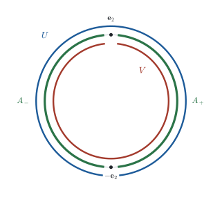
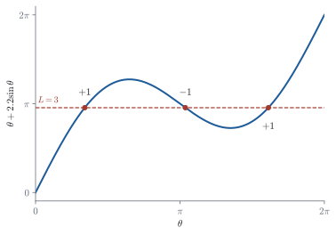
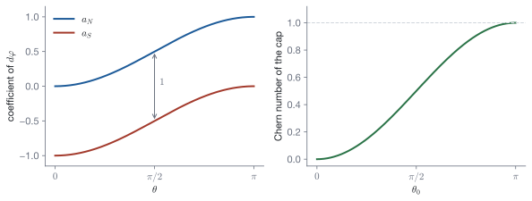
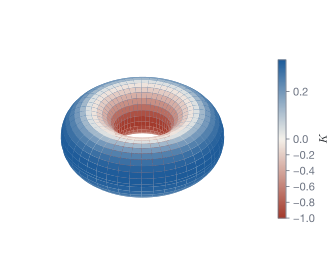

# Homotopy and cohomology {#sec-homotopy-cohomology}

Two loops on a surface can look different and still be deformed into each other without tearing. A rubber band on a
table can be shrunk to a point, a rubber band around a cylinder cannot, and one wound twice around the cylinder cannot
be deformed into one wound once. Homotopy theory turns these observations into algebra. It attaches to a space groups
whose elements are classes of loops up to deformation, and it proves that they do not change when the space is
deformed or bent. The groups then answer questions that look unrelated: why every continuous map of a disc to itself
fixes a point, why every complex polynomial has a root, why at every moment two opposite points of the Earth have the
same temperature and pressure, and why a rotation by $2\pi$ cannot be undone continuously while a rotation by $4\pi$
can. In physics the same integers and signs count the vortices of a superfluid, the winding of a band structure, the
defects of an ordered medium and the sign that a state of spin one-half picks up under a full turn.

The chapter has four sections, followed by three integrative exercises (@sec-homotopy-cohomology-exercises).

- @sec-fundamental-group defines homotopies of maps and of paths, homotopy equivalence and contractible spaces, and the
  fundamental group $\pi_1(X, x_0)$. It proves that $\pi_1$ is a group, that it does not depend on the base point in a
  path-connected space, and that continuous maps induce homomorphisms. It then introduces covering maps, proves the path
  and homotopy lifting theorems in full, computes $\pi_1(S^1) \cong \mathbb Z$ from the covering $\mathbb R \to S^1$,
  and defines the degree of a map of the circle and the winding number of a closed curve, which agrees with the winding
  number of complex analysis. The consequences are the Brouwer fixed point theorem in dimension two, the fundamental
  theorem of algebra and the Borsuk-Ulam theorem in dimension two. The section ends with the simple connectivity of the
  spheres $S^n$ for $n \geq 2$, the fundamental group of a product (the torus has $\mathbb Z^2$), and the groups
  $\pi_1(\mathbb{RP}^n) \cong \mathbb Z_2$ and $\pi_1(SO(3)) \cong \mathbb Z_2$, read off from the double covers
  $S^n \to \mathbb{RP}^n$ and $SU(2) \to SO(3)$.
- @sec-higher-homotopy replaces loops by maps of cubes whose boundary goes to the base point and defines the homotopy
  groups $\pi_n(X, x_0)$, abelian for $n \geq 2$. It proves that coverings do not change them for $n \geq 2$, so that
  $\pi_n(S^1)$ is trivial, and that $\pi_k(S^n)$ is trivial for $k < n$. It then defines fibrations by the homotopy
  lifting property, proves that every locally trivial map is one, including coverings, fibre bundles, coset projections
  and the Hopf map, and proves the exact sequence that relates the homotopy groups of the fibre, the total space and the
  base. The applications are $\pi_2(S^2) \cong \mathbb Z$ with an explicit generator, the groups $\pi_1$ and $\pi_2$ of
  the rotation and unitary groups and of coset spaces, and the hairy ball theorem for $S^2$. The section reduces
  $\pi_3(S^2)$ to $\pi_3(S^3)$; the degree of @sec-de-rham then shows that both groups are infinite.
- @sec-de-rham defines the de Rham cohomology $H^k_{\mathrm{dR}}(M)$, the closed forms modulo the exact ones, and the
  maps induced by smooth maps. It proves, with an explicit homotopy operator, that smoothly homotopic maps induce the same
  maps and the Poincaré lemma in every degree on star-shaped sets; proves the Mayer-Vietoris sequence; and computes the
  cohomology of the spheres, the punctured spaces and the tori. It proves that on a compact connected oriented manifold a
  top-degree form is exact exactly when its integral vanishes, and defines the degree of a map between two such manifolds
  by integrals. The degree counts the preimages of a regular value with signs, does not change under homotopies, is the
  degree of the first section on the circle, and, extended to continuous maps of spheres, shows that $\pi_3(S^3)$ and
  $\pi_3(S^2)$ are infinite and that the Hopf map is not null-homotopic.
- @sec-characteristic-classes describes bundles by transition functions and connections by gauge potentials, and proves
  the Chern-Weil theorem: invariant polynomials in the curvature are closed forms whose classes do not depend on the
  connection. It defines the Chern classes of $U(n)$ bundles, with the Chern number of the Hopf bundle and the pullbacks
  along maps of given degree, and the Euler class of an oriented bundle of rank two, which for the tangent bundle of a
  surface is the Gauss curvature. It proves the Gauss-Bonnet theorem, $\int_MK\,dA = 2\pi\chi(M)$, for closed oriented
  surfaces that carry a vector field with finitely many zeros, with $\chi(M)$ the sum of the indices, and defines the
  Chern character and the $\hat A$ form with examples.

Every definition and theorem is proved where it stands and is followed by ten examples and ten exercises, graded from
direct checks to problems that combine it with earlier results. Each exercise has a solution written out by hand and a
SageMath tab that computes the example or checks a concrete case.

The chapter builds on the topology of @sec-topology and @sec-compact-connected (continuous maps, quotient topologies,
compactness, connectedness and paths), the groups and homomorphisms of @sec-groups, @sec-cosets-quotients and
@sec-homomorphisms, the contour integrals and residues of @sec-contour-integration and @sec-residues, the manifolds of
@sec-charts-manifolds, the differential forms, integration and curvature of @sec-vector-fields-forms-tensors, @sec-integration-manifolds and
@sec-riemann, and the Lie groups and bundles of @sec-lie-groups-algebras and @sec-fibre-bundles. The first
section follows the review of homotopy and covering maps in @lee2013introduction [App. A], the homotopy section of
@keskivakkuri2022mathematical [Sec. 4.2], and the homotopy basics of @rudolph2017differential [Sec. 3.1]; the cohomology
sections follow @lee2013introduction [Ch. 17], @keskivakkuri2022mathematical [Secs. 4.4.2, 5.11] and
@rudolph2017differential [Secs. 4.6-4.7]. Several facts are not proved in this chapter and are not used: the existence of
a simply connected covering space of a general space (stated once, in the last statement of the first section); the
fundamental groups of spaces such as a figure eight, whose computation needs a theorem on unions of spaces that the first
section proves only in the simply connected case; the approximation of continuous maps and homotopies by smooth ones
(homotopy invariance of de Rham cohomology is proved for smooth homotopies, and the degree is extended to continuous maps
only for spheres); Sard's theorem, so that the degree is shown to be an integer only for maps with a regular value; Hopf's
theorem that maps of spheres of the same degree are homotopic, so that $\pi_3(S^3) \cong \pi_3(S^2) \cong \mathbb Z$ is not
proved, only that both groups are infinite; the classification of bundles by their characteristic classes; the existence on
every closed surface of a vector field with finitely many zeros, the value $\chi = 2 - 2g$ and the formula $\chi = V - E +
F$; the Gauss-Bonnet theorem for surfaces with boundary; and the Pontryagin numbers of $\mathbb{CP}^2$ and of the K3
surface, quoted in examples.

## Homotopy, the fundamental group and covering spaces {#sec-fundamental-group}

A homotopy is a continuous deformation of one map into another. The section starts with homotopies of maps and of
paths and proves that they behave well under gluing and composition. Path classes of loops at a point then form a
group, the fundamental group, and continuous maps induce homomorphisms between these groups, so that homeomorphic and
even homotopy equivalent spaces have isomorphic fundamental groups. Computing a fundamental group that is not trivial
needs a new tool: covering maps, such as $\mathbb R \to S^1$, $t \mapsto e^{2\pi it}$, together with the theorem that
paths and homotopies lift through them. With it the section proves $\pi_1(S^1) \cong \mathbb Z$, defines the degree
and the winding number, and derives three classical theorems from them. It closes with the simple connectivity of the
higher spheres, products, and the fundamental groups of projective spaces and of the rotation group.

For more on this topic, see @lee2013introduction [App. A], @keskivakkuri2022mathematical [Sec. 4.2] and
@rudolph2017differential [Sec. 3.1].

### Homotopy

The first definition says when two continuous maps can be deformed into each other. It needs the product topology on
$X \times [0, 1]$, so that the deformation can be required to be continuous in the point and the time together, and it
comes with the gluing rule that the rest of the section uses to build deformations piece by piece. Two paths with the
same ends are compared by deformations that keep the ends fixed, and two spaces are compared by maps that are inverse to
each other up to deformation.

:::: {.statement-box}
::: {#def-htp-homotopy}
#### Homotopy

Let $X$ and $Y$ be topological spaces (@def-topological-space). The **product topology** on $X \times Y$ (@def-product)
has as open sets the unions of products $O \times O'$ with $O$ open in $X$ and $O'$ open in $Y$, as for manifolds in
@def-product-manifold; the interval $[0, 1]$ carries the subspace topology of $\mathbb R$. A **homotopy** from a
continuous map $f : X \to Y$ (@def-continuous-map) to a continuous map $g : X \to Y$ is a continuous map
$H : X \times [0, 1] \to Y$ with $H(x, 0) = f(x)$ and $H(x, 1) = g(x)$ for all $x \in X$; then $f$ and $g$ are
**homotopic**, written $f \simeq g$, and $H_t = H(\cdot, t)$ is the map at time $t$. If $A \subseteq X$ and $H(a, t) =
f(a)$ for all $a \in A$ and $t \in [0, 1]$, the homotopy is **relative to $A$**, written $f \simeq g\ \mathrm{rel}\ A$.
Two paths $\gamma, \delta : [0, 1] \to X$ from $p$ to $q$ (@def-path-connected) are **path-homotopic**, written
$\gamma \simeq_p \delta$, if $\gamma \simeq \delta\ \mathrm{rel}\ \{0, 1\}$, and the class $[\gamma]$ of $\gamma$ under
$\simeq_p$ is its **path class**. A map is **null-homotopic** if it is homotopic to a constant map. A continuous map
$f : X \to Y$ is a **homotopy equivalence** if there is a continuous $g : Y \to X$, a **homotopy inverse**, with $g
\circ f \simeq \mathrm{id}_X$ and $f \circ g \simeq \mathrm{id}_Y$; then $X$ and $Y$ are **homotopy equivalent**,
written $X \simeq Y$. The space $X$ is **contractible** if it is homotopy equivalent to a one-point space. Then:

1. (**products and gluing**) a map $h = (h_1, h_2) : Z \to X \times Y$ is continuous exactly when $h_1$ and $h_2$ are,
   and the projections of $X \times Y$ onto its factors are continuous. For $X \subseteq \mathbb R^m$ and $Y \subseteq
   \mathbb R^n$ with their subspace topologies, the product topology on $X \times Y$ is the subspace topology of
   $\mathbb R^{m + n}$. If $Z = A \cup B$ with $A$ and $B$ closed in $Z$, a map $h : Z \to Y$ whose restrictions to $A$
   and to $B$ are continuous is continuous;
2. (**equivalence relations**) $\simeq$ and $\simeq\ \mathrm{rel}\ A$ are equivalence relations (@def-equivalence-relation)
   on the continuous maps $X \to Y$; in particular $\simeq_p$ is one on the paths from $p$ to $q$;
3. (**composition**) if $f \simeq f' : X \to Y$ and $g \simeq g' : Y \to Z$, then $g \circ f \simeq g' \circ f'$. If $f
   \simeq f'\ \mathrm{rel}\ A$, then $g \circ f \simeq g \circ f'\ \mathrm{rel}\ A$; in particular $\gamma \simeq_p
   \delta$ implies $g \circ \gamma \simeq_p g \circ \delta$;
4. (**straight-line homotopy**) if $Y \subseteq \mathbb R^n$ and, for every $x$, the segment from $f(x)$ to $g(x)$ lies
   in $Y$, then $H(x, t) = (1 - t)f(x) + tg(x)$ is a homotopy $f \simeq g\ \mathrm{rel}\ \{x : f(x) = g(x)\}$. So any
   two maps into a convex set are homotopic, two paths with the same ends in a convex set are path-homotopic, and a set
   that is star-shaped about a point $\mathbf c$ (it contains the segment from $\mathbf c$ to each of its points) is
   contractible;
5. (**reparametrisation**) if $\varphi : [0, 1] \to [0, 1]$ is continuous with $\varphi(0) = 0$ and $\varphi(1) = 1$,
   then $\gamma \circ \varphi \simeq_p \gamma$ for every path $\gamma$;
6. (**homotopy equivalence**) $X$ is contractible exactly when $\mathrm{id}_X$ is null-homotopic; homeomorphic spaces
   (@def-homeomorphism) are homotopy equivalent; and $\simeq$ is reflexive, symmetric and transitive among spaces.
:::
::::

*Proof.* (1) The projection $\mathrm{pr}_1$ is continuous because $\mathrm{pr}_1^{-1}(O) = O \times Y$ is open, and
likewise $\mathrm{pr}_2$. If $h$ is continuous, so are $h_1 = \mathrm{pr}_1 \circ h$ and $h_2 = \mathrm{pr}_2 \circ h$.
Conversely, $h^{-1}(O \times O') = h_1^{-1}(O) \cap h_2^{-1}(O')$ is open, and preimages commute with unions, so the
preimage of every open set is open. For subsets of Euclidean spaces, a set $W \subseteq X \times Y$ is open in the
product topology when each of its points $(\mathbf x, \mathbf y)$ has open sets $O \ni \mathbf x$ of $X$ and $O' \ni
\mathbf y$ of $Y$ with $O \times O' \subseteq W$, and open in the subspace topology when each point has an $r > 0$ with
$B_r(\mathbf x, \mathbf y) \cap (X \times Y) \subseteq W$. Since $\lVert(\mathbf u, \mathbf v) - (\mathbf x, \mathbf
y)\rVert^2 = \lVert\mathbf u - \mathbf x\rVert^2 + \lVert\mathbf v - \mathbf y\rVert^2$, the ball $B_r(\mathbf x,
\mathbf y)$ contains $B_{r/2}(\mathbf x) \times B_{r/2}(\mathbf y)$ and is contained in $B_r(\mathbf x) \times
B_r(\mathbf y)$. Intersecting with $X \times Y$, each kind of neighbourhood contains one of the other kind, so the two
topologies have the same open sets. For the gluing rule let $C \subseteq Y$ be closed. The set $(h|_A)^{-1}(C)$ is
closed in $A$, that is, of the form $A \cap F$ with $F$ closed in $Z$ (the complement in $A$ of an open set $A \cap U$
is $A \cap (Z \setminus U)$), and $A \cap F$ is closed in $Z$ as an intersection of closed sets. The same holds for $B$,
so $h^{-1}(C) = (h|_A)^{-1}(C) \cup (h|_B)^{-1}(C)$ is closed. Taking complements, the preimage of every open set is
open, and $h$ is continuous.

(2) Reflexivity: $H(x, t) = f(x)$ is $f \circ \mathrm{pr}_1$, continuous by (1). Symmetry: if $H$ goes from $f$ to $g$,
then $(x, t) \mapsto H(x, 1 - t)$ goes from $g$ to $f$, and it is continuous as the composition of $H$ with $(x, t)
\mapsto (x, 1 - t)$, continuous by (1). Transitivity: if $H$ goes from $f$ to $g$ and $G$ from $g$ to $k$, let $K(x, t)
= H(x, 2t)$ for $t \leq \frac12$ and $K(x, t) = G(x, 2t - 1)$ for $t \geq \frac12$. The two formulas agree on $X \times
\{\frac12\}$, where both give $g(x)$, they are continuous on the closed sets $X \times [0, \frac12]$ and $X \times
[\frac12, 1]$, and so $K$ is continuous by the gluing rule of (1); it goes from $f$ to $k$. If $H$ and $G$ are constant
in $t$ on $A$, so are the three new homotopies, which proves the relative case. Path homotopy is the case $X = [0, 1]$,
$A = \{0, 1\}$.

(3) If $H$ goes from $f$ to $f'$, then $g \circ H$ is a homotopy from $g \circ f$ to $g \circ f'$, relative to $A$ when
$H$ is. If $G$ goes from $g$ to $g'$, then $(x, t) \mapsto G(f'(x), t)$ is continuous by (1) and goes from $g \circ f'$
to $g' \circ f'$. By transitivity (2), $g \circ f \simeq g' \circ f'$.

(4) The components of $H$ are sums of products of continuous real functions of $(x, t)$, so $H$ is continuous into
$\mathbb R^n$ by (1), and by assumption it takes values in $Y$; a map into a subspace is continuous when it is
continuous into the whole space, since open sets of $Y$ are traces of open sets of $\mathbb R^n$. Also $H(x, 0) = f(x)$,
$H(x, 1) = g(x)$, and $H(x, t) = f(x)$ for all $t$ when $f(x) = g(x)$. In a convex set every segment is allowed. For a
set $Y$ star-shaped about $\mathbf c$, the homotopy $H(\mathbf x, t) = (1 - t)\mathbf x + t\mathbf c$ shows that
$\mathrm{id}_Y$ is homotopic to the constant map $\mathbf c$, and $Y$ is contractible by (6).

(5) Let $H(s, t) = \gamma\bigl((1 - t)\varphi(s) + ts\bigr)$. The argument lies in $[0, 1]$, being a convex combination
of two numbers in $[0, 1]$, so $H$ is a continuous map $[0, 1] \times [0, 1] \to X$. It has $H(s, 0) = \gamma(\varphi(s))$,
$H(s, 1) = \gamma(s)$, $H(0, t) = \gamma(0)$ and $H(1, t) = \gamma(1)$.

(6) If $f : X \to \{*\}$ and $g : \{*\} \to X$, $g(*) = c$, are inverse up to homotopy, then $g \circ f$ is the constant
map $c$ and it is homotopic to $\mathrm{id}_X$. Conversely, if $\mathrm{id}_X$ is homotopic to a constant map $c$, the
same $f$ and $g$ satisfy $f \circ g = \mathrm{id}_{\{*\}}$ and $g \circ f = c \simeq \mathrm{id}_X$. A homeomorphism and
its inverse are inverse to each other exactly. Reflexivity is $\mathrm{id}_X$ and symmetry is built into the
definition. If $f : X \to Y$ and $f' : Y \to Z$ have homotopy inverses $g$ and $g'$, then by (3)
$(g \circ g') \circ (f' \circ f) = g \circ (g' \circ f') \circ f \simeq g \circ \mathrm{id}_Y \circ f = g \circ f \simeq
\mathrm{id}_X$, and in the same way $(f' \circ f) \circ (g \circ g') \simeq \mathrm{id}_Z$. $\square$

The definition follows @lee2013introduction [App. A] and @keskivakkuri2022mathematical [Sec. 4.2.1]. A homotopy must be
continuous in the point and the time together; continuity in each separately is not enough, as an example below shows.
Most homotopies of this section are built from formulas on the pieces of a square and glued with (1).

:::: {.callout-note .examples-fold collapse="true" title="Examples"}
The simplest homotopies join constant maps. The first example joins two constant maps into the plane by moving the
value along a segment, the most direct use of the straight-line homotopy of part (4).

::: {#exm-htp-hom-constants}
#### Two constant maps into the plane

Let $X$ be any space and $f, g : X \to \mathbb R^2$ the constant maps with values $\mathbf a = (0, 0)$ and $\mathbf b =
(1, 2)$. Then $H(x, t) = (1 - t)\mathbf a + t\mathbf b = (t, 2t)$ is a homotopy from $f$ to $g$: at each time $t$ the map
$H_t$ is constant with value $(t, 2t)$. Any two constant maps into a path-connected space are homotopic in the same way,
with the segment replaced by a path from $\mathbf a$ to $\mathbf b$.
:::

Euclidean space can be shrunk to its origin. The second example writes the homotopy that does this and concludes from
part (4) that $\mathbb R^n$, and every ball in it, is contractible.

::: {#exm-htp-hom-rn-contractible}
#### Euclidean space is contractible

On $\mathbb R^n$ the map $H(\mathbf x, t) = (1 - t)\mathbf x$ is continuous, with $H_0 = \mathrm{id}$ and $H_1$ the
constant map $\mathbf 0$. So $\mathrm{id}_{\mathbb R^n}$ is null-homotopic and $\mathbb R^n$ is contractible by part (6).
The same formula keeps the open and the closed balls about $\mathbf 0$ inside themselves, so they are contractible too,
and so is every convex set, by part (4) with any of its points as $\mathbf c$.
:::

Two paths with the same ends in the plane are path-homotopic. The third example draws the intermediate paths of the
straight-line homotopy between two arcs, which keeps both ends fixed at every time.

::: {#exm-htp-hom-two-arcs}
#### Deforming one arc into another

Let $\gamma(s) = (s, -\sin\pi s)$ and $\delta(s) = (s, \sin\pi s)$, paths in $\mathbb R^2$ from $(0, 0)$ to $(1, 0)$.
The straight-line homotopy is $H(s, t) = (s, (2t - 1)\sin\pi s)$: at time $t$ the path is the arc of height $2t - 1$,
and $H(0, t) = (0, 0)$, $H(1, t) = (1, 0)$ for all $t$ (@fig-htp-path-homotopy). So $\gamma \simeq_p \delta$. If the
point $(\tfrac12, 0)$ is removed from the plane, this homotopy is no longer allowed, because the path at $t = \tfrac12$
passes through it.

{#fig-htp-path-homotopy width=70%}
:::

A map of the circle to itself can be deformed by turning it. The fourth example joins the identity of $S^1$ to the
rotation by an angle $\theta$, a homotopy through homeomorphisms of the circle.

::: {#exm-htp-hom-rotation}
#### Rotations of the circle

Let $S^1 = \{z \in \mathbb C : |z| = 1\}$ and $R_\theta(z) = e^{i\theta}z$. The map $H(z, t) = e^{it\theta}z$ is
continuous on $S^1 \times [0, 1]$, being a product of continuous complex functions, with $H_0 = \mathrm{id}$ and $H_1 =
R_\theta$. So every rotation is homotopic to the identity. For $\theta = \pi$ this says that the antipodal map $z \mapsto
-z$ of the circle is homotopic to the identity.
:::

A loop that stays in a half-plane can be shrunk to a point there. The fifth example contracts a loop around a point of
the plane that does not enclose the origin, inside the punctured plane.

::: {#exm-htp-hom-half-plane}
#### A loop in a half-plane

The loop $\gamma(s) = (2 + \cos 2\pi s, \sin 2\pi s)$ lies in the half-plane $\{x > 0\}$, a convex subset of $\mathbb
R^2 \setminus \{\mathbf 0\}$. The straight-line homotopy $H(s, t) = (1 - t)\gamma(s) + t(3, 0)$ stays in the half-plane
and fixes $s = 0, 1$, where $\gamma = (3, 0)$. So $\gamma$ is path-homotopic to the constant loop at $(3, 0)$ within
$\mathbb R^2 \setminus \{\mathbf 0\}$, although the punctured plane itself is not convex.
:::

A space with a hole need not be contractible, but it may be homotopy equivalent to something smaller. The sixth example
shows that the punctured Euclidean space and the sphere are homotopy equivalent, following @lee2013introduction [App. A].

::: {#exm-htp-hom-punctured-sphere}
#### The punctured space and the sphere

Let $\iota : S^{n-1} \to \mathbb R^n \setminus \{\mathbf 0\}$ be the inclusion and $r(\mathbf x) = \mathbf x/\lVert\mathbf
x\rVert$. Then $r \circ \iota = \mathrm{id}_{S^{n-1}}$, and $\iota \circ r \simeq \mathrm{id}$ by the straight-line homotopy
$H(\mathbf x, t) = (1 - t)\mathbf x/\lVert\mathbf x\rVert + t\mathbf x$, which never vanishes, since it is a positive
multiple of $\mathbf x$. So $\mathbb R^n \setminus \{\mathbf 0\} \simeq S^{n-1}$; for $n = 2$ the punctured plane is
homotopy equivalent to the circle.
:::

A pendulum that swings in a plane has the circle as configuration space and the cylinder as phase space. The seventh
example shows that the phase space is homotopy equivalent to the configuration space, because the momentum can be
shrunk to zero.

::: {#exm-htp-hom-pendulum-phase}
#### The phase space of a pendulum

The phase space of a planar pendulum is $S^1 \times \mathbb R$, the angle and the momentum. The projection
$\mathrm{pr}_1 : S^1 \times \mathbb R \to S^1$ and the inclusion $\iota(z) = (z, 0)$ satisfy $\mathrm{pr}_1 \circ \iota =
\mathrm{id}_{S^1}$, and $\iota \circ \mathrm{pr}_1 \simeq \mathrm{id}$ by $H((z, p), t) = (z, tp)$, which goes from $(z, 0)$
to $(z, p)$. So $S^1 \times \mathbb R \simeq S^1$. The same argument gives $M \times \mathbb R^k \simeq M$ for every space
$M$.
:::

The rotation matrices sit inside the invertible matrices with positive determinant. The eighth example deforms every
such $2 \times 2$ matrix into a rotation by the Gram-Schmidt process, and so shows that the two groups are homotopy
equivalent.

::: {#exm-htp-hom-gl2-so2}
#### Invertible matrices and rotations

Let $GL^+(2, \mathbb R)$ be the real $2 \times 2$ matrices of positive determinant, a subset of $\mathbb R^4$. Gram-Schmidt
writes each $\mathbf A$ as $\mathbf A = \mathbf Q\mathbf R$ with $\mathbf Q \in SO(2)$ and $\mathbf R = \begin{pmatrix}
r_{11} & r_{12} \\ 0 & r_{22}\end{pmatrix}$, $r_{11}, r_{22} > 0$, where $r_{11} = \lVert\mathbf a_1\rVert$ for the first
column $\mathbf a_1$, $r_{12} = \mathbf a_1 \cdot \mathbf a_2/r_{11}$, $r_{22} = \det\mathbf A/r_{11}$ and $\mathbf Q =
\mathbf A\mathbf R^{-1}$, all continuous in $\mathbf A$. The map $H(\mathbf A, t) = \mathbf Q\bigl((1 - t)\mathbf R +
t\mathbf I\bigr)$ stays in $GL^+(2, \mathbb R)$, because $(1 - t)\mathbf R + t\mathbf I$ is upper triangular with positive
diagonal. It joins $\mathrm{id}$ to the map $\mathbf A \mapsto \mathbf Q$ onto $SO(2)$, which fixes $SO(2)$, so
$GL^+(2, \mathbb R) \simeq SO(2)$.
:::

Separate continuity in the point and in the time is weaker than continuity on the product. The ninth example gives a
family of continuous functions, continuous in the time for each point, whose combined map is not continuous, so that it
is not a homotopy in the sense of the definition.

::: {#exm-htp-hom-separate}
#### Continuity in each variable is not enough

Let $H(s, t) = 2st/(s^2 + t^2)$ for $(s, t) \neq (0, 0)$ and $H(0, 0) = 0$, on $[0, 1] \times [0, 1]$. For fixed $t$ the
map $s \mapsto H(s, t)$ is continuous, and for fixed $s$ so is $t \mapsto H(s, t)$. But $H(s, s) = 1$ for $s > 0$ while
$H(0, 0) = 0$, so $H$ is not continuous at the origin. The family $H_t$ is not a homotopy from $H_0 = 0$ to $H_1$, even
though each $H_t$ is continuous and each point moves continuously.
:::

Without fixed ends, any two paths in a path-connected space are homotopic. The last example proves this, and so shows
why loops and paths are compared by path homotopy rather than by homotopy: the plain relation sees nothing.

::: {#exm-htp-hom-free-paths}
#### Why the ends are kept fixed

Let $X$ be path-connected and $\gamma$ a path in $X$. The homotopy $H(s, t) = \gamma((1 - t)s)$ goes from $\gamma$ to the
constant path at $\gamma(0)$. Two constant paths are homotopic through constant paths along a path joining their values,
as in @exm-htp-hom-constants. By transitivity, any two paths in $X$ are homotopic as maps $[0, 1] \to X$. For instance the
loop $s \mapsto e^{2\pi is}$ in $S^1$ is homotopic to a constant map. Whether a homotopy exists that keeps both ends
at $1$ is a different question, and it is the question that path homotopy asks.
:::
::::

:::: {.callout-note .exercises-fold collapse="true" title="Exercises"}
The first exercise checks the definition of a path homotopy on two half circles. It asks for the straight-line
homotopy and for the four boundary conditions that make it a homotopy with fixed ends.

::: {#exr-htp-hom-semicircles}
#### Upper and lower half circles

Let $\gamma(s) = (\cos\pi s, \sin\pi s)$ and $\delta(s) = (\cos\pi s, -\sin\pi s)$, paths in $\mathbb R^2$ from $(1, 0)$ to
$(-1, 0)$. Write the straight-line homotopy from $\gamma$ to $\delta$ and check that it is a path homotopy.
:::

::: {.callout-note .solution collapse="true" title="Solution"}
:::: {.panel-tabset .solution-tabs}
## Proof

By @def-htp-homotopy (4), $H(s, t) = (1 - t)\gamma(s) + t\delta(s) = (\cos\pi s, (1 - 2t)\sin\pi s)$ is a homotopy in the
convex set $\mathbb R^2$. It has $H(s, 0) = \gamma(s)$, $H(s, 1) = \delta(s)$, and $H(0, t) = (1, 0)$, $H(1, t) = (-1, 0)$
for all $t$, because $\sin 0 = \sin\pi = 0$. So it is a homotopy relative to $\{0, 1\}$ and $\gamma \simeq_p \delta$.

## SageMath

Sage evaluates the homotopy on the four sides of the square.

```{.python .sage}
s, t = var("s t")
gamma = vector([cos(pi*s), sin(pi*s)])
delta = vector([cos(pi*s), -sin(pi*s)])
H = (1 - t)*gamma + t*delta
print("H(s,t) =", H.simplify_full())
print("H(s,0) == gamma:", bool(H.subs(t=0) == gamma), "  H(s,1) == delta:", bool(H.subs(t=1) == delta))
print("H(0,t) =", H.subs(s=0), "  H(1,t) =", H.subs(s=1))
```

```{.text .sage-output}
H(s,t) = (cos(pi*s), -2*t*sin(pi*s) + sin(pi*s))
H(s,0) == gamma: True   H(s,1) == delta: True
H(0,t) = (1, 0)   H(1,t) = (-1, 0)
```
::::
:::

Part (5) says that changing the speed along a path does not change its path class. The second exercise writes the
homotopy of the proof for a concrete path and a concrete change of speed.

::: {#exr-htp-hom-reparam}
#### Slowing down at the start

Let $\gamma(s) = (\cos\pi s, \sin\pi s)$ and $\varphi(s) = s^2$. Write the homotopy of @def-htp-homotopy (5) from $\gamma
\circ \varphi$ to $\gamma$ and check its values on the boundary of the square.
:::

::: {.callout-note .solution collapse="true" title="Solution"}
:::: {.panel-tabset .solution-tabs}
## Proof

The homotopy is $H(s, t) = \gamma\bigl((1 - t)s^2 + ts\bigr) = \bigl(\cos\pi((1 - t)s^2 + ts), \sin\pi((1 - t)s^2 +
ts)\bigr)$. The argument $(1 - t)s^2 + ts$ lies in $[0, 1]$ and equals $s^2$ at $t = 0$, $s$ at $t = 1$, $0$ at $s = 0$
and $1$ at $s = 1$. So $H(s, 0) = \gamma(s^2)$, $H(s, 1) = \gamma(s)$, $H(0, t) = (1, 0)$ and $H(1, t) = (-1, 0)$: a path
homotopy $\gamma \circ \varphi \simeq_p \gamma$.

## SageMath

Sage substitutes the four sides of the square into the homotopy.

```{.python .sage}
s, t = var("s t")
u = (1 - t)*s^2 + t*s
H = vector([cos(pi*u), sin(pi*u)])
print("H(s,0) =", H.subs(t=0), "  H(s,1) =", H.subs(t=1))
print("H(0,t) =", H.subs(s=0), "  H(1,t) =", H.subs(s=1))
```

```{.text .sage-output}
H(s,0) = (cos(pi*s^2), sin(pi*s^2))   H(s,1) = (cos(pi*s), sin(pi*s))
H(0,t) = (1, 0)   H(1,t) = (-1, 0)
```
::::
:::

The proof of transitivity in part (2) runs two homotopies one after the other at double speed. The third exercise does
this for two concrete homotopies of real functions and checks that the glued map is well defined at the middle time.

::: {#exr-htp-hom-concatenate}
#### Running two homotopies in turn

Let $f(x) = x$, $g(x) = x^2$ and $k(x) = 0$ on $[0, 1]$. Write the straight-line homotopies $H$ from $f$ to $g$ and $G$
from $g$ to $k$, the glued homotopy $K$ of @def-htp-homotopy (2) from $f$ to $k$, and compute $K(\tfrac12, \tfrac14)$ and
$K(\tfrac12, \tfrac34)$.
:::

::: {.callout-note .solution collapse="true" title="Solution"}
:::: {.panel-tabset .solution-tabs}
## Proof

By @def-htp-homotopy (4), $H(x, t) = (1 - t)x + tx^2$ and $G(x, t) = (1 - t)x^2$. The glued homotopy is $K(x, t) = H(x, 2t)
= (1 - 2t)x + 2tx^2$ for $t \leq \frac12$ and $K(x, t) = G(x, 2t - 1) = (2 - 2t)x^2$ for $t \geq \frac12$. At $t =
\frac12$ both formulas give $x^2$, so $K$ is continuous by the gluing rule of @def-htp-homotopy (1). Then $K(\frac12,
\frac14) = \frac12\cdot\frac12 + \frac12\cdot\frac14 = \frac38$ and $K(\frac12, \frac34) = \frac12\cdot\frac14 =
\frac18$.

## SageMath

Sage builds the two halves and evaluates them.

```{.python .sage}
x, t = var("x t")
H = (1 - t)*x + t*x^2
G = (1 - t)*x^2
K1, K2 = H.subs(t=2*t), G.subs(t=2*t - 1)
print("halves agree at t = 1/2:", bool(K1.subs(t=1/2) == K2.subs(t=1/2)))
print("K(1/2,1/4) =", K1.subs(x=1/2, t=1/4), "  K(1/2,3/4) =", K2.subs(x=1/2, t=3/4))
print("K(x,0) =", K1.subs(t=0), "  K(x,1) =", K2.subs(t=1))
```

```{.text .sage-output}
halves agree at t = 1/2: True
K(1/2,1/4) = 3/8   K(1/2,3/4) = 1/8
K(x,0) = x   K(x,1) = 0
```
::::
:::

On the circle the antipodal map is a rotation, as @exm-htp-hom-rotation showed. The fourth exercise extends this to
every odd-dimensional sphere, written as the unit sphere of a complex space.

::: {#exr-htp-hom-odd-sphere}
#### The antipodal map of an odd sphere

Write $S^{2k + 1} = \{\mathbf z \in \mathbb C^{k + 1} : |z_1|^2 + \dots + |z_{k+1}|^2 = 1\}$. Show that the antipodal map
$\mathbf z \mapsto -\mathbf z$ is homotopic to the identity of $S^{2k+1}$.
:::

::: {.callout-note .solution collapse="true" title="Solution"}
:::: {.panel-tabset .solution-tabs}
## Proof

Let $H(\mathbf z, t) = e^{i\pi t}\mathbf z$. Its components are products of continuous functions, so $H$ is continuous into
$\mathbb C^{k+1} = \mathbb R^{2k + 2}$ by @def-htp-homotopy (1). Since $|e^{i\pi t}| = 1$, $\sum_j|e^{i\pi t}z_j|^2 =
\sum_j|z_j|^2 = 1$, so $H$ takes values in $S^{2k+1}$. It has $H_0 = \mathrm{id}$ and $H_1(\mathbf z) = e^{i\pi}\mathbf z =
-\mathbf z$.

## SageMath

Check on $S^3$, the case $k = 1$: the homotopy is evaluated at a point of the sphere and several times.

```{.python .sage}
z = vector(QQbar, [QQbar(3/5), QQbar(4/5)*QQbar(I)])
print("on S^3:", sum(abs(c)^2 for c in z) == 1)
for tt in [0, 1/3, 1/2, 1]:
    w = vector(CC, [exp(I*pi*tt)*c for c in z])
    print("t =", tt, " norm^2 =", round(sum(abs(c)^2 for c in w), 12), " H =", [c.n(digits=4) for c in w])
```

```{.text .sage-output}
on S^3: True
t = 0  norm^2 = 1.0  H = [0.6000, 0.8000*I]
t = 1/3  norm^2 = 1.0  H = [0.3000 + 0.5196*I, -0.6928 + 0.4000*I]
t = 1/2  norm^2 = 1.0  H = [0.6000*I, -0.8000]
t = 1  norm^2 = 1.0  H = [-0.6000, -0.8000*I]
```
::::
:::

An annulus has a hole, like the circle, and it is homotopy equivalent to it. The fifth exercise asks for the maps and
the homotopy, in the spirit of @exm-htp-hom-punctured-sphere.

::: {#exr-htp-hom-annulus}
#### The annulus and the circle

Let $A = \{\mathbf x \in \mathbb R^2 : 1 \leq \lVert\mathbf x\rVert \leq 2\}$. Show that the inclusion $\iota : S^1 \to A$
is a homotopy equivalence.
:::

::: {.callout-note .solution collapse="true" title="Solution"}
:::: {.panel-tabset .solution-tabs}
## Proof

Let $r(\mathbf x) = \mathbf x/\lVert\mathbf x\rVert$, continuous on $A$ since $\lVert\mathbf x\rVert \geq 1$. Then $r \circ
\iota = \mathrm{id}_{S^1}$. For $\iota \circ r$, the segment from $\mathbf x/\lVert\mathbf x\rVert$ to $\mathbf x$ consists
of the points $c\mathbf x$ with $c$ between $1/\lVert\mathbf x\rVert$ and $1$, whose norms lie between $1$ and
$\lVert\mathbf x\rVert \leq 2$. So it lies in $A$, and @def-htp-homotopy (4) gives $\iota \circ r \simeq \mathrm{id}_A$.
Thus $r$ is a homotopy inverse of $\iota$.

## SageMath

Check on a grid of points of $A$ and times: the straight-line homotopy stays in the annulus.

```{.python .sage}
ok = True
for rho in [1, 1.3, 1.7, 2]:
    for th in [k*pi/7 for k in range(14)]:
        x = vector(RDF, [rho*cos(th), rho*sin(th)])
        for tt in [0, 0.25, 0.5, 0.75, 1]:
            n = ((1 - tt)*x/x.norm() + tt*x).norm()
            ok = ok and (1 - 1e-12 <= n <= 2 + 1e-12)
print("homotopy stays in the annulus:", ok)
```

```{.text .sage-output}
homotopy stays in the annulus: True
```
::::
:::

A contractible space has no room for different homotopy classes of maps into it. The sixth exercise proves this with
the composition rule of part (3).

::: {#exr-htp-hom-into-contractible}
#### Maps into a contractible space

Let $X$ be contractible and $Z$ any space. Prove that any two continuous maps $f, g : Z \to X$ are homotopic.
:::

::: {.callout-note .solution collapse="true" title="Solution"}
:::: {.panel-tabset .solution-tabs}
## Proof

By @def-htp-homotopy (6) there is a homotopy $H$ from $\mathrm{id}_X$ to a constant map $c$. By part (3), $f = \mathrm{id}_X
\circ f \simeq c \circ f$, and $c \circ f$ is the constant map $Z \to X$ with value $c$. In the same way $g \simeq c \circ g$,
the same constant map. By symmetry and transitivity (2), $f \simeq g$. Explicitly, $(z, t) \mapsto H(f(z), t)$ goes from
$f$ to the constant map.

## SageMath

Check on $X = \mathbb R^2$, contracted by $H(\mathbf x, t) = (1 - t)\mathbf x$, with $f(z) = (z, z^2)$ and $g(z) = (\cos z,
1)$ on $Z = \mathbb R$: the glued homotopy goes from $f$ to $g$.

```{.python .sage}
z, t = var("z t")
f = vector([z, z^2]); g = vector([cos(z), 1])
Hf = (1 - t)*f            # f to the constant 0
Hg = (1 - t)*g            # g to the constant 0
K1 = Hf.subs(t=2*t); K2 = Hg.subs(t=2 - 2*t)   # f -> 0 -> g
print("K(z,0) == f:", bool(K1.subs(t=0) == f), "  K(z,1) == g:", bool(K2.subs(t=1) == g))
print("halves agree at t = 1/2:", bool(K1.subs(t=1/2) == K2.subs(t=1/2)))
```

```{.text .sage-output}
K(z,0) == f: True   K(z,1) == g: True
halves agree at t = 1/2: True
```
::::
:::

A contraction moves every point to one point continuously, so it provides paths. The seventh exercise proves that a
contractible space is path-connected (@def-path-connected).

::: {#exr-htp-hom-contractible-connected}
#### Contractible spaces are path-connected

Prove that a contractible space $X$ is path-connected. Deduce that two points with the discrete topology do not form a
contractible space.
:::

::: {.callout-note .solution collapse="true" title="Solution"}
:::: {.panel-tabset .solution-tabs}
## Proof

Let $H$ be a homotopy from $\mathrm{id}_X$ to the constant map $c$ (@def-htp-homotopy (6)). For $x \in X$, the map $t \mapsto
H(x, t)$ is continuous, as the composition of $H$ with $t \mapsto (x, t)$, continuous by part (1); it is a path from $x$
to $c$. For $x, y \in X$, follow the path from $x$ to $c$ and then the reverse of the path from $y$ to $c$, glued at the
middle time by part (1): this is a path from $x$ to $y$. Two points with the discrete topology are not path-connected,
since a path from one to the other would separate $[0, 1]$ into the two disjoint non-empty open preimages of the points,
which contradicts the connectedness of $[0, 1]$ (@exr-connected-interval).

## SageMath

Check on the L-shaped set $\{(x, 0) : 0 \leq x \leq 1\} \cup \{(0, y) : 0 \leq y \leq 1\}$, star-shaped about the origin:
the path from $(1, 0)$ to $(0, 1)$ through the contraction stays in the set.

```{.python .sage}
def H(p, t):
    return ((1 - t)*p[0], (1 - t)*p[1])
def in_L(p):
    return (p[1] == 0 and 0 <= p[0] <= 1) or (p[0] == 0 and 0 <= p[1] <= 1)
a, b = (1, 0), (0, 1)
path = [H(a, 2*u) if u <= 1/2 else H(b, 2 - 2*u) for u in [k/10 for k in range(11)]]
print(path)
print("all points in L:", all(in_L(p) for p in path))
```

```{.text .sage-output}
[(1, 0), (4/5, 0), (3/5, 0), (2/5, 0), (1/5, 0), (0, 0), (0, 1/5), (0, 2/5), (0, 3/5), (0, 4/5), (0, 1)]
all points in L: True
```
::::
:::

A retraction is a continuous map onto a subset that fixes the subset. The eighth exercise proves that a retract of a
contractible space is contractible, which combines a contraction with a retraction through part (3).

::: {#exr-htp-hom-retract}
#### Retracts of contractible spaces

Let $A \subseteq X$ and let $r : X \to A$ be continuous with $r(a) = a$ for $a \in A$ (a **retraction**). Prove that $A$ is
contractible if $X$ is.
:::

::: {.callout-note .solution collapse="true" title="Solution"}
:::: {.panel-tabset .solution-tabs}
## Proof

Let $H$ be a homotopy from $\mathrm{id}_X$ to the constant map $c$. Then $G(a, t) = r(H(a, t))$ for $a \in A$ is continuous
on $A \times [0, 1]$ and takes values in $A$. It has $G(a, 0) = r(a) = a$ and $G(a, 1) = r(c)$, so it is a homotopy from
$\mathrm{id}_A$ to a constant map, and $A$ is contractible by @def-htp-homotopy (6).

## SageMath

Check on the closed unit disc $X$, the diameter $A = [-1, 1] \times \{0\}$ and $r(x, y) = (x, 0)$: the composed homotopy
stays on the diameter and ends at the origin.

```{.python .sage}
x, y, t = var("x y t")
H = vector([(1 - t)*x, (1 - t)*y])        # contraction of the disc
G = vector([H[0], 0])                      # r o H
print("G(a,t) =", G, "  second coordinate always 0:", bool(G[1] == 0))
print("G(x,0) =", G.subs(t=0), "  G(x,1) =", G.subs(t=1))
```

```{.text .sage-output}
G(a,t) = (-(t - 1)*x, 0)   second coordinate always 0: True
G(x,0) = (x, 0)   G(x,1) = (0, 0)
```
::::
:::

The sphere with one point removed is a plane in disguise. The ninth exercise proves this with the stereographic
projection of $S^n$, as for $S^2$ in @prp-stereographic, and concludes that the punctured sphere is contractible.

::: {#exr-htp-hom-punctured-sphere}
#### The punctured sphere is contractible

Let $N = \mathbf e_{n+1}$ be the north pole of $S^n \subseteq \mathbb R^{n+1}$ and, for $\mathbf x = (\mathbf x',
x_{n+1})$, let $\sigma(\mathbf x) = \mathbf x'/(1 - x_{n+1})$. Prove that $\sigma : S^n \setminus \{N\} \to \mathbb R^n$ is
a homeomorphism with inverse $\tau(\mathbf u) = (2\mathbf u, \lVert\mathbf u\rVert^2 - 1)/(\lVert\mathbf u\rVert^2 + 1)$,
and deduce that $S^n \setminus \{N\}$ is contractible.
:::

::: {.callout-note .solution collapse="true" title="Solution"}
:::: {.panel-tabset .solution-tabs}
## Proof

Write $\rho = \lVert\mathbf u\rVert^2$. Then $\lVert\tau(\mathbf u)\rVert^2 = (4\rho + (\rho - 1)^2)/(\rho + 1)^2 = 1$ and
the last coordinate $(\rho - 1)/(\rho + 1) < 1$, so $\tau$ maps into $S^n \setminus \{N\}$. Next, $1 - \tau_{n+1} = 2/(\rho +
1)$, so $\sigma(\tau(\mathbf u)) = \frac{2\mathbf u}{\rho + 1}\cdot\frac{\rho + 1}2 = \mathbf u$. Conversely, for $\mathbf
x \in S^n \setminus \{N\}$ and $\mathbf u = \sigma(\mathbf x)$, $\rho = (1 - x_{n+1}^2)/(1 - x_{n+1})^2 = (1 + x_{n+1})/(1 -
x_{n+1})$ and $\rho + 1 = 2/(1 - x_{n+1})$; hence $2\mathbf u/(\rho + 1) = \mathbf x'$ and $(\rho - 1)/(\rho + 1) =
x_{n+1}$, so $\tau(\sigma(\mathbf x)) = \mathbf x$. Both maps are continuous, their components being quotients of
polynomials with non-vanishing denominators. So $\sigma$ is a homeomorphism, $S^n \setminus \{N\}$ is homotopy equivalent
to $\mathbb R^n$ by @def-htp-homotopy (6), and $\mathbb R^n$ is contractible (@exm-htp-hom-rn-contractible). By
transitivity in (6), $S^n \setminus \{N\}$ is contractible.

## SageMath

Check on $S^2$: Sage composes the two maps symbolically in both orders.

```{.python .sage}
u1, u2 = var("u1 u2")
rho = u1^2 + u2^2
tau = vector([2*u1, 2*u2, rho - 1])/(rho + 1)
print("|tau(u)|^2 =", (tau*tau).simplify_full())
sig = vector([tau[0], tau[1]])/(1 - tau[2])
print("sigma(tau(u)) =", sig.simplify_full())
th, ph = var("th ph")
x = vector([sin(th)*cos(ph), sin(th)*sin(ph), cos(th)])
u = vector([x[0], x[1]])/(1 - x[2]); r = (u*u)
back = vector([2*u[0], 2*u[1], r - 1])/(r + 1)
print("tau(sigma(x)) - x =", (back - x).simplify_full())
```

```{.text .sage-output}
|tau(u)|^2 = 1
sigma(tau(u)) = (u1, u2)
tau(sigma(x)) - x = (0, 0, 0)
```
::::
:::

The last exercise combines the Gram-Schmidt homotopy of @exm-htp-hom-gl2-so2 with a normalisation. It shows that the
group of real $2 \times 2$ matrices of determinant one is homotopy equivalent to the rotation group.

::: {#exr-htp-hom-sl2}
#### $SL(2, \mathbb R)$ and rotations

Let $\mathbf A = \mathbf Q\mathbf R$ be the Gram-Schmidt factorisation of $\mathbf A \in SL(2, \mathbb R)$ as in
@exm-htp-hom-gl2-so2, and $\mathbf R_t = (1 - t)\mathbf R + t\mathbf I$. Prove that $H(\mathbf A, t) = \mathbf Q\mathbf
R_t/\sqrt{\det\mathbf R_t}$ is a homotopy in $SL(2, \mathbb R)$ from $\mathrm{id}$ to a map onto $SO(2)$ that fixes
$SO(2)$, and conclude that $SL(2, \mathbb R) \simeq SO(2)$.
:::

::: {.callout-note .solution collapse="true" title="Solution"}
:::: {.panel-tabset .solution-tabs}
## Proof

$\mathbf R_t$ is upper triangular with diagonal entries $(1 - t)r_{ii} + t > 0$, so $\det\mathbf R_t > 0$ and $H$ is
defined and continuous, its entries being continuous in $(\mathbf A, t)$ (the entries of $\mathbf Q$ and $\mathbf R$ are
continuous in $\mathbf A$ by @exm-htp-hom-gl2-so2). Since $\mathbf R_t/\sqrt{\det\mathbf R_t}$ is a $2 \times 2$ matrix,
its determinant is $\det\mathbf R_t/\det\mathbf R_t = 1$, and $\det\mathbf Q = 1$, so $H$ takes values in $SL(2, \mathbb
R)$. At $t = 0$, $\det\mathbf R = \det\mathbf A/\det\mathbf Q = 1$, so $H_0(\mathbf A) = \mathbf Q\mathbf R = \mathbf A$. At
$t = 1$, $H_1(\mathbf A) = \mathbf Q \in SO(2)$, and for $\mathbf A \in SO(2)$ the factorisation is $\mathbf Q = \mathbf A$,
$\mathbf R = \mathbf I$, so $H_1(\mathbf A) = \mathbf A$. With $\iota : SO(2) \to SL(2, \mathbb R)$ the inclusion and $q =
H_1$, $q \circ \iota = \mathrm{id}_{SO(2)}$ and $\iota \circ q = H_1 \simeq H_0 = \mathrm{id}$, so $SL(2, \mathbb R) \simeq
SO(2)$.

## SageMath

Check on $\mathbf A = \begin{pmatrix} 2 & 3 \\ 1 & 2\end{pmatrix}$: Sage computes the factorisation and the determinant of
$H(\mathbf A, t)$ for several $t$.

```{.python .sage}
A = matrix(QQ, [[2, 3], [1, 2]])
a1, a2 = A.column(0), A.column(1)
r11 = sqrt(a1*a1); r12 = (a1*a2)/r11; r22 = A.det()/r11
R = matrix(SR, [[r11, r12], [0, r22]]); Q = A*R.inverse()
print("Q =", Q.simplify_full(), " det Q =", Q.det().simplify_full(), " Q^T Q = I:", (Q.T*Q).simplify_full() == 1)
for tt in [0, 1/2, 1]:
    Rt = (1 - tt)*R + tt*identity_matrix(2)
    Ht = Q*Rt/sqrt(Rt.det())
    print("t =", tt, " det H =", Ht.det().simplify_full(), " H =", Ht.n(digits=4).list())
```

```{.text .sage-output}
Q = [ 2/5*sqrt(5) -1/5*sqrt(5)]
[ 1/5*sqrt(5)  2/5*sqrt(5)]  det Q = 1  Q^T Q = I: True
t = 0  det H = 1  H = [2.000, 3.000, 1.000, 2.000]
t = 1/2  det H = 1  H = [1.337, 1.180, 0.6687, 1.337]
t = 1  det H = 1  H = [0.8944, -0.4472, 0.4472, 0.8944]
```
::::
:::
::::

### The fundamental group

Loops at a point can be run one after the other, and up to path homotopy this operation is a group law. The next
definition introduces the fundamental group and the homomorphisms that continuous maps induce on it. Its proof shows
that the group axioms hold up to path homotopy, that the group does not depend on the base point in a path-connected
space, and that a deformation of maps changes the induced homomorphism only by a change of base point, which makes the
group a homotopy invariant.

:::: {.statement-box}
::: {#def-htp-fundamental-group}
#### Fundamental group

Let $X$ be a topological space. For paths $\gamma, \delta$ in $X$ with $\gamma(1) = \delta(0)$, the **concatenation**
$\gamma \cdot \delta$ is $\gamma(2s)$ for $0 \leq s \leq \frac12$ and $\delta(2s - 1)$ for $\frac12 \leq s \leq 1$. The
**reverse** of $\gamma$ is $\bar\gamma(s) = \gamma(1 - s)$, and $c_x$ is the constant path at $x$. A **loop** at $x_0$
is a path from $x_0$ to $x_0$. The **fundamental group** $\pi_1(X, x_0)$ is the set of path classes (@def-htp-homotopy)
of loops at $x_0$, with the product $[\gamma][\delta] = [\gamma \cdot \delta]$; $x_0$ is its **base point**. The same
product $[\gamma][\delta] = [\gamma \cdot \delta]$ is used for path classes of paths with $\gamma(1) = \delta(0)$. The
space $X$ is **simply connected** if it is path-connected and $\pi_1(X, x_0)$ has only one element. A continuous map
$f : X \to Y$ **induces** the map $f_\# : \pi_1(X, x_0) \to \pi_1(Y, f(x_0))$, $f_\#[\gamma] = [f \circ \gamma]$. Then:

1. (**group**) $\gamma \cdot \delta$ is a path, and its path class depends only on $[\gamma]$ and $[\delta]$. For paths
   $\gamma, \delta, \varepsilon$ that can be concatenated,
   $([\gamma][\delta])[\varepsilon] = [\gamma]([\delta][\varepsilon])$, $[c_{\gamma(0)}][\gamma] = [\gamma] =
   [\gamma][c_{\gamma(1)}]$, $[\gamma][\bar\gamma] = [c_{\gamma(0)}]$ and $[\bar\gamma][\gamma] = [c_{\gamma(1)}]$. So
   $\pi_1(X, x_0)$ is a group (@def-group) with identity $[c_{x_0}]$ and inverse $[\gamma]^{-1} = [\bar\gamma]$;
2. (**base point**) if $\alpha$ is a path from $x_0$ to $x_1$, then $\beta_\alpha[\gamma] = [\bar\alpha \cdot \gamma
   \cdot \alpha]$ is an isomorphism (@def-isomorphism) $\pi_1(X, x_0) \to \pi_1(X, x_1)$ with inverse $\beta_{\bar\alpha}$,
   and it depends only on $[\alpha]$. So in a path-connected space the fundamental groups at all points are isomorphic,
   and in a simply connected space every $\pi_1(X, x)$ has one element;
3. (**functoriality**) $f_\#$ is a well-defined homomorphism (@def-homomorphism), $(g \circ f)_\# = g_\# \circ f_\#$ and
   $(\mathrm{id}_X)_\# = \mathrm{id}$. A homeomorphism induces isomorphisms, and if $f \simeq g\ \mathrm{rel}\ \{x_0\}$
   then $f_\# = g_\#$;
4. (**free homotopies**) if $H$ is a homotopy from $f$ to $g : X \to Y$ and $\alpha(t) = H(x_0, t)$, then $g_\# =
   \beta_\alpha \circ f_\#$ on $\pi_1(X, x_0)$. Consequently a homotopy equivalence induces isomorphisms of fundamental
   groups at every base point, and a contractible space is simply connected.
:::
::::

*Proof.* (1) The two formulas for $\gamma \cdot \delta$ agree at $s = \frac12$, where both give $\gamma(1) = \delta(0)$, so
$\gamma \cdot \delta$ is continuous by the gluing rule of @def-htp-homotopy (1). If $H$ is a path homotopy from $\gamma$
to $\gamma'$ and $G$ one from $\delta$ to $\delta'$, then $K(s, t) = H(2s, t)$ for $s \leq \frac12$ and $K(s, t) = G(2s -
1, t)$ for $s \geq \frac12$ agree on $s = \frac12$, where $H(1, t) = \gamma(1) = \delta(0) = G(0, t)$; glued, $K$ is a
path homotopy from $\gamma \cdot \delta$ to $\gamma' \cdot \delta'$. So the product of path classes is well defined.

The other identities say that two paths differ by a change of parameter, and @def-htp-homotopy (5) applies. For
associativity, $(\gamma \cdot \delta) \cdot \varepsilon$ runs $\gamma$, $\delta$, $\varepsilon$ on $[0, \frac14]$,
$[\frac14, \frac12]$, $[\frac12, 1]$, and $\gamma \cdot (\delta \cdot \varepsilon)$ on $[0, \frac12]$, $[\frac12,
\frac34]$, $[\frac34, 1]$. With $\varphi(s) = 2s$ on $[0, \frac14]$, $\varphi(s) = s + \frac14$ on $[\frac14, \frac12]$ and
$\varphi(s) = \frac{s + 1}2$ on $[\frac12, 1]$, a continuous map with $\varphi(0) = 0$ and $\varphi(1) = 1$, one checks
piece by piece that $(\gamma \cdot \delta) \cdot \varepsilon = (\gamma \cdot (\delta \cdot \varepsilon)) \circ \varphi$:
for instance on $[\frac14, \frac12]$ the left side is $\delta(4s - 1)$ and the right side is $\delta(4(s + \frac14) - 2)$.
For the identity, $c_{\gamma(0)} \cdot \gamma = \gamma \circ \varphi$ with $\varphi(s) = \max(0, 2s - 1)$, and $\gamma \cdot
c_{\gamma(1)} = \gamma \circ \varphi$ with $\varphi(s) = \min(1, 2s)$. For the inverse, let
$$
H(s, t) = \begin{cases}\gamma\bigl(2s(1 - t)\bigr), & 0 \leq s \leq \tfrac12, \\ \gamma\bigl((2 - 2s)(1 - t)\bigr), &
\tfrac12 \leq s \leq 1 .\end{cases}
$$
Both formulas give $\gamma(1 - t)$ at $s = \frac12$, so $H$ is continuous. At $t = 0$ it is $\gamma \cdot \bar\gamma$,
since $\bar\gamma(2s - 1) = \gamma(2 - 2s)$; at $t = 1$ it is $c_{\gamma(0)}$; and $H(0, t) = H(1, t) = \gamma(0)$. So
$[\gamma][\bar\gamma] = [c_{\gamma(0)}]$, and applying this to $\bar\gamma$, whose reverse is $\gamma$, gives
$[\bar\gamma][\gamma] = [c_{\gamma(1)}]$. Loops at $x_0$ concatenate to loops at $x_0$, so these identities are the
axioms of @def-group for $\pi_1(X, x_0)$.

(2) $\bar\alpha \cdot \gamma \cdot \alpha$ is a loop at $x_1$, and by (1) its class $[\bar\alpha][\gamma][\alpha]$
depends only on $[\gamma]$ and $[\alpha]$; brackets can be dropped by associativity. Then $\beta_\alpha([\gamma][\delta])
= [\bar\alpha][\gamma][\alpha][\bar\alpha][\delta][\alpha] = \beta_\alpha[\gamma]\,\beta_\alpha[\delta]$, using
$[\alpha][\bar\alpha] = [c_{x_0}]$. Since the reverse of $\bar\alpha$ is $\alpha$, $\beta_{\bar\alpha}\beta_\alpha[\gamma] =
[\alpha][\bar\alpha][\gamma][\alpha][\bar\alpha] = [\gamma]$, and likewise $\beta_\alpha\beta_{\bar\alpha} = \mathrm{id}$.
So $\beta_\alpha$ is a bijective homomorphism.

(3) $f \circ (\gamma \cdot \delta) = (f \circ \gamma) \cdot (f \circ \delta)$ by the definition of the concatenation, and
$\gamma \simeq_p \gamma'$ implies $f \circ \gamma \simeq_p f \circ \gamma'$ by @def-htp-homotopy (3). So $f_\#$ is well
defined and a homomorphism. The identities $(g \circ f) \circ \gamma = g \circ (f \circ \gamma)$ and $\mathrm{id} \circ
\gamma = \gamma$ give the next two claims, and for a homeomorphism $f$ the map $(f^{-1})_\#$ is inverse to $f_\#$. If $H$
is a homotopy from $f$ to $g$ with $H(x_0, t) = f(x_0)$, then $(s, t) \mapsto H(\gamma(s), t)$ is a path homotopy from $f
\circ \gamma$ to $g \circ \gamma$.

(4) Let $\gamma$ be a loop at $x_0$ and $K(s, t) = H(\gamma(s), t)$, continuous on the square $[0, 1]^2$ by
@def-htp-homotopy (1). Its bottom side is $f \circ \gamma$, its top side $g \circ \gamma$, and both vertical sides are
$\alpha$, since $\gamma(0) = \gamma(1) = x_0$. In the square, the path $b$ that runs along the bottom side and then up the
right side, and the path $\ell$ that runs up the left side and then along the top, both go from $(0, 0)$ to $(1, 1)$, so
$b \simeq_p \ell$ by the straight-line homotopy in the convex square (@def-htp-homotopy (4)). Composing with $K$
(@def-htp-homotopy (3)) gives $(f \circ \gamma) \cdot \alpha \simeq_p \alpha \cdot (g \circ \gamma)$, that is,
$[g \circ \gamma] = [\bar\alpha][f \circ \gamma][\alpha] = \beta_\alpha(f_\#[\gamma])$.

Now let $f : X \to Y$ have a homotopy inverse $g$. Since $g \circ f \simeq \mathrm{id}_X$, the first part and (3) give
$g_\# \circ f_\# = \beta_\alpha \circ \mathrm{id} = \beta_\alpha$ for some path $\alpha$, a bijection by (2), where $f_\#$
starts at $\pi_1(X, x_0)$ and $g_\#$ at $\pi_1(Y, f(x_0))$. So $f_\#$ is injective and $g_\#$ is surjective. Applying the
same argument to $f \circ g \simeq \mathrm{id}_Y$ at the base point $f(x_0)$ shows that $f_\# \circ g_\#$, with $f_\#$ now
starting at $g(f(x_0))$, is bijective, so $g_\#$ is injective. Hence $g_\#$ is bijective and $f_\# = g_\#^{-1} \circ
\beta_\alpha$ is bijective. Finally, let $X$ be contractible, with a homotopy $H$ from $\mathrm{id}_X$ to a constant map
$c$ (@def-htp-homotopy (6)). For $x \in X$ the map $t \mapsto H(x, t)$ is a path from $x$ to $c$, so $X$ is path-connected.
The one-point space has only the constant loop, so its fundamental group has one element, and by the previous paragraph
so has $\pi_1(X, x_0)$ for every $x_0$. $\square$

The definition and the proof of (1) follow @keskivakkuri2022mathematical [Sec. 4.2.1-4.2.2], and parts (3) and (4) follow
@lee2013introduction [App. A, Props. A.62-A.65, Thm. A.71]. By (2), the fundamental group of a path-connected space is
often written $\pi_1(X)$ when only its isomorphism class matters.

:::: {.callout-note .examples-fold collapse="true" title="Examples"}
The smallest space has the smallest fundamental group. The first example computes it directly from the definition,
because a one-point space has only one path.

::: {#exm-htp-pi1-point}
#### A point

If $X = \{x_0\}$, the only path in $X$ is the constant path $c_{x_0}$, so $\pi_1(X, x_0) = \{[c_{x_0}]\}$ is the trivial
group, and $X$ is simply connected. For any space $Y$ and any $y \in Y$, the inclusion $X \to Y$, $x_0 \mapsto y$, induces
the homomorphism that sends the identity to the identity of $\pi_1(Y, y)$.
:::

Convex sets have no holes that a loop could go around. The second example shows from part (4) and from a direct
homotopy that every convex subset of Euclidean space is simply connected.

::: {#exm-htp-pi1-convex}
#### Convex sets

Let $C \subseteq \mathbb R^n$ be convex and $\gamma$ a loop at $\mathbf x_0 \in C$. The homotopy $H(s, t) = (1 - t)\gamma(s)
+ t\mathbf x_0$ stays in $C$ and fixes the ends, so $[\gamma] = [c_{\mathbf x_0}]$. Thus $C$ is simply connected; this is
also part (4), since $C$ is contractible (@exm-htp-hom-rn-contractible). Discs, balls, cubes and $\mathbb R^n$ itself are
examples.
:::

The domain of the principal logarithm is not convex, but it is star-shaped. The third example shows that the slit plane
is simply connected, which is why a continuous logarithm can be defined on it.

::: {#exm-htp-pi1-slit-plane}
#### The slit plane

Let $D_0 = \mathbb C \setminus (-\infty, 0]$, the domain of $\operatorname{Log}$ in @def-branch. For $z \in D_0$ the
segment from $1$ to $z$ lies in $D_0$: if $(1 - t) + tz$ were a real number $\leq 0$ with $0 < t \leq 1$, then $z$ would be
real, and $(1 - t) + tz \leq 0$ would force $z \leq 0$. So $D_0$ is star-shaped about $1$, contractible by
@def-htp-homotopy (4), and simply connected by part (4).
:::

Associativity holds only up to path homotopy, not on the nose. The fourth example takes three explicit paths of the line
and compares the two ways of concatenating them at one parameter value.

::: {#exm-htp-pi1-assoc}
#### Two bracketings

Let $\gamma(s) = s$, $\delta(s) = 1 + s$, $\varepsilon(s) = 2 + s$, paths in $\mathbb R$ from $0$ to $1$, $1$ to $2$ and $2$
to $3$. At $s = \frac12$, $(\gamma \cdot \delta) \cdot \varepsilon$ is at $\varepsilon(0) = 2$, while $\gamma \cdot (\delta
\cdot \varepsilon)$ is at $\delta(0) = 1$. The two paths differ, but with $\varphi$ from the proof of (1), $\varphi(\frac12)
= \frac34$ and $\gamma \cdot (\delta \cdot \varepsilon)$ is at $\delta(4\cdot\frac34 - 2) = \delta(1) = 2$ at
$s = \frac34$, as it must be.
:::

A loop followed by its reverse can be shrunk, even when the loop alone cannot be. The fifth example writes the shrinking
homotopy of the proof of (1) for the loop that runs once around the circle.

::: {#exm-htp-pi1-circle-and-back}
#### Once around the circle and back

Let $\gamma(s) = e^{2\pi is}$ in $S^1$. The homotopy of the proof of (1) is $H(s, t) = e^{4\pi is(1 - t)}$ for $s \leq
\frac12$ and $H(s, t) = e^{2\pi i(2 - 2s)(1 - t)}$ for $s \geq \frac12$. At time $t$ it runs forward along the arc from $1$
to $e^{2\pi i(1 - t)}$ and back, so it never goes all the way around for $t > 0$, and at $t = 1$ it is the constant loop.
So $[\gamma][\bar\gamma]$ is the identity of $\pi_1(S^1, 1)$.
:::

Removing one point from a sphere leaves a space homeomorphic to Euclidean space. The sixth example combines this with
parts (3) and (4) to show that the punctured sphere is simply connected.

::: {#exm-htp-pi1-punctured-sphere}
#### The punctured sphere

By @exr-htp-hom-punctured-sphere, the stereographic projection is a homeomorphism $S^n \setminus \{N\} \to \mathbb R^n$.
By part (3) it induces isomorphisms of fundamental groups, and $\mathbb R^n$ is simply connected by @exm-htp-pi1-convex.
So $S^n \setminus \{N\}$ is simply connected for every $n \geq 1$; for $n = 1$ it is an open arc of the circle.
:::

A homomorphism induced by an inclusion need not be injective. The seventh example shows that the inclusion of the circle
into the plane induces the trivial homomorphism, whatever the fundamental group of the circle turns out to be.

::: {#exm-htp-pi1-inclusion-trivial}
#### The circle inside the plane

Let $\iota : S^1 \to \mathbb R^2$ be the inclusion. For every loop $\gamma$ at $(1, 0)$, $\iota \circ \gamma$ is a loop in the
convex plane, so $\iota_\#[\gamma] = [c_{(1, 0)}]$ by @exm-htp-pi1-convex. A loop of the circle becomes trivial in the plane
because it can be shrunk across the disc it bounds. In the punctured plane this is no longer possible, and the inclusion
$S^1 \to \mathbb R^2 \setminus \{\mathbf 0\}$ induces an isomorphism, by part (4) and @exm-htp-hom-punctured-sphere.
:::

Two particles in space that never collide have a configuration space with a hole of the shape of a sphere. The eighth
example shows that its fundamental group is that of the sphere $S^2$, by a homeomorphism and two homotopy equivalences.

::: {#exm-htp-pi1-two-particles}
#### Two particles that never meet

The configuration space of two distinct particles in $\mathbb R^3$ is $C = \{(\mathbf x_1, \mathbf x_2) : \mathbf x_1 \neq
\mathbf x_2\}$. The map $(\mathbf x_1, \mathbf x_2) \mapsto (\frac12(\mathbf x_1 + \mathbf x_2), \mathbf x_1 - \mathbf x_2)$
is a homeomorphism onto $\mathbb R^3 \times (\mathbb R^3 \setminus \{\mathbf 0\})$, with inverse $(\mathbf c, \mathbf r)
\mapsto (\mathbf c + \frac12\mathbf r, \mathbf c - \frac12\mathbf r)$. Shrinking the centre of mass as in
@exm-htp-hom-pendulum-phase and normalising the relative position as in @exm-htp-hom-punctured-sphere gives $C \simeq S^2$.
By part (4), $\pi_1(C) \cong \pi_1(S^2)$.
:::

Homotopy equivalent spaces need not be homeomorphic, but they have the same fundamental group. The ninth example collects
three spaces of different dimensions whose fundamental groups are all isomorphic to that of the circle.

::: {#exm-htp-pi1-circle-family}
#### Spaces with the fundamental group of the circle

The annulus $\{1 \leq \lVert\mathbf x\rVert \leq 2\}$ (@exr-htp-hom-annulus), the punctured plane
(@exm-htp-hom-punctured-sphere) and the cylinder $S^1 \times \mathbb R$ (@exm-htp-hom-pendulum-phase) are homotopy
equivalent to $S^1$, by maps that send $(1, 0)$, respectively $(1, 0, 0)$, to $(1, 0)$. By part (4) their fundamental groups
at these points are isomorphic to $\pi_1(S^1, (1, 0))$. The cylinder is a surface, the annulus has a boundary, and the
punctured plane is not compact, so no two of them are homeomorphic.
:::

A space whose fundamental group is trivial at each point need not be simply connected. The last example shows why the
definition asks for path-connectedness, and that the fundamental group sees only the path component of its base point.

::: {#exm-htp-pi1-two-points}
#### Two points

Let $X = \{a, b\}$ with the discrete topology. Each point has only its constant loop, so $\pi_1(X, a)$ and $\pi_1(X, b)$
are trivial; but $X$ is not path-connected (@exr-htp-hom-contractible-connected), so it is not simply connected. In any
space, a loop at $x_0$ has a path-connected image containing $x_0$, so it stays in the path component of $x_0$, and
$\pi_1(X, x_0)$ carries no information about the other path components.
:::
::::

:::: {.callout-note .exercises-fold collapse="true" title="Exercises"}
The first exercise computes a concatenation from the definition. It checks that the glued formula is continuous at the
middle and has the right ends, which is all that the definition of $\gamma \cdot \delta$ needs.

::: {#exr-htp-pi1-concat}
#### Concatenating two segments

Let $\gamma(s) = (s, 0)$ and $\delta(s) = (1, s)$ in $\mathbb R^2$. Write $\gamma \cdot \delta$ and $\bar\delta$, and
check that $\gamma \cdot \delta$ is a path from $(0, 0)$ to $(1, 1)$.
:::

::: {.callout-note .solution collapse="true" title="Solution"}
:::: {.panel-tabset .solution-tabs}
## Proof

By @def-htp-fundamental-group, $(\gamma \cdot \delta)(s) = (2s, 0)$ for $s \leq \frac12$ and $(1, 2s - 1)$ for $s \geq
\frac12$. Both give $(1, 0)$ at $s = \frac12$, so the gluing rule of @def-htp-homotopy (1) makes it continuous; it starts
at $(0, 0)$ and ends at $(1, 1)$. The reverse is $\bar\delta(s) = (1, 1 - s)$, a path from $(1, 1)$ to $(1, 0)$.

## SageMath

Sage evaluates both halves at the middle and at the ends.

```{.python .sage}
gamma = lambda s: (s, 0); delta = lambda s: (1, s)
def concat(g, d):
    return lambda s: g(2*s) if s <= 1/2 else d(2*s - 1)
gd = concat(gamma, delta)
print("left half at 1/2:", gamma(1), " right half at 1/2:", delta(0))
print("start:", gd(0), " end:", gd(1), " at 1/4:", gd(1/4), " at 3/4:", gd(3/4))
```

```{.text .sage-output}
left half at 1/2: (1, 0)  right half at 1/2: (1, 0)
start: (0, 0)  end: (1, 1)  at 1/4: (1/2, 0)  at 3/4: (1, 1/2)
```
::::
:::

The proof of associativity rests on one change of parameter. The second exercise checks the identity $(\gamma \cdot
\delta) \cdot \varepsilon = (\gamma \cdot (\delta \cdot \varepsilon)) \circ \varphi$ at many parameter values for three
paths of the plane.

::: {#exr-htp-pi1-assoc-check}
#### Checking the reparametrisation

Let $\gamma(s) = (s, s^2)$, $\delta(s) = (1 + s, 1 - s)$ and $\varepsilon(s) = (2, s)$. Check that $(\gamma \cdot \delta)
\cdot \varepsilon$ and $(\gamma \cdot (\delta \cdot \varepsilon)) \circ \varphi$ agree, with $\varphi$ from the proof of
@def-htp-fundamental-group (1).
:::

::: {.callout-note .solution collapse="true" title="Solution"}
:::: {.panel-tabset .solution-tabs}
## Proof

The paths can be concatenated, since $\gamma(1) = (1, 1) = \delta(0)$ and $\delta(1) = (2, 0) = \varepsilon(0)$. On
$[0, \frac14]$, the left side is $\gamma(4s)$ and the right side, with $\varphi(s) = 2s \in [0, \frac12]$, is
$\gamma(2\cdot 2s)$. On $[\frac14, \frac12]$, the left side is $\delta(4s - 1)$ and, with $\varphi(s) = s + \frac14 \in
[\frac12, \frac34]$, the right side is $\delta(4(s + \frac14) - 2) = \delta(4s - 1)$. On $[\frac12, 1]$, the left side is
$\varepsilon(2s - 1)$ and, with $\varphi(s) = \frac{s + 1}2 \in [\frac34, 1]$, the right side is $\varepsilon(4\cdot\frac{s
+ 1}2 - 3) = \varepsilon(2s - 1)$. So the two paths are equal, for any three paths, and in particular for these.

## SageMath

Sage compares both sides at 101 rational parameter values.

```{.python .sage}
g = lambda s: (s, s^2); d = lambda s: (1 + s, 1 - s); e = lambda s: (2, s)
cat = lambda a, b: (lambda s: a(2*s) if s <= 1/2 else b(2*s - 1))
phi = lambda s: 2*s if s <= 1/4 else (s + 1/4 if s <= 1/2 else (s + 1)/2)
left = cat(cat(g, d), e); right = cat(g, cat(d, e))
print("equal at all sample points:", all(left(QQ(k)/100) == right(phi(QQ(k)/100)) for k in range(101)))
print("at s = 3/8:", left(3/8), right(phi(3/8)))
```

```{.text .sage-output}
equal at all sample points: True
at s = 3/8: (3/2, 1/2) (3/2, 1/2)
```
::::
:::

The constant path is a left identity up to path homotopy. The third exercise writes the homotopy of @def-htp-homotopy (5)
that removes the constant half of $c \cdot \gamma$ for the upper half circle.

::: {#exr-htp-pi1-identity}
#### Removing a pause

Let $\gamma(s) = (\cos\pi s, \sin\pi s)$. Write a path homotopy from $c_{(1, 0)} \cdot \gamma$ to $\gamma$ and check its
values on the boundary of the square.
:::

::: {.callout-note .solution collapse="true" title="Solution"}
:::: {.panel-tabset .solution-tabs}
## Proof

With $\varphi(s) = \max(0, 2s - 1)$, $c_{(1, 0)} \cdot \gamma = \gamma \circ \varphi$, and @def-htp-homotopy (5) gives
$H(s, t) = \gamma\bigl((1 - t)\max(0, 2s - 1) + ts\bigr)$. At $t = 0$ it is $c \cdot \gamma$, at $t = 1$ it is $\gamma$,
and $H(0, t) = \gamma(0) = (1, 0)$, $H(1, t) = \gamma(1) = (-1, 0)$ for all $t$.

## SageMath

Sage evaluates the homotopy on the sides of the square.

```{.python .sage}
gamma = lambda u: (cos(pi*u), sin(pi*u))
H = lambda s, t: gamma((1 - t)*max(0, 2*s - 1) + t*s)
print("H(0,t):", [H(0, QQ(k)/4) for k in range(5)])
print("H(1,t):", [H(1, QQ(k)/4) for k in range(5)])
print("H(1/4,0) =", H(1/4, 0), " (pause)   H(1/4,1) =", H(1/4, 1))
```

```{.text .sage-output}
H(0,t): [(1, 0), (1, 0), (1, 0), (1, 0), (1, 0)]
H(1,t): [(-1, 0), (-1, 0), (-1, 0), (-1, 0), (-1, 0)]
H(1/4,0) = (1, 0)  (pause)   H(1/4,1) = (1/2*sqrt(2), 1/2*sqrt(2))
```
::::
:::

The inverse of a path class is the class of the reversed path. The fourth exercise checks the boundary values of the
homotopy from $\gamma \cdot \bar\gamma$ to the constant path for a parabola.

::: {#exr-htp-pi1-inverse}
#### There and back along a parabola

Let $\gamma(s) = (s, s^2)$. Write the homotopy $H$ of the proof of @def-htp-fundamental-group (1) and check $H(s, 0) =
(\gamma \cdot \bar\gamma)(s)$, $H(s, 1) = (0, 0)$, $H(0, t) = H(1, t) = (0, 0)$.
:::

::: {.callout-note .solution collapse="true" title="Solution"}
:::: {.panel-tabset .solution-tabs}
## Proof

$H(s, t) = (2s(1 - t), 4s^2(1 - t)^2)$ for $s \leq \frac12$ and $H(s, t) = ((2 - 2s)(1 - t), (2 - 2s)^2(1 - t)^2)$ for $s
\geq \frac12$. At $t = 0$ these are $\gamma(2s)$ and $\gamma(2 - 2s) = \bar\gamma(2s - 1)$, the two halves of $\gamma \cdot
\bar\gamma$. At $t = 1$ both are $(0, 0)$. At $s = 0$ and $s = 1$ the first coordinate is $0$, so $H = (0, 0)$. At $s =
\frac12$ both formulas give $\gamma(1 - t)$.

## SageMath

Sage substitutes the boundary values into both halves.

```{.python .sage}
s, t = var("s t")
g = lambda u: vector([u, u^2])
H1 = g(2*s*(1 - t)); H2 = g((2 - 2*s)*(1 - t))
print("t=0:", H1.subs(t=0), H2.subs(t=0), "  t=1:", H1.subs(t=1), H2.subs(t=1))
print("s=0:", H1.subs(s=0), " s=1:", H2.subs(s=1), " halves agree at s=1/2:", bool(H1.subs(s=1/2) == H2.subs(s=1/2)))
```

```{.text .sage-output}
t=0: (2*s, 4*s^2) (-2*s + 2, 4*(s - 1)^2)   t=1: (0, 0) (0, 0)
s=0: (0, 0)  s=1: (0, 0)  halves agree at s=1/2: True
```
::::
:::

Simple connectivity can be stated without base points. The fifth exercise proves that a path-connected space is simply
connected exactly when any two paths with the same ends are path-homotopic [@lee2013introduction, Exercise A.61].

::: {#exr-htp-pi1-same-ends}
#### Simply connected means one path class between two points

Let $X$ be path-connected. Prove that $X$ is simply connected if and only if any two paths in $X$ with the same start and
the same end are path-homotopic.
:::

::: {.callout-note .solution collapse="true" title="Solution"}
:::: {.panel-tabset .solution-tabs}
## Proof

If any two paths with the same ends are path-homotopic, then a loop $\gamma$ at $x_0$ is path-homotopic to $c_{x_0}$, so
$\pi_1(X, x_0)$ is trivial. Conversely, let $X$ be simply connected and $\gamma, \delta$ paths from $p$ to $q$. Then
$\gamma \cdot \bar\delta$ is a loop at $p$, so $[\gamma][\bar\delta] = [c_p]$ by @def-htp-fundamental-group (2). By part
(1), $[\gamma] = [\gamma][\bar\delta][\delta] = [c_p][\delta] = [\delta]$.

## SageMath

Check on the plane: two paths from $(0, 0)$ to $(1, 1)$ are joined by the straight-line homotopy, which fixes the ends.

```{.python .sage}
s, t = var("s t")
gamma = vector([s, s^2]); delta = vector([s^3, s])
H = (1 - t)*gamma + t*delta
print("H(0,t) =", H.subs(s=0), " H(1,t) =", H.subs(s=1))
print("H(s,0) =", H.subs(t=0), " H(s,1) =", H.subs(t=1))
```

```{.text .sage-output}
H(0,t) = (0, 0)  H(1,t) = (1, 1)
H(s,0) = (s, s^2)  H(s,1) = (s^3, s)
```
::::
:::

Changing the base point along a loop is conjugation. The sixth exercise proves the composition rule for the maps
$\beta_\alpha$ and finds when they do not depend on the path chosen.

::: {#exr-htp-pi1-basepoint}
#### Base-point maps compose

Prove $\beta_{\alpha \cdot \alpha'} = \beta_{\alpha'} \circ \beta_\alpha$ for paths $\alpha$ from $x_0$ to $x_1$ and
$\alpha'$ from $x_1$ to $x_2$. Show that for a loop $\alpha$ at $x_0$, $\beta_\alpha[\gamma] = [\alpha]^{-1}[\gamma][\alpha]$,
and deduce that if $\pi_1(X, x_0)$ is abelian, $\beta_\alpha$ depends only on the ends of $\alpha$.
:::

::: {.callout-note .solution collapse="true" title="Solution"}
:::: {.panel-tabset .solution-tabs}
## Proof

The reverse of $\alpha \cdot \alpha'$ is $\bar\alpha' \cdot \bar\alpha$, so by @def-htp-fundamental-group (1)
$\beta_{\alpha \cdot \alpha'}[\gamma] = [\bar\alpha'][\bar\alpha][\gamma][\alpha][\alpha'] = \beta_{\alpha'}(\beta_\alpha[\gamma])$.
For a loop $\alpha$ at $x_0$, $[\bar\alpha] = [\alpha]^{-1}$, which gives the second formula. If $\alpha_1, \alpha_2$ both go
from $x_0$ to $x_1$, then $\alpha_1 \cdot \bar\alpha_2$ is a loop at $x_0$, and $\beta_{\alpha_1} = \beta_{\alpha_2} \circ
\beta_{\bar\alpha_2} \circ \beta_{\alpha_1} = \beta_{\alpha_2} \circ \beta_{\alpha_1 \cdot \bar\alpha_2}$. In an abelian
group conjugation is the identity, so $\beta_{\alpha_1 \cdot \bar\alpha_2} = \mathrm{id}$ and $\beta_{\alpha_1} =
\beta_{\alpha_2}$.

## SageMath

Check on a model: in the free group on $a, g, b$, standing for $[\alpha]$, $[\gamma]$ and $[\alpha']$, the two sides of the
composition rule are the same word.

```{.python .sage}
F.<a, g, b> = FreeGroup()
beta = lambda w, x: w^-1*x*w
print("beta_{a b}(g) =", beta(a*b, g), "  beta_b(beta_a(g)) =", beta(b, beta(a, g)))
print("equal:", beta(a*b, g) == beta(b, beta(a, g)))
```

```{.text .sage-output}
beta_{a b}(g) = b^-1*a^-1*g*a*b   beta_b(beta_a(g)) = b^-1*a^-1*g*a*b
equal: True
```
::::
:::

A retraction is a continuous map onto a subspace that fixes it. The seventh exercise shows what functoriality says about
a retraction and the inclusion it undoes: one induced map is injective and the other surjective.

::: {#exr-htp-pi1-retraction}
#### Retractions

Let $A \subseteq X$, $a_0 \in A$, $\iota : A \to X$ the inclusion and $r : X \to A$ a retraction, $r \circ \iota =
\mathrm{id}_A$. Prove that $\iota_\# : \pi_1(A, a_0) \to \pi_1(X, a_0)$ is injective and $r_\#$ is surjective.
:::

::: {.callout-note .solution collapse="true" title="Solution"}
:::: {.panel-tabset .solution-tabs}
## Proof

By @def-htp-fundamental-group (3), $r_\# \circ \iota_\# = (r \circ \iota)_\# = (\mathrm{id}_A)_\# = \mathrm{id}$. If
$\iota_\#[\gamma] = \iota_\#[\delta]$, applying $r_\#$ gives $[\gamma] = [\delta]$, so $\iota_\#$ is injective. Every
$[\gamma] \in \pi_1(A, a_0)$ is $r_\#(\iota_\#[\gamma])$, so $r_\#$ is surjective.

## SageMath

Check on $A = S^1 \subseteq X = \mathbb R^2 \setminus \{\mathbf 0\}$ with $r(\mathbf x) = \mathbf x/\lVert\mathbf x\rVert$:
$r \circ \iota$ is the identity at sample points of the circle.

```{.python .sage}
r = lambda p: p/p.norm()
pts = [vector(SR, [cos(2*pi*k/8), sin(2*pi*k/8)]) for k in range(8)]
print("r(i(p)) == p at 8 points:", all(bool((r(p) - p).simplify_full() == 0) for p in pts))
print("r((3,4)) =", r(vector(QQ, [3, 4])))
```

```{.text .sage-output}
r(i(p)) == p at 8 points: True
r((3,4)) = (3/5, 4/5)
```
::::
:::

The circle and the punctured plane are homotopy equivalent, and part (4) turns this into an isomorphism of fundamental
groups. The eighth exercise proves it in every dimension.

::: {#exr-htp-pi1-punctured-space}
#### The punctured space and the sphere

Prove that the inclusion $\iota : S^{n-1} \to \mathbb R^n \setminus \{\mathbf 0\}$ induces an isomorphism $\pi_1(S^{n-1},
\mathbf e_1) \to \pi_1(\mathbb R^n \setminus \{\mathbf 0\}, \mathbf e_1)$, and give its inverse.
:::

::: {.callout-note .solution collapse="true" title="Solution"}
:::: {.panel-tabset .solution-tabs}
## Proof

By @exm-htp-hom-punctured-sphere, $\iota$ is a homotopy equivalence with homotopy inverse $r(\mathbf x) = \mathbf
x/\lVert\mathbf x\rVert$, so $\iota_\#$ is an isomorphism by @def-htp-fundamental-group (4). Since $r \circ \iota =
\mathrm{id}$, part (3) gives $r_\# \circ \iota_\# = \mathrm{id}$, so the inverse of $\iota_\#$ is $r_\#$, $[\gamma] \mapsto
[\gamma/\lVert\gamma\rVert]$.

## SageMath

Check on $n = 2$ and the loop $\gamma(s) = (2 + \cos 2\pi s)(\cos 2\pi s, \sin 2\pi s)$: its image under $r$ is a loop on
the circle, and the straight-line homotopy from $\gamma$ to $r \circ \gamma$ never meets $\mathbf 0$.

```{.python .sage}
s, t = var("s t")
gamma = (2 + cos(2*pi*s))*vector([cos(2*pi*s), sin(2*pi*s)])
rg = gamma/gamma.norm()
print("r o gamma =", rg.simplify_full())
H = (1 - t)*gamma + t*rg
m = min(N(H.subs(s=k/40, t=j/10).norm()) for k in range(41) for j in range(11))
print("smallest |H| on a grid:", round(m, 6), " > 0:", m > 0)
```

```{.text .sage-output}
r o gamma = ((4*cos(pi*s)^4 - 1)/sqrt(4*cos(pi*s)^4 + 4*cos(pi*s)^2 + 1), 2*(2*cos(pi*s)^3 + cos(pi*s))*sin(pi*s)/sqrt(4*cos(pi*s)^4 + 4*cos(pi*s)^2 + 1))
smallest |H| on a grid: 1.0  > 0: True
```
::::
:::

Many groups of physics are also spaces, such as $U(1)$, $SU(2)$ and $SO(3)$, and their multiplication is continuous. The
ninth exercise proves that the fundamental group of such a space is abelian, by comparing concatenation with the
pointwise product.

::: {#exr-htp-pi1-topological-group}
#### The fundamental group of a group is abelian

Let $G$ be a group with a topology for which $(g, h) \mapsto gh$ is continuous on $G \times G$, such as a matrix group
(@def-matrix-lie-group). For loops $\gamma, \delta$ at $e$ let $(\gamma\delta)(s) = \gamma(s)\delta(s)$. Prove that
$[\gamma \cdot \delta] = [\gamma\delta] = [\delta \cdot \gamma]$, so that $\pi_1(G, e)$ is abelian.
:::

::: {.callout-note .solution collapse="true" title="Solution"}
:::: {.panel-tabset .solution-tabs}
## Proof

The pointwise product of two paths is a path, by continuity of the multiplication and @def-htp-homotopy (1), and the
pointwise product of two path homotopies is a path homotopy between the products. Directly from the definitions,
$\gamma \cdot \delta = (\gamma \cdot c_e)(c_e \cdot \delta)$ pointwise: for $s \leq \frac12$ both sides are $\gamma(2s)e$,
and for $s \geq \frac12$ both are $e\delta(2s - 1)$. Since $\gamma \cdot c_e \simeq_p \gamma$ and $c_e \cdot \delta
\simeq_p \delta$ (@def-htp-fundamental-group (1)), the pointwise product of these homotopies gives $\gamma \cdot \delta
\simeq_p \gamma\delta$. In the same way $\delta \cdot \gamma = (c_e \cdot \gamma)(\delta \cdot c_e)$ pointwise, which is
path-homotopic to $\gamma\delta$. So $[\gamma][\delta] = [\gamma\delta] = [\delta][\gamma]$.

## SageMath

Check on $SU(2)$ with $\gamma(s) = \exp(2\pi is\sigma_3)$ and $\delta(s) = \exp(2\pi is\sigma_1)$: the concatenation equals
the pointwise product of $\gamma \cdot c$ and $c \cdot \delta$ at sample points.

```{.python .sage}
s3 = matrix(CDF, [[1, 0], [0, -1]]); s1 = matrix(CDF, [[0, 1], [1, 0]]); E = identity_matrix(CDF, 2)
ex = lambda th, S: cos(th)*E + CDF(0, 1)*sin(th)*S     # exp(i th S) when S^2 = I
g = lambda s: ex(2*RDF.pi()*s, s3); d = lambda s: ex(2*RDF.pi()*s, s1)
cat = lambda a, b: (lambda s: a(2*s) if s <= 1/2 else b(2*s - 1))
c = lambda s: E
lhs = cat(g, d); rhs = lambda s: cat(g, c)(s)*cat(c, d)(s)
err = max((lhs(RDF(k/20)) - rhs(RDF(k/20))).norm() for k in range(21))
print("max difference:", err < 1e-12)
print("gamma(1) = I:", (g(RDF(1)) - E).norm() < 1e-12, "  delta(1/2) = -I:", (d(RDF(1/2)) + E).norm() < 1e-12)
```

```{.text .sage-output}
max difference: True
gamma(1) = I: True   delta(1/2) = -I: True
```
::::
:::

A homotopy of loops that need not keep the base point fixed changes the class by a conjugation. The last exercise
proves this with the square argument of part (4), and so explains why free deformations of loops see only conjugacy
classes.

::: {#exr-htp-pi1-free-loops}
#### Freely homotopic loops

Let $K : [0, 1]^2 \to X$ be continuous with $K(0, t) = K(1, t)$ for all $t$, and let $\gamma_0 = K(\cdot, 0)$ and $\gamma_1
= K(\cdot, 1)$ be loops at $x_0$. Prove that $\alpha(t) = K(0, t)$ is a loop at $x_0$ and $[\gamma_1] =
[\alpha]^{-1}[\gamma_0][\alpha]$ in $\pi_1(X, x_0)$. Deduce that if $\pi_1(X, x_0)$ is abelian, $[\gamma_0] = [\gamma_1]$.
:::

::: {.callout-note .solution collapse="true" title="Solution"}
:::: {.panel-tabset .solution-tabs}
## Proof

$\alpha(0) = \gamma_0(0) = x_0$ and $\alpha(1) = \gamma_1(0) = x_0$. The bottom side of the square is $\gamma_0$, the top
side $\gamma_1$, and both vertical sides are $\alpha$. As in the proof of @def-htp-fundamental-group (4), the path along
the bottom and up the right side and the path up the left side and along the top are path-homotopic in the square, and
composing with $K$ gives $\gamma_0 \cdot \alpha \simeq_p \alpha \cdot \gamma_1$. Hence $[\gamma_1] =
[\bar\alpha][\gamma_0][\alpha] = [\alpha]^{-1}[\gamma_0][\alpha]$. In an abelian group the right side is $[\gamma_0]$.

## SageMath

Check on $X = \mathbb R^2$ and $K(s, t) = (\cos 2\pi s + t\sin 2\pi t, \sin 2\pi s)$: the two vertical sides agree and form
a loop at $(1, 0)$.

```{.python .sage}
s, t = var("s t")
K = vector([cos(2*pi*s) + t*sin(2*pi*t), sin(2*pi*s)])
print("K(0,t) == K(1,t):", bool(K.subs(s=0) == K.subs(s=1)))
print("alpha(t) =", K.subs(s=0), "  alpha(0) =", K.subs(s=0, t=0), "  alpha(1) =", K.subs(s=0, t=1))
```

```{.text .sage-output}
K(0,t) == K(1,t): True
alpha(t) = (t*sin(2*pi*t) + 1, 0)   alpha(0) = (1, 0)   alpha(1) = (1, 0)
```
::::
:::
::::

### Covering maps

The fundamental groups computed so far are trivial. To find one that is not, the section unwraps the circle onto the
line by $t \mapsto e^{2\pi it}$: near each point of the circle this map looks like a stack of copies of an arc. The next
definition makes this local picture into the notion of a covering map, and its proof shows that the circle, the torus,
the projective spaces and the rotation group are all covered in this way.

:::: {.statement-box}
::: {#def-htp-covering-map}
#### Covering map

Let $p : \tilde X \to X$ be a continuous surjective map of topological spaces. An open set $U \subseteq X$ is **evenly
covered** if $p^{-1}(U)$ is a union of disjoint open sets $V_i$ of $\tilde X$, the **sheets** over $U$, each of which $p$
maps homeomorphically onto $U$. The map $p$ is a **covering map**, and $\tilde X$ a **covering space** of $X$, if every
point of $X$ has an evenly covered open neighbourhood. The set $p^{-1}(x)$ is the **fibre** over $x$. A **lift** of a
continuous map $f : Z \to X$ is a continuous map $\tilde f : Z \to \tilde X$ with $p \circ \tilde f = f$. Then:

1. (**local structure**) every open subset of an evenly covered set is evenly covered; $p$ maps open sets to open sets;
   every point of $\tilde X$ has an open neighbourhood that $p$ maps homeomorphically onto an open set; and each fibre,
   with the subspace topology, is discrete;
2. (**number of sheets**) if $X$ is connected (@def-connected), any two fibres are in bijection; their common number of
   elements, finite or not, is the **number of sheets**;
3. (**the circle**) $p : \mathbb R \to S^1$, $p(t) = e^{2\pi it}$, is a covering map. For $z = e^{2\pi it_0}$ the set $U = S^1
   \setminus \{-z\}$ is evenly covered, with sheets $I_k = (t_0 - \frac12 + k, t_0 + \frac12 + k)$, $k \in \mathbb Z$;
4. (**products**) if $p_1 : \tilde X_1 \to X_1$ and $p_2 : \tilde X_2 \to X_2$ are covering maps, so is $p_1 \times p_2 :
   (\tilde x_1, \tilde x_2) \mapsto (p_1(\tilde x_1), p_2(\tilde x_2))$;
5. (**free actions of finite groups**) let a finite group $G$ act (@def-group-action) on a Hausdorff space $\tilde X$
   (@def-hausdorff) so that each $x \mapsto g\cdot x$ is continuous, and **freely**: $g \cdot x = x$ only for $g = e$. Then
   the map $q : \tilde X \to \tilde X/G$ onto the set of orbits (@def-orbit), with the quotient topology
   (@def-quotient-topology), is a covering map; its fibres are the orbits, and it has $|G|$ sheets.
:::
::::

*Proof.* (1) Let $U$ be evenly covered with sheets $V_i$ and let $W \subseteq U$ be open. Then $p^{-1}(W)$ is the disjoint
union of the open sets $V_i \cap p^{-1}(W)$, and $p$ restricted to $V_i \cap p^{-1}(W)$ is the restriction of the
homeomorphism $V_i \to U$ to the preimage of $W$, a homeomorphism onto $W$. Let $O \subseteq \tilde X$ be open and $\tilde x
\in O$; choose an evenly covered $U \ni p(\tilde x)$ and the sheet $V \ni \tilde x$. The homeomorphism $V \to U$ maps the
open subset $O \cap V$ of $V$ onto an open subset of $U$, which is open in $X$ because $U$ is. So $p(O)$ is a union of
open sets. The sheet $V$ is the required neighbourhood of $\tilde x$. Finally $p$ is injective on $V$, so $V$ contains no
other point of the fibre $p^{-1}(p(\tilde x))$, and $\{\tilde x\} = V \cap p^{-1}(p(\tilde x))$ is open in the fibre.

(2) If $U$ is evenly covered with sheets $V_i$, $i \in J$, then for each $y \in U$ the fibre $p^{-1}(y)$ meets each sheet in
exactly one point and lies in their union, so $p^{-1}(y)$ is in bijection with $J$. Thus each class of the equivalence
relation "the fibres over $x$ and $y$ are in bijection" is open, and so is its complement, a union of classes. As $X$ is
connected and the classes are non-empty, there is only one class.

(3) $p$ is continuous, and surjective because every point of $S^1$ is $e^{i\theta}$ (@def-complex-exponential). Since
$e^{2\pi it} = e^{2\pi it'}$ exactly when $t - t' \in \mathbb Z$, $p^{-1}(-z) = t_0 + \frac12 + \mathbb Z$, so $p^{-1}(U)$ is
the disjoint union of the open intervals $I_k$. On $I_k$, $p$ is injective, because two points of an open interval of
length $1$ do not differ by an integer. The map $w \mapsto t_0 + k + \operatorname{Arg}(w/z)/2\pi$ is continuous on $U$,
since $w/z \in S^1 \setminus \{-1\}$ and $\operatorname{Arg}$ is continuous off $(-\infty, 0]$ (@def-branch); it takes
values in $I_k$ because $\operatorname{Arg} \in (-\pi, \pi)$ there, and $p$ of it is $z\,e^{i\operatorname{Arg}(w/z)} = w$.
So it is the inverse of $p|_{I_k} : I_k \to U$, which is a homeomorphism. Every $z$ lies in its own set $U$.

(4) $p_1 \times p_2$ is continuous and surjective by @def-htp-homotopy (1). If $U_1, U_2$ are evenly covered with sheets
$V_i$, $W_j$, then $(p_1 \times p_2)^{-1}(U_1 \times U_2) = \bigcup_{i, j}V_i \times W_j$, a disjoint union of open sets, and
$p_1 \times p_2$ maps $V_i \times W_j$ onto $U_1 \times U_2$ with inverse $(p_1|_{V_i})^{-1} \times (p_2|_{W_j})^{-1}$,
continuous by @def-htp-homotopy (1). The sets $U_1 \times U_2$ are open neighbourhoods of all points.

(5) $q$ is continuous and surjective by the definition of the quotient topology. It maps open sets to open sets: for $O$
open, $q^{-1}(q(O)) = \bigcup_{g \in G}g\cdot O$, and each $g \cdot O$ is open because $x \mapsto g\cdot x$ is a
homeomorphism with continuous inverse $x \mapsto g^{-1}\cdot x$ (@def-group-action (1)). Fix $\tilde x$. The points $g
\cdot \tilde x$ are distinct, since $g\cdot\tilde x = h\cdot\tilde x$ gives $h^{-1}g\cdot\tilde x = \tilde x$ and $g = h$.
For each $g \neq e$ choose disjoint open $W_g \ni \tilde x$ and $W'_g \ni g\cdot\tilde x$, and let $V = \bigcap_{g \neq
e}(W_g \cap g^{-1}\cdot W'_g)$, a finite intersection of open sets containing $\tilde x$. For $g \neq e$, $g\cdot V
\subseteq W'_g$ and $V \subseteq W_g$, so $V \cap g\cdot V = \emptyset$; applying $h$, the sets $h\cdot V$ and $hg\cdot V$
are disjoint, so the sets $g \cdot V$, $g \in G$, are pairwise disjoint. Let $U = q(V)$, open. Then $q^{-1}(U) =
\bigcup_g g\cdot V$. On $g\cdot V$, $q$ is injective: if $q(g\cdot v') = q(g\cdot v)$, then $g\cdot v' = k\cdot(g\cdot v)$
for some $k$, so $g\cdot V$ and $kg\cdot V$ meet, $kg = g$ and $k = e$. It maps $g\cdot V$ onto $q(V) = U$, and it is
continuous and open, so it is a homeomorphism onto $U$. The fibre over $q(\tilde x)$ is the orbit $G\cdot\tilde x$, which
has $|G|$ points. $\square$

The definition follows @lee2013introduction [App. A]; that source also asks $\tilde X$ and $X$ to be connected and
locally path-connected, which this section does not need. Part (5) applied to $\{\pm 1\}$ acting on
$S^n$ defines the **real projective space** $\mathbb{RP}^n = S^n/\{\pm 1\}$, the space of lines through the origin of
$\mathbb R^{n+1}$ [@keskivakkuri2022mathematical, Sec. 4.2.3].

:::: {.callout-note .examples-fold collapse="true" title="Examples"}
The simplest covering maps have one sheet. The first example notes that every homeomorphism is a covering map, and that
conversely the definition asks for much more than a continuous bijection.

::: {#exm-htp-cov-homeomorphism}
#### One sheet

A homeomorphism $p : \tilde X \to X$ is a covering map: $X$ itself is evenly covered, with the single sheet $\tilde X$.
A continuous bijection need not be a covering map, since its inverse need not be continuous: $t \mapsto e^{2\pi it}$ maps
$[0, 1)$ bijectively onto $S^1$, but the points $e^{2\pi it}$ with $t$ slightly less than $1$ are close to $1 = e^{2\pi i\cdot 0}$ while their preimages are not close to $0$. A covering map that is injective is a homeomorphism, because it is continuous, bijective and,
by part (1), open.
:::

A stack of copies of a space is a covering in the most direct way. The second example is the projection from a product
with a discrete space, the model that every covering map follows over an evenly covered set.

::: {#exm-htp-cov-trivial}
#### A stack of copies

Let $F$ be a set with the discrete topology and $p : X \times F \to X$ the projection. For any open $U \subseteq X$,
$p^{-1}(U) = \bigcup_{f \in F}U \times \{f\}$, a disjoint union of open sets, and $p$ maps each $U \times \{f\}$
homeomorphically onto $U$. So $p$ is a covering map with $|F|$ sheets, the **trivial covering**. Over an evenly covered
set $U$, every covering map is of this form, with $F$ the set of sheets.
:::

The covering of the circle by the line is the one that the rest of the section uses. The third example draws it as a
helix above the circle, so that the sheets over an arc become the turns of the helix.

::: {#exm-htp-cov-helix}
#### The helix over the circle

By part (3), $p(t) = e^{2\pi it}$ is a covering map $\mathbb R \to S^1$ with infinitely many sheets. Lifting each $t$ to the
point $(\cos 2\pi t, \sin 2\pi t, t)$ of $\mathbb R^3$ draws $\mathbb R$ as a helix, and $p$ becomes the vertical projection
onto the circle (@fig-htp-helix). The fibre over $p(0.15)$ is $0.15 + \mathbb Z$, one point on each turn, and the sheets
over the arc $S^1 \setminus \{p(0.65)\}$ are the open turns $(k - 0.35, k + 0.65)$.

{#fig-htp-helix width=60%}


:::

Raising to a power wraps the circle around itself several times. The fourth example shows that $z \mapsto z^n$ is a
covering map of the circle with $|n|$ sheets, by unwrapping it through the covering of part (3).

::: {#exm-htp-cov-power}
#### Wrapping the circle $n$ times

Let $n \neq 0$ and $p_n(z) = z^n$ on $S^1$, so that $p_n(e^{2\pi it}) = e^{2\pi int}$. For $w = e^{2\pi i t_0}$ and $U = S^1
\setminus \{-w\}$, $p_n^{-1}(U)$ consists of the $z = e^{2\pi it}$ with $nt \notin t_0 + \frac12 + \mathbb Z$: the circle minus
$|n|$ points, a disjoint union of $|n|$ open arcs $A_k = p(I_k/n)$, $k = 0, \dots, |n| - 1$. On $A_k$ the map $p_n$ has the
continuous inverse $u \mapsto e^{2\pi i(t_0 + k + \operatorname{Arg}(u/w)/2\pi)/n}$. So $p_n$ is a covering map with $|n|$
sheets.
:::

Products of coverings are coverings, and the torus is covered by the plane. The fifth example applies part (4) to two
copies of the covering of the circle.

::: {#exm-htp-cov-torus}
#### The plane over the torus

By parts (3) and (4), $(t_1, t_2) \mapsto (e^{2\pi it_1}, e^{2\pi it_2})$ is a covering map $\mathbb R^2 \to S^1 \times S^1 =
T^2$. The fibre over a point is a translate of the lattice $\mathbb Z^2$, and the sheets over $(S^1 \setminus \{-z_1\}) \times
(S^1 \setminus \{-z_2\})$ are open unit squares. The torus is the plane with points that differ by integer vectors
identified, as in the picture of a rectangle with opposite sides glued [@keskivakkuri2022mathematical, Problem 4.8].
:::

The sphere covers the space of lines through the origin twice. The sixth example applies part (5) to the antipodal
action and meets the order parameter space of a nematic liquid crystal, whose molecules point along lines without a
preferred direction.

::: {#exm-htp-cov-projective}
#### The sphere over the projective plane

The group $\{\pm 1\}$ acts on $S^n$ by $\mathbf x \mapsto \pm\mathbf x$, by homeomorphisms and freely, since $-\mathbf x \neq
\mathbf x$ on the sphere, and $S^n$ is Hausdorff as a subspace of $\mathbb R^{n+1}$. By part (5), $S^n \to \mathbb{RP}^n$ is a
covering map with two sheets; over a small neighbourhood of the class of $\mathbf x$ the sheets are a neighbourhood of
$\mathbf x$ and its mirror image near $-\mathbf x$. In a nematic liquid crystal the long molecules have an axis but no head
or tail, so the local orientation is a point of $\mathbb{RP}^2$, covered twice by the unit vectors $\pm\mathbf n$.
:::

The double cover of the rotation group by $SU(2)$ of @thm-hom-double-cover is a covering map in the sense of this
definition. The seventh example proves it, combining part (5) with the local inverse of @def-covering-homomorphism (1).

::: {#exm-htp-cov-su2-so3}
#### $SU(2)$ over $SO(3)$

The group $\{\pm\mathbf I\}$ acts on $SU(2) \subseteq \mathbb C^{2 \times 2}$ by multiplication, by homeomorphisms and freely,
so $q : SU(2) \to SU(2)/\{\pm\mathbf I\}$ is a covering map with two sheets by part (5). By @thm-hom-double-cover (3), $\mathbf
L$ induces a bijection $\bar{\mathbf L} : SU(2)/\{\pm\mathbf I\} \to SO(3)$ with $\bar{\mathbf L} \circ q = \mathbf L$. It is
continuous by @def-quotient-topology, and open, because $\mathbf L$ is open: by @def-covering-homomorphism (1) and
@exm-cover-su2 every point has a neighbourhood that $\mathbf L$ maps homeomorphically onto an open set, and
$\bar{\mathbf L}(O) = \mathbf L(q^{-1}(O))$. So $\bar{\mathbf L}$ is a homeomorphism, and $\mathbf L = \bar{\mathbf L} \circ q$
is a covering map with two sheets: an evenly covered set of $q$ is carried by $\bar{\mathbf L}$ to an evenly covered set of
$\mathbf L$.
:::

The complex exponential is periodic, and its periods give the sheets of a covering of the punctured plane. The eighth
example identifies the sheets with the branches of the logarithm of @def-branch.

::: {#exm-htp-cov-exp}
#### The exponential over the punctured plane

$\exp : \mathbb C \to \mathbb C \setminus \{0\}$ is continuous and surjective, and $e^w = e^{w'}$ exactly when $w - w' \in 2\pi
i\mathbb Z$ (@def-complex-exponential). For $U = \mathbb C \setminus (-\infty, 0]$, $\exp^{-1}(U)$ is the union of the open
strips $S_k = \{|\operatorname{Im}w - 2\pi k| < \pi\}$, and $\exp : S_k \to U$ has the continuous inverse $z \mapsto
\operatorname{Log}z + 2\pi ik$. Rotating $U$ by $e^{i\theta}$ gives an evenly covered set around every point, so $\exp$ is a
covering map, whose sheets over $U$ are the branches of the logarithm.
:::

A local homeomorphism onto the circle need not be a covering map. The ninth example finds one whose fibres have different
numbers of points, which part (2) rules out for a covering of a connected space.

::: {#exm-htp-cov-not-covering}
#### Too short to cover

Let $f : (0, 2) \to S^1$, $f(t) = e^{2\pi it}$. It is continuous, surjective, and a homeomorphism from each short open
interval onto an open arc. But $f^{-1}(e^{2\pi i\cdot 0.5}) = \{0.5, 1.5\}$ while $f^{-1}(1) = \{1\}$. Since $S^1$ is connected
(@exr-connected-circle-sphere), part (2) shows that $f$ is not a covering map; the point $1$ has no evenly covered
neighbourhood, because the sheet that should contain points near $t = 0$ is missing.
:::

A map can fail to be a covering at a single point. The last example is the squaring map of the complex plane, whose
fibres have two points except over the branch point $0$, and whose restriction to the punctured plane is a covering map.

::: {#exm-htp-cov-branch-point}
#### A branch point

Let $f(z) = z^2$ on $\mathbb C$. The fibre over $w \neq 0$ has the two square roots of $w$, the fibre over $0$ only $0$. As
$\mathbb C$ is connected, part (2) shows that $f$ is not a covering map. On $\mathbb C \setminus \{0\}$ it is one: writing
$z = re^{i\theta}$, $f$ is $(r, e^{i\theta}) \mapsto (r^2, e^{2i\theta})$, the product of the homeomorphism $r \mapsto r^2$ of
$(0, \infty)$ with the covering $p_2$ of @exm-htp-cov-power, and $(r, u) \mapsto ru$ identifies $(0, \infty) \times S^1$ with
$\mathbb C \setminus \{0\}$.
:::
::::

:::: {.callout-note .exercises-fold collapse="true" title="Exercises"}
The first exercise makes part (3) concrete at one point of the circle. It asks for the sheets and the inverse of the
covering on one of them, and for a check that the inverse really undoes $p$.

::: {#exr-htp-cov-sheets-circle}
#### Sheets over an arc

For $z = i = e^{2\pi i\cdot\frac14}$, list the sheets of $p(t) = e^{2\pi it}$ over $U = S^1 \setminus \{-i\}$ and write the
inverse of $p$ on the sheet $I_0$. Compute it at $w = 1$ and $w = -1$.
:::

::: {.callout-note .solution collapse="true" title="Solution"}
:::: {.panel-tabset .solution-tabs}
## Proof

With $t_0 = \frac14$, @def-htp-covering-map (3) gives the sheets $I_k = (k - \frac14, k + \frac34)$, $k \in \mathbb Z$, and the
inverse on $I_0$ is $w \mapsto \frac14 + \operatorname{Arg}(w/i)/2\pi$. For $w = 1$, $w/i = -i$ has argument $-\frac\pi2$, so the
value is $\frac14 - \frac14 = 0$, and $p(0) = 1$. For $w = -1$, $w/i = i$ has argument $\frac\pi2$, so the value is
$\frac12$, and $p(\frac12) = -1$.

## SageMath

Sage evaluates the inverse at several points of $U$ and applies $p$ again.

```{.python .sage}
z = I
inv = lambda w: 1/4 + arg(w/z)/(2*pi)
for w in [1, -1, exp(I*pi/3), exp(-I*2*pi/3)]:
    t = inv(w)
    print("w =", w, " t =", t.simplify(), " in I_0:", bool(-1/4 < t < 3/4), " p(t) == w:", bool(exp(2*pi*I*t) == w))
```

```{.text .sage-output}
w = 1  t = 0  in I_0: True  p(t) == w: True
w = -1  t = 1/2  in I_0: True  p(t) == w: True
w = 1/2*I*sqrt(3) + 1/2  t = 1/6  in I_0: True  p(t) == w: True
w = -1/2*I*sqrt(3) - 1/2  t = 2/3  in I_0: True  p(t) == w: True
```
::::
:::

A fibre of the power map consists of roots. The second exercise computes the fibre of $z \mapsto z^3$ over $i$, which by
@exm-htp-cov-power has three points.

::: {#exr-htp-cov-fibre-cube}
#### The fibre of the cube map

Find the fibre of $p_3(z) = z^3$ on $S^1$ over $i$, and check that it has three points spaced by $2\pi/3$.
:::

::: {.callout-note .solution collapse="true" title="Solution"}
:::: {.panel-tabset .solution-tabs}
## Proof

$z = e^{2\pi it}$ satisfies $z^3 = i = e^{2\pi i/4}$ exactly when $3t \in \frac14 + \mathbb Z$, that is, $t = \frac1{12} +
\frac k3$. For $k = 0, 1, 2$ this gives $e^{i\pi/6}$, $e^{5i\pi/6}$ and $e^{3i\pi/2} = -i$; other $k$ repeat them. So the
fibre has three points, at angles $\frac\pi6, \frac{5\pi}6, \frac{3\pi}2$, spaced by $\frac{2\pi}3$.

## SageMath

Sage solves $z^3 = i$ exactly.

```{.python .sage}
R.<z> = QQbar[]
roots = (z^3 - QQbar(I)).roots(multiplicities=False)
for r in roots:
    print(r, " |r| =", abs(r), " angle/pi =", (CC(r).arg()/pi).n(digits=6))
print("number of points:", len(roots))
```

```{.text .sage-output}
-0.866025403784439? + 0.500000000000000?*I  |r| = 1.000000000000000?  angle/pi = 0.833333
-1*I  |r| = 1  angle/pi = -0.500000
0.866025403784439? + 0.500000000000000?*I  |r| = 1.000000000000000?  angle/pi = 0.166667
number of points: 3
```
::::
:::

The double cover of the projective plane has an explicit evenly covered set around each point. The third exercise finds
the fibre over a class and two sheets over a neighbourhood of it.

::: {#exr-htp-cov-fibre-projective}
#### Two sheets over a line

Let $\mathbf v = (1, 2, 2)/3 \in S^2$ and $q : S^2 \to \mathbb{RP}^2$ the quotient map. Find $q^{-1}(q(\mathbf v))$, and show
that $V = \{\mathbf x \in S^2 : \mathbf x \cdot \mathbf v > 0\}$ and $-V$ are the sheets over the open set $q(V)$.
:::

::: {.callout-note .solution collapse="true" title="Solution"}
:::: {.panel-tabset .solution-tabs}
## Proof

The fibre is the orbit $\{\mathbf v, -\mathbf v\}$, with $-\mathbf v = (-1, -2, -2)/3$. The open hemisphere $V$ and $-V = \{\mathbf
x \cdot \mathbf v < 0\}$ are disjoint and open, and $q^{-1}(q(V)) = V \cup (-V)$, so $q(V)$ is open in the quotient topology.
On $V$, $q$ is injective, since $\mathbf x$ and $-\mathbf x$ are never both in $V$; it is continuous and open (proof of
@def-htp-covering-map (5)), so it maps $V$ homeomorphically onto $q(V)$, and likewise $-V$. So $q(V)$ is evenly covered with
sheets $V$ and $-V$.

## SageMath

Sage checks that $\pm\mathbf v$ lie on the sphere and in opposite hemispheres, and that random points of $S^2$ off the
great circle $\mathbf x \cdot \mathbf v = 0$ lie in exactly one of $V$ and $-V$.

```{.python .sage}
v = vector(QQ, [1, 2, 2])/3
print("|v|^2 =", v*v, "  v.v > 0:", v*v > 0, "  (-v).v < 0:", (-v)*v < 0)
set_random_seed(1)
ok = True
for _ in range(200):
    x = vector(RDF, [normalvariate(0, 1) for _ in range(3)]); x = x/x.norm()
    ok = ok and ((x*v > 0) != (-x*v > 0))
print("each point in exactly one of V, -V:", ok)
```

```{.text .sage-output}
|v|^2 = 1   v.v > 0: True   (-v).v < 0: True
each point in exactly one of V, -V: True
```
::::
:::

The sheets of the exponential are horizontal strips of the plane. The fourth exercise checks that the exponential maps
one strip bijectively onto the slit plane, with the branch of the logarithm as inverse.

::: {#exr-htp-cov-log-sheets}
#### Strips over the slit plane

Show that $\exp$ maps the strip $S_1 = \{|\operatorname{Im}w - 2\pi| < \pi\}$ bijectively onto $U = \mathbb C \setminus (-\infty,
0]$, with inverse $z \mapsto \operatorname{Log}z + 2\pi i$, and compute the point of $S_1$ over $z = -1 + i$.
:::

::: {.callout-note .solution collapse="true" title="Solution"}
:::: {.panel-tabset .solution-tabs}
## Proof

For $w = x + iy \in S_1$, $e^w = e^xe^{iy}$ with $y \in (\pi, 3\pi)$, so $e^{iy} \neq -1$ and $e^w \in U$. If $e^w = e^{w'}$ with
$w, w' \in S_1$, then $w - w' \in 2\pi i\mathbb Z$ with $|\operatorname{Im}(w - w')| < 2\pi$, so $w = w'$. For $z \in U$, $w =
\operatorname{Log}z + 2\pi i$ has imaginary part $\operatorname{Arg}z + 2\pi \in (\pi, 3\pi)$ and $e^w = z$. So $\exp : S_1 \to
U$ is a bijection with inverse $\operatorname{Log} + 2\pi i$, continuous by @def-branch. For $z = -1 + i$, $\operatorname{Log}z =
\frac12\ln 2 + \frac{3\pi}4i$, so the point is $\frac12\ln 2 + \frac{11\pi}4i$.

## SageMath

Sage computes the point and maps it back.

```{.python .sage}
z = -1 + I
w = log(z) + 2*pi*I
print("w =", w.simplify(), "  Im(w)/pi =", (imag(w)/pi).simplify(), "  in (1, 3):", bool(1 < imag(w)/pi < 3))
print("exp(w) == z:", bool(exp(w).simplify() == z))
```

```{.text .sage-output}
w = 2*I*pi + log(I - 1)   Im(w)/pi = 11/4   in (1, 3): True
exp(w) == z: True
```
::::
:::

A covering map composed with a homeomorphism is again a covering map. The fifth exercise proves this and applies it to
the line wrapped twice as fast around the circle.

::: {#exr-htp-cov-compose-homeo}
#### Changing the speed of the helix

Let $p : \tilde X \to X$ be a covering map and $h : \tilde Y \to \tilde X$, $k : X \to Y$ homeomorphisms. Prove that $k \circ p
\circ h$ is a covering map, and deduce that $t \mapsto e^{4\pi it}$ is a covering map $\mathbb R \to S^1$.
:::

::: {.callout-note .solution collapse="true" title="Solution"}
:::: {.panel-tabset .solution-tabs}
## Proof

$k \circ p \circ h$ is continuous and surjective. Let $y \in Y$ and let $U$ be an evenly covered neighbourhood of $k^{-1}(y)$ with
sheets $V_i$. Then $k(U)$ is an open neighbourhood of $y$, and $(k \circ p \circ h)^{-1}(k(U)) = h^{-1}(p^{-1}(U)) = \bigcup_i
h^{-1}(V_i)$, a disjoint union of open sets. Each $h^{-1}(V_i)$ is mapped onto $k(U)$ by $k \circ p|_{V_i} \circ h$, a
composition of homeomorphisms. So $k(U)$ is evenly covered. With $h(t) = 2t$ and $k = \mathrm{id}$, $e^{4\pi it} = p(2t)$
is a covering map by @def-htp-covering-map (3).

## SageMath

Check on $t \mapsto e^{4\pi it}$: the fibre over $1$ is $\frac12\mathbb Z$, and the sheets over $S^1 \setminus \{-1\}$ are
intervals of length $\frac12$.

```{.python .sage}
f = lambda t: exp(4*pi*I*t)
print("fibre over 1 (sample):", [k/2 for k in range(-2, 3)], all(bool(f(k/2) == 1) for k in range(-2, 3)))
print("points over -1:", [1/4 + k/2 for k in range(-1, 2)], all(bool(f(1/4 + k/2) == -1) for k in range(-1, 2)))
```

```{.text .sage-output}
fibre over 1 (sample): [-1, -1/2, 0, 1/2, 1] True
points over -1: [-1/4, 1/4, 3/4] True
```
::::
:::

A covering map is a local homeomorphism, so it is a homeomorphism once it is injective. The sixth exercise proves this
with part (1) [@lee2013introduction, Exercise A.73].

::: {#exr-htp-cov-injective}
#### Injective covering maps

Prove that an injective covering map $p : \tilde X \to X$ is a homeomorphism.
:::

::: {.callout-note .solution collapse="true" title="Solution"}
:::: {.panel-tabset .solution-tabs}
## Proof

$p$ is surjective by definition and injective by assumption, so it is a continuous bijection. By @def-htp-covering-map (1) it
maps open sets to open sets, so for every open $O \subseteq \tilde X$ the preimage of $O$ under $p^{-1}$ is $p(O)$, which is
open. So $p^{-1}$ is continuous and $p$ is a homeomorphism (@def-homeomorphism).

## SageMath

Check on the one-sheeted covering $t \mapsto e^{t}$ of $(0, \infty)$ by $\mathbb R$: Sage composes it with its inverse in both
orders.

```{.python .sage}
f = lambda t: RDF(t).exp(); g = lambda x: RDF(x).log()
ts = [-3, -0.5, 0, 1.2, 4]; xs = [0.01, 0.5, 1, 7, 100]
print("max |g(f(t)) - t| =", max(abs(g(f(t)) - t) for t in ts) < 1e-12, "  max |f(g(x)) - x|/x =", max(abs(f(g(x)) - x)/x for x in xs) < 1e-12)
```

```{.text .sage-output}
max |g(f(t)) - t| = True   max |f(g(x)) - x|/x = True
```
::::
:::

A covering of a compact space by a compact space has finitely many sheets. The seventh exercise proves this from the
discreteness of the fibres in part (1).

::: {#exr-htp-cov-compact-finite}
#### Compact coverings are finite

Let $p : \tilde X \to X$ be a covering map with $\tilde X$ compact and $X$ Hausdorff. Prove that every fibre is finite.
:::

::: {.callout-note .solution collapse="true" title="Solution"}
:::: {.panel-tabset .solution-tabs}
## Proof

In a Hausdorff space points are closed (@exr-hausdorff-points-closed), so $p^{-1}(x)$ is closed in $\tilde X$ and hence compact
(@exr-compact-closed-subset). By @def-htp-covering-map (1) the fibre is discrete: each of its points is an open set of the
fibre. These one-point sets form an open cover of the compact fibre, so finitely many cover it, and the fibre is finite.

## SageMath

Check on $S^2 \to \mathbb{RP}^2$, a covering of a compact space by a compact space: the fibre over the class of a point
$\mathbf x$ is $\{\mathbf x, -\mathbf x\}$, two points at distance $2$, so each is open in the fibre.

```{.python .sage}
x = vector(QQ, [2, 3, 6])/7
fibre = [x, -x]
print("on the sphere:", [f*f for f in fibre], " distance:", (x - (-x)).norm(), " number of points:", len(fibre))
```

```{.text .sage-output}
on the sphere: [1, 1]  distance: 2  number of points: 2
```
::::
:::

The part of a covering space over a subspace covers that subspace. The eighth exercise proves this restriction rule, which
lets coverings of large spaces be studied over small pieces.

::: {#exr-htp-cov-restriction}
#### Restricting a covering

Let $p : \tilde X \to X$ be a covering map and $A \subseteq X$ a subspace. Prove that $p : p^{-1}(A) \to A$ is a covering map,
and deduce that $(t_1, t_2) \mapsto (e^{2\pi it_1}, e^{2\pi it_2})$ restricted to $\mathbb R \times \{0\}$ covers the circle
$S^1 \times \{1\}$ of the torus.
:::

::: {.callout-note .solution collapse="true" title="Solution"}
:::: {.panel-tabset .solution-tabs}
## Proof

The restriction is continuous and maps $p^{-1}(A)$ onto $A$. For $a \in A$ let $U$ be an evenly covered neighbourhood in $X$ with
sheets $V_i$. Then $U \cap A$ is open in $A$, its preimage in $p^{-1}(A)$ is the disjoint union of the open sets $V_i \cap
p^{-1}(A)$, and $p$ maps $V_i \cap p^{-1}(A)$ onto $U \cap A$ as the restriction of the homeomorphism $V_i \to U$, a homeomorphism
onto $U \cap A$. For the torus, the preimage of $S^1 \times \{1\}$ is $\mathbb R \times \mathbb Z$, the union of the lines
$\mathbb R \times \{k\}$; each line is open in $\mathbb R \times \mathbb Z$ and covers the circle as in @def-htp-covering-map (3),
so already $\mathbb R \times \{0\}$ covers it.

## SageMath

Check on the torus covering: points of $\mathbb R \times \{0\}$ and $\mathbb R \times \{3\}$ map into $S^1 \times \{1\}$.

```{.python .sage}
P = lambda t1, t2: (CDF(0, 2*RDF.pi()*t1).exp(), CDF(0, 2*RDF.pi()*t2).exp())
print("images of (k/5, 0):", [tuple(c.n(digits=4) for c in P(k/5, 0)) for k in range(3)])
print("second coordinate is 1 on R x {3}:", all(abs(P(k/7, 3)[1] - 1) < 1e-12 for k in range(7)))
```

```{.text .sage-output}
images of (k/5, 0): [(1.000, 1.000), (0.3090 + 0.9511*I, 1.000), (-0.8090 + 0.5878*I, 1.000)]
second coordinate is 1 on R x {3}: True
```
::::
:::

A continuous bijection onto the circle can still fail to be a homeomorphism. The ninth exercise proves this for the
covering of part (3) restricted to $[0, 1)$, where the inverse jumps at the point $1$.

::: {#exr-htp-cov-half-open}
#### A bijection that is not a covering

Prove that $p|_{[0, 1)} : [0, 1) \to S^1$, $t \mapsto e^{2\pi it}$, is a continuous bijection whose inverse is not continuous at
$1$, so that it is not a covering map.
:::

::: {.callout-note .solution collapse="true" title="Solution"}
:::: {.panel-tabset .solution-tabs}
## Proof

The map is continuous, and bijective because $[0, 1)$ contains exactly one point of each fibre $t + \mathbb Z$. Its inverse
$g$ sends $1$ to $0$, but $e^{2\pi i(1 - 1/n)} \to 1$ while $g(e^{2\pi i(1 - 1/n)}) = 1 - \frac1n \to 1 \neq 0$, so $g$ is not
continuous at $1$. If it were a covering map, it would be an injective one, hence a homeomorphism by @exm-htp-cov-homeomorphism,
which it is not.

## SageMath

Sage computes the inverse, $\operatorname{Arg}(w)/2\pi$ shifted into $[0, 1)$, at points approaching $1$ from both sides.

```{.python .sage}
def g(w):
    x = CDF(w).arg()/(2*RDF.pi())
    return x - floor(x)
e = lambda t: CDF(0, 2*RDF.pi()*t).exp()
for n in [10, 100, 1000]:
    print("n =", n, " g(e^{2 pi i (1-1/n)}) =", round(g(e(1 - 1/n)), 5), "  g(e^{2 pi i/n}) =", round(g(e(1/n)), 5))
print("g(1) =", g(1))
```

```{.text .sage-output}
n = 10  g(e^{2 pi i (1-1/n)}) = 0.9   g(e^{2 pi i/n}) = 0.1
n = 100  g(e^{2 pi i (1-1/n)}) = 0.99   g(e^{2 pi i/n}) = 0.01
n = 1000  g(e^{2 pi i (1-1/n)}) = 0.999   g(e^{2 pi i/n}) = 0.001
g(1) = 0.0
```
::::
:::

The last exercise builds the lens spaces, quotients of the three-sphere by cyclic groups, with part (5). It asks for the
condition that makes the action free, which is a statement about roots of unity (@prp-roots-of-unity).

::: {#exr-htp-cov-lens}
#### Lens spaces

Let $S^3 = \{(z, w) \in \mathbb C^2 : |z|^2 + |w|^2 = 1\}$, $n \geq 2$, $\zeta = e^{2\pi i/n}$ and $1 \leq m < n$ with $\gcd(m, n) =
1$. Prove that $k \cdot (z, w) = (\zeta^kz, \zeta^{km}w)$ is a free action of $\mathbb Z_n$ on $S^3$, so that $S^3 \to S^3/\mathbb
Z_n$ is a covering map with $n$ sheets. Show that for $\gcd(m, n) > 1$ the action is not free.
:::

::: {.callout-note .solution collapse="true" title="Solution"}
:::: {.panel-tabset .solution-tabs}
## Proof

The rule is well defined on classes modulo $n$ and is an action, since $\zeta^{(k + l)} = \zeta^k\zeta^l$; each map is continuous
and preserves $|z|^2 + |w|^2$. If $k\cdot(z, w) = (z, w)$, then $(\zeta^k - 1)z = 0$ and $(\zeta^{km} - 1)w = 0$. If $z \neq 0$
then $\zeta^k = 1$, so $n \mid k$. If $z = 0$ then $w \neq 0$, so $\zeta^{km} = 1$, $n \mid km$, and $n \mid k$ because $\gcd(m, n)
= 1$. So only the identity has fixed points, and @def-htp-covering-map (5) applies; $S^3$ is Hausdorff as a subspace of
$\mathbb R^4$. If $d = \gcd(m, n) > 1$, the element $k = n/d$ has $km = n(m/d) \equiv 0$, so it fixes every point $(0, w)$.

## SageMath

Check on $n = 6$: for each $m$, Sage lists the non-zero $k$ that fix some point, that is, with $\zeta^k = 1$ or $\zeta^{km} = 1$.

```{.python .sage}
n = 6
for m in range(1, n):
    fix = [k for k in range(1, n) if (k % n == 0) or ((k*m) % n == 0)]
    print("m =", m, " gcd =", gcd(m, n), " k != 0 with fixed points:", fix)
```

```{.text .sage-output}
m = 1  gcd = 1  k != 0 with fixed points: []
m = 2  gcd = 2  k != 0 with fixed points: [3]
m = 3  gcd = 3  k != 0 with fixed points: [2, 4]
m = 4  gcd = 2  k != 0 with fixed points: [3]
m = 5  gcd = 1  k != 0 with fixed points: []
```
::::
:::
::::

### Lifting paths and homotopies

A covering map looks like a stack of copies over each small open set, so a path can be followed upstairs one short
piece at a time. The next theorem proves that every path and every homotopy of a square lifts, uniquely once a starting
point is chosen, and that path-homotopic paths have lifts with the same end. Its last part turns the end points of
lifts into a correspondence between the fundamental group and a fibre, which the rest of the section uses to compute
fundamental groups.

:::: {.statement-box}
::: {#thm-htp-lifting}
#### Lifting theorem

Let $p : \tilde X \to X$ be a covering map (@def-htp-covering-map), $x_0 \in X$ and $\tilde x_0 \in p^{-1}(x_0)$.

1. (**Lebesgue number**) for every cover of $[0, 1]$ or of $[0, 1]^2$ by open sets there is a $\delta > 0$ such that every
   subset of diameter less than $\delta$ lies in one of the sets;
2. (**unique lifting**) if $Z$ is connected and $\tilde f_1, \tilde f_2$ are lifts of the same map $f : Z \to X$ that agree at
   one point, then $\tilde f_1 = \tilde f_2$;
3. (**path lifting**) every path $\gamma$ in $X$ with $\gamma(0) = x_0$ has exactly one lift $\tilde\gamma$ with
   $\tilde\gamma(0) = \tilde x_0$;
4. (**homotopy lifting**) every continuous $H : [0, 1]^2 \to X$ with $H(0, 0) = x_0$ has exactly one lift $\tilde H$ with
   $\tilde H(0, 0) = \tilde x_0$. If $H$ is a path homotopy, so is $\tilde H$;
5. (**monodromy**) if $\gamma \simeq_p \delta$ are paths from $x_0$, their lifts from $\tilde x_0$ end at the same point and
   are path-homotopic;
6. (**injectivity**) $p_\# : \pi_1(\tilde X, \tilde x_0) \to \pi_1(X, x_0)$ (@def-htp-fundamental-group) is injective;
7. (**lifting correspondence**) $\Phi[\gamma] = \tilde\gamma(1)$, where $\tilde\gamma$ is the lift of $\gamma$ from $\tilde
   x_0$, is a well-defined map $\Phi : \pi_1(X, x_0) \to p^{-1}(x_0)$. It is surjective if $\tilde X$ is path-connected, and
   bijective if $\tilde X$ is simply connected.
:::
::::

*Proof.* (1) Let $K$ be $[0, 1]$ or $[0, 1]^2$, with the Euclidean distance, and $\mathcal O$ an open cover. For each $\mathbf
x \in K$ choose $r_{\mathbf x} > 0$ such that the ball $B_{2r_{\mathbf x}}(\mathbf x) \cap K$ lies in some member of
$\mathcal O$. The sets $B_{r_{\mathbf x}}(\mathbf x) \cap K$ cover $K$, which is compact (@exr-compact-box), so finitely
many, about $\mathbf x_1, \dots, \mathbf x_N$, cover it. Let $\delta = \min_jr_{\mathbf x_j}$. If $S \subseteq K$ has
diameter less than $\delta$ and $\mathbf y \in S$, choose $j$ with $\lVert\mathbf y - \mathbf x_j\rVert < r_{\mathbf x_j}$;
every $\mathbf z \in S$ has $\lVert\mathbf z - \mathbf x_j\rVert < \delta + r_{\mathbf x_j} \leq 2r_{\mathbf x_j}$, so $S$
lies in $B_{2r_{\mathbf x_j}}(\mathbf x_j) \cap K$ and hence in a member of $\mathcal O$.

(2) Let $A = \{z : \tilde f_1(z) = \tilde f_2(z)\}$. For $z \in Z$ choose an evenly covered $U \ni f(z)$. If $z \in A$, let $V$
be the sheet containing $\tilde f_1(z) = \tilde f_2(z)$; on the open set $W = \tilde f_1^{-1}(V) \cap \tilde f_2^{-1}(V) \ni z$,
both lifts take values in $V$ and $p \circ \tilde f_1 = p \circ \tilde f_2$, so they agree, $p$ being injective on $V$. If $z
\notin A$, the points $\tilde f_1(z) \neq \tilde f_2(z)$ lie in the same fibre, so in different sheets $V_1 \neq V_2$, which are
disjoint; on the open set $\tilde f_1^{-1}(V_1) \cap \tilde f_2^{-1}(V_2) \ni z$ the lifts differ. So $A$ and $Z \setminus A$
are open. As $Z$ is connected and $A \neq \emptyset$, $A = Z$.

(3) The sets $\gamma^{-1}(U)$, $U$ evenly covered and open, cover $[0, 1]$. By (1) there is a partition $0 = s_0 < s_1 <
\dots < s_m = 1$ with each $\gamma([s_{k-1}, s_k])$ inside an evenly covered $U_k$. Suppose $\tilde\gamma$ is defined and
continuous on $[0, s_{k-1}]$, with $p \circ \tilde\gamma = \gamma$ there (for $k = 1$, put $\tilde\gamma(0) = \tilde x_0$). Let
$V_k$ be the sheet over $U_k$ that contains $\tilde\gamma(s_{k-1})$, and set $\tilde\gamma = (p|_{V_k})^{-1} \circ \gamma$ on
$[s_{k-1}, s_k]$. The two definitions agree at $s_{k-1}$, since $(p|_{V_k})^{-1}(\gamma(s_{k-1}))$ is the point of $V_k$ over
$\gamma(s_{k-1})$, which is $\tilde\gamma(s_{k-1})$. By the gluing rule (@def-htp-homotopy (1)) the extension is continuous. After
$m$ steps $\tilde\gamma$ is a lift on $[0, 1]$, and it is unique by (2), as $[0, 1]$ is connected (@exr-connected-interval).

(4) By (1) applied to the cover by the sets $H^{-1}(U)$, there are partitions $0 = s_0 < \dots < s_m = 1$ and $0 = t_0 <
\dots < t_m = 1$ such that $H$ maps each square $Q_{jk} = [s_{j-1}, s_j] \times [t_{k-1}, t_k]$ into an evenly covered set
$U_{jk}$. Order the squares row by row: $Q_{11}, \dots, Q_{m1}, Q_{12}, \dots$. Suppose $\tilde H$ is a continuous lift of $H$ on
the union $R$ of the squares before $Q_{jk}$, with $\tilde H(0, 0) = \tilde x_0$. The set $L = Q_{jk} \cap R$ is the union of
the bottom side of $Q_{jk}$ (if $k > 1$) and its left side (if $j > 1$), together with the corner they share; for $Q_{11}$ put $L
= \{(0, 0)\}$ and $\tilde H(0, 0) = \tilde x_0$. In each case $L$ is connected (@exr-connected-union), so $\tilde H(L)$ is
connected (@exr-connected-image). It lies in $p^{-1}(U_{jk})$, a union of disjoint open sheets, so it lies in one sheet $V$:
otherwise the sheet meeting it and the union of the others would separate it. Put $\tilde H = (p|_V)^{-1} \circ H$ on $Q_{jk}$.
On $L$ both definitions are lifts of $H$ with values in $V$, where $p$ is injective, so they agree. $R \cup Q_{jk}$ is a union of
finitely many closed squares, and the gluing rule makes $\tilde H$ continuous on it. After all squares, $\tilde H$ is a lift on
$[0, 1]^2$, unique by (2). If $H$ is a path homotopy, $t \mapsto \tilde H(0, t)$ lifts the constant path at $x_0$, and so does
the constant path at $\tilde H(0, 0)$; by (2) they are equal, so $\tilde H(0, t)$ is constant, and likewise $\tilde H(1, t)$.

(5) Let $H$ be a path homotopy from $\gamma$ to $\delta$ and $\tilde H$ its lift from $\tilde x_0$, a path homotopy by (4).
Then $s \mapsto \tilde H(s, 0)$ is a lift of $\gamma$ starting at $\tilde x_0$, hence $\tilde\gamma$ by (3), and $s \mapsto
\tilde H(s, 1)$ is a lift of $\delta$ starting at $\tilde H(0, 1) = \tilde x_0$, hence $\tilde\delta$. So $\tilde H$ is a path
homotopy from $\tilde\gamma$ to $\tilde\delta$, and $\tilde\gamma(1) = \tilde H(1, 0) = \tilde H(1, 1) = \tilde\delta(1)$.

(6) Let $\tilde\gamma$ be a loop at $\tilde x_0$ with $p \circ \tilde\gamma \simeq_p c_{x_0}$. The lift of $p \circ \tilde\gamma$
from $\tilde x_0$ is $\tilde\gamma$, and the lift of $c_{x_0}$ is $c_{\tilde x_0}$, by (3). By (5) they are path-homotopic, so
$[\tilde\gamma] = [c_{\tilde x_0}]$, and the kernel of the homomorphism $p_\#$ is trivial.

(7) By (5), $\tilde\gamma(1)$ depends only on $[\gamma]$, and $p(\tilde\gamma(1)) = \gamma(1) = x_0$. If $\tilde X$ is
path-connected and $\tilde y \in p^{-1}(x_0)$, choose a path $\tilde\alpha$ from $\tilde x_0$ to $\tilde y$; then $p \circ
\tilde\alpha$ is a loop at $x_0$ whose lift from $\tilde x_0$ is $\tilde\alpha$, so $\Phi[p \circ \tilde\alpha] = \tilde y$. If
$\tilde X$ is simply connected and $\Phi[\gamma] = \Phi[\delta]$, then $\tilde\gamma$ and $\tilde\delta$ are paths with the same
ends. The loop $\tilde\gamma \cdot \bar{\tilde\delta}$ at $\tilde x_0$ is trivial in $\pi_1(\tilde X, \tilde x_0)$, so
$[\tilde\gamma] = [\tilde\gamma][\bar{\tilde\delta}][\tilde\delta] = [\tilde\delta]$ by @def-htp-fundamental-group (1). Composing
the path homotopy with $p$ (@def-htp-homotopy (3)) gives $\gamma \simeq_p \delta$. $\square$

Parts (2)-(5) are the lifting properties of @lee2013introduction [App. A, Prop. A.77], which refers to texts on topology
for their proofs; the proofs above build the lifts square by square. @rudolph2017differential [Sec. 3.3] proves the
covering homotopy theorem for bundles, of which part (4) is the simplest case.

:::: {.callout-note .examples-fold collapse="true" title="Examples"}
The loops that run around the circle at constant speed have the simplest lifts. The first example lifts them through
the covering of @def-htp-covering-map (3) and reads off where the lifts end.

::: {#exm-htp-lift-uniform}
#### Running around the circle

Let $\omega_k(s) = e^{2\pi iks}$, $k \in \mathbb Z$, a loop at $1$. The path $\tilde\omega_k(s) = ks$ in $\mathbb R$ starts at $0$
and satisfies $p(ks) = \omega_k(s)$, so by part (3) it is the lift of $\omega_k$ from $0$. It ends at $k$, so $\Phi[\omega_k] =
k$ in the correspondence of part (7). The lift from $3$ instead is $3 + ks$, which ends at $3 + k$.
:::

Lifting through a power map means choosing a continuous root along the path. The second example lifts a half turn
through the squaring map of @exm-htp-cov-power.

::: {#exm-htp-lift-square-root}
#### A continuous square root

Let $\gamma(s) = e^{i\pi s}$, the upper half circle from $1$ to $-1$, and $p_2(z) = z^2$. The path $\tilde\gamma(s) = e^{i\pi s/2}$
starts at $1$ and squares to $\gamma$, so it is the lift from $1$; it ends at $i$. The lift from $-1$ is $-e^{i\pi s/2}$, ending
at $-i$. The two square roots of $-1$ are reached, one from each point of the fibre over $1$.
:::

The lift of a path through the exponential is a continuous logarithm along the path. The third example computes one that
leaves the domain of the principal logarithm and so is not given by $\operatorname{Log}$.

::: {#exm-htp-lift-log}
#### A logarithm along a spiral

Let $\gamma(s) = (1 + s)e^{3\pi is}$ in $\mathbb C \setminus \{0\}$, and lift it through $\exp$ (@exm-htp-cov-exp) from $0$. The
path $\tilde\gamma(s) = \ln(1 + s) + 3\pi is$ starts at $0$ and $e^{\tilde\gamma(s)} = \gamma(s)$, so it is the lift. It ends at
$\ln 2 + 3\pi i$, while $\operatorname{Log}\gamma(1) = \operatorname{Log}(-2) = \ln 2 + \pi i$: the lift has gone once more
around the origin than the principal branch can record.
:::

Uniqueness of lifts fixes them by a single value. The fourth example shows how many lifts a constant path has, one for
each point of the fibre, and that two of them that agree somewhere agree everywhere.

::: {#exm-htp-lift-constant}
#### Lifts of a constant path

The lifts of the constant path $c_1$ through $p(t) = e^{2\pi it}$ are paths $\tilde c$ with $e^{2\pi i\tilde c(s)} = 1$, that is,
continuous maps $[0, 1] \to \mathbb Z$. Since $[0, 1]$ is connected, each is constant (@exr-connected-image), so the lifts are
the constant paths at the integers, one for each point of the fibre, and two that agree at one point are equal, as part (2)
says.
:::

A homotopy of loops lifts to a homotopy in the covering space. The fifth example lifts the homotopy that winds the circle
a fraction $t$ of the way, and sees that the lift is the homotopy of the line that stretches the segment.

::: {#exm-htp-lift-homotopy}
#### A lifted homotopy

Let $H(s, t) = e^{2\pi ist}$ on the square, with $H(0, 0) = 1$. The map $\tilde H(s, t) = st$ is continuous with $p \circ \tilde H
= H$ and $\tilde H(0, 0) = 0$, so it is the lift of part (4). At $t = 1$ it is the lift of $\omega_1$, ending at $1$; at $t = 0$
it is constant. $H$ is not a path homotopy, since $H(1, t) = e^{2\pi it}$ moves, and its lift does not fix the end either:
$\tilde H(1, t) = t$.
:::

Lines in the plane are the lifts of loops on the torus. The sixth example lifts the loops that wind $a$ times around one
circle of the torus and $b$ times around the other, through the covering of @exm-htp-cov-torus.

::: {#exm-htp-lift-torus}
#### Straight lines over the torus

For integers $a, b$ let $\gamma(s) = (e^{2\pi ias}, e^{2\pi ibs})$, a loop on $T^2$ at $(1, 1)$. Its lift from $(0, 0)$ through
$(t_1, t_2) \mapsto (e^{2\pi it_1}, e^{2\pi it_2})$ is the segment $\tilde\gamma(s) = (as, bs)$, ending at the lattice point $(a,
b)$. So $\Phi[\gamma] = (a, b)$, and loops with different $(a, b)$ are not path-homotopic, by part (5).
:::

In the projective plane, a loop can lift to a path that is not closed. The seventh example lifts the loop of lines that
turns a line through the origin by a half turn, and finds that its lift runs from a point of the sphere to its antipode.

::: {#exm-htp-lift-projective}
#### Half a great circle

Let $\tilde\gamma(s) = (\cos\pi s, \sin\pi s, 0)$ on $S^2$, from $\mathbf e_1$ to $-\mathbf e_1$, and $\gamma = q \circ \tilde\gamma$ in
$\mathbb{RP}^2$. Since $q(-\mathbf e_1) = q(\mathbf e_1)$, $\gamma$ is a loop: the line spanned by $\tilde\gamma(s)$ turns by
$\pi$ and comes back to itself. By part (3) its lift from $\mathbf e_1$ is $\tilde\gamma$, which ends at $-\mathbf e_1 \neq \mathbf
e_1$. So $\Phi[\gamma] = -\mathbf e_1$ while $\Phi[c] = \mathbf e_1$, and $\gamma$ is not null-homotopic in $\mathbb{RP}^2$.
:::

The rotation by $2\pi$ about an axis is a loop in $SO(3)$, and its lift to $SU(2)$ explains the sign of a state of spin
one-half under a full turn. The eighth example computes the lift through the covering of @exm-htp-cov-su2-so3.

::: {#exm-htp-lift-full-turn}
#### A full turn and its lift

Let $\mathbf U(s) = \operatorname{diag}(e^{-i\pi s}, e^{i\pi s}) \in SU(2)$. By @thm-hom-double-cover (2), with $a_0 = \cos\pi s$
and $\mathbf a = \sin(\pi s)\mathbf e_3$, $\mathbf L(\mathbf U(s))$ is the rotation by $2\pi s$ about the third axis. So $\mathbf
U$ is the lift from $\mathbf I$ of the loop $s \mapsto \mathbf R(2\pi s)$ of rotations, and it ends at $\mathbf U(1) = -\mathbf
I$. By part (5) the full turn is not path-homotopic to the constant loop in $SO(3)$, whose lift stays at $\mathbf I$.
:::

The uniqueness of part (2) needs a connected domain. The ninth example shows two lifts that agree at one point and
differ at another, on a domain that is not connected.

::: {#exm-htp-lift-disconnected}
#### Two points as a domain

Let $Z = \{0, 1\}$ with the discrete topology and $f : Z \to S^1$ the constant map $1$. The maps $\tilde f_1 = 0$ and $\tilde
f_2(0) = 0$, $\tilde f_2(1) = 5$ are both continuous lifts through $p(t) = e^{2\pi it}$, and they agree at $0$ but not at $1$.
The argument of part (2) shows that two lifts agree on a union of components, but cannot pass between components.
:::

Path lifting fails for maps that are local homeomorphisms but not covering maps. The last example lifts a loop through the
map of @exm-htp-cov-not-covering and finds that the lift runs out of the domain.

::: {#exm-htp-lift-runs-out}
#### A lift that runs out

Let $f : (0, 2) \to S^1$, $f(t) = e^{2\pi it}$, and lift $\omega_1(s) = e^{2\pi is}$ from $1.5 \in f^{-1}(1)$. A lift $g$ on $[0, 1]$
would satisfy $e^{2\pi ig(s)} = e^{2\pi is}$, so $g(s) - s$ would be a continuous function with integer values, hence constant
(@exr-connected-image), and $g(s) = 1.5 + s$. But $1.5 + s$ reaches $2 \notin (0, 2)$ at $s = \frac12$, so no lift exists. Part (3) fails because
the point $1$ is not evenly covered.
:::
::::

:::: {.callout-note .exercises-fold collapse="true" title="Exercises"}
The first exercise lifts a loop that runs around the circle at a varying speed. It asks for the lift and for its end
point, which counts the turns.

::: {#exr-htp-lift-quadratic}
#### A loop with varying speed

Let $\gamma(s) = e^{2\pi i(s^2 + s)}$. Show that $\gamma$ is a loop at $1$, find its lift through $p(t) = e^{2\pi it}$ from $0$,
and find $\Phi[\gamma]$.
:::

::: {.callout-note .solution collapse="true" title="Solution"}
:::: {.panel-tabset .solution-tabs}
## Proof

$\gamma(0) = 1$ and $\gamma(1) = e^{4\pi i} = 1$. The path $\tilde\gamma(s) = s^2 + s$ is continuous, starts at $0$ and satisfies
$p \circ \tilde\gamma = \gamma$, so it is the lift from $0$ by @thm-htp-lifting (3). It ends at $2$, so $\Phi[\gamma] = 2$.

## SageMath

Sage follows the argument of $\gamma$ continuously, adding the small change of angle between neighbouring sample points,
and recovers the end point of the lift.

```{.python .sage}
gamma = lambda s: CDF(0, 2*RDF.pi()*(s^2 + s)).exp()
N = 400; total = 0
for k in range(N):
    total += CC(gamma((k + 1)/N)/gamma(k/N)).arg()
print("end point of the lift:", round(total/(2*pi.n()), 10))
```

```{.text .sage-output}
end point of the lift: 2.0
```
::::
:::

The proof of path lifting cuts a path into pieces short enough to lie in evenly covered sets. The second exercise
computes a Lebesgue number for a concrete cover of the interval and shows that it cannot be improved.

::: {#exr-htp-lift-lebesgue}
#### A Lebesgue number

Show that $\delta = 0.2$ is a Lebesgue number for the cover of $[0, 1]$ by $O_1 = (-0.1, 0.6)$ and $O_2 = (0.4, 1.1)$, and that
no larger number works.
:::

::: {.callout-note .solution collapse="true" title="Solution"}
:::: {.panel-tabset .solution-tabs}
## Proof

Let $S \subseteq [0, 1]$ have diameter less than $0.2$, so $\sup S - \inf S < 0.2$. If $\sup S < 0.6$, then $S \subseteq [0, 0.6)
\subseteq O_1$. Otherwise $\sup S \geq 0.6$ and $\inf S > \sup S - 0.2 \geq 0.4$, so $S \subseteq (0.4, 1] \subseteq O_2$. For any
$\delta' > 0.2$, the set $[0.4, 0.6]$ has diameter $0.2 < \delta'$ and lies in neither $O_1$ (it contains $0.6$) nor $O_2$ (it
contains $0.4$).

## SageMath

Sage tests random subintervals of $[0, 1]$ of length below $0.2$, and the interval $[0.4, 0.6]$.

```{.python .sage}
set_random_seed(2)
inO1 = lambda a, b: -0.1 < a and b < 0.6
inO2 = lambda a, b: 0.4 < a and b < 1.1
ok = True
for _ in range(2000):
    a = random()*1.0; L = random()*0.1999; b = min(a + L, 1.0)
    ok = ok and (inO1(a, b) or inO2(a, b))
print("all short intervals lie in O1 or O2:", ok)
print("[0.4, 0.6] in O1 or O2:", inO1(0.4, 0.6) or inO2(0.4, 0.6))
```

```{.text .sage-output}
all short intervals lie in O1 or O2: True
[0.4, 0.6] in O1 or O2: False
```
::::
:::

Lifting through $z \mapsto z^3$ chooses a continuous cube root. The third exercise lifts the loop that runs once around the
circle and finds that its lift is not closed.

::: {#exr-htp-lift-cube-root}
#### A continuous cube root

Lift $\omega_1(s) = e^{2\pi is}$ through $p_3(z) = z^3$ (@exm-htp-cov-power) from $1$ and from $e^{2\pi i/3}$, and find the end
points.
:::

::: {.callout-note .solution collapse="true" title="Solution"}
:::: {.panel-tabset .solution-tabs}
## Proof

$\tilde\omega(s) = e^{2\pi is/3}$ starts at $1$ and $\tilde\omega(s)^3 = \omega_1(s)$, so it is the lift from $1$ by
@thm-htp-lifting (3); it ends at $e^{2\pi i/3}$. The lift from $e^{2\pi i/3}$ is $e^{2\pi i/3}e^{2\pi is/3}$, ending at
$e^{4\pi i/3}$. Neither lift is a loop: one turn downstairs moves the cube root to the next point of the fibre.

## SageMath

Sage checks that the two lifts cube to $\omega_1$ and evaluates their ends.

```{.python .sage}
s = var("s")
lift0 = exp(2*pi*I*s/3); lift1 = exp(2*pi*I/3)*lift0
print("cubes equal omega_1:", bool((lift0^3 - exp(2*pi*I*s)).simplify_full() == 0), bool((lift1^3 - exp(2*pi*I*s)).simplify_full() == 0))
print("ends:", lift0.subs(s=1), "and", CDF(lift1.subs(s=1)), "= e^(4 pi i/3):", bool(lift1.subs(s=1) == exp(4*pi*I/3)))
```

```{.text .sage-output}
cubes equal omega_1: True True
ends: 1/2*I*sqrt(3) - 1/2 and -0.5000000000000003 - 0.8660254037844388*I = e^(4 pi i/3): True
```
::::
:::

A loop that winds twice around the origin has a lift through the exponential that climbs by $4\pi i$. The fourth
exercise computes it.

::: {#exr-htp-lift-log-circle}
#### Twice around the origin

Lift $\gamma(s) = 2e^{4\pi is}$ through $\exp : \mathbb C \to \mathbb C \setminus \{0\}$ from $\ln 2$, and find the end point.
:::

::: {.callout-note .solution collapse="true" title="Solution"}
:::: {.panel-tabset .solution-tabs}
## Proof

$\tilde\gamma(s) = \ln 2 + 4\pi is$ starts at $\ln 2$ and $e^{\tilde\gamma(s)} = 2e^{4\pi is}$, so it is the lift by
@thm-htp-lifting (3). It ends at $\ln 2 + 4\pi i$, two periods above its start.

## SageMath

Sage checks the lift and sums the changes of argument along the loop, which give $\operatorname{Im}\tilde\gamma(1)$.

```{.python .sage}
s = var("s")
lift = log(2) + 4*pi*I*s
print("exp(lift) == gamma:", bool(exp(lift) == 2*exp(4*pi*I*s)), "  end:", lift.subs(s=1))
g = lambda u: 2*CDF(0, 4*RDF.pi()*u).exp()
N = 400
print("Im of end point / pi:", round(sum(CC(g((k + 1)/N)/g(k/N)).arg() for k in range(N))/pi.n(), 10))
```

```{.text .sage-output}
exp(lift) == gamma: True   end: 4*I*pi + log(2)
Im of end point / pi: 4.0
```
::::
:::

The homotopy lifting theorem says more than that homotopies lift: path homotopies lift to path homotopies. The fifth
exercise checks this for a homotopy that changes the speed of a loop.

::: {#exr-htp-lift-path-homotopy}
#### Lifting a path homotopy

Let $H(s, t) = e^{2\pi i(s + ts(1 - s))}$. Show that $H$ is a path homotopy between two loops at $1$, find its lift from $0$, and
check that the lift is a path homotopy.
:::

::: {.callout-note .solution collapse="true" title="Solution"}
:::: {.panel-tabset .solution-tabs}
## Proof

$H(0, t) = 1$ and $H(1, t) = e^{2\pi i} = 1$, so $H$ is a path homotopy from $H_0 = \omega_1$ to $H_1(s) = e^{2\pi i(2s - s^2)}$. The
map $\tilde H(s, t) = s + ts(1 - s)$ is continuous with $p \circ \tilde H = H$ and $\tilde H(0, 0) = 0$, so it is the lift by
@thm-htp-lifting (4). It has $\tilde H(0, t) = 0$ and $\tilde H(1, t) = 1$, a path homotopy, as part (4) says; both loops have
lifts ending at $1$, as part (5) says.

## SageMath

Sage evaluates the lift on the vertical sides of the square.

```{.python .sage}
s, t = var("s t")
Ht = s + t*s*(1 - s)
print("lift on s=0:", Ht.subs(s=0), "  on s=1:", Ht.subs(s=1))
print("p(lift) == H:", bool(exp(2*pi*I*Ht) == exp(2*pi*I*(s + t*s*(1 - s)))))
print("lifts of H_0 and H_1:", Ht.subs(t=0), ",", Ht.subs(t=1).expand())
```

```{.text .sage-output}
lift on s=0: 0   on s=1: 1
p(lift) == H: True
lifts of H_0 and H_1: s , -s^2 + 2*s
```
::::
:::

A lift of a loop need not be a loop. The sixth exercise characterises the loops whose lifts close up, as the loops whose
classes come from the covering space.

::: {#exr-htp-lift-closed}
#### Which loops lift to loops

Let $\gamma$ be a loop at $x_0$ and $\tilde\gamma$ its lift from $\tilde x_0$. Prove that $\tilde\gamma$ is a loop if and only if
$[\gamma] \in p_\#\pi_1(\tilde X, \tilde x_0)$.
:::

::: {.callout-note .solution collapse="true" title="Solution"}
:::: {.panel-tabset .solution-tabs}
## Proof

If $\tilde\gamma$ is a loop at $\tilde x_0$, then $[\gamma] = [p \circ \tilde\gamma] = p_\#[\tilde\gamma]$. Conversely, if $[\gamma] =
p_\#[\tilde\alpha]$ for a loop $\tilde\alpha$ at $\tilde x_0$, then $\gamma \simeq_p p \circ \tilde\alpha$. The lift of $p \circ
\tilde\alpha$ from $\tilde x_0$ is $\tilde\alpha$, and by @thm-htp-lifting (5) the lifts of $\gamma$ and of $p \circ \tilde\alpha$
from $\tilde x_0$ end at the same point, $\tilde\alpha(1) = \tilde x_0$. So $\tilde\gamma$ is a loop.

## SageMath

Check on $p_2(z) = z^2$ of the circle: the lift of $\omega_2$ from $1$ is $\omega_1$, a loop, while the lift of $\omega_1$ ends at
$-1$.

```{.python .sage}
s = var("s")
for k in [1, 2, 3, 4]:
    lift = exp(2*pi*I*k*s/2)
    print("omega_%d: lift ends at" % k, lift.subs(s=1), " closed:", bool(lift.subs(s=1) == 1))
```

```{.text .sage-output}
omega_1: lift ends at -1  closed: False
omega_2: lift ends at 1  closed: True
omega_3: lift ends at -1  closed: False
omega_4: lift ends at 1  closed: True
```
::::
:::

A covering of a simply connected space by a path-connected space has only one sheet. The seventh exercise proves this from
the lifting correspondence [@lee2013introduction, Prop. A.79].

::: {#exr-htp-lift-simply-connected-base}
#### Coverings of simply connected spaces

Let $p : \tilde X \to X$ be a covering map with $\tilde X$ path-connected and $X$ simply connected. Prove that $p$ is a
homeomorphism.
:::

::: {.callout-note .solution collapse="true" title="Solution"}
:::: {.panel-tabset .solution-tabs}
## Proof

By @thm-htp-lifting (7), $\Phi : \pi_1(X, x_0) \to p^{-1}(x_0)$ is surjective, and $\pi_1(X, x_0)$ has one element, so the fibre
over $x_0$ has one point. A simply connected space is path-connected, hence connected, so by @def-htp-covering-map (2) every fibre
has one point. Thus $p$ is injective, and an injective covering map is a homeomorphism (@exm-htp-cov-homeomorphism).

## SageMath

Check on the one-sheeted covering $t \mapsto t^3$ of the simply connected line: Sage finds one real preimage of each sample
point.

```{.python .sage}
x = polygen(QQ)
for y in [-8, -1, 0, 2, 27]:
    print("y =", y, " real preimages:", (x^3 - y).roots(ring=RR, multiplicities=False))
```

```{.text .sage-output}
y = -8  real preimages: [-2.00000000000000]
y = -1  real preimages: [-1.00000000000000]
y = 0  real preimages: [0.000000000000000]
y = 2  real preimages: [1.25992104989487]
y = 27  real preimages: [3.00000000000000]
```
::::
:::

A homeomorphism of the covering space that commutes with the projection permutes each fibre. The eighth exercise proves
that such a map is determined by the image of a single point.

::: {#exr-htp-lift-deck}
#### Deck transformations

A **deck transformation** of a covering map $p$ is a homeomorphism $\phi : \tilde X \to \tilde X$ with $p \circ \phi = p$. Prove that
if $\tilde X$ is connected and $\phi$ fixes one point, then $\phi = \mathrm{id}$. Find all deck transformations of $p(t) =
e^{2\pi it}$.
:::

::: {.callout-note .solution collapse="true" title="Solution"}
:::: {.panel-tabset .solution-tabs}
## Proof

$\phi$ and $\mathrm{id}$ are both lifts of $p : \tilde X \to X$ through $p$, since $p \circ \phi = p = p \circ \mathrm{id}$. If they
agree at one point, they agree everywhere by @thm-htp-lifting (2). For $p(t) = e^{2\pi it}$, $\phi(0) \in p^{-1}(1) = \mathbb Z$, say
$\phi(0) = n$. The translation $t \mapsto t + n$ is a deck transformation with the same value at $0$, and $\phi \circ (t \mapsto t -
n)$ is a deck transformation fixing $0$, hence the identity. So the deck transformations are the translations by integers.

## SageMath

Check on the translations $t \mapsto t + n$: they commute with $p$, and only $n = 0$ fixes a point.

```{.python .sage}
t = var("t")
for n in [-2, 0, 1, 3]:
    print("n =", n, " p(t+n) == p(t):", bool(exp(2*pi*I*(t + n)) == exp(2*pi*I*t)), " fixes a point:", n == 0)
```

```{.text .sage-output}
n = -2  p(t+n) == p(t): True  fixes a point: False
n = 0  p(t+n) == p(t): True  fixes a point: True
n = 1  p(t+n) == p(t): True  fixes a point: False
n = 3  p(t+n) == p(t): True  fixes a point: False
```
::::
:::

The lifting correspondence bounds the number of sheets by the size of the fundamental group. The ninth exercise uses this
to show that the projective spaces and the rotation group are not simply connected, before their groups are computed.

::: {#exr-htp-lift-fibre-bound}
#### Two sheets force a loop that does not shrink

Prove that for a covering map with $\tilde X$ path-connected, $|p^{-1}(x_0)| \leq |\pi_1(X, x_0)|$. Show that $S^n$, $n \geq 1$, and
$SU(2)$ are path-connected, and deduce that $\mathbb{RP}^n$ and $SO(3)$ are not simply connected.
:::

::: {.callout-note .solution collapse="true" title="Solution"}
:::: {.panel-tabset .solution-tabs}
## Proof

By @thm-htp-lifting (7), $\Phi$ maps $\pi_1(X, x_0)$ onto $p^{-1}(x_0)$, so the fibre has at most as many points as the group. For
$\mathbf x, \mathbf y \in S^n$ with $\mathbf y \neq -\mathbf x$, the segment $(1 - s)\mathbf x + s\mathbf y$ misses $\mathbf 0$, so its
normalisation is a path in $S^n$ from $\mathbf x$ to $\mathbf y$. If $\mathbf y = -\mathbf x$, pick $\mathbf z \neq \pm\mathbf x$
(possible as $n \geq 1$) and go through $\mathbf z$. $SU(2)$ is $S^3$ (@exm-lie-group-su2). The coverings $S^n \to \mathbb{RP}^n$
(@exm-htp-cov-projective) and $SU(2) \to SO(3)$ (@exm-htp-cov-su2-so3) have two sheets, so $\pi_1$ of the base has at least two
elements.

## SageMath

Check on $S^2$: Sage builds the path through a third point between two antipodal points and verifies that it stays on the
sphere.

```{.python .sage}
x = vector(RDF, [0, 0, 1]); y = -x; z = vector(RDF, [1, 0, 0])
seg = lambda a, b, u: ((1 - u)*a + u*b)/((1 - u)*a + u*b).norm()
path = [seg(x, z, 2*u) if u <= 0.5 else seg(z, y, 2*u - 1) for u in [k/20 for k in range(21)]]
print("on the sphere:", all(abs(q.norm() - 1) < 1e-12 for q in path), " start:", path[0], " end:", path[-1])
```

```{.text .sage-output}
on the sphere: True  start: (0.0, 0.0, 1.0)  end: (0.0, 0.0, -1.0)
```
::::
:::

The full turn about the third axis lifts to a path from $\mathbf I$ to $-\mathbf I$, as @exm-htp-lift-full-turn showed. The last
exercise does the same for every axis, with the formula of @thm-hom-double-cover (2).

::: {#exr-htp-lift-full-turn-axis}
#### A full turn about any axis

For a unit vector $\mathbf n \in \mathbb R^3$ let $\mathbf U(s) = \cos(\pi s)\mathbf I - i\sin(\pi s)\,\mathbf n \cdot \boldsymbol\sigma$.
Prove that $\mathbf U$ is the lift from $\mathbf I$ of the loop $s \mapsto$ rotation by $2\pi s$ about $\mathbf n$, and deduce that
this loop is not null-homotopic in $SO(3)$.
:::

::: {.callout-note .solution collapse="true" title="Solution"}
:::: {.panel-tabset .solution-tabs}
## Proof

$\mathbf U(s) \in SU(2)$ by @thm-hom-double-cover (2), with $a_0 = \cos\pi s$ and $\mathbf a = \sin(\pi s)\mathbf n$, and for $0 < s <
1$ this is the form $a_0 = \cos(\theta/2)$, $\mathbf a = \sin(\theta/2)\mathbf n$ with $\theta = 2\pi s$. So $\mathbf L(\mathbf U(s))$ is the
rotation by $2\pi s$ about $\mathbf n$, also at $s = 0, 1$ where both are $\mathbf I$. $\mathbf U$ is continuous with $\mathbf U(0) =
\mathbf I$, so it is the lift by @thm-htp-lifting (3), through the covering of @exm-htp-cov-su2-so3. It ends at $\mathbf U(1) =
-\mathbf I$, while the lift of the constant loop is constant at $\mathbf I$; by part (5) the loop is not path-homotopic to the
constant loop.

## SageMath

Check on $\mathbf n = (1, 2, 2)/3$ and $s = \frac13$: Sage computes $\mathbf L(\mathbf U)$ from $L_{ab} = \frac12\operatorname{tr}
(\sigma_a\mathbf U\sigma_b\mathbf U^\dagger)$ and compares it with the rotation by $2\pi/3$ about $\mathbf n$ (Rodrigues' formula).

```{.python .sage}
sig = [matrix(SR, [[0, 1], [1, 0]]), matrix(SR, [[0, -I], [I, 0]]), matrix(SR, [[1, 0], [0, -1]])]
n = vector(QQ, [1, 2, 2])/3; s = 1/3
U = cos(pi*s)*identity_matrix(SR, 2) - I*sin(pi*s)*sum(n[k]*sig[k] for k in range(3))
L = matrix(SR, 3, 3, lambda a, b: (sig[a]*U*sig[b]*U.conjugate_transpose()).trace()/2).simplify_full()
th = 2*pi*s; K = matrix(SR, [[0, -n[2], n[1]], [n[2], 0, -n[0]], [-n[1], n[0], 0]])
Rot = identity_matrix(SR, 3) + sin(th)*K + (1 - cos(th))*K^2
print("L(U(1/3)) == rotation by 2 pi/3 about n:", (L - Rot).simplify_full() == 0)
print("U(1) =", (cos(pi)*identity_matrix(SR, 2) - I*sin(pi)*sum(n[k]*sig[k] for k in range(3))).list())
```

```{.text .sage-output}
L(U(1/3)) == rotation by 2 pi/3 about n: True
U(1) = [-1, 0, 0, -1]
```
::::
:::
::::

### The fundamental group of the circle

The lifting correspondence of the circle sends the class of a loop to the end point of its lift, an integer. The next
theorem proves that this integer adds under concatenation and determines the class, so that the fundamental group of
the circle is the group of integers. It is the first fundamental group of the tutorial that is not trivial, and every
later computation of the section rests on it.

:::: {.statement-box}
::: {#thm-htp-circle}
#### The fundamental group of the circle

Let $p(t) = e^{2\pi it}$ be the covering $\mathbb R \to S^1$ of @def-htp-covering-map (3), and $\omega_k(s) = e^{2\pi iks}$ for $k
\in \mathbb Z$. For a loop $\gamma$ in $S^1$ at $1$ let $\tilde\gamma$ be its lift from $0$ (@thm-htp-lifting (3)), and $\deg\gamma =
\tilde\gamma(1)$, the **degree** of $\gamma$.

1. $\deg\gamma$ is an integer that depends only on $[\gamma]$, and $\deg : \pi_1(S^1, 1) \to \mathbb Z$ is an isomorphism of groups,
   $\deg(\gamma \cdot \delta) = \deg\gamma + \deg\delta$, with inverse $k \mapsto [\omega_k]$;
2. two loops at $1$ are path-homotopic exactly when they have the same degree, and every loop at $1$ is path-homotopic to
   $\omega_{\deg\gamma}$;
3. $\pi_1(S^1, z_0) \cong \mathbb Z$ for every $z_0 \in S^1$, and the inclusion $S^1 \to \mathbb C \setminus \{0\}$ induces an
   isomorphism $\pi_1(S^1, 1) \to \pi_1(\mathbb C \setminus \{0\}, 1)$, so that $\pi_1(\mathbb C \setminus \{0\}, 1) \cong \mathbb Z$
   is generated by the class of the unit circle $\omega_1$.
:::
::::

*Proof.* (1) The end point $\tilde\gamma(1)$ lies in $p^{-1}(1) = \mathbb Z$, and $\deg$ is the lifting correspondence $\Phi$ of
@thm-htp-lifting (7) for the base points $1$ and $0$. So it depends only on $[\gamma]$, and it is bijective because $\mathbb R$ is
simply connected (@exm-htp-pi1-convex). Let $\gamma, \delta$ be loops at $1$ with lifts $\tilde\gamma, \tilde\delta$ from $0$, and $m =
\tilde\gamma(1)$. Since $p(m + t) = p(t)$ for the integer $m$, the path $m + \tilde\delta$ is a lift of $\delta$ that starts at $m$.
So $\tilde\gamma \cdot (m + \tilde\delta)$ is defined, starts at $0$, and satisfies $p \circ (\tilde\gamma \cdot (m + \tilde\delta)) =
\gamma \cdot \delta$; by uniqueness it is the lift of $\gamma \cdot \delta$, and it ends at $m + \tilde\delta(1)$. Hence
$\deg(\gamma \cdot \delta) = \deg\gamma + \deg\delta$, and $\deg$ is an isomorphism. The lift of $\omega_k$ from $0$ is $s \mapsto
ks$, since $p(ks) = \omega_k(s)$, so $\deg\omega_k = k$ and the inverse is $k \mapsto [\omega_k]$.

(2) By (1), $[\gamma] = [\delta]$ exactly when $\deg\gamma = \deg\delta$, and $\deg\gamma = \deg\omega_{\deg\gamma}$.

(3) $S^1$ is path-connected, so @def-htp-fundamental-group (2) gives $\pi_1(S^1, z_0) \cong \pi_1(S^1, 1) \cong \mathbb Z$. The inclusion
$S^1 \to \mathbb C \setminus \{0\} = \mathbb R^2 \setminus \{\mathbf 0\}$ is a homotopy equivalence (@exm-htp-hom-punctured-sphere),
so it induces an isomorphism by @def-htp-fundamental-group (4), which sends the generator $[\omega_1]$ of (1) to the class of the
unit circle. $\square$

The theorem is @lee2013introduction [App. A, Prop. A.68(a)] and example (iii) of @keskivakkuri2022mathematical [Sec. 4.2.3],
where the integer is called the winding number of the loop. The degree is the number of times the loop runs around the
circle counterclockwise, counted with sign.

:::: {.callout-note .examples-fold collapse="true" title="Examples"}
The loops at constant speed are the standard representatives of the classes. The first example records their degrees and
concludes that no two of them are path-homotopic.

::: {#exm-htp-circ-uniform}
#### The standard loops

$\deg\omega_k = k$, by the proof of (1). So $\omega_j \simeq_p \omega_k$ only for $j = k$: the loop that runs twice around the
circle cannot be deformed, with its base point fixed, into the loop that runs once, nor into the constant loop $\omega_0$. By (2)
every loop at $1$ is path-homotopic to exactly one $\omega_k$.
:::

A loop that runs around the circle with a varying speed, even backwards for a while, has the degree of the standard loop
with the same net number of turns. The second example computes the lift of such a loop and the homotopy to $\omega_1$.

::: {#exm-htp-circ-wobbly}
#### A wobbly loop

Let $\gamma(s) = e^{2\pi i(s + \frac14\sin 2\pi s)}$. Its lift from $0$ is $\tilde\gamma(s) = s + \frac14\sin 2\pi s$, which ends at
$1$, so $\deg\gamma = 1$ and $\gamma \simeq_p \omega_1$. A path homotopy is $p\bigl((1 - t)\tilde\gamma(s) + ts\bigr)$, the image of the
straight-line homotopy of the lifts, which fixes the ends $0$ and $1$ of the lifts and so the base point $1$.
:::

Concatenation becomes addition. The third example computes the degree of a reversed loop and of a product of two standard
loops, and checks the answers on the lifts.

::: {#exm-htp-circ-arithmetic}
#### Adding turns

The reverse of $\omega_k$ is $s \mapsto e^{2\pi ik(1 - s)} = e^{-2\pi iks}$, which is $\omega_{-k}$, of degree $-k$. By (1),
$\deg(\omega_2 \cdot \omega_{-3}) = 2 - 3 = -1$, so $\omega_2 \cdot \omega_{-3} \simeq_p \bar\omega_1$. The lift of $\omega_2 \cdot
\omega_{-3}$ from $0$ is $4s$ on $[0, \frac12]$ and $2 - 3(2s - 1)$ on $[\frac12, 1]$, ending at $-1$.
:::

The circle is a group, and by @exr-htp-pi1-topological-group its fundamental group can be computed with pointwise products.
The fourth example checks this against the degree.

::: {#exm-htp-circ-pointwise}
#### Pointwise products of loops

For the pointwise product, $\omega_j(s)\omega_k(s) = e^{2\pi i(j + k)s} = \omega_{j + k}(s)$, so $[\omega_j\omega_k] = [\omega_{j+k}]
= [\omega_j][\omega_k]$, as @exr-htp-pi1-topological-group predicts. More generally the lift of a pointwise product of two loops
is the sum of their lifts, since $p(a + b) = p(a)p(b)$.
:::

A loop can cover a large part of the circle and still have degree zero. The fifth example goes half way around and comes
back, and shows that the homotopy to the constant loop is the shrinking of its lift.

::: {#exm-htp-circ-there-and-back}
#### Half way and back

Let $\gamma(s) = e^{i\pi\sin\pi s}$, which runs from $1$ through $i$ to $-1$ at $s = \frac12$ and returns the same way. Its lift
from $0$ is $\frac12\sin\pi s$, ending at $0$, so $\deg\gamma = 0$ and $\gamma \simeq_p c_1$, by the homotopy $e^{i\pi(1 - t)\sin\pi
s}$. The image of a loop says little about its class: $\gamma$ covers the upper half circle, while $\omega_1$ covers the whole
circle.
:::

In a superfluid or a superconductor the order parameter is a complex field $\psi$ that does not vanish away from the
cores of vortices. The sixth example shows that its phase along a circle around a vortex is a loop in the punctured plane,
whose degree is the quantised charge of the vortex.

::: {#exm-htp-circ-vortex}
#### The charge of a vortex

Near a straight vortex line along the third axis, $\psi = f(r)e^{in\theta}$ in cylindrical coordinates, with $f(r) > 0$ for $r > 0$ and
$n \in \mathbb Z$. Along the circle $r = r_0$, $s \mapsto \psi$ is a loop in $\mathbb C \setminus \{0\}$, and $\psi/|\psi| = \omega_n$ has
degree $n$. By (1), the phase loops of vortices with different $n$ are not path-homotopic in $S^1$. With the
superfluid velocity $\mathbf v = (\hbar/m)\nabla(n\theta)$, the circulation $\oint\mathbf v \cdot d\mathbf r = 2\pi n\hbar/m$ is quantised in
units of $h/m$.
:::

Space with a line removed has loops that wind around the line. The seventh example computes its fundamental group, the
setting of a magnetic flux tube [@keskivakkuri2022mathematical, Problem 4.7(ii)].

::: {#exm-htp-circ-line-complement}
#### Space minus a line

Let $X = \mathbb R^3 \setminus \{x = y = 0\}$. The map $r(x, y, z) = (x, y)/\sqrt{x^2 + y^2}$ onto $S^1$ and the inclusion $\iota(u, v) =
(u, v, 0)$ satisfy $r \circ \iota = \mathrm{id}$, and $\iota \circ r \simeq \mathrm{id}_X$ by $H((x, y, z), t) = ((1 - t)(x, y)/\rho + t(x, y),
tz)$, $\rho = \sqrt{x^2 + y^2}$, which never meets the axis. So $X \simeq S^1$ and $\pi_1(X) \cong \mathbb Z$, counted by the number of
turns around the axis. A charged particle moving around a thin solenoid along this axis meets exactly this group.
:::

The rotations of the plane form a circle. The eighth example transports the theorem to $SO(2)$ through the isomorphism
with $U(1)$.

::: {#exm-htp-circ-so2}
#### Plane rotations

The map $\begin{pmatrix}\cos\theta & -\sin\theta \\ \sin\theta & \cos\theta\end{pmatrix} \mapsto e^{i\theta}$ is a homeomorphism $SO(2)
\to S^1$ (@exm-lie-cover-isomorphism), so $\pi_1(SO(2), \mathbf I) \cong \mathbb Z$ by @def-htp-fundamental-group (3). The loop $s \mapsto
\mathbf R(2\pi ks)$ of rotations by $2\pi ks$ has class $k$. Unlike rotations in space, a planar rotation by $4\pi$ is as far from
trivial as one by $2\pi$.
:::

A puncture anywhere in the plane gives the same group. The ninth example finds a generator of the fundamental group of the
plane minus a point $a$ and the class of a loop that circles it twice.

::: {#exm-htp-circ-punctured-plane}
#### The plane minus a point

Translation $z \mapsto z - a$ is a homeomorphism $\mathbb C \setminus \{a\} \to \mathbb C \setminus \{0\}$, so by (3) and
@def-htp-fundamental-group (3), $\pi_1(\mathbb C \setminus \{a\}, a + 1) \cong \mathbb Z$, generated by the circle $a + \omega_1$. The loop $a
+ e^{4\pi is}$ corresponds to $2$, and the loop $a + e^{2\pi is}(2 + \cos 2\pi s)/3$, which is pushed in and out but still circles $a$
once, corresponds to $1$.
:::

The fundamental group is a coarse invariant. The last example shows two spaces with the same group that are not
homeomorphic, and uses the theorem to separate two spaces that look alike.

::: {#exm-htp-circ-limits}
#### What the group does and does not see

$S^1$ and $\mathbb R^2 \setminus \{\mathbf 0\}$ have isomorphic fundamental groups, but they are not homeomorphic, since $S^1$ is compact
and the punctured plane is not. On the other hand $\mathbb R$ and $S^1$, both one-dimensional, are not homotopy equivalent: $\pi_1(\mathbb R)$
is trivial (@exm-htp-pi1-convex) and $\pi_1(S^1) \cong \mathbb Z$, and homotopy equivalent spaces have isomorphic groups by
@def-htp-fundamental-group (4).
:::
::::

:::: {.callout-note .exercises-fold collapse="true" title="Exercises"}
The first exercise reads degrees off explicit lifts. The loops are products of standard loops, so their lifts are linear
and the degrees follow from part (1).

::: {#exr-htp-circ-degrees}
#### Reading off degrees

Find the degrees of $\gamma_1(s) = e^{6\pi is}$, $\gamma_2(s) = e^{-2\pi is}e^{6\pi is}$ and $\gamma_3 = \omega_2 \cdot \omega_{-5}$.
:::

::: {.callout-note .solution collapse="true" title="Solution"}
:::: {.panel-tabset .solution-tabs}
## Proof

$\gamma_1 = \omega_3$ has lift $3s$ and degree $3$. $\gamma_2(s) = e^{4\pi is} = \omega_2(s)$ has degree $2$. By @thm-htp-circle (1),
$\deg\gamma_3 = 2 - 5 = -3$.

## SageMath

Sage follows the argument of each loop along a fine partition.

```{.python .sage}
def deg(g, N=600):
    return round(sum(CC(g((k + 1)/N)/g(k/N)).arg() for k in range(N))/(2*pi.n()), 8)
om = lambda k: (lambda s: CDF(0, 2*RDF.pi()*k*s).exp())
cat = lambda a, b: (lambda s: a(2*s) if s <= 1/2 else b(2*s - 1))
print("deg gamma_1 =", deg(om(3)), "  deg gamma_2 =", deg(lambda s: CDF(0, -2*RDF.pi()*s).exp()*CDF(0, 6*RDF.pi()*s).exp()), "  deg gamma_3 =", deg(cat(om(2), om(-5))))
```

```{.text .sage-output}
deg gamma_1 = 3.0   deg gamma_2 = 2.0   deg gamma_3 = -3.0
```
::::
:::

A loop need not be given by an exponential. The second exercise computes the degree of the normalisation of a curve that is
a large circle perturbed by a smaller one, by finding a continuous argument by hand.

::: {#exr-htp-circ-perturbed}
#### A perturbed circle

Let $u(s) = 3e^{2\pi is} + e^{-4\pi is}$ and $\gamma = u/|u|$. Show that $u$ never vanishes and that $\deg\gamma = 1$.
:::

::: {.callout-note .solution collapse="true" title="Solution"}
:::: {.panel-tabset .solution-tabs}
## Proof

$u(s) = e^{2\pi is}w(s)$ with $w(s) = 3 + e^{-6\pi is}$, and $\operatorname{Re}w \geq 2$, so $u \neq 0$ and $w(s)/|w(s)|$ lies in the
right half of the circle. There $\operatorname{Arg}$ is continuous (@def-branch), so $\tilde\gamma(s) = s +
\operatorname{Arg}w(s)/2\pi$ is continuous, starts at $0$ (as $w(0) = 4$) and satisfies $p(\tilde\gamma(s)) = e^{2\pi is}w(s)/|w(s)| =
\gamma(s)$. It ends at $1 + \operatorname{Arg}(4)/2\pi = 1$, so $\deg\gamma = 1$ by @thm-htp-circle (1).

## SageMath

Sage computes the smallest value of $|u|$ on a grid and the degree by following the argument.

```{.python .sage}
u = lambda s: 3*CDF(0, 2*RDF.pi()*s).exp() + CDF(0, -4*RDF.pi()*s).exp()
N = 600
print("min |u| on the grid:", round(min(abs(CC(u(k/N))) for k in range(N)), 6))
print("degree:", round(sum(CC(u((k + 1)/N)/u(k/N)).arg() for k in range(N))/(2*pi.n()), 8))
```

```{.text .sage-output}
min |u| on the grid: 2.0
degree: 1.0
```
::::
:::

Reversing a loop reverses its lift. The third exercise proves $\deg\bar\gamma = -\deg\gamma$ directly from lifts, without the
group structure.

::: {#exr-htp-circ-reverse}
#### The degree of a reversed loop

Prove from the lifts that $\deg\bar\gamma = -\deg\gamma$ for every loop $\gamma$ at $1$.
:::

::: {.callout-note .solution collapse="true" title="Solution"}
:::: {.panel-tabset .solution-tabs}
## Proof

Let $\tilde\gamma$ be the lift of $\gamma$ from $0$ and $m = \tilde\gamma(1) = \deg\gamma$. The path $s \mapsto \tilde\gamma(1 - s) - m$ starts
at $0$ and $p(\tilde\gamma(1 - s) - m) = \gamma(1 - s) = \bar\gamma(s)$, so it is the lift of $\bar\gamma$ by @thm-htp-lifting (3). It ends
at $\tilde\gamma(0) - m = -m$.

## SageMath

Check on $\gamma(s) = e^{2\pi i(2s + \frac13\sin 2\pi s)}$, of degree $2$: the reversed loop has degree $-2$.

```{.python .sage}
def deg(g, N=600):
    return round(sum(CC(g((k + 1)/N)/g(k/N)).arg() for k in range(N))/(2*pi.n()), 8)
g = lambda s: CDF(0, 2*RDF.pi()*(2*s + sin(2*RDF.pi()*s)/3)).exp()
print("deg gamma =", deg(g), "  deg reversed =", deg(lambda s: g(1 - s)))
```

```{.text .sage-output}
deg gamma = 2.0   deg reversed = -2.0
```
::::
:::

Part (2) says that a loop is path-homotopic to the standard loop of its degree, and the proof of @exm-htp-circ-wobbly gives
the homotopy. The fourth exercise writes it for a loop with a non-uniform speed.

::: {#exr-htp-circ-explicit-homotopy}
#### An explicit homotopy

Let $\gamma(s) = e^{2\pi is^2}$. Find $\deg\gamma$ and an explicit path homotopy from $\gamma$ to $\omega_{\deg\gamma}$.
:::

::: {.callout-note .solution collapse="true" title="Solution"}
:::: {.panel-tabset .solution-tabs}
## Proof

The lift from $0$ is $s^2$, ending at $1$, so $\deg\gamma = 1$. The straight-line homotopy $(1 - t)s^2 + ts$ of lifts fixes $s = 0$
and $s = 1$, so $H(s, t) = e^{2\pi i((1 - t)s^2 + ts)}$ is a path homotopy from $\gamma$ to $\omega_1$ (@def-htp-homotopy (3), (4)).

## SageMath

Sage checks the four sides of the square.

```{.python .sage}
s, t = var("s t")
H = exp(2*pi*I*((1 - t)*s^2 + t*s))
print("H(s,0) =", H.subs(t=0), "  H(s,1) =", H.subs(t=1), "  H(0,t) =", H.subs(s=0), "  H(1,t) =", H.subs(s=1).simplify())
```

```{.text .sage-output}
H(s,0) = e^(2*I*pi*s^2)   H(s,1) = e^(2*I*pi*s)   H(0,t) = 1   H(1,t) = 1
```
::::
:::

The degree was defined for loops at $1$. The fifth exercise defines it at any base point by rotating the loop, and proves that
it gives the isomorphism of part (3).

::: {#exr-htp-circ-basepoint}
#### Degree at any base point

For a loop $\gamma$ at $z_0 \in S^1$ put $\deg\gamma = \deg(z_0^{-1}\gamma)$. Prove that this is an isomorphism $\pi_1(S^1, z_0) \to \mathbb
Z$, and that it equals $\tilde\gamma(1) - \tilde\gamma(0)$ for every lift $\tilde\gamma$ of $\gamma$.
:::

::: {.callout-note .solution collapse="true" title="Solution"}
:::: {.panel-tabset .solution-tabs}
## Proof

Rotation $\rho(z) = z_0^{-1}z$ is a homeomorphism of $S^1$ with $\rho(z_0) = 1$, so $\rho_\#$ is an isomorphism $\pi_1(S^1, z_0) \to \pi_1(S^1, 1)$
by @def-htp-fundamental-group (3), and $\deg \circ \rho_\#$ is an isomorphism by @thm-htp-circle (1). Write $z_0 = p(t_0)$. If $\tilde\gamma$ is
a lift of $\gamma$, then $\tilde\gamma - \tilde\gamma(0)$ is a lift of $z_0^{-1}\gamma$, because $p(\tilde\gamma(0)) = z_0$ and $p(a - b) =
p(a)/p(b)$; it starts at $0$, so $\deg(z_0^{-1}\gamma) = \tilde\gamma(1) - \tilde\gamma(0)$.

## SageMath

Check on $\gamma(s) = i\,e^{2\pi i(3s + \frac15\sin 4\pi s)}$, a loop at $i$: the lift from $\frac14$ ends at $3.25$.

```{.python .sage}
g = lambda s: CDF(0, 1)*CDF(0, 2*RDF.pi()*(3*s + sin(4*RDF.pi()*s)/5)).exp()
N = 600
lift_end = 1/4 + sum(CC(g((k + 1)/N)/g(k/N)).arg() for k in range(N))/(2*pi.n())
print("lift from 1/4 ends at", round(lift_end, 8), "  degree:", round(lift_end - 1/4, 8))
```

```{.text .sage-output}
lift from 1/4 ends at 3.25   degree: 3.0
```
::::
:::

The circle is a group, so loops can be multiplied pointwise. The sixth exercise proves that the degree of a pointwise product
is the sum of the degrees, as in @exm-htp-circ-pointwise.

::: {#exr-htp-circ-pointwise}
#### Degrees of pointwise products

Prove that $\deg(\gamma\delta) = \deg\gamma + \deg\delta$ for loops $\gamma, \delta$ at $1$, where $(\gamma\delta)(s) =
\gamma(s)\delta(s)$, and that $\deg(1/\gamma) = -\deg\gamma$.
:::

::: {.callout-note .solution collapse="true" title="Solution"}
:::: {.panel-tabset .solution-tabs}
## Proof

If $\tilde\gamma, \tilde\delta$ are the lifts from $0$, then $\tilde\gamma + \tilde\delta$ is continuous, starts at $0$, and $p(\tilde\gamma +
\tilde\delta) = p(\tilde\gamma)p(\tilde\delta) = \gamma\delta$. So it is the lift of $\gamma\delta$ (@thm-htp-lifting (3)), ending at
$\deg\gamma + \deg\delta$. Likewise $-\tilde\gamma$ is the lift of $1/\gamma$, ending at $-\deg\gamma$.

## SageMath

Check on $\gamma(s) = e^{2\pi i(s + \frac14\sin 2\pi s)}$ and $\delta = \omega_{-3}$.

```{.python .sage}
def deg(g, N=600):
    return round(sum(CC(g((k + 1)/N)/g(k/N)).arg() for k in range(N))/(2*pi.n()), 8)
g = lambda s: CDF(0, 2*RDF.pi()*(s + sin(2*RDF.pi()*s)/4)).exp(); d = lambda s: CDF(0, -6*RDF.pi()*s).exp()
print(deg(g), deg(d), deg(lambda s: g(s)*d(s)), deg(lambda s: 1/g(s)))
```

```{.text .sage-output}
1.0 -3.0 -2.0 -1.0
```
::::
:::

A solid torus is a disc times a circle, the shape of a doughnut. The seventh exercise computes its fundamental group, using
a homotopy equivalence with the circle.

::: {#exr-htp-circ-solid-torus}
#### The solid torus

Let $D^2 = \{|w| \leq 1\} \subseteq \mathbb C$. Prove that $\pi_1(D^2 \times S^1, (0, 1)) \cong \mathbb Z$, generated by the class of $s
\mapsto (0, e^{2\pi is})$.
:::

::: {.callout-note .solution collapse="true" title="Solution"}
:::: {.panel-tabset .solution-tabs}
## Proof

The inclusion $\iota(z) = (0, z)$ and the projection $\mathrm{pr}_2$ satisfy $\mathrm{pr}_2 \circ \iota = \mathrm{id}_{S^1}$, and
$\iota \circ \mathrm{pr}_2 \simeq \mathrm{id}$ by $H((w, z), t) = (tw, z)$, which stays in $D^2 \times S^1$. So $\iota$ is a homotopy
equivalence, and by @def-htp-fundamental-group (4) $\iota_\#$ is an isomorphism from $\pi_1(S^1, 1) \cong \mathbb Z$
(@thm-htp-circle (1)), sending the generator $[\omega_1]$ to the class of $(0, e^{2\pi is})$.

## SageMath

Check on a sample of points of $D^2 \times S^1$: the homotopy stays in the solid torus.

```{.python .sage}
set_random_seed(3)
ok = True
for _ in range(300):
    w = CDF(random()*exp(2*pi*I*random())); z = CDF(exp(2*pi*I*random())); tt = random()
    ok = ok and abs(tt*w) <= 1 + 1e-12 and abs(abs(z) - 1) < 1e-12
print("H stays in D^2 x S^1:", ok)
```

```{.text .sage-output}
H stays in D^2 x S^1: True
```
::::
:::

Complex conjugation reverses the circle. The eighth exercise proves that it is not homotopic to the identity, by combining the
theorem with the rule for free homotopies in @def-htp-fundamental-group (4).

::: {#exr-htp-circ-conjugation}
#### Reflection is not a rotation

Prove that $c(z) = \bar z$ on $S^1$ is not homotopic to $\mathrm{id}_{S^1}$.
:::

::: {.callout-note .solution collapse="true" title="Solution"}
:::: {.panel-tabset .solution-tabs}
## Proof

Suppose $H$ is a homotopy from $\mathrm{id}$ to $c$. Since $c(1) = 1$, $\alpha(t) = H(1, t)$ is a loop at $1$, and by
@def-htp-fundamental-group (4), $c_\# = \beta_\alpha \circ \mathrm{id}_\#$ on $\pi_1(S^1, 1)$. By @exr-htp-pi1-basepoint, $\beta_\alpha$ is
conjugation by $[\alpha]^{-1}$, the identity of the abelian group $\pi_1(S^1, 1) \cong \mathbb Z$. So $c_\# = \mathrm{id}$. But $c \circ
\omega_1 = \omega_{-1}$, so $c_\#[\omega_1] = [\omega_{-1}] \neq [\omega_1]$ by @thm-htp-circle (1): a contradiction.

## SageMath

Check on $\omega_1$: Sage computes the degree of $c \circ \omega_1$.

```{.python .sage}
N = 600
g = lambda s: CDF(0, -2*RDF.pi()*s).exp()    # conj(exp(2 pi i s))
print("deg(c o omega_1) =", round(sum(CC(g((k + 1)/N)/g(k/N)).arg() for k in range(N))/(2*pi.n()), 8))
```

```{.text .sage-output}
deg(c o omega_1) = -1.0
```
::::
:::

A contractible space has a trivial fundamental group. The ninth exercise turns this around and proves that the circle and the
punctured plane are not contractible, and that the punctured plane is not homeomorphic to the plane.

::: {#exr-htp-circ-not-contractible}
#### The circle is not contractible

Prove that $S^1$ and $\mathbb R^2 \setminus \{\mathbf 0\}$ are not contractible, and that $\mathbb R^2 \setminus \{\mathbf 0\}$ is not
homeomorphic to $\mathbb R^2$.
:::

::: {.callout-note .solution collapse="true" title="Solution"}
:::: {.panel-tabset .solution-tabs}
## Proof

A contractible space is simply connected (@def-htp-fundamental-group (4)), while $\pi_1(S^1, 1) \cong \pi_1(\mathbb R^2 \setminus \{\mathbf
0\}, (1, 0)) \cong \mathbb Z$ by @thm-htp-circle (1), (3). A homeomorphism $h : \mathbb R^2 \setminus \{\mathbf 0\} \to \mathbb R^2$ would
induce an isomorphism onto $\pi_1(\mathbb R^2, h(1, 0))$, which is trivial (@exm-htp-pi1-convex): impossible.

## SageMath

Check on triangulations: Sage computes the fundamental groups of a triangulated circle and of a triangulated disc.

```{.python .sage}
print("circle:", simplicial_complexes.Sphere(1).fundamental_group())
print("disc (a 2-simplex):", simplicial_complexes.Simplex(2).fundamental_group())
```

```{.text .sage-output}
circle: Finitely presented group < e |  >
disc (a 2-simplex): Finitely presented group <  |  >
```
::::
:::

The plane with two points removed has loops around each puncture. The last exercise separates them with two maps to the circle,
in the spirit of @keskivakkuri2022mathematical [Problem 4.7(iii)], where two parallel lines are removed from space.

::: {#exr-htp-circ-two-punctures}
#### Two punctures

Let $X = \mathbb C \setminus \{-1, 1\}$, $x_0 = 0$, and let $\alpha$ and $\beta$ be the loops at $0$ that run once counterclockwise around the
circles $|z - 1| = 1$ and $|z + 1| = 1$. With $f(z) = (z - 1)/|z - 1|$ and $g(z) = (z + 1)/|z + 1|$, prove that $(f_\#, g_\#)$ sends
$[\alpha]$ to $(1, 0)$ and $[\beta]$ to $(0, 1)$ in $\mathbb Z^2$, after the degrees at the base points $f(0) = -1$ and $g(0) = 1$, so
that $[\alpha]$, $[\beta]$ and $[\alpha][\beta]$ are non-trivial and distinct.
:::

::: {.callout-note .solution collapse="true" title="Solution"}
:::: {.panel-tabset .solution-tabs}
## Proof

Write $\alpha(s) = 1 - e^{2\pi is}$, which starts at $0$ and runs once counterclockwise around $1$, and $\beta(s) = -1 + e^{2\pi is}$.
Then $f(\alpha(s)) = -e^{2\pi is}$, of degree $1$ at the base point $-1$ (@exr-htp-circ-basepoint). For $g(\alpha(s))$, $\alpha(s) + 1 = 2 -
e^{2\pi is}$ has positive real part, so its argument is continuous and returns to its start: degree $0$. In the same way
$g(\beta(s)) = e^{2\pi is}$ has degree $1$, and $\beta(s) - 1 = -2 + e^{2\pi is}$ has negative real part, so $-(\beta - 1)/|\beta - 1|$
stays in the right half circle and $f \circ \beta$ has degree $0$. As $\deg$ is a homomorphism, $(f_\#, g_\#)$ sends $[\alpha]$, $[\beta]$,
$[\alpha][\beta]$ to $(1, 0)$, $(0, 1)$, $(1, 1)$; these are distinct and non-zero, so the three classes are distinct and non-trivial.

## SageMath

Sage computes the four degrees by following arguments along the loops.

```{.python .sage}
def deg(g, N=800):
    return round(sum(CC(g((k + 1)/N)/g(k/N)).arg() for k in range(N))/(2*pi.n()), 8)
alpha = lambda s: 1 - CDF(0, 2*RDF.pi()*s).exp(); beta = lambda s: -1 + CDF(0, 2*RDF.pi()*s).exp()
f = lambda z: (z - 1)/abs(z - 1); g = lambda z: (z + 1)/abs(z + 1)
print("alpha: (", deg(lambda s: f(alpha(s))), ",", deg(lambda s: g(alpha(s))), ")")
print("beta:  (", deg(lambda s: f(beta(s))), ",", deg(lambda s: g(beta(s))), ")")
```

```{.text .sage-output}
alpha: ( 1.0 , 0.0 )
beta:  ( 0.0 , 1.0 )
```
::::
:::
::::

### Degree and winding number

The degree of a loop in the circle counts its turns. The next definition extends it to closed curves that need not start
at $1$, to continuous maps of the circle to itself, and to closed curves in the plane that avoid a point, where it becomes
the winding number around that point. Its proof shows that these integers survive deformations, classifies the maps of
the circle up to homotopy, and identifies the winding number with the integral of complex analysis (@thm-residue (1)), so
that the two notions agree wherever both are defined.

:::: {.statement-box}
::: {#def-htp-winding-number}
#### Degree and winding number

A **closed curve** in a space $X$ is a continuous $\gamma : [0, 1] \to X$ with $\gamma(0) = \gamma(1)$, a loop at $\gamma(0)$. Let
$p(t) = e^{2\pi it}$ and $\omega_1(s) = e^{2\pi is}$. The **degree** of a closed curve $u$ in $S^1$ is $\deg u = \tilde u(1) - \tilde
u(0)$, for a lift $\tilde u$ of $u$ through $p$ (@thm-htp-lifting (3)). The degree of a continuous map $f : S^1 \to S^1$ is $\deg f =
\deg(f \circ \omega_1)$. For a closed curve $\gamma$ in $\mathbb C$ and a point $a$ not on its image $|\gamma| = \gamma([0, 1])$, the
**winding number** of $\gamma$ around $a$ is
$$
n(\gamma, a) = \deg\frac{\gamma - a}{|\gamma - a|} .
$$
A curve on an interval $[\alpha, \beta]$ is treated through its reparametrisation $s \mapsto \gamma(\alpha + s(\beta - \alpha))$. Then:

1. (**well defined**) $\deg u$ is an integer that does not depend on the lift, and for a loop at $1$ it is the degree of
   @thm-htp-circle. If $\theta : [0, 1] \to \mathbb R$ is continuous with $\gamma(s) - a = |\gamma(s) - a|e^{i\theta(s)}$, then
   $n(\gamma, a) = (\theta(1) - \theta(0))/2\pi$;
2. (**homotopy invariance**) if $K : [0, 1]^2 \to \mathbb C \setminus \{a\}$ is continuous with $K(0, t) = K(1, t)$ for all $t$, then
   $n(K_0, a) = n(K_1, a)$, where $K_t = K(\cdot, t)$. In particular homotopic maps $S^1 \to S^1$ have the same degree;
3. (**classification**) every continuous $f : S^1 \to S^1$ is homotopic to $z \mapsto z^{\deg f}$, so two maps $S^1 \to S^1$ are
   homotopic exactly when they have the same degree;
4. (**rules**) $n(\gamma, b) = n(\gamma, a)$ if $|b - a| < \min_s|\gamma(s) - a|$; $n(\gamma, a) = 0$ if $a$ lies outside a closed disc that
   contains $|\gamma|$; $n(\gamma \cdot \delta, a) = n(\gamma, a) + n(\delta, a)$ for closed curves with $\gamma(1) = \delta(0)$; and
   $n(\bar\gamma, a) = -n(\gamma, a)$;
5. (**dog on a leash**) if $\gamma, \delta$ are closed curves with $|\gamma(s) - \delta(s)| < |\gamma(s) - a|$ for all $s$, then $n(\gamma, a)
   = n(\delta, a)$;
6. (**odd maps**) if $f : S^1 \to S^1$ satisfies $f(-z) = -f(z)$ for all $z$, then $\deg f$ is odd;
7. (**the integral**) for a closed contour $\gamma$ (@def-contour) and $a \notin |\gamma|$, $n(\gamma, a) = \frac1{2\pi i}\oint_\gamma
   \frac{dz}{z - a}$, the winding number of @thm-residue.
:::
::::

*Proof.* (1) Lifts exist by @thm-htp-lifting (3). If $\tilde u_1, \tilde u_2$ are two lifts, $p(\tilde u_1) = p(\tilde u_2)$ gives
$\tilde u_1 - \tilde u_2 \in \mathbb Z$, a continuous integer-valued function on the connected interval, hence constant
(@exr-connected-image), so $\tilde u_1(1) - \tilde u_1(0) = \tilde u_2(1) - \tilde u_2(0)$. This is an integer because $p(\tilde u(1)) =
u(1) = u(0) = p(\tilde u(0))$. For a loop at $1$ and the lift from $0$ it is $\tilde u(1)$, the degree of @thm-htp-circle. If $\theta$ is
as stated, $\theta/2\pi$ is a lift of $(\gamma - a)/|\gamma - a|$.

(2) $u(s, t) = (K(s, t) - a)/|K(s, t) - a|$ is continuous into $S^1$. Let $\tilde U$ be a lift of $u$ (@thm-htp-lifting (4)). For each
$t$, $s \mapsto \tilde U(s, t)$ is a lift of $u(\cdot, t)$, so $n(K_t, a) = \tilde U(1, t) - \tilde U(0, t)$ by (1). This is continuous in
$t$ with integer values, hence constant. If $H$ is a homotopy between maps $f, g : S^1 \to S^1$, apply this to $K(s, t) = H(\omega_1(s),
t)$ and $a = 0$; on $S^1$, $u/|u| = u$, so $n(\cdot, 0) = \deg$.

(3) Let $d = \deg f$ and $\tilde F$ a lift of $f \circ \omega_1$, with $\tilde F(0) = \theta_0$, so $\tilde F(1) = \theta_0 + d$. Let $K(s, t)
= p\bigl((1 - t)\tilde F(s) + t(\theta_0 + ds)\bigr)$, continuous on $[0, 1]^2$, with $K(0, t) = p(\theta_0) = p(\theta_0 + d) = K(1, t)$.
Since $\omega_1(s) = \omega_1(s')$ with $s \neq s'$ only for $\{s, s'\} = \{0, 1\}$, the rule $G(\omega_1(s), t) = K(s, t)$ defines a
map $G : S^1 \times [0, 1] \to S^1$. It is continuous: $P(s, t) = (\omega_1(s), t)$ maps the compact square (@exr-compact-box) onto
$S^1 \times [0, 1] \subseteq \mathbb R^3$, whose product topology is the subspace topology by @def-htp-homotopy (1). For closed $C
\subseteq S^1$, $K^{-1}(C)$ is closed in the square, hence compact (@exr-compact-closed-subset), so $G^{-1}(C) = P(K^{-1}(C))$ is compact
(@exr-compact-image) and therefore closed in $\mathbb R^3$ (@exr-compact-heine-borel). So $G$ is a homotopy from $G_0 = f$ to $G_1(z) =
p(\theta_0)z^d$, as $p(\theta_0 + ds) = p(\theta_0)\omega_1(s)^d$. The homotopy $(z, t) \mapsto p((1 - t)\theta_0)z^d$ joins $G_1$ to $z
\mapsto z^d$. Conversely, homotopic maps have the same degree by (2).

(4) The function $s \mapsto |\gamma(s) - a|$ is continuous and positive on $[0, 1]$, so it has a positive minimum $r$
(@exr-compact-extremes). If $|b - a| < r$, then $K(s, t) = \gamma(s) + t(a - b)$ has $|K - a| \geq |\gamma - a| - |a - b| > 0$ and closed
curves $K_t$, so by (2) $n(\gamma, a) = n(K_1, a) = n(\gamma - b + a, a)$, which is $n(\gamma, b)$ since $(\gamma - b + a) - a = \gamma - b$.
If $|\gamma|$ lies in a closed disc $D$ about $c$ and $a \notin D$, then $K(s, t) = (1 - t)\gamma(s) + tc$ stays in the convex set $D$,
so it avoids $a$, and $n(\gamma, a) = n(c_c, a) = 0$, a constant curve having a constant lift. For the concatenation, let $u, v$ be the
normalised curves of $\gamma, \delta$ and $\tilde u$, $\tilde v$ lifts with $\tilde v(0) = \tilde u(1)$, possible since $p(\tilde u(1)) = u(1)
= v(0)$; then $\tilde u \cdot \tilde v$ lifts the normalisation of $\gamma \cdot \delta$ and $(\tilde u \cdot \tilde v)(1) - \tilde u(0) =
(\tilde v(1) - \tilde v(0)) + (\tilde u(1) - \tilde u(0))$. Finally $s \mapsto \tilde u(1 - s)$ lifts the normalisation of $\bar\gamma$.

(5) Let $K(s, t) = (1 - t)\gamma(s) + t\delta(s)$, closed curves for each $t$. Then $|K - a| = |(\gamma - a) + t(\delta - \gamma)| \geq |\gamma - a|
- |\delta - \gamma| > 0$, and (2) applies.

(6) Let $\tilde F$ be a lift of $f \circ \omega_1$. For $s \in [0, \frac12]$, $\omega_1(s + \frac12) = -\omega_1(s)$, so $p(\tilde F(s +
\frac12)) = f(-\omega_1(s)) = -f(\omega_1(s)) = p(\tilde F(s) + \frac12)$. Hence $q(s) = \tilde F(s + \frac12) - \tilde F(s) - \frac12$ is a
continuous integer-valued function on $[0, \frac12]$, a constant $q$. Then $\deg f = (\tilde F(1) - \tilde F(\frac12)) + (\tilde F(\frac12) -
\tilde F(0)) = 2q + 1$.

(7) After reparametrisation, which changes neither side (@def-contour-integral (2)), $\gamma$ is defined on $[0, 1]$ and is $C^1$ on the
pieces $[s_{k-1}, s_k]$ of a partition. Let $r = |\gamma - a| > 0$ and $\theta$ continuous with $\gamma - a = re^{i\theta}$, which exists by
(1). On each piece $r$ is $C^1$. So is $\theta$: for $s_0$ in a piece and $s$ in the piece near $s_0$, $w(s) = (\gamma(s) - a)/(\gamma(s_0) - a)$
is near $1$, and $\varphi(s) = \operatorname{Arg}w(s) = 2\arctan\bigl(\operatorname{Im}w/(|w| + \operatorname{Re}w)\bigr)$ (@def-branch) is
$C^1$ by @thm-chain-rule. Both $\varphi$ and $\theta - \theta(s_0)$ are continuous with $e^{i(\cdot)} = w/|w|$ and vanish at $s_0$, so they agree
near $s_0$ by @thm-htp-lifting (2). Differentiating $\gamma - a = re^{i\theta}$ gives $\gamma' = (r' + ir\theta')e^{i\theta}$, so
$\gamma'/(\gamma - a) = r'/r + i\theta'$. By @def-contour-integral and @thm-fundamental-theorem,
$$
\oint_\gamma\frac{dz}{z - a} = \sum_k\int_{s_{k-1}}^{s_k}\Bigl(\frac{r'}r + i\theta'\Bigr)ds = \ln r(1) - \ln r(0) + i(\theta(1) - \theta(0))
= 2\pi i\,n(\gamma, a),
$$
since $r(1) = r(0)$ and by (1). $\square$

The degree of a map of the circle and the winding number of a curve are the same integer seen from two sides: $\deg f$ is the
winding number of the closed curve $f \circ \omega_1$ around $0$. Part (7) shows that the topological winding number extends the one of
complex analysis to curves that are only continuous; @keskivakkuri2022mathematical [Sec. 4.2.3, Fig. 4.12] uses the name for the integer
that labels the classes of loops in the punctured plane.

:::: {.callout-note .examples-fold collapse="true" title="Examples"}
The unit circle winds once around every point inside it and not at all around points outside. The first example derives
this from the rules of part (4), starting from the centre.

::: {#exm-htp-wind-circle}
#### The unit circle

For $\omega_1$ and $a = 0$, the normalised curve is $\omega_1$ itself, with lift $s$, so $n(\omega_1, 0) = 1$. The distance from $0$ to the
circle is $1$, so by part (4) $n(\omega_1, a) = 1$ for $|a| < 1$. For $|a| > 1$, $a$ lies outside the closed unit disc, which contains the
circle, so $n(\omega_1, a) = 0$. This matches $n(C(0, 1), a)$ in @thm-residue (1).
:::

The power maps are the standard maps of the circle. The second example computes their degrees and those of conjugation and of
constant maps, the representatives of part (3).

::: {#exm-htp-wind-power-maps}
#### Powers, conjugation and constants

For $f(z) = z^n$, $f \circ \omega_1 = \omega_n$ has lift $ns$, so $\deg f = n$. Conjugation sends $\omega_1$ to $\omega_{-1}$, so $\deg\bar z =
-1$, and a constant map has a constant lift and degree $0$. By part (3) the maps $z^n$, $n \in \mathbb Z$, are pairwise non-homotopic and
every map $S^1 \to S^1$ is homotopic to one of them.
:::

A map that misses a point of the circle cannot go around it. The third example proves that such a map has degree zero, by
keeping its lift inside a single sheet of the covering.

::: {#exm-htp-wind-not-onto}
#### Maps that are not onto

Let $f : S^1 \to S^1$ miss the point $w$. Then $f \circ \omega_1$ takes values in $S^1 \setminus \{w\}$, which is evenly covered by
@def-htp-covering-map (3), with sheets open intervals $I_k$. A lift $\tilde F$ has connected image (@exr-connected-image) inside
$\bigsqcup_kI_k$, so it lies in one $I_k$. Its ends $\tilde F(0)$ and $\tilde F(1)$ lie in $I_k$ over the same point, so they are equal, $p$
being injective on $I_k$, and $\deg f = 0$.
:::

A curve that loops back on itself winds twice around the points of its inner loop. The fourth example draws the limaçon and
reads off its winding numbers from the continuous argument.

::: {#exm-htp-wind-limacon}
#### The limaçon

Let $\gamma(s) = (\frac12 + \cos 2\pi s)e^{2\pi is}$, the limaçon $r = \frac12 + \cos\theta$. Its radius is negative for $\cos\theta < -\frac12$,
which draws a small inner loop inside the large one (@fig-htp-limacon). Following the argument of $\gamma - a$ gives $n(\gamma, a) = 2$ for $a =
0.25$ inside the inner loop, $n(\gamma, a) = 1$ for $a = 1$ between the loops, and $n(\gamma, a) = 0$ for $a = -0.6 + 0.6i$ outside. By part
(4) the winding number is constant on each region cut out by the curve.

{#fig-htp-limacon width=60%}
:::

The index of a zero of a planar vector field is the winding number of the field along a small circle around it. The fifth
example computes it for a source, a centre and a saddle, the zeros of the linearised equations of motion of a particle near an
equilibrium.

::: {#exm-htp-wind-vector-field}
#### The index of a vector field

For $\mathbf v(x, y)$ continuous on the plane with $\mathbf v \neq \mathbf 0$ on the circle $C_r$ of radius $r$, the index is $n(\mathbf v \circ
C_r, 0)$, with $\mathbf v$ read as a complex number. For the source $(x, y)$, $\mathbf v \circ C_r = r\omega_1$ and the index is $1$; for the
centre $(-y, x)$, $\mathbf v \circ C_r = ir\omega_1$, index $1$; for the saddle $(x, -y)$, $\mathbf v \circ C_r = r\bar\omega_1 = r\omega_{-1}$, index
$-1$. The phase portrait of the harmonic oscillator, $\dot q = p$, $\dot p = -q$, has a centre at the origin, of index $1$.
:::

In the Su-Schrieffer-Heeger model of a polymer chain with alternating hoppings $v$ and $w$, the Bloch Hamiltonian is described by
a closed curve $d(k)$ in the plane. The sixth example computes its winding number around the origin, which distinguishes the two
insulating phases of the chain.

::: {#exm-htp-wind-ssh}
#### The winding of a band structure

Let $d(k) = v + we^{ik}$, $k \in [0, 2\pi]$, with $v, w > 0$, $v \neq w$. If $w > v$, then $|d(k) - we^{ik}| = v < w = |we^{ik} - 0|$, so by
part (5) $n(d, 0) = n(we^{ik}, 0) = 1$. If $v > w$, the curve lies in the closed disc of radius $w$ about $v$, which does not contain $0$, so
$n(d, 0) = 0$ by part (4). At $v = w$ the curve passes through $0$ at $k = \pi$ and the winding number is not defined: the two phases are
separated by a closing of the gap.
:::

Part (7) connects the topological winding number with the integral of complex analysis. The seventh example computes both for the
boundary of a square, where @thm-residue (1) gives the answer $1$.

::: {#exm-htp-wind-square}
#### The boundary of a square

Let $\gamma$ be the boundary of $[-1, 1]^2$, run counterclockwise from $1 - i$, and $a = 0$. The argument of $\gamma$ increases continuously
from $-\frac\pi4$ to $\frac{7\pi}4$, so $n(\gamma, 0) = 1$ by part (1). On the other hand $\oint_\gamma dz/z = 2\pi i$ by @thm-residue (1), as
part (7) says. Along the right side $z = 1 + iy$, for instance, the integral is $\int_{-1}^1\frac{i\,dy}{1 + iy} = 2i\arctan 1 = \frac{\pi i}2$, a
quarter of the total.
:::

Comparing a curve with a simpler one counts its winding without any computation. The eighth example applies the dog-on-a-leash
rule of part (5) to a polynomial on the unit circle.

::: {#exm-htp-wind-leash}
#### A polynomial on the unit circle

Let $q(z) = z^3 + \frac14z$ and $\gamma = q \circ \omega_1$. On $|z| = 1$, $|q(z) - z^3| = \frac14 < 1 = |z^3 - 0|$, so by part (5) $n(\gamma, 0) =
n(\omega_3, 0) = 3$. The zeros of $q$ are $0$ and $\pm\frac i2$, all inside the circle: three of them, as the integral of part (7) and the
residues of $q'/q$ also count.
:::

Part (6) says that odd maps have odd degree. The ninth example tests it on power maps and on a map that is odd without being a
power, and contrasts it with even maps.

::: {#exm-htp-wind-odd}
#### Odd and even maps

$z^n$ is odd when $n$ is odd and even when $n$ is even, and its degree $n$ has the same parity, as part (6) and its even analogue predict.
Conjugation is odd, of degree $-1$. The map $f(z) = (z^3 + 2z)/|z^3 + 2z|$ is odd, and by part (5) with $|z^3| < |2z|$ on the circle its degree
is that of $z$, namely $1$.
:::

The winding number is defined only off the curve, and it jumps when the point crosses the curve. The last example follows the
winding number of the unit circle as $a$ moves across it, and sees what the integral of part (7) does at the crossing.

::: {#exm-htp-wind-jump}
#### Crossing the curve

For $a = 1 - \varepsilon$, $n(\omega_1, a) = 1$, and for $a = 1 + \varepsilon$, $n(\omega_1, a) = 0$, for every $\varepsilon \in (0, 1)$. At $a = 1$ the
curve passes through $a$, the normalised curve is not defined at $s = 0$, and the integrand of part (7) is not integrable at $z = 1$. A
deformation of a curve that does not keep it away from $a$ can change the winding number, which is why part (2) asks $K$ to avoid $a$.
:::
::::

:::: {.callout-note .exercises-fold collapse="true" title="Exercises"}
The first exercise computes the degree of a map of the circle built from powers and conjugation. Pointwise products add degrees,
by @exr-htp-circ-pointwise, which reduces it to the examples.

::: {#exr-htp-wind-monomial}
#### A product of powers

Find the degree of $f(z) = z^2\bar z^5$ on $S^1$.
:::

::: {.callout-note .solution collapse="true" title="Solution"}
:::: {.panel-tabset .solution-tabs}
## Proof

On $S^1$, $\bar z = z^{-1}$, so $f(z) = z^{-3}$ and $f \circ \omega_1 = \omega_{-3}$, with lift $-3s$. So $\deg f = -3$
(@def-htp-winding-number). Equivalently, by @exr-htp-circ-pointwise, $\deg f = 2\cdot 1 + 5\cdot(-1)$.

## SageMath

Sage follows the argument of $f \circ \omega_1$, computed in double precision.

```{.python .sage}
w = lambda s: CDF(0, 2*RDF.pi()*s).exp()
f = lambda z: z^2*z.conjugate()^5
N = 600
print("deg f =", round(sum((f(w((k + 1)/N))/f(w(k/N))).arg() for k in range(N))/(2*RDF.pi()), 8))
```

```{.text .sage-output}
deg f = -3.0
```
::::
:::

A small circle riding on a large one winds around the centre as often as the large one. The second exercise applies the
dog-on-a-leash rule of part (5) to an epicycle.

::: {#exr-htp-wind-epicycle}
#### An epicycle

Let $\gamma(s) = e^{4\pi is} + \frac12e^{2\pi is}$. Find $n(\gamma, 0)$.
:::

::: {.callout-note .solution collapse="true" title="Solution"}
:::: {.panel-tabset .solution-tabs}
## Proof

With $\delta = \omega_2$, $|\gamma(s) - \delta(s)| = \frac12 < 1 = |\delta(s) - 0|$. Part (5) of @def-htp-winding-number, with the roles of $\gamma$
and $\delta$ exchanged, gives $n(\gamma, 0) = n(\omega_2, 0) = 2$.

## SageMath

Sage sums the changes of argument along the curve.

```{.python .sage}
w = lambda s: CDF(0, 2*RDF.pi()*s).exp()
g = lambda s: w(2*s) + w(s)/2
N = 800
print("n(gamma, 0) =", round(sum((g((k + 1)/N)/g(k/N)).arg() for k in range(N))/(2*RDF.pi()), 8))
print("min |gamma| =", round(min(abs(g(k/N)) for k in range(N)), 6))
```

```{.text .sage-output}
n(gamma, 0) = 2.0
min |gamma| = 0.5
```
::::
:::

Longer-range hopping in a chain can produce a larger winding number. The third exercise extends @exm-htp-wind-ssh with a hopping to
the next-nearest cell.

::: {#exr-htp-wind-hopping}
#### Next-nearest-neighbour hopping

Let $d(k) = \frac12 + e^{ik} + 2e^{2ik}$, $k \in [0, 2\pi]$. Find $n(d, 0)$.
:::

::: {.callout-note .solution collapse="true" title="Solution"}
:::: {.panel-tabset .solution-tabs}
## Proof

With $\delta(k) = 2e^{2ik}$, $|d(k) - \delta(k)| = |\frac12 + e^{ik}| \leq \frac32 < 2 = |\delta(k)|$, so by @def-htp-winding-number (5)
$n(d, 0) = n(\delta, 0) = 2$, the curve $\delta$ running twice around the circle of radius $2$.

## SageMath

Sage follows the argument of $d$ along a fine grid.

```{.python .sage}
d = lambda k: 0.5 + CDF(0, k).exp() + 2*CDF(0, 2*k).exp()
N = 800; K = [2*RDF.pi()*j/N for j in range(N + 1)]
print("n(d, 0) =", round(sum((d(K[j + 1])/d(K[j])).arg() for j in range(N))/(2*RDF.pi()), 8))
```

```{.text .sage-output}
n(d, 0) = 2.0
```
::::
:::

The index of a zero of a vector field can be any integer. The fourth exercise computes it for the fields given by $z^2$ and $\bar z^2$,
which are a dipole-like zero and its mirror image.

::: {#exr-htp-wind-index-two}
#### Indices $\pm 2$

Find the index at the origin (@exm-htp-wind-vector-field) of $\mathbf v = (x^2 - y^2, 2xy)$ and of $\mathbf w = (x^2 - y^2, -2xy)$.
:::

::: {.callout-note .solution collapse="true" title="Solution"}
:::: {.panel-tabset .solution-tabs}
## Proof

As complex numbers, $\mathbf v = z^2$ and $\mathbf w = \bar z^2$ with $z = x + iy$. On $C_r$, $\mathbf v \circ C_r = r^2\omega_2$ and $\mathbf w \circ
C_r = r^2\omega_{-2}$, so the indices are $2$ and $-2$ (@def-htp-winding-number (1)).

## SageMath

Sage computes the winding of each field along the unit circle.

```{.python .sage}
def wind(F, N=600):
    c = lambda s: CDF(0, 2*RDF.pi()*s).exp()
    return round(sum((F(c((k + 1)/N))/F(c(k/N))).arg() for k in range(N))/(2*RDF.pi()), 8)
v = lambda z: CDF(z.real()^2 - z.imag()^2, 2*z.real()*z.imag())
w = lambda z: CDF(z.real()^2 - z.imag()^2, -2*z.real()*z.imag())
print("index of v:", wind(v), "  index of w:", wind(w))
```

```{.text .sage-output}
index of v: 2.0   index of w: -2.0
```
::::
:::

The winding number cannot change along a path that does not cross the curve. The fifth exercise proves that it is constant on each
path component of the complement, from the local rule of part (4).

::: {#exr-htp-wind-components}
#### Constant on regions

Prove that $a \mapsto n(\gamma, a)$ is constant along every path in $\mathbb C \setminus |\gamma|$, and so on each path component of $\mathbb C
\setminus |\gamma|$.
:::

::: {.callout-note .solution collapse="true" title="Solution"}
:::: {.panel-tabset .solution-tabs}
## Proof

By @def-htp-winding-number (4), each $a \notin |\gamma|$ has a disc on which $n(\gamma, \cdot)$ is constant, so the function is locally
constant on the open set $\mathbb C \setminus |\gamma|$. Along a path $\alpha : [0, 1] \to \mathbb C \setminus |\gamma|$, $t \mapsto n(\gamma,
\alpha(t))$ is therefore locally constant on $[0, 1]$, hence continuous with integer values, hence constant (@exr-connected-image).

## SageMath

Check on the limaçon of @exm-htp-wind-limacon: along the segment from $1$ to $0.5 + 0.8i$, which stays between the loops, the winding number
stays $1$.

```{.python .sage}
c = lambda s: CDF(0, 2*RDF.pi()*s).exp()
g = lambda s: (0.5 + (c(s)).real())*c(s)
def n(a, N=1500):
    return round(sum(((g((k + 1)/N) - a)/(g(k/N) - a)).arg() for k in range(N))/(2*RDF.pi()), 6)
print([n(CDF(1 - 0.5*t, 0.8*t)) for t in [0, 0.25, 0.5, 0.75, 1]])
```

```{.text .sage-output}
[1.0, 1.0, 1.0, 1.0, 1.0]
```
::::
:::

A figure eight winds once around one of its lobes and minus once around the other when its lobes are run in opposite senses. The
sixth exercise computes this with the additivity of part (4).

::: {#exr-htp-wind-figure-eight}
#### A figure eight

Let $\alpha(s) = 1 - e^{2\pi is}$ and $\beta(s) = -1 + e^{-2\pi is}$, closed curves at $0$, and $\gamma = \alpha \cdot \beta$. Find $n(\gamma, 1)$,
$n(\gamma, -1)$ and $n(\gamma, 3)$.
:::

::: {.callout-note .solution collapse="true" title="Solution"}
:::: {.panel-tabset .solution-tabs}
## Proof

$\alpha - 1 = -e^{2\pi is}$ has degree $1$, so $n(\alpha, 1) = 1$; $\beta + 1 = e^{-2\pi is}$ gives $n(\beta, -1) = -1$. The curve $\beta$ lies
in the closed disc of radius $1$ about $-1$, which does not contain $1$, so $n(\beta, 1) = 0$, and likewise $n(\alpha, -1) = 0$. By
@def-htp-winding-number (4), $n(\gamma, 1) = 1 + 0 = 1$ and $n(\gamma, -1) = 0 - 1 = -1$. The point $3$ lies outside the disc $|z| \leq 2$,
which contains $|\gamma|$, so $n(\gamma, 3) = 0$.

## SageMath

Sage follows the argument along the concatenated curve.

```{.python .sage}
c = lambda s: CDF(0, 2*RDF.pi()*s).exp()
al = lambda s: 1 - c(s); be = lambda s: -1 + c(-s)
ga = lambda s: al(2*s) if s <= 0.5 else be(2*s - 1)
def n(a, N=1600):
    return round(sum(((ga((k + 1)/N) - a)/(ga(k/N) - a)).arg() for k in range(N))/(2*RDF.pi()), 6)
print("n(gamma, 1) =", n(1), "  n(gamma, -1) =", n(-1), "  n(gamma, 3) =", n(3))
```

```{.text .sage-output}
n(gamma, 1) = 1.0   n(gamma, -1) = -1.0   n(gamma, 3) = 0.0
```
::::
:::

Degrees multiply under composition. The seventh exercise proves it with the classification of part (3) and the composition rule
for homotopies.

::: {#exr-htp-wind-composition}
#### Degree of a composition

Prove that $\deg(f \circ g) = \deg f\,\deg g$ for continuous $f, g : S^1 \to S^1$.
:::

::: {.callout-note .solution collapse="true" title="Solution"}
:::: {.panel-tabset .solution-tabs}
## Proof

Let $m = \deg f$ and $n = \deg g$. By @def-htp-winding-number (3), $f \simeq z^m$ and $g \simeq z^n$, so by @def-htp-homotopy (3) $f \circ g
\simeq (z^n)^m = z^{mn}$. By part (2), $\deg(f \circ g) = \deg z^{mn} = mn$.

## SageMath

Check on $f(z) = z^2\bar z^5$, of degree $-3$, and $g(z) = (z^2 + \frac13\bar z)/|z^2 + \frac13\bar z|$, of degree $2$ by part (5).

```{.python .sage}
c = lambda s: CDF(0, 2*RDF.pi()*s).exp()
f = lambda z: z^2*z.conjugate()^5
g = lambda z: (z^2 + z.conjugate()/3)/abs(z^2 + z.conjugate()/3)
def deg(F, N=1200):
    return round(sum((F(c((k + 1)/N))/F(c(k/N))).arg() for k in range(N))/(2*RDF.pi()), 6)
print("deg f =", deg(f), " deg g =", deg(g), " deg f o g =", deg(lambda z: f(g(z))))
```

```{.text .sage-output}
deg f = -3.0  deg g = 2.0  deg f o g = -6.0
```
::::
:::

Odd maps have odd degree, by part (6). The eighth exercise proves the companion statement for even maps, by the same argument with
the lift.

::: {#exr-htp-wind-even}
#### Even maps have even degree

Prove that if $f : S^1 \to S^1$ satisfies $f(-z) = f(z)$ for all $z$, then $\deg f$ is even.
:::

::: {.callout-note .solution collapse="true" title="Solution"}
:::: {.panel-tabset .solution-tabs}
## Proof

Let $\tilde F$ lift $f \circ \omega_1$. For $s \in [0, \frac12]$, $p(\tilde F(s + \frac12)) = f(-\omega_1(s)) = f(\omega_1(s)) = p(\tilde F(s))$, so
$\tilde F(s + \frac12) - \tilde F(s)$ is a continuous integer-valued function, a constant $q$. Then $\deg f = (\tilde F(1) - \tilde F(\frac12)) +
(\tilde F(\frac12) - \tilde F(0)) = 2q$.

## SageMath

Check on the even map $f(z) = (z^4 + \frac12\bar z^2)/|z^4 + \frac12\bar z^2|$: its degree is $4$.

```{.python .sage}
c = lambda s: CDF(0, 2*RDF.pi()*s).exp()
f = lambda z: (z^4 + z.conjugate()^2/2)/abs(z^4 + z.conjugate()^2/2)
N = 1200
print("even:", abs(f(c(0.1)) - f(-c(0.1))) < 1e-12, "  deg =", round(sum((f(c((k + 1)/N))/f(c(k/N))).arg() for k in range(N))/(2*RDF.pi()), 6))
```

```{.text .sage-output}
even: True   deg = 4.0
```
::::
:::

A map of the circle that is not onto has degree zero, by @exm-htp-wind-not-onto. The ninth exercise turns this into a statement about
homotopy and about surjectivity.

::: {#exr-htp-wind-onto}
#### Non-zero degree forces surjectivity

Prove that a continuous $f : S^1 \to S^1$ that is not onto is null-homotopic, and that a map of non-zero degree is onto.
:::

::: {.callout-note .solution collapse="true" title="Solution"}
:::: {.panel-tabset .solution-tabs}
## Proof

If $f$ misses a point, $\deg f = 0$ by @exm-htp-wind-not-onto, so $f$ is homotopic to $z^0 = 1$ by @def-htp-winding-number (3), a constant map.
The second claim is the contrapositive of the first part: a map that is not onto has degree $0$.

## SageMath

Check on $f(z) = e^{i\operatorname{Im}z}$, which misses $-1$ because $|\operatorname{Im}z| \leq 1 < \pi$: its degree is $0$.

```{.python .sage}
c = lambda s: CDF(0, 2*RDF.pi()*s).exp()
f = lambda z: CDF(0, z.imag()).exp()
N = 600
print("deg f =", round(sum((f(c((k + 1)/N))/f(c(k/N))).arg() for k in range(N))/(2*RDF.pi()), 8) + 0.0)
print("closest approach to -1:", round(min(abs(f(c(k/N)) + 1) for k in range(N)), 6))
```

```{.text .sage-output}
deg f = 0.0
closest approach to -1: 1.755165
```
::::
:::

The winding number of the image of a circle under a polynomial counts the zeros inside. The last exercise checks this for one polynomial
with part (7), the residue theorem and the leash rule, three independent computations of the same integer.

::: {#exr-htp-wind-zeros}
#### Counting zeros three ways

Let $q(z) = z^2 - \frac14$. Compute $n(q \circ \omega_1, 0)$ by @def-htp-winding-number (5), by part (7) together with @thm-residue (3), and
compare with the number of zeros of $q$ in the unit disc.
:::

::: {.callout-note .solution collapse="true" title="Solution"}
:::: {.panel-tabset .solution-tabs}
## Proof

On $|z| = 1$, $|q(z) - z^2| = \frac14 < 1 = |z^2|$, so part (5) gives $n(q \circ \omega_1, 0) = n(\omega_2, 0) = 2$. By part (7) and the definition of the
contour integral, with $(q \circ \omega_1)' = q'(\omega_1)\omega_1'$,
$$
n(q \circ \omega_1, 0) = \frac1{2\pi i}\oint_{q \circ \omega_1}\frac{dw}{w} = \frac1{2\pi i}\oint_{C(0, 1)}\frac{q'(z)}{q(z)}\,dz =
\frac1{2\pi i}\oint_{C(0, 1)}\Bigl(\frac1{z - \frac12} + \frac1{z + \frac12}\Bigr)dz = 2,
$$
by @thm-residue (3), each simple pole having residue $1$. The zeros $\pm\frac12$ of $q$ both lie in the unit disc.

## SageMath

Sage computes the contour integral numerically and the residues exactly.

```{.python .sage}
z = var("z"); q = z^2 - 1/4
print("residues of q'/q:", [((diff(q, z)/q)*(z - r)).simplify_full().subs(z=r) for r in [1/2, -1/2]])
e = lambda u: CDF(0, u).exp()
F = lambda u: 2*e(u)/(e(u)^2 - 0.25)*CDF(0, 1)*e(u)      # q'(z)/q(z) dz/du on z = e^{iu}
re = numerical_integral(lambda u: F(u).real(), 0, 2*pi)[0]; im = numerical_integral(lambda u: F(u).imag(), 0, 2*pi)[0]
print("(1/2 pi i) * integral =", round(im/(2*pi.n()), 8), "+", round(-re/(2*pi.n()), 8), "i")
```

```{.text .sage-output}
residues of q'/q: [1, 1]
(1/2 pi i) * integral = 2.0 + 0.0 i
```
::::
:::
::::

### Retractions, fixed points and roots

A winding number that survives every deformation is a strong constraint. The next theorem draws four classical consequences
from it: the circle is not a retract of the disc, every continuous map of the disc to itself has a fixed point, every
complex polynomial has a root, and every continuous map of the sphere to the plane identifies two antipodal points. Each
proof builds a family of closed curves whose winding number would have to change, which part (2) of @def-htp-winding-number
forbids.

:::: {.statement-box}
::: {#thm-htp-circle-consequences}
#### Retractions, fixed points and roots

Let $D^2 = \{\mathbf x \in \mathbb R^2 : \lVert\mathbf x\rVert \leq 1\}$, with boundary circle $S^1$, and identify $\mathbb R^2$ with
$\mathbb C$.

1. (**no retraction**) there is no continuous $r : D^2 \to S^1$ with $r(\mathbf x) = \mathbf x$ for all $\mathbf x \in S^1$;
2. (**Brouwer fixed point theorem in dimension two**) every continuous $f : D^2 \to D^2$ has a fixed point, $f(\mathbf x) =
   \mathbf x$;
3. (**fundamental theorem of algebra**) every polynomial $q(z) = z^n + a_{n-1}z^{n-1} + \dots + a_0$ with complex coefficients and
   $n \geq 1$ has a root in the disc $|z| \leq R$, $R = 1 + |a_0| + \dots + |a_{n-1}|$;
4. (**Borsuk-Ulam theorem in dimension two**) for every continuous $f : S^2 \to \mathbb R^2$ there is an $\mathbf x \in S^2$ with
   $f(\mathbf x) = f(-\mathbf x)$;
5. (**no embedding**) no continuous injective map $S^2 \to \mathbb R^2$ exists; in particular $S^2$ is not homeomorphic to a
   subset of the plane.
:::
::::

*Proof.* (1) Suppose $r$ exists and let $K(s, t) = r((1 - t)\omega_1(s))$, continuous on $[0, 1]^2$ with values in $S^1 \subseteq \mathbb C
\setminus \{0\}$, and $K(0, t) = K(1, t)$ because $\omega_1(0) = \omega_1(1)$. At $t = 0$, $K_0 = r \circ \omega_1 = \omega_1$, since $r$
fixes the circle, and at $t = 1$, $K_1$ is the constant curve $r(\mathbf 0)$. By @def-htp-winding-number (2), $1 = n(\omega_1, 0) =
n(K_1, 0) = 0$, a contradiction.

(2) Suppose $f(\mathbf x) \neq \mathbf x$ for all $\mathbf x$, and let $\mathbf u = \mathbf x - f(\mathbf x) \neq \mathbf 0$, continuous in
$\mathbf x$. Let $r(\mathbf x) = \mathbf x + \lambda\mathbf u$, where
$$
\lambda(\mathbf x) = \frac{-\mathbf x \cdot \mathbf u + \sqrt{(\mathbf x \cdot \mathbf u)^2 + \lVert\mathbf u\rVert^2(1 - \lVert\mathbf x\rVert^2)}}{\lVert\mathbf u\rVert^2}
\geq 0
$$
is the non-negative root of $\lVert\mathbf x + \lambda\mathbf u\rVert^2 = 1$, a quadratic in $\lambda$ whose discriminant is non-negative
because $\lVert\mathbf x\rVert \leq 1$. So $r(\mathbf x)$ is the point where the ray from $f(\mathbf x)$ through $\mathbf x$ leaves the disc;
$r$ is continuous and takes values in $S^1$. For $\lVert\mathbf x\rVert = 1$, $\mathbf x \cdot \mathbf u = 1 - \mathbf x \cdot f(\mathbf x)
\geq 1 - \lVert f(\mathbf x)\rVert \geq 0$, so $\lambda = (-\mathbf x \cdot \mathbf u + |\mathbf x \cdot \mathbf u|)/\lVert\mathbf u\rVert^2 = 0$
and $r(\mathbf x) = \mathbf x$. Thus $r$ is a retraction, which (1) excludes.

(3) Let $A = |a_0| + \dots + |a_{n-1}|$, so $R = 1 + A$, and suppose $q$ has no root in $|z| \leq R$. On $|z| = R \geq 1$,
$$
|q(z) - z^n| \leq \sum_{k < n}|a_k|R^k \leq AR^{n-1} < R^n = |z^n - 0| ,
$$
so by @def-htp-winding-number (5) the closed curves $\gamma = R^n\omega_n$ and $\delta(s) = q(Re^{2\pi is})$ have $n(\delta, 0) = n(\gamma,
0) = n$. On the other hand $K(s, t) = q(tRe^{2\pi is})$ is continuous, avoids $0$ by assumption, has $K(0, t) = K(1, t)$, and $K_0$ is the
constant curve $q(0)$, of winding number $0$, while $K_1 = \delta$. By @def-htp-winding-number (2), $n = 0$, contradicting $n \geq 1$.

(4) Suppose $f(\mathbf x) \neq f(-\mathbf x)$ for all $\mathbf x$, and let $g(\mathbf x) = (f(\mathbf x) - f(-\mathbf x))/\lVert f(\mathbf x) -
f(-\mathbf x)\rVert$, a continuous map $S^2 \to S^1$ with $g(-\mathbf x) = -g(\mathbf x)$. The map $h(z) = g(\operatorname{Re}z,
\operatorname{Im}z, 0)$ on the equator is odd, so $\deg h$ is odd by @def-htp-winding-number (6), and in particular not $0$. But
$$
K(s, t) = g\bigl(\sqrt{1 - t^2}\cos 2\pi s, \sqrt{1 - t^2}\sin 2\pi s, t\bigr)
$$
is continuous on $[0, 1]^2$ with values in $S^1$, $K(0, t) = K(1, t)$, $K_0 = h \circ \omega_1$, and $K_1$ is the constant curve $g(\mathbf
e_3)$. By @def-htp-winding-number (2), $\deg h = n(K_0, 0) = n(K_1, 0) = 0$, a contradiction.

(5) By (4), a continuous $f : S^2 \to \mathbb R^2$ has $f(\mathbf x) = f(-\mathbf x)$ for some $\mathbf x$, and $\mathbf x \neq -\mathbf x$,
so $f$ is not injective. A homeomorphism onto a subset of the plane would be such an injective map. $\square$

The no-retraction argument of (1) is that of @keskivakkuri2022mathematical [Sec. 4.2.4], where retracts are introduced. Part (3) is the
fundamental theorem of algebra of @cor-liouville (3), proved there with Liouville's theorem from the boundedness of $1/q$; the proof
above is topological and gives in addition the bound $R$ on the roots. The theorems of Brouwer and of Borsuk and Ulam hold in every
dimension, with proofs that need the higher-dimensional analogue of the degree; only dimension two is proved here.

:::: {.callout-note .examples-fold collapse="true" title="Examples"}
In dimension one the fixed point theorem is the intermediate value theorem. The first example proves it this way, to show what
part (2) generalises.

::: {#exm-htp-cons-dimension-one}
#### Brouwer on an interval

Let $f : [-1, 1] \to [-1, 1]$ be continuous and $g(x) = f(x) - x$. Then $g(-1) = f(-1) + 1 \geq 0$ and $g(1) = f(1) - 1 \leq 0$, so $g$
vanishes somewhere by the intermediate value theorem (@exr-connected-image), and $f$ has a fixed point. In dimension two there is no
order to compare $f(\mathbf x)$ with $\mathbf x$, and the winding number takes over the role of the sign change.
:::

The hole in an annulus is exactly what allows a retraction onto its boundary circle. The second example writes one, which shows
that part (1) depends on the disc being filled.

::: {#exm-htp-cons-annulus-retracts}
#### Retracting an annulus

On the annulus $A = \{1 \leq \lVert\mathbf x\rVert \leq 2\}$ or the punctured disc $D^2 \setminus \{\mathbf 0\}$, the map $r(\mathbf x) =
\mathbf x/\lVert\mathbf x\rVert$ is continuous, takes values in $S^1$, and fixes $S^1$: a retraction. The proof of part (1) breaks down
because the curves $(1 - t)\omega_1$ pass through the missing centre at $t = 1$.
:::

Rotations show that the fixed point of part (2) cannot be moved off the disc. The third example compares a rotation of the disc
with a rotation of an annulus.

::: {#exm-htp-cons-rotations}
#### Rotations of a disc and of an annulus

The rotation $z \mapsto e^{i\theta}z$ of $D^2$, $0 < \theta < 2\pi$, has exactly one fixed point, the centre, as part (2) requires. The same
rotation of the annulus $\{1 \leq |z| \leq 2\}$ has no fixed point at all, so the fixed point theorem fails for the annulus, which is not
homeomorphic to the disc.
:::

A concrete map shows where the fixed point sits. The fourth example maps the disc into itself by a quadratic formula and solves for
its fixed point.

::: {#exm-htp-cons-quadratic-map}
#### A fixed point found

Let $f(z) = \frac12(z^2 + \frac12)$ on $D^2$. Then $|f(z)| \leq \frac12(1 + \frac12) = \frac34$, so $f$ maps $D^2$ into itself and has a
fixed point by part (2). Solving $z = \frac12(z^2 + \frac12)$, that is $z^2 - 2z + \frac12 = 0$, gives $z = 1 \pm \frac1{\sqrt 2}$, of which
only $1 - \frac1{\sqrt 2} \approx 0.293$ lies in the disc.
:::

The proof of part (3) also locates the roots. The fifth example applies it to a cubic and compares the bound with the actual roots.

::: {#exm-htp-cons-cubic}
#### The roots of a cubic

For $q(z) = z^3 - 2z + 2$, $A = 4$ and $R = 5$, so $q$ has a root with $|z| \leq 5$, and the winding number of $q$ along $|z| = 5$ is $3$.
Its roots are one real root near $-1.769$ and two complex roots near $0.885 \pm 0.590i$, all well inside the bound. On
every circle $|z| = R' \geq 5$ the leash inequality holds as well, so the winding number is $3$ on all of them.
:::

A thin layer of liquid in a round dish can be stirred into a new arrangement. The sixth example reads the fixed point theorem as a
statement about such a rearrangement, in a model where it is a continuous map of the disc.

::: {#exm-htp-cons-stirring}
#### Stirring a dish

Model a thin layer of liquid in a round dish as $D^2$, and suppose that after stirring, the particle that started at $\mathbf x$ ends at
$f(\mathbf x)$ with $f$ continuous (no tearing of the liquid). Part (2) says that some particle ends where it started. The model matters:
if the liquid is allowed to tear, $f$ need not be continuous and the conclusion can fail.
:::

The Earth's surface carries two continuous fields, temperature and pressure. The seventh example applies part (4) to the pair as a map to
the plane.

::: {#exm-htp-cons-weather}
#### Antipodal weather

Model the Earth's surface as $S^2$ and let $f(\mathbf x) = (T(\mathbf x), P(\mathbf x))$, with temperature $T$ and pressure $P$ continuous. By part
(4) there are antipodal points $\mathbf x, -\mathbf x$ with the same temperature and the same pressure, at every moment. The theorem gives no
way to find them: the proof is by contradiction.
:::

The fundamental theorem of algebra now has two proofs in the tutorial. The eighth example compares them on what they need and what they
give.

::: {#exm-htp-cons-two-proofs}
#### Liouville and the winding number

The proof of @cor-liouville (3) needs complex differentiability: if $q$ had no root, $1/q$ would be a bounded entire function, hence constant.
The proof of part (3) needs only continuity of $q$ and the growth of $z^n$; it would apply to $z^n + c(z)$ for any continuous $c$ with $|c(z)| <
|z|^n$ on a large circle, such as $z^2 + \frac12\bar z$. For that function, which is not holomorphic, part (3)'s argument still gives a zero in $|z|
\leq 1$, namely $z = 0$, and Liouville's theorem says nothing.
:::

The disc in part (2) must be closed. The ninth example gives a continuous map of the open disc into itself with no fixed point.

::: {#exm-htp-cons-open-disc}
#### The open disc

Let $B = \{\lVert\mathbf x\rVert < 1\}$ and $f(\mathbf x) = \frac12(\mathbf x + \mathbf e_1)$. Then $\lVert f(\mathbf x)\rVert \leq \frac12(\lVert\mathbf
x\rVert + 1) < 1$, so $f$ maps $B$ into itself. Its only fixed point in the plane is $\mathbf e_1$, which is not in $B$. The proof of part (2)
fails because the ray construction needs the boundary circle to land on.
:::

Part (4) needs a map to a space of the same dimension as the sphere. The last example shows that it fails for maps to a space of higher
dimension, and that its one-dimensional analogue holds.

::: {#exm-htp-cons-dimensions}
#### Dimensions in Borsuk-Ulam

The inclusion $S^2 \to \mathbb R^3$ has $f(\mathbf x) \neq f(-\mathbf x)$ for every $\mathbf x$, and so does the inclusion $S^1 \to \mathbb R^2$.
For maps $f : S^1 \to \mathbb R$ the conclusion holds: $g(z) = f(z) - f(-z)$ satisfies $g(-z) = -g(z)$, so it takes values of both signs or
vanishes, and by the intermediate value theorem along a half circle it vanishes somewhere.
:::
::::

:::: {.callout-note .exercises-fold collapse="true" title="Exercises"}
The first exercise finds the fixed point of a concrete affine map of the disc. It checks that the map sends the disc into itself, so
that part (2) applies, and then solves a linear system.

::: {#exr-htp-cons-affine-fixed}
#### An affine map of the disc

Let $f(x, y) = (\frac13(x + y) + \frac1{10}, \frac13(x - y))$. Show that $f(D^2) \subseteq D^2$ and find its fixed point.
:::

::: {.callout-note .solution collapse="true" title="Solution"}
:::: {.panel-tabset .solution-tabs}
## Proof

$\lVert(x + y, x - y)\rVert = \sqrt2\lVert(x, y)\rVert$, so $\lVert f(\mathbf x)\rVert \leq \frac{\sqrt 2}3 + \frac1{10} < 0.58$ on $D^2$, and
@thm-htp-circle-consequences (2) gives a fixed point. Solving $x = \frac13(x + y) + \frac1{10}$, $y = \frac13(x - y)$: the second gives $x =
4y$, and the first, multiplied by $3$, $2x - y = \frac3{10}$, so $7y = \frac3{10}$, $y = \frac3{70}$ and $x = \frac6{35}$.

## SageMath

Sage solves the linear system exactly.

```{.python .sage}
x, y = var("x y")
sol = solve([x == (x + y)/3 + 1/10, y == (x - y)/3], [x, y], solution_dict=True)
print(sol, "  in the disc:", bool(sol[0][x]^2 + sol[0][y]^2 <= 1))
```

```{.text .sage-output}
[{x: 6/35, y: 3/70}]   in the disc: True
```
::::
:::

The retraction in the proof of part (2) sends each point along a ray. The second exercise computes it for a constant map, where every
point except one moves away from the same centre.

::: {#exr-htp-cons-ray}
#### The ray retraction

Let $f(\mathbf x) = (\frac12, 0)$ for all $\mathbf x$. Compute $r(\mathbf x)$ of the proof of @thm-htp-circle-consequences (2) at $\mathbf x =
(0, 0)$ and at $\mathbf x = (0, \frac12)$, and check that $\lVert r(\mathbf x)\rVert = 1$.
:::

::: {.callout-note .solution collapse="true" title="Solution"}
:::: {.panel-tabset .solution-tabs}
## Proof

At $\mathbf x = \mathbf 0$, $\mathbf u = (-\frac12, 0)$, $\mathbf x \cdot \mathbf u = 0$, so $\lambda = \sqrt{\frac14}/\frac14 = 2$ and $r = (-1, 0)$,
the point where the ray from $(\frac12, 0)$ through $\mathbf 0$ leaves the disc. At $\mathbf x = (0, \frac12)$, $\mathbf u = (-\frac12, \frac12)$,
$\mathbf x\cdot\mathbf u = \frac14$, $\lVert\mathbf u\rVert^2 = \frac12$, $1 - \lVert\mathbf x\rVert^2 = \frac34$, so $\lambda = (-\frac14 + \sqrt{\frac1{16} +
\frac38})/\frac12 = \frac{\sqrt 7 - 1}2$ and $r = (-\frac{\sqrt 7 - 1}4, \frac{\sqrt 7 + 1}4)$, of norm $\frac{\sqrt{(8 - 2\sqrt 7) + (8 + 2\sqrt 7)}}4 =
1$.

## SageMath

Sage evaluates the formula of the proof exactly.

```{.python .sage}
def r(x, fx):
    u = x - fx; xu = x*u
    lam = (-xu + sqrt(xu^2 + (u*u)*(1 - x*x)))/(u*u)
    return x + lam*u
for x in [vector(QQ, [0, 0]), vector(QQ, [0, 1/2])]:
    R = r(x, vector(QQ, [1/2, 0]))
    print("x =", x, " r(x) =", R, " |r|^2 =", SR(R*R).simplify_full())
```

```{.text .sage-output}
x = (0, 0)  r(x) = (-1, 0)  |r|^2 = 1
x = (0, 1/2)  r(x) = (-1/4*sqrt(7) + 1/4, 1/4*sqrt(7) + 1/4)  |r|^2 = 1
```
::::
:::

The bound $R$ of part (3) can be checked on a circle. The third exercise verifies the inequality of the proof for a cubic and computes
the winding number along the circle.

::: {#exr-htp-cons-bound}
#### The leash for a cubic

Let $q(z) = z^3 - 4z + 1$. Find $R$ of @thm-htp-circle-consequences (3), check $|q(z) - z^3| < |z|^3$ on $|z| = R$, and find $n(q \circ
(R\omega_1), 0)$.
:::

::: {.callout-note .solution collapse="true" title="Solution"}
:::: {.panel-tabset .solution-tabs}
## Proof

$R = 1 + 4 + 1 = 6$. On $|z| = 6$, $|q(z) - z^3| = |-4z + 1| \leq 25 < 216 = |z|^3$, so @def-htp-winding-number (5) gives $n(q \circ (6\omega_1), 0)
= n(216\omega_3, 0) = 3$.

## SageMath

Sage checks the inequality on a fine sample of the circle, follows the argument, and lists the roots.

```{.python .sage}
q = lambda z: z^3 - 4*z + 1
c = lambda s: 6*CDF(0, 2*RDF.pi()*s).exp()
N = 1000
print("max |q - z^3| =", round(max(abs(q(c(k/N)) - c(k/N)^3) for k in range(N)), 4), " < 216")
print("winding number:", round(sum((q(c((k + 1)/N))/q(c(k/N))).arg() for k in range(N))/(2*RDF.pi()), 6))
print("roots:", [r.n(digits=5) for r in (polygen(QQ)^3 - 4*polygen(QQ) + 1).roots(CC, multiplicities=False)])
```

```{.text .sage-output}
max |q - z^3| = 25.0  < 216
winding number: 3.0
roots: [-2.1149, 0.25410, 1.8608]
```
::::
:::

The proof of part (3) shows more than the existence of a root: a root lies in every disc on whose boundary the leash inequality holds.
The fourth exercise uses this to locate a root of a quintic in a disc smaller than the general bound.

::: {#exr-htp-cons-quintic}
#### A root of a quintic in a smaller disc

Prove that $q(z) = z^5 + 3z + 1$ has a root with $|z| \leq 2$, although the bound of @thm-htp-circle-consequences (3) is $R = 5$.
:::

::: {.callout-note .solution collapse="true" title="Solution"}
:::: {.panel-tabset .solution-tabs}
## Proof

On $|z| = 2$, $|q(z) - z^5| = |3z + 1| \leq 7 < 32 = |z^5|$, so $n(q \circ (2\omega_1), 0) = 5$ by @def-htp-winding-number (5). If $q$ had no root in
$|z| \leq 2$, the curves $s \mapsto q(2te^{2\pi is})$, $t \in [0, 1]$, would avoid $0$ and join the constant curve $q(0)$ to $q \circ (2\omega_1)$, so the
winding number would be $0$ by @def-htp-winding-number (2): a contradiction.

## SageMath

Sage lists the moduli of the roots.

```{.python .sage}
z = polygen(QQ)
print(sorted(round(abs(r), 5) for r in (z^5 + 3*z + 1).roots(CC, multiplicities=False)))
```

```{.text .sage-output}
[0.33199, 1.26289, 1.26289, 1.37427, 1.37427]
```
::::
:::

Borsuk-Ulam in dimension one follows from the intermediate value theorem. The fifth exercise proves it, as a model for the dimension-two
statement of part (4).

::: {#exr-htp-cons-bu-one}
#### Borsuk-Ulam on the circle

Prove that every continuous $f : S^1 \to \mathbb R$ has $f(z) = f(-z)$ for some $z$. Deduce that at every moment two opposite points of the
equator have the same temperature.
:::

::: {.callout-note .solution collapse="true" title="Solution"}
:::: {.panel-tabset .solution-tabs}
## Proof

Let $g(s) = f(e^{i\pi s}) - f(-e^{i\pi s})$ on $[0, 1]$, continuous. Since $e^{i\pi} = -1$, $g(1) = f(-1) - f(1) = -g(0)$. So $g(0)$ and $g(1)$ have
opposite signs or vanish, and by the intermediate value theorem (@exr-connected-image) $g(s) = 0$ for some $s$; then $z = e^{i\pi s}$ works. The
temperature along the equator is such an $f$.

## SageMath

Check on $f(e^{i\theta}) = \cos\theta + \sin 2\theta + \frac12\cos 3\theta$: Sage finds a zero of $g$ by bisection.

```{.python .sage}
f = lambda th: cos(th) + sin(2*th) + cos(3*th)/2
g = lambda s: RDF(f(pi*s) - f(pi*s + pi))
s0 = find_root(g, 0, 1)
print("g(0) =", round(g(0), 4), " g(1) =", round(g(1), 4), " zero at s =", round(s0, 6), " f(z) - f(-z) =", round(g(s0), 10))
```

```{.text .sage-output}
g(0) = 3.0  g(1) = -3.0  zero at s = 0.333333  f(z) - f(-z) = 0.0
```
::::
:::

Parts (1) and (2) are equivalent. The sixth exercise proves the converse direction, that the fixed point theorem excludes a retraction.

::: {#exr-htp-cons-brouwer-retraction}
#### Fixed points exclude retractions

Assuming only @thm-htp-circle-consequences (2), prove that there is no retraction $D^2 \to S^1$.
:::

::: {.callout-note .solution collapse="true" title="Solution"}
:::: {.panel-tabset .solution-tabs}
## Proof

If $r$ were a retraction, $f = -r$ would be a continuous map $D^2 \to S^1 \subseteq D^2$, with a fixed point $\mathbf x = -r(\mathbf x)$. Then $\mathbf
x \in S^1$, so $r(\mathbf x) = \mathbf x$ and $\mathbf x = -\mathbf x$, which is impossible for $\mathbf x \neq \mathbf 0$.

## SageMath

Check on the candidate $r(\mathbf x) = \mathbf x/\lVert\mathbf x\rVert$, defined off the centre: $-r$ has no fixed point on a grid of the punctured
disc, consistent with the fact that $r$ cannot be extended to the centre.

```{.python .sage}
pts = [vector(RDF, [a/10, b/10]) for a in range(-10, 11) for b in range(-10, 11) if 0 < a^2 + b^2 <= 100]
print("points:", len(pts), "  any fixed point of -r:", any((-p/p.norm() - p).norm() < 1e-12 for p in pts))
```

```{.text .sage-output}
points: 316   any fixed point of -r: False
```
::::
:::

A vector field that points outward along the boundary of the disc must vanish somewhere inside. The seventh exercise proves this with the
argument of part (1), a statement used for equilibria of planar flows.

::: {#exr-htp-cons-outward}
#### Outward fields have zeros

Let $\mathbf v : D^2 \to \mathbb R^2$ be continuous with $\mathbf v(\mathbf x) \cdot \mathbf x > 0$ for $\mathbf x \in S^1$. Prove that $\mathbf v(\mathbf x)
= \mathbf 0$ for some $\mathbf x \in D^2$.
:::

::: {.callout-note .solution collapse="true" title="Solution"}
:::: {.panel-tabset .solution-tabs}
## Proof

Suppose $\mathbf v \neq \mathbf 0$ on $D^2$. Then $K(s, t) = \mathbf v((1 - t)\omega_1(s))$ avoids $\mathbf 0$, so $n(\mathbf v \circ \omega_1, 0) = n(K_1, 0) = 0$
by @def-htp-winding-number (2). On the other hand $L(s, t) = (1 - t)\omega_1(s) + t\mathbf v(\omega_1(s))$ avoids $\mathbf 0$, since $L \cdot \omega_1 = (1 - t)
+ t\,\mathbf v(\omega_1) \cdot \omega_1 > 0$; so $n(\mathbf v \circ \omega_1, 0) = n(\omega_1, 0) = 1$. The contradiction proves the claim.

## SageMath

Check on $\mathbf v(x, y) = (x + \frac13, y + x^2 - \frac14)$, outward on the circle since there $\mathbf v \cdot \mathbf x = 1 + \frac x3 + x^2y -
\frac y4 \geq 1 - \frac13 - \frac2{3\sqrt3} - \frac14 > 0$: Sage checks the sign on the circle and finds the zero.

```{.python .sage}
v = lambda x, y: (x + 1/3, y + x^2 - 1/4)
m = min(RDF(v(cos(t), sin(t))[0]*cos(t) + v(cos(t), sin(t))[1]*sin(t)) for t in [2*pi.n()*k/400 for k in range(400)])
print("min of v.x on the circle:", round(m, 4), " > 0:", m > 0)
x, y = var("x y")
print("zero:", solve([x + 1/3 == 0, y + x^2 - 1/4 == 0], [x, y]))
```

```{.text .sage-output}
min of v.x on the circle: 0.4559  > 0: True
zero: [
[x == (-1/3), y == (5/36)]
]
```
::::
:::

The fixed point theorem holds for every space homeomorphic to the disc. The eighth exercise writes a homeomorphism between the square and
the disc and transfers part (2).

::: {#exr-htp-cons-square}
#### Brouwer for the square

Let $Q = [-1, 1]^2$ and $h(\mathbf x) = (\lVert\mathbf x\rVert_\infty/\lVert\mathbf x\rVert)\mathbf x$ for $\mathbf x \neq \mathbf 0$, $h(\mathbf 0) = \mathbf
0$, where $\lVert\mathbf x\rVert_\infty = \max(|x_1|, |x_2|)$. Prove that $h : Q \to D^2$ is a homeomorphism and that every continuous $f : Q \to Q$ has a
fixed point.
:::

::: {.callout-note .solution collapse="true" title="Solution"}
:::: {.panel-tabset .solution-tabs}
## Proof

$\lVert h(\mathbf x)\rVert = \lVert\mathbf x\rVert_\infty \leq 1$, so $h$ maps $Q$ into $D^2$, and it is continuous off $\mathbf 0$ and at $\mathbf 0$ since
$\lVert h(\mathbf x)\rVert = \lVert\mathbf x\rVert_\infty \to 0$. The map $k(\mathbf y) = (\lVert\mathbf y\rVert/\lVert\mathbf y\rVert_\infty)\mathbf y$, $k(\mathbf 0) =
\mathbf 0$, is continuous in the same way (with $\lVert k(\mathbf y)\rVert_\infty = \lVert\mathbf y\rVert$), maps $D^2$ into $Q$, and $h \circ k$, $k \circ h$ are
the identities, since both maps multiply by positive scalars and preserve directions. For continuous $f : Q \to Q$, $h \circ f \circ k : D^2 \to D^2$ has a
fixed point $\mathbf y$ by @thm-htp-circle-consequences (2), and $\mathbf x = k(\mathbf y)$ satisfies $f(\mathbf x) = \mathbf x$.

## SageMath

Check on sample points: $k \circ h$ is the identity and $h$ sends the boundary of the square to the unit circle.

```{.python .sage}
h = lambda p: p if p.norm() == 0 else (p.norm(Infinity)/p.norm())*p
k = lambda q: q if q.norm() == 0 else (q.norm()/q.norm(Infinity))*q
pts = [vector(RDF, [a/4, b/4]) for a in range(-4, 5) for b in range(-4, 5)]
print("k(h(x)) = x:", all((k(h(p)) - p).norm() < 1e-12 for p in pts))
print("boundary to circle:", all(abs(h(p).norm() - 1) < 1e-12 for p in pts if p.norm(Infinity) == 1))
```

```{.text .sage-output}
k(h(x)) = x: True
boundary to circle: True
```
::::
:::

Part (5) separates dimensions. The ninth exercise deduces from it that space and the plane are not homeomorphic, a statement that
looks obvious and needs a proof.

::: {#exr-htp-cons-invariance}
#### Space is not the plane

Prove that $\mathbb R^3$ is not homeomorphic to $\mathbb R^2$, nor to any subset of $\mathbb R^2$.
:::

::: {.callout-note .solution collapse="true" title="Solution"}
:::: {.panel-tabset .solution-tabs}
## Proof

If $h : \mathbb R^3 \to Y \subseteq \mathbb R^2$ were a homeomorphism, its restriction to $S^2 \subseteq \mathbb R^3$ would be a continuous injective map
$S^2 \to \mathbb R^2$, which @thm-htp-circle-consequences (5) excludes.

## SageMath

Check on a candidate: the projection $(x, y, z) \mapsto (x, y)$ restricted to $S^2$ identifies the antipodal points $\pm\mathbf e_3$, as part (4) predicts.

```{.python .sage}
f = lambda p: (p[0], p[1])
e3 = vector(QQ, [0, 0, 1])
print("f(e3) =", f(e3), " f(-e3) =", f(-e3), " equal:", f(e3) == f(-e3))
```

```{.text .sage-output}
f(e3) = (0, 0)  f(-e3) = (0, 0)  equal: True
```
::::
:::

The last exercise combines part (4) with distances to closed sets. It proves the Lyusternik-Schnirelmann theorem for the sphere: whenever $S^2$ is
covered by three closed sets, one of them contains a pair of antipodal points.

::: {#exr-htp-cons-lyusternik}
#### Three closed sets on the sphere

Let $F_1, F_2, F_3$ be closed subsets of $S^2$ with $F_1 \cup F_2 \cup F_3 = S^2$. Prove that some $F_i$ contains a pair $\mathbf x, -\mathbf x$.
:::

::: {.callout-note .solution collapse="true" title="Solution"}
:::: {.panel-tabset .solution-tabs}
## Proof

If two of the sets are empty, the third is $S^2$ and contains every antipodal pair; otherwise relabel so that $F_1$ and $F_2$ are
non-empty. The functions $d_i(\mathbf x) = \inf_{\mathbf y \in
F_i}\lVert\mathbf x - \mathbf y\rVert$ are continuous, since $|d_i(\mathbf x) - d_i(\mathbf x')| \leq \lVert\mathbf x - \mathbf x'\rVert$, and $d_i(\mathbf x) = 0$
exactly when $\mathbf x \in F_i$, as $F_i$ is closed. By @thm-htp-circle-consequences (4) applied to $(d_1, d_2)$, there is $\mathbf x$ with $d_1(\mathbf x) =
d_1(-\mathbf x)$ and $d_2(\mathbf x) = d_2(-\mathbf x)$. If $d_1(\mathbf x) = 0$, both $\pm\mathbf x \in F_1$; likewise for $F_2$. Otherwise neither $\mathbf x$
nor $-\mathbf x$ lies in $F_1 \cup F_2$, so both lie in $F_3$.

## SageMath

Check on the cover $F_i = \{|x_i| \geq 1/\sqrt 3\}$, which covers $S^2$ because $x_1^2 + x_2^2 + x_3^2 = 1$: random points lie in some $F_i$, together
with their antipodes.

```{.python .sage}
set_random_seed(5)
ok = True
for _ in range(500):
    p = vector(RDF, [normalvariate(0, 1) for _ in range(3)]); p = p/p.norm()
    i = max(range(3), key=lambda j: abs(p[j]))
    ok = ok and abs(p[i]) >= 1/sqrt(3.0) and abs(-p[i]) >= 1/sqrt(3.0)
print("each point and its antipode lie in a common F_i:", ok)
```

```{.text .sage-output}
each point and its antipode lie in a common F_i: True
```
::::
:::
::::

### Simply connected spheres

The circle has loops that do not shrink, and the sphere $S^2$ looks as if it has none: a loop on a ball can always be slid
off to one side. The next theorem proves this for every sphere of dimension at least two. The tool is a rule for spaces
covered by two simply connected open pieces with a connected overlap; it cuts a loop into short pieces, each in one piece,
and shrinks them one at a time. Cutting is needed because a loop on the sphere need not miss any point.

:::: {.statement-box}
::: {#thm-htp-sphere-simply-connected}
#### Simply connected spheres

1. (**two simply connected pieces**) if $X = U \cup V$ with $U$ and $V$ open and simply connected (@def-htp-fundamental-group), and
   $U \cap V$ non-empty and path-connected, then $X$ is simply connected;
2. (**spheres**) $S^n$ is simply connected for every $n \geq 2$;
3. (**consequences**) $\mathbb R^n \setminus \{\mathbf 0\}$ is simply connected for $n \geq 3$, and for $n \geq 2$ every continuous map
   $S^1 \to S^n$ is null-homotopic.
:::
::::

*Proof.* (1) $X$ is path-connected: two points of $U$, or of $V$, are joined inside it, and a point $x \in U$ is joined to $y \in V$
through a point $w \in U \cap V$, by a path in $U$ followed by one in $V$. By @def-htp-fundamental-group (2) it is enough to show that
$\pi_1(X, x_0)$ is trivial for one $x_0 \in U \cap V$. Let $\gamma$ be a loop at $x_0$. By @thm-htp-lifting (1), applied to the open
cover $\{\gamma^{-1}(U), \gamma^{-1}(V)\}$ of $[0, 1]$, there is a partition $0 = s_0 < \dots < s_m = 1$ such that each
$\gamma([s_{k-1}, s_k])$ lies in $U$ or in $V$; give each interval one such label, and remove every division point between two
intervals with the same label, merging them. After this, consecutive intervals have different labels, so for $0 < k < m$ the point
$\gamma(s_k)$ lies in both $U$ and $V$. Choose paths $\alpha_k$ in $U \cap V$ from $x_0$ to $\gamma(s_k)$, and let $\alpha_0 =
\alpha_m = c_{x_0}$. Let $\gamma_k(u) = \gamma(s_{k-1} + u(s_k - s_{k-1}))$. The path $\gamma_1 \cdot (\gamma_2 \cdot (\dots \cdot
\gamma_m))$ is $\gamma \circ \varphi$ for a continuous piecewise linear increasing $\varphi$ with $\varphi(0) = 0$, $\varphi(1) = 1$, so
by @def-htp-homotopy (5) and @def-htp-fundamental-group (1)
$$
[\gamma] = [\gamma_1][\gamma_2]\cdots[\gamma_m] = \prod_{k = 1}^m[\alpha_{k-1} \cdot \gamma_k \cdot \bar\alpha_k] ,
$$
where $[\bar\alpha_k][\alpha_k] = [c_{\gamma(s_k)}]$ was inserted between consecutive factors and $\alpha_0$, $\alpha_m$ are constant.
Each loop $\alpha_{k-1} \cdot \gamma_k \cdot \bar\alpha_k$ lies in $U$ or in $V$, the label of $[s_{k-1}, s_k]$, since the $\alpha$'s
lie in $U \cap V$. It is path-homotopic to $c_{x_0}$ in that simply connected set, and so in $X$ (@def-htp-fundamental-group (3), for
the inclusion). Hence $[\gamma] = [c_{x_0}]$.

(2) Let $N = \mathbf e_{n+1}$, $S = -\mathbf e_{n+1}$, $U = S^n \setminus \{N\}$ and $V = S^n \setminus \{S\}$, open since points are
closed. By @exr-htp-hom-punctured-sphere, the stereographic projection $\sigma(\mathbf x) = \mathbf x'/(1 - x_{n+1})$ is a homeomorphism
$U \to \mathbb R^n$, and composing with the reflection $x_{n+1} \mapsto -x_{n+1}$ gives one $V \to \mathbb R^n$; so $U$ and $V$ are
simply connected (@exm-htp-pi1-punctured-sphere). $U \cap V = S^n \setminus \{N, S\}$ is mapped by $\sigma$ homeomorphically onto
$\mathbb R^n \setminus \{\sigma(S)\} = \mathbb R^n \setminus \{\mathbf 0\}$. This set is path-connected for $n \geq 2$: if the segment
from $\mathbf x$ to $\mathbf y$ passes through $\mathbf 0$, then $\mathbf y = -c\mathbf x$ with $c > 0$; choose $\mathbf z$ off the
line $\mathbb R\mathbf x$, possible as $n \geq 2$, and the segments from $\mathbf x$ to $\mathbf z$ and from $\mathbf z$ to $\mathbf y$
miss $\mathbf 0$. So $U \cap V$ is path-connected and non-empty, and (1) applies.

(3) $\mathbb R^n \setminus \{\mathbf 0\} \simeq S^{n-1}$ by @exm-htp-hom-punctured-sphere; it is path-connected by the argument in (2), and its
fundamental group is isomorphic to that of $S^{n-1}$ (@def-htp-fundamental-group (4)), trivial for $n - 1 \geq 2$ by (2). For $f : S^1 \to
S^n$, the loop $f \circ \omega_1$ at $f(1)$ has a path homotopy $H$ to the constant loop, by (2). As in the proof of
@def-htp-winding-number (3), the rule $G(\omega_1(s), t) = H(s, t)$ defines a continuous map on $S^1 \times [0, 1]$, because $H(0, t) =
H(1, t) = f(1)$; it is a homotopy from $f$ to a constant map. $\square$

Part (2) is @lee2013introduction [App. A, Prop. A.68(b)]. Part (1) is the simplest case of a theorem that computes the fundamental group of
a union from those of the pieces; that general theorem is not proved in this tutorial, so groups such as that of a figure eight are not
computed here.

:::: {.callout-note .examples-fold collapse="true" title="Examples"}
The equator of $S^2$ is the loop that looks hardest to shrink, because it divides the sphere into two equal halves. The first example
shrinks it explicitly through the southern hemisphere, using the stereographic projection from the north pole.

::: {#exm-htp-sph-equator}
#### Shrinking the equator

Let $\gamma(s) = (\cos 2\pi s, \sin 2\pi s, 0)$, a loop at $\mathbf e_1$ that misses $N$. Under $\sigma$ it becomes the unit circle in the
plane, which the straight-line homotopy $(1 - t)\sigma(\gamma(s)) + t\,\sigma(\mathbf e_1)$ shrinks to the point $\sigma(\mathbf e_1) = (1, 0)$,
keeping the base point fixed. Mapping back with $\tau = \sigma^{-1}$ gives a path homotopy on $S^2$ from $\gamma$ to the constant loop. The
intermediate loops are circles through $\mathbf e_1$ that shrink towards it over the southern hemisphere.
:::

The rule of part (1) fails for the circle, as it must. The second example shows which hypothesis breaks when the circle is covered by two
arcs.

::: {#exm-htp-sph-circle-fails}
#### Why the circle is different

For $n = 1$, $U = S^1 \setminus \{N\}$ and $V = S^1 \setminus \{S\}$ are open arcs, simply connected, but $U \cap V = S^1 \setminus \{N, S\}$ is
two disjoint arcs, not path-connected. Part (1) does not apply, and indeed $\pi_1(S^1) \cong \mathbb Z$ (@thm-htp-circle). In the proof, the
paths $\alpha_k$ inside $U \cap V$ cannot be chosen, because a loop that goes around passes through both arcs.
:::

Removing a point from space leaves loops room to slide around the hole. The third example contrasts the punctured space with the punctured
plane, using part (3).

::: {#exm-htp-sph-punctured-space}
#### A puncture in space

By part (3), $\mathbb R^3 \setminus \{\mathbf 0\}$ is simply connected, while $\mathbb R^2 \setminus \{\mathbf 0\}$ has $\pi_1 \cong \mathbb Z$
(@thm-htp-circle (3)). A loop around the origin in the $xy$-plane can be lifted off the plane in the third direction and shrunk. This is why a
point charge in space allows no topological winding of loops around it, whereas a line, as in @exm-htp-circ-line-complement, does.
:::

The group $SU(2)$ is the three-sphere. The fourth example draws from part (2) a statement about closed curves of matrices of spin one-half.

::: {#exm-htp-sph-su2}
#### $SU(2)$ is simply connected

By @exm-lie-group-su2, $SU(2)$ is $S^3$, so it is simply connected by part (2). Every closed curve of $SU(2)$ matrices, such as
$s \mapsto \operatorname{diag}(e^{-2\pi is}, e^{2\pi is})$, can be shrunk through $SU(2)$ to the identity with the base point fixed. Its image
under the double cover of @exm-htp-cov-su2-so3 is the rotation by $4\pi s$, which therefore can be shrunk in $SO(3)$ too, while the rotation by $2\pi
s$ cannot (@exr-htp-lift-full-turn-axis).
:::

The proof of part (2) cuts the loop into pieces instead of moving it off a point. The fifth example explains why: a loop need not miss any point
of the sphere.

::: {#exm-htp-sph-surjective-loop}
#### Loops that fill the sphere

A tempting proof of part (2) would push a loop off one point and then use $S^2 \setminus \{N\} \cong \mathbb R^2$. But there are continuous
surjective maps $[0, 1] \to S^2$, built from Peano's space-filling curve of the square (they are not constructed in this tutorial), and such a
loop misses no point. The partition in the proof of (1) avoids the problem: each short piece lies in a set where it can be shrunk, whatever the
whole loop covers.
:::

The direction of a rigid rod is a point of $S^2$. The sixth example contrasts loops of directions with loops of orientations of a rigid body,
whose configuration space is $SO(3)$.

::: {#exm-htp-sph-directions}
#### Directions and orientations

The axis direction of a symmetric rod, such as a diatomic molecule with distinguishable ends, is a unit vector, a point of $S^2$. By part (2),
every closed path of directions can be deformed to a constant one with its start fixed. The orientation of a rigid body is a point of $SO(3)$, and
there the full turn about an axis cannot be deformed to a constant (@exr-htp-lift-full-turn-axis). Turning the rod about its own axis is invisible
in $S^2$ but not in $SO(3)$.
:::

A charged particle around a point charge and around a solenoid sees different spaces. The seventh example compares them with parts (3) and the
computation of @exm-htp-circ-line-complement.

::: {#exm-htp-sph-charge-solenoid}
#### A point charge and a solenoid

The field of a point charge lives on $\mathbb R^3 \setminus \{\mathbf 0\}$, simply connected by part (3). The region outside an ideal thin
solenoid along an axis is $\mathbb R^3$ minus a line, which is homotopy equivalent to $S^1$ and has $\pi_1 \cong \mathbb Z$. A loop of a charged
particle around the solenoid therefore has a winding number that no deformation outside the solenoid can change, the topological setting of
the Aharonov-Bohm effect.
:::

Removing more points from space still leaves it simply connected. The eighth example removes two points, with part (1) for two half-spaces.

::: {#exm-htp-sph-two-points}
#### Space minus two points

Let $X = \mathbb R^3 \setminus \{\mathbf e_1, -\mathbf e_1\}$, $U = \{x_1 < \frac12\} \setminus \{-\mathbf e_1\}$ and $V = \{x_1 > -\frac12\}
\setminus \{\mathbf e_1\}$. The map $(x_1, x_2, x_3) \mapsto (-\ln(\frac12 - x_1), x_2, x_3)$ is a homeomorphism of the half-space $\{x_1 < \frac12\}$
onto $\mathbb R^3$, so $U$ is homeomorphic to $\mathbb R^3$ minus a point, simply connected by part (3); likewise $V$. $U \cap V$ is the slab $\{|x_1|
< \frac12\}$, convex. By part (1), $X$ is simply connected.
:::

Fundamental groups tell spheres apart. The ninth example deduces from part (2) and @thm-htp-circle that the circle is not homeomorphic to any higher
sphere, and that punctured spaces of different dimensions differ.

::: {#exm-htp-sph-distinguish}
#### Telling spaces apart

$S^1$ is not homeomorphic, nor even homotopy equivalent, to $S^n$ for $n \geq 2$, since $\pi_1(S^1) \cong \mathbb Z$ and $\pi_1(S^n)$ is trivial
(@def-htp-fundamental-group (4)). In the same way $\mathbb R^2 \setminus \{\mathbf 0\} \not\simeq \mathbb R^3 \setminus \{\mathbf 0\}$. The group
does not separate $S^2$ from $S^3$: both are simply connected, and a finer invariant is needed.
:::

The hypothesis on the intersection in part (1) cannot be dropped, even in the plane. The last example covers the punctured plane by two simply
connected open sets whose intersection has two pieces.

::: {#exm-htp-sph-slit-planes}
#### Two slit planes

Let $U = \mathbb C \setminus (-\infty, 0]$ and $V = \mathbb C \setminus [0, \infty)$. Both are star-shaped (@exm-htp-pi1-slit-plane, and its mirror
image), so simply connected, and $U \cup V = \mathbb C \setminus \{0\}$. But $U \cap V$ is the union of the open upper and lower half-planes, not
path-connected, and $\pi_1(\mathbb C \setminus \{0\}) \cong \mathbb Z$ by @thm-htp-circle (3).
:::
::::

:::: {.callout-note .exercises-fold collapse="true" title="Exercises"}
The first exercise checks the key step of part (2) for $S^2$: the stereographic projection maps the sphere without its poles onto the
punctured plane.

::: {#exr-htp-sph-stereo-poles}
#### The sphere without its poles

Show that $\sigma(\mathbf x) = (x_1, x_2)/(1 - x_3)$ maps $S^2 \setminus \{N, S\}$ onto $\mathbb R^2 \setminus \{\mathbf 0\}$, and find the points
mapped to the unit circle.
:::

::: {.callout-note .solution collapse="true" title="Solution"}
:::: {.panel-tabset .solution-tabs}
## Proof

By @exr-htp-hom-punctured-sphere, $\sigma$ is a bijection $S^2 \setminus \{N\} \to \mathbb R^2$, with $\sigma(S) = \mathbf 0$; so it maps $S^2 \setminus
\{N, S\}$ onto $\mathbb R^2 \setminus \{\mathbf 0\}$. With $\rho = \lVert\mathbf u\rVert^2$, the inverse has third coordinate $(\rho - 1)/(\rho + 1)$, which
vanishes exactly for $\rho = 1$: the unit circle is the image of the equator.

## SageMath

Sage computes the third coordinate of $\tau(\mathbf u)$ and the image of the equator.

```{.python .sage}
u1, u2, th = var("u1 u2 th")
rho = u1^2 + u2^2
print("x_3 of tau(u):", (rho - 1)/(rho + 1), "  vanishes on rho = 1")
eq = vector([cos(th), sin(th), 0])
img = vector([eq[0], eq[1]])/(1 - eq[2])
print("sigma(equator) =", img, "  |.|^2 =", (img*img).simplify_full())
```

```{.text .sage-output}
x_3 of tau(u): (u1^2 + u2^2 - 1)/(u1^2 + u2^2 + 1)   vanishes on rho = 1
sigma(equator) = (cos(th), sin(th))   |.|^2 = 1
```
::::
:::

The shrinking of the equator in @exm-htp-sph-equator can be written down. The second exercise checks that the homotopy stays on the sphere and
keeps the base point fixed.

::: {#exr-htp-sph-equator-homotopy}
#### Checking the shrinking

With $\tau(\mathbf u) = (2\mathbf u, \lVert\mathbf u\rVert^2 - 1)/(\lVert\mathbf u\rVert^2 + 1)$ and $\mathbf c(s) = (\cos 2\pi s, \sin 2\pi s)$, let $H(s,
t) = \tau((1 - t)\mathbf c(s) + t(1, 0))$. Check that $H$ takes values in $S^2$, that $H(s, 0)$ is the equator, $H(0, t) = H(1, t) = \mathbf e_1$ and
$H(s, 1) = \mathbf e_1$.
:::

::: {.callout-note .solution collapse="true" title="Solution"}
:::: {.panel-tabset .solution-tabs}
## Proof

$\tau$ maps $\mathbb R^2$ into $S^2$ (@exr-htp-hom-punctured-sphere). For $t = 0$, $\lVert\mathbf c\rVert = 1$ and $\tau(\mathbf c(s)) = (\mathbf c(s), 0)$, the
equator. For $s = 0, 1$ the argument is $(1, 0)$ for every $t$, and for $t = 1$ it is $(1, 0)$ for every $s$; $\tau(1, 0) = (1, 0, 0) = \mathbf e_1$.

## SageMath

Sage evaluates $H$ symbolically.

```{.python .sage}
s, t = var("s t")
tau = lambda u: vector([2*u[0], 2*u[1], u*u - 1])/(u*u + 1)
H = tau((1 - t)*vector([cos(2*pi*s), sin(2*pi*s)]) + t*vector([1, 0]))
print("|H|^2 =", (H*H).simplify_full())
print("H(s,0) =", H.subs(t=0).simplify_full(), "  H(0,t) =", H.subs(s=0).simplify_full(), "  H(s,1) =", H.subs(t=1).simplify_full())
```

```{.text .sage-output}
|H|^2 = 1
H(s,0) = (2*cos(pi*s)^2 - 1, 2*cos(pi*s)*sin(pi*s), 0)   H(0,t) = (1, 0, 0)   H(s,1) = (1, 0, 0)
```
::::
:::

The proof of part (2) needs the sphere without its poles to be path-connected. The third exercise joins two opposite points of the equator by a
path that avoids both poles.

::: {#exr-htp-sph-avoid-poles}
#### A path around the poles

Find a path in $S^2 \setminus \{N, S\}$ from $\mathbf e_1$ to $-\mathbf e_1$, by the construction in the proof of @thm-htp-sphere-simply-connected (2).
:::

::: {.callout-note .solution collapse="true" title="Solution"}
:::: {.panel-tabset .solution-tabs}
## Proof

$\sigma(\mathbf e_1) = (1, 0)$ and $\sigma(-\mathbf e_1) = (-1, 0)$; the segment between them passes through $\mathbf 0$, so go through $\mathbf z = (0, 1)$:
the segments $(1 - u)(1, 0) + u(0, 1)$ and $(1 - u)(0, 1) + u(-1, 0)$ miss $\mathbf 0$. Mapped back by $\tau$, they give a path through $\tau(0, 1) =
\mathbf e_2$ along which $x_3 = (\rho - 1)/(\rho + 1) \in (-1, 0]$, never $\pm 1$.

## SageMath

Sage samples the path and checks that it stays on the sphere and away from the poles.

```{.python .sage}
tau = lambda u: vector(RDF, [2*u[0], 2*u[1], u*u - 1])/(u*u + 1)
a, z, b = vector(RDF, [1, 0]), vector(RDF, [0, 1]), vector(RDF, [-1, 0])
pts = [tau((1 - u)*a + u*z) for u in [k/20 for k in range(21)]] + [tau((1 - u)*z + u*b) for u in [k/20 for k in range(21)]]
print("on S^2:", all(abs(p.norm() - 1) < 1e-12 for p in pts), "  max |x_3| =", round(max(abs(p[2]) for p in pts), 4))
print("start:", pts[0], " end:", pts[-1])
```

```{.text .sage-output}
on S^2: True   max |x_3| = 0.3333
start: (1.0, 0.0, 0.0)  end: (-1.0, 0.0, 0.0)
```
::::
:::

Removing two points from the sphere leaves a space with a non-trivial loop. The fourth exercise identifies it with the punctured plane.

::: {#exr-htp-sph-two-punctures}
#### The sphere minus two points

Prove that $S^2 \setminus \{N, S\}$ is not simply connected, and that the equator is a loop in it that cannot be shrunk.
:::

::: {.callout-note .solution collapse="true" title="Solution"}
:::: {.panel-tabset .solution-tabs}
## Proof

$\sigma$ maps $S^2 \setminus \{N, S\}$ homeomorphically onto $\mathbb R^2 \setminus \{\mathbf 0\}$ (@exr-htp-sph-stereo-poles), and the equator onto the
unit circle $\omega_1$, which generates $\pi_1(\mathbb R^2 \setminus \{\mathbf 0\}) \cong \mathbb Z$ (@thm-htp-circle (3)). By @def-htp-fundamental-group (3),
$\sigma^{-1}$ carries this to an isomorphism, so the class of the equator is non-trivial.

## SageMath

Sage computes the winding number of $\sigma \circ \gamma$ around $\mathbf 0$ for the equator $\gamma$.

```{.python .sage}
sig = lambda x: CDF(x[0], x[1])/(1 - x[2])
eq = lambda s: (cos(2*RDF.pi()*s), sin(2*RDF.pi()*s), 0.0)
N = 600
print("winding of sigma(equator):", round(sum((sig(eq((k + 1)/N))/sig(eq(k/N))).arg() for k in range(N))/(2*RDF.pi()), 8))
```

```{.text .sage-output}
winding of sigma(equator): 1.0
```
::::
:::

Part (1) also handles a space with several holes. The fifth exercise removes finitely many points from space and proves by induction that the
result is simply connected.

::: {#exr-htp-sph-finitely-many}
#### Space minus finitely many points

Prove that $\mathbb R^3$ minus $k$ points is simply connected for every $k \geq 0$.
:::

::: {.callout-note .solution collapse="true" title="Solution"}
:::: {.panel-tabset .solution-tabs}
## Proof

Induction on $k$; $k = 0$ is @exm-htp-pi1-convex and $k = 1$ is @thm-htp-sphere-simply-connected (3). For $k \geq 2$, choose a unit vector
not orthogonal to any of the finitely many differences of the points (finitely many planes through $\mathbf 0$ do not cover $S^2$) and rotate it
to $\mathbf e_1$, a homeomorphism; then the points have distinct first coordinates, and there is $c$ and $\varepsilon > 0$ with $j \geq 1$ points
in $\{x_1 < c - \varepsilon\}$ and $k - j \geq 1$ in $\{x_1 > c + \varepsilon\}$. Let $U = \{x_1 < c + \varepsilon\}$ and $V = \{x_1 > c -
\varepsilon\}$ minus the points. Each is homeomorphic to $\mathbb R^3$ minus fewer than $k$ points, by $x_1 \mapsto -\ln(c + \varepsilon - x_1)$ or
its mirror image, simply connected by induction, and $U \cap V$ is a slab without removed points, convex. Part (1) applies.

## SageMath

Check on a triangulation: Sage computes the fundamental group of the boundary of a tetrahedron, a triangulated $S^2$, which is homotopy equivalent
to $\mathbb R^3$ minus a point.

```{.python .sage}
K = simplicial_complexes.Sphere(2)
print("vertices:", K.vertices(), "  fundamental group:", K.fundamental_group())
```

```{.text .sage-output}
vertices: (0, 1, 2, 3)   fundamental group: Finitely presented group <  |  >
```
::::
:::

In a simply connected space, paths between two points are all path-homotopic. The sixth exercise states this for spheres and checks it on
triangulations of spheres of several dimensions.

::: {#exr-htp-sph-paths}
#### Paths on a sphere

Prove that any two paths on $S^n$, $n \geq 2$, with the same ends are path-homotopic.
:::

::: {.callout-note .solution collapse="true" title="Solution"}
:::: {.panel-tabset .solution-tabs}
## Proof

$S^n$ is simply connected by @thm-htp-sphere-simply-connected (2), and in a simply connected space any two paths with the same ends are
path-homotopic (@exr-htp-pi1-same-ends).

## SageMath

Check on triangulated spheres of dimensions $1$ to $4$: the fundamental group is infinite cyclic for $n = 1$ and trivial otherwise.

```{.python .sage}
for n in range(1, 5):
    G = simplicial_complexes.Sphere(n).fundamental_group()
    print("S^%d:" % n, G, "  order:", G.order())
```

```{.text .sage-output}
S^1: Finitely presented group < e |  >   order: +Infinity
S^2: Finitely presented group <  |  >   order: 1
S^3: Finitely presented group <  |  >   order: 1
S^4: Finitely presented group <  |  >   order: 1
```
::::
:::

Spaces of different dimensions can be told apart by removing a point. The seventh exercise proves that the plane is not homeomorphic to space,
by comparing the punctured spaces.

::: {#exr-htp-sph-plane-space}
#### The plane is not space

Prove that $\mathbb R^2$ is not homeomorphic to $\mathbb R^n$ for $n \geq 3$.
:::

::: {.callout-note .solution collapse="true" title="Solution"}
:::: {.panel-tabset .solution-tabs}
## Proof

A homeomorphism $h : \mathbb R^n \to \mathbb R^2$ restricts to a homeomorphism $\mathbb R^n \setminus \{\mathbf 0\} \to \mathbb R^2 \setminus \{h(\mathbf
0)\}$. The first space is simply connected by @thm-htp-sphere-simply-connected (3); the second has fundamental group $\mathbb Z$, by translation and
@thm-htp-circle (3). This contradicts @def-htp-fundamental-group (3).

## SageMath

Check on triangulations: a circle and a $2$-sphere, the spaces to which the two punctured spaces are homotopy equivalent, have different
abelianised fundamental groups.

```{.python .sage}
print("S^1:", simplicial_complexes.Sphere(1).fundamental_group().abelian_invariants(), "  S^2:", simplicial_complexes.Sphere(2).fundamental_group().abelian_invariants())
```

```{.text .sage-output}
S^1: (0,)   S^2: ()
```
::::
:::

The double cover of $SO(3)$ turns the simple connectivity of $SU(2)$ into a statement about rotations. The eighth exercise proves that the rotation
by $4\pi$ about an axis is null-homotopic in $SO(3)$, the content of the belt trick.

::: {#exr-htp-sph-four-pi}
#### The rotation by $4\pi$ can be undone

Let $\mathbf U(s) = \operatorname{diag}(e^{-2\pi is}, e^{2\pi is})$. Prove that $\mathbf U$ is a loop at $\mathbf I$ in $SU(2)$ that is path-homotopic to
the constant loop, and that the loop $s \mapsto \mathbf R(4\pi s)$ of rotations about the third axis is path-homotopic to the constant loop in $SO(3)$.
:::

::: {.callout-note .solution collapse="true" title="Solution"}
:::: {.panel-tabset .solution-tabs}
## Proof

$\mathbf U(0) = \mathbf U(1) = \mathbf I$, and $SU(2) = S^3$ is simply connected (@exm-htp-sph-su2), so $\mathbf U \simeq_p c_{\mathbf I}$. By
@thm-hom-double-cover (2), with $a_0 = \cos 2\pi s$ and $\mathbf a = \sin(2\pi s)\mathbf e_3$, $\mathbf L(\mathbf U(s))$ is the rotation by $4\pi s$ about
the third axis. Composing the path homotopy with the continuous map $\mathbf L$ (@def-htp-homotopy (3)) shows that $s \mapsto \mathbf R(4\pi s)$ is
path-homotopic to $\mathbf L \circ c_{\mathbf I} = c_{\mathbf I}$.

## SageMath

Check on $s = \frac18$: Sage computes $\mathbf L(\mathbf U(s))$ and compares it with the rotation by $\frac\pi2$ about the third axis.

```{.python .sage}
sig = [matrix(SR, [[0, 1], [1, 0]]), matrix(SR, [[0, -I], [I, 0]]), matrix(SR, [[1, 0], [0, -1]])]
s = 1/8
U = diagonal_matrix(SR, [exp(-2*pi*I*s), exp(2*pi*I*s)])
L = matrix(SR, 3, 3, lambda a, b: (sig[a]*U*sig[b]*U.conjugate_transpose()).trace()/2).simplify_full()
print(L)
print("rotation by 4 pi s = pi/2 about e_3:", L == matrix(SR, [[0, -1, 0], [1, 0, 0], [0, 0, 1]]))
```

```{.text .sage-output}
[ 0 -1  0]
[ 1  0  0]
[ 0  0  1]
rotation by 4 pi s = pi/2 about e_3: True
```
::::
:::

Every space homeomorphic to a sphere of dimension at least two is simply connected. The ninth exercise applies this to the surface of a cube,
through the radial projection.

::: {#exr-htp-sph-cube}
#### The surface of a cube

Let $C = \{\mathbf x \in \mathbb R^3 : \lVert\mathbf x\rVert_\infty = 1\}$, the surface of the cube $[-1, 1]^3$. Prove that $\mathbf x \mapsto \mathbf
x/\lVert\mathbf x\rVert$ is a homeomorphism $C \to S^2$, and deduce that $C$ is simply connected.
:::

::: {.callout-note .solution collapse="true" title="Solution"}
:::: {.panel-tabset .solution-tabs}
## Proof

The map is continuous on $C$, since $\mathbf 0 \notin C$, with values in $S^2$. Its inverse is $\mathbf y \mapsto \mathbf y/\lVert\mathbf y\rVert_\infty$,
continuous on $S^2$ because $\lVert\mathbf y\rVert_\infty \geq \lVert\mathbf y\rVert/\sqrt 3 > 0$ there, with values in $C$; both maps multiply by positive
scalars, so they are inverse to each other. By @def-htp-fundamental-group (3) and @thm-htp-sphere-simply-connected (2), $C$ is simply connected.

## SageMath

Check on random points of $S^2$: the inverse lands on the cube surface and the composition is the identity.

```{.python .sage}
set_random_seed(7)
ok = True
for _ in range(300):
    y = vector(RDF, [normalvariate(0, 1) for _ in range(3)]); y = y/y.norm()
    x = y/y.norm(Infinity)
    ok = ok and abs(x.norm(Infinity) - 1) < 1e-12 and (x/x.norm() - y).norm() < 1e-12
print("inverse lands on C and composes to the identity:", ok)
```

```{.text .sage-output}
inverse lands on C and composes to the identity: True
```
::::
:::

Two particles in space and two particles in a plane have configuration spaces with different fundamental groups. The last exercise combines
@exm-htp-pi1-two-particles with parts (2) and (3) and with @thm-htp-circle.

::: {#exr-htp-sph-two-particles}
#### Two particles in space and in the plane

Prove that the configuration space of two distinct particles in $\mathbb R^3$ is simply connected, while that of two distinct particles in $\mathbb R^2$
has fundamental group $\mathbb Z$, generated by the loop in which the particles go once around each other.
:::

::: {.callout-note .solution collapse="true" title="Solution"}
:::: {.panel-tabset .solution-tabs}
## Proof

By @exm-htp-pi1-two-particles, the configuration space in $\mathbb R^3$ is homotopy equivalent to $S^2$, simply connected by
@thm-htp-sphere-simply-connected (2); it is path-connected, as $\mathbb R^3 \times (\mathbb R^3 \setminus \{\mathbf 0\})$ is. In the plane the same map
$(\mathbf x_1, \mathbf x_2) \mapsto (\frac12(\mathbf x_1 + \mathbf x_2), \mathbf x_1 - \mathbf x_2)$ is a homeomorphism onto $\mathbb R^2 \times (\mathbb R^2
\setminus \{\mathbf 0\}) \simeq S^1$, so the group is $\mathbb Z$ by @thm-htp-circle (3) and @def-htp-fundamental-group (4). The generator is the loop
in which the relative position $\mathbf x_1 - \mathbf x_2$ runs once around the circle: the particles orbit each other once about their centre.

## SageMath

Check on the loop $\mathbf x_{1, 2}(s) = \pm\frac12(\cos 2\pi s, \sin 2\pi s)$: the relative position winds once around the origin and the particles
never meet.

```{.python .sage}
x1 = lambda s: vector(RDF, [cos(2*RDF.pi()*s), sin(2*RDF.pi()*s)])/2
x2 = lambda s: -x1(s)
rel = lambda s: CDF(*(x1(s) - x2(s)))
N = 600
print("min distance:", round(min((x1(k/N) - x2(k/N)).norm() for k in range(N)), 6))
print("winding of x1 - x2:", round(sum((rel((k + 1)/N)/rel(k/N)).arg() for k in range(N))/(2*RDF.pi()), 8))
```

```{.text .sage-output}
min distance: 1.0
winding of x1 - x2: 1.0
```
::::
:::
::::

### Products

A loop in a product of two spaces is a pair of loops, one in each factor, and a deformation of it is a pair of deformations. The next
proposition turns this into an isomorphism between the fundamental group of a product and the direct product of the fundamental groups. With
the circle it computes the fundamental group of the torus, the configuration space of a double pendulum and the Brillouin zone of a crystal.

:::: {.statement-box}
::: {#prp-htp-product}
#### Fundamental group of a product

Let $X$ and $Y$ be spaces with points $x_0 \in X$, $y_0 \in Y$, and $\mathrm{pr}_1$, $\mathrm{pr}_2$ the projections of $X \times Y$.

1. The map $P[\gamma] = (\mathrm{pr}_{1\#}[\gamma], \mathrm{pr}_{2\#}[\gamma])$ is an isomorphism $\pi_1(X \times Y, (x_0, y_0)) \to \pi_1(X, x_0) \times
   \pi_1(Y, y_0)$ onto the direct product (@def-hom-direct-product);
2. $\pi_1(T^n, (1, \dots, 1)) \cong \mathbb Z^n$ for the torus $T^n = S^1 \times \dots \times S^1$: the loop $s \mapsto (e^{2\pi ik_1s}, \dots, e^{2\pi ik_ns})$
   has class $(k_1, \dots, k_n)$, and every loop at $(1, \dots, 1)$ is path-homotopic to exactly one such loop;
3. $\pi_1(X \times \mathbb R^k, (x_0, \mathbf 0)) \cong \pi_1(X, x_0)$, and a product of two simply connected spaces is simply connected.
:::
::::

*Proof.* (1) $P$ is a homomorphism because each $\mathrm{pr}_{i\#}$ is one (@def-htp-fundamental-group (3)). If $\alpha$ and $\beta$ are loops at $x_0$
and $y_0$, then $\gamma(s) = (\alpha(s), \beta(s))$ is a loop at $(x_0, y_0)$, continuous by @def-htp-homotopy (1), with $P[\gamma] = ([\alpha],
[\beta])$; so $P$ is surjective. If $P[\gamma]$ is trivial, there are path homotopies $H_1$ from $\mathrm{pr}_1 \circ \gamma$ to $c_{x_0}$ and $H_2$
from $\mathrm{pr}_2 \circ \gamma$ to $c_{y_0}$, and $(H_1, H_2)$ is continuous by @def-htp-homotopy (1) and a path homotopy from $\gamma$ to
$c_{(x_0, y_0)}$. So the kernel is trivial and $P$ is injective.

(2) By (1) and induction on $n$, $\pi_1(T^n) \cong \pi_1(S^1)^n$, and by @thm-htp-circle (1) each factor is $\mathbb Z$ via the degree. The $i$-th
component of the given loop is $\omega_{k_i}$, of degree $k_i$. Since the composite isomorphism to $\mathbb Z^n$ is a bijection, each class contains
exactly one such loop.

(3) $\mathbb R^k$ is simply connected (@exm-htp-pi1-convex), so by (1) $\pi_1(X \times \mathbb R^k) \cong \pi_1(X) \times \{e\} \cong \pi_1(X)$. If $X$
and $Y$ are simply connected, $X \times Y$ is path-connected (join $(x, y)$ to $(x', y')$ by the pair of paths) and its group at every point is
trivial by (1). $\square$

The proposition is @lee2013introduction [App. A, Prop. A.69], and part (2) for $n = 2$ is example (iv) of @keskivakkuri2022mathematical [Sec.
4.2.3]. For maps of a product into another space, @rudolph2017differential [Sec. 3.1, Cor. 3.1.3] proves the same splitting for homotopy classes.

:::: {.callout-note .examples-fold collapse="true" title="Examples"}
The cylinder is the product of a circle and a line. The first example computes its fundamental group from part (3), in agreement with the homotopy
equivalence of @exm-htp-hom-pendulum-phase.

::: {#exm-htp-prod-cylinder}
#### The cylinder

By part (3), $\pi_1(S^1 \times \mathbb R, (1, 0)) \cong \pi_1(S^1, 1) \cong \mathbb Z$, the class of a loop being the degree of its angle component. The
loop $s \mapsto (e^{2\pi is}, \sin 2\pi s)$, which goes around once while moving up and down, has class $1$; the loop $s \mapsto (1, \sin 2\pi s)$ has
class $0$.
:::

Loops on the torus are labelled by two integers. The second example draws the loops of classes $(1, 0)$, $(0, 1)$ and $(2, 3)$ on the torus surface in
space.

::: {#exm-htp-prod-torus-loops}
#### Loops on the torus

Embed $T^2$ in $\mathbb R^3$ by $(e^{i\phi}, e^{i\theta}) \mapsto ((2 + \cos\theta)\cos\phi, (2 + \cos\theta)\sin\phi, \sin\theta)$. The loop $s \mapsto
(e^{2\pi ips}, e^{2\pi iqs})$ winds $p$ times around the long way and $q$ times around the tube (@fig-htp-torus-loops). By part (2) its class is $(p, q)$,
so the loops $(1, 0)$, $(0, 1)$ and $(2, 3)$ are pairwise not path-homotopic, and none can be shrunk to a point.

{#fig-htp-torus-loops width=70%}


:::

The fundamental group of the torus is abelian, so the two basic loops commute up to homotopy. The third example writes the homotopy, which slides the
loop across the square that covers the torus.

::: {#exm-htp-prod-commute}
#### The two circles commute

Let $a(s) = (e^{2\pi is}, 1)$ and $b(s) = (1, e^{2\pi is})$. In the plane, the path along the bottom and right sides of the unit square and the path along the
left and top sides go from $(0, 0)$ to $(1, 1)$, and are path-homotopic by the straight-line homotopy. Composing with the covering $(t_1, t_2) \mapsto
(e^{2\pi it_1}, e^{2\pi it_2})$ of @exm-htp-cov-torus gives $a \cdot b \simeq_p b \cdot a$, as part (1) predicts.
:::

Higher-dimensional tori behave the same way. The fourth example records the group of $T^n$ and the class of a straight loop.

::: {#exm-htp-prod-tn}
#### The $n$-torus

By part (2), $\pi_1(T^n) \cong \mathbb Z^n$. The image under the covering $\mathbb R^n \to T^n$ of the segment from $\mathbf 0$ to an integer vector $\mathbf k$
is a loop of class $\mathbf k$, and these are all the classes. Two loops are path-homotopic exactly when their lifts from $\mathbf 0$ end at the same
lattice point, as @exm-htp-lift-torus found for $n = 2$.
:::

A double pendulum in a plane has two angles. The fifth example reads part (2) as a statement about its motions.

::: {#exm-htp-prod-double-pendulum}
#### The double pendulum

The configuration of a planar double pendulum is given by the angles of its two arms, a point of $T^2$. A periodic motion in which the first arm turns $p$
times and the second $q$ times is a loop of class $(p, q)$. Motions with different $(p, q)$ cannot be deformed into each other through closed motions with
the same starting configuration; the integers are the numbers of full turns of each arm.
:::

The momenta of a crystal in two dimensions live on a torus, because momenta that differ by a reciprocal lattice vector describe the same Bloch state.
The sixth example identifies the non-contractible loops of this torus.

::: {#exm-htp-prod-brillouin}
#### The Brillouin zone

For a square lattice of spacing $a$, the Brillouin zone is $[-\pi/a, \pi/a]^2$ with opposite edges identified, that is, $\mathbb R^2/(2\pi/a)\mathbb Z^2 \cong
T^2$. A path in momentum space from $\mathbf k$ to $\mathbf k + (2\pi/a)\mathbf e_1$ is a closed loop of class $(1, 0)$. Such loops cannot be shrunk, and
the phases a Bloch state picks up along them are the quantities that distinguish insulators with the same bands, as the winding number of
@exm-htp-wind-ssh does in one dimension.
:::

The product of a sphere and a circle has the circle's group. The seventh example uses it to separate $S^3$ from $S^2 \times S^1$, two spaces of the same
dimension.

::: {#exm-htp-prod-s2-s1}
#### $S^2 \times S^1$ and $S^3$

By part (1), @thm-htp-sphere-simply-connected (2) and @thm-htp-circle, $\pi_1(S^2 \times S^1) \cong \{e\} \times \mathbb Z \cong \mathbb Z$, generated by $s
\mapsto (\mathbf e_3, e^{2\pi is})$. Since $S^3$ is simply connected, $S^2 \times S^1$ and $S^3$ are not homotopy equivalent, although both are
three-dimensional and compact.
:::

The diagonal matrices of $U(2)$ form a torus. The eighth example computes its fundamental group and the class of a one-parameter subgroup in it.

::: {#exm-htp-prod-diagonal-u2}
#### The diagonal torus of $U(2)$

The map $(z, w) \mapsto \operatorname{diag}(z, w)$ is a homeomorphism $U(1) \times U(1) \to T_D$ onto the diagonal subgroup of $U(2)$, so $\pi_1(T_D) \cong
\mathbb Z^2$. The one-parameter subgroup $s \mapsto \operatorname{diag}(e^{2\pi is}, e^{-2\pi is})$, which lies in $SU(2)$, is a loop of class $(1, -1)$,
not trivial in $T_D$. In $SU(2)$ it can be shrunk (@exm-htp-sph-su2): a loop that cannot be shrunk in a subspace may shrink in a larger space.
:::

Sage computes fundamental groups of triangulated spaces as presentations by generators and relations. The ninth example applies this to a torus and
compares the result with part (2).

::: {#exm-htp-prod-sage-torus}
#### A triangulated torus

Sage's minimal triangulation of the torus has fundamental group with two generators and the single relation that they commute, the abelian group
$\mathbb Z^2$ of part (2):

```{.python .sage}
G = simplicial_complexes.Torus().fundamental_group()
print(G)
print("abelian invariants:", G.abelian_invariants(), "  generators commute:", G.gen(0)*G.gen(1) == G.gen(1)*G.gen(0))
```

```{.text .sage-output}
Finitely presented group < e1, e4 | e4^-1*e1^-1*e4*e1 >
abelian invariants: (0, 0)   generators commute: True
```
:::

The fundamental group does not see everything. The last example gives two simply connected spaces of the same dimension that are not homeomorphic, so
part (3) and the spheres do not distinguish them.

::: {#exm-htp-prod-limits}
#### Products of spheres

By part (3) and @thm-htp-sphere-simply-connected (2), $S^2 \times S^2$ is simply connected, like $S^4$. Both are compact and four-dimensional, but they are
not homeomorphic; the proof needs invariants that this section does not have. Likewise $T^2$ and $S^1 \times \mathbb R^2$ have different groups,
$\mathbb Z^2$ and $\mathbb Z$, so the torus is not homotopy equivalent to the solid torus.
:::
::::

:::: {.callout-note .exercises-fold collapse="true" title="Exercises"}
The first exercise computes the class of a loop on the torus from the degrees of its components. It is a direct use of parts (1) and (2).

::: {#exr-htp-prod-class}
#### The class of a torus loop

Find the class in $\mathbb Z^2$ of $\gamma(s) = (e^{4\pi is}, e^{-2\pi i(3s + \sin 2\pi s)})$ on $T^2$.
:::

::: {.callout-note .solution collapse="true" title="Solution"}
:::: {.panel-tabset .solution-tabs}
## Proof

The first component is $\omega_2$, of degree $2$. The second has lift $-(3s + \sin 2\pi s)$ from $0$, ending at $-3$. By @prp-htp-product (1), (2) the class is
$(2, -3)$.

## SageMath

Sage computes the degree of each component.

```{.python .sage}
def deg(g, N=800):
    return round(sum((g((k + 1)/N)/g(k/N)).arg() for k in range(N))/(2*RDF.pi()), 8)
e = lambda x: CDF(0, 2*RDF.pi()*x).exp()
print("class:", (deg(lambda s: e(2*s)), deg(lambda s: e(-(3*s + sin(2*RDF.pi()*s))))))
```

```{.text .sage-output}
class: (2.0, -3.0)
```
::::
:::

The three-torus has three independent loops. The second exercise computes its group and checks it on a triangulation built as a product.

::: {#exr-htp-prod-t3}
#### The three-torus

Find $\pi_1(T^3)$ and the class of $s \mapsto (e^{2\pi is}, e^{4\pi is}, 1)$.
:::

::: {.callout-note .solution collapse="true" title="Solution"}
:::: {.panel-tabset .solution-tabs}
## Proof

By @prp-htp-product (2), $\pi_1(T^3) \cong \mathbb Z^3$, and the loop, with components $\omega_1, \omega_2, \omega_0$, has class $(1, 2, 0)$.

## SageMath

Sage triangulates $T^3$ as a product of three triangulated circles and computes the abelian invariants of its fundamental group.

```{.python .sage}
C = simplicial_complexes.Sphere(1)
T3 = C.product(C).product(C)
print("abelian invariants of pi_1(T^3):", T3.fundamental_group().abelian_invariants())
```

```{.text .sage-output}
abelian invariants of pi_1(T^3): (0, 0, 0)
```
::::
:::

A loop on the torus shrinks only if both of its winding numbers vanish. The third exercise proves this from part (2).

::: {#exr-htp-prod-null}
#### Which torus loops shrink

Prove that $s \mapsto (e^{2\pi ips}, e^{2\pi iqs})$ is null-homotopic on $T^2$ if and only if $p = q = 0$.
:::

::: {.callout-note .solution collapse="true" title="Solution"}
:::: {.panel-tabset .solution-tabs}
## Proof

By @prp-htp-product (2) its class is $(p, q)$, and the constant loop has class $(0, 0)$. The isomorphism of part (2) is injective, so the loop is
path-homotopic to the constant loop exactly when $(p, q) = (0, 0)$.

## SageMath

Sage computes the classes of a few loops.

```{.python .sage}
def deg(g, N=600):
    return round(sum((g((k + 1)/N)/g(k/N)).arg() for k in range(N))/(2*RDF.pi()), 8)
e = lambda x: CDF(0, 2*RDF.pi()*x).exp()
for p, q in [(0, 0), (1, 0), (0, -2), (3, 5)]:
    print((p, q), "->", (deg(lambda s: e(p*s)) + 0.0, deg(lambda s: e(q*s)) + 0.0))
```

```{.text .sage-output}
(0, 0) -> (0.0, 0.0)
(1, 0) -> (1.0, 0.0)
(0, -2) -> (0.0, -2.0)
(3, 5) -> (3.0, 5.0)
```
::::
:::

The projection of the torus onto a factor forgets one winding number. The fourth exercise computes the homomorphisms induced by a projection and by
the inclusion of a circle.

::: {#exr-htp-prod-projection}
#### Projection and inclusion

Compute, in terms of $\mathbb Z^2$ and $\mathbb Z$, the homomorphisms induced by $\mathrm{pr}_1 : T^2 \to S^1$ and by $\iota : S^1 \to T^2$, $\iota(z) = (1, z)$.
:::

::: {.callout-note .solution collapse="true" title="Solution"}
:::: {.panel-tabset .solution-tabs}
## Proof

The class $(p, q)$ contains $(\omega_p, \omega_q)$, whose first component is $\omega_p$; so $\mathrm{pr}_{1\#}(p, q) = p$. The loop $\iota \circ \omega_k =
(1, \omega_k)$ has class $(0, k)$, so $\iota_\#(k) = (0, k)$. In particular $\mathrm{pr}_{1\#} \circ \iota_\# = 0$, as $\mathrm{pr}_1 \circ \iota$ is constant.

## SageMath

Sage computes both maps on generators as integer matrices.

```{.python .sage}
pr1 = matrix(ZZ, [[1, 0]]); inc = matrix(ZZ, [[0], [1]])
print("pr1_# =", pr1, "  iota_# =", inc.T, "  composite =", pr1*inc)
```

```{.text .sage-output}
pr1_# = [1 0]   iota_# = [0 1]   composite = [0]
```
::::
:::

A product is simply connected exactly when its factors are. The fifth exercise proves the converse of part (3) for path-connected factors.

::: {#exr-htp-prod-factors}
#### Simply connected factors

Let $X$ and $Y$ be non-empty. Prove that $X \times Y$ is simply connected if and only if $X$ and $Y$ are.
:::

::: {.callout-note .solution collapse="true" title="Solution"}
:::: {.panel-tabset .solution-tabs}
## Proof

One direction is @prp-htp-product (3). Conversely, let $X \times Y$ be simply connected. The projections are continuous and surjective, so $X$ and $Y$
are path-connected, as images of paths are paths. By part (1), $\pi_1(X) \times \pi_1(Y)$ has one element, so both factors have one element.

## SageMath

Check on $S^2 \times S^1$: its triangulated product has a non-trivial group, coming from the circle.

```{.python .sage}
P = simplicial_complexes.Sphere(2).product(simplicial_complexes.Sphere(1))
print("abelian invariants of pi_1(S^2 x S^1):", P.fundamental_group().abelian_invariants())
```

```{.text .sage-output}
abelian invariants of pi_1(S^2 x S^1): (0,)
```
::::
:::

Maps of the torus to itself act on its group by integer matrices. The sixth exercise computes the matrix of a map built from monomials and shows that a
homeomorphism has determinant $\pm 1$.

::: {#exr-htp-prod-matrix}
#### Integer matrices on the torus

For integers $a, b, c, d$ let $f(z, w) = (z^aw^b, z^cw^d)$ on $T^2$. Prove that $f_\#(p, q) = (ap + bq, cp + dq)$, and that if $f$ is a homeomorphism then $ad
- bc = \pm 1$.
:::

::: {.callout-note .solution collapse="true" title="Solution"}
:::: {.panel-tabset .solution-tabs}
## Proof

$f \circ (\omega_p, \omega_q) = (\omega_{ap + bq}, \omega_{cp + dq})$, so $f_\#(p, q) = (ap + bq, cp + dq)$ by @prp-htp-product (2): $f_\#$ is the matrix
$\mathbf M = \begin{pmatrix} a & b \\ c & d\end{pmatrix}$ acting on $\mathbb Z^2$. If $f$ is a homeomorphism, $f_\#$ is an isomorphism with inverse
$(f^{-1})_\#$, also given by an integer matrix $\mathbf N$, and $\mathbf M\mathbf N = \mathbf I$ on $\mathbb Z^2$, hence as matrices. Then $\det\mathbf
M\det\mathbf N = 1$ with both integers, so $\det\mathbf M = \pm 1$.

## SageMath

Check on $\mathbf M = \begin{pmatrix} 2 & 1 \\ 1 & 1\end{pmatrix}$: Sage computes the classes of the images of the generators.

```{.python .sage}
def deg(g, N=800):
    return round(sum((g((k + 1)/N)/g(k/N)).arg() for k in range(N))/(2*RDF.pi()), 6)
e = lambda x: CDF(0, 2*RDF.pi()*x).exp()
f = lambda z, w: (z^2*w, z*w)
for p, q in [(1, 0), (0, 1)]:
    print((p, q), "->", tuple(deg(lambda s, j=j: f(e(p*s), e(q*s))[j]) for j in range(2)))
print("det =", matrix(ZZ, [[2, 1], [1, 1]]).det())
```

```{.text .sage-output}
(1, 0) -> (2.0, 1.0)
(0, 1) -> (1.0, 1.0)
det = 1
```
::::
:::

The torus is not homotopy equivalent to a sphere or a circle. The seventh exercise proves it by comparing the groups, which needs a way to see that
$\mathbb Z^2$ is not $\mathbb Z$.

::: {#exr-htp-prod-not-equivalent}
#### The torus is neither a circle nor a sphere

Prove that $T^2$ is not homotopy equivalent to $S^1$ or to $S^2$.
:::

::: {.callout-note .solution collapse="true" title="Solution"}
:::: {.panel-tabset .solution-tabs}
## Proof

By @def-htp-fundamental-group (4) a homotopy equivalence would give an isomorphism of $\mathbb Z^2$ with $\mathbb Z$ or with the trivial group. The second is
impossible. For the first, an isomorphism $\phi : \mathbb Z^2 \to \mathbb Z$ would induce a bijection between the quotients by the subgroups of elements of the
form $2g$ (@def-quotient-group), which have $4$ and $2$ elements: $\mathbb Z^2/2\mathbb Z^2$ and $\mathbb Z/2\mathbb Z$.

## SageMath

Sage lists the classes of integer vectors and of integers modulo $2$.

```{.python .sage}
Q2 = {(i % 2, j % 2) for i in range(-5, 6) for j in range(-5, 6)}
Q1 = {i % 2 for i in range(-5, 6)}
print("classes of Z^2 mod 2:", sorted(Q2), " number:", len(Q2))
print("classes of Z mod 2:", sorted(Q1), " number:", len(Q1))
```

```{.text .sage-output}
classes of Z^2 mod 2: [(0, 0), (0, 1), (1, 0), (1, 1)]  number: 4
classes of Z mod 2: [0, 1]  number: 2
```
::::
:::

Three-dimensional spaces can be compared in the same way. The eighth exercise separates $S^3$, $S^2 \times S^1$ and $T^3$ by their groups.

::: {#exr-htp-prod-three-dim}
#### Three compact three-dimensional spaces

Prove that no two of $S^3$, $S^2 \times S^1$ and $T^3$ are homotopy equivalent.
:::

::: {.callout-note .solution collapse="true" title="Solution"}
:::: {.panel-tabset .solution-tabs}
## Proof

Their groups are trivial (@thm-htp-sphere-simply-connected (2)), $\mathbb Z$ (@exm-htp-prod-s2-s1) and $\mathbb Z^3$ (@prp-htp-product (2)). The trivial group
is not $\mathbb Z$ or $\mathbb Z^3$, and $\mathbb Z \not\cong \mathbb Z^3$ because the quotients by twice the group have $2$ and $8$ elements, as in
@exr-htp-prod-not-equivalent. By @def-htp-fundamental-group (4) no two are homotopy equivalent.

## SageMath

Sage compares the abelian invariants of triangulations.

```{.python .sage}
C = simplicial_complexes.Sphere(1)
print("S^3:", simplicial_complexes.Sphere(3).fundamental_group().abelian_invariants())
print("S^2 x S^1:", simplicial_complexes.Sphere(2).product(C).fundamental_group().abelian_invariants())
print("T^3:", C.product(C).product(C).fundamental_group().abelian_invariants())
```

```{.text .sage-output}
S^3: ()
S^2 x S^1: (0,)
T^3: (0, 0, 0)
```
::::
:::

On the torus the commutator of the two basic loops is trivial. The ninth exercise proves it from part (1) and checks it in Sage's presentation of the
group.

::: {#exr-htp-prod-commutator}
#### The commutator vanishes

With $a$ and $b$ as in @exm-htp-prod-commute, prove that $a \cdot b \cdot \bar a \cdot \bar b$ is null-homotopic on $T^2$.
:::

::: {.callout-note .solution collapse="true" title="Solution"}
:::: {.panel-tabset .solution-tabs}
## Proof

By @prp-htp-product (1), its class maps to $(1 + 0 - 1 + 0, 0 + 1 + 0 - 1) = (0, 0)$, so it is trivial, $P$ being injective.

## SageMath

In Sage's presentation of the torus group the commutator of the generators is the identity.

```{.python .sage}
G = simplicial_complexes.Torus().fundamental_group()
a, b = G.gens()
print("a b a^-1 b^-1 is trivial:", a*b*a^-1*b^-1 == G.one())
```

```{.text .sage-output}
a b a^-1 b^-1 is trivial: True
```
::::
:::

The determinant maps the diagonal torus of $U(2)$ to the circle. The last exercise computes the induced homomorphism with @exm-htp-prod-diagonal-u2 and the
degrees of pointwise products of @exr-htp-circ-pointwise.

::: {#exr-htp-prod-determinant}
#### The determinant on the diagonal torus

Let $T_D \subseteq U(2)$ be the diagonal matrices and $\det : T_D \to U(1)$. Prove that $\det_\#(p, q) = p + q$, and deduce that the loop of class $(1, -1)$ lies
in $SU(2)$.
:::

::: {.callout-note .solution collapse="true" title="Solution"}
:::: {.panel-tabset .solution-tabs}
## Proof

The class $(p, q)$ contains $\operatorname{diag}(\omega_p, \omega_q)$, whose determinant is the pointwise product $\omega_p\omega_q = \omega_{p + q}$, of degree $p
+ q$ (@exr-htp-circ-pointwise). So $\det_\#(p, q) = p + q$. The loop $\operatorname{diag}(\omega_1, \omega_{-1})$ has determinant $1$ at every $s$, so it lies in
$SU(2)$, and its class $(1, -1)$ is in the kernel of $\det_\#$.

## SageMath

Sage computes the degree of the determinant along $\operatorname{diag}(\omega_2, \omega_3)$ and along $\operatorname{diag}(\omega_1, \omega_{-1})$.

```{.python .sage}
e = lambda x: CDF(0, 2*RDF.pi()*x).exp()
def deg(g, N=600):
    return round(sum((g((k + 1)/N)/g(k/N)).arg() for k in range(N))/(2*RDF.pi()), 8) + 0.0
for p, q in [(2, 3), (1, -1)]:
    print((p, q), "det degree:", deg(lambda s: diagonal_matrix(CDF, [e(p*s), e(q*s)]).det()))
```

```{.text .sage-output}
(2, 3) det degree: 5.0
(1, -1) det degree: 0.0
```
::::
:::
::::

### Fundamental groups from free actions

When a finite group acts freely on a simply connected space, the lifting correspondence becomes an isomorphism between the group and the
fundamental group of the quotient. The last theorem of the section proves this and applies it to the projective spaces, to the rotation
group through the double cover $SU(2) \to SO(3)$, and to the lens spaces. It explains why a rotation by $2\pi$ cannot be undone while a
rotation by $4\pi$ can, and gives the first non-abelian fundamental group of the tutorial.

:::: {.statement-box}
::: {#thm-htp-double-cover-group}
#### Fundamental groups from free actions

Let a finite group $G$ act freely by homeomorphisms on a simply connected Hausdorff space $\tilde X$, let $q : \tilde X \to X = \tilde X/G$ be
the covering map of @def-htp-covering-map (5), $\tilde x_0 \in \tilde X$ and $x_0 = q(\tilde x_0)$. For $g \in G$ let $\alpha_g$ be a path in
$\tilde X$ from $\tilde x_0$ to $g \cdot \tilde x_0$.

1. $\Psi(g) = [q \circ \alpha_g]$ is a well-defined isomorphism $\Psi : G \to \pi_1(X, x_0)$, and $X$ is path-connected;
2. $\pi_1(\mathbb{RP}^n) \cong \mathbb Z_2$ for $n \geq 2$, generated by the image of a half great circle from $\mathbf x$ to $-\mathbf x$;
3. $\pi_1(SO(3), \mathbf I) \cong \mathbb Z_2$, generated by the full turn $s \mapsto$ rotation by $2\pi s$ about any unit vector $\mathbf n$;
   the rotation by $4\pi s$ about $\mathbf n$ is null-homotopic;
4. the lens space $S^3/\mathbb Z_n$ of @exr-htp-cov-lens has $\pi_1 \cong \mathbb Z_n$.
:::
::::

*Proof.* (1) $\tilde X$ is simply connected, hence path-connected, so $\alpha_g$ exists, and $X = q(\tilde X)$ is path-connected as the
continuous image of a path-connected space. Since $q(g\cdot\tilde x_0) = x_0$, $q \circ \alpha_g$ is a loop at $x_0$. Two choices of
$\alpha_g$ have the same ends, so they are path-homotopic (@exr-htp-pi1-same-ends) and their images under $q$ are too (@def-htp-homotopy
(3)): $\Psi$ is well defined. The lift of $q \circ \alpha_g$ from $\tilde x_0$ is $\alpha_g$, so the lifting correspondence $\Phi$ of
@thm-htp-lifting (7) gives $\Phi(\Psi(g)) = g\cdot\tilde x_0$. $\Phi$ is a bijection $\pi_1(X, x_0) \to q^{-1}(x_0) = G\cdot\tilde x_0$, as
$\tilde X$ is simply connected, and $g \mapsto g\cdot\tilde x_0$ is a bijection $G \to G\cdot\tilde x_0$, injective because the action is
free. So $\Psi$ is a bijection. For $g, h \in G$, the path $g \circ \alpha_h : s \mapsto g\cdot\alpha_h(s)$ goes from $g\cdot\tilde x_0$ to
$gh\cdot\tilde x_0$, so $\alpha_g \cdot (g \circ \alpha_h)$ goes from $\tilde x_0$ to $gh\cdot\tilde x_0$ and may serve as $\alpha_{gh}$.
Since $q \circ g = q$,
$$
\Psi(gh) = [q \circ \alpha_g][q \circ g \circ \alpha_h] = [q \circ \alpha_g][q \circ \alpha_h] = \Psi(g)\Psi(h) .
$$

(2) $\{\pm 1\}$ acts freely on $S^n$ (@exm-htp-cov-projective), and $S^n$ is simply connected for $n \geq 2$ (@thm-htp-sphere-simply-connected
(2)). By (1), $\pi_1(\mathbb{RP}^n) \cong \{\pm 1\} \cong \mathbb Z_2$, and $\Psi(-1)$ is the class of $q \circ \alpha_{-1}$ for any path from $\mathbf
x$ to $-\mathbf x$, such as a half great circle.

(3) $\{\pm\mathbf I\}$ acts freely on $SU(2) = S^3$, simply connected by @exm-htp-sph-su2, so by (1) $\pi_1(SU(2)/\{\pm\mathbf I\}) \cong \mathbb Z_2$,
generated by the image of any path from $\mathbf I$ to $-\mathbf I$. By @exm-htp-cov-su2-so3, $\bar{\mathbf L} : SU(2)/\{\pm\mathbf I\} \to SO(3)$ is a
homeomorphism with $\bar{\mathbf L} \circ q = \mathbf L$, so by @def-htp-fundamental-group (3) $\pi_1(SO(3), \mathbf I) \cong \mathbb Z_2$, generated by
$\mathbf L \circ \mathbf U$ for $\mathbf U(s) = \cos(\pi s)\mathbf I - i\sin(\pi s)\,\mathbf n \cdot \boldsymbol\sigma$. By @exr-htp-lift-full-turn-axis,
$\mathbf L(\mathbf U(s))$ is the rotation by $2\pi s$ about $\mathbf n$. The loop of rotations by $4\pi s$ is the concatenation of two full turns: on $[0, \frac12]$ it is the rotation by $2\pi(2s)$, and
on $[\frac12, 1]$ the rotation by $2\pi + 2\pi(2s - 1)$, which is the rotation by $2\pi(2s - 1)$. So its class is the square of the
generator, trivial in $\mathbb Z_2$.

(4) The action of @exr-htp-cov-lens is free, and $S^3$ is simply connected; (1) gives $\pi_1 \cong \mathbb Z_n$. $\square$

Part (2) is the computation $\pi_1(\mathbb{RP}^2) = \mathbb Z_2$ of @keskivakkuri2022mathematical [Sec. 4.2.3], where the two classes are the loops
that cross the boundary of the disc an even and an odd number of times, and part (3) is the topological content of the double cover of
@thm-hom-double-cover. In each case the covering space is simply connected; such a covering is called a **universal covering**. The line, the
plane, the spheres $S^n$ and $SU(2)$ are universal coverings of $S^1$, $T^2$, $\mathbb{RP}^n$ and $SO(3)$. That every connected, locally
path-connected and semilocally simply connected space has a universal covering [@lee2013introduction, App. A, Prop. A.80] is not proved in this
tutorial and is not used.

:::: {.callout-note .examples-fold collapse="true" title="Examples"}
The theorem needs a simply connected space upstairs. The first example applies the antipodal action to the circle, where this fails, and finds
that the quotient is again a circle with group $\mathbb Z$, not $\mathbb Z_2$.

::: {#exm-htp-dc-rp1}
#### The projective line

$\{\pm 1\}$ acts freely on $S^1$, but $S^1$ is not simply connected, so part (1) does not apply. The map $z \mapsto z^2$ is constant on the orbits
$\{z, -z\}$ and induces a bijection $\mathbb{RP}^1 = S^1/\{\pm 1\} \to S^1$, continuous by @def-quotient-topology and open because $z \mapsto z^2$ is
(@exm-htp-cov-power, @def-htp-covering-map (1)). So $\mathbb{RP}^1 \cong S^1$ and $\pi_1(\mathbb{RP}^1) \cong \mathbb Z$.
:::

The generator of $\pi_1(\mathbb{RP}^2)$ is a loop that turns a line through the origin by half a turn. The second example checks that it has order
two, through its lift, and interprets it for a nematic liquid crystal.

::: {#exm-htp-dc-rp2}
#### Half a turn of a line

The loop $\gamma = q \circ \tilde\gamma$ with $\tilde\gamma(s) = (\cos\pi s, \sin\pi s, 0)$ generates $\pi_1(\mathbb{RP}^2)$ by part (2). The lift of $\gamma
\cdot \gamma$ from $\mathbf e_1$ is $\tilde\gamma$ followed by $-\tilde\gamma$, from $\mathbf e_1$ to $-\mathbf e_1$ and back to $\mathbf e_1$, a closed loop,
so $[\gamma]^2$ is trivial (@exr-htp-lift-closed and the simple connectivity of $S^2$). In a nematic liquid crystal a line defect around which the
molecular axis turns by half a turn is of this kind; two such defects combine to a configuration that can be smoothed out.
:::

The full turn about an axis generates the fundamental group of the rotation group. The third example compares full turns about different axes,
which all lie in the single non-trivial class.

::: {#exm-htp-dc-axes}
#### Full turns about different axes

By part (3), for every unit vector $\mathbf n$ the full turn $\rho_{\mathbf n}(s)$, the rotation by $2\pi s$ about $\mathbf n$, is the non-trivial element of
$\pi_1(SO(3), \mathbf I) \cong \mathbb Z_2$. So the full turns about $\mathbf e_3$ and about $\mathbf e_1$ are path-homotopic, and $\rho_{\mathbf e_3} \cdot
\rho_{\mathbf e_1}$ is null-homotopic, although neither factor is. The full turn in the opposite sense, $\rho_{-\mathbf n}$, is the reverse of $\rho_{\mathbf n}$
and lies in the same class, since in $\mathbb Z_2$ every element is its own inverse.
:::

The belt trick shows the rotation by $4\pi$ being undone with the ends of a belt held fixed. The fourth example describes the trick as the null-homotopy
of part (3).

::: {#exm-htp-dc-belt}
#### The belt trick

Hold one end of a belt fixed and turn the other end by $4\pi$ about the belt's axis, keeping its direction fixed. The orientations of the cross-sections
along the belt form a path in $SO(3)$, and at each moment the turned end describes the rotation $\rho_{\mathbf n}(2s)$. By part (3), the loop of rotations by
$4\pi s$ is null-homotopic, so the belt can be untwisted by moving its middle around without turning the ends, while a twist by $2\pi$ cannot be
removed this way. @exr-htp-sph-four-pi writes the null-homotopy as the image of one in $SU(2)$.
:::

States of spin one-half change sign under a full turn. The fifth example connects this sign with the class of the full turn in part (3).

::: {#exm-htp-dc-spin-half}
#### The sign of a full turn

A state of spin one-half transforms under $\mathbf U \in SU(2)$, and the rotation $\mathbf L(\mathbf U)$ determines $\mathbf U$ only up to sign. Following a
continuous path of rotations from $\mathbf I$ and lifting it to $SU(2)$ from $\mathbf I$ (@thm-htp-lifting (3)) fixes the sign along the way. For the full turn
the lift ends at $-\mathbf I$ (@exm-htp-lift-full-turn), so the state is multiplied by $-1$ (@exm-mexp-pauli); for a loop of rotations the end of the lift
is $\pm\mathbf I$ according to its class in $\mathbb Z_2$.
:::

Lens spaces give every cyclic group as a fundamental group of a three-dimensional space. The sixth example computes the simplest one and its generator.

::: {#exm-htp-dc-lens}
#### A lens space

For $n = 3$, $m = 1$, $\mathbb Z_3$ acts on $S^3$ by $(z, w) \mapsto (\zeta z, \zeta w)$, $\zeta = e^{2\pi i/3}$, freely by @exr-htp-cov-lens. By part (4),
$\pi_1(S^3/\mathbb Z_3) \cong \mathbb Z_3$, generated by the image of $s \mapsto (e^{2\pi is/3}, 0)$, a path from $(1, 0)$ to $(\zeta, 0)$. Its third power
lifts to a path from $(1, 0)$ to $(\zeta^3, 0) = (1, 0)$, closed, hence trivial.
:::

A non-abelian finite group acting freely gives a non-abelian fundamental group. The seventh example uses the quaternion group inside $SU(2)$.

::: {#exm-htp-dc-quaternion}
#### A non-abelian fundamental group

The quaternion group $Q_8 = \{\pm\mathbf I, \pm i\sigma_a\}$ is a subgroup of $SU(2)$, and it acts on $SU(2)$ by left multiplication, $g\cdot\mathbf U = g\mathbf U$.
The action is free: $g\mathbf U = \mathbf U$ gives $g = \mathbf I$, as $\mathbf U$ is invertible. By part (1), $\pi_1(SU(2)/Q_8) \cong Q_8$, which is not
abelian, since $(i\sigma_1)(i\sigma_2) = -(i\sigma_2)(i\sigma_1)$. So $SU(2)/Q_8$ is not homeomorphic to any matrix group (@exr-htp-pi1-topological-group).
:::

Products of quotients are quotients of products. The eighth example computes the group of $SO(3) \times SO(3)$ in two ways.

::: {#exm-htp-dc-two-rotations}
#### Two rotation groups

By @prp-htp-product (1) and part (3), $\pi_1(SO(3) \times SO(3)) \cong \mathbb Z_2 \times \mathbb Z_2$. Alternatively, $\{\pm\mathbf I\} \times \{\pm\mathbf I\}$ acts
freely on $SU(2) \times SU(2)$, simply connected by @prp-htp-product (3), with quotient homeomorphic to $SO(3) \times SO(3)$ through $\bar{\mathbf L} \times
\bar{\mathbf L}$; part (1) gives the same group. The group has four elements, labelled by whether each factor makes an odd number of full turns.
:::

A free action on a space that is not simply connected does not give the group. The ninth example divides the circle by a cyclic group of rotations and
gets the circle back.

::: {#exm-htp-dc-cyclic-circle}
#### Dividing the circle

$\mu_n$ acts freely on $S^1$ by multiplication, and $z \mapsto z^n$ induces a homeomorphism $S^1/\mu_n \to S^1$, as in @exm-htp-dc-rp1. So $\pi_1(S^1/\mu_n)
\cong \mathbb Z$, not $\mu_n$. The proof of part (1) breaks where it uses simple connectivity: the lifting correspondence is onto the fibre but not
injective, since all the loops $\omega_{kn}$ lift to loops.
:::

The coverings of this section by simply connected spaces are universal coverings. The last example lists them and states what is not proved.

::: {#exm-htp-dc-universal}
#### Universal coverings

$\mathbb R \to S^1$, $\mathbb R^2 \to T^2$, $S^n \to \mathbb{RP}^n$ ($n \geq 2$) and $SU(2) \to SO(3)$ are coverings by simply connected spaces, and in each
case the fibre over the base point is in bijection with the fundamental group of the base (@thm-htp-lifting (7)): $\mathbb Z$, $\mathbb Z^2$, $\mathbb Z_2$,
$\mathbb Z_2$. For $SO(3)$, $SU(2)$ is the simply connected group with the same Lie algebra. That such a covering exists for every reasonable space
is the existence theorem quoted after the proof, not proved here.
:::
::::

:::: {.callout-note .exercises-fold collapse="true" title="Exercises"}
The first exercise checks part (2) on a triangulation. Sage computes the fundamental group of a triangulated projective plane and finds a group of
order two.

::: {#exr-htp-dc-rp2-sage}
#### The projective plane in Sage

Compute $\pi_1(\mathbb{RP}^2)$ from @thm-htp-double-cover-group (2), and compare with a triangulation.
:::

::: {.callout-note .solution collapse="true" title="Solution"}
:::: {.panel-tabset .solution-tabs}
## Proof

$S^2$ is simply connected and $\{\pm 1\}$ acts freely, so $\pi_1(\mathbb{RP}^2) \cong \mathbb Z_2$ by @thm-htp-double-cover-group (2).

## SageMath

Sage's six-vertex triangulation of $\mathbb{RP}^2$ gives a presentation with one generator of order two.

```{.python .sage}
G = simplicial_complexes.RealProjectivePlane().fundamental_group()
print(G, "  order:", G.order())
```

```{.text .sage-output}
Finitely presented group < e1 | e1^2 >   order: 2
```
::::
:::

The rotation group and the three-dimensional projective space have the same fundamental group. The second exercise computes both from part (1).

::: {#exr-htp-dc-rp3}
#### $\mathbb{RP}^3$ and $SO(3)$

Show that $\pi_1(\mathbb{RP}^3) \cong \pi_1(SO(3)) \cong \mathbb Z_2$, both from quotients of $S^3$ by $\{\pm 1\}$.
:::

::: {.callout-note .solution collapse="true" title="Solution"}
:::: {.panel-tabset .solution-tabs}
## Proof

$\mathbb{RP}^3 = S^3/\{\pm 1\}$ has $\pi_1 \cong \mathbb Z_2$ by @thm-htp-double-cover-group (2). $SU(2) = S^3$ with $\mathbf U \mapsto -\mathbf U$ the antipodal
map in the coordinates $(\operatorname{Re}a, \operatorname{Im}a, \operatorname{Re}b, \operatorname{Im}b)$ (@exm-lie-group-su2), so $SU(2)/\{\pm\mathbf I\} =
\mathbb{RP}^3$, and $SO(3)$ is homeomorphic to it by @exm-htp-cov-su2-so3. Both groups are $\mathbb Z_2$ by part (3).

## SageMath

Sage computes the group of a triangulated $\mathbb{RP}^3$.

```{.python .sage}
K = simplicial_complexes.RealProjectiveSpace(3)
print("order of pi_1(RP^3):", K.fundamental_group().order())
```

```{.text .sage-output}
order of pi_1(RP^3): 2
```
::::
:::

Freeness is what makes part (1) work. The third exercise checks it for the quaternion group acting on $SU(2)$ and for the antipodal map.

::: {#exr-htp-dc-free}
#### Checking freeness

Prove that left multiplication by a subgroup $H$ of a group $G$ on $G$ is free, and that the antipodal action on $S^n$ is free.
:::

::: {.callout-note .solution collapse="true" title="Solution"}
:::: {.panel-tabset .solution-tabs}
## Proof

If $hg = g$, multiplying on the right by $g^{-1}$ gives $h = e$ (@def-group). If $-\mathbf x = \mathbf x$, then $\mathbf x = \mathbf 0 \notin S^n$.

## SageMath

Check on $Q_8$ acting on a random element of $SU(2)$: only $\mathbf I$ fixes it.

```{.python .sage}
s = [matrix(CDF, [[0, 1], [1, 0]]), matrix(CDF, [[0, -1j], [1j, 0]]), matrix(CDF, [[1, 0], [0, -1]])]
E = identity_matrix(CDF, 2)
Q8 = [E, -E] + [1j*m for m in s] + [-1j*m for m in s]
a, b = CDF(0.6, 0.48), CDF(0.0, 0.64)
U = matrix(CDF, [[a, -b.conjugate()], [b, a.conjugate()]])
print("U in SU(2):", abs(U.det() - 1) < 1e-12, "  elements fixing U:", sum(1 for g in Q8 if (g*U - U).norm() < 1e-12))
```

```{.text .sage-output}
U in SU(2): True   elements fixing U: 1
```
::::
:::

Full turns about two axes are homotopic, by part (3). The fourth exercise gives a direct homotopy that tilts the axis.

::: {#exr-htp-dc-tilt}
#### Tilting the axis

Let $\mathbf n(t) = (\sin\frac{\pi t}2, 0, \cos\frac{\pi t}2)$ and $H(s, t)$ the rotation by $2\pi s$ about $\mathbf n(t)$. Prove that $H$ is a path homotopy from
the full turn about $\mathbf e_3$ to the full turn about $\mathbf e_1$.
:::

::: {.callout-note .solution collapse="true" title="Solution"}
:::: {.panel-tabset .solution-tabs}
## Proof

By Rodrigues' formula $\mathbf I + \sin\theta\,\mathbf K + (1 - \cos\theta)\mathbf K^2$, with $\mathbf K$ the matrix of $\mathbf x \mapsto \mathbf n \times \mathbf x$, the
rotation depends continuously on $(\theta, \mathbf n)$, so $H$ is continuous. For $s = 0$ and $s = 1$ the angle is $0$ or $2\pi$ and $H = \mathbf I$ for every
$t$. At $t = 0$ the axis is $\mathbf e_3$ and at $t = 1$ it is $\mathbf e_1$.

## SageMath

Sage evaluates the homotopy on the sides of the square.

```{.python .sage}
def rot(th, n):
    K = matrix(RDF, [[0, -n[2], n[1]], [n[2], 0, -n[0]], [-n[1], n[0], 0]])
    return identity_matrix(RDF, 3) + sin(th)*K + (1 - cos(th))*K^2
n = lambda t: vector(RDF, [sin(RDF.pi()*t/2), 0, cos(RDF.pi()*t/2)])
H = lambda s, t: rot(2*RDF.pi()*s, n(t))
print("H(0,t) = H(1,t) = I:", all((H(0, t) - 1).norm() < 1e-12 and (H(1, t) - 1).norm() < 1e-12 for t in [0, 0.3, 0.7, 1]))
print("H(1/4,0) =", H(0.25, 0).round(6).list(), "\nH(1/4,1) =", H(0.25, 1).round(6).list())
```

```{.text .sage-output}
H(0,t) = H(1,t) = I: True
H(1/4,0) = [0.0, -1.0, 0.0, 1.0, 0.0, 0.0, 0.0, 0.0, 1.0]
H(1/4,1) = [1.0, -0.0, 0.0, 0.0, 0.0, -1.0, 0.0, 1.0, 0.0]
```
::::
:::

The square of the generator of $\pi_1(\mathbb{RP}^2)$ is trivial. The fifth exercise proves it directly with lifts, without part (1).

::: {#exr-htp-dc-square}
#### The square of the generator

With $\gamma$ as in @exm-htp-dc-rp2, prove that $\gamma \cdot \gamma$ is null-homotopic in $\mathbb{RP}^2$ and that $\gamma$ is not.
:::

::: {.callout-note .solution collapse="true" title="Solution"}
:::: {.panel-tabset .solution-tabs}
## Proof

The lift of $\gamma$ from $\mathbf e_1$ ends at $-\mathbf e_1 \neq \mathbf e_1$, so $\gamma$ is not null-homotopic (@thm-htp-lifting (5)). The lift of $\gamma \cdot
\gamma$ from $\mathbf e_1$ is $\tilde\gamma \cdot (-\tilde\gamma)$, which ends at $\mathbf e_1$: a loop in the simply connected $S^2$, path-homotopic to the constant
loop. Composing with $q$ gives $\gamma \cdot \gamma \simeq_p c$.

## SageMath

Sage samples the lift of $\gamma \cdot \gamma$ and checks that it is closed and lies on the sphere.

```{.python .sage}
gt = lambda s: vector(RDF, [cos(RDF.pi()*s), sin(RDF.pi()*s), 0])
lift = lambda s: gt(2*s) if s <= 0.5 else -gt(2*s - 1)
r = lambda v: tuple(round(c, 12) + 0.0 for c in v)
print("start:", r(lift(0.0)), " middle:", r(lift(0.5)), " end:", r(lift(1.0)))
print("continuous at 1/2:", (gt(1.0) - (-gt(0.0))).norm() < 1e-12)
```

```{.text .sage-output}
start: (1.0, 0.0, 0.0)  middle: (-1.0, 0.0, 0.0)  end: (1.0, 0.0, 0.0)
continuous at 1/2: True
```
::::
:::

Fundamental groups separate projective spaces from spheres. The sixth exercise proves that they are not homeomorphic and that $SO(3)$ is neither $S^3$
nor $S^2 \times S^1$.

::: {#exr-htp-dc-not-homeomorphic}
#### Projective spaces are not spheres

Prove that $\mathbb{RP}^n$ is not homotopy equivalent to $S^n$ for $n \geq 2$, and that $SO(3)$ is not homotopy equivalent to $S^3$ or to $S^2 \times S^1$.
:::

::: {.callout-note .solution collapse="true" title="Solution"}
:::: {.panel-tabset .solution-tabs}
## Proof

$\pi_1(\mathbb{RP}^n) \cong \mathbb Z_2$ (@thm-htp-double-cover-group (2)) is not trivial, while $S^n$ is simply connected. $\pi_1(SO(3)) \cong \mathbb Z_2$, while
$\pi_1(S^3)$ is trivial and $\pi_1(S^2 \times S^1) \cong \mathbb Z$ (@exm-htp-prod-s2-s1) is infinite. By @def-htp-fundamental-group (4) no homotopy equivalence
exists.

## SageMath

Sage compares the orders of the groups of triangulations.

```{.python .sage}
print("RP^3:", simplicial_complexes.RealProjectiveSpace(3).fundamental_group().order(),
      "  S^3:", simplicial_complexes.Sphere(3).fundamental_group().order(),
      "  S^2 x S^1:", simplicial_complexes.Sphere(2).product(simplicial_complexes.Sphere(1)).fundamental_group().order())
```

```{.text .sage-output}
RP^3: 2   S^3: 1   S^2 x S^1: +Infinity
```
::::
:::

No continuous rule picks one of the two matrices $\pm\mathbf U$ for each rotation. The seventh exercise proves this with the induced homomorphisms.

::: {#exr-htp-dc-no-section}
#### No continuous choice of sign

Prove that there is no continuous $\mathbf S : SO(3) \to SU(2)$ with $\mathbf L(\mathbf S(\mathbf R)) = \mathbf R$ for all $\mathbf R$.
:::

::: {.callout-note .solution collapse="true" title="Solution"}
:::: {.panel-tabset .solution-tabs}
## Proof

If $\mathbf S$ existed, then $\mathbf L_\# \circ \mathbf S_\# = (\mathbf L \circ \mathbf S)_\# = \mathrm{id}$ on $\pi_1(SO(3), \mathbf I) \cong \mathbb Z_2$
(@def-htp-fundamental-group (3)), with base point $\mathbf S(\mathbf I) = \pm\mathbf I$. But $\mathbf S_\#$ maps into $\pi_1(SU(2))$, which is trivial
(@exm-htp-sph-su2), so the composite is trivial, not the identity of a group with two elements.

## SageMath

Check on the full turn about $\mathbf e_3$: following the sign continuously along it, as any continuous $\mathbf S$ would, ends at $-\mathbf I$ although the
rotation returns to $\mathbf I$.

```{.python .sage}
U = lambda s: diagonal_matrix(CDF, [CDF(0, -RDF.pi()*s).exp(), CDF(0, RDF.pi()*s).exp()])
print("U(0) = I:", (U(0) - 1).norm() < 1e-12, "  U(1) = -I:", (U(1) + 1).norm() < 1e-12)
```

```{.text .sage-output}
U(0) = I: True   U(1) = -I: True
```
::::
:::

The fundamental group of a quotient by the quaternion group is not abelian. The eighth exercise draws a consequence for the space $SU(2)/Q_8$.

::: {#exr-htp-dc-q8}
#### A quotient that is not a group

Prove that $SU(2)/Q_8$ is not homeomorphic to any matrix group, and compute the classes $\Psi(i\sigma_1)\Psi(i\sigma_2)$ and $\Psi(i\sigma_2)\Psi(i\sigma_1)$.
:::

::: {.callout-note .solution collapse="true" title="Solution"}
:::: {.panel-tabset .solution-tabs}
## Proof

By @thm-htp-double-cover-group (1) and @exm-htp-dc-quaternion, $\pi_1(SU(2)/Q_8) \cong Q_8$ via $\Psi$, and $\Psi(i\sigma_1)\Psi(i\sigma_2) = \Psi(i\sigma_1i\sigma_2)
= \Psi(-i\sigma_3)$ while $\Psi(i\sigma_2)\Psi(i\sigma_1) = \Psi(i\sigma_3)$, different classes as $\Psi$ is injective. A space homeomorphic to a matrix group has
an abelian fundamental group (@exr-htp-pi1-topological-group, @def-htp-fundamental-group (3)), so $SU(2)/Q_8$ is not one.

## SageMath

Sage multiplies the matrices.

```{.python .sage}
s1 = matrix(QQbar, [[0, 1], [1, 0]]); s2 = matrix(QQbar, [[0, -I], [I, 0]]); s3 = matrix(QQbar, [[1, 0], [0, -1]])
a, b = I*s1, I*s2
print("(i s1)(i s2) == -i s3:", a*b == -I*s3, "   (i s2)(i s1) == i s3:", b*a == I*s3)
```

```{.text .sage-output}
(i s1)(i s2) == -i s3: True    (i s2)(i s1) == i s3: True
```
::::
:::

A product of rotation groups has four classes of loops. The ninth exercise computes them and identifies the class of a pair of full turns.

::: {#exr-htp-dc-pair}
#### A pair of turning bodies

Two rigid bodies have the configuration space $SO(3) \times SO(3)$. Find the class in $\mathbb Z_2 \times \mathbb Z_2$ of the loop in which the first body turns
once and the second twice about $\mathbf e_3$, and of the loop in which both turn once.
:::

::: {.callout-note .solution collapse="true" title="Solution"}
:::: {.panel-tabset .solution-tabs}
## Proof

By @prp-htp-product (1) the class is the pair of classes of the components. One full turn is the generator $1 \in \mathbb Z_2$ and two full turns are $0$
(@thm-htp-double-cover-group (3)), so the classes are $(1, 0)$ and $(1, 1)$.

## SageMath

Sage computes the end of the lift to $SU(2)$ of each component: $-\mathbf I$ for an odd number of turns and $\mathbf I$ for an even number.

```{.python .sage}
U = lambda k, s: diagonal_matrix(CDF, [CDF(0, -k*RDF.pi()*s).exp(), CDF(0, k*RDF.pi()*s).exp()])
cls = lambda k: 0 if (U(k, 1) - 1).norm() < 1e-12 else 1
print("turns (1, 2):", (cls(1), cls(2)), "   turns (1, 1):", (cls(1), cls(1)))
```

```{.text .sage-output}
turns (1, 2): (1, 0)    turns (1, 1): (1, 1)
```
::::
:::

The theorem also computes the group of a cyclic quotient of the three-sphere with a twist. The last exercise combines part (4) with @exr-htp-cov-lens and the
degree on a circle of the lens space.

::: {#exr-htp-dc-lens-power}
#### Generators of a lens space group

Let $n = 5$, $m = 2$, $\zeta = e^{2\pi i/5}$, and $\alpha(s) = (e^{2\pi is/5}, 0)$ in $S^3$. Prove that the image $\gamma$ of $\alpha$ in $S^3/\mathbb Z_5$ is a loop
whose class generates $\pi_1 \cong \mathbb Z_5$, and that $\gamma^5$ is null-homotopic.
:::

::: {.callout-note .solution collapse="true" title="Solution"}
:::: {.panel-tabset .solution-tabs}
## Proof

$\alpha$ goes from $(1, 0)$ to $(\zeta, 0) = 1\cdot(1, 0)$, since the generator acts by $(z, w) \mapsto (\zeta z, \zeta^2w)$. By @thm-htp-double-cover-group (1),
(4), $[\gamma] = \Psi(1)$, which generates $\mathbb Z_5$ as $1$ does. Its fifth power is $\Psi(5) = \Psi(0)$, the identity.

## SageMath

Sage checks that $\alpha$ ends at the image of its start under the generator and that the fifth power of the generator acts trivially.

```{.python .sage}
z = CDF(0, 2*RDF.pi()/5).exp()
act = lambda k, p: (z^k*p[0], z^(2*k)*p[1])
alpha1 = (CDF(0, 2*RDF.pi()/5).exp(), CDF(0))
print("alpha(1) == 1.(1,0):", abs(alpha1[0] - act(1, (1, 0))[0]) < 1e-12)
print("5.(1,0) = (1,0):", abs(act(5, (1, 0))[0] - 1) < 1e-12 and abs(act(5, (1, 0))[1]) < 1e-12)
```

```{.text .sage-output}
alpha(1) == 1.(1,0): True
5.(1,0) = (1,0): True
```
::::
:::
::::

## Higher homotopy groups and fibrations {#sec-higher-homotopy}

The fundamental group records loops, maps of an interval whose two ends go to the base point. Replacing the interval by
a cube of dimension $n$ whose whole boundary goes to the base point gives the homotopy groups $\pi_n(X, x_0)$. They are
groups for the same reasons as $\pi_1$, and for $n \geq 2$ they are abelian, because two cubes placed side by side have
room to slide around each other. The section proves this, shows that a covering map does not change these groups in
dimensions two and higher, so that $\pi_n(S^1)$ is trivial for $n \geq 2$, and proves that $\pi_k(S^n)$ is trivial for $k
< n$ by approximating maps of cubes by piecewise linear ones. It then introduces fibrations, the maps with the homotopy
lifting property, and proves that every locally trivial map is one: products, covering maps, the projections $S \to
S/R$ of @sec-coset-spaces and the Hopf map of @sec-hopf. The last theorem is the exact sequence that ties together the
homotopy groups of the fibre, the total space and the base of a fibration. Its applications are $\pi_2(S^2) \cong \mathbb
Z$ from the Hopf fibration, the groups $\pi_1$ and $\pi_2$ of $SO(3)$, $SU(2)$, $SU(n)$ and of coset spaces, and the
classification of defects in ordered media.

For more on this topic, see @keskivakkuri2022mathematical [Secs. 4.2.5-4.2.6], @rudolph2017differential [Secs.
3.1-3.2] and @lee2013introduction [Ch. 6].

### Homotopy groups

A loop is a map of $[0, 1]$ that sends the boundary $\{0, 1\}$ to the base point. The next definition replaces $[0, 1]$
by the cube $I^n = [0, 1]^n$ and its boundary, and runs two such maps one after the other along the first coordinate.
Its proof shows that the classes form a group, that for $n \geq 2$ the group is abelian, and that continuous maps
induce homomorphisms that do not change under deformations keeping the base point fixed.

:::: {.statement-box}
::: {#def-hhg-homotopy-groups}
#### Homotopy groups

Let $X$ be a topological space, $x_0 \in X$ and $n \geq 1$. Let $I^n = [0, 1]^n \subseteq \mathbb R^n$, and let $\partial
I^n$ be the set of its points $\mathbf s = (s_1, \dots, s_n)$ with some $s_i \in \{0, 1\}$. An **$n$-loop** at $x_0$ is
a continuous map $f : I^n \to X$ with $f(\partial I^n) = \{x_0\}$. The **$n$-th homotopy group** $\pi_n(X, x_0)$ is the
set of classes $[f]$ of $n$-loops at $x_0$ under homotopy relative to $\partial I^n$ (@def-htp-homotopy). For $1 \leq i
\leq n$ and $n$-loops $f, g$ at $x_0$, the **concatenation in the $i$-th coordinate** is
$$
(f \cdot_i g)(\mathbf s) = \begin{cases} f(s_1, \dots, 2s_i, \dots, s_n), & s_i \leq \tfrac12, \\
g(s_1, \dots, 2s_i - 1, \dots, s_n), & s_i \geq \tfrac12 ,\end{cases}
$$
and the product is $[f][g] = [f \cdot_1 g]$. The **reverse** of $f$ is $\bar f(\mathbf s) = f(1 - s_1, s_2, \dots,
s_n)$, and $c_{x_0}$ is the constant $n$-loop. The set $\pi_0(X, x_0)$ is the set of **path components** of $X$, the
classes of the relation "joined by a path" (@def-path-connected), with the class of $x_0$ as its **base element**. A
continuous map $\varphi : X \to Y$ **induces** $\varphi_\# : \pi_n(X, x_0) \to \pi_n(Y, \varphi(x_0))$, $\varphi_\#[f] =
[\varphi \circ f]$, and for $n = 0$ the map sending the path component of $x$ to that of $\varphi(x)$. Then:

1. (**group**) $f \cdot_i g$ is an $n$-loop, its class depends only on $[f]$ and $[g]$, and the classes of $n$-loops form a
   group under $[f][g] = [f \cdot_1 g]$, with identity $[c_{x_0}]$ and inverse $[f]^{-1} = [\bar f]$; the same holds with
   $\cdot_i$ in place of $\cdot_1$, with the reverse taken in $s_i$. For $n = 1$ this is the fundamental group of
   @def-htp-fundamental-group;
2. (**Eckmann-Hilton**) for $n \geq 2$ and $i \neq j$, $(a \cdot_i b) \cdot_j (c \cdot_i d) = (a \cdot_j c) \cdot_i (b
   \cdot_j d)$ for all $n$-loops $a, b, c, d$. Consequently $[f \cdot_i g] = [f][g]$ for every $i$, and $\pi_n(X, x_0)$ is
   abelian (@def-abelian-group);
3. (**functoriality**) for $n \geq 1$, $\varphi_\#$ is a well-defined homomorphism (@def-homomorphism); for every $n \geq 0$,
   $(\psi \circ \varphi)_\# = \psi_\# \circ \varphi_\#$ and $(\mathrm{id}_X)_\# = \mathrm{id}$, and a homeomorphism induces
   bijections, isomorphisms for $n \geq 1$;
4. (**homotopy invariance**) if $\varphi \simeq \psi\ \mathrm{rel}\ \{x_0\}$, then $\varphi_\# = \psi_\#$. If $\chi : Y \to X$
   has $\chi(\varphi(x_0)) = x_0$, $\chi \circ \varphi \simeq \mathrm{id}_X\ \mathrm{rel}\ \{x_0\}$ and $\varphi \circ \chi \simeq
   \mathrm{id}_Y\ \mathrm{rel}\ \{\varphi(x_0)\}$, then every $\varphi_\#$ is bijective. If $\mathrm{id}_X \simeq c_{x_0}\
   \mathrm{rel}\ \{x_0\}$, for instance if $X \subseteq \mathbb R^m$ is star-shaped about $x_0$, then $\pi_n(X, x_0)$ has one
   element for every $n \geq 0$;
5. (**products**) for spaces $X, Y$ with points $x_0, y_0$, the map $[f] \mapsto (\mathrm{pr}_{1\#}[f], \mathrm{pr}_{2\#}[f])$
   is a bijection $\pi_n(X \times Y, (x_0, y_0)) \to \pi_n(X, x_0) \times \pi_n(Y, y_0)$ for $n \geq 0$, an isomorphism of
   groups for $n \geq 1$.
:::
::::

*Proof.* Write $\mathbf s = (s_1, \mathbf s')$ with $\mathbf s' = (s_2, \dots, s_n)$; the proofs for $\cdot_i$ are the same
with the coordinate $s_i$ in place of $s_1$. (1) The two formulas for $f \cdot_1 g$ agree on $s_1 = \frac12$, where both give
$x_0$, since $(1, \mathbf s')$ and $(0, \mathbf s')$ lie in $\partial I^n$; by the gluing rule of @def-htp-homotopy (1) $f
\cdot_1 g$ is continuous. A point of $\partial I^n$ has $s_1 \in \{0, 1\}$ or a coordinate of $\mathbf s'$ in $\{0, 1\}$; in the
first case it is sent to a point of $\partial I^n$ by the formula used, in the second case $\mathbf s'$ is unchanged, so $f
\cdot_1 g$ takes the value $x_0$ there. If $F$ is a homotopy rel $\partial I^n$ from $f$ to $f'$ and $G$ one from $g$ to
$g'$, then $K(\mathbf s, t) = F((2s_1, \mathbf s'), t)$ for $s_1 \leq \frac12$ and $K(\mathbf s, t) = G((2s_1 - 1, \mathbf
s'), t)$ for $s_1 \geq \frac12$ agree on $s_1 = \frac12$, where both are $x_0$, and the same argument shows $K(\mathbf s, t) =
x_0$ on $\partial I^n$: $K$ is a homotopy rel $\partial I^n$ from $f \cdot_1 g$ to $f' \cdot_1 g'$.

For a continuous $\varphi : [0, 1] \to [0, 1]$ with $\varphi(0) = 0$ and $\varphi(1) = 1$ and an $n$-loop $f$, let $f^\varphi(\mathbf
s) = f(\varphi(s_1), \mathbf s')$. Then $H(\mathbf s, t) = f\bigl((1 - t)\varphi(s_1) + ts_1, \mathbf s'\bigr)$ is continuous
and goes from $f^\varphi$ to $f$; for $s_1 = 0$ or $1$ the first argument is $0$ or $1$, and if $\mathbf s'$ has a coordinate in
$\{0, 1\}$ the point stays in $\partial I^n$, so $H = x_0$ on $\partial I^n$ and $f^\varphi \simeq f\ \mathrm{rel}\ \partial
I^n$. With the three functions $\varphi$ of the proof of @def-htp-fundamental-group (1), checked piece by piece in $s_1$
with $\mathbf s'$ carried along, $(f \cdot_1 g) \cdot_1 h = (f \cdot_1 (g \cdot_1 h))^\varphi$, $c_{x_0} \cdot_1 f =
f^\varphi$ with $\varphi(s) = \max(0, 2s - 1)$, and $f \cdot_1 c_{x_0} = f^\varphi$ with $\varphi(s) = \min(1, 2s)$; this
gives associativity and the identity. For the inverse let $H(\mathbf s, t) = f(2s_1(1 - t), \mathbf s')$ for $s_1 \leq
\frac12$ and $H(\mathbf s, t) = f((2 - 2s_1)(1 - t), \mathbf s')$ for $s_1 \geq \frac12$. Both formulas give $f(1 - t,
\mathbf s')$ at $s_1 = \frac12$. At $t = 0$ this is $f \cdot_1 \bar f$, because $\bar f(2s_1 - 1, \mathbf s') = f(2 - 2s_1,
\mathbf s')$; at $t = 1$ it is $f(0, \mathbf s') = x_0$; for $s_1 \in \{0, 1\}$ the first argument is $0$, and for $\mathbf s'$
on the boundary the value is $x_0$. So $[f][\bar f] = [c_{x_0}]$, and applied to $\bar f$, whose reverse is $f$,
$[\bar f][f] = [c_{x_0}]$. For $n = 1$ there is no $\mathbf s'$, $\partial I^1 = \{0, 1\}$, a $1$-loop is a loop, a homotopy
rel $\partial I^1$ is a path homotopy, and $\cdot_1$ is the concatenation of @def-htp-fundamental-group.

(2) Both sides of the identity are glued from four pieces on the quarters of the square in the coordinates $s_i, s_j$, the
other coordinates being carried along. On $s_i \leq \frac12$, $s_j \leq \frac12$ the left side is $(a \cdot_i b)$ at $2s_j$,
which is $a$ at $(2s_i, 2s_j)$, and the right side is $(a \cdot_j c)$ at $2s_i$, which is again $a$ at $(2s_i, 2s_j)$. In
the same way both sides are $b$ at $(2s_i - 1, 2s_j)$ on $s_i \geq \frac12$, $s_j \leq \frac12$, $c$ at $(2s_i, 2s_j - 1)$ on
$s_i \leq \frac12$, $s_j \geq \frac12$, and $d$ at $(2s_i - 1, 2s_j - 1)$ on the last quarter. By (1), $\alpha * \beta = [f \cdot_i
g]$ and $\alpha \circ \beta = [f \cdot_j g]$ for $\alpha = [f]$, $\beta = [g]$ are two group laws on the same set, with the same
identity $e = [c_{x_0}]$, and the identity just proved gives $(\alpha * \beta) \circ (\gamma * \delta) = (\alpha \circ \gamma) *
(\beta \circ \delta)$. Then
$$
\alpha \circ \beta = (\alpha * e) \circ (e * \beta) = (\alpha \circ e) * (e \circ \beta) = \alpha * \beta, \qquad
\alpha * \beta = (e \circ \alpha) * (\beta \circ e) = (e * \beta) \circ (\alpha * e) = \beta \circ \alpha = \beta * \alpha .
$$
So the two laws agree, which gives $[f \cdot_i g] = [f \cdot_1 g]$ for every $i$, and the law is commutative.

(3) By definition $\varphi \circ (f \cdot_1 g) = (\varphi \circ f) \cdot_1 (\varphi \circ g)$, $\varphi \circ f$ is an $n$-loop
at $\varphi(x_0)$, and a homotopy $F$ rel $\partial I^n$ gives the homotopy $\varphi \circ F$ rel $\partial I^n$
(@def-htp-homotopy (3)). So $\varphi_\#$ is well defined and a homomorphism. For $n = 0$, a path from $x$ to $x'$ is carried
by $\varphi$ to a path from $\varphi(x)$ to $\varphi(x')$, so $\varphi_\#$ is well defined. The identities $(\psi \circ \varphi)
\circ f = \psi \circ (\varphi \circ f)$ and $\mathrm{id} \circ f = f$ give the next two claims, and for a homeomorphism
$(\varphi^{-1})_\#$ is inverse to $\varphi_\#$.

(4) If $H$ is a homotopy from $\varphi$ to $\psi$ with $H(x_0, t) = \varphi(x_0)$, then $K(\mathbf s, t) = H(f(\mathbf s), t)$
is continuous (@def-htp-homotopy (1)), goes from $\varphi \circ f$ to $\psi \circ f$, and equals $H(x_0, t) = \varphi(x_0)$ on
$\partial I^n$. For $n = 0$ the path $t \mapsto H(x, t)$ joins $\varphi(x)$ to $\psi(x)$. Under the second hypothesis,
$\chi_\# \circ \varphi_\# = (\chi \circ \varphi)_\# = (\mathrm{id}_X)_\# = \mathrm{id}$ by (3) and the first part, and likewise
$\varphi_\# \circ \chi_\# = \mathrm{id}$, so $\varphi_\#$ is bijective. If $\mathrm{id}_X \simeq c_{x_0}\ \mathrm{rel}\ \{x_0\}$,
then $\mathrm{id} = (\mathrm{id}_X)_\# = (c_{x_0})_\#$, which sends every class to the class of the constant map; so there is
only one class. A set star-shaped about $x_0$ has the homotopy $H(\mathbf x, t) = (1 - t)\mathbf x + tx_0$, which fixes $x_0$
(@def-htp-homotopy (4)).

(5) The map is well defined by (3). Conversely, $n$-loops $f_1$ at $x_0$ and $f_2$ at $y_0$ give the $n$-loop $(f_1, f_2)$ at
$(x_0, y_0)$, continuous by @def-htp-homotopy (1), and homotopies rel $\partial I^n$ of $f_1$ and of $f_2$ give one of
$(f_1, f_2)$ in the same way. So $([f_1], [f_2]) \mapsto [(f_1, f_2)]$ is well defined, and it is inverse to the map of the
statement, since $f = (\mathrm{pr}_1 \circ f, \mathrm{pr}_2 \circ f)$. For $n = 0$ the same argument applies to paths. The map
is a homomorphism by (3). $\square$

The definition follows @keskivakkuri2022mathematical [Sec. 4.2.5], where commutativity for $n > 1$ and the product formula
are stated without proof, and @rudolph2017differential [Sec. 3.1]. The argument of (2) is due to Eckmann and Hilton: it uses
only two group laws with a common identity that satisfy the interchange identity. For $n = 1$ there is only one coordinate,
and the argument does not apply; indeed @exm-htp-dc-quaternion gives a fundamental group that is not abelian. The change of
base point along a path, which for $\pi_1$ is @def-htp-fundamental-group (2), is not treated here for $n \geq 2$; the spaces
below are spheres, groups and coset spaces, whose points are moved into each other by homeomorphisms, and (3) then
identifies the groups at different base points.

:::: {.callout-note .examples-fold collapse="true" title="Examples"}
The simplest homotopy groups are trivial ones. The first example applies part (4) to Euclidean space and to a ball, and
notes that the same holds for every convex set and every base point in it.

::: {#exm-hhg-hg-euclidean}
#### Euclidean space has trivial homotopy groups

$\mathbb R^m$ is star-shaped about each of its points $\mathbf x_0$, so by part (4) $\pi_n(\mathbb R^m, \mathbf x_0)$ has one
element for every $n \geq 0$. Concretely, an $n$-loop $f$ at $\mathbf x_0$ is shrunk by $H(\mathbf s, t) = (1 - t)f(\mathbf s)
+ t\mathbf x_0$, which equals $\mathbf x_0$ on $\partial I^n$ at every time. The same formula works in every convex set, such as
a ball or the space of $2 \times 2$ real matrices of positive trace.
:::

An $n$-loop can be read as a family of loops of one dimension less. The second example writes a $2$-loop as a loop of
loops, which is how the higher groups are pictured in physics, as families of closed curves that start and end at a constant
curve.

::: {#exm-hhg-hg-loop-of-loops}
#### A $2$-loop is a loop of loops

Let $f$ be a $2$-loop at $x_0$. For each $s_2 \in [0, 1]$, the map $\gamma_{s_2}(s_1) = f(s_1, s_2)$ is a loop at $x_0$, and
$\gamma_0 = \gamma_1 = c_{x_0}$, because $(s_1, 0)$ and $(s_1, 1)$ lie in $\partial I^2$. So a $2$-loop is a family of loops that
starts at the constant loop, moves continuously and returns to the constant loop; a homotopy rel $\partial I^2$ deforms such
families, keeping each member a loop at $x_0$ and keeping the first and last members constant.
:::

Every sphere carries a natural $n$-loop that wraps the cube once around it. The third example writes it down with the
maximum norm, which is constant on the boundary of the cube, and shows that it is a bijection from the open cube onto the
sphere minus a point.

::: {#exm-hhg-hg-wrapping}
#### The wrapping $n$-loop of the sphere

For $\mathbf s \in I^n$ let $\mathbf v = 2\mathbf s - \mathbf 1 \in [-1, 1]^n$ and $r = \max_i|v_i|$, and let
$$
w_n(\mathbf s) = \Bigl(\sin(\pi r)\,\frac{\mathbf v}{\lVert\mathbf v\rVert}, \cos(\pi r)\Bigr) \in S^n \subseteq \mathbb R^n \times
\mathbb R, \qquad w_n(\tfrac12\mathbf 1) = \mathbf e_{n+1} .
$$
It is continuous away from the centre, and at the centre because $\sin(\pi r) \to 0$ while $\mathbf v/\lVert\mathbf v\rVert$ stays
of length one. On $\partial I^n$, $r = 1$ and $w_n = -\mathbf e_{n+1}$: it is an $n$-loop at the south pole. On the open cube
the pair $(r, \mathbf v/\lVert\mathbf v\rVert)$ runs bijectively through $(0, 1) \times S^{n-1}$ away from the centre, so $w_n$ maps
the open cube bijectively onto $S^n \setminus \{-\mathbf e_{n+1}\}$. For $n = 1$, $w_1(s)$ is a reparametrisation of the loop
that runs once around the circle from $-\mathbf e_2$.
:::

The set $\pi_0$ has no group law, but it already distinguishes spaces. The fourth example counts the path components of
three sets defined by equations, using one continuous function to separate them and explicit paths to join them.

::: {#exm-hhg-hg-pi0}
#### Counting path components

The hyperbola $\{x^2 - y^2 = 1\}$ has two path components: $x$ is continuous with values in $(-\infty, -1] \cup [1, \infty)$, so no
path joins the two branches, and each branch is the image of $\mathbb R$ under $t \mapsto (\pm\cosh t, \sinh t)$. Likewise
$\pi_0(\mathbb R \setminus \{0\})$ and $\pi_0(GL(1, \mathbb R))$ have two elements, and $\pi_0$ of the sphere $S^0 = \{\pm 1\}$ has
two. The base element of $\pi_0(\mathbb R \setminus \{0\}, 1)$ is $(0, \infty)$.
:::

The torus is a product of two circles, and part (5) splits its homotopy groups. The fifth example recovers in this way the
fundamental group of the torus of @prp-htp-product and reduces its higher groups to those of the circle.

::: {#exm-hhg-hg-torus}
#### The torus as a product

By part (5), $\pi_n(T^2, (1, 1)) \cong \pi_n(S^1, 1) \times \pi_n(S^1, 1)$ for every $n \geq 0$. For $n = 1$ this is $\mathbb Z
\times \mathbb Z$ by @thm-htp-circle, as in @prp-htp-product, and for $n = 0$ it has one element, since the circle is
path-connected. The higher groups of the torus are therefore known as soon as those of the circle are.
:::

Part (2) says that two $2$-loops can be moved around each other. The sixth example follows the deformation that the proof
encodes, from $f \cdot_1 g$ to $g \cdot_1 f$, step by step.

::: {#exm-hhg-hg-eckmann-hilton}
#### Sliding two squares around each other

Let $f, g$ be $2$-loops at $x_0$. By part (1), $f \simeq f \cdot_2 c_{x_0}$ and $g \simeq c_{x_0} \cdot_2 g$ rel $\partial I^2$, so
$f \cdot_1 g$ is homotopic to a map that is $f$ on a small square in the lower left, $g$ on a small square in the upper right,
and $x_0$ elsewhere. Outside these squares the map is constant, so the squares can be slid past each other: $g$ moves to the
left along the top, $f$ to the right along the bottom (@fig-hhg-eckmann-hilton). Shrinking back gives $g \cdot_1 f$. For $n
= 1$ there is no second direction to slide in.

{#fig-hhg-eckmann-hilton width=95%}
:::

A rigid body can be turned but not reflected. The seventh example computes $\pi_0$ of the orthogonal group $O(3)$, which
has two path components, the rotations and the rotations composed with the inversion $\mathbf x \mapsto -\mathbf x$.

::: {#exm-hhg-hg-o3}
#### Two components of the orthogonal group

The determinant is continuous on $O(3)$ with values $\pm 1$, so no path joins a matrix of determinant $1$ to one of
determinant $-1$. $SO(3)$ is path-connected: it is the image of $SU(2) = S^3$ under the covering $\mathbf L$ of
@exm-htp-cov-su2-so3, and $S^3$ is path-connected. The other part is $-SO(3)$, the image of $SO(3)$ under the homeomorphism
$\mathbf A \mapsto -\mathbf A$ of $O(3)$, since $\det(-\mathbf A) = -\det\mathbf A$ in dimension three. So $\pi_0(O(3), \mathbf I)$
has two elements: proper rotations and rotations followed by parity.
:::

The Lorentz group of special relativity has more path components. The eighth example shows that two continuous functions
on it separate at least four, the familiar split into proper or improper and orthochronous or not.

::: {#exm-hhg-hg-lorentz}
#### At least four components of the Lorentz group

On $O(1, 3) = \{\Lambda : \Lambda^\top\eta\Lambda = \eta\}$, $\eta = \operatorname{diag}(1, -1, -1, -1)$, the determinant takes the
values $\pm 1$, and the $00$ entry of $\Lambda^\top\eta\Lambda = \eta$ gives $(\Lambda^0{}_0)^2 = 1 + \sum_{k}(\Lambda^k{}_0)^2 \geq
1$, so $\operatorname{sign}\Lambda^0{}_0$ is a continuous function with values $\pm 1$. The four matrices $\mathbf I$, $\eta$, $-\eta$,
$-\mathbf I$ take the four pairs of values, so $\pi_0(O(1, 3))$ has at least four elements; that it has exactly four is not
shown here.
:::

A homotopy group only sees the path component of its base point. The ninth example proves this and gives a space whose
groups at two different points are different.

::: {#exm-hhg-hg-component}
#### Only the component of the base point matters

$I^n$ and $I^n \times [0, 1]$ are convex, hence path-connected, so an $n$-loop at $x_0$ and a homotopy between two of them take
values in the path component $C$ of $x_0$. So $\pi_n(X, x_0) = \pi_n(C, x_0)$, with the same classes. For $X = S^1 \sqcup
\mathbb R$, the disjoint union of a circle and a line in $\mathbb R^3$, $\pi_1(X, x_0) \cong \mathbb Z$ for $x_0$ on the circle by
@thm-htp-circle, and $\pi_1(X, x_0)$ is trivial for $x_0$ on the line by @exm-hhg-hg-euclidean.
:::

The commutativity of part (2) fails for $n = 1$. The last example records a non-abelian fundamental group from the first
section and explains where the proof of part (2) breaks down for it.

::: {#exm-hhg-hg-nonabelian}
#### For $n = 1$ the group need not be abelian

By @exm-htp-dc-quaternion, $\pi_1(SU(2)/Q_8)$ is the quaternion group, in which $(i\sigma_1)(i\sigma_2) = -(i\sigma_2)(i\sigma_1)$.
The proof of part (2) needs two different coordinates $i \neq j$ in which to concatenate, and $I^1$ has only one; the
interchange identity then has nothing to say. In dimension $n \geq 2$ the same space has abelian groups $\pi_n$, whatever they
are.
:::
::::

:::: {.callout-note .exercises-fold collapse="true" title="Exercises"}
The first exercise evaluates a concatenation at a few points. It checks that the two formulas of the definition agree on
the middle line and that the result is an $n$-loop.

::: {#exr-hhg-hg-evaluate}
#### Evaluating a concatenation

Let $f(s_1, s_2) = \sin(\pi s_1)\sin(\pi s_2)$ and $g(s_1, s_2) = s_1(1 - s_1)s_2(1 - s_2)$, $2$-loops at $0$ in $\mathbb R$. Compute
$(f \cdot_1 g)(\frac14, \frac12)$, $(f \cdot_1 g)(\frac34, \frac12)$ and $(f \cdot_2 g)(\frac14, \frac34)$, and check that $f \cdot_1
g$ vanishes on $s_1 = \frac12$.
:::

::: {.callout-note .solution collapse="true" title="Solution"}
:::: {.panel-tabset .solution-tabs}
## Proof

$f$ and $g$ vanish when a coordinate is $0$ or $1$, so they are $2$-loops at $0$. By the definition, $(f \cdot_1 g)(\frac14,
\frac12) = f(\frac12, \frac12) = 1$, $(f \cdot_1 g)(\frac34, \frac12) = g(\frac12, \frac12) = \frac1{16}$, and $(f \cdot_2
g)(\frac14, \frac34) = g(\frac14, \frac12) = \frac14\cdot\frac34\cdot\frac14 = \frac3{64}$. On $s_1 = \frac12$ the two formulas give
$f(1, s_2) = 0$ and $g(0, s_2) = 0$, as in the proof of @def-hhg-homotopy-groups (1).

## SageMath

Sage builds the two concatenations as piecewise functions and evaluates them.

```{.python .sage}
f = lambda a, b: sin(pi*a)*sin(pi*b)
g = lambda a, b: a*(1 - a)*b*(1 - b)
cat1 = lambda a, b: f(2*a, b) if a <= 1/2 else g(2*a - 1, b)
cat2 = lambda a, b: f(a, 2*b) if b <= 1/2 else g(a, 2*b - 1)
print("(f.1 g)(1/4,1/2) =", cat1(1/4, 1/2), "  (f.1 g)(3/4,1/2) =", cat1(3/4, 1/2))
print("(f.2 g)(1/4,3/4) =", cat2(1/4, 3/4))
b = var("b")
print("both formulas at s1 = 1/2:", f(1, b), g(0, b))
```

```{.text .sage-output}
(f.1 g)(1/4,1/2) = 1   (f.1 g)(3/4,1/2) = 1/16
(f.2 g)(1/4,3/4) = 3/64
both formulas at s1 = 1/2: 0 0
```
::::
:::


The inverse in part (1) is the reverse in the first coordinate. The second exercise writes the homotopy of the proof from
$f \cdot_1 \bar f$ to the constant map for a concrete $2$-loop and checks its values on the boundary of the cube $I^2 \times
[0, 1]$.

::: {#exr-hhg-hg-inverse}
#### Undoing a $2$-loop

Let $f(s_1, s_2) = 16s_1^2(1 - s_1)s_2(1 - s_2)$, a $2$-loop at $0$ in $\mathbb R$. Write the homotopy $H$ of the proof of
@def-hhg-homotopy-groups (1) from $f \cdot_1 \bar f$ to $c_0$, and check that $H = 0$ on $\partial I^2 \times [0, 1]$, that
the two formulas agree on $s_1 = \frac12$, and that $H(\cdot, 0) = f \cdot_1 \bar f$.
:::

::: {.callout-note .solution collapse="true" title="Solution"}
:::: {.panel-tabset .solution-tabs}
## Proof

$f$ vanishes when a coordinate is $0$ or $1$. The homotopy is $H(\mathbf s, t) = f(2s_1(1 - t), s_2)$ for $s_1 \leq \frac12$ and
$H(\mathbf s, t) = f((2 - 2s_1)(1 - t), s_2)$ for $s_1 \geq \frac12$. At $s_1 = \frac12$ both are $f(1 - t, s_2)$. At $s_1 = 0$
and $s_1 = 1$ the first argument is $0$, and at $s_2 \in \{0, 1\}$ the factor $s_2(1 - s_2)$ vanishes, so $H = 0$ on $\partial I^2
\times [0, 1]$. At $t = 1$ both formulas give $f(0, s_2) = 0$. At $t = 0$ the first formula is $f(2s_1, s_2)$ and the second is
$f(2 - 2s_1, s_2) = \bar f(2s_1 - 1, s_2)$, which is $f \cdot_1 \bar f$.

## SageMath

Sage substitutes the boundary values into both halves of $H$.

```{.python .sage}
s1, s2, t = var("s1 s2 t")
f = lambda a, b: 16*a^2*(1 - a)*b*(1 - b)
H1 = f(2*s1*(1 - t), s2); H2 = f((2 - 2*s1)*(1 - t), s2)
print("agree at s1 = 1/2:", bool(H1.subs(s1=1/2) == H2.subs(s1=1/2)))
print("H on s1 = 0, s1 = 1:", H1.subs(s1=0), H2.subs(s1=1))
print("H on s2 = 0, s2 = 1:", H1.subs(s2=0), H1.subs(s2=1), H2.subs(s2=0), H2.subs(s2=1))
print("H at t = 1:", H1.subs(t=1), H2.subs(t=1))
fbar = lambda a, b: f(1 - a, b)
print("H(.,0) = f .1 fbar:", bool(H1.subs(t=0) == f(2*s1, s2)), bool(H2.subs(t=0) == fbar(2*s1 - 1, s2)))
```

```{.text .sage-output}
agree at s1 = 1/2: True
H on s1 = 0, s1 = 1: 0 0
H on s2 = 0, s2 = 1: 0 0 0 0
H at t = 1: 0 0
H(.,0) = f .1 fbar: True True
```
::::
:::

The interchange identity of part (2) holds exactly, not only up to homotopy. The third exercise evaluates both sides for four
concrete $2$-loops at one point of each quarter of the square.

::: {#exr-hhg-hg-interchange}
#### The interchange identity at four points

Let $a = \beta$, $b = 2\beta$, $c = 3\beta$ and $d = 4\beta$ with $\beta(s_1, s_2) = s_1(1 - s_1)s_2(1 - s_2)$, $2$-loops at $0$ in
$\mathbb R$. Compute $(a \cdot_1 b) \cdot_2 (c \cdot_1 d)$ and $(a \cdot_2 c) \cdot_1 (b \cdot_2 d)$ at the centres $(\frac14,
\frac14)$, $(\frac34, \frac14)$, $(\frac14, \frac34)$, $(\frac34, \frac34)$ of the four quarters.
:::

::: {.callout-note .solution collapse="true" title="Solution"}
:::: {.panel-tabset .solution-tabs}
## Proof

By the proof of @def-hhg-homotopy-groups (2), both sides are $a$, $b$, $c$, $d$ at $(2s_1, 2s_2)$, $(2s_1 - 1, 2s_2)$, $(2s_1, 2s_2
- 1)$, $(2s_1 - 1, 2s_2 - 1)$ on the four quarters. At the four centres these points are all $(\frac12, \frac12)$, where $\beta =
\frac1{16}$. So both sides take the values $\frac1{16}$, $\frac2{16}$, $\frac3{16}$, $\frac4{16}$, that is $\frac1{16}$, $\frac18$,
$\frac3{16}$, $\frac14$.

## SageMath

Sage implements the two concatenations as operations on functions and compares the two sides.

```{.python .sage}
beta = lambda u, v: u*(1 - u)*v*(1 - v)
a, b, c, d = [lambda u, v, k=k: k*beta(u, v) for k in (1, 2, 3, 4)]
def cat(f, g, i):
    if i == 1:
        return lambda u, v: f(2*u, v) if u <= 1/2 else g(2*u - 1, v)
    return lambda u, v: f(u, 2*v) if v <= 1/2 else g(u, 2*v - 1)
lhs = cat(cat(a, b, 1), cat(c, d, 1), 2)
rhs = cat(cat(a, c, 2), cat(b, d, 2), 1)
for p in [(1/4, 1/4), (3/4, 1/4), (1/4, 3/4), (3/4, 3/4)]:
    print(p, lhs(*p), rhs(*p))
```

```{.text .sage-output}
(1/4, 1/4) 1/16 1/16
(3/4, 1/4) 1/8 1/8
(1/4, 3/4) 3/16 3/16
(3/4, 3/4) 1/4 1/4
```
::::
:::

Homotopy classes of maps can be compared through a retraction. The fourth exercise asks for the effect of a retraction and of
the inclusion on the homotopy groups, a direct use of the functoriality of part (3).

::: {#exr-hhg-hg-retract}
#### Retractions on homotopy groups

Let $A \subseteq X$, $x_0 \in A$, $\iota : A \to X$ the inclusion and $r : X \to A$ continuous with $r \circ \iota = \mathrm{id}_A$.
Prove that $\iota_\# : \pi_n(A, x_0) \to \pi_n(X, x_0)$ is injective and $r_\#$ is surjective for every $n \geq 0$.
:::

::: {.callout-note .solution collapse="true" title="Solution"}
:::: {.panel-tabset .solution-tabs}
## Proof

$r(x_0) = r(\iota(x_0)) = x_0$, so $r_\#$ maps $\pi_n(X, x_0)$ to $\pi_n(A, x_0)$. By @def-hhg-homotopy-groups (3), $r_\# \circ
\iota_\# = (r \circ \iota)_\# = (\mathrm{id}_A)_\# = \mathrm{id}$. A map with a left inverse is injective, so $\iota_\#$ is
injective, and a map with a right inverse is surjective, so $r_\#$ is surjective.

## SageMath

Check on $A = S^1 \subseteq X = \mathbb R^2 \setminus \{\mathbf 0\}$ with $r(\mathbf x) = \mathbf x/\lVert\mathbf x\rVert$: Sage verifies
$r \circ \iota = \mathrm{id}$ and computes the winding number of $r \circ \gamma$ for a loop $\gamma$ of $X$ that winds twice.

```{.python .sage}
th = var("th")
x = vector([cos(th), sin(th)])
r = lambda v: v/sqrt(v*v)
print("r(iota(x)) == x:", bool((r(x) - x).simplify_full() == vector([0, 0])))
gamma = lambda s: vector([RDF(3 + cos(2*pi*s))*cos(4*pi*s), RDF(3 + cos(2*pi*s))*sin(4*pi*s)])
pts = [r(gamma(k/400)) for k in range(401)]
ang = sum(RDF(atan2(pts[k][0]*pts[k+1][1] - pts[k][1]*pts[k+1][0], pts[k]*pts[k+1])) for k in range(400))
print("winding number of r o gamma:", round(ang/(2*RDF.pi())))
```

```{.text .sage-output}
r(iota(x)) == x: True
winding number of r o gamma: 2
```
::::
:::

The set $\pi_0$ of a matrix group counts its pieces. The fifth exercise computes it for the invertible real $2 \times 2$
matrices, using the deformation of @exm-htp-hom-gl2-so2 to join matrices of the same sign of determinant.

::: {#exr-hhg-hg-gl2}
#### The two components of $GL(2, \mathbb R)$

Prove that $\pi_0(GL(2, \mathbb R), \mathbf I)$ has exactly two elements, $GL^+(2, \mathbb R)$ and the matrices of negative
determinant, and join $\mathbf A = \begin{pmatrix} 2 & 1 \\ 0 & 1\end{pmatrix}$ to $\mathbf I$ by an explicit path in $GL^+(2,
\mathbb R)$.
:::

::: {.callout-note .solution collapse="true" title="Solution"}
:::: {.panel-tabset .solution-tabs}
## Proof

The determinant is continuous and non-zero, so its sign is constant along paths (a path from a positive to a negative value would
pass through $0$ by the intermediate value theorem): there are at least two classes. In @exm-htp-hom-gl2-so2, each $\mathbf A \in
GL^+(2, \mathbb R)$ is joined to $\mathbf Q \in SO(2)$ by $t \mapsto \mathbf Q((1 - t)\mathbf R + t\mathbf I)$ inside $GL^+(2, \mathbb
R)$, and $SO(2)$ is a circle, path-connected; so $GL^+(2, \mathbb R)$ is path-connected. With $\mathbf D = \operatorname{diag}(1,
-1)$, $\mathbf B \mapsto \mathbf B\mathbf D$ is a homeomorphism of $GL(2, \mathbb R)$ that exchanges the signs of the determinant, so
the negative part is path-connected too. For the given $\mathbf A$, the first column is $(2, 0)$, so $r_{11} = 2$, $r_{12} = 1$,
$r_{22} = \det\mathbf A/2 = 1$, $\mathbf R = \mathbf A$ and $\mathbf Q = \mathbf I$; the path is $t \mapsto (1 - t)\mathbf A + t\mathbf
I$, with determinant $(2 - t)\cdot 1 > 0$.

## SageMath

Sage computes the Gram-Schmidt factors of $\mathbf A$ and the determinant along the path.

```{.python .sage}
A = matrix(QQ, [[2, 1], [0, 1]])
a1, a2 = A.column(0), A.column(1)
r11 = a1.norm(); r12 = a1*a2/r11; r22 = A.det()/r11
R = matrix([[r11, r12], [0, r22]]); Q = A*R.inverse()
print("R =", R.rows(), " Q =", Q.rows())
t = var("t")
print("det((1-t)A + tI) =", ((1 - t)*A + t*identity_matrix(2)).det().factor())
```

```{.text .sage-output}
R = [(2, 1), (0, 1)]  Q = [(1, 0), (0, 1)]
det((1-t)A + tI) = -t + 2
```
::::
:::

Part (5) splits the homotopy groups of a product. The sixth exercise computes the pair of classes that a loop in the torus
gives, using the degrees of maps of the circle from the first section.

::: {#exr-hhg-hg-torus-loop}
#### A loop in the torus as a pair of integers

Let $\gamma(s) = (e^{2\pi is}, e^{-4\pi is})$, a loop at $(1, 1)$ in $T^2 = S^1 \times S^1$. Compute its image under the bijection of
@def-hhg-homotopy-groups (5), identifying $\pi_1(S^1, 1)$ with $\mathbb Z$ by the degree.
:::

::: {.callout-note .solution collapse="true" title="Solution"}
:::: {.panel-tabset .solution-tabs}
## Proof

$\mathrm{pr}_1 \circ \gamma = \omega_1$ and $\mathrm{pr}_2 \circ \gamma = \omega_{-2}$ in the notation of @thm-htp-circle, whose classes
correspond to $1$ and $-2$: their lifts from $0$ through $t \mapsto e^{2\pi it}$ are $s$ and $-2s$, ending at $1$ and $-2$
(@thm-htp-lifting (7)). So $[\gamma] \mapsto (1, -2)$.

## SageMath

Sage computes the change of argument of each component, divided by $2\pi$.

```{.python .sage}
def degree(z, N=400):
    pts = [z(k/N) for k in range(N + 1)]
    return round(sum(RDF((pts[k+1]/pts[k]).arg()) for k in range(N))/(2*RDF.pi()))
z1 = lambda s: CDF(0, 2*RDF.pi()*s).exp()
z2 = lambda s: CDF(0, -4*RDF.pi()*s).exp()
print("degrees of the components:", (degree(z1), degree(z2)))
```

```{.text .sage-output}
degrees of the components: (1, -2)
```
::::
:::

In a matrix group, maps can also be multiplied pointwise. The seventh exercise proves that the pointwise product gives the same
group law on $\pi_n$ as concatenation, another use of the idea behind part (2).

::: {#exr-hhg-hg-pointwise}
#### Pointwise products in a matrix group

Let $G \subseteq GL(N, \mathbb C)$ be a group with the subspace topology, $n \geq 1$, and for $n$-loops $f, g$ at $\mathbf I$ let
$(fg)(\mathbf s) = f(\mathbf s)g(\mathbf s)$. Prove that $[fg] = [f][g]$ in $\pi_n(G, \mathbf I)$ and that $\pi_n(G, \mathbf I)$ is abelian,
also for $n = 1$.
:::

::: {.callout-note .solution collapse="true" title="Solution"}
:::: {.panel-tabset .solution-tabs}
## Proof

Matrix multiplication is continuous, so $fg$ is an $n$-loop at $\mathbf I$, and if $F$, $G'$ are homotopies rel $\partial I^n$ from
$f$ to $f'$ and from $g$ to $g'$, then $(\mathbf s, t) \mapsto F(\mathbf s, t)G'(\mathbf s, t)$ is one from $fg$ to $f'g'$. By
@def-hhg-homotopy-groups (1), $f \simeq f \cdot_1 c_{\mathbf I}$ and $g \simeq c_{\mathbf I} \cdot_1 g$ rel $\partial I^n$, so
$[fg] = [(f \cdot_1 c_{\mathbf I})(c_{\mathbf I} \cdot_1 g)]$. For $s_1 \leq \frac12$ the pointwise product is $f(2s_1, \mathbf s')\mathbf
I$ and for $s_1 \geq \frac12$ it is $\mathbf I g(2s_1 - 1, \mathbf s')$, so it equals $f \cdot_1 g$, and $[fg] = [f][g]$. In the same way
$[fg] = [(c_{\mathbf I} \cdot_1 f)(g \cdot_1 c_{\mathbf I})] = [g \cdot_1 f] = [g][f]$. So $[f][g] = [g][f]$ for every $n \geq 1$; for
$n = 1$ this is @exr-htp-pi1-topological-group.

## SageMath

Check on $G = SU(2)$ with $f(s) = \operatorname{diag}(e^{2\pi is}, e^{-2\pi is})$ and $g(s) = \cos(2\pi s)\mathbf I + i\sin(2\pi
s)\sigma_1$: Sage verifies that $(f \cdot_1 c)(c \cdot_1 g) = f \cdot_1 g$ at several points.

```{.python .sage}
I2 = identity_matrix(CDF, 2); s1 = matrix(CDF, [[0, 1], [1, 0]])
f = lambda s: diagonal_matrix(CDF, [CDF(0, 2*RDF.pi()*s).exp(), CDF(0, -2*RDF.pi()*s).exp()])
g = lambda s: RDF(cos(2*pi*s))*I2 + CDF(0, 1)*RDF(sin(2*pi*s))*s1
c = lambda s: I2
cat = lambda a, b: (lambda s: a(2*s) if s <= 1/2 else b(2*s - 1))
lhs = lambda s: cat(f, c)(s)*cat(c, g)(s)
print("pointwise product == concatenation:", all((lhs(s) - cat(f, g)(s)).norm() < 1e-12 for s in [k/10 for k in range(11)]))
```

```{.text .sage-output}
pointwise product == concatenation: True
```
::::
:::

The punctured Euclidean space retracts onto a sphere, keeping the sphere fixed. The eighth exercise turns this into an
isomorphism of all homotopy groups with part (4).

::: {#exr-hhg-hg-punctured}
#### The punctured space and the sphere

Let $m \geq 1$ and $\mathbf x_0 \in S^{m-1}$. Prove that the inclusion $\iota : S^{m-1} \to \mathbb R^m \setminus \{\mathbf 0\}$ induces
bijections $\pi_n(S^{m-1}, \mathbf x_0) \to \pi_n(\mathbb R^m \setminus \{\mathbf 0\}, \mathbf x_0)$ for every $n \geq 0$.
:::

::: {.callout-note .solution collapse="true" title="Solution"}
:::: {.panel-tabset .solution-tabs}
## Proof

Let $r(\mathbf x) = \mathbf x/\lVert\mathbf x\rVert$. Then $r \circ \iota = \mathrm{id}$, and $H(\mathbf x, t) = (1 - t)\mathbf x/\lVert\mathbf
x\rVert + t\mathbf x$ is a homotopy from $\iota \circ r$ to $\mathrm{id}$ that never vanishes, being a positive multiple of $\mathbf x$, as
in @exm-htp-hom-punctured-sphere. For $\mathbf x \in S^{m-1}$ it is $\mathbf x$ at every time, so it is relative to $\{\mathbf x_0\}$, and
$\iota(\mathbf x_0) = \mathbf x_0 = r(\mathbf x_0)$. By @def-hhg-homotopy-groups (4) with $\varphi = \iota$ and $\chi = r$, every
$\iota_\#$ is bijective.

## SageMath

Check on $m = 3$: Sage verifies that $H$ fixes a point of the sphere and that $H = k\mathbf x$ with $k\lVert\mathbf x\rVert = (1 - t) + t\lVert\mathbf x\rVert > 0$.

```{.python .sage}
x, y, z, t = var("x y z t")
v = vector([x, y, z]); nv = sqrt(v*v)
H = (1 - t)*v/nv + t*v
k = (1 - t)/nv + t
print("H on the sphere:", H.subs(x=0, y=0, z=1), "  H == k*x:", bool((H - k*v).simplify_full() == vector([0, 0, 0])))
print("k*|x| =", (k*nv).simplify_full())
```

```{.text .sage-output}
H on the sphere: (0, 0, 1)   H == k*x: True
k*|x| = (t*x^2 + t*y^2 + t*z^2 - sqrt(x^2 + y^2 + z^2)*(t - 1))/sqrt(x^2 + y^2 + z^2)
```
::::
:::

Each coordinate gives its own reverse. The ninth exercise proves that reversing an $n$-loop in any coordinate gives the
inverse class, a consequence of parts (1) and (2) together.

::: {#exr-hhg-hg-reverse}
#### Reversing in any coordinate

Let $n \geq 2$, $f$ an $n$-loop at $x_0$ and $f^{(i)}(\mathbf s) = f(s_1, \dots, 1 - s_i, \dots, s_n)$. Prove that $[f^{(i)}] =
[f]^{-1}$ for every $i$, and hence $[f^{(i)}] = [f^{(j)}]$.
:::

::: {.callout-note .solution collapse="true" title="Solution"}
:::: {.panel-tabset .solution-tabs}
## Proof

By @def-hhg-homotopy-groups (1) for the law $[f \cdot_i g]$, $[f \cdot_i f^{(i)}] = [c_{x_0}]$. By part (2), $[f \cdot_i f^{(i)}] =
[f][f^{(i)}]$, the product of $\pi_n(X, x_0)$. So $[f^{(i)}]$ is a right inverse of $[f]$ in a group, hence $[f^{(i)}] = [f]^{-1}$, and
the same holds for $j$.

## SageMath

Check on $X = \mathbb R$: Sage verifies that $f \cdot_2 f^{(2)}$ for $f = 16s_1^2(1 - s_1)s_2(1 - s_2)$ is symmetric under $s_2
\mapsto 1 - s_2$, the reflection that the straight-line homotopy to $0$ respects, and that it vanishes on the boundary.

```{.python .sage}
s1, s2 = var("s1 s2")
f = lambda a, b: 16*a^2*(1 - a)*b*(1 - b)
lo = f(s1, 2*s2); hi = f(s1, 1 - (2*s2 - 1))
print("upper half is the mirror image of the lower half:", bool(hi == lo.subs(s2=1 - s2)))
print("boundary values:", lo.subs(s2=0), hi.subs(s2=1), lo.subs(s1=0), lo.subs(s1=1))
```

```{.text .sage-output}
upper half is the mirror image of the lower half: True
boundary values: 0 0 0 0
```
::::
:::

Deformations that fix the base point leave all homotopy groups unchanged. The last exercise combines part (4) with the
Gram-Schmidt deformation of the first section to compute the homotopy groups of the invertible matrices of positive determinant.

::: {#exr-hhg-hg-glplus}
#### Matrices of positive determinant

Prove that the inclusion $SO(2) \to GL^+(2, \mathbb R)$ induces bijections $\pi_n(SO(2), \mathbf I) \to \pi_n(GL^+(2, \mathbb R),
\mathbf I)$ for every $n \geq 0$, and deduce $\pi_1(GL^+(2, \mathbb R), \mathbf I) \cong \mathbb Z$.
:::

::: {.callout-note .solution collapse="true" title="Solution"}
:::: {.panel-tabset .solution-tabs}
## Proof

In @exm-htp-hom-gl2-so2, $\chi(\mathbf A) = \mathbf Q$ satisfies $\chi \circ \iota = \mathrm{id}_{SO(2)}$, because a rotation has
$\mathbf R = \mathbf I$, and $H(\mathbf A, t) = \mathbf Q((1 - t)\mathbf R + t\mathbf I)$ goes from $\mathrm{id}$ to $\iota \circ \chi$ in
$GL^+(2, \mathbb R)$. At $\mathbf A = \mathbf I$, $\mathbf Q = \mathbf R = \mathbf I$, so $H(\mathbf I, t) = \mathbf I$: the homotopy
is relative to $\{\mathbf I\}$. By @def-hhg-homotopy-groups (4), $\iota_\#$ is bijective for every $n$. $SO(2)$ is homeomorphic to
$S^1$ by $\begin{pmatrix}\cos\theta & -\sin\theta \\ \sin\theta & \cos\theta\end{pmatrix} \mapsto e^{i\theta}$, sending $\mathbf I$ to
$1$, so $\pi_1(GL^+(2, \mathbb R), \mathbf I) \cong \pi_1(S^1, 1) \cong \mathbb Z$ by part (3) and @thm-htp-circle.

## SageMath

Check on the loop $\mathbf A(s) = \operatorname{diag}(2, 1)\mathbf R_{2\pi s}$, $\mathbf R_\theta$ the rotation by $\theta$: Sage computes
the rotation part $\mathbf Q(s)$ and the degree of its angle.

```{.python .sage}
def Qof(A):
    a1, a2 = A.column(0), A.column(1)
    r11 = a1.norm(); r12 = a1*a2/r11; r22 = A.det()/r11
    return A*matrix(RDF, [[r11, r12], [0, r22]]).inverse()
Rot = lambda th: matrix(RDF, [[cos(th), -sin(th)], [sin(th), cos(th)]])
A = lambda s: diagonal_matrix(RDF, [2, 1])*Rot(2*RDF.pi()*s)
angles = [atan2(Qof(A(k/200))[1, 0], Qof(A(k/200))[0, 0]) for k in range(201)]
steps = [RDF(angles[k+1] - angles[k]) for k in range(200)]
steps = [d - 2*RDF.pi()*round(d/(2*RDF.pi())) for d in steps]
print("Q(0) =", Qof(A(0)).round(10).rows(), "  degree of Q:", round(sum(steps)/(2*RDF.pi())))
```

```{.text .sage-output}
Q(0) = [(1.0, 0.0), (0.0, 1.0)]   degree of Q: 1
```
::::
:::
::::

### Coverings and higher homotopy groups

A covering map can be lifted along paths and squares, and the first section used this to compute $\pi_1(S^1)$. The next
theorem lifts maps of cubes of every dimension in the same way. Since the boundary of a cube of dimension at least two is
connected, while the fibres of a covering are discrete, the lift of an $n$-loop is again an $n$-loop, and the covering
induces isomorphisms on $\pi_n$ for $n \geq 2$. For the circle, covered by the line, all higher groups are trivial.

:::: {.statement-box}
::: {#thm-hhg-covering}
#### Coverings and higher homotopy groups

Let $p : \tilde X \to X$ be a covering map (@def-htp-covering-map), $x_0 \in X$, $\tilde x_0 \in p^{-1}(x_0)$ and $k \geq 1$.

1. (**Lebesgue number**) for every cover of $I^k$ by open sets there is a $\delta > 0$ such that every subset of $I^k$ of
   diameter less than $\delta$ lies in one of the sets;
2. (**cube lifting**) every continuous $F : I^k \to X$ with $F(\mathbf 0) = x_0$ has exactly one lift $\tilde F$ with $\tilde
   F(\mathbf 0) = \tilde x_0$;
3. (**isomorphism**) for $n \geq 2$, $p_\# : \pi_n(\tilde X, \tilde x_0) \to \pi_n(X, x_0)$ (@def-hhg-homotopy-groups) is an
   isomorphism;
4. (**circle and tori**) $\pi_n(S^1, z_0)$ and $\pi_n(T^m, \mathbf z_0)$ are trivial for every $n \geq 2$, $m \geq 1$ and every
   base point;
5. (**free actions**) if a finite group acts freely by homeomorphisms on a Hausdorff space $\tilde X$, with quotient map $q$,
   then $q_\# : \pi_n(\tilde X, \tilde x_0) \to \pi_n(\tilde X/G, q(\tilde x_0))$ is an isomorphism for $n \geq 2$. In particular
   $\pi_n(\mathbb{RP}^m) \cong \pi_n(S^m)$ for $m \geq 1$ and $\pi_n(SO(3), \mathbf I) \cong \pi_n(SU(2), \mathbf I) \cong \pi_n(S^3,
   \mathbf e_1)$ for $n \geq 2$.
:::
::::

*Proof.* (1) The proof of @thm-htp-lifting (1) uses only that the set is a compact subset of a Euclidean space, and $I^k$ is
compact by @exr-compact-box.

(2) By (1), applied to the cover by the sets $F^{-1}(U)$ with $U$ open and evenly covered, there is an integer $m$ such that
$F$ maps each box $Q_{\mathbf a} = \prod_i[(a_i - 1)/m, a_i/m]$, $\mathbf a \in \{1, \dots, m\}^k$, into an evenly covered set
$U_{\mathbf a}$: the boxes have diameter $\sqrt k/m$, which is less than $\delta$ for $m$ large. Order the boxes so that
$Q_{\mathbf b}$ comes before $Q_{\mathbf a}$ when $b_i < a_i$ at the largest index $i$ with $a_i \neq b_i$. Let $R_{\mathbf a}$ be the
union of the boxes before $Q_{\mathbf a}$. If $Q_{\mathbf b}$ comes before $Q_{\mathbf a}$ and meets it, then $|a_j - b_j| \leq 1$
for all $j$, so $b_i = a_i - 1$ at the largest $i$ with $a_i \neq b_i$, and $Q_{\mathbf a} \cap Q_{\mathbf b}$ lies in the face
$L_i = \{\mathbf x \in Q_{\mathbf a} : x_i = (a_i - 1)/m\}$. Conversely, for every $i$ with $a_i > 1$ the box $Q_{\mathbf a -
\mathbf e_i}$ comes before $Q_{\mathbf a}$ and contains $L_i$. So $Q_{\mathbf a} \cap R_{\mathbf a}$ is the union of the faces $L_i$
with $a_i > 1$. Each of them is convex and contains the corner $(\mathbf a - \mathbf 1)/m$, so the union is path-connected, hence
connected (@exr-path-connected-implies), and it is non-empty unless $\mathbf a = \mathbf 1$.

Suppose a continuous lift $\tilde F$ of $F$ is defined on $R_{\mathbf a}$, with $\tilde F(\mathbf 0) = \tilde x_0$. For $\mathbf a
\neq \mathbf 1$, the set $\tilde F(Q_{\mathbf a} \cap R_{\mathbf a})$ is connected (@exr-connected-image) and lies in $p^{-1}(U_{\mathbf
a})$, a union of disjoint open sheets, so it lies in one sheet $V$; for $\mathbf a = \mathbf 1$ let $V$ be the sheet containing
$\tilde x_0$. Put $\tilde F = (p|_V)^{-1} \circ F$ on $Q_{\mathbf a}$. On $Q_{\mathbf a} \cap R_{\mathbf a}$ both definitions are
lifts of $F$ with values in $V$, where $p$ is injective, so they agree, and by the gluing rule of @def-htp-homotopy (1), applied
to the closed sets $R_{\mathbf a}$ and $Q_{\mathbf a}$, the extension is continuous. After the last box $\tilde F$ is a lift on
$I^k$. It is unique by @thm-htp-lifting (2), since $I^k$ is convex, hence connected.

(3) $p_\#$ is a homomorphism by @def-hhg-homotopy-groups (3). The set $\partial I^n$ is path-connected for $n \geq 2$: a point
$\mathbf x$ with $x_i \in \{0, 1\}$ is joined, along the segment that changes only a coordinate $x_j$, $j \neq i$, to $0$, to a point of
the face $\{x_j = 0\}$, and this convex face contains $\mathbf 0$. Let $f$ be an $n$-loop at $x_0$ and $\tilde f$ its lift with
$\tilde f(\mathbf 0) = \tilde x_0$, by (2). Then $\tilde f(\partial I^n)$ is a connected subset of the fibre $p^{-1}(x_0)$, which is
discrete by @def-htp-covering-map (1); in a discrete space every point of a subset $C$ is open and closed in $C$, so a connected
$C$ has one point. Hence $\tilde f(\partial I^n) = \{\tilde x_0\}$, $\tilde f$ is an $n$-loop and $p_\#[\tilde f] = [f]$: $p_\#$ is
surjective. Let $\tilde g$ be an $n$-loop at $\tilde x_0$ and $H$ a homotopy rel $\partial I^n$ from $p \circ \tilde g$ to
$c_{x_0}$. By (2) with $k = n + 1$, $H$ has a lift $\tilde H$ with $\tilde H(\mathbf 0, 0) = \tilde x_0$. The set $(\partial I^n
\times [0, 1]) \cup (I^n \times \{1\})$ is path-connected (each of its points is joined in it to a point of $I^n \times \{1\}$, which
is convex) and $H$ maps it to $x_0$, so $\tilde H$ is constant on it, equal to $\tilde x_0$. Both $\tilde H(\cdot, 0)$ and $\tilde
g$ lift $p \circ \tilde g$ and agree at $\mathbf 0$, so they are equal by @thm-htp-lifting (2). Thus $\tilde H$ is a homotopy rel
$\partial I^n$ from $\tilde g$ to $c_{\tilde x_0}$: the kernel of $p_\#$ is trivial.

(4) $\mathbb R$ is star-shaped, so $\pi_n(\mathbb R, 0)$ is trivial (@def-hhg-homotopy-groups (4)), and $t \mapsto e^{2\pi it}$ is a
covering map sending $0$ to $1$ (@def-htp-covering-map (3)); by (3), $\pi_n(S^1, 1)$ is trivial for $n \geq 2$. The rotation $z
\mapsto z_0z$ is a homeomorphism sending $1$ to $z_0$, so the group at $z_0$ is trivial too, by @def-hhg-homotopy-groups (3).
$T^m = S^1 \times \dots \times S^1$, and @def-hhg-homotopy-groups (5), applied $m - 1$ times, gives the tori.

(5) By @def-htp-covering-map (5), $q$ is a covering map, and (3) applies. For $\mathbb{RP}^m$ the group is $\{\pm 1\}$ acting on
$S^m$ (@exm-htp-cov-projective). By @exm-htp-cov-su2-so3, $\mathbf L : SU(2) \to SO(3)$ is a covering map with $\mathbf L(\mathbf I) =
\mathbf I$, so (3) applies to it, and $SU(2)$ is homeomorphic to $S^3$ by $\mathbf U \mapsto (a, b)$, its first column, sending
$\mathbf I$ to $\mathbf e_1$ (@exm-lie-group-su2). $\square$

Part (5) for $\mathbb{RP}^n$ is @rudolph2017differential [Example 3.2.10 (2)], derived there by a different route. For $n = 1$, @thm-htp-lifting (6) gives only injectivity, and the lifting correspondence
measures the failure of surjectivity.

:::: {.callout-note .examples-fold collapse="true" title="Examples"}
The simplest lifts are explicit. The first example lifts a map of the square into the circle by reading off its exponent, and
checks the uniqueness of part (2).

::: {#exm-hhg-cov-lift-square}
#### Lifting a map of the square

Let $F(s_1, s_2) = e^{2\pi i(s_1 + s_2^2)}$, a map $I^2 \to S^1$ with $F(\mathbf 0) = 1$. The function $\tilde F(s_1, s_2) = s_1 +
s_2^2$ is continuous, $p \circ \tilde F = F$ for $p(t) = e^{2\pi it}$, and $\tilde F(\mathbf 0) = 0$, so it is the lift of part (2)
from $0$. Any other lift from $0$ differs from it by a continuous function with values in $\mathbb Z$, which is constant on the
connected square, hence zero. The lift from $3 \in p^{-1}(1)$ is $s_1 + s_2^2 + 3$.
:::

A $2$-loop in the circle sends the whole boundary of the square to the base point. The second example shows that its lift has a
continuous angle that vanishes on the boundary, and why this makes the loop trivial.

::: {#exm-hhg-cov-angle}
#### A global angle for a map into the circle

Let $f$ be a $2$-loop at $1$ in $S^1$. By part (2) it has a lift $\tilde f$ with $\tilde f(\mathbf 0) = 0$, that is, a continuous
angle $\theta = 2\pi\tilde f$ with $f = e^{i\theta}$, and the proof of part (3) shows that $\theta = 0$ on $\partial I^2$. The homotopy
$e^{i(1 - t)\theta}$ shrinks $f$ to the constant map and keeps the boundary at $1$. For loops the same argument fails: the lift of
$\omega_1$ from $0$ ends at $1$, not at $0$, because $\partial I^1 = \{0, 1\}$ is not connected.
:::

The order in which the boxes are lifted matters. The third example lists it for a square cut into nine boxes and shows which part
of each box has been lifted before it.

::: {#exm-hhg-cov-order}
#### The order of the boxes in the square

For $k = 2$ and $m = 3$ the order of the proof of part (2) is row by row: $Q_{11}, Q_{21}, Q_{31}, Q_{12}, Q_{22}, Q_{32}, Q_{13},
Q_{23}, Q_{33}$, where $Q_{a_1a_2} = [\frac{a_1 - 1}3, \frac{a_1}3] \times [\frac{a_2 - 1}3, \frac{a_2}3]$. For $Q_{21}$ the lifted part is
its left side, for $Q_{12}$ its bottom side, and for $Q_{22}$ its left and bottom sides together, an L-shaped set through the corner
$(\frac13, \frac13)$. The box $Q_{31}$ touches $Q_{22}$ only at the corner $(\frac23, \frac13)$, which lies on the bottom side of $Q_{22}$,
as the proof predicts.
:::

The torus is covered by the plane. The fourth example obtains the vanishing of its higher homotopy groups a second way, from this
covering, and compares it with the product argument of part (4).

::: {#exm-hhg-cov-torus}
#### The plane over the torus

By @def-htp-covering-map (3), (4), $(t_1, t_2) \mapsto (e^{2\pi it_1}, e^{2\pi it_2})$ is a covering map $\mathbb R^2 \to T^2$. The plane is
star-shaped, so by part (3) $\pi_n(T^2) \cong \pi_n(\mathbb R^2)$ is trivial for $n \geq 2$, in agreement with part (4). The same holds for
the torus $T^m$ of every dimension, covered by $\mathbb R^m$: a crystal's Brillouin zone has no higher homotopy.
:::

The projective plane is the sphere with antipodal points identified. The fifth example transfers the wrapping $2$-loop of the sphere to
the projective plane through the double cover.

::: {#exm-hhg-cov-rp2}
#### The projective plane and the sphere

By part (5), $q_\# : \pi_2(S^2, -\mathbf e_3) \to \pi_2(\mathbb{RP}^2, q(-\mathbf e_3))$ is an isomorphism. The wrapping $2$-loop $w_2$ of
@exm-hhg-hg-wrapping is sent to $q \circ w_2$, which covers the projective plane twice away from the base point, since antipodal
points of the open hemispheres have the same image. Whatever $\pi_2(S^2)$ is, $\pi_2(\mathbb{RP}^2)$ is the same group.
:::

The rotation group is covered twice by $SU(2)$, and part (5) compares their higher groups. The sixth example states what this means
for the configuration space of a rigid body.

::: {#exm-hhg-cov-so3}
#### Rotations and unit quaternions

The configurations of a rigid body with a fixed point form $SO(3)$. By part (5), $\pi_n(SO(3), \mathbf I) \cong \pi_n(S^3)$ for $n
\geq 2$, while $\pi_1(SO(3)) \cong \mathbb Z_2$ and $\pi_1(S^3)$ is trivial (@thm-htp-double-cover-group (3), @exm-htp-sph-su2). So
the double cover changes only $\pi_1$: families of orientations parametrised by a sphere behave as in $S^3$, while loops of
orientations see the sign of $\pm\mathbf I$.
:::

In an ordered medium the field takes values in a space of states, and maps from spheres around a defect into that space classify
the defect. The seventh example applies part (4) to a planar magnet or a superfluid, whose states form a circle.

::: {#exm-hhg-cov-xy}
#### No point defects in a planar magnet

The order parameter of a superfluid or of a planar magnet is a phase $e^{i\theta} \in S^1$. Around a point defect in space the field
restricts to spheres $S^2$ surrounding it, and read on a cube with its boundary sent to one value it is a $2$-loop in $S^1$. As an
interpretation of part (4): every such configuration can be unwound, because it has a global angle (@exm-hhg-cov-angle), so a phase
field has no stable point defects. Line defects, the vortices, are measured by loops and $\pi_1(S^1) \cong \mathbb Z$ instead.
:::

A nematic liquid crystal is made of rods whose orientation is a line, not a vector. The eighth example uses part (5) to compare its
point defects with those of a ferromagnet, whose order parameter is a unit vector.

::: {#exm-hhg-cov-nematic}
#### Nematic and ferromagnetic point defects

A ferromagnet has a magnetisation direction in $S^2$, a nematic a director in $\mathbb{RP}^2 = S^2/\{\pm 1\}$. By part (5), $\pi_2(\mathbb
{RP}^2) \cong \pi_2(S^2)$: as an interpretation, the point defects of the nematic (hedgehogs) are classified like those of the
ferromagnet. The line defects differ: $\pi_1(S^2)$ is trivial while $\pi_1(\mathbb{RP}^2) \cong \mathbb Z_2$ (@thm-htp-double-cover-group
(2)), so a nematic has one kind of stable line defect and a ferromagnet none.
:::

Part (3) needs $n \geq 2$. The ninth example shows that for $n = 1$ the induced map of a covering can fail to be onto, and identifies
what is missing.

::: {#exm-hhg-cov-n-one}
#### For $n = 1$ the map is not onto

For $p : \mathbb R \to S^1$, $\pi_1(\mathbb R, 0)$ is trivial while $\pi_1(S^1, 1) \cong \mathbb Z$, so $p_\#$ is injective but not
surjective. In the proof of part (3) the lift of $\omega_1$ from $0$ ends at $1$: the image of $\partial I^1 = \{0, 1\}$ is the
two-point set $\{0, 1\}$ of the fibre, possible because $\partial I^1$ is not connected.
:::

The covering property is used at every step of the lifting. The last example shows that a surjective map that is locally a
homeomorphism, but not a covering, fails already to lift paths.

::: {#exm-hhg-cov-not-covering}
#### A local homeomorphism that is not a covering

Let $p : (0, 2) \to S^1$, $p(t) = e^{2\pi it}$. It is continuous, surjective and a homeomorphism near each point, but no neighbourhood of
$1$ is evenly covered: the preimage of a small arc around $1$ consists of a full interval around $t = 1$ and the two half intervals
$(0, \varepsilon)$ and $(2 - \varepsilon, 2)$, which $p$ does not map onto the arc. The loop $\omega_1$ from $p(1) = 1$ has no lift from
$1$: a lift would be $1 + s$, by uniqueness, and leaves $(0, 2)$ at $s = 1$.
:::
::::

:::: {.callout-note .exercises-fold collapse="true" title="Exercises"}
The first exercise computes a lift of a map of the square into the circle and the end of the lift at the far corner. The value at
the far corner is the integer that a loop along the boundary would see.

::: {#exr-hhg-cov-lift-check}
#### Lift of a map of the square

Let $F(s_1, s_2) = e^{2\pi i(2s_1 - s_2 + s_1s_2)}$. Find its lift $\tilde F$ through $t \mapsto e^{2\pi it}$ with $\tilde F(\mathbf 0) =
0$ and compute $\tilde F(1, 1)$.
:::

::: {.callout-note .solution collapse="true" title="Solution"}
:::: {.panel-tabset .solution-tabs}
## Proof

$\tilde F(s_1, s_2) = 2s_1 - s_2 + s_1s_2$ is continuous, has $e^{2\pi i\tilde F} = F$ and $\tilde F(\mathbf 0) = 0$, so it is the lift
by the uniqueness of @thm-hhg-covering (2). Then $\tilde F(1, 1) = 2 - 1 + 1 = 2$.

## SageMath

Sage follows the angle of $F$ along the diagonal from $\mathbf 0$ to $(1, 1)$ in small steps and adds the increments.

```{.python .sage}
F = lambda a, b: CDF(0, 2*RDF.pi()*(2*a - b + a*b)).exp()
N = 1000
pts = [F(k/N, k/N) for k in range(N + 1)]
lift = sum(RDF((pts[k+1]/pts[k]).arg()) for k in range(N))/(2*RDF.pi())
print("lift at (1,1):", round(lift, 10))
```

```{.text .sage-output}
lift at (1,1): 2.0
```
::::
:::

The order of the boxes is the key to the proof of part (2). The second exercise lists the boxes of a square cut into four in that
order and, for each, the faces that have already been lifted.

::: {#exr-hhg-cov-order-faces}
#### The four boxes of the square

For $k = 2$ and $m = 2$, list the boxes $Q_{\mathbf a}$ in the order of the proof of @thm-hhg-covering (2) and, for each, the set $Q_{\mathbf
a} \cap R_{\mathbf a}$.
:::

::: {.callout-note .solution collapse="true" title="Solution"}
:::: {.panel-tabset .solution-tabs}
## Proof

The order compares the second index first: $Q_{11}, Q_{21}, Q_{12}, Q_{22}$. By the proof, $Q_{\mathbf a} \cap R_{\mathbf a}$ is the union of
the lower faces $L_i$ with $a_i > 1$: empty for $Q_{11}$; the left side $\{\frac12\} \times [0, \frac12]$ for $Q_{21}$; the bottom side $[0,
\frac12] \times \{\frac12\}$ for $Q_{12}$; and for $Q_{22}$ the union of $\{\frac12\} \times [\frac12, 1]$ and $[\frac12, 1] \times
\{\frac12\}$. For $Q_{22}$ the box $Q_{11}$ touches only at the corner $(\frac12, \frac12)$, which lies in both faces.

## SageMath

Sage sorts the index pairs by the rule of the proof and computes each intersection of closed boxes as a box.

```{.python .sage}
m = 2
boxes = sorted([(a1, a2) for a1 in range(1, m + 1) for a2 in range(1, m + 1)], key=lambda a: (a[1], a[0]))
def meet(a, b):
    lo = [max(QQ(a[i] - 1)/m, QQ(b[i] - 1)/m) for i in range(2)]
    hi = [min(QQ(a[i])/m, QQ(b[i])/m) for i in range(2)]
    return tuple(zip(lo, hi)) if all(lo[i] <= hi[i] for i in range(2)) else None
for j, a in enumerate(boxes):
    print(a, [meet(a, b) for b in boxes[:j]])
```

```{.text .sage-output}
(1, 1) []
(2, 1) [((1/2, 1/2), (0, 1/2))]
(1, 2) [((0, 1/2), (1/2, 1/2)), ((1/2, 1/2), (1/2, 1/2))]
(2, 2) [((1/2, 1/2), (1/2, 1/2)), ((1/2, 1), (1/2, 1/2)), ((1/2, 1/2), (1/2, 1))]
```
::::
:::

The proof of part (3) rests on the connectedness of the boundary of the cube. The third exercise proves it, and shows where
dimension one differs.

::: {#exr-hhg-cov-boundary}
#### The boundary of the cube is connected

Prove that $\partial I^n$ is path-connected for $n \geq 2$, and that $\partial I^1$ is not connected.
:::

::: {.callout-note .solution collapse="true" title="Solution"}
:::: {.panel-tabset .solution-tabs}
## Proof

Let $\mathbf x \in \partial I^n$, with $x_i \in \{0, 1\}$, and choose $j \neq i$, possible as $n \geq 2$. The segment from $\mathbf x$ to the
point $\mathbf x'$ with $x'_j = 0$ and the other coordinates of $\mathbf x$ keeps $x_i$ fixed, so it lies in $\partial I^n$, and $\mathbf x'$
lies in the face $\{x_j = 0\}$, a convex subset of $\partial I^n$ containing $\mathbf 0$. So every point is joined to $\mathbf 0$ in
$\partial I^n$. On the other hand $\partial I^1 = \{0, 1\}$, and $\{0\}$ is open and closed in it, so it is not connected
(@def-connected).

## SageMath

Check on $n = 3$: Sage builds the path through the faces for a few points of $\partial I^3$ and verifies that sample points of it lie in
$\partial I^3$.

```{.python .sage}
def on_boundary(x):
    return any(c in (0, 1) for c in x)
def path_to_origin(x):
    i = [k for k in range(3) if x[k] in (0, 1)][0]; j = (i + 1) % 3
    xp = list(x); xp[j] = 0
    seg1 = [[x[k] + QQ(u)/4*(xp[k] - x[k]) for k in range(3)] for u in range(5)]
    seg2 = [[QQ(4 - u)/4*xp[k] for k in range(3)] for u in range(5)]
    return seg1 + seg2
pts = [(1, QQ(1)/3, QQ(2)/3), (QQ(1)/2, 0, QQ(1)/5), (QQ(3)/4, QQ(1)/4, 1)]
print(all(on_boundary(y) for x in pts for y in path_to_origin(x)))
```

```{.text .sage-output}
True
```
::::
:::

The fibre of a covering is discrete, and a continuous image of a connected set in it is a point. The fourth exercise proves this
step of part (3) on its own.

::: {#exr-hhg-cov-discrete}
#### Connected subsets of a discrete space

Let $D$ be a space in which every one-point set is open. Prove that a non-empty connected subset $C \subseteq D$ has one point, and
deduce that a continuous map from a connected space into $D$ is constant.
:::

::: {.callout-note .solution collapse="true" title="Solution"}
:::: {.panel-tabset .solution-tabs}
## Proof

For $c \in C$, $\{c\} = C \cap \{c\}$ is open in $C$, and its complement $C \setminus \{c\} = \bigcup_{d \in C, d \neq c}\{d\}$ is open in $C$
too. As $C$ is connected (@def-connected) and $\{c\}$ is non-empty, $C \setminus \{c\}$ is empty. If $Z$ is connected and $g : Z \to D$ is
continuous, $g(Z)$ is connected (@exr-connected-image), so it is one point.

## SageMath

Check on the fibre $\mathbb Z$ of $t \mapsto e^{2\pi it}$: Sage evaluates the lift $\sin^2(\pi s_1)\sin(\pi s_2)$ of a $2$-loop in the
circle on the boundary of the square, a connected set, and finds a single point of the fibre.

```{.python .sage}
s1, s2 = var("s1 s2")
lift = sin(pi*s1)^2*sin(pi*s2)          # lift of the 2-loop exp(2 pi i lift)
vals = set()
for u in [QQ(k)/8 for k in range(9)]:
    for p in [(u, 0), (u, 1), (0, u), (1, u)]:
        vals.add(lift.subs(s1=p[0], s2=p[1]))
print("values of the lift on the boundary:", vals)
```

```{.text .sage-output}
values of the lift on the boundary: {0}
```
::::
:::

The power map wraps the circle around itself. The fifth exercise computes what it induces on all homotopy groups, combining part
(3) with the degree of the first section.

::: {#exr-hhg-cov-power}
#### The power map on the homotopy groups

Let $m \neq 0$ and $p_m(z) = z^m$ on $S^1$, a covering map by @exm-htp-cov-power. Determine $p_{m\#}$ on $\pi_n(S^1, 1)$ for every $n \geq 0$.
:::

::: {.callout-note .solution collapse="true" title="Solution"}
:::: {.panel-tabset .solution-tabs}
## Proof

For $n = 0$, $\pi_0(S^1)$ has one element and $p_{m\#}$ is the identity of a one-point set. For $n = 1$, $p_m \circ \omega_k = \omega_{mk}$,
so under $\pi_1(S^1, 1) \cong \mathbb Z$ (@thm-htp-circle) $p_{m\#}$ is multiplication by $m$: injective, as @thm-htp-lifting (6)
requires, and surjective only for $m = \pm 1$. For $n \geq 2$ both groups are trivial by @thm-hhg-covering (4), and $p_{m\#}$ is the
isomorphism of part (3) between trivial groups.

## SageMath

Sage computes the degree of $p_3 \circ \omega_2$ from the change of argument.

```{.python .sage}
def degree(z, N=600):
    pts = [z(k/N) for k in range(N + 1)]
    return round(sum(RDF((pts[k+1]/pts[k]).arg()) for k in range(N))/(2*RDF.pi()))
omega = lambda k: (lambda s: CDF(0, 2*RDF.pi()*k*s).exp())
print("deg(p_3 o omega_2) =", degree(lambda s: omega(2)(s)^3))
```

```{.text .sage-output}
deg(p_3 o omega_2) = 6
```
::::
:::

The lens spaces of the first section are quotients of the three-sphere by cyclic groups. The sixth exercise computes their higher
homotopy groups from those of the sphere.

::: {#exr-hhg-cov-lens}
#### Lens spaces

Prove that the lens space $S^3/\mathbb Z_r$ of @exr-htp-cov-lens has $\pi_n(S^3/\mathbb Z_r) \cong \pi_n(S^3)$ for $n \geq 2$, and give an
example of two spaces with the same higher homotopy groups and different fundamental groups.
:::

::: {.callout-note .solution collapse="true" title="Solution"}
:::: {.panel-tabset .solution-tabs}
## Proof

The action of $\mathbb Z_r$ on $S^3$ in @exr-htp-cov-lens is free and by homeomorphisms, and $S^3$ is Hausdorff, so @thm-hhg-covering (5)
gives $\pi_n(S^3/\mathbb Z_r) \cong \pi_n(S^3)$ for $n \geq 2$. By @thm-htp-double-cover-group (4), $\pi_1(S^3/\mathbb Z_r) \cong \mathbb
Z_r$. So $S^3/\mathbb Z_2$ and $S^3/\mathbb Z_3$ have the same higher homotopy groups, those of $S^3$, and fundamental groups of orders $2$
and $3$.

## SageMath

Check on $r = 3$ with the generator $(z, w) \mapsto (\zeta z, \zeta^2 w)$, $\zeta = e^{2\pi i/3}$: Sage verifies on a random point of $S^3$
that no non-trivial power fixes it.

```{.python .sage}
set_random_seed(1)
zeta = CDF(0, 2*RDF.pi()/3).exp()
v = vector(CDF, [CDF.random_element(), CDF.random_element()]); v = v/v.norm()
act = lambda k, p: vector(CDF, [zeta^k*p[0], zeta^(2*k)*p[1]])
print("distance from the point to its images:", [round((act(k, v) - v).norm(), 6) for k in range(3)])
```

```{.text .sage-output}
distance from the point to its images: [0.0, 1.732051, 1.732051]
```
::::
:::

The quaternion group acts on $SU(2)$ without fixed points. The seventh exercise uses part (5) to compare the higher homotopy groups of
the quotient with those of $S^3$.

::: {#exr-hhg-cov-q8}
#### The quotient by the quaternion group

Prove that $\pi_n(SU(2)/Q_8) \cong \pi_n(S^3)$ for $n \geq 2$, while $\pi_1(SU(2)/Q_8)$ is not abelian.
:::

::: {.callout-note .solution collapse="true" title="Solution"}
:::: {.panel-tabset .solution-tabs}
## Proof

By @exm-htp-dc-quaternion, $Q_8$ acts on $SU(2)$ freely by left multiplication, which is a homeomorphism; $SU(2) \subseteq \mathbb C^{2
\times 2}$ is Hausdorff. By @thm-hhg-covering (5), $\pi_n(SU(2)/Q_8) \cong \pi_n(SU(2)) \cong \pi_n(S^3)$ for $n \geq 2$. The same example
gives $\pi_1(SU(2)/Q_8) \cong Q_8$, which is not abelian.

## SageMath

Sage lists the eight elements of $Q_8$ and checks that only $\mathbf I$ fixes a random $\mathbf U \in SU(2)$.

```{.python .sage}
set_random_seed(2)
I2 = identity_matrix(CDF, 2)
sig = [matrix(CDF, [[0, 1], [1, 0]]), matrix(CDF, [[0, -1j], [1j, 0]]), matrix(CDF, [[1, 0], [0, -1]])]
Q8 = [I2, -I2] + [1j*s for s in sig] + [-1j*s for s in sig]
a, b = CDF.random_element(), CDF.random_element(); n = sqrt(abs(a)^2 + abs(b)^2); a, b = a/n, b/n
U = matrix(CDF, [[a, -b.conjugate()], [b, a.conjugate()]])
print("elements fixing U:", [k for k, g in enumerate(Q8) if (g*U - U).norm() < 1e-12])
```

```{.text .sage-output}
elements fixing U: [0]
```
::::
:::

Products and coverings combine. The eighth exercise computes the higher homotopy groups of the product of a circle and a projective
plane in terms of those of the two-sphere.

::: {#exr-hhg-cov-product}
#### A circle times a projective plane

Prove that $\pi_n(S^1 \times \mathbb{RP}^2) \cong \pi_n(S^2)$ for $n \geq 2$, and compute $\pi_1(S^1 \times \mathbb{RP}^2)$.
:::

::: {.callout-note .solution collapse="true" title="Solution"}
:::: {.panel-tabset .solution-tabs}
## Proof

By @def-hhg-homotopy-groups (5), $\pi_n(S^1 \times \mathbb{RP}^2) \cong \pi_n(S^1) \times \pi_n(\mathbb{RP}^2)$. For $n \geq 2$ the first factor
is trivial by @thm-hhg-covering (4) and the second is $\pi_n(S^2)$ by part (5), so the product is isomorphic to $\pi_n(S^2)$. For $n = 1$
it is $\mathbb Z \times \mathbb Z_2$, by @thm-htp-circle and @thm-htp-double-cover-group (2).

## SageMath

Sage builds the group $\mathbb Z \times \mathbb Z_2$ as an abelian group and lists its invariants.

```{.python .sage}
G = AbelianGroup([0, 2])
print(G, "  invariants:", G.gens_orders())
```

```{.text .sage-output}
Multiplicative Abelian group isomorphic to Z x C2   invariants: (0, 2)
```
::::
:::

A covering lifts every map of a cube, and this gives a shortcut when the covering space is contractible. The ninth exercise proves
that such a space has trivial higher groups whatever the size of the fibre.

::: {#exr-hhg-cov-aspherical}
#### A covering by a star-shaped space

Let $p : \tilde X \to X$ be a covering map with $\tilde X \subseteq \mathbb R^m$ star-shaped about each of its points, for instance convex.
Prove that $\pi_n(X, x)$ is trivial for every $n \geq 2$ and every $x \in X$, and apply this to the Klein bottle $T^2/\mathbb Z_2$, with
$\mathbb Z_2$ acting on $T^2$ by $(z, w) \mapsto (-z, \bar w)$.
:::

::: {.callout-note .solution collapse="true" title="Solution"}
:::: {.panel-tabset .solution-tabs}
## Proof

Choose $\tilde x \in p^{-1}(x)$, possible as $p$ is surjective. By @def-hhg-homotopy-groups (4), $\pi_n(\tilde X, \tilde x)$ is trivial, and
by @thm-hhg-covering (3) so is $\pi_n(X, x)$ for $n \geq 2$. The map $\tau(z, w) = (-z, \bar w)$ is a homeomorphism of $T^2$ with $\tau^2 =
\mathrm{id}$, and it has no fixed point, since $-z \neq z$. So $\{\mathrm{id}, \tau\}$ acts freely, and by part (5) $\pi_n(T^2/\mathbb Z_2) \cong
\pi_n(T^2)$, trivial by part (4). (Equivalently, the plane covers the torus, which covers the Klein bottle.)

## SageMath

Check on the action: Sage verifies $\tau^2 = \mathrm{id}$ and that $\tau$ moves random points of $T^2$.

```{.python .sage}
set_random_seed(3)
tau = lambda p: (-p[0], p[1].conjugate())
pts = [(CDF(0, RDF.random_element(0, 6.3)).exp(), CDF(0, RDF.random_element(0, 6.3)).exp()) for _ in range(5)]
print("tau^2 = id:", all(abs(tau(tau(p))[0] - p[0]) + abs(tau(tau(p))[1] - p[1]) < 1e-14 for p in pts))
print("no fixed points among samples:", all(abs(tau(p)[0] - p[0]) > 1 for p in pts))
```

```{.text .sage-output}
tau^2 = id: True
no fixed points among samples: True
```
::::
:::

Deformations and coverings together compute the homotopy groups of matrix groups. The last exercise combines @exr-hhg-hg-glplus
with part (4) to find all homotopy groups of the invertible matrices of positive determinant.

::: {#exr-hhg-cov-glplus}
#### All homotopy groups of $GL^+(2, \mathbb R)$

Compute $\pi_n(GL^+(2, \mathbb R), \mathbf I)$ for every $n \geq 0$, and $\pi_n(GL(2, \mathbb R), \mathbf I)$ for $n \geq 1$.
:::

::: {.callout-note .solution collapse="true" title="Solution"}
:::: {.panel-tabset .solution-tabs}
## Proof

By @exr-hhg-hg-glplus, $\pi_n(GL^+(2, \mathbb R), \mathbf I) \cong \pi_n(SO(2), \mathbf I) \cong \pi_n(S^1, 1)$, which has one element for $n =
0$, is $\mathbb Z$ for $n = 1$ and is trivial for $n \geq 2$ by @thm-hhg-covering (4). By @exm-hhg-hg-component, $\pi_n(GL(2, \mathbb R),
\mathbf I) = \pi_n(GL^+(2, \mathbb R), \mathbf I)$ for $n \geq 1$, as $GL^+(2, \mathbb R)$ is the path component of $\mathbf I$
(@exr-hhg-hg-gl2).

## SageMath

Check on a $2$-loop in $GL^+(2, \mathbb R)$: Sage takes $\mathbf A(\mathbf s) = \mathbf R_{\theta(\mathbf s)}\operatorname{diag}(1 + h(\mathbf
s), 1)$ with $h = \sin(\pi s_1)\sin(\pi s_2)$ and $\theta = 2\pi h$, verifies that it is $\mathbf I$ on the boundary and computes the angle of
its rotation part at the centre, $2\pi$, which the straight-line homotopy $(1 - t)\theta$ of the angle undoes.

```{.python .sage}
Rot = lambda th: matrix(RDF, [[cos(th), -sin(th)], [sin(th), cos(th)]])
h = lambda a, b: sin(RDF.pi()*a)*sin(RDF.pi()*b)
A = lambda a, b: Rot(2*RDF.pi()*h(a, b))*diagonal_matrix(RDF, [1 + h(a, b), 1])
def Qof(M):
    c = M.column(0); r11 = c.norm()
    R = matrix(RDF, [[r11, c*M.column(1)/r11], [0, M.det()/r11]])
    return M*R.inverse()
bd = [p for u in srange(0, 1, 0.25) for p in [(u, 0), (u, 1), (0, u), (1, u)]]
print("A = I on the boundary:", all((A(*p) - identity_matrix(2)).norm() < 1e-12 for p in bd))
Q = Qof(A(0.5, 0.5)); print("det A(centre) =", A(0.5, 0.5).det(), "  rotation part at the centre:", Q.round(10).rows())
```

```{.text .sage-output}
A = I on the boundary: True
det A(centre) = 2.0   rotation part at the centre: [(1.0, 0.0), (-0.0, 1.0)]
```
::::
:::
::::

### Maps of lower-dimensional cubes into spheres

A loop in $S^2$ can be shrunk to a point because it can be pushed off one point of the sphere, and the sphere minus a point is a
plane. The same idea shows that a map of a $k$-dimensional cube into $S^n$, $k < n$, can be shrunk, once it is replaced by one
that misses a point. A continuous map can fill a whole square, so the replacement must be made first: the next theorem
interpolates the map linearly on small simplices of the cube, whose images lie in finitely many subspaces of dimension at most
$k + 1$, and these cannot cover the sphere.

:::: {.statement-box}
::: {#thm-hhg-spheres}
#### Maps of lower-dimensional cubes into spheres

Let $k, m, N \geq 1$.

1. (**finitely many subspaces**) a finite union of linear subspaces of $\mathbb R^N$, each different from $\mathbb R^N$, is not all of
   $\mathbb R^N$;
2. (**piecewise linear interpolation**) let $f : I^k \to \mathbb R^N$ be continuous. For $\mathbf x \in I^k$ choose $\mathbf c \in \{0,
   \dots, m - 1\}^k$ with $\mathbf u = m\mathbf x - \mathbf c \in [0, 1]^k$ and a permutation $\sigma$ with $u_{\sigma(1)} \geq \dots \geq
   u_{\sigma(k)}$, and put $\mathbf w_0 = \mathbf c$, $\mathbf w_j = \mathbf w_{j-1} + \mathbf e_{\sigma(j)}$, $\lambda_0 = 1 -
   u_{\sigma(1)}$, $\lambda_j = u_{\sigma(j)} - u_{\sigma(j+1)}$ for $0 < j < k$, $\lambda_k = u_{\sigma(k)}$ and
   $$
   g(\mathbf x) = \sum_{j=0}^k\lambda_jf(\mathbf w_j/m) .
   $$
   Then $g(\mathbf x)$ does not depend on the choices of $\mathbf c$ and $\sigma$, $g$ is continuous and equals $f$ at the grid points
   $\mathbf w/m$, $\lVert g(\mathbf x) - f(\mathbf x)\rVert \leq \max_j\lVert f(\mathbf w_j/m) - f(\mathbf x)\rVert$ with $\lVert\mathbf w_j/m -
   \mathbf x\rVert \leq \sqrt k/m$, and $g(\mathbf x)$ lies in the span of the $k + 1$ vectors $f(\mathbf w_j/m)$. If $x_i \in \{0, 1\}$,
   then $g(\mathbf x)$ is a convex combination of values $f(\mathbf w/m)$ at grid points with $w_i/m = x_i$;
3. (**spheres**) for $1 \leq k < n$ and every $x_0 \in S^n$, $\pi_k(S^n, x_0)$ (@def-hhg-homotopy-groups) is trivial;
4. (**consequences**) for $1 \leq k < n$, $\pi_k(\mathbb R^{n+1} \setminus \{\mathbf 0\}, x_0)$ is trivial for $x_0 \in S^n$, and for $2
   \leq k < n$ so is $\pi_k(\mathbb{RP}^n)$. In particular $\pi_1$ and $\pi_2$ of $S^3$, $SU(2)$ and $\pi_2(SO(3))$ are trivial.
:::
::::

*Proof.* (1) A subspace $V \neq \mathbb R^N$ has a non-zero vector $\mathbf a$ orthogonal to it, so $V \subseteq \{\mathbf y : \mathbf a
\cdot \mathbf y = 0\}$. For $\gamma(t) = (1, t, \dots, t^{N-1})$, $\mathbf a \cdot \gamma(t)$ is a non-zero polynomial of degree at most
$N - 1$, so it has at most $N - 1$ roots. For finitely many subspaces only finitely many $t$ put $\gamma(t)$ in one of them, and any
other $t$ gives a vector outside their union.

(2) The $\lambda_j$ are differences of the sorted numbers $1 \geq u_{\sigma(1)} \geq \dots \geq u_{\sigma(k)} \geq 0$, so they are $\geq 0$,
and they telescope to $1$. *Choice of $\sigma$.* Two permutations that sort $\mathbf u$ differ only inside the blocks of equal values,
and any such change is a product of transpositions of neighbours $\sigma(j), \sigma(j+1)$ with $u_{\sigma(j)} = u_{\sigma(j+1)}$. Such a
transposition changes only $\mathbf w_j$, whose coefficient is $\lambda_j = 0$, so $g(\mathbf x)$ is unchanged. *Choice of $\mathbf c$.*
Two admissible $\mathbf c, \mathbf c'$ differ by at most $1$ in each coordinate, and only in coordinates with $mx_i$ an integer; changing
these coordinates one at a time gives admissible vectors, so it suffices to treat $\mathbf c' = \mathbf c + \mathbf e_i$. Then $u_i = 1$
and $u'_i = 0$, the other coordinates agree. Take $\sigma(1) = i$, allowed as $1$ is the largest value; then $\lambda_0 = 0$. For $\mathbf
c'$ take the order $\sigma(2), \dots, \sigma(k), i$; its vertices are $\mathbf w'_j = \mathbf w_{j+1}$ for $j < k$, with coefficients
$\lambda'_0 = 1 - u_{\sigma(2)} = \lambda_1$, $\lambda'_j = \lambda_{j+1}$ for $0 < j < k - 1$, $\lambda'_{k-1} = u_{\sigma(k)} - 0 =
\lambda_k$, and $\lambda'_k = u'_i = 0$ (for $k = 1$: $g = f(\mathbf c'/m)$ both ways). The two sums agree. *Continuity.* For fixed $(\mathbf
c, \sigma)$ the set $Q_{\mathbf c, \sigma}$ of $\mathbf x$ in the box $(\mathbf c + [0, 1]^k)/m$ with $\mathbf u$ sorted by $\sigma$ is
closed, and on it $g$ is given by one formula, affine in $\mathbf x$. These finitely many closed sets cover $I^k$, the formulas agree on
their intersections by what was just shown, and the gluing rule of @def-htp-homotopy (1), applied repeatedly, makes $g$ continuous. At a
grid point $\mathbf u = \mathbf 0$ and $g = f(\mathbf c/m)$. *Estimates.* $g(\mathbf x) - f(\mathbf x) = \sum_j\lambda_j(f(\mathbf w_j/m) -
f(\mathbf x))$ gives the bound, and $\mathbf w_j/m$ and $\mathbf x$ lie in the same box of diameter $\sqrt k/m$. *Boundary.* If $x_i = 0$,
then $c_i = 0$ and $u_i = 0$; with $\sigma(k) = i$, $\lambda_k = 0$ and $\mathbf w_0, \dots, \mathbf w_{k-1}$ have $i$-th coordinate $0$.
If $x_i = 1$, then $c_i = m - 1$ and $u_i = 1$; with $\sigma(1) = i$, $\lambda_0 = 0$ and $\mathbf w_1, \dots, \mathbf w_k$ have $i$-th
coordinate $m$.

(3) Let $f$ be a $k$-loop at $x_0$ in $S^n \subseteq \mathbb R^{n+1}$. By @thm-hhg-covering (1), applied to the cover of $I^k$ by the
open sets $f^{-1}(B_{1/4}(f(\mathbf y)))$, there is $\delta > 0$ such that points at distance less than $\delta$ lie in one of them,
so their images are less than $\frac12$ apart. Choose $m$ with $\sqrt k/m < \delta$ and let $g$ be the interpolation of (2), with $N =
n + 1$. Then $\lVert g - f\rVert < \frac12$, so $\lVert g\rVert > \frac12$, and on $\partial I^k$, $g = x_0$, a convex combination of
values $f = x_0$. The map
$$
H(\mathbf x, t) = \frac{(1 - t)f(\mathbf x) + tg(\mathbf x)}{\lVert(1 - t)f(\mathbf x) + tg(\mathbf x)\rVert}
$$
is defined, since $\lVert(1 - t)f + tg - f\rVert = t\lVert g - f\rVert < \frac12 < \lVert f\rVert$, continuous, equal to $x_0$ on $\partial
I^k$, and goes from $f$ to $\hat g = g/\lVert g\rVert$. So $[f] = [\hat g]$. By (2), $\hat g(\mathbf x)$ lies in one of the finitely many
spans of $k + 1 \leq n$ vectors, one for each $(\mathbf c, \sigma)$, all different from $\mathbb R^{n+1}$. By (1) there is a vector
$\mathbf v$ outside all of them, and $\mathbf q = \mathbf v/\lVert\mathbf v\rVert$ is not in the image of $\hat g$; in particular $\mathbf q
\neq x_0$. Let $\mathbf A \in SO(n + 1)$ with $\mathbf A\mathbf q = \mathbf e_{n+1}$ (@prp-cos2-classical (1)), and $\sigma_N$ the
stereographic projection of @exr-htp-hom-punctured-sphere, a homeomorphism $S^n \setminus \{\mathbf e_{n+1}\} \to \mathbb R^n$. Then $h =
\sigma_N \circ \mathbf A \circ \hat g$ maps $I^k$ to $\mathbb R^n$ with $h(\partial I^k) = \{\mathbf y_0\}$, $\mathbf y_0 = \sigma_N(\mathbf
Ax_0)$, and $G(\mathbf x, t) = (\sigma_N \circ \mathbf A)^{-1}((1 - t)h(\mathbf x) + t\mathbf y_0)$ is a homotopy rel $\partial I^k$ from
$\hat g$ to $c_{x_0}$ (@def-htp-homotopy (4)). So $[f] = [c_{x_0}]$.

(4) By @exr-hhg-hg-punctured, the inclusion of $S^n$ induces bijections $\pi_k(S^n, x_0) \to \pi_k(\mathbb R^{n+1} \setminus \{\mathbf 0\},
x_0)$. For $\mathbb{RP}^n$ and $k \geq 2$, @thm-hhg-covering (5) gives $\pi_k(\mathbb{RP}^n) \cong \pi_k(S^n)$. For $n = 3$, $k = 1, 2$
gives $S^3$, and $SU(2)$ and $SO(3)$ follow from @thm-hhg-covering (5). $\square$

The statement is quoted in @keskivakkuri2022mathematical [Sec. 4.2.5] with the remark that every $k$-loop with $k < n$ can be
contracted. The usual proof replaces $f$ by a smooth map and uses that a smooth map from a manifold of lower dimension has an image
of measure zero [@lee2013introduction, Cor. 6.11]; the interpolation of (2) avoids smooth approximation and measure, because its
images lie in finitely many subspaces. For $k = 1$ the theorem is @thm-htp-sphere-simply-connected (2) again.

:::: {.callout-note .examples-fold collapse="true" title="Examples"}
In dimension one the interpolation joins consecutive grid values by segments. The first example shows that after normalisation
these segments become arcs of great circles, and recovers the simple connectivity of the spheres.

::: {#exm-hhg-sph-polygon}
#### Loops become chains of great arcs

For $k = 1$ there is one permutation, $\lambda_0 = 1 - u$, $\lambda_1 = u$, and $g(x) = (1 - u)f(\frac cm) + uf(\frac{c + 1}m)$ for
$x = \frac{c + u}m$: the polygon through the points $f(\frac cm)$. Normalised, the segment from $\mathbf a$ to $\mathbf b$ becomes the
shorter arc of the great circle through $\mathbf a$ and $\mathbf b$, which lies in the plane spanned by them. So $\hat g$ is a chain of
$m$ great arcs, and for $n \geq 2$ finitely many great circles miss a point of $S^n$: this is the case $k = 1$ of part (3).
:::

In dimension two each small square is cut into two triangles. The second example writes the interpolation on the unit square, with
$m = 1$, and checks that the two formulas agree on the diagonal.

::: {#exm-hhg-sph-square}
#### Two triangles in a square

For $k = 2$, $m = 1$, $\mathbf c = \mathbf 0$ and $\mathbf u = \mathbf x$, the order $x_1 \geq x_2$ gives $g = (1 - x_1)f(0, 0) + (x_1 -
x_2)f(1, 0) + x_2f(1, 1)$, and the order $x_2 \geq x_1$ gives $g = (1 - x_2)f(0, 0) + (x_2 - x_1)f(0, 1) + x_1f(1, 1)$. On the diagonal
$x_1 = x_2$ both are $(1 - x_1)f(0, 0) + x_1f(1, 1)$. So $g$ is linear on the two triangles below and above the diagonal, the simplest
case of part (2).
:::

A circle of latitude on $S^2$ goes around the north pole without passing through it. The third example approximates it by a
chain of great arcs and checks that the chain still avoids the pole, as part (3) requires of some point.

::: {#exm-hhg-sph-latitude}
#### Approximating a circle of latitude

Let $f(s) = (\sin\theta_0\cos 2\pi s, \sin\theta_0\sin 2\pi s, \cos\theta_0)$ with $0 < \theta_0 < \pi$. With $m = 6$ the interpolation is a
regular hexagon in the plane $z = \cos\theta_0$, and $\hat g$ is the chain of six great arcs through the vertices. Each arc lies in
the plane spanned by two neighbouring vertices $(\mathbf a, h)$ and $(\mathbf b, h)$, $h = \cos\theta_0$, with $\mathbf a, \mathbf b \in
\mathbb R^2$ at an angle of $\pi/3$. The north pole lies in none of these planes: $\alpha(\mathbf a, h) + \beta(\mathbf b, h) = (0, 0, 1)$
forces $\alpha = \beta = 0$, as $\mathbf a$ and $\mathbf b$ are not parallel, and then the last coordinate is $0$.
:::

The group $SU(2)$ is the three-sphere, and part (4) gives its first two homotopy groups. The fourth example records them and the
group $\pi_2(SO(3))$ that follows from the double cover.

::: {#exm-hhg-sph-su2}
#### The first homotopy groups of $SU(2)$ and $SO(3)$

By part (4), $\pi_1(SU(2))$ and $\pi_2(SU(2))$ are trivial, and $\pi_2(SO(3)) \cong \pi_2(SU(2))$ is trivial by @thm-hhg-covering (5).
Together with $\pi_1(SO(3)) \cong \mathbb Z_2$ (@thm-htp-double-cover-group (3)) this gives all of $\pi_0$, $\pi_1$, $\pi_2$ of both
groups; the group $\pi_3$ needs more than this section proves.
:::

Two particles in space are described, up to translation, by their relative position. The fifth example applies part (4) to the
configuration space of the relative position, which excludes the collision point.

::: {#exm-hhg-sph-two-particles}
#### The relative position of two particles

The relative position $\mathbf r = \mathbf x_1 - \mathbf x_2$ of two particles that may not collide lies in $\mathbb R^3 \setminus \{\mathbf
0\}$. By part (4) with $n = 2$, $\pi_1(\mathbb R^3 \setminus \{\mathbf 0\})$ is trivial: every closed path of relative positions can be
shrunk. In the plane, $\mathbb R^2 \setminus \{\mathbf 0\}$ has $\pi_1 \cong \mathbb Z$, which counts how often one particle winds around
the other.
:::

The Higgs field of the standard model is a doublet of complex numbers of fixed length in its ground states. The sixth example uses
part (3) to say which defects these ground states allow.

::: {#exm-hhg-sph-higgs}
#### No strings or monopoles from a Higgs doublet

The ground states of a Higgs doublet $(\phi_1, \phi_2) \in \mathbb C^2$ with $|\phi_1|^2 + |\phi_2|^2 = v^2$ form a three-sphere. By part
(3), $\pi_1(S^3)$ and $\pi_2(S^3)$ are trivial; as an interpretation, the field around a line or a point can be deformed to a
constant through ground states, so the doublet alone supports no stable strings or monopoles.
:::

Some ordered media have the rotation group as their space of states, for instance a magnet whose local state is an orthonormal
frame. The seventh example reads part (4) for such a medium.

::: {#exm-hhg-sph-frames}
#### Media whose states are frames

If the local state of a medium is an orthonormal frame, the space of states is $SO(3)$. As an interpretation of part (4),
$\pi_2(SO(3))$ is trivial, so there are no stable point defects, while $\pi_1(SO(3)) \cong \mathbb Z_2$ allows one kind of stable line
defect, which two such lines can annihilate.
:::

Products of spheres combine part (3) with @def-hhg-homotopy-groups (5). The eighth example computes the first groups of a product of
two spheres of different dimensions.

::: {#exm-hhg-sph-product}
#### A product of spheres

By @def-hhg-homotopy-groups (5), $\pi_k(S^3 \times S^5) \cong \pi_k(S^3) \times \pi_k(S^5)$. For $k = 1, 2$ both factors are trivial by
part (3), and for $k = 3, 4$ the second one is. So $S^3 \times S^5$ has trivial $\pi_1$ and $\pi_2$, and $\pi_3$, $\pi_4$ equal to those
of $S^3$.
:::

The bound $k < n$ cannot be raised to $k \leq n$. The ninth example shows this for $n = 1$, where the proof breaks at the step that
pushes the map off a point.

::: {#exm-hhg-sph-k-equals-n}
#### The case $k = n$

For $k = n = 1$, $\pi_1(S^1) \cong \mathbb Z$ (@thm-htp-circle). In the proof of part (3), the span of the $k + 1 = 2$ vectors $f(\mathbf
w_j/m)$ is then the whole plane, part (1) does not apply, and indeed a chain of arcs of the circle that winds once covers it. The
wrapping $n$-loop of @exm-hhg-hg-wrapping is the corresponding map for every $n$; whether it is trivial is not decided by this theorem.
:::

The interpolation step cannot be skipped. The last example recalls that a continuous map can be onto a space of higher dimension,
and that the sphere is needed for the last step.

::: {#exm-hhg-sph-why-interpolate}
#### Why the map is replaced first

There are continuous maps of $[0, 1]$ onto the square, space-filling curves [@lee2013introduction, p. 131], which are not constructed
here; so a map $I^k \to S^n$ with $k < n$ need not miss a point, and part (3) works with $\hat g$, which does. The sphere is used in
the last step: $S^n$ minus a point is homeomorphic to $\mathbb R^n$. For the torus $T^2$ this fails, and indeed $\pi_1(T^2) \cong
\mathbb Z^2$ although $1 < 2$.
:::
::::

:::: {.callout-note .exercises-fold collapse="true" title="Exercises"}
The first exercise applies part (1) to three planes of space. It asks for a vector on the moment curve that lies in none of them,
the construction of the proof.

::: {#exr-hhg-sph-moment}
#### A vector off three planes

Find $t$ such that $(1, t, t^2)$ lies on none of the planes $x = 0$, $y = z$ and $x + y + z = 0$ of $\mathbb R^3$.
:::

::: {.callout-note .solution collapse="true" title="Solution"}
:::: {.panel-tabset .solution-tabs}
## Proof

With $\gamma(t) = (1, t, t^2)$ the three conditions are $1 = 0$, $t = t^2$ and $1 + t + t^2 = 0$. The first never holds, the second
holds for $t \in \{0, 1\}$, and the third has no real root (its discriminant is $-3$). So every $t \notin \{0, 1\}$ works, for
instance $t = 2$, giving $(1, 2, 4)$.

## SageMath

Sage finds the real roots of the three polynomials of the proof of @thm-hhg-spheres (1).

```{.python .sage}
t = polygen(QQ, "t")
gam = vector([1, t, t^2])
normals = [vector([1, 0, 0]), vector([0, 1, -1]), vector([1, 1, 1])]
print("excluded t:", sorted(set(r for a in normals for r, _ in (a*gam).roots(RR))))
print("gamma(2) on a plane:", [a*gam(2) == 0 for a in normals])
```

```{.text .sage-output}
excluded t: [0.000000000000000, 1.00000000000000]
gamma(2) on a plane: [False, False, False]
```
::::
:::

The second exercise computes the interpolation of part (2) at one point of the unit square. The point lies in the lower triangle,
and the weights are read off from its coordinates.

::: {#exr-hhg-sph-value}
#### One value of the interpolation

Let $f(x_1, x_2) = (x_1^2, x_2^3)$ on $I^2$ and $m = 1$. Compute $g(0.6, 0.3)$ and compare it with $f(0.6, 0.3)$.
:::

::: {.callout-note .solution collapse="true" title="Solution"}
:::: {.panel-tabset .solution-tabs}
## Proof

Here $\mathbf c = \mathbf 0$, $\mathbf u = (0.6, 0.3)$, so $\sigma = (1, 2)$, $\mathbf w_0 = (0, 0)$, $\mathbf w_1 = (1, 0)$, $\mathbf w_2
= (1, 1)$ and $\lambda = (0.4, 0.3, 0.3)$. With $f(0, 0) = (0, 0)$, $f(1, 0) = (1, 0)$ and $f(1, 1) = (1, 1)$, $g(0.6, 0.3) = 0.3(1, 0) +
0.3(1, 1) = (0.6, 0.3)$, while $f(0.6, 0.3) = (0.36, 0.027)$. The difference has norm about $0.35$, within the bound of part (2):
$\max_j\lVert f(\mathbf w_j) - f(\mathbf x)\rVert$ is about $1.10$.

## SageMath

Sage implements the formula of part (2) for general $k$ and $m$ and evaluates it.

```{.python .sage}
def interp(f, x, m):
    k = len(x)
    c = [min(floor(m*xi), m - 1) for xi in x]
    u = [m*x[i] - c[i] for i in range(k)]
    sig = sorted(range(k), key=lambda i: -u[i])
    w = [vector(QQ, c)]
    for j in range(k):
        w.append(w[-1] + vector(QQ, [1 if i == sig[j] else 0 for i in range(k)]))
    lam = [1 - u[sig[0]]] + [u[sig[j]] - u[sig[j+1]] for j in range(k - 1)] + [u[sig[k-1]]]
    return sum(lam[j]*vector(f(*(w[j]/m))) for j in range(k + 1))
f = lambda a, b: (a^2, b^3)
x = (QQ(3)/5, QQ(3)/10)
print("g(x) =", interp(f, x, 1), "  f(x) =", vector(f(*x)), "  |g - f| =", N((interp(f, x, 1) - vector(f(*x))).norm(), digits=4))
```

```{.text .sage-output}
g(x) = (3/5, 3/10)   f(x) = (9/25, 27/1000)   |g - f| = 0.3635
```
::::
:::

The weights of part (2) are the barycentric coordinates of the point in a simplex. The third exercise proves their basic
properties, which the proof of part (2) uses.

::: {#exr-hhg-sph-weights}
#### The weights

Prove that the $\lambda_j$ of @thm-hhg-spheres (2) are non-negative, sum to $1$, and satisfy $\sum_{j \geq i}\lambda_j = u_{\sigma(i)}$ for
$1 \leq i \leq k$.
:::

::: {.callout-note .solution collapse="true" title="Solution"}
:::: {.panel-tabset .solution-tabs}
## Proof

Put $u_{\sigma(0)} = 1$ and $u_{\sigma(k+1)} = 0$. Then $\lambda_j = u_{\sigma(j)} - u_{\sigma(j+1)}$ for $0 \leq j \leq k$, a difference of
consecutive terms of the non-increasing sequence $1 \geq u_{\sigma(1)} \geq \dots \geq u_{\sigma(k)} \geq 0$, hence $\geq 0$. The sum over
$j \geq i$ telescopes to $u_{\sigma(i)} - u_{\sigma(k+1)} = u_{\sigma(i)}$, and for $i = 0$ to $1$.

## SageMath

Check on a random point of $[0, 1]^4$: Sage computes the weights and the tail sums.

```{.python .sage}
set_random_seed(5)
u = [QQ(randint(0, 100))/100 for _ in range(4)]
sig = sorted(range(4), key=lambda i: -u[i])
v = [1] + [u[s] for s in sig] + [0]
lam = [v[j] - v[j+1] for j in range(5)]
print("u =", u, " lambda =", lam, " sum =", sum(lam))
print("tail sums equal u_sigma(i):", all(sum(lam[i:]) == v[i] for i in range(1, 5)))
```

```{.text .sage-output}
u = [1/100, 69/100, 27/100, 39/100]  lambda = [31/100, 3/10, 3/25, 13/50, 1/100]  sum = 1
tail sums equal u_sigma(i): True
```
::::
:::

An interpolation should reproduce the functions it interpolates exactly when they are simple enough. The fourth exercise proves that
the interpolation of part (2) reproduces affine maps.

::: {#exr-hhg-sph-affine}
#### Affine maps are reproduced

Prove that $\sum_j\lambda_j\mathbf w_j = m\mathbf x$ in @thm-hhg-spheres (2), and deduce that $g = f$ whenever $f(\mathbf x) = \mathbf M\mathbf
x + \mathbf b$ is affine.
:::

::: {.callout-note .solution collapse="true" title="Solution"}
:::: {.panel-tabset .solution-tabs}
## Proof

$\mathbf w_j = \mathbf c + \sum_{i \leq j}\mathbf e_{\sigma(i)}$, so $\sum_j\lambda_j\mathbf w_j = \mathbf c\sum_j\lambda_j + \sum_{i=1}^k\mathbf
e_{\sigma(i)}\sum_{j \geq i}\lambda_j = \mathbf c + \sum_iu_{\sigma(i)}\mathbf e_{\sigma(i)} = \mathbf c + \mathbf u = m\mathbf x$, by
@exr-hhg-sph-weights. For affine $f$, $g(\mathbf x) = \sum_j\lambda_j(\mathbf M\mathbf w_j/m + \mathbf b) = \mathbf M\mathbf x + \mathbf b$,
using $\sum_j\lambda_j = 1$.

## SageMath

Check on $f(\mathbf x) = \mathbf M\mathbf x + \mathbf b$ with a fixed $3 \times 3$ matrix and $m = 4$: Sage compares $g$ and $f$ at random
points.

```{.python .sage}
def interp(f, x, m):
    k = len(x); c = [min(floor(m*xi), m - 1) for xi in x]; u = [m*x[i] - c[i] for i in range(k)]
    sig = sorted(range(k), key=lambda i: -u[i]); w = [vector(QQ, c)]
    for j in range(k):
        w.append(w[-1] + vector(QQ, [1 if i == sig[j] else 0 for i in range(k)]))
    lam = [1 - u[sig[0]]] + [u[sig[j]] - u[sig[j+1]] for j in range(k - 1)] + [u[sig[k-1]]]
    return sum(lam[j]*f(w[j]/m) for j in range(k + 1))
M = matrix(QQ, [[1, 2, 0], [0, -1, 3], [2, 2, 2]]); b = vector(QQ, [1, 0, -1])
f = lambda x: M*vector(x) + b
set_random_seed(6)
pts = [vector(QQ, [QQ(randint(0, 60))/60 for _ in range(3)]) for _ in range(20)]
print("g == f at 20 random points:", all(interp(f, p, 4) == f(p) for p in pts))
```

```{.text .sage-output}
g == f at 20 random points: True
```
::::
:::

The value of the interpolation does not depend on how ties are broken. The fifth exercise checks this at a point with two equal
coordinates, where two orderings are allowed.

::: {#exr-hhg-sph-tie}
#### Breaking a tie

Let $f(x_1, x_2, x_3) = (\sin x_1, x_2x_3, e^{x_3})$ on $I^3$, $m = 1$ and $\mathbf x = (0.5, 0.5, 0.2)$. Compute $g(\mathbf x)$ with the
orders $(1, 2, 3)$ and $(2, 1, 3)$ and explain why the results agree.
:::

::: {.callout-note .solution collapse="true" title="Solution"}
:::: {.panel-tabset .solution-tabs}
## Proof

$\mathbf u = \mathbf x$. With $(1, 2, 3)$, $\mathbf w = (0, 0, 0), (1, 0, 0), (1, 1, 0), (1, 1, 1)$ and $\lambda = (0.5, 0, 0.3, 0.2)$; with
$(2, 1, 3)$, $\mathbf w = (0, 0, 0), (0, 1, 0), (1, 1, 0), (1, 1, 1)$ and $\lambda = (0.5, 0, 0.3, 0.2)$. The only vertex that differs is
$\mathbf w_1$, whose weight $u_{\sigma(1)} - u_{\sigma(2)} = 0$ vanishes, as in the proof of @thm-hhg-spheres (2). Both give $g = 0.5f(0, 0,
0) + 0.3f(1, 1, 0) + 0.2f(1, 1, 1) = (0.5\sin 1, 0.2, 0.5 + 0.3 + 0.2e)$.

## SageMath

Sage evaluates both sums.

```{.python .sage}
f = lambda p: vector([sin(p[0]), p[1]*p[2], exp(p[2])])
x = [1/2, 1/2, 1/5]
def g(order):
    w = [vector([0, 0, 0])]
    for i in order:
        w.append(w[-1] + vector([1 if j == i else 0 for j in range(3)]))
    v = [1] + [x[i] for i in order] + [0]
    return sum((v[j] - v[j+1])*f(w[j]) for j in range(4))
print(g([0, 1, 2]), "|", g([1, 0, 2]), "| equal:", bool(g([0, 1, 2]) == g([1, 0, 2])))
```

```{.text .sage-output}
(1/2*sin(1), 1/5, 1/5*e + 4/5) | (1/2*sin(1), 1/5, 1/5*e + 4/5) | equal: True
```
::::
:::

The images of the interpolation lie in great spheres. The sixth exercise uses part (1) to show that finitely many great circles
never cover the two-sphere, the case $k = 1$, $n = 2$ of the argument.

::: {#exr-hhg-sph-great-circles}
#### Finitely many great circles

Prove that the union of finitely many great circles of $S^2$ is not all of $S^2$.
:::

::: {.callout-note .solution collapse="true" title="Solution"}
:::: {.panel-tabset .solution-tabs}
## Proof

A great circle is $S^2 \cap V$ for a plane $V$ through the origin. By @thm-hhg-spheres (1) with $N = 3$ there is $\mathbf v$ in none of the
finitely many planes, and $\mathbf v/\lVert\mathbf v\rVert$ is a point of $S^2$ in none of them, since the planes are closed under scaling.

## SageMath

Check on the three coordinate great circles and the circle in the plane $x = y$: Sage finds a point of the moment curve off all four
planes.

```{.python .sage}
normals = [vector([1, 0, 0]), vector([0, 1, 0]), vector([0, 0, 1]), vector([1, -1, 0])]
t = 2; v = vector([1, t, t^2])
print("v =", v, " in a plane:", [a*v == 0 for a in normals], " point:", v/v.norm())
```

```{.text .sage-output}
v = (1, 2, 4)  in a plane: [False, False, False, False]  point: (1/21*sqrt(21), 2/21*sqrt(21), 4/21*sqrt(21))
```
::::
:::

The proof of part (3) chooses $m$ from a modulus of continuity. The seventh exercise makes this choice explicit for a Lipschitz map,
where the estimate of part (2) gives $m$ directly.

::: {#exr-hhg-sph-mesh}
#### How fine the grid must be

Let $f : I^k \to S^n$ satisfy $\lVert f(\mathbf x) - f(\mathbf y)\rVert \leq L\lVert\mathbf x - \mathbf y\rVert$. Prove that $\lVert g - f\rVert
\leq L\sqrt k/m$, and find the least $m$ that makes $\lVert g - f\rVert < \frac12$ for $f(s) = (\cos 2\pi s, \sin 2\pi s, 0)$ on $I^1$, with
$L = 2\pi$.
:::

::: {.callout-note .solution collapse="true" title="Solution"}
:::: {.panel-tabset .solution-tabs}
## Proof

By @thm-hhg-spheres (2), $\lVert g(\mathbf x) - f(\mathbf x)\rVert \leq \max_j\lVert f(\mathbf w_j/m) - f(\mathbf x)\rVert \leq L\max_j\lVert\mathbf
w_j/m - \mathbf x\rVert \leq L\sqrt k/m$. For the circle, $k = 1$ and $L = 2\pi$, so $m > 4\pi \approx 12.57$, that is $m = 13$, suffices by
this bound. The true error is smaller: the largest error, at the midpoint of a chord, is $1 - \cos(\pi/m)$, equal to $\frac12$ for $m = 3$
and below it from $m = 4$ on.

## SageMath

Sage computes the bound and the actual maximal error of the polygon for several $m$.

```{.python .sage}
print("least m from the bound:", ceil(4*pi.n() + 1e-9))
f = lambda s: vector(RDF, [cos(2*RDF.pi()*s), sin(2*RDF.pi()*s)])
for m in [2, 3, 13]:
    err = max(((1 - u)*f(c/m) + u*f((c + 1)/m) - f((c + u)/m)).norm() for c in range(m) for u in [RDF(k)/50 for k in range(51)])
    print(m, round(err, 4), "  1 - cos(pi/m) =", round(1 - cos(RDF.pi()/m), 4))
```

```{.text .sage-output}
least m from the bound: 13
2 1.0   1 - cos(pi/m) = 1.0
3 0.5   1 - cos(pi/m) = 0.5
13 0.0291   1 - cos(pi/m) = 0.0291
```
::::
:::

Part (3) and the product rule compute the first homotopy groups of products of spheres. The eighth exercise asks for the first
groups of a product of a two-sphere and a three-sphere.

::: {#exr-hhg-sph-products}
#### Products of spheres

Prove that $S^2 \times S^3$ is simply connected and that $\pi_2(S^2 \times S^3) \cong \pi_2(S^2)$.
:::

::: {.callout-note .solution collapse="true" title="Solution"}
:::: {.panel-tabset .solution-tabs}
## Proof

$S^2 \times S^3$ is path-connected, being a product of path-connected spaces (@def-hhg-homotopy-groups (5) for $n = 0$). By the same part,
$\pi_1(S^2 \times S^3) \cong \pi_1(S^2) \times \pi_1(S^3)$, trivial by @thm-hhg-spheres (3), so the product is simply connected; and
$\pi_2(S^2 \times S^3) \cong \pi_2(S^2) \times \pi_2(S^3) \cong \pi_2(S^2)$, since $\pi_2(S^3)$ is trivial by part (3).

## SageMath

Sage lists, for $S^2 \times S^3$ and $k = 1, 2$, which factors part (3) makes trivial.

```{.python .sage}
dims = [2, 3]
for k in [1, 2]:
    print("k =", k, ": trivial by part (3) for the factors S^n with n in", [n for n in dims if k < n])
```

```{.text .sage-output}
k = 1 : trivial by part (3) for the factors S^n with n in [2, 3]
k = 2 : trivial by part (3) for the factors S^n with n in [3]
```
::::
:::

Coverings and part (3) together give the homotopy groups of projective spaces below their dimension. The ninth exercise combines
them with the fundamental group of the first section.

::: {#exr-hhg-sph-rpn}
#### Projective spaces below their dimension

Let $n \geq 2$. Compute $\pi_k(\mathbb{RP}^n)$ for $1 \leq k < n$.
:::

::: {.callout-note .solution collapse="true" title="Solution"}
:::: {.panel-tabset .solution-tabs}
## Proof

For $k = 1$, $\pi_1(\mathbb{RP}^n) \cong \mathbb Z_2$ by @thm-htp-double-cover-group (2). For $2 \leq k < n$, $\pi_k(\mathbb{RP}^n) \cong
\pi_k(S^n)$ by @thm-hhg-covering (5), and this is trivial by @thm-hhg-spheres (3). So $\mathbb{RP}^n$ has $\pi_1 \cong \mathbb Z_2$ and no
other non-trivial group below dimension $n$.

## SageMath

Check on $n = 4$: Sage prints the table of groups for $k = 1, 2, 3$.

```{.python .sage}
n = 4
print([(k, "Z2" if k == 1 else "trivial") for k in range(1, n)])
```

```{.text .sage-output}
[(1, 'Z2'), (2, 'trivial'), (3, 'trivial')]
```
::::
:::

The last step of the proof of part (3) is an explicit null-homotopy through stereographic coordinates. The last exercise carries it
out for a $2$-loop in the three-sphere that misses the north pole.

::: {#exr-hhg-sph-stereo}
#### An explicit null-homotopy in the three-sphere

Let $h(\mathbf s) = \sin(\pi s_1)\sin(\pi s_2)$ and $f(\mathbf s) = (\sin(\pi h)\cos 2\pi s_1, \sin(\pi h)\sin 2\pi s_1, 0, -\cos\pi h)$, a
$2$-loop at $-\mathbf e_4$ in $S^3$. Find a point of $S^3$ that $f$ misses, and write a homotopy rel $\partial I^2$ from $f$ to the constant
map.
:::

::: {.callout-note .solution collapse="true" title="Solution"}
:::: {.panel-tabset .solution-tabs}
## Proof

$0 \leq h \leq 1$, with $h = 0$ on $\partial I^2$, so $f = -\mathbf e_4$ there, and $\lVert f\rVert^2 = \sin^2\pi h + \cos^2\pi h = 1$. The
last coordinate $-\cos\pi h$ equals $1$ only if $h = 1$, at $\mathbf s = (\frac12, \frac12)$, where the first coordinate is $\sin\pi
\cos\pi = 0$ and so $f = (0, 0, 0, 1)$. So $f$ does not miss $\mathbf e_4$; it misses $\mathbf q = \mathbf e_3$, since its third coordinate
is $0$. With $\mathbf A$ the rotation exchanging $\mathbf e_3$ and $\mathbf e_4$ up to sign, $\mathbf A(x_1, x_2, x_3, x_4) = (x_1, x_2, -x_4,
x_3)$, $\mathbf A\mathbf e_3 = \mathbf e_4$ and $\mathbf A\mathbf f$ misses $\mathbf e_4$. As in the proof of @thm-hhg-spheres (3), with
$\sigma_N(\mathbf x) = \mathbf x'/(1 - x_4)$ of @exr-htp-hom-punctured-sphere, $G(\mathbf s, t) = \mathbf A^{-1}\sigma_N^{-1}\bigl((1 -
t)\sigma_N(\mathbf Af(\mathbf s)) + t\sigma_N(\mathbf A(-\mathbf e_4))\bigr)$ is a homotopy rel $\partial I^2$ from $f$ to $c_{-\mathbf e_4}$.

## SageMath

Sage evaluates $G$ at random points and times and checks that it stays on $S^3$, starts at $f$, ends at $-\mathbf e_4$ and is constant on
the boundary.

```{.python .sage}
def f(a, b):
    h = sin(pi*a)*sin(pi*b)
    return vector(RDF, [sin(pi*h)*cos(2*pi*a), sin(pi*h)*sin(2*pi*a), 0, -cos(pi*h)])
A = matrix(RDF, [[1, 0, 0, 0], [0, 1, 0, 0], [0, 0, 0, -1], [0, 0, 1, 0]])
sig = lambda x: vector(RDF, list(x[:3]))/(1 - x[3])
tau = lambda u: vector(RDF, list(2*u) + [u*u - 1])/(u*u + 1)
G = lambda a, b, t: A.inverse()*tau((1 - t)*sig(A*f(a, b)) + t*sig(A*vector(RDF, [0, 0, 0, -1])))
set_random_seed(7)
pts = [(RDF.random_element(0, 1), RDF.random_element(0, 1), RDF.random_element(0, 1)) for _ in range(30)]
print("on S^3:", all(abs(G(*p).norm() - 1) < 1e-12 for p in pts))
print("G(.,0) = f:", all((G(p[0], p[1], 0) - f(p[0], p[1])).norm() < 1e-10 for p in pts))
print("G(.,1) = -e4:", all((G(p[0], p[1], 1) - vector(RDF, [0, 0, 0, -1])).norm() < 1e-10 for p in pts))
print("constant on the boundary:", all((G(p[0], 0, p[2]) - vector(RDF, [0, 0, 0, -1])).norm() < 1e-10 for p in pts))
```

```{.text .sage-output}
on S^3: True
G(.,0) = f: True
G(.,1) = -e4: True
constant on the boundary: True
```
::::
:::
::::

### Fibrations

A covering map lifts every homotopy of a cube once the lift of the starting map is chosen. The next definition keeps only
this lifting property and drops the condition that the fibres are discrete, so that the circle bundle $S^3 \to S^2$ and the
projection of a product $B \times F \to B$ are allowed. The lift is prescribed not only at the start but also on the sides of
the cube, which is the form the exact sequence of the last theorem needs, and the definition comes with the retraction that
makes products into examples.

:::: {.statement-box}
::: {#def-hhg-fibration}
#### Fibration

Let $p : E \to B$ be a continuous map. A **lift** of a continuous map $G : Z \to B$ is a continuous map $\tilde G : Z \to E$ with
$p \circ \tilde G = G$. For $n \geq 0$ let
$$
J_n = (I^n \times \{0\}) \cup (\partial I^n \times [0, 1]) \subseteq I^n \times [0, 1],
$$
where $I^0$ is a point and $\partial I^0 = \emptyset$, so that $J_0 = I^0 \times \{0\}$. The map $p$ is a **fibration** if for
every $n \geq 0$, every continuous $G : I^n \times [0, 1] \to B$ and every lift $\tilde G_0 : J_n \to E$ of $G|_{J_n}$ there is a
lift $\tilde G$ of $G$ with $\tilde G|_{J_n} = \tilde G_0$ (the **homotopy lifting property** for cubes). The set $p^{-1}(b)$ is
the **fibre** over $b \in B$. Then:

1. (**retraction**) for $(\mathbf s, t) \in I^n \times [0, 1]$ let $\mathbf v = 2\mathbf s - \mathbf 1$ and $\rho = \max_i|v_i|$
   ($\rho = 0$ for $n = 0$), and
   $$
   r_n(\mathbf s, t) = \begin{cases} \bigl(\tfrac12(\mathbf 1 + \tfrac{2}{2 - t}\mathbf v), 0\bigr), & 2\rho \leq 2 - t, \\
   \bigl(\tfrac12(\mathbf 1 + \tfrac1\rho\mathbf v), 2 - \tfrac{2 - t}\rho\bigr), & 2\rho \geq 2 - t . \end{cases}
   $$
   Then $r_n : I^n \times [0, 1] \to J_n$ is continuous and $r_n(\mathbf x) = \mathbf x$ for $\mathbf x \in J_n$;
2. (**products**) for spaces $B$ and $F$, the projection $\mathrm{pr}_1 : B \times F \to B$ is a fibration;
3. (**paths**) if $p$ is a fibration, every path $\gamma$ in $B$ and every $e \in p^{-1}(\gamma(0))$ give a lift $\tilde\gamma$ of $\gamma$
   with $\tilde\gamma(0) = e$. If moreover $B$ is path-connected and $E \neq \emptyset$, then $p$ is surjective;
4. (**restriction**) if $p$ is a fibration and $A \subseteq B$, then $p|_{p^{-1}(A)} : p^{-1}(A) \to A$ is a fibration;
5. (**composition**) if $p : E \to B$ and $q : B \to C$ are fibrations, so is $q \circ p$.
:::
::::

*Proof.* (1) The two pieces $\{2\rho \leq 2 - t\}$ and $\{2\rho \geq 2 - t\}$ are closed, since $\rho$ is continuous. On the second,
$\rho \geq \frac12(2 - t) \geq \frac12$, so both formulas are continuous on their pieces; where $2\rho = 2 - t$ the first gives
$(\frac12(\mathbf 1 + \frac1\rho\mathbf v), 0)$ and the second gives the same point, since $2 - (2 - t)/\rho = 0$. By the gluing
rule of @def-htp-homotopy (1), $r_n$ is continuous. On the first piece the new $\mathbf v' = \frac2{2 - t}\mathbf v$ has $\max_i|v'_i|
= 2\rho/(2 - t) \leq 1$, so the image lies in $I^n \times \{0\}$. On the second piece $\max_i|v_i/\rho| = 1$, so the new point lies
in $\partial I^n$, and its time $2 - (2 - t)/\rho$ lies in $[0, 1]$, because $1 \leq 2 - t \leq 2\rho$ and $\rho \leq 1$ give $1 \leq (2 -
t)/\rho \leq 2$. So $r_n$ maps into $J_n$. If $t = 0$, then $2\rho \leq 2$, the first formula applies and returns $(\mathbf s, 0)$. If
$\mathbf s \in \partial I^n$, then $\rho = 1$, the second formula applies and returns $(\mathbf s, t)$. For $n = 0$ only the first piece
occurs and $r_0(t) = 0$.

(2) Let $G : I^n \times [0, 1] \to B$ and a lift $\tilde G_0 = (G|_{J_n}, \varphi)$ on $J_n$ be given, with $\varphi : J_n \to F$
continuous. Then $\tilde G = (G, \varphi \circ r_n)$ is continuous, satisfies $\mathrm{pr}_1 \circ \tilde G = G$, and agrees with
$\tilde G_0$ on $J_n$ by (1).

(3) Take $n = 0$, $G(t) = \gamma(t)$ on $I^0 \times [0, 1] = [0, 1]$ and $\tilde G_0(0) = e$ on $J_0$. The lift $\tilde\gamma = \tilde G$
starts at $e$. If $B$ is path-connected, $e \in E$ and $b \in B$, lift a path from $p(e)$ to $b$ starting at $e$; its end point lies
over $b$.

(4) A map $G$ into $A$ is a map into $B$, and a lift $\tilde G_0$ on $J_n$ with values in $p^{-1}(A)$ is a lift for $p$. The lift
$\tilde G$ given by $p$ satisfies $p \circ \tilde G = G$, so its values lie in $p^{-1}(A)$, and it is continuous as a map into the
subspace (@def-subspace-topology).

(5) Let $G : I^n \times [0, 1] \to C$ and a lift $\tilde G_0 : J_n \to E$ of $G|_{J_n}$ through $q \circ p$ be given. Then $p \circ
\tilde G_0$ is a lift of $G|_{J_n}$ through $q$, so there is a lift $\hat G : I^n \times [0, 1] \to B$ of $G$ through $q$ with $\hat
G|_{J_n} = p \circ \tilde G_0$. Now $\tilde G_0$ is a lift of $\hat G|_{J_n}$ through $p$, so there is a lift $\tilde G$ of $\hat G$
through $p$ extending $\tilde G_0$, and $q \circ p \circ \tilde G = q \circ \hat G = G$. $\square$

The definition is the Serre fibration of @rudolph2017differential [Def. 3.2.1, Prop. 3.2.3], written for cubes: lifting with the
lift prescribed on $J_n$ is equivalent there to lifting with the lift prescribed only at time $0$, because the two pairs are
homeomorphic. Here the form with $J_n$ is taken as the definition, which saves that homeomorphism; the retraction of (1) is the
radial projection from the point $(\frac12\mathbf 1, 2)$ above the cube, and the product case (2) is @rudolph2017differential
[Example 3.2.2 (1)].

:::: {.callout-note .examples-fold collapse="true" title="Examples"}
The simplest fibrations have a trivial base or a trivial fibre. The first example checks the definition for the identity map and
for the map of any space onto a point, the second case using the retraction of part (1).

::: {#exm-hhg-fib-trivial}
#### The identity and the map to a point

The identity $\mathrm{id}_B$ is a fibration: the lift of $G$ is $G$ itself, which agrees with every prescribed lift on $J_n$, since that
lift is $G|_{J_n}$. The map $E \to \{b\}$ is a fibration for every space $E$: the only $G$ is constant, every map into $E$ lifts it,
and $\tilde G = \tilde G_0 \circ r_n$ extends $\tilde G_0$. This is part (2) with $B$ a point and $F = E$.
:::

The retraction of part (1) is easiest to see on the square. The second example follows a few points of $I^1 \times [0, 1]$ to the
three sides that form $J_1$.

::: {#exm-hhg-fib-retraction-square}
#### The retraction of the square

For $n = 1$, $J_1$ consists of the bottom side and the two vertical sides of the square, and $r_1$ projects from the point $(\frac12,
2)$ above it. The centre $(\frac12, \frac12)$ goes to $(\frac12, 0)$ straight below; the point $(\frac34, \frac12)$, with $v = \frac12$
and $2\rho = 1 \leq \frac32$, goes to $(\frac12(1 + \frac23), 0) = (\frac56, 0)$; the point $(\frac{19}{20}, \frac12)$, with $2\rho =
\frac95 > \frac32$, goes to the right side at height $2 - \frac{3/2}{9/10} = \frac13$. The top corners $(0, 1)$, $(1, 1)$ stay where they
are.
:::

A cylinder is a product of a circle with a line. The third example writes the lift of part (2) for a homotopy of loops in the circle,
with the height prescribed on $J_1$.

::: {#exm-hhg-fib-cylinder}
#### Lifting into a cylinder

Let $p = \mathrm{pr}_1 : S^1 \times \mathbb R \to S^1$ and $G(s, t) = e^{2\pi i(s + t)}$. A lift on $J_1$ is a height $\varphi$ on the three
sides, say $\varphi(s, 0) = s$, $\varphi(0, t) = t$ and $\varphi(1, t) = 1 + t$, which agree at the two lower corners. By part (2), $\tilde G(s,
t) = (G(s, t), \varphi(r_1(s, t)))$; at the centre the height is $\varphi(\frac12, 0) = \frac12$. Any other continuous extension of $\varphi$
would do as well: the lift of a fibration is not unique.
:::

Products of circles give tori. The fourth example combines parts (2) and (5) to show that the projection of the three-torus onto
one circle factor is a fibration, through the two-torus.

::: {#exm-hhg-fib-tori}
#### Projections of tori

$T^3 = T^2 \times S^1 \to T^2$ and $T^2 = S^1 \times S^1 \to S^1$ are projections of products, hence fibrations by part (2). By part
(5) their composite $(z_1, z_2, z_3) \mapsto z_1$ is a fibration, with fibre $\{z_1\} \times T^2$. The same holds for every product of
several factors projected onto some of them.
:::

The polar form of a vector is a product structure in disguise. The fifth example shows that the length $\mathbf x \mapsto \lVert\mathbf
x\rVert$ on the punctured plane is a fibration whose fibres are circles.

::: {#exm-hhg-fib-polar}
#### The length on the punctured plane

The map $\Phi : (0, \infty) \times S^1 \to \mathbb R^2 \setminus \{\mathbf 0\}$, $(r, z) \mapsto rz$, is a homeomorphism with inverse
$\mathbf x \mapsto (\lVert\mathbf x\rVert, \mathbf x/\lVert\mathbf x\rVert)$, and $\lVert\Phi(r, z)\rVert = r$. A lifting problem for $\mathbf
x \mapsto \lVert\mathbf x\rVert$ becomes, through $\Phi$, one for $\mathrm{pr}_1$, which part (2) solves; composing the lift with $\Phi$
solves the original one. The fibres are the circles $\lVert\mathbf x\rVert = r$.
:::

Part (4) restricts a fibration to a part of the base. The sixth example restricts the cylinder of @exm-hhg-fib-cylinder to an arc of
the circle and the punctured plane to an annulus.

::: {#exm-hhg-fib-restriction}
#### Restricting to part of the base

By part (4), $p^{-1}(A) = A \times \mathbb R \to A$ is a fibration for every arc $A \subseteq S^1$, and the length is a fibration on the
annulus $\{1 \leq \lVert\mathbf x\rVert \leq 2\}$ over $[1, 2]$. In both cases the restriction is again a projection of a product,
which part (2) treats directly; part (4) gives the same conclusion without having to find the product structure.
:::

The phase space of a harmonic oscillator is the plane of position and momentum. The seventh example reads the energy as a
fibration on the phase space without its rest point, with the orbits of the motion as fibres.

::: {#exm-hhg-fib-oscillator}
#### The energy of an oscillator

For the oscillator $H(q, p) = \frac12(p^2 + q^2)$, the energy $H$ maps $\mathbb R^2 \setminus \{\mathbf 0\}$ onto $(0, \infty)$, and $H(\mathbf
x) = \frac12\lVert\mathbf x\rVert^2$ is the length of @exm-hhg-fib-polar followed by the homeomorphism $r \mapsto \frac12r^2$. So it is a
fibration whose fibres, the energy levels, are the circles traced by the motion. A path of energies, as in a slow change of the
oscillator's energy, lifts to a path of states starting at any state of the initial energy.
:::

The configuration of a rigid body is its position and its orientation. The eighth example writes the configuration space as a product
and the map to the position as a fibration.

::: {#exm-hhg-fib-rigid-body}
#### Position and orientation of a rigid body

A rigid body in space is placed by the position $\mathbf x \in \mathbb R^3$ of its centre of mass and a rotation $\mathbf A \in SO(3)$ of its
axes. The configuration space is $\mathbb R^3 \times SO(3)$, and the position $(\mathbf x, \mathbf A) \mapsto \mathbf x$ is a fibration by
part (2), with fibre $SO(3)$: every motion of the centre of mass lifts to a motion of the body with any prescribed initial orientation.
:::

A fibration over a path-connected base is onto, by part (3). The ninth example uses this to show that the inclusion of a point is not
a fibration, and that a fibration cannot simply stop over part of its base.

::: {#exm-hhg-fib-inclusion}
#### Maps that are not onto

The inclusion $\{0\} \to [0, 1]$ is not a fibration: $[0, 1]$ is path-connected and the map is not onto, against part (3). Concretely,
the path $\gamma(t) = t$ has no lift starting at $0$, since a lift would be a path in $\{0\}$ mapping to $t$. In the same way the
projection of the half plane $\{(x, y) : x \leq 0\}$ to the line $\mathbb R$ is not a fibration.
:::

The fibres of a fibration need not all be the same, but a sudden change of the fibre can destroy the lifting property. The last
example shows this for the projection of two crossed lines onto one of them.

::: {#exm-hhg-fib-cross}
#### Two crossed lines

Let $E = \{(x, y) \in \mathbb R^2 : xy = 0\}$ and $p(x, y) = x$. The fibre over $0$ is the $y$-axis, every other fibre is a point. The
path $\gamma(t) = t$ has no lift from $e = (0, 1)$: for $t > 0$ the only point over $t$ is $(t, 0)$, so a lift would be $(t, 0)$ for $t > 0$
and $(0, 1)$ at $t = 0$, which is not continuous. So $p$ is surjective but is not a fibration.
:::
::::

:::: {.callout-note .exercises-fold collapse="true" title="Exercises"}
The first exercise evaluates the retraction of part (1) at three points of the square. It checks on which side of $J_1$ each point
lands and that points of $J_1$ stay fixed.

::: {#exr-hhg-fib-retract-values}
#### Evaluating the retraction

Compute $r_1(\frac12, \frac12)$, $r_1(\frac9{10}, \frac12)$, $r_1(\frac34, \frac15)$ and $r_1(1, \frac13)$.
:::

::: {.callout-note .solution collapse="true" title="Solution"}
:::: {.panel-tabset .solution-tabs}
## Proof

With $v = 2s - 1$ and $\rho = |v|$: at $(\frac12, \frac12)$, $\rho = 0 \leq \frac32$ and $r_1 = (\frac12, 0)$. At $(\frac9{10}, \frac12)$, $v =
\frac45$, $2\rho = \frac85 \geq \frac32$, so $r_1 = (\frac12(1 + 1), 2 - \frac{3/2}{4/5}) = (1, \frac18)$. At $(\frac34, \frac15)$, $v = \frac12$,
$2\rho = 1 \leq \frac95$, so $r_1 = (\frac12(1 + \frac{2}{9/5}\cdot\frac12), 0) = (\frac79, 0)$. At $(1, \frac13)$, $\rho = 1$ and $r_1 = (1, 2
- \frac{5/3}{1}) = (1, \frac13)$, a point of $J_1$ that stays fixed, as part (1) says.

## SageMath

Sage evaluates the formula of part (1) in exact rational arithmetic.

```{.python .sage}
def r1(s, t):
    v = 2*s - 1; rho = abs(v)
    if 2*rho <= 2 - t:
        return ((1 + 2*v/(2 - t))/2, 0)
    return ((1 + v/rho)/2, 2 - (2 - t)/rho)
for pt in [(1/2, 1/2), (9/10, 1/2), (3/4, 1/5), (1, 1/3)]:
    print(pt, "->", r1(QQ(pt[0]), QQ(pt[1])))
```

```{.text .sage-output}
(1/2, 1/2) -> (1/2, 0)
(9/10, 1/2) -> (1, 1/8)
(3/4, 1/5) -> (7/9, 0)
(1, 1/3) -> (1, 1/3)
```
::::
:::

The proof of part (1) shows that $r_n$ maps into $J_n$. The second exercise checks this and the continuity across the dividing
surface on random points of the cube for $n = 2$.

::: {#exr-hhg-fib-retract-image}
#### The retraction of the cube

For $n = 2$, show that $r_2(\mathbf s, t)$ has $t$-coordinate $0$ or a space coordinate in $\{0, 1\}$, and that the two formulas agree
on the surface $2\rho = 2 - t$. Compute $r_2(\frac14, \frac12, \frac12)$.
:::

::: {.callout-note .solution collapse="true" title="Solution"}
:::: {.panel-tabset .solution-tabs}
## Proof

On the first piece the time is $0$. On the second piece $\mathbf v/\rho$ has a coordinate $\pm 1$, so $\frac12(\mathbf 1 + \mathbf v/\rho)$
has a coordinate in $\{0, 1\}$. On $2\rho = 2 - t$, $\frac2{2 - t} = \frac1\rho$ and $2 - \frac{2 - t}\rho = 0$, so the formulas agree; this is
the proof of @def-hhg-fibration (1). At $(\frac14, \frac12, \frac12)$: $\mathbf v = (-\frac12, 0)$, $\rho = \frac12$, $2\rho = 1 \leq \frac32$,
so $r_2 = (\frac12(1 - \frac23), \frac12, 0) = (\frac16, \frac12, 0)$.

## SageMath

Check on 2000 random points of $I^2 \times [0, 1]$: Sage confirms that the image lies in $J_2$, that $J_2$ is fixed, and evaluates
the given point.

```{.python .sage}
def r(s, t):
    v = [2*x - 1 for x in s]; rho = max(abs(x) for x in v)
    if 2*rho <= 2 - t:
        return ([(1 + 2*x/(2 - t))/2 for x in v], 0)
    return ([(1 + x/rho)/2 for x in v], 2 - (2 - t)/rho)
inJ = lambda s, t: abs(t) < 1e-12 or any(min(abs(x), abs(x - 1)) < 1e-12 for x in s)
set_random_seed(1)
pts = [([RDF.random_element(0, 1) for _ in range(2)], RDF.random_element(0, 1)) for _ in range(2000)]
print("image in J_2:", all(inJ(*r(s, t)) and 0 <= r(s, t)[1] <= 1 for s, t in pts))
print("J_2 fixed:", all(r([x, y], 0) == ([x, y], 0) for x, y in [(QQ(1)/3, QQ(2)/5), (QQ(1)/7, QQ(1))]) and r([QQ(1), QQ(1)/4], QQ(1)/2) == ([1, QQ(1)/4], QQ(1)/2))
print("r_2(1/4, 1/2, 1/2) =", r([QQ(1)/4, QQ(1)/2], QQ(1)/2))
```

```{.text .sage-output}
image in J_2: True
J_2 fixed: True
r_2(1/4, 1/2, 1/2) = ([1/6, 1/2], 0)
```
::::
:::

Part (2) builds the lift into a product from the retraction. The third exercise computes it for the cylinder of
@exm-hhg-fib-cylinder at two points.

::: {#exr-hhg-fib-cylinder-lift}
#### A lift into the cylinder

With $G$ and $\varphi$ as in @exm-hhg-fib-cylinder, compute $\tilde G(\frac9{10}, \frac12)$ and $\tilde G(\frac34, \frac15)$.
:::

::: {.callout-note .solution collapse="true" title="Solution"}
:::: {.panel-tabset .solution-tabs}
## Proof

By @exr-hhg-fib-retract-values, $r_1(\frac9{10}, \frac12) = (1, \frac18)$, on the right side, where $\varphi(1, t) = 1 + t$; so the height is
$\frac98$ and $\tilde G(\frac9{10}, \frac12) = (e^{2\pi i\cdot 7/5}, \frac98) = (e^{2\pi i\cdot 2/5}, \frac98)$. Likewise $r_1(\frac34, \frac15) = (\frac79, 0)$ on the bottom,
where $\varphi(s, 0) = s$, so $\tilde G(\frac34, \frac15) = (e^{2\pi i\cdot 19/20}, \frac79)$.

## SageMath

Sage composes the prescribed height with the retraction and prints the two points of the cylinder.

```{.python .sage}
def r1(s, t):
    v = 2*s - 1; rho = abs(v)
    if 2*rho <= 2 - t:
        return ((1 + 2*v/(2 - t))/2, 0)
    return ((1 + v/rho)/2, 2 - (2 - t)/rho)
def phi(s, t):
    if t == 0: return s
    return t if s == 0 else 1 + t
for s, t in [(QQ(9)/10, QQ(1)/2), (QQ(3)/4, QQ(1)/5)]:
    print((s, t), "-> angle/2pi =", s + t - floor(s + t), " height =", phi(*r1(s, t)))
```

```{.text .sage-output}
(9/10, 1/2) -> angle/2pi = 2/5  height = 9/8
(3/4, 1/5) -> angle/2pi = 19/20  height = 7/9
```
::::
:::

Changing coordinates on the total space or on the base does not change the lifting property. The fourth exercise proves this and
deduces that a homeomorphism is a fibration.

::: {#exr-hhg-fib-homeomorphism}
#### Fibrations up to homeomorphism

Let $p : E \to B$ be a fibration and $\alpha : E' \to E$, $\beta : B \to B'$ homeomorphisms. Prove that $\beta \circ p \circ \alpha$ is a
fibration, and deduce that every homeomorphism is one.
:::

::: {.callout-note .solution collapse="true" title="Solution"}
:::: {.panel-tabset .solution-tabs}
## Proof

Let $G : I^n \times [0, 1] \to B'$ and a lift $\tilde G_0 : J_n \to E'$ through $\beta p \alpha$ be given. Then $\alpha \circ \tilde G_0$ is a
lift of $\beta^{-1} \circ G$ on $J_n$ through $p$, so there is a lift $L$ of $\beta^{-1} \circ G$ through $p$ extending it. The map $\tilde G
= \alpha^{-1} \circ L$ is continuous, extends $\tilde G_0$, and $\beta p \alpha\tilde G = \beta pL = G$. A homeomorphism $\beta : B \to B'$ is
$\beta \circ \mathrm{id}_B \circ \mathrm{id}_B$, and $\mathrm{id}_B$ is a fibration by @exm-hhg-fib-trivial.

## SageMath

Check on the map $p(x) = x^3$ of $\mathbb R$, a homeomorphism: Sage lifts $G(s, t) = s + t$ by $\tilde G = G^{1/3}$ and checks the lifting
equation at a few points.

```{.python .sage}
G = lambda s, t: s + t
Gt = lambda s, t: RDF(G(s, t)).sign()*abs(RDF(G(s, t)))^(1/3)
print(all(abs(Gt(s, t)^3 - G(s, t)) < 1e-12 for s in [0, 0.3, 1] for t in [0, 0.5, 1]))
```

```{.text .sage-output}
True
```
::::
:::

Two fibrations side by side give a fibration of the product. The fifth exercise proves this from the definition, by lifting the two
components separately.

::: {#exr-hhg-fib-product-of-fibrations}
#### Products of fibrations

Let $p : E \to B$ and $p' : E' \to B'$ be fibrations. Prove that $p \times p' : E \times E' \to B \times B'$, $(e, e') \mapsto (p(e),
p'(e'))$, is a fibration.
:::

::: {.callout-note .solution collapse="true" title="Solution"}
:::: {.panel-tabset .solution-tabs}
## Proof

A map $G = (G_1, G_2)$ into $B \times B'$ is continuous if and only if its components are (@def-htp-homotopy (1)), and a lift $\tilde G_0
= (L_1, L_2)$ on $J_n$ has components that lift $G_1|_{J_n}$ through $p$ and $G_2|_{J_n}$ through $p'$. Lift $G_1$ to $\tilde G_1$ extending
$L_1$ and $G_2$ to $\tilde G_2$ extending $L_2$; then $(\tilde G_1, \tilde G_2)$ is continuous, extends $\tilde G_0$ and lifts $G$.

## SageMath

Check on the product of two cylinder projections $S^1 \times \mathbb R \to S^1$: Sage builds the lift of a homotopy into $T^2$
componentwise from the retraction and verifies the prescribed heights on $J_1$.

```{.python .sage}
def r1(s, t):
    v = 2*s - 1; rho = abs(v)
    if 2*rho <= 2 - t: return ((1 + 2*v/(2 - t))/2, 0)
    return ((1 + v/rho)/2, 2 - (2 - t)/rho)
phi1 = lambda s, t: s + 2*t          # heights on J_1, defined on the whole square
phi2 = lambda s, t: s*s - t
lift = lambda s, t: (phi1(*r1(s, t)), phi2(*r1(s, t)))
J = [(QQ(k)/7, 0) for k in range(8)] + [(0, QQ(k)/7) for k in range(8)] + [(1, QQ(k)/7) for k in range(8)]
print("extends the prescribed lift on J_1:", all(lift(s, t) == (phi1(s, t), phi2(s, t)) for s, t in J))
print("value at the centre:", lift(QQ(1)/2, QQ(1)/2))
```

```{.text .sage-output}
extends the prescribed lift on J_1: True
value at the centre: (1/2, 1/4)
```
::::
:::

For a covering map the lift of a path is unique. The sixth exercise shows that for a fibration with connected fibres this fails, by
writing two different lifts of one path into the cylinder.

::: {#exr-hhg-fib-nonunique}
#### Lifts are not unique

Find two different lifts of $\gamma(t) = e^{2\pi it}$ through $\mathrm{pr}_1 : S^1 \times \mathbb R \to S^1$ that start at $(1, 0)$, and
explain why @thm-htp-lifting (2) does not apply.
:::

::: {.callout-note .solution collapse="true" title="Solution"}
:::: {.panel-tabset .solution-tabs}
## Proof

$\tilde\gamma_1(t) = (e^{2\pi it}, 0)$ and $\tilde\gamma_2(t) = (e^{2\pi it}, t)$ are continuous, start at $(1, 0)$ and project to $\gamma$. The
uniqueness of @thm-htp-lifting (2) uses that the fibres of a covering map are discrete; here the fibre $\{z\} \times \mathbb R$ is a line,
and a lift can move along it.

## SageMath

Sage evaluates both lifts and their projections at a few times.

```{.python .sage}
l1 = lambda t: (exp(2*pi*I*t), 0)
l2 = lambda t: (exp(2*pi*I*t), t)
ts = [0, 1/4, 1/2]
print("same projection:", all(l1(t)[0] == l2(t)[0] for t in ts), "  heights:", [(l1(t)[1], l2(t)[1]) for t in ts])
```

```{.text .sage-output}
same projection: True   heights: [(0, 0), (0, 1/4), (0, 1/2)]
```
::::
:::

Part (3) lifts a path from any point over its start. The seventh exercise uses it to connect fibres: every point of one fibre is joined
to the next fibre by a path in the total space.

::: {#exr-hhg-fib-connect-fibres}
#### Paths between fibres

Let $p : E \to B$ be a fibration and $\gamma$ a path in $B$ from $b$ to $b'$. Prove that every point of $p^{-1}(b)$ is joined by a path in
$E$ to a point of $p^{-1}(b')$. Deduce that if $B$ is path-connected and one fibre is path-connected, then every point of $E$ is joined to
that fibre.
:::

::: {.callout-note .solution collapse="true" title="Solution"}
:::: {.panel-tabset .solution-tabs}
## Proof

For $e \in p^{-1}(b)$, @def-hhg-fibration (3) gives a lift $\tilde\gamma$ from $e$, a path in $E$ ending in $p^{-1}(b')$. If $B$ is
path-connected and $e \in E$ is arbitrary, apply this to a path from $p(e)$ to the base point of the given fibre: $e$ is joined to a point of that
fibre.

## SageMath

Check on the length map of @exm-hhg-fib-polar: Sage lifts the path of radii $t \mapsto 1 + t$ from the point $(0, 1)$ by $\Phi(1 + t, z)$ and
checks that it ends on the circle of radius $2$.

```{.python .sage}
e = vector(QQ, [0, 1])
lift = lambda t: (1 + t)*e/e.norm()
print("starts at e:", lift(0) == e, "  ends at radius:", lift(1).norm())
```

```{.text .sage-output}
starts at e: True   ends at radius: 2
```
::::
:::

The definition prescribes the lift on all of $J_n$. The eighth exercise shows, in dimension one, that prescribing it only at time $0$
is enough, by first lifting the two vertical sides with part (3).

::: {#exr-hhg-fib-bottom-only}
#### A lift prescribed at time zero

Let $p$ be a fibration, $G : I \times [0, 1] \to B$ continuous and $H_0 : I \to E$ a lift of $G(\cdot, 0)$. Prove that $G$ has a lift
$\tilde G$ with $\tilde G(\cdot, 0) = H_0$.
:::

::: {.callout-note .solution collapse="true" title="Solution"}
:::: {.panel-tabset .solution-tabs}
## Proof

By @def-hhg-fibration (3), the paths $t \mapsto G(0, t)$ and $t \mapsto G(1, t)$ have lifts $\lambda_0$ from $H_0(0)$ and $\lambda_1$ from
$H_0(1)$. Define $\tilde G_0$ on $J_1$ by $H_0$ on the bottom, $\lambda_0$ on the left side and $\lambda_1$ on the right side. The three pieces
are closed and agree at the corners $(0, 0)$ and $(1, 0)$, so $\tilde G_0$ is continuous (@def-htp-homotopy (1)) and lifts $G|_{J_1}$. The
definition gives a lift $\tilde G$ extending it.

## SageMath

Check on the cylinder of @exm-hhg-fib-cylinder: Sage prescribes the heights $H_0(s) = s^2$ at time $0$, lifts the sides by constant heights,
and checks that the resulting lift on $J_1$ is continuous at the corners.

```{.python .sage}
H0 = lambda s: s^2
side0 = lambda t: H0(0); side1 = lambda t: H0(1)
print("corners agree:", side0(0) == H0(0), side1(0) == H0(1), "  height at (1/2, 0):", H0(1/2))
```

```{.text .sage-output}
corners agree: True True   height at (1/2, 0): 1/4
```
::::
:::

Fibrations can be pulled back along maps into the base. The ninth exercise proves that the pullback is again a fibration, which gives
part (4) as the special case of an inclusion [@rudolph2017differential, Prop. 3.2.14].

::: {#exr-hhg-fib-pullback}
#### Pullback of a fibration

Let $p : E \to B$ be a fibration and $f : Z \to B$ continuous. Let $f^*E = \{(z, e) \in Z \times E : f(z) = p(e)\}$ with the subspace
topology and $q(z, e) = z$. Prove that $q$ is a fibration, and that for $f$ the inclusion of $A \subseteq B$, $q$ is $p|_{p^{-1}(A)}$ up to
the homeomorphism $(a, e) \mapsto e$.
:::

::: {.callout-note .solution collapse="true" title="Solution"}
:::: {.panel-tabset .solution-tabs}
## Proof

Let $G : I^n \times [0, 1] \to Z$ and a lift $\tilde G_0 = (G|_{J_n}, L)$ on $J_n$ be given, so $L : J_n \to E$ with $p \circ L = f \circ
G|_{J_n}$. Then $L$ lifts $f \circ G$ on $J_n$ through $p$, and there is a lift $\tilde L$ of $f \circ G$ extending $L$. The map $\tilde G =
(G, \tilde L)$ is continuous into $Z \times E$, takes values in $f^*E$ since $f \circ G = p \circ \tilde L$, extends $\tilde G_0$, and $q \circ
\tilde G = G$. For $f$ an inclusion, $f^*E = \{(a, e) : a = p(e) \in A\}$, and $(a, e) \mapsto e$ is a homeomorphism onto $p^{-1}(A)$ with
inverse $e \mapsto (p(e), e)$, under which $q$ becomes $p$.

## SageMath

Check on the pullback of the cylinder $S^1 \times \mathbb R \to S^1$ by $f(s) = e^{2\pi is}$ on $[0, 1]$: Sage verifies that points
$(s, (f(s), h))$ satisfy the defining equation.

```{.python .sage}
f = lambda s: exp(2*pi*I*s)
pts = [(s, (f(s), h)) for s in [0, 1/3, 1/2] for h in [-1, 2]]
print("in the pullback:", all(f(z) == e[0] for z, e in pts))
```

```{.text .sage-output}
in the pullback: True
```
::::
:::

The determinant splits an invertible matrix into its volume and a matrix of determinant one. The last exercise combines this with
part (2) and @exr-hhg-fib-homeomorphism to show that the determinant is a fibration on the matrices of positive determinant.

::: {#exr-hhg-fib-determinant}
#### The determinant as a fibration

Let $GL^+(2, \mathbb R)$ be the real $2 \times 2$ matrices of positive determinant. Prove that $\Psi(\mathbf A) = (\det\mathbf A, (\det
\mathbf A)^{-1/2}\mathbf A)$ is a homeomorphism $GL^+(2, \mathbb R) \to (0, \infty) \times SL(2, \mathbb R)$, and that $\det : GL^+(2, \mathbb R)
\to (0, \infty)$ is a fibration with fibres homeomorphic to $SL(2, \mathbb R)$.
:::

::: {.callout-note .solution collapse="true" title="Solution"}
:::: {.panel-tabset .solution-tabs}
## Proof

$\det((\det\mathbf A)^{-1/2}\mathbf A) = (\det\mathbf A)^{-1}\det\mathbf A = 1$ for $2 \times 2$ matrices, so $\Psi$ maps into $(0, \infty) \times
SL(2, \mathbb R)$; it is continuous, and $(d, \mathbf B) \mapsto d^{1/2}\mathbf B$ is a continuous inverse, since $\det(d^{1/2}\mathbf B) = d$.
Then $\det = \mathrm{pr}_1 \circ \Psi$, a fibration by @def-hhg-fibration (2) and @exr-hhg-fib-homeomorphism, and the fibre over $d$ is
$\Psi^{-1}(\{d\} \times SL(2, \mathbb R))$.

## SageMath

Sage applies $\Psi$ and its inverse to an exact matrix and checks the determinant and the round trip.

```{.python .sage}
A = matrix(QQbar, [[2, 1], [1, 3]])
d = A.det(); B = A/sqrt(d)
print("det A =", d, " det B == 1:", B.det() == 1, " d^(1/2) B == A:", sqrt(d)*B == A)
```

```{.text .sage-output}
det A = 5  det B == 1: True  d^(1/2) B == A: True
```
::::
:::
::::

### Locally trivial maps are fibrations

Most fibrations that occur in geometry are products only over small pieces of the base: the circle bundle $S^3 \to S^2$, the
projection of a group onto a coset space, a covering map. The next theorem proves that being a product near every point is enough
for the lifting property. The proof cuts the cube into small boxes, each mapped into a piece of the base where the map is a product,
and lifts over faces of increasing dimension with the retraction of @def-hhg-fibration (1). It then shows that covering maps, fibre
bundles, coset projections and the Hopf map are locally trivial.

:::: {.statement-box}
::: {#thm-hhg-local-triviality}
#### Locally trivial maps are fibrations

A continuous map $p : E \to B$ is **locally trivial** if every point of $B$ has an open neighbourhood $U$ with a space $F_U$ and a
homeomorphism $h : p^{-1}(U) \to U \times F_U$ (@def-homeomorphism) with $\mathrm{pr}_1 \circ h = p$, a **local trivialisation**. Then:

1. (**fibrations**) every locally trivial map is a fibration (@def-hhg-fibration);
2. (**coverings**) every covering map (@def-htp-covering-map) is locally trivial, with $F_U$ the set of sheets over $U$ with the
   discrete topology;
3. (**bundles**) every fibre bundle (@def-fibre-bundle) is locally trivial, with $F_U = F$;
4. (**coset spaces**) for $S$ and $R$ as in @def-coset-space, the projection $\pi : S \to S/R$ is locally trivial with $F_U = R$, and the
   fibre over the coset $R$ is $R$. So are $SO(n + 1) \to S^n$, $\mathbf A \mapsto \mathbf A\mathbf e_{n+1}$, with fibre $\{\operatorname{diag}(\mathbf
   B, 1) : \mathbf B \in SO(n)\}$ over $\mathbf e_{n+1}$, and $SU(n) \to S^{2n-1}$, $\mathbf A \mapsto \mathbf A\mathbf e_n$ ($n \geq 2$), with fibre
   $\{\operatorname{diag}(\mathbf B, 1) : \mathbf B \in SU(n - 1)\}$ over $\mathbf e_n$;
5. (**Hopf map**) write $p_H : S^3 \to S^2$ for the Hopf map of @def-hopf-map, $p_H(a, b) = (2\operatorname{Re}(a\bar b), 2\operatorname{Im}(a\bar
   b), |a|^2 - |b|^2)$. On $U_+ = S^2 \setminus \{-\mathbf e_3\}$ and $U_- = S^2 \setminus \{\mathbf e_3\}$,
   $$
   h_+(a, b) = \Bigl(p_H(a, b), \frac a{|a|}\Bigr), \qquad h_-(a, b) = \Bigl(p_H(a, b), \frac b{|b|}\Bigr)
   $$
   are local trivialisations $p_H^{-1}(U_\pm) \to U_\pm \times S^1$, with inverses
   $$
   h_+^{-1}(\mathbf q, w) = \Bigl(\sqrt{\tfrac{1 + z}2}\,w, \frac{(x - iy)w}{\sqrt{2(1 + z)}}\Bigr), \qquad
   h_-^{-1}(\mathbf q, w) = \Bigl(\frac{(x + iy)w}{\sqrt{2(1 - z)}}, \sqrt{\tfrac{1 - z}2}\,w\Bigr)
   $$
   for $\mathbf q = (x, y, z)$. The fibre over $\mathbf e_3$ is the circle $\{(a, 0) : |a| = 1\}$.
:::
::::

*Proof.* (1) *A single box.* Let $e = \prod_i e_i \subseteq I^n$ be a box whose factors $e_i$ are points or closed intervals, $k$ of them
intervals, and $[a, b] \subseteq [0, 1]$. Let $\partial e$ be the set of points of $e$ with some interval coordinate at an end of its
interval ($\partial e = \emptyset$ for $k = 0$), and $J(e, a, b) = (e \times \{a\}) \cup (\partial e \times [a, b])$. The affine map $\alpha$ that
rescales the $k$ interval coordinates to $[0, 1]$, forgets the others and rescales $[a, b]$ to $[0, 1]$ is a homeomorphism of $e \times [a,
b]$ onto $I^k \times [0, 1]$ that maps $J(e, a, b)$ onto $J_k$. Suppose $G(e \times [a, b]) \subseteq U$ with a local trivialisation $h$ over
$U$, and $L$ is a lift of $G$ on $J(e, a, b)$. Write $h \circ L = (G, \varphi)$ and put $\tilde L = h^{-1} \circ (G, \varphi \circ \alpha^{-1}
\circ r_k \circ \alpha)$. Since $\alpha^{-1} r_k\alpha$ maps $e \times [a, b]$ into $J(e, a, b)$ and is the identity there (@def-hhg-fibration
(1)), $\tilde L$ is a continuous lift of $G$ on $e \times [a, b]$ that extends $L$.

*The grid.* Let $G : I^n \times [0, 1] \to B$ and a lift $\tilde G_0$ on $J_n$ be given. The sets $G^{-1}(U)$, $U$ an open set with a local
trivialisation, cover $I^{n+1}$; by @thm-hhg-covering (1) there is $m$ such that every box of side $\frac1m$ lies in one of them. A **grid
face** is a box $e = \prod_i e_i$ with each $e_i$ either a point $\{c_i/m\}$ or an interval $[c_i/m, (c_i + 1)/m]$; it lies in $\partial I^n$
exactly when some $e_i$ is $\{0\}$ or $\{1\}$. For two grid faces $e \neq e'$, $e \cap e'$ is empty or a grid face, and if it is not $e$ it lies
in $\partial e$; and $\partial e$ is a union of grid faces of smaller dimension. Let $T_j = [\frac jm, \frac{j+1}m]$ and $A_j = (I^n \times [0,
\frac jm]) \cup (\partial I^n \times [0, 1])$.

*Induction.* Suppose a continuous lift $L$ of $G$ on $A_j$ is given that agrees with $\tilde G_0$ on $J_n$; for $j = 0$, $A_0 = J_n$ and
$L = \tilde G_0$. Treat the grid faces
$e \not\subseteq \partial I^n$ in order of increasing dimension, extending $L$ to $e \times T_j$. When $e$ is treated, $L$ is already
defined on $e \times \{\frac jm\} \subseteq A_j$ and on $\partial e \times T_j$, a union of faces of smaller dimension, each in $\partial I^n$ or
treated before; on the finitely many closed pieces of $J(e, \frac jm, \frac{j+1}m)$ the definitions agree, so $L$ is continuous there by the
gluing rule of @def-htp-homotopy (1). The box $e \times T_j$ lies in a box of side $\frac1m$, which $G$ maps into some $U$, and the single-box
step extends $L$ to $e \times T_j$. Two of these extensions agree where they meet: $(e \cap e') \times T_j$ lies in $\partial e \times T_j$ or
in $\partial e' \times T_j$ (or both), where the later extension was built to agree with the earlier values. The faces of dimension $n$
cover $I^n$, so $L$ is now defined on $A_{j+1}$, and it is continuous by the gluing rule for the finitely many closed sets $A_j$ and $e \times
T_j$. After $m$ steps, $L$ is a lift of $G$ on $I^n \times [0, 1]$ extending $\tilde G_0$.

(2) Let $U$ be evenly covered with sheets $V_\alpha$, $\alpha \in F_U$, and give $F_U$ the discrete topology. Put $h(e) = (p(e), \alpha)$ for $e
\in V_\alpha$. On each open set $V_\alpha$, $h$ is $(p, \alpha)$, which is continuous; $h$ is a bijection onto $U \times F_U$ because the sheets are
disjoint, cover $p^{-1}(U)$ and are mapped bijectively onto $U$; and its inverse is $(p|_{V_\alpha})^{-1}$ on the open set $U \times \{\alpha\}$,
which is continuous. Clearly $\mathrm{pr}_1 \circ h = p$.

(3) A diffeomorphism of manifolds is in particular a homeomorphism.

(4) Let $U \subseteq \mathfrak m$ and $\Phi(X, k) = e^Xk$ be as in @def-coset-space (2), and $g \in S$. Left multiplication by $g$ is a
homeomorphism of $S$ with inverse left multiplication by $g^{-1}$, so $\Phi_g(X, k) = ge^Xk$ is a homeomorphism of $U \times R$ onto an open set
$W_g \subseteq S$. Its image is $\pi^{-1}(V)$ for $V = \chi_g(U)$ of @def-coset-space (3): if $\pi(s) = ge^XR$ with $X \in U$, then $s = ge^Xk$ for
some $k \in R$, and conversely. Since $\chi_g : U \to V$ is a homeomorphism, $h = (\chi_g \times \mathrm{id}_R) \circ \Phi_g^{-1}$ is a homeomorphism
$\pi^{-1}(V) \to V \times R$, and $\mathrm{pr}_1h(ge^Xk) = ge^XR = \pi(ge^Xk)$. The sets $V$ cover $S/R$. For a diffeomorphism $\Theta : S/R
\to M$, the map $\Theta \circ \pi$ is locally trivial: $(\Theta \circ \pi)^{-1}(\Theta(V)) = \pi^{-1}(V)$, and $(\Theta \times \mathrm{id}_R) \circ h$
is a trivialisation over $\Theta(V)$. By
@prp-cos2-classical (1) and (2) and @def-coset-space (6), $\mathbf A \mapsto \mathbf A\mathbf e_{n+1}$ on $SO(n + 1)$ and $\mathbf A \mapsto \mathbf
A\mathbf e_n$ on $SU(n)$ are of this form, with $R$ the isotropy groups named there; the fibre over the base point is the isotropy group.

(5) By @prp-hopf, $p_H$ maps $S^3$ to $S^2$, and it is continuous. Its third component is $z = |a|^2 - |b|^2 = 2|a|^2 - 1$, so $p_H^{-1}(U_+) =
\{a \neq 0\}$ and likewise $p_H^{-1}(U_-) = \{b \neq 0\}$; on these open sets $h_\pm$ are continuous. For $\mathbf q \in U_+$ and $|w| = 1$
the formula for $h_+^{-1}$ is continuous; with $a = \sqrt{(1 + z)/2}\,w$ and $b = (x - iy)w/\sqrt{2(1 + z)}$, $|a|^2 = \frac{1 + z}2$, $|b|^2 =
\frac{x^2 + y^2}{2(1 + z)} = \frac{1 - z^2}{2(1 + z)} = \frac{1 - z}2$, so $|a|^2 + |b|^2 = 1$, and $a\bar b = \frac{(1 + z)^{1/2}(x + iy)}{\sqrt 2
\sqrt{2(1 + z)}} = \frac{x + iy}2$, so $p_H(a, b) = \mathbf q$ and $a/|a| = w$: $h_+ \circ h_+^{-1} = \mathrm{id}$. Conversely, for $a \neq 0$ and
$(\mathbf q, w) = h_+(a, b)$, $\sqrt{(1 + z)/2} = |a|$ gives back $a = |a|w$, and $x - iy = 2\bar ab$ gives $(x - iy)w/\sqrt{2(1 + z)} = 2\bar ab
(a/|a|)/(2|a|) = b$. So $h_+$ is a homeomorphism, and $\mathrm{pr}_1 \circ h_+ = p_H$. The same computation with $a$ and $b$ exchanged, and $z$
replaced by $-z$, $x + iy$ by its conjugate, gives $h_-$. Over $\mathbf e_3$, $z = 1$ forces $|a| = 1$, $b = 0$. $\square$

Part (1) is @rudolph2017differential [Prop. 3.2.4, Cor. 3.2.5], where the cells of a cell decomposition play the part of the grid faces,
and part (5) is the bundle structure of the Hopf map of @rudolph2017differential [Example 1.1.20] and @keskivakkuri2022mathematical [Sec.
4.2.6], written out. Part (4) only uses the local diffeomorphism of @def-coset-space (2); it needs no further property of the group.

:::: {.callout-note .examples-fold collapse="true" title="Examples"}
A product is the simplest locally trivial map, with one trivialisation over the whole base. The first example notes this and that the
theorem then gives back @def-hhg-fibration (2).

::: {#exm-hhg-loc-product}
#### A product

For $p = \mathrm{pr}_1 : B \times F \to B$, $U = B$ and $h = \mathrm{id}$ is a local trivialisation, so $p$ is locally trivial and part (1)
applies. A map is locally trivial with a single trivialisation over $U = B$ exactly when it is a product up to a homeomorphism of the
total space over $B$; such maps are called **trivial**.
:::

The Möbius band is the standard map that is locally trivial without being a product. The second example writes two trivialisations of
it over arcs of the circle.

::: {#exm-hhg-loc-mobius}
#### The open Möbius band

Let $M$ be the quotient of $[0, 1] \times \mathbb R$ by $(0, y) \sim (1, -y)$ and $p[s, y] = e^{2\pi is}$. Over $U_1 = S^1 \setminus \{1\}$,
$h_1[s, y] = (e^{2\pi is}, y)$ for $0 < s < 1$ is a trivialisation. Over $U_2 = S^1 \setminus \{-1\}$, put $h_2[s, y] = (e^{2\pi is}, y)$ for $s <
\frac12$ and $(e^{2\pi is}, -y)$ for $s > \frac12$; the identification makes it continuous across $s = 0 \sim 1$. On the overlap the two differ by
$y \mapsto \pm y$, with the sign $-1$ on the lower half circle; because of this twist every continuous section of $M$ vanishes somewhere (@prp-mobius), while
$z \mapsto (z, 1)$ is a section of $S^1 \times \mathbb R$ that never vanishes.
:::

A covering map is locally trivial with a discrete fibre. The third example writes the trivialisation of part (2) for $\mathbb R \to S^1$ over the
circle without the point $-1$.

::: {#exm-hhg-loc-exp}
#### The covering of the circle

For $p(t) = e^{2\pi it}$ and $U = S^1 \setminus \{-1\}$, the sheets are the intervals $(k - \frac12, k + \frac12)$, $k \in \mathbb Z$
(@def-htp-covering-map (3)). The trivialisation of part (2) is $h(t) = (e^{2\pi it}, \operatorname{round}(t))$, where $\operatorname{round}(t)$
is the integer nearest to $t$, defined on $p^{-1}(U) = \mathbb R \setminus (\mathbb Z + \frac12)$. By part (1), $p$ is a fibration: the lifting of
@thm-hhg-covering (2) also holds with the lift prescribed on the sides.
:::

The rotation group projects onto the sphere by the image of the third basis vector. The fourth example writes a trivialisation of this map
over the sphere without its south pole explicitly, with a rotation that depends continuously on the point.

::: {#exm-hhg-loc-so3}
#### Rotations over the sphere

For $\mathbf q \in S^2 \setminus \{-\mathbf e_3\}$ let $\mathbf R(\mathbf q)$ be the rotation about the axis $\mathbf e_3 \times \mathbf q$ that takes $\mathbf
e_3$ to $\mathbf q$; with $\mathbf k = \mathbf e_3 \times \mathbf q$, $c = q_3$ and $[\mathbf k]_\times$ the matrix of $\mathbf x \mapsto \mathbf k \times
\mathbf x$, $\mathbf R(\mathbf q) = \mathbf I + [\mathbf k]_\times + \frac1{1 + c}[\mathbf k]_\times^2$, continuous on $c > -1$. Then $h(\mathbf A) = (\mathbf
A\mathbf e_3, \mathbf R(\mathbf A\mathbf e_3)^{-1}\mathbf A)$ maps $\{\mathbf A \in SO(3) : \mathbf A\mathbf e_3 \neq -\mathbf e_3\}$ onto $(S^2 \setminus
\{-\mathbf e_3\}) \times SO(2)$, the second component fixing $\mathbf e_3$: a trivialisation as in part (4).
:::

The fibres of the Hopf map are circles in $S^3$. The fifth example describes them as great circles and pictures them in space by stereographic
projection.

::: {#exm-hhg-loc-hopf-fibres}
#### The fibres of the Hopf map

By part (5), the fibre over $\mathbf q = (x, y, z) \neq -\mathbf e_3$ is $\{(\sqrt{(1 + z)/2}\,w, (x - iy)w/\sqrt{2(1 + z)}) : |w| = 1\}$, a
great circle of $S^3$, the intersection with the complex line through any of its points. Under the stereographic projection $(a, b)
\mapsto (\operatorname{Re}a, \operatorname{Im}a, \operatorname{Re}b)/(1 - \operatorname{Im}b)$ the fibres become circles in $\mathbb R^3$,
and the fibres over a circle of latitude fill a torus (@fig-hhg-hopf).

{#fig-hhg-hopf width=95%}


:::

Where two trivialisations overlap, they differ by a map into the fibre. The sixth example computes this map for the Hopf trivialisations
of part (5) and finds a loop of degree $-1$ on the equator.

::: {#exm-hhg-loc-hopf-transition}
#### The transition function of the Hopf map

On $U_+ \cap U_-$, $h_- \circ h_+^{-1}(\mathbf q, w) = (\mathbf q, b/|b|)$ with $b = (x - iy)w/\sqrt{2(1 + z)}$, so $b/|b| = w(x - iy)/\sqrt{x^2 +
y^2}$. With $x + iy = re^{i\phi}$, the two trivialisations differ by multiplication by $e^{-i\phi}$. On the equator $\phi \mapsto e^{-i\phi}$ is
the loop $\omega_{-1}$ of degree $-1$ (@def-htp-winding-number). A product would need no such twist; whether a different choice of trivialisations could remove it is
not decided by this computation.
:::

Part (4) applies to the unitary groups. The seventh example reads the map $SU(n) \to S^{2n-1}$ for $n = 2$ and $n = 3$, where it gives the
first new fibration with a non-abelian fibre.

::: {#exm-hhg-loc-su}
#### Unitary groups over odd spheres

For $n = 2$, $\mathbf A \mapsto \mathbf A\mathbf e_2$ maps $SU(2)$ onto $S^3$ with fibre $SU(1) = \{1\}$: it is a homeomorphism, the second column
determining the matrix. For $n = 3$, $SU(3) \to S^5$ has fibre $\{\operatorname{diag}(\mathbf B, 1) : \mathbf B \in SU(2)\} \cong S^3$; by part (1) it
is a fibration, and its fibres are three-spheres.
:::

The double cover of a sphere is locally trivial with two points as fibre. The eighth example writes a trivialisation of $S^n \to \mathbb{RP}^n$ over
the lines not in a hyperplane.

::: {#exm-hhg-loc-projective}
#### The double cover of projective space

Let $q : S^n \to \mathbb{RP}^n$, $\mathbf x \mapsto \{\pm\mathbf x\}$, the covering of @exm-htp-cov-projective, and $U = \{\{\pm\mathbf x\} : x_{n+1}
\neq 0\}$. Its preimage is the union of the open hemispheres $x_{n+1} > 0$ and $x_{n+1} < 0$, and $h(\mathbf x) = (q(\mathbf x),
\operatorname{sign}x_{n+1})$ is the trivialisation of part (2), with $F_U = \{\pm 1\}$.
:::

A magnetic monopole is described by the Hopf map. The ninth example reads the two trivialisations of part (5) as the two gauges of the
charged particle's wave function in the field of a monopole, as an interpretation.

::: {#exm-hhg-loc-monopole}
#### Two gauges around a monopole

The phase of the wave function of a charge in the field of a magnetic monopole is described by a point of the fibre of the Hopf map over
the direction $\mathbf q \in S^2$ seen from the monopole. As an interpretation of @exm-hhg-loc-hopf-transition, a phase convention valid on
the northern hemisphere ($h_+$) and one valid on the southern hemisphere ($h_-$) differ by $e^{-i\phi}$ on the equator. This is the
Wu-Yang description of the monopole with two gauge potentials, one for each hemisphere.
:::

A map whose fibres jump from circles to points is not locally trivial. The last example shows this for the height on the sphere, whose
fibres are circles of latitude except at the poles.

::: {#exm-hhg-loc-height}
#### The height on the sphere

Let $p : S^2 \to [-1, 1]$, $p(x, y, z) = z$. If $h : p^{-1}(U) \to U \times F_U$ were a trivialisation over a neighbourhood $U$ of $1$, the fibre
over $1$, a point, and the fibre over some $z < 1$ in $U$, a circle, would both be homeomorphic to $F_U$ through $h$. A circle has more than one
point, so this is impossible. Over $(-1, 1)$ the height is locally trivial, with $(x, y, z) \mapsto (z, (x, y)/\sqrt{x^2 + y^2})$ a trivialisation
onto $(-1, 1) \times S^1$.
:::
::::

:::: {.callout-note .exercises-fold collapse="true" title="Exercises"}
The first exercise applies the trivialisation $h_+$ of part (5) to a point of $S^3$. It asks for the point of the sphere and the phase
that $h_+$ assigns to it.

::: {#exr-hhg-loc-hopf-eval}
#### Evaluating a trivialisation

Compute $h_+(\frac1{\sqrt 2}, \frac i{\sqrt 2})$ and $h_+(\frac i2, \frac{\sqrt 3}2)$.
:::

::: {.callout-note .solution collapse="true" title="Solution"}
:::: {.panel-tabset .solution-tabs}
## Proof

For $(a, b) = (\frac1{\sqrt 2}, \frac i{\sqrt 2})$, $a\bar b = \frac1{\sqrt 2}\cdot\frac{-i}{\sqrt 2} = -\frac i2$, $|a|^2 - |b|^2 = 0$, so $p_H = (0,
-1, 0)$ and $a/|a| = 1$: $h_+ = ((0, -1, 0), 1)$. For $(\frac i2, \frac{\sqrt 3}2)$, $a\bar b = \frac{\sqrt 3}4i$ and $|a|^2 - |b|^2 = -\frac12$,
so $p_H = (0, \frac{\sqrt 3}2, -\frac12)$ and $a/|a| = i$.

## SageMath

Sage evaluates the Hopf map and the phase exactly.

```{.python .sage}
def hplus(a, b):
    q = (2*(a*b.conjugate()).real(), 2*(a*b.conjugate()).imag(), abs(a)^2 - abs(b)^2)
    return tuple(SR(x).simplify_full() for x in q), SR(a/abs(a)).simplify_full()
print(hplus(1/sqrt(2), I/sqrt(2)))
print(hplus(I/2, sqrt(3)/2))
```

```{.text .sage-output}
((0, -1, 0), 1)
((0, 1/2*sqrt(3), -1/2), I)
```
::::
:::

The inverse of $h_+$ is given by an explicit formula. The second exercise checks the two compositions numerically at random points,
which is the computation in the proof of part (5).

::: {#exr-hhg-loc-hopf-inverse}
#### The inverse trivialisation

Verify $h_+ \circ h_+^{-1} = \mathrm{id}$ and $h_+^{-1} \circ h_+ = \mathrm{id}$ at the point $\mathbf q = (\frac35, 0, \frac45)$, $w = i$.
:::

::: {.callout-note .solution collapse="true" title="Solution"}
:::: {.panel-tabset .solution-tabs}
## Proof

$h_+^{-1}(\mathbf q, i) = (\sqrt{9/10}\,i, \frac35 i/\sqrt{18/5}) = (\frac3{\sqrt{10}}i, \frac1{\sqrt{10}}i)$. Then $|a|^2 + |b|^2 = 1$, $a\bar b =
\frac3{10}$, $|a|^2 - |b|^2 = \frac8{10}$, so $p_H = (\frac35, 0, \frac45) = \mathbf q$, and $a/|a| = i = w$. Applying $h_+^{-1}$ to $h_+(a, b) =
(\mathbf q, i)$ gives back $(a, b)$, by the first computation.

## SageMath

Check on 200 random points of $U_+ \times S^1$ and of $S^3$: Sage composes the maps in both orders.

```{.python .sage}
hp = lambda a, b: (vector(RDF, [2*(a*b.conjugate()).real(), 2*(a*b.conjugate()).imag(), abs(a)^2 - abs(b)^2]), a/abs(a))
def hpinv(q, w):
    x, y, z = q
    return (sqrt((1 + z)/2)*w, (x - CDF(0, 1)*y)*w/sqrt(2*(1 + z)))
set_random_seed(3)
ok1 = ok2 = True
for _ in range(200):
    v = vector(RDF, [RDF.random_element(-1, 1) for _ in range(4)]); v = v/v.norm()
    a, b = CDF(v[0], v[1]), CDF(v[2], v[3])
    q, w = hp(a, b); a2, b2 = hpinv(q, w)
    ok1 = ok1 and abs(a2 - a) + abs(b2 - b) < 1e-9
    q2, w2 = hp(*hpinv(q, w)); ok2 = ok2 and (q2 - q).norm() + abs(w2 - w) < 1e-9
print("hinv o h = id:", ok1, "  h o hinv = id:", ok2)
print(hpinv((RDF(3/5), RDF(0), RDF(4/5)), CDF(0, 1)), " vs (3i, i)/sqrt(10):", (CDF(0, 3)/sqrt(10.), CDF(0, 1)/sqrt(10.)))
```

```{.text .sage-output}
hinv o h = id: True   h o hinv = id: True
(0.9486832980505138*I, 0.31622776601683794*I)  vs (3i, i)/sqrt(10): (0.9486832980505138*I, 0.31622776601683794*I)
```
::::
:::

A fibre of the Hopf map is a circle in $S^3$. The third exercise computes the fibre over a point of the equator and checks that it lies in a
complex line.

::: {#exr-hhg-loc-fibre-equator}
#### A fibre over the equator

Find the fibre of $p_H$ over $\mathbf e_1 = (1, 0, 0)$, and show that it is the set of unit vectors of the complex line $\mathbb C(1, 1)$.
:::

::: {.callout-note .solution collapse="true" title="Solution"}
:::: {.panel-tabset .solution-tabs}
## Proof

By part (5), with $x = 1$, $y = z = 0$, the fibre is $\{(\frac w{\sqrt 2}, \frac w{\sqrt 2}) : |w| = 1\}$. These are the vectors $\lambda(1, 1)$
with $|\lambda|^2 \cdot 2 = 1$, the unit vectors of $\mathbb C(1, 1)$. Directly: $p_H(a, b) = \mathbf e_1$ means $|a| = |b| = \frac1{\sqrt 2}$ and $a\bar
b = \frac12$, so $a = b$.

## SageMath

Sage evaluates $p_H$ on eight points of the circle $w(1, 1)/\sqrt 2$.

```{.python .sage}
pH = lambda a, b: vector(RDF, [2*(a*b.conjugate()).real(), 2*(a*b.conjugate()).imag(), abs(a)^2 - abs(b)^2])
ws = [CDF(0, 2*RDF.pi()*k/8).exp() for k in range(8)]
print(all((pH(w/sqrt(2.), w/sqrt(2.)) - vector(RDF, [1, 0, 0])).norm() < 1e-12 for w in ws))
```

```{.text .sage-output}
True
```
::::
:::

The trivialisation of @exm-hhg-loc-so3 rests on the rotation $\mathbf R(\mathbf q)$. The fourth exercise checks that it is a rotation taking $\mathbf
e_3$ to $\mathbf q$.

::: {#exr-hhg-loc-so3-rotation}
#### The rotation onto a point of the sphere

For $\mathbf q = (\frac23, \frac13, \frac23)$ compute $\mathbf R(\mathbf q)$ of @exm-hhg-loc-so3 and check that $\mathbf R(\mathbf q) \in SO(3)$ and $\mathbf
R(\mathbf q)\mathbf e_3 = \mathbf q$.
:::

::: {.callout-note .solution collapse="true" title="Solution"}
:::: {.panel-tabset .solution-tabs}
## Proof

$\mathbf k = \mathbf e_3 \times \mathbf q = (-\frac13, \frac23, 0)$, $c = \frac23$, so $\frac1{1 + c} = \frac35$. With
$$
[\mathbf k]_\times = \begin{pmatrix} 0 & 0 & \frac23 \\ 0 & 0 & \frac13 \\ -\frac23 & -\frac13 & 0 \end{pmatrix}, \qquad
\mathbf R = \mathbf I + [\mathbf k]_\times + \tfrac35[\mathbf k]_\times^2 = \frac1{15}\begin{pmatrix} 11 & -2 & 10 \\ -2 & 14 & 5 \\ -10 & -5 & 10
\end{pmatrix} .
$$
Its last column is $\mathbf q$, $\mathbf R^\top\mathbf R = \mathbf I$, and $\det\mathbf R = 1$.

## SageMath

Sage builds the matrix exactly and checks the three properties.

```{.python .sage}
q = vector(QQ, [2/3, 1/3, 2/3]); e3 = vector(QQ, [0, 0, 1])
k = e3.cross_product(q); c = q[2]
K = matrix(QQ, [[0, -k[2], k[1]], [k[2], 0, -k[0]], [-k[1], k[0], 0]])
R = identity_matrix(QQ, 3) + K + K^2/(1 + c)
print(15*R); print("orthogonal:", R.T*R == 1, " det:", R.det(), " R e3 == q:", R*e3 == q)
```

```{.text .sage-output}
[ 11  -2  10]
[ -2  14   5]
[-10  -5  10]
orthogonal: True  det: 1  R e3 == q: True
```
::::
:::

All fibres of a locally trivial map over a connected base look alike. The fifth exercise proves this from the definition and the
connectedness of the base.

::: {#exr-hhg-loc-fibres-homeomorphic}
#### The fibres over a connected base

Let $p : E \to B$ be locally trivial. Prove that the fibres over two points of one set $U$ with a trivialisation are homeomorphic, and that if
$B$ is connected (@def-connected), all fibres are homeomorphic.
:::

::: {.callout-note .solution collapse="true" title="Solution"}
:::: {.panel-tabset .solution-tabs}
## Proof

$h$ restricts to a homeomorphism of $p^{-1}(b)$ onto $\{b\} \times F_U$, and $(b, f) \mapsto f$ is a homeomorphism onto $F_U$; so every fibre over
$U$ is homeomorphic to $F_U$. For $b_0 \in B$ let $C$ be the set of $b$ whose fibre is homeomorphic to $p^{-1}(b_0)$. If $b \in C$, every $b'$ in a
trivialising $U \ni b$ is in $C$, so $C$ is open; if $b \notin C$, the same $U$ lies outside $C$, so the complement is open. $C \ni b_0$ is not empty,
so $C = B$.

## SageMath

Check on the Hopf map: Sage computes the fibres over three points with $h_+^{-1}$ and checks that each is a circle of radius one in $\mathbb
C^2$, parametrised by $w$.

```{.python .sage}
hpinv = lambda q, w: vector(CDF, [sqrt((1 + q[2])/2)*w, (q[0] - CDF(0, 1)*q[1])*w/sqrt(2*(1 + q[2]))])
qs = [(0., 0., 1.), (1., 0., 0.), (0., 0.6, -0.8)]
ws = [CDF(0, 2*RDF.pi()*k/12).exp() for k in range(12)]
print([all(abs(hpinv(q, w).norm() - 1) < 1e-12 for w in ws) and abs((hpinv(q, ws[1]) - hpinv(q, ws[0])).norm() - abs(ws[1] - ws[0])) < 1e-12 for q in qs])
```

```{.text .sage-output}
[True, True, True]
```
::::
:::

Local triviality restricts to parts of the base and to products. The sixth exercise proves both, which with part (1) gives the corresponding
fibrations again.

::: {#exr-hhg-loc-restrict-product}
#### Restrictions and products

Prove that if $p : E \to B$ is locally trivial and $A \subseteq B$, then $p^{-1}(A) \to A$ is locally trivial, and that the product of two locally
trivial maps is locally trivial.
:::

::: {.callout-note .solution collapse="true" title="Solution"}
:::: {.panel-tabset .solution-tabs}
## Proof

For $a \in A$ and a trivialisation $h$ over $U \ni a$, $U \cap A$ is open in $A$ and $h$ restricts to a homeomorphism of $p^{-1}(U \cap A)$ onto $(U
\cap A) \times F_U$, compatible with the projections. For $p \times p'$ and $(b, b')$, take trivialisations $h$ over $U \ni b$ and $h'$ over $U' \ni
b'$; then $(e, e') \mapsto (p(e), p'(e'), \mathrm{pr}_2h(e), \mathrm{pr}_2h'(e'))$ is a homeomorphism of $(p \times p')^{-1}(U \times U')$ onto $(U
\times U') \times (F_U \times F_{U'})$.

## SageMath

Check on the product of two coverings of the circle: Sage applies the trivialisation $(e^{2\pi it}, \operatorname{round} t)$ of
@exm-hhg-loc-exp to both coordinates of a point of $\mathbb R^2$.

```{.python .sage}
h = lambda t: (exp(2*pi*I*t), round(t))
p = (QQ(7)/3, -QQ(5)/4)
print([h(t) for t in p])
```

```{.text .sage-output}
[(1/2*I*sqrt(3) - 1/2, 2), (-I, -1)]
```
::::
:::

The product of a point of the torus is a point of the circle. The seventh exercise shows that the multiplication map of the torus to the circle
is not only locally but globally trivial.

::: {#exr-hhg-loc-multiplication}
#### The multiplication map of the torus

Prove that $m : T^2 \to S^1$, $m(z, w) = zw$, is a fibration with fibre $S^1$, by finding a homeomorphism $h : T^2 \to S^1 \times S^1$ with
$\mathrm{pr}_1 \circ h = m$.
:::

::: {.callout-note .solution collapse="true" title="Solution"}
:::: {.panel-tabset .solution-tabs}
## Proof

$h(z, w) = (zw, w)$ is continuous with continuous inverse $(u, w) \mapsto (u\bar w, w)$, since $|w| = 1$; and $\mathrm{pr}_1h = m$. So $m$ is
locally trivial with one trivialisation, and a fibration by part (1). Its fibre over $u$ is the circle $\{(u\bar w, w)\}$.

## SageMath

Sage checks the round trip on a few points of the torus in exact arithmetic.

```{.python .sage}
h = lambda z, w: (z*w, w); hinv = lambda u, w: (u*w.conjugate(), w)
pts = [(QQbar.zeta(3), QQbar.zeta(5)), (QQbar(-1), QQbar.zeta(4)^3), (QQbar((3 + 4*I)/5), QQbar.zeta(7))]
print("hinv o h = id:", all(hinv(*h(z, w)) == (z, w) for z, w in pts), "  m = pr1 o h:", all(h(z, w)[0] == z*w for z, w in pts))
```

```{.text .sage-output}
hinv o h = id: True   m = pr1 o h: True
```
::::
:::

The determinant of a unitary matrix lies on the circle. The eighth exercise trivialises the determinant on $U(2)$, the analogue for unitary
groups of @exr-hhg-fib-determinant.

::: {#exr-hhg-loc-unitary-det}
#### The determinant on the unitary group

Prove that $\Psi(\mathbf A) = (\det\mathbf A, \mathbf A\operatorname{diag}(1, \overline{\det\mathbf A}))$ is a homeomorphism $U(2) \to U(1) \times
SU(2)$, so that $\det : U(2) \to U(1)$ is a fibration with fibre $SU(2)$.
:::

::: {.callout-note .solution collapse="true" title="Solution"}
:::: {.panel-tabset .solution-tabs}
## Proof

For $\mathbf A \in U(2)$, $|\det\mathbf A| = 1$, $\mathbf D = \operatorname{diag}(1, \overline{\det\mathbf A})$ is unitary, and $\det(\mathbf A\mathbf D) =
\det\mathbf A\,\overline{\det\mathbf A} = 1$, so $\mathbf A\mathbf D \in SU(2)$. The map $(u, \mathbf B) \mapsto \mathbf B\operatorname{diag}(1, u)$ is a
continuous inverse, since $\det(\mathbf B\operatorname{diag}(1, u)) = u$. Then $\det = \mathrm{pr}_1 \circ \Psi$, locally trivial with one
trivialisation, and a fibration by part (1).

## SageMath

Sage applies $\Psi$ to a unitary matrix and its inverse to the result.

```{.python .sage}
i = QQbar(I)
A = matrix(QQbar, [[3/5, -4/5], [4/5, 3/5]])*diagonal_matrix(QQbar, [i, (1 + i)/QQbar(2).sqrt()])
u = A.det(); B = A*diagonal_matrix(QQbar, [1, u.conjugate()])
print("A unitary:", A.conjugate_transpose()*A == 1, " |det A| == 1:", abs(u) == 1, " det B == 1:", B.det() == 1, " round trip:", B*diagonal_matrix(QQbar, [1, u]) == A)
```

```{.text .sage-output}
A unitary: True  |det A| == 1: True  det B == 1: True  round trip: True
```
::::
:::

The proof of part (1) cuts the cube into boxes and faces. The ninth exercise counts the faces that the induction treats in one slab, for a
square cut into $m^2$ boxes.

::: {#exr-hhg-loc-face-count}
#### Counting grid faces

For $n = 2$ and a grid of side $\frac1m$, count the grid faces of each dimension that do not lie in $\partial I^2$, and so the number of
single-box steps per slab in the proof of part (1).
:::

::: {.callout-note .solution collapse="true" title="Solution"}
:::: {.panel-tabset .solution-tabs}
## Proof

A face is a product $e_1 \times e_2$ with each $e_i$ a point $\{c/m\}$, $0 \leq c \leq m$, or an interval, $m$ choices; it avoids $\partial I^2$ if no
factor is $\{0\}$ or $\{1\}$, leaving $m - 1$ points. So there are $(m - 1)^2$ interior vertices, $2m(m - 1)$ edges and $m^2$ squares, in all $(m -
1)^2 + 2m(m - 1) + m^2 = (2m - 1)^2$ steps per slab. For $m = 3$ that is $4 + 12 + 9 = 25$.

## SageMath

Sage enumerates the faces for $m = 3$ and counts them by dimension.

```{.python .sage}
m = 3
factors = [("pt", c) for c in range(1, m)] + [("int", c) for c in range(m)]
faces = [(a, b) for a in factors for b in factors]
from collections import Counter
print(Counter(sum(f[0] == "int" for f in face) for face in faces), " total:", len(faces), " (2m-1)^2 =", (2*m - 1)^2)
```

```{.text .sage-output}
Counter({1: 12, 2: 9, 0: 4})  total: 25  (2m-1)^2 = 25
```
::::
:::

The Hopf map and the rotation group both project onto the sphere. The last exercise combines part (5) with @def-htp-winding-number and computes the
degree of the transition function of @exm-hhg-loc-hopf-transition numerically along the equator.

::: {#exr-hhg-loc-transition-degree}
#### The degree of the Hopf transition function

Prove that $\phi \mapsto b/|b|$ for $(a, b) = h_+^{-1}((\cos\phi, \sin\phi, 0), 1)$ is the loop $\omega_{-1}$ (after $\phi = 2\pi s$), so that the
transition function of @exm-hhg-loc-hopf-transition has degree $-1$.
:::

::: {.callout-note .solution collapse="true" title="Solution"}
:::: {.panel-tabset .solution-tabs}
## Proof

With $z = 0$, $w = 1$, part (5) gives $b = (\cos\phi - i\sin\phi)/\sqrt 2 = e^{-i\phi}/\sqrt 2$, so $b/|b| = e^{-2\pi is} = \omega_{-1}(s)$, which has
degree $-1$ by @def-htp-winding-number.

## SageMath

Sage sums the small changes of the argument of $b/|b|$ along the equator, as in the computation of degrees in the first section.

```{.python .sage}
N = 200
args = []
for k in range(N + 1):
    ph = 2*RDF.pi()*k/N
    b = (cos(ph) - CDF(0, 1)*sin(ph))/sqrt(2.)
    args.append((b/abs(b)).arg())
steps = [args[k+1] - args[k] for k in range(N)]
steps = [d - 2*RDF.pi()*round(d/(2*RDF.pi())) for d in steps]
print("degree:", round(sum(steps)/(2*RDF.pi())))
```

```{.text .sage-output}
degree: -1
```
::::
:::
::::

### The exact sequence of a fibration

An $n$-loop in the base of a fibration can be lifted, but the lift need not close up: its last face lies only in the fibre. That face is
an $(n - 1)$-loop in the fibre, and its class is the boundary of the class of the loop. The next theorem proves that this boundary map
is well defined and that, together with the maps induced by the inclusion of the fibre and by the projection, it forms a sequence in
which the image of each map is exactly the set of elements killed by the next. With it the groups of the base, the fibre and the total
space determine each other in many cases.

:::: {.statement-box}
::: {#thm-hhg-exact-sequence}
#### The exact sequence of a fibration

A sequence of maps of sets with base elements, $A \xrightarrow{\alpha} A' \xrightarrow{\beta} A''$, each sending base element to base element, is
**exact** at $A'$ if $\alpha(A)$ is the **kernel** of $\beta$, the set of elements that $\beta$ sends to the base element of $A''$; for groups the
base element is the identity and this is the kernel of @def-kernel. Let $p : E \to B$ be a fibration (@def-hhg-fibration), $b_0 \in B$, $F =
p^{-1}(b_0)$, $e_0 \in F$ and $i : F \to E$ the inclusion; the sets $\pi_0$ have the path components of $b_0$, $e_0$ as base elements
(@def-hhg-homotopy-groups). For $n \geq 1$ write $\mathbf s = (\mathbf s', t) \in I^{n-1} \times [0, 1]$, and for an $n$-loop $f$ at $b_0$ let
$\tilde f$ be a lift of $f$ with $\tilde f = e_0$ on $J_{n-1}$. Then:

1. (**boundary map**) $\tilde f$ exists, $\tilde f(\cdot, 1)$ is an $(n - 1)$-loop at $e_0$ in $F$ (for $n = 1$, a point of $F$), and $\partial[f] =
   [\tilde f(\cdot, 1)]$ defines a map $\partial : \pi_n(B, b_0) \to \pi_{n-1}(F, e_0)$ that depends neither on the representative $f$ nor on the
   lift $\tilde f$. For $n \geq 2$ it is a homomorphism (@def-homomorphism);
2. (**exactness at $E$**) for $n \geq 0$, $\pi_n(F, e_0) \xrightarrow{i_\#} \pi_n(E, e_0) \xrightarrow{p_\#} \pi_n(B, b_0)$ is exact;
3. (**exactness at $B$**) for $n \geq 1$, $\pi_n(E, e_0) \xrightarrow{p_\#} \pi_n(B, b_0) \xrightarrow{\partial} \pi_{n-1}(F, e_0)$ is exact;
4. (**exactness at $F$**) for $n \geq 1$, $\pi_n(B, b_0) \xrightarrow{\partial} \pi_{n-1}(F, e_0) \xrightarrow{i_\#} \pi_{n-1}(E, e_0)$ is exact;
5. (**consequences**) for $n \geq 1$: if $\pi_n(F, e_0)$ and $\pi_{n-1}(F, e_0)$ have one element, then $p_\#$ is bijective on $\pi_n$, an
   isomorphism; if $n \geq 2$ and $\pi_n(E, e_0)$ and $\pi_{n-1}(E, e_0)$ have one element, then $\partial$ is an isomorphism; and if $E$ is
   path-connected and $\pi_1(E, e_0)$ is trivial, then $\partial : \pi_1(B, b_0) \to \pi_0(F)$ is a bijection.
:::
::::

So the groups line up in the long exact sequence
$$
\cdots \to \pi_n(F) \xrightarrow{i_\#} \pi_n(E) \xrightarrow{p_\#} \pi_n(B) \xrightarrow{\partial} \pi_{n-1}(F) \xrightarrow{i_\#} \cdots \to
\pi_1(B) \xrightarrow{\partial} \pi_0(F) \xrightarrow{i_\#} \pi_0(E) \xrightarrow{p_\#} \pi_0(B) .
$$

*Proof.* Throughout, $\mathbf s' \in I^{n-1}$ and the last coordinate $t$ of $I^n$ is the time of @def-hhg-fibration; $J_{n-1} = (I^{n-1} \times
\{0\}) \cup (\partial I^{n-1} \times [0, 1]) \subseteq \partial I^n$.

(1) Since $f = b_0$ on $\partial I^n \supseteq J_{n-1}$, the constant $e_0$ is a lift of $f|_{J_{n-1}}$, and the fibration gives $\tilde f$. As
$(\mathbf s', 1) \in \partial I^n$, $p\tilde f(\mathbf s', 1) = b_0$, so $\tilde f(\cdot, 1)$ takes values in $F$, and it is $e_0$ on $\partial I^{n-1}
\times \{1\} \subseteq J_{n-1}$. *Independence.* Let $f'$ be another $n$-loop with $[f'] = [f]$, $H$ a homotopy rel $\partial I^n$ from $f$ to $f'$, and
$\tilde f'$ a lift of $f'$ that is $e_0$ on $J_{n-1}$. Consider $G(\mathbf s', u, t) = H((\mathbf s', t), u)$ on $I^n \times [0, 1]$, with $(\mathbf s',
u) \in I^n$ and time $t$. Prescribe $L = e_0$ where $t = 0$ or $\mathbf s' \in \partial I^{n-1}$, $L = \tilde f(\mathbf s', t)$ where $u = 0$ and $L =
\tilde f'(\mathbf s', t)$ where $u = 1$. These closed pieces cover $J_n$, the values agree on their overlaps because $\tilde f = \tilde f' = e_0$ on
$J_{n-1}$, and $L$ lifts $G$ there: $G = b_0$ where $t = 0$ or $\mathbf s' \in \partial I^{n-1}$, $G = f$ at $u = 0$ and $G = f'$ at $u = 1$. A lift
$K$ of $G$ extending $L$ gives $u \mapsto K(\cdot, u, 1)$, a homotopy from $\tilde f(\cdot, 1)$ to $\tilde f'(\cdot, 1)$ with values in $F$, since
$G(\mathbf s', u, 1) = H((\mathbf s', 1), u) = b_0$, and equal to $e_0$ on $\partial I^{n-1}$; for $n = 1$ it is a path in $F$ joining the two end
points. So $\partial$ is well defined; taking $f' = f$ shows that it does not depend on the lift. *Homomorphism.* For $n \geq 2$ and $n$-loops
$f, g$, the map $\tilde f \cdot_1 \tilde g$ is defined, since both are $e_0$ where $s_1 \in \{0, 1\}$, lifts $f \cdot_1 g$, and is $e_0$ on
$J_{n-1}$; its value at $t = 1$ is $\tilde f(\cdot, 1) \cdot_1 \tilde g(\cdot, 1)$. So $\partial([f][g]) = \partial[f]\,\partial[g]$.

(2) $p \circ i$ is constant, so $p_\# i_\#$ sends everything to the base element. Conversely, for $n \geq 1$ let $f$ be an $n$-loop at $e_0$ in $E$
and $H$ a homotopy rel $\partial I^n$ from $p \circ f$ to $c_{b_0}$. Prescribe $f$ on $I^n \times \{0\}$ and $e_0$ on $\partial I^n \times [0, 1]$, a
lift of $H$ on $J_n$, and let $\tilde H$ be a lift of $H$ extending it. Then $f_1 = \tilde H(\cdot, 1)$ takes values in $F$, as $H(\cdot, 1) = b_0$,
and is $e_0$ on $\partial I^n$; $\tilde H$ is a homotopy rel $\partial I^n$ in $E$ from $f$ to $i \circ f_1$, so $[f] = i_\#[f_1]$. For $n = 0$, if $p(e)$
lies in the path component of $b_0$, lift a path from $p(e)$ to $b_0$ starting at $e$ (@def-hhg-fibration (3)); its end point lies in $F$, so the
component of $e$ is the image of a component of $F$.

(3) If $g$ is an $n$-loop at $e_0$ in $E$, then $g$ itself is a lift of $p \circ g$ that is $e_0$ on $J_{n-1}$, and $g(\cdot, 1) = c_{e_0}$; so
$\partial p_\#[g]$ is the base element. Conversely, let $\partial[f]$ be the base element: there is a homotopy $K$ rel $\partial I^{n-1}$ in $F$ from
$\tilde f(\cdot, 1)$ to $c_{e_0}$ (for $n = 1$, a path in $F$ from $\tilde f(1)$ to $e_0$). Then $g = \tilde f \cdot_n K$, which is $\tilde f(\mathbf s',
2t)$ for $t \leq \frac12$ and $K(\mathbf s', 2t - 1)$ for $t \geq \frac12$, is continuous, equals $e_0$ on $\partial I^n$, and $p \circ g = f \cdot_n
c_{b_0}$. By @def-hhg-homotopy-groups (1), applied to $\cdot_n$, $[f \cdot_n c_{b_0}] = [f]$, so $[f] = p_\#[g]$.

(4) For an $n$-loop $f$ at $b_0$, the map $(\mathbf s', u) \mapsto \tilde f(\mathbf s', 1 - u)$ is a homotopy in $E$ rel $\partial I^{n-1}$ from $i \circ
\tilde f(\cdot, 1)$ to $c_{e_0}$ (for $n = 1$ a path from $\tilde f(1)$ to $e_0$), so $i_\#\partial[f]$ is the base element. Conversely, let $g$ be
an $(n - 1)$-loop at $e_0$ in $F$ (a point of $F$ if $n = 1$) and $K$ a homotopy rel $\partial I^{n-1}$ in $E$ from $i \circ g$ to $c_{e_0}$ (a path in
$E$ from $g$ to $e_0$). Put $\tilde f(\mathbf s', t) = K(\mathbf s', 1 - t)$ and $f = p \circ \tilde f$. Then $f$ is $b_0$ at $t = 0$, where $K = e_0$, at
$t = 1$, where $K = g \in F$, and on $\partial I^{n-1} \times [0, 1]$: it is an $n$-loop at $b_0$, and $\tilde f$ is a lift that is $e_0$ on $J_{n-1}$.
By (1), $\partial[f] = [\tilde f(\cdot, 1)] = [g]$.

(5) Let $\pi_n(F)$ and $\pi_{n-1}(F)$ have one element. By (4) the kernel of $i_\#$ on $\pi_{n-1}(F)$, which is all of it, is the image of $\partial$; so
$\partial$ sends everything to the base element, and by (3) $p_\#$ is onto. By (2) the kernel of the homomorphism $p_\#$ is the image of the trivial
group, so $p_\#$ is injective. If $n \geq 2$ and $\pi_n(E)$, $\pi_{n-1}(E)$ are trivial, then by (3) $\ker\partial = p_\#(\pi_n(E))$ is trivial and by
(4) $\partial(\pi_n(B)) = \ker i_\# = \pi_{n-1}(F)$, so the homomorphism $\partial$ is bijective. For the last claim, $\partial$ is onto by (4), as
$\pi_0(E)$ has one element. Let $\partial[f] = \partial[f']$: lifts $\tilde f$, $\tilde f'$ from $e_0$ end at points joined by a path $\delta$ in $F$.
The loop $\lambda = (\tilde f \cdot \delta) \cdot \overline{\tilde f'}$ at $e_0$ is path-homotopic to $c_{e_0}$, since $\pi_1(E)$ is trivial, so $p \circ
\lambda = (f \cdot c_{b_0}) \cdot \bar f'$ is null-homotopic, and $[f][f']^{-1} = [p \circ \lambda] = 1$ by @def-htp-fundamental-group (1). $\square$

The theorem is @rudolph2017differential [Thm. 3.2.8], where it is derived from the exact sequence of a pair; the proof above works with lifts
directly, and the description of $\partial$ by lifting is formula (3.2.5) there. @keskivakkuri2022mathematical [Sec. 4.2.6] states the sequence for
a fibre bundle without proof. Part (5) is the form in which the sequence computes groups, when the neighbours of a term are trivial; the other parts
say how much remains true when they are not.

:::: {.callout-note .examples-fold collapse="true" title="Examples"}
For a product the sequence splits into short pieces. The first example computes the boundary map of the projection of a product and finds
that it sends everything to the base element.

::: {#exm-hhg-les-product}
#### The sequence of a product

For $\mathrm{pr}_1 : B \times F \to B$ with base point $(b_0, e_0)$, the fibre over $b_0$ is $\{b_0\} \times F \cong F$. An $n$-loop $f$ at $b_0$ has
the lift $(f, e_0)$, which is $e_0$ on $J_{n-1}$ and ends at the constant loop, so $\partial = 1$. By parts (2)-(4) every piece $1 \to \pi_n(F)
\to \pi_n(B \times F) \to \pi_n(B) \to 1$ is exact, in agreement with @def-hhg-homotopy-groups (5).
:::

The covering of the circle by the line is a fibration with discrete fibre $\mathbb Z$. The second example reads the boundary map as the end
point of a lift, which is the degree of the first section.

::: {#exm-hhg-les-line-circle}
#### The line over the circle

For $p(t) = e^{2\pi it}$, $b_0 = 1$, $F = \mathbb Z$, $e_0 = 0$: the lift of a loop $f$ from $0$ ends at an integer, and $\partial[f]$ is its path
component, the integer itself. For $\omega_k$ the lift is $s \mapsto ks$ and $\partial[\omega_k] = k$, the degree of @def-htp-winding-number. As
$\mathbb R$ is path-connected and simply connected, part (5) gives a bijection $\pi_1(S^1) \to \mathbb Z$, the content of @thm-htp-circle.
:::

The pattern of the sequence is easier to see drawn. The third example shows the general sequence row by row, and the piece of the sequence of
the Hopf map that has $\pi_2(S^2)$ in the middle.

::: {#exm-hhg-les-diagram}
#### The shape of the sequence

The sequence runs through the groups of the fibre, the total space and the base, one dimension at a time, and the boundary map steps down one
dimension (@fig-hhg-exact-sequence). The last three terms are only sets with base elements. In the lower row, the fibre of the Hopf map $p_H :
S^3 \to S^2$ is a circle, $\pi_2(S^3)$ and $\pi_1(S^3)$ are trivial by @thm-hhg-spheres (3), and part (5) makes $\partial$ an isomorphism.

{#fig-hhg-exact-sequence width=90%}
:::

A double cover has a fibre of two points. The fourth example applies part (5) to the double covers of the projective spaces and of the
rotation group, and recovers the counts of the first section.

::: {#exm-hhg-les-double-covers}
#### Double covers

For $S^n \to \mathbb{RP}^n$, $n \geq 2$, the fibre has two points and $S^n$ is path-connected and simply connected
(@thm-htp-sphere-simply-connected), so by part (5) $\pi_1(\mathbb{RP}^n)$ has two elements. For $SU(2) \to SO(3)$ the same argument gives two
elements of $\pi_1(SO(3))$. Both agree with @thm-htp-double-cover-group, where the group structure is also found.
:::

The torus projects onto a circle with circles as fibres. The fifth example writes the exact sequence of this projection in dimension one,
where it reduces to a short exact sequence of free abelian groups.

::: {#exm-hhg-les-torus}
#### The torus over the circle

For $\mathrm{pr}_1 : T^2 \to S^1$ with fibre $\{1\} \times S^1$, $\pi_2(S^1)$ is trivial (@thm-hhg-covering (4)) and $\partial = 1$ by
@exm-hhg-les-product. So $1 \to \mathbb Z \xrightarrow{i_\#} \mathbb Z^2 \xrightarrow{p_\#} \mathbb Z \to 1$ is exact: $i_\#(k) = (0, k)$ is
injective with image the kernel $\{0\} \times \mathbb Z$ of $p_\#(k, l) = k$, as in @prp-htp-product.
:::

A fibration over a base with trivial groups has the groups of its fibre. The sixth example applies this to the length on the punctured plane
of @exm-hhg-fib-polar, whose base is an interval.

::: {#exm-hhg-les-polar}
#### The punctured plane over the radii

The base $(0, \infty)$ is convex, so its groups are trivial (@def-hhg-homotopy-groups (4)). In the sequence $\pi_{n+1}(B) \to \pi_n(F) \to \pi_n(E)
\to \pi_n(B)$ both ends are trivial, so for $n \geq 1$ the map $i_\#$ is onto by (2) and injective by (4) and the homomorphism property: the circle of
radius one has the groups of $\mathbb R^2 \setminus \{\mathbf 0\}$, $\pi_1 \cong \mathbb Z$ and $\pi_n$ trivial for $n \geq 2$.
:::

The order parameter of a superfluid is a complex number of fixed modulus. The seventh example reads the boundary map of the covering of the
circle as the counting of vortices, as an interpretation.

::: {#exm-hhg-les-vortex}
#### Vortices and the lift of the phase

The condensate of a superfluid far from a vortex line is $\psi = |\psi|e^{i\theta}$ with $|\psi|$ fixed, so along a loop around the line the
phase defines a loop in $S^1$. As an interpretation of @exm-hhg-les-line-circle, lifting it to a continuous real phase $\theta/2\pi$ and reading
the end point gives $\partial$, the number of quanta of circulation $\oint\nabla\theta \cdot d\mathbf x/2\pi$ around the line.
:::

The orientation of a rigid body is a rotation, its direction a point of the sphere. The eighth example uses the fibration $SO(3) \to S^2$ to relate
the loops of the two, as an interpretation in mechanics.

::: {#exm-hhg-les-top}
#### The axis of a top

The axis of a symmetric top is $\mathbf A\mathbf e_3$ for its orientation $\mathbf A \in SO(3)$, a fibration over $S^2$ with fibre the rotations
about the axis (@thm-hhg-local-triviality (4)). Since $\pi_1(S^2)$ is trivial, the kernel of $p_\#$ is all of $\pi_1(SO(3))$, and part (2) shows
that every closed path of orientations is path-homotopic to one in the fibre, which keeps the axis fixed: a pure spin about the axis.
:::

At the end of the sequence there are only sets. The ninth example shows with the orthogonal group that exactness at $\pi_0(E)$ says nothing about
whether $\pi_0(E) \to \pi_0(B)$ is onto, which is decided separately.

::: {#exm-hhg-les-orthogonal}
#### The end of the sequence for $O(3)$

The map $\det : O(3) \to \{\pm 1\}$ is locally trivial, with the trivialisation $\mathbf A \mapsto (\det\mathbf A, \det(\mathbf A)\mathbf A)$ onto $\{\pm 1\}
\times SO(3)$, so it is a fibration with fibre $SO(3)$ over $1$. The end of the sequence is $\pi_0(SO(3)) \to \pi_0(O(3)) \to \pi_0(\{\pm 1\})$: the
first set has one element, the second two, the third two. Exactness says only that the component of $\mathbf I$ is the only one sent to $1$; that
the map is onto holds here because $-\mathbf I$ has determinant $-1$, as in @exm-hhg-hg-o3.
:::

The lifting property is needed for exactness. The last example takes a map that is not a fibration and shows that the sequence, with the same
definitions, fails to be exact.

::: {#exm-hhg-les-not-fibration}
#### A map that is not a fibration

Let $p : \{1\} \to S^1$ be the inclusion of a point, with $F = E = \{1\}$. Then $\pi_1(E)$ is trivial and $\pi_1(S^1) \cong \mathbb Z$, so the image of
$p_\#$ is trivial, while exactness at $\pi_1(S^1)$ would make it the kernel of $\partial : \pi_1(S^1) \to \pi_0(F)$, all of $\pi_1(S^1)$ since $\pi_0(F)$
has one element. The definition of $\partial$ fails too: the loop $\omega_1$ has no lift into $E$.
:::
::::

:::: {.callout-note .exercises-fold collapse="true" title="Exercises"}
Exact sequences are often read off from known groups. The first exercise finds a group in the middle of an exact sequence from its two
neighbours and the maps between them.

::: {#exr-hhg-les-read-off}
#### Reading off a group

Let $1 \to A \xrightarrow{\alpha} \mathbb Z \xrightarrow{\beta} \mathbb Z_2 \to 1$ be an exact sequence of groups, with $\beta(k) = k \bmod 2$. Prove
that $\alpha$ is an isomorphism of $A$ onto $2\mathbb Z$, so $A \cong \mathbb Z$.
:::

::: {.callout-note .solution collapse="true" title="Solution"}
:::: {.panel-tabset .solution-tabs}
## Proof

Exactness at $A$ says that the kernel of $\alpha$ is the image of the trivial group, so $\alpha$ is injective. Exactness at $\mathbb Z$ says $\alpha(A) =
\ker\beta = 2\mathbb Z$. So $\alpha : A \to 2\mathbb Z$ is an isomorphism, and $2\mathbb Z \cong \mathbb Z$ by $2k \mapsto k$.

## SageMath

Sage computes the kernel of reduction modulo $2$ on $\mathbb Z$ as a submodule.

```{.python .sage}
beta = lambda k: Zmod(2)(k)
print("kernel on [-6, 6]:", [k for k in range(-6, 7) if beta(k) == 0], "  onto:", set(beta(k) for k in range(2)) == set(Zmod(2)))
```

```{.text .sage-output}
kernel on [-6, 6]: [-6, -4, -2, 0, 2, 4, 6]   onto: True
```
::::
:::

The boundary map of the covering of the circle is the end point of a lift. The second exercise computes it for a loop that is not one of the
standard loops $\omega_k$.

::: {#exr-hhg-les-boundary-loop}
#### A boundary in the covering of the circle

For $f(s) = e^{2\pi i(3s + \sin(2\pi s))}$, compute $\partial[f] \in \pi_0(\mathbb Z)$ for $p(t) = e^{2\pi it}$, and deduce $[f] = [\omega_3]$.
:::

::: {.callout-note .solution collapse="true" title="Solution"}
:::: {.panel-tabset .solution-tabs}
## Proof

$\tilde f(s) = 3s + \sin(2\pi s)$ is a lift from $0$, ending at $3$, so $\partial[f] = 3 = \partial[\omega_3]$. The map $\partial$ is a bijection
(@thm-hhg-exact-sequence (5), $\mathbb R$ being convex), so $[f] = [\omega_3]$.

## SageMath

Sage lifts $f$ numerically by summing small changes of its argument and prints the end point.

```{.python .sage}
f = lambda s: CDF(0, 2*RDF.pi()*(3*s + sin(2*RDF.pi()*s))).exp()
N = 400; args = [f(RDF(k)/N).arg() for k in range(N + 1)]
steps = [args[k+1] - args[k] for k in range(N)]
steps = [d - 2*RDF.pi()*round(d/(2*RDF.pi())) for d in steps]
print("end point of the lift:", round(sum(steps)/(2*RDF.pi()), 8))
```

```{.text .sage-output}
end point of the lift: 3.0
```
::::
:::

A covering of the circle by itself has a finite fibre. The third exercise computes the sequence of the threefold covering and the image of the
projection on fundamental groups.

::: {#exr-hhg-les-triple}
#### The threefold covering of the circle

Let $p(z) = z^3$ on $S^1$, $b_0 = e_0 = 1$, $F = \{1, \zeta, \zeta^2\}$, $\zeta = e^{2\pi i/3}$. Compute $p_\#[\omega_k]$, $\partial[\omega_1]$ and the
image of $p_\#$, and check exactness at $\pi_1(S^1)$ of the base.
:::

::: {.callout-note .solution collapse="true" title="Solution"}
:::: {.panel-tabset .solution-tabs}
## Proof

$p \circ \omega_k = \omega_{3k}$, so $p_\#[\omega_k] = [\omega_{3k}]$ and the image of $p_\#$ is $3\mathbb Z$ under @thm-htp-circle. The lift of $\omega_1$
from $1$ is $s \mapsto e^{2\pi is/3}$, ending at $\zeta$, so $\partial[\omega_1]$ is the point $\zeta$; in general $\partial[\omega_m] = \zeta^m$, which is $1$
exactly when $3 \mid m$. So $\ker\partial = 3\mathbb Z = p_\#(\pi_1(S^1))$, as part (3) says.

## SageMath

Sage computes the end points of the lifts $s \mapsto e^{2\pi ims/3}$ of $\omega_m$ in the cyclotomic field.

```{.python .sage}
K.<z> = CyclotomicField(3)
print([(m, z^m, z^m == 1) for m in range(-3, 4)])
```

```{.text .sage-output}
[(-3, 1, True), (-2, z, False), (-1, -z - 1, False), (0, 1, True), (1, z, False), (2, -z - 1, False), (3, 1, True)]
```
::::
:::

The first consequence of exactness is a statement about short sequences. The fourth exercise proves it for groups, which part (5) uses
implicitly.

::: {#exr-hhg-les-short}
#### Short exact sequences

Let $1 \to A \xrightarrow{\alpha} G \xrightarrow{\beta} H \to 1$ be exact at $A$, $G$ and $H$, with homomorphisms. Prove that $\alpha$ is injective,
$\beta$ is surjective and $\beta$ induces an isomorphism $G/\alpha(A) \cong H$.
:::

::: {.callout-note .solution collapse="true" title="Solution"}
:::: {.panel-tabset .solution-tabs}
## Proof

At $A$, $\ker\alpha$ is the image of $1$, so $\alpha$ is injective. At $H$, the kernel of $H \to 1$ is all of $H$ and equals $\beta(G)$, so $\beta$ is
onto. At $G$, $\ker\beta = \alpha(A)$, a normal subgroup (@def-normal-subgroup), and $g\alpha(A) \mapsto \beta(g)$ is well defined, a homomorphism,
injective because $\beta(g) = 1$ forces $g \in \alpha(A)$, and onto (@def-quotient-group).

## SageMath

Check on $1 \to \mathbb Z_2 \to \mathbb Z_6 \to \mathbb Z_3 \to 1$, $\alpha(k) = 3k$, $\beta(k) = k \bmod 3$: Sage verifies the three properties.

```{.python .sage}
alpha = lambda k: (3*k) % 6; beta = lambda k: k % 3
print("injective:", len({alpha(k) for k in range(2)}) == 2, " onto:", {beta(k) for k in range(6)} == {0, 1, 2},
      " image = kernel:", {alpha(k) for k in range(2)} == {k for k in range(6) if beta(k) == 0})
```

```{.text .sage-output}
injective: True  onto: True  image = kernel: True
```
::::
:::

A fibre with trivial groups is invisible to homotopy groups. The fifth exercise proves this from part (5) and applies it to the projection
of a product with a line.

::: {#exr-hhg-les-contractible-fibre}
#### A contractible fibre

Let $p$ be a fibration whose fibre $F$ is star-shaped about $e_0$ in some $\mathbb R^m$. Prove that $p_\# : \pi_n(E, e_0) \to \pi_n(B, b_0)$ is an
isomorphism for $n \geq 1$, and apply it to $S^1 \times \mathbb R \to S^1$.
:::

::: {.callout-note .solution collapse="true" title="Solution"}
:::: {.panel-tabset .solution-tabs}
## Proof

By @def-hhg-homotopy-groups (4), every $\pi_k(F, e_0)$ has one element. Part (5) of @thm-hhg-exact-sequence with $k = n, n - 1$ makes $p_\#$ bijective,
and it is a homomorphism. For the cylinder, $F = \mathbb R$, so $\pi_1(S^1 \times \mathbb R) \cong \pi_1(S^1) \cong \mathbb Z$ and the higher groups are
trivial (@thm-hhg-covering (4)).

## SageMath

Check on the cylinder: Sage projects the loop $s \mapsto (e^{2\pi i\cdot 2s}, \sin 2\pi s)$ and computes the degree of its image, which is the
integer that $p_\#$ assigns to it.

```{.python .sage}
N = 300
args = [CDF(0, 2*RDF.pi()*2*RDF(k)/N).exp().arg() for k in range(N + 1)]
steps = [args[k+1] - args[k] for k in range(N)]
steps = [d - 2*RDF.pi()*round(d/(2*RDF.pi())) for d in steps]
print("degree of the projected loop:", round(sum(steps)/(2*RDF.pi())))
```

```{.text .sage-output}
degree of the projected loop: 2
```
::::
:::

A section of a fibration is a continuous right inverse of the projection. The sixth exercise proves that its existence makes the boundary map trivial, a fact
that can be used to show that a section does not exist.

::: {#exr-hhg-les-section}
#### Fibrations with a section

Let $\sigma : B \to E$ be continuous with $p \circ \sigma = \mathrm{id}_B$ and $\sigma(b_0) = e_0$. Prove that for $n \geq 1$, $p_\#$ is onto, $\partial$
sends $\pi_n(B)$ to the base element, and for $n \geq 1$, $i_\# : \pi_n(F) \to \pi_n(E)$ is injective.
:::

::: {.callout-note .solution collapse="true" title="Solution"}
:::: {.panel-tabset .solution-tabs}
## Proof

By @def-hhg-homotopy-groups (3), $p_\#\sigma_\# = (p\sigma)_\# = \mathrm{id}$, so $p_\#$ is onto. By part (3), $\ker\partial = p_\#(\pi_n(E)) = \pi_n(B)$,
so $\partial$ sends everything to the base element. By part (4), applied with $n + 1$, $\ker(i_\# : \pi_n(F) \to \pi_n(E)) = \partial(\pi_{n+1}(B))$ is
trivial, and $i_\#$ is a homomorphism, hence injective.

## SageMath

Check on the projection $S^1 \times \mathbb R \to S^1$ with the section $z \mapsto (z, 0)$: Sage verifies $p \circ \sigma = \mathrm{id}$ on points
of the circle given by roots of unity.

```{.python .sage}
sigma = lambda z: (z, 0); p = lambda e: e[0]
print(all(p(sigma(QQbar.zeta(12)^k)) == QQbar.zeta(12)^k for k in range(12)))
```

```{.text .sage-output}
True
```
::::
:::

The total space of a fibration is pieced together from the fibres. The seventh exercise proves that over a path-connected base every
path component of the total space meets the fibre.

::: {#exr-hhg-les-pi0}
#### Components of the total space

Let $p : E \to B$ be a fibration with $B$ path-connected. Prove that $i_\# : \pi_0(F) \to \pi_0(E)$ is onto, and deduce that $E$ is path-connected
if $F$ is.
:::

::: {.callout-note .solution collapse="true" title="Solution"}
:::: {.panel-tabset .solution-tabs}
## Proof

Every element of $\pi_0(B)$ is the base element, so by part (2) with $n = 0$ the kernel of $p_\#$, all of $\pi_0(E)$, is the image of $i_\#$. If $F$ is
path-connected, $\pi_0(F)$ has one element, and so has $\pi_0(E)$.

## SageMath

Check on the double cover $S^1 \to S^1$, $z \mapsto z^2$: Sage joins a point $e^{i\theta}$ of the total space to the fibre $\{\pm 1\}$ by lifting the
path $t \mapsto e^{2i\theta(1 - t)}$ from it.

```{.python .sage}
th = RDF(2.0)
lift = lambda t: CDF(0, th*(1 - t)).exp()
print("lift projects correctly:", abs(lift(0.3)^2 - CDF(0, 2*th*0.7).exp()) < 1e-12, "  end point:", lift(1))
```

```{.text .sage-output}
lift projects correctly: True   end point: 1.0
```
::::
:::

Part (5) counts the elements of a fundamental group from a fibre. The eighth exercise applies it to the lens spaces of @exr-htp-cov-lens and adds
their second homotopy group.

::: {#exr-hhg-les-lens}
#### Lens spaces

Let $\mathbb Z_m$ act on $S^3 \subseteq \mathbb C^2$ by $(a, b) \mapsto (\zeta a, \zeta b)$, $\zeta = e^{2\pi i/m}$, with quotient $L_m$. Prove that
$\pi_1(L_m)$ has $m$ elements and that $\pi_2(L_m)$ is trivial.
:::

::: {.callout-note .solution collapse="true" title="Solution"}
:::: {.panel-tabset .solution-tabs}
## Proof

The action is free, so the quotient map is a covering map (@def-htp-covering-map (5)) with fibres of $m$ points, hence a fibration
(@thm-hhg-local-triviality (2), (1)). $S^3$ is path-connected and simply connected (@thm-hhg-spheres (3)), so by part (5) $\pi_1(L_m)$ is in bijection
with the $m$ points of the fibre. For $\pi_2$, the fibre is discrete, so $\pi_2(F)$ and $\pi_1(F)$ have one element ($I^n$ is connected), and part (5)
gives $\pi_2(L_m) \cong \pi_2(S^3)$, trivial by @thm-hhg-spheres (3).

## SageMath

Check for $m = 5$: Sage lists the end points $\zeta^k(1, 0)$ of the lifts of the loops of $L_5$ and checks that they are five distinct points of one
orbit.

```{.python .sage}
m = 5; z = QQbar.zeta(m)
ends = [(z^k, QQbar(0)) for k in range(m)]
print("distinct end points:", len(set(ends)), "  orbit closes:", z^m == 1)
```

```{.text .sage-output}
distinct end points: 5   orbit closes: True
```
::::
:::

For a connected fibre the boundary map has nowhere to go in degree one. The ninth exercise proves that then every loop of the base lifts, up to
homotopy, to a closed loop of the total space.

::: {#exr-hhg-les-connected-fibre}
#### A connected fibre

Let $p : E \to B$ be a fibration with $F$ path-connected. Prove that $p_\# : \pi_1(E, e_0) \to \pi_1(B, b_0)$ is onto, and apply it to the projection
$SO(3) \to S^2$.
:::

::: {.callout-note .solution collapse="true" title="Solution"}
:::: {.panel-tabset .solution-tabs}
## Proof

$\pi_0(F)$ has one element, so $\partial$ sends every class to the base element, and by part (3) $p_\#$ is onto. For $SO(3) \to S^2$, a fibration by
@thm-hhg-local-triviality (4) with fibre $SO(2) \cong S^1$, this gives nothing new, as $\pi_1(S^2)$ is trivial; it does show that $\pi_1(S^2)$ is a
quotient of $\pi_1(SO(3)) \cong \mathbb Z_2$.

## SageMath

Check on $SO(3) \to S^2$: Sage evaluates a loop of rotations about the $x$-axis and confirms that its image loop under $\mathbf A \mapsto \mathbf
A\mathbf e_3$ is a great circle through $\mathbf e_3$, starting and ending there.

```{.python .sage}
Rx = lambda t: matrix(RDF, [[1, 0, 0], [0, cos(t), -sin(t)], [0, sin(t), cos(t)]])
e3 = vector(RDF, [0, 0, 1])
img = [Rx(2*RDF.pi()*k/8)*e3 for k in range(9)]
print("closed:", (img[0] - img[-1]).norm() < 1e-12, "  on the circle x = 0:", all(abs(v[0]) < 1e-12 and abs(v.norm() - 1) < 1e-12 for v in img))
```

```{.text .sage-output}
closed: True   on the circle x = 0: True
```
::::
:::

The exact sequence of the covering of the circle by the line recovers the higher groups of the circle. The last exercise combines part (5) with
@thm-hhg-covering and @def-hhg-homotopy-groups to do this without the argument of @thm-hhg-covering (3).

::: {#exr-hhg-les-circle-again}
#### The higher groups of the circle again

Use the sequence of $p(t) = e^{2\pi it}$, a fibration by @thm-hhg-local-triviality (2), to prove that $\pi_n(S^1)$ is trivial for $n \geq 2$.
:::

::: {.callout-note .solution collapse="true" title="Solution"}
:::: {.panel-tabset .solution-tabs}
## Proof

The fibre $\mathbb Z$ is discrete. An $n$-loop or a homotopy in $\mathbb Z$ has a connected domain ($I^n$ and $I^n \times [0, 1]$ are convex), so it is
constant, and $\pi_n(\mathbb Z, 0)$ has one element for $n \geq 1$. By part (5) with $n \geq 2$, $p_\# : \pi_n(\mathbb R) \to \pi_n(S^1)$ is bijective,
and $\pi_n(\mathbb R)$ has one element (@def-hhg-homotopy-groups (4)).

## SageMath

Check on the $2$-loop $f(\mathbf s) = e^{2\pi i\sin(\pi s_1)\sin(\pi s_2)}$: Sage verifies that it is $1$ on the boundary of the square and that its lift
$\sin(\pi s_1)\sin(\pi s_2)$ vanishes there, so the null-homotopy $e^{2\pi i(1 - t)\tilde f}$ is a homotopy rel $\partial I^2$.

```{.python .sage}
ft = lambda a, b: sin(pi*a)*sin(pi*b)
bd = [(x, 0) for x in [0, 1/3, 1/2]] + [(1, y) for y in [1/4, 1]] + [(0, 1/5), (2/7, 1)]
print("lift vanishes on the boundary:", all(ft(a, b) == 0 for a, b in bd), "  value at the centre:", ft(1/2, 1/2))
```

```{.text .sage-output}
lift vanishes on the boundary: True   value at the centre: 1
```
::::
:::
::::

### Homotopy groups of spheres, groups and coset spaces

The exact sequence turns the facts already proved, $\pi_1(S^1) \cong \mathbb Z$, the triviality of $\pi_k(S^n)$ for $k < n$ and of $\pi_n(S^1)$ for
$n \geq 2$, into new groups. The next proposition computes $\pi_2(S^2)$ from the Hopf map, with an explicit generator, and the first groups of the
rotation and unitary groups and of coset spaces of simply connected groups. Its last part shows that two of the fibrations over the sphere have no
continuous section, and deduces that every continuous tangent vector field on $S^2$ vanishes somewhere.

:::: {.statement-box}
::: {#prp-hhg-applications}
#### Homotopy groups from fibrations

1. (**the two-sphere**) Let $p_H : S^3 \to S^2$ be the Hopf map, $b_0 = \mathbf e_3$, and identify its fibre $F = \{(a, 0)\}$ with $S^1$ by $(a, 0)
   \mapsto a$, $e_0 = (1, 0)$. Then $\partial : \pi_2(S^2, \mathbf e_3) \to \pi_1(S^1, 1) \cong \mathbb Z$ (@thm-hhg-exact-sequence) is an isomorphism, so
   $\pi_2(S^2) \cong \mathbb Z$. A generator is the class of $f = p_H \circ \tilde f$, where
   $$
   \tilde f(s, t) = \frac{(1 - t + te^{2\pi is}, \sin(\pi s)\sin(\pi t))}{\lVert(1 - t + te^{2\pi is}, \sin(\pi s)\sin(\pi t))\rVert} .
   $$
   For $n \geq 3$, $p_{H\#} : \pi_n(S^3) \to \pi_n(S^2)$ is an isomorphism; in particular $\pi_3(S^2) \cong \pi_3(S^3)$;
2. (**rotation groups**) $SO(n)$ is path-connected for $n \geq 1$, $\pi_1(SO(2)) \cong \mathbb Z$, and for $n \geq 3$ the map $\mathbf B \mapsto
   \operatorname{diag}(\mathbf B, 1)$ induces an isomorphism $\pi_1(SO(n)) \to \pi_1(SO(n + 1))$, so $\pi_1(SO(n)) \cong \mathbb Z_2$. For $SO(3) \to
   S^2$, $\mathbf A \mapsto \mathbf A\mathbf e_3$, $\partial$ maps $\pi_2(S^2)$ isomorphically onto the subgroup $2\mathbb Z$ of $\pi_1(SO(2)) \cong \mathbb Z$;
3. (**unitary groups**) $SU(n)$ and $U(n)$ are path-connected for $n \geq 1$; for $n \geq 2$, $\pi_1(SU(n))$ and $\pi_2(SU(n))$ are trivial; and
   $\Psi(\mathbf A) = (\det\mathbf A, \mathbf A\operatorname{diag}(1, \dots, 1, \overline{\det\mathbf A}))$ is a homeomorphism $U(n) \to U(1) \times SU(n)$, so
   $\pi_1(U(n)) \cong \mathbb Z$ and $\pi_2(U(n))$ is trivial;
4. (**coset spaces**) let $S$ and $R$ be as in @def-coset-space, with $S$ path-connected and $\pi_1(S)$ trivial, and $o = R \in S/R$. Then $\partial :
   \pi_1(S/R, o) \to \pi_0(R)$ is a bijection, and if also $\pi_2(S)$ is trivial, $\partial : \pi_2(S/R, o) \to \pi_1(R, \mathbf I)$ is an isomorphism. In
   particular $\mathbb{CP}^n \cong SU(n + 1)/U(n)$ (@prp-cos2-classical (5)) has trivial $\pi_1$ and $\pi_2 \cong \mathbb Z$;
5. (**no sections**) neither $p_H$ nor $SO(3) \to S^2$, $\mathbf A \mapsto \mathbf A\mathbf e_3$, has a continuous section, that is, a continuous $\sigma$ with
   $p \circ \sigma = \mathrm{id}_{S^2}$. Consequently every continuous map $\mathbf v : S^2 \to \mathbb R^3$ with $\mathbf v(\mathbf q) \cdot \mathbf q = 0$ for all
   $\mathbf q$ vanishes somewhere.
:::
::::

*Proof.* (1) $p_H$ is a fibration with fibre $F$ over $\mathbf e_3$ (@thm-hhg-local-triviality (5), (1)), and $F \to S^1$, $(a, 0) \mapsto a$, is a
homeomorphism. $\pi_1(S^3)$ and $\pi_2(S^3)$ are trivial (@thm-hhg-spheres (3)), so by @thm-hhg-exact-sequence (5) $\partial$ is an isomorphism, and
$\pi_1(S^1, 1) \cong \mathbb Z$ by @thm-htp-circle. *The generator.* The first component $1 - t + te^{2\pi is}$ vanishes only for $t = \frac12$ and
$e^{2\pi is} = -1$, that is at $(\frac12, \frac12)$, where the second component is $1$; so the vector never vanishes and $\tilde f : I^2 \to S^3$ is
continuous. For $t = 0$ and for $s \in \{0, 1\}$ the vector is $(1, 0)$, so $\tilde f = e_0$ on $J_1$; for $t = 1$ it is $(e^{2\pi is}, 0)$. Hence $f =
p_H \circ \tilde f$ is $\mathbf e_3$ on $\partial I^2$, a $2$-loop at $\mathbf e_3$, and $\tilde f$ is a lift of $f$ of the kind used in
@thm-hhg-exact-sequence (1). So $\partial[f]$ is the class of $s \mapsto e^{2\pi is}$, the generator $[\omega_1]$ of $\pi_1(S^1)$, and $[f]$ generates
$\pi_2(S^2)$. *Higher groups.* For $n \geq 3$, $\pi_n(S^1)$ and $\pi_{n-1}(S^1)$ are trivial (@thm-hhg-covering (4)), and @thm-hhg-exact-sequence (5)
makes $p_{H\#}$ bijective.

(2) $SO(n + 1) \to S^n$, $\mathbf A \mapsto \mathbf A\mathbf e_{n+1}$, is a fibration with fibre $\{\operatorname{diag}(\mathbf B, 1)\} \cong SO(n)$ over $\mathbf
e_{n+1}$ (@thm-hhg-local-triviality (4), (1)), and $S^n$ is path-connected. By @exr-hhg-les-pi0, $SO(n + 1)$ is path-connected if $SO(n)$ is, and
$SO(1) = \{1\}$ is. $SO(2) \to S^1$, $\mathbf A \mapsto a_{11} + ia_{21}$, is a homeomorphism (a rotation of the plane is determined by its first column),
so $\pi_1(SO(2)) \cong \mathbb Z$. For $n \geq 3$, $\pi_1(S^n)$ and $\pi_2(S^n)$ are trivial (@thm-hhg-spheres (3)). In $\pi_2(S^n) \to \pi_1(SO(n)) \to
\pi_1(SO(n + 1)) \to \pi_1(S^n)$, exactness at $\pi_1(SO(n))$ (@thm-hhg-exact-sequence (4)) makes the kernel of $i_\#$ trivial, and exactness at
$\pi_1(SO(n + 1))$ (part (2) there) makes $i_\#$ onto; so $i_\#$ is an isomorphism, and $\pi_1(SO(3)) \cong \mathbb Z_2$ by
@thm-htp-double-cover-group (3). For $n = 2$: $\pi_2(SO(3))$ is trivial (@thm-hhg-spheres (4)), so $\partial$, a homomorphism by
@thm-hhg-exact-sequence (1), is injective by part (3) there; its image is the kernel of $i_\# : \pi_1(SO(2)) \to \pi_1(SO(3))$, which is onto as
$\pi_1(S^2)$ is trivial. A subgroup of $\mathbb Z$ of index $2$ is $2\mathbb Z$, since $\mathbb Z/k\mathbb Z$ has $k$ elements.

(3) $SU(1) = \{1\}$. For $n \geq 2$, $SU(n) \to S^{2n-1}$, $\mathbf A \mapsto \mathbf A\mathbf e_n$, is a fibration with fibre $\{\operatorname{diag}(\mathbf B,
1)\} \cong SU(n - 1)$ (@thm-hhg-local-triviality (4)), and $S^{2n-1}$ is path-connected, so $SU(n)$ is path-connected by induction and
@exr-hhg-les-pi0. $SU(2)$ is homeomorphic to $S^3$ (@exm-lie-group-su2), so $\pi_1$ and $\pi_2$ are trivial by @thm-hhg-spheres (3). For $n \geq 3$,
$2n - 1 \geq 5$, so $\pi_k(S^{2n-1})$ is trivial for $k \leq 3$, and the pieces $\pi_{k+1}(S^{2n-1}) \to \pi_k(SU(n - 1)) \to \pi_k(SU(n)) \to
\pi_k(S^{2n-1})$ for $k = 1, 2$ show, as in (2), that $\pi_k(SU(n)) \cong \pi_k(SU(n - 1))$, trivial by induction. For $\mathbf A \in U(n)$, $u = \det\mathbf
A$ has $|u| = 1$, and $\mathbf A\operatorname{diag}(1, \dots, 1, \bar u)$ is unitary of determinant $u\bar u = 1$; the map $(u, \mathbf B) \mapsto \mathbf
B\operatorname{diag}(1, \dots, 1, u)$ is a continuous inverse of $\Psi$. By @def-hhg-homotopy-groups (5), $\pi_k(U(n)) \cong \pi_k(U(1)) \times
\pi_k(SU(n))$ for $k = 0, 1, 2$, which is a point, $\mathbb Z$ (@thm-htp-circle) and trivial (@thm-hhg-covering (4)).

(4) $\pi : S \to S/R$ is a fibration with fibre $R$ over $o$ (@thm-hhg-local-triviality (4), (1)). The first claim is @thm-hhg-exact-sequence (5).
If also $\pi_2(S)$ is trivial, $\pi_2(S) \to \pi_2(S/R) \to \pi_1(R) \to \pi_1(S)$ has trivial ends, so $\partial$ is injective by exactness at
$\pi_2(S/R)$ and the homomorphism property, and onto by exactness at $\pi_1(R)$. For $\mathbb{CP}^n$, $S = SU(n + 1)$ satisfies the hypotheses by (3),
and $R = \{\operatorname{diag}(\mathbf A, (\det\mathbf A)^{-1})\}$ is homeomorphic to $U(n)$ by $\mathbf A \mapsto \operatorname{diag}(\mathbf A, (\det\mathbf
A)^{-1})$, so $\pi_0(R)$ is a point and $\pi_1(R) \cong \mathbb Z$ by (3).

(5) Let $\sigma$ be a section of $p_H$, and $\sigma(\mathbf e_3) = (\lambda, 0)$, $|\lambda| = 1$. The map $(a, b) \mapsto (\bar\lambda a, \bar\lambda b)$ is a
homeomorphism of $S^3$ with $p_H(\bar\lambda a, \bar\lambda b) = p_H(a, b)$, so composing with it gives a section with $\sigma(\mathbf e_3) = e_0$. By
@exr-hhg-les-section, $\partial$ then sends $\pi_2(S^2)$ to the base element; but by (1) $\partial$ is injective and $\pi_2(S^2) \cong \mathbb Z$ has more
than one element. For $SO(3) \to S^2$, a section $\sigma$ can be replaced by $\mathbf q \mapsto \sigma(\mathbf q)\sigma(\mathbf e_3)^{-1}$, again a section
since $\sigma(\mathbf e_3)^{-1}$ fixes $\mathbf e_3$, with value $\mathbf I$ at $\mathbf e_3$, and the same argument applies with (2). Finally, if $\mathbf v$
never vanishes, let $\mathbf u = \mathbf v/\lVert\mathbf v\rVert$ and $\sigma(\mathbf q)$ the matrix with columns $\mathbf u(\mathbf q)$, $\mathbf q \times \mathbf u(\mathbf
q)$, $\mathbf q$. These are orthonormal, and the determinant is $\mathbf u \cdot ((\mathbf q \times \mathbf u) \times \mathbf q) = \mathbf u \cdot \mathbf u = 1$,
since $(\mathbf q \times \mathbf u) \times \mathbf q = \mathbf u - (\mathbf q \cdot \mathbf u)\mathbf q = \mathbf u$. So $\sigma$ is a continuous section of $\mathbf A
\mapsto \mathbf A\mathbf e_3$, which does not exist. $\square$

Part (1) is @rudolph2017differential [Example 3.2.10 (1)], where $\pi_3(S^2) \cong \pi_3(S^3) \cong \mathbb Z$ is also stated; the value of $\pi_3(S^3)$
needs a degree for maps of spheres of dimension three, which is not constructed in this section, so $\pi_3(S^2)$ is computed here only up to that
group. The group $\pi_2(\mathbb{CP}^n)$ is Example 3.2.10 (3) there, and @keskivakkuri2022mathematical [Sec. 4.2.6] lists the groups of (1)-(3) with
the remark that they follow from the exact sequence. The last claim of (5) is the hairy ball theorem for the two-sphere.

:::: {.callout-note .examples-fold collapse="true" title="Examples"}
The generator of part (1) can be followed slice by slice. The first example describes the loops $s \mapsto f(s, t)$ in $S^2$ for fixed $t$, and the
lift that ends on the fibre.

::: {#exm-hhg-app-generator}
#### The generator of $\pi_2(S^2)$

For $t = 0$ and $t = 1$ the loop $s \mapsto f(s, t)$ is constant at $\mathbf e_3$; at $t = 1$ its lift $\tilde f(\cdot, 1) = (e^{2\pi is}, 0)$ runs once
around the fibre. For $0 < t < 1$ the loop leaves the north pole and comes back; at $t = \frac12$ it passes through $p_H(0, 1) = -\mathbf e_3$ at $s =
\frac12$. So, read as a family of loops (@exm-hhg-hg-loop-of-loops), $f$ sweeps a loop over the whole sphere, and $\partial[f] = 1$ records that the
lift winds once around the fibre.
:::

The rotation group gives a second fibration over the sphere. The second example reads part (2) as the statement that one turn about an axis cannot
be undone, while two can.

::: {#exm-hhg-app-two-turns}
#### One turn and two turns

The loop $\rho(s) = $ rotation by $2\pi s$ about $\mathbf e_3$ generates $\pi_1(SO(2)) \cong \mathbb Z$. By part (2), $\partial(\pi_2(S^2)) = 2\mathbb Z$ is the
kernel of $\pi_1(SO(2)) \to \pi_1(SO(3))$: one turn $[\rho]$ is not trivial in $SO(3)$, two turns $[\rho]^2$ are. This is the belt trick of
@thm-htp-double-cover-group, now with the extra information that the null-homotopy of two turns comes from a generator of $\pi_2(S^2)$.
:::

The complex projective line is the two-sphere. The third example checks that part (4) for $\mathbb{CP}^1$ agrees with part (1), and records the groups of
$\mathbb{CP}^n$.

::: {#exm-hhg-app-cpn}
#### Complex projective spaces

By part (4), $\pi_1(\mathbb{CP}^n)$ is trivial and $\pi_2(\mathbb{CP}^n) \cong \pi_1(U(n)) \cong \mathbb Z$ for every $n \geq 1$. For $n = 1$, $\mathbb{CP}^1 \cong
SU(2)/U(1) \cong S^2$ (@prp-cos2-classical (5)), and the result agrees with part (1). The space of pure states of a two-level quantum system is $\mathbb{CP}^1$,
the Bloch sphere; that of an $N$-level system is $\mathbb{CP}^{N-1}$, with the same $\pi_1$ and $\pi_2$.
:::

The higher groups of $S^2$ are those of $S^3$. The fourth example states what part (1) gives and what it leaves open.

::: {#exm-hhg-app-higher}
#### Higher groups of the two-sphere

By part (1), $\pi_n(S^2) \cong \pi_n(S^3)$ for all $n \geq 3$, the isomorphism being composition with the Hopf map. So $S^2$, a space of dimension two, has
groups in dimensions above two exactly as large as those of $S^3$; whether these groups are non-trivial is not decided in this section, since it needs a degree for maps
between spheres of dimension three.
:::

The rotation groups of higher dimension all have the same fundamental group. The fifth example reads part (2) for $SO(4)$, the rotations of Euclidean
four-space.

::: {#exm-hhg-app-so4}
#### The fundamental group of $SO(4)$

By part (2) with $n = 3$, $\mathbf B \mapsto \operatorname{diag}(\mathbf B, 1)$ induces an isomorphism $\pi_1(SO(3)) \to \pi_1(SO(4))$, so $\pi_1(SO(4)) \cong
\mathbb Z_2$, generated by one full turn in a coordinate plane. The same holds for every $SO(n)$, $n \geq 3$, and the turn may be taken in the plane of
$\mathbf e_1, \mathbf e_2$ in each of them.
:::

In a superfluid the order parameter takes values in a circle. The sixth example lists, as an interpretation, which defects the groups of the circle
allow.

::: {#exm-hhg-app-superfluid}
#### Defects of a superfluid

The ground states of a superfluid form the circle of phases $e^{i\theta}$. A line defect is surrounded by loops, classified by $\pi_1(S^1) \cong \mathbb Z$:
the vortices, labelled by their winding. A point defect is surrounded by spheres, and a map of $S^2$ is a $2$-loop; $\pi_2(S^1)$ is trivial
(@thm-hhg-covering (4)), so as an interpretation there are no stable point defects.
:::

A magnetic monopole appears when a field breaks a symmetry group to a circle. The seventh example reads parts (2) and (4) as the statement that the
global form of the group decides which charges occur, as an interpretation.

::: {#exm-hhg-app-monopole}
#### Monopole charges

In the Georgi-Glashow model a Higgs field in $\mathbb R^3$ of fixed length at infinity defines a map of a large sphere to the vacuum sphere $S^2$, with a
class in $\pi_2(S^2) \cong \mathbb Z$: the monopole number. If the gauge group is $SU(2)$, part (4) maps it isomorphically onto $\pi_1(U(1)) \cong \mathbb Z$,
the windings of the unbroken $U(1)$ at infinity; if it is $SO(3)$, part (2) maps it onto $2\mathbb Z \subseteq \pi_1(SO(2))$, so only even windings of the
unbroken $SO(2)$ occur. As an interpretation, this is the quantisation of the magnetic charge.
:::

In a nematic liquid crystal the molecules have an axis but no head or tail. The eighth example computes the groups of the space of axes, $\mathbb{RP}^2$,
that classify its line and point defects, as an interpretation.

::: {#exm-hhg-app-nematic}
#### Defects of a nematic

The local state is a line through the origin, a point of $\mathbb{RP}^2$. By @thm-htp-double-cover-group, $\pi_1(\mathbb{RP}^2) \cong \mathbb Z_2$: one kind of
disclination line, two of which cancel. By @thm-hhg-covering (5) and part (1), $\pi_2(\mathbb{RP}^2) \cong \pi_2(S^2) \cong \mathbb Z$: the hedgehogs. The
action of $\pi_1$ on $\pi_2$, which in the experiment identifies a hedgehog with its opposite, is not treated here.
:::

A magnetisation field in a thin film can wrap the sphere of directions. The ninth example reads $\pi_2(S^2) \cong \mathbb Z$ as the classification of such
textures, as an interpretation.

::: {#exm-hhg-app-skyrmion}
#### Skyrmions in a magnetic film

A magnetisation $\mathbf m : \mathbb R^2 \to S^2$ that equals $\mathbf e_3$ outside a large square, rescaled to $I^2$, is a $2$-loop at $\mathbf e_3$. Its class
in $\pi_2(S^2) \cong \mathbb Z$ is the skyrmion number; a texture with a non-zero number cannot be smoothed out to the uniform state by a continuous
deformation that keeps the boundary uniform. The analogous textures in space, maps into $SU(2) \cong S^3$ classified by $\pi_3(S^3)$, need the group that
this section does not compute.
:::

The exact sequence determines a group from its neighbours only when they are simple enough. The last example gives a fibration whose sequence leaves
the fundamental group of the base undecided between two answers.

::: {#exm-hhg-app-undecided}
#### What the sequence does not decide

For the double cover $z \mapsto z^2$ of the circle, the sequence ends with $\pi_1(S^1) \xrightarrow{\times 2} \pi_1(S^1) \xrightarrow{\partial} \pi_0(\{\pm
1\}) \to \pi_0(S^1)$. If only the groups of the fibre and of the total space were known, the sequence would say that $\pi_1$ of the base contains an
injective image of $\mathbb Z$ with exactly two cosets. Both $G = \mathbb Z$, with $k \mapsto 2k$, and $G = \mathbb Z \times \mathbb Z_2$, with $k \mapsto
(k, 0)$, have this property, so the sequence alone does not decide between them; that $\pi_1$ of the base is $\mathbb Z$ comes from @thm-htp-circle.
:::
::::

:::: {.callout-note .exercises-fold collapse="true" title="Exercises"}
The first exercise checks the formula for the generator of part (1). It asks for the values of $\tilde f$ on the boundary and for the smallest length of
the vector before normalisation.

::: {#exr-hhg-app-generator-check}
#### Checking the generator

Compute $\tilde f(\frac12, \frac12)$, $f(\frac12, \frac12)$ and $f(\frac14, 1)$, and show that the vector $(1 - t + te^{2\pi is}, \sin\pi s\sin\pi t)$ has
length at least $\frac12$.
:::

::: {.callout-note .solution collapse="true" title="Solution"}
:::: {.panel-tabset .solution-tabs}
## Proof

At $(\frac12, \frac12)$ the vector is $(0, 1)$, so $\tilde f = (0, 1)$ and $f = p_H(0, 1) = -\mathbf e_3$. At $t = 1$, $\tilde f = (e^{2\pi is}, 0)$ and $f =
\mathbf e_3$. For the length, $|1 - t + te^{2\pi is}|^2 = (1 - t)^2 + t^2 + 2t(1 - t)\cos 2\pi s = 1 - 2t(1 - t)(1 - \cos 2\pi s) = 1 - 4t(1 - t)\sin^2\pi s$,
so the squared length is $1 - \sin^2(\pi s)\bigl(4t(1 - t) - \sin^2\pi t\bigr)$. For $t \in [\frac14, \frac34]$, $\sin^2\pi t \geq \frac12$ and $4t(1 - t)
\leq 1$; otherwise $4t(1 - t) \leq \frac34$. In both cases the bracket is at most $\frac34$, so the squared length is at least $\frac14$.

## SageMath

Sage evaluates $\tilde f$ and $f$ and the minimum of the length on a grid of $201^2$ points.

```{.python .sage}
def vec(s, t):
    return (1 - t + t*CDF(0, 2*RDF.pi()*s).exp(), sin(RDF.pi()*s)*sin(RDF.pi()*t))
def ft(s, t):
    a, b = vec(s, t); n = sqrt(abs(a)^2 + abs(b)^2); return (a/n, b/n)
pH = lambda a, b: vector(RDF, [2*(a*b.conjugate()).real(), 2*(a*b.conjugate()).imag(), abs(a)^2 - abs(b)^2])
rd = lambda v: tuple(round(x, 12) + 0 for x in v)
a, b = ft(0.5, 0.5)
print("ft(1/2,1/2) =", rd([a.real(), a.imag(), b.real(), b.imag()]), " f(1/2,1/2) =", rd(pH(a, b)), " f(1/4,1) =", rd(pH(*ft(0.25, 1.0))))
N = 200
print("min length:", round(min(sqrt(abs(vec(RDF(i)/N, RDF(j)/N)[0])^2 + vec(RDF(i)/N, RDF(j)/N)[1]^2) for i in range(N + 1) for j in range(N + 1)), 4))
```

```{.text .sage-output}
ft(1/2,1/2) = (0.0, 0.0, 1.0, 0.0)  f(1/2,1/2) = (0.0, 0.0, -1.0)  f(1/4,1) = (0.0, 0.0, 1.0)
min length: 0.8333
```
::::
:::

Part (2) computes the first groups of every rotation group. The second exercise applies it to $SO(5)$ and checks the fibre of $SO(5) \to S^4$.

::: {#exr-hhg-app-so5}
#### The rotations of five-space

Compute $\pi_0(SO(5))$ and $\pi_1(SO(5))$, and show that a matrix $\mathbf A \in SO(5)$ with $\mathbf A\mathbf e_5 = \mathbf e_5$ is $\operatorname{diag}(\mathbf B,
1)$ with $\mathbf B \in SO(4)$.
:::

::: {.callout-note .solution collapse="true" title="Solution"}
:::: {.panel-tabset .solution-tabs}
## Proof

By part (2), $SO(5)$ is path-connected and $\pi_1(SO(5)) \cong \pi_1(SO(4)) \cong \pi_1(SO(3)) \cong \mathbb Z_2$. If $\mathbf A\mathbf e_5 = \mathbf e_5$, the last column
is $\mathbf e_5$; the rows have length one, so the last row is $\mathbf e_5^\top$ too, and $\mathbf A = \operatorname{diag}(\mathbf B, 1)$ with $\mathbf B^\top\mathbf B =
\mathbf I_4$ and $\det\mathbf B = \det\mathbf A = 1$.

## SageMath

Check on an explicit rotation of $\mathbb R^5$ fixing $\mathbf e_5$: Sage builds it from two rotations in coordinate planes and prints its last row and
column.

```{.python .sage}
def rot(n, i, j, c, s):
    M = identity_matrix(QQ, n); M[i, i] = c; M[j, j] = c; M[i, j] = -s; M[j, i] = s; return M
A = rot(5, 0, 1, 3/5, 4/5)*rot(5, 2, 3, 5/13, 12/13)
print("orthogonal:", A.T*A == 1, " det:", A.det(), " last row:", A.row(4), " last column:", A.column(4))
```

```{.text .sage-output}
orthogonal: True  det: 1  last row: (0, 0, 0, 0, 1)  last column: (0, 0, 0, 0, 1)
```
::::
:::

The determinant splits the unitary group into a circle and the special unitary group. The third exercise checks the homeomorphism $\Psi$ of part (3) for
$n = 3$ on an explicit matrix.

::: {#exr-hhg-app-u3}
#### The unitary group in dimension three

For $\mathbf A = \operatorname{diag}(i, 1, 1)$ compute $\Psi(\mathbf A)$ and its inverse image, and deduce from part (3) that the loop $s \mapsto
\operatorname{diag}(e^{2\pi is}, 1, 1)$ generates $\pi_1(U(3))$.
:::

::: {.callout-note .solution collapse="true" title="Solution"}
:::: {.panel-tabset .solution-tabs}
## Proof

$\det\mathbf A = i$, so $\Psi(\mathbf A) = (i, \operatorname{diag}(i, 1, -i))$, and $\operatorname{diag}(i, 1, -i)\operatorname{diag}(1, 1, i) = \mathbf A$. For the loop
$\gamma(s) = \operatorname{diag}(e^{2\pi is}, 1, 1)$, $\Psi \circ \gamma = (e^{2\pi is}, \operatorname{diag}(e^{2\pi is}, 1, e^{-2\pi is}))$; by
@def-hhg-homotopy-groups (5) its class is $([\omega_1], [\cdot])$, and the second component is trivial since $\pi_1(SU(3))$ is trivial. So $[\gamma]$
corresponds to the generator $1$ of $\pi_1(U(1)) \cong \mathbb Z$.

## SageMath

Sage computes $\Psi(\mathbf A)$ and the inverse in exact arithmetic.

```{.python .sage}
i = QQbar(I); A = diagonal_matrix(QQbar, [i, 1, 1])
u = A.det(); B = A*diagonal_matrix(QQbar, [1, 1, u.conjugate()])
print("det A =", u, " B =", B.diagonal(), " det B =", B.det(), " inverse gives A:", B*diagonal_matrix(QQbar, [1, 1, u]) == A)
```

```{.text .sage-output}
det A = I  B = [I, 1, -1*I]  det B = 1  inverse gives A: True
```
::::
:::

The proof of part (3) uses the map $SU(3) \to S^5$. The fourth exercise checks this map on an explicit matrix and identifies its fibre over $\mathbf
e_3$.

::: {#exr-hhg-app-su3}
#### The map from $SU(3)$ to the five-sphere

Show that $\mathbf A \mapsto \mathbf A\mathbf e_3$ maps $SU(3)$ into $S^5 \subseteq \mathbb C^3$, and that $\mathbf A\mathbf e_3 = \mathbf e_3$ forces $\mathbf A =
\operatorname{diag}(\mathbf B, 1)$ with $\mathbf B \in SU(2)$. Deduce $\pi_1(SU(3))$ and $\pi_2(SU(3))$ from the exact sequence.
:::

::: {.callout-note .solution collapse="true" title="Solution"}
:::: {.panel-tabset .solution-tabs}
## Proof

The columns of a unitary matrix have length one, so $\mathbf A\mathbf e_3 \in S^5$. If the last column is $\mathbf e_3$, the last row has length one and
entry $1$ in the corner, so the other entries vanish: $\mathbf A = \operatorname{diag}(\mathbf B, 1)$ with $\mathbf B$ unitary and $\det\mathbf B = 1$. The pieces
$\pi_{k+1}(S^5) \to \pi_k(SU(2)) \to \pi_k(SU(3)) \to \pi_k(S^5)$, $k = 1, 2$, have trivial ends (@thm-hhg-spheres (3)), so $\pi_k(SU(3)) \cong \pi_k(SU(2))$,
trivial.

## SageMath

Check on a matrix of $SU(3)$ built from two unitary rotations: Sage verifies that it is special unitary and that its last column is a unit vector.

```{.python .sage}
i = QQbar(I)
U1 = matrix(QQbar, [[3/5, -4/5*i, 0], [-4/5*i, 3/5, 0], [0, 0, 1]])
U2 = matrix(QQbar, [[1, 0, 0], [0, 5/13, 12/13*i], [0, 12/13*i, 5/13]])
A = U1*U2
v = A.column(2)
print("unitary:", A.conjugate_transpose()*A == 1, " det:", A.det(), " |A e3|^2 =", sum(abs(x)^2 for x in v))
```

```{.text .sage-output}
unitary: True  det: 1  |A e3|^2 = 1
```
::::
:::

The Hopf map, the coset space $SU(2)/U(1)$ and the rotation group give three routes to $\pi_2(S^2)$. The fifth exercise compares them.

::: {#exr-hhg-app-three-routes}
#### Three routes to $\pi_2(S^2)$

Prove $\pi_2(S^2) \cong \mathbb Z$ from part (4) with $S^2 \cong SU(2)/U(1)$, and explain why part (4) cannot be applied to $S^2 \cong SO(3)/SO(2)$, while part
(2) still gives $\pi_2(S^2) \cong 2\mathbb Z \cong \mathbb Z$.
:::

::: {.callout-note .solution collapse="true" title="Solution"}
:::: {.panel-tabset .solution-tabs}
## Proof

$SU(2) \cong S^3$ is path-connected with trivial $\pi_1$ and $\pi_2$ (@thm-hhg-spheres (3)), and $S^2 \cong SU(2)/U(1)$ (@prp-cos2-classical (3)); part (4)
gives $\pi_2(S^2) \cong \pi_1(U(1)) \cong \mathbb Z$, the base points being moved into each other by the homeomorphism (@def-hhg-homotopy-groups (3)). For
$SO(3)$, $\pi_1(SO(3)) \cong \mathbb Z_2$ is not trivial, so the hypothesis of part (4) fails; part (2) uses instead that $\pi_2(SO(3))$ is trivial and finds
the image $2\mathbb Z$, which is isomorphic to $\mathbb Z$ by $2k \mapsto k$.

## SageMath

Check on the lift of the generator: Sage computes the degree of the loop $\tilde f(\cdot, 1)$ in the fibre, which is $\partial[f]$ under the Hopf route.

```{.python .sage}
N = 300
args = [CDF(0, 2*RDF.pi()*RDF(k)/N).exp().arg() for k in range(N + 1)]
steps = [args[k+1] - args[k] for k in range(N)]
steps = [d - 2*RDF.pi()*round(d/(2*RDF.pi())) for d in steps]
print("degree of the end loop of the lift:", round(sum(steps)/(2*RDF.pi())))
```

```{.text .sage-output}
degree of the end loop of the lift: 1
```
::::
:::

The orthogonal group has two path components. The sixth exercise proves this with the determinant, a fibration with fibre $SO(n)$, and part (2).

::: {#exr-hhg-app-orthogonal}
#### Components of the orthogonal group

Prove that $\Theta(\mathbf A) = (\det\mathbf A, \mathbf A\operatorname{diag}(\det\mathbf A, 1, \dots, 1))$ is a homeomorphism $O(n) \to \{\pm 1\} \times SO(n)$, and
deduce that $\pi_0(O(n))$ has two elements and $\pi_1(O(n), \mathbf I) \cong \pi_1(SO(n), \mathbf I)$.
:::

::: {.callout-note .solution collapse="true" title="Solution"}
:::: {.panel-tabset .solution-tabs}
## Proof

$\det(\mathbf A\operatorname{diag}(\det\mathbf A, 1, \dots, 1)) = (\det\mathbf A)^2 = 1$, and $(\varepsilon, \mathbf B) \mapsto \mathbf B\operatorname{diag}(\varepsilon, 1,
\dots, 1)$ is a continuous inverse. By @def-hhg-homotopy-groups (5), $\pi_0(O(n)) \cong \pi_0(\{\pm 1\}) \times \pi_0(SO(n))$, two elements times one by part
(2), and $\pi_1(O(n), \mathbf I) \cong \pi_1(\{\pm 1\}, 1) \times \pi_1(SO(n), \mathbf I) \cong \pi_1(SO(n), \mathbf I)$, a loop in the discrete space $\{\pm 1\}$ being
constant.

## SageMath

Check on a reflection of $\mathbb R^3$: Sage applies $\Theta$ and its inverse.

```{.python .sage}
A = matrix(QQ, [[1, 0, 0], [0, 0, 1], [0, 1, 0]])
d = A.det(); B = A*diagonal_matrix(QQ, [d, 1, 1])
print("det A =", d, " B in SO(3):", B.T*B == 1 and B.det() == 1, " inverse:", B*diagonal_matrix(QQ, [d, 1, 1]) == A)
```

```{.text .sage-output}
det A = -1  B in SO(3): True  inverse: True
```
::::
:::

Homotopy groups tell spaces apart. The seventh exercise uses the first two groups to show that four familiar spaces are pairwise not homeomorphic.

::: {#exr-hhg-app-distinguish}
#### Telling spaces apart

Prove that $S^2$, $S^3$, $T^2$ and $S^2 \times S^1$ are pairwise not homeomorphic.
:::

::: {.callout-note .solution collapse="true" title="Solution"}
:::: {.panel-tabset .solution-tabs}
## Proof

A homeomorphism induces isomorphisms of all $\pi_n$ (@def-hhg-homotopy-groups (3)), at corresponding base points, and the groups of these spaces do not
depend on the base point, each being moved into each other by homeomorphisms. The pairs $(\pi_1, \pi_2)$ are: $S^2$: $(1, \mathbb Z)$ by part (1) and
@thm-htp-sphere-simply-connected; $S^3$: $(1, 1)$ by @thm-hhg-spheres (3); $T^2$: $(\mathbb Z^2, 1)$ by @prp-htp-product and @thm-hhg-covering (4); $S^2 \times
S^1$: $(\mathbb Z, \mathbb Z)$ by @def-hhg-homotopy-groups (5). These are pairwise different: $\mathbb Z^2$ is not cyclic, so it is not $\mathbb Z$, and the
trivial group is not $\mathbb Z$.

## SageMath

Sage tabulates the pairs and checks that no two coincide, using the abelian groups $\mathbb Z^r$.

```{.python .sage}
G = lambda r: AbelianGroup([0]*r)
table = {"S^2": (0, 1), "S^3": (0, 0), "T^2": (2, 0), "S^2 x S^1": (1, 1)}
print({k: (G(a).gens_orders(), G(b).gens_orders()) for k, (a, b) in table.items()}, " distinct:", len(set(table.values())) == 4)
```

```{.text .sage-output}
{'S^2': ((), (0,)), 'S^3': ((), ()), 'T^2': ((0, 0), ()), 'S^2 x S^1': ((0,), (0,))}  distinct: True
```
::::
:::

Part (4) applies to every closed subgroup of a simply connected group. The eighth exercise applies it to the real rotations inside $SU(3)$, a coset
space whose second group is finite.

::: {#exr-hhg-app-su3-so3}
#### The coset space $SU(3)/SO(3)$

Assume that $SO(3) \subseteq SU(3)$ satisfies the hypotheses of @def-coset-space. Prove that $SU(3)/SO(3)$ is simply connected and that its $\pi_2$ has two
elements.
:::

::: {.callout-note .solution collapse="true" title="Solution"}
:::: {.panel-tabset .solution-tabs}
## Proof

By part (3), $SU(3)$ is path-connected with trivial $\pi_1$ and $\pi_2$. By part (4), $\pi_1(SU(3)/SO(3))$ is in bijection with $\pi_0(SO(3))$, a point by
part (2), and $\pi_2(SU(3)/SO(3)) \cong \pi_1(SO(3)) \cong \mathbb Z_2$ (@thm-htp-double-cover-group (3)).

## SageMath

Check on a real rotation: Sage confirms that it lies in $SU(3)$, being unitary with determinant one.

```{.python .sage}
R = matrix(QQbar, [[3/5, -4/5, 0], [4/5, 3/5, 0], [0, 0, 1]])
print("unitary:", R.conjugate_transpose()*R == 1, " det:", R.det())
```

```{.text .sage-output}
unitary: True  det: 1
```
::::
:::

The double cover of a projective space changes no higher group. The ninth exercise combines part (1) with @thm-hhg-covering (5) for the projective
spaces of dimensions two and three.

::: {#exr-hhg-app-projective}
#### The second groups of projective spaces

Prove that $\pi_2(\mathbb{RP}^2) \cong \mathbb Z$ and that $\pi_2(\mathbb{RP}^3)$ is trivial, and check the second against $SO(3)$.
:::

::: {.callout-note .solution collapse="true" title="Solution"}
:::: {.panel-tabset .solution-tabs}
## Proof

By @thm-hhg-covering (5), $\pi_2(\mathbb{RP}^m) \cong \pi_2(S^m)$, which is $\mathbb Z$ for $m = 2$ by part (1) and trivial for $m = 3$ by @thm-hhg-spheres
(3). The double covers $S^3 \to \mathbb{RP}^3$ and $SU(2) \to SO(3)$ give the same answer for $SO(3)$, $\pi_2(SO(3))$ trivial (@thm-hhg-spheres (4)), as
they should if $SO(3)$ and $\mathbb{RP}^3$ are homeomorphic.

## SageMath

Check on the double cover $SU(2) \to SO(3)$: Sage verifies that $\mathbf U$ and $-\mathbf U$ give the same rotation, as the antipodal points of $S^3$ give the
same point of $\mathbb{RP}^3$.

```{.python .sage}
sig = [matrix(QQbar, [[0, 1], [1, 0]]), matrix(QQbar, [[0, -I], [I, 0]]), matrix(QQbar, [[1, 0], [0, -1]])]
L = lambda U: matrix(QQbar, 3, 3, lambda a, b: (U*sig[b]*U.conjugate_transpose()*sig[a]).trace()/2)
U = matrix(QQbar, [[3/5, -4/5*I], [-4/5*I, 3/5]])
print("L(U) == L(-U):", L(U) == L(-U), "  L(U) =", L(U).rows())
```

```{.text .sage-output}
L(U) == L(-U): True   L(U) = [(1, 0, 0), (0, -7/25, -24/25), (0, 24/25, -7/25)]
```
::::
:::

The boundary map is a homomorphism for $n \geq 2$. The last exercise combines this with part (1) and @def-htp-winding-number: the square of the generator has
boundary of degree two.

::: {#exr-hhg-app-square}
#### The square of the generator

Prove that $\tilde f \cdot_1 \tilde f$ is a lift of $f \cdot_1 f$ of the kind used in @thm-hhg-exact-sequence (1), and that $\partial[f \cdot_1 f]$ is the class of
$\omega_1 \cdot \omega_1$, of degree two.
:::

::: {.callout-note .solution collapse="true" title="Solution"}
:::: {.panel-tabset .solution-tabs}
## Proof

$\tilde f$ is $e_0$ where $s \in \{0, 1\}$, so $\tilde f \cdot_1 \tilde f$ is continuous, lifts $f \cdot_1 f$, and is $e_0$ on $J_1$. At $t = 1$ it is $\omega_1
\cdot \omega_1$, whose lift through $t \mapsto e^{2\pi it}$ from $0$ ends at $2$, so its degree is $2$ (@def-htp-winding-number) and $\partial([f]^2) = 2$, as
the homomorphism property of @thm-hhg-exact-sequence (1) requires.

## SageMath

Sage computes the degree of the loop $\omega_1 \cdot \omega_1$ by summing small changes of its argument.

```{.python .sage}
w = lambda s: CDF(0, 2*RDF.pi()*(2*s if s <= 1/2 else 2*s - 1)).exp()
N = 400; args = [w(RDF(k)/N).arg() for k in range(N + 1)]
steps = [args[k+1] - args[k] for k in range(N)]
steps = [d - 2*RDF.pi()*round(d/(2*RDF.pi())) for d in steps]
print("degree:", round(sum(steps)/(2*RDF.pi())))
```

```{.text .sage-output}
degree: 2
```
::::
:::
::::

## De Rham cohomology {#sec-de-rham}

The first two sections attached groups to a space by deforming loops and cubes. This section attaches vector spaces to a
manifold by a different route, through its differential forms. Every exact form is closed, because $d \circ d = 0$, and the
converse holds on star-shaped sets but fails on the punctured plane, where the angle form is closed and not exact
(@exm-closed-angle). The quotient of the closed forms by the exact ones, the de Rham cohomology, measures this failure. The
section proves that it is a homotopy invariant, with an explicit homotopy operator that also gives the Poincaré lemma in
every degree; proves the Mayer-Vietoris sequence, which computes the cohomology of a union from that of its pieces; and
uses it for spheres, tori and the punctured plane. It then shows that on a compact connected oriented manifold a top-degree
form is exact exactly when its integral vanishes, and with this defines the degree of a map between two such manifolds as a
ratio of integrals. For maps of the circle it is the degree of @def-htp-winding-number, and for maps of the three-sphere it
shows that $\pi_3(S^3)$, and with it $\pi_3(S^2)$, is infinite.

For more on this topic, see @lee2013introduction [Ch. 17] and @keskivakkuri2022mathematical [Sec. 4.4.2].

### De Rham cohomology groups

Closed and exact forms were defined in @def-closed-exact, where the converse of $d^2 = 0$ was proved for one-forms on
star-shaped sets. The next definition takes the quotient of the two spaces in each degree, proves that smooth maps act on it
by pullback, computes it in degree zero, and gives the two tests that will show that a class is not zero: an integral over a
closed curve, and an integral over a compact oriented manifold without boundary.

:::: {.statement-box}
::: {#def-drh-de-rham-cohomology}
#### De Rham cohomology

Let $M$ be a manifold with or without boundary (@def-int-manifold-boundary) of dimension $n$. Let $Z^k(M) \subseteq \Omega^k(M)$ be
the space of closed $k$-forms and $B^k(M)$ that of exact $k$-forms (@def-closed-exact), with $B^0(M) = \{0\}$ and $\Omega^k(M) =
\{0\}$ for $k < 0$ or $k > n$. The **$k$-th de Rham cohomology** of $M$ is the quotient vector space
$$
H^k_{\mathrm{dR}}(M) = Z^k(M)/B^k(M) ,
$$
whose elements are the **cohomology classes** $[\omega] = \omega + B^k(M)$ of closed forms; two closed forms with the same class are
**cohomologous**. For a smooth $F : M \to N$ the **induced map** is $F^*[\omega] = [F^*\omega]$, and the **product** of classes is
$[\alpha][\beta] = [\alpha \wedge \beta]$. Then:

1. (**functoriality**) $F^* : H^k_{\mathrm{dR}}(N) \to H^k_{\mathrm{dR}}(M)$ is well defined and linear, $(G \circ F)^* = F^* \circ G^*$ for
   smooth $G : N \to P$, and $\mathrm{id}^* = \mathrm{id}$; so diffeomorphic manifolds have isomorphic de Rham cohomology. Also
   $H^k_{\mathrm{dR}}(M) = \{0\}$ for $k < 0$ and $k > n$;
2. (**degree zero**) $H^0_{\mathrm{dR}}(M) = Z^0(M)$ is the space of locally constant functions (functions constant near each point).
   The connected components of $M$ are open, a locally constant function is constant on each of them, and if $M$ has $m$
   components, $H^0_{\mathrm{dR}}(M) \cong \mathbb R^m$;
3. (**disjoint unions**) if $M$ is the union of pairwise disjoint open sets $M_1, \dots, M_m$, the restrictions give an isomorphism
   $H^k_{\mathrm{dR}}(M) \to H^k_{\mathrm{dR}}(M_1) \times \dots \times H^k_{\mathrm{dR}}(M_m)$;
4. (**product**) the product $H^p_{\mathrm{dR}}(M) \times H^q_{\mathrm{dR}}(M) \to H^{p+q}_{\mathrm{dR}}(M)$ is well defined and bilinear,
   $[\alpha][\beta] = (-1)^{pq}[\beta][\alpha]$, and $F^*([\alpha][\beta]) = (F^*[\alpha])(F^*[\beta])$;
5. (**integrals detect classes**) let $N$ be a compact oriented manifold without boundary of dimension $k \geq 1$ and $\varphi : N \to M$
   smooth. Then $[\omega] \mapsto \int_N\varphi^*\omega$ is a well-defined linear map $H^k_{\mathrm{dR}}(M) \to \mathbb R$. So a closed
   $k$-form with $\int_N\varphi^*\omega \neq 0$ for some such $\varphi$ is not exact. In particular, if $M$ itself is compact, oriented,
   without boundary and of dimension $n \geq 1$, every $n$-form $\omega$ with $\int_M\omega \neq 0$ has $[\omega] \neq 0$.
:::
::::

*Proof.* (1) If $\omega$ is closed, $d(F^*\omega) = F^*d\omega = 0$ (@def-pullback-map (3)); if $\omega - \omega' = d\eta$, then $F^*\omega -
F^*\omega' = d(F^*\eta)$. So $F^*$ maps closed forms to closed forms and cohomologous forms to cohomologous forms, and it is linear
because the pullback of forms is (@def-pullback-map (2)). The rules for compositions and the identity hold already for forms
(@def-pullback-map (4)). If $F$ is a diffeomorphism, $F^*$ and $(F^{-1})^*$ are inverse to each other by these rules. For $k < 0$ or
$k > n$, $\Omega^k(M) = \{0\}$ (@def-differential-form (2)).

(2) There are no exact $0$-forms, so $H^0_{\mathrm{dR}}(M) = Z^0(M)$, the smooth $f$ with $df = 0$. Every $p \in M$ has a chart $x$ whose image
is convex: take a chart and restrict it to the preimage of a ball or of a half-ball around $x(p)$. If $df = 0$, all partial derivatives
of $h = f \circ x^{-1}$ vanish, and on the segment from $x(p)$ to any point $\mathbf a$ of the image, $h(\mathbf a) - h(x(p)) =
\int_0^1\frac d{dt}h(x(p) + t(\mathbf a - x(p)))\,dt = 0$ (@thm-chain-rule, @thm-fundamental-theorem). So $f$ is constant near $p$.
Conversely a locally constant smooth $f$ has $df = 0$. The convex chart domains are connected, so every point has a connected open
neighbourhood; hence the component of a point contains a neighbourhood of it, and components are open. A locally constant $f$ takes
each of its values on an open set, so on a component $C$ the sets $\{f = c\} \cap C$ and $\{f \neq c\} \cap C$ are open, and one of them
is empty: $f$ is constant on $C$. If there are $m$ components $C_1, \dots, C_m$, the map $f \mapsto (f|_{C_1}, \dots, f|_{C_m})$ identifies
$Z^0(M)$ with $\mathbb R^m$, every choice of constants being smooth because the $C_i$ are open.

(3) A form on $M$ is the same as a family of forms on the open sets $M_j$, and $d$ acts on each separately (@def-exterior-derivative (2)). So
$\omega \mapsto (\omega|_{M_1}, \dots, \omega|_{M_m})$ maps $Z^k(M)$ onto $\prod_jZ^k(M_j)$ and $B^k(M)$ onto $\prod_jB^k(M_j)$, bijectively, and
it induces an isomorphism of the quotients.

(4) For closed $\alpha$, $\beta$, $\alpha \wedge \beta$ is closed, and if $\beta = d\eta$, $\alpha \wedge \beta = \pm d(\alpha \wedge \eta)$
(@def-closed-exact (2)); the same holds with the roles exchanged, since $d\eta \wedge \beta = d(\eta \wedge \beta)$. So the class of $\alpha
\wedge \beta$ depends only on $[\alpha]$ and $[\beta]$, and bilinearity follows from that of $\wedge$. The sign rule is $\alpha \wedge \beta =
(-1)^{pq}\beta \wedge \alpha$ (@def-wedge-product), and $F^*(\alpha \wedge \beta) = F^*\alpha \wedge F^*\beta$ (@def-pullback-map (2)).

(5) If $\omega - \omega' = d\eta$, then $\varphi^*\omega - \varphi^*\omega' = d(\varphi^*\eta)$, whose integral over $N$ vanishes by @thm-stokes (1),
since $N$ is compact, so that every form on it is compactly supported, and $\partial N = \emptyset$. Linearity comes from that of $\int_N$
(@def-int-integral (2)). If $\omega = d\eta$ were exact, the integral would be $0$. For the last claim take $N = M$ and $\varphi = \mathrm{id}$;
every $n$-form is closed. $\square$

Parts (1) and (2) are @lee2013introduction [Props. 17.2, 17.5, 17.6], and part (4) is Problem 17-1 there; @keskivakkuri2022mathematical [Sec.
4.4.2] introduces the same groups through the de Rham complex $0 \to \Omega^0 \to \Omega^1 \to \dots \to \Omega^n \to 0$. Part (5) for a closed
curve, $N = S^1$, is the integral test that @exm-closed-dphi used for the circle.

:::: {.callout-note .examples-fold collapse="true" title="Examples"}
The smallest manifolds have only constant functions and no forms of positive degree. The first example computes their cohomology
from parts (1) and (2).

::: {#exm-drh-drc-points}
#### Finite sets of points

A manifold of dimension $0$ with $m$ points has $m$ components, each a point, so $H^0_{\mathrm{dR}} \cong \mathbb R^m$ by part (2), and
$H^k_{\mathrm{dR}} = \{0\}$ for $k \geq 1$ by part (1), as there are no forms of positive degree. For $S^0 = \{\pm 1\}$ this is
$H^0_{\mathrm{dR}}(S^0) \cong \mathbb R^2$.
:::

On an open interval every one-form is the differential of a function. The second example proves this and finds the cohomology of the
real line.

::: {#exm-drh-drc-line}
#### The real line

$\mathbb R$ is connected, so $H^0_{\mathrm{dR}}(\mathbb R) \cong \mathbb R$, the constant functions. A one-form $f(t)\,dt$ is $dF$ for $F(t) =
\int_0^tf$ (@thm-fundamental-theorem), so $H^1_{\mathrm{dR}}(\mathbb R) = \{0\}$, and the higher groups vanish because $\dim\mathbb R = 1$.
The same argument works on every open interval, with the integral from an interior point.
:::

Removing a point from the line disconnects it. The third example combines parts (2) and (3) to compute the cohomology of $\mathbb R
\setminus \{0\}$.

::: {#exm-drh-drc-punctured-line}
#### The punctured line

$\mathbb R \setminus \{0\} = (-\infty, 0) \sqcup (0, \infty)$ is a disjoint union of two open intervals. By part (3) and @exm-drh-drc-line,
$H^0_{\mathrm{dR}} \cong \mathbb R^2$ and $H^1_{\mathrm{dR}} = \{0\}$. The function equal to $0$ on the left and $1$ on the right is smooth with
$df = 0$ without being constant: it is the class that counts the second component.
:::

The angle form of the circle is closed, since every two-form on a curve vanishes, and its integral over the circle is $2\pi$. The fourth
example reads this as a non-zero class, by part (5).

::: {#exm-drh-drc-circle}
#### The angle form of the circle

Let $d\theta = \iota^*(x\,dy - y\,dx)$ on $S^1$, the form $d\varphi$ of @exm-closed-dphi. With $\varphi = \mathrm{id}_{S^1}$ in part (5),
$\int_{S^1}d\theta = 2\pi \neq 0$, so $[d\theta] \neq 0$ and $H^1_{\mathrm{dR}}(S^1) \neq \{0\}$. Locally $d\theta$ is the differential of an
angle; globally there is no such function, because the angle increases by $2\pi$ around the circle.
:::

Part (5) also applies to a map of the circle into a larger manifold. The fifth example uses the inclusion of the unit circle into the
punctured plane.

::: {#exm-drh-drc-punctured-plane}
#### The punctured plane

Let $\omega = (x\,dy - y\,dx)/(x^2 + y^2)$ on $\mathbb R^2 \setminus \{\mathbf 0\}$, closed by @exm-closed-angle. For the inclusion $\iota : S^1 \to
\mathbb R^2 \setminus \{\mathbf 0\}$, $\iota^*\omega = d\theta$, whose integral is $2\pi$, so $[\omega] \neq 0$. On the half-plane $x > 0$ the
restriction of $\omega$ is exact, $d\arctan(y/x)$, by @def-closed-exact (3): restriction to a smaller set can kill a class.
:::

Pullback by a map of the circle multiplies the class of the angle form by an integer. The sixth example computes it for the power maps
$z \mapsto z^k$ of @exm-htp-wind-power-maps.

::: {#exm-drh-drc-power-pullback}
#### Pulling back by $z^k$

Let $F(z) = z^k$ on $S^1$. In the parametrisation $\omega_1(s) = e^{2\pi is}$, $F \circ \omega_1 = \omega_k$, so $\omega_1^*F^*d\theta = 2\pi k\,ds$ and
$\int_{S^1}F^*d\theta = 2\pi k$ (@def-int-integral (5)). The form $F^*d\theta - k\,d\theta$ has integral $0$; it is exact, because the angle
function of $F$, $k$ times that of the point, makes $F^*d\theta = k\,d\theta$ exactly. So $F^*[d\theta] = k[d\theta]$.
:::

A magnetic monopole of charge $g$ at the origin has a field strength whose flux through every sphere around it is $g$. The seventh example
shows that this two-form is closed and not exact on $\mathbb R^3 \setminus \{\mathbf 0\}$, so that no vector potential exists on all of
space minus the monopole.

::: {#exm-drh-drc-monopole}
#### The monopole field

Let $\beta = \frac g{4\pi r^3}(x\,dy \wedge dz + y\,dz \wedge dx + z\,dx \wedge dy)$, $r = \lVert\mathbf x\rVert$. Its exterior derivative is
$\frac g{4\pi}\nabla \cdot (\mathbf x/r^3)\,dx \wedge dy \wedge dz = 0$ away from the origin, and its pullback to the unit sphere is $\frac g{4\pi}$ times
the area form (@prp-forms-sphere), of integral $g$. By part (5), $\beta$ is closed and, for $g \neq 0$, not exact: a potential $A$ with $dA =
\beta$ would give flux $0$. This is the cohomological form of the monopole of @exm-closed-monopole.
:::

The phase space of a pendulum and that of a classical spin carry symplectic forms (@sec-symplectic). The eighth example compares them: one
is exact, the other is not.

::: {#exm-drh-drc-phase-spaces}
#### Two phase spaces

On the cylinder $S^1 \times \mathbb R$ with coordinates $(\theta, p)$, $d\theta \wedge dp = d(-p\,d\theta)$ is exact, and its integral over the
non-compact cylinder is not defined. On the sphere $S^2$, the phase space of a classical spin, the area form $\omega_{S^2}$ has integral $4\pi$,
so it is not exact by part (5). A symplectic form on a compact manifold of dimension $2m$ is never exact: $\omega^m$ is a nowhere vanishing top
form whose integral is not zero, while $\omega = d\eta$ would make $\omega^m = d(\eta \wedge \omega^{m-1})$.
:::

The product of part (4) is graded commutative. The ninth example uses the sign rule to show that a class of odd degree has zero square,
and contrasts it with the torus, where two different one-forms have a non-zero product.

::: {#exm-drh-drc-cup-torus}
#### Products of one-forms

For a class $a$ of odd degree $p$, $a^2 = (-1)^{p^2}a^2 = -a^2$, so $a^2 = 0$; for the angle form already $\omega \wedge \omega = 0$. On the torus
$T^2 = S^1 \times S^1$ with the angle forms $d\theta^1$, $d\theta^2$ of the factors, $\int_{T^2}d\theta^1 \wedge d\theta^2 = (2\pi)^2$ in the product
orientation, so by part (5) the product $[d\theta^1][d\theta^2]$ is not zero, and neither factor is zero.
:::

The integral test of part (5) needs a compact manifold without boundary. The last example shows two ways it fails otherwise: on an
interval, and on the line.

::: {#exm-drh-drc-test-limits}
#### When the integral test fails

On $N = [0, 1]$, which has a boundary, the exact form $dt$ has $\int_0^1dt = 1$, so integrals over manifolds with boundary do not
define maps on cohomology. On $N = \mathbb R$, the exact form $dt$ has no finite integral at all. Conversely, a vanishing integral does not
show exactness: on the punctured plane, $\int_{S^1}\iota^*\eta = 0$ for every closed two-form $\eta$, as $S^1$ has dimension one, and part (5) says
nothing about $H^2_{\mathrm{dR}}$ there.
:::
::::

:::: {.callout-note .exercises-fold collapse="true" title="Exercises"}
The first exercise checks a form for closedness and finds a primitive. On $\mathbb R^3$ the primitive can be read off by integrating one
variable at a time.

::: {#exr-drh-drc-primitive}
#### A primitive on $\mathbb R^3$

Show that $\omega = (2xy + z)\,dx + x^2\,dy + x\,dz$ is closed on $\mathbb R^3$ and find $f$ with $df = \omega$.
:::

::: {.callout-note .solution collapse="true" title="Solution"}
:::: {.panel-tabset .solution-tabs}
## Proof

With $\omega = F_i\,dx^i$, $\partial_xF_y - \partial_yF_x = 2x - 2x = 0$, $\partial_xF_z - \partial_zF_x = 1 - 1 = 0$ and $\partial_yF_z - \partial_zF_y
= 0$, so $d\omega = 0$ by @def-closed-exact (3). Integrating $F_x$ in $x$ gives $x^2y + xz + c(y, z)$; matching $\partial_y$ and $\partial_z$ gives $c$
constant, so $f = x^2y + xz$ and $df = \omega$, hence $[\omega] = 0$ in $H^1_{\mathrm{dR}}(\mathbb R^3)$.

## SageMath

Sage computes the curl of the coefficients and checks the gradient of $f$.

```{.python .sage}
x, y, z = var('x y z')
F = vector([2*x*y + z, x^2, x])
X = [x, y, z]
print("curl:", [diff(F[j], X[i]) - diff(F[i], X[j]) for i, j in [(0, 1), (0, 2), (1, 2)]])
f = x^2*y + x*z
print("grad f - F:", vector([diff(f, v) for v in X]) - F)
```

```{.text .sage-output}
curl: [0, 0, 0]
grad f - F: (0, 0, 0)
```
::::
:::

Pullback by a map of the circle multiplies the class of the angle form by an integer. The second exercise computes the integer for the
conjugate of a power, as in @exm-drh-drc-power-pullback.

::: {#exr-drh-drc-conjugate-cube}
#### Pulling back by $\bar z^3$

Let $F(z) = \bar z^3$ on $S^1$. Compute $\int_{S^1}F^*d\theta$ and express $F^*[d\theta]$ as a multiple of $[d\theta]$.
:::

::: {.callout-note .solution collapse="true" title="Solution"}
:::: {.panel-tabset .solution-tabs}
## Proof

$F \circ \omega_1(s) = e^{-6\pi is} = \omega_{-3}(s)$, so $\omega_1^*F^*d\theta = -6\pi\,ds$ and $\int_{S^1}F^*d\theta = -6\pi$ (@def-int-integral (5)). As in
@exm-drh-drc-power-pullback, $F^*d\theta = -3\,d\theta$, so $F^*[d\theta] = -3[d\theta]$.

## SageMath

Sage pulls back $x\,dy - y\,dx$ along $s \mapsto F(\omega_1(s))$ and integrates.

```{.python .sage}
s = var('s')
X, Y = cos(-6*pi*s), sin(-6*pi*s)
integrand = (X*diff(Y, s) - Y*diff(X, s)).simplify_full()
print("integrand:", integrand, "  integral:", integrate(integrand, s, 0, 1))
```

```{.text .sage-output}
integrand: -6*pi   integral: -6*pi
```
::::
:::

The general linear group is an open subset of the space of matrices, and the sign of the determinant splits it. The third exercise
computes its cohomology in degree zero.

::: {#exr-drh-drc-gl-components}
#### Degree zero for $GL(2, \mathbb R)$

Show that $H^0_{\mathrm{dR}}(GL(2, \mathbb R)) \cong \mathbb R^2$, with the function $\operatorname{sgn}\det$ representing a class that is not a constant.
:::

::: {.callout-note .solution collapse="true" title="Solution"}
:::: {.panel-tabset .solution-tabs}
## Proof

$GL(2, \mathbb R)$ is open in $\mathbb R^4$ (@def-matrix-lie-group (1)), so a manifold. The sets $\{\det > 0\}$ and $\{\det < 0\}$ are open, disjoint and
cover it. Each is path-connected: a matrix with positive determinant is joined to $\mathbf I_2$, and one with negative determinant to
$\operatorname{diag}(1, -1)$, by the path through upper triangular matrices given by the Gram-Schmidt factorisation $\mathbf A = \mathbf R(\alpha)\mathbf U$
or $\mathbf A = \mathbf R(\alpha)\operatorname{diag}(1, -1)\mathbf U$ with $\mathbf U$ upper triangular with positive diagonal: $t \mapsto \mathbf R(t\alpha)((1 -
t)\mathbf I_2 + t\mathbf U)$ keeps a positive determinant. So there are two components, and @def-drh-de-rham-cohomology (2) gives $H^0_{\mathrm{dR}} \cong \mathbb
R^2$. The function $\operatorname{sgn}\det$ is locally constant and not constant.

## SageMath

Sage factors a matrix of positive determinant as a rotation times an upper triangular matrix and checks the determinant along the path.

```{.python .sage}
A = matrix(QQ, [[1, 2], [-3, 1]])
c = A.column(0); r = sqrt(c*c)
R = matrix(SR, [[c[0], -c[1]], [c[1], c[0]]])/r
U = (R.inverse()*A).simplify_full()
print("U =", U.list(), " det A =", A.det())
t = var('t'); al = arctan2(c[1], c[0])
P = matrix(SR, [[cos(t*al), -sin(t*al)], [sin(t*al), cos(t*al)]])*((1 - t)*identity_matrix(2) + t*U)
D = P.det().simplify_full()
print("det along the path:", D, "  minimum on [0, 1]:", min(N(D.subs(t=k/20)) for k in range(21)) > 0)
```

```{.text .sage-output}
U = [sqrt(10), -1/10*sqrt(10), 0, 7/10*sqrt(10)]  det A = 7
det along the path: -1/10*t^2*(17*sqrt(10) - 80) + 1/10*t*(17*sqrt(10) - 20) + 1   minimum on [0, 1]: True
```
::::
:::

On the punctured plane there are two natural one-forms built from $\mathbf x$: the radial one and the angular one. The fourth exercise shows
that the first is exact and the second is not.

::: {#exr-drh-drc-radial-angular}
#### Radial and angular forms

On $\mathbb R^2 \setminus \{\mathbf 0\}$ let $\rho = (x\,dx + y\,dy)/(x^2 + y^2)$ and $\omega = (x\,dy - y\,dx)/(x^2 + y^2)$. Show that $\rho$ is exact and that
$[\omega] \neq 0$, and compute $\oint\rho$ and $\oint\omega$ around the circle of radius $R$.
:::

::: {.callout-note .solution collapse="true" title="Solution"}
:::: {.panel-tabset .solution-tabs}
## Proof

$\rho = d(\frac12\log(x^2 + y^2))$, so it is exact and its integral around every closed curve vanishes (@thm-int-conservative (2)). With $x = R\cos t$, $y =
R\sin t$, the pullback of $\omega$ is $dt$, so $\oint\omega = 2\pi$ for every $R$, and by @def-drh-de-rham-cohomology (5), applied to the circle of radius $R$,
$[\omega] \neq 0$.

## SageMath

Sage pulls both forms back to the circle of radius $R$.

```{.python .sage}
t, R = var('t R'); assume(R > 0)
x, y = R*cos(t), R*sin(t)
dx, dy = diff(x, t), diff(y, t)
rho = ((x*dx + y*dy)/(x^2 + y^2)).simplify_full()
om = ((x*dy - y*dx)/(x^2 + y^2)).simplify_full()
print("rho:", rho, integrate(rho, t, 0, 2*pi), "  omega:", om, integrate(om, t, 0, 2*pi))
```

```{.text .sage-output}
rho: 0 0   omega: 1 2*pi
```
::::
:::

A constant map factors through a point, which has no forms of positive degree. The fifth exercise proves that it therefore acts by zero in
positive degrees.

::: {#exr-drh-drc-constant-map}
#### Constant maps

Let $F : M \to N$ be constant. Prove that $F^* = 0$ on $H^k_{\mathrm{dR}}(N)$ for $k \geq 1$, and that $F^*$ maps $H^0_{\mathrm{dR}}(N)$ onto the constant
functions.
:::

::: {.callout-note .solution collapse="true" title="Solution"}
:::: {.panel-tabset .solution-tabs}
## Proof

Write $F = \iota \circ c$ with $c : M \to \{q\}$ and $\iota : \{q\} \to N$ the inclusion of the point, both smooth. By
@def-drh-de-rham-cohomology (1), $F^* = c^* \circ \iota^*$, and $\iota^*$ lands in $H^k_{\mathrm{dR}}(\{q\}) = \{0\}$ for $k \geq 1$. In degree $0$,
$F^*f = f(q)$, a constant, and every constant is $F^*$ of a constant.

## SageMath

Check on $F(x, y) = (1, 2)$ and the one-form $u\,dv$ on $\mathbb R^2$: the pullback has zero coefficients.

```{.python .sage}
x, y = var('x y')
Fu, Fv = SR(1), SR(2)
pull = [Fu*diff(Fv, w) for w in (x, y)]
print("F^*(u dv) coefficients:", pull)
```

```{.text .sage-output}
F^*(u dv) coefficients: [0, 0]
```
::::
:::

A closed one-form whose integrals around all closed curves vanish is exact. The sixth exercise proves this from @thm-int-conservative and draws the
consequence for classes.

::: {#exr-drh-drc-periods}
#### Periods of one-forms

Let $M$ be a connected manifold. Prove that a closed one-form $\omega$ is exact if and only if $\int_\gamma\omega = 0$ for every closed piecewise smooth curve
$\gamma$, and deduce that $[\omega] \mapsto \int_\gamma\omega$ is well defined on $H^1_{\mathrm{dR}}(M)$ for each such $\gamma$.
:::

::: {.callout-note .solution collapse="true" title="Solution"}
:::: {.panel-tabset .solution-tabs}
## Proof

The equivalence is @thm-int-conservative (4): exact, conservative and path-independent are equivalent on a connected manifold. If $\omega' = \omega + df$,
then $\int_\gamma\omega' - \int_\gamma\omega = \int_\gamma df = f(\gamma(b)) - f(\gamma(a)) = 0$ for a closed curve (@thm-int-conservative (2)), so the integral depends only on
the class, and it is linear in $\omega$.

## SageMath

Check on $\omega + d(x^3y)$ with $\omega$ the angle form, around an ellipse: the period is unchanged.

```{.python .sage}
t = var('t')
x, y = 2*cos(t), sin(t)
om = (x*diff(y, t) - y*diff(x, t))/(x^2 + y^2)
df = diff(x^3*y, t)
print("periods:", numerical_integral(om, 0, 2*pi)[0], numerical_integral(om + df, 0, 2*pi)[0], " 2 pi =", N(2*pi))
```

```{.text .sage-output}
periods: 6.283185307179586 6.283185307179583  2 pi = 6.28318530717959
```
::::
:::

The cohomology of a disjoint union is the product of the cohomologies of the pieces. The seventh exercise uses part (3) with part (2) for the
complement of a circle in the plane.

::: {#exr-drh-drc-annulus-complement}
#### The plane minus a circle

Let $M = \mathbb R^2 \setminus S^1$. Show that $H^0_{\mathrm{dR}}(M) \cong \mathbb R^2$ and that the angle form of @exm-drh-drc-punctured-plane, restricted to the
outer piece, has a non-zero class.
:::

::: {.callout-note .solution collapse="true" title="Solution"}
:::: {.panel-tabset .solution-tabs}
## Proof

$M = \{\lVert\mathbf x\rVert < 1\} \sqcup \{\lVert\mathbf x\rVert > 1\}$, two disjoint open sets, each path-connected (the disc is convex; in the outer piece join two points
along a circle and a radius). By part (2), $H^0_{\mathrm{dR}}(M) \cong \mathbb R^2$. On the outer piece the circle of radius $2$ lies inside it, and the angle form
has integral $2\pi$ around it, so its class there is not zero by part (5). By part (3), $[\omega|_{\text{out}}]$ and $0$ on the disc together give a non-zero class of
$H^1_{\mathrm{dR}}(M)$.

## SageMath

Sage integrates the angle form around the circle of radius $2$.

```{.python .sage}
t = var('t')
x, y = 2*cos(t), 2*sin(t)
print("integral:", integrate(((x*diff(y, t) - y*diff(x, t))/(x^2 + y^2)).simplify_full(), t, 0, 2*pi))
```

```{.text .sage-output}
integral: 2*pi
```
::::
:::

A retraction onto a submanifold makes the pullback to the submanifold onto. The eighth exercise proves this and applies it to the punctured plane
and the circle.

::: {#exr-drh-drc-retraction}
#### Retractions

Let $A \subseteq M$ be an embedded submanifold with inclusion $\iota$ and $r : M \to A$ smooth with $r \circ \iota = \mathrm{id}_A$. Prove that $\iota^* :
H^k_{\mathrm{dR}}(M) \to H^k_{\mathrm{dR}}(A)$ is onto and $r^*$ is injective. Apply it to $S^1 \subseteq \mathbb R^2 \setminus \{\mathbf 0\}$ with $r(\mathbf x) = \mathbf
x/\lVert\mathbf x\rVert$.
:::

::: {.callout-note .solution collapse="true" title="Solution"}
:::: {.panel-tabset .solution-tabs}
## Proof

By @def-drh-de-rham-cohomology (1), $\iota^* \circ r^* = (r \circ \iota)^* = \mathrm{id}$. So every class $a$ of $A$ is $\iota^*(r^*a)$, and $r^*a = 0$ forces $a =
\iota^*r^*a = 0$. For the circle, $r^*[d\theta]$ is a non-zero class of the punctured plane, in fact $[\omega]$: $r^*d\theta = \omega$, since $\omega$ is unchanged
by the rescaling $\mathbf x \mapsto \mathbf x/\lVert\mathbf x\rVert$ (it has degree $0$ in $\mathbf x$ and annihilates the radial direction).

## SageMath

Sage pulls $x\,dy - y\,dx$ back by $r$ and compares with $\omega$.

```{.python .sage}
x, y = var('x y')
n = sqrt(x^2 + y^2); u, v = x/n, y/n
pull = [(u*diff(v, w) - v*diff(u, w)).simplify_full() for w in (x, y)]
print("r^* d theta coefficients:", pull, " omega:", [-y/(x^2 + y^2), x/(x^2 + y^2)])
```

```{.text .sage-output}
r^* d theta coefficients: [-y/(x^2 + y^2), x/(x^2 + y^2)]  omega: [-y/(x^2 + y^2), x/(x^2 + y^2)]
```
::::
:::

The flux of an electric point charge through a closed surface does not depend on the surface. The ninth exercise proves that its flux form is closed
and computes its integral over spheres of every radius.

::: {#exr-drh-drc-coulomb}
#### The Coulomb flux

For $q \neq 0$, let $\beta = \frac q{4\pi r^3}(x\,dy \wedge dz + y\,dz \wedge dx + z\,dx \wedge dy)$ on $\mathbb R^3 \setminus \{\mathbf 0\}$. Prove $d\beta = 0$, that
the integral of $\beta$ over the sphere of radius $R$ is $q$, and that $[\beta] \neq 0$.
:::

::: {.callout-note .solution collapse="true" title="Solution"}
:::: {.panel-tabset .solution-tabs}
## Proof

$d\beta = \frac q{4\pi}\nabla \cdot (\mathbf x/r^3)\,dx \wedge dy \wedge dz$, and $\nabla \cdot (\mathbf x/r^3) = 3/r^3 - 3r^2/r^5 = 0$. In the parametrisation $\Phi(\theta,
\varphi) = R(\sin\theta\cos\varphi, \sin\theta\sin\varphi, \cos\theta)$ the flux is $\iint\frac q{4\pi R^3}\Phi \cdot (\Phi_\theta \times \Phi_\varphi)\,d\theta\,d\varphi = \frac
q{4\pi}\int_0^{2\pi}\!\!\int_0^\pi\sin\theta\,d\theta\,d\varphi = q$ (@thm-stokes (4) for the flux form, @def-int-integral (5)). So by @def-drh-de-rham-cohomology (5), with
$\varphi$ the inclusion of the sphere, $[\beta] \neq 0$.

## SageMath

Sage computes the divergence and the flux through the sphere of radius $R$.

```{.python .sage}
x, y, z, R, th, ph, q = var('x y z R theta phi q'); assume(R > 0)
r = sqrt(x^2 + y^2 + z^2)
E = vector([x, y, z])/r^3
print("div:", sum(diff(E[i], v) for i, v in enumerate([x, y, z])).simplify_full())
P = R*vector([sin(th)*cos(ph), sin(th)*sin(ph), cos(th)])
N = P.diff(th).cross_product(P.diff(ph))
dens = (q/(4*pi*R^3)*P.dot_product(N)).simplify_full()
print("density:", dens, " flux:", integrate(integrate(dens, th, 0, pi), ph, 0, 2*pi))
```

```{.text .sage-output}
div: 0
density: 1/4*q*sin(theta)/pi  flux: q
```
::::
:::

The monopole field of @exm-drh-drc-monopole restricted to the unit sphere is a multiple of the area form, and it has a potential on the sphere minus a
point. The last exercise finds it and explains why it cannot extend.

::: {#exr-drh-drc-monopole-potential}
#### A potential on the punctured sphere

Let $U = S^2 \setminus \{-\mathbf e_3\}$. Show that $A_+ = (x\,dy - y\,dx)/(1 + z)$, restricted to $U$, satisfies $dA_+ = \omega_{S^2}$ on $U$, that in spherical
coordinates $A_+ = (1 - \cos\theta)\,d\varphi$, and that no one-form $A$ on all of $S^2$ has $dA = \omega_{S^2}$.
:::

::: {.callout-note .solution collapse="true" title="Solution"}
:::: {.panel-tabset .solution-tabs}
## Proof

$A_+$ is smooth on $\{z > -1\} \subseteq \mathbb R^3$. With $x = \sin\theta\cos\varphi$, $y = \sin\theta\sin\varphi$, $z = \cos\theta$, $x\,dy - y\,dx = \sin^2\theta\,d\varphi$ and $\sin^2\theta/(1 +
\cos\theta) = 1 - \cos\theta$, so $A_+ = (1 - \cos\theta)\,d\varphi$ and $dA_+ = \sin\theta\,d\theta \wedge d\varphi = \omega_{S^2}$ on the spherical chart (@prp-forms-sphere);
both sides are smooth on $U$ and agree on a dense open subset, hence everywhere on $U$. A global $A$ with $dA = \omega_{S^2}$ would make $\int_{S^2}\omega_{S^2} = 4\pi$
vanish, by @def-drh-de-rham-cohomology (5).

## SageMath

Sage pulls $A_+$ back to spherical coordinates and computes its exterior derivative there.

```{.python .sage}
th, ph = var('theta phi')
x, y, z = sin(th)*cos(ph), sin(th)*sin(ph), cos(th)
a_th = ((x*diff(y, th) - y*diff(x, th))/(1 + z)).simplify_full()
a_ph = ((x*diff(y, ph) - y*diff(x, ph))/(1 + z)).simplify_full()
print("A_+ = (", a_th, ") dtheta + (", a_ph, ") dphi")
print("dA_+ coefficient of dtheta^dphi:", (diff(a_ph, th) - diff(a_th, ph)).simplify_full())
```

```{.text .sage-output}
A_+ = ( 0 ) dtheta + ( sin(theta)^2/(cos(theta) + 1) ) dphi
dA_+ coefficient of dtheta^dphi: sin(theta)
```
::::
:::
::::

### The Poincaré lemma and homotopy invariance

A smooth homotopy $H$ from $F$ to $G$ turns a closed form $\omega$ into a form $H^*\omega$ on $M \times \mathbb R$ whose restrictions to the two ends are
$F^*\omega$ and $G^*\omega$. The next theorem integrates over the interval between the ends to produce a form whose exterior derivative is their
difference. This one operator proves that homotopic maps act in the same way on cohomology, and, applied to the contraction of a star-shaped set,
the Poincaré lemma in every degree, with an explicit primitive; for one-forms that primitive is the potential of @def-closed-exact (3).

:::: {.statement-box}
::: {#thm-drh-homotopy-invariance}
#### The Poincaré lemma and homotopy invariance

Let $M$ and $N$ be manifolds (@def-manifold) and $i_t : M \to M \times \mathbb R$, $i_t(p) = (p, t)$. Smooth maps $F, G : M \to N$ are **smoothly
homotopic** if there is a smooth $H : M \times \mathbb R \to N$ with $H \circ i_0 = F$ and $H \circ i_1 = G$. On $M \times \mathbb R$ let $\partial_t$ be the
coordinate field of the factor $\mathbb R$, and identify $T_pM$ with its image under $d(i_t)_p$. For a $k$-form $\omega$ on $M \times \mathbb R$, $k \geq 1$, let
$K\omega$ be the $(k - 1)$-form on $M$
$$
(K\omega)_p(v_2, \dots, v_k) = \int_0^1\omega_{(p, t)}(\partial_t, v_2, \dots, v_k)\,dt ,
$$
and $K = 0$ on functions; $K$ is the **homotopy operator**. Then:

1. (**homotopy formula**) $K\omega$ is smooth, and for every $k$-form $\omega$ on $M \times \mathbb R$, $k \geq 0$,
   $$
   i_1^*\omega - i_0^*\omega = d(K\omega) + K(d\omega) ;
   $$ {#eq-drh-homotopy-formula}
2. (**homotopy invariance**) smoothly homotopic maps induce the same map $F^* = G^*$ on $H^k_{\mathrm{dR}}(N)$ for every $k$. If $F : M \to N$ and $G : N \to
   M$ are smooth with $G \circ F$ and $F \circ G$ smoothly homotopic to the identities, then $F^*$ is an isomorphism with inverse $G^*$;
3. (**Poincaré lemma**) let $U \subseteq \mathbb R^n$ be open and star-shaped about $\mathbf c$, and $\omega$ a closed $k$-form on $U$, $k \geq 1$. Then $\omega =
   d\eta$ for the $(k - 1)$-form with components
   $$
   \eta_{i_2 \dots i_k}(\mathbf x) = \int_0^1s^{k-1}(x^i - c^i)\,\omega_{ii_2 \dots i_k}(\mathbf c + s(\mathbf x - \mathbf c))\,ds .
   $$ {#eq-drh-poincare-primitive}
   So $H^k_{\mathrm{dR}}(U) = \{0\}$ for $k \geq 1$ and $H^0_{\mathrm{dR}}(U) \cong \mathbb R$;
4. (**contractible manifolds**) if $\mathrm{id}_M$ is smoothly homotopic to a constant map, then $M$ is connected, $H^0_{\mathrm{dR}}(M) \cong \mathbb R$ and
   $H^k_{\mathrm{dR}}(M) = \{0\}$ for $k \geq 1$;
5. (**punctured space**) for $n \geq 1$, the inclusion $\iota : S^{n-1} \to \mathbb R^n \setminus \{\mathbf 0\}$ and $r(\mathbf x) = \mathbf x/\lVert\mathbf x\rVert$
   induce inverse isomorphisms $H^k_{\mathrm{dR}}(\mathbb R^n \setminus \{\mathbf 0\}) \cong H^k_{\mathrm{dR}}(S^{n-1})$; more generally, $\mathrm{pr}^* : H^k_{\mathrm{dR}}(M)
   \to H^k_{\mathrm{dR}}(M \times \mathbb R)$ is an isomorphism with inverse $i_0^*$.
:::
::::

*Proof.* (1) Let $x^1, \dots, x^m$ be a chart of $M$ and $t$ the coordinate of $\mathbb R$; on $M \times \mathbb R$, $dx^j$ denotes the pullback of the chart form by
the projection. Every $k$-form is uniquely $\omega = \sum_Ia_I\,dx^I + \sum_Jb_J\,dt \wedge dx^J$, summed over increasing $I$ of length $k$ and $J$ of length $k - 1$,
with smooth $a_I(x, t)$, $b_J(x, t)$ (@def-differential-form (2)). Since $dx^j(\partial_t) = 0$ and $dt(\partial_t) = 1$, $\omega(\partial_t, v_2, \dots) = \sum_Jb_J\,dx^J(v_2,
\dots)$, so
$$
K\omega = \sum_J\Bigl(\int_0^1b_J(x, t)\,dt\Bigr)dx^J ,
$$
whose coefficients are smooth by @thm-differentiation-under-integral (2), applied to every partial derivative in turn. Both sides of @eq-drh-homotopy-formula are
linear, so it suffices to check it on the two kinds of terms; note $i_s^*dt = d(t \circ i_s) = 0$ and $i_s^*dx^j = dx^j$. *A term $a\,dx^I$.* Here $K(a\,dx^I) =
0$, and $d(a\,dx^I) = \partial_ta\,dt \wedge dx^I + \sum_j\partial_ja\,dx^j \wedge dx^I$, so $K\,d(a\,dx^I) = \bigl(\int_0^1\partial_ta\,dt\bigr)dx^I = (a(x, 1) - a(x, 0))\,dx^I$
(@thm-fundamental-theorem), which is $i_1^* - i_0^*$ of the term. This includes $k = 0$. *A term $b\,dt \wedge dx^J$.* Its pullbacks by $i_0$ and $i_1$ vanish.
$d\,K(b\,dt \wedge dx^J) = \sum_j\bigl(\int_0^1\partial_jb\,dt\bigr)dx^j \wedge dx^J$, again by @thm-differentiation-under-integral (2), while $d(b\,dt \wedge dx^J) =
\sum_j\partial_jb\,dx^j \wedge dt \wedge dx^J = -\sum_j\partial_jb\,dt \wedge dx^j \wedge dx^J$, so $K\,d(b\,dt \wedge dx^J) = -\sum_j\bigl(\int_0^1\partial_jb\,dt\bigr)dx^j \wedge
dx^J$. The two cancel, and the formula holds.

(2) Let $H$ be a smooth homotopy and $\omega$ closed on $N$. Then $H^*\omega$ is closed, and by (1) $G^*\omega - F^*\omega = i_1^*H^*\omega - i_0^*H^*\omega = d(KH^*\omega)$,
since $(H \circ i_t)^* = i_t^*H^*$ (@def-pullback-map (4)). So $G^*[\omega] = F^*[\omega]$. In the second claim, $F^* \circ G^* = (G \circ F)^* = \mathrm{id}$ and $G^* \circ F^* =
(F \circ G)^* = \mathrm{id}$ by @def-drh-de-rham-cohomology (1).

(3) Let $\sigma(t) = \sin^2(\pi t/2)$, smooth with $\sigma(\mathbb R) = [0, 1]$, $\sigma(0) = 0$, $\sigma(1) = 1$, increasing on $[0, 1]$, and $H(\mathbf x, t) = \mathbf c +
\sigma(t)(\mathbf x - \mathbf c)$, a smooth map $U \times \mathbb R \to U$ because $U$ is star-shaped. Then $H \circ i_1 = \mathrm{id}_U$ and $H \circ i_0$ is constant, so
$i_0^*H^*\omega = 0$ for $k \geq 1$ (it is the pullback of a form on a point, @def-drh-de-rham-cohomology (1)). Since $dH(\partial_t) = \sigma'(t)(\mathbf x - \mathbf
c)$ and $dH(v) = \sigma(t)v$ for $v \in T_{\mathbf x}U$,
$$
(KH^*\omega)_{\mathbf x}(v_2, \dots, v_k) = \int_0^1\sigma'\sigma^{k-1}\,\omega_{H(\mathbf x, t)}(\mathbf x - \mathbf c, v_2, \dots, v_k)\,dt = \int_0^1s^{k-1}\omega_{\mathbf c +
s(\mathbf x - \mathbf c)}(\mathbf x - \mathbf c, v_2, \dots, v_k)\,ds ,
$$
by the substitution $s = \sigma(t)$; its components are @eq-drh-poincare-primitive. By (1), $\omega = i_1^*H^*\omega - i_0^*H^*\omega = d(KH^*\omega) + KH^*d\omega =
d\eta$. $U$ is connected (every point is joined to $\mathbf c$ by a segment), so $H^0_{\mathrm{dR}}(U) \cong \mathbb R$ by @def-drh-de-rham-cohomology (2).

(4) Let $H$ be a smooth homotopy from $\mathrm{id}_M$ to the constant map at $q$. Each $p$ is joined to $q$ by the path $t \mapsto H(p, t)$, $t \in [0, 1]$, so $M$ is
connected and $H^0_{\mathrm{dR}}(M) \cong \mathbb R$. For $k \geq 1$ and closed $\omega$, (2) gives $[\omega] = \mathrm{id}^*[\omega] = c_q^*[\omega] = 0$, as in (3).

(5) $r \circ \iota = \mathrm{id}$, and $H(\mathbf x, t) = (1 - \sigma(t))\mathbf x/\lVert\mathbf x\rVert + \sigma(t)\mathbf x$ is a smooth map into $\mathbb R^n \setminus
\{\mathbf 0\}$, a positive multiple of $\mathbf x$, from $\iota \circ r$ to the identity. By (2), $\iota^*$ and $r^*$ are inverse isomorphisms; $r$ is smooth on $S^{n-1}$
as a map into the embedded submanifold $S^{n-1}$ (@def-matrix-lie-group (2)). For $M \times \mathbb R$, $\mathrm{pr} \circ i_0 = \mathrm{id}_M$, and $H((p, s), t) = (p, \sigma(t)s)$ is a
smooth homotopy from $i_0 \circ \mathrm{pr}$ to the identity of $M \times \mathbb R$, so (2) applies. $\square$

The operator $K$ is the one of @lee2013introduction [Lemma 17.9], written with an integral over the second factor instead of the flow of $\partial_t$, and
@eq-drh-poincare-primitive is Problem 17-4 there; part (2) is Prop. 17.10 and Thm. 17.11, part (3) Thm. 17.14 and part (4) Thm. 17.13. Lee states (2) for continuous
homotopies, approximating them by smooth ones (his Thm. 6.26); that approximation is not proved in this tutorial, so homotopies here are smooth.
@keskivakkuri2022mathematical [Sec. 4.4.2, Lemma 4.8] states the Poincaré lemma for balls without proof.

:::: {.callout-note .examples-fold collapse="true" title="Examples"}
Euclidean space is star-shaped about every point. The first example records what part (3) says about it, in every degree at once.

::: {#exm-drh-hi-euclidean}
#### Euclidean space

$\mathbb R^n$ is star-shaped about $\mathbf 0$, so $H^0_{\mathrm{dR}}(\mathbb R^n) \cong \mathbb R$ and $H^k_{\mathrm{dR}}(\mathbb R^n) = \{0\}$ for $k \geq 1$. Every closed
form is a derivative, and @eq-drh-poincare-primitive gives one primitive; all the others differ from it by closed forms of one degree less, which are again exact.
:::

The homotopy operator of a function is zero, and on a one-form it is an integral along the interval. The second example checks
@eq-drh-homotopy-formula on the simplest forms of $\mathbb R \times \mathbb R$.

::: {#exm-drh-hi-formula-check}
#### The formula in two variables

On $M \times \mathbb R = \mathbb R^2$ with coordinates $(x, t)$, let $\omega = a\,dx + b\,dt$. Then $K\omega = \int_0^1b(x, t)\,dt$, and $d\omega = (\partial_xb - \partial_ta)\,dx \wedge
dt = -(\partial_xb - \partial_ta)\,dt \wedge dx$, so $K\,d\omega = \int_0^1(\partial_ta - \partial_xb)\,dt\,dx$. The sum is $(a(x, 1) - a(x, 0))\,dx = i_1^*\omega - i_0^*\omega$, as
@eq-drh-homotopy-formula says.
:::

A constant magnetic field in the $z$ direction is the two-form $B\,dx \wedge dy$ on $\mathbb R^3$. The third example computes its primitive from
@eq-drh-poincare-primitive, which gives the symmetric gauge.

::: {#exm-drh-hi-symmetric-gauge}
#### The symmetric gauge

For $\omega = B\,dx \wedge dy$, $k = 2$, $\mathbf c = \mathbf 0$: $\eta_j = \int_0^1s\,x^i\omega_{ij}\,ds = \frac12x^i\omega_{ij}$, so $\eta_y = \frac12Bx$, $\eta_x = -\frac12By$ and $\eta =
\frac B2(x\,dy - y\,dx)$, the symmetric gauge $\mathbf A = \frac12\mathbf B \times \mathbf x$. The Landau gauge $Bx\,dy$ is another primitive; their difference
$d(\frac B2xy)$ is exact, a gauge transformation.
:::

The volume form of space is exact on $\mathbb R^3$. The fourth example finds its primitive from @eq-drh-poincare-primitive, a multiple of the flux form of the
position vector.

::: {#exm-drh-hi-volume}
#### The volume form

For $\omega = dx \wedge dy \wedge dz$, $\eta_{jk} = \int_0^1s^2x^i\epsilon_{ijk}\,ds = \frac13x^i\epsilon_{ijk}$, so $\eta = \frac13(x\,dy \wedge dz + y\,dz \wedge dx + z\,dx \wedge dy)$
and $d\eta = \frac13\cdot 3\,dx \wedge dy \wedge dz$. By @thm-stokes (4) the volume of a compact regular domain is the flux of $\frac13\mathbf x$ through its boundary.
:::

A set need not be convex to be star-shaped. The fifth example takes the plane cut along a half-line, where the angle form becomes exact.

::: {#exm-drh-hi-slit-plane}
#### The slit plane

$U = \mathbb C \setminus (-\infty, 0]$ is star-shaped about $1$: the segment from $1$ to $z \in U$ meets the real axis only at points of $(0, \infty)$. So the angle
form $\omega$ of @exm-drh-drc-punctured-plane is exact on $U$, and the primitive vanishing at $1$ is the principal argument $\operatorname{Arg}z$ (@def-branch). The
cut is exactly what the angle function needs.
:::

Convex sets in physics are often cones and balls. The sixth example lists some, all with the cohomology of a point by part (3).

::: {#exm-drh-hi-convex-physics}
#### Convex sets in physics

The interior of the future light cone $\{x^0 > \lVert(x^1, x^2, x^3)\rVert\}$ of Minkowski space is convex, as is the set of positive definite symmetric $3 \times 3$
matrices, the inertia tensors, an open subset of $\mathbb R^6$. Both have $H^k_{\mathrm{dR}} = \{0\}$ for $k \geq 1$, so on them every closed form, for instance every
field strength with $dF = 0$, has a potential.
:::

The phase space of a pendulum is a cylinder over the circle. The seventh example applies part (5) to it.

::: {#exm-drh-hi-cylinder}
#### The pendulum's phase space

For $S^1 \times \mathbb R$, part (5) gives $H^k_{\mathrm{dR}}(S^1 \times \mathbb R) \cong H^k_{\mathrm{dR}}(S^1)$ through $\mathrm{pr}^*$. So the class of $d\theta$ on the cylinder is
not zero, while the symplectic form $d\theta \wedge dp$ of @exm-drh-drc-phase-spaces is exact; the momentum can be shrunk to zero, the angle cannot.
:::

Outside a long thin solenoid the magnetic field vanishes, but the potential does not. The eighth example reads the Aharonov-Bohm set-up through part (5).

::: {#exm-drh-hi-aharonov-bohm}
#### The Aharonov-Bohm potential

On $W = \mathbb R^3 \setminus \{x = y = 0\}$, the potential $a = \frac\Phi{2\pi}\frac{x\,dy - y\,dx}{x^2 + y^2}$ has $da = 0$, no magnetic field, and $\oint a = \Phi$ around
every loop that winds once around the axis. $W$ is diffeomorphic to $(\mathbb R^2 \setminus \{\mathbf 0\}) \times \mathbb R$, so by part (5) twice $H^1_{\mathrm{dR}}(W) \cong
H^1_{\mathrm{dR}}(S^1)$, and $[a] \neq 0$ for $\Phi \neq 0$: no gauge transformation removes the potential, and the phase $e^{iq\Phi}$ acquired by a charge going around the
solenoid is observable.
:::

Part (3) asks for a star-shaped set because the primitive is built along segments. The ninth example shows what goes wrong on the punctured plane.

::: {#exm-drh-hi-not-star}
#### A segment through the hole

On $\mathbb R^2 \setminus \{\mathbf 0\}$, take $\mathbf c = (1, 0)$ and $\mathbf x = (-1, 0)$: the segment between them passes through the origin, where the angle form $\omega$ is
not defined, and the integrand of @eq-drh-poincare-primitive is undefined at $s = \frac12$. No other centre helps, since every point $\mathbf c$ has $-\mathbf c$ behind the hole;
and indeed $[\omega] \neq 0$ (@exm-drh-drc-punctured-plane).
:::

The last example is a limit of part (2). A map can be homotopic to a constant through maps that leave a set and come back; homotopy invariance concerns the whole target.

::: {#exm-drh-hi-target-matters}
#### The target matters

The inclusion $\iota : S^1 \to \mathbb R^2$ is smoothly homotopic to a constant in $\mathbb R^2$, by $H(\mathbf x, t) = (1 - \sigma(t))\mathbf x$, so $\iota^*\alpha$ is exact for
every closed one-form $\alpha$ of $\mathbb R^2$. As a map into $\mathbb R^2 \setminus \{\mathbf 0\}$ it is not: $\iota^*[\omega] = [d\theta] \neq 0$, while a constant map pulls
every class of positive degree back to $0$. So $S^1$ cannot be contracted inside the punctured plane.
:::
::::

:::: {.callout-note .exercises-fold collapse="true" title="Exercises"}
The first exercise applies @eq-drh-poincare-primitive to a closed two-form in three dimensions. The form must first be checked to be closed.

::: {#exr-drh-hi-two-form}
#### A primitive of a two-form

Let $\omega = x\,dy \wedge dz + y\,dz \wedge dx - 2z\,dx \wedge dy$ on $\mathbb R^3$. Show that $\omega$ is closed and compute the primitive @eq-drh-poincare-primitive with $\mathbf
c = \mathbf 0$.
:::

::: {.callout-note .solution collapse="true" title="Solution"}
:::: {.panel-tabset .solution-tabs}
## Proof

$d\omega = (1 + 1 - 2)\,dx \wedge dy \wedge dz = 0$. With $\omega_{yz} = x$, $\omega_{zx} = y$, $\omega_{xy} = -2z$ and the integrand homogeneous of degree one, $\eta_j = \int_0^1s\cdot
s\,x^i\omega_{ij}(\mathbf x)\,ds = \frac13x^i\omega_{ij}$. So $\eta_x = \frac13(y\omega_{yx} + z\omega_{zx}) = \frac13(2yz + yz) = yz$, $\eta_y = \frac13(x\omega_{xy} + z\omega_{zy}) =
\frac13(-2xz - xz) = -xz$, $\eta_z = \frac13(x\omega_{xz} + y\omega_{yz}) = \frac13(-xy + xy) = 0$, and $\eta = yz\,dx - xz\,dy$. Then $d\eta = z\,dy \wedge dx + y\,dz \wedge dx - z\,dx
\wedge dy - x\,dz \wedge dy = \omega$ by @thm-drh-homotopy-invariance (3).

## SageMath

Sage evaluates @eq-drh-poincare-primitive and the curl of the result.

```{.python .sage}
x, y, z, s = var('x y z s'); X = [x, y, z]
W = matrix(SR, [[0, -2*z, -y], [2*z, 0, x], [y, -x, 0]])   # W[i, j] = omega_{ij}
eta = [integrate(s*sum(X[i]*W[i, j].subs({x: s*x, y: s*y, z: s*z}) for i in range(3)), s, 0, 1) for j in range(3)]
print("eta =", eta)
print("d eta - omega:", [[(diff(eta[j], X[i]) - diff(eta[i], X[j]) - W[i, j]).simplify_full() for j in range(3)] for i in range(3)])
```

```{.text .sage-output}
eta = [y*z, -x*z, 0]
d eta - omega: [[0, 0, 0], [0, 0, 0], [0, 0, 0]]
```
::::
:::

The homotopy operator integrates the $dt$ part of a form over $[0, 1]$. The second exercise computes it for a form on $\mathbb R \times \mathbb R$ and verifies
@eq-drh-homotopy-formula.

::: {#exr-drh-hi-operator}
#### Computing $K$

On $\mathbb R \times \mathbb R$ with coordinates $(x, t)$, let $\omega = tx\,dx + x^2t^2\,dt$. Compute $K\omega$, $K\,d\omega$ and both sides of @eq-drh-homotopy-formula.
:::

::: {.callout-note .solution collapse="true" title="Solution"}
:::: {.panel-tabset .solution-tabs}
## Proof

$K\omega = \int_0^1x^2t^2\,dt = x^2/3$, so $d(K\omega) = \frac23x\,dx$. $d\omega = x\,dt \wedge dx + 2xt^2\,dx \wedge dt = (x - 2xt^2)\,dt \wedge dx$, so $K\,d\omega = \int_0^1(x -
2xt^2)\,dt\,dx = \frac x3\,dx$. The sum is $x\,dx$, and $i_1^*\omega - i_0^*\omega = x\,dx - 0$.

## SageMath

Sage computes the two terms and the difference of the restrictions.

```{.python .sage}
x, t = var('x t')
a, b = t*x, x^2*t^2               # omega = a dx + b dt
Kw = integrate(b, t, 0, 1)
c = diff(a, t) - diff(b, x)       # d omega = c dt ^ dx
print("d(K omega) =", diff(Kw, x), "dx;  K d omega =", integrate(c, t, 0, 1), "dx")
print("i1* - i0* =", a.subs(t=1) - a.subs(t=0), "dx")
```

```{.text .sage-output}
d(K omega) = 2/3*x dx;  K d omega = 1/3*x dx
i1* - i0* = x dx
```
::::
:::

Two potentials of the same field differ by a closed form, and on a star-shaped set by an exact one. The third exercise finds the gauge function between the
Landau and the symmetric gauge of @exm-drh-hi-symmetric-gauge.

::: {#exr-drh-hi-gauges}
#### Between two gauges

Find $\chi$ with $Bx\,dy - \frac B2(x\,dy - y\,dx) = d\chi$ on $\mathbb R^2$, and check that both potentials have $d = B\,dx \wedge dy$.
:::

::: {.callout-note .solution collapse="true" title="Solution"}
:::: {.panel-tabset .solution-tabs}
## Proof

The difference is $\frac B2(x\,dy + y\,dx) = d(\frac B2xy)$, so $\chi = \frac B2xy$ (up to a constant, @def-drh-de-rham-cohomology (2)). $d(Bx\,dy) = B\,dx \wedge dy$ and $d(\frac B2(x\,dy -
y\,dx)) = \frac B2(dx \wedge dy - dy \wedge dx) = B\,dx \wedge dy$. The difference is closed, hence exact by @thm-drh-homotopy-invariance (3), and the primitive @eq-drh-poincare-primitive gives
the same $\chi$.

## SageMath

Sage computes the primitive of the difference with @eq-drh-poincare-primitive for $k = 1$.

```{.python .sage}
x, y, s, B = var('x y s B')
diffform = [B/2*y, B/2*x]          # coefficients of dx, dy
chi = integrate(sum(v*f.subs({x: s*x, y: s*y}) for v, f in zip([x, y], diffform)), s, 0, 1)
print("chi =", chi, "  d chi =", [diff(chi, x), diff(chi, y)])
```

```{.text .sage-output}
chi = 1/2*B*x*y   d chi = [1/2*B*y, 1/2*B*x]
```
::::
:::

For $k = 1$ the primitive of @eq-drh-poincare-primitive is a line integral along the segment from the centre. The fourth exercise compares it with the potential of
@def-closed-exact (3).

::: {#exr-drh-hi-one-forms}
#### One-forms

Show that for $k = 1$, @eq-drh-poincare-primitive is the function $\phi$ of @def-closed-exact (3), and compute it for $\omega = 2xy\,dx + x^2\,dy$ with $\mathbf c = (1, 1)$.
:::

::: {.callout-note .solution collapse="true" title="Solution"}
:::: {.panel-tabset .solution-tabs}
## Proof

For $k = 1$ there are no indices $i_2, \dots$, $s^{k-1} = 1$, and $\eta(\mathbf x) = \int_0^1(x^i - c^i)F_i(\mathbf c + s(\mathbf x - \mathbf c))\,ds$, which is $\phi$. For $\omega = d(x^2y)$,
$\eta(\mathbf x) = \int_0^1\frac d{ds}\bigl((1 + s(x - 1))^2(1 + s(y - 1))\bigr)ds = x^2y - 1$, the potential that vanishes at $\mathbf c$.

## SageMath

Sage evaluates the integral for $\mathbf c = (1, 1)$.

```{.python .sage}
x, y, s = var('x y s')
F = [2*x*y, x^2]
P = {x: 1 + s*(x - 1), y: 1 + s*(y - 1)}
print("eta =", integrate((x - 1)*F[0].subs(P) + (y - 1)*F[1].subs(P), s, 0, 1).expand())
```

```{.text .sage-output}
eta = x^2*y - 1
```
::::
:::

A diffeomorphism carries cohomology to cohomology. The fifth exercise uses it to compute the cohomology of the open hemisphere, which is not a subset of a
Euclidean space of its own dimension.

::: {#exr-drh-hi-hemisphere}
#### The open hemisphere

Show that $S^2_+ = \{\mathbf q \in S^2 : q_3 > 0\}$ has $H^1_{\mathrm{dR}} = H^2_{\mathrm{dR}} = \{0\}$, and find a primitive of the area form on it.
:::

::: {.callout-note .solution collapse="true" title="Solution"}
:::: {.panel-tabset .solution-tabs}
## Proof

The projection $(q_1, q_2, q_3) \mapsto (q_1, q_2)$ is a diffeomorphism of $S^2_+$ onto the open unit disc, with inverse $(u, v) \mapsto (u, v, \sqrt{1 - u^2 - v^2})$, and the disc
is convex. By @def-drh-de-rham-cohomology (1) and @thm-drh-homotopy-invariance (3) the cohomology vanishes in degrees $1$ and $2$. A primitive of the area form is $A_+ =
(1 - \cos\theta)\,d\varphi$ of @exr-drh-drc-monopole-potential, restricted to $S^2_+$; another is $-\cos\theta\,d\varphi$ on the part where the spherical chart is defined.

## SageMath

Sage checks that the pullback of the area form to the disc equals $d$ of the pullback of $A_+$.

```{.python .sage}
u, v = var('u v')
w = sqrt(1 - u^2 - v^2)
area = (1/w).simplify_full()                 # area form = du ^ dv / w on the upper hemisphere
Au, Av = -v/(1 + w), u/(1 + w)               # A_+ = (x dy - y dx)/(1 + z)
print("d A_+ - area:", (diff(Av, u) - diff(Au, v) - area).simplify_full())
```

```{.text .sage-output}
d A_+ - area: 0
```
::::
:::

The product with a line does not change cohomology. The sixth exercise asks for the proof of the last claim of part (5) in detail, with the homotopy used there.

::: {#exr-drh-hi-product-line}
#### Cohomology of $M \times \mathbb R$

Prove that $\mathrm{pr}^* : H^k_{\mathrm{dR}}(M) \to H^k_{\mathrm{dR}}(M \times \mathbb R)$ is an isomorphism, and describe a closed one-form on $(\mathbb R^2 \setminus \{\mathbf 0\})
\times \mathbb R$ that is not exact.
:::

::: {.callout-note .solution collapse="true" title="Solution"}
:::: {.panel-tabset .solution-tabs}
## Proof

$\mathrm{pr} \circ i_0 = \mathrm{id}_M$, and $H((p, s), t) = (p, \sigma(t)s)$, with $\sigma$ as in the proof of @thm-drh-homotopy-invariance (3), is smooth with $H_0 = i_0 \circ \mathrm{pr}$
and $H_1 = \mathrm{id}$. By part (2), $i_0^*\mathrm{pr}^* = \mathrm{id}$ and $\mathrm{pr}^*i_0^* = \mathrm{id}$. So $\mathrm{pr}^*\omega$, for the angle form $\omega$, is closed and not
exact: its class is the image of the non-zero class $[\omega]$ under the isomorphism $\mathrm{pr}^*$.

## SageMath

Check on $\mathrm{pr}^*\omega$: its integral around the circle $\{x^2 + y^2 = 1, z = 5\}$ is $2\pi$.

```{.python .sage}
t = var('t')
x, y, z = cos(t), sin(t), 5
print("integral:", integrate(((x*diff(y, t) - y*diff(x, t))/(x^2 + y^2)).simplify_full(), t, 0, 2*pi))
```

```{.text .sage-output}
integral: 2*pi
```
::::
:::

A null-homotopic map pulls back every class of positive degree to zero. The seventh exercise uses this to show that a loop is not contractible, by an integral.

::: {#exr-drh-hi-loop-not-null}
#### A loop that cannot be shrunk

Prove that if $F : S^1 \to N$ is smoothly homotopic to a constant map, then $\int_{S^1}F^*\alpha = 0$ for every closed one-form $\alpha$ on $N$. Deduce that the loop $F(z) = 2z^3$ in $\mathbb
R^2 \setminus \{\mathbf 0\}$ is not smoothly homotopic to a constant.
:::

::: {.callout-note .solution collapse="true" title="Solution"}
:::: {.panel-tabset .solution-tabs}
## Proof

By @thm-drh-homotopy-invariance (2), $F^*[\alpha] = c^*[\alpha] = 0$ for the constant map $c$, so $F^*\alpha$ is exact and its integral vanishes by @def-drh-de-rham-cohomology (5). For $F(z) =
2z^3$ and the angle form $\omega$, $F^*\omega = 3\,d\theta$ (the factor $2$ cancels, as $\omega$ is unchanged by scaling), with integral $6\pi \neq 0$.

## SageMath

Sage integrates the pullback of the angle form by $F$.

```{.python .sage}
t = var('t')
x, y = 2*cos(3*t), 2*sin(3*t)
print("integral of F^* omega:", integrate(((x*diff(y, t) - y*diff(x, t))/(x^2 + y^2)).simplify_full(), t, 0, 2*pi))
```

```{.text .sage-output}
integral of F^* omega: 6*pi
```
::::
:::

The Aharonov-Bohm potential of @exm-drh-hi-aharonov-bohm has no field and a non-zero class. The eighth exercise computes its curl and its circulation along a loop that is not a
circle.

::: {#exr-drh-hi-ab-loop}
#### Circulation around a solenoid

For $a$ as in @exm-drh-hi-aharonov-bohm, prove $da = 0$ on $W$ and compute $\oint a$ along the ellipse $(3\cos t, \sin t, 7)$ and along the circle $(3 + \cos t, \sin t, 0)$.
:::

::: {.callout-note .solution collapse="true" title="Solution"}
:::: {.panel-tabset .solution-tabs}
## Proof

$a = \frac\Phi{2\pi}\omega$ with $\omega$ closed (@exm-closed-angle), and the $z$ coordinate does not enter. The ellipse winds once around the axis: on it $a$ pulls back to $\frac\Phi{2\pi}d\vartheta$,
$\vartheta$ a continuous angle of $(3\cos t, \sin t)$ increasing by $2\pi$ (@def-htp-winding-number (1)), so $\oint a = \Phi$. The second circle lies in the half-space $x > 0$, star-shaped, where $a$
is exact (@thm-drh-homotopy-invariance (3)), so $\oint a = 0$.

## SageMath

Sage integrates numerically along both loops with $\Phi = 1$.

```{.python .sage}
t = var('t')
def circ(x, y):
    return numerical_integral((x*diff(y, t) - y*diff(x, t))/(x^2 + y^2)/(2*pi), 0, 2*pi)[0]
print("ellipse:", round(circ(3*cos(t), sin(t)), 10), "  off-axis circle:", round(circ(3 + cos(t), sin(t)), 10))
```

```{.text .sage-output}
ellipse: 1.0   off-axis circle: -0.0
```
::::
:::

The identity of a sphere moves every point, but it cannot be deformed to a constant. The ninth exercise proves this with the area form, by homotopy invariance.

::: {#exr-drh-hi-sphere-identity}
#### The identity of $S^n$

Prove that $\mathrm{id}_{S^n}$, $n \geq 1$, is not smoothly homotopic to a constant map.
:::

::: {.callout-note .solution collapse="true" title="Solution"}
:::: {.panel-tabset .solution-tabs}
## Proof

$S^n$ is compact, orientable (@def-int-orientation (4)) and without boundary. Let $\mu$ be an orientation form; then $\int_{S^n}\mu > 0$ (@def-int-integral (2)), so $[\mu] \neq 0$ by
@def-drh-de-rham-cohomology (5). If $\mathrm{id} \simeq c$ smoothly, then $[\mu] = \mathrm{id}^*[\mu] = c^*[\mu] = 0$ by @thm-drh-homotopy-invariance (2), a contradiction.

## SageMath

Check on $n = 2$: the orientation form $\iota^*(x\,dy \wedge dz + y\,dz \wedge dx + z\,dx \wedge dy)$ has integral $4\pi$ in spherical coordinates.

```{.python .sage}
th, ph = var('theta phi')
P = vector([sin(th)*cos(ph), sin(th)*sin(ph), cos(th)])
dens = P.dot_product(P.diff(th).cross_product(P.diff(ph))).simplify_full()
print("density:", dens, "  integral:", integrate(integrate(dens, th, 0, pi), ph, 0, 2*pi))
```

```{.text .sage-output}
density: sin(theta)   integral: 4*pi
```
::::
:::

A map of the two-sphere that misses a point lands in a set diffeomorphic to the plane. The last exercise combines this with parts (2) and (3) to show that a map pulling the
area form back to a form with non-zero integral is onto.

::: {#exr-drh-hi-onto}
#### Maps that pull back area are onto

Let $F : S^2 \to S^2$ be smooth with $\int_{S^2}F^*\omega_{S^2} \neq 0$. Prove that $F$ is onto.
:::

::: {.callout-note .solution collapse="true" title="Solution"}
:::: {.panel-tabset .solution-tabs}
## Proof

Suppose $F$ misses $\mathbf q$. After a rotation $\mathbf R$ with $\mathbf R\mathbf q = -\mathbf e_3$, which preserves the area form, we may take $\mathbf q = -\mathbf e_3$, so $F$ maps into $U
= S^2 \setminus \{-\mathbf e_3\}$. There $\omega_{S^2} = dA_+$ (@exr-drh-drc-monopole-potential), so $F^*\omega_{S^2} = d(F^*A_+)$ is exact on $S^2$ and its integral vanishes by
@def-drh-de-rham-cohomology (5), a contradiction. (Equivalently, $U$ is diffeomorphic to $\mathbb R^2$ by stereographic projection and $H^2_{\mathrm{dR}}(U) = \{0\}$ by
@thm-drh-homotopy-invariance (3).) This is @lee2013introduction [Problem 17-12].

## SageMath

Check on the map $F(\mathbf q) = (\mathbf q + 2\mathbf e_3)/\lVert\mathbf q + 2\mathbf e_3\rVert$, which misses the south pole: the integral of $F^*\omega_{S^2}$ is $0$.

```{.python .sage}
th, ph = var('theta phi')
P = vector([sin(th)*cos(ph), sin(th)*sin(ph), cos(th)])
Q = P + vector([0, 0, 2]); F = Q/Q.norm()
dens = F.dot_product(F.diff(th).cross_product(F.diff(ph)))
f = fast_callable(dens, vars=[th, ph], domain=RDF)
val = numerical_integral(lambda a: numerical_integral(lambda b: f(a, b), 0, 2*pi)[0], 0, pi)[0]
print("integral of F^* area:", round(val, 8))
```

```{.text .sage-output}
integral of F^* area: -0.0
```
::::
:::
::::

### The Mayer-Vietoris sequence

A manifold that is the union of two open sets with known cohomology need not have the cohomology of either. The next theorem relates the three:
restricting forms gives maps from $M$ to the pieces and from the pieces to their overlap, a partition of unity splits forms on the overlap, and a
connecting map sends closed forms on the overlap to closed forms on $M$ of one degree more. The resulting long sequence is exact, and that exactness
is what makes cohomology computable.

:::: {.statement-box}
::: {#thm-drh-mayer-vietoris}
#### The Mayer-Vietoris sequence

Let $M$ be a manifold with or without boundary and $U, V \subseteq M$ open with $U \cup V = M$. Write $\alpha|$ for restrictions. A sequence of linear maps
$\dots \to A_{j-1} \to A_j \to A_{j+1} \to \dots$ is **exact** if the image of each map is the kernel of the next. Then:

1. (**forms**) the sequence $0 \to \Omega^k(M) \to \Omega^k(U) \oplus \Omega^k(V) \to \Omega^k(U \cap V) \to 0$, with the maps $\omega \mapsto (\omega|_U, \omega|_V)$
   and $(\alpha, \beta) \mapsto \alpha|_{U \cap V} - \beta|_{U \cap V}$, is exact. If $\rho_U + \rho_V = 1$ is a partition of unity subordinate to $\{U, V\}$
   (@thm-int-partition-unity (3)), every $\gamma \in \Omega^k(U \cap V)$ is $\alpha - \beta$ with $\alpha = \rho_V\gamma$ on $U$ and $\beta = -\rho_U\gamma$ on $V$, each
   extended by $0$;
2. (**connecting map**) for a closed $\gamma \in \Omega^k(U \cap V)$ choose $\alpha \in \Omega^k(U)$, $\beta \in \Omega^k(V)$ with $\alpha - \beta = \gamma$ on $U \cap V$. The
   form $\sigma$ equal to $d\alpha$ on $U$ and to $d\beta$ on $V$ is a well-defined closed $(k + 1)$-form on $M$, and $\delta[\gamma] = [\sigma]$ is a well-defined linear
   map $\delta : H^k_{\mathrm{dR}}(U \cap V) \to H^{k+1}_{\mathrm{dR}}(M)$, independent of the choices;
3. (**exactness**) the **Mayer-Vietoris sequence**
   $$
   \dots \xrightarrow{\delta} H^k_{\mathrm{dR}}(M) \to H^k_{\mathrm{dR}}(U) \oplus H^k_{\mathrm{dR}}(V) \to H^k_{\mathrm{dR}}(U \cap V) \xrightarrow{\delta}
   H^{k+1}_{\mathrm{dR}}(M) \to \dots ,
   $$ {#eq-drh-mayer-vietoris}
   starting with $0 \to H^0_{\mathrm{dR}}(M)$ and with the maps of (1) on classes, is exact;
4. (**consequences**) if $H^k_{\mathrm{dR}}$ of $U$, $V$ and $U \cap V$ are finite-dimensional for all $k$, so is $H^k_{\mathrm{dR}}(M)$, with $\dim H^k_{\mathrm{dR}}(M) \leq
   \dim H^{k-1}_{\mathrm{dR}}(U \cap V) + \dim H^k_{\mathrm{dR}}(U) + \dim H^k_{\mathrm{dR}}(V)$. If $H^k_{\mathrm{dR}}$ and $H^{k+1}_{\mathrm{dR}}$ of $U$ and of $V$ vanish, $\delta :
   H^k_{\mathrm{dR}}(U \cap V) \to H^{k+1}_{\mathrm{dR}}(M)$ is an isomorphism.
:::
::::

*Proof.* (1) If $\omega|_U = 0$ and $\omega|_V = 0$, then $\omega = 0$, as $U \cup V = M$. The composite of the two maps is $\omega| - \omega| = 0$. If $\alpha|_{U \cap V} =
\beta|_{U \cap V}$, the form equal to $\alpha$ on $U$ and $\beta$ on $V$ is well defined and smooth, since smoothness is a local property, and it restricts to $(\alpha, \beta)$.
For the last claim, $\operatorname{supp}\rho_V \subseteq V$, so $\rho_V\gamma$ on $U \cap V$ and $0$ on the open set $U \setminus \operatorname{supp}\rho_V$ agree on the overlap and
define a smooth form on $U$; likewise $-\rho_U\gamma$ on $V$. On $U \cap V$, $\alpha - \beta = (\rho_V + \rho_U)\gamma = \gamma$.

(2) By (1) a choice exists. On $U \cap V$, $d\alpha - d\beta = d\gamma = 0$, so $\sigma$ is well defined, and it is closed, being locally $d$ of a form. *Independence.* Let $(\alpha', \beta')$
be a choice for $\gamma' = \gamma + d\theta$, $\theta \in \Omega^{k-1}(U \cap V)$, and $\sigma'$ the resulting form. By (1), $\theta = \theta_U - \theta_V$ on $U \cap V$ with $\theta_U \in
\Omega^{k-1}(U)$, $\theta_V \in \Omega^{k-1}(V)$ ($\theta = 0$ if $k = 0$). Then $(\alpha' - \alpha - d\theta_U) - (\beta' - \beta - d\theta_V) = \gamma' - \gamma - d\theta = 0$ on $U \cap
V$, so by (1) there is $\lambda \in \Omega^k(M)$ with $\lambda|_U = \alpha' - \alpha - d\theta_U$ and $\lambda|_V = \beta' - \beta - d\theta_V$. On $U$, $d\lambda = d\alpha' - d\alpha =
\sigma' - \sigma$, and likewise on $V$; so $[\sigma'] = [\sigma]$. Linearity: if $(\alpha_i, \beta_i)$ are choices for $\gamma_i$, then $(c_1\alpha_1 + c_2\alpha_2, c_1\beta_1 + c_2\beta_2)$ is
one for $c_1\gamma_1 + c_2\gamma_2$.

(3) The maps of (1) commute with $d$ (@def-exterior-derivative (2)), so they act on classes, and the composite of two consecutive maps of (1) is $0$ on classes. *At
$H^k_{\mathrm{dR}}(U) \oplus H^k_{\mathrm{dR}}(V)$.* If closed $\alpha$, $\beta$ have $\alpha - \beta = d\theta$ on $U \cap V$, write $\theta = \theta_U - \theta_V$ by (1); then $\alpha - d\theta_U$
and $\beta - d\theta_V$ agree on $U \cap V$ and glue to a closed $\omega$ on $M$ with $([\omega|_U], [\omega|_V]) = ([\alpha], [\beta])$. *At $H^k_{\mathrm{dR}}(U \cap V)$.* If $\gamma = \alpha
- \beta$ with $\alpha$, $\beta$ closed, the choice $(\alpha, \beta)$ gives $\sigma = 0$, so $\delta[\gamma] = 0$. Conversely, if $\delta[\gamma] = 0$, then $\sigma = d\lambda$ for some
$\lambda \in \Omega^k(M)$; $\alpha - \lambda|_U$ and $\beta - \lambda|_V$ are closed, and their difference on $U \cap V$ is $\gamma$. *At $H^{k+1}_{\mathrm{dR}}(M)$.* $\delta[\gamma] = [\sigma]$
restricts to $[d\alpha] = 0$ on $U$ and $[d\beta] = 0$ on $V$. Conversely, if a closed $\sigma$ has $\sigma|_U = d\alpha$ and $\sigma|_V = d\beta$, then $\gamma = \alpha - \beta$ on $U \cap
V$ is closed, $d\gamma = \sigma - \sigma = 0$, and $\delta[\gamma] = [\sigma]$ by the choice $(\alpha, \beta)$. *At $H^0_{\mathrm{dR}}(M)$* the map is injective by (1).

(4) By exactness at $H^k_{\mathrm{dR}}(M)$, the restriction map to $H^k_{\mathrm{dR}}(U) \oplus H^k_{\mathrm{dR}}(V)$ has kernel $\delta(H^{k-1}_{\mathrm{dR}}(U \cap V))$, of dimension at most
$\dim H^{k-1}_{\mathrm{dR}}(U \cap V)$, and image of dimension at most $\dim H^k_{\mathrm{dR}}(U) + \dim H^k_{\mathrm{dR}}(V)$; add the two (@def-linear-map). If the groups of $U$ and $V$
vanish in degrees $k$ and $k + 1$, the part $0 \to H^k_{\mathrm{dR}}(U \cap V) \xrightarrow{\delta} H^{k+1}_{\mathrm{dR}}(M) \to 0$ of the sequence is exact, so $\delta$ is injective and
onto. $\square$

This is @lee2013introduction [Thm. 17.20, Cor. 17.42], proved there through the zigzag lemma (Lemma 17.40, whose diagram chase Lee leaves as an exercise); here the chase is
written out for the de Rham complex directly.

:::: {.callout-note .examples-fold collapse="true" title="Examples"}
If the two open sets do not meet, the overlap has no forms. The first example shows that the sequence then splits the cohomology of $M$ into that of the pieces.

::: {#exm-drh-mv-disjoint}
#### Disjoint pieces

If $U \cap V = \emptyset$, then $H^k_{\mathrm{dR}}(U \cap V) = \{0\}$ and @eq-drh-mayer-vietoris reads $0 \to H^k_{\mathrm{dR}}(M) \to H^k_{\mathrm{dR}}(U) \oplus H^k_{\mathrm{dR}}(V) \to
0$. This is @def-drh-de-rham-cohomology (3) for two pieces.
:::

The line is the union of two half-lines that overlap in an interval. The second example writes the sequence out and recovers $H^1_{\mathrm{dR}}(\mathbb R) = \{0\}$.

::: {#exm-drh-mv-line}
#### The line from two half-lines

Let $U = (-\infty, 1)$, $V = (-1, \infty)$, $U \cap V = (-1, 1)$, all with $H^0_{\mathrm{dR}} \cong \mathbb R$ and $H^1_{\mathrm{dR}} = \{0\}$ (@exm-drh-drc-line). The sequence
$0 \to H^0_{\mathrm{dR}}(\mathbb R) \to \mathbb R^2 \to \mathbb R \to H^1_{\mathrm{dR}}(\mathbb R) \to 0$ has $(a, b) \mapsto a - b$ onto $\mathbb R$, so $\delta = 0$ and
$H^1_{\mathrm{dR}}(\mathbb R) = \{0\}$, while $H^0_{\mathrm{dR}}(\mathbb R)$ is the kernel, the diagonal.
:::

The circle is the simplest manifold whose two halves overlap in a set with two components. The third example computes $H^1_{\mathrm{dR}}(S^1)$ from such a cover,
drawn in @fig-drh-mv-circle.

::: {#exm-drh-mv-circle}
#### The circle from two arcs

Let $U = S^1 \setminus \{-\mathbf e_2\}$ and $V = S^1 \setminus \{\mathbf e_2\}$, each diffeomorphic to an open interval by the angle, so $H^0_{\mathrm{dR}} \cong \mathbb R$ and $H^1_{\mathrm{dR}}
= \{0\}$. $U \cap V$ is the union of the right arc $A_+$ and the left arc $A_-$, so $H^0_{\mathrm{dR}}(U \cap V) \cong \mathbb R^2$ (@def-drh-de-rham-cohomology (2)). The sequence $0 \to
\mathbb R \to \mathbb R^2 \to \mathbb R^2 \xrightarrow{\delta} H^1_{\mathrm{dR}}(S^1) \to 0$ has middle map $(a, b) \mapsto (a - b, a - b)$, of rank one. So $\delta$ is onto with a kernel of
dimension one, and $\dim H^1_{\mathrm{dR}}(S^1) = 1$.

{#fig-drh-mv-circle width=55%}
:::

The connecting map can be written down. The fourth example computes it on the locally constant function of the circle's overlap and finds a form of integral one.

::: {#exm-drh-mv-circle-delta}
#### The connecting map of the circle

Let $\gamma = 1$ on $A_+$ and $0$ on $A_-$. With $\alpha = \rho_V\gamma$, $\beta = -\rho_U\gamma$, $\sigma = d(\rho_V\gamma) = \gamma\,d\rho_V$ on $U$, which vanishes outside $A_+$. Along $A_+$,
run from $-\mathbf e_2$ to $\mathbf e_2$ counterclockwise, $\rho_V$ goes from $1$ to $0$: near $-\mathbf e_2$, which is not in $U$, $\rho_U$ vanishes, and near $\mathbf e_2$, which is not in $V$, $\rho_V$ does. So $\int_{S^1}\sigma = \int_{A_+}d\rho_V =
-1$. By @def-drh-de-rham-cohomology (5), $\delta[\gamma] \neq 0$, and $\delta[\gamma] = -\frac1{2\pi}[d\theta]$ since both have integral $-1$ and $H^1_{\mathrm{dR}}(S^1)$ is one-dimensional.
:::

On the sphere the two pieces are the complements of the poles, and the overlap is a band around the equator. The fifth example relates the connecting map to the two potentials of a
monopole.

::: {#exm-drh-mv-wu-yang}
#### Two potentials of a monopole

On $S^2$ let $U = S^2 \setminus \{-\mathbf e_3\}$ and $V = S^2 \setminus \{\mathbf e_3\}$, with $A_+ = (1 - \cos\theta)\,d\varphi$ on $U$ (@exr-drh-drc-monopole-potential) and $A_- = -(1 + \cos\theta)\,d\varphi$
on $V$, smooth there by the same argument with $\mathbf e_3$ and $-\mathbf e_3$ exchanged. Both have $dA_\pm = \omega_{S^2}$, and $A_+ - A_- = 2\,d\varphi$ on $U \cap V$. With the choice $(\alpha,
\beta) = (A_+, A_-)$, part (2) gives $\delta[2\,d\varphi] = [\omega_{S^2}]$. In physics, $A_\pm$ are the potentials of Wu and Yang for a monopole of charge $4\pi$, and their difference is a gauge
transformation on the overlap.
:::

The punctured plane is covered by two slit planes, each star-shaped. The sixth example computes its first cohomology with the sequence.

::: {#exm-drh-mv-punctured-plane}
#### The punctured plane from two slit planes

$U = \mathbb R^2 \setminus (-\infty, 0] \times \{0\}$ and $V = \mathbb R^2 \setminus [0, \infty) \times \{0\}$ are star-shaped, so their groups vanish in positive degree
(@thm-drh-homotopy-invariance (3)). $U \cap V$ is the union of the open upper and lower half-planes. As for the circle, $\dim H^1_{\mathrm{dR}}(\mathbb R^2 \setminus \{\mathbf 0\}) = 1$,
and part (4) gives $H^2_{\mathrm{dR}}(\mathbb R^2 \setminus \{\mathbf 0\}) \cong H^1_{\mathrm{dR}}(U \cap V) = \{0\}$.
:::

Two solenoids give two independent fluxes. The seventh example computes the cohomology of the plane with two points removed, following @lee2013introduction [Problem 17-5].

::: {#exm-drh-mv-two-punctures}
#### Two punctures

Let $M = \mathbb R^2 \setminus \{(\pm 1, 0)\}$, $U = \{x < \frac12\} \cap M$, $V = \{x > -\frac12\} \cap M$. Each is a half-plane with one point removed, diffeomorphic to the punctured plane,
and $U \cap V$ is a strip, convex. The sequence $H^0_{\mathrm{dR}}(U) \oplus H^0_{\mathrm{dR}}(V) \to H^0_{\mathrm{dR}}(U \cap V) \xrightarrow{\delta} H^1_{\mathrm{dR}}(M) \to
H^1_{\mathrm{dR}}(U) \oplus H^1_{\mathrm{dR}}(V) \to H^1_{\mathrm{dR}}(U \cap V) = \{0\}$ has the first map onto, so $H^1_{\mathrm{dR}}(M) \cong \mathbb R^2$. The angle forms $\omega_{\pm}$ around
the two points give a basis: the angle potential of two solenoids with fluxes $\Phi_\pm$ is $\frac1{2\pi}(\Phi_+\omega_+ + \Phi_-\omega_-)$.
:::

In degree zero the sequence counts components. The eighth example turns this into an inequality that detects a one-dimensional hole.

::: {#exm-drh-mv-counting}
#### Counting components of the overlap

If $M$, $U$ and $V$ are connected and $U \cap V$ has $c \geq 1$ components, the part $0 \to \mathbb R \to \mathbb R^2 \to \mathbb R^c \xrightarrow{\delta} H^1_{\mathrm{dR}}(M)$ shows that the
image of $\delta$ has dimension $c - 1$, so $\dim H^1_{\mathrm{dR}}(M) \geq c - 1$. For the circle $c = 2$; a torus cut along two parallel circles into two cylinders also has $c = 2$.
:::

The connecting map moves classes up one degree. The ninth example follows it on $\mathbb R^3 \setminus \{\mathbf 0\}$, where it carries the angle form of a band to the monopole field.

::: {#exm-drh-mv-punctured-space}
#### Punctured space

$\mathbb R^3 \setminus \{\mathbf 0\}$ is the union of the complements $U$, $V$ of the negative and the positive $z$ half-axes, each star-shaped about a point of the remaining half-axis. Their
intersection is $\mathbb R^3$ minus the $z$ axis, diffeomorphic to $(\mathbb R^2 \setminus \{\mathbf 0\}) \times \mathbb R$. By part (4), $H^2_{\mathrm{dR}}(\mathbb R^3 \setminus \{\mathbf 0\}) \cong
H^1_{\mathrm{dR}}(U \cap V)$, which is one-dimensional by @thm-drh-homotopy-invariance (5) and @exm-drh-mv-punctured-plane; the monopole field of @exm-drh-drc-monopole spans it.
:::

The sets of a Mayer-Vietoris cover must be open. The last example shows what fails for two closed half-lines, whose forms cannot always be glued.

::: {#exm-drh-mv-closed-sets}
#### Closed pieces do not glue

Write $\mathbb R = (-\infty, 0] \cup [0, \infty)$. The form $0$ on the left half-line and $t\,dt$ on the right one agree at $0$, but the form equal to $0$ for $t < 0$ and $t\,dt$ for $t \geq 0$ has a
coefficient $\max(t, 0)$ that is not differentiable at $0$, so it is not a smooth form on $\mathbb R$. Exactness at $\Omega^k(U) \oplus \Omega^k(V)$ in part (1) uses that smoothness can be checked on
an open cover, which fails for closed sets.
:::
::::

:::: {.callout-note .exercises-fold collapse="true" title="Exercises"}
The first exercise carries out the splitting of part (1) with an explicit partition of unity. The cover is the one of @exm-drh-mv-line.

::: {#exr-drh-mv-split}
#### Splitting a form on the overlap

Let $U = (-\infty, 1)$, $V = (-1, \infty)$, and $\rho_V(t) = h(t + \frac12)/(h(t + \frac12) + h(\frac12 - t))$ with $h(s) = e^{-1/s}$ for $s > 0$ and $h(s) = 0$ for $s \leq 0$. Show that $\rho_U = 1 -
\rho_V$, $\rho_V$ form a partition of unity subordinate to $\{U, V\}$ and split $\gamma = t\,dt$ on $(-1, 1)$ as in part (1).
:::

::: {.callout-note .solution collapse="true" title="Solution"}
:::: {.panel-tabset .solution-tabs}
## Proof

$h$ is smooth (as in @thm-int-partition-unity (1)), and $h(t + \frac12) + h(\frac12 - t) > 0$ for all $t$, since one of $t + \frac12$, $\frac12 - t$ is positive. So $\rho_V$ is smooth with values in
$[0, 1]$; it is $0$ for $t \leq -\frac12$, so $\operatorname{supp}\rho_V \subseteq [-\frac12, \infty) \subseteq V$, and $\rho_U = h(\frac12 - t)/(h(t + \frac12) + h(\frac12 - t))$ vanishes for $t \geq
\frac12$, so $\operatorname{supp}\rho_U \subseteq (-\infty, \frac12] \subseteq U$. Then $\alpha = \rho_V\,t\,dt$ on $U$, $\beta = -\rho_U\,t\,dt$ on $V$, and $\alpha
- \beta = t\,dt$ on the overlap.

## SageMath

Sage evaluates the shifted partition of unity at a few points and checks $\alpha - \beta = \gamma$.

```{.python .sage}
h = lambda s: exp(-1/s) if s > 0 else 0
rV = lambda t: h(t + 1/2)/(h(t + 1/2) + h(1/2 - t))
rU = lambda t: 1 - rV(t)
for t in [-0.9, -0.5, 0, 0.3, 0.6]:
    print(t, " rho_V =", N(rV(t), digits=6), " alpha - beta =", N(rV(t)*t + rU(t)*t, digits=6), " gamma =", t)
```

```{.text .sage-output}
-0.900000000000000  rho_V = 0.000000  alpha - beta = -0.900000  gamma = -0.900000000000000
-0.500000000000000  rho_V = 0.000000  alpha - beta = -0.500000  gamma = -0.500000000000000
0  rho_V = 0.500000  alpha - beta = 0.000000  gamma = 0
0.300000000000000  rho_V = 0.977023  alpha - beta = 0.300000  gamma = 0.300000000000000
0.600000000000000  rho_V = 1.00000  alpha - beta = 0.600000  gamma = 0.600000000000000
```
::::
:::

The connecting map of the circle sends the locally constant function of @exm-drh-mv-circle-delta to a form of integral $-1$. The second exercise checks this with an explicit partition of unity.

::: {#exr-drh-mv-circle-integral}
#### The integral of $\delta\gamma$

Let $\rho_U + \rho_V = 1$ be any partition of unity subordinate to the cover of @exm-drh-mv-circle. Prove that $\int_{A_+}d\rho_V = -1$ for the right arc $A_+$ run from $-\mathbf e_2$ to $\mathbf e_2$,
and compute it for $\rho_V(\theta) = h(1 - \theta)/(h(1 - \theta) + h(1 + \theta))$ on $A_+$, $\theta \in [-\frac\pi2, \frac\pi2]$ the angle, with $h$ as in @exr-drh-mv-split.
:::

::: {.callout-note .solution collapse="true" title="Solution"}
:::: {.panel-tabset .solution-tabs}
## Proof

$\operatorname{supp}\rho_U \subseteq U$ is closed and misses $-\mathbf e_2$, so $\rho_U = 0$ and $\rho_V = 1$ near $-\mathbf e_2$; likewise $\rho_V = 0$ near $\mathbf e_2$. Along $A_+$, by @thm-int-conservative (2),
$\int_{A_+}d\rho_V = \rho_V(\mathbf e_2) - \rho_V(-\mathbf e_2) = 0 - 1 = -1$, whatever the partition of unity. The given function is $1$ for $\theta \leq -1$ and $0$ for $\theta \geq 1$, so it is of this kind
near the ends, and its integral is $-1$.

## SageMath

Sage integrates $\rho_V'$ numerically along the right arc.

```{.python .sage}
h = lambda s: exp(-1/s) if s > 0 else 0
rV = lambda t: h(1 - t)/(h(1 - t) + h(1 + t))
d = lambda t: (rV(t + 1e-6) - rV(t - 1e-6))/2e-6
print("ends:", rV(-pi/2), rV(pi/2), "  integral of d rho_V:", round(numerical_integral(d, -pi/2, pi/2)[0], 6))
```

```{.text .sage-output}
ends: 1 0   integral of d rho_V: -1.0
```
::::
:::

The plane with two punctures has a two-dimensional first cohomology. The third exercise checks that the two angle forms of @exm-drh-mv-two-punctures are independent by their periods.

::: {#exr-drh-mv-period-matrix}
#### The period matrix

Let $\omega_\pm$ be the angle forms around $(\pm 1, 0)$ and $C_\pm$ the circles of radius $\frac12$ about these points. Compute the matrix $\bigl(\oint_{C_i}\omega_j\bigr)$ and deduce that
$[\omega_+], [\omega_-]$ are linearly independent.
:::

::: {.callout-note .solution collapse="true" title="Solution"}
:::: {.panel-tabset .solution-tabs}
## Proof

$\oint_{C_+}\omega_+ = 2\pi$ as for the unit circle. $C_+$ lies in the half-plane $x > 0$, star-shaped and not containing $(-1, 0)$, where $\omega_-$ is exact (@thm-drh-homotopy-invariance (3)), so
$\oint_{C_+}\omega_- = 0$; likewise for $C_-$. The matrix is $2\pi\mathbf I_2$. If $a[\omega_+] + b[\omega_-] = 0$, the periods give $2\pi a = 2\pi b = 0$ (@exr-drh-drc-periods).

## SageMath

Sage integrates both forms around both circles.

```{.python .sage}
t = var('t')
def per(cx, px):
    x, y = cx + cos(t)/2, sin(t)/2
    X, Y = x - px, y
    return numerical_integral((X*diff(y, t) - Y*diff(x, t))/(X^2 + Y^2), 0, 2*pi)[0]
print(matrix(RDF, [[per(c, p) for p in (1, -1)] for c in (1, -1)]).apply_map(lambda v: round(v, 8)))
```

```{.text .sage-output}
[6.28318531       -0.0]
[       0.0 6.28318531]
```
::::
:::

The circle's first cohomology is one-dimensional by @exm-drh-mv-circle. The fourth exercise identifies a basis and gives the criterion for exactness on the circle.

::: {#exr-drh-mv-circle-basis}
#### A basis of $H^1_{\mathrm{dR}}(S^1)$

Prove that $[d\theta]$ is a basis of $H^1_{\mathrm{dR}}(S^1)$ and that a one-form $\alpha$ on $S^1$ is exact if and only if $\int_{S^1}\alpha = 0$. Write $\alpha = \cos^2\theta\,d\theta$ as $c\,d\theta + df$.
:::

::: {.callout-note .solution collapse="true" title="Solution"}
:::: {.panel-tabset .solution-tabs}
## Proof

$[d\theta] \neq 0$ (@exm-drh-drc-circle) in a space of dimension one, so it is a basis. Every one-form on $S^1$ is closed, and $\alpha = c\,d\theta + df$ with $c = \frac1{2\pi}\int_{S^1}\alpha$, by
@def-drh-de-rham-cohomology (5): the class of $\alpha - c\,d\theta$ has integral $0$ and is a multiple of $[d\theta]$, hence zero. So $\alpha$ is exact exactly when $c = 0$. For $\cos^2\theta =
\frac12 + \frac12\cos 2\theta$, $c = \frac12$ and $f = \frac14\sin 2\theta$.

## SageMath

Sage computes $c$ and checks $f' = \alpha - c$.

```{.python .sage}
th = var('theta')
a = cos(th)^2
c = integrate(a, th, 0, 2*pi)/(2*pi); f = sin(2*th)/4
print("c =", c, "  f' - (a - c) =", (diff(f, th) - (a - c)).simplify_full())
```

```{.text .sage-output}
c = 1/2   f' - (a - c) = 0
```
::::
:::

The connecting map was defined with choices. The fifth exercise checks independence of the partition of unity directly, without the general argument of part (2).

::: {#exr-drh-mv-two-partitions}
#### Two partitions of unity

Let $\rho_U + \rho_V = 1$ and $\rho'_U + \rho'_V = 1$ be two partitions of unity subordinate to $\{U, V\}$, and $\gamma$ closed on $U \cap V$. Prove that the two forms $\sigma$, $\sigma'$ of part (2) differ
by $d\lambda$, with $\lambda = (\rho'_V - \rho_V)\gamma$ on $U \cap V$ and $0$ elsewhere.
:::

::: {.callout-note .solution collapse="true" title="Solution"}
:::: {.panel-tabset .solution-tabs}
## Proof

$\rho'_V - \rho_V = \rho_U - \rho'_U$ vanishes outside $\operatorname{supp}\rho_V \cup \operatorname{supp}\rho'_V \subseteq V$ and outside $\operatorname{supp}\rho_U \cup \operatorname{supp}\rho'_U \subseteq
U$; its support, closed in $M$, lies in $U \cap V$. So $\lambda$ is a smooth form on $M$. On $U$, $\sigma' - \sigma = d(\rho'_V\gamma - \rho_V\gamma) = d\lambda$; on $V$, $\sigma' - \sigma = -d(\rho'_U\gamma -
\rho_U\gamma) = d((\rho_U - \rho'_U)\gamma) = d\lambda$.

## SageMath

Check on the circle: two choices of $\rho_V$ on the right arc give forms of the same integral, $-1$.

```{.python .sage}
th = var('theta')
for rV in [cos(th/2 + pi/4)^2, (1 - sin(th))/2]:
    print(rV, " integral of d rho_V over the right arc:", integrate(diff(rV, th), th, -pi/2, pi/2))
```

```{.text .sage-output}
cos(1/4*pi + 1/2*theta)^2  integral of d rho_V over the right arc: -1
-1/2*sin(theta) + 1/2  integral of d rho_V over the right arc: -1
```
::::
:::

When the two pieces have no first cohomology, a connected overlap leaves no room for any. The sixth exercise proves this and applies it to the spheres of dimension at least two.

::: {#exr-drh-mv-connected-overlap}
#### A connected overlap

Prove: if $H^1_{\mathrm{dR}}(U) = H^1_{\mathrm{dR}}(V) = \{0\}$ and $U$, $V$, $U \cap V$ are connected and non-empty, then $H^1_{\mathrm{dR}}(M) = \{0\}$. Deduce $H^1_{\mathrm{dR}}(S^n) = \{0\}$ for $n \geq 2$.
:::

::: {.callout-note .solution collapse="true" title="Solution"}
:::: {.panel-tabset .solution-tabs}
## Proof

The part $H^0_{\mathrm{dR}}(U) \oplus H^0_{\mathrm{dR}}(V) \to H^0_{\mathrm{dR}}(U \cap V) \xrightarrow{\delta} H^1_{\mathrm{dR}}(M) \to H^1_{\mathrm{dR}}(U) \oplus H^1_{\mathrm{dR}}(V) = \{0\}$ of
@eq-drh-mayer-vietoris has first map $(a, b) \mapsto a - b$ onto $\mathbb R$, so $\delta = 0$; exactness then makes $H^1_{\mathrm{dR}}(M)$ the image of $\delta$, which is $\{0\}$. For $S^n$, take
the complements of the two poles; stereographic projection makes each diffeomorphic to $\mathbb R^n$, and the overlap to $\mathbb R^n \setminus \{\mathbf 0\}$, connected for $n \geq 2$.

## SageMath

Check on $S^2$: the closed one-form $\iota^*d(xz)$ has period $0$ around the equator and around a circle of latitude, as $H^1_{\mathrm{dR}}(S^2) = \{0\}$ predicts.

```{.python .sage}
t = var('t')
x, y, z = cos(t), sin(t), 0
print("period of d(xz) on the equator:", integrate(diff(x*z, t), t, 0, 2*pi))
x, y, z = cos(t)/sqrt(2), sin(t)/sqrt(2), 1/sqrt(2)
print("period on a latitude circle:", integrate(diff(x*z, t), t, 0, 2*pi))
```

```{.text .sage-output}
period of d(xz) on the equator: 0
period on a latitude circle: 0
```
::::
:::

If the pieces and the overlap have the cohomology of a point, so has the union. The seventh exercise proves this from the sequence in every degree.

::: {#exr-drh-mv-acyclic}
#### Unions of acyclic pieces

Suppose $U$, $V$ and $U \cap V \neq \emptyset$ are connected and have $H^k_{\mathrm{dR}} = \{0\}$ for $k \geq 1$. Prove that $M = U \cup V$ has $H^0_{\mathrm{dR}}(M) \cong \mathbb R$ and $H^k_{\mathrm{dR}}(M) =
\{0\}$ for $k \geq 1$. Apply it to the union of two overlapping open discs in the plane.
:::

::: {.callout-note .solution collapse="true" title="Solution"}
:::: {.panel-tabset .solution-tabs}
## Proof

$k = 1$ is @exr-drh-mv-connected-overlap. For $k \geq 2$, $H^{k-1}_{\mathrm{dR}}(U \cap V) = \{0\} \xrightarrow{\delta} H^k_{\mathrm{dR}}(M) \to H^k_{\mathrm{dR}}(U) \oplus H^k_{\mathrm{dR}}(V) = \{0\}$
is exact, so $H^k_{\mathrm{dR}}(M) = \{0\}$. $M$ is connected, as the union of two connected sets that meet, so $H^0_{\mathrm{dR}}(M) \cong \mathbb R$. Two overlapping discs are convex and their
intersection is convex and non-empty, so @thm-drh-homotopy-invariance (3) applies to all three.

## SageMath

Check on the union of the discs of radius $1$ about $(0, 0)$ and $(1.5, 0)$: the closed form $d\arctan(y/(x + 3))$ has period $0$ around a loop inside the union.

```{.python .sage}
t = var('t')
x, y = 0.75 + 1.2*cos(t), 0.4*sin(t)
f = arctan(y/(x + 3))
print("loop inside the union:", bool(max(min(sqrt((x - c)^2 + y^2).subs(t=s) for c in (0, 1.5)) for s in [k*pi/20 for k in range(40)]) < 1))
print("period:", round(numerical_integral(diff(f, t), 0, 2*pi)[0], 12))
```

```{.text .sage-output}
loop inside the union: True
period: -0.0
```
::::
:::

The connecting map of @exm-drh-mv-wu-yang was computed with the two monopole potentials. The eighth exercise checks the relation $\delta[d\varphi] = \frac12[\omega_{S^2}]$ by integrating both sides.

::: {#exr-drh-mv-monopole-delta}
#### The monopole and the connecting map

Show that $\int_{S^2}\delta\gamma = \oint_{\mathrm{eq}}\gamma$ for $\gamma = d\varphi$ on the band $U \cap V$ of @exm-drh-mv-wu-yang, the equator run with increasing $\varphi$, using $\delta[2\,d\varphi] = [\omega_{S^2}]$.
:::

::: {.callout-note .solution collapse="true" title="Solution"}
:::: {.panel-tabset .solution-tabs}
## Proof

By linearity (part (2)), $\delta[d\varphi] = \frac12[\omega_{S^2}]$, and $\int_{S^2}\frac12\omega_{S^2} = 2\pi$ by @def-drh-de-rham-cohomology (5), which applies to every representative. On the other side,
$\oint_{\mathrm{eq}}d\varphi = 2\pi$. The two agree.

## SageMath

Sage integrates half the area form and $d\varphi$ along the equator.

```{.python .sage}
th, ph = var('theta phi')
print("half area:", integrate(integrate(sin(th)/2, th, 0, pi), ph, 0, 2*pi), "  equator:", integrate(1, ph, 0, 2*pi))
```

```{.text .sage-output}
half area: 2*pi   equator: 2*pi
```
::::
:::

The relation of the previous exercise holds for every closed one-form on the band. The ninth exercise proves it with Stokes' theorem on the two hemispheres.

::: {#exr-drh-mv-integral-formula}
#### Integrating the connecting map

For $U$, $V$ as in @exm-drh-mv-wu-yang and a closed one-form $\gamma$ on $U \cap V$, prove $\int_{S^2}\delta\gamma = \oint_{\mathrm{eq}}\gamma$, with $\delta\gamma$ the form $\sigma$ of part (2) and the equator
oriented as the boundary of the northern hemisphere $D_+ = \{q_3 \geq 0\}$.
:::

::: {.callout-note .solution collapse="true" title="Solution"}
:::: {.panel-tabset .solution-tabs}
## Proof

$D_\pm = \{\pm q_3 \geq 0\}$ are compact regular domains of $S^2$ (@def-int-manifold-boundary (3) with $g = \mp q_3$), $D_+ \subseteq U$, $D_- \subseteq V$, and the equator has opposite induced
orientations as $\partial D_+$ and $\partial D_-$ (outward vectors $-\mathbf e_3$ and $\mathbf e_3$, @def-int-orientation (5)). The equator has zero area, so $\int_{S^2}\sigma = \int_{D_+}d\alpha + \int_{D_-}d\beta =
\oint_{\partial D_+}\alpha - \oint_{\partial D_+}\beta = \oint_{\mathrm{eq}}\gamma$ by @thm-stokes.

## SageMath

Check on $\gamma = d\varphi = \frac12(A_+ - A_-)$ with $\alpha = \frac12A_+$, $\beta = \frac12A_-$: Sage compares the two hemisphere integrals of $\sigma$ with the equator integral of $\gamma$.

```{.python .sage}
th, ph = var('theta phi')
Ap, Am = 1 - cos(th), -(1 + cos(th))           # d phi coefficients of A_+ and A_-
g = (Ap - Am)/2                                  # gamma = d phi
north = integrate(integrate(diff(Ap/2, th), th, 0, pi/2), ph, 0, 2*pi)
south = integrate(integrate(diff(Am/2, th), th, pi/2, pi), ph, 0, 2*pi)
print("north + south:", north + south, "  equator:", integrate(g.subs({th: pi/2}), ph, 0, 2*pi))
```

```{.text .sage-output}
north + south: 2*pi   equator: 2*pi
```
::::
:::

The two-sphere is the union of two discs whose overlap is a band. The last exercise computes its cohomology from @eq-drh-mayer-vietoris and the circle, as a first case of the computations that follow.

::: {#exr-drh-mv-two-sphere}
#### The cohomology of $S^2$

Prove that $H^0_{\mathrm{dR}}(S^2) \cong \mathbb R$, $H^1_{\mathrm{dR}}(S^2) = \{0\}$ and $H^2_{\mathrm{dR}}(S^2) \cong \mathbb R$, spanned by $[\omega_{S^2}]$, and that a two-form on $S^2$ is exact if and only
if its integral is zero.
:::

::: {.callout-note .solution collapse="true" title="Solution"}
:::: {.panel-tabset .solution-tabs}
## Proof

$S^2$ is connected; $H^1_{\mathrm{dR}}(S^2) = \{0\}$ by @exr-drh-mv-connected-overlap. With $U$, $V$ the complements of the poles, diffeomorphic to $\mathbb R^2$ (@prp-stereographic), part (4) gives $\delta
: H^1_{\mathrm{dR}}(U \cap V) \cong H^2_{\mathrm{dR}}(S^2)$. $U \cap V$ is diffeomorphic to $\mathbb R^2 \setminus \{\mathbf 0\}$, so $H^1_{\mathrm{dR}}(U \cap V)$ is one-dimensional
(@exm-drh-mv-punctured-plane). $[\omega_{S^2}] \neq 0$ (@def-drh-de-rham-cohomology (5)) spans it. A two-form $\eta$ is $c\,\omega_{S^2} + d\lambda$ with $c$ fixed by the integral; it is exact iff $c = 0$,
iff $\int\eta = 0$.

## SageMath

Check on $\eta = z\,\omega_{S^2}$: its integral is $0$, so it is exact; Sage checks $\eta = d(\frac12\sin^2\theta\,d\varphi)$, where $\sin^2\theta\,d\varphi = \iota^*(x\,dy - y\,dx)$ is smooth on $S^2$.

```{.python .sage}
th, ph = var('theta phi')
eta = cos(th)*sin(th)
print("integral:", integrate(integrate(eta, th, 0, pi), ph, 0, 2*pi))
lam = sin(th)^2/2                                # lambda = lam d phi = (x dy - y dx)/2, smooth on S^2
print("d lambda - eta:", (diff(lam, th) - eta).simplify_full())
```

```{.text .sage-output}
integral: 0
d lambda - eta: 0
```
::::
:::
::::

### Spheres, tori and the top degree

The sequence of @thm-drh-mayer-vietoris reduces a sphere to a sphere of one dimension less, because the complements of the two poles are planes that
meet in a punctured plane, which has the cohomology of the smaller sphere. The next proposition computes in this way the cohomology of all spheres and
punctured spaces, then that of the tori by cutting off one circle factor at a time. Its last part says that on a compact connected oriented manifold
without boundary the top-degree classes are told apart by their integrals alone; the degree of a map will be built on it.

:::: {.statement-box}
::: {#prp-drh-computations}
#### Cohomology of spheres, punctured spaces and tori

1. (**spheres**) for $n \geq 1$, $H^0_{\mathrm{dR}}(S^n) \cong \mathbb R$, $H^k_{\mathrm{dR}}(S^n) = \{0\}$ for $0 < k < n$, and $H^n_{\mathrm{dR}}(S^n) \cong \mathbb R$,
   spanned by the class of any orientation form;
2. (**punctured space**) for $n \geq 2$, $H^k_{\mathrm{dR}}(\mathbb R^n \setminus \{\mathbf 0\}) \cong H^k_{\mathrm{dR}}(S^{n-1})$, and a closed $(n - 1)$-form on $\mathbb R^n
   \setminus \{\mathbf 0\}$ is exact if and only if its integral over $S^{n-1}$ vanishes. For $n = 2$, $H^1_{\mathrm{dR}}$ of the punctured plane is spanned by the class of
   the angle form $\omega = (x\,dy - y\,dx)/(x^2 + y^2)$;
3. (**product with a circle**) if $H^k_{\mathrm{dR}}(M)$ is finite-dimensional for every $k$, then $\dim H^k_{\mathrm{dR}}(M \times S^1) = \dim H^k_{\mathrm{dR}}(M) + \dim
   H^{k-1}_{\mathrm{dR}}(M)$;
4. (**tori**) let $T^n = S^1 \times \dots \times S^1$ ($n$ factors) and $d\theta^i = \mathrm{pr}_i^*d\theta$. Then $\dim H^k_{\mathrm{dR}}(T^n) = \binom nk$, and the classes of the
   forms $d\theta^I = d\theta^{i_1} \wedge \dots \wedge d\theta^{i_k}$, $i_1 < \dots < i_k$, form a basis;
5. (**top degree**) let $M$ be a compact, connected, oriented manifold without boundary, of dimension $n \geq 1$. Then $\int_M : H^n_{\mathrm{dR}}(M) \to \mathbb R$ is an
   isomorphism: an $n$-form on $M$ is exact if and only if its integral is $0$, and two $n$-forms are cohomologous if and only if their integrals agree.
:::
::::

*Proof.* (1) and (2), by induction on $n$. $S^n$ is connected (@thm-htp-sphere-simply-connected, or as the image of the connected $\mathbb R^{n+1} \setminus \{\mathbf
0\}$ under $\mathbf x \mapsto \mathbf x/\lVert\mathbf x\rVert$), so $H^0_{\mathrm{dR}}(S^n) \cong \mathbb R$. For $n = 1$, $\dim H^1_{\mathrm{dR}}(S^1) = 1$ (@exm-drh-mv-circle). An
orientation form $\mu$ of $S^n$ has $\int_{S^n}\mu \neq 0$ (@def-int-integral (2)), so $[\mu] \neq 0$ (@def-drh-de-rham-cohomology (5)), and it spans $H^n_{\mathrm{dR}}(S^n)$ once that
space is known to be one-dimensional. *From $S^{n-1}$ to $\mathbb R^n \setminus \{\mathbf 0\}$, $n \geq 2$.* The first claim of (2) is @thm-drh-homotopy-invariance (5). If $\omega$ is a
closed $(n - 1)$-form, $\iota^*[\omega] = c[\mu]$ for an orientation form $\mu$ of $S^{n-1}$, since that space is spanned by $[\mu]$; then $\int_{S^{n-1}}\iota^*\omega = c\int\mu$ vanishes
exactly when $c = 0$, that is, when $[\omega] = 0$, as $\iota^*$ is injective. For $n = 2$, $\iota^*\omega = d\theta$, an orientation form of $S^1$. *From $S^{n-1}$ to $S^n$, $n \geq 2$.*
Let $N = \mathbf e_{n+1}$, $U = S^n \setminus \{-N\}$ and $V = S^n \setminus \{N\}$. The map $\sigma(\mathbf q) = (q_1, \dots, q_n)/(1 + q_{n+1})$ is a diffeomorphism of $U$ onto $\mathbb
R^n$, with inverse $\mathbf u \mapsto (2\mathbf u, 1 - \lVert\mathbf u\rVert^2)/(1 + \lVert\mathbf u\rVert^2)$, smooth into $S^n$ by @def-matrix-lie-group (2); it maps $U \cap V$ onto
$\mathbb R^n \setminus \{\mathbf 0\}$; likewise for $V$ with $q_{n+1}$ replaced by $-q_{n+1}$. So $U$ and $V$ have the cohomology of a point (@thm-drh-homotopy-invariance (3)), and
$U \cap V$ that of $S^{n-1}$ by (2). By @exr-drh-mv-connected-overlap, $H^1_{\mathrm{dR}}(S^n) = \{0\}$, and for $k \geq 2$, @thm-drh-mayer-vietoris (4) gives $H^k_{\mathrm{dR}}(S^n) \cong
H^{k-1}_{\mathrm{dR}}(U \cap V) \cong H^{k-1}_{\mathrm{dR}}(S^{n-1})$. By the induction hypothesis this is $\{0\}$ for $2 \leq k < n$ and $\mathbb R$ for $k = n$.

(3) Let $U = M \times (S^1 \setminus \{-\mathbf e_2\})$, $V = M \times (S^1 \setminus \{\mathbf e_2\})$, so $U \cap V = (M \times A_+) \sqcup (M \times A_-)$ with the arcs of
@exm-drh-mv-circle. For $q \in S^1$ let $j_q : M \to M \times S^1$, $j_q(m) = (m, q)$. Each arc is diffeomorphic to $\mathbb R$ by its angle, so by @thm-drh-homotopy-invariance (5)
$j_q^*$ is an isomorphism from the cohomology of $U$ (for $q \neq -\mathbf e_2$), of $V$ (for $q \neq \mathbf e_2$), or of $M \times A_\pm$ (for $q \in A_\pm$) onto that of $M$; and two
points $q, q'$ of the same arc give the same $j_q^*$, as $j_q$ and $j_{q'}$ are smoothly homotopic by moving the point along the arc. Fix $q_\pm \in A_\pm$ and identify every group with
$H^k_{\mathrm{dR}}(M)$ through $j_{q_+}^*$ or $j_{q_-}^*$. A class $a$ of $U$ then becomes $\bar a = j_{q_+}^*a = j_{q_-}^*a$, and the middle map of @eq-drh-mayer-vietoris becomes $(\bar a,
\bar b) \mapsto (\bar a - \bar b, \bar a - \bar b)$, from $H^k_{\mathrm{dR}}(M)^2$ to $H^k_{\mathrm{dR}}(M)^2$. Its kernel and its image are both the diagonal, of dimension $h_k = \dim
H^k_{\mathrm{dR}}(M)$, so its cokernel has dimension $h_k$ too. Exactness of @eq-drh-mayer-vietoris at $H^k_{\mathrm{dR}}(M \times S^1)$ gives $\dim H^k_{\mathrm{dR}}(M \times S^1) = \dim\operatorname{im}\delta
+ \dim\ker(\text{middle map in degree } k) = h_{k-1} + h_k$, since the image of $\delta$ is isomorphic to the cokernel of the middle map in degree $k - 1$ (@def-linear-map).

(4) $T^1 = S^1$. By (3) and induction, $\dim H^k_{\mathrm{dR}}(T^n) = \binom{n-1}k + \binom{n-1}{k-1} = \binom nk$. The forms $d\theta^I$ are closed (@def-closed-exact (2)). For
increasing $J$ of length $k$, let $J'$ be the complementary increasing multi-index; $d\theta^I \wedge d\theta^{J'}$ is $0$ unless $I = J$, as an index would repeat, and $d\theta^J \wedge d\theta^{J'}
= \pm d\theta^1 \wedge \dots \wedge d\theta^n$. The last form is nowhere zero, so it orients $T^n$, and in the parametrisation by the angles on $[0, 2\pi]^n$ its integral is $(2\pi)^n$
(@def-int-integral (5)). If $\sum_Ic_Id\theta^I = d\eta$, then $\sum_Ic_Id\theta^I \wedge d\theta^{J'} = d(\eta \wedge d\theta^{J'})$ has integral $0$ (@thm-stokes (1)), which is $\pm c_J(2\pi)^n$; so $c_J = 0$.
The $\binom nk$ classes are independent in a space of that dimension, hence a basis.

(5) *A cube.* Let $C^n = (0, 1)^n$ and $\omega = f\,dx^1 \wedge \dots \wedge dx^n$ with $f$ smooth, $\operatorname{supp}f \subseteq C^n$ compact and $\int f\,d^nx = 0$. Then $\omega = d\eta$ with
$\eta$ compactly supported in $C^n$. For $n = 1$ take $\eta = F$, $F(x) = \int_0^xf$; it vanishes near $0$, and near $1$ because $\int_0^1f = 0$. For $n \geq 2$ write $\mathbf x = (\mathbf x', y)$,
$g(\mathbf x') = \int_0^1f(\mathbf x', y)\,dy$, smooth (@thm-differentiation-under-integral (2)) with compact support in $C^{n-1}$ and $\int g\,d^{n-1}x' = 0$ (@def-multiple-integral (4)). Choose $e$
smooth with compact support in $(0, 1)$ and $\int e = 1$ (@thm-int-partition-unity (1)), and let $h = f - g(\mathbf x')e(y)$, so $\int_0^1h(\mathbf x', y)\,dy = 0$ for all $\mathbf x'$. Then
$H(\mathbf x', y) = \int_0^yh(\mathbf x', s)\,ds$ is smooth with compact support in $C^n$ and $d(H\,dx^1 \wedge \dots \wedge dx^{n-1}) = (-1)^{n-1}h\,dx^1 \wedge \dots \wedge dx^n$. By induction $g\,dx^1
\wedge \dots \wedge dx^{n-1} = d\beta$ with $\beta$ compactly supported in $C^{n-1}$, and $d(\beta \wedge e(y)\,dy) = g\,e\,dx^1 \wedge \dots \wedge dx^n$, compactly supported in $C^n$. Adding,
$\omega = d((-1)^{n-1}H\,dx^1 \wedge \dots \wedge dx^{n-1} + \beta \wedge e\,dy)$.

*Cubical charts.* Every point has a positively oriented chart whose image is $C^n$: restrict a chart with connected domain to the preimage of a small open cube, rescale it onto $C^n$, and if it is
negatively oriented compose with $x^1 \mapsto 1 - x^1$ (@def-int-orientation (2)). If an $n$-form $\omega$ on $M$ has compact support in the domain $W$ of such a chart $x$ and $\int_M\omega = 0$,
then $(x^{-1})^*\omega = f\,d^nx$ with $\int f = 0$ (@def-int-integral), so $(x^{-1})^*\omega = d\eta_0$ as above, and $x^*\eta_0$, extended by $0$, is a smooth form on $M$ (its support is compact,
hence closed) with $d(x^*\eta_0) = \omega$. So two forms compactly supported in $W$ with the same integral are cohomologous on $M$.

*Chains.* By compactness, finitely many such domains $W_1, \dots, W_m$ cover $M$. Call $W_i$ and $W_j$ linked if there is a chain $W_i = W_{a_0}, W_{a_1}, \dots, W_{a_r} = W_j$ with consecutive
members meeting. The union of the domains linked to $W_1$ and the union of the others are open, disjoint (a domain meeting a linked one is linked) and cover $M$; as $M$ is connected, every
$W_i$ is linked to $W_1$. For each pair of consecutive members choose an $n$-form $\tau$ with compact support in their intersection and integral $1$, a bump function times $dx^1 \wedge \dots
\wedge dx^n$ in a positive chart, rescaled. Fix such a $\theta_0$ in $W_1$. If $\omega_i$ has compact support in $W_i$ and integral $c$, then along the chain $\omega_i \sim c\tau_0 \sim c\tau_1 \sim
\dots \sim c\theta_0$, each pair having compact support in a common domain and equal integrals, where $\sim$ means cohomologous. *Conclusion.* $\int_M$ vanishes on exact forms (@def-drh-de-rham-cohomology
(5)) and $\int\theta_0 = 1$, so it is onto. If $\int_M\omega = 0$, take a partition of unity $(\rho_i)$ subordinate to $(W_i)$ (@thm-int-partition-unity (3)); $\rho_i\omega$ has compact support in $W_i$,
so $\omega = \sum_i\rho_i\omega \sim (\sum_i\int\rho_i\omega)\theta_0 = 0$. $\square$

Parts (1) and (2) are @lee2013introduction [Thm. 17.21, Cor. 17.23]. Part (5) is Thms. 17.30-17.31 there; Lee proves the cube case from the compactly supported Poincaré lemma (Lemma 17.27) and the
chain by an induction over a growing union of charts, while here the cube is done one variable at a time. Part (4) does not use the Künneth theorem, which is not proved in this tutorial; part (3)
is its special case for a circle factor.

:::: {.callout-note .examples-fold collapse="true" title="Examples"}
For the circle, part (5) and @exr-drh-mv-circle-basis say the same thing. The first example records the circle's cohomology and the period that identifies a class.

::: {#exm-drh-cmp-circle}
#### The circle

$H^0_{\mathrm{dR}}(S^1) \cong H^1_{\mathrm{dR}}(S^1) \cong \mathbb R$, and $[\alpha] = \frac1{2\pi}\bigl(\int_{S^1}\alpha\bigr)[d\theta]$. A one-form on the circle is a derivative exactly when its integral over the
circle vanishes; this is why a periodic force $F(\theta)$ is conservative exactly when its average vanishes.
:::

On the two-sphere every closed one-form is exact, and two-forms are told apart by their integrals. The second example combines parts (1) and (5) for $S^2$.

::: {#exm-drh-cmp-sphere}
#### The two-sphere

$H^1_{\mathrm{dR}}(S^2) = \{0\}$ and $H^2_{\mathrm{dR}}(S^2) \cong \mathbb R$, spanned by $[\omega_{S^2}]$. So every curl-free tangent field on the sphere, read as a one-form, is a gradient, and every two-form
$\eta$ is $\frac{1}{4\pi}(\int\eta)\,\omega_{S^2} + d\lambda$. For $\eta = z^2\omega_{S^2}$, of integral $\frac{4\pi}3$, $\eta - \frac13\omega_{S^2}$ is exact.
:::

The three-sphere is the group $SU(2)$ (@exm-lie-group-su2). The third example lists its cohomology and identifies the top class with the invariant volume.

::: {#exm-drh-cmp-su2}
#### The three-sphere and $SU(2)$

By part (1), $H^1_{\mathrm{dR}}(S^3) = H^2_{\mathrm{dR}}(S^3) = \{0\}$ and $H^3_{\mathrm{dR}}(S^3) \cong \mathbb R$, spanned by any orientation form, for instance the volume form of the round metric. For a
compact Lie group of dimension three, $H^1_{\mathrm{dR}} = \{0\}$ fails for $U(1)^3 = T^3$ (part (4)) and holds for $SU(2)$: closed one-forms on $SU(2)$, such as $d$ of a matrix entry, are always
exact, while the angle forms of a torus are not.
:::

A charge distribution outside the origin is invisible to the flux through a sphere around the origin. The fourth example reads part (2) for $n = 3$ as a statement about divergence-free fields.

::: {#exm-drh-cmp-gauss-law}
#### Gauss's law on punctured space

A vector field $\mathbf E$ on $\mathbb R^3 \setminus \{\mathbf 0\}$ with $\nabla \cdot \mathbf E = 0$ gives a closed flux form $\beta_{\mathbf E}$ (@thm-stokes (4)). By part (2) it is $\beta_{\mathbf E} = \frac{Q}{4\pi}\beta_C
+ d\alpha$, with $\beta_C$ the flux form of $\mathbf x/r^3$ and $Q$ the flux through the unit sphere: every such field is a Coulomb field of charge $Q$ plus the curl of a vector potential, and $Q$ is
the only obstruction to a global potential.
:::

The torus is the product of two circles. The fifth example writes out its cohomology from part (4), which is that of the Brillouin zone of a crystal in two dimensions.

::: {#exm-drh-cmp-two-torus}
#### The two-torus

$H^0_{\mathrm{dR}}(T^2) \cong \mathbb R$, $H^1_{\mathrm{dR}}(T^2) \cong \mathbb R^2$ with basis $[d\theta^1], [d\theta^2]$, and $H^2_{\mathrm{dR}}(T^2) \cong \mathbb R$ with basis $[d\theta^1 \wedge d\theta^2]$. On the
Brillouin zone $T^2$ of a two-dimensional crystal, a closed one-form is classified by its two periods, along the two independent loops in momentum space.
:::

In three dimensions the torus has three independent loops and three independent two-dimensional subtori. The sixth example lists the dimensions and bases of part (4) for $T^3$.

::: {#exm-drh-cmp-three-torus}
#### The three-torus

The dimensions are $1, 3, 3, 1$, with bases $1$; $d\theta^1, d\theta^2, d\theta^3$; $d\theta^2 \wedge d\theta^3, d\theta^3 \wedge d\theta^1, d\theta^1 \wedge d\theta^2$ (up to the order of the factors); $d\theta^1 \wedge d\theta^2
\wedge d\theta^3$. A closed two-form on the Brillouin zone of a three-dimensional crystal is determined up to exact forms by its three integrals over the coordinate two-tori.
:::

Part (3) applies to every manifold with finite-dimensional cohomology. The seventh example applies it to the line and to the sphere.

::: {#exm-drh-cmp-products}
#### Cylinders and $S^2 \times S^1$

For $M = \mathbb R$, $\dim H^k_{\mathrm{dR}}(\mathbb R \times S^1) = 1, 1$ for $k = 0, 1$, as for the circle (@thm-drh-homotopy-invariance (5)). For $M = S^2$, $\dim H^k_{\mathrm{dR}}(S^2 \times S^1) = 1, 1, 1, 1$ for
$k = 0, \dots, 3$, with the pullbacks of $1$, $d\theta$, $\omega_{S^2}$ and $\omega_{S^2} \wedge d\theta$ as representatives. So $S^2 \times S^1$ and $S^3$ have different cohomology although both are compact
three-manifolds.
:::

Part (5) says that only the integral of a top form matters. The eighth example uses it for the magnetic field on a sphere around a monopole.

::: {#exm-drh-cmp-total-flux}
#### Only the total flux counts

Two magnetic fields $f_1$, $f_2$ on $S^2$, read as two-forms, with the same total flux are cohomologous: $f_1 - f_2 = da$ for a one-form $a$ on all of $S^2$. A non-uniform field with flux $4\pi$, such
as $(1 + z)\omega_{S^2}$, differs from $\omega_{S^2}$ by an exact form, since $\int z\,\omega_{S^2} = 0$; only the total flux carries topological information.
:::

The orientation form in part (1) can be any nowhere vanishing top form. The ninth example compares two for the sphere: the area form and a distorted one.

::: {#exm-drh-cmp-two-orientations}
#### Two orientation forms

On $S^2$, $\mu = (2 + z)\omega_{S^2}$ is an orientation form with $\int\mu = 8\pi$, so $[\mu] = 2[\omega_{S^2}]$, and $-\omega_{S^2}$ is an orientation form of the opposite orientation, with class $-[\omega_{S^2}]$.
Every orientation form spans $H^2_{\mathrm{dR}}(S^2)$, and the sign of its integral tells which orientation it defines.
:::

Part (5) needs compactness. The last example shows that on $\mathbb R^n$ and on the open cylinder a top form with a non-zero integral can still be exact.

::: {#exm-drh-cmp-noncompact}
#### Without compactness

On $\mathbb R^n$, every $n$-form is exact by @thm-drh-homotopy-invariance (3), including a bump form $f\,d^nx$ with $\int f = 1$; its primitives cannot all have compact support, otherwise $\int f$ would vanish by
@thm-stokes. On the open cylinder $S^1 \times \mathbb R$, $H^2_{\mathrm{dR}} = \{0\}$ by @thm-drh-homotopy-invariance (5). So the integral is a complete invariant only on compact manifolds.
:::
::::

:::: {.callout-note .exercises-fold collapse="true" title="Exercises"}
The first exercise splits a one-form on the circle into a multiple of $d\theta$ and an exact part. The multiple is the average of the coefficient.

::: {#exr-drh-cmp-split-circle}
#### Splitting a one-form on the circle

Write $\alpha = (1 + \sin\theta + 3\cos^2\theta)\,d\theta$ as $c\,d\theta + df$.
:::

::: {.callout-note .solution collapse="true" title="Solution"}
:::: {.panel-tabset .solution-tabs}
## Proof

By @prp-drh-computations (5), $c = \frac1{2\pi}\int_0^{2\pi}(1 + \sin\theta + 3\cos^2\theta)\,d\theta = 1 + \frac32 = \frac52$. Then $f' = \sin\theta + 3\cos^2\theta - \frac32 = \sin\theta + \frac32\cos 2\theta$, so $f =
-\cos\theta + \frac34\sin 2\theta$, a smooth function on the circle.

## SageMath

Sage computes the average and checks the primitive.

```{.python .sage}
th = var('theta')
a = 1 + sin(th) + 3*cos(th)^2
c = integrate(a, th, 0, 2*pi)/(2*pi); f = -cos(th) + 3/4*sin(2*th)
print("c =", c, "  f' - (a - c) =", (diff(f, th) - (a - c)).simplify_full())
```

```{.text .sage-output}
c = 5/2   f' - (a - c) = 0
```
::::
:::

The product of a sphere and a circle has one class in each degree. The second exercise checks that the representatives of @exm-drh-cmp-products are not exact, by integrals.

::: {#exr-drh-cmp-s2-s1}
#### Representatives on $S^2 \times S^1$

Show that $\mathrm{pr}_2^*d\theta$, $\mathrm{pr}_1^*\omega_{S^2}$ and $\mathrm{pr}_1^*\omega_{S^2} \wedge \mathrm{pr}_2^*d\theta$ are closed and not exact on $S^2 \times S^1$.
:::

::: {.callout-note .solution collapse="true" title="Solution"}
:::: {.panel-tabset .solution-tabs}
## Proof

Pullbacks of closed forms are closed, and the wedge of closed forms is closed (@def-closed-exact). Use @def-drh-de-rham-cohomology (5) with $\varphi : S^1 \to S^2 \times S^1$, $z \mapsto (\mathbf e_3, z)$, which
pulls $\mathrm{pr}_2^*d\theta$ back to $d\theta$, of integral $2\pi$; with $\varphi : S^2 \to S^2 \times S^1$, $\mathbf q \mapsto (\mathbf q, 1)$, which pulls $\mathrm{pr}_1^*\omega_{S^2}$ back to $\omega_{S^2}$, of integral $4\pi$;
and with $\varphi = \mathrm{id}$ for the top form, whose integral in the product parametrisation is $4\pi \cdot 2\pi = 8\pi^2$.

## SageMath

Sage computes the three integrals in the parametrisation by $(\theta, \varphi, t)$.

```{.python .sage}
th, ph, t = var('theta phi t')
area = sin(th)
print("pr2^* dtheta on the circle:", integrate(1, t, 0, 2*pi))
print("pr1^* area on the sphere:", integrate(integrate(area, th, 0, pi), ph, 0, 2*pi))
print("top form:", integrate(integrate(integrate(area, th, 0, pi), ph, 0, 2*pi), t, 0, 2*pi))
```

```{.text .sage-output}
pr2^* dtheta on the circle: 2*pi
pr1^* area on the sphere: 4*pi
top form: 8*pi^2
```
::::
:::

Two point charges give two independent fluxes. The third exercise computes the second cohomology of space with two points removed.

::: {#exr-drh-cmp-two-charges}
#### Two charges

Let $M = \mathbb R^3 \setminus \{\pm\mathbf e_3\}$. Prove that $H^2_{\mathrm{dR}}(M) \cong \mathbb R^2$, spanned by the Coulomb flux forms $\beta_\pm$ of unit charges at $\pm\mathbf e_3$.
:::

::: {.callout-note .solution collapse="true" title="Solution"}
:::: {.panel-tabset .solution-tabs}
## Proof

Let $U = M \cap \{z < \frac12\}$, $V = M \cap \{z > -\frac12\}$. Each is a half-space with one point removed, diffeomorphic to $\mathbb R^3 \setminus \{\mathbf 0\}$ (by a diffeomorphism of $\mathbb R$ onto the
half-line in the $z$ variable that fixes $\mp1$), so it has $H^1_{\mathrm{dR}} = \{0\}$, $H^2_{\mathrm{dR}} \cong \mathbb R$ by @prp-drh-computations (2); $U \cap V$ is a slab, convex. In @eq-drh-mayer-vietoris,
$H^1_{\mathrm{dR}}(U \cap V) = \{0\} \to H^2_{\mathrm{dR}}(M) \to H^2_{\mathrm{dR}}(U) \oplus H^2_{\mathrm{dR}}(V) \to H^2_{\mathrm{dR}}(U \cap V) = \{0\}$ is exact, so $H^2_{\mathrm{dR}}(M) \cong \mathbb R^2$.
The fluxes of $\beta_\pm$ through small spheres about $\pm\mathbf e_3$ form the matrix $\mathbf I_2$ (the flux of $\beta_+$ through a sphere not enclosing $\mathbf e_3$ is $0$, as $\beta_+$ is exact on a half-space
avoiding $\mathbf e_3$), so the classes are independent.

## SageMath

Sage computes the flux of each unit Coulomb form through spheres of radius $\frac12$ about both points.

```{.python .sage}
th, ph = var('theta phi')
def flux(center, charge):
    P = vector([0, 0, center]) + vector([sin(th)*cos(ph), sin(th)*sin(ph), cos(th)])/2
    X = P - vector([0, 0, charge])
    d = X.dot_product(P.diff(th).cross_product(P.diff(ph)))/(4*pi*X.norm()^3)
    f = fast_callable(d, vars=[th, ph], domain=RDF)
    return round(numerical_integral(lambda a: numerical_integral(lambda b: f(a, b), 0, 2*pi)[0], 0, pi)[0], 8)
print(matrix(RDF, [[flux(c, q) for q in (1, -1)] for c in (1, -1)]))
```

```{.text .sage-output}
[1.0 0.0]
[0.0 1.0]
```
::::
:::

On spheres of dimension at least two, closed one-forms are exact. The fourth exercise finds the function for an explicit closed form on $S^2$.

::: {#exr-drh-cmp-gradient-s2}
#### A closed one-form on $S^2$

Let $\alpha = \iota^*(y\,dx + x\,dy + 2z\,dz)$ on $S^2$. Show that $\alpha$ is closed and find $f$ on $S^2$ with $df = \alpha$, as @prp-drh-computations (1) guarantees.
:::

::: {.callout-note .solution collapse="true" title="Solution"}
:::: {.panel-tabset .solution-tabs}
## Proof

$y\,dx + x\,dy + 2z\,dz = d(xy + z^2)$ on $\mathbb R^3$, so $\alpha = \iota^*d(xy + z^2) = d(\iota^*(xy + z^2))$ (@def-pullback-map (3)): $f = xy + z^2$ restricted to the sphere. Every closed one-form on $S^2$ has
such an $f$, since $H^1_{\mathrm{dR}}(S^2) = \{0\}$, but $f$ need not come from $\mathbb R^3$ in general.

## SageMath

Sage pulls both $\alpha$ and $df$ back to spherical coordinates and compares the coefficients.

```{.python .sage}
th, ph = var('theta phi')
x, y, z = sin(th)*cos(ph), sin(th)*sin(ph), cos(th)
al = [y*diff(x, v) + x*diff(y, v) + 2*z*diff(z, v) for v in (th, ph)]
f = x*y + z^2
print([(al[i] - diff(f, v)).simplify_full() for i, v in enumerate((th, ph))])
```

```{.text .sage-output}
[0, 0]
```
::::
:::

The proof of part (5) starts from a cube, where a top form of integral zero is the derivative of a compactly supported form. The fifth exercise carries out the construction in two variables for
a function that vanishes on the boundary of the square.

::: {#exr-drh-cmp-cube-lemma}
#### The square

Let $f(x, y) = \partial_x\bigl(b(x)b(y)\bigr) + \partial_y\bigl(b(x)b(y)(x - \frac12)\bigr)$ with $b(s) = s^2(1 - s)^2$. Show that $\int_{[0,1]^2}f = 0$ and follow the proof of part (5) to write $f\,dx \wedge dy = d\eta$
with $\eta$ vanishing on the boundary of the square.
:::

::: {.callout-note .solution collapse="true" title="Solution"}
:::: {.panel-tabset .solution-tabs}
## Proof

$f\,dx \wedge dy = d\bigl(-b(x)b(y)(x - \frac12)\,dx + b(x)b(y)\,dy\bigr)$, since $d(P\,dx + Q\,dy) = (\partial_xQ - \partial_yP)\,dx \wedge dy$; the form vanishes where $b(x)b(y) = 0$, on the boundary. So $\int f = 0$ by
@thm-stokes (3). The proof's construction gives another primitive: $g(x) = \int_0^1f\,dy = b'(x)\int_0^1b$, since $\int_0^1\partial_y(\cdot)\,dy = 0$, and with $e = b/\int b$, $h = f - g(x)e(y)$ has $\int_0^1h\,dy = 0$;
then $f\,dx \wedge dy = d(-H\,dx + \beta(x)e(y)\,dy)$ with $H = \int_0^yh$ and $\beta = \int_0^xg = b(x)\int_0^1b$ (@prp-drh-computations (5), $n = 2$). Both primitives vanish on the boundary.

## SageMath

Sage builds $H$ and $\beta$ and checks $d\eta = f\,dx \wedge dy$ and the boundary values.

```{.python .sage}
x, y, s = var('x y s')
b = lambda u: u^2*(1 - u)^2
f = diff(b(x)*b(y), x) + diff(b(x)*b(y)*(x - 1/2), y)
print("integral of f:", integrate(integrate(f, x, 0, 1), y, 0, 1))
g = integrate(f, y, 0, 1); e = b(y)/integrate(b(s), s, 0, 1)
h = f - g*e; H = integrate(h.subs(y=s), s, 0, y); beta = integrate(g.subs(x=s), s, 0, x)
P, Q = -H, beta*e                                    # eta = P dx + Q dy
print("d eta - f:", (diff(Q, x) - diff(P, y) - f).simplify_full())
print("eta on the boundary:", [P.subs(y=1).simplify_full(), Q.subs(x=1).simplify_full()])
```

```{.text .sage-output}
integral of f: 0
d eta - f: 0
eta on the boundary: [0, 0]
```
::::
:::

Two orientation forms with the same integral are cohomologous. The sixth exercise uses this to show that rotations act trivially on the top cohomology of the sphere.

::: {#exr-drh-cmp-rotations}
#### Rotations of the sphere

Prove that for every $\mathbf R \in SO(3)$, acting on $S^2$, $\mathbf R^*[\omega_{S^2}] = [\omega_{S^2}]$, and that the antipodal map $\mathbf q \mapsto -\mathbf q$ has $A^*[\omega_{S^2}] = -[\omega_{S^2}]$.
:::

::: {.callout-note .solution collapse="true" title="Solution"}
:::: {.panel-tabset .solution-tabs}
## Proof

$\omega_{S^2} = \iota^*\beta$ with $\beta = x\,dy \wedge dz + y\,dz \wedge dx + z\,dx \wedge dy$, and $\beta(\mathbf u, \mathbf v) = \mathbf x \cdot (\mathbf u \times \mathbf v)$. A linear map $\mathbf L$ gives $(\mathbf L^*\beta)_{\mathbf x}(\mathbf u, \mathbf v) =
\mathbf L\mathbf x \cdot (\mathbf L\mathbf u \times \mathbf L\mathbf v) = \det\mathbf L\,\mathbf x \cdot (\mathbf u \times \mathbf v)$, so $\mathbf L^*\beta = \det\mathbf L\,\beta$. For $\mathbf R$, $\det = 1$, so $\mathbf R^*\omega_{S^2} = \omega_{S^2}$ already
as forms; for $-\mathbf I_3$, $\det = -1$. By @prp-drh-computations (5) only the integrals matter, $4\pi$ and $-4\pi$.

## SageMath

Check on a rotation about the axis $(1, 1, 1)$ and on $-\mathbf I_3$: Sage computes $\mathbf L\mathbf x \cdot (\mathbf L\mathbf u \times \mathbf L\mathbf v) - \det\mathbf L\,\mathbf x \cdot (\mathbf u \times \mathbf v)$ symbolically.

```{.python .sage}
X = vector(SR.var('x1 x2 x3')); U = vector(SR.var('u1 u2 u3')); V = vector(SR.var('v1 v2 v3'))
n = vector([1, 1, 1])/sqrt(3); K = matrix(SR, [[0, -n[2], n[1]], [n[2], 0, -n[0]], [-n[1], n[0], 0]])
R = identity_matrix(SR, 3) + sin(1)*K + (1 - cos(1))*K^2
for L in (R, -identity_matrix(SR, 3)):
    d = (L*X).dot_product((L*U).cross_product(L*V)) - L.det()*X.dot_product(U.cross_product(V))
    print("det =", L.det().simplify_full(), "  difference:", d.simplify_full())
```

```{.text .sage-output}
det = 1   difference: 0
det = -1   difference: 0
```
::::
:::

The flux of a closed form through a sphere around the puncture does not depend on the sphere. The seventh exercise proves this by homotopy invariance.

::: {#exr-drh-cmp-other-spheres}
#### Off-centre spheres

Let $\beta$ be a closed $(n - 1)$-form on $\mathbb R^n \setminus \{\mathbf 0\}$, $n \geq 2$, and $\varphi(\mathbf u) = \mathbf c + r\mathbf u$ on $S^{n-1}$ with $\lVert\mathbf c\rVert < r$. Prove that $\int_{S^{n-1}}\varphi^*\beta =
\int_{S^{n-1}}\iota^*\beta$.
:::

::: {.callout-note .solution collapse="true" title="Solution"}
:::: {.panel-tabset .solution-tabs}
## Proof

$H(\mathbf u, t) = (1 - \sigma(t))\mathbf u + \sigma(t)(\mathbf c + r\mathbf u)$, $\sigma$ as in the proof of @thm-drh-homotopy-invariance (3), is $\lambda\mathbf u + \sigma\mathbf c$ with $\lambda = 1 - \sigma + \sigma r$, and
$\lVert\lambda\mathbf u + \sigma\mathbf c\rVert \geq \lambda - \sigma\lVert\mathbf c\rVert > \lambda - \sigma r = 1 - \sigma \geq 0$ for $\sigma > 0$, and $= 1$ for $\sigma = 0$. So $H$ is a smooth homotopy in $\mathbb R^n \setminus
\{\mathbf 0\}$ from $\iota$ to $\varphi$, and $\varphi^*[\beta] = \iota^*[\beta]$ (@thm-drh-homotopy-invariance (2)); the integrals agree by @def-drh-de-rham-cohomology (5).

## SageMath

Check on the Coulomb form and the sphere of radius $2$ about $(0.5, -0.3, 1.2)$: the flux is $1$.

```{.python .sage}
th, ph = var('theta phi')
P = vector([0.5, -0.3, 1.2]) + 2*vector([sin(th)*cos(ph), sin(th)*sin(ph), cos(th)])
d = P.dot_product(P.diff(th).cross_product(P.diff(ph)))/(4*pi*P.norm()^3)
f = fast_callable(d, vars=[th, ph], domain=RDF)
print("flux:", round(numerical_integral(lambda a: numerical_integral(lambda b: f(a, b), 0, 2*pi)[0], 0, pi)[0], 8))
```

```{.text .sage-output}
flux: 1.0
```
::::
:::

On the torus, a two-form with zero integral is exact. The eighth exercise finds a primitive for an explicit one and checks the integral of the basis form.

::: {#exr-drh-cmp-torus-two-form}
#### Two-forms on the torus

Compute $\int_{T^2}d\theta^1 \wedge d\theta^2$ and $\int_{T^2}\sin\theta^1\,d\theta^1 \wedge d\theta^2$, and write the second form as $d\eta$.
:::

::: {.callout-note .solution collapse="true" title="Solution"}
:::: {.panel-tabset .solution-tabs}
## Proof

In the parametrisation by $[0, 2\pi]^2$, $\int d\theta^1 \wedge d\theta^2 = 4\pi^2$ and $\int\sin\theta^1\,d\theta^1 \wedge d\theta^2 = 0$. By @prp-drh-computations (5) the second form is exact; explicitly
$d(-\cos\theta^1\,d\theta^2) = \sin\theta^1\,d\theta^1 \wedge d\theta^2$, where $\cos\theta^1 = \mathrm{pr}_1^*x$ is a smooth function on $T^2$.

## SageMath

Sage integrates both forms and checks the primitive.

```{.python .sage}
a, b = var('a b')
print(integrate(integrate(1, a, 0, 2*pi), b, 0, 2*pi), integrate(integrate(sin(a), a, 0, 2*pi), b, 0, 2*pi))
print("d(-cos a db) coefficient:", diff(-cos(a), a))
```

```{.text .sage-output}
4*pi^2 0
d(-cos a db) coefficient: sin(a)
```
::::
:::

A closed one-form on the torus is determined up to exact forms by its two periods. The ninth exercise proves the period criterion and splits an explicit form.

::: {#exr-drh-cmp-torus-periods}
#### Periods on the torus

Prove that a closed one-form $\alpha$ on $T^2$ is exact if and only if its integrals along $c_1(t) = (e^{it}, 1)$ and $c_2(t) = (1, e^{it})$, $t \in [0, 2\pi]$, vanish. Split $\alpha = (2 + \cos\theta^1)\,d\theta^1 + (3 +
\sin\theta^2)\,d\theta^2$.
:::

::: {.callout-note .solution collapse="true" title="Solution"}
:::: {.panel-tabset .solution-tabs}
## Proof

By @prp-drh-computations (4), $\alpha = a_1\,d\theta^1 + a_2\,d\theta^2 + df$. The integrals of $d\theta^j$ along $c_i$ are $2\pi\delta_{ij}$ and those of $df$ vanish (@thm-int-conservative (2)), so the periods are $2\pi a_i$, and
$\alpha$ is exact iff $a_1 = a_2 = 0$. For the given form the periods are $4\pi$ and $6\pi$, and $\alpha = 2\,d\theta^1 + 3\,d\theta^2 + d(\sin\theta^1 - \cos\theta^2)$.

## SageMath

Sage computes the periods and the remainder.

```{.python .sage}
t, a, b = var('t a b')
A1, A2 = 2 + cos(a), 3 + sin(b)
print("periods:", integrate(A1.subs(a=t), t, 0, 2*pi), integrate(A2.subs(b=t), t, 0, 2*pi))
f = sin(a) - cos(b)
print("remainder check:", (A1 - 2 - diff(f, a)).simplify_full(), (A2 - 3 - diff(f, b)).simplify_full())
```

```{.text .sage-output}
periods: 4*pi 6*pi
remainder check: 0 0
```
::::
:::

Cohomology tells manifolds apart. The last exercise combines the computations of this proposition to show that several pairs of compact manifolds are not diffeomorphic.

::: {#exr-drh-cmp-tell-apart}
#### Telling manifolds apart

Prove that no two of $S^3$, $S^2 \times S^1$ and $T^3$ are diffeomorphic, and that $S^2$ and $T^2$ are not, and that none of these pairs is even smoothly homotopy equivalent.
:::

::: {.callout-note .solution collapse="true" title="Solution"}
:::: {.panel-tabset .solution-tabs}
## Proof

A smooth homotopy equivalence, in particular a diffeomorphism, induces isomorphisms on every $H^k_{\mathrm{dR}}$ (@thm-drh-homotopy-invariance (2)). The dimensions of $H^1_{\mathrm{dR}}$ are $0$ for $S^3$ (part
(1)), $1$ for $S^2 \times S^1$ (part (3)), $3$ for $T^3$ (part (4)); for $S^2$ and $T^2$ they are $0$ and $2$.

## SageMath

Sage lists the dimensions from the formulas of parts (1), (3) and (4).

```{.python .sage}
sphere = lambda n: [1 if k in (0, n) else 0 for k in range(n + 1)]
times_circle = lambda h: [h[k] + (h[k - 1] if k > 0 else 0) for k in range(len(h))] + [h[-1]]
torus = lambda n: [binomial(n, k) for k in range(n + 1)]
print("S^3:", sphere(3), " S^2 x S^1:", times_circle(sphere(2)), " T^3:", torus(3), " S^2:", sphere(2), " T^2:", torus(2))
```

```{.text .sage-output}
S^3: [1, 0, 0, 1]  S^2 x S^1: [1, 1, 1, 1]  T^3: [1, 3, 3, 1]  S^2: [1, 0, 1]  T^2: [1, 2, 1]
```
::::
:::
::::

### The degree of a map

On a compact connected oriented manifold, a top-degree form is determined up to exact forms by its integral (@prp-drh-computations (5)). A smooth map
$F$ between two such manifolds of the same dimension therefore multiplies all integrals of top forms by one and the same number when it pulls them back.
The next definition calls this number the degree, shows that it counts the preimages of a regular value with signs, that homotopic maps have the same
degree, and that on the circle it is the degree of @def-htp-winding-number. Extended to continuous maps of spheres by approximation, it shows that $\pi_3(S^3)$
is infinite, the question left open by @prp-hhg-applications (1).

:::: {.statement-box}
::: {#def-drh-degree}
#### Degree of a smooth map

Let $M$ and $N$ be compact, connected, oriented manifolds without boundary of the same dimension $n \geq 1$, and $F : M \to N$ smooth. The **degree** of $F$
is the real number $\deg F$ with
$$
\int_MF^*\omega = \deg F\int_N\omega \qquad \text{for every } n\text{-form } \omega \text{ on } N .
$$ {#eq-drh-degree}
A point $q \in N$ is a **regular value** of $F$ if $dF_p$ is invertible for every $p \in F^{-1}(q)$ (@thm-regular-value); the **sign** $\varepsilon_F(p)$ of such a $p$ is
$+1$ if $dF_p$ maps positive bases to positive bases (@def-int-orientation) and $-1$ otherwise. Then:

1. (**well defined**) $\deg F$ exists and is unique: $\deg F = \int_MF^*\theta$ for any $n$-form $\theta$ with $\int_N\theta = 1$;
2. (**counting preimages**) if $q$ is a regular value, $F^{-1}(q)$ is finite and
   $$
   \deg F = \sum_{p \in F^{-1}(q)}\varepsilon_F(p) ;
   $$ {#eq-drh-degree-count}
   so $\deg F$ is an integer whenever $F$ has a regular value, and $\deg F = 0$ if $F$ is not onto. (That every smooth map has a regular value is Sard's theorem,
   which is not proved in this tutorial.)
3. (**properties**) smoothly homotopic maps have the same degree; $\deg(G \circ F) = \deg G\deg F$ for $G : N \to P$ of the same kind; $\deg\mathrm{id}_M = 1$, and a
   diffeomorphism has degree $1$ or $-1$ as it preserves or reverses the orientation;
4. (**the circle**) for $M = N = S^1$, oriented by $d\theta$, $\deg F$ is the degree of @def-htp-winding-number;
5. (**continuous maps of spheres**) for a continuous $f : S^n \to S^n$ there is a smooth $g : S^n \to S^n$ with $\lVert g(\mathbf x) - f(\mathbf x)\rVert < 1$ for all
   $\mathbf x$, and $\deg f = \deg g$ does not depend on the choice of $g$; for smooth $f$ it is the degree above, and homotopic continuous maps have the same degree;
6. (**$\pi_3$**) let $x_0 = (1, 0) \in S^3 \subseteq \mathbb C^2$. There is a continuous $q : I^3 \to S^3$ with $q(\partial I^3) = \{x_0\}$ that maps the interior of $I^3$
   bijectively onto $S^3 \setminus \{x_0\}$. For each $3$-loop $g$ at $x_0$ (@def-hhg-homotopy-groups) there is a unique continuous $\bar g : S^3 \to S^3$ with $\bar g
   \circ q = g$, and $[g] \mapsto \deg\bar g$ is a well-defined map $\pi_3(S^3, x_0) \to \mathbb R$ whose image contains $\mathbb Z$: for $k \geq 0$ the maps $f_k(z, w) =
   (z^k, w)/\lVert(z^k, w)\rVert$, and for $k < 0$ the same with $\bar z^{|k|}$, have $f_k(x_0) = x_0$ and degree $k$. So $\pi_3(S^3, x_0)$ is infinite, the identity of $S^3$
   gives a non-trivial class $[q]$, and $\pi_3(S^2, \mathbf e_3)$ is infinite, the classes $[p_H \circ f_k \circ q]$ being pairwise different.
:::
::::

*Proof.* (1) By @prp-drh-computations (5), every $n$-form $\omega$ on $N$ is cohomologous to $c\theta$ with $c = \int_N\omega$. Then $F^*\omega$ is cohomologous to $cF^*\theta$
(@def-drh-de-rham-cohomology (1)), so $\int_MF^*\omega = c\int_MF^*\theta$ (@def-drh-de-rham-cohomology (5)). Uniqueness: take $\omega = \theta$.

(2) For $p \in F^{-1}(q)$, @thm-inverse-function (2), applied in charts, gives open $U_p \ni p$ and $W_p \ni q$ with $F : U_p \to W_p$ a diffeomorphism; $U_p$ contains no other
point of $F^{-1}(q)$. So $F^{-1}(q)$, closed in the compact $M$, is compact and covered by the $U_p$, each containing one of its points: it is finite, $\{p_1, \dots, p_m\}$.
Shrink the $U_{p_i}$ to be pairwise disjoint (Hausdorff). $K = M \setminus \bigcup_iU_{p_i}$ is compact, so $F(K)$ is compact, hence closed, and does not contain $q$. Let $W$ be a
connected open neighbourhood of $q$ inside $\bigcap_iW_{p_i} \setminus F(K)$, the preimage of a ball under a chart, and $V_i = F^{-1}(W) \cap U_{p_i}$. Then $F^{-1}(W)$ is the disjoint union
of the $V_i$, and $F : V_i \to W$ is a diffeomorphism, so $V_i$ is connected. With $\mu_M$, $\mu_N$ orientation forms, $F^*\mu_N = h\mu_M$ on $V_i$ with $h$ continuous and nowhere $0$, hence of
constant sign $\varepsilon_F(p_i)$. Take $\omega$ with compact support in $W$ and $\int_N\omega = 1$ (a bump in a chart). $F^*\omega$ has support in $F^{-1}(W)$, and by
@def-int-integral (3), (4), $\deg F = \int_MF^*\omega = \sum_i\int_{V_i}F^*\omega = \sum_i\varepsilon_F(p_i)\int_W\omega = \sum_i\varepsilon_F(p_i)$. If $F^{-1}(q) = \emptyset$ the same argument with $W
\subseteq N \setminus F(M)$ gives $\deg F = 0$. If $F$ is not onto, any $q \notin F(M)$ is such a regular value.

(3) Top forms are closed. If $F$ and $G$ are smoothly homotopic, $F^*\omega - G^*\omega$ is exact (@thm-drh-homotopy-invariance (2)), so the integrals agree. $\int_M(G \circ F)^*\omega =
\int_MF^*(G^*\omega) = \deg F\int_NG^*\omega = \deg F\deg G\int_P\omega$ (@def-pullback-map (4)). For a diffeomorphism, @def-int-integral (3) gives $\int_MF^*\omega = \pm\int_N\omega$.

(4) Let $F : S^1 \to S^1$ be smooth and $\tilde F$ a lift of $F \circ \omega_1$, $F(\omega_1(s)) = e^{2\pi i\tilde F(s)}$. Near each $s_0$, $\tilde F = \frac1{2\pi}\vartheta \circ F \circ \omega_1 + c$ for a smooth
local angle function $\vartheta$ with $d\vartheta = d\theta$ and a constant $c$ (@thm-htp-lifting (2)), so $\tilde F$ is smooth and $(F \circ \omega_1)^*d\theta = 2\pi\,d\tilde F$. As $\omega_1^*d\theta = 2\pi\,ds > 0$,
$\omega_1$ preserves the orientation on $(0, 1)$, and by @def-int-integral (5) $\int_{S^1}F^*d\theta = \int_0^12\pi\tilde F'(s)\,ds = 2\pi(\tilde F(1) - \tilde F(0))$. With $\int_{S^1}d\theta = 2\pi$ this is
@eq-drh-degree.

(5) *Approximation.* For $\varepsilon > 0$ there is a polynomial map $P : \mathbb R^{n+1} \to \mathbb R^{n+1}$ with $\lVert P - f\rVert < \varepsilon$ on $S^n$: by @thm-stone-weierstrass (2) on the compact
Hausdorff space $S^n$, applied to the algebra of complex polynomials in the coordinates (it contains the constants, separates points and is closed under conjugation), each component $f_i$ is
uniformly within $\varepsilon/\sqrt{n + 1}$ of a complex polynomial, and of its real part. For $\varepsilon \leq \frac12$, $\lVert P\rVert > \frac12$ on $S^n$, so $g = P/\lVert P\rVert$ is smooth on an open set
containing $S^n$, and restricts to a smooth map $S^n \to S^n$ (@def-matrix-lie-group (2)). Since $\bigl|1 - \lVert P\rVert\bigr| = \bigl|\lVert f\rVert - \lVert P\rVert\bigr| \leq \lVert f - P\rVert$, $\lVert g - f\rVert
\leq \lVert g - P\rVert + \lVert P - f\rVert \leq 2\varepsilon$. *Independence.* If $g_0, g_1$ are smooth with $\lVert g_i - f\rVert < 1$, then $\lVert g_0 - g_1\rVert < 2$, so $g_1(\mathbf x) \neq -g_0(\mathbf x)$.
For unit vectors $\mathbf a \neq -\mathbf b$, $(1 - s)\mathbf a + s\mathbf b \neq \mathbf 0$ for $s \in [0, 1]$ (taking norms, a zero would force $s = \frac12$ and $\mathbf a = -\mathbf b$). So with $\sigma$ as in the
proof of @thm-drh-homotopy-invariance (3), $H = ((1 - \sigma)g_0 + \sigma g_1)/\lVert(1 - \sigma)g_0 + \sigma g_1\rVert$ is a smooth homotopy and $\deg g_0 = \deg g_1$ by (3). A smooth $f$ is its
own approximation. *Homotopies.* Let $H : S^n \times [0, 1] \to S^n$ be continuous. There is $\delta > 0$ with $\lVert H(\mathbf x, t) - H(\mathbf x, t')\rVert < 1$ whenever $|t - t'| \leq \delta$: otherwise
there are $(\mathbf x_j, t_j, t'_j)$ with $|t_j - t'_j| < 1/j$ violating it, a subsequence converges in the closed bounded set $S^n \times [0, 1]^2$ (Bolzano-Weierstrass), and both values tend to the
same limit by continuity, a contradiction. Take $0 = t_0 < \dots < t_m = 1$ with steps at most $\delta$ and smooth $g_j$ with $\lVert g_j - H_{t_j}\rVert < \frac14$. Then $\lVert g_j - g_{j+1}\rVert < \frac14 + 1 +
\frac14 < 2$, so $\deg g_j = \deg g_{j+1}$ as in the independence step, and $\deg H_0 = \deg g_0 = \deg g_m = \deg H_1$.

(6) *The map $q$.* Identify $\mathbb C^2$ with $\mathbb R \times \mathbb R^3$, so that $x_0 = (1, \mathbf 0)$. For $\mathbf s \in I^3$ let $\mathbf y = 2\mathbf s - (1, 1, 1)$, $\rho = \max_i|y_i| \in [0, 1]$,
and $q(\mathbf s) = (-\cos\pi\rho, \sin(\pi\rho)\mathbf y/\lVert\mathbf y\rVert)$, with $q = (-1, \mathbf 0)$ for $\mathbf y = \mathbf 0$. It lies on $S^3$, is continuous ($|\sin\pi\rho| \leq \pi\rho \to 0$ as $\mathbf y \to
\mathbf 0$), and equals $x_0$ exactly where $\rho = 1$, on $\partial I^3$. On the interior, $\rho < 1$ is recovered from $q_1 = -\cos\pi\rho$, and for $\rho > 0$ the direction $\mathbf y/\lVert\mathbf y\rVert$ from the
last three components, which are non-zero; $\mathbf y$ is the point of that ray with $\max_i|y_i| = \rho$. Conversely each point $(c, \mathbf v) \neq x_0$ of $S^3$ arises this way, with $\rho = \arccos(-c)/\pi$. *Descent.* A
$3$-loop $g$ is constant on $\partial I^3$, so $\bar g(q(\mathbf s)) = g(\mathbf s)$ defines $\bar g$; for closed $C$, $\bar g^{-1}(C) = q(g^{-1}(C))$ is compact, hence closed, so $\bar g$ is continuous. A homotopy
$G$ relative to $\partial I^3$ from $g$ to $g'$ descends in the same way, through $q \times \mathrm{id} : I^3 \times [0, 1] \to S^3 \times [0, 1]$, to a homotopy from $\bar g$ to $\bar g'$, so $\deg\bar g$ depends only
on $[g]$, by (5). *The maps $f_k$.* $(z^k, w) \neq 0$ on $S^3$, so $f_k$ is smooth, and $f_k(1, 0) = (1, 0)$. For $k \neq 0$, $x_0$ is a regular value: $f_k(z, w) = x_0$ forces $w = 0$ and $z^k = 1$ (or $\bar
z^{|k|} = 1$), $|k|$ points $(\zeta, 0)$. Near them use the coordinates $(\varphi, w)$, $z = \sqrt{1 - |w|^2}e^{i\varphi}$, which with $\varphi$ in intervals of length $2\pi$ form charts with transition maps $\varphi
\mapsto \varphi + 2\pi m$, all of the same sign. In them $f_k$ is $(\varphi, w) \mapsto (k\varphi, w/N)$ with $N^2 = (1 - |w|^2)^{|k|} + |w|^2$, whose derivative at $w = 0$, where $N = 1$ and $dN = 0$, is $\operatorname{diag}(k,
1, 1)$, of determinant $k$. So every preimage has sign $\operatorname{sgn}k$ and $\deg f_k = k$ by (2). $f_0$ misses $-x_0$ (its first component is positive), so $\deg f_0 = 0$. *Conclusion.* $f_k \circ q$ is a
$3$-loop with $\overline{f_k \circ q} = f_k$, so the classes $[f_k \circ q]$ have the different degrees $k$ and are different; for $k = 1$, $f_1 = \mathrm{id}$ and $[q]$ has degree $1 \neq 0 =
\deg\overline{c_{x_0}}$. Finally $p_{H\#} : \pi_3(S^3, x_0) \to \pi_3(S^2, \mathbf e_3)$ is bijective (@prp-hhg-applications (1)). $\square$

Parts (1)-(3) are @lee2013introduction [Thm. 17.35, Prop. 17.36]. Lee extends the degree to continuous maps by the Whitney approximation theorem; part (5) does it for spheres with
polynomials instead. The map $[g] \mapsto \deg\bar g$ is in fact a group isomorphism $\pi_3(S^3) \cong \mathbb Z$, and then $\pi_3(S^2) \cong \mathbb Z$ with generator the Hopf map. The two missing steps,
that the degree is additive under the product of $\pi_3$ and that maps of the same degree are homotopic (Hopf's theorem, @lee2013introduction [p. 460]), are not proved in this tutorial; part (6) proves
only that both groups are infinite and that the Hopf map is not null-homotopic relative to the base point.

:::: {.callout-note .examples-fold collapse="true" title="Examples"}
The identity and the constant maps are the two extremes. The first example computes their degrees from the definition and from @eq-drh-degree-count.

::: {#exm-drh-deg-identity-constant}
#### The identity and constant maps

$\int_M\mathrm{id}^*\omega = \int_M\omega$, so $\deg\mathrm{id} = 1$; every point is a regular value with one preimage of sign $+1$. A constant map $c$ pulls every top form back to $0$, so $\deg c = 0$; its
value is a critical point's image when $n \geq 1$, and every other point is a regular value with no preimage.
:::

The power maps of the circle wind $k$ times. The second example counts preimages of a regular value and compares with part (4).

::: {#exm-drh-deg-powers}
#### Powers on the circle

For $F(z) = z^k$, $k \geq 1$, every point is a regular value, since $F$ multiplies angles by $k$, and $1$ has the $k$ preimages $e^{2\pi ij/k}$, each of sign $+1$. So $\deg F = k$, which is the degree
of @exm-htp-wind-power-maps, as part (4) says. For $\bar z^k$ all signs are $-1$ and $\deg = -k$.
:::

A map can go back and forth over a point. The third example draws a map of degree one that covers some points three times, twice forward and once backward.

::: {#exm-drh-deg-back-and-forth}
#### Forward and backward

Let $F(e^{i\theta}) = e^{i(\theta + 2.2\sin\theta)}$. Its lift $\theta + 2.2\sin\theta$ increases from $0$ to $2\pi$ but decreases on an interval around $\theta = \pi$, where $1 + 2.2\cos\theta < 0$. The value $e^{3i}$ has three
preimages, with signs $+1$, $-1$, $+1$ given by the sign of the slope (@fig-drh-degree-preimages), and the value $e^{i}$ has one; both counts give $\deg F = 1$.

{#fig-drh-degree-preimages width=65%}
:::

The antipodal map of a sphere reverses or preserves orientation according to the dimension. The fourth example computes its degree from part (3).

::: {#exm-drh-deg-antipodal}
#### The antipodal map

$A(\mathbf x) = -\mathbf x$ on $S^n$ pulls $\beta = \sum_i(-1)^{i-1}x^i\,dx^1 \wedge \dots \wedge \widehat{dx^i} \wedge \dots \wedge dx^{n+1}$ back to $(-1)^{n+1}\beta$, as each term has $n + 1$ factors that change sign. $\iota^*\beta$ is an
orientation form (@def-int-orientation (4)), so $A$ is a diffeomorphism of degree $(-1)^{n+1}$: $-1$ on $S^2$, $+1$ on $S^1$ and $S^3$. On $S^1$ it is the rotation by $\pi$.
:::

Rotations and reflections are diffeomorphisms of the sphere. The fifth example reads their degrees off part (3), from the sign of the determinant.

::: {#exm-drh-deg-rotations}
#### Rotations and reflections

A linear $\mathbf L \in O(n + 1)$ restricts to a diffeomorphism of $S^n$ with $\mathbf L^*\beta = \det\mathbf L\,\beta$, as in @exr-drh-cmp-rotations. So rotations have degree $1$ and reflections $-1$. A rotation is
smoothly homotopic to the identity through rotations, since $SO(n + 1)$ is path-connected (@prp-hhg-applications (2)), which is consistent with part (3).
:::

A magnetic skyrmion is a texture of unit spins $\mathbf n(x, y)$ in a film that points down far away. The sixth example identifies its topological charge with a degree.

::: {#exm-drh-deg-skyrmion}
#### Skyrmion number

If $\mathbf n : \mathbb R^2 \to S^2$ extends smoothly to the point at infinity of $\mathbb R^2 \cup \{\infty\} \cong S^2$ (@prp-stereographic), the integral $Q = \frac1{4\pi}\int\mathbf n \cdot (\partial_x\mathbf n \times
\partial_y\mathbf n)\,dx\,dy$ is $\frac1{4\pi}\int\mathbf n^*\omega_{S^2}$, the degree of the extended map, by @eq-drh-degree with $\int\omega_{S^2} = 4\pi$. For the inverse stereographic projection itself, with its sign fixed
by the orientation, $Q = \pm 1$: one preimage per point. Small deformations of the texture do not change $Q$, by part (3).
:::

A complex polynomial of degree $d$ extends to a map of the Riemann sphere. The seventh example computes its degree by counting preimages, following @lee2013introduction [Problem 17-10].

::: {#exm-drh-deg-polynomial}
#### Polynomials on the Riemann sphere

Let $p(z) = z^d + a_{d-1}z^{d-1} + \dots + a_0$, extended to $S^2 = \mathbb C \cup \{\infty\}$ by $p(\infty) = \infty$; in the chart $w = 1/z$ near $\infty$ it reads $w \mapsto w^d/(1 + \dots)$, smooth. A holomorphic map has
real Jacobian determinant $|p'(z)|^2 \geq 0$, so every regular preimage has sign $+1$. A value $c$ with $p(z) = c$ having $d$ distinct roots, which holds for all but finitely many $c$, is a regular value, and
$\deg p = d$. Since $d \neq 0$, $p$ is onto: every polynomial of positive degree has a root, as in @thm-htp-circle-consequences.
:::

The Hopf map of $S^3$ to $S^2$ cannot be deformed to a constant. The eighth example records what part (6) gives for it and for its composites with the maps $f_k$.

::: {#exm-drh-deg-hopf}
#### The Hopf map

By part (6), $[p_H \circ q] \in \pi_3(S^2, \mathbf e_3)$ is not the identity element, so the Hopf map is not homotopic to a constant relative to the base point, although all its fibres are circles and $\pi_1$, $\pi_2$
of $S^3$ vanish. The maps $p_H \circ f_k$, which wrap $S^3$ $k$ times around itself before projecting, give infinitely many different classes.
:::

Two closed curves in space that are linked cannot be pulled apart. The ninth example computes Gauss's linking number as the degree of a map from a torus to the sphere.

::: {#exm-drh-deg-linking}
#### The linking number

For disjoint closed curves $\boldsymbol\gamma_1, \boldsymbol\gamma_2$ in $\mathbb R^3$, $G(s, t) = (\boldsymbol\gamma_1(s) - \boldsymbol\gamma_2(t))/\lVert\boldsymbol\gamma_1(s) - \boldsymbol\gamma_2(t)\rVert$ maps the torus $T^2$ to $S^2$, and $\deg
G$ is the **linking number**. For the unit circle in the $xy$ plane and the circle of radius one about $(1, 0, 0)$ in the $xz$ plane, the direction $-\mathbf e_3$ is taken only at $(s, t) = (0, \frac\pi2)$, where $\partial_s\mathbf D = \mathbf e_2$ and $\partial_t\mathbf D = \mathbf e_1$ are independent and orthogonal to $\mathbf D = -\mathbf e_3$, so
$dG$ is invertible there: a regular value with one preimage, and $\deg G = \pm 1$. In magnetostatics, $\frac1{4\pi}\int G^*\omega_{S^2}$ is the circulation of the field of a unit current along $\boldsymbol\gamma_2$ around $\boldsymbol\gamma_1$, which is Ampère's law.
:::

A map can be onto and still have degree zero. The last example, from @lee2013introduction [Problem 17-12], shows that only a non-zero degree forces surjectivity.

::: {#exm-drh-deg-onto-zero}
#### Onto with degree zero

$F(e^{i\theta}) = e^{4i\sin\theta}$ on $S^1$ is onto, as $4\sin\theta$ runs over $[-4, 4]$, an interval longer than $2\pi$. Its lift $4\sin\theta$ returns to its start, so $\deg F = 0$; every regular value has as many
preimages of sign $+1$ as of sign $-1$. Part (2) gives only the converse: degree non-zero implies onto.
:::
::::

:::: {.callout-note .exercises-fold collapse="true" title="Exercises"}
The first exercise computes the degree of a power map in two ways: by counting the preimages of a regular value, and by integrating the pulled-back angle form.

::: {#exr-drh-deg-cube}
#### Two computations

For $F(z) = z^3$ on $S^1$, compute $\deg F$ by @eq-drh-degree-count at $q = 1$ and by @eq-drh-degree with $\omega = d\theta$.
:::

::: {.callout-note .solution collapse="true" title="Solution"}
:::: {.panel-tabset .solution-tabs}
## Proof

In the angle, $F$ is $\theta \mapsto 3\theta$, of derivative $3 > 0$, so $1$ is a regular value with preimages $1, e^{2\pi i/3}, e^{4\pi i/3}$, each of sign $+1$: $\deg F = 3$. And $F^*d\theta = 3\,d\theta$, with integral $6\pi =
3\int d\theta$.

## SageMath

Sage solves $z^3 = 1$ and integrates the pullback.

```{.python .sage}
z = polygen(QQbar)
print("preimages:", (z^3 - 1).roots(multiplicities=False))
t = var('t'); X, Y = cos(3*t), sin(3*t)
print("integral / 2 pi:", integrate(X*diff(Y, t) - Y*diff(X, t), t, 0, 2*pi)/(2*pi))
```

```{.text .sage-output}
preimages: [1, -0.500000000000000? - 0.866025403784439?*I, -0.500000000000000? + 0.866025403784439?*I]
integral / 2 pi: 3
```
::::
:::

The map of @exm-drh-deg-back-and-forth has a level with three preimages. The second exercise finds them numerically, with their signs, and adds the signs up.

::: {#exr-drh-deg-three-preimages}
#### Three preimages

For $F(e^{i\theta}) = e^{i(\theta + 2.2\sin\theta)}$ find the solutions of $\theta + 2.2\sin\theta = 3$ in $[0, 2\pi)$ and the signs of $1 + 2.2\cos\theta$ there, and check that $e^{3i}$ has no other preimage.
:::

::: {.callout-note .solution collapse="true" title="Solution"}
:::: {.panel-tabset .solution-tabs}
## Proof

The lift $L(\theta) = \theta + 2.2\sin\theta$ increases on $[0, \theta_1]$, decreases on $[\theta_1, \theta_2]$ and increases on $[\theta_2, 2\pi]$, where $\cos\theta_{1,2} = -1/2.2$, with $L(0) = 0$, $L(\theta_1) \approx 4.0$,
$L(\theta_2) \approx 2.3$ and $L(2\pi) = 2\pi$. So $L([0, 2\pi]) = [0, 2\pi]$, the preimages of $e^{3i}$ are the solutions of $L = 3$ (the levels $3 \pm 2\pi$ are not reached), and there is exactly one in each
piece, by monotonicity and the intermediate value theorem, with $L' = 1 + 2.2\cos\theta$ of signs $+, -, +$. So $\deg F = 1$ by @eq-drh-degree-count.

## SageMath

Sage finds the three roots and the signs of $L'$.

```{.python .sage}
th = var('theta'); L = th + 2.2*sin(th)
t1 = RDF(arccos(-1/2.2)); t2 = RDF(2*pi) - t1
print("L at the turning points:", N(L.subs({th: t1}), digits=4), N(L.subs({th: t2}), digits=4))
roots = [find_root(L - 3, a, b) for a, b in [(0, t1), (t1, t2), (t2, RDF(2*pi))]]
print([(round(r, 4), sign(1 + 2.2*cos(r))) for r in roots], " degree:", sum(sign(1 + 2.2*cos(r)) for r in roots))
```

```{.text .sage-output}
L at the turning points: 4.002 2.281
[(1.0701, 1), (3.2601, -1), (5.0648, 1)]  degree: 1
```
::::
:::

The antipodal map of the two-sphere reverses orientation. The third exercise checks its degree with the area form and deduces that it is not homotopic to the identity.

::: {#exr-drh-deg-antipodal-s2}
#### The antipodal map of $S^2$

Compute $\int_{S^2}A^*\omega_{S^2}$ for $A(\mathbf q) = -\mathbf q$ and show that $A$ is not smoothly homotopic to $\mathrm{id}_{S^2}$.
:::

::: {.callout-note .solution collapse="true" title="Solution"}
:::: {.panel-tabset .solution-tabs}
## Proof

$A^*\omega_{S^2} = -\omega_{S^2}$ (@exm-drh-deg-antipodal), so the integral is $-4\pi$ and $\deg A = -1 \neq 1 = \deg\mathrm{id}$. By @def-drh-degree (3), the two maps are not smoothly homotopic.

## SageMath

Sage pulls the area form back through $(\theta, \varphi) \mapsto -\mathbf q(\theta, \varphi)$.

```{.python .sage}
th, ph = var('theta phi')
P = vector([sin(th)*cos(ph), sin(th)*sin(ph), cos(th)]); Q = -P
dens = Q.dot_product(Q.diff(th).cross_product(Q.diff(ph))).simplify_full()
print("density:", dens, "  integral:", integrate(integrate(dens, th, 0, pi), ph, 0, 2*pi))
```

```{.text .sage-output}
density: -sin(theta)   integral: -4*pi
```
::::
:::

A reflection of a coordinate reverses orientation. The fourth exercise computes its degree on every sphere by counting the preimages of one point.

::: {#exr-drh-deg-reflection}
#### A reflection

Let $R(x^1, \dots, x^{n+1}) = (-x^1, x^2, \dots, x^{n+1})$ on $S^n$. Show that $\mathbf e_{n+1}$ is a regular value with one preimage of sign $-1$.
:::

::: {.callout-note .solution collapse="true" title="Solution"}
:::: {.panel-tabset .solution-tabs}
## Proof

$R$ is a diffeomorphism with $R^{-1}(\mathbf e_{n+1}) = \{\mathbf e_{n+1}\}$, and $dR$ is $R$ itself on $T_{\mathbf e_{n+1}}S^n = \operatorname{span}(\mathbf e_1, \dots, \mathbf e_n)$. A basis $(v_1, \dots, v_n)$ of $T_{\mathbf p}S^n$
is positive for $\iota^*\beta$ exactly when $\det(\mathbf p, v_1, \dots, v_n) > 0$, since $\beta_{\mathbf p}(v_1, \dots, v_n) = \det(\mathbf p, v_1, \dots, v_n)$. Then $\det(R\mathbf e_{n+1}, Rv_1, \dots, Rv_n) = \det R\det(\mathbf
e_{n+1}, v_1, \dots) = -\det(\mathbf e_{n+1}, v_1, \dots)$, so the sign is $-1$ and $\deg R = -1$.

## SageMath

Check on $n = 3$: Sage compares $\det(\mathbf p, v_1, v_2, v_3)$ before and after the reflection for $\mathbf p = \mathbf e_4$ and $v_i = \mathbf e_i$.

```{.python .sage}
R = diagonal_matrix([-1, 1, 1, 1])
B = identity_matrix(4)[:, [3, 0, 1, 2]]          # columns e4, e1, e2, e3
print("before:", B.det(), "  after:", (R*B).det(), "  sign of the preimage:", (R*B).det()/B.det())
```

```{.text .sage-output}
before: -1   after: 1   sign of the preimage: -1
```
::::
:::

A map without fixed points can be pushed to the antipodal map along great circles. The fifth exercise proves it and computes the degree.

::: {#exr-drh-deg-no-fixed-point}
#### Maps without fixed points

Let $F : S^n \to S^n$ be smooth with $F(\mathbf x) \neq \mathbf x$ for all $\mathbf x$. Prove that $F$ is smoothly homotopic to the antipodal map, so that $\deg F = (-1)^{n+1}$.
:::

::: {.callout-note .solution collapse="true" title="Solution"}
:::: {.panel-tabset .solution-tabs}
## Proof

$(1 - s)F(\mathbf x) - s\mathbf x$ vanishes only if $F(\mathbf x) = \mathbf x$ and $s = \frac12$, by taking norms. So $H(\mathbf x, t) = \frac{(1 - \sigma)F(\mathbf x) - \sigma\mathbf x}{\lVert(1 - \sigma)F(\mathbf x) - \sigma\mathbf x\rVert}$, $\sigma =
\sigma(t)$, is a smooth homotopy from $F$ to $A$, and $\deg F = \deg A = (-1)^{n+1}$ by @def-drh-degree (3) and @exm-drh-deg-antipodal.

## SageMath

Check on the rotation of $S^2$ by $\frac\pi2$ about $\mathbf e_3$ followed by the reflection $z \mapsto -z$, which has no fixed point: its degree, from the area form, is $-1$.

```{.python .sage}
th, ph = var('theta phi')
P = vector([sin(th)*cos(ph), sin(th)*sin(ph), cos(th)])
F = matrix([[0, -1, 0], [1, 0, 0], [0, 0, -1]])*P
print("fixed point:", solve([F[i] - P[i] for i in range(3)], [th, ph]) == [])
dens = F.dot_product(F.diff(th).cross_product(F.diff(ph))).simplify_full()
print("degree:", integrate(integrate(dens, th, 0, pi), ph, 0, 2*pi)/(4*pi))
```

```{.text .sage-output}
fixed point: False
degree: -1
```
::::
:::

A nowhere vanishing tangent field turns the identity into the antipodal map through great semicircles. The sixth exercise uses this and @exm-drh-deg-antipodal to prove the hairy ball theorem in every even
dimension.

::: {#exr-drh-deg-hairy-ball}
#### The hairy ball theorem

Let $n$ be even and $\mathbf v : S^n \to \mathbb R^{n+1}$ smooth with $\mathbf v(\mathbf x) \cdot \mathbf x = 0$. Prove that $\mathbf v$ vanishes somewhere. Give a nowhere vanishing tangent field on $S^3$.
:::

::: {.callout-note .solution collapse="true" title="Solution"}
:::: {.panel-tabset .solution-tabs}
## Proof

If $\mathbf v$ never vanishes, let $\mathbf u = \mathbf v/\lVert\mathbf v\rVert$ and $H(\mathbf x, t) = \cos(\pi t)\mathbf x + \sin(\pi t)\mathbf u(\mathbf x)$, a unit vector since $\mathbf x \perp \mathbf u$. It is a smooth homotopy from
$\mathrm{id}$ to $A$, so $1 = \deg A = (-1)^{n+1} = -1$ for even $n$, a contradiction (@def-drh-degree (3)). On $S^3$, $\mathbf v(x_1, x_2, x_3, x_4) = (-x_2, x_1, -x_4, x_3)$ is tangent and has $\lVert\mathbf v\rVert = 1$.

## SageMath

Check on $S^3$: Sage verifies $\mathbf v \cdot \mathbf x = 0$ and $\lVert\mathbf v\rVert^2 = \lVert\mathbf x\rVert^2$ symbolically.

```{.python .sage}
x = vector(SR.var('x1 x2 x3 x4'))
v = vector([-x[1], x[0], -x[3], x[2]])
print("v.x =", v.dot_product(x), "  |v|^2 - |x|^2 =", (v.dot_product(v) - x.dot_product(x)).expand())
```

```{.text .sage-output}
v.x = 0   |v|^2 - |x|^2 = 0
```
::::
:::

The skyrmion number of @exm-drh-deg-skyrmion is an integral over the plane. The seventh exercise evaluates it for the inverse stereographic texture of size $\lambda$.

::: {#exr-drh-deg-skyrmion}
#### A skyrmion of size $\lambda$

Let $\mathbf n(x, y) = \bigl(2\lambda x, 2\lambda y, x^2 + y^2 - \lambda^2\bigr)/(x^2 + y^2 + \lambda^2)$. Show $\lVert\mathbf n\rVert = 1$, $\mathbf n \to \mathbf e_3$ at infinity, and compute $Q$.
:::

::: {.callout-note .solution collapse="true" title="Solution"}
:::: {.panel-tabset .solution-tabs}
## Proof

$4\lambda^2r^2 + (r^2 - \lambda^2)^2 = (r^2 + \lambda^2)^2$, so $\lVert\mathbf n\rVert = 1$, and $\mathbf n \to \mathbf e_3$ as $r \to \infty$. $\mathbf n$ is a diffeomorphism of $\mathbb R^2$ onto $S^2 \setminus \{\mathbf e_3\}$ (an inverse
stereographic projection, @prp-stereographic, rescaled), so the extended map has one preimage over $-\mathbf e_3$. The integrand is $\mathbf n \cdot (\partial_x\mathbf n \times \partial_y\mathbf n) = -4\lambda^2/(r^2 + \lambda^2)^2$, and
$\int_{\mathbb R^2} = -4\lambda^2\cdot 2\pi\int_0^\infty\frac{r\,dr}{(r^2 + \lambda^2)^2} = -4\pi$, so $Q = -1$ in this orientation, for every $\lambda > 0$.

## SageMath

Sage computes the integrand and the integral in polar coordinates.

```{.python .sage}
x, y, lam, r = var('x y lam r'); assume(lam > 0, r > 0)
n = vector([2*lam*x, 2*lam*y, x^2 + y^2 - lam^2])/(x^2 + y^2 + lam^2)
dens = n.dot_product(n.diff(x).cross_product(n.diff(y))).simplify_full()
print("density:", dens.factor())
print("Q =", integrate(2*pi*r*dens.subs(x=r, y=0), r, 0, oo)/(4*pi))
```

```{.text .sage-output}
density: -4*lam^2/(lam^2 + x^2 + y^2)^2
Q = -1
```
::::
:::

The linking number of @exm-drh-deg-linking is a double integral over the two curves. The eighth exercise evaluates it numerically for the linked pair of circles of that example and for an unlinked pair.

::: {#exr-drh-deg-gauss-integral}
#### Gauss's integral

With $T^2$ oriented by $ds \wedge dt$, show that $\deg G = -\frac1{4\pi}\int_0^{2\pi}\!\int_0^{2\pi}\frac{(\boldsymbol\gamma_1 - \boldsymbol\gamma_2) \cdot (\boldsymbol\gamma_1' \times \boldsymbol\gamma_2')}{\lVert\boldsymbol\gamma_1 -
\boldsymbol\gamma_2\rVert^3}\,ds\,dt$, and evaluate it for the circles of @exm-drh-deg-linking and for the second circle moved to centre $(3, 0, 0)$.
:::

::: {.callout-note .solution collapse="true" title="Solution"}
:::: {.panel-tabset .solution-tabs}
## Proof

With $\mathbf D = \boldsymbol\gamma_1 - \boldsymbol\gamma_2$ and $G = \mathbf D/\lVert\mathbf D\rVert$, $G^*\omega_{S^2}$ has density $G \cdot (\partial_sG \times \partial_tG) = \mathbf D \cdot (\partial_s\mathbf D \times \partial_t\mathbf D)/\lVert\mathbf D\rVert^3$, because $\partial G = \partial\mathbf D/\lVert\mathbf D\rVert + c\,\mathbf D$ for scalars $c$, and the multiples of $\mathbf D$ drop out of the triple product with $G$. Here $\partial_s\mathbf D = \boldsymbol\gamma_1'$ and
$\partial_t\mathbf D = -\boldsymbol\gamma_2'$, so the density is $-\mathbf D \cdot (\boldsymbol\gamma_1' \times \boldsymbol\gamma_2')/\lVert\mathbf D\rVert^3$, and @eq-drh-degree with $\int\omega_{S^2} = 4\pi$ gives the formula. The linked pair
gives $\pm 1$ (@exm-drh-deg-linking). For the separated pair the first component of $\mathbf D$ is $\cos s - 3 - \cos t \leq -1$, so $G$ misses the directions with positive first component, is not onto, and has
degree $0$ (@def-drh-degree (2)).

## SageMath

Sage evaluates the double integral numerically.

```{.python .sage}
from scipy import integrate as si
import numpy as np
def link(c):
    def f(t, s):
        g1 = np.array([np.cos(s), np.sin(s), 0.0]); d1 = np.array([-np.sin(s), np.cos(s), 0.0])
        g2 = np.array([c + np.cos(t), 0.0, np.sin(t)]); d2 = np.array([-np.sin(t), 0.0, np.cos(t)])
        D = g1 - g2
        return D.dot(np.cross(d1, d2))/np.linalg.norm(D)**3
    return si.dblquad(f, 0, 2*np.pi, 0, 2*np.pi, epsabs=1e-10)[0]/(4*np.pi)
print("deg G, linked:", round(-link(1.0), 6), "  separated:", round(-link(3.0), 6))
```

```{.text .sage-output}
deg G, linked: 1.0   separated: 0.0
```
::::
:::

On the Riemann sphere, holomorphic maps preserve orientation. The ninth exercise counts preimages for a quadratic polynomial at a regular value, as in @exm-drh-deg-polynomial.

::: {#exr-drh-deg-quadratic}
#### A quadratic polynomial

For $p(z) = z^2 - 1$ on $\mathbb C \cup \{\infty\}$, show that $0$ is a regular value and compute the real Jacobian determinant at its preimages. Which value is not regular?
:::

::: {.callout-note .solution collapse="true" title="Solution"}
:::: {.panel-tabset .solution-tabs}
## Proof

$p^{-1}(0) = \{\pm 1\}$ and $p'(\pm 1) = \pm 2 \neq 0$. As a map of $\mathbb R^2$, $p = u + iv$ has Jacobian $\begin{pmatrix} u_x & u_y \\ v_x & v_y \end{pmatrix}$ with $u_x = v_y$, $u_y = -v_x$ (Cauchy-Riemann), of
determinant $u_x^2 + v_x^2 = |p'|^2 = 4 > 0$: two preimages of sign $+1$, so $\deg p = 2$. The critical points are $z = 0$, with value $-1$, and $\infty$, with value $\infty$; these values are not regular.

## SageMath

Sage computes the real Jacobian of $z^2 - 1$ and evaluates it at $\pm 1$.

```{.python .sage}
x, y = var('x y')
u, v = x^2 - y^2 - 1, 2*x*y
J = matrix([[diff(u, x), diff(u, y)], [diff(v, x), diff(v, y)]])
print("det J =", J.det(), "  at 1:", J.det().subs(x=1, y=0), "  at -1:", J.det().subs(x=-1, y=0))
```

```{.text .sage-output}
det J = 4*x^2 + 4*y^2   at 1: 4   at -1: 4
```
::::
:::

The maps $f_k$ of part (6) wrap the three-sphere $k$ times around itself. The last exercise checks the count of preimages and their signs for $k = 2$ at a generic point, using the orientation of $S^3$
as the boundary of the ball.

::: {#exr-drh-deg-f2}
#### The map $f_2$ of $S^3$

Let $y = (z_0, w_0) \in S^3$ with $z_0w_0 \neq 0$. Show that $f_2^{-1}(y)$ has two points, exchanged by an orientation-preserving rotation that commutes with $f_2$, and deduce that if $y$ is a regular value both
signs are $+1$, where a basis $(v_1, v_2, v_3)$ of $T_{\mathbf p}S^3$ is positive when $\det(\mathbf p, v_1, v_2, v_3) > 0$.
:::

::: {.callout-note .solution collapse="true" title="Solution"}
:::: {.panel-tabset .solution-tabs}
## Proof

$f_2(z, w) = y$ means $z^2 = Nz_0$ and $w = Nw_0$ with $N = \lVert(z^2, w)\rVert > 0$; conversely such $(z, w)$ on $S^3$ has $\lVert(z^2, w)\rVert = N\lVert y\rVert = N$. On $S^3$, $|z|^2 + |w|^2 = N|z_0| + N^2|w_0|^2 = 1$, a
quadratic in $N$ whose roots have product $-1/|w_0|^2 < 0$, so exactly one is positive. Then $w = Nw_0$ and $z = \pm z_1$, the two square roots of $Nz_0$: two preimages $\mathbf p_\pm$. The map $R(z, w) = (-z, w)$ is the
restriction of a matrix of $SO(4)$, so it preserves the orientation of $S^3$ (@exr-drh-cmp-rotations, in dimension four), maps $\mathbf p_+$ to $\mathbf p_-$, and $f_2 \circ R = f_2$. Hence $(df_2)_{\mathbf p_-} \circ dR =
(df_2)_{\mathbf p_+}$: if one is invertible so is the other, with the same sign. If $y$ is a regular value, @eq-drh-degree-count and $\deg f_2 = 2$ (@def-drh-degree (6)) give $2 = 2\varepsilon$, so both signs are $+1$.
The sign of a preimage $\mathbf p$ is that of $\det(f_2(\mathbf p), df\,v_1, df\,v_2, df\,v_3)\det(\mathbf p, v_1, v_2, v_3)$ for any basis $(v_i)$ of $T_{\mathbf p}S^3$, which Sage evaluates.

## SageMath

Sage finds the two preimages of $y = (0.6e^{0.4i}, 0.8e^{-1.1i})$ and the signs, with a tangent basis from the orthogonal complement of $\mathbf p$.

```{.python .sage}
import numpy as np
def f2(p):
    z, w = complex(p[0], p[1]), complex(p[2], p[3]); a = np.array([(z*z).real, (z*z).imag, w.real, w.imag])
    return a/np.linalg.norm(a)
z0, w0 = 0.6*np.exp(0.4j), 0.8*np.exp(-1.1j)
Nn = (-abs(z0) + np.sqrt(abs(z0)**2 + 4*abs(w0)**2))/(2*abs(w0)**2)   # |z|^2 + |w|^2 = N|z0| + N^2|w0|^2 = 1
signs = []
for s in (1, -1):
    z = s*np.sqrt(Nn*z0); w = Nn*w0; p = np.array([z.real, z.imag, w.real, w.imag])
    T = np.linalg.svd(p.reshape(1, 4))[2][1:]          # orthonormal basis of the tangent space
    J = np.array([(f2(p + 1e-6*v) - f2(p - 1e-6*v))/2e-6 for v in T])
    signs.append(int(np.sign(np.linalg.det(np.vstack([f2(p), J]))*np.linalg.det(np.vstack([p, T])))))
    print("preimage", np.round(p, 4), " f2(p) - y:", np.round(f2(p) - np.array([z0.real, z0.imag, w0.real, w0.imag]), 8))
print("signs:", signs, " degree:", sum(signs))
```

```{.text .sage-output}
preimage [ 0.7066  0.1432  0.3143 -0.6176]  f2(p) - y: [ 0.  0. -0.  0.]
preimage [-0.7066 -0.1432  0.3143 -0.6176]  f2(p) - y: [ 0.  0. -0.  0.]
signs: [1, 1]  degree: 2
```
::::
:::
::::

## Characteristic classes {#sec-characteristic-classes}

A bundle that is not a product can show it through its connections: every connection has curvature, and certain polynomials in the curvature,
such as its trace, have de Rham classes that do not depend on the connection chosen. These classes, the characteristic classes, measure how far the
bundle is from a product. This section works with the local description of a bundle by transition functions and of a connection by gauge potentials
(@def-transition-function, @def-gauge-potential, @def-gauge-transformation, @def-curvature-connection), proves the Chern-Weil theorem in that language, and
defines the Chern classes of $U(1)$ and $U(n)$ bundles, the Euler class of oriented bundles of rank two, the Chern character and the $\hat A$ form. The Chern number
of @def-chern-number, its integrality over the sphere and the value $\pm 1$ for the Hopf bundle (@prp-hopf-chern), which make the Hopf bundle non-trivial, become statements about a de Rham class
that also applies to bundles over higher-dimensional bases; the Euler class of the tangent bundle of a surface is
the Gauss curvature, and its integral gives the Gauss-Bonnet theorem for closed oriented surfaces.

For more on this topic, see @rudolph2017differential [Secs. 4.6-4.7] and @keskivakkuri2022mathematical [Sec. 5.11].

### The Chern-Weil construction

The curvature of a gauge potential changes under a gauge transformation by conjugation, $F \to g^{-1}Fg$ (@def-curvature-connection). A function of matrices that
does not change under conjugation, such as the trace of a power or a coefficient of a determinant, therefore turns the local curvatures into a single form on the
base. The next theorem proves this from the transformation law alone, shows that the form is closed, and that changing the connection changes it by an exact form,
so that its de Rham class belongs to the bundle.

:::: {.statement-box}
::: {#thm-chc-chern-weil}
#### The Chern-Weil construction

Let $M$ be a manifold and $G$ one of the groups $GL(n, \mathbb K)$, $U(n)$ or $O(n)$, with $\mathfrak g$ the space of all, of the anti-Hermitian, or of the real
antisymmetric $n \times n$ matrices. **Bundle data** with group $G$ are an open cover $(U_\alpha)$ of $M$ and smooth maps $g_{\alpha\beta} : U_\alpha \cap U_\beta \to G$ with $g_{\alpha\alpha} = \mathbf I$ and $g_{\alpha\beta}g_{\beta\gamma} = g_{\alpha\gamma}$ on triple overlaps (the cocycles $\gamma_{ij}$ of @def-transition-function (1), which by (3) there are the transition
functions of a bundle). They are **trivial** if there are smooth $h_\alpha : U_\alpha \to G$ with $g_{\alpha\beta} = h_\alpha^{-1}h_\beta$, as in @def-transition-function (5). A **connection** is a family of $\mathfrak g$-valued one-forms $A_\alpha$ on $U_\alpha$ (matrices of
one-forms) with
$$
A_\beta = g_{\alpha\beta}^{-1}A_\alpha g_{\alpha\beta} + g_{\alpha\beta}^{-1}dg_{\alpha\beta} \quad \text{on } U_\alpha \cap U_\beta ,
$$ {#eq-chc-gauge-law}
as in @eq-gauge-transformation (by @def-gauge-transformation (3) these are the potentials of a connection on the principal bundle of the data), and its **curvature** is $F_\alpha = dA_\alpha + A_\alpha \wedge A_\alpha$, matrix products being taken with $\wedge$ on the entries. Then:

1. (**covariance**) $F_\beta = g_{\alpha\beta}^{-1}F_\alpha g_{\alpha\beta}$ on $U_\alpha \cap U_\beta$, and $dF_\alpha = F_\alpha \wedge A_\alpha - A_\alpha \wedge F_\alpha$ (**Bianchi identity**);
2. (**existence, affine structure**) for a partition of unity $(\rho_\alpha)$ subordinate to $(U_\alpha)$ (@thm-int-partition-unity (3)), $A_\beta = \sum_\alpha\rho_\alpha g_{\alpha\beta}^{-1}dg_{\alpha\beta}$ is a
   connection. If $A$, $A'$ are connections, $B_\alpha = A'_\alpha - A_\alpha$ satisfies $B_\beta = g_{\alpha\beta}^{-1}B_\alpha g_{\alpha\beta}$, and $A + tB$ is a connection for every $t \in \mathbb R$;
3. (**invariant forms**) for $k \geq 1$ the $2k$-forms $\operatorname{tr}(F_\alpha^k)$ agree on overlaps and define a closed $2k$-form $\operatorname{tr}(F^k)$ on $M$. So do the forms $\sigma_k(F)$
   defined by $\det(\mathbf I + tF) = \sum_k t^k\sigma_k(F)$, which are polynomials in the $\operatorname{tr}(F^j)$, $j \leq k$; for instance $\sigma_1(F) = \operatorname{tr}F$ and $\sigma_2(F) = \frac12\bigl((\operatorname{tr}F)
   \wedge (\operatorname{tr}F) - \operatorname{tr}(F \wedge F)\bigr)$;
4. (**independence of the connection**) if $A$ and $A'$ are connections with curvatures $F$, $F'$, $B = A' - A$ and $F_t$ is the curvature of $A + tB$, then
   $$
   \operatorname{tr}(F'^k) - \operatorname{tr}(F^k) = d\,T_k , \qquad T_k = k\int_0^1\operatorname{tr}(B \wedge F_t^{k-1})\,dt ,
   $$ {#eq-chc-transgression}
   with $T_k$ a global $(2k - 1)$-form. So the classes $[\operatorname{tr}(F^k)]$ and $[\sigma_k(F)]$ in $H^{2k}_{\mathrm{dR}}(M)$ depend only on the bundle data;
5. (**pullbacks, trivial data**) for smooth $\varphi : N \to M$, $(\varphi^{-1}(U_\alpha), g_{\alpha\beta} \circ \varphi, \varphi^*A_\alpha)$ are bundle data with a connection, of curvature $\varphi^*F$; and for
   trivial data, $A_\alpha = h_\alpha^{-1}dh_\alpha$ is a connection with $F = 0$, so all the classes of (4) vanish.
:::
::::

*Proof.* For matrices $X$, $Y$ whose entries are forms of degrees $p$ and $q$, $\operatorname{tr}(X \wedge Y) = \sum_{i, j}X_{ij} \wedge Y_{ji} = (-1)^{pq}\sum_{i, j}Y_{ji} \wedge X_{ij} = (-1)^{pq}\operatorname{tr}(Y \wedge X)$
(@def-wedge-product); in particular $\operatorname{tr}(XY) = \operatorname{tr}(YX)$ when the entries of $X$ have even degree. For a matrix $g$ of functions, $d(gX) = dg \wedge X + g\,dX$.

(1) This is @def-curvature-connection (2), (3): the computation there uses only the transformation law @eq-gauge-transformation, which is @eq-chc-gauge-law.

(2) *Values in $\mathfrak g$.* For $G = U(n)$, $g^\dagger g = \mathbf I$ gives $dg^\dagger g + g^\dagger dg = 0$, so $g^{-1}dg = g^\dagger dg$ is anti-Hermitian; for $O(n)$ the same with transposes; for
$GL(n, \mathbb K)$ there is nothing to show. Conjugation by $g \in G$ preserves $\mathfrak g$, and so do sums and real multiples. *Gauge transformations compose.* Write $T_h(A) = h^{-1}Ah + h^{-1}dh$.
Then $T_{hk}(A) = T_k(T_h(A))$ (@def-gauge-transformation (2)); @eq-chc-gauge-law says $A_\beta = T_{g_{\alpha\beta}}(A_\alpha)$. *Existence.* $\rho_\alpha g_{\alpha\beta}^{-1}dg_{\alpha\beta}$, extended by $0$ off
$\operatorname{supp}\rho_\alpha$, is a smooth form on $U_\beta$, and the sum is locally finite. On $U_\beta \cap U_\gamma$, with $g_{\alpha\gamma} = g_{\alpha\beta}g_{\beta\gamma}$,
$$
g_{\beta\gamma}^{-1}A_\beta g_{\beta\gamma} + g_{\beta\gamma}^{-1}dg_{\beta\gamma} = \sum_\alpha\rho_\alpha\bigl(g_{\beta\gamma}^{-1}g_{\alpha\beta}^{-1}dg_{\alpha\beta}\,g_{\beta\gamma} + g_{\beta\gamma}^{-1}dg_{\beta\gamma}\bigr) =
\sum_\alpha\rho_\alpha g_{\alpha\gamma}^{-1}dg_{\alpha\gamma} = A_\gamma ,
$$
using $\sum_\alpha\rho_\alpha = 1$ and the composition rule. *Differences.* Subtracting the laws for $A'$ and $A$ removes the term $g^{-1}dg$; and $A + tB$ satisfies the law because $A$ does and $tB$
transforms by conjugation.

(3) By (1), $F_\beta^k = g^{-1}F_\alpha^kg$, and the entries of $F_\alpha^k$ have even degree, so $\operatorname{tr}(F_\beta^k) = \operatorname{tr}(F_\alpha^kgg^{-1}) = \operatorname{tr}(F_\alpha^k)$. By Bianchi and the
Leibniz rule, $d(F^k) = \sum_{j=1}^kF^{j-1} \wedge (F \wedge A - A \wedge F) \wedge F^{k-j} = F^k \wedge A - A \wedge F^k$, the sum telescoping; its trace is $\operatorname{tr}(F^k \wedge A) - \operatorname{tr}(A \wedge F^k) = 0$,
as $F^k$ has even degree. For the determinant, $\det(\mathbf I + tF_\beta) = \det(g^{-1}(\mathbf I + tF_\alpha)g) = \det(\mathbf I + tF_\alpha)$, the determinant of matrices with commuting entries being
multiplicative. Its coefficients are polynomials in the traces of powers by Newton's identities $k\sigma_k(X) = \sum_{j=1}^k(-1)^{j-1}\sigma_{k-j}(X)\operatorname{tr}(X^j)$: for complex matrices they are the identities between the
elementary symmetric functions and the power sums of the eigenvalues, so they are polynomial identities in the entries and hold for matrices with entries in any commutative algebra over $\mathbb Q$, such as the
forms of even degree. For $k = 2$ this gives $\sigma_2 = \frac12((\operatorname{tr}X)^2 - \operatorname{tr}(X^2))$. A polynomial in closed forms
is closed (@def-closed-exact (2)).

(4) $B$ and $F_t$ transform by conjugation, so $\operatorname{tr}(B \wedge F_t^{k-1})$ is a global form, as in (3), and $T_k$ is smooth by @thm-differentiation-under-integral. Let $A_t = A + tB$ and
$D_tB = dB + A_t \wedge B + B \wedge A_t$. From $F_t = dA_t + A_t \wedge A_t$, $\frac{d}{dt}F_t = D_tB$. Since $F_t$ has even degree, $\frac d{dt}\operatorname{tr}(F_t^k) = k\operatorname{tr}(D_tB \wedge F_t^{k-1})$.
On the other hand, with $m = k - 1$ and $d(F_t^m) = F_t^m \wedge A_t - A_t \wedge F_t^m$ as in (3),
$$
d\operatorname{tr}(B \wedge F_t^m) = \operatorname{tr}(dB \wedge F_t^m) - \operatorname{tr}(B \wedge F_t^m \wedge A_t) + \operatorname{tr}(B \wedge A_t \wedge F_t^m) = \operatorname{tr}(D_tB \wedge F_t^m) ,
$$
because $\operatorname{tr}(B \wedge F_t^m \wedge A_t) = -\operatorname{tr}(A_t \wedge B \wedge F_t^m)$, moving the one-form $A_t$ past the odd form $B \wedge F_t^m$. So $\frac d{dt}\operatorname{tr}(F_t^k) = d\bigl(k\operatorname{tr}(B
\wedge F_t^{k-1})\bigr)$, and integrating over $[0, 1]$ (@thm-fundamental-theorem, with $d$ taken under the integral sign) gives @eq-chc-transgression. The $\sigma_k$ are polynomials in the traces, and a
product of closed forms changes by an exact form when each factor does (@def-closed-exact (2)).

(5) Pullbacks preserve products, $d$ and the cocycle and gauge laws (@def-pullback-map (2), (3)). For trivial data, $A_\alpha = T_{h_\alpha}(0)$, and $A_\beta = T_{h_\beta}(0) = T_{h_\alpha g_{\alpha\beta}}(0) =
T_{g_{\alpha\beta}}(A_\alpha)$ by the composition rule, since $h_\beta = h_\alpha g_{\alpha\beta}$. A pure gauge has $F = 0$ (@def-curvature-connection (5)), so by (4) every class equals that of this flat
connection, $0$. $\square$

This is the Weil homomorphism of @rudolph2017differential [Lemmas 4.6.4, 4.6.5, Def. 4.6.6], written there for invariant polynomials on the Lie algebra and forms on the total space of a principal bundle;
the transgression form of @eq-chc-transgression is the $\varphi$ in the proof of Lemma 4.6.5, and the invariance of the determinant is (4.6.14)-(4.6.19) there. Here the bundle enters only through its
transition functions, so that nothing about the total space is needed.

:::: {.callout-note .examples-fold collapse="true" title="Examples"}
The simplest connection is zero. The first example notes that it is allowed only when the transition functions are constant.

::: {#exm-chc-cw-zero}
#### The zero potential

If every $g_{\alpha\beta}$ is constant, $A_\alpha = 0$ satisfies @eq-chc-gauge-law and has $F = 0$: the bundle has a **flat** connection, and all the classes of part (4) vanish. A product $M \times \mathbb C^n$, with one
open set and $g = \mathbf I$, is the extreme case.
:::

For the group $U(1)$ all matrices are numbers and conjugation does nothing. The second example writes out the construction for an electromagnetic potential.

::: {#exm-chc-cw-u1}
#### Electromagnetism

For $G = U(1)$, $A_\alpha = ia_\alpha$ with real one-forms $a_\alpha$, $g_{\alpha\beta} = e^{i\lambda}$ gives $a_\beta = a_\alpha + d\lambda$, and $F = i\,da_\alpha = if$ is the same on all patches (@def-curvature-connection). So the
field strength $f = da$ is a global closed two-form even when the potential is defined only patchwise, and $\operatorname{tr}F^k = i^kf^k$.
:::

A gauge transformation by a function changes a $U(1)$ potential by a gradient. The third example checks part (1) in this case directly.

::: {#exm-chc-cw-gauge-check}
#### A gauge transformation

With $g = e^{i\lambda(x, y)}$ on $\mathbb R^2$ and $A = ia$, $a = -\frac B2y\,dx + \frac B2x\,dy$, the new potential is $A' = i(a + d\lambda)$, and $dA' = i\,da = iB\,dx \wedge dy$: the field does not change, as
part (1) says for an abelian group.
:::

In Yang-Mills theory the potential takes values in $\mathfrak{su}(2)$, and a constant potential can have a field strength. The fourth example computes one.

::: {#exm-chc-cw-constant-su2}
#### A constant non-abelian potential

On $\mathbb R^2$ let $A = T_1\,dx + T_2\,dy$ with $T_a = -\frac i2\sigma_a$. Then $dA = 0$ but $A \wedge A = (T_1T_2 - T_2T_1)\,dx \wedge dy = T_3\,dx \wedge dy$ (@prp-su2-structure), so $F = T_3\,dx \wedge dy \neq 0$.
Still $\operatorname{tr}F = 0$, as for every $\mathfrak{su}(2)$-valued form.
:::

The trace of a traceless matrix vanishes. The fifth example records what this means for the first invariant form of special unitary data.

::: {#exm-chc-cw-traceless}
#### Special unitary data

If all $g_{\alpha\beta}$ lie in $SU(n)$ and the $A_\alpha$ are traceless, then $\operatorname{tr}F_\alpha = d\operatorname{tr}A_\alpha + \operatorname{tr}(A_\alpha \wedge A_\alpha) = 0$, as $\operatorname{tr}(A \wedge A) = -\operatorname{tr}(A \wedge A)$
by the sign rule of the proof. The first invariant that can detect such a bundle is $\operatorname{tr}(F \wedge F)$, a four-form.
:::

Part (2) builds a connection from the transition functions and a partition of unity. The sixth example does it on the sphere with two patches and transition function $e^{ik\varphi}$, and finds the field
concentrated on the overlap.

::: {#exm-chc-cw-band}
#### A connection from a partition of unity

On $S^2$ with $U_\pm$ the complements of $\mp\mathbf e_3$, let $g_{+-} = e^{ik\varphi}$ on $U_+ \cap U_-$, $k \in \mathbb Z$ ($e^{ik\varphi}$ is smooth there, $\varphi$ being an angle around the axis). Part (2) gives $A_+ =
\rho_-g_{-+}^{-1}dg_{-+} = -ik\rho_-\,d\varphi$ and $A_- = ik\rho_+\,d\varphi$; then $A_- - A_+ = ik\,d\varphi = g_{+-}^{-1}dg_{+-}$. The curvature $F = -ik\,d\rho_- \wedge d\varphi$ vanishes outside the band where
$\rho_\pm$ are both non-zero: the whole field sits near the equator.
:::

The Lagrangian of Yang-Mills theory is built from the curvature. The seventh example uses part (1) to show that it is gauge invariant.

::: {#exm-chc-cw-yang-mills}
#### The Yang-Mills Lagrangian

In components $F = \frac12F_{\mu\nu}dx^\mu \wedge dx^\nu$, and part (1) gives $F_{\mu\nu} \to g^{-1}F_{\mu\nu}g$. Hence $\operatorname{tr}(F_{\mu\nu}F^{\mu\nu})$, contracted with the Minkowski metric, is unchanged by
gauge transformations, while $F_{\mu\nu}$ itself is not, for a non-abelian group. The same invariance makes $\operatorname{tr}(F \wedge F)$ a global form.
:::

For $k = 2$ and a flat starting connection, the transgression form of @eq-chc-transgression is the Chern-Simons form of three-dimensional gauge theory. The eighth example computes it.

::: {#exm-chc-cw-chern-simons}
#### The Chern-Simons form

With $A = 0$ and $A' = B$, $F_t = t\,dB + t^2B \wedge B$, and $T_2 = 2\int_0^1\operatorname{tr}(B \wedge (t\,dB + t^2B \wedge B))\,dt = \operatorname{tr}(B \wedge dB + \frac23B \wedge B \wedge B)$. By @eq-chc-transgression,
$d\,\operatorname{tr}(B \wedge dB + \frac23B \wedge B \wedge B) = \operatorname{tr}(F' \wedge F')$, the identity behind Chern-Simons theory.
:::

Forms of degree above the dimension vanish. The ninth example notes what this leaves of part (3) on a surface and on a four-manifold.

::: {#exm-chc-cw-surface}
#### On a surface

On a manifold of dimension two, $\operatorname{tr}(F^k) = 0$ for $k \geq 2$, and only $\operatorname{tr}F$ and $\sigma_1(F) = \operatorname{tr}F$ remain. On a four-manifold, $\operatorname{tr}F$, $\operatorname{tr}(F \wedge F)$ and $(\operatorname{tr}F)
\wedge (\operatorname{tr}F)$ remain.
:::

Part (3) needs functions that are unchanged by conjugation. The last example shows that a single matrix entry of the curvature does not give a global form.

::: {#exm-chc-cw-entry}
#### A matrix entry is not invariant

For $G = U(2)$ and constant $g = \begin{pmatrix} 0 & 1 \\ 1 & 0 \end{pmatrix}$, $g^{-1}Fg$ exchanges the entries $F_{11}$ and $F_{22}$. So $F_{11}$ computed on two patches with this transition function gives two different forms
on the overlap, unless $F_{11} = F_{22}$, and it does not define a form on $M$. The trace $F_{11} + F_{22}$ does.
:::
::::

:::: {.callout-note .exercises-fold collapse="true" title="Exercises"}
The first exercise checks the abelian case of part (1) on a concrete potential. A gauge function is added and the field strength is recomputed.

::: {#exr-chc-cw-u1-gauge}
#### An abelian gauge transformation

Let $a = xy\,dx + (x^2 + y)\,dy$ on $\mathbb R^2$ and $\lambda = \sin(xy)$. Compute $f = da$ and $d(a + d\lambda)$.
:::

::: {.callout-note .solution collapse="true" title="Solution"}
:::: {.panel-tabset .solution-tabs}
## Proof

$da = (\partial_x(x^2 + y) - \partial_y(xy))\,dx \wedge dy = (2x - x)\,dx \wedge dy = x\,dx \wedge dy$, and $d(a + d\lambda) = da + dd\lambda = da$ (@def-exterior-derivative (4)), as part (1) of @thm-chc-chern-weil predicts for $U(1)$.

## SageMath

Sage computes both curls.

```{.python .sage}
x, y = var('x y')
P, Q = x*y, x^2 + y
lam = sin(x*y)
print("da:", diff(Q, x) - diff(P, y), "dx^dy;  d(a + d lambda):", (diff(Q + diff(lam, y), x) - diff(P + diff(lam, x), y)).simplify_full(), "dx^dy")
```

```{.text .sage-output}
da: x dx^dy;  d(a + d lambda): x dx^dy
```
::::
:::

A non-abelian potential with variable coefficients has both terms of the curvature. The second exercise computes them for an $\mathfrak{su}(2)$ potential in the plane.

::: {#exr-chc-cw-su2-curvature}
#### An $\mathfrak{su}(2)$ curvature

For $A = yT_1\,dx + xT_2\,dy$ on $\mathbb R^2$, with $T_a = -\frac i2\sigma_a$, compute $F$ and check $\operatorname{tr}F = 0$.
:::

::: {.callout-note .solution collapse="true" title="Solution"}
:::: {.panel-tabset .solution-tabs}
## Proof

$dA = dy \wedge T_1\,dx + dx \wedge T_2\,dy = (T_2 - T_1)\,dx \wedge dy$ and $A \wedge A = xy(T_1T_2 - T_2T_1)\,dx \wedge dy = xyT_3\,dx \wedge dy$ (@prp-su2-structure). So $F = (T_2 - T_1 + xyT_3)\,dx \wedge dy$, traceless as each
$T_a$ is.

## SageMath

Sage computes $F_{xy} = \partial_xA_y - \partial_yA_x + [A_x, A_y]$ with the Pauli matrices.

```{.python .sage}
x, y = var('x y')
s1 = matrix(SR, [[0, 1], [1, 0]]); s2 = matrix(SR, [[0, -I], [I, 0]]); s3 = matrix(SR, [[1, 0], [0, -1]])
T1, T2, T3 = -I/2*s1, -I/2*s2, -I/2*s3
Ax, Ay = y*T1, x*T2
F = Ay.apply_map(lambda e: diff(e, x)) - Ax.apply_map(lambda e: diff(e, y)) + Ax*Ay - Ay*Ax
print("F_xy - (T2 - T1 + xy T3):", (F - (T2 - T1 + x*y*T3)).simplify_full().list(), "  tr F_xy:", F.trace())
```

```{.text .sage-output}
F_xy - (T2 - T1 + xy T3): [0, 0, 0, 0]   tr F_xy: 0
```
::::
:::

The covariance of part (1) can be checked by brute force. The third exercise does it for a non-abelian potential and a non-constant gauge transformation.

::: {#exr-chc-cw-covariance}
#### Checking covariance

On $\mathbb R^2$ let $A$ be as in @exr-chc-cw-su2-curvature and $g = \operatorname{diag}(e^{i\alpha}, e^{-i\alpha})$ with $\alpha = x^2y$. Compute $A' = g^{-1}Ag + g^{-1}dg$ and verify $F' = g^{-1}Fg$.
:::

::: {.callout-note .solution collapse="true" title="Solution"}
:::: {.panel-tabset .solution-tabs}
## Proof

@thm-chc-chern-weil (1) proves $F' = g^{-1}Fg$ for every smooth $g$; here $g^{-1}dg = \operatorname{diag}(i, -i)\,d\alpha = -2T_3\,d\alpha$, and conjugation by $g$ rotates $T_1, T_2$ in their plane by the angle $2\alpha$
and fixes $T_3$. Then $F' = g^{-1}Fg = (g^{-1}(T_2 - T_1)g + xyT_3)\,dx \wedge dy$.

## SageMath

Check on this $A$ and $g$: Sage computes both sides entry by entry.

```{.python .sage}
x, y = var('x y')
s1 = matrix(SR, [[0, 1], [1, 0]]); s2 = matrix(SR, [[0, -I], [I, 0]])
T1, T2 = -I/2*s1, -I/2*s2
al = x^2*y; g = diagonal_matrix([exp(I*al), exp(-I*al)]); gi = g.inverse()
d = lambda Mx, v: Mx.apply_map(lambda e: diff(e, v))
Ax, Ay = y*T1, x*T2
curv = lambda Px, Py: d(Py, x) - d(Px, y) + Px*Py - Py*Px
Bx, By = gi*Ax*g + gi*d(g, x), gi*Ay*g + gi*d(g, y)
print((curv(Bx, By) - gi*curv(Ax, Ay)*g).simplify_full().list())
```

```{.text .sage-output}
[0, 0, 0, 0]
```
::::
:::

The connections form an affine space. The fourth exercise computes the curvature along a straight line of connections, the formula used in the proof of part (4).

::: {#exr-chc-cw-line}
#### Curvature along a line of connections

Prove that the curvature of $A + tB$ is $F + t\,DB + t^2B \wedge B$ with $DB = dB + A \wedge B + B \wedge A$, and check it for $A = yT_1\,dx$, $B = xT_2\,dy$ on $\mathbb R^2$.
:::

::: {.callout-note .solution collapse="true" title="Solution"}
:::: {.panel-tabset .solution-tabs}
## Proof

$d(A + tB) + (A + tB) \wedge (A + tB) = dA + A \wedge A + t(dB + A \wedge B + B \wedge A) + t^2B \wedge B$. For the example, $F = dA = -T_1\,dx \wedge dy$, $DB = (T_2 + xy[T_1, T_2])\,dx \wedge dy = (T_2 + xyT_3)\,dx \wedge
dy$ and $B \wedge B = 0$, so $F_t = (-T_1 + tT_2 + txyT_3)\,dx \wedge dy$.

## SageMath

Sage computes the curvature of $A + tB$ directly.

```{.python .sage}
x, y, t = var('x y t')
s1 = matrix(SR, [[0, 1], [1, 0]]); s2 = matrix(SR, [[0, -I], [I, 0]]); s3 = matrix(SR, [[1, 0], [0, -1]])
T1, T2, T3 = -I/2*s1, -I/2*s2, -I/2*s3
Ax, Ay = y*T1, t*x*T2
F = Ay.apply_map(lambda e: diff(e, x)) - Ax.apply_map(lambda e: diff(e, y)) + Ax*Ay - Ay*Ax
print((F - (-T1 + t*T2 + t*x*y*T3)).simplify_full().list())
```

```{.text .sage-output}
[0, 0, 0, 0]
```
::::
:::

The first invariant form of a special unitary connection is zero. The fifth exercise proves this directly from the definition of the curvature.

::: {#exr-chc-cw-su-trace}
#### Traceless curvature

Prove that $\operatorname{tr}(A \wedge A) = 0$ for every matrix $A$ of one-forms, and deduce $\operatorname{tr}F = d\operatorname{tr}A$. When is $\operatorname{tr}F = 0$?
:::

::: {.callout-note .solution collapse="true" title="Solution"}
:::: {.panel-tabset .solution-tabs}
## Proof

$\operatorname{tr}(A \wedge A) = \sum_{i, j}A_{ij} \wedge A_{ji}$; exchanging the summation indices gives $\sum A_{ji} \wedge A_{ij} = -\sum A_{ij} \wedge A_{ji}$, so the sum is $0$. Then $\operatorname{tr}F = \operatorname{tr}dA = d\operatorname{tr}A$, which
vanishes when $\operatorname{tr}A = 0$, for instance for $\mathfrak{su}(n)$-valued potentials.

## SageMath

Check on a $2 \times 2$ matrix of one-forms on $\mathbb R^2$, $A_{ij} = a_{ij}\,dx + b_{ij}\,dy$: the coefficient of $dx \wedge dy$ in $\operatorname{tr}(A \wedge A)$ is $\sum_{i,j}(a_{ij}b_{ji} - b_{ij}a_{ji})$.

```{.python .sage}
a = matrix(SR, 2, 2, var('a11 a12 a21 a22')); b = matrix(SR, 2, 2, var('b11 b12 b21 b22'))
print("tr(A ^ A) coefficient:", sum(a[i, j]*b[j, i] - b[i, j]*a[j, i] for i in range(2) for j in range(2)).expand())
```

```{.text .sage-output}
tr(A ^ A) coefficient: 0
```
::::
:::

For a line bundle the invariant forms are powers of one two-form. The sixth exercise records what this means in dimension four.

::: {#exr-chc-cw-u1-powers}
#### Powers for $U(1)$

For $U(1)$ data with $F = if$, prove $\operatorname{tr}(F^k) = i^kf^k$ and $\sigma_k(F) = 0$ for $k \geq 2$. On $\mathbb R^4$ with $f = B\,dx \wedge dy + E\,dz \wedge dt$, compute $f \wedge f$.
:::

::: {.callout-note .solution collapse="true" title="Solution"}
:::: {.panel-tabset .solution-tabs}
## Proof

For $1 \times 1$ matrices, $F^k = (if)^k = i^kf^k$ and $\det(1 + tF) = 1 + tF$, so $\sigma_1 = F$ and $\sigma_k = 0$ for $k \geq 2$. $f \wedge f = 2BE\,dx \wedge dy \wedge dz \wedge dt$, as two-forms commute; for the field of
electromagnetism this is the four-form $\propto \mathbf E \cdot \mathbf B$.

## SageMath

Sage computes $f \wedge f$ with differential forms on $\mathbb R^4$.

```{.python .sage}
M = Manifold(4, 'R4'); X.<x, y, z, t> = M.chart()
B, E = var('B E')
f = M.diff_form(2); f[0, 1] = B; f[2, 3] = E
print((f.wedge(f)).display())
```

```{.text .sage-output}
2*B*E dx∧dy∧dz∧dt
```
::::
:::

The construction of part (2) gives a connection for any transition functions. The seventh exercise checks the transformation law for the band connection of @exm-chc-cw-band with an explicit partition of
unity.

::: {#exr-chc-cw-band-check}
#### The band connection

Let $\rho_+(\theta)$ be smooth, equal to $1$ for $\theta \leq \frac\pi3$ and to $0$ for $\theta \geq \frac{2\pi}3$, and $\rho_- = 1 - \rho_+$. Show that $A_\pm$ of @exm-chc-cw-band satisfy @eq-chc-gauge-law, and compute
$\frac i{2\pi}\int_{S^2}F$.
:::

::: {.callout-note .solution collapse="true" title="Solution"}
:::: {.panel-tabset .solution-tabs}
## Proof

$\operatorname{supp}\rho_+ \subseteq \{\theta \leq \frac{2\pi}3\} \subseteq U_+$ and $\operatorname{supp}\rho_- \subseteq \{\theta \geq \frac\pi3\} \subseteq U_-$; $\rho_\pm\,d\varphi$ extends smoothly by $0$ near the poles where $\rho_\pm$
vanish. $A_- - A_+ = ik(\rho_+ + \rho_-)\,d\varphi = ik\,d\varphi = g_{+-}^{-1}dg_{+-}$. $F = dA_+ = -ik\rho_-'(\theta)\,d\theta \wedge d\varphi$ on the spherical chart, so $\frac i{2\pi}\int F = \frac k{2\pi}\int_0^{2\pi}\!\int_0^\pi\rho_-'\,d\theta\,d\varphi =
k(\rho_-(\pi) - \rho_-(0)) = k$.

## SageMath

Sage evaluates the integral for a smooth step built from $e^{-1/s}$.

```{.python .sage}
import math
h = lambda s: math.exp(-1/s) if s > 0 else 0.0
a, b = float(pi/3), float(2*pi/3)
rm = lambda th: h(th - a)/(h(th - a) + h(b - th))
k = 3
drm = lambda th: (rm(th + 1e-6) - rm(th - 1e-6))/2e-6
print("i/(2 pi) int F =", round(k/(2*pi)*2*pi*numerical_integral(drm, 0, pi)[0], 6))
```

```{.text .sage-output}
i/(2 pi) int F = 3.0
```
::::
:::

For an abelian group the transgression form of @eq-chc-transgression is the difference of the potentials. The eighth exercise uses it to show that the integral of $\frac i{2\pi}F$ over a closed surface does not
depend on the connection.

::: {#exr-chc-cw-abelian-transgression}
#### The abelian transgression

For $U(1)$ data and two connections, prove $\operatorname{tr}F' - \operatorname{tr}F = d\,\operatorname{tr}B$ from @eq-chc-transgression and deduce that $\int_S\frac i{2\pi}F$ is the same for both, for every compact oriented surface $S$
without boundary mapped smoothly into $M$.
:::

::: {.callout-note .solution collapse="true" title="Solution"}
:::: {.panel-tabset .solution-tabs}
## Proof

For $k = 1$, $T_1 = \int_0^1\operatorname{tr}B\,dt = \operatorname{tr}B = B$, a global one-form (part (2): $B$ transforms by conjugation, which is trivial in $U(1)$). So $F' - F = dB$, and for $\varphi : S \to M$, $\int_S\varphi^*(F' - F) =
\int_Sd(\varphi^*B) = 0$ by @thm-stokes (1).

## SageMath

Check on $S^2$ for $k = 2$: the band connection of @exr-chc-cw-band-check and the connection with $A_+ = -\frac{ik}2(1 - \cos\theta)\,d\varphi$, $A_- = \frac{ik}2(1 + \cos\theta)\,d\varphi$, both for $g_{+-} =
e^{ik\varphi}$, give the same integral.

```{.python .sage}
th, ph = var('theta phi')
k = 2
smooth = integrate(integrate(k/2*sin(th), th, 0, pi), ph, 0, 2*pi)/(2*pi)     # (i/2pi) int dA_+ with -i A_+ = -(k/2)(1 - cos)
import math
h = lambda s: math.exp(-1/s) if s > 0 else 0.0
a, b = float(pi/3), float(2*pi/3)
rm = lambda t: h(t - a)/(h(t - a) + h(b - t))
band = k*numerical_integral(lambda t: (rm(t + 1e-6) - rm(t - 1e-6))/2e-6, 0, pi)[0]
print("smooth potentials:", smooth, "  band connection:", round(band, 6))
```

```{.text .sage-output}
smooth potentials: 2   band connection: 2.0
```
::::
:::

Pullbacks carry connections to connections. The ninth exercise combines part (5) with the degree of @def-drh-degree, for $U(1)$ data over the sphere.

::: {#exr-chc-cw-pullback-degree}
#### Pullback by a map of degree $d$

Let $(g_{\alpha\beta}, A_\alpha)$ be $U(1)$ data with a connection on $S^2$, and $\varphi : S^2 \to S^2$ smooth of degree $d$. Prove that the pulled-back data have $\frac i{2\pi}\int\varphi^*F = d\cdot\frac i{2\pi}\int F$.
:::

::: {.callout-note .solution collapse="true" title="Solution"}
:::: {.panel-tabset .solution-tabs}
## Proof

By @thm-chc-chern-weil (5) the pulled-back data have curvature $\varphi^*F$, and $\frac i{2\pi}F$ is a real two-form ($F = if$). By @eq-drh-degree, $\int\varphi^*(\frac i{2\pi}F) = \deg\varphi\int\frac i{2\pi}F$.

## SageMath

Check on $\varphi(\theta, \phi) = (\theta, 2\phi)$ in spherical coordinates, which extends to the map $z \mapsto z^2$ of the Riemann sphere, of degree $2$, and the curvature $-\frac i2\omega_{S^2}$: the pullback of
$\sin\theta\,d\theta \wedge d\phi$ is $2\sin\theta\,d\theta \wedge d\phi$.

```{.python .sage}
th, ph = var('theta phi')
f = -sin(th)/2                              # -i F coefficient of dtheta ^ dphi
pull = f*diff(2*ph, ph)                     # phi -> 2 phi
c = lambda dens: integrate(integrate(-dens, th, 0, pi), ph, 0, 2*pi)/(2*pi)   # (i/2pi) int (i dens)
print("before:", c(f), "  after:", c(pull))
```

```{.text .sage-output}
before: 1   after: 2
```
::::
:::

Trivial data carry a flat connection, so their classes vanish. The last exercise turns this around: a non-zero class proves that data are not trivial, and the data of @exm-chc-cw-band are not trivial for $k
\neq 0$.

::: {#exr-chc-cw-nontrivial}
#### Detecting non-trivial data

Prove that the data on $S^2$ with $g_{+-} = e^{ik\varphi}$ are not trivial for $k \neq 0$, and that they are trivial for $k = 0$.
:::

::: {.callout-note .solution collapse="true" title="Solution"}
:::: {.panel-tabset .solution-tabs}
## Proof

By @exr-chc-cw-band-check the band connection has $\frac i{2\pi}\int_{S^2}F = k$. If the data were trivial, @thm-chc-chern-weil (5) and (4) would make $[\operatorname{tr}F] = 0$ and the integral $0$
(@def-drh-de-rham-cohomology (5)). For $k = 0$, $g_{+-} = 1 = h_+h_-^{-1}$ with $h_\pm = 1$.

## SageMath

Check on the band connection: Sage evaluates $\frac i{2\pi}\int F$ for several $k$; only $k = 0$ gives $0$.

```{.python .sage}
import math
h = lambda s: math.exp(-1/s) if s > 0 else 0.0
a, b = float(pi/3), float(2*pi/3)
rm = lambda t: h(t - a)/(h(t - a) + h(b - t))
jump = numerical_integral(lambda t: (rm(t + 1e-6) - rm(t - 1e-6))/2e-6, 0, pi)[0]
print([(k, round(k*jump, 6)) for k in range(-2, 3)])
```

```{.text .sage-output}
[(-2, -2.0), (-1, -1.0), (0, 0.0), (1, 1.0), (2, 2.0)]
```
::::
:::
::::

### Chern classes

For a unitary group the curvature is anti-Hermitian, so $\frac i{2\pi}F$ is Hermitian, and the coefficients of its characteristic determinant are real forms. The next
definition names their classes, the Chern classes, and collects what the Chern-Weil theorem and the earlier chapter give for them: they are real, closed and independent
of the connection; they multiply under direct sums; over the sphere the first one is the integer Chern number of @def-chern-number; and they pull back along smooth maps,
which over the sphere multiplies the Chern number by the degree.

:::: {.statement-box}
::: {#def-chc-chern-class}
#### Chern classes

Let $(g_{\alpha\beta}, A_\alpha)$ be bundle data with group $U(n)$ and a connection on $M$, with curvature $F$ (@thm-chc-chern-weil). The **Chern forms** $c_k(F)$ are defined by
$$
\det\Bigl(\mathbf I + \frac i{2\pi}F\Bigr) = 1 + c_1(F) + c_2(F) + \dots ,
$$ {#eq-chc-total-chern}
$c_k(F) = \sigma_k(\frac i{2\pi}F)$ of degree $2k$, and the **Chern classes** are $c_k = [c_k(F)] \in H^{2k}_{\mathrm{dR}}(M)$. For $n = 1$, $c_1$ is the **first Chern class**, and over a compact oriented surface $M$
without boundary $\int_Mc_1$ is the **first Chern number**. Then:

1. (**well defined**) the $c_k(F)$ are real closed forms, their classes do not depend on the connection, and they vanish for trivial data and for $k > n$. In particular $c_1 = [\frac
   i{2\pi}\operatorname{tr}F]$ and $c_2 = [\frac1{8\pi^2}(\operatorname{tr}(F \wedge F) - \operatorname{tr}F \wedge \operatorname{tr}F)]$; for $n = 1$ and $F = if$, $c_1 = [-\frac f{2\pi}]$, and the first Chern number is the Chern
   number of @def-chern-number;
2. (**direct sums**) for data $g_{\alpha\beta} \oplus g'_{\alpha\beta}$ (block-diagonal, in $U(n + m)$) on a common cover, with the connection $A_\alpha \oplus A'_\alpha$, $c(F \oplus F') = c(F) \wedge c(F')$ for the total forms;
   so $c_1(F \oplus F') = c_1(F) + c_1(F')$ and $c_2(F \oplus F') = c_2(F) + c_1(F) \wedge c_1(F') + c_2(F')$;
3. (**the sphere**) on $S^2$ the class $c_1$ is determined by the Chern number, an integer whenever the data are given by two sections as in @def-chern-number (4); the data with $g_{+-} = e^{ik\varphi}$
   have Chern number $k$, and the Hopf bundle with the Hopf connection (@def-hopf-connection) has $c_1(F) = \frac1{4\pi}\omega_{S^2}$ and Chern number $1$ in the outward orientation; so it is not trivial;
4. (**pullbacks**) for smooth $\varphi : N \to M$, the pulled-back data (@thm-chc-chern-weil (5)) have $c_k = \varphi^*c_k$. If $M$ and $N$ are compact, connected, oriented surfaces without boundary and
   $n = 1$, the Chern number of the pullback is $\deg\varphi$ times that of the data (@def-drh-degree);
5. (**conjugate data**) the conjugate data $(\bar g_{\alpha\beta}, \bar A_\alpha)$, with complex-conjugate entries, are $U(n)$ data with a connection, and $c_k(\bar F) = (-1)^kc_k(F)$; for $n = 1$ the Chern number
   changes sign.
:::
::::

*Proof.* (1) $X = \frac i{2\pi}F$ has entries that are even forms, and $X^\dagger = X$ because $F^\dagger = -F$ (each $A_\alpha$ is anti-Hermitian, and $(A \wedge A)^\dagger = -A \wedge A$ for anti-Hermitian
matrices of one-forms, since $(A_{ik} \wedge A_{kj})^* = A_{kj}^* \wedge A_{ik}^*$ up to the sign of exchanging two one-forms). Conjugating the coefficients, $\overline{\det(\mathbf I + tX)} = \det(\mathbf I + t\bar
X) = \det(\mathbf I + tX^{\top}) = \det(\mathbf I + tX)$, so each $c_k(F)$ is real. Closedness, independence and vanishing for trivial data are @thm-chc-chern-weil (3)-(5) applied to $\sigma_k$, which is
homogeneous of degree $k$, so $\sigma_k(\frac i{2\pi}F) = (\frac i{2\pi})^k\sigma_k(F)$; and $\sigma_k = 0$ for $k > n$ for $n \times n$ matrices. With $\sigma_1 = \operatorname{tr}$ and $\sigma_2(X) = \frac12((\operatorname{tr}X)^2 -
\operatorname{tr}X^2)$, $c_2(F) = \frac12\cdot\frac{-1}{4\pi^2}\bigl((\operatorname{tr}F)^2 - \operatorname{tr}(F \wedge F)\bigr)$. For $n = 1$, $\frac i{2\pi}\cdot if = -\frac f{2\pi}$, and $\int_M$ of it is $c$ of @def-chern-number.

(2) The block-diagonal matrices of $U(n) \times U(m)$ form a subgroup of $U(n + m)$, the cocycle and gauge laws hold blockwise, and $F \oplus F'$ is the curvature of $A \oplus A'$. The determinant of a
block-diagonal matrix with commuting entries is the product of the determinants of the blocks. Collect degrees.

(3) $H^2_{\mathrm{dR}}(S^2) \cong \mathbb R$ by integration (@prp-drh-computations (5)). For two sections, the integer is @def-chern-number (4); for $g_{+-} = e^{ik\varphi}$ the winding of $e^{ik\varphi}$ along the equator is $k$
(@def-htp-winding-number). The Hopf connection has $f = -\frac12\omega_{S^2}$ (@def-hopf-connection (4)), so $c_1(F) = -\frac f{2\pi} = \frac1{4\pi}\omega_{S^2}$, of integral $1$ (@prp-hopf-chern). Trivial data have $c_1 = 0$ by
(1), so the Hopf data are not trivial.

(4) The Chern forms of $\varphi^*F$ are $\varphi^*c_k(F)$, as $\varphi^*$ preserves products and sums (@def-pullback-map (2)). For surfaces, @eq-drh-degree with $\omega = c_1(F)$ gives $\int_N\varphi^*c_1(F) = \deg\varphi\int_Mc_1(F)$.

(5) Complex conjugation maps $U(n)$ to itself and anti-Hermitian matrices to anti-Hermitian matrices, and commutes with $d$ and products, so the conjugate laws hold and the curvature is $\bar F$. With $X =
\frac i{2\pi}F$, $\frac i{2\pi}\bar F = -\overline{X} = -X^{\top}$, so $\det(\mathbf I + \frac i{2\pi}\bar F) = \det(\mathbf I - X^\top) = \det(\mathbf I - X)$, whose degree-$2k$ part is $(-1)^kc_k(F)$. $\square$

@eq-chc-total-chern is @rudolph2017differential [eqs. (4.6.19)-(4.6.22)], where Thm. 4.6.11 shows that these de Rham classes are the Chern classes defined topologically; here they are defined by
@eq-chc-total-chern. The integrality of $c_1$ over a general closed surface, and the classification of $U(1)$ bundles over $S^2$ by the Chern number, are not proved in this tutorial (@def-chern-number).

:::: {.callout-note .examples-fold collapse="true" title="Examples"}
A product bundle has the zero connection. The first example records its Chern classes.

::: {#exm-chc-cc-trivial}
#### The product bundle

For $M \times \mathbb C^n$, with one open set, $g = \mathbf I$ and $A = 0$, $F = 0$ and $\det(\mathbf I + 0) = 1$: $c = 1$, all $c_k = 0$. By part (1) the same holds for every connection on it, for example $A = h^{-1}dh$ or any
$\mathfrak u(n)$-valued one-form at all.
:::

A magnetic monopole of charge $k$ is described on a sphere around it by two potentials whose difference is the gauge transformation $e^{ik\varphi}$. The second example reads part (3) as the quantisation
condition.

::: {#exm-chc-cc-monopole}
#### Monopoles

The data on $S^2$ with $g_{+-} = e^{ik\varphi}$ have Chern number $k$ by part (3). With $F = if$, the magnetic flux through the sphere is $\int f = -2\pi k$: it is quantised in units of $2\pi$ because $e^{ik\varphi}$ must
be single-valued on the overlap. A flux that is not an integer multiple of $2\pi$ does not come from any $U(1)$ data on the sphere in this way.
:::

The Hopf bundle is the basic non-trivial bundle over the sphere. The third example draws its potentials and the growth of its Chern number over spherical caps.

::: {#exm-chc-cc-hopf}
#### The Hopf bundle

By @def-hopf-connection (3), (4) the real potentials are $a_N = \frac12(1 - \cos\theta)\,d\varphi$ and $a_S = -\frac12(1 + \cos\theta)\,d\varphi$, with $a_S = a_N - d\varphi$, in the coordinates $(\theta, \varphi)$ of
@exm-hopf-euler, whose orientation is opposite to the outward one; so $f = \frac12\sin\theta\,d\theta \wedge d\varphi = -\frac12\omega_{S^2}$ and $c_1(F) = \frac1{4\pi}\omega_{S^2}$. The cap $\theta \leq \theta_0$
carries $\frac1{4\pi}\int\omega_{S^2} = \frac12(1 - \cos\theta_0)$ of it, from $0$ at the north pole to $1$ over the whole sphere (@fig-chc-hopf-curvature). The jump of one unit between the potentials at the equator is
the winding of the transition function.

{#fig-chc-hopf-curvature width=85%}
:::

Pulling the Hopf bundle back by a map of the sphere multiplies its Chern number by the degree. The fourth example gives a bundle of each Chern number in this way.

::: {#exm-chc-cc-pullback-hopf}
#### Pullbacks of the Hopf bundle

The map $z \mapsto z^k$ of the Riemann sphere, $k \geq 1$, has degree $k$ (@exm-drh-deg-polynomial). By part (4), the pullback of the Hopf bundle by it has Chern number $k$, and by its composite with the antipodal
map, of degree $-1$ on $S^2$ (@exm-drh-deg-antipodal), $-k$. Every integer occurs as a Chern number over $S^2$.
:::

Two line bundles with opposite Chern classes can add up to a bundle with trivial total class. The fifth example takes the Hopf bundle and its conjugate.

::: {#exm-chc-cc-hopf-conjugate}
#### The Hopf bundle plus its conjugate

Let $H$ be the Hopf data and $\bar H$ the conjugate data, with $c_1(\bar H) = -c_1(H)$ by part (5). By part (2), $c(H \oplus \bar H) = (1 + c_1)(1 - c_1) = 1 - c_1 \wedge c_1 = 1$ on $S^2$, as four-forms vanish there. So the
$U(2)$ data $H \oplus \bar H$ have all Chern classes zero; whether they are trivial is not decided by the classes.
:::

A spin one-half in a magnetic field along the unit vector $\mathbf n$ has a ground state that depends on $\mathbf n \in S^2$ only up to a phase. The sixth example computes the Chern number of the resulting line bundle, the
Berry curvature integrated over the sphere.

::: {#exm-chc-cc-berry}
#### Berry curvature of a spin one-half

The eigenvector of $\mathbf n \cdot \boldsymbol\sigma$ with eigenvalue $+1$ is $\psi_N = (\cos\frac\theta2, e^{i\varphi}\sin\frac\theta2)$ away from the south pole and $\psi_S = e^{-i\varphi}\psi_N$ away from the north pole. The Berry
potential $A = \psi^\dagger d\psi$ is $A_N = i\sin^2\frac\theta2\,d\varphi$, anti-Hermitian, and $A_S = A_N - i\,d\varphi$, the law @eq-chc-gauge-law with $g_{NS} = e^{-i\varphi}$. So $F = \frac i2\sin\theta\,d\theta \wedge d\varphi$
and the Chern number is $\frac i{2\pi}\cdot\frac i2\cdot 4\pi = -1$: the Berry phase of a loop on the sphere is half the solid angle it encloses, and the total is one quantum.
:::

A band of a two-dimensional crystal defines a line bundle over the Brillouin torus. The seventh example reduces its Chern number for a two-band model to a degree, by part (4).

::: {#exm-chc-cc-two-band}
#### Two-band insulators

Let $h(\mathbf k) = \mathbf d(\mathbf k) \cdot \boldsymbol\sigma$ on the torus $T^2$ of momenta, with $\mathbf d \neq \mathbf 0$. The eigenline of eigenvalue $+\lVert\mathbf d\rVert$ at $\mathbf k$ is that of the spin of
@exm-chc-cc-berry at $\hat{\mathbf d}(\mathbf k) = \mathbf d/\lVert\mathbf d\rVert$, so the band's data are the pullback by $\hat{\mathbf d} : T^2 \to S^2$, and by part (4) its Chern number is $-\deg\hat{\mathbf d}$. The Hall
conductance of the filled band is proportional to this integer.
:::

A direct sum of line bundles is the simplest bundle of higher rank. The eighth example computes the second Chern number of a sum of two pulled-back Hopf bundles on $S^2 \times S^2$.

::: {#exm-chc-cc-c2-product}
#### A second Chern number

On $S^2 \times S^2$ let $L_i = \mathrm{pr}_i^*H$. By parts (2) and (4), $c_2(L_1 \oplus L_2) = c_1(L_1) \wedge c_1(L_2) = \mathrm{pr}_1^*\frac{\omega_{S^2}}{4\pi} \wedge \mathrm{pr}_2^*\frac{\omega_{S^2}}{4\pi}$, whose integral in the product
orientation is $1 \cdot 1 = 1$, by Fubini (@def-multiple-integral (4)) in the product parametrisation.
:::

Part (5) relates a bundle to its conjugate. The ninth example applies it to the Hopf bundle and to the Berry bundle of @exm-chc-cc-berry.

::: {#exm-chc-cc-conjugate-berry}
#### Conjugation reverses the charge

The Hopf bundle has Chern number $1$ and the spin bundle of @exm-chc-cc-berry $-1$; conjugation, which reverses the sign by part (5), turns one value into the other. In physics, conjugating the
wave functions is time reversal, which reverses the sign of a Berry curvature and of a Chern number.
:::

Chern classes cannot see everything. The last example gives bundles that they do not distinguish from products, over the circle and among real bundles.

::: {#exm-chc-cc-blind}
#### What Chern classes miss

On $S^1$, $H^2_{\mathrm{dR}}(S^1) = \{0\}$, so every $U(1)$ data on the circle have $c_1 = 0$, although the data with constant transition $-1$ on one of the two arcs of @exm-drh-mv-circle, and $1$ on the other,
carry a flat connection with holonomy $-1$ around the circle (@def-fib-holonomy (3)). Real line bundles such as the Möbius band (@prp-mobius) are not $U(n)$ data at all. De Rham classes have real
coefficients, and a twist of finite order is invisible to them.
:::
::::

:::: {.callout-note .exercises-fold collapse="true" title="Exercises"}
The first exercise computes a Chern number from the transition function alone. It uses part (3) with the winding of a map of the circle.

::: {#exr-chc-cc-winding}
#### Chern number from a transition function

Find the Chern number of the $U(1)$ data on $S^2$ with $g_{+-} = e^{-3i\varphi}$, and write down a connection with these data.
:::

::: {.callout-note .solution collapse="true" title="Solution"}
:::: {.panel-tabset .solution-tabs}
## Proof

$e^{-3i\varphi}$ has winding $-3$ along the equator (@def-htp-winding-number), so by @def-chc-chern-class (3) the Chern number is $-3$. A connection is $A_+ = \frac{3i}2(1 - \cos\theta)\,d\varphi$, $A_- = -\frac{3i}2(1 +
\cos\theta)\,d\varphi$: each is smooth where it is defined (as in @exm-drh-mv-wu-yang) and $A_- - A_+ = -3i\,d\varphi = g_{+-}^{-1}dg_{+-}$. Then $\frac i{2\pi}\int dA_+ = \frac i{2\pi}\cdot\frac{3i}2\cdot 4\pi = -3$.

## SageMath

Sage integrates $\frac i{2\pi}dA_+$ over the sphere.

```{.python .sage}
th, ph = var('theta phi')
Ap = 3*I/2*(1 - cos(th))                       # coefficient of d phi
print("Chern number:", (I/(2*pi)*integrate(integrate(diff(Ap, th), th, 0, pi), ph, 0, 2*pi)).simplify())
```

```{.text .sage-output}
Chern number: -3
```
::::
:::

The second Chern form is a combination of traces. The second exercise checks the formula of part (1) by expanding a determinant with commuting entries.

::: {#exr-chc-cc-c2-formula}
#### The second Chern form

Expand $\det(\mathbf I + tX)$ for a $2 \times 2$ matrix $X$ with commuting entries and check $\sigma_2(X) = \frac12((\operatorname{tr}X)^2 - \operatorname{tr}X^2) = \det X$.
:::

::: {.callout-note .solution collapse="true" title="Solution"}
:::: {.panel-tabset .solution-tabs}
## Proof

$\det(\mathbf I + tX) = (1 + tx_{11})(1 + tx_{22}) - t^2x_{12}x_{21} = 1 + t(x_{11} + x_{22}) + t^2(x_{11}x_{22} - x_{12}x_{21})$. And $(\operatorname{tr}X)^2 - \operatorname{tr}X^2 = (x_{11} + x_{22})^2 - (x_{11}^2 + 2x_{12}x_{21} +
x_{22}^2) = 2(x_{11}x_{22} - x_{12}x_{21})$. So $\sigma_2 = \det X$, and with $X = \frac i{2\pi}F$ this gives $c_2(F)$ of @def-chc-chern-class (1).

## SageMath

Sage expands the determinant with symbolic entries.

```{.python .sage}
t = var('t'); X = matrix(SR, 2, 2, var('x11 x12 x21 x22'))
p = (identity_matrix(2) + t*X).det().expand()
print("t^2 coefficient - sigma_2:", (p.coefficient(t, 2) - ((X.trace())^2 - (X*X).trace())/2).expand())
```

```{.text .sage-output}
t^2 coefficient - sigma_2: 0
```
::::
:::

The Berry curvature of @exm-chc-cc-berry is computed from the eigenvectors. The third exercise does the computation and integrates the curvature over the sphere.

::: {#exr-chc-cc-berry}
#### The Berry connection

For $\psi_N = (\cos\frac\theta2, e^{i\varphi}\sin\frac\theta2)$, compute $A_N = \psi_N^\dagger d\psi_N$, check that it is anti-Hermitian (purely imaginary), and compute the Chern number.
:::

::: {.callout-note .solution collapse="true" title="Solution"}
:::: {.panel-tabset .solution-tabs}
## Proof

$\psi_N^\dagger d\psi_N = \cos\frac\theta2\,d\cos\frac\theta2 + \sin\frac\theta2\,d\sin\frac\theta2 + i\sin^2\frac\theta2\,d\varphi = \frac12d(\cos^2 + \sin^2) + i\sin^2\frac\theta2\,d\varphi = i\sin^2\frac\theta2\,d\varphi$. Then $F = dA_N = \frac
i2\sin\theta\,d\theta \wedge d\varphi$, and $\frac i{2\pi}\int F = -\frac1{4\pi}\int\sin\theta\,d\theta\,d\varphi = -1$, by @def-chc-chern-class (1) and the transition function of @exm-chc-cc-berry.

## SageMath

Sage computes the components of $A_N$ and the Chern number.

```{.python .sage}
th, ph = var('theta phi', domain='real')
psi = vector([cos(th/2), exp(I*ph)*sin(th/2)])
A = [(psi.conjugate()*psi.diff(v)).simplify_full() for v in (th, ph)]
print("A_N =", A)
print("Chern number:", (I/(2*pi)*integrate(integrate(diff(A[1], th) - diff(A[0], ph), th, 0, pi), ph, 0, 2*pi)).simplify())
```

```{.text .sage-output}
A_N = [0, I*sin(1/2*theta)^2]
Chern number: -1
```
::::
:::

Conjugating the data reverses the Chern number. The fourth exercise checks part (5) on the monopole data and proves it for $U(1)$ directly.

::: {#exr-chc-cc-conjugate}
#### Conjugate monopoles

Prove that for $U(1)$ data the conjugate data have the opposite Chern number, and check it for $g_{+-} = e^{ik\varphi}$.
:::

::: {.callout-note .solution collapse="true" title="Solution"}
:::: {.panel-tabset .solution-tabs}
## Proof

For $A = ia$ with real $a$, $\bar A = -ia$, so $\bar F = -if$ and $\frac i{2\pi}\bar F = \frac f{2\pi} = -\frac i{2\pi}F$. Integrating gives the opposite number. For $g_{+-} = e^{ik\varphi}$, $\bar g_{+-} = e^{-ik\varphi}$, of winding $-k$, and
@def-chc-chern-class (3) gives $-k$ as well.

## SageMath

Check on $k = 2$: Sage integrates the curvatures of $A_+ = -ik(1 - \cos\theta)/2\,d\varphi$ and of its conjugate.

```{.python .sage}
th, ph = var('theta phi')
k = 2
for Ap in (-I*k/2*(1 - cos(th)), I*k/2*(1 - cos(th))):
    print((I/(2*pi)*integrate(integrate(diff(Ap, th), th, 0, pi), ph, 0, 2*pi)).simplify())
```

```{.text .sage-output}
2
-2
```
::::
:::

The total Chern form of a direct sum is a product. The fifth exercise proves the formula for $c_2$ of a sum of two line bundles.

::: {#exr-chc-cc-sum-c2}
#### $c_2$ of a sum of line bundles

Prove that for $U(1)$ data $L_1$, $L_2$ on a common cover, $c_2(L_1 \oplus L_2) = c_1(L_1) \wedge c_1(L_2)$, and compute $c(L_1 \oplus L_2)$ for $L_1 = H$, $L_2 = \bar H$ on $S^2 \times S^2$ pulled back from the two factors.
:::

::: {.callout-note .solution collapse="true" title="Solution"}
:::: {.panel-tabset .solution-tabs}
## Proof

By @def-chc-chern-class (2), $c(F_1 \oplus F_2) = (1 + c_1(F_1)) \wedge (1 + c_1(F_2))$, whose degree-four part is $c_1(F_1) \wedge c_1(F_2)$. For $\mathrm{pr}_1^*H \oplus \mathrm{pr}_2^*\bar H$, $c_1 = \mathrm{pr}_1^*\frac{\omega_{S^2}}{4\pi} -
\mathrm{pr}_2^*\frac{\omega_{S^2}}{4\pi}$ and $c_2 = -\mathrm{pr}_1^*\frac{\omega_{S^2}}{4\pi} \wedge \mathrm{pr}_2^*\frac{\omega_{S^2}}{4\pi}$, of integral $-1$.

## SageMath

Sage integrates the product of the two pulled-back forms over $S^2 \times S^2$ in the product parametrisation.

```{.python .sage}
t1, p1, t2, p2 = var('t1 p1 t2 p2')
dens = -sin(t1)/(4*pi)*sin(t2)/(4*pi)
val = integrate(integrate(integrate(integrate(dens, t1, 0, pi), p1, 0, 2*pi), t2, 0, pi), p2, 0, 2*pi)
print("integral of c_2:", val)
```

```{.text .sage-output}
integral of c_2: -1
```
::::
:::

The Chern number of a two-band insulator is a degree, by @exm-chc-cc-two-band. The sixth exercise evaluates it numerically for a standard lattice model at two values of its mass parameter.

::: {#exr-chc-cc-qwz}
#### A lattice model

For $\mathbf d(\mathbf k) = (\sin k_x, \sin k_y, m + \cos k_x + \cos k_y)$ compute $\deg\hat{\mathbf d} = \frac1{4\pi}\int_{T^2}\hat{\mathbf d} \cdot (\partial_x\hat{\mathbf d} \times \partial_y\hat{\mathbf d})\,dk_x\,dk_y$ for $m = 1$ and $m = 3$, and explain why
the second is $0$.
:::

::: {.callout-note .solution collapse="true" title="Solution"}
:::: {.panel-tabset .solution-tabs}
## Proof

The formula is @eq-drh-degree for $\hat{\mathbf d} : T^2 \to S^2$ with $\omega = \omega_{S^2}$, as in @exm-drh-deg-skyrmion. For $m = 3$, $d_3 \geq 3 - 2 = 1 > 0$, so $\hat{\mathbf d}$ misses the southern hemisphere, is not onto, and has degree
$0$ (@def-drh-degree (2)). For $m = 1$, the value $-\mathbf e_3$ is taken only at $\mathbf k = (\pi, \pi)$, where $\mathbf d = (0, 0, -1)$, $\partial_x\mathbf d = (-1, 0, 0)$ and $\partial_y\mathbf d = (0, -1, 0)$. The density there is $\mathbf d \cdot (\partial_x\mathbf d \times \partial_y\mathbf d) = -1$, so $d\hat{\mathbf d}$ is invertible and reverses the
orientation: the degree is $-1$ (@eq-drh-degree-count), and the band's Chern number is $1$ by @exm-chc-cc-two-band.

## SageMath

Sage integrates the degree density on a grid with the midpoint rule.

```{.python .sage}
import numpy as np
def degree(m, N=200):
    k = (np.arange(N) + 0.5)*2*np.pi/N; KX, KY = np.meshgrid(k, k, indexing='ij')
    d = np.array([np.sin(KX), np.sin(KY), m + np.cos(KX) + np.cos(KY)])
    dx = np.array([np.cos(KX), 0*KX, -np.sin(KX)]); dy = np.array([0*KY, np.cos(KY), -np.sin(KY)])
    dens = np.einsum('ijk,ijk->jk', d, np.cross(dx, dy, axis=0))/np.linalg.norm(d, axis=0)**3
    return dens.sum()*(2*np.pi/N)**2/(4*np.pi)
print("m = 1:", round(degree(1), 6), "  m = 3:", round(degree(3), 6))
```

```{.text .sage-output}
m = 1: -1.0   m = 3: -0.0
```
::::
:::

Pulling back multiplies Chern numbers by the degree. The seventh exercise checks part (4) for the pullback of the Hopf bundle by a map that winds the sphere twice around its axis.

::: {#exr-chc-cc-pullback-check}
#### Pulling back the Hopf connection

Let $\varphi(\theta, \phi) = (\theta, 2\phi)$ in spherical coordinates, the map $z \mapsto z^2$ of the Riemann sphere. Compute the Chern number of the pulled-back Hopf connection.
:::

::: {.callout-note .solution collapse="true" title="Solution"}
:::: {.panel-tabset .solution-tabs}
## Proof

$\varphi^*(\sin\theta\,d\theta \wedge d\phi) = 2\sin\theta\,d\theta \wedge d\phi$, so $\varphi^*c_1(F) = \frac{2}{4\pi}\omega_{S^2}$, of integral $2 = \deg\varphi$ (@exm-drh-deg-polynomial), as part (4) of @def-chc-chern-class says.

## SageMath

Sage integrates the pulled-back form.

```{.python .sage}
th, ph = var('theta phi')
print("Chern number:", integrate(integrate(sin(th)*diff(2*ph, ph)/(4*pi), th, 0, pi), ph, 0, 2*pi))
```

```{.text .sage-output}
Chern number: 2
```
::::
:::

A charged particle in the field of a monopole needs a wave function defined on overlapping patches. The eighth exercise derives the quantisation of charge from part (3).

::: {#exr-chc-cc-charge-quantisation}
#### Charge quantisation

A particle of charge $q$ moves on $S^2$ around a monopole whose field has total flux $\Phi$, so that its wave functions are sections of $U(1)$ data with $F = iqf$ and $\int f = \Phi$. Prove that $q\Phi \in 2\pi\mathbb Z$
when the data are given by two sections as in @def-chern-number (4).
:::

::: {.callout-note .solution collapse="true" title="Solution"}
:::: {.panel-tabset .solution-tabs}
## Proof

The Chern number is $\frac i{2\pi}\int iqf = -\frac{q\Phi}{2\pi}$, and by @def-chc-chern-class (3) it is an integer. So $q\Phi = -2\pi c \in 2\pi\mathbb Z$.

## SageMath

Check on the data $e^{ik\varphi}$ with the potentials $qa_\pm$ of @exr-chc-cc-winding type: Sage lists $q\Phi$ for $k = 1, 2, 3$.

```{.python .sage}
th, ph = var('theta phi')
for k in (1, 2, 3):
    qa = -k/2*(1 - cos(th))                      # q a_+, so that F = i q da_+
    print(k, "q Phi =", integrate(integrate(diff(qa, th), th, 0, pi), ph, 0, 2*pi))
```

```{.text .sage-output}
1 q Phi = -2*pi
2 q Phi = -4*pi
3 q Phi = -6*pi
```
::::
:::

Isomorphic bundles have the same Chern classes. The ninth exercise proves this for data that differ by a change of trivialisations.

::: {#exr-chc-cc-isomorphic}
#### Isomorphic data

Let $g'_{\alpha\beta} = h_\alpha^{-1}g_{\alpha\beta}h_\beta$ with smooth $h_\alpha : U_\alpha \to U(n)$ (@def-transition-function (2)). Prove that $A'_\alpha = h_\alpha^{-1}A_\alpha h_\alpha + h_\alpha^{-1}dh_\alpha$ is a connection for $g'$ with $c_k(F')
= c_k(F)$ as forms.
:::

::: {.callout-note .solution collapse="true" title="Solution"}
:::: {.panel-tabset .solution-tabs}
## Proof

With $T$ as in the proof of @thm-chc-chern-weil (2), $A'_\alpha = T_{h_\alpha}(A_\alpha)$ and $T_{g'_{\alpha\beta}}(A'_\alpha) = T_{h_\alpha g'_{\alpha\beta}}(A_\alpha) = T_{g_{\alpha\beta}h_\beta}(A_\alpha) = T_{h_\beta}(T_{g_{\alpha\beta}}(A_\alpha)) = T_{h_\beta}(A_\beta) =
A'_\beta$. By @def-curvature-connection (2), $F'_\alpha = h_\alpha^{-1}F_\alpha h_\alpha$, and the determinant of @eq-chc-total-chern is unchanged by conjugation.

## SageMath

Check on $U(1)$ data: $h = e^{i\lambda}$ shifts the potential by $i\,d\lambda$, and Sage confirms that $d$ of the shift is $0$.

```{.python .sage}
x, y = var('x y')
lam = x^3*y - cos(y)
print("d(d lambda) coefficient:", (diff(diff(lam, y), x) - diff(diff(lam, x), y)).simplify_full())
```

```{.text .sage-output}
d(d lambda) coefficient: 0
```
::::
:::

The Hopf bundle and its conjugate have opposite Chern numbers. The last exercise combines this with @exr-chc-cc-isomorphic to show that they are different bundles, although both are built from the Hopf map.

::: {#exr-chc-cc-hopf-not-conjugate}
#### The Hopf bundle and its conjugate

Prove that the Hopf data $H$ and the conjugate data $\bar H$, on the same two-set cover of $S^2$, are not related by any change of trivialisations $h_\pm$, and that neither is trivial.
:::

::: {.callout-note .solution collapse="true" title="Solution"}
:::: {.panel-tabset .solution-tabs}
## Proof

By @def-chc-chern-class (3) and (5) their Chern numbers are $1$ and $-1$. Data related by a change of trivialisations have the same Chern forms for corresponding connections (@exr-chc-cc-isomorphic), hence the same Chern
number by @def-chc-chern-class (1); and trivial data have Chern number $0$.

## SageMath

Sage integrates $\pm\frac1{4\pi}\omega_{S^2}$, the first Chern forms of $H$ and $\bar H$.

```{.python .sage}
th, ph = var('theta phi')
print([integrate(integrate(s*sin(th)/(4*pi), th, 0, pi), ph, 0, 2*pi) for s in (1, -1)])
```

```{.text .sage-output}
[1, -1]
```
::::
:::
::::

### The Euler class

An oriented real vector bundle of rank two with a metric has rotations as transition functions, and the rotations of the plane form the abelian group $SO(2)$. Its
curvature is then a single two-form, and its de Rham class is the Euler class. The next definition shows that it is the first Chern class of the same bundle read as a
complex line bundle, and that for the tangent bundle of a surface the Levi-Civita connection gives local data whose curvature form is the Gauss curvature times the area
form. A surface whose total curvature is not zero therefore has no frame field, and no nowhere vanishing vector field.

:::: {.statement-box}
::: {#def-chc-euler-class}
#### The Euler class

Let $(g_{\alpha\beta}, A_\alpha)$ be bundle data with values in $SO(2) \subseteq O(2)$ and a connection (@thm-chc-chern-weil), so that $A_\alpha = \begin{pmatrix} 0 & -a_\alpha \\ a_\alpha & 0
\end{pmatrix}$ with real one-forms $a_\alpha$. The **Euler form** is $e(F) = \frac1{2\pi}F^1{}_2$, the $(1, 2)$ entry of the curvature over $2\pi$, and the **Euler class** is $e = [e(F)] \in
H^2_{\mathrm{dR}}(M)$. Then:

1. (**well defined**) $F_\alpha = \begin{pmatrix} 0 & -da_\alpha \\ da_\alpha & 0 \end{pmatrix}$, so $e(F) = -\frac1{2\pi}da_\alpha$ on $U_\alpha$; it is a closed form on $M$, its class does not depend on the connection, it vanishes
   for trivial data, and conjugating all the data by $\operatorname{diag}(1, -1)$ (reversing the orientation of the fibres) changes its sign;
2. (**Euler class and $c_1$**) under $\mathbf R(\alpha) \mapsto e^{i\alpha}$ and $\begin{pmatrix} 0 & -a \\ a & 0 \end{pmatrix} \mapsto ia$, the data become $U(1)$ data with a connection, and $e(F) = c_1(F)$
   (@def-chc-chern-class);
3. (**frames**) let $(M, g)$ be a manifold with a Riemannian metric and its Levi-Civita connection $\nabla$ (@def-levi-civita), $(U_\alpha)$ a cover by domains of frame fields $(e^\alpha_1, \dots,
   e^\alpha_n)$ with dual coframes $(\theta^i_\alpha)$, and $e^\beta_j = e^\alpha_ig^i_{\alpha\beta j}$ on overlaps. Then $A^i_{\alpha j}(X) = \theta^i_\alpha(\nabla_Xe^\alpha_j)$ is a connection for the data $(g_{\alpha\beta})$, with
   curvature $F^i{}_j(X, Y) = \theta^i(R(X, Y)e_j)$ (@def-riemann). For orthonormal frames the data and $A$ take values in $O(n)$ and $\mathfrak{so}(n)$, and on an oriented manifold positive orthonormal
   frames give $SO(n)$ data;
4. (**surfaces**) on an oriented surface with a Riemannian metric, positive orthonormal frames give $SO(2)$ data with $F^1{}_2 = K\,dA$, where $K$ is the Gauss curvature (@def-gauss-curvature) and $dA =
   \operatorname{vol}_g$ (@def-volume-element). So the Euler class of the tangent bundle is $e(TM) = [\frac1{2\pi}K\,dA]$, with $\int_{S^2}e(TS^2) = 2$ for the round sphere;
5. (**frame fields**) if a compact oriented surface without boundary has a nowhere vanishing vector field, then its tangent data are trivial and $\int_MK\,dA = 0$ for every metric.
:::
::::

*Proof.* (1) $A \wedge A = \begin{pmatrix} -a \wedge a & 0 \\ 0 & -a \wedge a \end{pmatrix} = 0$, so $F = dA$. Elements of $SO(2)$ commute with the matrices $\begin{pmatrix} 0 & -x \\ x & 0 \end{pmatrix}$ (both are of the form $u\mathbf I
+ v\mathbf J$, $\mathbf J$ the rotation by $\frac\pi2$), so $F_\beta = g^{-1}F_\alpha g = F_\alpha$ (@thm-chc-chern-weil (1)), and $F^1{}_2$ is a global form, closed as it is locally $-d a_\alpha$. For two connections,
$B = A' - A$ transforms by conjugation, trivially, so it is a global $\mathfrak{so}(2)$-valued form and $F'^1{}_2 - F^1{}_2 = -db$ is exact. Trivial data carry a flat connection (@thm-chc-chern-weil (5)). Conjugation
by $\mathbf S = \operatorname{diag}(1, -1)$ keeps the laws of @thm-chc-chern-weil, maps $SO(2)$ to itself and $\begin{pmatrix} 0 & -x \\ x & 0 \end{pmatrix}$ to $\begin{pmatrix} 0 & x \\ -x & 0 \end{pmatrix}$, so it changes the sign of
$F^1{}_2$.

(2) $\mathbf R(\alpha) \mapsto e^{i\alpha}$ is an isomorphism $SO(2) \to U(1)$, and $u\mathbf I + v\mathbf J \mapsto u + iv$ is multiplicative, so the cocycle law and @eq-chc-gauge-law carry over, with $\mathbf R^{-1}d\mathbf R \mapsto
e^{-i\alpha}d(e^{i\alpha}) = i\,d\alpha$. The curvature becomes $i\,da$, and $c_1(F) = \frac i{2\pi}i\,da = -\frac1{2\pi}da = e(F)$.

(3) *Gauge law.* $\nabla_Xe^\beta_j = \nabla_X(e^\alpha_ig^i{}_j) = e^\alpha_i\,X(g^i{}_j) + (\nabla_Xe^\alpha_i)g^i{}_j = e^\alpha_k(dg(X) + A_\alpha(X)g)^k{}_j$, and $e^\alpha = e^\beta g^{-1}$, so $A_\beta = g^{-1}A_\alpha g + g^{-1}dg$. *Curvature.*
$(\nabla_X\theta^i)(Z) = X(\theta^i(Z)) - \theta^i(\nabla_XZ)$ (@def-covariant-derivative-tensor), so $(\nabla_X\theta^i)(e_k) = -A^i{}_k(X)$ and $X(A^i{}_j(Y)) = X(\theta^i(\nabla_Ye_j)) = \theta^i(\nabla_X\nabla_Ye_j) -
A^i{}_k(X)A^k{}_j(Y)$. By @exr-exterior-invariant, $dA^i{}_j(X, Y) = X(A^i{}_j(Y)) - Y(A^i{}_j(X)) - A^i{}_j([X, Y]) = \theta^i(R(X, Y)e_j) - A^i{}_k(X)A^k{}_j(Y) + A^i{}_k(Y)A^k{}_j(X)$, and the last two terms are
$-(A \wedge A)^i{}_j(X, Y)$. *Orthonormal frames.* $0 = X(g(e_i, e_j)) = g(\nabla_Xe_i, e_j) + g(e_i, \nabla_Xe_j) = A^j{}_i(X) + A^i{}_j(X)$ (@def-metric-compatible), so $A$ is antisymmetric; two orthonormal frames differ by an
orthogonal matrix, of determinant $1$ if both are positive.

(4) Positive orthonormal frames exist near each point (Gram-Schmidt applied to the coordinate fields of a positive chart). By (3), $F^1{}_2(e_1, e_2) = g(e_1, R(e_1, e_2)e_2) = R(e_1, e_2, e_1, e_2)$ in the notation of
@def-riemann-lowered, which is the sectional curvature of the orthonormal pair, $K$ (@def-sectional-curvature, @def-gauss-curvature). A two-form on a surface is its value on $(e_1, e_2)$ times $\theta^1 \wedge \theta^2 =
\operatorname{vol}_g$ (@def-volume-element). The unit sphere has $K = 1$ (@prp-sphere-curvature) and $\operatorname{vol}_g = \omega_{S^2}$, of integral $4\pi$.

(5) If $X$ never vanishes, $u = X/\lVert X\rVert$ and $u^\perp$, the unit vector with $(u, u^\perp)$ positive orthonormal, form a global positive orthonormal frame $\varepsilon$. On each $U_\alpha$, $e^\alpha = \varepsilon h_\alpha$
with $h_\alpha$ the smooth matrix of components, so $g_{\alpha\beta} = h_\alpha^{-1}h_\beta$: the data are trivial, $e(TM) = 0$ by (1), and $\int_MK\,dA = 2\pi\int_Me(F) = 0$ by @def-drh-de-rham-cohomology (5). $\square$

The Euler class of an oriented rank-two bundle is the Pfaffian case of the Weil homomorphism, @rudolph2017differential [Sec. 4.6], for the group $SO(2)$; part (3) is the passage from a linear connection to its local
connection forms, written there for frame bundles. Here the frames are the local sections; in @keskivakkuri2022mathematical [Sec. 5.11, eqs. (5.289)-(5.297)] the same connection forms appear for a non-coordinate basis, with $\omega^a{}_b = -\omega^b{}_a$ and Cartan's
second structure equation $R^a{}_b = d\omega^a{}_b + \omega^a{}_c \wedge \omega^c{}_b$, which part (3) proves.

:::: {.callout-note .examples-fold collapse="true" title="Examples"}
A product of a surface with the plane, or any data with constant transition functions, has a flat connection. The first example records that its Euler class vanishes.

::: {#exm-chc-eu-flat}
#### Flat data

If the $g_{\alpha\beta}$ are constant rotations, $A = 0$ is a connection and $e = 0$. The tangent bundle of a flat torus is of this kind: the frame $(\partial_{\theta^1}, \partial_{\theta^2})$ is global and orthonormal for the product
metric, so its data are trivial.
:::

Part (2) identifies $SO(2)$ data with $U(1)$ data. The second example takes the monopole data of @exm-chc-cc-monopole and reads them as rotations.

::: {#exm-chc-eu-monopole}
#### Rotations by $k\varphi$

The $SO(2)$ data on $S^2$ with $g_{+-} = \mathbf R(k\varphi)$ correspond to the $U(1)$ data $e^{ik\varphi}$, so $\int_{S^2}e = k$ by part (2) and @def-chc-chern-class (3). A rank-two real bundle over the sphere is twisted
$k$ times around the equator.
:::

The round sphere has the frame of unit vectors along the coordinate lines away from the poles. The third example computes its connection form and curvature from part (3).

::: {#exm-chc-eu-sphere-frame}
#### The frame of the round sphere

With $e_1 = \partial_\theta$, $e_2 = \frac1{\sin\theta}\partial_\varphi$ [@keskivakkuri2022mathematical, Sec. 5.11, eqs. (5.298)-(5.305)], @eq-christoffel gives $\nabla_{\partial_\varphi}\partial_\theta = \cot\theta\,\partial_\varphi$ and $\nabla_{\partial_\varphi}\partial_\varphi = -\sin\theta\cos\theta\,\partial_\theta$, so $A^1{}_2 =
g(\nabla e_2, e_1) = -\cos\theta\,d\varphi$ and $F^1{}_2 = \sin\theta\,d\theta \wedge d\varphi = K\,dA$ with $K = 1$, as part (4) says.
:::

The tangent bundle of the sphere is a twisted rank-two bundle. The fourth example finds its twist by comparing the frames near the two poles.

::: {#exm-chc-eu-sphere-twist}
#### The tangent bundle of $S^2$ as a monopole

$\int_{S^2}e(TS^2) = \frac1{2\pi}\int\omega_{S^2} = 2$ by part (4). By part (2) the tangent bundle, read as a complex line bundle, has Chern number $2$: in the language of @exm-chc-cc-monopole it is the monopole of charge $2$,
and a frame carried once around the equator rotates twice relative to a frame that extends over a pole.
:::

The torus of revolution has curvature of both signs. The fifth example obtains its total curvature from part (5), without integrating.

::: {#exm-chc-eu-torus}
#### The torus of revolution

The torus of revolution with radii $R > r > 0$ has the nowhere vanishing field $\partial_u$ along the big circles, so by part (5) $\int K\,dA = 0$, for this metric and for every other metric on the torus. This matches the
direct computation of @prp-gauss-bonnet-examples (1).
:::

A surface of revolution with two poles is a sphere with a metric that need not be round. The sixth example uses @prp-gauss-bonnet-examples (2) to compute its Euler class.

::: {#exm-chc-eu-revolution}
#### Surfaces of revolution

For $du^2 + f(u)^2d\varphi^2$ with poles as in @prp-gauss-bonnet-examples (2), $\int K\,dA = 4\pi$, so the Euler class of the tangent bundle has integral $2$ for every such profile, the value of the round sphere.
:::

A Foucault pendulum swings in a plane that is carried around a circle of latitude by the rotation of the Earth. The seventh example reads its daily shift from the connection form of
@exm-chc-eu-sphere-frame.

::: {#exm-chc-eu-foucault}
#### The Foucault pendulum

Parallel transport around the circle $\theta = \theta_0$ of the unit sphere rotates tangent vectors by $2\pi(1 - \cos\theta_0)$ modulo $2\pi$ (@def-gauss-curvature (4)), which is $\int K\,dA$ over the cap $\theta \leq \theta_0$, the
integral of the Euler form times $2\pi$. The plane of a Foucault pendulum at colatitude $\theta_0$ is parallel transported once a day, so it turns by $2\pi\cos\theta_0$ relative to the ground, a full turn at the pole and none at
the equator.
:::

Reversing the orientation of a surface reverses that of its tangent planes. The eighth example records the effect on the Euler class.

::: {#exm-chc-eu-orientation}
#### Reversing the orientation

With the opposite orientation, positive frames become $(e_2, e_1)$, the conjugate of $(e_1, e_2)$ by $\operatorname{diag}(1, -1)$ up to relabelling, and $dA$ changes sign. So $e(TM)$ changes sign as a form on $M$, while $\int_Me(TM)$, an
integral over $M$ with the opposite orientation, does not: $\int K\,dA$ does not depend on the orientation.
:::

The hyperbolic plane is curved but has a global frame. The ninth example notes that part (5) does not apply there.

::: {#exm-chc-eu-hyperbolic}
#### The Poincaré disc

On the Poincaré disc $\mathbb D$, $K = -1$ and $(\partial_u, \partial_v)$, normalised, is a global orthonormal frame, so the tangent data are trivial and $e = 0$; but $\int K\,dA = -\infty$, as the area is infinite. Part (5)
needs compactness so that the integral is defined and Stokes' theorem applies.
:::

Orientation is needed for the Euler class. The last example shows a surface without an orientation, where the construction fails.

::: {#exm-chc-eu-mobius}
#### No Euler class without orientation

On the Möbius band (@def-int-orientation (6)) there are no positive orthonormal frames, since there is no orientation; orthonormal frames give $O(2)$ data whose transition functions have determinant $-1$ somewhere, and
$F^1{}_2$ then changes sign between patches, by the conjugation of part (1). Only $F^1{}_2 \wedge F^1{}_2$, a four-form, is invariant, and it vanishes on a surface.
:::
::::

:::: {.callout-note .exercises-fold collapse="true" title="Exercises"}
The first exercise checks the computation of @exm-chc-eu-sphere-frame with the Christoffel symbols. Only the $\varphi$ component of $\nabla e_2$ along $e_1$ contributes.

::: {#exr-chc-eu-sphere-symbols}
#### The sphere's connection form

Compute $A^1{}_2 = g(\nabla e_2, e_1)$ for $e_1 = \partial_\theta$, $e_2 = \frac1{\sin\theta}\partial_\varphi$ on the unit sphere and its exterior derivative.
:::

::: {.callout-note .solution collapse="true" title="Solution"}
:::: {.panel-tabset .solution-tabs}
## Proof

$\nabla_{\partial_\theta}e_2 = -\frac{\cos\theta}{\sin^2\theta}\partial_\varphi + \frac1{\sin\theta}\cot\theta\,\partial_\varphi = 0$, and $\nabla_{\partial_\varphi}e_2 = \frac1{\sin\theta}(-\sin\theta\cos\theta)\partial_\theta = -\cos\theta\,\partial_\theta$. So $A^1{}_2 =
-\cos\theta\,d\varphi$ and $dA^1{}_2 = \sin\theta\,d\theta \wedge d\varphi$ (@def-chc-euler-class (4)).

## SageMath

Sage computes the Christoffel symbols and the covariant derivatives of $e_2$.

```{.python .sage}
th, ph = var('theta phi'); X = [th, ph]
g = diagonal_matrix(SR, [1, sin(th)^2]); gi = g.inverse()
G = [[[sum(gi[m, k]*(diff(g[j, k], X[i]) + diff(g[k, i], X[j]) - diff(g[i, j], X[k])) for k in range(2))/2 for j in range(2)] for i in range(2)] for m in range(2)]
e2 = [0, 1/sin(th)]
nab = [[(diff(e2[m], X[i]) + sum(G[m][i][j]*e2[j] for j in range(2))).simplify_full() for m in range(2)] for i in range(2)]
A12 = [sum(g[0, m]*nab[i][m] for m in range(2)).simplify_full() for i in range(2)]   # g(nabla_i e2, e1), e1 = d_theta
print("A^1_2 components (dtheta, dphi):", A12, "  d A^1_2:", (diff(A12[1], th) - diff(A12[0], ph)).simplify_full())
```

```{.text .sage-output}
A^1_2 components (dtheta, dphi): [0, -cos(theta)]   d A^1_2: sin(theta)
```
::::
:::

For rotation matrices the quadratic term of the curvature drops out. The second exercise proves this and the commutation used in part (1).

::: {#exr-chc-eu-abelian}
#### The abelian group $SO(2)$

Prove that $A \wedge A = 0$ for $A = \begin{pmatrix} 0 & -a \\ a & 0 \end{pmatrix}$ with $a$ a one-form, and that $\mathbf R(\alpha)$ commutes with $\begin{pmatrix} 0 & -x \\ x & 0 \end{pmatrix}$.
:::

::: {.callout-note .solution collapse="true" title="Solution"}
:::: {.panel-tabset .solution-tabs}
## Proof

$(A \wedge A)_{11} = A_{12} \wedge A_{21} = -a \wedge a = 0$, $(A \wedge A)_{12} = A_{11} \wedge A_{12} + A_{12} \wedge A_{22} = 0$, and likewise the other entries. $\mathbf R(\alpha) = \cos\alpha\,\mathbf I + \sin\alpha\,\mathbf J$ and the other matrix is
$x\mathbf J$; both are polynomials in $\mathbf J$, so they commute.

## SageMath

Check on symbols: Sage multiplies the two matrices in both orders.

```{.python .sage}
al, x = var('alpha x')
Rm = matrix(SR, [[cos(al), -sin(al)], [sin(al), cos(al)]]); J = matrix(SR, [[0, -x], [x, 0]])
print((Rm*J - J*Rm).simplify_full())
```

```{.text .sage-output}
[0 0]
[0 0]
```
::::
:::

A surface of revolution has a natural orthonormal frame away from the axis. The third exercise computes its connection form and recovers the curvature formula of @def-gauss-curvature (2).

::: {#exr-chc-eu-revolution}
#### Surfaces of revolution

For $du^2 + f(u)^2d\varphi^2$ with $e_1 = \partial_u$, $e_2 = \frac1f\partial_\varphi$, show that $A^1{}_2 = -f'\,d\varphi$ and $F^1{}_2 = -f''\,du \wedge d\varphi = K\,dA$ with $K = -f''/f$.
:::

::: {.callout-note .solution collapse="true" title="Solution"}
:::: {.panel-tabset .solution-tabs}
## Proof

The Christoffel symbols are $\Gamma^u_{\varphi\varphi} = -ff'$ and $\Gamma^\varphi_{u\varphi} = f'/f$ (@eq-christoffel). $\nabla_{\partial_u}e_2 = -\frac{f'}{f^2}\partial_\varphi + \frac1f\frac{f'}f\partial_\varphi = 0$ and $\nabla_{\partial_\varphi}e_2 = \frac1f(-ff')\partial_u =
-f'\partial_u$, so $A^1{}_2 = -f'\,d\varphi$ and $dA^1{}_2 = -f''\,du \wedge d\varphi$. With $dA = f\,du \wedge d\varphi$, this is $K\,dA$ for $K = -f''/f$.

## SageMath

Sage repeats the computation for a general profile $f$.

```{.python .sage}
u, ph = var('u phi'); f = function('f')(u); X = [u, ph]
g = diagonal_matrix(SR, [1, f^2]); gi = g.inverse()
G = [[[sum(gi[m, k]*(diff(g[j, k], X[i]) + diff(g[k, i], X[j]) - diff(g[i, j], X[k])) for k in range(2))/2 for j in range(2)] for i in range(2)] for m in range(2)]
e2 = [0, 1/f]
nab = [[(diff(e2[m], X[i]) + sum(G[m][i][j]*e2[j] for j in range(2))).simplify_full() for m in range(2)] for i in range(2)]
A12 = [nab[i][0] for i in range(2)]
print("A^1_2 =", A12, "  dA^1_2 =", (diff(A12[1], u) - diff(A12[0], ph)).simplify_full())
```

```{.text .sage-output}
A^1_2 = [0, -diff(f(u), u)]   dA^1_2 = -diff(f(u), u, u)
```
::::
:::

A conformal metric has the frame of rescaled coordinate fields. The fourth exercise computes its connection form and the curvature of @def-gauss-curvature (3).

::: {#exr-chc-eu-conformal}
#### Conformal metrics

For $e^{2\sigma}(dx^2 + dy^2)$ with $e_1 = e^{-\sigma}\partial_x$, $e_2 = e^{-\sigma}\partial_y$, show that $A^1{}_2 = \sigma_y\,dx - \sigma_x\,dy$ and $F^1{}_2 = -(\sigma_{xx} + \sigma_{yy})\,dx \wedge dy = K\,dA$.
:::

::: {.callout-note .solution collapse="true" title="Solution"}
:::: {.panel-tabset .solution-tabs}
## Proof

By @eq-christoffel, $\Gamma^x_{xx} = \sigma_x$, $\Gamma^x_{xy} = \sigma_y$, $\Gamma^x_{yy} = -\sigma_x$, $\Gamma^y_{yy} = \sigma_y$, $\Gamma^y_{xy} = \sigma_x$, $\Gamma^y_{xx} = -\sigma_y$. The $\partial_x$ component of $\nabla_{\partial_i}(e^{-\sigma}\partial_y)$ is
$e^{-\sigma}\Gamma^x_{iy}$, so $A^1{}_2(\partial_i) = g(\nabla_{\partial_i}e_2, e_1) = e^{2\sigma}e^{-\sigma}\Gamma^x_{iy}e^{-\sigma} = \Gamma^x_{iy}$: $A^1{}_2 = \sigma_y\,dx - \sigma_x\,dy$. Then $dA^1{}_2 = (-\sigma_{xx} - \sigma_{yy})\,dx \wedge dy$, and
with $dA = e^{2\sigma}dx \wedge dy$ this is $K\,dA$ for $K = -e^{-2\sigma}(\sigma_{xx} + \sigma_{yy})$, @def-gauss-curvature (3).

## SageMath

Sage computes $A^1{}_2$ from the Christoffel symbols for a general $\sigma$.

```{.python .sage}
x, y = var('x y'); s = function('s')(x, y); X = [x, y]
g = exp(2*s)*identity_matrix(SR, 2); gi = g.inverse()
G = [[[sum(gi[m, k]*(diff(g[j, k], X[i]) + diff(g[k, i], X[j]) - diff(g[i, j], X[k])) for k in range(2))/2 for j in range(2)] for i in range(2)] for m in range(2)]
e1 = [exp(-s), 0]; e2 = [0, exp(-s)]
nab = [[diff(e2[m], X[i]) + sum(G[m][i][j]*e2[j] for j in range(2)) for m in range(2)] for i in range(2)]
A12 = [sum(g[a, b]*nab[i][a]*e1[b] for a in range(2) for b in range(2)).simplify_full() for i in range(2)]
print("A^1_2 =", A12, "  dA^1_2 coefficient:", (diff(A12[1], x) - diff(A12[0], y)).simplify_full())
```

```{.text .sage-output}
A^1_2 = [diff(s(x, y), y), -diff(s(x, y), x)]   dA^1_2 coefficient: -diff(s(x, y), x, x) - diff(s(x, y), y, y)
```
::::
:::

Part (2) turns rotations into phases. The fifth exercise checks that the gauge law for rotation matrices becomes the gauge law for phases.

::: {#exr-chc-eu-rotation-phase}
#### Rotations and phases

Prove that $\mathbf R(\alpha)^{-1}d\mathbf R(\alpha) = \begin{pmatrix} 0 & -d\alpha \\ d\alpha & 0 \end{pmatrix}$, so that under part (2) it becomes $e^{-i\alpha}d(e^{i\alpha}) = i\,d\alpha$, and that a gauge transformation by $\mathbf R(\alpha)$ changes $a$ to $a +
d\alpha$.
:::

::: {.callout-note .solution collapse="true" title="Solution"}
:::: {.panel-tabset .solution-tabs}
## Proof

$d\mathbf R(\alpha) = \mathbf R(\alpha + \frac\pi2)\,d\alpha = \mathbf R(\alpha)\mathbf J\,d\alpha$, so $\mathbf R^{-1}d\mathbf R = \mathbf J\,d\alpha$, which is the matrix of the statement and corresponds to $i\,d\alpha$. Since $\mathbf R$ commutes with
$A$ (@exr-chc-eu-abelian), @eq-chc-gauge-law gives $A' = A + \mathbf J\,d\alpha$, that is $a' = a + d\alpha$.

## SageMath

Sage computes $\mathbf R^{-1}\mathbf R'$ for a function $\alpha(t)$.

```{.python .sage}
t = var('t'); al = function('alpha')(t)
Rm = matrix(SR, [[cos(al), -sin(al)], [sin(al), cos(al)]])
print((Rm.inverse()*Rm.apply_map(lambda e: diff(e, t))).simplify_full())
```

```{.text .sage-output}
[                 0 -diff(alpha(t), t)]
[ diff(alpha(t), t)                  0]
```
::::
:::

Rotating the frame of a surface by an angle changes its connection form by the differential of the angle. The sixth exercise proves this, the rule behind the proof of the Gauss-Bonnet theorem.

::: {#exr-chc-eu-rotate-frame}
#### Rotating the frame

Let $(e_1, e_2)$ be a positive orthonormal frame on an open set of an oriented surface and $u_1 = \cos\phi\,e_1 + \sin\phi\,e_2$, $u_2 = -\sin\phi\,e_1 + \cos\phi\,e_2$ with a smooth $\phi$. Prove that $g(\nabla u_2, u_1) = g(\nabla e_2, e_1) -
d\phi$.
:::

::: {.callout-note .solution collapse="true" title="Solution"}
:::: {.panel-tabset .solution-tabs}
## Proof

$(u_1, u_2) = (e_1, e_2)\mathbf R(\phi)$. By @def-chc-euler-class (3) and @exr-chc-eu-rotation-phase, the connection matrix becomes $A + \mathbf J\,d\phi$, whose $(1, 2)$ entry is $A^1{}_2 - d\phi$. And the $(1, 2)$ entry is $g(\nabla u_2,
u_1)$ by the definition $A^i{}_j(X) = \theta^i(\nabla_Xu_j)$ for an orthonormal frame.

## SageMath

Check on the round sphere with $e_1 = \partial_\theta$, $e_2 = \frac1{\sin\theta}\partial_\varphi$ and $\phi = \varphi$: the new connection form is $-\cos\theta\,d\varphi - d\varphi$, whose exterior derivative is still $\sin\theta\,d\theta \wedge d\varphi$.

```{.python .sage}
th, ph = var('theta phi')
A12 = [0, -cos(th)]; new = [A12[0] - diff(ph, th), A12[1] - diff(ph, ph)]
print("new A^1_2 =", new, "  d:", diff(new[1], th) - diff(new[0], ph))
```

```{.text .sage-output}
new A^1_2 = [0, -cos(theta) - 1]   d: sin(theta)
```
::::
:::

Part (5) gives the total curvature of a torus without any integral. The seventh exercise asks for the frame and the triviality in detail.

::: {#exr-chc-eu-torus-frame}
#### The torus has trivial tangent data

For the torus of revolution $\Phi(u, v) = ((R + r\cos v)\cos u, (R + r\cos v)\sin u, r\sin v)$, show that $\partial_u/\lVert\partial_u\rVert$, $\partial_v/\lVert\partial_v\rVert$ is a global orthonormal frame, and conclude $\int K\,dA = 0$.
:::

::: {.callout-note .solution collapse="true" title="Solution"}
:::: {.panel-tabset .solution-tabs}
## Proof

$\Phi_u \cdot \Phi_v = 0$, $\lVert\Phi_u\rVert = R + r\cos v > 0$ and $\lVert\Phi_v\rVert = r$, and $\Phi_u$, $\Phi_v$ are invariant under $u \mapsto u + 2\pi$, $v \mapsto v + 2\pi$, so the normalised fields are smooth on the whole torus. With the
orientation they define, @def-chc-euler-class (5) applies to $\partial_u$ and gives $\int K\,dA = 0$.

## SageMath

Sage computes the Gram matrix of the parametrisation.

```{.python .sage}
u, v, R, r = var('u v R r')
P = vector([(R + r*cos(v))*cos(u), (R + r*cos(v))*sin(u), r*sin(v)])
Pu, Pv = P.diff(u), P.diff(v)
print([[(a.dot_product(b)).simplify_full() for b in (Pu, Pv)] for a in (Pu, Pv)])
```

```{.text .sage-output}
[[r^2*cos(v)^2 + 2*R*r*cos(v) + R^2, 0], [0, r^2]]
```
::::
:::

The holonomy of a loop is the rotation by the curvature it encloses. The eighth exercise derives this for the circles of latitude of the sphere from the connection form.

::: {#exr-chc-eu-latitude}
#### Holonomy around a latitude

Using $A^1{}_2 = -\cos\theta\,d\varphi$ on the unit sphere, compute $\oint A^1{}_2$ along the circle $\theta = \theta_0$ and $\int K\,dA$ over the cap $\theta \leq \theta_0$, and show that they differ by $2\pi$ times an integer.
:::

::: {.callout-note .solution collapse="true" title="Solution"}
:::: {.panel-tabset .solution-tabs}
## Proof

$\oint A^1{}_2 = -2\pi\cos\theta_0$ and $\int_{\text{cap}}K\,dA = 2\pi(1 - \cos\theta_0)$; they differ by $2\pi$. The frame is singular at the pole, which is why Stokes' theorem gives $\int_{\text{cap}}dA^1{}_2 = \oint A^1{}_2 + 2\pi$ rather
than equality: near the pole the frame turns once, and by @exr-chc-eu-rotate-frame a frame regular at the pole has a connection form that differs by $d\varphi$. The rotation angle $2\pi(1 - \cos\theta_0)$ modulo $2\pi$ is
@def-gauss-curvature (4).

## SageMath

Sage integrates both.

```{.python .sage}
th, ph, t0 = var('theta phi t0')
assume(t0 > 0, t0 < pi)
print("loop:", integrate(-cos(t0), ph, 0, 2*pi), "  cap:", integrate(integrate(sin(th), th, 0, t0), ph, 0, 2*pi).simplify_full())
```

```{.text .sage-output}
loop: -2*pi*cos(t0)   cap: 2*pi - 2*pi*cos(t0)
```
::::
:::

Orientation enters the Euler class through the frames. The ninth exercise proves that reversing it changes the sign of the Euler form.

::: {#exr-chc-eu-reverse}
#### Reversing the orientation

Let $(e_1, e_2)$ be positive for one orientation of a surface. Show that $(e_2, e_1)$ is positive for the other, and that its connection form is $g(\nabla e_1, e_2) = -g(\nabla e_2, e_1)$, so that $F^1{}_2$ changes sign.
:::

::: {.callout-note .solution collapse="true" title="Solution"}
:::: {.panel-tabset .solution-tabs}
## Proof

The change of basis from $(e_1, e_2)$ to $(e_2, e_1)$ has determinant $-1$ (@def-int-orientation (1)). For the new frame $A'^1{}_2 = g(\nabla e'_2, e'_1) = g(\nabla e_1, e_2) = -g(\nabla e_2, e_1)$ by the antisymmetry in @def-chc-euler-class (3), so
$F'^1{}_2 = -F^1{}_2$, and the Euler form of the reversed orientation is $-e(F)$, as in part (1).

## SageMath

Check on the sphere: Sage computes $g(\nabla e_1, e_2)$ for $e_1 = \partial_\theta$, $e_2 = \frac1{\sin\theta}\partial_\varphi$, which is $+\cos\theta\,d\varphi$.

```{.python .sage}
th, ph = var('theta phi'); X = [th, ph]
g = diagonal_matrix(SR, [1, sin(th)^2]); gi = g.inverse()
G = [[[sum(gi[m, k]*(diff(g[j, k], X[i]) + diff(g[k, i], X[j]) - diff(g[i, j], X[k])) for k in range(2))/2 for j in range(2)] for i in range(2)] for m in range(2)]
e1 = [1, 0]; e2 = [0, 1/sin(th)]
nab1 = [[diff(e1[m], X[i]) + sum(G[m][i][j]*e1[j] for j in range(2)) for m in range(2)] for i in range(2)]
print("g(nabla e1, e2):", [sum(g[a, b]*nab1[i][a]*e2[b] for a in range(2) for b in range(2)).simplify_full() for i in range(2)])
```

```{.text .sage-output}
g(nabla e1, e2): [0, cos(theta)]
```
::::
:::

A surface of revolution with two poles carries no nowhere vanishing vector field. The last exercise combines part (5) with @prp-gauss-bonnet-examples (2).

::: {#exr-chc-eu-no-field}
#### No field on a sphere of revolution

Prove that a surface of revolution with two smooth poles, as in @prp-gauss-bonnet-examples (2), has no nowhere vanishing smooth vector field, and check the total curvature for the profile $f(u) = \sin u\,(1 + 0.3\sin^2u)$.
:::

::: {.callout-note .solution collapse="true" title="Solution"}
:::: {.panel-tabset .solution-tabs}
## Proof

The surface is compact, oriented (its area form $f\,du \wedge d\varphi$ extends to the poles) and has $\int K\,dA = 4\pi \neq 0$ (@prp-gauss-bonnet-examples (2)). By @def-chc-euler-class (5) a nowhere vanishing field would give $0$. For the
profile, $f(0) = f(\pi) = 0$, $f'(0) = 1$, $f'(\pi) = -1$, and $\int K\,dA = -2\pi\int_0^\pi f''\,du = 2\pi(f'(0) - f'(\pi)) = 4\pi$.

## SageMath

Sage integrates $K\,dA = -f''\,du\,d\varphi$.

```{.python .sage}
u = var('u'); f = sin(u)*(1 + 3/10*sin(u)^2)
print("f'(0), f'(pi):", diff(f, u).subs(u=0), diff(f, u).subs(u=pi), "  total curvature:", (-2*pi*integrate(diff(f, u, 2), u, 0, pi)).simplify())
```

```{.text .sage-output}
f'(0), f'(pi): 1 -1   total curvature: 4*pi
```
::::
:::
::::

### The Gauss-Bonnet theorem

The Euler form of a surface is $\frac1{2\pi}K\,dA$, and a nowhere vanishing vector field makes its integral zero. The next theorem measures what a vector field with isolated zeros contributes:
away from the zeros the field gives a frame whose connection form is a primitive of $K\,dA$, and around each zero Stokes' theorem leaves the winding number of the field. The total
curvature is therefore $2\pi$ times the sum of the windings. The left side does not involve the field and the right side does not involve the metric, so both are invariants of the surface:
this is the Gauss-Bonnet theorem, with the Euler characteristic defined as the sum of the indices.

:::: {.statement-box}
::: {#thm-chc-gauss-bonnet}
#### The Gauss-Bonnet theorem

Let $M$ be a compact, oriented surface without boundary with a Riemannian metric, Gauss curvature $K$ and area form $dA$, and $X$ a vector field on $M$ with finitely many zeros $p_1, \dots,
p_m$. For a zero $p$, take a positively oriented chart $x$ with $x(p) = \mathbf 0$ whose image contains the closed disc $\bar D_r$ of radius $r > 0$, with no other zero in $x^{-1}(\bar D_r)$, and let $\hat X =
X^1 + iX^2$ be the components of $X$ in the chart, read as a complex number. The **index** of $X$ at $p$ is the winding number (@def-htp-winding-number)
$$
\operatorname{ind}_pX = n\bigl(s \mapsto \hat X(x^{-1}(re^{2\pi is})), 0\bigr) .
$$
The winding is the same in a negatively oriented chart: conjugating the components and running the circle backwards each reverse the sign of a winding number (@def-htp-winding-number (4)). Then:

1. (**index sum**) if the discs $x_i^{-1}(\bar D_{r_i})$ chosen at the zeros are pairwise disjoint,
   $$
   \int_MK\,dA = 2\pi\sum_{i=1}^m\operatorname{ind}_{p_i}X ;
   $$ {#eq-chc-gauss-bonnet}
2. (**invariance**) $\operatorname{ind}_pX$ does not depend on the chart or the radius, and $\sum_i\operatorname{ind}_{p_i}X$ depends neither on $X$ nor on the metric;
3. (**Gauss-Bonnet**) so for a surface with such a field, the **Euler characteristic** $\chi(M) = \sum_i\operatorname{ind}_{p_i}X$ is well defined, and $\int_MK\,dA = 2\pi\chi(M)$, $\int_Me(TM) = \chi(M)$ (@def-chc-euler-class);
4. (**sphere and torus**) $\chi(S^2) = 2$ and $\chi(T^2) = 0$: every metric on $S^2$ has $\int K\,dA = 4\pi$, every metric on $T^2$ has $\int K\,dA = 0$;
5. (**consequences**) every vector field on $S^2$ vanishes somewhere; no metric on $T^2$ has $K > 0$ everywhere or $K < 0$ everywhere; every metric on $S^2$ has $K > 0$ somewhere.
:::
::::

*Proof.* *Radius.* For radii $r < r'$ admissible at $p$, $(s, t) \mapsto \hat X(x^{-1}(((1 - t)r + tr')e^{2\pi is}))$ never vanishes, so the two windings agree (@def-htp-winding-number (2)). In particular the radii can be shrunk
until the discs are disjoint.

(1) *Frames.* On $M' = M \setminus \{p_1, \dots, p_m\}$ let $u = X/\lVert X\rVert$ and $u^\perp$ the unit vector with $(u, u^\perp)$ positive orthonormal; in a local positive orthonormal frame $(e_1, e_2)$, $u^\perp = -u^2e_1 + u^1e_2$
with $u^j = g(u, e_j)$, so $u^\perp$ is smooth. Let $\omega_u = g(\nabla u^\perp, u)$, the connection form $A^1{}_2$ of this frame; then $d\omega_u = K\,dA$ on $M'$ (@def-chc-euler-class (4), with $F^1{}_2 = dA^1{}_2$ by part (1)
there). On the chart domain $W_i$ of the $i$-th zero, Gram-Schmidt applied to the coordinate fields gives a positive orthonormal frame $(e_1, e_2) = (\partial_1, \partial_2)\mathbf P$ with $\mathbf P$ upper triangular with
positive diagonal, and $\omega_e = g(\nabla e_2, e_1)$ is smooth on $W_i$ with $d\omega_e = K\,dA$. On $W_i \setminus \{p_i\}$ let $\tau = u^1du^2 - u^2du^1$; locally $(u^1, u^2) = (\cos\phi, \sin\phi)$ with a smooth angle $\phi$ and $\tau =
d\phi$, so $\tau$ is closed, and $(u, u^\perp) = (e_1, e_2)\mathbf R(\phi)$ with $\mathbf R(\phi)^{-1}d\mathbf R(\phi) = \mathbf J\,d\phi$; by the gauge law of @def-chc-euler-class (3) and the commutation of $\mathbf R$ with $\mathfrak{so}(2)$,
$\omega_u = \omega_e - \tau$.

*Cut-off.* Choose smooth $\lambda_i$ on $M$ with $\lambda_i = 1$ on $x_i^{-1}(\bar D_{r_i/3})$ and $\operatorname{supp}\lambda_i \subseteq x_i^{-1}(D_{2r_i/3})$ (a radial bump in the chart, @thm-int-partition-unity (1)). The one-form $\beta = (1 -
\sum_i\lambda_i)\omega_u$, extended by $0$ near the zeros, is smooth on $M$, and $d\beta = (1 - \sum_i\lambda_i)K\,dA - \sum_id\lambda_i \wedge \omega_u$. So
$$
K\,dA = d\beta + \sum_i\bigl(\lambda_iK\,dA + d\lambda_i \wedge \omega_u\bigr) ,
$$
each bracket being supported in $x_i^{-1}(D_{2r_i/3})$, where it equals $\lambda_i\,d\omega_e + d\lambda_i \wedge \omega_e - d\lambda_i \wedge \tau = d(\lambda_i\omega_e) - d\lambda_i \wedge \tau$; here $d\lambda_i \wedge \tau$ is supported in the annulus $\frac{r_i}3 \leq
\lVert x_i\rVert \leq \frac{2r_i}3$, where $\tau$ is smooth and $d\lambda_i \wedge \tau = d(\lambda_i\tau)$ because $d\tau = 0$. *Integration.* $\int_Md\beta = 0$
and $\int_Md(\lambda_i\omega_e) = 0$ by @thm-stokes (1), the forms having compact support. In the positive chart, the annulus $A_i = \{\frac{r_i}3 \leq \lVert\mathbf a\rVert \leq \frac{2r_i}3\}$ is a compact regular domain of
$\mathbb R^2$, with boundary the outer circle run counterclockwise and the inner one clockwise (@def-int-orientation (5)); by @thm-stokes, $\int d\lambda_i \wedge \tau = \int_{A_i}d(\lambda_i\tau) = 0 - \oint_{\lVert\mathbf
a\rVert = r_i/3}\tau$, as $\lambda_i = 0$ on the outer and $1$ on the inner circle. Along that circle, run counterclockwise, $\oint\tau = 2\pi w_i$ with $w_i$ the winding number of $(u^1, u^2)$, because $\tau$ pulls back to
the derivative of a continuous angle (@def-htp-winding-number (1)). Altogether $\int_MK\,dA = 2\pi\sum_iw_i$.

*Windings.* With $X = \hat X^j\partial_j = X_e^je_j$, the components satisfy $(X^1, X^2)^\top = \mathbf P(X_e^1, X_e^2)^\top$. The matrices $(1 - t)\mathbf P + t\mathbf I$ are upper triangular with positive diagonal, hence
invertible, so along the circle the components $\mathbf P X_e$ and $X_e$ are joined by a homotopy of non-vanishing closed curves and have the same winding; so do $X_e$ and $(u^1, u^2) = X_e/\lVert X\rVert$. With
the independence of the radius, $w_i = \operatorname{ind}_{p_i}X$.

(2) Fix the charts and radii at all zeros but one. By (1), the index at that zero is $\frac1{2\pi}\int K\,dA$ minus the others, so it does not depend on the chart or radius chosen there. The sum equals $\frac1{2\pi}\int
K\,dA$, which does not involve $X$; and the indices are defined without the metric.

(3) is (2) with @def-chc-euler-class (4).

(4) *The sphere.* $X(\mathbf q) = \mathbf e_3 - q_3\mathbf q$ is tangent to $S^2$ and vanishes only at $\pm\mathbf e_3$. Near $\mathbf e_3$ the projection $(q_1, q_2)$ is a positive chart (in it $\omega_{S^2} = dq_1 \wedge dq_2/q_3$), in which a
tangent vector has components its first two coordinates; so $\hat X = -q_3(q_1 + iq_2)$, which on a small circle is a negative multiple of $re^{2\pi is}$, of winding $1$. Near $-\mathbf e_3$, $(q_2, q_1)$ is positive, and $\hat X =
-q_3(q_2 + iq_1)$, a positive multiple of $re^{2\pi is}$ in these coordinates: winding $1$. So $\chi(S^2) = 2$. *The torus.* On $T^2 = S^1 \times S^1$ the field $\partial_{\theta^1}$ has no zero, and the sum is empty: $\chi(T^2) =
0$. Both values hold for every metric by (2), and so do the integrals by (3).

(5) A field on $S^2$ without zeros would give $\chi(S^2) = 0$. If $K > 0$ everywhere, $\int K\,dA > 0$ (@def-volume-element (3)), impossible on $T^2$; likewise $K < 0$. On $S^2$, $\int K\,dA = 4\pi > 0$ forces $K > 0$ somewhere.
$\square$

The values of part (4) were computed for the round sphere and the torus of revolution in @prp-gauss-bonnet-examples, where the general theorem was stated as not proved. Part (3) proves it for every closed oriented
surface that carries a vector field with finitely many zeros. That every closed surface carries one (for instance the gradient of a function whose critical points are non-degenerate), that $\chi(M) = 2 - 2g$ for a
surface of genus $g$, and that $\chi$ equals the alternating count $V - E + F$ of a triangulation, are not proved in this tutorial; nor is the Gauss-Bonnet formula for surfaces with boundary, which adds the integral of
the geodesic curvature of the boundary.

:::: {.callout-note .examples-fold collapse="true" title="Examples"}
The round sphere has constant curvature, so its total curvature is curvature times area. The first example checks part (4) for every radius.

::: {#exm-chc-gb-round}
#### Round spheres

The sphere of radius $R$ has $K = 1/R^2$ and area $4\pi R^2$, so $\int K\,dA = 4\pi = 2\pi\chi(S^2)$. Rescaling a metric by a constant changes $K$ by the inverse of the factor that multiplies the area, as
@def-sectional-curvature (4) says, and the product does not change.
:::

The field used in the proof of part (4) flows from the south pole to the north pole along meridians. The second example describes it as the gradient of the height.

::: {#exm-chc-gb-height}
#### The height field

$X(\mathbf q) = \mathbf e_3 - q_3\mathbf q$ is the projection of the constant field $\mathbf e_3$ onto the tangent planes, the gradient of the height $q_3$ for the round metric. Its zeros are the maximum $\mathbf e_3$, a sink,
and the minimum $-\mathbf e_3$, a source, each of index $1$, in agreement with the indices of the linear fields of @exm-htp-wind-vector-field.
:::

A rotation of the sphere about an axis has a velocity field with two centres. The third example computes their indices.

::: {#exm-chc-gb-rotation}
#### The rotation field

$X(\mathbf q) = (-q_2, q_1, 0)$, the velocity of the rotation about $\mathbf e_3$, vanishes at $\pm\mathbf e_3$. In the chart $(q_1, q_2)$ at $\mathbf e_3$, $\hat X = -q_2 + iq_1 = i(q_1 + iq_2)$, of winding $1$; in $(q_2, q_1)$ at $-\mathbf e_3$, $\hat X = q_1 -
iq_2 = -i(q_2 + iq_1)$, of winding $1$. The sum is $2$, as part (2) requires for any field.
:::

The torus of revolution has positive curvature on the outside and negative curvature on the inside. The fourth example shows how the two balance, as part (4) requires.

::: {#exm-chc-gb-torus}
#### The torus of revolution

For $\Phi(u, v) = ((R + r\cos v)\cos u, (R + r\cos v)\sin u, r\sin v)$, $K = \frac{\cos v}{r(R + r\cos v)}$ and $dA = r(R + r\cos v)\,du\,dv$, so $K\,dA = \cos v\,du\,dv$ and $\int K\,dA = 0$
(@fig-chc-gauss-bonnet-torus). The outer half, $|v| < \frac\pi2$, has total curvature $4\pi$, and the inner half $-4\pi$, for all radii.

{#fig-chc-gauss-bonnet-torus width=65%}


:::

An upright torus has a height function with four critical points. The fifth example lists the indices of its gradient, which add up to zero.

::: {#exm-chc-gb-upright-torus}
#### The upright torus

Stand the torus of @exm-chc-gb-torus on its side and take the gradient of the height. It has four zeros: the top and the bottom, where the field looks like a sink and a source, and two saddles on the inner circle at the
top and bottom of the hole. Near each zero the field is close to its linear part, so by the dog-on-a-leash rule (@def-htp-winding-number (5)) the indices are those of @exm-htp-wind-vector-field: $1 + 1 - 1 - 1 = 0 = \chi(T^2)$.
:::

A field can have a single zero of index two. The sixth example obtains one from a constant field in a stereographic chart of the sphere.

::: {#exm-chc-gb-one-zero}
#### A single zero of index two

In the stereographic coordinate $z = u + iv$ of $S^2 \setminus \{\mathbf e_3\}$, let $X = \partial_u$, read as $\hat X = 1$. In the coordinate $w = 1/z$ near $\mathbf e_3$, along the flow $\dot z = 1$ one has $\dot w = -w^2$, so
$\hat X = -w^2$, a smooth field with one zero, at $w = 0$, of winding $2$; whether $w$ is positively oriented or not does not matter, by the remark after the definition of the index. So the index is $2$ and
$\chi(S^2) = 2$ again. This is the flow of a uniform wind on the plane, seen on the Riemann sphere.
:::

In the elasticity of fluid membranes the bending energy contains a term proportional to the total Gaussian curvature. The seventh example uses part (3) to show that it does not depend on the shape.

::: {#exm-chc-gb-membrane}
#### Fluid membranes

The Helfrich energy of a closed membrane $M$ contains $\bar\kappa\int_MK\,dA$ with a constant modulus $\bar\kappa$. By part (3) this is $2\pi\bar\kappa\chi(M)$: $4\pi\bar\kappa$ for every vesicle of spherical shape however it is deformed, and $0$ for every
toroidal vesicle. The term matters only when the topology changes, for instance when a vesicle buds off.
:::

An ellipsoid is a sphere with a metric that is not round. The eighth example applies part (4) to it.

::: {#exm-chc-gb-ellipsoid}
#### Ellipsoids

The ellipsoid $x^2/a^2 + y^2/b^2 + z^2/c^2 = 1$ is diffeomorphic to $S^2$ by $\mathbf q \mapsto (aq_1, bq_2, cq_3)$, so with its induced metric $\int K\,dA = 4\pi$ by part (4), although $K$ is far from constant when the axes are very different.
:::

Surfaces with more holes have negative Euler characteristic. The ninth example states the values, which this tutorial does not prove.

::: {#exm-chc-gb-genus}
#### Surfaces of higher genus

A closed oriented surface with $g$ holes has $\chi = 2 - 2g$; for instance the height function of a two-holed torus standing upright has a maximum, a minimum and four saddles. By part (3), every metric on it has $\int
K\,dA = 2\pi(2 - 2g) < 0$ for $g \geq 2$, so it has points of negative curvature. The values $\chi = 2 - 2g$ are not proved here.
:::

Part (3) is stated for surfaces without boundary. The last example shows that a boundary changes the formula, already for a hemisphere.

::: {#exm-chc-gb-hemisphere}
#### A hemisphere

The closed upper hemisphere of the unit sphere has $\int K\,dA = 2\pi$. It has a boundary, the equator, which is a geodesic, and the Gauss-Bonnet formula for surfaces with boundary, which is not proved here, reads $\int K\,dA +
\oint k_g\,ds = 2\pi\chi$ with the geodesic curvature $k_g = 0$ and $\chi = 1$ for a disc. For the cap $\theta \leq \theta_0$, $\int K\,dA = 2\pi(1 - \cos\theta_0)$ is not a multiple of $2\pi$.
:::
::::

:::: {.callout-note .exercises-fold collapse="true" title="Exercises"}
The first exercise checks @eq-chc-gauss-bonnet for a round sphere of radius $R$. Both sides are computed directly.

::: {#exr-chc-gb-round}
#### A sphere of radius $R$

Compute $\int K\,dA$ for the sphere of radius $R$ in spherical coordinates and compare with $2\pi(\operatorname{ind}_{\mathbf e_3} + \operatorname{ind}_{-\mathbf e_3})$ for the height field.
:::

::: {.callout-note .solution collapse="true" title="Solution"}
:::: {.panel-tabset .solution-tabs}
## Proof

$K = 1/R^2$ (@prp-sphere-curvature) and $dA = R^2\sin\theta\,d\theta\,d\varphi$, so $\int K\,dA = \int_0^{2\pi}\!\!\int_0^\pi\sin\theta\,d\theta\,d\varphi = 4\pi$. The height field has two zeros of index $1$ (@thm-chc-gauss-bonnet (4)), and $2\pi \cdot 2 =
4\pi$.

## SageMath

Sage integrates $K\,dA$.

```{.python .sage}
th, ph, R = var('theta phi R'); assume(R > 0)
print(integrate(integrate(1/R^2*R^2*sin(th), th, 0, pi), ph, 0, 2*pi))
```

```{.text .sage-output}
4*pi
```
::::
:::

A saddle has negative index. The second exercise computes the indices of the three model zeros of a field in the plane, as they appear on a surface in a chart.

::: {#exr-chc-gb-model-zeros}
#### Model zeros

Compute the index at $\mathbf 0$ of the fields $(x, y)$, $(-y, x)$, $(x, -y)$ and $(x^2 - y^2, -2xy)$ on a chart.
:::

::: {.callout-note .solution collapse="true" title="Solution"}
:::: {.panel-tabset .solution-tabs}
## Proof

$\hat X = re^{2\pi is}$, $ire^{2\pi is}$, $re^{-2\pi is}$ and $\bar z^2 = r^2e^{-4\pi is}$ on the circle of radius $r$, of windings $1$, $1$, $-1$, $-2$ (@exm-htp-wind-power-maps).

## SageMath

Sage sums the changes of argument along the circle.

```{.python .sage}
w = lambda s: CDF(0, 2*RDF.pi()*s).exp()
fields = {"source": lambda z: z, "centre": lambda z: 1j*z, "saddle": lambda z: z.conjugate(), "monkey": lambda z: z.conjugate()^2}
N = 400
for k, F in fields.items():
    print(k, round(sum((F(w((j + 1)/N))/F(w(j/N))).arg() for j in range(N))/(2*RDF.pi()), 8))
```

```{.text .sage-output}
source 1.0
centre 1.0
saddle -1.0
monkey -2.0
```
::::
:::

On the torus of revolution the curvature density is a cosine. The third exercise integrates it and the positive part separately.

::: {#exr-chc-gb-torus}
#### Total curvature of the torus

For the torus of @exm-chc-gb-torus compute $K$, $dA$, $\int K\,dA$, and the integral of $K\,dA$ over the outer half $\cos v > 0$.
:::

::: {.callout-note .solution collapse="true" title="Solution"}
:::: {.panel-tabset .solution-tabs}
## Proof

The first fundamental form is $(R + r\cos v)^2du^2 + r^2dv^2$; with $f = R + r\cos v$ as a function of the arc length $rv$, @def-gauss-curvature (2) gives $K = -\frac{f''}{f} = \frac{\cos v}{r(R + r\cos v)}$, and $dA = r(R + r\cos
v)\,du\,dv$. So $\int K\,dA = \int_0^{2\pi}\!\!\int_0^{2\pi}\cos v\,dv\,du = 0$, and over $|v| < \frac\pi2$ it is $2\pi \cdot 2 = 4\pi$.

## SageMath

Sage computes $K$ from the profile and integrates.

```{.python .sage}
u, v, R, r = var('u v R r'); assume(R > r, r > 0)
f = R + r*cos(v)
K = -diff(f, v, 2)/(r^2*f)                        # -f''(s)/f with s = r v
dens = (K*r*f).simplify_full()
print("K dA =", dens, "du dv;  total:", integrate(integrate(dens, v, 0, 2*pi), u, 0, 2*pi), "  outer half:", integrate(integrate(dens, v, -pi/2, pi/2), u, 0, 2*pi))
```

```{.text .sage-output}
K dA = cos(v) du dv;  total: 0   outer half: 4*pi
```
::::
:::

The ellipsoid's curvature is not constant, but its total is. The fourth exercise evaluates it numerically for one choice of axes.

::: {#exr-chc-gb-ellipsoid}
#### Total curvature of an ellipsoid

For the ellipsoid with axes $a = 1$, $b = 2$, $c = 3$, compute $\int K\,dA$ numerically, using $K\,dA = \mathbf N \cdot (\mathbf N_\theta \times \mathbf N_\varphi)\,d\theta\,d\varphi$ for the unit normal $\mathbf N$ in the parametrisation $\Phi = (a\sin\theta\cos\varphi,
b\sin\theta\sin\varphi, c\cos\theta)$.
:::

::: {.callout-note .solution collapse="true" title="Solution"}
:::: {.panel-tabset .solution-tabs}
## Proof

By part (4) of @thm-chc-gauss-bonnet the answer is $4\pi$. The integrand is $K\,dA$: by Weingarten's formula the derivatives of $\mathbf N$ are $-S$ applied to those of $\Phi$, so $\mathbf N_\theta \times \mathbf N_\varphi = \det S\,\Phi_\theta \times
\Phi_\varphi$ for the shape operator $S$, $\det S = K$ (@thm-sff-gauss-equation (2)), and $\mathbf N \cdot (\Phi_\theta \times \Phi_\varphi) = \lVert\Phi_\theta \times \Phi_\varphi\rVert$ is the area density (@def-volume-element (4)).

## SageMath

Sage integrates the density numerically.

```{.python .sage}
th, ph = var('theta phi'); a, b, c = 1, 2, 3
P = vector([a*sin(th)*cos(ph), b*sin(th)*sin(ph), c*cos(th)])
n = P.diff(th).cross_product(P.diff(ph)); Nv = n/n.norm()
dens = Nv.dot_product(Nv.diff(th).cross_product(Nv.diff(ph)))
f = fast_callable(dens, vars=[th, ph], domain=RDF)
val = numerical_integral(lambda t: numerical_integral(lambda p: f(t, p), 0, 2*pi)[0], 0, pi)[0]
print("total curvature / 4 pi:", round(val/(4*pi), 6))
```

```{.text .sage-output}
total curvature / 4 pi: 1.0
```
::::
:::

The sign of the total curvature restricts the curvature at every point. The fifth exercise proves two such restrictions from part (4).

::: {#exr-chc-gb-sign}
#### Curvature of a fixed sign

Prove that no metric on $T^2$ has $K \geq 0$ everywhere unless $K = 0$ everywhere, and that no metric on $S^2$ has $K \leq 0$ everywhere.
:::

::: {.callout-note .solution collapse="true" title="Solution"}
:::: {.panel-tabset .solution-tabs}
## Proof

On $T^2$, $\int K\,dA = 0$ (@thm-chc-gauss-bonnet (4)). If $K \geq 0$ and $K(p) > 0$ somewhere, then $\int K\,dA > 0$ by @def-volume-element (3), a contradiction. On $S^2$, $\int K\,dA = 4\pi > 0$, impossible if $K \leq 0$.

## SageMath

Check on the torus of revolution with $R = 2$, $r = 1$: Sage finds the range of $K$, which takes both signs.

```{.python .sage}
v = var('v'); R, r = 2, 1
K = cos(v)/(r*(R + r*cos(v)))
vals = [K.subs(v=k*pi/12) for k in range(24)]
print("max K:", max(vals), "  min K:", min(vals))
```

```{.text .sage-output}
max K: 1/3   min K: -1
```
::::
:::

The index does not see the direction of a field. The sixth exercise proves that reversing or rotating a field keeps its indices.

::: {#exr-chc-gb-reverse}
#### Reversing a field

Prove that $\operatorname{ind}_p(-X) = \operatorname{ind}_pX$, and that the field $X^\perp$ obtained by rotating $X$ by $\frac\pi2$ in each tangent plane has the same zeros and indices.
:::

::: {.callout-note .solution collapse="true" title="Solution"}
:::: {.panel-tabset .solution-tabs}
## Proof

$\widehat{-X} = -\hat X = e^{i\pi}\hat X$, and multiplying a closed curve by a constant $e^{i\alpha}$ adds the constant $\alpha/2\pi$ to a lift, so the winding is unchanged (@def-htp-winding-number (1)). For $X^\perp$, both
fields have the same zeros, and both have finitely many; by @thm-chc-gauss-bonnet (2) the sums agree, and the indices agree one by one because at each zero the homotopy $\cos(t\frac\pi2)X + \sin(t\frac\pi2)X^\perp$ does not vanish on
the circle (it has norm $\lVert X\rVert$), so @def-htp-winding-number (2) applies in the chart.

## SageMath

Check on the field $(x, -y)$: Sage computes the winding of $\hat X$, $-\hat X$ and $i\hat X$.

```{.python .sage}
w = lambda s: CDF(0, 2*RDF.pi()*s).exp()
N = 400
for c in (1, -1, 1j):
    F = lambda z: c*z.conjugate()
    print(c, round(sum((F(w((j + 1)/N))/F(w(j/N))).arg() for j in range(N))/(2*RDF.pi()), 8))
```

```{.text .sage-output}
1 -1.0
-1 -1.0
1.00000000000000*I -1.0
```
::::
:::

A field with one zero of index two exists on the sphere. The seventh exercise computes the winding of @exm-chc-gb-one-zero in the chart at infinity.

::: {#exr-chc-gb-one-zero}
#### The winding at infinity

Let $X = \partial_u$ in the stereographic coordinate $z$. Show that in $w = 1/z$ it reads $\dot w = -w^2$, and compute the winding of $-w^2$ around $w = 0$.
:::

::: {.callout-note .solution collapse="true" title="Solution"}
:::: {.panel-tabset .solution-tabs}
## Proof

Along the flow $\dot z = 1$, $w = 1/z$ has $\dot w = -\dot z/z^2 = -w^2$. On $|w| = r$, $-w^2 = r^2e^{i(\pi + 4\pi s)}$, of winding $2$. In the conjugate chart $\bar w$, which has the other orientation, the field reads $-\bar w^2$,
again of winding $2$ in the variable $\bar w$; so the index is $2$ whichever of the two charts is positive (@thm-chc-gauss-bonnet).

## SageMath

Sage computes the winding in the chart $w$, and in the chart $\bar w$, where the point is $q = \bar w$ and the components are conjugated.

```{.python .sage}
w = lambda s: CDF(0, 2*RDF.pi()*s).exp()
N = 400
for F in (lambda q: -q^2, lambda q: (-(q.conjugate())^2).conjugate()):   # chart w, then chart conj(w) with q = conj(w)
    print(round(sum((F(w((j + 1)/N))/F(w(j/N))).arg() for j in range(N))/(2*RDF.pi()), 8))
```

```{.text .sage-output}
2.0
2.0
```
::::
:::

A linear vector field restricted to the sphere has six zeros, at the eigenvectors. The eighth exercise computes their indices and checks part (4).

::: {#exr-chc-gb-six-zeros}
#### Six zeros on the sphere

Let $\mathbf L = \operatorname{diag}(1, 2, 3)$ and $X(\mathbf q) = \mathbf L\mathbf q - (\mathbf q \cdot \mathbf L\mathbf q)\mathbf q$ on $S^2$. Find its zeros and their indices.
:::

::: {.callout-note .solution collapse="true" title="Solution"}
:::: {.panel-tabset .solution-tabs}
## Proof

$X(\mathbf q) = 0$ means $\mathbf L\mathbf q = \lambda\mathbf q$: the zeros are $\pm\mathbf e_1, \pm\mathbf e_2, \pm\mathbf e_3$. At $\mathbf e_3$, in the positive chart $(q_1, q_2)$, $\hat X = q_1 - 3q_1 + i(2q_2 - 3q_2) + O(r^3) = -2q_1 - iq_2 + O(r^3)$; the
linear part has winding $1$ and dominates on small circles (@def-htp-winding-number (5)). At $\mathbf e_1$, in $(q_2, q_3)$, $\hat X \approx q_2 + 2iq_3$, winding $1$; at $\mathbf e_2$, in $(q_3, q_1)$, $\hat X \approx q_3 - iq_1$, winding $-1$. $X$ is
odd, $X(-\mathbf q) = -X(\mathbf q)$, and in the charts at $-\mathbf e_i$ obtained by exchanging the two coordinates the same linear parts appear with the coordinates swapped and a sign, giving the same indices. The sum is
$2(1 + 1 - 1) = 2$.

## SageMath

Sage computes the winding of $\hat X$ on a small circle around each zero in a positive projection chart.

```{.python .sage}
import numpy as np
L = np.diag([1., 2., 3.])
X = lambda q: L@q - (q@L@q)*q
def index(i, sgn, r=1e-2, N=400):
    a, b = [(1, 2), (2, 0), (0, 1)][i]               # chart coordinates (q_a, q_b), positive at +e_i
    if sgn < 0: a, b = b, a
    tot = 0
    for j in range(N + 1):
        t = 2*np.pi*j/N; q = np.zeros(3); q[a], q[b] = r*np.cos(t), r*np.sin(t); q[i] = sgn*np.sqrt(1 - r*r)
        v = X(q); z = complex(v[a], v[b])
        if j: tot += np.angle(z/zp)
        zp = z
    return round(tot/(2*np.pi))
res = [(s*(i + 1), index(i, s)) for i in range(3) for s in (1, -1)]
print(res, " sum:", sum(k for _, k in res))
```

```{.text .sage-output}
[(1, 1.0), (-1, 1.0), (2, -1.0), (-2, -1.0), (3, 1.0), (-3, 1.0)]  sum: 2.0
```
::::
:::

The Euler class of a surface is the first Chern class of its tangent bundle read as a complex line bundle. The ninth exercise combines this with part (4) for the sphere.

::: {#exr-chc-gb-chern-tangent}
#### The Chern number of $TS^2$

Prove that the tangent data of $S^2$ with any metric, read as $U(1)$ data by @def-chc-euler-class (2), have Chern number $2$, and that $TS^2$ is not isomorphic to the Hopf data.
:::

::: {.callout-note .solution collapse="true" title="Solution"}
:::: {.panel-tabset .solution-tabs}
## Proof

By @def-chc-euler-class (2), $c_1 = e$, and $\int e(TS^2) = \chi(S^2) = 2$ by @thm-chc-gauss-bonnet (3), (4). The Hopf data have Chern number $1$ (@def-chc-chern-class (3)), and data related by a change of trivialisations
have the same Chern number (@exr-chc-cc-isomorphic).

## SageMath

Sage integrates $\frac1{2\pi}K\,dA$ for the round metric and for the surface of revolution with profile $\sin u(1 + 0.3\sin^2u)$.

```{.python .sage}
th, ph, u = var('theta phi u')
print("round:", integrate(integrate(sin(th), th, 0, pi), ph, 0, 2*pi)/(2*pi))
f = sin(u)*(1 + 3/10*sin(u)^2)
print("revolution:", (-integrate(diff(f, u, 2), u, 0, pi)).simplify())
```

```{.text .sage-output}
round: 2
revolution: 2
```
::::
:::

The index sum of any field on the sphere is two. The last exercise draws a consequence for fields with prescribed kinds of zeros.

::: {#exr-chc-gb-positive-zero}
#### A zero of positive index

Prove that every vector field on $S^2$ with finitely many zeros has a zero of positive index, and that a field on $S^2$ whose zeros are all saddles of index $-1$ cannot exist.
:::

::: {.callout-note .solution collapse="true" title="Solution"}
:::: {.panel-tabset .solution-tabs}
## Proof

By @thm-chc-gauss-bonnet (2), (4) the indices sum to $2$; if all were $\leq 0$ the sum would be $\leq 0$. In particular not all zeros can be saddles, and there must be at least one zero (@thm-chc-gauss-bonnet (5)).

## SageMath

Check on the field of @exr-chc-gb-six-zeros: Sage lists its indices, which include positive ones.

```{.python .sage}
indices = {"+-e1": 1, "+-e2": -1, "+-e3": 1}
print("positive indices present:", any(k > 0 for k in indices.values()), " sum:", 2*sum(indices.values()))
```

```{.text .sage-output}
positive indices present: True  sum: 2
```
::::
:::
::::

### The Chern character

The total Chern form is multiplicative under direct sums, which makes it awkward for sums and products of bundles. Replacing the determinant by the trace of the exponential gives a form that
adds under direct sums and multiplies under tensor products. The next definition introduces this Chern character, relates its first terms to the Chern classes, and proves the two rules.

:::: {.statement-box}
::: {#def-chc-chern-character}
#### Chern character

For $U(n)$ bundle data with a connection of curvature $F$ (@thm-chc-chern-weil), the **Chern character form** is
$$
\operatorname{ch}(F) = \operatorname{tr}\exp\Bigl(\frac i{2\pi}F\Bigr) = \sum_{k \geq 0}\frac1{k!}\operatorname{tr}\Bigl(\bigl(\tfrac i{2\pi}F\bigr)^k\Bigr) = n + \operatorname{ch}_1(F) + \operatorname{ch}_2(F) + \dots ,
$$ {#eq-chc-chern-character}
a finite sum, as forms of degree above $\dim M$ vanish; $\operatorname{ch}_k(F)$ has degree $2k$, and the **Chern character** is $\operatorname{ch} = [\operatorname{ch}(F)]$, with components in $H^{2k}_{\mathrm{dR}}(M)$. Then:

1. (**well defined**) each $\operatorname{ch}_k(F)$ is a real closed form whose class does not depend on the connection; $\operatorname{ch}_1 = c_1$ and $\operatorname{ch}_2 = \frac12c_1^2 - c_2$ (@def-chc-chern-class), already as forms;
2. (**direct sums**) for the data $g \oplus g'$ with connection $A \oplus A'$, $\operatorname{ch}(F \oplus F') = \operatorname{ch}(F) + \operatorname{ch}(F')$;
3. (**tensor products**) for $U(n)$ data $g$ and $U(m)$ data $g'$ on a common cover, the Kronecker products $g_{\alpha\beta} \otimes g'_{\alpha\beta} \in U(nm)$ are bundle data, $A_\alpha \otimes \mathbf I + \mathbf I \otimes A'_\alpha$ is a
   connection for them with curvature $F \otimes \mathbf I + \mathbf I \otimes F'$, and $\operatorname{ch}(F \otimes F') = \operatorname{ch}(F) \wedge \operatorname{ch}(F')$;
4. (**line bundles**) for $n = 1$, $\operatorname{ch}(F) = \exp c_1(F) = \sum_kc_1(F)^k/k!$, and for the tensor powers $g^k$ with connection $kA$, $\operatorname{ch} = \exp(kc_1)$;
5. (**over the sphere**) on $S^2$, $\int_{S^2}\operatorname{ch}(F) = \int_{S^2}c_1(F)$; for the $k$-th tensor power of the Hopf data it is $k$.
:::
::::

*Proof.* (1) $X = \frac i{2\pi}F$ is Hermitian with entries of even degree (proof of @def-chc-chern-class (1)), so $\overline{\operatorname{tr}X^k} = \operatorname{tr}(X^\top)^k = \operatorname{tr}((X^k)^\top) = \operatorname{tr}X^k$: the forms are real.
Closedness and independence are @thm-chc-chern-weil (3), (4) for $\operatorname{tr}(F^k)$. $\operatorname{ch}_1 = \operatorname{tr}X = c_1(F)$, and $\operatorname{ch}_2 = \frac12\operatorname{tr}X^2 = \frac12(\operatorname{tr}X)^2 - \sigma_2(X)$ by Newton's identity
for $k = 2$ (proof of @thm-chc-chern-weil (3)), which is $\frac12c_1(F)^2 - c_2(F)$.

(2) Powers and traces of block-diagonal matrices are computed blockwise, so $\operatorname{tr}(X \oplus X')^k = \operatorname{tr}X^k + \operatorname{tr}X'^k$.

(3) The Kronecker product is multiplicative, $(g \otimes g')(h \otimes h') = gh \otimes g'h'$, and maps unitary matrices to unitary ones, so the cocycle law holds. Write $\mathcal A = A \otimes \mathbf I + \mathbf I \otimes A'$. Since
$(g \otimes g')^{-1}d(g \otimes g') = g^{-1}dg \otimes \mathbf I + \mathbf I \otimes g'^{-1}dg'$ and conjugation by $g \otimes g'$ acts on each term separately, @eq-chc-gauge-law holds for $\mathcal A$, which is anti-Hermitian. In $\mathcal A \wedge
\mathcal A$ the mixed terms $(A \otimes \mathbf I) \wedge (\mathbf I \otimes A')$ and $(\mathbf I \otimes A') \wedge (A \otimes \mathbf I)$ have entries $A_{ij} \wedge A'_{kl}$ and $A'_{kl} \wedge A_{ij} = -A_{ij} \wedge A'_{kl}$, so they cancel, and the
curvature is $F \otimes \mathbf I + \mathbf I \otimes F'$. With $Y = X \otimes \mathbf I$ and $Y' = \mathbf I \otimes X'$, which commute (their entries are even forms), $\exp(Y + Y') = \exp Y\exp Y' = \exp X \otimes \exp X'$, a finite sum, and
$\operatorname{tr}(B \otimes B') = \operatorname{tr}B\operatorname{tr}B'$.

(4) For $1 \times 1$ matrices $\operatorname{tr}\exp X = \exp X = \exp c_1(F)$. The data $g^k$ and connection $kA$ are the $k$-fold tensor product of (3), with curvature $kF$.

(5) On $S^2$ only the degree-two component $\operatorname{ch}_1 = c_1$ can be integrated. The $k$-th tensor power of the Hopf data has $c_1 = \frac k{4\pi}\omega_{S^2}$ by (4) and @def-chc-chern-class (3). $\square$

This is the Chern character of @rudolph2017differential [Sec. 4.7, eq. (4.7.19)], written there with $\frac i{4\pi}$ because of a different normalisation of the polynomial functions on the Lie algebra (Remark 4.6.10 there); the
two conventions give the same forms.

:::: {.callout-note .examples-fold collapse="true" title="Examples"}
For the product bundle every curvature can be taken to be zero. The first example records the Chern character of the rank.

::: {#exm-chc-ch-trivial}
#### The product bundle

With $A = 0$, $\operatorname{ch}(0) = \operatorname{tr}\mathbf I_n = n$. By part (1) every connection on $M \times \mathbb C^n$ has Chern character $n$ plus exact forms. The component of degree zero always counts the rank.
:::

A line bundle over the sphere has Chern character $1 + c_1$. The second example writes it out for the monopole data.

::: {#exm-chc-ch-monopole}
#### Monopoles

For the data $e^{ik\varphi}$ on $S^2$, $\operatorname{ch} = 1 + c_1$, since $c_1^2 = 0$ on a surface, and $\int\operatorname{ch} = k$ by @def-chc-chern-class (3). The Chern character of a line bundle over a surface carries the same information as $c_1$.
:::

The Hopf bundle has curvature proportional to the area form. The third example gives its Chern character form explicitly, and that of its tensor powers.

::: {#exm-chc-ch-hopf}
#### The Hopf bundle

$\operatorname{ch}(F) = 1 + \frac1{4\pi}\omega_{S^2}$ for the Hopf connection, by part (4) and @def-chc-chern-class (3). For the $k$-th tensor power, $1 + \frac k{4\pi}\omega_{S^2}$.
:::

Tensoring a line bundle with its conjugate gives a trivial bundle. The fourth example checks that the Chern character sees this.

::: {#exm-chc-ch-line-times-conjugate}
#### A line bundle times its conjugate

For $U(1)$ data $g$, the tensor product with $\bar g$ has transition functions $g\bar g = |g|^2 = 1$: trivial data. Parts (3), (4) and @def-chc-chern-class (5) give $\operatorname{ch} = \exp(c_1)\exp(-c_1) = 1$, as they must.
:::

Direct sums add Chern characters. The fifth example compares the Hopf bundle plus its conjugate with the product bundle of rank two.

::: {#exm-chc-ch-sum}
#### The Hopf bundle plus its conjugate

$\operatorname{ch}(H \oplus \bar H) = (1 + c_1) + (1 - c_1) = 2$ on $S^2$, the Chern character of $S^2 \times \mathbb C^2$, consistent with @exm-chc-cc-hopf-conjugate.
:::

In Yang-Mills theory on a four-manifold the second Chern class of an $SU(2)$ bundle is the instanton number. The sixth example relates it to the Chern character.

::: {#exm-chc-ch-instanton}
#### Instanton number

For $SU(n)$ data, $\operatorname{tr}F = 0$, so $c_1(F) = 0$ and $\operatorname{ch}_2(F) = -c_2(F) = -\frac1{8\pi^2}\operatorname{tr}(F \wedge F)$. Over a compact oriented four-manifold, $\int c_2$ is the instanton number of the gauge field, and
$\frac1{8\pi^2}\int\operatorname{tr}(F \wedge F)$ is the topological term of the Yang-Mills action; it does not depend on the connection by part (1).
:::

On a product of two spheres a line bundle can have a non-zero square of $c_1$. The seventh example computes the Chern character of the tensor product of the two pulled-back Hopf bundles.

::: {#exm-chc-ch-product}
#### A line bundle on $S^2 \times S^2$

Let $L = \mathrm{pr}_1^*H \otimes \mathrm{pr}_2^*H$, with $a = \mathrm{pr}_1^*\frac{\omega_{S^2}}{4\pi}$, $b = \mathrm{pr}_2^*\frac{\omega_{S^2}}{4\pi}$. By parts (3) and (4), $\operatorname{ch}(L) = e^ae^b = 1 + (a + b) + ab$, since $a^2 = b^2 = 0$. So $\operatorname{ch}_2(L) =
ab$, of integral $1$, while for the direct sum $\operatorname{ch}_2(\mathrm{pr}_1^*H \oplus \mathrm{pr}_2^*H) = 0$.
:::

The tangent bundle of a surface is a complex line bundle by @def-chc-euler-class (2). The eighth example gives its Chern character.

::: {#exm-chc-ch-tangent}
#### The tangent bundle of a surface

$\operatorname{ch}(TM) = 1 + e(TM) = 1 + \frac1{2\pi}K\,dA$, so $\int_{S^2}\operatorname{ch}(TS^2) = 2$ and $\int_{T^2}\operatorname{ch}(TT^2) = 0$, by @thm-chc-gauss-bonnet (4).
:::

The Chern character turns the operations on bundles into operations on forms. The ninth example lists the rules side by side.

::: {#exm-chc-ch-rules}
#### Rules

Direct sum, tensor product, conjugation and rank correspond to $+$, $\wedge$, the sign $(-1)^k$ on $\operatorname{ch}_k$ (from @def-chc-chern-class (5)) and the degree-zero part. For line bundles over a surface $\operatorname{ch}(L_1 \otimes L_2) = 1 +
c_1(L_1) + c_1(L_2)$: Chern numbers add under tensor products.
:::

The Chern character is a de Rham class, and de Rham classes have real coefficients. The last example shows that it misses what Chern classes miss.

::: {#exm-chc-ch-limits}
#### What the Chern character misses

On the circle $\operatorname{ch} = n$ for all $U(n)$ data, including the flat data with holonomy $-1$ of @exm-chc-cc-blind. On a surface it is $n + c_1$, so it does not distinguish two bundles of the same rank with the same Chern
number; whether such bundles are isomorphic is the classification question that is not treated here.
:::
::::

:::: {.callout-note .exercises-fold collapse="true" title="Exercises"}
The first exercise checks the relation between $\operatorname{ch}_2$ and the Chern classes on a matrix with commuting entries. Eigenvalues make it a statement about symmetric functions.

::: {#exr-chc-ch-ch2}
#### $\operatorname{ch}_2$ and the Chern classes

For a $3 \times 3$ matrix $X$ with commuting entries, show $\frac12\operatorname{tr}X^2 = \frac12\sigma_1(X)^2 - \sigma_2(X)$.
:::

::: {.callout-note .solution collapse="true" title="Solution"}
:::: {.panel-tabset .solution-tabs}
## Proof

This is Newton's identity $2\sigma_2 = \sigma_1\operatorname{tr}X - \operatorname{tr}X^2$ (proof of @thm-chc-chern-weil (3)), divided by $2$, with $\sigma_1 = \operatorname{tr}X$.

## SageMath

Sage checks the identity for a symbolic $3 \times 3$ matrix, reading $\sigma_2$ from the characteristic determinant.

```{.python .sage}
t = var('t'); X = matrix(SR, 3, 3, var(' '.join('x%d%d' % (i, j) for i in range(3) for j in range(3))))
s2 = (identity_matrix(3) + t*X).det().expand().coefficient(t, 2)
print(((X*X).trace()/2 - (X.trace()^2/2 - s2)).expand())
```

```{.text .sage-output}
0
```
::::
:::

The Chern character of a direct sum is a sum. The second exercise computes it for a sum of three monopole bundles on the sphere.

::: {#exr-chc-ch-three-monopoles}
#### A sum of monopoles

Compute $\int_{S^2}\operatorname{ch}$ and $\int_{S^2}c_1$ for the $U(3)$ data $e^{i\varphi} \oplus e^{2i\varphi} \oplus e^{-4i\varphi}$ on $S^2$.
:::

::: {.callout-note .solution collapse="true" title="Solution"}
:::: {.panel-tabset .solution-tabs}
## Proof

By @def-chc-chern-character (2) and @def-chc-chern-class (3), $\operatorname{ch} = 3 + c_1(L_1) + c_1(L_2) + c_1(L_3)$, of integral $1 + 2 - 4 = -1$; $c_1$ of the sum is the same form, by @def-chc-chern-class (2).

## SageMath

Sage adds the Chern numbers of the three line bundles, each computed from the potential $-\frac{ik}2(1 - \cos\theta)\,d\varphi$.

```{.python .sage}
th, ph = var('theta phi')
num = lambda k: (I/(2*pi)*integrate(integrate(diff(-I*k/2*(1 - cos(th)), th), th, 0, pi), ph, 0, 2*pi)).simplify()
print([num(k) for k in (1, 2, -4)], sum(num(k) for k in (1, 2, -4)))
```

```{.text .sage-output}
[1, 2, -4] -1
```
::::
:::

The trace of a Kronecker product is the product of the traces. The third exercise proves it and checks the multiplicativity of the exponential used in part (3).

::: {#exr-chc-ch-kronecker}
#### Kronecker products

Prove $\operatorname{tr}(B \otimes B') = \operatorname{tr}B\operatorname{tr}B'$ and $\exp(X \otimes \mathbf I + \mathbf I \otimes X') = \exp X \otimes \exp X'$ for commuting entries, and check them on numerical matrices.
:::

::: {.callout-note .solution collapse="true" title="Solution"}
:::: {.panel-tabset .solution-tabs}
## Proof

The diagonal entries of $B \otimes B'$ are $B_{ii}B'_{kk}$, whose sum is $\sum_iB_{ii}\sum_kB'_{kk}$. $X \otimes \mathbf I$ and $\mathbf I \otimes X'$ commute, as both products equal $X \otimes X'$, so the exponential of the sum is the product of the
exponentials, and $\exp(X \otimes \mathbf I) = \exp X \otimes \mathbf I$ term by term.

## SageMath

Check on two random rational matrices: Sage compares both sides.

```{.python .sage}
set_random_seed(1)
B = random_matrix(QQ, 2); Bp = random_matrix(QQ, 3)
print("traces:", B.tensor_product(Bp).trace() == B.trace()*Bp.trace())
X = matrix(RDF, B)/10; Xp = matrix(RDF, Bp)/10
lhs = (X.tensor_product(identity_matrix(RDF, 3)) + identity_matrix(RDF, 2).tensor_product(Xp)).exp()
print("exp:", (lhs - X.exp().tensor_product(Xp.exp())).norm() < 1e-12)
```

```{.text .sage-output}
traces: True
exp: True
```
::::
:::

Tensor powers of the Hopf bundle have Chern number equal to the power. The fourth exercise computes the Chern character of the third power.

::: {#exr-chc-ch-hopf-cube}
#### The third power of the Hopf bundle

Compute $\operatorname{ch}(H^{\otimes 3})$ and its integral over $S^2$.
:::

::: {.callout-note .solution collapse="true" title="Solution"}
:::: {.panel-tabset .solution-tabs}
## Proof

By @def-chc-chern-character (4), $\operatorname{ch} = \exp(3c_1(H)) = 1 + \frac3{4\pi}\omega_{S^2}$, of integral $3$ (@def-chc-chern-character (5)).

## SageMath

Sage integrates $\frac3{4\pi}\omega_{S^2}$.

```{.python .sage}
th, ph = var('theta phi')
print(integrate(integrate(3/(4*pi)*sin(th), th, 0, pi), ph, 0, 2*pi))
```

```{.text .sage-output}
3
```
::::
:::

In the curvature of a tensor product the mixed terms cancel. The fifth exercise checks this cancellation on matrices of one-forms in two variables.

::: {#exr-chc-ch-mixed-terms}
#### The mixed terms

For $1 \times 1$ connections $A = a\,dx + b\,dy$ and $A' = a'\,dx + b'\,dy$, compute $(A \otimes \mathbf I) \wedge (\mathbf I \otimes A') + (\mathbf I \otimes A') \wedge (A \otimes \mathbf I)$.
:::

::: {.callout-note .solution collapse="true" title="Solution"}
:::: {.panel-tabset .solution-tabs}
## Proof

For $1 \times 1$ matrices the expression is $A \wedge A' + A' \wedge A = 0$, as one-forms anticommute; explicitly $A \wedge A' = (ab' - ba')\,dx \wedge dy$ and $A' \wedge A = (a'b - b'a)\,dx \wedge dy$. So the curvature of $A + A'$ is $dA + dA'$, as
@def-chc-chern-character (3) states in general.

## SageMath

Sage computes both wedge products from their coefficients.

```{.python .sage}
a, b, ap, bp = var('a b ap bp')
w = lambda P, Q: P[0]*Q[1] - P[1]*Q[0]      # coefficient of dx ^ dy in P ^ Q
print(w((a, b), (ap, bp)) + w((ap, bp), (a, b)))
```

```{.text .sage-output}
0
```
::::
:::

A line bundle tensored with its conjugate is trivial. The sixth exercise proves that its Chern character is $1$ as a form, for the natural connection.

::: {#exr-chc-ch-conjugate-product}
#### $L \otimes \bar L$

For $U(1)$ data with connection $A = ia$, show that the tensor product with the conjugate data has the connection $ia - ia = 0$ and $\operatorname{ch} = 1$.
:::

::: {.callout-note .solution collapse="true" title="Solution"}
:::: {.panel-tabset .solution-tabs}
## Proof

By @def-chc-chern-character (3), the connection on $L \otimes \bar L$ is $A + \bar A = ia - ia = 0$, with transition functions $g\bar g = 1$. Its curvature is $0$ and $\operatorname{ch} = \operatorname{tr}\exp 0 = 1$.

## SageMath

Check on the monopole potential $a = -\frac k2(1 - \cos\theta)\,d\varphi$: Sage adds the potential of $L$ and of $\bar L$.

```{.python .sage}
th, k = var('theta k')
A = -I*k/2*(1 - cos(th)); Abar = A.conjugate()
print("A + Abar =", (A + Abar).simplify())
```

```{.text .sage-output}
A + Abar = 0
```
::::
:::

For a special unitary group the first Chern form vanishes, and the second Chern character is minus the second Chern form. The seventh exercise proves it for $SU(2)$.

::: {#exr-chc-ch-su2}
#### $SU(2)$ data

For $SU(2)$ data, show $\operatorname{ch}_1(F) = 0$ and $\operatorname{ch}_2(F) = -c_2(F) = -\frac1{8\pi^2}\operatorname{tr}(F \wedge F)$; check $\operatorname{tr}(F \wedge F) = -\frac12\sum_aF^a \wedge F^a$ for $F = F^aT_a$, $T_a = -\frac i2\sigma_a$.
:::

::: {.callout-note .solution collapse="true" title="Solution"}
:::: {.panel-tabset .solution-tabs}
## Proof

$\operatorname{tr}F = \sum_aF^a\operatorname{tr}T_a = 0$, so $c_1 = \operatorname{ch}_1 = 0$, and by @def-chc-chern-character (1) $\operatorname{ch}_2 = -c_2 = -\frac1{8\pi^2}\operatorname{tr}(F \wedge F)$ (@def-chc-chern-class (1)). $\operatorname{tr}(T_aT_b) = -\frac14\operatorname{tr}(\sigma_a\sigma_b) =
-\frac12\delta_{ab}$, so $\operatorname{tr}(F \wedge F) = \sum_{a,b}F^a \wedge F^b\operatorname{tr}(T_aT_b) = -\frac12\sum_aF^a \wedge F^a$.

## SageMath

Sage computes the traces $\operatorname{tr}(T_aT_b)$.

```{.python .sage}
s = [matrix(SR, [[0, 1], [1, 0]]), matrix(SR, [[0, -I], [I, 0]]), matrix(SR, [[1, 0], [0, -1]])]
T = [-I/2*m for m in s]
print(matrix(SR, 3, 3, [(T[a]*T[b]).trace() for a in range(3) for b in range(3)]), [m.trace() for m in T])
```

```{.text .sage-output}
[-1/2    0    0]
[   0 -1/2    0]
[   0    0 -1/2] [0, 0, 0]
```
::::
:::

On a product of spheres a tensor product of line bundles has a non-zero $\operatorname{ch}_2$. The eighth exercise integrates it.

::: {#exr-chc-ch-product}
#### $\operatorname{ch}_2$ on $S^2 \times S^2$

For $L = \mathrm{pr}_1^*H^{\otimes p} \otimes \mathrm{pr}_2^*H^{\otimes q}$ compute $\int_{S^2 \times S^2}\operatorname{ch}_2(L)$.
:::

::: {.callout-note .solution collapse="true" title="Solution"}
:::: {.panel-tabset .solution-tabs}
## Proof

$c_1(L) = pa + qb$ with $a$, $b$ as in @exm-chc-ch-product, and $\operatorname{ch}_2 = \frac12(pa + qb)^2 = pq\,ab$, since $a^2 = b^2 = 0$ and $ab = ba$. Its integral is $pq$.

## SageMath

Sage integrates $pq\,ab$ in the product parametrisation.

```{.python .sage}
t1, p1, t2, p2, p, q = var('t1 p1 t2 p2 p q')
dens = p*q*sin(t1)*sin(t2)/(16*pi^2)
print(integrate(integrate(integrate(integrate(dens, t1, 0, pi), p1, 0, 2*pi), t2, 0, pi), p2, 0, 2*pi))
```

```{.text .sage-output}
p*q
```
::::
:::

The Chern character forms of a unitary connection are real. The ninth exercise proves this for $\operatorname{ch}_2$ directly from the anti-Hermitian curvature.

::: {#exr-chc-ch-real}
#### Reality

Prove that $\operatorname{tr}(F \wedge F)$ is a real form for anti-Hermitian $F$ with entries of degree two, and check it for $F = (T_1 + yT_3)\,dx \wedge dy + T_2\,dz \wedge dt$ on $\mathbb R^4$.
:::

::: {.callout-note .solution collapse="true" title="Solution"}
:::: {.panel-tabset .solution-tabs}
## Proof

$\overline{\operatorname{tr}(F \wedge F)} = \operatorname{tr}(\bar F \wedge \bar F) = \operatorname{tr}((F^\dagger)^\top \wedge (F^\dagger)^\top) = \operatorname{tr}(F^\top \wedge F^\top) = \operatorname{tr}((F \wedge F)^\top) = \operatorname{tr}(F \wedge F)$, using $\bar F = -F^\top$ twice and that
two-forms commute. For the example, with $P = T_1 + yT_3$ and $Q = T_2$, $F \wedge F = (PQ + QP)\,dx \wedge dy \wedge dz \wedge dt$, and $\operatorname{tr}(PQ + QP) = 2\operatorname{tr}(PQ) = 2\operatorname{tr}(T_1T_2) + 2y\operatorname{tr}(T_3T_2) = 0$, real.

## SageMath

Sage computes the trace of the coefficient of $dx \wedge dy \wedge dz \wedge dt$.

```{.python .sage}
y = var('y')
s = [matrix(SR, [[0, 1], [1, 0]]), matrix(SR, [[0, -I], [I, 0]]), matrix(SR, [[1, 0], [0, -1]])]
T = [-I/2*m for m in s]
P, Q = T[0] + y*T[2], T[1]
print("coefficient trace:", (P*Q + Q*P).trace())
```

```{.text .sage-output}
coefficient trace: 0
```
::::
:::

Over the sphere, the Chern character of a line bundle determines its Chern number. The last exercise uses this to tell tensor powers of the Hopf bundle apart.

::: {#exr-chc-ch-powers-differ}
#### Powers of the Hopf bundle are different

Prove that the data $H^{\otimes k}$ and $H^{\otimes l}$ on the two-set cover of $S^2$ are not related by a change of trivialisations for $k \neq l$.
:::

::: {.callout-note .solution collapse="true" title="Solution"}
:::: {.panel-tabset .solution-tabs}
## Proof

By @def-chc-chern-character (5), $\int\operatorname{ch}$ is $k$ and $l$. Data related by a change of trivialisations have the same Chern forms for corresponding connections (@exr-chc-cc-isomorphic), hence the same $c_1$ and the same
$\int\operatorname{ch} = \int c_1$.

## SageMath

Sage lists $\int\operatorname{ch}(H^{\otimes k})$ for $k = 0, \dots, 4$.

```{.python .sage}
th, ph = var('theta phi')
print([integrate(integrate(k/(4*pi)*sin(th), th, 0, pi), ph, 0, 2*pi) for k in range(5)])
```

```{.text .sage-output}
[0, 1, 2, 3, 4]
```
::::
:::
::::

### The $\hat A$ form

The tangent bundle of a Riemannian manifold has real transition functions, and the curvature of its Levi-Civita connection is a matrix of two-forms. The characteristic determinant of this
matrix gives the Pontryagin forms, of degrees divisible by four, and a fixed power series in them gives the $\hat A$ form. The next definition introduces both, shows that their classes do not depend on
the metric, and computes them for flat metrics and for metrics of constant curvature, where they are trivial.

:::: {.statement-box}
::: {#def-chc-a-hat}
#### Pontryagin forms and the $\hat A$ form

Let $(M, g)$ be a manifold of dimension $n$ with a Riemannian metric, and $\Omega$ the curvature of its Levi-Civita connection in local frames, $\Omega^i{}_j(X, Y) = \theta^i(R(X, Y)e_j)$ (@def-chc-euler-class (3)).
The **Pontryagin forms** $p_k(\Omega)$, of degree $4k$, are defined by
$$
\det\Bigl(\mathbf I + \frac1{2\pi}\Omega\Bigr) = 1 + p_1(\Omega) + p_2(\Omega) + \dots ,
$$ {#eq-chc-pontryagin}
and the **$\hat A$ form** is
$$
\hat A(\Omega) = 1 - \frac{p_1}{24} + \frac{7p_1^2 - 4p_2}{5760} + \dots ,
$$ {#eq-chc-a-hat}
the expansion, written up to degree eight, of $\prod_j\frac{x_j/2}{\sinh(x_j/2)}$ in the elementary symmetric functions $p_1 = \sum_jx_j^2$, $p_2 = \sum_{i<j}x_i^2x_j^2$. For $M$ compact and oriented of dimension
$4k$, the **$\hat A$ genus** is $\int_M\hat A(\Omega)$, the integral of the component of degree $4k$. Then:

1. (**well defined**) the forms of @eq-chc-pontryagin do not depend on the frames; the components of degree $\equiv 2 \bmod 4$ vanish; the $p_k(\Omega)$ are closed; and their classes, hence those of $\hat A(\Omega)$
   and the $\hat A$ genus, do not depend on the metric. In particular $p_1(\Omega) = -\frac1{8\pi^2}\operatorname{tr}(\Omega \wedge \Omega)$;
2. (**products**) for a product metric on $M_1 \times M_2$, $\Omega = \Omega_1 \oplus \Omega_2$ in product frames, and $\hat A(\Omega) = \hat A(\Omega_1) \wedge \hat A(\Omega_2)$ up to degree eight;
3. (**flat metrics, low dimension**) if $g$ is flat, $\hat A(\Omega) = 1$; if $n < 4$, $\hat A(\Omega) = 1$;
4. (**constant curvature**) if $R_{\rho\sigma\mu\nu} = K_0(g_{\rho\mu}g_{\sigma\nu} - g_{\rho\nu}g_{\sigma\mu})$ with $K_0$ constant (@def-sectional-curvature (3)), then $\Omega \wedge \Omega = 0$ in orthonormal frames and all $p_k(\Omega) = 0$, so
   $\hat A(\Omega) = 1$;
5. (**dimension four**) for $M$ compact, oriented, of dimension four, the $\hat A$ genus is $-\frac1{24}\int_Mp_1 = \frac1{192\pi^2}\int_M\operatorname{tr}(\Omega \wedge \Omega)$.
:::
::::

*Proof.* (1) *Frames.* Two local frames are related by $e' = e\mathbf P$ with an invertible matrix of functions $\mathbf P$; by the gauge law of @def-chc-euler-class (3) and @def-curvature-connection (2), $\Omega' = \mathbf P^{-1}\Omega\mathbf
P$, and the determinant is unchanged. *Odd parts.* In an orthonormal frame $\Omega$ is antisymmetric (@def-chc-euler-class (3)), so $\det(\mathbf I + t\Omega) = \det((\mathbf I + t\Omega)^\top) = \det(\mathbf I - t\Omega)$, and the
coefficients of odd powers of $t$, the components of degree $\equiv 2 \bmod 4$, vanish. *Closed, independent of the metric.* Coordinate frames $(\partial_i)$ of an atlas give $GL(n, \mathbb R)$ data, the Jacobian matrices of
the changes of charts, which do not depend on the metric, and the Levi-Civita connection of each metric is a connection for these data (@def-chc-euler-class (3)). By @thm-chc-chern-weil (3), (4) applied to $\sigma_{2k}(\frac1{2\pi}\Omega)$,
the forms are closed and two metrics give cohomologous forms; polynomials in them, such as the components of @eq-chc-a-hat, behave the same way (@def-closed-exact (2)). *$p_1$.* With $X = \frac1{2\pi}\Omega$, $\operatorname{tr}X =
0$ by antisymmetry and $\sigma_2(X) = -\frac12\operatorname{tr}X^2$ (Newton's identity, proof of @thm-chc-chern-weil (3)).

(2) In frames adapted to the product the Levi-Civita connection of a product metric is block diagonal, as its Christoffel symbols @eq-christoffel mix no coordinates of different factors, and so is $\Omega$. The determinant of a
block-diagonal matrix is the product of those of the blocks, so the total Pontryagin form is multiplicative; and the series $\prod_j\frac{x_j/2}{\sinh(x_j/2)}$ is multiplicative when the variables split into two groups, which up
to degree eight is the identity $\hat A(p \cdot p') = \hat A(p)\hat A(p')$ checked by expanding.

(3) A flat metric has $R = 0$ (@def-riemann (4)), so $\Omega = 0$. If $n < 4$, every form of degree $4k \geq 4$ vanishes.

(4) In an orthonormal frame, $\Omega^a{}_b(X, Y) = g(e_a, R(X, Y)e_b) = K_0(g(e_a, X)g(e_b, Y) - g(e_a, Y)g(e_b, X))$ (@def-riemann-lowered), that is $\Omega^a{}_b = K_0\theta^a \wedge \theta^b$. Then $(\Omega \wedge \Omega)^a{}_c =
K_0^2\sum_b\theta^a \wedge \theta^b \wedge \theta^b \wedge \theta^c = 0$, so all $\operatorname{tr}(\Omega^k)$, $k \geq 2$, vanish, $\operatorname{tr}\Omega = 0$, and by Newton's identities all $\sigma_k(\Omega)$ with $k \geq 1$ vanish.

(5) In dimension four only the degree-four term $-\frac{p_1}{24}$ of @eq-chc-a-hat is integrated, and $-\frac1{24}p_1 = \frac1{24 \cdot 8\pi^2}\operatorname{tr}(\Omega \wedge \Omega)$. $\square$

@eq-chc-pontryagin and @eq-chc-a-hat are @rudolph2017differential [Sec. 4.7, Example 4.7.3 (3), eqs. (4.7.14)-(4.7.18)], where the Pontryagin classes are first defined topologically and the series of $\frac{\sqrt x/2}{\sinh(\sqrt
x/2)}$ is expanded in them; Rudolph also writes $\hat A$ as $\det^{1/2}$ of a matrix series in the curvature, (4.7.18). Here only the forms are used.

:::: {.callout-note .examples-fold collapse="true" title="Examples"}
A flat torus has no curvature at all. The first example records its $\hat A$ form.

::: {#exm-chc-ah-flat-torus}
#### Flat tori

The torus $T^4 = (S^1)^4$ with the product of the round metrics of the circles is flat, so $\hat A(\Omega) = 1$ and the $\hat A$ genus is $0$, the integral of a form of degree zero over a four-manifold being read as $0$. By part (1)
every other metric on $T^4$ has $\hat A$ genus $0$ too.
:::

In fewer than four dimensions there is nothing to see. The second example notes it for the manifolds of earlier chapters.

::: {#exm-chc-ah-low-dimension}
#### Curves, surfaces and three-manifolds

On $S^1$, $S^2$, $T^2$ and $S^3$, $\hat A(\Omega) = 1$ for every metric, by part (3). The curvature of a surface is all in the Euler form $\frac1{2\pi}\Omega^1{}_2$ (@def-chc-euler-class), which does not appear in $\det(\mathbf I + \frac1{2\pi}\Omega) = 1 + \frac1{4\pi^2}\Omega^1{}_2 \wedge
\Omega^1{}_2 = 1$.
:::

The determinant of @eq-chc-pontryagin can be expanded by hand for a rank-four bundle. The third example writes $p_1$ in components of the Riemann tensor.

::: {#exm-chc-ah-p1-components}
#### $p_1$ in components

With $\Omega^a{}_b = \frac12R^a{}_{bcd}\theta^c \wedge \theta^d$ in an orthonormal frame, $p_1 = -\frac1{8\pi^2}\Omega^a{}_b \wedge \Omega^b{}_a = -\frac1{32\pi^2}R^a{}_{bcd}R^b{}_{aef}\theta^c \wedge \theta^d \wedge \theta^e \wedge \theta^f$. In dimension four this is
$-\frac1{32\pi^2}R^a{}_{bcd}R^b{}_{aef}\epsilon^{cdef}\operatorname{vol}_g$, the Pontryagin density of gravity.
:::

The two-sphere times itself has curvature in each factor. The fourth example computes its $\hat A$ genus from part (2).

::: {#exm-chc-ah-s2-s2}
#### $S^2 \times S^2$

For the product of round metrics, $\Omega = \Omega_1 \oplus \Omega_2$ with $2 \times 2$ blocks, and $\operatorname{tr}(\Omega_i \wedge \Omega_i) = -2\,\Omega_{i,12} \wedge \Omega_{i,12} = 0$, the square of a two-form pulled back from a surface. So $p_1 = 0$ and the
$\hat A$ genus of $S^2 \times S^2$ is $0$, for every metric by part (1).
:::

The coefficients of @eq-chc-a-hat come from a one-variable series. The fifth example derives the first two terms from the expansion of the hyperbolic sine.

::: {#exm-chc-ah-series}
#### The series

$\frac{x/2}{\sinh(x/2)} = 1 - \frac{x^2}{24} + \frac{7x^4}{5760} - \dots$. The product over $j$ is $1 - \frac1{24}\sum_jx_j^2 + \frac7{5760}\sum_jx_j^4 + \frac1{576}\sum_{i<j}x_i^2x_j^2 + \dots$, and with $\sum x_j^4 = p_1^2 - 2p_2$ the degree-eight part is
$\frac{7p_1^2 - 14p_2 + 10p_2}{5760} = \frac{7p_1^2 - 4p_2}{5760}$, as in @eq-chc-a-hat.
:::

Part (4) covers spaces of constant curvature. The sixth example applies it to the round four-sphere and to quotients of hyperbolic space.

::: {#exm-chc-ah-constant-curvature}
#### Constant curvature

For a metric of constant sectional curvature on a compact four-manifold, $\hat A(\Omega) = 1$ and the $\hat A$ genus is $0$. The round four-sphere has constant curvature $1$; this is proved in this tutorial for $S^2$ only
(@prp-sphere-curvature), and for $S^4$ it is the statement that rotations act transitively on orthonormal pairs of tangent vectors, which is not carried out here.
:::

The complex projective plane is the simplest manifold with a non-zero Pontryagin number. The seventh example quotes its value, which is not computed here.

::: {#exm-chc-ah-cp2}
#### The complex projective plane

With its Fubini-Study metric, $\mathbb{CP}^2$ has $\int p_1 = 3$, so its $\hat A$ genus is $-\frac18$, not an integer. This value is quoted, not computed, in this tutorial: the curvature of $\mathbb{CP}^2$ is not
constant, and the integral needs its Riemann tensor.
:::

Gravitational instantons are four-manifolds whose curvature is self-dual. The eighth example quotes the value for the most important compact one, again without proof.

::: {#exm-chc-ah-k3}
#### The K3 surface

The K3 surface, a compact four-manifold with a Ricci-flat metric, has $\int p_1 = -48$ and therefore $\hat A$ genus $2$. These values are standard and are not computed in this tutorial; they show that the $\hat A$ genus
can be a non-zero integer.
:::

Part (2) makes $\hat A$ multiplicative. The ninth example applies it to a product of a three-manifold with a circle.

::: {#exm-chc-ah-product-circle}
#### Products with a circle

For $M^3 \times S^1$ with a product metric, $\Omega = \Omega_M \oplus 0$, so $\hat A(\Omega) = \mathrm{pr}^*\hat A(\Omega_M) = 1$, as forms of degree four on a three-manifold vanish. So, for example, $S^3 \times S^1$ has $\hat A$
genus $0$.
:::

The $\hat A$ genus depends on the orientation. The last example shows that reversing it changes the sign, as for every integral of a top form.

::: {#exm-chc-ah-orientation}
#### Reversing the orientation

The form $\hat A(\Omega)$ does not depend on the orientation, but its integral changes sign when the orientation is reversed (@def-int-integral (2)). So $\overline{\mathbb{CP}^2}$, the same manifold with the opposite orientation, has
$\hat A$ genus $+\frac18$ by @exm-chc-ah-cp2, and a four-manifold with an orientation-reversing diffeomorphism has $\hat A$ genus $0$.
:::
::::

:::: {.callout-note .exercises-fold collapse="true" title="Exercises"}
The first exercise expands the one-variable series behind @eq-chc-a-hat. The coefficients follow from those of $\sinh$.

::: {#exr-chc-ah-series}
#### The series of $\frac{x/2}{\sinh(x/2)}$

Expand $\frac{x/2}{\sinh(x/2)}$ to order $x^6$.
:::

::: {.callout-note .solution collapse="true" title="Solution"}
:::: {.panel-tabset .solution-tabs}
## Proof

$\frac{\sinh y}y = 1 + \frac{y^2}6 + \frac{y^4}{120} + \frac{y^6}{5040} + \dots$; inverting, $\frac y{\sinh y} = 1 - \frac{y^2}6 + \frac{7y^4}{360} - \frac{31y^6}{15120} + \dots$, and with $y = \frac x2$: $1 - \frac{x^2}{24} + \frac{7x^4}{5760} - \frac{31x^6}{967680} +
\dots$.

## SageMath

Sage computes the Taylor series.

```{.python .sage}
x = var('x')
print(taylor((x/2)/sinh(x/2), x, 0, 6))
```

```{.text .sage-output}
-31/967680*x^6 + 7/5760*x^4 - 1/24*x^2 + 1
```
::::
:::

The degree-eight term of @eq-chc-a-hat is a symmetric polynomial in the $x_j^2$. The second exercise derives it in the elementary symmetric functions, as in @exm-chc-ah-series.

::: {#exr-chc-ah-degree-eight}
#### The degree-eight term

With $y_j = x_j^2$, $j = 1, 2, 3$, expand $\prod_j(1 - \frac{y_j}{24} + \frac{7y_j^2}{5760})$ to second order in the $y$ and write it in $p_1 = \sum y_j$, $p_2 = \sum_{i<j}y_iy_j$.
:::

::: {.callout-note .solution collapse="true" title="Solution"}
:::: {.panel-tabset .solution-tabs}
## Proof

The second-order part is $\frac7{5760}\sum y_j^2 + \frac1{576}\sum_{i<j}y_iy_j = \frac7{5760}(p_1^2 - 2p_2) + \frac{10}{5760}p_2 = \frac{7p_1^2 - 4p_2}{5760}$.

## SageMath

Sage expands the product and compares.

```{.python .sage}
y1, y2, y3, e = var('y1 y2 y3 e')
f = lambda y: 1 - y/24 + 7*y^2/5760
second = (f(e*y1)*f(e*y2)*f(e*y3)).expand().coefficient(e, 2)
p1 = y1 + y2 + y3; p2 = y1*y2 + y1*y3 + y2*y3
print("second order - (7 p1^2 - 4 p2)/5760:", (second - (7*p1^2 - 4*p2)/5760).expand())
```

```{.text .sage-output}
second order - (7 p1^2 - 4 p2)/5760: 0
```
::::
:::

For an antisymmetric matrix the characteristic determinant is even in $t$. The third exercise checks this, the reason why only degrees divisible by four appear.

::: {#exr-chc-ah-even}
#### Only even powers

Prove that $\det(\mathbf I + tX)$ is even in $t$ for an antisymmetric $3 \times 3$ matrix $X$ with commuting entries, and compute it.
:::

::: {.callout-note .solution collapse="true" title="Solution"}
:::: {.panel-tabset .solution-tabs}
## Proof

$\det(\mathbf I + tX) = \det(\mathbf I + tX^\top) = \det(\mathbf I - tX)$. For $X$ with entries $x_{12} = a$, $x_{13} = b$, $x_{23} = c$ above the diagonal, $\det(\mathbf I + tX) = 1 + t^2(a^2 + b^2 + c^2)$, so $\sigma_2(X) = a^2 + b^2 + c^2 = -\frac12\operatorname{tr}X^2$.

## SageMath

Sage expands the determinant.

```{.python .sage}
a, b, c, t = var('a b c t')
X = matrix(SR, [[0, a, b], [-a, 0, c], [-b, -c, 0]])
print((identity_matrix(3) + t*X).det().expand(), "   -tr(X^2)/2 =", (-(X*X).trace()/2).expand())
```

```{.text .sage-output}
a^2*t^2 + b^2*t^2 + c^2*t^2 + 1    -tr(X^2)/2 = a^2 + b^2 + c^2
```
::::
:::

The Pontryagin forms of a constant-curvature metric vanish because $\Omega \wedge \Omega = 0$. The fourth exercise verifies this in four dimensions with an exterior algebra.

::: {#exr-chc-ah-omega-square}
#### $\Omega \wedge \Omega$ for constant curvature

Let $\Omega^a{}_b = \theta^a \wedge \theta^b$, $a, b = 1, \dots, 4$, in the exterior algebra of $\theta^1, \dots, \theta^4$. Show $(\Omega \wedge \Omega)^a{}_c = 0$ for all $a$, $c$.
:::

::: {.callout-note .solution collapse="true" title="Solution"}
:::: {.panel-tabset .solution-tabs}
## Proof

$(\Omega \wedge \Omega)^a{}_c = \sum_b\theta^a \wedge \theta^b \wedge \theta^b \wedge \theta^c$, and $\theta^b \wedge \theta^b = 0$, as in the proof of @def-chc-a-hat (4).

## SageMath

Sage computes all sixteen entries in the exterior algebra over $\mathbb Q$.

```{.python .sage}
E = ExteriorAlgebra(QQ, 't', 4); th = E.gens()
Om = [[th[a]*th[b] for b in range(4)] for a in range(4)]
print("all entries zero:", all(sum(Om[a][b]*Om[b][c] for b in range(4)) == 0 for a in range(4) for c in range(4)))
```

```{.text .sage-output}
all entries zero: True
```
::::
:::

For a product of two surfaces the curvature splits into two blocks, each with a single two-form. The fifth exercise checks that $p_1 = 0$ in the exterior algebra.

::: {#exr-chc-ah-two-surfaces}
#### A product of two surfaces

Let $\Omega = \begin{pmatrix} 0 & K_1\theta^1\theta^2 \\ -K_1\theta^1\theta^2 & 0 \end{pmatrix} \oplus \begin{pmatrix} 0 & K_2\theta^3\theta^4 \\ -K_2\theta^3\theta^4 & 0 \end{pmatrix}$, the curvature of a product of two surfaces in product frames. Show
$\operatorname{tr}(\Omega \wedge \Omega) = 0$.
:::

::: {.callout-note .solution collapse="true" title="Solution"}
:::: {.panel-tabset .solution-tabs}
## Proof

$\operatorname{tr}(\Omega \wedge \Omega) = -2K_1^2(\theta^1\theta^2)^2 - 2K_2^2(\theta^3\theta^4)^2 = 0$, as the square of a decomposable two-form vanishes. So $p_1 = 0$ by @def-chc-a-hat (1), even for non-constant $K_1$, $K_2$, which enter as
coefficients.

## SageMath

Sage computes the trace in the exterior algebra with symbolic coefficients replaced by $2$ and $3$.

```{.python .sage}
E = ExteriorAlgebra(QQ, 't', 4); t1, t2, t3, t4 = E.gens()
K1, K2 = 2, 3
blocks = [[0, K1*t1*t2], [-K1*t1*t2, 0]], [[0, K2*t3*t4], [-K2*t3*t4, 0]]
print("tr(Omega ^ Omega):", sum(B[i][k]*B[k][i] for B in blocks for i in range(2) for k in range(2)))
```

```{.text .sage-output}
tr(Omega ^ Omega): 0
```
::::
:::

The first Pontryagin form is minus a trace. The sixth exercise derives the formula of part (1) and checks it on a matrix of commuting symbols.

::: {#exr-chc-ah-p1}
#### The formula for $p_1$

Prove $p_1(\Omega) = -\frac1{8\pi^2}\operatorname{tr}(\Omega \wedge \Omega)$ from @eq-chc-pontryagin and Newton's identity, and check it for a $4 \times 4$ antisymmetric matrix of commuting symbols.
:::

::: {.callout-note .solution collapse="true" title="Solution"}
:::: {.panel-tabset .solution-tabs}
## Proof

For $X = \frac1{2\pi}\Omega$, $p_1 = \sigma_2(X) = \frac12((\operatorname{tr}X)^2 - \operatorname{tr}X^2) = -\frac12\operatorname{tr}X^2 = -\frac1{8\pi^2}\operatorname{tr}(\Omega \wedge \Omega)$, as $\operatorname{tr}X = 0$.

## SageMath

Sage compares $\sigma_2$, read from the determinant, with $-\frac12\operatorname{tr}X^2$.

```{.python .sage}
t = var('t'); w = var('w12 w13 w14 w23 w24 w34')
X = matrix(SR, [[0, w[0], w[1], w[2]], [-w[0], 0, w[3], w[4]], [-w[1], -w[3], 0, w[5]], [-w[2], -w[4], -w[5], 0]])
s2 = (identity_matrix(4) + t*X).det().expand().coefficient(t, 2)
print((s2 + (X*X).trace()/2).expand())
```

```{.text .sage-output}
0
```
::::
:::

The Pontryagin classes do not depend on the metric. The seventh exercise checks the mechanism of part (1) on a change of frame.

::: {#exr-chc-ah-frame-change}
#### Changing the frame

Show that $\det(\mathbf I + t\mathbf P^{-1}X\mathbf P) = \det(\mathbf I + tX)$ for invertible $\mathbf P$, and check it for a $3 \times 3$ upper triangular $\mathbf P$ and an antisymmetric $X$ of symbols.
:::

::: {.callout-note .solution collapse="true" title="Solution"}
:::: {.panel-tabset .solution-tabs}
## Proof

$\mathbf I + t\mathbf P^{-1}X\mathbf P = \mathbf P^{-1}(\mathbf I + tX)\mathbf P$, and the determinant is multiplicative for matrices with commuting entries. This is the frame independence in the proof of @def-chc-a-hat (1).

## SageMath

Check on symbols: Sage compares both determinants.

```{.python .sage}
a, b, c, t, p, q, r = var('a b c t p q r')
X = matrix(SR, [[0, a, b], [-a, 0, c], [-b, -c, 0]]); P = matrix(SR, [[1, p, q], [0, 2, r], [0, 0, 3]])
print(((identity_matrix(3) + t*P.inverse()*X*P).det() - (identity_matrix(3) + t*X).det()).simplify_full())
```

```{.text .sage-output}
0
```
::::
:::

Multiplicativity of the $\hat A$ form rests on that of the one-variable product. The eighth exercise checks it up to degree eight for two groups of variables.

::: {#exr-chc-ah-multiplicative}
#### Multiplicativity

Let $\hat A(p_1, p_2) = 1 - \frac{p_1}{24} + \frac{7p_1^2 - 4p_2}{5760}$. For $y_1, y_2$ and $y_3, y_4$, with $p_i$ the elementary symmetric functions of all four and $p_i'$, $p_i''$ those of the two groups, show $\hat A(p) = \hat A(p')\hat A(p'')$ up to
second order.
:::

::: {.callout-note .solution collapse="true" title="Solution"}
:::: {.panel-tabset .solution-tabs}
## Proof

Both sides are, up to second order, the truncation of $\prod_{j=1}^4(1 - \frac{y_j}{24} + \frac{7y_j^2}{5760})$, by @exr-chc-ah-degree-eight applied to all four variables and to each group. Expanding the product of the two truncations
and dropping terms of order three or more gives the truncation for all four.

## SageMath

Sage expands both sides and compares the parts of order at most two.

```{.python .sage}
y = var('y1 y2 y3 y4'); e = var('e')
Ah = lambda p1, p2: 1 - p1/24 + (7*p1^2 - 4*p2)/5760
el = lambda ys: (sum(ys), sum(ys[i]*ys[j] for i in range(len(ys)) for j in range(i + 1, len(ys))))
lhs = Ah(*el(y)); rhs = Ah(*el(y[:2]))*Ah(*el(y[2:]))
d = (lhs - rhs).subs({v: e*v for v in y}).expand()
print([d.coefficient(e, k) for k in range(3)])
```

```{.text .sage-output}
[0, 0, 0]
```
::::
:::

The $\hat A$ genus of a four-manifold is an integral of a curvature density. The ninth exercise proves that it does not depend on the metric, from part (1).

::: {#exr-chc-ah-metric-independence}
#### Independence of the metric

Prove that for two Riemannian metrics $g$, $g'$ on a compact oriented four-manifold, $\int\operatorname{tr}(\Omega \wedge \Omega) = \int\operatorname{tr}(\Omega' \wedge \Omega')$.
:::

::: {.callout-note .solution collapse="true" title="Solution"}
:::: {.panel-tabset .solution-tabs}
## Proof

The coordinate frames of an atlas give the same $GL(4, \mathbb R)$ data for both metrics, and both Levi-Civita connections are connections for them (@def-chc-euler-class (3)). By @thm-chc-chern-weil (4), $\operatorname{tr}(\Omega'^2) -
\operatorname{tr}(\Omega^2) = dT_2$ with a global three-form $T_2$, whose integral vanishes by @thm-stokes (1).

## SageMath

Check on the flat torus and $S^2 \times S^2$, where the integrand vanishes identically: Sage evaluates $\operatorname{tr}(\Omega \wedge \Omega)$ for $\Omega = 0$ and for the blocks of @exr-chc-ah-two-surfaces with $K_i = 1$.

```{.python .sage}
E = ExteriorAlgebra(QQ, 't', 4); t1, t2, t3, t4 = E.gens()
blocks = [[0, t1*t2], [-t1*t2, 0]], [[0, t3*t4], [-t3*t4, 0]]
print("flat:", 0, "  S^2 x S^2:", sum(B[i][k]*B[k][i] for B in blocks for i in range(2) for k in range(2)))
```

```{.text .sage-output}
flat: 0   S^2 x S^2: 0
```
::::
:::

The last exercise combines parts (2) and (4) with @exm-chc-ah-low-dimension. Products of a surface and a three-manifold appear in dimension five, where no top-degree $\hat A$ term exists, but the forms are still defined.

::: {#exr-chc-ah-five}
#### $\hat A$ of $S^2 \times S^3$

For the product of a metric on $S^2$ and a metric of constant curvature on $S^3$, show that $\hat A(\Omega) = 1$ as a form.
:::

::: {.callout-note .solution collapse="true" title="Solution"}
:::: {.panel-tabset .solution-tabs}
## Proof

By @def-chc-a-hat (2), $\hat A(\Omega) = \hat A(\Omega_1) \wedge \hat A(\Omega_2)$, and $\hat A(\Omega_1) = 1$ on the surface (part (3)), $\hat A(\Omega_2) = 1$ on the three-manifold (part (3), or part (4)). So $\hat A(\Omega) = 1$.

## SageMath

Check on the constant-curvature block: Sage verifies $\Omega_2 \wedge \Omega_2 = 0$ for $\Omega_2{}^a{}_b = \theta^a\theta^b$, $a, b = 3, 4, 5$, in an exterior algebra on five generators.

```{.python .sage}
E = ExteriorAlgebra(QQ, 't', 5); th = E.gens()
Om = [[th[a]*th[b] for b in range(2, 5)] for a in range(2, 5)]
print(all(sum(Om[a][b]*Om[b][c] for b in range(3)) == 0 for a in range(3) for c in range(3)))
```

```{.text .sage-output}
True
```
::::
:::
::::

## Exercises {#sec-homotopy-cohomology-exercises}

:::: {.callout-note .exercises-fold collapse="true" title="Exercises"}
The three integrative exercises below each combine the homotopy of the first two sections with the cohomology and the characteristic classes of the last two. The first compares the fundamental
group of the torus with the periods of its closed one-forms; the second relates the Gauss map of a closed surface in space to its Euler characteristic; the third proves the hairy ball theorem for
the two-sphere in three independent ways, by homotopy groups, by degree and by curvature.

The first exercise reads the loops of the torus through the integrals of closed one-forms. The fundamental group was computed in @prp-htp-product, and the cohomology in @prp-drh-computations; the periods
connect them.

::: {#exr-drh-int-torus-periods}
#### Loops and periods on the torus

Let $\gamma_{m,n}(t) = (e^{2\pi imt}, e^{2\pi int})$ on $T^2$. (a) Compute $\oint_{\gamma_{m,n}}d\theta^1$ and $\oint_{\gamma_{m,n}}d\theta^2$. (b) Prove that $\oint_{\gamma_{m,n}}\alpha = mP_1 + nP_2$ for every closed one-form $\alpha$, with $P_1$, $P_2$ its periods
along $\gamma_{1,0}$ and $\gamma_{0,1}$. (c) Deduce that $\gamma_{m,n}$ and $\gamma_{m',n'}$, as maps $S^1 \to T^2$, are smoothly homotopic only if $(m, n) = (m', n')$, and compare with @prp-htp-product (2).
:::

::: {.callout-note .solution collapse="true" title="Solution"}
:::: {.panel-tabset .solution-tabs}
## Proof

(a) $\gamma_{m,n}$ pulls $d\theta^1$ back to $2\pi m\,dt$ and $d\theta^2$ to $2\pi n\,dt$, as in @exm-drh-drc-power-pullback, so the integrals are $2\pi m$ and $2\pi n$. (b) By @prp-drh-computations (4), $\alpha = a_1\,d\theta^1 + a_2\,d\theta^2 + df$
with constants $a_i$; the exact part integrates to $0$ around closed curves (@thm-int-conservative (2)), so $\oint_{\gamma_{m,n}}\alpha = 2\pi(ma_1 + na_2)$, and $P_1 = 2\pi a_1$, $P_2 = 2\pi a_2$. (c) If $\gamma_{m,n}$ and $\gamma_{m',n'}$ are
smoothly homotopic, then $\gamma_{m,n}^*[\alpha] = \gamma_{m',n'}^*[\alpha]$ in $H^1_{\mathrm{dR}}(S^1)$ (@thm-drh-homotopy-invariance (2)), so their integrals agree (@def-drh-de-rham-cohomology (5)); with $\alpha = d\theta^1$ and $d\theta^2$, $m = m'$ and $n = n'$.
@prp-htp-product (2) gives more: the classes of all loops at the base point, continuous and up to path homotopy, are exactly the $\gamma_{m,n}$, and the periods $(\frac{P_1}{2\pi}, \frac{P_2}{2\pi}) = (m, n)$ of $d\theta^1$, $d\theta^2$
are the isomorphism $\pi_1(T^2) \cong \mathbb Z^2$ read through cohomology.

## SageMath

Check on $(m, n) = (2, -3)$ and the closed form $\alpha = (1 + \cos\theta^1)\,d\theta^1 + (5 + \sin\theta^2)\,d\theta^2$: Sage integrates along $\gamma_{2,-3}$ and compares with $2P_1 - 3P_2$.

```{.python .sage}
t = var('t'); m, n = 2, -3
a1, a2 = 2*pi*m*t, 2*pi*n*t                         # angles along gamma_{m,n}
integrand = (1 + cos(a1))*diff(a1, t) + (5 + sin(a2))*diff(a2, t)
P1 = integrate(1 + cos(t), t, 0, 2*pi); P2 = integrate(5 + sin(t), t, 0, 2*pi)
print("integral:", integrate(integrand, t, 0, 1), "  m P1 + n P2:", m*P1 + n*P2)
```

```{.text .sage-output}
integral: -26*pi   m P1 + n P2: -26*pi
```
::::
:::

The second exercise relates three numbers attached to a closed surface in space: the degree of its Gauss map, its total curvature and its Euler characteristic. It uses @def-drh-degree, @thm-chc-gauss-bonnet and the shape operator of
@thm-sff-gauss-equation.

::: {#exr-chc-int-gauss-map}
#### The degree of the Gauss map

Let $M \subseteq \mathbb R^3$ be a compact connected surface without boundary, oriented by a smooth unit normal $\mathbf N$ (so that a basis $(v_1, v_2)$ of $T_pM$ is positive when $\mathbf N \cdot (v_1 \times v_2) > 0$), with the induced metric. (a)
Prove $\mathbf N^*\omega_{S^2} = K\,dA$. (b) Deduce $\deg\mathbf N = \frac1{4\pi}\int_MK\,dA$, and, if $M$ has a vector field with finitely many zeros, $\deg\mathbf N = \frac12\chi(M)$. (c) Compute $\deg\mathbf N$ for the ellipsoid of
@exr-chc-gb-ellipsoid and the torus of @exm-chc-gb-torus.
:::

::: {.callout-note .solution collapse="true" title="Solution"}
:::: {.panel-tabset .solution-tabs}
## Proof

(a) At $p$, $(\omega_{S^2})_{\mathbf N(p)}(\mathbf a, \mathbf b) = \mathbf N(p) \cdot (\mathbf a \times \mathbf b)$ for $\mathbf a, \mathbf b$ tangent to $S^2$ at $\mathbf N(p)$, that is orthogonal to $\mathbf N(p)$, as $\omega_{S^2} = \iota^*\beta$ with $\beta(\mathbf a,
\mathbf b) = \mathbf x \cdot (\mathbf a \times \mathbf b)$. By Weingarten's formula $d\mathbf N(v) = -S(v)$ for the shape operator $S$ (@thm-sff-gauss-equation), so $d\mathbf N(v_1) \times d\mathbf N(v_2) = \det S\,v_1 \times v_2$, the cross product
of two vectors of the plane $T_pM$ transforming by the determinant. Hence $(\mathbf N^*\omega_{S^2})(v_1, v_2) = \det S\,\mathbf N \cdot (v_1 \times v_2) = K\,dA(v_1, v_2)$, using $\det S = K$ (@thm-sff-gauss-equation (2)) and $dA(v_1, v_2) = \mathbf N
\cdot (v_1 \times v_2)$ for the induced metric. (b) By @eq-drh-degree with $\omega = \omega_{S^2}$, $\int_MK\,dA = \deg\mathbf N \cdot 4\pi$, and by @thm-chc-gauss-bonnet (3), $\int_MK\,dA = 2\pi\chi(M)$. (c) The ellipsoid is diffeomorphic to $S^2$,
so $\chi = 2$ and $\deg\mathbf N = 1$; the torus has $\chi = 0$ (@thm-chc-gauss-bonnet (4)), so $\deg\mathbf N = 0$: the outward normal covers the sphere once over the outer half, with sign $+1$, and once over the inner half, with
sign $-1$.

## SageMath

Sage counts the preimages of the regular value $\mathbf N = (1, 0, 0)$ for the torus with $R = 2$, $r = 1$, with the signs of $K$ there, and integrates $K\,dA$ for the ellipsoid.

```{.python .sage}
u, v = var('u v'); R, r = 2, 1
# outward normal of the torus: (cos v cos u, cos v sin u, sin v); N = e1 at (u, v) = (0, 0) and (pi, pi)
for (uu, vv) in [(0, 0), (pi, pi)]:
    print("preimage", (uu, vv), " sign of K:", sign(cos(vv)/(r*(R + r*cos(vv)))))
th, ph = var('theta phi'); a, b, c = 1, 2, 3
P = vector([a*sin(th)*cos(ph), b*sin(th)*sin(ph), c*cos(th)])
n = P.diff(th).cross_product(P.diff(ph)); Nv = n/n.norm()
f = fast_callable(Nv.dot_product(Nv.diff(th).cross_product(Nv.diff(ph))), vars=[th, ph], domain=RDF)
print("ellipsoid deg N:", round(numerical_integral(lambda t: numerical_integral(lambda p: f(t, p), 0, 2*pi)[0], 0, pi)[0]/(4*pi), 6))
```

```{.text .sage-output}
preimage (0, 0)  sign of K: 1
preimage (pi, pi)  sign of K: -1
ellipsoid deg N: 1.0
```
::::
:::

The third exercise proves one statement three times. Every tangent vector field on the two-sphere vanishes somewhere: the first two sections give it from the exact homotopy sequence of a fibration, this section from the degree of a map
and from the Gauss-Bonnet theorem.

::: {#exr-chc-int-hairy-ball}
#### The hairy ball theorem, three times

Let $\mathbf v : S^2 \to \mathbb R^3$ be smooth with $\mathbf v(\mathbf q) \cdot \mathbf q = 0$. Prove that $\mathbf v$ vanishes somewhere (a) from @prp-hhg-applications (5), (b) from @def-drh-degree (3) and the antipodal map, (c) from
@thm-chc-gauss-bonnet. Then show, from (c), that if $\mathbf v$ has exactly one zero, its index is $2$, and give an example.
:::

::: {.callout-note .solution collapse="true" title="Solution"}
:::: {.panel-tabset .solution-tabs}
## Proof

(a) @prp-hhg-applications (5) proves that every continuous tangent field vanishes somewhere: otherwise it would give a continuous section of $SO(3) \to S^2$, which does not exist because the boundary map of the exact
sequence is injective on $\pi_2(S^2) \cong \mathbb Z$. (b) If $\mathbf v$ never vanishes, $H(\mathbf q, t) = \cos(\pi t)\mathbf q + \sin(\pi t)\mathbf v/\lVert\mathbf v\rVert$ is a smooth homotopy from the identity, of degree $1$, to the antipodal map, of degree $-1$
(@exm-drh-deg-antipodal), contradicting @def-drh-degree (3); this is @exr-drh-deg-hairy-ball for $n = 2$. (c) A nowhere vanishing $\mathbf v$ would have an empty sum of indices, so $\chi(S^2) = 0$, while @thm-chc-gauss-bonnet (4) gives $2$; equivalently
the tangent data would be trivial and $\int K\,dA = 0 \neq 4\pi$ (@def-chc-euler-class (5)). If $\mathbf v$ has exactly one zero $p$, @thm-chc-gauss-bonnet (2), (4) give $\operatorname{ind}_p\mathbf v = \chi(S^2) = 2$; an example is the field of @exm-chc-gb-one-zero,
the uniform flow of the plane carried to the sphere by stereographic projection.

## SageMath

Check on the field of @exm-chc-gb-one-zero, written on $S^2 \subseteq \mathbb R^3$ as the image of $\partial_u$ under the inverse stereographic projection $\Phi(u, v) = (2u, 2v, u^2 + v^2 - 1)/(1 + u^2 + v^2)$: Sage verifies that it is tangent,
vanishes only at the north pole as $u^2 + v^2 \to \infty$, and has winding $2$ in the chart $w = 1/z$.

```{.python .sage}
u, v = var('u v')
Phi = vector([2*u, 2*v, u^2 + v^2 - 1])/(1 + u^2 + v^2)
V = Phi.diff(u)
print("tangent:", V.dot_product(Phi).simplify_full(), "  |V| =", V.norm().simplify_full())
w = lambda s: CDF(0, 2*RDF.pi()*s).exp()
F = lambda q: -q^2
print("winding at the north pole:", round(sum((F(w((j + 1)/400))/F(w(j/400))).arg() for j in range(400))/(2*RDF.pi()), 8))
```

```{.text .sage-output}
tangent: 0   |V| = 2/sqrt(u^4 + v^4 + 2*(u^2 + 1)*v^2 + 2*u^2 + 1)
winding at the north pole: 2.0
```
::::
:::
::::
